# 吴伯凡认知方法论201810-12

## 你发出的东西决定了你的感知

我们以前讲过“发现”这个词：在汉语里，“发现”的“现”原来是没有斜旁的，是“看见”的“见”。

“见”有两个意思：

+   1. 一个东西在那里，我看见了。无论是看见、听见、甚至是见，前提都是那个东西在那里，我触及到了它，达到了对这个对象的认知；
2. 一个东西在那里，不管什么人，在什么状态，都能看见、听见，感受到，之所以你能看见，是因为很大程度上，你的某种状态触发了对象的某种东西，它才向你显现了出来。

“见”既是主体对客体的感知、认知，也是客体对主体的显现。“风吹草低见牛羊”，是向你显现，但它可能不会对所有人都显现，它需要特定的场，如果没有这个特定的场，你可能完全感受不到它。

## 你的状态自定义了你的世界

我们讲过面对世界两种方式——睁着眼睛看和瞪着眼睛看。

## “墓地也许是新的开始”

丹麦哲学家克尔凯郭尔（Soren Kierkegaard）有一个很经典的表述：墓地是某种东西的结束，但在我看来，也许是另外一种东西的开始。

## 总结：“信是所望之事的实底，未见之事的确据”

马云经常说，“我们不是因为看见才相信，而是因为相信才看见”。这其实来自于犹太人的一句话：信是所望之事的实底，未见之事的确据。

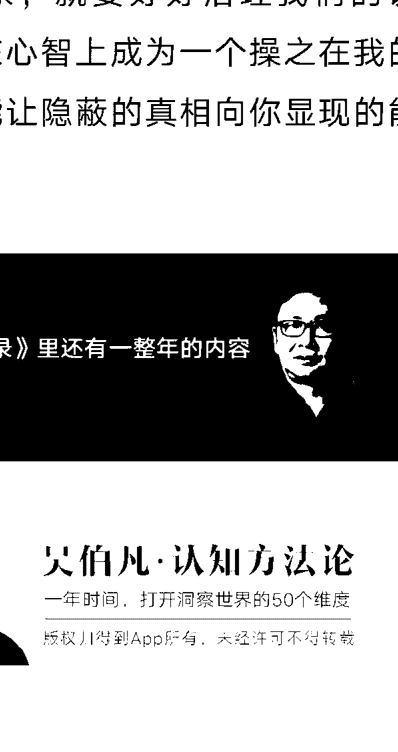

我们前两个单元讲到了妨碍认知的两种可能性：

### 1. 我们常常习惯性地滞留在意向立场

一旦陷入，我们的认知就会被消解，心智就会不断维系于“应该如何”，离实际的认知状态越来越远。解决的方法是，意识到自己现在的状态是一种非认知状态，从而转向设计立场和物理立场。

### 2. 恐惧和欲望是破坏性力量

面对这些，你会像一只老鼠看着前面吐着信子的毒蛇，立即丧失行动能力，认知水平会大打折扣。

## 哈姆雷特综合征

正如王阳明说的：知而不行，是为不知。当我们专注于认知的时候，关心的是知不知道和懂不懂，很容易忘记暗中对认知实施破坏性的这两种力量，以至于最终陷入到“哈姆雷特综合征”的状态。

所谓“哈姆雷特综合征”，就是知道该怎么做，但永远在思考和犹豫，永远不去行动，直到一个偶然的场景或事件迫使他出手——如果哈姆雷特不遭遇那种状态，可能一辈子都徘徊在“to be or not to be, this is a question”。

## 中途镇：如何避免认知固化和障碍？

## 案例1：杜月笙的“重生”

## 案例2：王阳明的“置之死地而后生”

## 总结

我们平常人只是知道、懂得、掌握了特别多的道理，但“知而不行，是为不知”，最后滞留在中途镇，是绝大多数人共有的一个命运。

理现实。

讲到这里，大家可能明白了为什么有那么多人在中途镇滞留了下来。

这门课程刚开始的时候，我们讲过子宫状态：子宫状态是非认知状态，零认知的舒适区。现在看来，我们一辈子可能不止经历一次子宫状态，也就是零认知的舒适区。

吴伯凡

大家回忆一下：自己的人生旅途上有没有经历过类似的再出生的过程？如果没有，你可能已经不知不觉陷入到一种子宫或者中途镇状态；如果有的话，可以跟大家分享自己是如何再度出生，再度从子宫状态进入到真实的荒漠世界的。

看得不过瘾？
《伯凡·日知录》里还有一整年的内容
戳此拿下

## 胆大艺更高

有句俗话叫“艺高人胆大”，但这句话后面还有一句我们常常忽略的话——胆大艺更高。

“艺高人胆大”说的是人由于对自身技能或者能力的自信而产生的一种勇气，这种勇气使得人的心智免于慌乱状态。

遇到危险性很高的事情的时候，我们的各种杂念经常像苍蝇一样在内心飞舞，这个时候，心智能量最容易耗散，如果能保持杂念越少，心智能量不变，那在面对具体事情的时候，就能将效益最大化，这是“胆大艺更高”。

“慌乱”这个词很形象：“慌”，竖心旁+荒，荒是秃草丛生的土地，除了杂草什么都没有，只是荒着。当心处在这种忙乱状态的时候，就是慌的，各种零乱的、不产生任何结果的念头在内心发生分岔。

我们在处理任何一个事情的时候，无论意志力、注意力，还是智力都处于一种没有到位的状况，就像你电脑里同时打开了20个程序，速度就会特别慢。而在紧急状态出现的时候，也就会出现一个“问题云”。

### 1.词云图

当我们写一篇文案或者思考一个问题的时候，一般会把所有可能出现的关键词写出来，甚至能写到二三十个，当然，这些关键词很多并不关键，它们只是出现在了你的头脑中了。“词云图”是一种管理方式，它会帮你把高频出现的词语字体放大，如果关联度不大或者偶尔出现，字体就会很小。

头脑风暴的时候，当大家提及某个词的频率越来越高的时候，这个词就会变得越来越大。风暴到最后，可能就剩三四个词特别大，你一眼望去就能看见这三四个词，而不是一堆词。

“词云图”是一种管理我们思维方式的好方法，避免了我们在所有出现的关键词上浪费时间动心思，那样问题是没有办法推进的。

### 2.问题云

“问题云”也是这样。比如你刚创业会有各种各样的问题，而这些问题中，有高频出现的，也有低频出现的，最后你会发现，真正要解决的问题只有三四个，也就是那些字看起来最大的问题。

管理就是确定优先级，缺乏管理就是没有优先级。当我们遇到一个危急状况，很可能出现一个没有优先级、没有字体大小区别的“问题云”，你的整个思路、行为是没有进展的，就像打群架的时候，一堆人都在打，你给别人一拳，有人也给你一拳，你回头又去打那个打你的人……你不停回击的时候，实际上是没有解决任何问题的。

我们处理问题首先面对的就是“问题云”，它就像星云状态：一开始像宇宙的尘埃，都是同样大的，然后万有引力法则使得有些尘埃能够把其他尘埃吸进来，最大的变成了恒星，质量小没有自己轨道的，就成了围绕恒星运转的行星，最后渐渐变成有序的。

要想衡量你是否在解决问题，就要看你现在面临的如坨土一样的问题时，是否能够从混乱到有序。

心智管理，无非就是从混乱到有序。一旦有序，心智能量的使用就会合理化，就有了优先级。根据优先级，你再去有条不紊地处理一个数量其实很少的问题，而不是让你的心智去处理众多没有主次、随时出现在你面前的小时问题，那样你即使筋疲力尽，问题也不会有任何进展。

## 慌乱：“胆大艺更高”的反面

中国古人说，“每临大事有静气”。在遇到大事的时候，你要迅速让自己脱离慌乱状态，用最短的时间将“问题云”从混乱变成有序。

遇大事最忌讳的就是被迫平均使用你的智力，去处理那些没有主次和大小的问题，这样的话，处理问题的过程就会变成恶化问题的过程，而问题越恶化，你就越慌乱，问题也就越恶化。

“胆大艺更高”的反面就是慌乱，是最容易降低人的智力和意志力的。演讲恐惧症就是这样来的：本来一个对你来说并不难的表达，最后变得极其紊乱。或者考试的时候，平日成绩好的人会慌场，题一下子都不会做了，效率明显降低，看到一道题觉得有点儿不会做，放一边，再做另外一题，做这个题的时候又想着前面没做的那个题，整个过程极其紧张，最后是题没做完，或者勉强做完了，但发生了一堆本不该发生的错误。

哈佛大学的两个教授在研究贫困问题的时候，发现了一个特别有意思的现象：他们在东南亚做了一个调查，发现生产甘蔗的农民在收获的那个月份里，头脑是最清晰，智力是最高的，这可以测出来。

为什么呢？因为收获的季节，农民是可以卖到钱的，而平时他们都很贫穷，手里越没有钱，做事情就越是短期行为，越没有头绪，而当手里有钱的时候，就不太慌了，包括说话做事的方式，就都不一样了。

这两位教授在《稀缺》这本书里提出“精神扶贫”的概念，他们认为，贫困问题很多时候是一个认知或者智力的问题，而影响这个智力的往往就是慌乱，慌乱跟贫穷相关。

当然，很多贫困是由于游戏规则的不公正导致的。但是在游戏规则没那么不公正，或者在同样的游戏规则下，有的人就陷入到贫困，有的人就没有，这中间的一个差别就是是否陷入到了一种认知的紊乱和障碍，而这种紊乱和障碍跟慌乱有关系。

王阳明指挥打仗的时候有个习惯：开战的时候，他必须要点课。在此前，他会做得很好很严密的布局，但大战一开始，他完全没有那种如临大敌的感觉，用平常的状态让自己有一个平常心。有时候战事发生了很大的变化，他也不会慌慌张张地出来大声呵，“出了什么事情了”，而是平心气和地了解一下状况，安排处理——这种状态就是典型的“每临大事有静气”，也就“艺高人胆大，胆大艺更高”。

另一方面，王阳明擅长让对手慌乱，向对手释放FUD病毒——恐惧、不确定性和疑心，让对方越来越焦虑不安，越来越恐惧——只要这个病毒在对方的心里发生作用，对方的决策品质就会大大下降，无论思维还是行为都会出现明显的混乱。

比如平定朱宸濠叛乱的时候，王阳明以3万人把对方的十几万人用一个多月的时间就给打败了。这就是王阳明心学的实际应用。所谓心学，就是治理心的状态，培养让心处在一个有序状态，而不是听任各种杂乱信息，让自己的心智陷入到问题云的状态。

有一句负能量的话说，“只有经过努力之后才知道天赋有多重要”，但其实除了天赋之外，有的人就有这样一种技能能够降伏其心，让自己的心不是万马齐喑的慌乱状态——只要有这种状态，平常的智力都可能有超常发挥；反过来，一个天赋很好的人，如果不能够降伏其心，对自己实施很好的认知治理的话，他的认知品质也会大大下降。

> 看得不过瘾？《伯凡·日记》里还有一整年的内容

## 降维打击

大家经常使用和讨论“降维打击”，但这个词其实很容易引起误解，尤其对没有看过《三体》的人来说。“降维打击”不是让自己降维去打击，而是通过把对方的维度降低，抽走三维的一维变成二维的，实现打击。

“降维打击”这个科幻的概念，我们在现实生活中好像不太容易想象怎么个降法，但其实生活中有很多降维打击的事儿。

比如上节课提到的王阳明打击对手朱宸濠，就是一个降维打击。他通过让对方眼花缭乱、产生疑心和恐惧，把他的视线锁定在一个低维度上，用3万人就把朱宸濠的十万多人玩弄于股掌之间。我们知道，朱宸濠从南昌出发，要去占领明朝的都城南京，一路上王阳明给他释放了各种信息，制造了各种认知障碍，让他一边走一边担心王阳明来抢他的老窝，以至于一路上就这么一直走走停停、停停走走。

蚂蚁虽然生活在一个三维世界里，但它是感受不到三维的，即便它能够上树、爬墙，哪里是已经进入到第三维的时候，它还以为自己在第二个维度上。其它生物，包括人，跟蚂蚁好像生活在同一个世界里，其实是完全不同的世界。

我们可以想象一下，朱宸濠和他的军队就像一窝蚂蚁在地面移来移去，看不到王阳明所在的立体空间，而王阳明就在这个三维空间里俯视这些蚂蚁，用各种招数让朱宸濠陷入到近似于布朗运动的状态。“兵贵神速”是对自己说的，面对敌人，就要通过让对方降维，实现降维，陷入到一种佛教讲的“无明”的黑暗状态。

你处在低维时候面对的很多问题，对于处在高维的人来说就不是问题。比如你要过一条大河，但没有桥也没有船，对你简直是一个天大的难题，但是，对从天空飞过的鸟来说，这条河从来不是它的问题。

“降维打击”就是把高维空间里不成问题的问题，变成对方的问题，让对方在这些问题当中困死。

## 认知的降维

《意志力》这本书里有一个忠告：如果你和你太太自驾旅行，不要在晚上六点多的时候跟你太太讨论严肃的问题。

人的生理规律是：进食超过4个小时之后，糖分会降低，人的思维和意志能力会大大降低，并因此对问题丧失耐性和关注度，很难对一个问题进行耐心地思考和沟通。在某种意义上说，这个时候，你已经降维了。所以，这个时候不要讨论严肃的问题，最好找一家饭馆吃饭，在补充糖分以后，你可能又暂时升维了。

当然，认知的降维不像缺乏糖分那么简单：哪怕糖分很充足的时候，你很可能也是在一个低维度上思考。

比如忧心忡忡充满着莫名焦虑的时候，你的认知就会像朱宸濠一样被绑架，在这个平面上费劲地、无效率也无效果地挣扎。更重要的是，你被各种各样的小事所挂碍一挂碍就是，被挂住，然后成为了一种障碍。在一个场景大事如天的事情，在另外一个空间里都是细枝末节的，但你就会被这些细枝末节所挂碍。

+   1. 信天翁：不自由的认知状态

法国诗人波德莱尔有一首诗叫《信天翁》。信天翁是一种海鸟，海员们经常恶作剧地抓一只信天翁，把它的腿绑起来，让它不是完全不能走，但是没办法飞，然后放在甲板上，看着这只可怜的信天翁在甲板上费劲地走。

波德莱尔说：海员们把信天翁放在甲板上，这碧空的王者便牵扯而耽耽，它银白的白翼可怜地垂放着，仿佛桨在它的身侧维系。翅膀这个... 

信天翁这个意象，可以作为思维降维的一个很好的象征。有时候，我们是被别人用一些我们不知道的障碍物或者绳索给绑住了，有时候，则是我们自己把自己给绑住了一一这样无疑费力，并且效果极差。我们的认知就这样陷入到一种不自由的状态。

+   2. 《心经》：致良知

和这种不自由的状态相反的状态是自由和解放的状态。《心经》里有一段话就是描述这种解放状态的：无挂碍故，无有恐怖，远离颠倒梦想，究竟涅槃。

心没有挂碍的时候，内心就没有恐惧了，这是“无挂碍故，无有恐怖”；各种杂念、问题云在你脑海中浮现，你又控制不了，就像是做梦的时候你把它当成真实的东西，这是“颠倒梦想”；涅槃是一种终极的空无，同时又是一种最完美的宁静状态。

《心经》讲的是心的解放，王阳明把这种状态称为“致良知”，也就是达到了优质、高品质的认知状态，一种真正的三维状态。

王阳明在摆脱追杀以后，内心有一种油然而生的自由感和解放感，他写了一首《泛海》：

险易原不滞胸中一危急和平安再也不会滞留在心中；

何异浮云过太空一这时候的自由和高空中鸟、云是一样的。所有地面的障碍不再是障碍，视野一下子变得无比宽阔；

夜静海涛三万里一既宏大又宁静的一种境界；

月明飞锡天下风一明月当空，浩荡的天风吹着，他想象自己拿着一把传说中可以飞的锡手杖。

王阳明想通过这种文学描写提示我们：心是可以达到这样一种状态的，但要达到这种状态需要驱除各种挂碍。

那么，如何去掉自己内心的问题云呢？你不可能通过简单的静坐冥想去实现，王阳明又说，“动亦定，静亦定，无将迎，无内外”，就是要达到宁静、静止的“定”这种状态。

而想要“定”，必须要在事儿上磨，不磨是去不掉这些挂碍的。这个磨也不是一般的磨，是磨难，是灾难性事件产生的恐惧和焦虑，你要在发抒当中抒掉这些恐惧，才能在曾经沧海的磨难之后拥有一颗平常心。

至于如何升级我们的认知，可以从两个角度看：

+   1. 积极的角度：优化自己的认知；
+   2. 另一个角度：在你的认知能力不变的情况下，减少各种牵绊和障碍，就像长跑运动员去掉跑步时绑在腿上的沙袋的那种解放感。认知即使是个存量，在大量挂碍被去掉以后，你也会有身轻如燕的感觉。而这些挂碍、妄念、颠倒梦想被去除之后，你也会不知不觉上升到一个新的认知境界。

## 总结

这个单元结束，我们“认知治理”这个模块的课程就全部结束了。希望你记住：

+   1. 在追求认知增量的同时，我们也要意识到，面对认知存量，如果有很好的管理方式，能尽可能消除认知的混乱无序状态，清除认知的各种障碍，我们的认知也能得到明显的优化。
+   2. 很多时候，我们之所以感到认知乏力，是因为我们的认知没有很好的治理。
+   3. 王阳明说，“心中的贼太多”，贼一直在妨碍你的内心，去掉这些以后，你的心智能量会骤然上升，心智也由此获得了解放。

## 本单元总结

#### 1. 第一节课

我们说，人很容易滞留在一个叫做“中途镇”的地方，当我们在朝着目标前 叶时，大多数人的结局都是走着走着就停下来了，然后陷入到一个困境里——知道怎么做，永远在思考，但就是不行动。如何打破这个僵局，让自己逃离“中途镇”呢？我们在课程里提到了一个词——“被抛”，让自己被抛进某场景里，通俗一点解释就是置之死地而后生。我们之前讲过的王阳明龙场悟道就是一个典型的例子。

#### 2. 第二节课

我们讲到了一个非常常用的词——“发现”，但是是很可能会颠覆你之前对这个词的认知。我们说，“发现”，并不是这个东西就在那，然后你看见了它这么简单，发现是一个相互的过程——你先发出某种能量，对象才会对你显现出来，你的状态定义了你的世界。比如说，你瞪着眼睛看一样东西，看到的就是局部，不能发现整体；而如果你眯着眼睛看它，就会发现更多全局式的信息，而忽略细节末节。

#### 3. 第三节课

如果用四个字概括这节课的内容的话，应该是“去除外障”。我们说，我们的整个认知系统就像一个词云图，越常用的认知就会变得越大越显眼，如果我们认知词云图里最大的那个词是“慌乱”的话，那就会一事无成。要记住：胆大才能艺更高。

#### 4. 第四节课

我们揭晓了本单元的主题——如何实现降维打击。其实我们在前面讲过的各种反面典型——慌乱、恐惧、欲望，都是认知的低维状态，而降维打击本来的意思就是：通过降低对方的维度，让对你不构成问题的 问题，成为对方的问题，进而让对方被困。所以，认知的降维打击，其实指的是：激起对方心中的恐惧、欲望等挂碍，同时去掉自己内心的挂碍。

好，以上就是本单元的主要内容，这也是第二模块的最后一个单元了，下周开始，我们将进入第三模块的学习。

下面有本单元的思维导图，还有我精选的同学留言，希望有助于你理解课程内容。前三名同学将获得我准备的奖品——我亲笔签名的书一本，请获奖同学留下你的个人信息，也请其他同学再接再厉，我们下节课再见。

特别提醒：留言内容会默认公开，并同步到“知识城邦”中，中奖同学留个人信息时，一定记得将留言设置为隐私模式，确保个人信息安全。

## —— 本单元十大精彩留言 ——

## 获奖留言

### 淡色的天堂

套用经济学的话来理解就是，恐惧、理智和欲望是一个分蛋糕的游戏，它们三者之间进行的是零和博弈，你多一点我就少一点。

比较特殊的是理智，它往往从属于欲望或者恐惧中的某一方，它就相当于一个中立方了，有点像美国总统竞选过程中要努力争取的中间选民。大部分时候欲望和恐惧保持着一种低价额平衡，但是特殊情况下某一方会有压倒性优势，这时候我们要做的是重新调整配比了。

我们还可以再深入思考一下，为什么认知三原色是一个分蛋糕的游戏而不能是一个做蛋糕的游戏呢？我们把自己的心智变得很大，让这三原色在更大的平台上竞争。蛋糕越大，三原色中就可能会更均衡理智，也就有了更大的份额，蛋糕小的时候人们就会经常在恐惧和欲望之中摇摆。

问答 26 | 戒烟为什么那么难？

### 小贝

这让我想起了篮球中的“暂停”。当对方打出进攻高潮的时候，通常教练会选择一个时机叫暂停。叫暂停可以打断对方的进攻节奏和状态，但更重要的是稳定球员慌乱的情绪，重新布置战术去遏制对方进攻，并发挥自己应有的水平，重新扳转局势。

认知的降维打击 3 | 胆大艺更高

### 最好的安排

昨天老婆在地下车库开车时，不小心将车蹭了一下，按照以前的脾气我会发很大的火，但是昨天我却一句抱怨的话没有说，表现得很淡定。后来老婆都觉得我进步了，问我为什么没有对她发火，我说事情既然已经发生了，发火也解决不了问题，反而会带来争吵和混乱，倒不如接受它，然后避免后面不好的事情发生。我想这应该是去掉心中的贼，让心智得到解放吧！

认知的降维打击 4 | 去掉认知的挂碍

## 其他获奖留言

### 悟知

2006年我刚从美术大专毕业，学业没有修好，工作也找不到，每天打游戏，晚上3点睡，睡到12点起床，浑浑噩噩。快年底的时候，家人问我要不要去当兵。半个月后我坐上运兵车，从广东去北京，20℃的天气降到零下5℃，我以为跟大学也没啥区别，到北京的时候还在车上四处张望找网吧。车进了部队后就像进了平行世界，早上6点天还没亮就吹哨起床，白天跑战术几公里，吃饭也要看班长脸色，只有晚上看新闻能偷个懒，和之前养尊处优相差太大了。

我心里一直抗拒这一切，第一次往家打电话大哭了一场，直至训练了一个月后，新兵授衔，宣誓，穿新军装，那会儿的感觉大概就是“再出生”吧。后来我干得还不错，因为学过美术，就一直当板报员出板报，拿过优秀士兵，连队里都认可我是一个好兵，我从没想过我会是一个好兵。

认知的降维打击 1 | 逃出“中途镇”

### 多多和空空的哲学

从“认知制品公司”的角度来看，我们之前没有发现而现在发现了的新认知、新感悟，其实是我们认知系统生产出来的新产品。被认知对象作为客现存在的原材料并没有改变，改变的是我们的生产系统。

比如以前对我严加管教的老师，甚至拿着戒尺打我屁股的那个老师，我曾经多么地憎恨他。后来走向社会，书到用时方恨少时，才知道那个老师的良苦用心。

比如自己的父母，我曾经在心里责怪他们的愚昧，责怪他们不懂得培养孩子，责怪他们没有将我调教成一代伟人。等到自己也有了孩子，才明白了父母的不易，才能逐渐放下心中对完美的想象和安念。

父母之心和老师之愿一直未变，变的是我们的认识和感悟。我们作为自己这个公司的霸道总裁，不断地学习、改进、优化我们的生产流程和加工工艺，反复刻意练习打磨我们的产品，并在现实生活里反复检验和反馈我们的认知产品。

认知的降维打击 2 | “发现”的力量

### 素直君

你自身拥有的内在资源与能量，决定你的所见。所以，在不同年龄与阶段，我们的所见是不一样的；对同一件东西的理解，也是不一样的。同时，我们和世界互动的方式，也是不一样的。

比如，我少年时看不进去《人性的弱点》这本书，觉得是泛泛之说。现在重看，抱着将书里的简单原则和信条运用、实践在生活之中，所见就截然不同。随手翻开，就看到和今天课程相呼应的内容：“与我们本应成为的样子相比，我们一直都活在半睡半醒中。我们只利用了自身资源的小部分，无论体力上还是脑力上都是如此。推而广之，其实每个人都拥有更多能力，只是他习惯性地不去运用这些能力而已。”也就是说，我们要持续激发、加强自身内在的资源与能量场，警惕掉入“习惯性地不去运用”的非认知状态。

认知的降维打击 2 | “发现”的力量

### 中膛

首先做对的事，其次把事做对。遇到事情时首先把事情认清，其次看看自己能否解决，如果自己解决不了，马上查找资料，查找资料解决不了，马上找这方面的专家。这样就不会慌乱，才能真正解决问题。

### 雪山飞狐

我感觉，真正的学习不是伴随着学习的课程，把自己的观点亮出来，我认为这仍然是播放。到底什么才是真正的学习？

我认为是找到课程背后的逻辑链条。这个链条从第一节课一直到最后一节课始终不会断裂。找到这个逻辑链条，顺着这个逻辑链条，一节课一节课地往下走。如果其中有一节课你无法理解，那么你这个逻辑链条就无法往下推进。你心知肚明。此时你要做的是重复收听课程，仔细体会里面的内容和含义。直到找到里面的重要环节，使你的逻辑自洽，逻辑也就能够继续往下推进。你有没有偷懒，你有没有逃课，你有没有学进去，一目了然，心知肚明。反过来这个逻辑链条会缠着你，不让你逃离。当逻辑不能自洽，不能往下推的时候，你会感到无比地难受和拥堵。一旦被你打通，你又能感觉到无比地畅快。大脑可能给你奖励多巴胺。学习才是真正的快乐。

### 灰度

李笑来老师说：什么重要？什么事情更重要？吴军老师说：做事要做减法，吾生也有涯，而知也无涯，以有涯随无涯，殆已。古典老师说：每日三件事。可交付，易复制，有结果。各位老师都是在教我们解决问题的底层规律，让我们少做事，做正确的事情，做最重要的事情。正如课程里吴伯凡老师讲的一样，要想衡量你是否在解决问题，就要看你在面临如尘土一样的问题时是否能够从混沌到有序。还是强调我们要少做事，让我们自己不是在万马奔腾的慌乱当中走过每一天。

### 重整旗鼓的肆阿哥

说一下我怎么戒烟的吧，首先你要有“我想戒烟”这个想法，这个想法会成为你良心的一部分，抽烟后良心会痛一下。然后呢物理上远离烟草，自己的口袋不准带很多烟，要在找烟的时候“困难重重”，比如放到书架的高层，或者是抽屉的深处。算好自己每天抽的总数，从总数开始限制，然后从抽烟的时段开始限制，比如上午8点到下午1点不抽。然后就是渐渐地拉大与烟的物理距离，限制的总数减少，时间段慢慢增加，最后你会发现：不抽烟，原来也不是特别难受。

问答26 | 戒烟为什么那么难？

## 问答26 | 戒烟为什么那么难？

问答26 | 戒烟为什么那么难...

提问有一个悖论：比较有感悟的人不提问，不太有感悟的人则会提各种各样的问题，而这个问题有时候可能没有触及到问题的本身——但是没关系，我们所有的认知都是这样一个不断迭代的过程。

大家不妨做一个试验：几个月以后重新来听本单元的课程，或者重新读一下文稿，你会发现你 Publikum? 你会发现你提的问题不一样了——你的问题样态，就是你的认知状态。

@头发未稍的遗憾

这两天的课程让我想到了戒烟为什么这么难。在感知判断上，对方一定知道抽烟有害健康——烟盒上有警示标志，还可以看到各种戒烟宣传，触目惊心的画面，身边也一定有因为吸烟导致的各种疾病的案例，说不恐惧是不可能的，但欲望上，心里很矛盾，正如《小王子》里的酒鬼所言，“喝酒就是为了忘记羞愧，羞愧地喝酒”。应该这样解读此类戒烟难的问题呢？又怎样改变对方头脑董事会的结构呢？

应该说，我劝朋友不要离婚的例子，已经解释了“如何改变对方头脑中董事会的结构”：我通过加大他的恐惧，同时提醒他的欲望，使得他理智的份额自然上升。道理只能诉诸于他的理智，而他理智的份额很少的时候，道理是没有意义的。

相关文章：认知配比 | 认知三原色

### 头脑董事会和戒烟的关系

很多人想戒烟但戒不了，和我们头脑董事会的三个成员都有关系：

### 1. 理智：

目前大量研究都证明吸烟有害健康，但大家在理智上不是完全接受这个判断的。比如有的人从来不吸烟，甚至对烟有一种近乎极端的排斥，但也得了肺癌；或者有人长期吸烟，八九十岁还很健康——诸如此类的事情就导致很多人对吸烟有害健康在理智上的认同度不够。

### 2. 欲望：

对烟的欲望，也就是瘾，在很大程度上已经不再是人自身能够控制的一种欲望了，它是一种内生的绑架性的欲望。吸烟与其说是在追求快感，不如说是在摆脱痛感。由于这种欲望非常强烈，哪怕你有恐惧，理智上知道吸烟有害健康，最终还是会选择吸烟，甚至在戒烟之后又复吸。

### 3. 恐惧：

吸烟者的确是面对恐惧的：每个烟盒都印着警告、警示语，国外的烟盒甚至印着那种极其恐怖的画面。这些确实有一定的效果，当你看到那个画面的时候，会产生一种场景感，即使不会马上戒烟，吸烟的频次也在一定程度上有所降低。

## 理智的借口

## 欲望改变客观事实

## 密码与解码1 | 最原始的数据解码技术

密码与解码1 | 最原始的数据解码

### 模块概述

人工智能的研究可以追溯到图灵（Alan Mathison Turing），一个解码人。

图灵的工作是借助并造出一种机器，把纳粹德国军队里极其复杂的电码进行解密，破解密码中包含的真实信息。在工作过程中，图灵开始设想：是否能造出一台能够模仿人思维和智能的机器，也就是让机器具有人一样的思考能力和智能——人的智能就是认知。

IBM公司一度把人工智能称为认知计算：我们的认知是通过一系列的复杂计算，从大量数据和信息当中获取对于世界和人的认知，并形成判断，作出决策。

从某方面讲，人工智能的研究要依赖于认知科学的发展，与此同时，人工智能研究也在催生认知科学的发展：在人类试图造出一台能够具有认知能力的机器的过程中，才越来越了解认知到底是怎么回事。

我们将在这个模块，通过认知、计算、算法、数据等几个关键概念，深化我们对于认知的理解。

### Oracle：兽骨裂纹的神谕

第一单元的主题是：密码与解码。

Oracle的本意是神谕，神给人的启示，或者神给人的指示和告诫。在任何一个文明中，都包含着一个重要的文化软件——宗教。宗教的本质是想象：设定有一个在控制和管理这个有形世界的主宰者，人的生存和行动要具有有效性的话，就必须要洞悉这个顶级上司的种种意图，否则，所有的行为要么是无效的，要么会导致巨大的灾难。

因此，所有文明中都有对这个看不见的、超越于人之上的力量和规律进行揣测的种种手段，巫术和宗教就是其中最重要的。哲学名言“认识你自己”就是一个神谕，它是雅典人到德尔菲神殿去求神意的时候得到的一个签上写着的几个字。

这种行为，在人类早期也是存在的，比如今天该不该去打猎，该到哪儿去打猎，打猎的效果好还是坏……人是不知道这些的，就要问天。

怎么问呢？原始人打完猎以后，把肉吃了，用骨头上一次行动的残余物作为一个介质，去获取天意。他们一般会把动物的骨头放在火上烤，骨头上就会出现裂纹。

至于裂纹到底意味着什么，只有部落的权威知道——这个权威既是部落的政治首领，也是部落的教主，他看见裂纹以后，会告诉其他人“哦，今天应该朝东南方向打猎，会打到不少猎物”——兽骨上的裂纹就叫oracle，神谕。

### 甲骨文：神谕的占卜

Oracle也是一家数据技术公司的名字。之所以取这个名字，意思就是：通过大量数据处理就能获得一种先知般的能力，能够为你的判断和决策找到坚实的依据。Oracle的中文被译成“甲骨文”。

甲骨文就是神谕。甲和骨是不一样的，甲是乌龟的壳，骨是动物的骨头，它们上面刻的文字都和天意有关。

最原始的时候，人类只看裂纹，后来裂纹变成了文字，求神谕或者天意的方法也变得越来越复杂。在中国，有两种方法，占和卜。卜是象形字，就是一个裂纹；占比较复杂，是把一种特殊的草——蓍草，割下来晒干，剪成整齐的小棍，用来作为一种计算的工具，就像算盘是一种计算工具一样。

通过占卜的复杂操作，我们可以得出elf组数据，这些数据由两种数组成：阳数和阴数，也可以简化成1和0。由1和0组成的6个数位的数字，就叫一卦。算出来的一卦就对应着写着一行行文字——《易经》算卦就是这样来的。

### 智能技术：数据解码的“巫术”

人类早期认知世界的能力很低，采取的方法也很原始，今天看来很落后，但是他们做的事情其实跟今天大数据、云计算、智能时代做的事情有很多相似的地方，比如，他们都是先确立一种算法，然后收集数据，并通过这些数据得出对未来的预测；都是通过对现在的情况、未来的趋势和走向，作出相应的决策。

所以，今天的大数据和智能技术，也可以说是一种基于最新沿科技的特殊“巫术”，它的功能是预测未来，手段是确立算法、收集数据。

认知的形成也是如此，中医里的望闻问切都是数据的收集，当然，有经验的老中医存储的数据不仅仅只是通过望闻问切而获取的单个数据，而是他脑袋当中存储了过往生活中的大量数据，经过我们不知道的复杂计算，得出一系列判断，然后给出了处方。

巫术也好，中医也好，数据和智能技术也好，不管有多大的差别，它们的相同之处就是获取认知，把隐藏在现象背后的秘密挖掘出来，这是一个解码的过程。

作为西方科学源头的古希腊科学传统，就是从这种看似荒诞无稽的具有巫术色彩的行为当中脱胎出来的。

著名的哲学家、数学家毕达哥拉斯还有一个身份：西方哲学史上第一个著名的神秘主义者。我们今天对神秘主义有很多负面的理解，但实际上，“神秘”在希腊文的本来意思就是“在后面隐藏着的东西”。神秘主义是不相信眼前看到的东西，总是去寻找藏在后面的隐匿着的信息，从而获得认知。

从这个意义上说，认知就是通过特定算法，依据数据进行计算的过程。

## 用户留言

提交留言可与专栏作者互动

### “垂帘听政”的世界主宰

我们在上一节课讲到了神秘主义——相信世界的真相是被遮挡、被隐藏的。以希腊哲学家、数学家毕达哥拉斯为代表的一派神秘主义者相信，我们眼前面能看到的东西都是不重要的。

比如听到一段音乐的时候，音乐本身是不重要的，你要知道的是音乐背后的那个规则——乐理决定着你听到的声音。所以，听到铁匠铺打铁声音的时候，毕达哥拉斯想知道这个声音跟铁锤重量有什么关系，所以，也是他发现了这个规律：弦乐的长度与音阶成反比，如果弦缩短一倍，它的音阶就会增加一倍。

在毕达哥拉斯眼里，世界被一层帷幕遮挡着，而真相在帷幕的后面。如果这个世界有主宰者的话，那么这个主宰者就是一个垂帘听政的人：每个现象背后都有一个帘子，我们要掀开帘子去看看到底是什么样。

在毕达哥拉斯之前，无论是古希腊还是其他民族，都有一些人声称能看见、听见世界背后主宰者的声音，他们的任务就是把这个声音传遇到人间来。这些人借助各种介质，比如《易经》这种运算方式，能够窥探天意。但是，这些人的功能只是传递天意，而不是去了解天意。在他们看来，天意是不可被解的，也就是说，你是没办法掀开帘子看到真相的。

后来，古希腊逐渐出现了一批人，他们相信能够掀开帘子看见世界的真相。从毕达哥拉斯开始，一直到后来的柏拉图，他们都相信世界的真相是被表象所遮挡的，智者的使命就是要揭开帘子看到真相。

希腊哲学家德谟克利特提出：世界是由一些不可分的基本粒子构成的。他把这些粒子命名为“不可分”。由此，我们发现了面对世界真相的两种思路。

一类人采取的是“听天意怎么说，接受垂帘听政的事实”：只需要听到那个声音，听到“意”，就可以去做我们的事情了，顺从神谕就是这样一种态度。持这种态度最典型的是希伯来人，他们相信人的唯一使命就是听到那个声音，了解那个天意，遵守跟天和神之间的合约，尽自己的努力，千万不要想要去揭开帷幕看到所谓的真实世界。

一类是古希腊所代表的另外一种态度：揭开帷幕去看看垂帘听政的上帝到底是怎么在玩他的游戏的。知道他是怎么玩的，人就可以获得自由了。

当时几乎所有的文明都选择了前一种“听天命尽人事”的方式，甚至古希腊早期采取的也是这种方式——古希腊的悲剧只有一个主题：让anlagen于自己的本分，不要去做违反天命的事情。

后来，随着古希腊被罗马征服，基督教统治世界，他们对世界的这种态度也就长时间地被埋没了，直到五六百年前出现了文艺复兴。

### 解剖学&文艺复兴

文艺复兴的起源有各种各样的说法，我自己觉得有一个比较冷僻的说法更有道理：导致文艺复兴的是发生在1347年到1353年的一场人类大灾难——肆虐欧洲的黑死病。

当人们看到身边的亲人朋友几天之内就在极度痛苦和绝望中惨惨死去的时候，他们的第一反应是：一定有什么事情惹怒了上帝，他用这样一种方法来惩罚人类。

因此，他们用一种我们可以想象的传统的方式来治病，比如，首先要向上帝认罪，同时要用与上帝相关的方式治病。当时流行着一种处方，是把《圣经》扯下一小片纸片烧成灰，再把这个灰放在水里调匀喝下去，显然，这个办法是治不好病的。

当这些人试图用这种了解天意、忏悔、用自己的臣服博得上帝怜悯的方式解决问题的时候，另外一些人开始使用另外一种方式，试图揭开帷幕看看世界的底细是什么：在古希腊，一些医生冒着教会的禁令，偷偷在医院的地下室解剖尸体。他们想看看死去的身体里到底发生了什么，是什么导致身体的病变——这就导致了医学史上一个意想不到的学科诞生，解剖学。

在黑死病爆发最多的佛罗伦萨，很多人都开始解剖尸体，甚至已经形成了一种习惯：你想了解人就必须解剖尸体。这种共识和习俗一直延续下来，几乎所有的知识人都对解剖学产生了兴趣，很多不是从事医学行业的人也开始了解解剖学的实践和研究，其中就有两个非专业却非常著名的研究者：米开朗基罗和达·芬奇。

+   1. 米开朗基罗：包含着密码和解码的世界观

上个世纪90年代有人曝出了一个惊天的大秘密：米开朗基罗在西斯廷教堂画的上帝的宝座，其实是人类大脑的解剖图。

米开朗基罗通过解剖人的身体，尤其是大脑，发现人之所以为人，是因为有一个神奇的大脑，一旦大脑不存在或者出了问题，人就变成了一个行尸走肉。上帝之所以能造出人，不在于上帝能用泥巴捏出一个跟他相似的物种，而在于上帝赋予了这个物种一种灵魂——上帝的这个能力跟大脑有一种密切的关联，他的全知全能就是因为他坐在一个形状像人的大脑的宝座上。

2005年，巴塞两名医生发表了一篇论文，对西斯廷壁画又做了更详组的研究，他们发现，在这一幅画里隐藏着34个解剖学肢机，也就是说，除了上帝的宝座形状看上去是人的大脑，上帝旁边的天使实际上隐藏着34种人体解剖器官。米开朗基罗用他的绘画表达了一种理验：世界表象背后隐藏着本质——这是一种包含着密码和解码的世界观。

+   2. 斜杆人达·芬奇：跨界解码

米开朗基罗的同行，和他并称为‘文艺复兴三巨匠’的达·芬奇，比米开朗基罗更相信密码的世界观。在达·芬奇看来，一个画家的使命就是要从最具体鲜活的现象中发现世界的密码，同时，他还要用一种生动可感的形式悄悄透露隐藏的密码。

我们看一下达·芬奇这幅展示人体比例的名画，他试图告诉人们：普通人眼里的人体其实深藏着许多秘密。

在这幅画里，达·芬奇把人体置于正方形，他发现：

+   1. 人的两臂伸直以后的长度正好与人的身高相等，就构成一个正方形；
2. 人四个手指为一掌，四个手掌的宽度加起来就是脚的长度；
3. 如果人的两臂提升，跟人的头平齐的话，两腿张开成一个等腰三角形，就会形成一个对角线，这个对角线的焦点就是人的肚脐。

达·芬奇通过他的画和大量解剖学研究告诉我们：别小瞧了我们眼前的世界，平平常常的现象背后有着深藏不露的洞见，而始终决定着表象的是规律和密码。

达·芬奇在这一意义上已经变成了典型的斜杆人，他的跨界非常自然，不管从事什么行业，都是一个解码师，一个发现世界的密码，把它展现出来的人，或者就是在平常的事物上，发现世界密码的人——这也是文艺复兴的真正理念。这种理念最终导致了西方的科学革命。

“认知就是解码”是一种对人类文明产生深远影响的世界观和方法论。

### 神秘主义和科学精神

说到达·芬奇我们会马上联想到一堆词，形成一个词云图：

百科全书式的人物

《蒙娜丽莎》里透露出的神秘，以及至今仍然引起种种猜测的《最后的晚餐》；

在艺术史、建筑史、医学史都要提及的重要人物，涉猎的范围还远不如此；

设计了世界上第一个潜水艇，虽然只是一个设计图；

设计了世界上第一个机器人：达·芬奇相信人其实是一部极其复杂的机器，如果人对世界的认知不断增加，一定会造出一个跟人一样复杂，有智能的机器；

最重要的是，达·芬奇横跨科学和神秘主义。

神秘主义和科学似乎是最不相容的，但它们在历史上一直难舍难分。不仅达·芬奇，我们知道的很多科学巨头都跟神秘主义纠缠在一起。

比如伽利略，他在比萨大学开过两门课：一门叫欧几里得，另一门叫占星术；还有伟大的科学家牛顿，他的科学成就不用多说，你知道他花时间最多的一门学科是炼金术吗？他的炼金术手稿远远多于他的数学和物理学的手稿。著名经济学家凯恩斯还曾经花重金把牛顿关于炼金术的手稿买下来珍藏。

在前面的课里我们已经大致知道了科学和神秘主义之间的关系：当一个表象出现在你面前，相等于发出一声警报或一个警告——留神！它不是它！它背后有更重要的东西！

一个苹果砸下来，对普通人也就是砸一砸而已，但对牛顿来说，苹果砸下来必然有它背后的原因，他不仅要找到那个原因，还要用最简单的数学方法把这个现象表达出来——这就是一种科学精神。

对一个科学家来说，从一个现象提出一种猜想，本身就是科学探索的一部分。当然，他还要用两样东西反驳他的猜想：数学方法和实验方法。当数学和实验的方法把他的猜想驳倒以后，他会放弃这种猜想；反过来，数学和实验的方法没办法驳倒他的猜想的时候，就是科学。与此同时，这个猜想在本质上仍然是一个猜想，仍然预留了被别人用数学和实验的方法进行反驳的空间——这才是真正的科学精神。

所以，在一个科学家的探索中会发现大量无用，甚至是荒诞的事情，比如牛顿和爱因斯坦都是后半辈子一事无成，这种一事无成和他们早期的巨大成就有一个贯通逻辑的，那就是对表象进行大胆猜想，然后想办法去证实或者证伪它。

也就是说，在他们的思维中已经形成了一种习惯：任何现象只是一个表面，支撑这个界面的是Tech未知的、没有充分了解的编码。人的认知要做的事情就是发现并且去解开那个密码。

### 中文打字机：林语堂的失败

林语堂通过向中国人讲外国文化，向外国人讲中国文化，成了国际知名作家，也挣了很多稿费。有钱以后，他想要满足自己的一个夙愿：制造出一台中文打字机。这件事耗去了他后半辈子的大部分精力，也几乎把他所有的财产都耗进去了，但最后没有成功。

虽然林语堂后半辈子的碌碌无为不能跟爱因斯坦和牛顿的后半辈子相比，但他在这件事情上的失败也很意义：林语堂之所以想到要发明一台中文打字机，是因为他一直使用英文打字机，觉得这个东西太好用了！既然自己脚踏中西文化，既能用英文写作也能用中文写作，那么“我能不能够做一台中文打字机？”

制造中文打字机的一个特别大的问题是：汉字和拼音文字非常不一样。拼音文字是一种元素化的文字，也就是说，不管什么单词都是由那26个字母当中的某几个字母组成的一我们知道，拼音文字的这个特点直接诱发了化学的诞生。

化学就是将林林总总的万事万物、各种各样的物质还原为一些基本要素——元素。当你找到这些基本元素的时候，你就会发现千差万别的物质都是由几种化学元素组成的，这个绚繁复杂的现象世界的背后是非常简单的元素。接下来，找到各种物质的编码就能深入了解，甚至利用这些元素、分子式、化学方程式，做新的物质出来。

解码就是在杂多当中发现简单背后，跟表面的现象之间极不对称的元素或者叫要素。欧洲的文字是拼音文字，我们的汉字也有一些偏旁部首，也是它的元素，但是这个元素带有明显的象形文字的特点。

一个字从一开始就不是元素合成的，而是一种模拟型的文字，跟编码式的文字有相当大的距离，更重要的是，汉字是方块字，每一个字有特定的结构，这些都给中文打字机的发明带来了非常大的挑战，从这个意义上说，林语堂的失败并不是他个人的失败。

### 五笔输入法：王永民的成功

有意思的是，我们今天可以在计算机上轻易地输入汉字，这里就必须说到一个人：王永民。

王永民非常聪明，他首先注意到一个事实：英文之所以容易进入电脑，是因为英文本身都有原子式的元素——字母。而我们的汉字即便是由各种元素组成的，也很难在相当有限的电脑键盘上挤足——想让汉字进入计算机，首先要让汉字适应这只有26个字母键的计算机键盘。

通过仔细观察，王永民在化学元素周期表上找到了灵感：

108种化学元素可以分成各种类型，比如卤素元素、金属元素等等。那么，能不能这样设想：如果汉字不能分成像26个字母那么少，那么能不能分成和化学元素数量差不多，多也不多到哪里去的一些构成元素，再把这些元素分成几种类型呢？

王永民设想的最好达成的效果是：每个汉字不超过四个元素，这四个元素一旦合成就可以变成任何一个汉字——这些字的元素就是字根。经过分析，王永民发现，最终可以用大概135到137个字根就能囊括所有汉字的构成要素。

他把字根分成五种类型，分别是以五种笔划开头的一个类型称为一个区，每个区有五个键，五五二十五，只需要25个键，就可以帮助这些字根分装在不同的键上。

汉字的笔划一共有六种，怎么只剩下五种呢？点和捺本质是一样的，都是从左上方到右下方，所以被归为了一个类。这样，每个汉字可以分解为最多四个字根，也就是说，只需要用四个英文字母就可以对每个汉字进行编码。

这就是王永民构造的一个汉字世界：只用非常少的字根，林林总总的汉字就能通过特定的组合形成唯一的编码，实现在电脑键盘上输入任何一个汉字的目标。

对比王永民和林语堂的方法，我们发现：编码在其中起到了关键的作用，或者说，化繁为简，通过杂多的现象找到精简的编码，才能抓住复杂现象的底细，并且通过操纵这个底细，重新构造一个复杂的世界。

在这个问题上，我们可以说王永民之所以成功是因为他发现了汉字的密码，在这点上，他做的事情跟科学家是一样的：牛顿只用了三个字母、一个等式，就将事物运动的规律呈现了出来——F=ma；爱因斯坦也只用了三个字母、一个等式，就把物质和能量之间的关系呈现了出来——E=mc^2。

深度的认知就是一种解码和重新编码的过程。

上节课我们讨论了编码的力量：

+   1. 在某种意义上，编码是一种简化的过程。这种简化不是粗暴的简化，而是通过大量观察归纳，反复试错以后的简化。
+   2. 简化是将要素和诸多现象还原为少数元素，用少量元素进行排列组合，这其实现也是一个编码的过程。
+   3. 编码是用少量元素在认知上再造世界，整个过程是一个重新建立并找到世界密码，让自己的认知和密码同步的过程。

人类认知史上的很多努力都是这样一个过程，哪怕一些充满着神秘主义和荒诞色彩的方法，也都是这样一种尝试。只不过他们的尝试失败了，或者被证明无效，比如占星术、炼金术，以及和它们有关的至今仍然流行的某些现代巫术和迷信。

认知是一种生存方式，或者说，是面对困境提出既有效率又有效果的解决方案，有了它才能去改变现状、处境，甚至整个世界。

### 编码的障碍

刚接触管理学的时候，你会接触不少管理的方法，比如波特（Michael Porter）的五力分析模型，波士顿矩阵，以及时间管理等等大到制定战略，小到管理时间的各种方法。比如波士顿矩阵是在产品里找到两个重要的因素：获利性和成长性，相当于对产品的两个元素进行编码。获利性高，成长性又好，就是明星产品。

我们在处理各种事物的时候，无非也是找到事情的两个基本元素：重要性和紧迫性。对于既有重要性又有紧迫性的，我们优先处理。利用这样一种编码，立即就可以把面对的种种事情进行还原，轻松排出一个优先等级。

我们的很多认知都是通过大量归纳，由繁入简找到基本元素进行编码，然后制定解决方案的过程。但问题是，编码太难了，根本找不到头绪，如果你找不到基本构成要素，怎么用这些基本元素去编码？

编码首先遇到的障碍和挑战就是：没办法由繁入简，甚至没办法直面这个现象。

### 解码美杜莎

有一个古希腊神话可以很好地解释编码有多难：邪恶女神美杜莎，是一个满脸长着无数小蛇的恐怖形象。但她真正可怕的地方不是她头上的小蛇，而是你没办法直面她：想要击败美杜莎的前提是要看见她，看她出手你才能应对。但是，当你面对美杜莎的时候，只要跟她的目光相遇，就瞬间石化。

她就是要阻断你跟她直面观察她的可能性，不仅瞬间把你变瞎，就连观察她都是自我毁灭的过程。

但有一个叫珀尔修斯的神最终战胜了美杜莎：他把自己的盾牌磨成一面光滑的镜子，反拿着盾牌，背朝着美杜莎。这样，盾牌上映现出美杜莎的影子，他通过观察美杜莎的镜像，避免跟美杜莎目光相遇，破解了美杜莎阻碍他解码的企图，最终消灭了美杜莎。

我们以前用美杜莎这个例子来说明，通过虚拟世界的优势将物理对象变成信息对象，从而获得认知优势。今天我们用这个例子说明的是：把对象设立的阻止我们认知的屏障消灭，突破这个屏障以后，就能获得认知优势，实现竞争优势。

### 曹冲称象：编码的力量

曹冲称象这个故事能让我们知道编码的力量。在这个故事里，成年人面对一头大象一筹莫展，因为当时找不到大秤秤来称出大象的重量。而曹冲的聪明之处在于，他谋求的是一种认知优势，而不是一种物理或者体力的优势。在他看来，大象有多重这个问题是一个信息问题，这个信息是可以进行解码和编码的。

“码”这个字，左边一个石字旁，右边一个马，本意指用一块块石头组成一堵墙、一个祭坛，或者盖一个房子，所以“码”也是一个动词，是用一块块石头或者砖构成一个东西，这个过程也是用一个个不可再分的元素组成一个整体。

曹冲要做的就是把一个整体分解为元素：他把大象牵到船上，在吃水线画一道线，然后用相当于一个个元素的一块块石头，放到船上，直到与刚才画的吃水线齐平。接下来事情就更简单了，把解码大象重量的这些石头一一过秤，就得到了关于大象重量的信息。

当你不能对整体进行操作的时候，面对问题，分解到基本的可以操作的元素，这就是一个解码和编码的过程。

### 焦虑：无法编码的现象

焦虑感和紧迫感最大的区别是：焦虑感没办法对现象形成认知，也没有办法将自己的行为进行分解；紧迫感能够将现象进行分解，并相对应地让自己的行为进行分解。

当定时炸弹在你面前，既可以引发焦虑感，也可以引发紧迫感：

+   焦虑的人没办法分解这个现象，更没可能去分解自己的动作；
+   紧迫的人感受到了危险，并找到了解决问题的步骤，会迅速将自己的步骤进行分解并按照这个步骤去做——前十秒钟干什么，接下来十秒钟干什么等等；
+   紧迫的人在整个过程是直面危险，而焦虑除恐惧还是恐惧。

我们从编码的角度来看焦虑感和紧迫感：焦虑是没办法将现象进行编码的状态，它无法将元素重新编码，从而解决这个问题。

吴伯凡
这个单元跟大家分享了认知与编码解码的关系，希望大家反省一下：自己是否在思维和行为上具备解码编码的习惯，从而形成自己的认知优势。

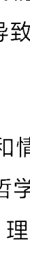

### 1."理性永远是欲望和恐惧的奴才"

@前张辉

理智受欲望和恐惧的驱使，那我们有真正的理智吗？

理智、欲望和恐惧是认知的三要素，或者说是认知的三原色，它们之间是一种互动关系：理智不总是受恐惧和欲望驱使，关键在于三者之间的比重。如果恐惧和欲望不是那么强烈的话，理智就会比较正常地运转，但我们常常遇到欲望突然上升，贪婪抬头，导致理智在整个认知中的权重大大降低。

说到理智和情感的关系，我们应该永远记住苏格兰哲学家大卫·休谟（David Hume）的那句话：理性永远是情感的奴隶。

大卫·休谟说这句话的时候，它是一个哲学命题，对从事科学的人来说，哲学命题顶多是一个猜想——哪怕它很可能是对的，但在没有得到最终的逻辑和实验验证的时候，它就是一个猜想。但是，当代认知科学越来越证明，尽管我们常常自觉不自觉地把认知等同于理性，但理性在整个认知当中的权重一直是不稳定的。

我们可以把大卫·休谟的话修改一下：理性永远是欲望和恐惧的奴才，而不是奴隶。理性确实有认知能力，但是，它没有自主权，一旦贪欲起来，理性具有的奴性会马上趋合欲望，或者屈从于恐惧。

### 2.认知不仅仅由人的理性决定

@花经理

认知董事会难道只有理智、贪婪、恐惧吗？我们很多时候是靠感觉、本能、习惯、传统进行判断行动，这些不是认知吗？

理性是一种三原色，而习惯、传统这些跟理性、欲望、贪婪不在一个层级、逻辑系列上。我们有习惯性恐惧、习惯性欲望、习惯性理性（一些成见），这些都会影响我们的认知，就像打印机的墨盒：三个墨盒足以打出五彩缤纷的图片，没必要买无数个墨盒，但是中间的调配机制非常复杂。

需要强调的是，这三种要素是经过还原以后的三要素。我们以前讲过，很多负面情绪都跟恐惧有关，比如怨恨、恼怒、烦、嫉妒、自卑等等。如果没有恐惧，就不会有嫉妒——嫉妒的底色是恐惧。

认知董事会和其他董事会一样，不管是几个人的董事会，差不多都代表着理智、欲望和恐惧。

国外一个研究机构在进行股票分析的时候，会认真分析一个公司的董事会结构：撇开利益之争不谈，董事会的人差不多分别代表理性、贪婪和恐惧，当然，还有一些随声附和的。这个董事会有点儿无政府状态，有时候谁的权重大会就决定最终的判断和决策。

但是，理智在认知当中的角色跟另外两个不太一样，因为理智至少有一种能够抽身出来，观察自己认知状态的能力。

正如有个同学说：当我们作为当局者做一件事情或者评价一个人的时候，我们应该在充分意识到自己的情绪构成的基础上，努力把自己放在一个旁观者的角度来客观审视我们的所作所为。

当你的理智具有一种抽身出来做认知三要素的旁观者的时候，恐惧、欲望和理性在整个认知当中的配比就会发生变化——这是一种认知治理。

很多高智商的人会犯愚蠢的错误，这个愚蠢是结果上的，就是我们觉得以他的理智和智商是不可能犯这样错误的，但为什么会犯？因为认知不仅仅由人的理性决定。

### 3.进化导致的不只有理智

@Richard

听了认知三原色很有启发。事实及逻辑推理，诱惑和恐惧构成了认知三原色，这样的例子在生活中比比皆是，但是，看了在洁净的杯子中吐出自己的唾液和把装过粪便的盘子洗干净这两个例子以后，我又产生了困惑，这两个例子中的场景应该说是没有诱惑或者恐惧的，但什么原因导致了与事实及逻辑推理相反的结论呢？是不是还有第四个认知因素呢？比如心理感受。

一个人把自己的唾沫吐到一个杯子里，就会

恐惧不是一种坏的情感，任何情感都有自身的合理性和用处。恐惧是我们自带的一种警醒机制，让我们发现危险的时候及时趋利避害。但是，由于人类在进化过程中，环境变化的速度常常高于进化的速度，就很容易导致了一些情感残留或滥用。很多时候，我们是在滥用自己的恐惧，以及由恐惧所衍生出来的其它情感，包括厌恶和恶心。

再强调一遍：认知三原色是最终于经过还原以后的三个要素，尤其是恐惧和欲望，自带了很多相关衍生出来的情感。

我们要讲的不是简单的理智和情感的关系，而是人在认知形成过程中，理智所扮演的角色以及限度。作为一个结果的认知，是有另外两个重要因素在影响最终结果的。

如果比作一个董事会的，认知是这个董事会最终做出的判断和决策，理智在其中扮演的角色是有效的。想要确保我们的认知是优化的，就必须要意识到影响认知判断的另外两个重要因素，从而适度抑制恐惧和欲望在其中的权重。

一年时间，打开洞察世界的50个维度

## 本单元总结

1. 第一节课

我们说，今天的大数据、云计算是一种先确定算法，然后收集数据，再对未来进行预测的过程，在我们看来这很高科技，但是从原理上来说，其实这个方法我们很早就用了，比如人类早期的占卜、甲骨文、巫术等等，从逻辑上讲都是一样的。而人的认知其实也是一个通过特定算法，依据数据进行计算的过程。

2. 第二节课

"认知就是解码"这个世界观对人类文明的进步产生了非常深远的影响。无论是毕达哥拉斯的探索，还是解字学的诞生，都是一个对世界的表象解码的过程，同时也推动了整个人类文明一步步接近世界背后的真相。

3. 第三节课

我们讲到了科学精神，科学精神背后也是一个编码、解码的过程。从牛顿的力学定律，到爱因斯坦的相对论，再到熵盘、五笔输入法的发明，都是一个先解码，也就是由繁入简，然后再重新编码，也就是由简入繁的过程，这同时也是深度认知过程。

4. 第四节课

虽然我们已经知道了解码和编码的重要性，但事实上，这还是 一件非常难的事，我们的焦虑就是由于解码无能造成的。那怎么做呢？我们在这节课里提供了一个方法，就是当你不能对整体进行操作的时候，可以把问题分解成一个个基本的 可操作要素。比如"曹冲称象"就是一个典型的案例。

好，以上就是本单元的主要内容。以下是 我精选的同学留言，恭喜前三名同学，将获得我签名的书一本，这次送出的书是《极简欧洲史》，得到的工作人员会尽快把书寄给你，也希望其他同学再接再厉。我们下节课再见。

特别提醒：留言内容会默认公开，并同步到"知城邦"中，中奖同学留个人信息时，一定记得将留言设置成隐私模式，确保个人信息安全。

## —— 本单元十大精彩留言 ——

## 获奖留言

从心开始

在物理的世界里，可以用公式来表达。但一旦进入到现实的社会生活，公式未有效。

我们会发现，心理学领域就几乎没有什么公式，经济学的定理常常因无法解释经济现象而被人嘲笑。因为现实生活属于云型事件而非钟型事件，影响因素太多，无法明确给出因果关系。心理学的实验结果，内部效度越好，往往外部效度越差。化学把世界拆成一个个元素，五笔打字把汉字拆成一个个字根，都是我们理解和解决问题的 一个角度，一种思路。对事物的解码和编码有很多种方式，不要被其中一种给框住。

密码与解码 3 | 什么是真正的科学精神？

山峰

1974年，美国政府为了清理给自由女神像翻新拆下的废料，向社会广泛招标。但几个月过去了，仍无人问津。远在法国旅行的一位犹太商人听到消息后，立即飞往纽约。看过自由女神像下堆积如山的废旧铜块、螺丝和木料后，他没有提任何条件，当即签下合同。

## 其他精彩留言

Mir東

"成功的人都是善于总结的人"。总结的结果就是经过大量数据得出的经验，总结的过程即算法。古人的生存需要数据的支持，现在的人们一样需要；现在一些大型的企业，想要变得更加地庞大，必须掌握其他行业的数据。

### 小贝

上学的时候，老师总是叫我们要吃透课本，然后梳理知识，最后归纳总结。我想这就是一个先解码，再编码的过程。

密码与解码3 | 什么是真正的科学精神？

### 斜阳

我理解的科学精神就是相信万千世界的背后有规律，并愿意找到那个规律去更好地理解世界，更好地与世界交互。由于工作原因，我经常往返北京和深圳，而这条线路的航班准点率是全国最低的，我飞了几次之后总结了一些心得发给同事，提高了大家的旅行体验。

比如预订航班时优先选择前序或后序为国际航班的班次，即便天气条件恶劣，你也会被优先安排；另外尽量避开对飞的航班，也就是一天之内只往返于北京和深圳的航班，很多的航班晚点，不是因为这里天气不好，是因为飞机还没到港；最后，提前三天看天气预报，有台风赶紧换火车票，动作慢了火车票都会售罄。

所以我觉得善于总结发现就是科学精神。

密码与解码3 | 什么是真正的科学精神？

### 嗯

编码解码的能力实际就是拆分任务的能力，通过对大问题拆解成一个个具体的小问题。

孟买达巴瓦拉送餐系统就是通过一步一步解码实现高效准确的送餐。统一取餐时间，统一交付下一个送餐员：重要的是几乎所有的送餐员是不认识字的，他们对饭盒的处理是通过简单的编码。A表示某栋大楼，7表示第七层，然后在送餐时可以做到按区域划分，高效简单编码就是从认知性知识到非认知性技能，练就黑客解码的能力。

解码需要每天正确有效地反思，我的想法是学着每天向自己提问，打开自己的感官，不要去“学”，而要去身体力行地“悟”。紧迫感和焦虑不一样之处在于，虽然具有紧迫感，但是心是定下来的，达到“了了分明，如如不动”的状态，就像一只猫等待着时机出现。

密码与解码4 | 焦虑与编码有什么关系？

### 佛祖门徒

我们真正存在理性吗？隔壁万老师在《精英日课》表达了如下观点：

第一，什么叫理性呢？理性一个定义，就是你的选择得有一致性。我们以前说过，博弈论的一个基本前提，就是你得有这种选择的理性。比如如果你认为菠萝比橘子好吃，橘子比苹果好吃的话，那么我就可以推导出来，你一定认为菠萝比苹果好吃。如果你接下来非得跟我说苹果比菠萝好吃，那你就是非理性的，我就没法给你出谋划策。只有当你的选择具有一致性的时候，我们才用得上数学，才谈得上科学决策。

第二，所谓理性选择，其实是一个神话。哪怕你头脑完全清醒、特别理性，你还是会面临不知道该怎么选的局面。有个女哲学家劳里·安·保罗说，如果你没有孩子，你永远都不可能知道自己有了孩子的生活体验是什么样的。观察别人家孩子的可爱度，跟你自己有孩子的感觉完全是两码事。人的天性是爱自己的孩子会远远超过爱别人的孩子。哪怕在别人看来这个孩子不怎么可爱，只要是你的，你也会觉得他特别可爱。一个平时讨厌孩子的人，有一天有了自己的孩子，他很可能会爱这个孩子胜过爱世界上任何东西。所以在要不要孩子这个问题上，你永远都不可能作出理性决策——因为你除非亲身经历，否则不管怎么做都无法准确评估这个选项！

问答27 | 存在真正的理智吗？

### 创梦场

老师在日知录里讲到的“保姆型人格”，就是认知中的“恐惧和欲望”的比重多于“理智”。因为这种人格的人，特别是在满足孩子的欲望中，毫无节制，无比慷慨给予，那就是在担心甚至恐惧孩子闹情绪。同时也是希望得到孩子的认可和喜欢，这又是一种欲望。同时，“服务型人格”只是满足孩子的正常需求，而非“保姆型人格”的欲望。因此，“服务型人格”的人的认知中，“理智”的占比要大。

问答27 | 存在真正的理智吗？

## 用户留言

提交留言可与专栏作者互动

吴伯凡

到上周为止，咱们课程的第二模块“认知治理”已经全部结束了，本周已经进入到了第三模块。认知治理这个模块其实非常重要，我强烈建议大家能够反复地琢磨、学习。所以今天，我给你准备了一个复盘清单，总结整理了第二模块的十个核心概念，希望你能趁热打铁，在第三单元的课程刚开始的时候，再把之前学知识巩固夯实一下。

### —— ◆ 第二模块核心概念 ◆ ——

+   1. 前行路上有它就不怕——灯式认知

灯式认知是指一种在动态中不断摸索着前进的进展式认知。就像你走在一条漆黑的路上，手里拿着灯，虽然灯能照亮的范围有限，但只要你拿着灯往前走，看到的范围一定会越来越大，线素一定会越来越多，一定会越来越接近目的地。

+   2. 你应该警惕的认知——认知阉尾

认知阉尾是曾经有用，但在场景变了之后就不再有用，甚至有害了的认知。比如恐惧，它让我们在原始社会远离生命危险，但今天，也让我们不理性地退缩。

+   3. 你需要多花一些时间关注它——消极数据

消极数据是相对于积极数据而言的。积极数据指的是“今天气温25度”“我昨天跑了5公里”等等非常明确的指标，但有些数据是无法准确量化的，而且非常重要，我们就管它叫消极数据。比如，你能在自己都说不清有什么依据的情况下，判断出一个人的感情、意图等等，这就是消极数据的力量。

+   4. 你应该全力避免它——表面增长谬误

这是一种看似在进步，但实际上能力没有任何进展的谬误。一个追求的如果是自己有多少证书，名字前面有多少头衔，就很容易陷入到表面增长谬误中。“高分低能”说的就是这种情况。

+   5. 你要认清的一个现实——认知的两重性

我们的智力当中，有可以越来越高的那一面，也有受制于地心引力，永远很笨拙的一面，比如对复杂事物的记忆极限等等，这就是认知的两重性。所以不要以为，随着物种进化、个体学习，我们的智商就一定是越来越高的。

+   6. 控制认知的一个有效手段——认知的客观化

不识庐山真面目，只缘身在此山中。任何控制都是从客观化开始的，认知也一样。就好像你在哭的时候，如果去看镜子中哭泣的自己，你就哭不出来了，这就是客观化的力量。你要尽量跳出场景反观自己。

+   7. 你应该具备的一个工具——认知的奥卡姆剃刀

奥卡姆剃刀原理说的是“如无必要，勿增实体”，认知也一样，你的很多错误观念都是给伪科学、骗术留下的接口，你要用剃刀把它们剔除掉，只留下最核心的观念。比如，防骗术有千万种，但你只要记住一条就一定不会受骗，那就是有便宜不要占。

+   8. 控制情绪的有效机制——认知的三种立场

我们看待世界有三种立场：物理立场、设计立场、意象立场。当你用前两个立场看问题时，事态都在你的掌控中，但如果你用意象立场看问题，愤怒、怨恨、不公等负面情绪就会油然而生。你应该学会这三种立场之间的转换。

+   9. 你控制认知的基础意识——认知三原色

理智、恐惧和欲望，是构成认知的三原色，三者配比的变化决定了认知的变化。当你在地面上走假独木桥的时候，理智在掌控你，你可以顺利走过去，但如果这座独木桥搭在悬崖间，恐惧就会吞噬你的理智。不同场景下会有不同的认知配比。

+   10. 你应该掌握的技能——认知的降维打击

你在高维，别人在低维，那你一定无往不利。认知中有一个通过降低对方维度去打击对方的方法，可以帮助你占据优势地位——激发对方认知中的恐惧和欲望，削弱对方的理智，这样你自然就占据了高维。

特别放送｜第一模块重要概念与认知训练方法

## 用户留言

提交留言可与专栏作者互动

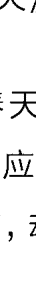

### 《寂静的春天》：钻牛角尖的解决方案

我们从《寂静的春天》这本书讲起。很多人觉得这是 一本关于环保的名著，其实它的意义远不那么简单。

前几天我问一个《三体》迷说不记得《三体》里提到的一本看似不起眼，但是对整个《三体》的叙事非常重要的书，他说：《寂静的春天》。

《寂静的春天》的作者雷切尔·卡逊注意到，春天本应该是鸟语花香的，但在美国的一些地方，却听不见鸟叫了，为什么？

她从这个现象入手开始追踪，发现了一个很简单的事实：很多农场过量使用杀虫剂引发了这一系列的后果。虫子去掉了，鸟儿也没有了。因为鸟是吃虫的，虫子没有，鸟自然就不再有了。而没有鸟会导致什么呢？导致需要使用更多的杀虫剂。作者认为这是 一种很可怕的现象。

但雷切尔·卡逊要讲的还不是这个事，她说的是人类在使用杀虫剂的时候遵循的一种思维方式：当你遇到麻烦的时候，你会从你有限的认知出发，找到一种解决方案。这种方案好象很有效，但它的后果往往事与愿违，甚至会出现灾难性的后果。

当人大量使用杀虫剂的时候，一方面虫子的耐药性提高了，另一方面，也导致了它的天敌巨量减少，甚至灭绝——你的解决方案因此钻入了一个牛角尖，这牛角尖让你 的选择越来越少、效果越来越差、代价越来越大。

### 《三体》：无效的霹雳手段

刘慈欣很巧妙含蓄地把《寂静的春天》所隐含的哲学前提移植、隐藏在了自己的《三体》这本书里：如果 你觉得一个东西是有害的，要想法办法去消灭它，但你消灭它的结果往往是让自身毁灭。就像在《寂静的春天》里，人类直觉地认为：第一，虫子是有害的；第二，我们要使用霹雳手段把它消灭，但这种霹雳手段往往是无效的。

在《三体》里，有一次地球的精英聚在一起秘密开会，商讨怎么对付三体，结果会议室的屏幕上显示出一行字：你们是虫子。地球人以为这个地方极其秘密，不可能被三体发现，结果，三体以这样一个残酷的玩笑戏弄了地球人。

在会议结束以后，小说的主人公警察史强带着汪淼和另外一个人开车来到了郊外，看到无数蝗虫在飞舞，更多的螽虫趴在地上啃噬着草——蝗虫过后，寸草不生。史强 这时候说：蝗虫一直是人类的顽敌，它们看起来很渺小，但我们一直试图战胜它们，却从来没有战胜过。三体人说我们是虫子，我们没必要气愤，应该想一想蝗虫给我们一种什么启发。

### 《狼图腾》：大自然的另一种规则

我曾经在《伯凡·日知录》提到和解读过的中国当代小说《狼图腾》，应该更容易让我们理解《寂静的春天》想讲什么。

《狼图腾》和生态科普著作《寂静的春天》的底层逻辑是一样的，这本书讲的是草原上打狼的故事：在盛行打狼的年代，流行着一个京剧唱段，“打不尽豺狼，绝不下战场”，就有一些人认为，狼是草原人的天敌，它给人造成了太多祸害，要想过上好日子，必须要把狼消灭。

草原上当地的老人说“狼是草原的守护神，你们打了会遇到天谴的”，但有志有为的年轻人只会把这么充满迷信色彩的话当成笑话，他们开始用大运动的方式打狼，一直打到都没有狼了，就开始挖狼窝，把刚刚出生的小狼崽也消灭。他们以为这样做了就 会赢得大胜利大成功，但接下来发生的事情大出他们所料。

首先，狼被消灭以后，草原上发生了兔灾。兔子繁殖速度非常快，当兔子数量以几何级数增加时，它们一方面和羊抢草吃，更要命的是，兔子窝非常隐秘，牧羊人牵着马或者骑着马经过的时候，马不小心踩到兔子窝，就会陷进去骨折。骨折的马就没用了，只能杀掉。

其次是獭灾。没有了狼，旱獭的数量也以几何级数增加。和兔子窝不同，旱獭的洞是隧道式的，它把大量的草秆到洞里过冬保暖，这样一来，天一冷，大量的蚊子就钻进了旱獭的洞里。显然，蚊子的数量也是几何级数增长的，多一只蚊子，来年就会多许许多多的蚊子，所以，在兔灾、獭灾之后，就是蚊灾。马身上覆盖了一层蜱子似的蚊子，很多马的血被吸干，倒下了。

兔灾、獭灾、蚊灾还都只是灾难的序曲。

过去，牧羊人白天出去放羊，需要骑着马拿着套马杆时刻巡视提防狼，累了一天回家就倒头大睡，而草原上的妇女则几乎一晚上不睡觉地看着羊圈，防止狼吃羊——这种生活方式无意中抑制了草原人口的增长。但狼没有了之后，牧羊人白天躺在草地上睡大觉就够了，妇女们晚上也不用看着羊圈了，于是 在短短几年内，草原人口迅速增加。

人口增加导致畜牧业不足以养活当地人，他们就开始用农业的方式——以较少的土地面积来养活更多的人。但是，草原上纬度高，土壤瘠薄，冬天风很大，土地很快沙化，草原人只好继续开荒，以至于后来草原上像长了牛皮癣似的沙地越来越多。这时候，他们才明白老人说的那句话：狼是草原的守护神。

今天重新给大家复述《狼图腾》的故事：一是为了让大家明白《寂静的春天》到底写的是什么；二是让大家知道：大自然里有另外一种算法和规则。

我们在前面提到过“睁着眼睛看”和“瞪着眼睛看”：

- 睁着眼睛看是看整体，瞪着眼睛看是看局部；
- 睁着眼睛看和瞪着眼睛看就是一种认知方式，也是一种生存方式；
- 当你瞪着眼睛看一件事情，然后去解码和捕捉隐藏在背后的秘密，给出解决方案的时候，很可能你的方法是“局部有效，整体无效”，甚至是灾难性的。

近代自然科学基本采取的都是瞪着眼睛看世界的方式，用各种各样的实验、数学、逻辑等理性和检验工具去破解世界表象背后的密码，这当然是非常有效的。但是，除了通过瞪着眼睛看的认知方式破解密码之外，还有另外一种密码，这种密码是瞪着眼睛看局部所看不到的，必须要在一个大的空间和时间维度来看才可能破解。

## 总结

不管是《寂静的春天》、《狼图腾》还是《三体》，都在提醒我们：这个世界不只有一类密码，还有一种我们干脆叫天道或者天算的密码，如果你忽视它，你的认知就会陷入到一种巨大的谬误当中，你的解决方案不仅无效，甚至有可能引发灾难。

虫子吃粮食，狼吃羊，所以我们要杀虫子，要打狼，这是人算。人算能否成功取决于它是否合于天算——我下一节课跟大家详细分析“什么是天算”。

## 用户留言

提交留言可与专栏作者互动

## 解码天算2 | 天算——偶发事件背后的隐形之手

解码天算2 | 天算——偶发事件背后的隐形之手

- 第一模块 认知溯代码
第二模块 认知治理
第三模块 算法与第一性原理 "解码天算"
第四模块 意义炼金术

在和朋友讨论智能设备特点的时候，我说：都说我们今天进入了智能时代，其实几千万甚至几亿年前地球上就有了智能设备——一个生物体就是一个智能设备，它有一种自我调节和自我控制的功能。

为什么这么说呢？举一个我们身体智能性的最简单现象：你饿的时候，会表现出强烈的食欲，而渐渐饱吃，你的食欲就会降低，尤其细嚼慢咽的时候，因为你的身体调节有效果延迟的特点。如果你吃饭比较慢，或者吃饭中途去接了一个电话再回来，你会发现你就不再想吃了，这就是一种智能调节。

除了生命体，还有一个特别常见的“智能设备”，它具备最初级的智能，能够相当生动地体现智能的特点——抽水马桶。

在马桶冲完以后，水箱会自动注水到满，然后自动停止，这里起作用的是一个浮球随着水面一起上升，当水面上升到一定高度的时候，进水开关就关闭了——这就是一个典型的自动化调节系统。

具有自动识别、控制、调节功能的设备，不管是机械设备还是生物体，都可以称为智能设备。

### 内稳态规律

以抽水马桶为例，它超越了初步简单的功能和特性，有看不见甚至有点儿微妙和神秘的功能。分子生物学有一个概念——内稳态（homeostasis），它指生物体的态势被打破之后，最终仍要恢复到那种状态。抽水马桶也具备内稳态。

学术一点地说就是：某些因子的导向作用超过了阈值。冲水桶的时候，你把水放了，也就超过了阈值，平衡被打破，此时，内环境会自发动生反向调节作用，开始注水，而注水的过程，使得整个内环境又重新恢复到平衡状态。

这个规律不仅仅存在于一些设备和生物体中，也存在于整个自然界。

比如一个地方有1只老虎、50只鹿、1万只老鼠和4万棵树，那么这些生物之间就形成了一个数量的金字塔。这个金字塔是怎么形成的呢？靠一种智能调节。任何一个生物的个体存在好像是偶然的，其实整体数量结构是不会改变的，这也是生物世界、经济领域都遵循着的同样规律：繁荣、衰退、再繁荣。

如果狮子数量增加，鹿的数量就会减少。减少到一定程度的时候，就会抑制狮子数量的增加——鹿减少，狮子就可能饿肚子，甚至雄狮会把小狮子咬死，这就自动调节了狮子的数量。

- 母象到10岁的时候才性成熟；
小象需要22个月的怀孕过程才能出生，而一出生就有110公斤，哺育期相当长；
一头母象在四年的时间里只有5天是适合交配的；
大象食量巨大，每天要吃90公斤食物，喝190公斤的水。

### 天算——偶发事件背后的手

在《未来简史》里头，作者尤瓦尔一开始就讲，“人类今天拥有了前所未有的好日子的重要标志就是：人类逐渐远离三大灾难——瘟疫、战争、饥荒”。

瘟疫、战争、饥荒这三个词不是随意并列在一起的，而是一个叫马尔萨斯的人在《人口论》这本书里提出的，他说：在自然界甚至人类社会中，有一种自我调节机制，这三种灾难的背后是三种主体——病原、捕食者和食物供给。当食物供给的数量增加的时候就会导致人口数量的增加，人口数量的增加反过来会导致饥荒或者是战争、瘟疫（人口密集导致疾病）。导致这三种灾难的恰恰是一个好事——食物供给充分，病菌减少，捕食者减少。

好消息里隐含着坏消息，那就是一种内含的自我抑制功能。

天算看上去没有动机、没有用意，却是偶发事件背后真正的隐形之手。

面对天算，我们同样有三种立场：物理立场、设计立场和意向立场。其中意向立场是怨天尤人，所以当的方式是采用物理立场和设计立场。我们是要在承认天算存在的同时，对它有一种必要的敬畏，还要在某种程度上通过顺应来利用它。

## 用户留言

提交留言可与专栏作者互动

## 解码天算3 | 人体是一个微生态系统

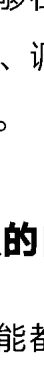

解码天算3 | 人体是一个微生态系统

| 第一模块 认知的源代码 | 第二模块 认知治理 |
| 第三模块 算法与第一性原理 “解码天算” | 第四模块 意义炼金术 |

“抽水马桶是一种智能设备”，这听起来多少有点儿滑稽，因为和我们的身体相比，抽水马桶实在太简陋了。

上节课我们讲到，我们的身体是一个智能设备，具有某种计算能力和内部通信能力，能够在瞬间接收信号，发出命令，进行控制、调节、支援，最终应对眼前的复杂问题。

### 无意识的自动运行

大家可能都经历或者至少听说过“急中生智”，还有一种，就是在危急时刻产生一种平时不可能有的巨大力量，像“李广射虎”那样。

其实这种现象并不神秘，而且非常常见，有人把这个过程描述为一种高度自动化的过程。大家可以想象在非洲草原上，一头大象突然朝你奔过来的时候，你会产生的那种应激反应，表现在行动上就是迅速奔跑。

但如果从内部描述，大概是这样的一个过程：

- 首先，脑部的杏仁体将危险信号传到海马体（海马体紧靠在杏仁体上方）；
海马体迅速向主要器官组织传递生物电信号和化学信号；
通过神经传导，海马体将信号传至肾上腺（长在肾上方的一个腺体）；
肾上腺应激后迅速分泌肾上腺素；
肾上腺素被释放进入血液，通过血液迅速在全身循环，并到达相应的器官，使心跳加快、肺活量增加、骨骼肌收缩，并使储存在肝脏里的糖原最快分解成为能量，让全身的平滑肌细胞变得异常活跃，导致血管收缩、汗毛直立，血液从皮肤表面、肠道和肾迅速回流；
与此同时，海马体还释放了“促肾上腺皮质激素释放因子”。这种生化物质到达附近的脑垂体，并让其释放出一种激素用于肾上腺的其它部分；
促肾上腺皮质激素释放因子直接导致血压升高，血流涌向肌肉组织。

这个过程简单地说就是：接收信号，发布命令，迅速传导和调度资源，让你的身体能够最大限度地支配能量，全力调动糖原分解供于运动的肌肉组织，让身体在紧急状态下获得一种超常规的力量。虽然我们说得热闹，但这整个过程其实是在一瞬间完成的。

我们的身体就是这样一个神奇的智能设备，它在接收、处理、传递各种数据的同时又在调动各种资源和能量。

最有意思的是，号称属于我们自己的身体在运行的时候根本不是在我们的意识指挥下完成的：你的身体不是听你指挥的，它的整个运算和运行都是在一种无意识状态下完成的一—我们身体里的一种特殊游戏一直不为我们所知地在我们身体里运行。

而这种身体的智能不仅在人身上，在动物身上也存在着。

比如一只猫突然听见了老鼠的声音，它会立即进入警戒状态，这种状态会使它的整个肠胃蠕动突然停止——肠胃蠕动要消耗能量，猫在这个时候要紧急调用一些资源以便随时以最快的速度逃跑或者扑向猎物，这个过程也是在一瞬间完成的。

### 自我调节的微生态系统

当我们天天谈论智能的时候，我们往往会忽视一个最熟悉又最陌生的智能设备—跟我们朝夕相处的身体。我们的身体本身就是一个具有高度智能的自我调节、自我治疗的设备或者系统，也是一种天算。

但是，为什么我们的身体会生病呢？这是因为整个这套调节机制，由于出现了某个极端变异导致了整个调节系统也没法形成一种智能化、自动化的调节，没办法继续保持或者恢复到内稳态当中。

我们身体的疾病跟大自然的生态灾难是一样的：某些极端变量破坏了整体调节机制，就像抽水马桶出问题以后，不再有一种自我调节功能，会不停地出水和漏水。在这个单元的第一课我们讲到的《寂静的春天》和《狼图腾》都是这样的例子。

如果大自然是一个生态系统，那人的身体就是一个微生态系统，很多身体病变都是这个生态系统的调节机制发生了故障。

比如胆固醇是细胞膜的一个重要组成部分，它在生命活动当中起到重要作用，但过高的胆固醇含量就会引发严重的心脑血管疾病，这是胆固醇的调节系统出了问题；糖尿病也是这样；从本质上看，癌症也是一种与调节有关的疾病。

用这个单元第一节课的话说就是：我们用很多人算不断干预、影响、破坏天算系统，以至于到了最后，具有高度智能化的天算调节系统发生了故障。对天算的不断背离，会让人算陷入无效甚至引发灾难性的结果。

无论是我们的认知还是行为，都必须要对天算，或者那个隐秘的逻辑有一个充分的敬畏和认知，顺应天算，用逻辑解决问題，而不是用我们自己的妄想妄为。

那么，如何找到并运用那个逻辑呢？我下节课跟你分享。

用户留言

提交留言可与专栏作者互动

## 解码天算4 | 如何顺应天算？

解码天算4 | 如何顺应天算？

- 第一模块 认知源代码
第二模块 认知治理
第三模块 算法与第一性原理 “解码天算”
第四模块 意义冶炼术

水箱出了问题，不停漏水，我们会说：水箱进入了弱智状态了。我们的身体出了毛病，也可以说是进入了某种弱智状态，因为它们的调节法则不起作用了。

美国著名分子生物学家、《生命的法则》的作者肖恩·卡罗尔（Sean B. Carroll）说：不管是生物学还是生态学，都有一个共同的使命——解码调节法则。大自然的调节法则可以说是这个世界的终极秘密，人类在解码过程当中能做到的还非常少。

IT领域有摩尔定律：每隔18个月，集成电路半导体的数量翻一倍，成本降低一半。因为有了摩尔定律，计算机的性价比不断提高。

而在医药领域，每取得一半进步往往要花两倍，甚至四倍的成本，这就是反摩尔定律，可以想象，解码调节法则有多难。

### 如何顺应天道？

我现在越来越意识到，《三体》赢得世界性声誉的一个很重要的原因是：它既基于中国哲学，又触及到了西方思想的一个非常关键的问题——如何顺应天道。

#### 1. Logos和道

天道在希腊哲学里是logos，有两个含义：一个是指客观存在又隐藏在世界背后的通用法则；二是 descriptor说说语。

Logos和汉字里的“道”字是契合的，既指一种至高至上的法则，也指说话。“道可道，非常道”里，前一个“道”是规则、规律、法则，后一个是说话。

当logos指说话、表达、沟通的法则的时候，它就是logic——逻辑。有时候我们也用逻辑来指客观存在的隐秘的天道。

#### 2. 天算和人算的差别

《三体》的作者刘慈欣，通过一系列情节安排告诉我们：什么叫天道，以及天道和人道、天算和人算的差别在哪个。

在《三体》里，地球人为了应付三体攻击，找了三个地球上最聪明的人。之后，他们发现有一个人，看起来能力和资质都平淡无奇，但三体人却要尽各种办法把他消灭掉，于是他们把这个叫罗辑的人也作为了地球的拯救者。

这四个拯救者都被称为“面壁人”，但罗辑跟前三个面壁人明显不同：前三个人都极端地聪明和勇敢，他们别出心裁地构想出应付三体人进攻的方法，但遗憾的是，这三个人的方法都被三体人一一破解了。而第四个面壁人罗辑，三体人却找不到他的破壁者。为什么？因为罗辑无壁可破。

罗辑的手段就是没有手段，他的行为表现为无所事事。面对三体人的进攻，罗辑完全拿不出具体的方法……但这正是他的强大之处，罗辑的武器是他悟出的规则，也就是说，他的行为不是像那三个面壁人那样去构想别出心裁的解决方案、制造威力巨大的武器，然后用强大的武器去对抗三体人。

罗辑做的事情只有一个：解码法则。

#### 3. 黑暗森林法则

“国之利器不可示于人，夫佳兵者，不祥之器”：真正有效的武器是不可以拿在手上给人看的，不是为了保密，而是因为它是一种大道无形的武器。

可以说，在某种意义上，罗辑的武器正如他自己的名字所暗示的——悟出了宇宙的逻辑，也就是宇宙间各个文明之间竞争的终极法则——宇宙社会学的定律：

- 法则一，文明不管怎么发展，物质总量是一样的。这意味着文明与文明之间遵循一种丛林法则。
法则二，技术爆炸法则。任何一个技术只要是技术，就不用管它处于什么样的阶段，因为只要是技术，就一定会跟着技术发展的路径，而技术发展的路径就是，先是极端缓慢地向前发展，临近奇点就会产生爆炸性的发展。

上面这两个法则推演出了一个核心法则——黑暗森林法则：

所有的文明之间是天然对立的，一旦别的文明知道了你的存在，你就在劫难逃；要保存自己或者消灭敌手，最有效的方法不是兵对兵、枪对枪的抗争，因为这种抗争很可能是极端不对称的竞争——你苦心孤诣想出来的方案，竭尽全力打造出的武器，很可能在一瞬间化为乌有。

在《三体》里，地球人对三体人的那场战斗，刚开始轰轰烈烈，最后却像一个笑话那样收场，就是这种不对称的战争。

按照黑暗森林法则：

- 1. 一种文明只要暴露了它的位置，就注定被消灭。至于谁来消灭它并不重要。
2. 最强大的武器不是去消灭对手的武器，而是让对手暴露自己的位置，让未知但一定强大无比的力量来消灭它。
3. 最好的消灭甚至不是消灭，是制造一种态势或者暂时的均衡，通过这种均衡态势来抑制对手，让对手的强大至少在一定时间内失效。

罗辑之所以会利用他的宇宙社会学规律——宇宙间的天算，而不是另外三个人所使用的人算，这中间一个关键的环节就是解码这个法则。

## 总结

首先，我们要意识到人算之外还有一个看不见的隐秘的法则存在，而有些人对这种法则完全没有意识。

第二，在敬畏天道的前提下去解码天道，而不是让自己成为一个与对手面对面的玩家——要让天算、天道作为自己的替身，以一种无形而巨大的力量去制服对手。

但是，解码天道，用人算去顺应天算，让天算作为人算的替身完成你的任务谈何容易。所以，我们常常使用人算，比如使用杀虫剂、打猎，以及现在治疗癌症的时候普遍使用的化疗、放疗……这些都是前三个面壁人使用的方法。它们有时偶尔暂时有效，有时候根本无效，更多的时候不仅不能解决问题，还会导致巨大的反噬。

《道德经》说，“天道无亲，常与善人”，这个“善人”不是普通意义上的善人，而是一个悟到了天道、逻辑和天算的人。

无论是单纯的恶，还是单纯的善，都解决不了问题，只有通过解码调节法则才能够找到真正有效的方法。

用户留言
提交留言可与专栏作者互动

## 问答28 | 没有成果就意味着认知停滞吗？

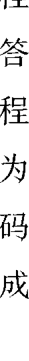

问答28 | 没有成果就意味着...

@ 冯博宇

牛顿、爱因斯坦因为那种发现问题的视角、分析问题的方法和解决问题的行动，在前半生取得了巨大成就，而这个解码的过程也有巨大的运气在里面——这个解码的对象是否适合这个人用这个程序解码。我觉得，他们前半生解出了答案，但后半生遇到另一类问题时这个程序就不好使了。我是不是可以这样认为：我们的某种成功既强化了我们的解码方式，也把失败悄然埋在了前方，变成了一种成功者的诅咒？

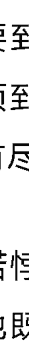

吴伯凡

### 定义中途镇

这个问题涉及到我们前面课程里讲到的中途镇的问题，也有其他同学特意问到“如何逃出中途镇”的问题。

中途镇是一种比喻，描述的是一种状态：我们通过某种努力，获得某种进展，但是，不知不觉逐渐把这种进展定格为一种状态。在这种状态中，我们不知不觉陷入到重复和播放的状态。

事实上，学习是极容易陷入到这样一种状态的。电影《黑客帝国》里的尼奥陷在火车站的状态也属于这种状态。

这种中途镇的状态包含两种情况：

- 逐渐被舒适区同化，忘了自己是在中途，反而把中途镇当成自己的归宿；
- 意识到自己身陷中转站或者中途镇，但无力走出这个中转站或中途镇。

无论以上哪种情况都是一种思想和认知的停滞。

### 认知的里程不是固定的

我们还讲过thought和thinking的区别：thought既是动词think的过去时，也是名词。可以说，thought是一种思想和认知的状态，是已经成为过去时的一种状态；thinking是进行时，一直处于进行当中的。

从这个意义上说，牛顿和爱因斯坦的后半生一事无成，再没有获得某种思想，但他们其实还一直处于进行时的状态，并且自己对这一点是有意识的。

牛顿临终时候说，“我并没有置身于知识的海洋，只是在知识的海滩上捡了几颗贝壳而已”。

没有成果不意味着你处于中途，反而是有成果并且满足于这种成果才是处于中途镇的状态。所谓“终身学习”，不是把新的思想和观点不停搬进自己的仓库里，而是对自己已有的思想始终保持质疑的状态，保持超越既定状态的姿态和努力。

中途镇既是一个形象的比喻，又是一个抽像的比喻：

- 认知的里程不是固定的，你没办法定义你所在点就是中途；
- 你不知道前面的路有多长，现有位置是不是全程的中点——这件事很成问题，因为前面的路程可以是无穷大的。

有人认为，牛顿和爱因斯坦已经取得的成就恰恰跟他们后半辈子的一事无成密切相关：他们之所以能够有惊人的发现，是因为他们始终想揭开帘子看到世界的真相，始终抱着解码世界的强烈冲动，并付之于行动——这种解码的过程像剥洋葱，当你剥开了一层，就又出现一层……你只能不停剥下去，无论怎样都没有办法触达那个所谓的终点。

### 芝诺悖论 (Zeno's paradox) : 行动上的拖延症

“中途”也很容易让我们想到古希腊著名的芝诺悖论：从A点到B点，是永远达不到的。

为什么？因为你要从A点到达B点，就必须先到达AB的中点C；你要到达C点，就必须到达AC的中点D；你要到达D点，就必须到达AD的中点E……如此反复循环，没有尽头。

芝诺悖论长期以来困扰了很多人，我们觉得他既是在诡辩，又不知道他到底怎么在诡辩。他把行动的问题变成了一个不断反向寻找前提的问题：在行动上轻而易举做到的事情，在逻辑上一旦反向追踪一个前提，就寸步难行了。

芝诺悖论的真正原型其实是一种行动上的拖延症：当一个人要采取某种行动的时候，他总是反向追踪一个前提，那结果只能是停滞不前。这类人甚至连thought的状态都没达到，更不用说thinking——行动的状态了。

我们反复强调“认知是一种生存手段”，是人和其他物种谋求生存的过程中的一种解决方案。所以，任何一个物种都是一个解决方案。

- 环境不断变化，认知也必须随环境变化不断刷新、迭代和进化。
- 认知的状态只能是在路上，而且对个体来说，死在路上，死在中途，是一种宿命。
- 重要的不在于你是否获得了某种成果，而在于你始终要保持一种thinking的状态。
- 任何一个个体给出的解决方案永远是有限的，甚至很有可能在找到下一个解决方案之前，个体的生命就已经结束了。

如果牛顿45岁就死了的话，后人可能根本不会知道牛顿这个人：他45岁的时候，思想已经趋于成熟，但还没有一个机缘迫使他将已有的成果完整地表达和呈现出来。

我们不能以牛顿和爱因斯坦后半辈子的一事无成否定他们的探索的意义，恰恰相反，他们前面的成功恰恰是因为他们后半辈子的一事无成。

### 解码天算 | 本单元十大精彩留言

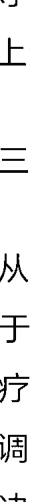

解码天算 | 本单元十大精彩...

## 本单元总结

#### 1. 第一节课

我们通过三本书——《寂静的春天》、《狼图腾》和《三体》，归纳出了一个道理：这个世界不只有一类密码，还有一种我们于舱叫天道或者天算的密码，如果你无视它，你的认知就会陷入到一种巨大的谬误当中，你的解决方案不仅无效，甚至有可能引发灾难。

#### 2. 第二节课

我们讲什么是天算，天算就是偶发事件背后那只隐形的手。面对天算，我们同样有三种立场：物理立场、设计立场和意义立场。其中恰当的方式是采用物理立场和设计立场。我们是要在承认天算存在的同时，对它有一种必要的敬畏，还要在某种程度上通过顺应来利用它。

#### 3. 第三节课

我们从大自然讲到了人体，它们的相似之处在于，它们都是具有自我调节能力、自我治愈能力的系统，如果出了问题，都是因为调节系统出了问题，要找到问题根源并解决它，就要找到系统背后的逻辑，也就是天算的算法。

#### 4. 第四节课

我们以《三体》中的罗辑这个人物为例，解释了如何找到天算背后的逻辑。总结起来就是两点：首先，我们要意识到人算之外还有一个看不见的隐秘的法则存在；第二，在敬畏天道的前提下去解码天道，解码调节法则，而不是让自己成为一个与对手面对面的玩家。

好，以上就是本单元的主要内容。以下是 我精选的同学留言，恭喜前三名同学，将获得我签名的书一本，这次送出的书是 《极简欧洲史》，得到的工作人员会尽快把书寄给你，也希望其他同学再接再厉。我们下节课再见。

特别提醒：留言内容会默认公开，并同步到“知识城邦”中，中奖同学留言个人信息时，一定记得将留言设置成隐私模式，确保个人信息安全。

—— 本单元十大精彩留言 ——

## 获奖留言

黄庆鳌

人体就是天算的完美产物。支撑人类向上生长的动力从何而来呢？支撑动物、植物顽强求生、向上的本质是什么呢？听了最近的课，有不少疑问。

跟随女儿成长了5年，现在才意识到，生命的最初力量是异常强劲和正面的，一个生命来到世上，浑身散发都是正能量，对于整个自然来说，微不足道，却不可或缺。天算的概念，让我禁不住联想到，女儿从出生到现在的成长过程，我们是秉承着天算的思想，在生活和社会中与女儿相处的，尽量做到不用人算的诸多想法去给予强加干涉。

例如：吃饭问题，都是饿了才吃，从不强求。玩耍，我们可以跟着女儿在野外、在商场、在公园、在广场等等等地方一直玩耍，直到女儿尽兴，才回家，经常回到家已经晚上9点......现在女儿在内心安全、运动能力、自控能力、与人交往、自信心、求知欲、创造力等基础能力方面都在正常发展。因此，我们更加坚定地认为，减少人算（违背自然规律）的干扰，把这个客观真实的世界（包括自然和社会等）展现在她面前，把家打造一个港湾，她心灵安全的、充满爱的港湾。她自然会在天算的背景下，不断成长、成熟、成才。

开始的疑问，仍然在，继续学习。

解码天算 3 | 人体是一个微生态系统

郑昊

想到稻盛和夫在《活法》中说的：利他，是经商的原点。就从新教伦理与资本主义精神，说到上天赐予我们财富，是要用于为社会为他人服务，忘我利他，就是顺应天道。

稻盛和夫的“六项精进”也是顺应天道的核心：1.付出不亚于任何人的努力；2.要谦虚，不要骄傲；3.要每日反省；4.活着，就要感谢；5.积善行，思利他；6.不要有感性的烦恼。

解码天算 4 | 如何顺应天算？

一RU晓往xiao

顺应天算，是这几节课的中心思想。以我练搏击来举例吧。

一种叫本能，比如别人打你，你本能地会去闪躲，而闪躲的时候会不自觉地闭眼睛。而通过训练后，就要学着把技巧变成本能，当别人打你时，你不是闪躲，而是防御，而且眼睛永远盯着对手，即使被打也不会闭眼睛。因为，对手出拳的时候也是有空当反击的时候。人们往往会按本能去做事情，觉得是顺应天命，但是往往有的时候本能就是逃避。

顺应天命，首先要做到的就是独自面对，然后就是看清局势，最后顺势而为。

解码天算 4 | 如何顺应天算？

## 其他精彩留言

刘伟佳

一部小说里讲，农村发生山火时首要做的事不是哪里着火灭哪里的火，而是先在没有着火的地方修整出一条隔离带，当火烧到隔离带没有可烧的东西之后自然就会灭了。这样即使消防官兵没有及时赶到，造成的伤害也是可控的。如果直接打算扑灭火，山火可能把救火的人困死在火场。直接扑灭火是人算，山火蔓延的速度是超出人预想的天算。

解码天算 1 | 世界上不只有一种密码

张颖_Grace

“当你遇到麻烦的时候，你会从你有限的认知出发，找到一种解决方案。这种方案好像很有效，但它的后果往往事与愿违，甚至会出现灾难性的后果。”老师用这一句话提醒我们千万别局限在“瞎着眼睛看”的视角里，要时刻提醒自己还有另一种全局性的视角，让自己记得“睁着眼睛”后退一步，看整体。

这种“睁着眼睛看局部”的行为往往容易出现在处理紧急且急迫的事情上，《稀缺》一书的两位作者将这类行为归因为因稀缺而产生的管窥效应，也就是说当某件事情成为你当下最关注的事情时，你的注意力、各种意识和无意识都会聚集在这件事情上，好处是这样会提高你的专注度和处理效率，而坏处则是让你无法注意到其他重要的事物和情况。

那么如何来避免因局部而忽略整体的情况呢？“别在门口边找钥匙”就是一种极好的提醒自己的方法。丢了钥匙而打不开门锁，你肯定不能只在门锁附近找钥匙吧！这就好比员工工作积极性不强，除了考虑采用各种激励措施外，是否也应从公司整体

采用各种激励措施外，是否也应从公司整体管理制度上、考核标准上做调整呢？

解码天算1 | 世界上不只有一种密码

gyl5836536987020

任何一个生物的个体存在好像是偶然的，其实整体数量结构是不会改变的，这也是生物世界、经济领域都遵循着的同样规律：繁荣、衰退、再繁荣。

经济学的发展依赖于“看不见的手”，市场经济在非强制自由合作的前提下，“看不见的手”即强调市场对资源的配置作用，通过价格、供求、竞争和风险机制，市场能够促使生产要素优化组合，促进商品生产者改善经营管理、提高生产技术，并最终实现资源的优化配置。

举个例子，如果今年的养殖户养猪少了，那么市场上的猪肉的供应也会相应地减少了，而市场需求没有减少，市场供不应求，那么猪肉的价格势必会上涨，这个时候“看不见的手”就会引导养殖户为实现最大利益而扩大对猪的养殖，扩大对猪肉的供应来调节市场的供需平衡，从而实现资源的优化配置。

正是这种看似偶发事件背后的算法推动着“繁荣、衰退、再繁荣”的演进规律。

解码天算2 | 天算--偶发事件背后的隐形之手

陆陆

这节课说到人体是一个微生态系统，让我想到以前每次上高原的时候，飞机落地虽然我感觉不到身体有何异常，但其实身体内部系统正在紧锣密鼓地进行着调整，以适应氧含量突然降低的外部环境，所以说初到第一天最好就是休息，少食多喝水，但我偏偏由于毫无反应就掉以轻心开始瞎折腾，然后到了夜里报应就来了。胃里开始抽搐翻滚，吃下去的东西全部原封不动吐出来，甚至连形状还在，可见根本就没有消化，这时候别提多后悔自己白天的“作”了。等到了第二天，身体调节到位，奇迹般地满血复活，立马感觉到被高原的接纳。

所以高反并不可怕，只要让身体顺应天道，但人呢往往就是败在自己的一点小聪明上，以为自己这一次能侥幸躲过去，最后还是自己吃苦头。正如有时候我们以为我们能控制的事情，其实是弄巧成拙，这时候唯一能做的就是耐心等待。

解码天算3 | 人体是一个微生态系统

刘伟佳

“钟陵醉别十余春，重见云英掌上身。我未成名卿未嫁，可能俱是不如人。”这是罗隐的诗《赠妓云英》，云英嘲笑罗隐一事无成，罗隐也认为自己很失败。但在后人看来，一个为后世留下传世名篇，另一个早已没人记得。没有成果并不意味着一无所获，回报可能在当下，也可能在未来。

问答28 | 没有成果就意味着认知停滞吗？

黄药师

逃离中途镇我首先想到的是乔布斯的“stay hungry, stay foolish”，中文有翻译成“求知若渴，虚心若愚”的。我们常常说一个人要保持谦虚的心态，不仅仅是为了更有利于社交，而且是我们天生带有自我优越感，心理学称之为“虚幻的优越性”。

有93%的司机，普遍认为自己比其他司机安全意识高；有90%的学生，认为自己的智力水平在平均智力水平之上；有92%的访问者，都认为自己比其他人更公正。保持thinking的状态，有时候可以理解为空杯心态，就是我能放下我既有的成就和来自人类本能的优越感，去追逐更多的客观和真相，不认为自己是最优秀、最公正、最聪明的。

吴老师在日知录里讲过一个“愚人税”，愚人税实际上骗的就是那些自以为聪明的人。所以，世界上只有一种愚蠢，就是自以为自己聪明——他还停在thought阶段。世界上也只有一种聪明，就是觉得自己，还不那么聪明, keep thinking。

问答28 | 没有成果就意味着认知停滞吗？

我是谁，我要去何方

结果只是一个副产品，没有结果并不能推出认知是停滞的。终身学习的状态是一种对已有的思想始终保持一种怀疑的状态，保持超越既定状态的姿态和努力。我们需要重点关注的是，自己是否处于终身学习的状态，而不是是否有结果。人们总是事后诸葛亮，认为如果结果不好，当初肯定可以有更好的决策。

隔壁万维钢老师在解读《赌博思维》一书中提到：扑克选手把这种只关注结果的情况叫“结果论（resulting）”。扑克要打很多很多把，你在乎的是一个能够以大概率赢钱的科学决策系统，而不是某一把的输赢。如果因为这把输了就随意改动决策系统，这就是结果论，你就等于没系统。

普通人关注结果，高手关注系统。这是科学决策的基本功。高手不以成败论英雄，他注重的是决策水平的高低、是决策过程的合理性，而不是最后的结果。

问答28 | 没有成果就意味着认知停滞吗？

吴伯凡·认知方法论 一年时间 打开洞察世界的50个维度

## 算法与选择1 | 在认知上，数据与算法是什么关系？

算法与选择1 | 在认知上，数...

| 第一模块\n认知的源代码 | 第二模块\n认知治理 |
| 第三模块\n“算法与选择” | 第四模块\n算法与第一性原理\n意义炼金术 |

### 数据和算法矛盾吗？

很多同学问我：你一方面讲“智能来自于数据的积累”，另一方面又讲“如何尽可能做到精简”，这两种说法不矛盾吗？

应该说，当我们意识到矛盾的时候，就可能遇到了一个认知媒介——我们很多认知都是因为意识到某种东西的矛盾而开始的。

智能的确来自于数据的积累；人通过各种感官，进入到不同场景，接触和收集到各种数据，然后对数据进行处理，最终生成智能。人是这么一个数据处理的智能设备。

但是，很多思想史大家都告诉我们：有效认知往往是建立在某种“闭目塞听”的基础之上的。比如《道德经》讲的“五色五音”、“驰骋田猎”，各种声音、色彩，各种行为，都会让我们的心进入到慌乱状态。最好的状态就是闭目塞听——“不出户而晓天下”，躲进小楼反而能成一统。

### 制度/体系化的认知拖延

### 认知的目的

- 1. 优化算法
- 2. 告别慌乱

用户留言

提交留言可与专栏作者互动

## 算法与选择2 | 你做的大多数选择都是伪选择

算法与选择2 | 你做的多数选...

| 第一模块 认知源码 | 第二模块 认知治理 |
| 第三模块 算法与第一性原理 “算法与选择” | 第四模块 意义炼金术 |

我们上节课讲到数据和算法的关系：很多让我们疑惑的问题都可以归结到数据和算法；很多同学学习恰恰是因为没有把握好数据和算法的关系。

### 什么是苟且？

王阳明有诗云，“抛却自家无尽藏，沿门托钵效贫儿”，直译就是：有一种人弃自家的无穷宝藏于不顾，托着一个钵子挨门挨户地乞食。

这也可以作为数据和算法的一种象征：乞丐沿门托钵的过程就是采集、接触、获取数据的过程。当你选择并习惯了这种方式，其实已经忘记了自家的无穷宝藏。

王阳明说的其实也是心和物之间的关系。所谓“致良知”，就是建立一种优化的算法，不被外物所困，是这个意义上的心外无物。

### 伪选择：避免痛感

### 无可选择的选择才是真选择

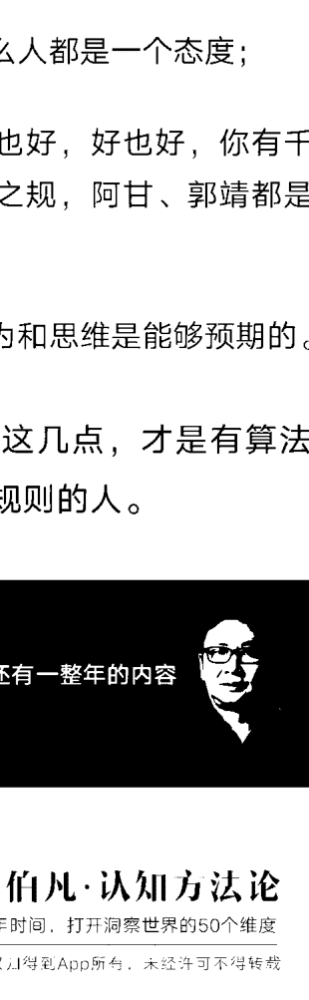

## 算法与选择3 | 为什么要“不忘初心”？

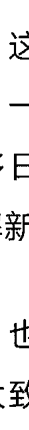

算法与选择3 | 为什么要“不…

- 第一模块
认知的源代码
第二模块
认知治理
第三模块
算法与第一性原理
“算法与选择”
第四模块
意义炼金术

### 防骗：确立和优化算法

有一类书每隔一段时间就会出现在书店里，比如《2015骗术大全》，这类书有点儿像吉尼斯世界纪录——不断在更新。当然，每年都会有各种新骗术，尤其是街头骗术出现，这是一个不断创新的领域，自然也给书商创造了不断出新版本的谋利机会。

另外，这类书不停出新还有一个很重要的原因：一直有读者。即使你已经学会了识别很多日新月异的骗术，你可能还想要不断了解新骗术，防止自己受骗上当。

当然，也有很多 基于算法。

识别和应对骗术的方法有很多，我们可以列出一个金字塔式的认知体系：从一个原则出发，派生出三个原则；这三个原则的每一个原则里又可能是三五个方法……最后可以一直穿到很细。

> 但是，所有识别和防骗的手段都基于一个特别基本的东西：永远不要相信不劳而获和一本万利，也可以说“无事献殷勤，非奸即盗”。

只要你一直把握这个原则，基本上是可以应对骗术的。反过来，如果一直在关注和探索新骗术，很可能掌握了很多骗术但还是会受骗，原因是你没有确立并且优化自己的算法，因此你的方法和手段都是挂一漏万的。

防骗让我们认识到确立和优化算法的重要性。

### 管理：数据喂养实现的算法优化

面对极其复杂的现象和数据的时候，我们首先要有一个不变的初始目标：如何建立和优化算法。

算法本身不是一成不变的，它需要多样化的数据喂养来实现优化，这个过程就是管理。

#### 1. OKR管理法

近些年很多中国企业都在推行一种风靡全球的管理方法：OKR（Objectives and Key Results），目标和关键结果。

很多企业对OKR趋之若鹜的原因是：企业的战略和规划变形走样、无疾而终的概率越来越大，加上新的产业生态变化，使得企业常常好心办坏事，或者是抱着一个看起来十分诱人的清晰目标，走成了一地鸡毛的状况，企业整个供应链、价值链最后变成了一个走样链或者苟且链。如果把企业最初的目标和最后的结果对比一下，常常会让人哭笑不得。

不仅是企业，个人管理同样如此，而出现这种情况的原因有两种：

- 原因一：目标和关键结果定义不清楚。
- 原因二：目标确定，算法确定，但在执行过程中，算法被逐渐遗忘，行为逐渐被具体的得失成败所绑架，变成见招拆招。

OKR管理方法概括起来就是：建立一个机制，通过方法、评估体系、校正手段，始终让你现有的行为不远离目标和关键结果。

#### 2. 对于关键结果的“不忘初心”

需要特别注意的是，我们常常把任务当结果。

要达到一个结果，一定.Manager

> “郑人买履”就是最简单的例子：郑人要买鞋时必须要有数据，鞋样就是值得信赖的数据。但是，当郑人忘了带鞋样的时候，他就完全聚焦在鞋样这个数据上，忘了他本身就携带者这个数据——脚。

我们反复强调“不忘初心”，是因为初衷常常是容易遗忘的，而且这种遗忘往往是体系性、制度性的，我们在执行的过程中会近乎宿命地遗忘这些。

OKR管理方法就像一个最清醒、最忠诚、最智能的监管者，当你忘记关键结果而去追逐那些非关键结果的时候，它会制度性地保证你“去掉那些不创造价值的环节”。

无论你是一个经理人，还是打工者，都可以给自己列一个测试性清单：

- 1. 我的企业目标/我的人生目标/我的职业生涯目标是什么，与这个或这些目标相关的关键结果是什么？
- 2. 一周/一月/年，以及到今天，我整个的职业生涯/人生有哪些时候把任务当成了结果/目标？
- 3. 我的人生轨迹/工作履历生成了大量的数据，在这些数据背后有没有算法，是什么算法，是否在不断优化？

## 算法与选择4 | 什么是真正的合作？

算法与选择4 | 什么是真正的...

第一模块
认知的源码
第二模块
认知治理
第三模块
“算法与选择”
第四模块
算法与第一性原理
意义炼金术

通过上节课我们发现，身边的很多大忙人都只是把任务当结果的人。那些没完成 albeit 的应酬、争吵背后可能都是一句话：只有任务，没有关键结果和清晰目标。

这种无算法的数据获取是一种很低效的状态，甚至背后可能有一个我们看不见的病毒程序。我们知道，计算机病毒的特点就是不断消耗计算资源，让你远离目标并且没有结果，或者有目标，也是让你不断增加计算机任务，处于一种超负荷运转状态，最后完全崩溃。

所以，不管工作还是人生，我们都要远离无算法的算法。

## 精英是算法，大众是数据

在一本谈“精英与社会关系”的书里是这么定义“精英”的：所谓“精英”，就是跟社会算法有关的人，而大众是跟社会数据有关的人。

我们不评价这个观点，只谈这个具有启发意义的分类：很多人都想成为精英阶层，但很少有人问自己“我到底是一个提供算法的人，还是提供数据的人”。

《未来简史》概括成一句话就是：未来社会将变成两个部分，一类是提供算法的人，一类是提供数据的人。

在前面课程里我们提到过，算法和数据并不是崭然而分的：算法来自于数据，数据要跟算法相关联才有价值。

无论精英和大众，还是数据和算法，都可以落实到一个具体问题：合作当中的算法是怎样的。

+   1. 人是一切社会关系的总和。
2. 一个人的价值在本质上是合作的价值，或者是你承载的关系网络的价值。
3. 精英就是善于合作的人，而善于合作的本质是在合作中建立并不断优化算法。

## 合作的算法

### 1. 合作是一个超级个体

我们经常看到一些提示语：“不要XXXX，谢谢合作”。其实这不是合作，是服从，是谢谢你守规矩。

合作是两个独立的主体之间的一个游戏，这个游戏是互动式的，而不是由一个简单不变的规则决定，不是一方对另一方的完全服从关系。

生活中很多人所谓的合作，无非是制订了一个规则让别人来服从，这样的合作有两个致命缺点：（1）不大可能持续；（2）不具有普适性。

想知道合作的算法是什么，先得清楚合作是什么：

+   合作的本质是一个叫有共同利益的生命共同体，它是某种程度的生命体；
合作是两个或多个个体之间的行为，合作本身是一个超级个体。每一个合作的一方都是这个超级生命体的器官；
共同的利益生命体的各个器官之间是一种可持续的合作的关系，每个器官的生长和程序是有赖于其它器官的生长和程序的。

### 2. 合作伙伴选择你

我们常说“选择和什么样的人合作”，好像主动权在我们手里，其实当合作是一个超级个体的时候，选择的含义就逆转了——不是你选择，而是你被选择。

人类今天能够统治地球，相当程度上得益于人类能跟各种动物和植物合作，而跟动物的合作有三种方式：

圈养式驯化（奴役）

定向式驯化（奴役）

协同式驯化（合作）

### 3. 合作的四条算法

从人与狗的合作里我们看到了合作的算法：

+   （1）合作不以损害对方的利益为起点，哪怕你要获取自己的利益，也不能与对方的利益形成冲突。与其相关的附属原则是：合作不以利己主义为前提。
（2）不是你选择合作伙伴，而是合作伙伴选择你。
（3）合作总是表现为利他主义。
（4）利他主义不是目的，合作的真正目的是要形成一个近似于生命、可持续生存和成长的利益共同体。合作的双方，尤其是相对弱势的一方在这个合作当中获得了自己的地位，就成为了这个生命体中的重要器官。

我们第一课讲到“最好的选择往往是在没得可选的时候作出的选择”，这节课我们说的是合作的算法，真正的合作不是选择谁去合作，而是被谁选择。

吴伯凡

大家可以做一个简单的认知清单：关于合作，你以前的认知是什么？今天的课是否以及怎样改变了你对合作的认知？

## 划重点

添加到笔记

## 合作的四条算法：

+   1. 不以损害对方的利益为起点；
2. 不是你选择合作伙伴，而是合作伙伴选择你；
3. 合作总是表现为利他主义；
4. 利他主义不是目的，合作的真正目的是要形成一个近似于生命、可持续生存和成长的利益共同体。

看得不过瘾？
《伯凡·日知录》里还有一整年的内容

戳此拿下

## 问答29 | 问题和难题、任务和目标之间，到底什么关系？

问答29 | 问题和难题、任务...

第一模块
认知源码
第二模块
认知治理
第三模块
算法与第一性原理
“算法与选择”
第四模块
意义炼金术

有同学问，这个单元讲到了《寂静的春天》、《狼图腾》和《三体》，也就是治虫、打狼、反击三体入侵这三件事情，我似乎听懂了，又似乎没有听懂。仔细思考之后我也没有想清楚治虫、打狼和反击三体入侵到底有什么区别。

从这个问题出发，我们先弄清楚几个概念。

## 什么是问题、难题、任务和目标？

人活一世，好像就是在解决问题的，比如考试就是在答题。但是，题和题不一样，有填空题、选择题、判断题、问答题，还有非常复杂的应用题——这些都是问题，但都不一样，有些有标准答案，有些有大致正确的答案，但没有标准答案。不管怎样，我们都是在答题。

还有一些我们习惯于叫问题，但跟我们解题时候的问题不一样：在英文中，前者是 question，后者是 problem。Problem是要调动你的心智，从不同路径尝试把问题解决，这个问题不是纸面的，而是现实中的问题。比如医生给你看病已经不是在回答一个或几个问题了，他要解决的是目前的这么麻烦。

还有一种跟问题相关，是任务。比如销售产品和搞定客户是你的目标，要实现这个目标你需要做很多事情，只有这些事情都做好做到位，目标才能实现。而你要做好的这些事情就是任务。显然，比任务更高的是目标。

在我们的教育过程中，特定的教育方式使我们的注意力集中在答题上，对任务和目标很少接触。但在先进的教育里有基于项目的学习。

比如一个大学历史系的教欧洲中世纪历史的教授，让全班学生用一个学期的时间，用中世纪的技术和生产手段造一艘船，而不是用现有的工业水平和技术。当学生把这艘船造出来的时候，他们对中世纪的经济、社会、文化历史就有一个非常感性又非常深入的认识——造船的过程囊括了问题、难题、任务和目标。

## 如何看待问题、难题、任务和目标？

+   1. 低维度只能解决问题

治虫和打狼更像是在回答问题，顶多是在解决一些难题：我的庄稼被吃？

+   2. 战略思维才能实现目标

在《三体》中，地球人要解决的问题是“如何阻止三体人的入侵”。他们研制出先进的武器击退三体人只是手段，因为即使造出了这样先进的武器，也很可能离实现目标差得老远。所以最后，在《三体》里，地球人造出的武器在很短时间内就化为乌有了。

+   1. 没有在结果、方式和手段之间保持平衡，不知目标是什么，也就根本不知道去完成哪些任务；
2. 只是某个局部症状作为一个问题在被解决，即使达成了局部胜利，对于解决这个问题来说，也是没完成任务的；
3. 任务跟目标联系在一起，在目标都未知的情況下，自然不会知道任务是什么。

## 用户留言

提交留言可与专栏作者互动

## 算法与选择 | 本单元十大精彩留言

算法与选择 | 本单元十大精彩...

## 本单元总结

+   1. 第一节课

我们讲过，要提升认知最好积累大量的数据，同时也讲过要不断精简我们的认知，如无必要勿增实体，你自然就会有一个疑问：到底是该多还是该少呢？第一节课我们说的就是这个问题：该多的叫数据，该少的叫算法，算法是在数据的基础上总结提炼出来的，高手就是既有大量数据又有算法的人。

+   2. 第二节课

但是，如果把握不好数据和算法的关系，你就很容易陷入到伪学习当中，伪学习又跟伪选择有关。第二节课我们讲的就是，真正的选择是无可选择，当你有很多选项的时候，那就是伪选择，这种状态下的学习、改变、迭代，都是没有效果的。

+   3. 第三节课

然而在学习过程中，我们会经常犯一个错误，那就是走着走着，就忘了自己的目标是什么，被眼前的任务和障碍所绑架。所以第三节课我们说，确立了目标和算法之后，我们还要记住一个要素——关键结果，这是著名的OKR管理法给我们的认知带来的启示。

+   4. 第四节课

最后一节课的关键词叫“合作”。我们一直在说算法，那合作当中的核心算法是什么？我们总结了四条：（1）不以损害对方的利益为起点；（2）不是你选择合作伙伴，而是合作伙伴选择你；（3）合作总是表现为利他主义；（4）利他主义不是目的，合作的真正目的是要形成一个近似于生命、可持续生存和成长的利益共同体。

好，以上就是本单元的主要内容。以下是 我精选的同学留言，恭喜前三名同学，将获得我签名的书一本，这次送出的书是《极简欧洲史》，得到的工作人员会尽快把书寄给你，也希望其他同学再接再厉。我们下节课再见。

特别提醒：留言内容会默认公开，并同步到“知识城邦”中，中奖同学留个人信息时，一定记得将留言设置成隐私模式，确保个人信息安全。

## ——本单元十大精彩留言——

## 获奖留言

Gnoloayoul@坐忘

我想到这么一个故事。父亲和儿子在雪地里打赌，看谁能走到大树底下且留下的足迹是直线。儿子小心翼翼地走着，低头看着试图让自己的脚步走在一条直线上，结果他走歪了。当他看见父亲完成挑战，儿子问父亲怎么做到的。父亲回答，他只是看着大树直接往前走而已。

父亲知道他的关键目标（大树），他也关注他的关键目标（大树），径直朝着大树走，留下的足迹自然是直的。而儿子只是关注次要目标而迷失了关键目标。

算法与选择 3 | 为什么要“不忘初心”？

胡振强

+   1. 埃隆·马斯克有一个著名的“第一性原理思维”，他主张一层层剥开事物的表象，看到里面的本质，然后再从本质一层层往上走。这种思维不仅能运用到做产品上，也能运用到大部分的日常生活当中。可惜我们经常忘记这个“第一性”，因此经常被商家利用，大做文章。

拿游戏来举例，打游戏的本质是什么？当然是寻找快乐！结果呢？游戏公司设计了一大堆琐碎的日常任务让你每天完成，不仅无聊还很累，可你为什么还要每天坚持刷任务？因为怕在朋友圈的排名落后嘛！所以打游戏要得到快乐，就要忽视这个排名系统，按自己的节奏玩。当然，这很难。

+   2. 永远不要忘记经济学的基本判断之一：免费的才是最贵的。换句话说，当一件商品对你免费时，你自己就变成商品了。

还是拿游戏说事，现在的国产游戏基本上都是免费下载、免费使用，但进去之后呢？你不充值就永远被人撇开打，但一充值就掉入了无底洞，越充越多，比玩付费游戏的开销更大，这还不算你沉溺其中花费的时间成本。所以，要时刻提醒自己，我们要做的是购买商品，而不是让自己成为商品。不忘初心。

算法与选择 3 | 为什么要“不忘初心”？

清风徐来

今天的《李翔知识内参》讲到“让人思绪清晰的五个重要原则”，与易老师今天所讲的内容有异曲同工之妙。下面我按照我们所学的认知方法论，对比作出如下理解：

第一个原则是怀着好奇心广泛阅读。这叫植于广泛涉猎，大量收集信息，建立自己的“大数据”。

第二个原则是一切从实际出发，不教条。这叫不被已有的数据或认知所蒙蔽，始终保持一颗谦卑、怀疑和开放的心。

第三个原则是远离金钱和名誉。这叫认知有定力，不被现实和当下所困扰，不要在那些不相干的事情上过分焦虑。

第四个原则是避免过度陷入某种身份或者认同之中。这叫避免个体进入某种认知的中途镇或舒适区，谨防认知拖延。

第五个原则是言行一致。这叫形成算法，进行认知实践。一切还要让实践说话，在实践中反馈和收集新的数据，优化算法，完成数据到算法的递进，从而进入下一次认知的迭代循环。

李翔老师还引用了一句老话：“厨师应该吃自己做的菜，建筑师应该住在自己建造的房子里。” 我想，我们就在这种“冷暖自知”状态中，去不断打磨、完善和提升自己的认知水平。

算法与选择1 | 在认知上，数据与算法是什么关系？

## 其他精彩留言

山峰

今天的课程让我想到了“破釜沉舟”的典故。

在故事中楚军前统帅宋义胆小怕事、自私自利，是一个苟且的小人，根本不敢与秦军拼命，快到战场时，便号令全军原地休息，一住就是40多天，自己在帐篷里享受作乐。故事中的项羽就作出了一个真选择，提剑杀了宋义，统帅全军，携带3天口粮，把锅砸了，渡过潍河后，又把船全部砸沉，烧毁所有行军帐篷。全军上下都知晓退路断绝，战争只能胜不能败，反而爆发了勇气，最终以少胜多，大败秦军。典故中，宋义贪生怕死，贪图安逸，是一个苟且的人，而项羽破釜沉舟，断绝退路，反倒做了一个真选择。

### 袁

关于不忘初心，曾经读到一篇小故事，这里与同学们共享。

有位老教授做过一个测试。老教授问：“如果你去山上砍树，正好面前有两棵树，一棵粗，另一棵细，你会砍哪一棵？”问题一出，大家都说：“当然砍那棵粗的了！”老教授一笑，说：“那棵粗的不过是一棵普通的杨树，而那棵细的却是红松，现在你们会砍哪一棵？”我们一想，红松比较珍贵，就说：“当然砍红松了，杨树又不值钱！”老教授带着不变的微笑看着我们，问：“那如果杨树是笔直的，而红松却七歪八扭，你们会砍哪一棵？”我们觉得有些疑惑，就说：“如果这样的话，还是砍杨树。红松弯弯曲曲的，什么都做不了！”

老教授目光闪亮着，我们猜想他又要加条件了，果然，他说：“杨树虽然笔直，可由于年头太久，中间大多空了，这时，你们会砍哪一棵？”虽然后不懂老教授的葫芦里卖的什么药，我们还是从他所给的条件出发，说：“那还是砍红松，杨树中间空了，更没有用！”老教授接着问：“可是红松虽然不是中空的，但它扭曲得太厉害，砍起来非常困难，你们会砍哪一棵？”我们索性也不去考虑他到底想得出什么结论，就说：“那就砍杨树。同样没啥大用，当然挑容易砍的砍了！”老教授不容喘息地又问：“可是杨树之上有个鸟巢，几只幼鸟正躲在巢中，你会砍哪一棵？”

终于，有人问：“教授，您到底想告诉我们什么？测试些什么呢？”老教授收起笑容，说：“你们怎么就没人问问自己，到底为什么砍树呢？虽然我的条件不断变化，可是最终结果取决于你们最初的动机。如果想要取柴，你就砍杨树；想做工艺品，就砍红松。你们当然不会无缘无故提着斧头上山砍树了！”

### 斜阳

我对“有练习，无刻意”这句话有着非常痛苦的领悟。

去年和一位西班牙同事相约报名某个马拉松比赛。我们有两个月的时间训练，赛前我们的综合体能和最大摄氧量几乎是一样的，平均每天训练一个小时，但是我们的训练方法不同，造成了最后成绩上有45分钟的差距。

我的方式：天天跑低心率区间，只是变换不同的时间段，有时候在早上，有时候在晚上，在固定的操场里，这样我很熟悉，容易坚持下来。我朋友的方式：制定严格的计划，每天晚上固定时间，每三天跑一次间歇跑，每周一次乳酸阈值跑，其余时间是低心率跑，不同的练习在不同的地点进行。

赛后总结：他的算法比我好，对身体的刺激是多样性的。但是我比他舒服，我的选择是不同时间、同一地点用同一种跑法，他的选择是同一时间用不同的跑法。我选择每天坚持练习但不刻意强迫自己，是舒适的播放状态。他选择了刻意坚持课表，当然很不舒服，每天还和我抱怨计划得不灵活，很累受不了了，但是他还是坚持下来了。本质上看，他没有选择，只是在刻意履行计划，我没有刻意制定计划，灵活度很大，但是每天都只是简单地重复而已。

#### 韩同志

不忘初心，真的很重要。在工作中，每次来了项目，我都会列计划、做预算，好像一切尽在掌握，可是每次执行起来，往往都会走样，计划总赶不上变化，到处都是复杂的现象和数据。于是，原来的节点、时间排期都打乱了，变成了见招拆招。项目结束后，再将这一地鸡毛，用事后归纳法写一个总结报告，其实是骗人骗己。

今天学习到OKR管理法——目标和关键结果。很受启发：1.我们做这个项目的最终目标是什么？警惕有点带面的执行，要以“关键结果”为核心，忽略其他不重要的结果。2.目标一旦确定，算法就确定。既定的时间节点和节奏，不要轻易打破。不要被执行环节的现象层面的变化所干扰。

OKR管理法总结：1.建立一个机制——一套完整的执行体系。2.具体的执行细节，依靠方法论完成，不打乱伐。3.建立反馈、评估、校正体系，始终保持现有的行为，不远离目标和关键结果。

### 黄药师

我们普通人常犯的错误，就是把手段当做目标。在家庭关系里最明显。

场景一：父母希望子女好好学习，将来能有所作为。症状解：你得好好学习啊，不要玩了！然后每天自己看电视，打麻将，打游戏。杠杆解：自己每天读书，与孩子及时沟通学习心得，让自己成为孩子的榜样。

场景二：夫妻吵架，希望能解决问题。症状解：你这个做得不对，应该如何如何。杠杆解：咱们先坐下（坐下能使冲上来的怒气得到缓解），说说你的想法，然后我再说说我的理解，你看看是不是更好。

场景三：子女希望长辈不要乱信健康谣言。症状解：《最新101条健康谣言辟谣，转发给你爸妈！》，把这篇文章直接丢到家庭群。杠杆解：爸妈你们是不是想我啦？你们说的是对的，其实你们是不是觉得我平时陪你们的时间不够？这次按照我这种方式做做看，是不是也挺好？然后再用通俗的语言去讲健康知识的原理。

### 陈陈

我们总说要有战略思维、站在战略高度上处理问题，但是这个高度到底在哪里呢？听了今天的解读，基本明确了，这个高度就是目标！

战略思维是自上而下的。是明确目标、俯瞰全局，所有的任务都是围绕目标进行分解的，所有问题的解决都是为了完成任务，最终实现目标。问题思维是自下而上的。是从问题出发，见招拆招，看似很务实，但因为目标不明确，很容易在忙碌碌中耗费精力，偏离目标，甚至迷失方向。从战略出发，明确目标、牢记目标，既要埋头苦干，又要抬头看路，做对的事，比把事情做对更重要。

### L.J

有一句话叫“你所看到的问题或许正是他的解决方案”，这句话的意思是说不要总是盯着表面问题进行思考，要深入问题背后去探究问题生成的动因和意义，一个问题的生成可能就是为了解决另一个问题所带来的副作用，这些才是真正的问题所在，如果你的解决方案只能规避表面问题而不能疏通根本问题，这就说明你提出的问题本身就是个问题。

就象一个人努力戒玩游戏却屡次不成功，你当然可以说是因为他意志力不坚定，而更深层的原因可能是他无法更好地解决不玩游戏时的空虚寂寞问题。所以，无论是做事还是解决难题首先要有目标，针对目标去挖掘真正需要解决的问题是什么，然后把它分解为可执行的任务，要进行系统性思考而不是激反反应。

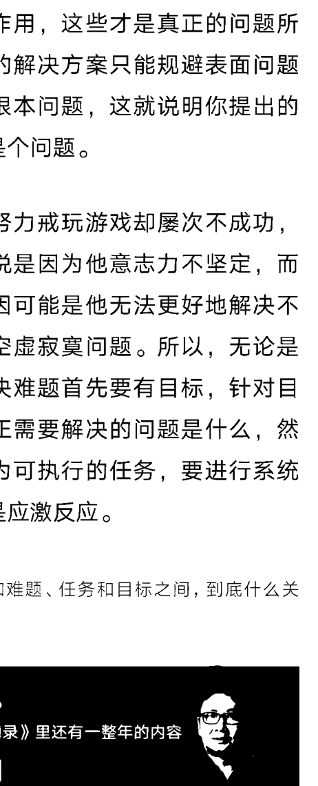

## 偶然与必然1 | 偶然发生的事就不重要吗？

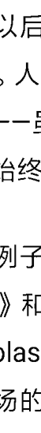

偶然与必然1 | 偶然发生的事. ↓

| 第一模块
认知源代码 | 第二模块
认知治理 |
| 第三模块
算法与第一性原理
“偶然与必然” | 第四模块
意义炼金术 |

## 迷信的源头: 我们来自非洲大草原

我们在理解人的认知的时候，最好经常记住一句话：虽然我们西装革履在CBD工作，但我们自身携带的认知功能和特征都和非洲大草原相关。

之前讲过，我们今天的生存方式在人类漫长的历史过程中是极其短暂的，塑造我们认知的，是我们在非洲大草原上以及走出非洲以后，在亚欧大陆荒野里生存的漫长历史。人类认知的“草原”特性随时有可能发作——虽然你觉得自己是个文明人，但你身上始终带着大量野蛮人的特点。

举个例子。写过《随机致富的傻瓜》、《黑天鹅》和《反脆弱》的塔勒布（Nassim Nicholas Taleb）学数学出身，长期研究资本市场的运行规律，按说他和他周围的人都是最相信理性和科学，最不迷信的一群人，但是，他发现事实并非如此。

塔勒布讲过一个例子：有一个人是资本市场的高级玩家，他每天打车到纽约派克大街和53号大道的拐角，然后下车从街头走到公司上班。

有一天，出租车司机说前面不能走了，要这个人在52号大道的入口下车。他别无选择地下了车。结果当天，这个人在证券交易所的交易特别顺利，赚了一大笔。于是第二天，他来上班的时候，他就让司机把车停在了52号大道的入口。还要提及的是，这个人还戴了昨天的那个领带，因为他认为，除了下车地点以外，领带和他的好运气也有关系。果然，这一天他的交易也很顺利，又赚了一笔。

接下来的情况大家都可以想象，这个人以后可能天天都在52号大道入口下车，戴同一条领带或者买很多这种款式的领带戴着。

那么怎么才能改变这种新习惯呢？等到他发现继续这样却干嘛赚不到钱的时候。

通过这件事，塔勒布就反省道：这些天天用各种各样数据和模型作决策的人，居然这么迷信。为什么？因为我们是从非洲大草原上来的。

人类早期都经历过一个万物有灵的时代：在 goes 打猎的时候，为了更好地生存，他们愿意相信周围所有的事情都在影响当天的运气和命运。能否到果子、打到动物、获得丰厚的猎物都跟周围的某种偶然因素相关——这种思维已经沉淀在我们的底层。

不管你的心智是否看起来充满着逻辑、数学和科学理性思维，随时起作用的始终还是深埋在底下的那些东西。

## 故事、偶然性与认知

在塔勒布的故事里有3个关键词：

+   迷信

迷信跟万物有灵论有关。

+   故事

故事是有时间、地点、人物、事件、结果的完整事件。它不是严格的科学描述，而是一个将某种先后发生的事件联系起来，建立一种有意义的叙述方式。

比如在52号大道入口下车与股票交易成功之间并不存在因果关系，一个在先，一个在后，而且其它因素好像都是一样的。但当天的结果显而易见，导致在前面发生的事件也显而易见——当这两个显而易见的事件在众多的要素当中凸显出来，你就很容易把这两个事连接起来，误以为是因果关系，而且特别相信。人：而是根据故事，而这个故事的底色跟第三个关键词有关——偶然。

+   偶然

我们的感官和理智往往自动忽略平常常见 的东西，而对偶然突发的东西投以特别大的关注。我们对世界分析、解释、判断的时候，经常把这种偶然置于一个非常重要的位置。

这个单元我要跟你讨论的就是这个非常重要的概念：偶然性。

当我们说到认知的时候，常常以为认识世界就要获得对于世界规律的认识，而这个规律本身包含着某种必然性的东西。但很不幸的是，在我们对世界的认知当中，偶然性对认知的影响其实大大超过了我们的估计和想象。

偶然是指小概率、随机、不可重复发生的事件包含的一种特性。偶然性对我们的影响主要在两个方面：

一方面，影响我们的思维、决策和行为的常常是故事，而不是纯粹逻辑理性的推演。偶然性在一个故事里扮演着非常重要的角色，正如俗语说的“无巧不成书”，巧就是偶然性。这个偶然性一旦出现，就会重构一个会极大地影响我们行为的故事。

另一方面，在我们生活世界中，某些偶然性我们是没有意识到并且没有进入到我们编制的故事当中的，但是，它也同样深刻影响着我们的世界，这一点，我们会在后面的课程里跟大家分享。

这里还是要说回到塔勒布的著名三部曲：

《随机致富的傻瓜》是从一个跟偶然性相关的故事说起的：两个教授根据数学模型来选股，对此实验是用一只猴子随机按打键盘来选股，他们最后发现，业绩差不多——这就是偶然性和所谓必然性的抗争。

《黑天鹅》更是关于偶然性的：所谓黑天鹅就是极小概率出现，但是会影响全局的事件。

《反脆弱》也跟偶然性相关：世界充满偶然性和各种风险，我们为了管理风险，到底是从极度复杂、充满着不确定的事件里找到某种确定性？还是让我们的反应能力具有某种确定性？

我们《伯凡·日知录》里讲过，路上的石头有可能扎伤你的脚的时候，你是穿上一双鞋，还是在整个大地上铺满了地毯？这也是一个如何应对偶然性的问题。

这个单元我们将围绕“偶然性与认知之间的关系”展开。

## 凡·认知方法论

用户留言 提交留言可与专栏作者互动

## 偶然与必然2 | 我们的存在就是一种偶然

偶然与必然2 | 我们的存在就是· ↓

|第一模块 认知源代码|第二模块 认知治理|
|第三模块 “偶然与必然”|第四模块 算法与第一性原理 意义炼金术|

### “缘”是偶然，还是必然？

我曾经和一个朋友试图翻译“缘”这个字的英文，在着实下了一番力气之后我们发现，这个字实在太难翻译了。“缘”本身的含义就是矛盾的：在某种意义上，它带有命定的意思，同时又带有随机和偶然。

我有一个朋友，出于一个在我看来很不可思议的原因选定了他的结婚对象。他一直不知道和谁结婚好，在他正懊恼的时候，恰好在大街上碰到了一个以前的同学。而这个同学，他在之前的生命当中一共碰到过四次，都是在逛庙会、逛王府井商场这种极其偶然的场景下，而且俩人没有任何约定。在倍大的北京发生这样的事，他就觉得这一定是有一种命定的东西，于是就选择了跟她结婚。

### 相遇的六个偶然

昆德拉在《生命中不可承受之轻》里提到了六个偶然：男女主人公的相遇要经过六个偶然，也就是六个节点。每一個节点都存在着至少两种选择——你选择了其中一种，到了下一个节点，再选择其中一种……经过六次这样的选择，导致一个结果。这个结果一旦出现，双方都认为是命定的东西，而事实上，整个过程都是偶然的。

- 1. 女主人公特蕾莎的小镇有人得了脑膜炎，需要一位医生。如果没人得病，这个故事就不会发生。
- 2. 男主人公托马斯所在的医院有一位特别擅长治这个病的医生，但这位医生那天犯了坐骨神经痛，动弹不得，就派托马斯到小镇上去治病。如果这个医生不得坐骨神经痛，这个故事也不会发生。
- 3. 托马斯代替这个医生到这个小镇出诊，要找一家旅馆住宿。镇上有五家旅馆，托马斯选择了其中一个。大家可以算一下托马斯的这个选择包含着多少种可能性。
- 4. 住进来之后，托马斯饿了，他可以选择去旅馆的餐厅吃饭，也可以选择去别的地方吃饭，但他选择在这个旅馆的餐厅吃饭。
- 5. 这个餐厅里有很多的服务员，但是恰好是女主 人公特蕾莎给托马斯提供了服务，他们就这样认识了。
- 6. 托马斯诊治完病人以后，距离火车出发的时间还有点儿长，他就在街边草地上的一个长椅上开始看书打发时间。特蕾莎的家就在这附近，恰好她在回家的路上经过长椅，他们又见面了——如果没有这次见面，这个故事也就结束了。

### 地球的偶然

可能有同学会说这只是文学上虚构的故事，在现实生活 中相信这种虚构故事的人很少，事实上并非如此。

### 偶然性对认知的影响

达尔文说：生命进化的过程就像一棵树 树有树枝，大树枝分成小树枝，小树枝再分成更小的树枝，不断分叉。

是我的。从这句话里，我意识到了我跟他最大的不一样——他的思维中 有一种对于偶然性的充分认知。

我们普通人的思维里有太多误把偶然当必然的事情，把眼下的某个结果当成某种必然，力图去维护它的唯一性，以至于舍弃了很多的可能性和机会。

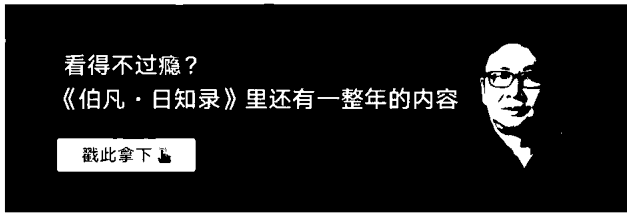

## 大伯凡·认知方法论

一年时间，打开洞察世界的50个维度

版权小到App所有，未经许可不可转载

## 偶然与必然3 | 成功故事值得我们学习吗？

偶然与必然3 | 成功故事值得...

第一模块
认知的源码
第二模块
认知治理
第三模块
算法与第一性原理 “偶然与必然”
第四模块
意义炼金术

### 故事=产品

我上节课讲了一个故事：我的一个朋友抵押所有资产去做一个项目，而这个项目能不能做成，取决于一个他控制不了的因素——一场重大的国际性运动会是否能承办下来。

这其实是一个赌轴+摆轴的矩阵：运动会开还是不开，他赌还是不赌，会导致四个结果。我们面对的是四个结果，但最终出现只能是一种结果。最好的结果出现的时候，就是一个传奇的成功故事。

哪怕我们听到的是一个真实的故事，都应该清楚：每一个故事都暗藏着很多我们不知道的故事，它只是多种可能性当中的一种成为了现实。何况，一个故事的发生还不是一次性博弈的结果。我们通常讲故事的方式里包含着很多谬误，有很多因素被剔除、省略和忽略了，或者多个因素中的某个因素的作用被放大，某个因素的作用被缩小甚至完全去除了。

一个故事就是一个按特定的故事逻辑和偏好制造出来的产品，但我们的认知、判断和选择往往受故事里包含的“真理”所引导。

### 商业传记=神话

我们经常会读很多的商业传记，一般来说：

- 讲成功的故事远多于失败的故事；
成功故事里，个人所扮演的角色的重要性要远大于各种偶然事件，甚至偶然事件的重要性会被完全略去不讲——如果讲过太多的话，人物形象就会受损；
商业传记故事的创作和神话创作是一样的。

我们今天读的很多故事都是神话故事的代偿品。神话就是各种做不到的愿望的表达，希望自己能在想象中体验，甚至拥有那种能力和精力的故事冲动。今天的很多故事都是按照神话的逻辑来编写的。

商业故事，包括一些行业的成功故事，都遵循着一定的步骤：

- 1. 搜罗、选择、聚焦成功企业和人物；
2. 分析这些企业和人物在认知、判断、决策上所谓的“关键时刻”；
3. 用特定的故事框架，加上一定的理论框架，把这些“关键时刻”串起来；
4. 不管是《追求卓越》还是《从优秀到卓越》，差别都都是用同样的工序打造出来的故事。

如果我们用“偶然性与认知”的视角来看这些成功的故事，你会发现：这些作者去掉了作为整个故事整体背景的偶然性，他们不会明确声称，但是一直在试图表明传记主的成功是有某种必然逻辑的。

怎么体现这个逻辑呢？在叙述过程中，把人为因素凸显、放大，把偶然因素淡化，甚至完全过滤；在手法上，从结果倒推起因；在作者和读者的眼里，故事线不是一个密密麻麻网状或者叶脉状的形态，而是一条一以贯之的线。我们也能看到一些节点，但节点中的要素变得非常少。

### 败家子的故事

有一个耳熟能详的故事可以很好地呈现偶然性的重要性，以及一个故事的结果是如何反向决定过程中偶然因素性质的。

很多讲家族传承的案例里都会提到IBM的故事，这家公司由老沃森在100多年前创立。尽管他给公司命名为“国际商用机器公司（International Business Machines Corporation）”，但一开始生产的产品在现在看来非常寒酸——为杂货店提供简单生产资料比如称秤、奶酪切片机。当然，最终IBM的确实成为了真正意义上的“国际商用机器公司”，至今仍然引领从电脑到人工智能的商务设备。

IBM的发展带有相当大的偶然性，其中一个偶然跟老沃森的儿子小沃森有关。按照通常的标准，小沃森是一个纨绔子弟，非常糟糕的富二代，说白了就四个字“有钱、任性”，花钱如流水。

家业是跟苦业出来的，父亲拼命挣钱就是为了造就一个败家子——很多家族故事都是这样的。但是，败家子一定坏吗？IBM的历史告诉我们，如果不是小沃森这个败家子，就不会有后来的IBM。

有钱任性的小沃森有很多富二代共同的特点，也只有像小沃森这种富二代才有这种思维方式：

- 1. 瞧不起父亲；
2. 瞧不起父亲干的生意，觉得太土；
3. 顺理成章要搞一点新玩意；
4. 为了达到这个目的，可以不惜一切代价——老爸干的事情败了也就败了，我不干也罢，还不如把所有资源都投进来做一件很酷的事情，嗯咱俩家产。

老沃森只有小沃森一个儿子，他不得不把这个企业交给他——IBM的命运就落在这个败家子的手里了。

这个败家子开始了一个今天看来仍然匪夷所思、胆子包天的冒险：投巨额资金研发计算机。小沃森认为，未来的商业机器绝对不是什么称秤和奶酪切片机，而应该是计算机。

计算机这个行业需要高投入，如果你克勒克勤克勤俭，那投第一笔就不敢投第二笔，因为这个东西太花钱了，而且整个研发过程非常漫长，还不知道结果是什么，你不如留点儿钱做点实在在的生意，或者投资少见效快的产品。

今天我们知道，小沃森是对的，可他耗费了大量的研发经费。数目有多大呢？美国人造原子弹的曼哈顿计划花了29亿美金，小沃森花了50亿美金，是IBM四年的销售额——注意！不是四年的利润，而是四年的销售额！用这么大一笔钱去做一个前途未卜的事，只有像小沃森这样的败家子才敢干。

或者说，小沃森不是败家子，他只是赌性大，就是想搞有意义的事情，所以，这种品质使得IBM最终研发出了S360——世界上第一代大型计算机，也导致整个IT的前40年历史都是IBM的历史，奠定了IBM在商业史上的位置。

我们讲的这个故事，不再是一个败家子的故事，而是一个有企业家和创新精神、敢于下大赌注的企业家的故事。但是，如果小沃森没有研发出来呢？如果1992年IBM破产了，这个故事又是另一种讲法：小沃森确实是个败家子，他把钱投进去搞了大型机，让企业拥有了差异地位后不思进取，再也没有了创新精神了——这样的话，他就还是一个败家子。

## 总结

很多商业故事常常是讲一个故事，说一番道理，进行众多的价值判断。为什么？讲故事的人希望大家看完故事以后能发现规律，找到企业和人生的阵地，然后用这些东西去指导自己的实践。

但是，任何一个因素都是在一个故事线或者某个特定节点里跟其它因素在一起的，它之所以能产生作用，是与其它变量密切相关的。在某个关键节点上，这个因素可能的确起到了重大的作用，但你不能把这样一个偶然因素抠出来放大它的重要性或者破坏性。

前面两个故事引发的与其说是真相或者真理，不如说是谬误。任何一个故事都是一种特定的叙述方式和逻辑，在一个特定的叙述生产线上制造出来的产品，有特定的目的和指向。

任何一个故事都像我们看到的一个立方体，你只看到了一面，但你要意识到它有六面。我们没有全且眼看不到所有六面，讲故事的人也不让我们看到其他五面，更重要的是，讲故事的人总有去偶然性、增强必然性的冲动，最终导致了基本的认知谬误。

## 偶然与必然4 | 延长自己的故事线，才能提高成功的概率

偶然与必然4 | 延长自己的故...

第一模块
认知的源码
第二模块
认知治理
第三模块
“偶然与必然”
第四模块
算法与第一性原理
意义炼金术

### 福：预置好的偶然性

《守株待兔》的故事就是把偶然性变成必然性的一种企图，当然，也是一种妄想，所以就显得可笑。但是，人类从 dividing 有一种要将偶然性变成必然性的愿望。

必然就是命定的、确定的、程序化的、规定好的一种预成逻辑，然后根据这个逻辑不断展开。中国人一般用两个字来描述这个必然的过程：“命”和“运”。命是已经在那里的预设的东西，“运”是通过运行展开，这样就成了命运。种子是命，撒到地里发生生长，这是运。

我们对世界的认知，对各种问题的解决，实现各种目标的时候都在 LL 寻求一样东西：确定性，好的必然性。中国人把这个好的必然性称为“福”，坏的必然性称为“祸”。福禍里也有偶发和必然，比如“飞来横祸”就是一个偶发的坏事情。

怎么才能得到福呢？去祈求预置人命运的主体——上天，给自己定下一个好的必然性，同时让这个预成的 例子实现，就是福。

### 实力和运气的关系

2. 意识到偶然性是世界和人生的背景之后，你会发现天地为之一宽。

3. 偶然性组成了故事，故事在影响我们的认知。如果我们对偶然性缺乏足够的认知，就会产生许多我们不自知的认知谬误。

4. 当我们知道偶然性扮演的重要角色，我们自然就会延迟判断。因为在不同的故事里，偶然性的价值和意义完全不同。

5. 我们做任何事情都要尽可能地延长自己的故事线。

看得不过瘾？
《伯凡·日知录》里还有一整年的内容
戳此拿下

## 问答30 | 如何把自己的认知清晰地写出来？

问答30 | 如何把自己的认知...

### 用OKR管理法提升自我认知

@玄

怎么把认知清晰写出来，有什么实用的方法与工具吗？

有。尽管这些工具好 offshore古老，不太管用，但这些工具里能提示我们怎么把自己的认知客观化和客体化。

你想清晰地写下自己的认知，一定要有 一个前提，也就是我们这个单元提到的OKR 管理法，它也是一种提升自我认知的方法。

#### 1. 写墓志铭的方法

古人是如何不自觉地用OKR来提升自己的 认知，或者避免自己的认知陷入泥沼呢？

#### 2. 忏悔和祈祷的方法

#### 3. 日常实用的方法

## 算法的重要性

@ zhibo

### 1. 算法的迭代和升级

### 2. 算法：倾听的能力

求：我是希望旁边不要有人坐的。如果再深挖的话，这里是有 一个行事规则的：你非常在乎一些无关紧要的利害得失。

我一个朋友说，“我改变心智是从公交车上主动坐在靠窗的位子开始的。这逐渐改变了我对人对事的一些态度和方法”。从这件事上，我们也看到算法的重要性和难以捕捉的特性。

看得不过瘾？
《伯凡·日知录》里还有一整年的内容
戳此拿下

## 〖伯凡·认知方法论
一年时间，打开洞察世界的50个维度

版权 | 得到App 所有，未经许可不可转载

## 偶然与必然 | 本单元十大精彩留言

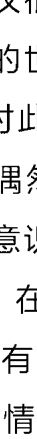

偶然与必然 | 本单元十大精彩…

## 本单元总结

1. 第一节课

我们一直觉得人类是具有高级智慧的生物，我们很理性，尤其是精英阶层，面对世界的时候会客观分析它的方方面面，但事实上可能并不是这样，我在第一节课告诉你的是，即使是以理性分析著称的华尔街高级交易员，也会被一个听上去很荒唐的偶然因素影响判断。所以说，偶然性对我们认知的影响，其实远大于我们的想象。我们常常被各种偶然性绑架。

2. 第二节课

偶然性不仅仅很大程度地影响了认知，就连我们生活的世界，可能都是由偶然性构成的。你此时此刻听这门课这件事，也包含着无数偶然性。在这种情况下，如果能更清晰地意识到世界的偶然性、成功的偶然性的人，在面临重大决策时就会更加镇定、坦然、有魄力，避免犯守株待兔式的错误——倔情愿地想将偶然性必然化，以一种想象的必然性来认知这个世界。

我还讲了一个故事，当一个人意识到自身的偶然性的时候，他做出的决策的质量都要远远高于那些迷信必然性的人。

3. 第三节课

第三节课里其实我们涉及到了一个你很熟悉的概念——成功。那些成功故事不过是故事，就像神话一样，是因为特定的目的、以特定的叙述逻辑制造出来的，它就是一个产品。换句话说，换个场景、换个结局，故事中的细节、节点的描述方式可能就都不一样了。

很多时候我们的认知都不是受制于逻辑的，我们的行为也不是受制于认知的，而是受制于故事。故事自带的逻辑谬误会让我们的行为出现谬误。

4. 第四节课

我们主要讲了一个观点：要想降低偶然性，提高成功的概率，一个有效的办法就是延长自己的故事线，把偶然性稀释在更长的时间轴里。

总结起来，这个单元我想交付给你的其实主要就是以下五点：

如果你用偶然性的视野看世界和人生，你就会发现一个充满着偶然性的世界和人生。

意识到偶然性是世界和人生的背景之后，你会发现天地为之一宽，为之一新。

偶然性组成了故事，故事在影响我们的认知。如果我们对偶然性缺乏足够的认知，就会产生许多我们不自知的认知谬误。

当我们知道偶然性扮演的重要角色，我们自然就会延迟判断。因为在不同长度的故事里，偶然性的价值和意义完全不同。

我们做任何事情都要尽可能地延长自己的故事线。一个好的战略就是一个故事线长的战略。

好，以上就是本单元的主要内容。以下是 我精选的同学留言，恭喜前三名同学，将获得我签名的书一本，这次送出的书是《极简欧洲史》，得到的工作人员会尽快把书寄给 你，也希望其他同学再接再厉。

特别提醒：留言内容会默认公开，并同步到“知识城邦”中，中奖同学留个人信息时，一定记得将留言设置成隐私模式，确保个人信息安全。

—— 本单元十大精彩留言 ——

## 获奖留言

扶摇高

有个很好的例子，能证明延长故事线的好处，虽然大部分人在股市里是亏钱的，但不能否认，股市是目前为止最赚钱的投资工具。赚钱的前提是，你要在这个市场生存足够久，不要错过了涨幅最快的那几天时间，也不要在“跌跌不休”的时候被清出场，而短时间内涨跌几乎可以看成是随机的，属于偶然性事件，那么唯一能够抹平随机性的办法，就是用时间来熬，时间越长赚得越多。好了，现在问题来了，如果要熬到60岁以后你才能财富自由，你还愿意放弃现在享乐用来投资吗？自评一下，再投资吧。

偶然与必然 4 | 延长自己的故事线，才能提高成功的概率

江湖无声

有一个写对联的故事能很好地展示今天的故事线。

除夕前一个人写了好多对联都被其他人“拿”走了；于是他写了一副对联：祸不单行，福无双至。这下就没有人偷了；到过年那天大家再来，看到的对联变成了：祸不单行昨日行，福无双至今日至。

延长一条故事线一切都变了。成功者谈昔日的失败叫经验，失败者谈过去的失败叫教训，成王败寇拼的都是谁的故事线更长。

偶然与必然 4 | 延长自己的故事线，才能提高成功的概率

Dori

年初做新年计划的时候，我看到了一个做新年计划的方法：想象自己的葬礼，邀请你的许多朋友来这场葬礼上致辞，他们会说什么？原以为这个做计划的方法跟过去一样平凡无奇，没想到却彻底改变了我。

我将我希望朋友说的话写下来，我想他们会说到我的价值，于是我在核心能力方面写下我想要达到什么，然后将达成这个核心能力的目标拆解成每一天的小任务，每一天做的事情都朝着这个终极目标而努力，比如说我就从那一刻起开始每天坚持打开得到专栏，以前不写留言的我，开始重视输出思考，至今两百多天了，没有一天落下。从写葬礼计划的那一天起，我开始向死而生，也体会到终局思维的重要性。

问答 30 | 如何把自己的认知清晰地写出来？

## 其他精彩留言

吴钩蘸香

命是既定的基础，运是能动的变化。伞兵降落到敌方营地，几乎是注定要被包围，但没有一个伞兵是甘愿去做俘虏的，他必须在降落后迅速了解形势，利用一切可利用的条件，马上进行一系列的战术行动，去尽量延长自己的故事线，这就是伞兵思维。

所谓死局、眼前的困境，要放在更大的局势里、更长的时间线，同时观察更细小的变化、背后隐藏的联系，才能不断延长自己的故事线，达到自己的目地。

偶然与必然 4 | 延长自己的故事线，才能提高成功的概率

胡振強

偶然性是个很有用的东西。尤其是在面对人工智能的时候。我们现在经常讨论人工智能对人类的威胁和挑战，好像人类的末日还在眼前。可是，我记得有位老师说过一句 话，让我对人类前景充满信心。他

一句话，让我对人类的前景充满信心。他说，人类还有最后一把对付人工智能的大杀器，那就是人类会犯错，而人工智能永远都保持正确。

什么？会犯错的反而会赢？是的，其实吴老师这节课就从某种程度上回答了这个问题。只有犯错才会出现偶然性，而对付偶然性是人类仅存的为数不多的优势之一。

如何在围绕偶然性当中分析出最有利的选择，恐怕只有人类这种天天与错误打交道的不完美物种才能做到。

这就像打扑克，所谓的高手，并不是能避免偶然性的出现，而是能在偶然性中找到那个赢面最大的选择，尽管有输有赢，但最终还是赢多输少。因此，这也是为什么虽然人工智能能完虐人类的围棋高手，却无法完全打败扑克高手的原因，人工智能的世界里没有偶然性嘛！人工智能注定会在保持“永远正确”中败下阵来。

## 偶然与必然 1 | 偶然发生的事就不重要吗？

### 王强

马云说过一句话：那么多钱又不是他自己的；比尔盖茨也说过类似的话，他是代为管理财富。曾经以为他们真的是在装，但是现在知道，人家说的是真心话。

就像吴老师说的那个朋友一样，这些人都是知道财富和成就的偶然性，没有那么着相，不过是把财富成就当成是“自己的”，反而洞察到了很多人完全看不见，或者认为是风险的机会。这不是他们更聪明，只是他们维度更高。这种高维度就像可以俯瞰迷宫图、规划路线一样，而大多数着相的人只是在迷宫里打转，不能总览一切可能的线路。

其实人之所以会相信偶然性中的必然，是因为自我意识过强，把自己放在了宇宙中心的位置，认为这些必然性要么是自己操控的，要么与自己有关，这当然是一种妄念，但是这种妄念却有效地解决了生存和繁衍的问题，百万年进化就形成了本能。多数人对不确定性本能地排斥，对确定性深刻地迷恋，就是基于有效的进化本能。这种本能进一步说是因为时间是单向性的，其他的可能性无法在同一时间再走一遍，或者走过之后倒回去再选。很多作家就是打破了这种时间限制创作出开脑洞的作品。既然回不去，既然不能多选，那把握好经历过和呈现出来的，自然是最佳策略，这就是“活在当下”，这也算是人相信“偶然中的必然”一个有效的解释。

## 偶然与必然 2 | 我们的存在就是一种偶然

### 斜风细雨不须归

认知是产品。也就是说，所有的产品都是认知制造出来的，不管在过程当中，作为主体的人，是刻意为之，还是无心之举。而故事在本质上就是认知产品，所以必然带有主观性，这是不可避免的。罗胖昨天提到一句话：一切历史都是当代史。因为写历史的人是主观的，他的思维方式，他的叙述方式必然带有其时代特征。

对于作者，这无可厚非。但作为读者，必须注意，一方面，要看到作者的时代背景，另外一方面，还要看到自己的时代局限，同时，还要看到内容本身的时代背景。不要忽视偶然性的作用，而只看到所谓的必然性。一个所谓的必然多半是一连串的偶然性相互影响、共同作用的结果。

## 偶然与必然 3 | 成功故事值得我们学习吗？

#### 金戈铁马

今天课程里提到的延长自己的故事线，就是一种以时间换空间、降低偶然性影响的人生策略。这让我想起了我的一位创业的朋友。

他5年前辞职后自主创业，当时对于创业前景、未来的趋势是存在很多的不确定性的，能否创业成功他自己也是没有把握的。我的这位朋友当时只抱有一个原则：尽可能地让企业活下去，活得久一点。在这种策略的影响下，他采取了很多在外人看来非常保守的策略，比如研发团队由自己亲自带领，工作由自己亲自布置；产品的销售针对特定的客户群体，绝不走低价竞争的策略；产品不争取引利，但是要想尽一切办法加快回款周期；减少一切不必要的投资等等。

可以说他采取的策略就是想方设法延长自己创业的故事线，通过制定各种有针对性的措施降低偶然性发生的概率，或者说是让创业的风险在更长的一个企业生命周期中进行相对均衡的分布，这样也就是提高了自己的胜算了。

## 偶然与必然 4 | 延长自己的故事线，才能提高成功的概率

### 小浩54954e1d4c9

我个人的改变（精进）主要是通过三个习惯：

- 1. 日记。日记是自己和自己的对话，将白天的外观转化为内求，在不断和自己对话的过程中找到重要的、有意义的，去除琐碎的、看起来重要的，并且将反馈及时地转化成记忆，甚至是习惯。

- 2. 跑步。跑步是一个看似外求，但实际上是内省的过程。跑步的真正价值不在于强健体魄，而在于三个副产品：毅力（耐力）、节奏感、减少无意义的消耗（多余动作）。节奏感是实践性知识，很难量化、表述，只有在身体力行中才能体悟。减少无意义的消耗，则可引申到生活中，减少多余的、与目的无关的、无意义的动作、思维、物品。

- 3. 清单和备忘录。作用是将大脑内存外包，并作为可量化的标准，规范日常的行为，减少心力的耗费。

## 问答 30 | 如何把自己的认知清晰地写出来？

### 小贝

想起了足球比赛的加时赛。理论上强队应该在常规时间内赢得比赛，然而有可能因为偶然性被对手逼平。加时赛延长了比赛时间，有利于强队的实力展现，把偶然性降低。

## 偶然与必然 4 | 延长自己的故事线，才能提高成功的概率

用户留言

提交留言可与专栏作者互动

## 认知与异化1 | 手段和目的之间是什么关系？

第一模块
认知的源代码
第二模块
认知治理
第三模块
算法与第一性原理
“认知与异化”
第四模块
意义炼金术

### 异化：手段变成目的

每当看到烟盒上写着“吸烟有害健康”，我就产生一种荒谬感：人类知道香烟的危害性特别大，但又止不住去生产和消费这样的产品——从理性观点看，人类怎么会生产出这种自我残害的产品呢？细究起来，这里包含着一个很重要的哲学问题。

烟草的出现起源于一个印第安人的痛点：

在长着很深的草丛的草原上有很多的蚊虫，印第安人在这里行走、打猎、采集就会深受蚊虫叮咬之苦。他们发现如果把一种植物的叶子进行燃烧，对驱虫非常有好处，就把这种叶子卷起来点燃，作为驱除蚊虫的解决方案。

在这个过程中，燃烧的叶子可能会灭，就需要印第安人不时在嘴上吸一吸保持烟草的燃烧——这是一个合理的动作，但不断反复，就让人的大脑形成了对这种烟草气味的依赖性和某种快感，以至于他们不在丛林里时，对这种烟草气味也有一种不可遏制的欲望，这就是“瘾”。

这个有趣的过程在哲学上称为“异化”。

本来作为完成某个特定目的而来的一种手段，在长期使用过程中具备了某种自足和独立性；

有目的才有手段，但如果目的不存在，手段就获得了某种自足和独立性，形成了一种隐秘而强烈的欲望——瘾；

最后，迫使你完成的不目的是目的，而是手段——手段本身成了目的。

“异化”就是一个事情逐渐远离目的，导致手段凸显出来成为目的。比如仆人，本来是作为保证主人生活舒适或者事情进展的手段，最后却反仆为主，具有了独立性。

类似的事情在生活中比比皆是，比如手机。人类发明和使用手机是有特定目的的：为了生活和工作的方便，增强人与人之间的互联性。但是，在使用过程中，作为手段的手机的重要性越来越凸显。最初是手段离不开目的，但最后不是手机离不开你，而是你离不开手机。

我们使用任何一个工具，都意味着某种通向自由之路，但反过来也就会是通向奴役之路，你会被手段绑架。

### 反向驯服的合作游戏

我们前面讲过：密切的合作像一个生命体，合作双方或者多方都是这个生命体的器官，其一方的重要性取决于他是否在这个生命体中扮演着不可或缺的器官角色。

如果我们从这个角度看异化会发现：

一旦你开始有特定目标行为的时候，就启动了一个你不知道、没有意识的游戏——你跟手段之间的合作游戏。

不断持续的合作过程成为了一个生命体从0到1的生成过程——这个看不见的生命体成为ファイル。曾经作为手段的那方已经成为了这个生命体不可替代甚至是最重要的器官。

最初启动合作的那一方在整个合作体里从主动变成了被动。

尤瓦尔在《人类简史》里讲到的小麦就是这样反向驯服的例子：表面上是小麦为人类提供了食物，其实是小麦借助于人，不断实现它的基因成就，帮助它扩张在地球的占有面积。人觉得自己胜利的时候，小麦才是真正胜利的那一方。

交易性、权益性的行为演变多次的、自我固化的、非交易性的合作行为的时候，新的机制就产生了。在这样的机制里，角色逐渐从主动到被动，从主人到仆人，从雇佣者变成被雇佣者，从奴役者变成被奴役者——这个世界充斥着这种目的与手段，奴役与被奴役之间的剧情大反转。

我们认知的时候要意识到，这个世界不是纯粹的对象，而是一系列的关系，这个关系机制有相当一部分是具有异化性的机制和关系。就像我们生活中有党员、密友、朋友、敌人……是一个多频谱、同时包含着异化的关系。

异化机制在我们生活中占有不可忽视的份额，但我们常常没有意识到它的存在，一直还滞留在某种主动性的幻觉里，浑然不知这种异化性的关系时刻在支配和控制着我们的认知和行为。

我们之所以会对于类似于暗物质、暗能量的异化关系浑然无知，是因为我们总在情愿地理解我们生活的世界——这个世界不是一个纯粹客观的世界，而是由你参与并且自定义，也稍稍被定义的一个世界。

在异化关系当中，一开始处于被动从属地位的要素，它的权力份额会在游戏进展过程当中不断扩张。就好像“阿拉伯的骆驼”，它的界面是相当友好的，通过回渗透的方式进入到我们的权力范围，最终几乎把我们的主动性拖干净，让自己不知不觉获得了一个具有巨大主动性和控制性的权力。

《浅薄》（The Shallows: What the Internet Is Doing to Our Brains）这本书里写了人跟互联网之间的博弈关系：互联网所承诺，或者我们自己想象的都是——互联网会让每一个体变得更加深刻主动，人与人之间的连接更加紧密等等，但是这些承诺发生了意想不到的反转。

从理论上，你可以方便地找到世界上任何一个人，但你的互联可能性在无限扩张的时候，你反而变得越来越封闭，因为你更容易找到跟你相似的人。所以这不是世界“去部落化”的过程，而是“再部落化”的过程。我们生活在一个越来越趋向封闭的社区里，趣味越来越单一，但却以为自己接触的是“整个世界”。

互联网赋予人巨大的探索可能性，让我们通过某个点不断加深认知深度的时候，它所隐含的另外一种可能就是认知的广度会扩张。一个健康的认知既要有深度，又要有广度，既要有纵向的探索和挖掘，又要有横向的扩展，但由于纵向认知不可避免地会带来瘫痪，所以我们逐渐回避纵向认知，进入到一种横向扩张的可能性，这时候，人的认知就自然趋向于浅薄。

在《浅薄》里，人的认知变得既浅又薄，同时也意味着既广又泛。这样的结果是我们最初没有意识到的工具和手段对于人的反向控制和缚架，这就是一种反向驯服谬误。

## 总结

+ 1. 世界上不存在纯粹的、固定不变的手段和目的，不存在免费的目的；
2. 任何手段都是有代价的，只不过有大和小、明显和隐秘而已；
3. 人一旦启用一个手段，为实现自己的目的而开始一个行动的时候，另一场游戏也就开始了；
4. 这两种同时发生的游戏最终导致的结果往往会大大出乎游戏启动者一方料。

吴伯凡

我们的生活工作当中一定会使用很多工具和手段，哪些工具和手段，以一种你自己没有意识到的方式在逐渐侵占你的地盘、掏空你的主动性？

划重点

+ 1. 世界上不存在纯粹的、固定不变的手段和目的，不存在免费的目的；
2. 任何手段都是有代价的，只不过有大和小、明显和隐秘而已；
3. 人一旦启用一个手段，为实现自己的目的而开始一个行动的时候，另一场游戏也就开始了；
4. 这两种同时发生的游戏最终导致的结果往往会大大出乎游戏启动者一方料

## 认知与异化2 | 给予和索取之间是什么关系？

第一模块
认知源代码
第二模块
认知治理
第三模块
算法与唯一性原理
“认知与异化”
第四模块
意义炼金术

我们上节课讲到异化：

异化是一种在时间轴上出现的奇怪的反转现象。

随着时间的演进，原有的权力和利益关系会发生意想不到的反转——手段反客为主成为目的，仆人反仆为主成为权力的主宰者。

启动初始阶段游戏的一方会不自觉地陷入到一种被驯状态：从有权力到逐渐丧失权力，从追逐意义到意义丧失。

一旦开始一个游戏，另外一种权力和利益关系作为主线故事下面的副线开始成长。随着时间的延伸，作为副线的故事会逐渐浮出表面，出现所谓的“反向驯化”。

你可能觉得“反向驯化”怎么全是套路，一切都像是一种利益的博弈——我提醒你，是你想多了。你站在自己的立场上会觉得自己是被利用了，但如果你站在第三方或者更广的立场上，这就是一种很自然的关系。

老子说“天地不仁，以万物为刍狗”：一条小狗站在个体的角度就会觉得自己被利用，但如果站在天地的角度，没有亲疏之别，那就是一个普遍运行的法则——老子把这个法则称作“道”，也就是自然界普遍存在的生态性协作关系。

### 互动、互利、互惠的协作系统

#### 1. 大自然的狡黠

德国哲学家特别爱说“大自然的狡黠”，就是大自然会立各种各样的圈套、陷阱、计谋，诱使人或者其他个体去追逐某种目的——你追逐这个利益的时候，是意识不到这个目的和意义是整个计谋的一部分的——最终实现的是大自然的目的。

比如食色性也，食欲和性欲导致的诱惑以及满足之后的快感，本质上是大自然设计的完成物种繁衍的手段而已。这种看似不带强制，实际上预埋了套路的助推手段让你舒舒服服甘心情愿地去完成大自然设计的目的。

我们还是站在人类中心主义的立场在说“大自然的狡黠”，而不是站在整个物种的立场。从自然的立场来看，所有这些看似矛盾、带有蒙骗性的行为设计，不过是个体之间的一种协作——我们从人的角度看到的圈套、计谋，其实是一种互惠互动的机制。

#### 2. 养蜂人和果农

经济学里有一个经典的争论——养蜂人和果农，谁该给谁钱？

果农：蜜蜂在我的果园采蜜，你拿这些蜂蜜到市场出售获得了利益，相当于我是你的上游供应商，你该给我钱。

养蜂人：如果我的蜜蜂不在你的果园采蜜，你的果园开的就是空花，结不了果子，所以，我是你的供应商，你该给我钱。

养蜂人和果农之所以争执，是因为大家都是从各自的角度在看问题，而浑然意识不到大自然的整个设计是一种互动、互利、互惠的协作系统。

你从整个协作关系网络中以特定角度截取一段来看，就觉得自己受到了欺骗，利益受到了损害——这是因为你是从自己的角度来定义手段和目的的。

#### 3. 尝冒鬼的认知镜片

上一节课我提醒过大家：对世界的认知可能出现一种认知的盲点或者着偏维。异化关系，它相当于一种认知镜片，就像看3D电影，如果不用3D眼镜是感受不到3D效果的，而你一旦意识到异化关系，你看到的世界也会不一样。

这节课我们讲的是另外一种认知镜片，用这个镜片你能看到比你以为的关系更全面的样态。比如在尝冒鬼的故事里，尝冒鬼掉到水里，他听到船上的人说“把手给我，把手给我”的时候死活不伸手，直到那个人说“我把我的手给你”才被拉了上来。

尝冒鬼自定义的世界是“害怕给予，只希望得到”，但真实的世界是互动、互利、互惠的——从自身角度看，你自然觉得被利用被索取，但具备了更全面视野的话，世界就不一样了。

### 互助：进化的重要因素

杜月笙有一句名言，“不要老抱怨别人利用自己，别人利用你说明你还值得利用”，这句话可能有点负能量的话提示了我跟世界的一种可能关系。

克鲁泡特金是“无政府主义之父”，他的《互助论》的原标题本来是：互助，一个进化的因素。可basically：可见在进化过程中，互助是一种很重要的因素。我们今天的进化论、演化论也越来越注意到，互助而不是竞争在整个物种进化中的作用，或者说，在整个自然界、生态系统中，互惠、互利是一个普遍存在物种以及物种个体之间的协作关系。

自然界既有资源存量，也有资源增量。竞争是在资源存量固定不变的情况下，各物种之间争夺存量的关系。与此同时，各物种以及物种个体之间也存在着资源增量：从个体角度看，这个关系常表现为自己给予或者自己被索取，但站在一个更全面的角度，它既是被给予的关系，也是自身向他方索取的关系。

这种关系在商业世界和商业生态里同样存在，并且在相当大程度上定义了一个商业机构的存在价值：有没有价值就在你能不能为你的利益相关方创造价值，也就是说，你有没有被别人利用的价值。

如果没有被利用的价值，你就不会被选择——这就是我们前面讲的“所谓选择其实是被选择”。

## 总结

+ 1. 如果把异化看成一种在时间序列里演变出来的权力和利益的反转，那么在空间关系中异化也同样存在，只是这种异化不是反转，而是同时存在的给予和被给予、利用和被利用的双向互动的关系。
2. 现代商业世界逐渐变成一个商业生态系统。我们说“无商不奸”，任何一个商业关系里都存在着计谋、狡黠、好诈，从一个更广泛的角度来看的话，在完整健康的商业生态里，互动、互利、互惠是正常的关系，是所有商业思维的起点。而尝冒鬼的思维模式与这种商业思维格格不入。这也就是通常所说的穷人思维和富人思维。

■ 划重点

> 站在更宽广的视角看，不存在给予和索取，只有互惠互利。

看得不过瘾？
《伯凡·日知录》还有一整年的内容
戳此下载

用户留言
提交留言可与专栏作者互动

## 认知与异化3｜我们是如何给自己“下套”的？

第一模块
认知的源代码
第二模块
认知治理
第三模块
算法与单一性原理
“认知与异化”
第四模块
意义炼金术

### 认知镜片的局限性

我们上节课提到了认知镜片：任何一个认知结果都是和特定的认知镜片相关联的，就像只有戴上3D眼镜才能看3D电影。

事实上，每一个物种都不自觉地带着认知镜片，比如狗看不见彩色的世界，但因为它特殊的生态位，使得它只要注意黑暗中的形状和移动就可以了。

任何一个自带的认知镜片都能反映出部分客观性和真实性，同时，也不可避免地具有片面性和截取性。比如苍蝇看到的世界，从某种程度上也是真实的——他截取了他人好杀和惊奇性的那一面，所以要尽可能地去留意和提防。但对于自己感受方式的选择性和片面性，他是浑然不知的。

我们每个人都在用自带的镜片截取世界的某一个面相，这种自身局限是任何一种认知方式都难以避免的，以致使我们很可能忽略甚至回避对我们很重要的那些面相。

无论是商业世界，还是普通人际关系，我们都会提醒自己不要上当受骗，“害人之心不可有，防人之心不可无”。但是当你有防人之心的时候，很可能就让自己缺少了“防我之心”，也就是说，欺骗既可能来自外部，更可能来自内部——我们可能对外界的各种蒙骗有敏锐的意识，但对自我蒙骗缺乏认知。

有了异化这种镜片，我们就能感受到“手段变目的，仆人变主人”的境况——在没有任何强迫的情况下，自己可能会把手段当目的，给自己设下各种圈套。

### 手段和目的之间的异化

案例1: 郑人买履

我们讲过积极数据和消极数据，而韩非子“郑人买履”的故事最能体现“人如何糊涂到用积极数据替代消极数据给自己下套”，也让我们感受到“手段和目的之间的异化”。

郑人给自己画出一个鞋样，这是一个手段，目的是为了买鞋。而这个蠢人把手段当成是第一位的——当他没带鞋样的时候，要跑回去取鞋样，浑然不知他的脚是最好的鞋样。我们生活中不像郑人那么蠢，但在把手段当目的这件事情上，我们不一定比他聪明。

处理手段和目的之间的关系的时候，我们一定要记住：

+ 一种手段可以导致一种但不仅仅是一种结果。
一种结果可以通过一种手段来达成，但不一定只有这一种手段。

为了达到目的，我们的心思往往更多花在手段上，以至于把目的忘了。

案例2: 牛顿的故事

牛顿有很多编造或者真实的故事，其中一个据说是真实的故事是：牛顿很喜欢动物，又养猫又养狗，但他发现，把狗和猫关在院子里容易让它们暴躁不安，需要让它们自己出去自由活动，但他不愿意让院子的门老开着。于是牛顿这个聪明人想了一个解决方案：在门上掏了两个洞，大洞让体积大的狗用，小的洞让猫用——这个解决方案透露出一种理工男思维。

我们现在会觉得这事有点可笑，是因为牛顿太专注于手段而忘了目的：他的目的是让猫和狗出去，所以只要掏一个洞就够了——狗能出去的洞，猫自然也可以出去。

把大量心思花在解决方案上的时候，就会逐渐遗忘真正目的，就会导致聪明人办傻事。

案例3: 解决城市交通堵塞

有些城市为了解决交通堵塞的问题，修立交桥、消灭红绿灯，尽量让车行驶通畅，但最终导致的是灾难性的交通堵塞。

“修立交桥和消灭红绿灯”这种方式从分布式计算进入到了接近于中央控制式计算，使整个交通网络更加脆弱：很多车从各自地点出发，在行程的大部分时间里都非常通畅，这就意味着在某些汇集点上的车流量将会剧增，这就可能导致一个危险——车辆汇集的地方一旦出现问题，或者本身结构的设计不合理，实际上就是让所有的车以最快速度和最大流量到堵车的地方集合。

如果有红绿灯，没有那么多立交桥，整个交通的阻塞就会变成分布式阻塞，反而会缓解枢纽性路段交通的脆弱性——分布式交通系统能够让整个系统具有一种自我修复的能力。

从这个意义上，分布式交通系统是一种无为的交通系统，而那些看似“有为”的交通系统反而让整个系统变得特别脆弱。这就应了那句话，“消除了小陷阱，而制造了一个巨大的陷阱”。

解决整体性交通堵塞才是目的，而消灭红绿灯，建立立交桥只是手段而已。全世界著名的无为式交通的例子是巴黎的凯旋门周围，连红绿灯都没有，但是它能非常有效地运行。

很多的有作为，常常会导致将手段当目的，用闲不住的手代替看不见的手，最后不仅不能解决问题，还会恶化问题。

案例4: 警察局和治安状况

我们知道，当社会治安出现问题的时候，警察局就显得很重要。所以我们会发现一种有趣的现象：有些地方案情频发并不完全由作案人导致。

在设立一个警察局以后，警察局的警力增强，他们就会采取各种措施让这个地方的治安逐渐好起来，但是治安一旦好起来，警察局获得的资源就会减少——如果你治理得很好，那警察局的价值就成了问题，所以有些警察局为了保证自己的经费往往会无事生非、小事化大，甚至与那些可能作案的人串通起来制造案情。

案例5: 制造病毒的反病毒软件公司

计算机病毒行业也有类似的情况：反病毒软件是手段，消灭病毒是目的。反病毒软件公司为了提高自己的市场竞争能力，就会加强软件的杀伤力。但是，当杀伤力到了一定程度就会出现病毒稀缺。这种状况对整个行业可以说是灾难性的，所以，就会滋生出另外一种力量——制造那些具有巨大破坏性的计算机病毒，维持整个行业的所谓“健康发展”。

## 总结

要完成一个产品，开发一个项目，培养一种竞争力，我们会建立很多流程。这个流程一旦建立，就会有它自身独立的需求，但是这种需求往往不是为了解决问题，而是为了制造问题。通过制造问题来维护自身存在的合法性和正义性。这些都是我们自己意识不到的“异化”，是自己给自己下套，自己蒙骗的“异化”。

划重点

为了达成一个目标，我们会建立很多流程，这个流程一旦建立，就会有它自身独立的需求，比如通过制造问题来维护自身存在的合法性和正义性。这是我们自己意识不到的“异化”，是自己给自己下套，自己蒙骗的“异化”。

看得不过瘾？《彼·凡·日知录》里还有一整年的内容

用户留言 提交留言可与专栏作者互动

## 认知与异化4｜路径是如何把人“锁死”的

第一模块
认知源代码
第二模块
认知治理
第三模块
算法与第一性原理
“认知与异化”
第四模块
意义炼金术

### “杀手级”创新

一家著名的汽车公司推出了一项和车锁相关的“杀手级”创新，我们从一个场景来了解一下：

一个人开车去机场赶飞机，时间已经非常紧迫了，他可能赶不上，所以，当他好不容易赶到机场停车场的时候，几乎是立刻跳下车去后备箱取行李。但是，当这个人提着行李箱撒腿要跑的时候，他发现装着身份证的钱包不在口袋里，而在他的驾驶座上一—旁边还放着他的车的钥匙。

这里要说明的是，这款车的设计很人性化：当你把后备箱的按钮按上的时候，不仪关上了后备箱，同时也完成了锁车。

这本来是个创新，但此时反而成了大麻烦——这个人没有车钥匙，拿不到身份证。

### 路径锁定

心理学认为人会有“思维定式”，就是你在使用一种思维路径的时候，往往会被这种路径锁死，以至于当这条路走不通的时候，你也不可能切换到另外一条可能很简单的路径上。

+ 1. 很多字，尤其是地名里的字具有唯一性，除了指这个地方以外没有任何其它意义；
2. 这个字你不认识，但可能认半边就是对的。

### 习俗：没有意识到的异化

我们在商业管理里常常会遇到一个敌人——习俗。

## 总结

一个手段不仅仅有一种结果：它既可能导致一个你期待的结果，也可能导致一个或多个你没有预料到的结果。结果和手段之间的非一一对应性提醒我们：要充分意识到一种暗能量、暗物质的东西——异化。

## 问答31 | 失败和成功，到底谁是谁之母？

问答31 | 失败和成功，到底...

### 必然性一直在场，正如偶然性也一直在场

“偶然与必然”这个单元的课后，同事们都在问一个问题：讲了那么多关于偶然的东西，难道这个世界上就没有必然的东西吗？

任何一个见解、一个道理、一个判断被拿出来讲，都有一种危险：它会凸显这种东西的重要性，并且在客观上让其一些东西变得黯淡。

我们讲“世界是充满偶然的”，并不是说“世界不存在必然”，也不排斥“世界上是充满了必然的”。

人活在世，从生到死，始终在一场接一场的生话剧情中扮演一个角色，并且这个角色和剧情之间是一种相当不对称的关系。

### 偶然性和必然性：霍金的网球比赛理论

我想用著名宇宙学家霍金的话来阐释“偶然性和必然性”的关系，他用网球比赛来说明，这个世界至少有两种规律或者两种法则。

打网球的时候，我们既受制于人力，也受制于不以人的意志为转移的自然律：

- 一个网球场的长度和宽度，网球比赛的时候每一局得多少分，这些都是人确定的；
还有一些是人不能确定的，比如网球受地心引力的影响，虽然是你拿着球拍在特定角度打球产生的速度，但这个球的运行速度和方向并不完全由你来决定。

网球比赛是人的规则和自然的规则，自然律和人的努力/实力之间的一场非常复杂的游戏，结果往往不是人能控制的。

那么，这世界就没有必然吗？有，比如地球围绕太阳转，月球围绕地球转，这些的确遵守着必然律。

在这个单元的课里我们讲过，即使是这样看上去具有必然性的现象里，都包含着相当大的偶然性，比如月球的产生、地轴偏移的角度，春夏秋冬的变换等等，这些看上去必然的东西，都是因为一个偶然的相撞造成的。

佛教讲的世界观其实是很有参照价值的：世界如同 一个草席，由横草和竖草编织而成。这也可以理解为，偶然性和必然性交织构成了我们的故事。只是我们 虽然无时无刻不受制于偶然性的影响，但常常忽略了偶然性。

必然性一直在场，正如偶然性也一直在场，但某一个偶然性不会改变世界的必然性，只会大大改变剧情。

### 《红》：

在基耶斯洛夫斯基的电影《红白蓝》三部曲里，《红》表现的是自由，其中有一个关于男主人公人生经历的很重要的情节：

### 成功和失败：故事线的长度

成功和失败都是对结果而言的，并且这个结果可能是阶段性结果——在更长的故事线里，这个结果可能是一个原因。

我们经常说“失败是成功之母”，但在历史上，我们看到很多“成功是失败之母”的例子——到底谁是谁之母？要看故事线的长短。

### 无巧不成书——“书”指的是故事，没有偶然的巧合，是不能构成故事的。

### 成事不足，败事有余——某个行为或者因素并不具有成功的必然性，但完全可以导致失败。成功是在尽头的一个结果，中途任何一个节点的更改都不可能达到成功的终点。

用户留言

提交留言可与专栏作者互动

## 认知与异化Ⅰ 本单元十大精彩留言

## 本单元总结

1.第一节课
我向你阐述了这么一个重要的观点：世界上不存在纯粹的、固定不变的手段和目的，人一旦启用一个手段、开始一个行动的时候，目的和手段之间的关系就可能会发生变化，这也是启用一个手段的代价，任何手段都有代价，只不过有大和小、明显和隐秘之分。我们常犯的错误就是，睁大眼睛看手段，反而忘了目的。

2.第二节课
我们说，就像不存在纯粹的手段和目的一样，也不存在纯粹的给予和索取。从一个更广泛的角度来看的话，互动、互利、互惠才是正常、健康的关系，也是所有商业思维的起点。"商"就是"商量、商讨、商谈"，就是一种互动、互利、互惠。

3.第三节课
我们主要讲的是，在做一件事情的时候我们会建立很多流程，而这个流程一旦建立，就会有它自身独立的需求，比如通过制造问题来维护自身存在的合法性和正义性等，这是常见的异化现象。我们要做到的，就是尽量意识到这些自我蒙骗的"异化"。

4.第四节课
我们说，一个手段不仅仅有一种结果：它既可能导致一个你期待的结果，也可能导致一个或多个你没有预料到的结果。结果和手段之间的非一一对应性提醒我们：要充分意识到一种暗能量、暗物质的东西——异化。你自由和解放的程度就取决于你洞见和消除异化的能力。

好，以上就是本单元的主要内容。以下是 我精选的同学留言，恭喜前三名同学，将获得我签名的书一本，这次送出的书是《极简欧洲史》，得到的工作人员会尽快把书寄给 你，也希望其他同学再接再厉。我们下节课再见。

特别提醒：留言内容会默认公开，并同步到"知识城邦"中，中奖同学留个人信息时，一定记得将留言设置为隐私模式，确保个人信息安全。

## 获奖留言

岩石
在这个现实社会里拥有和正确看待"利他行为"是非常关键的，只有有相互交换价值才有可能进入某个圈子，而付出得越多虽然不一定能马上有所相应的回报，但从长期来看，得到的东西可能是自己想象不到的。

一个打工者，公司雇佣我为它工作，同时给我付薪作为我的回报；公司给我多少钱，我就应当付出多少劳动，没有必要付出更多。这种“打工思维”对公司发展极为不利，同时也会极大限制这类员工的成长。一方面，你只有付出更多、做得更好，才有升职加薪的机会，而不是反过来；另一方面，如果大多数员工都不想为公司贡献超额价值，公司价值自然也做不大，反过来对个人的回报也不会太多。

员工应该秉持两种思维：“老板思维”和“为自己打工思维”。首先，站在老板的角度想问题、做事情，才能为公司创造更大价值，从而使个人也能得到更多回报。其次，我们绝不仅仅是在为公司工作，也是在为自己工作，工作过程中积累的知识技能和宝贵经验都是自己的，自己在工作过程中也得到了极大的成长。

所以说，公司和员工之间并非单纯的雇佣与被雇佣关系，更不是可怕的剥削与被剥削关系，而是一种互惠互利、合作共赢的关系。

## 认知与异化2 | 给予和索取之间是什么关系？

### 玉壶冰心

很早以前看的一个故事，某空军运输设备每周需要用骆驼皮擦拭干净。这是写在规定里的，士兵一直执行。直到骆驼皮越来越贵，一位士兵问，我们为什么不用其他毛皮替代呢？士兵又继续追问，为什么必须用动物毛皮？原来过去运输军用物资都是依靠骆驼，为了驯服骆驼，在设备擦拭上骆驼的体味，从而蒙蔽骆驼。日后有了更快更便捷的运输方式，可是有些规章制度被教条地执行下来。

## 认知与异化3 | 我们是如何给自己“下套”的？

### 雨中漫步

今天的文章让我想起了一个故事：

A企业引进了一条香皂包装生产线，结果发现这条生产线有个缺陷：常常会有盒子里没装入香皂。总不能把空盒子卖给顾客啊，他们只得请了一个学自动化的博士后设计一个方案来分拣空的香皂盒。博士后拉起了一个十几人的科研攻关小组，综合采用了机械、微电子、自动化、X射线探测等技术，花了几十万，成功解决了问题。每当生产线上有空香皂盒通过，两旁的探测器会检测到，并且驱动一只机械手把空皂盒推走。

B企业也买了同样的生产线，老板发现这个问题后大为光火，找了个小工来说：“给老子把这个搞定，不然你给老子爬走。”小工很快想出了办法：他花了90块钱在生产线旁边放了一台大功率电风扇猛吹，于是空皂盒都被吹走了。

以上故事跟老师提到的比亚迪的例子很相似，相同的目的（识别出没有香皂的空盒子），但不同的人有不同的手段。给我的启示是，适合自己的手段就是好手段，不一定高大上的手段才是好手段。目的和手段是多对多的关系，突破自己的思维定式，找到更多解决问题的“笨办法”。

## 认知与异化4 | 路径是如何把人“锁死”的

### 我是谁，我要去何方

有这么一个故事，在美国和墨西哥边境，看守警卫看到一个男人骑着自行车，把手上放着个箱子，警卫让他打开箱子，结果发现里面全是沙子。第二天，这个男人又来了，还是骑着自行车带着个箱子，警卫打开一看还是沙子。这样过了两个月，这个男人每天都穿过边境，每次都带着一箱沙子。最后这名警卫终于崩溃了，说：“你每天都骑着自行车，带着一箱沙子过境，到底想走私什么呢？”结果那个男人回答说：“自行车。”

在这个故事里，警卫认为走私的物品一定是放在箱子里，这就是一座思维的牢笼，咱们日常生活中也经常犯类似的错误。当我们长时间使用一种手段或者思维方式时，就容易自认为这是“唯一的绝对正确的真理”，这时候手段与目标就会产生异化，忘记了自己的初心，成为工具的奴隶。

## 认知与异化4 | 路径是如何把人“锁死”的

### 团圆妈

万维钢提出一个概念，叫做“好的失败”，也就是那些能够提供经验教训、帮助我们成长的失败。“好的失败”要满足三个条件：第一，能得到及时的纠正，我们都有类似的经验，一旦错误的习惯养成了，那再改就很难了，所以要及时纠正，养成正确的习惯。第二点是对事不对人，这次错了，改正就行，必须是针对技术动作的，不要上升到这个人能力高低这个层面，否则就会带来挫败感。最后一点，是失败的代价要小。

## 问答31 | 失败和成功，到底谁是谁之母？

## 活动Ⅰ 编写你的认知辞典

活动Ⅰ | 编写你的认知辞典

课程进行到现在已经过半了，我们讲过的大大小小的认知概念和方法也有几十个了，前两个模块的最后，我也都给你总结过一些重点的概念和方法，我们姑且把我总结的这些称为咱们课程的认知辞典，或者说是我的认知辞典。

今天，我想发起一个活动：邀请你来参与完成一本属于你们自己的认知辞典。简单说，就是由你来为课程中的认知概念做注解。

之所以要发起这个活动，是因为我通过同学们的留言发现，真正理解了咱们课程的同学，都能找到一些真实的案例来验证、解释讲过的概念，也正是这些同学，更能将所学运用到生活中，而这，才是咱们课程的最终目的。

所以，我希望你能花一些时间，用简洁的语言、生动的故事和真实的案例，给以下认知概念做一个解释，你可以选择其中任何一个或几个概念来解释，相信这个过程中你一定会有非常大的收获。这份概念清单会持续更新，你也可以持续做这件事，在课程结束前，我会帮你把这本辞典整理好，呈现在你面前。

为了保证你是在真实的案例里找解释，而不是用道理解释道理，我在下面给出了几个范本，你可以参考着来写。

期待你的留言。

### 待解释的概念：

- 认知异化
- 认知的两重性
- 认知的客观化
- 认知的奥卡姆剃刀
- 认知的障碍打击
- 认知专线
- 灯式认知
- 认知顾尾
- 刷卡式认知
- 火力侦察
- 格物致知
- 认知之树
- 认知周期
- 选择压
- 伪选择
- 合作
- 算法
- 编码与解码
- 潜对话
- 消失数据
- 表面增长谬误
- 天赋良机
- 中途镇
- 数据扭曲立场
- 知行合一
- 天算
- 云型思维
- 生态位

### 范本：

#### 1. 什么是“异化”？

快乐趣腾

我有一个朋友，夫妻俩看周围朋友买车摇号非常困难，虽然自己已经有一辆车了，还是加入了摇号大军。但巧的是，几天之后就意外地摇到了号。为了不浪费名额，俩人就分期又买了一辆车，结果为了还车贷，女方不得不把孩子放到老人家里照顾，自己出去找工作，一家人的生活质量也大大下降。汽车，本来只是一个代步工具，却绑架了这个朋友的生活——手段变成了主人，这就是异化。

#### 2. 什么是“解码与编码”？

小贝

上学的时候，老师总是叫我们要吃透课本，然后梳理知识，最后归纳总结。这就是一个先解码，再编码的过程。

#### 3. 什么叫“不忘初心”？

Gnoloayoul@坐忘

父亲和儿子在雪地里打赌，看谁能走到大树底下而且留下的足迹是直线。儿子小心翼翼地走着，低头看着试图让自己的脚步走在一条直线上，结果他走歪了，但父亲却完成了挑战。儿子问父亲怎么做到的，父亲回答，他只是看着大树直接往前走而已。这里，儿子的做法就是被眼前的任务和障碍所迷惑，忘了目标，而父亲始终盯着自己的目标，这就是不忘初心。

期待你的注解。

吴伯凡·认知方法论
一年时间，打开洞察世界的50个维度

用户留言

提交留言可与专栏作者互动

## 具身认知1 | 我们都是认知上的“盲视”患者

具身认知1 | 我们都是认知上。

第一模块
认知的源代码
第二模块
认知治理
第三模块
算法与第一性原理
“具身认知”
第四模块
意义铸金术

### 盲视：骑驴找驴背后的认知原理

我们在上个单元讲了“异化”：异化是因为过度专注于手段而遗忘了目标和目的的一种结构性、甚至整体性的遗忘。

生活中还有一种和异化不太一样的间歇性、暂时性遗忘。比如前几天，我着急出门，临上车的时候习惯性地摸了一下口袋，发现手机不在，我立刻就慌乱了，然后旁边坐去的朋友说，“你手上不拿着你的手机呢”——我左手拿着手机，右手摸口袋找手机，手机当然不在口袋里。

这种民间俗称“骑驴找驴”的事情经常发生，看似简单的现象背后包含着认知心理学的原理——盲视。

“盲视”的英文是blindsight，实际上指一种疾病。

### 你知道的远大于你知道自己知道的

举一个特殊的例子，有一位女性患者得了盲视症的变种——左半脑忽视症。左半脑是管右边视觉的，因此她看正面的时候，觉得自己的右眼是看不见的，只能看见左边东西。

### “盲视”情况下，如何升级认知？

我们之所以讲到“盲视症”这种现象，是因为这个现象背后折射出了一个近二十三十年来认知心理学上很重要的发现：多达90%的认知是无意识的。

吴伯凡

生活中你是否也有戴着眼镜找眼镜，一边和别人打电话一边说“我手机呢”这类骑驴找驴的事情？然后想一想，你在多大程度上上是一个特殊意义上的盲视患者——视而不见、充耳不闻，觉得自己记性很好，实际上是一个习惯性和间歇性的健忘症和盲视症患者？

活动｜编写你的认知辞典

看得不过瘾？
《伯凡·日知录》里还有一整年的内容
截止此处↓

用户留言

提交留言可与专栏作者互动

## 具身认知2 | 认知是从感性到理性的过程吗？

具身认知2 | 认知是从感性到.. ↓

第一模块
第二模块
认知源代码
认知治理
第三模块
第四模块
算法与第一性原理
意义炼金术
“具身认知”

### 具身认知

我们上节课从“盲视”现象出发，讲到一个论点：我们的感知和认知远远大于我们意识到的感知和认知。

认知的最终结果是由很多隐身股东和利益相关者作出的决定，我们则是这个结果的责任主体，所以，我们经常会干一些自己都觉得很奇怪的事情，会觉得“ 我当时怎么那么蠢，会作出这样的决定”。

这个现象和我们今天要说的，也是当代认知科学的一个热点话题有关——具身认知（Embodied cognition）。

Embodied这个词和身体有关，具身认知的一个核心观点是：我们以为认知只跟头脑（mind）有关，实际上，认知跟我们的身体状况以及身体所处的时间和空间是密切相关的。

### 认知：从生产线到生产岛

至今还流行着一种认知观念：外界各种各样的刺激导致了我们的感觉和知觉，这些感觉和知觉反映到我们头脑当中，借助于理性进行分析、判断、归纳、整理，最后得出一个认知。

提出这个观念的是笛卡尔，笛卡尔的哲学标签就是“身心二元论者”，他认为身体和心灵是独立的两个要素，甚至极端地说，“我们的身心是两个同步运行的系统在进行整合”。这种说法就像电影里的声轨和图像，你看到一个人在说话，实际上是声轨和影像在同步播放而已，彼此是独立的。

笛卡尔的影响力持续到今天，已经变成了一种常识性的认知观念。他认为，从感性认识上升到理性认识是一个加工过程，相当于一个生产线，从一边开始，通过大脑的感知，数据和信息沿着一条认知生产线被加工出来，最后得出一个“去粗取精，去伪存真”的真实认知。

这种见解虽然流行，但相信不久的将来，人們会逐渐抛弃这种观念：现代认知科学已经告诉我们，认知不是一个线性加工的过程，而是同时发生的。

我们不妨借用丰田公司发明的一个工厂管理概念：从生产线到生产岛。

我们过去认为生产是一条线，实际上，它是一个岛。可以想象一下鲁滨逊在孤岛上的情形：孤岛没有社会分工，鲁滨逊是渔夫、农夫、猎人、士兵，甚至老师——他要教“星期五”各种各样的事情。在同一时刻，鲁滨逊可能扮演着多种角色。

生产岛的意思是，上一道工序做完就不再对下面的工序负责。

借用这个来喻认知产生过程：认知作为一个结果，不是由于一道道前后相随的工序做出来的，而是很多工序同时发生的。

心理学家做过大量实验发现：一个人对一个问题的想法、最终得出的结论，以及能否得出结论、得出结论的速度、结论的最后结果——这些都受制于一些特别感性的事情。比如在一个层高7米的大房间和在一个很黑很窄的小屋子里读书的效果是不一样的，思考问题以及思考的效率和结果也是不一样的。

一个很典型的例子是做数学题：同样的一个人或几个人做一道费脑子的数学题，得分和答题的速度会出现完全不一样的结果，而这个结果跟一个小到微不足道因素有关——房间是使用头顶灯还是台灯。在台灯下，人们答题的效率、正确的程度要明显高于顶灯照明的效果和速度。

### 认知=身体体验+心理状态+环境因素

如果把认知理解为一个线性过程，也就是经过一道道工序，从感性上升到理性的话，那么，在进入理性阶段之后，那些感性的东西应该是不会再有影响的了，但事实上，我们对一个东西的认知、判断以及我们大脑活动的效率同时受到理性和感性因素的影响——这些感性因素包括我们身体的因素和身体所处的时间和空间的因素。

比如说房地产公司会在样板间花大量的心思，可以说已经到了处心积虑的程度，比如他们把样板间里卧室的床缩短，这样你会觉得这个房间很宽敞——但这种手段都是很低级的手段。

高级的手段是不知不觉影响你的判断，比如一些高档楼盘样板间的客厅，喜欢把朝外的那面弄成曲面的，这会大大影响参观者和这个房子的亲近度。对比实验发现，同一个房子，接触光线的那面是不是曲面，顾客的签约速度和签约数量是明显不一样的。

曲面和直线对于房子的重要性有多大呢？曲面甚至不实用，放不下很多东西，但就这么一个小要素的改变，就直接影响了你对这个房子的认知和判断——导致你在金额这么大的事情上轻易作出了决策。

认知作为一个结果，跟人的身体状况以及身体所处的空间和时间的情况密切相关，三个因素同时决定和影响着我们的认知：身体体验、心理状态以及环境因素。

具身认知和我们以前讲过的认知三原色也是密切相关的。恐惧、欲望、理智三者之间的配比决定了我们的认知，而欲望和恐惧跟我们的身体以及身体所处的时空密切相关。比如你去迪士尼乐园的鬼屋，明知道那些东西都是有意做的效果，是一个表演，但你还是会陷入到巨大的恐惧和刺激当中。

我们的认知像是烹饪，有很多显而易见的东西：比如食材，同样一种食材，它的品质不同，最后菜的味道就不相同；除了食材，调料也很重要。但是，比食材和调料更重要也更容易被忽视的是火候——整个过程在时间当中展开，展开的过程就表现为火候。

具身认知提醒我们：

我们的认知不是一个固定不变的流水线，不要把认知理解为纯粹从感性到理性、从经验到逻辑的线性的过程，事实上是多种要素在同一时刻起作用，任何一个变量的改变都会影响最终的认知结果。

划重点

我们的认知不是一个固定不变的流水线，不要把认知理解为纯粹从感性到理性、从经验到逻辑的线性的过程，事实上是多种要素在同一时刻起作用，任何一个变量的改变都会影响最终的认知结果。

活动 | 编写你的认知辞典

看得不过瘾？《伯凡·日知录》里还有一整年的内容
截此曲下 ↓

用户留言
提交留言可与专栏作者互动

## 具身认知3 | 仪式感是如何影响认知的？

具身认知3 | 仪式感是如何影... ↓

第一模块
认知的源代码
第二模块
认知治理
第三模块
算法与第一性原理
“具身认知”
第四模块
意义炼金术

我们上节课讲了具身认知：认知像是做菜，既是个历时性的过程，通过一道道工序把菜做出来；同时也是共时性的，中间有不同的食材、调料和火候的影响，这两个过程共同形成了一种认知。如果中间哪个要素发生变化，或者突然加入某个要素，认知的结果都是不一样的。

最明显的例子就是法官判案的例子。有人对以色列一个法庭的案卷进行了研究，发现了一个很奇怪的规律：这个法庭判罪的轻重以及是否给予假释的案件数量，有明显的时间分布。上午9点半到10点审的案子，量刑会比较轻，接近中午12点，量刑一般都偏重，给予假释的量明显减少。

法律是固定的，法官也都是受过专业训练的，为什么还会出现这种差别呢？这中间起作用的是一个特别小的要素——血糖。上午9点半到10点，法官们吃完饭，血糖高，就相对平和宽容；血糖随着时间逐渐下降，包容性就会明显降低，对负面因素的感知能力会逐渐增强，最终导致了这个“奇怪”的结果。

这个例子很好地说明了认知和身体有关，是带有很强的情境性和具体性的。

### 具身认知的两种含义

#### 1. 隐喻式认知

具身认知里包含着一个意思：我们对事物的认知，很多数时候是一种隐喻性的认知。

A并非B，但A和B之间在某些角度上具有相同通性及相关性，我们会把熟悉的对象A的某些属性和品质比附到B上，这样，B出现的时候，只要具有和A相关的东西，我们就觉得我们获得了对B的认知。

这种比附的隐喻式认知常常发生，当你把熟悉的东西投放到一个陌生对象上的时候，你认知当中的这个色彩就再也不会改变。

比如芬兰著名设计师阿尔托喜欢在房间里加上特别明亮的黄色，也喜欢把金属的楼梯扶手设计成带有明显木质感的扶手。在寒冷的北欧，你看到他设计的房子，第一时间就会产生一种温暖感，而这种温暖感会左右你的认知方向。

扶手的温度是固定的，和是黄色还是蓝色没有关系，看上去的木质感也改变不了它的金属属性，但这些因素会不动声色地影响我们对对象和周围世界的感知。我们经常说“第一印象”，这种印象会把你对这个房子的所有认知引向一条预设的路径，让你对这个房子产生的感受变得很不一样。

我们经常说“不要以貌取人”，不要通过一个封面判断一本书的内容——道理都明白，但实际上，内在和外在、感受到的和实际之间还是有差别的，就像进了迪士尼乐园的鬼屋，理智在这个时候的语份是不足的，你的认知和行为显示出一种鬼使神差甚至鬼迷心窍的特点。

#### 2. “替身”式认知

“具身性（embodiment）”还有一个意思是avatar（阿凡达），也就是“替身”的意思。我们的认知常常会被化身和替身所引导。

如果我们理解了认知的“阿凡达”，就能理解历史上很多不理解的现象，比如巫术、宗教，它们跟现在的科学完全不合，却在历史上扮演了重要的角色，让那么多人相信。我们甚至曾经为了一个坟墓打了200年的仗——十字军东征。

这背后的原因就在於，我们绝大多数人都不aderno（他的认知是超越他的身体的）：我们不是用逻辑和方程式思考世界，我们的认知受制于我们自己的身体和心理的感受，以及众多环境因素。我们是通过不可预测的各种稀奇古怪的联想来认知世界的。

## 仪式：改变感受和认知

如果你对具身认知还不太理解的话，不妨去看几次教堂。

我个人觉得最能让一个无神论者产生超常感觉的教堂，是宗教史上很有名的“亚眠大教堂”。

很多无神论者站在亚眠大教堂前面的时候，会觉得有一种异样的感觉。进去以后，由于整个教堂的高度和非常有名的声学设计，又会深刻感觉到这个世界的神秘。

在迪士尼的鬼屋里，你感受到的是用现代科技营造出来的神鬼，但在亚眠大教堂里，你被一种全息化、多信道的因素刺激着，产生了另外一种感觉。

事实上，别说是教堂，你就是在一个比较好的五星级酒店里，对自己的感受也会不一样。你会产生一种从未有过的莫名其妙的渺小感，看人的方式都不同了——除了空间感觉，还有你的嗅觉、听觉，都会使你的认知突然之间被重塑。

丘吉尔的“我们塑造了建筑，建筑反过来塑造我们”这句话里就包含着具身认知。

## 改变认知有各种各样的方式，其中有一个我们不太留意但非常重要，又常常非常有效的方式就是：改变你的处境和环境。

比如收拾心情的有效方式是收拾房间。

这里隐含的东西叫做“仪式”，就是通过特定的环境营造，改变你对自己的感受，自然而然改变你对整个世界的感受和认知。当你把乱糟糟的房间收拾完一遍以后，你看世界的方式都会悄悄发生改变。这个状态如果能够持续，你还可以改变其它的，比如你的体型或者表情。它们反过来也会改变你的心情和认知。

如果你面前有镜子，不妨做个很有名的实验：把一支铅笔放在牙齿之间，睁大眼睛，尽可能让你的视线往上抬。

这个实验纯粹是一个物理性改变，但你会发现一张笑得非常灿烂甚至有点儿夸张的脸，你会有一瞬间体会到心情发生的改变。这个改变会引发一个映射游戏：你作出这个小小的改变会变成一个现象，反身回来，让你看到这个东西的时候心情发生微妙的变化，而这个微妙的变化立即又会导致身体其他微妙的变化。这有点儿像万花筒，一个小小的变化会引发一系列的变化。

仪式是通过改变环境以及你跟环境和他人之间关系的改变，改变你的感受和认知，这种认知会反过来投射到外界，形成某种奖励，持续这个游戏的话，你的认知会逐渐改变，可能形成一个一发不可收拾的认知迭代和升级。

仪式在认知心理学上的原理就是具身认知。

## 用户留言

提交留言可与专栏作者互动

## 具身认知4 | 改变认知，从改变环境开始

具身认知4 | 改变认知，从改.. ↓

第一模块
认知的源代码

第二模块
认知治理

第三模块
算法与第一性原理
“具身认知”

第四模块
意义炼金术

### 具身认知：改变意识不到的要素

我在这个单元的第一节课讲过：我们认知的90%都处于无意识状态。如果把认知假设为一个公司的话，那么有90%的股东是我们不认识的。对，他们甚至只是股东，都不是董事，但他们有投票权，在实质上决定了你的认知结果。

你以为“认知是我的认知，我可以操之在我”，但其实你的认知有无数你不知道的后门，你顶多有能力升级10%，最终结果也很有可能是无济于事的。那么，我们的认知是不是就永远处于弱级状态了呢？

当然不是。我们虽然不知道那90%的股东都是谁，但我们知道他们的活动规律和行为方式，既然这样，我就可以设置一种套路、算法和程序，悄悄影响和改变我们的意识监测不到的要素。

怎么改变？具身认知可以给我们一个大致的解决思路。

人类的认知依托于身体的存在，而身体栖息的物理环境分为内环境和外环境，内环境是我们的身体，外环境是我们所面对的生活世界。我们的认知在相当大程度上处于一种黑箱状态——具体过程不清楚，但我们可以通过自己可以掌控的方式来塑造我们的认知。

### 仪式：映射游戏

这就回到我们上节课讲到的仪式：通过物理环境的营造改变我们的认知和心理。

西方艺术基本跟教堂、宗教有关。建筑艺术就不用说了，雕塑、绘画、音乐等等，都是通过空间、光线、声音等一系列精心设计，来改变人的自我认知和对世界的认知。这个目标我们现在看来是一个谬误，但在客观上，它又形成了一种比较有效的解决方式——通过物理因素的营造和改变实现了心理和认知的营造和改变。

但这里有一个悖论：在传统宗教都成为过去式的今天，对不信宗教的我们来说，这种方式还有借鉴意义吗？

有的。这个思路还是对的：一方面，你的生活世界是你内在世界的一种投射和体现；另一方面，这种客观存在的生活世界也会反过来映射到你的内心，改变你的认知。

#### 1. 心理世界与物理世界的互相映射

日本企业里流行一种“现场管理”。比如一个公司考察另外一个公司是否值得合作和投资的时候，一般看完生产线，会去看办公室——通常办公室的状况就是这个企业心理状态的体现，是一种日常生活中的仪式。

#### 2. 物理世界如何改变认知结构

古时候有一个人胸怀大志，大到要“治国平天下”。可是他的师长们看他的屋子乱七八糟，让他收拾一下，他说，“我是扫天下的大才，没有时间打扫房间”——这就是“一览不扫何以扫天下”的由来。

这个人天天读书，却忘了《大学》里的八条目：格物、致知、诚意、正心、修身、齐家、治国、平天下。这个链条里就包含着从物理世界到心理世界的改变，从物理世界到认知升级的过程。

我们经常把认知升级说得很玄乎，其实很简单，就是古人告诉我们的：格物、致知、诚意、正心、修身、齐家、治国、平天下。

## 用户留言

提交留言可与专栏作者互动

## 问答32 | 如何避免认知异化？

问答32 | 如何避免认知异化... ↓

### 异化不是结果变异、节外生枝

@柔软时光

> “有心栽花花不开，无心插柳柳成荫”算是认知异化吗？

不算。一个结果可能是多个原因导致的，达到一个目标的路径可能是多种多样而不是唯一的。

如果我们把故事线再往前推的话，一个结果会引发新的结果，而且往往不是唯一的，这就是我们说的“超文本模式”——一因多果，一果多因。多种路径达到一种结果是有可能的，一个途径、一个手段导致不止一个结果也是有可能的。

手段和目标是我们依据特定的意图给的一个定义，但事物是有它自己的逻辑的，所以，常常会出现一个原因导致好几个结果的情况——这不是异化。

异化是为了达到目的，必须使用某种手段，但在使用手段的过程当中，我们的注意力和认知被手段锁定，以至于所有的思维都集中在手段上而忘了目的。异化就是过度关注手段而遗忘目的。

不要以为异化是个宏大叙事，日常生活我们时刻都可能受到这个病毒的侵扰。比如某类男青年的思维可能就被异化病毒所感染：

女生：我好冷啊！

男生：我们一起跑步还是跳绳呐？

他给出的解决方案是典型的“忘记对方说话的目的是什么”——你要达成的是说话人的目的，而手段才是解决“冷”这件事。

@谢谢你还到

一个哥们儿给自己朋友喜欢的人送情书，最后这个哥们儿变成了这个女生的男朋友。我想提个问题：手段变成目的在什么样的假设下才是好的？手段异化成目的在什么样的假设下是不好的？

带闺蜜去相亲，结果闺蜜被相上，这样的事情不叫异化，而是节外生枝，是事态发展的多文本。

再重复一遍：异化是为了达到特定的目的，使用某种手段，但最后目的被遗忘，手段反而成为目的，以至于忘记了初衷，丧失了对第一性原理的感知。

### 使用任何一种手段都是借高利贷

@人形核武

> 是不是可以理解成“一种工具对我们现在越方便，我们越依赖，以后对我们认知和发展的反噬就越大呢？”

基本上是这样的。英国著名的商业哲学家查尔斯·汉迪在《空雨衣》这本书里通过一个故事表述得非常专业：

英国有一个有名的雕塑——空雨衣。这个雕塑没有人，只有一件雨衣。在经常下雨的英国，这个雕塑永远在雨中，成了一道风景。而创作这个雕塑的人在提醒我们：可能在我们的世界里人都不见了，但雨衣一直存在。

这个雕塑被查尔斯·汉迪当成一种象征，他把我们这个时代称为“悖论的时代”，也就是“异化的时代”。

查尔斯·汉迪说：任何一个手段、一个路径，都是一个放高利贷的夏洛克。意思就是，你在使用它的时候，会得到好处的，但你跟它签下了一个你自己没有意识到的借高利贷的条约。随着时间延长，利滚利越来越大，最后，你也许会达到目的，也许还没有达到目的就被高利贷缠死了——你达到的目的，希望得到的收益，还抵不上你要还的利息。

查尔斯·汉迪提醒我们：使用任何一种手段都是借高利贷——怎么把你推向成功的就怎么把你拖向失败。这个逻辑很无情，但天下没有免费的午餐，也没有免费的手段、路径——路径都是很贵的，尤其是你长时间使用这个手段和路径的时候，路径本身就会接管你的目的。

曾国藩说得很明白，“久利之事勿为，众争之地勿往”。你长时间从一个事情获利，就不要再干了，这里一定有某种裹挟、绊架你的东西——它包含着一种巨大的异化力量。

### 防止异化，抱有敬畏之心

@许尧

很惶愧，即便是牛顿也会在做事的过程中异化，忘了初心，只记得手段。我在想，能用简单方法解决复杂问题的人，是不是时刻都有上帝视角，实在在反思自己当下的思维呢？

应该说这是对的。

我们在获取和占用任何资源、使用任何手段的时候，都要 behaving 有一种敬畏之心。用美国哲学家罗蒂的话说，敬畏之心是一种反讽精神，你要对你现在的所得，你现在的位置具有一种近乎天生的讽刺能力。

当我们比较得意的时候，不妨假设一个自己的宿敌，一个老看着自己不顺眼的人，以他的身份给自己写封信，去想象他会怎么看你的成就和得意。这里肯定包含着很多尖酸刻薄的东西，但他也包含着某些你平时遗忘了的真相。在一个愤世嫉俗的眼里，甚至都可以写出另外一个版本的故事，这个故事常常让你警醒。

当你看完这个故事，或者说你换了一种视角来看自己的时候，你就会有一种敬畏之心，他会在你不断膨胀的气球上扎一个小眼儿，你在某种程度上就泄气了——他至少让你免于狂妄。

“天欲使之灭亡，必先使之疯狂”，反讽精神很重要，这也就是许尧同学所说的上帝视角：不要老用自己的视角看自己。

借鲁迅先生的话说就是：与其被自己棒杀，还不如被别人棒杀，别人未必能棒杀你，但是他这一棒子，至少能提供某种棒喝，让你清醒。

## 具身认知 | 本单元十大精彩留言

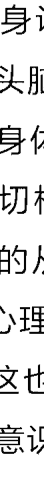

具身认知 | 本单元十大精彩...

## 本单元总结

第一节课

我们讲了一种医学上的疾病叫“盲视”，“盲人”的“盲”，“视觉”的“视”。盲视患者的视觉系统其实没有问题，他看得见，但他意识不到自己看得见。其实在认知上，我们都是某种程度上的“盲视”患者，因为在我们的认知当中，有相当大的一部分都是你自己意识不到的。那意识不到的这部分认知要怎么升级呢？后第三节课我们讲的就是这个问题。

第二节课

这些你意识不到的认知都来源于哪里？这就涉及到了我们第二节课的概念“具身认知”。具身认知的核心观点是：我们以为认知只跟头脑（mind）有关，实际上，认知跟我们的身体状况以及身体所处的时间和空间是密切相关的。所以，认知完全不是一个简单的从感性到理性的过程，你的身体状态、心理状态，以及环境，都在影响你的认知。这也就是我们对自己的大部分认知都没有意识的原因。

第三节课&第四节课

那如何改变这部分意识不到的认知呢？第三节课和第四节课我们都在说这个问题，一个方法是增加仪式感，另一个方法是改变身边的环境，比如从打扫房间做起。

因为物理环境和我们的心理环境是一个互相映射的关系，二者的变化都会引发对方的改变，假如你生活在一个脏乱混杂的地方，要想保持内心的井然有序就非常困难；相反，如果你身处一个庄严肃穆的教堂，你整个人也会变得严肃认真起来。所以在第四节课的末尾我们说，认知升级其实并没有那么复杂，不过就是从改变环境到改变认知结构，也就是古人说的，“格物、致知、诚意、正心、修身、齐家、治国、平天下”。

好，以上就是本单元的主要内容。以下是 我精选的同学留言，恭喜前三名同学，将获得我签名的书一本，这次送出的书是《极简欧洲史》，得到的工作人员会尽快把书寄给你，也希望其他同学再接再厉。我们下节课再见。

特别提醒：留言内容会默认公开，并同步到“知识城邦”中，中奖同学留个人信息时，一定记得将留言设置成隐私模式，确保个人信息安全。

——◆ 本单元十大精彩留言 ◆——

## 获奖留言

王的秋天

有句耳熟能详的话叫，“生活需要仪式感”，你如何对待生活，生活就会如何对待你。今天的内容让我想起一个极具隐喻的故事，“一朵鲜花改变一个乞丐的命运”。

一个卖花的女孩，把最后一只花赠给了街边的一个乞丐，这个乞丐从来没有想过，居然会有美女给自己送一朵玫瑰花。他做了一个决定，当天不行乞了，回家把花插进一个瓶子里。静静地欣赏中，他突然间觉得，这么漂亮的花怎么能随意插在这么脏的瓶子上，所以他决定把瓶子洗干净，然后就收拾桌子，收拾杂乱的房间，在镜子中看到衣衫褴褛、蓬头垢面的自己，又把自己从头到下整理了一番。当看到年轻帅气的自己，他决定不再当乞丐，第二天就去找工作，几年后他成了一个非常有成就的企业老板。

这个故事就是一个典型的，仪式感影响一个人的认知。

具身认知 3 | 仪式感是如何影响认知的？

JINGJING

隐喻型认知，我想到的例子是万维钢老师在解读《以大制胜》中，讲说服力时，书中有这样一个例子。

2015年美国总统竞选之际，共和党党内初选辩论，担任过惠普公司董事长兼CEO的女候选人卡尔·费奥瑞娜（Carly Fiorina），声情并茂地讲述了其中因破胎而导致的一起医芽事故的故事。这是真实的、充满细节的故事，有很强的画面感、充分调动了人们的感情，瞬间引起媒体和社交网络热烈关注的故事，却让她从辩论之前15%的支持率，在辩论之后迅速下降到了4%。

因为费奥瑞娜把自己的形象跟死亡的婴儿联系到了一起。人们每当想到费奥瑞娜，就会想到死亡婴儿的画面。人们不喜欢死亡婴儿，所以人们在潜意识里就会不喜欢你。

具身认知 3 | 仪式感是如何影响认知的？

王强

认知盲视有以下几种：

+   1.完全不可能“视”，比如肠道菌群对人的偏好、决策、情绪和行为的影响，不管怎么关注都不能自主调节，它反而还会调节激素与大脑，因为这与基因、孕育和出生环境有关；
+   2.可以“视”，但是绝大多数时候不会去视，比如走路的姿态。可能走路的姿态反映了这个人某种疾病和不良习惯，但是只要不太夸张，大家都“视而不见”，本人更是如此。之前网上很多模仿张嘉译走路，那就是因为他是明星，一般人的话就无视了；
+   3.可以“视”，也“视”到了，但是频率低，没有环境选择压，视到也只是觉得有这么回事，也就是过了，不会太在意，或者有借口压制，比如偶尔点烧烤，显然会增肥，但是又不是运动员，有什么关系呢？
+   4.可以“视”，有环境选择压也当回事。大多数人意识到的认知就在这一层。现在的问题主要是，环境选择压变化太快了，让人们不输地过度关注这一层，这对认知深度的开发严重有害，人们都漂裸地浮游在一些表面概念上，已经忘记深层的冰山了。

具身认知 1 | 我们都是认知上的“盲视”患者

## 其他精彩留言

胡振强

生活中“骑驴找马”的事我也少不了，但转念一想，我们可能是天生自带“盲视”基因，而这种基因并非就一定是坏的，在一些情况下反而会帮大忙。

这跟注意力的有关，人类的注意力永远都是有限的，就像薛兆丰老师总结的人类面临的四大基本约束之一：东西不够。试想一下，如果你是人类的祖先，刚从树上下 来，面对非洲大草原，你会关注什么？大部分人都在东西两望，一会儿看到了“风吹草低见牛羊”的盛宴，一会儿又看见了一望无垠的壮丽美景，总之什么都关注。而你，天生胆小，眼里只有危险，无处不在的危险，美食和美景你都看不见，你永远弓着身子，草木皆兵，随时准备逃之夭夭。这时候，一只猛兽出现，你和一群眼里只有危险的“胆小鬼”活了下来。

这就是“盲视”的优势：通过屏蔽一些不必要的干扰来取得一种专注力。人不是计算机

要的干扰来获得一种专注力。人不是计算机，脑容量只有那么大，如果没有“盲视”基因的帮忙，人一定会在泛滥的信息当中迷路。

当然了，“盲视”也并非总是好的，吴老师今天谈的大多是“盲视”的缺点，但我们的目标不是消灭“盲视”，而是要用好“盲视”。

具身认知 1 | 我们都是认知上的“盲视”患者

### 山村老狮

今天的课让我想到了试卷检查：上学时做完试卷要检查一遍，通常的做法是按照做题时的顺序再来一遍，但这样效果不是很好，有的题怎么检查也没错，其实就是自己有了思维定式，也就是“盲视”。后来采用了“验证法”检查——将计算结果代入到已知问题中，看能不能成立，这种方法相当于另辟蹊径，避免了定式思维带来的惯性，起了很好的作用。

具身认知 1 | 我们都是认知上的“盲视”患者

### 终身思考

关于身体体验改变认知，刘澜老师的领导力讲故事一节中讲到，更好的故事应该遵循“体验-感受-改变”模式。比如“海尔的张瑞敏砸冰箱”的故事，就是让其中的一些员工参与到体验当中，形成巨大震撼，从而影响了自己以往的认知，开始了真正的改革。

具身认知 2 | 认知是从感性到理性的过程吗？

### 超级流浪者

具身认知，我想到了之前听到的一个社会调查试验。试验者拿一杯热饮进入电梯，然后以接电话为理由让电梯里其他乘客帮忙拿一下手里的热饮。在出电梯后对帮忙拿热饮的人做一个关于时事的评论，然后把手里的热饮换成冷饮再做试验。通过多次试验，发现拿热饮的人给出的正面评价更多，拿冷饮的则表现得比较冷淡和负面。我觉得知识和认知是以信号的形式写入我们的大脑的，与此同时，我们身体接收到的其他信号也会同时记录进这个知识或认知的信号当中。

具身认知 2 | 认知是从感性到理性的过程吗？

### YZM

泰拳比赛之前选手们都会在擂台上跳一段舞，这种舞蹈有一个名字叫“泰拳拜师舞”，一开始我认为它就是一个简单的仪式，感谢一下自己的恩师。但是听了讲解以后才知道它还有一层别的意思。

通过拳舞可以调整心态，即定神。通过拳舞可以拉长肌肉和韧带，促进血液循环，即热身。通过拳舞可以展现自己精湛的拳艺，即示威。通过拳舞可以表现出对泰拳精髓的理解和领悟，即演技。现在看来很多具有仪式感的东西，其实内在隐藏着丰富的认知。

具身认知 3 | 仪式感是如何影响认知的？

### 清风徐来

一场说走就走的旅行，与朋友常有的聚会，与家人节日的团聚，我们的入团入党宣誓仪式，每年大大小小的节日活动等，这些无意或刻意营造的物理环境，都在或多或少影响和改变着我们的认知。

我所在的单位有一个做法，就是每个季度都要举行一次“务虚会”，要求大家打破地位界线，轻松自如地进行一次思想交流。可以谈工作、谈想法，也可以谈成绩、谈问题，即使是谈某方面的生活心得或学习收获也可以。这种方式，不仅仅是加强了团结，促进了和谐，更重要的，是通过环境的刻意营造，让大家都能真实地把内心想法表达出来。有时候，很多好的思路、创新的观点就是在这样的环境下被碰撞了出来。

我想这就是好的物理环境所带来的神奇功效。

具身认知 4 | 改变认知，从改变环境开始

### 农业青年

松浦弥太郎讲，当你感到迷茫的时候，选择更艰辛的那条路。避免路径依赖，就是要走出舒适区，选择和自己本能相反的做法。这样路才不会越走越窄。

问答 32 | 如何避免认知异化？

## 认知与供给1 | 世界给了我们提供了什么？

认知与供给1 | 世界给我们提。 ↓

第一模块
认知之源码
第三模块
“认知与供给”
第二模块
认知治理
第四模块
意义炼金术

在生活当中，我们有时候会发现特别聪明的会犯特别蠢的错误，这些聪明人的智力可能是顶尖的，但由于他没有意识到手段可能异化为目的，所以就犯了各种各样的错误。

### 经典案例1: 香皂包装生产线的改造

有位同学听了上个单元的课后，留言提到了一个很古老但很经典的例子——能够想到这个例子，说明这位同学真的理解了手段和目的之间的这种可能出现的异化关系。

这位同学提到的这个例子是关于联合利华公司引进的一条香皂包装生产线。任何设备都免不了出现问题，这条生产线的缺陷就是：有些盒子没有装上香皂就被装箱发货了，这可能导致对用户和企业的损害。所以，联合利华公司必须要解决这个问题。

按照正规公司的流程，要解决“空香皂盒装箱的问题”，就得设立一个项目小组，找最专业的人做专业的事，于是联合利华公司就请了一位自动化博士后来设计方案，力图把空香皂盒分拣出来。

这位博士后来拉起了十几个人的团队，综合采用了机械、微电子、自动化、X射线检测
成功解决了问题：只要有空盒子，这台设备就会火眼金睛地发出警报，工人收到信号，把空盒子拿走，就避免了装箱的可能。

有一家乡镇企业也在做香皂，也面临着和联合利华公司一样的生产平臺问题，但检测空盒子的设备是人家研发出来的，不可能给他们，即使卖，乡镇小企业也买不起，那...

这个乡镇企业找的小伙子没读多少书，但他明白第一性原理：重要的是最有效地解决问题，而不是找到最高级的方法和手段。于是他用了一个不花钱的方法轻松解决了这个生产线的“空香皂盒装箱的问题”：在流水线尽头放一个风力很大的电扇，空盒子一过就会被吹走了一问题就这么简单地解决了。

这个小伙子的聪明之处就是“反异化”，深谙第一性原理，没被手段所绊架，直达目的的。

像这样的案例或者故事有很多，这说明一个问题：大家非常关心第一性原理，担心我们的目标被手段所绑架。

### 经典案例2: 太空笔的故事

类似的例子还有美国宇航局开发太空笔的故事。这个故事的目标好像很清楚：如何制造出一种让宇航员在太空失重的情况下仍然能写字的笔。

我们的自来水笔、圆珠笔在失重的情况下是没办法写字的，那么，能在失重情况下让这些笔写出来确实是一个重大的科研难题。据说发了告示之后，收到了数万份宣称能解决这个问题方案，但美国宇航局的工作人员简单试了几个发现都不行，解决不了这个很 Hen的难题。

最后，他们收到了一个小学生的一封信，很简单，用铅笔写的，就一句话：为什么不用铅笔写呢？

这个故事虽然广为流传，但其实真假难辨，不过它倒是能说明一个问题：一个挑战出现的时候，我们的注意力很容易聚焦在手段上，并且越陷越深，最后把目的忘了，投入大量资源去解决手段——技术问题。

### 经典案例3: 比亚迪的微型电池干燥室

第三个例子是比亚迪的王传福做微型电池干燥室的故事。当年他揣着200万人民币去买三洋的设备，发现三洋开价是2500万，钱是怎么样都不够，怎么办法？

王传福看到了一个漏洞：他购买这个设备要达到的目的只是要给电池除除尘，使空气高度纯净，湿度和灰尘降到最低，否则电池会爆炸，出现质量事故，而三洋2500万的设备是一个更大的干燥和去尘设备。

所以回来以后，王传福就做了装有微型除尘设备的小玻璃箱，上面有两个孔，工人用两只手伸进去卡住，安装电池，就可以了。

由于王传福遵循了第一性原理，没被手段所缚架，所以比亚迪的电池成本不到三洋的三分之一，并且通过这个产品，把它的老师三洋逼到了市场的墙角。

### 经典案例总结

回顾这些案例和故事，我们越来越意识到，我们和我们认知对象之间的关系远不是我们所想象的那样简单。

在生活和工作中，如何反异化，如何避免手段像魔鬼一样，随时在侧边绑架我们，是每个人和组织都要遇到的问题。单纯的智力解决不了这个问题，就像德鲁克说的：最没效率的事情就是用最高的效率做一个偏离了目标的事情。

我们的世界越来越成为一个技术世界，我们不再依赖于自己朴素的感觉和判断，甚至连自己今天吃了多少东西、走了多少步都依赖于技术告诉我们。在这种情况下，我们极有可能被技术手段所绑架——好端端一个聪明人就可能因为技术、手段、设备的绑架而让自己成了一个傀儡。

### 世界和他人到底给我们提供了什么？

现在我们不妨问一个问题：面对这个世界的时候，世界和他人到底给我们提供了什么？

这个问题看起来简单，回答起来就不是那么容易了。

在汉语当中的“提供”，就是“提供”这两个字，但在英语中，是用五个词来表述五种不同样态的“提供”的：equip、furnish、supply、provide、afford。它们本意都是“提供”，但差别很大。我们这个单元就将围绕这个问题展开，下节课我们会讲到其中一个很关键的词。

现在我们先从《007》电影的詹姆斯·邦德身上去寻找前面问题的答案：世界到底给我们提供了什么。

詹姆斯·邦德有两样东西，一样让我特别羡慕，想要得到，另外一样让我特别佩服。

前一样是他的那块著名的手表，在不同场景下有意想不到功能。比如手表里有一根细细的钢丝，能让他从高楼上一下子跳下来，或者从一个低位爬到高处去。我特别羡慕这个万能手表，希望有朝一日能拥有warm一 块。

另外一样让我敬佩的是詹姆斯·邦德有一种能力：他在一个明摆着的死局里能发现某种机会或者人物与人物之间的微妙利害关系，并且利用这种关系冲突将敌人中的某人暂时变成朋友和帮手；还有，在危机被追杀的时候，他能随手捡起一个工具就成为一个利器。

有人说这是“扫地僧思维”。在一些武侠小说或者电影里，我们总能看见一个扫地僧的形象，他在高手林立的一群人当中是一个最不起眼的角色，只会扫地或者做饭。但他平时通过扫地就练了很深的功夫，在关键时刻，扫把也能成为他的绝活；或者他只会揉面团，切面，做刀削面等等，但在关键时刻，他用厨师的那套技艺也能杀出一条血路，最后完胜。

我们从詹姆斯·邦德或者扫地僧身上，就可以去寻找前面那个问题的答案：世界到底给我们提供了什么。一个人的高超能力是在明摆着、显而易见的场景和格局里发现一种深藏的可能性，在显而易见的工具或者手段上发现意想不到的功能，从而别开生面、异军突起。

那么，常人眼里根本不存在，但在高人眼里却能显现出来的特殊功能和效用到底是什么呢？我下节课跟你分享。

## 认知与供给2｜隐秘而关键的要素都在哪？

认知与供给2｜隐秘而关键的..

第一模块
认知源代码
第三模块
算法与第一性原理
“认知与供给”

第二模块
认知治理
第四模块
意义炼金术

### “有之以为利，无之以为用”

我们在前面的课程里讲到过原研哉“设计中的设计”，引用老子的话就是“有之以为利，无之以为用”。

在原研哉看来，设计师设计的千千万万种用品分为两类，一种是棍棒，一种是碗。棍棒可以衍生出刀剑，也就是你拿着它，可以很明确地去干什么事，你用的是它的“有”；还有一种用的是它的“无”，就像我们做一个碗，不是用碗的边沿，而是用碗里头的无和空，还有盖一所房子，不是用它的墙，而是用墙之间的空间。

所以，有用性实际分为两种：一种是利，一种是用；或者说一种是你拿着这种东西，目的非常明确地去干什么，一种是用它的无。

### 目标和手段的非一一对应性

1.盲道的渐新功用

盲道我们都知道，我们几乎没看到过盲人在盲道上行走，反而时不时看到一些低头一族的小孩在盲道上玩手机。为什么？因为他可以一边一直盯着手机玩，一边直接走到地铁口——在完全不理会周围人和物体的情况下做自己的事情。

2.藤壶的生态位

### Affordance: 生态认知学概念

我们在这个单元的第一节课里列举了英文中五个表示“提供”“供给”的单词：equip、furnish、supply、provide、afford。

活动 | 编写你的认知辞典

## 用户留言

### 认知与供给3 | 世界不缺少供给，缺少的是发现供给的眼睛

认知与供给3 | 世界不缺少供。

第一模块
认知 ziemlich code
第二模块
认知治理
第三模块
算法与第一性原理
“认知与供给”
第四模块
意义炼金术

### Affordance的含义

我们上节课讲到了一个英文单词——affordance，这个词目前也没有一个固定的汉语译法。当然，这其中一个很重要的原因是因为，affordance是一个哲学意味很浓的概念，任何一种译法都可能丢失概念当中的大量的含义。

一般遇到概念词汇的时候，从古到今的翻译家都喜欢用一种偷懒的方法——音译，让你知道有这么个词，但想要了解确切含义就得下功夫去体会。比如佛经里有大量的“般若”，我们通常翻译成“智慧”，这其实是不对的，丢失了很多“般若”本来的含义；还有“涅槃”，可以翻译成“寂灭”，但也丢失了它一个很重要的含义：在寂灭中重生。

所以我们在这个单元讲到这个词的时候，就直接用affordance。

提出affordance概念的美国心理学家吉布森用一个例子解释了这个词的含义：

### Affordance=生态位

Affordance的生成是一个协同性、互补性、共生性的利益联盟和利益场所共同体，在这个意义上，我们可以把它叫做“生态位”。

### Affordance到底是什么？

雕塑家罗丹说过“生活中不是缺少美，而是缺少发现美的眼睛”，我们可以套用一下：世界对我们并不缺少供给，缺少的是我们激活和发现这个供给的能力。

下面我用一个很通俗的甚至有点儿陈旧的例子来说明白“affordance到底是什么”：

### 认知与供给4 | 如何将可能性变为现实？

认知与供给4 | 如何将可能性。

第一模块
认知
源代码
第三模块
“认知与供给”
第二模块
认知治理
第四模块
算法与第一性原理
意义炼金术

### Affordance=互相赋能

上节课最后我们讲了一个故事，关于同一所大学毕业的两个年轻人同一家公司、同一个岗位上的不同遭遇。获得成功的第二个年轻人施第一最大的不同是：他在贴发票的时候，别开生面地发现了一种东西——数据的收集和挖掘。

这个年轻人从发票里看到了不同时间、地点，甚至一个月不同时期，老板会选择的会议谈和招待场所的差别。而且，为了获得更多数据，形成更好、更具有智能的判断，他不仅贴现在的发票，还把以前的发票和报销单都研究了一遍。这种看似无意的交流，让他清楚知道老板的体验和偏好，并且通过报销金额和老板的感受，知道了每个场所的性价比和体验的优劣。

后来，当老板让他安排事情的时候，他只需要知道来的人的数量和身份，就能妥帖地安排场所，老板不但满意还很惊喜——用我们课程的话说：他在同样的客观属性里发现了affordance。

吉布森在讲到affordance的时候，喜欢用pick up这个短语——“拾取”：

> Pick up既是一种结果——巧妙地获得了某种东西，同时也意味着一种能力、一系列客观的属性、资源和约束；

在不同的需求和认知能力下，外界呈现出来的可能性是不一样的，Pick up是尽可能地穷尽可能性，是发现、挖掘可能性的艺术。

也有人在解读affordance的时候，特别强调它与过去的知识和经验密切相关，是一种特定参照框架下行为者的认知和行为能力：物种和个体的竞争是参照框架和内在认知能力的竞争，凭借特定的参照框架，有人能够在别人完全看不到机会的地方发现重大机会。

Affordance具有明显的相对性和主观性，本质上是某种吻合性和契合性，就像英文中的火柴是match，本意是适配和契合，也就是火柴根和火柴盒上的砂纸之间形成一个适配，才能产生火光，有火柴根和光有砂纸都是不可能的。

在两个年轻人的故事里，展现他们面前的都是一张砂纸，但前一个人没有火柴根，后一个人有。

也可以说，Affordance是一种赋能，或者互相赋能：你将某种隐秘的可能性释放出来，是你对这个客观存在的一种赋能，与此同时，当它释放的时候，也在对你赋能。

### 设计界的affordance

Affordance理论在上世纪六七十年代就被提了出来，但在认知心理学界争议很大，不过在设计界，却被很多设计大师所认可。

比如著名设计师深泽直人就从affordance理论中获得了很大启发，他认为“艺术和心理学的起点都是相同的，都是看见平常看不见的真相”——这里包含着一种很重要的设计哲学：

好的设计是在隐藏和显露之间找到一个最好的分寸和度；最好的体验是一种能给你提供这种体验，同时又隐匿你提供动机服务的服务，类似于“无痕服务”——你接受了服务，但你往往感受不到服务的提供者。

一些顶级的酒店和商务场所都强调“无痕服务”，这里活跃或者隐藏着的是一群给你提供了最好的服务，但是，你看不见他们的人，这些人免去了你在被提供服务时候的压力。

我们不妨再举几个例子：

+   1. 台灯的碟式底座

每个台灯都有底座，否则它站不稳。深泽直人设计的一种台灯，底座看起来像一个碟子，可以放一些你经常要找而找不到的东西，比如钥匙和手表。

我们在生活中常常有这种感觉：永远找不到你的牙刷，但永远找不到你的钥匙。为什么？因为你的钥匙没有一个固定的地方放。谁也没有规定我们的钥匙该放在什么地方，所以我们往往随手放钥匙，但我们知道牙刷该在什么地方。

在深泽直人看来，台灯是一个你永远知道它在什么地方，不会乱跑的东西，如果你把随手放的钥匙和手表放在台灯的底座上的话，就永远免除了找钥匙和手表之苦。

+   2. 伞把中间的凹槽

这是深泽直人设计的雨伞，伞把的中间有一个凹槽。在你买这把雨伞的时候，你可能不知道这个凹槽有什么用，甚至都不会意识到它的存在，因为这个凹槽太不明显了。

如果你生活在日本或者中国南方这样经常下雨，并且雨总会不期而至的地方，你出门就会经常带伞。带着这种长柄伞，就会占用你的一只手，我们可以设想一下：你一只手拿着雨伞，另一只手提着一个袋子，这时候你的手机响了，你会自然地用一只手同时拿着雨伞和购物袋。随后问题来了，你发现这个购物袋在你手里一直往下滑——你要是用深泽直人的这把雨伞，你就能发现这个凹槽的用处。

不管是看上去像碟子的台灯底座，还是伞把上的凹槽，都是预埋在产品中的一种affordance：以一种低调的、不动声色、不张扬的方式提供某种功能，而这恰恰是affordance的本质——它存在，但又不张扬它的存在。

这基本上就是老子说的“无”的状态：有之以为利，无之以为用——这个场景不出现的时候，它如同不存在，一旦场景出现，你发现它随时在侧，时刻准备着。

### Affordance总结

这个单元我们围绕着affordance这个概念展开，Affordance告诉我们：世界供给我们的比我们感受到了它提供给我们的要多得多。

我们的认知既是对显而易见事物的认知，又是对显而不易见事物的认知。很多机会和竞争优势往往深藏在affordance之中。一个越能够将潜藏在affordance里的可能性转化为现实性，他的机会就会越多，竞争力就会越强。

Affordance不是本来就存在的，它是一种缘分，是客观属性和主观需求与能力相匹配的一种结果。我们应该有詹姆斯·希德和卡地增的思维：

当你觉得没有机会和出路的时候，要形成一种习惯，提醒自己“可能我是没有一种激活affordance的这种能力”。

一个优秀的产品或者一种优质的服务，其本身就包含着affordance的特点：不动声色，不张扬，预先尽可能地穷尽各种场景，然后再提供某种属性。当某种场景出现的时候，可能性立即转化为现实性，这也是产品设计的最高境界。

## 问答33｜整齐好，还是混乱好？

问答33｜整齐好，还是混乱好…

## 异化与第一性原理

还有同学在问：我们都知道异化不好，有没有好的异化呢？

这个问题我以前回答过，今天我们从另外一个角度来讲讲异化与第一性原理的关系。

异化是手段对目的的反叛，或者手段对目的的暴乱。你为了达到一个目的，使用了某种手段，而手段具有某种自主性，会谋求自身的独立，以至于最后让我们把目的忘了，只专注于手段——在这个意义上，异化肯定是不好的。

但手段对目的的反叛其实是一个常态：手段和目的是我们定义的，但在很多场景下，一味用目的来压制手段也可能导致荒谬事情的发生。我们说反对异化，是为了避免做“郄人买履”那样的事情。与此同时，我们也要意识到，手段具有某种独立的进化路径，在有些时候会带来好的结果。

不过这里有一个前提：第一性原理。很多商业模式的创新从某个角度看就是异化的结果。

## 简单有序性与复杂有序性

@ 以武治心

《混乱》这本书认为，人们总是喜欢整齐，总觉得有序比混乱好，总是从有序中获得好处，却忽略了无序带给我们的益处。作者认为，有序整齐意味着趋僵硬、脆弱和无创意。这本书揭示了效应能力、应变能力和创造力，比以往更大的价值，这些价值与无序有着很多内在的联系，甚至可以说正是来源于无序和混乱。老师您在课程里说，改变认知从改变环境开始，使周围的物理环境条理化、有序化，改变物理世界会影响我们的心理世界和认知结构。但蒂姆·哈福德却认为，整洁的背后是循规蹈矩，是人的机械化，混乱的背后是自由独立，是让人更像人。这两种观点似乎矛盾，让我感到困惑，请老师解惑。

我讲到过通过整理书桌让自己摆脱混乱无序的状态，这是让你在混乱无序中体会虚幻的认知感和获得感，这对认知来说是有效的。这也就是我们反复强调客观化/客体化的原因。我们是在讲具身认知的前提下举了这个例子。我们的身体状况、行为，包括周围环境，对我们的认知有着润物细无声的巨大影响。这不是说认知的过程是从混乱混沌到简单有序，作为一个论据，它支持的是具身认知这个论点，而认知是要混乱还是要有序，是另外一个层面的问题。

菲茨杰拉德说，“最高明的头脑是允许自己的头脑当中同时运行两套互碍，而且互不相停”。混乱和有序看上去很矛盾，其实说的两件事，或者是一件事的两个方面。

我 是认知的过程就是将很多混乱无序的数据、信息、概念连成一条线，就像你在看云的时候会从混乱的云朵里发现某个动物一样，这是认知的一个特点。在这个意义上说，认知就是从混沌到有序的过程。这种有序性是以牺牲丰富性和多样性为前提的。

用户留言

提交留言可与专栏作者互动

## 认知与供给 | 本单元十大精彩留言

认知与供给 | 本单元十大精彩...

## 本单元总结

这一单元其实我们都在围绕着一个关键词展开，那就是affordance。这个词没有标准的译法，而且也很难有一个词能准确概括它的含义，所以我们整个单元都在用affordance这个词本身来说明。

第一节课

我们提出了一个问题，那就是这个世界究竟给我们提供了什么。通过香皂包生产线、比亚迪电池等例子我们发现，表面看上去这个世界提供给我们的就是客观存在的，但实际上，对每个人来说这个供给可能都不一样。

世界提供给你的东西跟你有关——取决于你跟世界的关系或缘分。

第二节课~第四节课

这三节课我们都在说，affordance是什么，以及它和我们的认知有什么关系。

什么是affordance？它是afford的名词形式，所以它是一种供给，但它又不是我们通常所说的供给，而是一种模糊、抽象、尚待发现、尚待激活的可能性。

## 获奖留言

Sid

我自己有一段非常相似的经历，刚进公司时是做生产计划的，但这个岗位已经换了很多个人了，我就认真地研究了他们的计划，发现计划的指导意义不大，基本就是需求多时多生产，需求少时少生产。我站在公司的角度发现，如果提高效率，可以减少配件和材料对公司的现金占用。而计划可以推动效率。于是我对整个生产线做了价值流分析，瓶颈工序分析，加强了瓶颈工序的计划准确性，减少非瓶颈工序的机台数量。

## 其他精彩留言

特别提醒：留言内容会默认公开，并同步到"知识城邦"中，中奖同学留言个人信息时，一定记得将留言设置为隐私模式，确保个人信息安全。

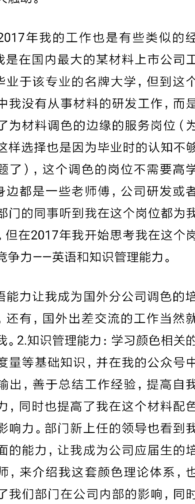

里，如果是某个部位出现问题，就不要用整体的办法来解决问题。

以前科技不发达的时候，为了确认某些病症，就给病人开一个很大的刀口。虽然病治好了，但是给病人带来的痛苦实在是太大了。而现在的手 术都是微创手术，只要在身体里面开一个很小的口，就可以完成手术，这不但可以减少手术的风险，更能让病人减少很多的痛苦。从这就可以看出关键是解决的问题，不是盲目、过度地使用先进技术，造成不必要的浪费。

### 认知与供给1 | 世界给我们提供了什么？

### Albert

有一次，大家想知道在没有砝码的情况下天平是否准确，但是都没有办法。其中一个同事拿出了自己的手机，取下手机套和电话卡，称取重量后再在网上查手机的重量，手机在这个时候就变成了一个标准砝码。

### 认知与供给2 | 隐秘而关键的要素都在哪？

### 刘伟佳

记得《罗辑思维》一期节目中讲过一句话，大意就是一个东西一旦被创造出来，之后这个东西怎么活动、怎么被使用，和被创造的初衷一点关系都没有，也不受创造者的任何限制。任何一个东西都是一个大集合，最初的目的是大集合中的一个小集合，其他任何可能的用途就是affordance。

### 认知与供给2 | 隐秘而关键的要素都在哪？

### 华

听到今天的课，有点对前面的课豁然开朗的感觉。举个头脑中蹦出来的例子请大家看看合不合适。

例一，路口的石墩，对行人没有什么用，对开车的人是阻挡开车上去的标记，对走累的人是可以稍微休息的凳子。

例二，举我以前做银行业务的例子，信用卡对银行人来说是任务，对大多数工薪阶层来说是结算，对一些人来说是资金融通的工具和盈利方式，对有钱人来说是身份的象征，对商家来说是减少客户思考的时间，加快买单的工具。还有一点，银行为了更快更方便准确地结算，加大了科技基础的投入，而加上电信行业4G的快速传输，就诞生了移动支付，反过来减少了现金，也减少了对银行柜面的要求。

### 认知与供给3 | 世界不缺少供给，缺少的是发现供给的眼睛

### 麦口余飞

Affordance是两种事物间的内在联系，平 时不显著，只有在触发的那一瞬间才会凸 显出来。看文中的贴发票的故事，让我想 到了我的妻子和我说过的一则她的经历。

她从事财务工作，刚进公司那会儿，她是 个新人，原本岗位上的同事又已经离开， 所以没有做相互的工作交接，放在她的面 前的许多东西，由于历史原因不知其来龙 去脉，所以那时她只能回看历史凭证，把 当初前人做账的方法或称之为手法了解透 彻后，当下次老板提出想要一份报告时， 她就能复原相同的数据，从而让老板高看 她一眼。正如从贴发票中找到老板的喜好 一样，从以前的凭证中也能发现有用的数 据，所以Affordance是平时联系不显著， 只有在被触发的那刻才会显现。

### 认知与供给4 | 如何将可能性变为现实？

### 刘焕荣

听了今天的课想到深泽直人设计的电饭 煲，造型非常柔和，白色，也很好看，并且 贯彻了无印良品“没有logo”的理念。

这个电饭煲最大的亮点在于它的盖子上面 的一个小的支架，这里可以放一个饭勺。 后来深泽直人解释说，他会反复观察“行为 中的不连续”——就像这个盛饭的过程，人 们一般都是左手拿着碗，右手拿着饭勺， 然后打开电饭煲的盖子，把米饭盛入碗 里，再用拿着饭勺的右手关上盖子。由于 饭勺上会有米粒，而日本的主妇往往又不 想随便放在桌子上弄脏桌面，这时候整个 盛饭的连续行为就停顿了。所以观察到这 一点之后，深泽直人就把电饭煲的盖子上 加了个小支架——而任何人看到这个设计 都会会心一笑，然后把饭勺放上去。这又 是affordance的一个经典。

### 认知与供给4 | 如何将可能性变为现实？

## 加工与搜索1 | 认知的过程就是找到线索的过程

加工与搜索1 | 认知的过程就。

第一模块
认知的源代码
第二模块
认知治理
第三模块
算法与第一性原理
“加工与搜索”
第四模块
意义铸金术

### 阿里阿德涅的线团

这节课我们先来复习两个古希腊神话故事：

+   1. 珀耳修斯战胜蛇发女怪美杜莎

珀耳修斯（Perseus）用他的剑刺死了美杜莎（Medusa），但让他在这一场决策中真正胜出的却是他的盾牌——珀耳修斯的盾牌不是普通的盾牌，而是磨得像镜子一样光光的。他凭借着面特殊镜子，避免了跟美杜莎目光对视被石化的命运。通过信息和虚拟的手段扬长避短，最终获得了胜利。

珀耳修斯的故事是一个虚实相生，有无相成，线上和线下联动战胜对手的故事。

+   2. 忒修斯战胜牛头怪

忒修斯（Theseus）受命去克里特岛上杀牛头怪。用利剑杀死牛头怪不难，但他还要面对一个巨大的挑战：牛头怪在迷宫里，当他杀了牛头怪之后，自己就会被困在迷宫里永远走不出来。

忒修斯执行任务之前碰到了一个好心的姑娘阿里阿德涅（Ariadne），并且送给了他两样东西：一把利剑和一个线团。

忒修斯在进入迷宫之前，先把线系在门口的柱子上，然后带着线团和利剑才进到迷宫里，顺利地杀死了牛头怪。最后，他沿着线团，成功从迷宫里走了出来。

珀耳修斯和阿里阿德涅的线团都告诉我们：在完成一个任务的时候，那些看似辅助性、帮助性的工具和手段，往往又是决定性的。这个道理对于我们提升自己的认知同样重要。

在遇到一个问题的时候，我们希望凭借我们高度优化的认知就可以快刀斩乱麻地解决问题，事实上，问题不是那么简单。如果你只盯着这个任务和手中的所谓“利器”的话，并不能真正解决问题，或者在解决问题之后会发现，你身陷到一种更大的麻烦甚至是灭顶之灾当中。

### 线索和迷宫

要发现事实的真相，我们需要寻找一些线索，这个线索就是阿里阿德涅的线团，它能够帮助你在众多可能的选择当中不迷路。

“迷宫”是最不缺少路径的，它给你提供了无限多的路径。而正因为它有无限多的路径，所以每一路由径都可能是一个死胡同——如果没有阿里阿德涅的线团，丰富的资源和可能性都会等于零。

同样的道理也适合于我们的认知。刚开始使用互联网的时候，我们就知道一个神奇的东西——搜索引擎。它的神奇在于给予我们提供了某种类似于阿里阿德涅线团的东西。

### 认知就是要找到线索

我们现在不妨给认知下一个临时定义：认知是在一个好像包含着无数路径，其实都是死胡同和无限循环的伪路径中，给你提供一个真正有效的路径和线索，让你找到真相和出路。

认知包含着一种很容易被我们忽略的要素：搜索能力。

用户留言

提交留言可与专栏作者互动

## 加工与搜索2 | 我们是如何给自己的认知

[PAGE 64 OCR 文本存在大规模重复错误，原内容疑似为“我们是如何给自己的认知”主题的正文，因扫描/识别重复导致同一短语“我们是如何给自己的认知22 1”连续出现数千次，原文信息无法有效恢复，以下保留标题及图片链接，重复段落已做去重标记。]

## 加工与搜索2 | 我们是如何给自己的认知22 1 我们是如何给自己的认知22 1 我们是如何给自己的认知22 1

## 加工与搜索3 | 学习的目的不是存储

加工与搜索3 | 学习的目的不是存储

第一模块
第二模块
认知源代码
认知治理
第三模块
第四模块
算法与第一性原理
意义炼金术
“加工与搜索”

上节课我们讲到，乱糟糟的抽屉和房子是我们无意中给自己设下的一个迷宫，这也是一种特殊的合成谬误：每个局部行为都有它的合理性，但最终的结果是事与愿违。这其实也是一种“管窥效应”：追求局部的清晰而陷入整体的混沌。

### 给自己下套的人

#### 1. 身边的“大忙人”

为了更好地理解这一点，你可以回忆一下过去的学习、工作或者生活当中，是不是会遇到这样一种人：既不是学渣，也不是学霸，但他的特征好像又包含着这两者的某些特点，比如行色匆匆，能感觉到他有一种强烈的紧迫感，会认为上厕所、刷牙、洗澡……所有这些必不可少的行为都是在浪费时间。

这类人总觉得时间不够，要抓住一切可能的机会让自己多学一点或者多干一些事，但他们往往整体效率极差，或者没有达到他们预期的效果，这让他们更加有紧迫感，更焦虑和更行色匆匆。

#### 2. 凯西的故事

《稀缺》这本书里有这样一个案例：一个叫凯西的女生立志要报考医学院做医生。在美国学医很热门，竞争也非常激烈，所以凯西总是最大限度地压缩自己的时间，让自己陷入到一种极度忙碌的状态，甚至刷牙、洗脸、上厕所都让她产生一种愧疚。她习惯吃快餐，脏衣服随手乱扔，认为与别人的交流都是浪费时间。

凯西所有的时间都在做一件事：如何尽可能地争取更多时间。但不幸的是，或者说“出人意料又在意料当中”的是，凯西一直在浪费时间：她会花很多时间去找东西，这些东西又找不到，她会对自己发火，认为“百事缠身，诸事不顺”。

紧迫感导致的“管窥效应”使凯西忽略了很多事情，比如忘记还信用卡，忘记交电费、电话费，等等，而这些忘记的事情又会给她造成无穷无尽的麻烦。她的日程安排得过于紧凑，一个环节出岔子以后造成的麻烦就越大，以至于她的神经几乎都要崩溃的地步。

更糟糕的是，凯西不但生活中丢三落四，做实验的时候也不停出错——谁都知道她很想变得优秀，但所有的人都觉得她办事拖沓、人际关系紧张、学习成绩平庸，而且，身体状况还越来越差，她年纪轻轻竟然得了糖尿病。

凯西的案例非常生动地体现了一个人是如何给自己下套捆扎，如何让自己不自知地陷入到永远走不出的迷宫，如何通过不断努力、自我挫败来证明自己永远不成功。可想而知，凯西的认知能力和她的身体状况一样每况愈下。

### 学习不是认知囤积

那么，问题到底出在哪儿？凯西为什么会陷入到这种状况呢？

我们注意到，凯西的所有行为有个特点——“活在当下”，别的我都不管，不停摄取就够了，其它的都是在浪费时间。在凯西身上有一种极其强烈的时间紧迫感，让她形成“管窥视野”：在每一个当下考虑的是获取的东西多不多，唯恐丢失了什么东西。

我们讲过，认知是一个产品，产品要有流程。你想获得好的认知，除了摄取初级的原材料，更重要的是加工体系的完善，而不是简单囤积式地摄入大量东西。

我们讲不停标记、收集、整理各种各样的资料是必要条件，但不是充分条件，因为认知的形成最重要的是加工。要形成真正的认知就要建立一套认知的加工体系，然后用你摄入的大量材料，按照确定的流程去完成这个加工，最终形成认知产品——从这个角度我们就能比较清晰地看出凯西的问题出在哪儿了。

再回到我们自己：有时候我们去听一场演讲，或者在网上上一门课的时候，你会发现，有些演讲都 really 很精彩，听了以后很激动，但要问你“这场演讲说了什么、精彩在哪里”的时候，你发现自己说不出几个词来；可能听了两个小时的演讲，经过好几次的脑洞大开和颅内高潮，但问你“到底知道和得到些什么东西”的时候，你说出的东西非常少。这时候我们能感受到，我们的大脑真的有应用题里的那个古老的水池，有一个进水管和一个排水管。

如果我们的大脑是一个蓄水池的话，最终能不能蓄到水、蓄到多少水、蓄满水需要多少时间，都取决于进水管和排水管之间的流量差。但是，我们的大脑不是一个蓄水池。

如果说学习是将输入的知识存储在大脑当中，那大脑跟蓄水池最大的不同是：它不是直接存储输入来的东西。

与其说大脑是蓄水池，不如说它像我们的身体：通过摄取食物来进行输入，但它不是一个食品仓库，而是对食品进行深度加工，并且将能量转换成身体的各种机能的过程。

最重要的是：学习不是为了存储，不是简单的认知囤积，而是在遇到复杂事情的时候，快速准确地调动我们已有的认知资源，应对眼前的事态和处境。

我们认知的过程，除了吸纳初级知识之外，至少还有两个功能：复杂的加工体系，复杂、准确又简洁的搜索体系——通过快速调动已有的认知储备，实现网络化连接，形成认知增量来应对眼前的事态和处境。

换句话说，如何找到认知的“阿里阿德涅线团”，我下节课会和你分享认知的两个系统是如何运作的，以及如何才能形成快速、准确的搜索和调用系统。

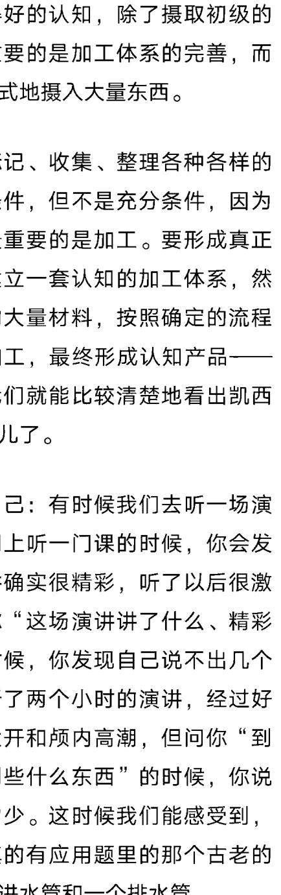

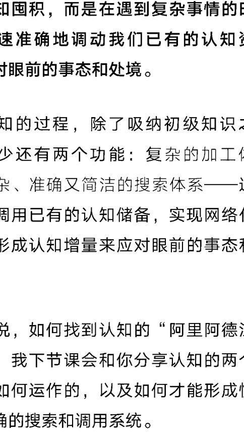

## 加工与搜索4 | 快速提高认知效率的两大系统

加工与搜索4 | 快速提高认知效率的两大系统

第一模块
认知的源代码
第二模块
认知治理
第三模块
算法与第一性原理
“加工与搜索”
第四模块
意义炼金术

我们上节课提到了一个场景：在听了一场2个小时的激动人心的演讲之后，你能说出来和别人分享的内容却连两分钟都不到。

这是一场考试，你在这场考试里可能得分很低，但考试本身也是学习的一部分。你获得的认知和你以为你获得的认知（作为初级认知输入到你头脑当中的认知）之间存在巨大反差，当你意识到这一点的时侯，你会有一本能反应：重新寻找“我到底丢失了哪些东西”。

这有点儿像在屋子里找东西：东西都在你的屋子里，但你能找到的特别少。

### 成为写作高手：“初级输入+考试”的循环

我们以前讲过富兰克林用一年时间成为写作高手的故事。他是怎么做到的？采取“初级输入+考试”的方式。

富兰克林看完一篇文章以后会重写这篇文章——这也是一次考试，通过这个考试结果，他会发现反差：

初级输入的东西~他得到的东西~他丢掉的东西（虽然已经进到头脑中，但没办法快速准确搜索到）

记忆有两种：memory（记住的）和recall（记住了，并且能回忆起来）。比如你见过一个人，一种可能是永远记住了他，还有一种是你见过他，但再也没想起他来，直到几年以后碰到，经过提醒才记起来你见过他——你之所以能记起来见过他，证明他不是完全从你头脑中消失了，只不过一直处于头脑中的黑暗区域。如果再隔十年不见，隐藏在黑暗区域的那个输入物可能会逐渐消失。

在这点上，我们的头脑的确是有个排水管的。

回到富兰克林的故事。他在每次重写之后，又回去读这篇文章的时候，就能发现很多自己已经输入但潜滋遗忘的东西。接下来再次重写，这些曾经隐藏在大脑黑暗处的东西就显现了出来——当然，还会有很多继续留在黑暗当中。

富兰克林通过反复六七次这样的重写以后，这些初级输入的东西，通过不断再次输入，以及最重要的加工工程，就建立起了一个“重写”的框架。需要注意的是，重写不是默写，是在看了这篇文章以后力图跟作者实现真正同步的状态，所以，“重写”是一个在自己头脑当中建立框架的过程。

### 分类旅行包=搜索引擎+加工体系

还有一个例子，是我去年收到一个使用频率不高但特别有用的礼物：一个旅行包。这个大旅行包里有四个小包，每一个小包里又包含着四个更小一点儿的包。就像一个集合，一个大集合包含四个子集，每个子集又包含四个子集。

这款旅行包是专门给那些惰性很大的人在旅途上用的，让你能快速找到东西。比如你要找牙刷，那你就可以在跟洗漱有关的那个包里的一号小包里找。这里还有一个过程：用完以后，你要把它归位到相应的小包里。

在你出门的时候，你要从家里众多的既有的初级材料中，把你要带的东西找出来，放在相应位置。而你最初装旅行包的过程，其实也是一个加工过程：你拥有的这些东西是一个初级输入，你将初级输入各归其位，通过一套坐标系或者一套定位系统准确地把它们放置在该在的位置，这就是加工。

旅行中很容易丢东西，你用这个旅行包就很容易知道什么东西丢了。比如这个包里的第二号中等包的三号小包里放着哪几样东西是很容易记住的，你最后收拾的时候发现少了一件，就很快能知道是什么东西不见了。

这个旅行包是一个搜索引擎，也是一套加工体系。而我们的抽屉、储物柜，甚至房子之所以成为了我们的迷宫——明知道东西在里面却永远找不到——原因就在于它们从没实现过这两个功能：

- 基于一套分类规则的搜索引擎；
- 加工体系：任何一个东西进到你的屋子里，不管是钥匙还是新买的什么，买进来只是初级输入，都需要放在它该放的位置。

### “身手钥钱” = （搜索+检测+加工）体系

当然，我们的认知不像是收纳柜、旅行包、抽屉，是一个预置工具。我们要对不断输入的知识进行加工，量身定制到该放的地方。

我们每个人的认知体系（加工认知初级材料的方式）都不一样，如果用家具比喻的话，那它就是定制家具，而不是随便就能从商场里买来的那种统一销售的家具。

如果没有这一套加工系统，一味把初级材料往自己的头脑中放，它们就会隐藏在黑暗当中，时间久了就会消失。从黑暗到光明，其实是把初级材料放进了特定的格子里，这是一个加工的过程，也是一个打包的过程。

我以前讲过，我原来出门老爱忘东西，后来一个朋友教给我四个字：“身手钥钱”——身份证、手机、钥匙、钱包，这四个要素组成了一个包，我只要带着这个包，而且知道这个包里头有四个要素就行了，缺哪一个我非常清楚。“身手钥钱”既是一个搜索体系，也是一个检测体系，同时也是一个加工体系。

我知道了“身手钥钱”这四个字以后，智商并没有提高，只不过是建立了一个加工和检索的搜索体系，由此我的认知效率大大提高。

## 总结

最后总结一下：

- 1. 认知的低效率很可能就是由于我们只知道进行初级输入，而没有建立一套不断完善和细化的加工和搜索体系，以至于输入进来以后就消失了，或者我们所得到的和我们所输入的东西之间差特别大。
- 2. 认知要尽可能地缩小这个反差。而缩小这个反差最有效的方式就是建立一个加工体系和搜索体系。
- 3. 当你做到这一点，在一个场景出现的时候就会快速准确地调用已有的认知——这绝对不是一个机械的过程。存储在不同框架里的认知之间会形成一种隐秘的连接和化合作用，这个过程我们往往没有意识到。
- 4. 所谓“灵感”就是大量好像孤立、不关联的东西在瞬间的聚合。而能够形成这种聚合的前提是，它已经进入并存储在你的大脑当中。如果不放在特定体系，它就会消失。
- 5. 随着存储量越来越大，存储、加工以及搜索的体系越来越发达，头脑会变成一个快速的智能反应工具，这是我们认知升级绕不开的路径。

## 问答34 | 如何快速在职场中找到自己的生态位？

### Affordance和生态位

@ 仕仲功悟

寄生虫和宿主之间的关系是否也可以用affordance这个词来描述？

我们说的“宿主”一般也是一种生物，但从另外一个角度看，大船的确是藤壶的宿主。

值得提醒的是，严格意义上的宿主和寄生虫之间的关系是在长期演化过程中形成的非常稳定明确的利益共联。在这个利益共联中，寄生虫是受益的一方，宿主往往是受伤害的一方。

从更广的意义上说，生态位是一个物种跟环境或者跟另外的物种之间形成的一种利益共同体，而affordance的特点是它的模糊性、不稳定性、不确定性和复杂性。

### 职场是属于个人的生态位

@ Henry舒楷

我觉得对一个人来说，在特定环境快速找到适合自己的生态位的能力很重要，但如何判断和找到自己的生态位很难，尤其是对于初入职场的人来说。有没有方法能够帮助职场新人快速找到自己的生态位？

### 人变得功利是不可阻挡的趋势

@ La∞布海

### Affordance不渡无缘之人

@ 鑫燕

用户留言

提交留言可与专栏作者互动

## 加工与搜索 | 本单元十大精彩留言

加工与搜索 | 本单元十大精彩留言

## 本单元总结

#### 第一节课

这节课咱们的关键词是“线索和迷宫”。认知能力中有的一项能力很重要，但很容易被我们忽略，那就是搜索能力。认知就是要找到线索，但是当可能有很多的时候，找到线索就很难，所以要想提高搜索能力，就要降低可能性、扫除障碍，这样才能快速准确地找到我们需要的线索。

#### 第二节课

这节课我们的关键词叫“管道效应”。眼前的混乱导致我们的搜索效率大大降低，甚至到零。而这个结果恰恰是由无数个为了节省时间和精力的行为导致的。这种现象就是我们所说的“管道效应”。所以说，追求局部的有效性可能是在给自己挖坑，这也是我们需要避免的。

#### 第三节课

我们通过凯西的故事讲了一个道理，也希望你能一直记住，那就是：学习不是为了存储，不是简单的认知囤积，而是在遇到复杂事情的时候，快速准确地调动我们已有的认知资源，应对眼前的事态和处境。所以我们的认知中需要具备的是一套搜索系统和一套加工系统。

#### 第四节课

我们讲了如何具备搜索系统和加工系统。富兰克林的“初级输入+考试”的方法很有成效，除此之外，我们还可以借助外部的工具，比如我以前讲过的“身手钥匙”，还有我在这节课里举的收纳包的例子，都给我们提供了建立系统的思路。

好，以上就是本单元的主要内容。以下是 我精选的同学留言，恭喜前三名同学，将获得我签名的书一本，这次送出的书是《极简欧洲史》，得到的工作人员会尽快把书寄给你，也希望其他同学再接再厉。我们下节课再见。

特别提醒：留言内容会默认公开，并同步到“知识城邦”中，中奖同学留个人信息时，一定记得将留言设置成隐私模式，确保个人信息安全。

## —— 本单元十大精彩留言 ——

## 获奖留言

#### 正好

有一期罗辑思维，罗胖提了一个问题，我们现在互联网技术已经如此发达了，我们为什么还要背唐诗、背数学公式呢？为什么不在需要的时候，直接上网搜索？

我想，今天的课程可以给这个问题一个答案，认知的过程不仅仅是掌握海量知识，它更是一个搜索、筛选、提取自己需要的知识，形成智能的过程。海量的知识并没有生产力，通过你的搜索，整理出能够解决问题的知识才有生产力。因此，互联网有海量知识并不可贵，你能从中找出自己需要的才可贵。然而，我们如何才能找到自己需要的知识呢？我们需要线索，这正是我们背唐诗、背数学公式的理由，恰恰是这一点点背诵的劳力，给了我们在知识海洋荧取所需的线索。

当今时代，我们缺的是信息或者知识吗？并不是。真相恰恰是信息大爆炸，信息产生的速度远远超越我们吸收的速度，在此背景下，我们缺少的是强劲的搜索能力，缺少的正是走出知识迷宫的一个小小的线团啊。

加工与搜索 1 | 认知的过程就是找到线索的过程

#### 疯狂成长

巴菲特和盖茨都认为自己的成功的秘籍是专注。专注让分母的数值小，认知能力变大。

巴菲特曾告诉他的飞行员，让他把自己认为重要的二十件事写出来，然后分出最重要的五件事。飞行员以为这是让他把最重要的五件事做好，然后在业余时间去做另外的十五件事。巴菲特听完后说道：不，你搞错了。那另外的十五件事，不是你应该在闲暇时间慢慢完成的事，而是你应该尽全力避免去做的事——你应该像躲避瘟疫一样躲避它们，不去花费任何的时间和注意力在它们上面。

比起有所为，有所不为更重要。专注才能产生有力量的认知。

加工与搜索 1 | 认知的过程就是找到线索的过程

#### 李岳洋

关于管道效应很典型的例子：除了牛奶是白色的，还有什么是白色的？你的回答可能都不会超过10种。如果想降低问题的难度，换另一种问法：什么东西是白色的？你可能大脑中会有很多维度的东西，月光、浪花、象牙等等。

是什么原因导致的呢？第一种提问方式，限定词“牛奶”就会抑制你的思想。查理·芒格说过一句话，“当你手里握一把锤子，看什么都是钉子”。对一个事物过度关注，会抑制竞争意识。就像同眼睛透过一根管子去看待东西。

加工与搜索 2 | 我们是如何给自己的认知捣乱的

## 其他精彩留言

#### 韩同志

仔细想想，我们的人生不就正像一个迷宫吗？表面看，你好象有无穷多的路径，无穷多的选择。可恰恰是因为这无穷多的路径，很可能走到头才知道都是死胡同，而你只有走到正确的路上，才有可能走出迷宫。走出迷宫需要什么？忒修斯依靠的是线图。我们能依靠什么？我认为 是终身学习，如果没有它，千万条路径，很可能最终都是零。

加工与搜索 1 | 认知的过程就是找到线索的过程

#### 杨晗

“圣雄”甘地为了帮助印度人民摆脱殖民统治、争取独立这一目标，舍弃了很多与这个目标无关的事情，衣着是否华贵与实现这个目标关系不大，所以他只穿手织的土布衣服；饮食是否丰盛与实现这个目标关系不大，所以他简落食35年；世界上每天有那么多新闻，但绝大多数与他的目标无关，只会给生活带来不必要的混乱，所以他曾终3年不看报纸；说话太多就会占用宝贵的思考时间，所以他每周必有一天沉默不语。他将时间和精力都集中用来实现那一个目标。

精要主义：我们需要降低自己太多的可能性，太多的选择意味着你丢失了选择权。我们需要选择自己需要做的，舍弃那些无关紧要的，花时间聚焦，降低分母，才能快速让认知升级。

加工与搜索1 | 认知的过程就是找到线索的过程

#### 江湖无声

《知识的错觉》点醒我们一个基本事实：我们以为自己了解世间万事万物，其实是个错觉，事实上我们的脑袋里存储的知识微不足道。我们以为我们掌握了很多信息，当仔细回想梳理，发现我们并没有掌握多少信息，我们掌握的其实是信息与

掌握多少信息，我们掌握的其实是信息与信息之间的关系，信息的收集是熵增，信息与信息之间的关系是熵减。

所以学习的方式不应该是信息的积累和记忆，而应该是建立信息与信息之间的关系。这也是认知课程之前讲到的，要建立从数据到信息到知识再到智慧的金字塔。数据的量非常大，信息的量要小一些；数据是非指向性、非结构性的，信息是有指向性和结构性的，信息就是“消除了的不确定性”，那么认知就是构建的确定性，是信息间的确定性关系。

加工与搜索2 | 我们是如何给自己的认知捣乱的

#### 懒蚂蚁

明白一个道理，一定要延伸去想，这个道理还能用到什么地方。一件事情结束后，要复盘，我做对了的成功的关键点是什么；做错了的失败点是什么，下次怎么避免。遇到一时难以解决的问题，试着跳出眼前的局面，换一个角度去看，也就是钥匙是不是在别处？经常去复盘，不断整理梳理，首先要在头脑中形成一个大致的思维框架，或者说是有条理的快捷方式；框架基本稳固后，千万不能固化，还要逐步去调试完善。

加工与搜索3 | 学习的目的不是存储

#### gyl5836536987020

学习不是为了存储，不是简单的认知囤积，而是在遇到复杂事情的时候，快速准确地调动我们已有的认知资源，应对眼前的事态和处境。有个案例：

一位护士在医院里路过一个保温箱，看了一眼睡在里面的婴儿，感觉哪里不对劲儿，就去找主治医生。医生给婴儿做了一系列的检查，发现这个孩子已经感染了化脓性细菌，再晚一会儿注射抗生素，可能就会死亡。

#### 匠心

#### 金戈铁马

加工与搜索4 | 快速提高认知效率的两大系统

用户留言

提交留言可与专栏作者互动

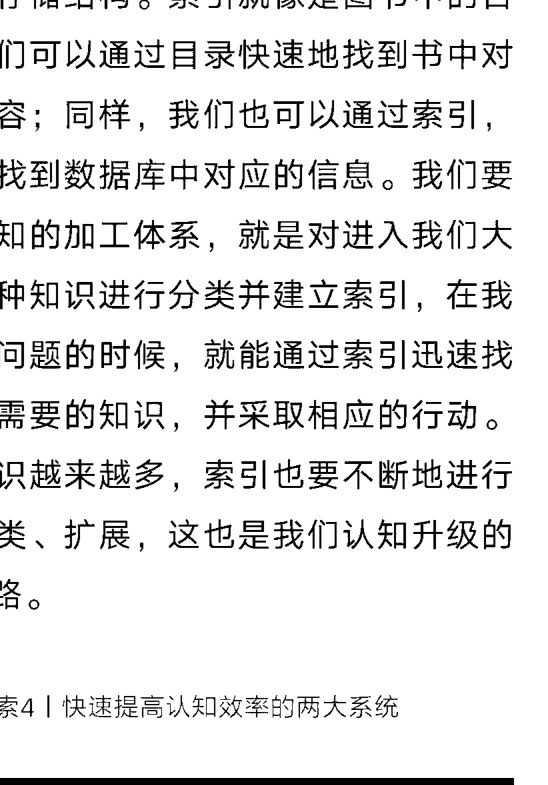

## 认知产能1 | 在学习中，输入和输出是什么关系？

认知产能1 | 在学习中，输入...

第一模块 认知源代码 第二模块 认知治理 第三模块 算法与第一性原理 “认知产能” 第四模块 意义炼金术

### “伪学习”是一种存储和输入活动

在上个单元里，我们通过“经常找不到东西”这个常见的现象，分析了认知和这种现象之间的关系：“找不到东西”不是一个纯粹的认知问题，但它非常生动地体现了认知中的一种困境——我们存储了很多东西，但也没有办法及时、快速、准确地搜索到它们，以至于这些东西如同不存在一样。

从这种现象里我们能意识到“伪学习”的最大的问题，那就是“存储既是目的也是手段”。伪学习让我们产生一种幻觉：不断加大初始输入的量就能掌握更多的知识，提升自己的认知能力。

> “伪学习”误解了学习的本质：学习的本质不是一种存储和输入活动，而是一种生产和输出活动。

### 认知是一种生产和输出活动

任何认知都是在调用已有的存储，对新事物、信息和知识作出快速判断。由于这个过程非常迅速，以至于我们没有意识到它是一个极其复杂的生产和加工活动。

### UPS分拣中心里的“输入和输出关系”

+ 主传送带的两边有很多岔口，相当于支线；
邮件走到某个岔口，立即会被推到一个支线上——这些邮件或早或迟都会进入主传送带两边的支传送带上；
支传送带上也是同样结果：刚开始是没有差别的，但接下来邮件又被推到下一级的分支传送带。
+ 任何一个邮件都不是一个简单物理意义上的物体，而是带有信息标志的；
一个物体没有编码（上面没有地址），它就不是邮件，分拣系统也就没有办法识别它；
邮件是被编码的自带信息的一个物体；
物流不是实现简单的物理位移，而是进行信息适配。如果信息不准确，就只有一种结果——查无此人。

## 总结

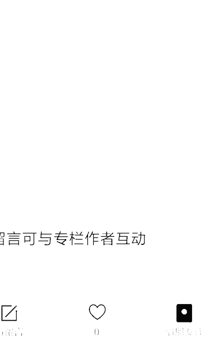

## 认知产能2 | 判断力和记忆力哪个更重要？

认知产能2 | 判断力和记忆力...

+ 第一模块
认知源码
第二模块
认知治理
第三模块
算法与第一性原理
“认知产能”
第四模块
意义炼金术

### 判断力比记忆力更重要

我很喜欢法国非著名但很 有智慧的哲学家拉罗什福科说了一些话：

> “人在不付出多少成本的情况下都是慷慨大方的，但人从来没有在给人劝告/忠告的时候表现出这种慷慨和大度。”

> “当一个个人实在没有什么好炫耀的时候，他就会炫耀他的痛苦和烦恼。”

> “人们会公开承认和抱怨自己的记忆力差，但很少会公开承认自己的判断力和鉴赏力差。”

尤其是第三句话，意思是说：人之所以愿意公开承认和抱怨自己的记忆力差，是因为人们知道记忆力差不算一个致命缺陷，但判断力就不一样了，它是一个致命缺陷，所以，没人会公开承认自己的判断力差。

当然，要知道自己的判断力和鉴赏力差也不是一件容易的事情，这点很符合“达克效应”：要知道自己的判断力差是需要很高判断力的。

上面讲的这些其实都在说一件事：记忆力和判断力作为跟智力相关的因素，判断力更为重要。

### 存储是手段，提取是目的

+ 1.存储是为了提取

事实上，每个人都拥有一本属于自己的百科全书或者字典。你要写一篇文章出来，里面的每个字词都来自这个字典。但如何把字典里的字词连成一篇文章，就不光靠你的存储能力了，还要靠你的提取能力。

一般来说，存储能力是基础性的，它不是目的而是手段——存储是为了提取。所以，从这个意义上说，存储能力是低于提取能力的；而从另一方面，也由于存储只是手段不是目的，某种信息、知识、感觉也就只是存储在你的头脑当中，如果不被提取的话就会渐渐被遗忘。

+ 2.认知是生产，不是存储

+ 3.提取能力的两种形式

说到“提取能力”，至少有两种形式：

第一种：纵向连接

第二种：横向连接

### Mark、Remark&Remarkable

最后，我用三个英文词来说明存储能力和提取能力之间的关系：

+ Mark——标记、收藏；
Remark——觉察、评论、注意；
Remarkable——卓越的、非凡的、值得注意的。

用尼采的话说，“只发生过一次的就等于从来没有发生”，第二次发生的时候，你再度收藏其实也是一种提取：把眼前的信息、知识或者人跟你以前的存储进行某种关联，这是一个提取的过程；经过反复提取，你的头脑中就会变得非常地醒目，在你的意识中就建立了一种高带宽的专线连接，你对这个信息和知识就能达到像福尔摩斯那样的瞬间提取状态。

由此看来，存储和提取虽然有差别，但也有一种内在的关联：通过提取来存储是最好的存储。

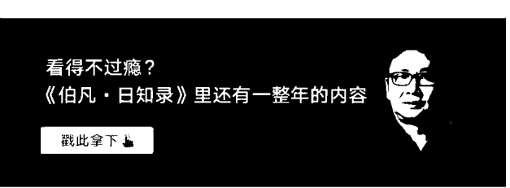

## 认知产能3｜跳出思维的盒子

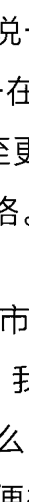

认知产能3｜跳出思维的盒子

第一模块
认知的源代码
第三模块
算法与第一性原理
“认知产能”

第二模块
认知治理
第四模块
意义炼金术

为了更好地理解认知、认知建立和认知升级，我们不妨把认知想象为一座城市。这两个东西看似不相关——一个是物质的，一个是意识的，但它们之间确实有很多意义的关联。

### 1.建筑只是城市的终端

我们知道，一座城市由一栋栋建筑组成，但你不能说一座城市就是一个个建筑的简单拼加——在一座城市里，还有与建筑同样重要，甚至更重要的东西：贯通的、成体系的交通网络。

我们从城市的一栋建筑走到另外一栋建筑，首先，我们知道自己要到另外那栋建筑去干什么；其次，从这栋建筑到那栋建筑之间有便捷的交通系统，能很顺利地过去。所以，城市里一栋建筑的价值取决于它在交通系统中的地段——location。

我们讲过房地产的三条铁律：location！location！location！这其实也可以理解为一栋建筑跟整个城市体系的连接度：如果连接度高，它的互联性就强，价值也就高；反之亦然。如果一栋建筑前面没有道路或者异常远，它的建筑价值就会大打折扣。即使是一栋很好的建筑，但由于没有跟整个城市的交通体系很好连通，也是没有意义的。

我们可以设想一下，如果一座城市里的房子东盖一栋，西盖一栋，彼此之间没有道路连接，那可能就是一座水泥丛林。

从这个意义上说，建筑只是一个终端，互联度和连接带宽决定了一栋建筑在一座城市的价值。

### 2.硬件、软件和人件

任何一座城市都包含建筑、道路等一套硬件系统，与此同时它还有一套软件系统——所谓“软件系统”，你能在功能上感受到它的存在，但它又是无形的。

除了硬件和软件之外，城市还有一种“人件”，也就是人与人之间的一种关联。一个人的价值又取决于他跟整个社会的关联度，也就是我们经常说的“人脉”，它比软件更加看不见、摸不着，但是，它是存在的。

某个城市对我们来说有巨大的吸引力，不仅因为它的建筑，还有一些软件，比如城市的管理水平、商业环境等等，当然，最重要的是因为这个城市有人——人件，如果这些人不存在，这个城市的价值就会大大降低。

### 3.提高认知（城市）产能

回过头来看我们的认知：如果把认知比作一座城市的话，学习的过程就是不断建立、扩大、完善一座城市的过程。

就像一座城市不仅要盖房子，还要修道路一样，你不仅要增加知识点和信息量，最关键的是，如果你的认知没有形成一个贯通的、成体系的系统，只是一大堆属于低带宽、弱连接的信息和知识点的集合体，那你的认知产能就会很低。

我们之所以对某个城市趋之若鹜，是因为这个城市产能很高：奥拓进去，奥迪出来；流浪汉进去，富翁出来——这是这个城市的产能。认知的产能也是这样。

下面我举2个例子来说明这个问题。

案例1：“自身携带另一个世界”的爱默生

第一个例子是梭罗对爱默生的评价。

梭罗是《瓦尔登湖》的作者，他见到爱默生之后说，“爱默生是一个你随便问他一个平常的问题，他都能给你耳目一新的答案的人。他好像跟我们生活在同一个世界，但他自身又携带了一个我们根本看不见的世界”。

有一次，爱默生和梭罗在树林里一边散步，一边谈论印第安人之前在这一带的生活，梭罗提到了印第安人使用的武器很落后，他们射的箭的箭头是很原始的。这时候，爱默生低了一下头，指了指地上说，“是不是这个？”梭罗一下惊呆了：地上是一个生了锈的箭头。

这是一个很偶然的体验，梭罗之所以提到这件事，是为了表达他对爱默生的整体感受：他就是这么一个触手可及又能够进行连接的人，他的那种连接是瞬间和随时的发生的。

案例2：“头脑随时待命”的马克思

另一个例子是卡尔·马克思的女婿拉法格回忆马克思的时候说，“你可以在任何时候跟他提出问题，他总能给你超乎满意的答案，并且包含着缜密性、带有哲学概括式的见解。你在其他人那里是找不到这样的答案的。马克思的头脑像一艘在军港待发的军舰，随时准备接到命令驶向任何思想的海洋”。

爱默生和马克思的共同特点是什么？快速连接的能力。他们的认知带宽很高，你提的问题可能很平常（输入端没有什么特别），但输出端是很强大的一他们中间的这套流程，包括存储和提取能力是极其强大的，能够把特别见的普通事情进行连接，把很遥远的东西跟很近的东西进行连接，并且这种连接毫不做作，随时发生。

如果把我普通人的认知能力跟这两个人的认知能力相比，那就是一座落后城市和一个高度发达的现代化城市之间的差别。

### 4.Jump out of the box——跳出思维的盒子

一座城市的价值不仅仅在于它内部体系的贯通性，换句话说，不仅取决于它内部的高连接带宽，还取决于它和外部连接的带宽。比如一座城市之所以有价值，不仅仅是它的内部基础设施非常完善，还在于它有一个发达的对外连接系统，像高速公路、航空、水运等。

只有内部连接和外部连接系统都发达的城市，产能才会是巨大的。

具体来说，外部连接带宽最大的好处就是能够让人跳出盒子（Jump out of the box）。用我们前面讲过的话来说就是：

内部的连接带宽让你在内部快速进行搜索，但即使你能够“寻他千百次”，答案却不在这里，你要抽身出来再看才能找到真正答案。跳出盒子就是“蓦然回首，那人却在灯火阑珊处”。

跳出盒子的思维用在认知上，就是一种突破你既有认知体系的能力。

爱因斯坦年纪轻轻就提出了“狭义相对论”，但是当“狭义相对论”的正确性已经无法质疑的时候，人开始质疑爱因斯坦本身，说“狭义相对论”不是他提出来的，在此之前已经有很多很多提出跟“狭义相对论”非常接近的结论——爱因斯坦成了一个在别人的果园里摘果子的人。

面对人们的质疑，爱因斯坦的一个朋友是这样说的：爱因斯坦摘的这个果子也许确实不是他种出来的，但“狭义相对论”就像一棵长满了果实但叶子非常密集的果树，密集的叶子把果实遮得严严的，很多人根本看不到这棵树还有果实，而爱因斯坦一眼就能看出这是一棵果树。他拨开树叶，摘下了丰硕的果实。

我们身在其中做一件正确事情的时候，往往不知道它有多正确，根本不知道真正的价值在什么地方。只有抽身出来再看，将你的成果、他的成果、所有的成果进行连接和贯通，才能发现一种新的价值——这是一种创新，也是查布斯说的连点。

2007年苹果手机横空出世的时候，很多技术专家都说，“iPhone上的所有技术都不是苹果原创的，苹果只不过是把已有的技术应用了而已”。为什么所有人，包括发明了这些技术的人都不知道这些技术本身潜藏的巨大价值，而仅知道其中的触屏技术或者重力感应技术？

因为他们没本事跳出盒子，就不可能置身庐山之外，看到庐山的真面目。最重要的是，他们不能把庐山以及其它山的各种各样的知识点、创新点连接起来，形成一个前所未有的创新，而这正是跳出盒子的价值。

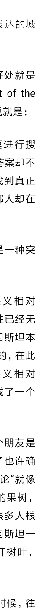

## 认知产能4 | 拥抱认知的痛感

认知产能4 | 拥抱认知的痛感 ↓

第一模块
认知源代码
第三模块
算法与第一性原理
“认知产能”

第二模块
认知治理
第四模块
意义炼金术

### 波拉尼悖论

我们在本单元第二节课的最后讲到了“存储与提取的关系”：存储能力和提取能力是两种能力，但是它们之间的关系非常密切，密切到“提取是最好的存储”。

当你从记忆库里不断提取一个东西的时候，其实就是在建立一种高带宽的连接。而被动灌输式的存储是一种低效率和低效果的存储——不以提取的方式进行存储的时候，存储的损耗率会特别大。记忆的特点就是：你提取的越少，它就越容易沉底和消失。

关于存储和记忆，我们要记住两点：

+ 1. 存储是和提取紧密相连的，提取就是存储的最好方式；
2. 我们记忆和存储的远远大于我们知道我们记忆和存储的——这其实是从著名的波拉尼悖论（Polanyi’s Paradox）中推演出来的（波拉尼悖论：我们知道的远远大于我们知道自己知道的）。

我们的很多的记忆和存储是深埋在头脑当中的，只有在某个特定场景，需要你应对的时候，才自然从头脑中提取出来——你这时候才发现你头脑中竟然还存储着这个东西；如果不在特定的场景里，你可能根本不知道它竟然藏在头脑当中。

我们不妨用一个比喻来进行说明：

存储库=巨大的仓库，提取能力=一个手电筒；
只有手电筒照到仓库的某个地方，你才能发现它在那里；
如果不打开手电筒，你根本没法在巨大的仓库里找一个东西，完全不知道它一直在的地方，就如同这个东西不存在一样。

### 练习+测试=肌肉记忆

最能反映记忆特点的是肌肉记忆，也就是一种动作记忆。比如你小时候学会了骑自行车，中间有十几、二十年没有骑，但当你再要骑车的时候，你发现你竟然一点儿都没有忘——肌肉记忆最大的特点就是：一旦形成/存储，就很难被遗忘。

但是，我们往往忽略肌肉记忆还有一个特点：形成这个记忆的时候，是一种练习和测试同时进行的记忆，这点跟很多其他的记忆明显不一样。

比如我们要背一篇古文，通常的方法是反复复读，在读了多少遍以后把这篇文章记下来。这种重复的简单练习最后形成了记忆和存储。但这一点有明显的个体差异。举个例子，曾经曾国藩被很多人认为是中國历史上两个半圣人中的“半个”，但他其实是一个很笨的人，小时候要背一篇 文章都非常费劲儿。据说有个小偷到他们家偷东西，躲在书房的暗处，看着曾国藩反复读还没背下来，自己都能够背下来了。

这种通过反复朗读形成存储的输入方式有一个最大的特点：单向性。只是不断重复练习，而没有障碍，这是不符合刻意练习的特点的——刻意练习既要练习，也要刻意，而这个刻意就是障碍。也就是说，简单重复练习是回避测试和考试的，是与肌肉记忆的形成正好相反的。

我们做一个动作，要想把动作做到位，每一步都是在克服障碍和接受考试：做到了就是做到了，做不到就是做不到，中间哪怕有一点点做不到，那就是做不到。所以，你要把一个动作做到位，是重复的练习加上考试同时发生的，你可能都没有意识到这是考试。

无论怎样，肌肉记忆之所以有“一旦形成，很难遗忘”的第一个特点，和它的第二个特点“练习跟考试同时发生”密切相关。

考试和测试都是我们会本能回避的问题，因为考试的过程和结果就是我们前面讲过的“客观化”，而客观化本身会带来认知痛感。我们之所以愿意选择简单、重复地把考试和测试剥离出来的练习方式，是因为我们不愿意忍受考试和测试带来的痛感，也就是说，很多人把考试时候产生的挫败感当成是一种不得不忍受的痛苦和创伤。但我们可能恰恰忽略了一点：与其说它是对认知增强升级的重要途径，不如说它是唯一途径。

### 记忆失用理论

认知增强与身体增强，其实是遵循同一个机制的。锻炼身体，从事运动，会对你身体的某些部位，尤其是四肢的肌肉形成微创伤。这些创伤有的是不能恢复的，有的是可以恢复的。比如我们刚开始打网球或者羽毛球的时候，胳膊肩膀会酸痛，就是微创伤导致的结果。

身体是一个非常精妙的智能系统，而创伤以及创伤导致的痛感则是一套非常有用的信息系统，如果没有这个信息系统，身体会处于危险的状态。有一种病叫“无痛症”，就是不管怎么样、受多大的伤都感觉不到痛，连骨折了都不知道。

所以，我们身体的各种痛感是一套信息或者预警系统。它一方面提醒我们的意识，另外一方面不仅发信息给我们的意识，还发给我们的整个身体。

当身体的某个部位，尤其是肌肉产生微创伤的时候，身体的智能系统就会开始进行一种资源调配——过度补偿机制。你持续对肌肉进行微创伤的话，等于是不断向身体发送信号，身体也就不断对你的这个部位实施过度补偿。这种过度补偿的结果有很多，比如芭蕾舞演员的腿很粗，网球运动员的某一侧胳膊比另一条明显粗壮等等。

我们之所以要讲到微创伤和过度补偿机制，是因为跟记忆的一个规律非常相似：有一种理论叫“记忆失用理论”，就是大脑存储了某种对象，但在某一个场景里遗忘了，也就是说它存储在那个地方，但过于隐秘，大脑没有提取到它，表现的结果就是遗忘。

你意识到你遗忘了它，但你同时又意识到它的确已经进入到了你的大脑当中，就像你跟一个人见过面几年以后，你忘记了他，但再说起来，你又重新想起他一样，用我们上节课的话说就是remark（对他产生一种强烈的注意）。

一旦你失而复得，重新把它提取出来的时候，它反而在你头脑当中占据了一个非常显要的位置。

总之，“记忆失用理论”就是大脑一旦重新找到被遗忘和忽视的记忆，失而复得的记忆，那么这些记忆就会在记忆库中凸显，接下来被调用的可能性就会明显增强。这个过程跟肌肉遭受微创伤以后进行过度补偿让肌肉不断强大是相通的。

我们的记忆很多时候不是我们在记忆，而是我们的记忆系统有一个平衡和调节机制，你只需要使用存储和提取能力，它就可以实现自组织、自管理、自修复和自我迭代。

## 总结

+ 1. 认知是一种生产活动，关键在于产出；
2. 认知的质量取决于你把它当成是单纯的存储，还是将提取、存储合二为一，将练习与考试合二为一；
3. 始终的关键是：直面、不回避，甚至于拥抱认知的痛感。

划重点

1. 认知是一种生产活动，关键在于产出；
2. 认知的质量取决于你把它当成是单纯的存储，还是将提取、存储合二为一，将练习与考试合二为一；
3. 始终的关键是：直面、不回避，甚至于拥抱认知的痛感。

看得不过瘾？
《伯凡·日知录》里还有一整年的内容
戳此等下 ↓

伯凡·认知方法论

## 问答35 | 认知加工是不是给信息分类？

问答35 | 认知加工是不是给...

### 认知升级=分类升级

@零糠

为了搜索到我们需要的合适的东西，是不是要在得到信息和物品的同时给它进行一个简单的分类？

答案是显然的：认知在相当大程度上就是分类，比如植物学最初就是一个植物分类学；你想研究商业问题，首先要对林林总总的商业现象进行分类。

分类的过程是一个加工的过程，它的细致程度、精确程度、正确程度往往是无止境的。我们认知的升级在某种意义上就是我们对观察对象和周围环境分类的升级。

分类的过程也可以说是一个“潜搜索”过程，只要你的分类足够精确，搜索提取的效率和效果就会明显提高，最后表现出一种反应能力。

我们的生活和认知状态之所以陷入混沌（熵增状态），其实就是缺乏分类或者分类不精确。一旦分类出问题或者没有分类，信息知识的提取能力、综合能力、连接能力就会随之下降。

### “不动笔，不读书”

@李邨强

认知能力其实就是搜索能力，就如同带着问题读一篇文章，这个问题就是你的搜索引擎。能提出这样的问题就能得出怎样的答案，这样说的话，认知能力是不是等同于提出问题的能力呢？

答案也是肯定的，但它不全面。
首先，认知能力就是提问的能力，这是认知的起点。亚里士多德说，“求知是人类以往发展的特点，而求知来源于我们的好奇心”——好奇心包含着一种提问的冲动和能力。

+ 初级的动笔是在书上划重点做批语；
深度的动笔是写读书笔记，也就是书上的观点、见解和概念成了触发你思维的一种手段和契机，你这个时候读书就不仅仅是在存储，更多地是在提取了。

### “人磨墨，墨磨人”

@南菜园里的海棠树

“标签效应”对我触动很大。我学习得到很多课程感觉非常有用，订了一些课程也学习得很有感觉，但没有进行有效记录和连接。一段时间以后，自己头脑里的信息就像老师说的“和充满着无序的房间一样混乱”。现在我开始练习用“得到笔记”的标签功能对自己收集的信息多角度标注，写体会的时候根据内容查找相关标签进行连接，这算不算一种认知方法？

这当然算一种认知方法。

打标签的过程就是将材料归位的过程。人的大脑在做一件事情的时候，不管是体力劳动还是脑力劳动，一旦开始都是在做两件事：
第一件事情，你在工作和劳动是改变对象或者对对象进行加工；第二件事情，在改变你自己。

俗话说“人磨墨，墨磨人”，就是你在磨墨的时候，墨也在反过来磨你：
你对事物进行分类表面上是在完成一个任务，好像是一件不得不做的工作，其实你这样做的过程是在自己的头脑中不断建立一个个的框架和格子的过程；你完成的外在任务越多，自身改变也越多，这就是“反向驯化”，通过标注、整理、写体会等一件件看似不跟眼的作业，在做过程中雕刻自己的心智，这是一种很有用的认知方法。

用户留言
提交留言可与专栏作者互动

## 认知产能 | 本单元十大精彩留言

认知产能 | 本单元十大精彩...

## 本单元总结

+   1. 第一节课

如果用一句话概括的话就是：学习的本质不是一种存储和输入活动，而是一种生产和输出活动。当大量材料输入进来的时候，我们如果不进行生产和输出，或者说不进行分类编码，那么这些材料就会像一堆没有地址的邮件，结果只能是“查无此人”，最后倒在垃圾堆里。要避免这种情况发生，我们就要时刻注意给知识做分类编码。

+   2. 第二节课

我们说，要提升我们的认知就必须防止一种异化——“只存储，不提取”，因为提取才是目的，存储只是手段，而且可以说，通过提取来存储是最好的存储。我们讲了两种提取方式，一种是纵向连接，一种是横向连接，或者说叫关键词搜索和语义搜索，“语义搜索”的提取能力是一种更高 级，也是我们应该追求的认知能力。

+   3. 第三节课

我们拿认知和城市做了一个类比，说学习的过程就是不断建立、扩大、完善一座城市的过程。只有内部连接和外部连接系统都发达的城市，产能才会是巨大的。那认知也一样，我们既要有建立认知体系的能力，也要有突破你既有认知体系的能力。

+   4. 第四节课

我们给这一单元的认知产能做了三点总结：1.认知是一种生产活动，关键在于产出；2.认知的质量取决于你把它当成是单纯的存储，还是将提取、存储合二为一，将练习与考试合二为一；3.认知始终的关键是：直面、不回避，甚至于拥抱认知的痛感。

好，以上就是本单元的主要内容。以下是 我精选的同学留言，恭喜前三名同学，将获得我签名的书一本，这次送出的书是最 近刚刚出版的新书《直觉泵》，得到的工作人员会尽快把书寄给你，也希望其他同 学再接再厉。我们下节课再见。

特别提醒：留言内容会默认公开，并同步到“知识城邦”中，中奖同学留个人信息 时，一定记得将留言设置成隐私模式，确保个人信息安全。

## —— 本单元十大精彩留言 ——

## 获奖留言

### 王逸勋

“认知在某种程度上就是分类”，对于这一 点我深有感触。

老师曾不断提到“认知升维”的重要性，而第一次体会到这一 点是在《从一到无穷大》这本书上。书中提到将多维压缩到单一维度时会出 现重叠，原本不在一起的点会重合在一起。这启发了我，很多看似矛盾的东西实际上是从属于不同维度的，也就是我们常说的“不是一回事”。但是对事物的了解如果不够深刻，就 会误把原本是多个维度的事物压缩到了单一维度，因而认为那是矛盾的。认知处于“低维”状态的人们在进行“分类”时，就会 出 现这种谬误。

问答 35 | 认知加工是不是给信息分类?

### 懒猫妞

刻意练习就是这种方式，针对训练目标，一次一次remark。

比如我想训练公文写作能力，首先买了好几本书，有技巧有案例，第一遍，我认真真看完，并做出标记划出重点。然后看第二遍，重点看标记，这时脑子里开始建立初步的框架，不同的场景、讲话人、听话人、文章目的等，都是脑子里的格子。第三遍就不是一本本按顺序看了，我会结合脑子里的框架，比如把在晚宴、庆功宴、新春舞会上的致辞作为一类，把每本书涉及这些内容的章节放到一起看，同时开始练笔，结合以前自己写的稿子去总结提升；对特别精彩的好文章再拍照，分门别类存储进电脑文件夹，以后需要用的时候再参照看。这种方式效果很好，大半年时间下来，我的公文能力大大提高，结合工作中大量实践，再把实践的文章定期整理复盘，现在对写公文已经不怕了。

认知产能 2 | 判断力和记忆力哪个更重要?

### 嗯

今天的课程让我想到山本耀司曾说：“‘自己’这个东西是看不见的，装上一些别的东西再反弹回来，才会了解自己，所以，跟很强的东西，可怕的东西，水准很高的东西相碰撞，然后才知道自己是什么，这才是自我。知识需要不停的碰撞，碰撞就像是打开了手电筒照到存储区域，然后通过一次次的提取使得存储的材料被remarkable。

许考老师说，学习英语不要直接去背GRE词汇，而是直接上手你以最后才接触的东西，这样拥有极大的成就感，你才会坚持下去，学会为目标敞出的服务型存储，打破重建再修复，联系老师曾说过的“同步”，学习的输出端和输入端同步就像是产生共振效应，让“连点”呈现指数型增长。

认知产能 4 | 拥抱认知的痛感

## 其他精彩留言

### 罗怀昭

《如何高效学习》的作者斯科特·扬，是加拿大的 一位学习达人。他号称10天搞定 线性代数，一年搞定麻省理工4年的课程，学习其他的任何技能也都非常地快。他该 泡妞泡妞，该打游戏打游戏，业余时间还很多。再结合老师今天的课程，我还想了几点。

+   1.带着问题去收集信息，收集认知的原材料。带着问题去收集信息，可以有比较明确的目标性，让目标在浩瀚的信息海洋里，指引我们前进的路线。找到那些最符合目前需求的信息。寻找信息的过程是相似的，但是知识结构是不一样的，获取不同的信息，得用不同的方法对待。

+   2. “整体学习法”。它是一种系统加工的过程。学习一门新知识就像在脑子里建造一座城市，每一个知识点都是这座城市的建筑。除了这个城市内部要四通八达，而且要和其他城市建立最高效的连接。简单说就是每一个新的知识点都要和已经熟悉的知识 点相关联，用已知的去记往新的，相互牢牢相扣，这是整体学习的核心要 点。整体学习的步骤：获取-理解-拓展-纠错-应用。

认知产能 1 | 在学习中，输入和输出是什么关系?

### 凌繁荣

看到“终身思考同学”在留言里提到的艾宾浩斯遗忘曲线，对比一下目前对吴老师认知方法论的学习方式。本来是由 于需要上班工作的关系，将听音频、拷贝文字稿、写留言、看同学留言（有时也写留言）分成了4个时段，没想到无意中契合了艾宾浩斯遗忘曲线的部分规律，但内容上不是很对应。

按照艾宾浩斯记忆规律的复习方式学习，实 验中可达到一天后保持记忆率98%，一周后保持86%。下面需要调试的是在四个学习时段均将课上的内容看上一两遍，期望逼近艾宾浩斯记忆规律的复习方式学习所达到的记忆率。

认知产能 2 | 判断力和记忆力哪个更重要?

### 独行千里

认知的重 要标志，是我们有基础的信息，并且能够根据这些信息进行思考和判断。

认知的宝要标志，是我们有基础的信息，然后我们有快速找到适用信息的方法。就好像一座城市中有很多建筑，道路是连接这些建筑的手段，而导航系统就是我们快速找到目标建筑的方法。在我们的认知中，我们学到的知识点/信息点就是那些建筑，我们认知的规模就取决于我们连接这些建筑的道路网是否发达，也就是我们是否对学到的知识点进行了编辑输出，而最后的导航系统就是我们在认知过程中形成的解决问题的方论，虽然我现在没有现成的解决问题的方案，但是我可以通过现有的知识体系，去寻找到合适的解决方法，就像我在城市中知道了自己的位置之后，就可以通过导航系统去寻找到我要到达的目的地。

认知产能 3 | 跳出思维的盒子

### 桃安安

今天的课让我印象最深刻的是肌肉记忆，一旦形成肌肉记忆就很难被遗忘。肌肉记忆 = 练习 + 测试，这个说法和《认知天性》一书中所说的“考试是最有效的学习策略之一”有相通之处。书中列举了大家一直认为是有爱加强学习和记忆的几种普遍方法，如反复学习，划重点等，这些其实都不是有效的，这可能颠覆大家的认知，但经过实验研究，效果的确不大。有的方法却是考试，就像肌肉记忆一样。

认知产能 4 | 拥抱认知的痛感

### 终身思考

拥抱认知的痛感的方式可以分为三类：1. 文字类的可以写摘要。2.语音类的可以录音。3.肢体类的可以录像。

间接认识一个北大毕业教数学的培训老师，不仅教的能力提升得很快，最终还实现了他的梦想——将课堂搬上了中央电视台的荧幕。他背后用的一套很有用的方法就是，一个人练习讲课的时候，用录像机将自己的讲课过程全程记录下来，反复研究打磨。其实这就是很好的测试以及及时反馈，当然前提是他敢于拥抱认知的痛感。而反观自己，我感觉提升得慢，完全就是不敢正视自己的样子，自己的声音，自己的肢体语言，这真的是太应该改进的地方。

认知产能4 | 拥抱认知的痛感

### 一瓢饮

如果把我们的大脑比喻成一条细链，把知识比作一颗又一颗的串珠，那么学习就是往细链上串珠的过程。重复阅读，不设置障碍的学习就像反复把珠子串上细链，却任由它们从链条的另一端掉落。那么怎样才能让串珠留在上面呢？没错，打一个结。学习过程中，要为自己的知识链打上记忆结，你需要检索，需要通过各种测试在知识链上打上一个结。

认知产能4 | 拥抱认知的痛感

### 刘溜溜

对信息进行“分类”的过程也是一种学习、加工和提升认知的过程。

比如我平时会收集一些让我印象深刻的词句、知识概念或者案例等，我所要做的并不是将它们“复制-粘贴”到印象笔记当中，而是基于我对这些内容的理解，为它们设置关键词（通常关键词是2~3个），随后再将它们放入相关话题的“笔记本”当中。这样收集、分类并汇总信息能让我的“检索”变得更高效。

比如在写作时我需要借鉴一些案例，那我就会直接进入我的印象笔记当中的“案例库”这个大类别当中，随后根据相关主题和内容进行关键词搜索，比如搜索“认知提升”这个标签，那相关素材便能很快找到。

另外，在写作时如果将这些素材继续照搬到文章当中，对我们的提升仍非常有限。这时我们便能进行第二次“加工”——用自己的话来表述并且适当加入自己的观点。如此往复，随着时间的积累，无论是我们的认知还是写作能力，都会有所加强。

问答35 | 认知加工是不是给信息分类？

## 认知与范式1 | 什么是认知中的第一性原理？

认知与范式1 | 什么是认知中。

第一模块
认知的源代码
第二模块
认知治理
第三模块
“认知与范式”
第四模块
算法与第一性原理
意义炼金术

### 你的优先级是什么？

我和朋友讨论过一个问题：哲学和管理学最大的交叉是什么？

这个问题答案其实是开放式的，我给出的：priority——优先级问题。不管哲学还是管理学都要解决一个优先性的问题。

### 优先性是管理认知的有效工具

+   1.第一性原理意识

“优先性”是一种管理我们生命能量和认知的有效工具，你应该时不时回到优先性法则上。

+   2.《等待戈多》：被遗忘的第一性原理

## 总结

+   1. 无论是管理我们的思维、认知还是任务和项目，必须遵守“优先级原则”。所有的管理不善、混乱和无序都是因为缺乏“优先级意识”造成的。优先级意识也就是第一性原理意识。

## 认知与范式2 | 总是输？可能是游戏规则错了

认知与范式2 | 总是输？可能...

第一模块
认知源码
第三模块
算法与第一性原理
“认知与范式”
第二模块
认知治理
第四模块
意义炼金术

### 范式转移 (Paradigm shift)

我们上节课提到：一定要找到犯错误的责任主体，只有追溯到这个责任主体，你犯的错误才是有价值的。就像你买到了劣质产品，可以根据商号或者品牌去追溯责任人一样。

这就涉及到了科学史上的一个规律：范式转移。从牛顿的经典力学到爱因斯坦的相对论，就是范式转移的结果。很多领域都存在这一规律。

有一本十多年前很流行的书叫《蓝海战略》，我采访其中一个作者钱·金（W. Chan Kim）的时候问他，“对你影响最大的一本书是什么？”他回答，“是托马斯·库恩的《科学革命的结构》”——就是这本书提出了“范式转移”。

红海：

当大家都按照一个不言而喻、天经地义的规则去干事，越干越没有效果，越竞争越失败（所有企业都投入大量资源，但回报越来越小甚至为负）的时候，我们找到的责任主体是我们认为不言而喻的游戏规则。只有等到发现这个游戏规则是错的时候，我们才可能切换这个游戏规则。

蓝海：

当我们找到了责任主体（所有行动无果的根本原因，所有错误的第一性原理），开始质疑它的时候，我们的选择就不再是在同一规则下继续玩一场游戏了，而是选择另外一种新的游戏规则——这个新的游戏规则就是“蓝海”。

### 案例1：鸟飞派的失败

我举一个技术史上经常会提到的一個很有名的例子来解释“范式转移”。

人类对飞行的探索从很早就开始了。最初的时候，人看见鸟能飞，发现鸟跟人最大的不同是它们有一双翅膀，于是人想象自己插上翅膀也能飞，比如各种神话里的神或者天使，他们跟人最大的不同就是他们有一双翅膀。

人认定翅膀扇动是鸟能飞的原因——这就成为了人类后来探索飞行的一個责任主体。

当然，鸟飞派的理论假设还包含一个很重要的比喻：把空气想象成水，把翅膀想象成桨，人为空气中能飞起来，就如同船在划桨那样是借助反作用力的。

通过反复探索，或者说是反复失败，人们发现这条路不行，那问题一定就出在当初认定的那个猜想上——翅膀的扇动是飞行的原因。这时候，人们开始怀疑这个前提、假设和猜想，自然就会寻找新的假设。

现在我们知道，鸟之所以能飞起来是因为鸟在扇动翅膀的时候，它 Mehmet 的内侧羽毛会形成某种程度的旋转，导致空气的流动性很慢，而它翅膀外侧和上面的空气流动性非常高，也就是翅膀的上下形成了一个巨大的压力差，鸟就是这样被顶上天的一——鸟的翅膀与其说是桨，不如说是帆。这就是“范式切换”或者“范式转移”。

### 案例2：拉马克学说

说到物种，我们自然而然就想到进化或者演化，想到达尔文，其实达尔文的进化论也是进化而来的。

在达尔文之前，法国人拉马克开始怀疑神创论，怀疑有一个全知全能的上帝创造了这个世界，他认为所有的物种都是逐渐进化演变出来的，并提出了一个假设：物种进化的动力有两条，第一是用进废退，第二是获得性遗传。

用进废退：一个物种之所以长成这样子是因为它经常会使用这种功能，所以这种功能会越来越强化。

获得性遗传：有人为了证明“获得性遗传”做过一个实验，把一只老鼠的尾巴一生下来就切掉，使它暂时成为一个短尾巴老鼠，让它生出第二代，再切掉尾巴。尾巴不断切，在切了N代以后，老鼠的尾巴就变短了。

拉马克认为用进废退和获得性遗传就是进化的第一性原理，而达尔文在某种程度上继承了拉马克的进化论，认为物种是进化出来的。但拉马克的“获得性遗传”没法证明——有一些所谓的证明后来被证明是造假的。

### 回首=范式转移

《道德经》讲“少则得，多则惑”。你想让你的行为和探索有价值，就必须以简驭繁。

很多同学在这里可能会很疑惑：你一会儿强调数据，也就是繁的重要性，一会儿又说没有一套加工和搜索系统的话，大量的输入是无效的，强调简的重要性，到底要繁还是简？

事实上，这里的少和多是不在同一层面的：

少，指的是对规则、范式、优先性的回归；
多，指的是数据；
没有少驭多的，多就没有意义；没有多，作为能量的少，也没有任何进展。

## 认知与范式3 | 什么叫以简驭繁？

认知与范式3 | 什么叫以简驭繁...

+   第一模块
认知源代码
第二模块
认知治理
第三模块
算法与第一性原理
“认知与范式”
第四模块
意义炼金术

### 以简驭繁

认知的最高境界就是体会到简单之美，这的确有道理：

爱因斯坦得出E=MC²的时候，体会到的是 一种什么样 的精神快感——整个宇宙如此 纷繁复杂，他只用三个字母的公式就表达 了出来；

牛顿得出F=ma的时候也一定体会到了一种简单之美；

简单之美也可用来形容“物竞天择、适者生存”这个法则，自然界依据这样一个简单的规则就生成了万事万物。

当我们知道“简单之美”，就能体会到无论是物理世界还是生物世界都遵循的一个原则——以简驭繁。这里的简和繁不在同一层面，不是 一个人打十个人的以简驭繁，而是在更高维度上用“简”来统摄低维度的“繁”。

### 人工智能领域的“范式换代”

“以简驭繁”和我们正在经历的一场大产业变革密切相关：虽然“人工智能”这个概念在60年前就已经有人提出来了，但是为什么在近两年突然大热呢？这跟“以简驭繁”有关。

以下围棋为例。以前很多人断言“计算机战胜人类是一个极其遥远的事情”，但现在的人工智能热恰恰就是硅基智能战胜了（人的）碳基智能。不过，之所以有这样的断言，也是有根据的：我们过去和电脑下围棋，面对的是一个下棋软件，这个程序是由懂下棋规则的程序员写出来。而计算机在面对人类棋手的时候显得那么弱智就是因为：计算机的水准=写下棋软件的程序员的水准。

可能有人会说，“为什么不找李世石、李昌镐写软件呢？”这就涉及到人类知识/认知的 一个致命的缺陷——“人所知道的远远大于人知道他所知道的”，也就是著名的“波拉尼悖论”。

什么意思呢？假设知识是一个集合，分为隐性知识和显性知识两部分：

+   隐性知识的面积远远大于显性知识；
隐性知识没法编码，显性知识可以。

我们知道，程序员就是编码的人，在编码的时候，程序员只能对显性知识进行编码，也就是“可编码知识”。而大量隐性知识没办法编码，因为连程序员自己都不知道，就像画家的笔触是这样的，但你问他为什么，画家完全说不出道理一样，没办法编码。

如果想要编程，只能能够依照能说出来的那部分知识编码——咋怕李世石既懂下围棋又懂编软件，也没办法将他所有关于围棋的知识编成一个软件，因为软件的特点是编码，不可编码的没法写进去。

也可以说，编码相当于一个漏勺，在知识的锅里捞啊捞，但也只能捞到能捞到的那些东西，其他大量东西是捞不到的——围棋的程序就是用漏勺捞出来的那一点点东西在编码后写成的。

另外还有一点就是，像李世石这样的高手能说清楚的知识，可能也只占他所知知识的1/8或者1/9不到，就像冰山的大部分体积都在下面一样，连他自己都不知道：遇到问题的时候，他能解决，但在那种场景，他根本不知道他会是这样的。

李世石被AlphaGo打败了，AlphaGo凭的是什么法呢？这就涉及到我们前面讲到的人工智能领域出现的一次“范式换代”。

人工智能以前就是编程序，把人类智能编码变成计算机程序，然后加大计算机运转效率、提高计算机算力，以电脑远远不能企及的速度把错误排除，找到正确 的东西。比如一个棋局出现的时候，能马上知道有多少种选择并迅速预演一遍——假设有60种下法，快速预演一遍之后发现只有1种是最优的，就选择那一种。

既定的程序提高算力，这是符号型人工智能一直遵循的一个规则。想要突破的唯一的方法就是加快计算机的运行速度，而沿着这种思路的人工智能几乎走到了死胡同。

当计算机科学的其它分支突飞猛进，人工智能却毫无进展的时候，计算机学界开始反思：我们现在显然是陷入到了困境，犯了一个巨大的错误，那么，这个错误的责任主体是谁呢？是我们自以为计算机要获得智能，而遵循这条路径提高智能，只有用程序来加速计算。

这就如同鸟飞派走到绝境一定要寻找另外的路径一样，新路听起来特别简单，而且像科学史上我们经常看到的那样——开辟新路的人往往是一些外行。

这个思路或者说是范式的转变，是用现代统计学的方法来提高计算机的势能。

### 人工智能=现代统计学

诺贝尔经济学奖获得者托马斯·萨金特不久前说过一句引起很大争议的话：人工智能（AI）其实没什么神秘的，不过就是现代统计学——他的这句话就像《皇帝的新衣》里那个小孩说的那句话，让大家有一种“恍然回首”的感觉。

现代统计学的方法就是收集大量数据，然后从数据中训练出模型参数，这也叫“机器学习”，也就是说，机器不用懂得下围棋，只需要获得足够多的围棋棋局，然后将亿多数 据进行统计学处理，也就是训练出一种模型参数。数据量越大，模型就越精确，适用性就越强。

现代统计学的方法就是“知其然，不知其所以然”，这也是大数据 的法则，不管因果关系，只管相关关系：只需围绕棋规则、结果（赢）、结果的计算方法就可以 了，人工智能会通过大量数据统计来寻找各种相关性，达成最后的结果。

而训练模型的过程就是“化繁为简”的过程：不对各种各样的下法做任何区别，只有一个标准——赢的概率有多大。这也像物种的进化，在进化过程中没有事先设定什么样的物种是优的，什么样的 是劣的，只有一个法则——如何能够活下来。所有的物种在这个简单的规则下各显神通，而海汰的过程是一个优化的过程。可以说，自然选择是自然界的一种特殊的统计方法，只需要跟生存有关的那些物种，至于你用什么样的方法，它不管。

人工智能就这样从符号型转向了用大量的数据来驱动的智能方法，导致了人工智能在范式上的转移，也成就了今天人工智能的繁荣。这个范式换代用一句话概括就是：变智能问题为数据问题。

简单地说，人工智能经历的这两种思路：

+   前一种是“有为”的方式，后一种是“无为”的方式；
前一种是很聪明的 方式，后一种看上去很愚蠢、很简陋；
更准确地说，前一种是大愚若智的方式，后一种是大智若愚，或者说是以简驭繁的方式。

## 用户留言

提交留言可与专栏作者互动

## 认知与范式4 | “大道至简”对普通人有什么意义？

认知与范式4 | “大道至简”对...

第一模块 认知两源码 第二模块 认知治理 第三模块 算法与第一性原理 “认知与范式” 第四模块 意义与炼金术

上节课我们讲到牛顿、爱因斯坦、达尔文都是真正发现并掌握了“大道”的人，而且大道的最终者标志就是至简，这是我们普通人不能企及的。那么，大道至简对普通人有什么启发和借鉴意义呢？

在回答这个问题之前，我先问你三个问题：

- 1. 在闲聊甚至重要会议中跑题现象相当普遍，所以我们用“在会议室里放沙漏”站着开会等方式来避免跑题，提高开会效率，这里包含什么道理呢？更重要的是，跑题的机制是什么？
2. 为什么很多为了了解冲突的交流最后事与愿违，使冲突变得更加激烈甚至到不可挽回的地步呢？
3. 我们读书的时候最怕写文章跑题，但比这个更可怕的是，我们的人生跑题一为什么很多人的的旅程是跑题的呢？

你不用急着回答这三个问题，我们不妨带着问题一起来分享下面的内容。

### “歧途亡羊”：大道多歧

我们说话的时候特别不希望被人和打枪，但比被打枪更可怕的是：我们不知道自己在给自己打枪，最后误入歧途而不自知。

注意我提到的一个词：歧途，你有没有想过“歧”的意思呢？“歧”就是分叉，是一个主干到了一个节点上开始分叉，一个分叉往前延伸，延伸到新的节点又分叉——这个分叉就是“歧”，分岐、歧路、歧视都是这个意思。

### 以简驭繁：大道至简与大道多歧的关系

我们曾经分享过《关键对话》（Crucial Conversations）这本书，“关键”在英文中是crucial，是从cross（交叉、十字路口）这个词来的。那所谓“关键对话”就是两个人的交流到了十字路口，沿这个方向还是那个方向走是极其关键的一一关键节点的道路一旦错选，你就万劫不复了，就像杨老师的邻居召集了那么多人，最后却连一只羊都找不到回来。

#### 1. “鸡毛蒜皮”=癌细胞

#### 2. 和事佬：“简先生”的范式

哦，语欲胜人，是在局部节点上压过对方，这是很糟糕的范式，应该告别——当你告别这个范式的时候才可能从“语欲胜人”切换到“语欲成人”（“成人之美”的“成人”）。

我们以示弱的姿态站在对方角度思考问题的时候，对方可能慢慢也切换到这个范式，那就很容易把问题谈清楚了。

## 总结

- 1. 你要知道优先级——你是来干什么的。
- 2. 你要反省你这个范式有没有问题：有问题就放弃，切换到正确的范式。
- 3. 陷入到指数级偏离目标的歧途的时候，你要 训练一种出离这种格局的能力——从繁杂回到简单当中。

我们可以把“和事佬”称为“简先生”，他具有从纷繁复杂的观点、情绪当中回到优先性和范式的能力。我们也需要给自己聘一位“简先生”，没有他，我们很可能歧途亡羊。

这也就回答了最初的问题：大道至简与大道多歧的关系是以简驭繁。

## 问答36｜有什么利于加工和输出的具体方法？

问答36｜有什么利于加工和… ↓

### “入不敷出”才能增加有效输出

@林夕

正如老师所言，我只是关注了输入而没有加工工程，因此我的大脑中只是堆积了一些乱糟糟的信息，过段时间就自动消失了——我正处于伪学习状态，很怕，自以为提高了认知，学到了很多，可是都消失了。现在知道了要加工输出，但还是很迷惘，应该用什么方法加工和输出呢？

我们这个单元最大的诉求就是改变你对认知的一个常见误解——提高认知就是增加输入量。我们大大误会了认知形成的过程。

我们以前提到过二十世纪伟大的数学家庞加勒说的，“房子是由石头垒起来的，但仅仅把石头堆在那儿是不能建成房子的”。把石头存储的最好方法是把它盖成房子，否则它就莫名其妙消失了。

我们花钱的时候经常说，“量入为出，不要搞得入不敷出”，而吸收知识遵循的法则正好相反：我们要“量出为入”，只有感觉到某种匮乏，吸收的量才可能大，输出量才会导致输入量的增加，反过来，输入量的增加不能增加输出量。

只有让自己进入输出状态，形成某种类似于“入不敷出”的状态的时候，才可能有效输入。

我们理解了这一点，也就明白了乔布斯最欣赏的那句话：stay hungry，stay foolish。

Hungry=输出，如果不输出，你天天像吃零食一样往里输入各种知识和信息，是不可能感觉到hungry的。你一直收获满满，但输出的时候，你会发现自己“下笔不成一言”，或者用诸葛亮的话说是，“出口是千言万语，胸中实无一策”。只有通过输出才能保持hungry的状态，也才能保持foolish的状态——最让你感觉到自己笨和不行的就是在你输出的那一刻。

现在我们清楚了要进行加工输出，那到底应该用什么方法加工和输出呢？这里没有具体的方法，但我可以从管理学的一个理论让你意识到，这是一种没有方法的方法。

在德鲁克之前有很多人也在寻找管理的方法，但效果甚微，很多方法局部有用，而整体既无效率也无效果。

德鲁克说，“我们要学会问正确的问题，不要问管理方法是什么，要问谁在管理”。

这个问题听起来好像很简单，当然是管理者来管理了，但德鲁克告诉你不是的：

如果管理者来管理，鞭子、大棒和胡萝卜的方法不但没用，效率和效果也都是很差的——因为你的目标不明确。

你要搞清楚企业或者项目的目标是什么，时时刻刻拿这个目标来对照你现在做的事情——你会发现你做的很多好像很有效率的事情，实际上是没有意义的，你把大量资源和能力都投入到与目标偏离的事情上还不自知。

最没有效率的事情就是用最高效率去完成一件其实根本不值得做的事情。

德鲁克后来提出一个理论：目标管理 (Management By Objective ，简称 MBO)。很多管理不善是因为目标不明确或者初期目标明确，但在执行过程中逐渐偏离了目标。当你的目标明确，可以将目标分解成各个阶段的时候，就可以让这些目标本身来管理，而不是管理者不断调整手段和目标之间的关系。

目标管理理论可以说是管理学上的一个划时代的理论，它一下子改变了传统管理学只强调局部的方法和效率的情况。

我们为什么说这是一种“没有方法的方法”呢？因为你现在找不到方法，很可能是因为没有设定一个输出目标——在你确定你现在是要切菜还是钉钉子之前，你是不能事先确定你该使用刀子还是钉锤的。

要说提升认知有什么方法的话，那就是一种“没有方法的方法”：

- 1. 列出你的认知清单，哪怕是某个局部的，比如我对“如何改善人际关系”的认知目前是什么样的——如果不把它输出来，而且是多次输入输出的反省，你就没法找到所有与人相处的思路和方法中的真谛。这是一个输出过程，也是我们以前讲的“客观化”的过程。
- 2. 在输出过程中，你在这一方面的所有已知、未知、有缺陷的认知都会逐渐明朗，就会目标。
- 3. 当“如何才能真正改善人际关系”这个目标清晰起来，你的输入也就变得有目标了，进入到一种真正的饥饿和谦卑状态，也就是说在你头脑中建立了专门为这些知识准备的小格子。
- 4. 在没有建立格子之前，你对与之相关的很多东西都是视而不见的，但有了这种饥饿感和谦卑感，方法会自然形成，如果没有一种强烈的要求饥饿感，方法是不存在的。

### 炼狱：遗忘和存储之间的预备区域

在准备这个单元课程的时候，我突然想到了但丁的三部曲《天堂》《炼狱》和《地狱》，这和认知有什么关系呢？我们不妨从《炼狱》说起。

在早期的基督教神学理论中是没有炼狱的，它是教会为了出售赎罪券而创造的：教会会宣称人死之后不是马上进入天堂或地狱，而是先要进入到一个叫“炼狱”——类似于看守所的地方。然后，人在这个看守所被甄别，有的送入天堂，有的坠入地狱。你想升入天堂还是坠入地狱取决于你买的赎罪券的多少。

我们讲过，存储的知识有两种命运：要么遗忘，要么记住。而初级输入就像进入了一个预备站，你是进入到真正的有效存储区还是坠入到遗忘区中，取决于这个阶段你提取的概率是多少。

我们反复强调“提取是最好的存储方式”：经常提取的知识就会进入天堂，也就是真正的存储区，而不被提取的会暂时在你头脑中待一小段时间，最后坠入地狱。

现在你就明白为什么你的输入量那么大，但真正存储下来、管用的那么少了——在遗忘和存储之间存在这样一个预备区域。

《天堂》《炼狱》和《地狱》的这个比喻对我们理解存储、遗忘、提取之间的关系是非常有帮助的。

## 亿万·认知方法论 一年时间，打开洞察世界的50个维度

用户留言
提交留言可与专栏作者互动

## 以简驭繁1 | “简单粗暴、直接有效”有道理吗？

以简驭繁1 | “简单粗暴、直接有... ↓

说到“以简驭繁”，我们可能会想到生活中经常听到的一句口号——简单粗暴、直接有效。很多人甚至直接把“以简驭繁”理解为“简单粗暴、直接有效”。

这里你不妨先问自己一个问题：“以简驭繁”和“简单粗暴、直接有效”到底有什么区别？

你可以先思考，我想通过下面的分享以后，你应该会给出一个答案。

我的一个投资人朋友见到了一个被投对象候选人之后很兴奋，和我分享：

朋友：这个人很厉害，很有想法，他一定能做出点儿什么事情来。

我：这个人说了很多想法，你觉得很有趣，那你从他这些想法中没有发现一个共同的东西，或者说，他的主张兴趣里没有那种可以用非常简短，甚至一句话来概括的东西呢？

朋友（想了半天）：没有。

### 经典案例：大马哈鱼的洄游

和朋友说到这里，我分享了一个我很喜欢的例子：大马哈鱼。

大马哈鱼会努力游到它出生的地方去产卵，很多都觉得这是一件非常麻烦、不经济、非理性的做法，明明随便找一个地方产卵也能完成孵化后代的目的，为什么非得到出生地方去呢？这中间甚至还有无数变量和致命的障碍。但大马哈鱼就像受到魔咒一样，一定要回到可能离河口一千公里、两千公里，甚至三千多公里的地方去产卵。

### “以简驭繁”不是“简单粗暴、直接有效”

## 总结

- 1. 单一性、简单性的原点不但代替了过程当中的复杂性，而且还保证了这种复杂性——这就是“看不见的手”与“看得见的手”之间的差别。
- 2. 这种简单性是一个看不见的手，始终在这个过程当中发挥着作用。它的特点第一是简单，第二是看不见，第三是它不干预具体的过程。
- 3. 通过认知探索，我们可以回归到那种单一的复杂性，而不是具体操作过程当中的简单粗暴。
- 4. 我们的思维、语言、行为要靠谱，这个“谱”很大程度上就是类似于第一性原理的东西。

## 以简驭繁2 | 远离热闹，回归门道

以简驭繁2 | 远离热闹，回归门道 ↓

| 第一模块 认知de源码 | 第二模块 认知治理 |
| 第三模块 算法与第一性原理 “以简驭繁” | 第四模块 意义炼金术 |

有一次我们一群人讨论一个问题，七嘴八舌越说越热闹、越说越混乱，每个人都觉得自己有说不完的话，根本不同意对方的任何观点。但在争论极其混乱的时候，有个人却在一边一直没说话，后来，他说了几句特别简单的话以后，大家一下子都沉默了一一所有人，包括我自己在内，都觉得自己非常浅薄。

由此，我意识到：有些人之所以不怎么说话，是因为他窥见了一种建立在复杂性基础之上的简单——不喧嚣不是因为他无话可说，而是因为他知道了简单的那几句话，跟这个无关的所有观点和认知都是没必要再说出来的。

在认知的层面上面，当你觉得有特别多的话可说、眼前的现象纷繁复杂、五光十色、眼花缭乱的时候，你离热闹很近，但离门道很远。

在行动层面上同样如此，我前不久跟拼多多的创始人黄峥聊天的时候，他说的一个事让我很有感触，他说：

> 我们刚开始的时候试图设立一些标准，弄出一些 browse

### 回归简单是一种认知参照

我们一说到“以简驭繁”，就很容易联想到“懒惰、不作为、简单粗暴”，但这不是我们所说的“简单”。

### 经典案例：丁谓造渠

“丁谓造渠”的故事是一个典型的卓有成效的管理案例。

- 1. 你必须要以最高效率把各种需要的建材运进来；
- 2. 你必须要把废墟以及建造新皇宫所产生的建筑垃圾运出去；
- 3. 一个很大的问题就是最主要的建筑材料一一砖的获取。

- 1. 造皇宫要很多砖，通常思路是在城外找一个可以取土的地方建一个砖瓦厂烧好砖，然后再运进来，这是一个非常繁重的运输任务；
- 2. 其他石材、木材怎么运到这个地方？
- 3. 旧的和新的建筑垃圾怎么运出去？

- 1. 在废墟前挖了一条沟，挖沟的过程就是取土的过程，他就地取材烧砖一一省掉了运输的环节；
- 2. 烧完砖以后，把这条沟跟东京汴梁城的汴河打通，木材、石材沿着汴河，以及新的小运河运到了皇宫前面，开始了建皇宫的过程；
- 3. 皇宫建完的时候，所有建筑垃圾全部填埋在这条沟里，沟平了；
- 4. 整个工程一年之内完成了。

## 吴伯凡·认知方法论 一年时间，打开阅读世界的50个纬度

用户留言

冯海健 76 真传一句话，假传万卷书。 12-18 09:05:48

## 以简驭繁3 | 自然、经济、哲学现象背后的统一性

以简驭繁3 | 自然、经济、哲...

第一模块
认知 TÉ  源码  
第二模块
认知治理  
第三模块
算法与第一性原理
“以简驭繁”  
第四模块
意义炼金术

### 一把铁锹产生的问题

我们曾经说过：在你面对不同任务的时候，如果你工具箱里的工具很少，就只能被迫用一种工具——你只有一把钉锤的话，往往会无意无意把所有东西打成钉子，这样无论在效率还是效果上都会很差。为了提高效率、优化效果，你必须要增加工具箱里的工具。

那么现在我要问你一个问题：用一把铁锹来耙土、石头、铁砂会出现什么问题？

你如果是一个不太秉职的老板，可能觉得都差不多，有这么一把铁锹就够了，但科学管理的创始人泰勒不这么想问题。他通过观察和研究发现：人如果拿铁锹把一个东西放到另外一个地方——当铁锹里的物质量是2.5磅的时候工作效率最高。太重，人很快会累，效率就会下降；太轻，频次很高但完成的任务很少。

泰勒找到2.5磅这个数字的时候，也就找到了某种简单，而简单立即会导致一种复杂：同样一把铁锹是不行的——装满土可能也不够2.5磅；石头可能刚好是2.5磅；而铁砂用不着这么大的铁锹……一个简单性质生出一个复杂性，这就需要用不同大小的铁锹来完成不同的任务。

铁锹的例子听起来很浅显，但是包含着科学管理的原理，而泰勒之所以能揭示科学管理原理，一方面与他的经历和学养有关，另一方面和美国的文化环境也有关。

### 清教徒的礼物

美国之所以成为一个清教国家，可以说是自然选择的结果。

206个清教徒不堪忍受宗教迫害，从英格兰逃到北美。他们秉承“去掉一切不创造价值的环节”的信念，一到达美洲大陆，马上开始盖房子，和印第安人换粮食，所以冬天来临的时候，一个人都没有死掉。而秉承其他信仰的人沉溺在美好的景物中，每天的生活就像在开party，冬天一来，很多人就冻死饿死了。

清教徒的英文是purist，也就是纯粹/纯洁主义。清教徒认为：人生诗当中会沾染很多不纯粹的东西，让我们把大量宝贵的精力和资源都用在没有意义的事情上，是对生命的浪费，也不利于一个人完成他们所认为的上帝的使命和召唤，让他们顺利达到天国。

清教徒的这种宗教信念派生出了一个生活准则：无论工作还是生活，一定要追求纯洁/纯粹，去掉那些没有意义不创造价值的环节。换句话说，你的生活工作中如果充斥着不创造价值的环节，就是在犯罪和堕落。

这种文化上的强迫症，使清教徒们做任何事情都要落到一个点上：价值/意义最大化。

可以想象，秉承了这样一种价值现的泰勒，在看到别人习以为常的工人劳动的场景的时候，他看到的却是工作中哪些创造了价值，哪些没有创造价值或者没有充分创造价值——这样一种追求纯洁/纯粹的思维方式使他创立了科学管理。

《清教徒的礼物》这本书讲的就是清教徒的价值理念跟管理学之间的关系：现代管理学为什么在19世纪末到20世纪初诞生在美国？后来的福特生产方式为什么能造成那么大的竞争力，成为整个工业管理的一个基本范式？这些都和清教徒的价值观念密切相关——去掉一切不创造价值的环节。

所谓“去掉一切不创造价值的环节”就是提高我们思维、生活和工作方式的含金量，去掉水分和浮滥，这个观念可以说是管理学的第一性原理。没有它，后面管理学的其他规则、定律都推导不出来。

我们回忆一下上节课讲到的“丁清造渠”：

在郊外找一个取土的地方烧砖，创造价值了吗？创造了。但这个行为导致必须要把烧好的砖运到建筑工地——这个环节创造价值了吗？

把木材、石材从河边上用人力的运过来，创造价值了吗？也许创造了，但没有充分创造。

把旧的、新的建筑垃圾运到城外也是没有充分创造价值，或者根本没有创造价值。

当你让所有行为回归到“去掉一切不创造价值的环节”这个第一性原理的时候，你就可能慢慢接近了一个最简单又最有效的方法。

### "看不见的手"

进化论学者们都有一个共同信念：大自然是最伟大的经济学家。为什么这么说呢？因为看起来没有谁在管理大自然，那些林林总总的事情和物种也看不出什么相关性或某种某一以贯之的东西，但达尔文从亚当·斯密的经济学里找到了灵感（他一直声称自己是亚当·斯密的信徒）——亚当·斯密揭示了“所有经济行为中都有一个相通的东西，那些看似毫无相关甚至极其矛盾的经济行为里都有一个共同的东西——每一个个体都在追求自身的利益”。在这种纷纷复杂的现象背后有一个极其简单又看不见的作用力：看不见的手。

你可能觉得酿酒师酿美味的酒，厨师做美味的饭，农民种各种各样的蔬菜、养各种各样的家禽……这些事毫不相关，但亚当·斯密发现，他们是同一个回事：他们不是为了让你过得更好，而是为了让他们自己过得更好。当每个人都想让自己过得更好的时候，他们把自己的事情做好，你就吃到了一顿美味的饭——这就是“看不见的手”。

凡尔·认知方法论 一年时间，打开世界50个维度

## 用户留言

提交留言可与专栏作者互动

## 以简驭繁4 | 为什么说教是最好的学？

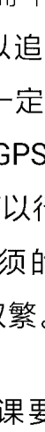

以简驭繁4 | 为什么说教是最好... ↓

第一模块
认知的源代码
第三模块
算法与唯一性原理
“以简驭繁”
第二模块
认知治理
第四模块
意义炼金术

听完前面三节课你可能会问：

“以简驭繁”和个人的认知升级有什么关系呢？我们还很年轻，要尽可能接触各种各样的知识，丰富自己的见闻，现在就“以简驭繁”的话，那不是简单而是简陋，不是认知升级而是认知退化！

如果你这样想，其实是误解了“以简驭繁”。

我再强调一遍：以简驭繁是一种认知的管理方法，而不是在具体事物上的行为方式。你可以追求复杂和丰富，就像你可以走路，但一定要记住方向和目的是什么，一定要立刻有GPS。GPS和指南针永远是简单的——你可以行万里路去各种目的地，但指南针是必须的，而指南针的特点就是简单，以简驭繁。

我们这节课要分享的是 一种认知管理方法，也是一种学习方法：以教为学，通过教别人来学习。

### 殿堂级大师和入门级问题

我先讲一个原子弹之父费曼的故事，他可是诺贝尔奖获得者、科学史上的殿堂级人物。有一天，古德斯坦拜访了费曼，和费曼相比，这只是个入门级或者菜鸟级的学者，所以他没有什么身段，就放得下身段来请教费曼问题，不用担心费曼问“这样的问题你还问”。

> 古德斯坦：您是否可以解释一下为什么快速旋转一半数量的粒子会符合费米-狄拉克统计模型呢？（这个问题你听不懂，我也听不懂。但在专业领域这是一个非常简单的）

> 费曼：回答你这个问题最好的办法是准备一堂课，我会就这个问题准备一篇适合大学新生的讲稿。

于是费曼花了一些时间思考这个问题，但他承诺的那篇讲稿并没有写出来；这个看似简单的物理学知识并不眷简单明了地概括清楚，即使费曼这样的大咖也没有办法用刚入学的大学生也能听懂的方式把它说出来。

后来，费曼觉得很惭疚，他对古德斯坦说：这件事我做不到，没有办法把这部分知识简单总结成大学新生也能接受的内容。也可以这么说，我没有真正理解这部分知识。

这个故事听起来很讽刺是不是：一个殿堂级的大师不能用简单的方式表达出一个入门级的问题。也就是说，一个简单的问题对一个大师来说反而成了一个巨大的难题——费曼攻克了许多问题，但这个问题他没有攻克下来。

### 写作是一种认知审计

这里我想起一个作家的话：

> “请原谅我把这本书写得如此之厚，因为我实在没有时间和能力把它写得更薄。”

这话似乎有点儿违反常识：有时间有能力应该写得更厚而不是更薄啊！但仔细一想，你会发现这个作家是对的——在认知上，从复杂回归简单不是降级，而是升级。

让问题从复杂回归到简单，我们被迫要面对一些意想不到的难题。这有点像用PPT和一篇 文章来陈述问题的差别：

PPT看起来很炫，能打动人，但它俗称“骗骗他”，其中包含着一个相当致命但我们常常忽略的问题：它是跳跃性和片段性的，你遇到问题立即可从这一页跳到另一页，而且还可以有很多花招来掩饰你的漏洞——用PPT陈述可以把自己没有想清楚和没法回答的问题忽略过去；

写一篇 文章来陈述问题的时候，虽然看起来有点儿啰嗦，甚至好多地方都很幼稚，是在常识层面上绣缝，但这种方式让你被迫面对自己的漏洞、盲点甚至盲区。

写作是一种认知审计。那些你要陈述的观点，你觉得懂了，但在落笔的时候发现根本也无法把它用明确简单的话陈述出来——你说不清楚实际上是因为你没想清楚。

### 教别人学习=自己补习

写作是一种认知审计，教一个基础很差甚至零基础的人学一门知识也是一种认知审计。

- ①当你要去教一个基础知识很薄弱甚至没有基础知识的人，你心理上会启动一种“保护效应机制”——你要保护自己的正确性或者必须要自圆其说，而这种自圆其说帮不上你任何忙的，你要调动全部的知识和能力让自己越过一个个逻辑和知识上的障碍。
- ②你教他的 时候会想到一系列问题，比如“解释这个概念最好懂的方法是什么”，“如果用专业的 东西解释不清楚的时候，能不能找到一种跟常识有关的方式解释呢”等，这就需要你有一种打通知识和触类旁通的能力，或者说是一种知识融通的能力。
- ③“他们会怎么理解这个概念”，“要想让他懂，重要的点和结论是什么，最难的是什么”。当你不断这样思考来辅导别人的时候，其实是在一种高度被监督的状态下，让你的表述更可能地主动和具有创造性。
- ④在你讲的过程中，如果发现对方心不在焉或者懒洋洋地靠在椅子上的时候，你会立即意识到“他对这个表述不感兴趣”或者“他完全没听懂”——要把一个枯燥的东西讲得很生动，能打动对方，你必须先说服和打动你自己。
- ⑤教别人学的过程其实是一种高强度的自学过程，你被迫去补各种各样的知识漏洞，横向、纵向扩展你的知识面——通过教别人，你完成了一个高强度、卓有成效的学习过程。

中国人把学习和研究称为“做学问”，那是先学了再问呢，还是先问了再学？在某种程度上这是一个“鸡生蛋，蛋生鸡”的问题，但如果讲重要性的话，是先“问”再“学”。亚里士多德说，“知识起源于好奇”，这个“好奇”一是兴趣，二是疑问：先有了问题才可能学习——用我们前面的话说就是：提炼是最好的存储。

我们之所以“提炼”，是因为碰到了问题。在没有碰到问题之前是没想到要提炼的，而在提炼过程中会带来一系列问题，这些问题会导致我们认知上的微创伤，认知就会调动起过度补偿机制。所以，教别人其实是一种认知上的过度补偿过程——与其说这是学习的过程，不如说是一个补习的过程。

## 总结

我们的基本主题是“以简驭繁”：

- 1. “从繁到简”是认知的一个常态，是从低维的“繁”到高维的“简”的过程。
- 2. 学习的过程也是一个“以简驭繁”的过程：我们要用看似简单、最基本的东西来重新审计已有 的认知，这时候会发现大量认知漏洞。
- 3. “不允许偷懒要滑”这种监督方式会对我们的认知造成一系列的微创伤，之后我们的认知才可能调动起补偿机制——看似降维的过程其实是一个升维的过程。

用户留言

提交留言可与专栏作者互动

## 问答37 | 有没有自己的人生哲学，重要吗？

## 滥用优先级排序的危险性

@ 宇宙

做感兴趣的事算不算一种优先级的排序？感兴趣的事符不符合第一性原理？

@ 三国一梦

当我们定下一个目标后，多问几个“为什么”，最终会得到关于感受层面的答案，比如为了优越感、幸福感。那么，感觉又指引了我们什么呢？我们以自己的感觉为最终判断标准是否正确呢？

简单回答就是：

- 感觉不能给你优先级排序；
- 优先级的排序是需要反思的；
- 优先级排序是为了克服感觉的随意性和偶然性。

但这里也有一点是对的：生活中常常是凭感觉排优先级的。比如开车的时候经常会遇到某种人，非要别你一下，抢一下道；或者旁边有个车位，你准备驶进去的时候，他风驰电掣开进来占据了这个位置，最后还得嗫恨地看着你几眼。

在这个过程里，这种人已经完成了一个优先级的排序：他们认为生活中最重要的是“赢得哪怕过后觉得微不足道的眼前事”。他们每一个瞬间可能都在追求这样的优越性，而忘了真正应该排在最前面的是什么。

“为什么他们排队的时候不顾尊严和脸面地去插队？为什么他们那么露骨地不遵守规则，只为了在一个瞬间超过你，获得一种优越感？”我一个朋友以前对这种事很不解甚至愤懑，他说：“有时候开车，有人非要和你较劲儿，不停要超车，但是等到他超过你，在下一个路口等红灯的时候，发现你跟他又排列在一起了，看着他们那种瞬间从得意变沮丧的表情，我觉得很无味。”

所有这些都可以归结到他们滥用优先级排序，或者听任感觉给自己排序。我开导这个朋友说：人都是在追求某种胜利感和成就感的，差别只在于你在什么地方追求这样的感觉。那些在每个琐屑节点上追求成就感和优越感的人，表明他们不会过其他的优越感和成就感，所以很可能不知道还有另外的优越感和成就感。你看到这种行为，如果不是同情，你至少要有一个“同情共理心”，那你才能释然。

我们生活和工作中，抢眼望去都是竞争，而竞争背后在起作用的是优先级，是追求自己对别人的优先以及配置自己资源时如何安排这种优先级。

这就回到我们前面讲的：不要滥用优先级排序，要慎之又慎。有时候，仇恨和嫉妒都跟优先级有关。

法国诗人波德莱尔说过，“一定要慎用你的仇恨，仇恨是消耗极大能量的。而你居然把这种巨大的能量消耗在这样一件毫无意义甚至会给你造成困扰和障碍的事情上，证明你还没有想明白自己真正要干的事情是什么”。

所以，仇恨是一种心智处于闲散和懒惰状态的表现方式，而闲散和懒惰就是没有或者滥用优先级的状态。

## 你的人生哲学是什么？

@ 蔡尼阳光

在这个常用的“重要与紧急”矩阵中，重要且紧急>重要不紧急>紧急不重要>不紧急不重要。在工作中，琐碎繁杂的事情太多，时间永远不够用，所以做到这点非常重要，但对“重要”这一概念的判断其实是很主观的，每个人有不同的选择。课里讲的“第一性”和“优先级”也是如此，那么，优先级应该是大众的、客观的吗？如何避免个人主观因素对选择的影响呢？

回答这个问题，我要重复威廉·詹姆斯的那句话：如果你是一个房东，在选择房客的时候，你更关心他的财务状况还是哲学呢？如果我是一个有经验的房东，我首先关注的是他的哲学。

按照常理，一个房东最关心的应该是房客会不会按期交房租，会不会欠房租逃跑——这个问题与财务状况虽然有关系，但关系不是那么紧密，反而跟房客的哲学更密切：

- 一个人财务状况不好，交不起房租，如果他秉承的哲学是“人活在世上要有尊严，回避问题永远不是解决问題的方式”或者“人生的目标不是苟且活在这个世界上，而是要活出个人样”，那他会有一系列解决办法，无论借钱甚至卖血，他都可能交上房租；
- 一个人财务状况很好，但他的哲学是“得过且过，有便宜就占”或者“讲什么尊严，那是虚无缥缈的，人活着就是怎么快乐怎么来”，那他欠不欠你房租，答案都是很明显的了。

说到优先级排序的时候，我们不妨先问自己一个问题：我秉承的哲学是什么？一种人生哲学会派生出一系列人生目标，而人生目标会分解成一层一层的优先级。

我们讲过的“末日思维”就是一种让我们回溯优先级的方式：假如你还能活3天，你会做什么？假如你能活一星期、一年、一生，你又会做什么？这些东西都跟你的人生哲学有关。

有人可能会说“我没有什么人生哲学”，对不起，“没什么人生哲学”就是你的人生哲学。你是一个得过且过、不认为什么东西重要的人，你也会排出一系列目标，这个排列已经是优先级排序了。

关于优先级，最重要的是不是“大众和客观的”，它恰恰是主观的，关键是你的主观到底是什么样的，或者你的人生哲学到底是什么样的。

倪飞·认知方法论 一年时间，打通看世界50个维度

## 用户留言

提交留言可与专栏作者互动

## 以简驭繁｜本单元十大精彩留言

## 本单元总结

- 1.第一节课

我们讲了“以简驭繁”和“简单粗暴”之间的差别，简单粗暴是看得见的手，而以简驭繁是背后看不见的手。判断一个人、一系列行为到底是以简驭繁，还是简单粗暴，就要看它们是否能归回到一个原点，能否归结为一个具有简单复杂性的算法。

- 2.第二节课

我希望你记住一句话：在认知的层面上，当你觉得有特别多的话可说，眼前的现象纷繁复杂、眼花缭乱的时候，你离热闹很近，但离门道很远。这种情况怎么办？想摸到门道，就要去掉一切不创造价值的环节，具体可以参考我们讲过的奥卡姆剃刀。

- 3.第三节课

为了让你进一步体会什么是门道，我们讲了《清教徒的礼物》，讲了经济学家亚当·斯密，还讲了哲学家大卫·休谟，你会发现，这些人、事背后都有一个共同点，他们有着极其简单又无所不在的规则。

- 4.第四节课

我们讲了一种学习的好方法：基于以简驭繁的原理，我们发现，教是最好的学。为了给不懂的人讲清楚一件事情，你就必须让复杂的知识回归简单，而在认知上，回归简单不是一种降级，而是一种升级。

好，以上就是本单元的主要内容。以下是 我精选的同学留言，恭喜前三名同学，将获得我签名的书一本，这次送出的书是最近刚刚出版的新书《直觉泵》，得到的工作人员会尽快把书寄给你，也希望其他同学再接再厉。我们下节课再见。

特别提醒：留言内容会默认公开，并同步到“知识城邦”中，中奖同学留个人信息时，一定记得将留言设置成隐私模式，确保个人信息安全。

## ——◆ 本单元十大精彩留言 ◆——

## 获奖留言

大海

第一性原理多次通过不同的概念向我们传达，可见其重要性。自己在实际使用第一性原理时，有一个方法可以落地：5why ——连续问5个why。

## 其他精彩留言

宗子说

视角，也许能够做出连自己也想不到的事情。

以简致繁2 | 远离热闹，回归门道

### YZM

《高效能人士的七个习惯》中有 一个习惯是以终为始，这就是说做任何事情一定要明确目标以后才可以行动，之前老师说的 OKR就是指南针，能够防止我们把手段当做目标，造成认知异化。

许岑老师讲过一个以教为学的例子，他的朋友（A）开了一个日语培训班，一星期后就要开班了，老师还没有请到，于是A就找朋友帮忙，这位朋友（B）是教英语的，对日语也是一知半解，但是B竟然答应了帮忙教日语。接下来的一星期B就去自己报了一个日语班学习日语，一个星期后就给培训班讲课，一边教，一边学，效果非常好，不仅自己的日语水平提升飞快，还受到学员们的一致好评。

以简致繁4 | 为什么说教是最好的学？

### 国武

在美国，曾有一个演讲爱好者问丘吉尔：“敢问阁下，做两分钟演讲，要多少时间准备？”丘吉尔答：“半月。”又问：“五分钟演讲呢？”答：“一星期。”问：“一个小时呢？”答：“无需准备。”为什么越短的演讲，反而需要越长的准备时间？因为演讲者要从听众的角度思考，反复打磨、范式转移，在微创伤和过度补偿机制下，在整体认知、系统性思维下，浓缩提炼出规律、本质性的东西，抛开一切寒暄客套话，以精确准确的语言去传递观点，使人在注意力承受极限内获取有价值的思想。

以简致繁4 | 为什么说教是最好的学？

### 林曦

吴老师好。今天的问答环节，让我回想起蔡康永老师关于“高情商”的一个观点：可能在很多人看来，高情商，是常常笑面迎人，非常讨人喜欢。可在他看来，“高情商”还有另外一种形式，那是在相处的过程中，让别人感觉很舒服。

这种人或许特立独行，但是他们能够在尊重别人的基础上，以别人能够接受的方式，展现出属于自己的独特色彩。开车、处理事宜、待人接物，都是我们与外界的不同因素进行互动的过程中，形成的认知。而认知的背后，总是离不开一套反应模式。而成熟的反应模式，离不开“第一性原理”的加持。有句话说得好：人的精力是有限的，不妨把它花在你认为的最有价值的事情上。“事情”本身，每个人都有不同的答案，但不变的是，我们为这件“事情”所设置的“优先级”。

问答 37 | 有没有自己的人生哲学，重要吗？

### 洛洛

中国人民公安大学李玫瑾教授，是我国研究犯罪心理学的开先河者，长期从事犯罪心理和青少年心理问题研究，研究特长：犯罪心理分析及画像研究。她讲过一个真实的故事，在我心里留下了深刻的印象，我也会不知不觉用这个视角反思一些社会现象。

她曾经与一个绑架和杀害多个少年儿童的罪犯谈话，因为在这个惯犯手下，例外放过了一个遭到绑架的儿童，李玫瑾教授想知道为什么。罪犯详细复述了当时的场景，他说，这个孩子和他绑架过的其他孩子不一样，自始至终没有惊慌和害怕，只是不斷地求他放了自己，孩子反复说的理由是，失去了他，爸爸妈妈会很伤心的。

这话勾起了罪犯的愤怒，他恶狠狠地说，就是要让他们伤心，伤心死了才好！孩子不解地问，叔叔，你没有爸爸妈妈吗？这个罪犯，带着怨气和怒气，说，没有！没有！他们都死光了！没想到，这时，这个遭到他绑架的孩子听了，居然反过来安慰他，说，叔叔，没关系，你到我家来，将来我养你。罪犯说，就是因为这句话，让他没有对这个孩子下毒手。

不知多少次，我在心里反复咀嚼李玫瑾教授的这个故事。这个故事要告诉人们什么呢？惻隐之心人皆有之，王阳明抓住一个土匪头子，那家伙宁死不屈，只速速求死，王阳明神情淡定，让他脱衣服，一件一件，直到剩下一条短裤，土匪头子再也不肯脱了。知羞耻，就是惻隐之心哪。

联系到今天吴伯凡老师说到的，那些在每个琐屑节点上追求成就感和优越感的人，表明他们没体会过其他的优越感和成就感，所以很可能不知道还有另外的优越感和成就感。你看到这种行为，如果不是同情，你至少要有一个“同情共理心”，那你才能释然。

问答 37 | 有没有自己的人生哲学，重要吗？

## 用户留言

提交留言可与专栏作者互动

## 认知与道德1 | 善良和聪明，哪个更重要？

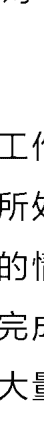

我们通常用“盲人骑瞎马，夜半临深池”形容一个人如果对自己所处的环境完全缺乏认知，那他必定会处于极端危险的境地。从这句话里我们也能感受到认知的重要性：

要提升认知，无非是在不同程度上避免自己成为一个盲人，避免自己使用的工具是一匹瞎马。

认知对于我们行动的有效性是非常重要的。

在生活工作中，我们有很多时候恰恰是在对自己所处的环境、要解决的问题缺乏充分认知的情况下被迫开始行动的。比如创业或者完成一个具有创新性的项目，都是要面对大量未知的。如果你一开始之前就已经对所有后续的情景、事态、运行轨迹都有了充分认知，那这可能就是一个不太值得做的事情，或者说是一个不可能形成竞争力的行为。比如打开水龙头就有水——你之所以打开水龙头，是你确定只要一拧开马上就有水出来，就像按下开关就亮一样。

在这样的行为里，我们几乎是在信息完备的情况下作出决策的，它能给你明显的确定性，你行动起来也就有了100%操之在我 的感觉。但如果生活工作都由这些行为组成的话，你很可能处在一种没有创造性、生产性，极其平庸的阶段。

但只要去做真正有价值的事，你就必须要面对一个处境：你需要掌握的东西与你掌握的东西之间的明显不对称。

### 小孩：不明就里地按照命令去执行

事实上，认知形成的过程，人成长的过程都是在这样一个背景下进行的。比如小孩子，尤其是小男孩会有各种各样的冲动，擅自去做一些在大人们看来极其危险的事情，这时候大人就会去阻止他的行为。

有的小朋友会问，“为什么不让我用手指头掏那个插座啊？”大人没法解释说，“这里有电，你手指一伸进去就会触电，触电会导致血液心脏的一系列变化，然后你就死掉了”——小孩是完全听不懂这些的，所以大人往往会说，“你就是不能用手掏这个！”或者“烧开水的壶不能摸”，“你不能站在桌子上往下跳，腿会摔断的”……但小孩不明白为什么不能这样做。还有一种情形是，小孩生病不爱吃药，大人不可能跟他讲一系列道理，“这是什么药，吃完以后你的身体里会产生什么化学反应，你的病就好了”。

我们小时候很多的行为都是在不明就里的情况下直接按照命令去做的，所以这一切都有一个共同点：在你缺乏认知的情况下你就去做了。

### 成年人：想当然做事情的赌徒

有人说小孩这样是因为他的认知还处于相当初级的阶段，我们成年人就不一样了，所以，我们必须要让自己的认知照亮自己所处的环境，让自己的眼睛不瞎，才能规避危险、避免失败、尽可能提高成功的概率。

但我们也不得不承认，哪怕是成年人，哪怕是一个公认具有高度认知水准的人，每天也要面对大量不能确定的事情——在很大程度上，很可能你眼前就是一个很深的水池。你是一个企业家，如果你的很多决策都是在信息不完备的情况下作出的，这就使你的行为具有了赌博的特点。

赌博跟“盲人骑瞎马”有很相似的地方，只不过有些时候程度不一样而已。换句话说，我们的很多行为，尤其是那些能够创造价值的行为，都具有在信息不完备状态下判断和决策的特点，也就是说，你的认知不足以让你完全应对眼前的各种复杂情形。

在这种情况下，我们该怎么办？不管你愿意不愿意，承认不承认，很多时候，我们都是在想当然地做事，都是或大或小的赌徒。

那么这里就包含了一个问题：我们的行动依据除了认知还有没有别的东西？如果有的话，是什么？

### 为什么善良比聪明更重要？

讲到这里我们很容易想到亚马逊的创始人贝佐斯的一句话：善良比聪明更重要。

贝佐斯认为：在面对一个不确定性的 时候，聪明是不足以让你作出正确决策和选择 的，反而是善良这种跟认知好像没有关系 的特质能帮助你作出正确的决策。

有些人认为贝佐斯的这句话是一种道德说教：聪明和善良明显是两个不搭界的东西，聪明就是聪明，善良就是善良。当你缺乏足够聪明做不成事的时候，善良并不能帮得上你什么，尤其在商业领域，“怂撒的归怂撒，上帝的归上帝”，在商言商，谈善良是没有多大意义的。

但也有一部分人认为：善良和聪明表面上是不相关的两件事，但在内是相通的，也就是说，善良表面是一种态度，实际是一种特殊的认知形式。

不论是贝佐斯的“善良比聪明更重要”还是 Google的“不作恶”，都不仅仅是一种道德主张，而是一种认知主张。

这就涉及到一个很重要的問題，而且是我 们本单元要着重讨论的问题：

- 道德，尤其是善良这种道德上的最高价值，跟认知之间到底是一种什么样的关系？
- 大智若愚、大巧若拙这样的命题，到底只是一种道德判断，还是在道德判断之外包含着认知的真理呢？

## 总结

人的行动常常是在认知匮乏的情况下开始的。我们大量的行动，尤其是重大问题的判断和决策，都是在认知不完备的情况下开始的，我们不可能在完全懂了一件事情之后再开始做一件事情。

后面的课程里我会和你讨论：

- 1. 认知不足以完全成为我们行动指引的时候，人还要依据什么作为行动的指引呢？
- 2. 善良跟认知是什么关系？善良是不是另外一种意义上的认知，甚至可能是一种更高维度的认知呢？
- 3. 认知与道德、聪明与善良到底是一种什么样的关系？

用户留言

提交留言可与专栏作者互动

## 认知与道德2 | 什么是正确的“赌性”？

第一模块
认知的源代码
第三模块
算法与第一性原理
“认知与道德”

第二模块
认知治理
第四模块
意义炼金术

### 上帝的赌局

我们已经知道认知很重要，但认知不是一切——我们不能学会游泳之后再下水，只能在并不懂得怎么经营一个企业的时候就开始创业。

但事实上，我们做很多事情，尤其是那些有价值的事情的时候，都是在认知不完备的情况下就已经开始了的。我们每个人在不同程度上都是一个赌徒：面对不确定性我们就要开始行动。

法国人帕斯卡（Blaise Pascal），不仅是一个物理学家和数学家，还是一个著名的哲学家，他提出过哲学史上一个著名的论证：关于上帝的赌局。

上帝存在不存在谁也不知道，你不可能通过任何理性推导来论证上帝的存在，但是，在面对重大决定的时候，如果你不是通过抛硬币、抓阄、找人算卦等方式来决策的话，你就很可能设定一个超自然的力量，然后按照它的旨意去做事，你觉得这样你可能会赢——当你不再用理性方法去论证你该不该做，而是听从某种你相信的超自然力量去做的时候，这就是一个打赌。

这是一场你输不掉的赌局，所以你必须去打。因为，如果这个超自然力量存在，那你就赢得了 整体；如果不存在，你也没输掉什么。

帕斯卡的这个结论我们可能不同意，但他提供了一种思路：当感性和理性认知都 not用的时侯，我们必须要求助于一种尚未确定的东西作为我们行动的依据。

### 案例：“赌性不够”造成的失败

分享我一个朋友的创业故事。

他和另外一个朋友一起创业，做同样的生意，而且，他之所以创业是听了那个朋友的建议，两个人在一个非常有成长性的新行业做起了新生意。慢慢地，他的企业做起来了，而那个朋友却一直处于修修改营的状态，后来越做越小，最终干脆放弃了。

我：为什么你能把这个事情做起来，而你那个朋友没有？他有远见也有洞察力，说不定他比你还聪明呢，为什么他没做起来？

朋友：我这个朋友确实有远见，也确实比我聪明，更重要的是，他是一个律师，懂得经营企业的很多规则，而我不懂。但他做不下来一个很重要的原因，恰恰也是因为他很聪明，是个律师。

我：这话怎么讲？

朋友：我做事的时候，是看这个事情总体上有前途，但具体做的过程中，我不是一个很精细的人。我那个朋友以前一直从事律师工作，不说懂得法律就对企业经营不利，创业者懂法律应该是一个优势，但他长期从事这种职业让他形成了一种思维模式——尽可能规避风险。事情一出现，他更多想到的是风险和不可能。而一旦出现麻烦，他就像有一种特殊的显影剂，立即就能把这件事情里负面的东西显现出来。而我的思维方式跟他不一样，我总是想着怎么能做成这件事。所以同样遇到困难，他就形成了一个关于困难和不可能的证据链，他越是去寻找证据，证据就是不清自来，最后他压力越来越大，越来越焦虑，干脆放弃了。

我：如果用一句话概括他为什么做不成，你觉得是什么？

朋友：他赌性不够。

朋友最后这句话是“言者无心，听者有意”。赌性的确很重要。

一个赌徒的特点首先是敢押宝敢冒险，但敢押宝敢冒险有可能满盘皆输，输到你的故事线没办法延长。所以，打赌的时候，你还是需要某种不确定的确定性作为依据的，那这种“不确定的确定性”是什么呢？

### 管窥效应导致的认知幻象

我们前面讲过一个概念：管窥效应，就是你的视线让你对局部的情看得越来越清晰，以至于这种过分清晰的视野成为你全部的视野，而视野之外的所有东西都被屏蔽了。

那么，这种管窥状态可不可以叫“不确定性中的确定性”呢？不能，因为这种状态是无视不确定性。

不确定性始终存在，但由于你过分聚焦在眼前的确定性上，使得你完全忘记了主宰整个格局的力量，也就是把不确定性彻底忘了。你的思维和行为会变得越来越片面。这种片面性面对巨大风险的时候会成为两种东西：贪婪和恐惧。

比如掷硬币，你已经掷了10次正面，会觉得只要一掷出去就都是正面了，但概率论告诉你，咋么掷10次硬币都是正面，也不能保证第11次还是——不确定性始终存在，随着你尝试的次数越来越多，最终会形成某种均衡。

你一次又一次地获取形成了一个认知幻象，好像不确定性已经不存在，只剩下确定性了，你的行为和思维在这种管窥效应驱使下不断强化，其结果要么是贪婪——不停加注，让你的利益最大化；要么是你不停畏缩，越来越恐惧。不管贪婪还是恐惧，都是管窥导致的一种认知幻象。

### 案例：印第安人打猎的故事

我们用一个经典案例来说真真正正的确定性中的确定性是什么，以及管窥效应所导致的危害。

加拿大魁北克附近曾经有很多印第安人的部落，但只有一个部落一直生存了下来，其他都消失了，原因是什么呢？

其他部落打猎的时候，凭借的是打猎的知识——他们对周围环境、猎物习性很了解，所以他们知道去哪里打猎。这样做的结果，要么是猎物被赶尽，要么是猎物被杀绝，剩下还有一些猎物由于长期跟人博弈变得越来越聪明，使得打猎难度越来越大，以至于最后这些部落无猎可打。

只有一个部落不是按照狩猎的经验打猎的，而是用了一种极其原始的方法：每次打猎之前，他们会烧兽骨，然后根据烧出来的裂纹，由部落巫师给出一个方向。我们知道，烧骨的裂纹常常是随机的，所以他们每次打猎的路线也都是随机性的——这种方式表面很愚蠢，实际上规避了“管窥效应”。这个部落周围的猎物没被赶尽也没被杀绝，动物也没被反向驯化得特别精明，所以他们一直有猎可打，就生存了下来。

很多管理学家都对这个案例进行了解读，我们现在从这个案例里看到的是：不确定性中的确定性以及管窥效应所导致的危害。

### 什么是赌性？

现在，我们对前面提到的“赌性”可能有了更深入的理解：

- 1. 赌性并不仅仅是指敢于冒险，更不是敢于不断加码。
- 2. 既然是赌博，你必须意识到你面对的整体背景是不确定性的，你眼下的行为和认知不要建立在屏蔽了不确定性以后看到的确定性上。
- 3. 赌性是始终保持对不确定性的敬畏，意识到有一个“概率之神”——概率之神最大的特点就是它从来不眷顾那个局部、哪个环节、哪个个体情有独钟，它是不确定性中的确定性。
- 4. 一旦你忘记了“概率之神”，很可能会陷入到管窥效应中——要么贪婪，要么恐惧，要么自取灭亡，要么半途而废。

## 认知与道德3丨善良到底是什么？

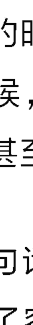

认知与道德3丨善良到底是什么？ ↓

| 第一模块 认知的原代码 | 第二模块 认知治理 |
| 第三模块 算法与第一性原理 “认知与道德” | 第四模块 意志炼金术 |

### “不划算”里的“管窥效应”

我们上节课分析了印第安人打猎的经典案例，按我一个朋友的话说，“这个案例没什么新鲜的，中国古代就有这样的思想”。

孔子曰，“子钓而不纲，弋不射宿”：你要吃鱼的时候，不要用网打，要钓；你要射鸟的时候，不要射鸟窝里的鸟，要射站在树枝上甚至飞动的鸟。

这句话看上去是一种非理性的选择：你放弃了容易做的事情，放弃了利益最大化，这看上去是非常不划算的。但是，孔夫子这句话跟印第安人故事的异曲同工之处，恰恰是这三个非常关键的字：“不划算”。

“不划算”是付出和得到之间的不对称。你之所以觉得不划算，不是你付出没有得到回报，而是你看到了更高更大的回报。

这三个字本身就自带了“管窥”的色彩：你是从你个人的、单次行为的角度来考虑投入和回报，而不是从整体的、行为的可持续性角度去考虑。

### “利他主义”的两个困难

讲到这里，可能有人会问，“这是不是意味着，更高级的算法就是利他主义算法呢？”很多哲学家都在讲“利他主义”，很多民间和街头智慧里还有“以舍为得，舍才能得”的说法，这里可能也都包含着这种利他主义算法，但这样对不对呢？

我们现在不对“利他主义”进行详细讨论，你只需要明白它在逻辑上的两个困难：

- 1. 第一个困难：“燃烧自己，照亮别人”的行为不可持续，因为它本身不是闭环，而不可持续的东西即使提倡也不管用。
- 2. 第二个困难：和“燃烧自己，照亮别人”相反的一种“利他主义”：利我，舍是为了得。这是一种表面上的利他主义，本质上的利己主义。

以上这两种思路都表明：“利他主义”不仅有逻辑障碍，而且有现实障碍。如果“利他是为了利己”，舍是为了得的话，在你的利他得不到回报的时候你就会犯嘀咕，第二次再出现这样的事情你就会放弃。所以，如果利他主义成立的话，我们要重新考虑这个“他”到底指什么。

不管是印第安人打猎，还是孔夫子的“钓而不纲，弋不射宿”，说的都不是单个个体的“他”：不射鸟巢中的鸟，利的不仅仅是这只鸟，而是终极关怀鸟这个物种的存续问题；你钓鱼而不是捕鱼，真正获利的是鱼这个物种的可持续性问题；印第安人焚兽骨选择打猎路径，利的不是某个地方的猎物，最终利的是周围的所有猎物。

### “善良”到底是什么？

我们上节课讲：

- 1. “不确定性的确定性”实际是指概率之神，是超越个体之上的一种逻辑。
- 2. 第一性原理始终提醒我们：不要陷入到管窥效应当中。
- 3. 善良比聪明更重要。

那么现在我们可以继续讨论“到底什么叫善良”。有一个案例可能会让你对“善良”有一种新的认识。

有一个小男孩看见沙滩上一只刚刚出生的小海龟在艰难爬行，想爬到海里去。这个小男孩很善良，不忍心看这只刚刚出生的小海龟那么艰难地爬，就捡起小海龟，把它扔到了海里。小男孩认为（我们也认为）他做了一件善事，但接下来的故事可能要改变我们的认知了：

离这个海滩不远的地方其实有无数的小海龟。在自然界，小海龟爬到大海的过程中往往会遇到一个巨大的危险：天敌军舰鸟会过来吃它们。所以，小海龟大规模爬向大海之前，都会派出山一两只小海龟先爬向海里。如果它安全爬到了大海就会发出“我安全到这’的信号，让其他小海龟知道没有危险；如果小海龟们接不到这个信号，就意味着这只小海龟已经牺牲了，它们就会暂停向大海的迁徙，等一会儿再继续派出山一只小海龟……直到连续几只小海龟都安全到达大海，它们才会大规模地开始向大海迁徙。

这个小男孩在无意中干了一件极坏的事情：让小海龟发出一个错误坏的信号“这里是安全的”，所以，无数小海龟开始爬向大海的时候，成群的军舰鸟飞来把这些小海龟叼起来吃了。

小男孩的动机不能说不善良，但在某种程度上他作了巨大的恶——善良导致的巨大的恶。但为什么会这样呢？

要回答这个问题还是要回到“管窥效应”：善恶的问题看上去是一个道德问题，其实是一个认知问题，它的关键在于，你是对局部的认知还是对整体的认知。

基于局部的“管窥认知”就可能导致恶，真正的善是基于对整体的认知的。

如果缺乏对确定性背后的那个不确定性的敬畏，那么很可能就是在作恶。关于这个问题，我会在下节课给你详细分析。

bumper·认知方法论
一年时间，打开洞察世界的50个维度
!扫描小程序App码。 天课暂时可在知乎发布

## 用户留言

提交留言可与专栏作者互动

## 认知与道德4 | 道德问题的背后是认知问题

认知与道德4 | 道德问题的背...

第一模块
认知的源代码
第三模块
算法与第一性原理
“认知与道德”
第二模块
认知治理
第四模块
意义炼金术

### 只看局部，不顾整体的“恶”

日常生活中存在一种政治不正确的说法——妇人之仁。我们撇开这里明显带有歧视女性的色彩不谈，来看看这种“不顾整体，只要局部”的爱。

从某种程度上说，我们上节课讲到的小海龟故事里那个小男孩的行为就是“妇人之仁”：他在无视整体的情况下做了一件善良的事情。而在“妇人之仁”的背后还有一个更普遍的逻辑：既然“局部善良可能是整体之恶”，那么反过来“局部之恶也可能是整体之善”。

中国的道家讲“天地不仁”，意思不是说天地就是坏的，而是说天地是一个整体，大道也是一个概率之神，不会单独着顾某个个体和某个局部，它要照顾的是整体。我们不能在局部上看一个事情的善和恶。

当然，这个逻辑可以更普遍化，比如古人说，“天欲祸人，必先以微福之，要看他会受；天欲福人，必先以微祸之，要看他会救”。老天爷要祸害你的时候，一定会用一些小小的福气或者幸运让你变歹做，看你能不能受得住这个福；要想造福于你的话，往往会以一些小祸来警醒你，通过观察你如何消除这些小祸来最终成全你。

我们知道这里包含着迷信色彩，并不存在着一个人格化的老天爷，但也可以把它理解为一个“概率之神”，或者一个“不确定性中的确定性”。它们都在提醒我们：不能陷入“管窥”当中。

### 不确定性当中的确定性

美国黄石公园百年不遇的大火就是一个很好的案例。

我们知道有森林的地方就会有火灾，所以，黄石公园的管理机构建立了一个严密的森林火灾救护系统，只要任何一个地方出现火灾，就可以动用最先进的设备，比如直升机来喷水，很快把火灭掉，所以黄石公园很多年都没有发生火灾——对黄石公园来说，完备的消防系统是一种善。

但我们也知道，森林火灾是一种自然现象，很多自然起火是因为某个地方的枯树多了，一个雷击就能够导致这种小型火灾。而说它是灾其实也未必：一个地方的枯树被烧掉以后才会长出小树，而如果很长时间到处都是枯树，森林就没法形成防火隔离带，导致一种危险——当枯树越来越多，已经连成片，而没有隔离带的时候，在某个节点一旦起火就会形成火烧连营的局面，一场小火就可能引发一场大火，看上去很强大的消防措施也没办法扑灭。

这也有点儿像我们时不时会生一些小病，其实这是身体自我调节的一种表征。如果你马上把这点儿小病扼杀在萌芽状态的话，其实对身体是非常危险的，因为这种完备的救治可能导致一场你最终没法救治的大病。

上面这些案例都在提醒我们，无论你为人父母还是公司领导，都应该知道这个世界的整体背景是一种不确定性：

在这个不确定性中又是一种确定性，这种确定性不是排除了不确定性以后通过管窥看到的确定性，而是一种类似于概率之神的确定性，或者说是一种整体视野中的确定性。

这种确定性提醒我们：要延迟判断，因为这很可能是一个管窥的结果，而这种结果会诱使你陷入到“要么贪婪，要么恐惧”的状态当中。而不管是贪婪还是恐惧，都是一种确定性的自称和强化。

不确定性当中的确定性不是你眼看到的这个确定性，而是一种概率性的、覆盖整体的、表现为不确定性的确定性。

### 为什么善良比聪明重要？

现在，我们就可以回答第一节课提到的问题了：为什么说“善良比聪明更重要”。

这句话的本质不是在强化善良，而是在强调：聪明常常会陷入到管窥视野当中，我们要学会节制自己的聪明能力把握和掌控的那个局部性，与此同时，要把这种所谓的确定性放置在不确定性的整体视野当中。

贝佐斯说“善良比聪明更重要”的意思还有：当你凭着你的聪明总是在做对公司有利的事情的时候，其实已经陷入到了管窥视野或者贪婪当中。

那么，用什么来打击这种管窥视野呢？你要站在跟你的立场、视野不一样的主体上看你现在该做的事情。

有时候对公司有利的事情往往对客户是不利的，而如果忽略了客户，你在作选择和决策的时候会“看上去很聪明，实际上很愚蠢”。所以一直到现在，贝佐斯还坚持一个规定：公司开董事会的时候，董事长的...“我们开董事会任何决定的时候，一定 Kan horse ...”。

这好像跟通常所说的“以客户为中心”没有什么两样，其实它要讲的是：避免陷入到排除了很多变量以后的确定性陷阱当中。从这个意义上说，那个从不只单独着眼某个个体/机构/组织，而要照顾所有个体/机构/组织的概率之神才是真正的确定性，而我们的认知常常会因为处理眼前的事务而忽视甚至完全无视它。

哲学家康德评判“是否道德”有两个标准：第一，是否具有普遍性；第二，是否具有可持续性。

借钱不还有没有普遍性？我借给你的钱你不还，我愿意，但别人借我的钱不还，我就不愿意了——这就证明这个逻辑不具有普遍性；借了你的钱不还又有没有可持续性？显然下次肯定是借不到的。

道德是对整体有利的，而不是简单的利他主义。

“钓而不纲，弋不射宿”不是单独对某只鸟好，最终是对自己好；你能一直打到鱼，一直打到猎物，才是孔子真正关注的事情，才是他所说的“克己复礼为仁”：“克己”可以理解成“克服一己之私”，而这个私人利益也有自己之私的视野和认知，克己复礼才能回到真正的仁。

## 单元总结

- 1. 我们的行为和决策常常是在信息不完备的情况下开始和作出的。引领我们行动的除了认知，还有什么？有人认为是善良或者道德，那到底什么是善良，什么是道德？这不是一个可以简单回答的问题。

- 2. 局部之善很可能是整体之恶，局部之恶很可能是整体之善——道德问题的背后仍然是一个认知问题。

- 3. 要做一个有道德的善良的人，本质是让自己的认知更优化，而这个优化是时刻警惕自己不要陷入到管窥状态。

- 4. 面对一个事件/事态/现象的时候，我们要调控我们认知的焦距，这样你看到的就不是一个黑白分明的世界，而是一个白中有黑，黑中有白，白黑相互交替转换的真实的世界，就像我们在太极图里看到的样子。

看得不过瘾？
《伯凡·日知录》还有一整年的内容

## 尽在凡·认知方法论

## 问答38 | 什么是“高品质勤奋”和“高品质懒惰”？

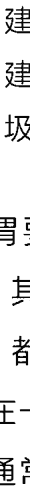

问答38 | 什么是“高品质勤奋.. ↓

### “丁谓造渠”和“大马哈鱼洄游”的异曲同工

在“以简取繁”这个单元的课后，很多同学提到的问题都和大马哈鱼的案例有关。这个案例其实是和“丁谓造渠”连在一起的，我们先来复习一下丁谓解决的是什么问题。

丁谓要完成三件事情：

- 1. 取土烧砖，把砖运来建皇宫；
- 2. 把大量石物料材运过来；
- 3. 建造前，清除旧皇宫废墟上的建筑垃圾；建完以后，清除建造过程中产生的建筑垃圾。

丁谓要完成的这三个任务互相交织在一起，其中任何一个任务本身都是非常繁重的，都要付出极大的机会成本，而他还必须在一年之内同步完成这三件事情。如果按通常步骤，完成其中任何一个任务都可能耗去一年的时间，那他就面临着杀头的危险。所以，丁谓必须在做任何一件事情的时候都尽可能减少做这件事情的机会成本。

最后，丁谓发现这三件事情可以通过做一件好像与之并不相干的事情完成：在皇宫与汴河之间挖一条小运河。

借用《高效能人士的七个习惯》里的一个术语：他做这件事情到达了“超常的主动性”，也就是锲之在我的另一种迭筹能力。

我们讲过，大马哈鱼同时要完成两个任务，但其实还有一个任务隐含其中，它要完成的是三个任务：

- 1. 如何做到以极高的洄游率保证最好的基因得以延续；
- 2. 如何让这些承载了最好基因的后代的存活率达到最高，也就是让它们一出生，就尽可能享用便利的生活环境，保证它们可以回到它们成长的地方——海洋里；
- 3. 鱼类在孵化的过程中常常会遇到一个大问题：水生动物会吃掉鱼卵和刚刚孵化出来的小鱼，所以，要尽可能找到一个水生动物最少的地方。

这三件事情看起来也是不相关的，但大马哈鱼选择了一个方案来同时完成这三件事情，这跟丁谓造渠有异曲同工之妙。

### 勤奋和懒惰的四象限

从“丁谓造渠”和“大马哈鱼洄游”的案例里，我们会想到一个近两年特别流行的词：低品质勤奋。

勤奋的反面是懒惰，这好像说一个人只能有两种选择：要么做一个勤奋的人，要么做一个懒惰的人。事实上，人的行为是不能够简单地用勤奋和懒惰的二分法来概括的，至少我们可以把它分得更细一点：勤奋、懒惰、高品质、低品质，这样我至少能看出四种行为：高品质勤奋、低品质勤奋、低品质懒惰、高品质懒惰。

我们大多数人基本都在低品质懒惰和低品质勤奋当中，很少去谋求甚至没想到会有高品质勤奋和高品质懒惰。

“丁谓造渠”就是一种高品质勤奋，还有一种高品质懒惰，类似于“懒蚂蚁效应”，是用一种特殊的“奥卡姆的剃刀”去掉一切不值得做的事情。

当你动用这个剃刀的时候，你会发现生活中心其实有很多事情是不值得做的，但是这里有一个对我们的认知的挑战：你怎么知道哪些东西是要剔除的，哪些东西是不能剔除的？当你能够使用“奥卡姆的剃刀”把那些不值得做的事情剔除掉的时候，你可能处在某种闲散中，但要获得这种闲散和懒惰需要很高的认知能力，这不是一般人能做到的。

高品质懒惰之外还有一种高品质勤奋：这件事情是必须做的，那你很可能陷入到低品质勤奋和高品质勤奋的冲突中，虽然很多人是感受不到这种冲突的，他们往往觉得“只要这件事情是必须做的，那我就竭尽全力、按部就班地一件一件把它去、完成”，事实上，时间和机会是最大的成本，很多时候不允许你一件件去做。

所以，在关键节点上，只有少数人能够胜出，大多数人要么就陷入到低品质懒惰的无所作为、怨天尤人、自甘堕落当中，要么就陷入到最终的结果很有可能是没用和徒劳的低品质勤奋当中。

你不妨仔细品味一下“勤奋和懒惰”的四个象限，可能就明白了为什么把事情做成的人如此之少了。

“以简取繁”这个单元强调的“以简取繁”不是偷懒，而是一种更高品质的勤奋；是算法层次的解，而不是数据层次的解：数据层次要尽可能地繁，算法层次要尽可能地简，但我们经常是倒过来的，在算法层次特别复杂而数据层次又特别简单，导致尝试的东西、获取的数据和信息很少，但是在规则层面又弄得特别复杂，最后就会陷入到一种焦虑、紧张、忙碌的一事无成中。

可能有人会说，“你说得太轻巧了，普通人做事情不就得一件一件做，哪有那么容易偷懒的事情啊”——我不是教你偷懒，偷懒有两种，一种是自己知道自己懒；还有一种懒是偷偷地偷懒，用你的勤奋和忙碌在偷懒，用你低品质的奋斗和挣扎向自己和别人证明自己并没有偷懒，这是一种更致命的偷懒。

### 第三种选择

“以简取繁”这个单元的课程要让你心里有一根筋：要学会以简取繁，学会追求高品质的勤奋，避免低品质的懒惰和低品质的勤奋。

当你有这个意识的时候，你会发现世界上很多事情是可以通过做一件事情完成的；如果你没有这个意识，你很可能永远表面勤勤恳恳，实则蜻蜓点水。

我们不妨举一个最简单的例子：跟人交往的时候，你是想做一个索取者，还是做一个给予者？表面上，这是一个二选一的问题，不可能有第三个选择，但有很多索取本身就是给予，很多给予就是以索取的方式表现出来的，比如“求人”就是你用索取的方式跟别人建立一种密切的合作关系。

俗话说“难者不会，会者不难”，你让对方的举手之劳能够帮助你在关键点上脱颖而出，这既是你完成了自己的事情，也是你求人的一种方式——对对方在不付出多大成本的情况下帮助了你，你已经跟对方形成了某种联盟关系。

美国谚语说，“索取是最好的给予”，从这个小小的事情上我们就稍微领悟到这个道理：在两种选择之外常常有第三种选择，或者三个任务背后可能只需完成一个任务。

《第三种选择》这本书讲的就是这个道理：看似水火不容的选择背后承载着一个很可能完全被忽略的第三种选择。一旦找到这种选择，不但两全其美，甚至是三全其美，这就叫“以简取繁”。

说了这么多，也许并不能马上告诉你直接的方法，但世界上的方法首先是因为有一种意识，形成这种意识以后就能慢慢在生活中发现方法，知道了方法的妙处，形成正反馈，最后才能将方法变成一种习惯。

## 用户留言

提交留言可与专栏作者互动

## 认知与道德 | 本单元十大精彩留言

认知与道德 | 本单元十大精彩...

## 本单元总结

- 1. 第一节课

我们主要讲：我们不可能在完全懂了一件事情之后再开始做一件事情，所以一个人的行动，常常是在认知匮乏的情况下开始的，这也就意味着，除了认知之外，我们的决策还受到了其他因素的指引，这个因素一般来讲就是我们这个单元的关键词：道德。所以这节课里我们还提出了一个非常重要的问题：善良和聪明，哪个更重要？

- 2. 第二节课

我们说到了一个词：赌性。什么是赌性？赌性不是敢于冒险，更不是敢于不断加码，而是对不确定性的敬畏。为了便于理解不确定性，我们可以设想一个概率之神，它最大的特点就是从来不对哪个局部、哪个环节、哪个个体情有独钟，只对整体负责，这是不确定性中的确定性。

- 3. 第三节课

我们的视角聚焦在了关键词“善良”上。通过一个男孩和一只小海龟的故事，我们阐明了一个道理：善恶问题表面上看是道德问题，但其实是认知问题，它的关键在于，你是对局部的认知还是对整体的认知，对整体的认知才能带来真正的善。

- 4. 第四节课

我们回答了这个单元最初提出的那個問題：为什么善良比聪明更重要？因为聪明常常会使人陷入到管窥视野当中，我们要学会节制自己的聪明，与此同时，要把所谓的确定性放置在不确定性的整体视野当中。扩大到道德问题上也是一样的，道德是对整体有利，而不是简单的利他主义。

好，以上就是本单元的主要内容。以下是creating精选的同学留言，恭喜前三名同学，将获得我签名的书一本，这次送出的书是最近刚刚出版的新书《直觉泵》，得到的工作人员会尽快把书寄给你，也希望其他同学再接再厉。我们下节课再见。

特别提醒：留言内容会默认公开，并同步到“知识城邦”中，中奖同学留言个人信息时，一定记得将留言设置成隐私模式，确保个人信息安全。

## —— 本单元十大精彩留言 ——

## 获奖留言

Shaka

这周的课程让我不禁联想到小时候看Discovery时的一个疑惑：看到小动物饿死或要被杀死的时候，野外摄影师总是选择旁观的姿态，而不出手相助，以前很疑惑。后来看到一个专访，一位摄影师说：“选择不去救助那些动物的时候，他的内心也是很挣扎痛苦的，但是，摄影师的行业规则就是不能破坏大自然的规律，这也是职业道德。”

我当时看了，懂了原因，但不明白为什么这是职业道德。现在看来，摄影师的行业规则应该就是遵循老师所说的道德为制定的了，摄影师群体之所以会有这个行业规则，就是防止广大的野外摄影师在一开始进入行时陷入到管窥效应中，以自己局部的善举给大自然带来整体的恶，所以要先订立规则，使年轻的摄影师即使不能理解也必须遵守规则。而当摄影师更深入地理解了大自然之后，职业道德自然就会流淌在骨血之中了。

认知与道德 4 | 道德问疑的背后是认知问题

赵家宝

世事无常，在作重大决定的时候，问自己6个问题：

- 1. 代价是什么？
- 2. 愿意承担吗？
- 3. 真的能够承担吗？
- 4. “管窥效应”产生的幻觉、贪婪与恐惧的欲望让我失去理性了吗？
- 5. “概率之神”的敬畏、文字化整理、数字化解析、把自己“工具箱”里的工具都用一遍了吗？
- 6. 初心是什么？

随后rate作决定，万劫不复近在咫尺，需慎之又慎！

## 其他精彩留言

### 雪山飞狐

罗胖在他的节目中说到了明朝。在明朝建国初期，明太祖就制定了针对他子孙后代的一些好的福利措施。这能确保他的子孙后代都能衣食无忧。只要是朱元璋的后代，就可以从国家那里获取土地和资源，这导致他们的后代拼命地生娃。这里的每一个人不需要任何的生存能力，就能够活得很好了。从这个局部来看，当然是一件好事。当这个福利演化到最后，从整个系统来看，让他的子孙后代都变成了一个猪一般的存在。在明朝灭亡后朱元璋的子孙后代像猪一样，被统统杀掉。这是从局部有效演化到最后带来系统的灾难。

局部的善在管窥认知作用下，都会演变成系统的恶。善恶不是道德所能规定的，是由认知决定的。

### 王逸动

小男孩帮助乌龟的故事让我想起了很多类似的思想实验：

如果某城市按照统计规律，每年有100个人自杀。那么，你可以乘坐时空机器回到过去，阻止人们的死亡吗？答案是，不能。在“大数定律”的作用下，你的拯救行为成为新的“变量”，其结果不过是让“死亡函数”输出了新的“死亡名单”，另外的100个人会因此丧生。局部的改变不过是调整了“变量”，而除非改变这个“死亡函数”，否则做什么都是徒劳。

### Bern

罗胖今早的60秒分享了他准备跨年演讲的过程。100多天的准备，反复打磨，演练，100多天他都干了些什么？

### 陈陈

恐惧从管窥中来。那天我坐 Replication

## 用户留言

月光 善良比聪明的更重要的原因是，人是有情感的是用感情相互交流的，如果只是为了实现自己的聪明，而不顾其他人的感受，反而缺少了人生味，也就是我们常说的“情商”比较低的人。 12-29 07:23:23

陈栋 善良就是不要自作聪明地轻易破坏规则。要站在系统的角度思考问题，要搞清楚系统的边界。 12-29 07:22:28

## 认知与自由1 | 你自由吗？

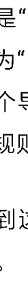

认知与自由1 | 你自由吗？

- 第一模块
认知源代码
- 第二模块
认知治理
- 第三模块
算法与第一性原理
“认知与自由”
- 第四模块
意义炼金术

### “我到底自由吗？”

我相信每个人都会时不时问自己，“我到底自由吗？”生活中总有各种各样的事情束缚着我们，而因为这种束缚，我们就会想到自由，尤其是所谓的“财务自由”。

但是“自由”到底是什么意思呢？自由可理解为“由自己”。“由”是遵循和依据，是给你一个导引和指向，不依靠外在而依靠自己的规则和选择去做事。

说到这里，“自由”本身包含的问题就出来了。

比如说，你现在很想买一辆跑车，就像有个笑话说的：现在某款跑车750万，直降了50万，大家赶紧买！有人说，“我是在乎那50万的人吗？，我是在乎那700万！”你想买那辆车，可是种种限制由不得你自己，你就是不自由的。

再想想，你想买这辆车真的是“由自己”，完全出于自己的愿望和选择吗？尽管没法实现，但就算你把这辆跑车买到了，你的行为和选择是完全“由自己”吗？

如果你是一个爱动脑筋思考问题的人，你就会明白：你之所以想买这辆车，并不是你“真的”想，而是各种各样的外在因素和悄悄植入到你大脑当中的一些程序、观念、思维病毒在“想”。

表面上，你在想；实际上，是那个程序在驱使你，让你觉得你在想方设法地实现它。如果实现不了，你就会觉得痛苦和不自由。

### “由自己”的自己到底是谁？

以前我们讲过寄生虫，它们都有自己的寄主，只能在另一个生物体上生存和繁衍。有一种寄生虫必须要在猫的肚子里生存和繁衍，于是它就进化出了一种相当厉害的能力——感染老鼠。这种寄生虫感染的不是老鼠的身体，而是大脑，感染之后，老鼠就会对猫的气味特别渴望，它活着的唯一目的就变成了寻找这种让它痴如醉、欲仙欲死的味道。

我们知道，味道最浓的地方肯定是猫经常出没的地方——猫窝，而老鼠对这种越浓烈味道就感觉越爽，仿佛进到了天堂，但这个“天堂”对老鼠也是最危险的。

这种寄生虫拥有了控制老鼠大脑的病毒性程序，表面上，老鼠是为自身的渴望去奋斗和追求，实际上，寄生虫把老鼠当成了一辆被完整程序驱使的无人驾驶的汽车，直奔一个目的地，也就是让老鼠心甘情愿、赴汤蹈火、视死如归地找到猫窝，送上门给猫吃。这样，寄生虫就能顺利进入猫的身体，在猫的身体里成长繁殖，最后借助猫的粪便排出来，开始新一个感染老鼠的循环。

老鼠在这里是自由的吗？当它闻到猫的气味的时候，我相信它感觉到的一定是一种自由，而如果把它放置在没有猫的气味的环境里，它会觉得百般不自由——有那么多障碍让自己没法满足自己的愿望。

我们不是在提倡禁欲主义、虚无主义，而是要反省一下：当你觉得一件事情是在“由自己”的时候，你要知道，那个自己真的是你吗？

如果不是你的话，你所说的“自由”连前提都没有了，只不过是被一种你没有意识到的强大而无形的控制力量所驱使，在做那个力量的快感，以生命为代价去递送某种东西、成全某种目的——在这个过程中，你好像是获得了某种自由和快乐。

### 唯一的赢家：第一性原理

几千年来，哲学家们一直在探讨这一点：一个人
在追求幸福的时候，他到底是在为谁追求。

现在，如果你懂一些生物学的知识，你会发现：你所有的快感、快乐、幸福、自由都是有前提条件的，也可以说它只有一个目的——所有的行动和理论都起源于“第一性原理”，为了物种的繁衍。

我们在上个单元讲到的大马哈鱼从河口一直游到河的源头的过程，可以说千难万险，而且随时可能丧命，那它到底为了什么？真的值得吗？以旁观者的角度来看，大马哈鱼的这些勇敢、可歌可泣的行为，其实没有属于个体的愿望和利益，它是在预装的程序驱使下在做所有这些事情。

大马哈鱼洄游的过程，其实是一场没有赢家的戏剧：只要大马哈鱼游到河口，就意味着它们都要死去，只不过死去时间的早晚不同而已。除了最早被淘汰的一批，在洄游的过程中，由于缺氧缺水，大量大马哈鱼挤在一个水塘里，那些体质不行的被淘汰了；然后在瀑布口往上跳的时候，又有多少被淘汰了；游到最终点的少得又少的“精英们”，完成了繁衍之后死去，让身体漂在水面阻挡乌鸦吃鱼卵，同时腐烂的身体又能养活浮游生物，让浮游生物成为下一代小鱼苗的食物。

大马哈鱼无一生还，没有一个赢家，我们看到的赢家不过是在特定时段晚失败一会儿的玩家而已，它们都是loser，那谁赢了呢？物种存续的第一性原理是真正的赢家，除此之外，没有。

当你用这种方法论再来看你的人生、别人的  
人生、人类历史、生物历史的时候，你可能会有不一样的感觉，至少输和赢、成功和失败这些你认为天经地义的答案都是有问题的。

同时，这种方法论最重要的作用是让我们重新思考一下那个既务虚又特别务实的问题：我自由吗？我到底是什么意义上的自由？

“人生而自由，却无时不在枷锁中。”这句话现在看起来是不是有点儿不一样了呢？这就是我们这个单元要讨论的话题：

- 什么是自由？
跟自由相关的个人利益、个人自由的本来面目到底是什么？
当我们谈论追求幸福的时候，幸福到底是指什么？
自由、幸福、权利的本来面目是什么？

## 用户留言

提交留言可与专栏作者互动
