# 吴伯凡认知方法论201901-04

你小时候一定听说过“馋虫”，爸爸妈妈爷爷奶奶常常用这种想象出来的很奇妙的动物来解释你为什么馋——不是你馋了，而是你肚子里的馋虫饿了，所以你要吃东西把它们喂饱，这样它们才不捣乱了，你也就不会馋了。我们长大以后知道“馋虫”是不存在的。

这虽然是个善意的谎言，但好像也能解释某种东西，就跟神话一样，用今天看来非常荒谬的论据去解释一个客观事实。如果你不仔细分析，通过科学方法进行论证和实验的话，你还真相信那个东西。

馋虫虽然不存在，但它可以作为一个模型来解释“自由”，提醒我们：所谓的“自由”很可能不是由你自己，而是由已经悄悄掌控了你的那种力量。在这种力量的控制下，你会心甘情愿、乐此不疲、很有自由感地去做事情。

## 宠物：我们养的“馋虫”

前些年出现过“房奴”“车奴”这类词，指的是本想通过获得某种东西成为主人，结果反过来成了奴隶。这类词虽然出现不久，但这种状态一直存在，生活中还有许多多类似的情况，比如你既不买房也不买车，但是你养宠物，渐渐地，宠物成了猫主子、狗主子，你也心甘情愿甚至不讲条件、不惜代价地去伺候它们。

我的一个朋友就有这样一个养鱼的经历。他买的房子的原主人留下来了一个巨大又华丽的鱼缸，他就觉得不养点鱼很浪费，就去买了鱼。然后他很快发现养鱼是一个系统工程。

比如出差的时候必须要好好交代其他人怎么喂鱼；他还专门买了一种自动投食机，设定好程序，不在家的時候可以每24小时喂鱼食。这还不算，这个朋友以前从未有买过电，但现在时不时要在手机上查看家里的电还剩多少，因为没电氧气泵就不能工作，鱼就会缺氧……总而言之，他不知不觉把自己变成了鱼的奴隶。

鱼对人的绑架能力还不是很强，它充其量也就是“死给你看”，但对于那些可以跟人进行深度互动和交流的动物，比如狗和猫来说，你亏待了它，它就会受苦，你就会很难受。

在某种程度上，无论鱼还是狗狗，都是我们养的“馋虫”。这种馋虫表面上是依附于你的，但在相处过程中逐渐异化，最后主人变奴隶，奴隶变主人。

我这样讲不是批评有爱心的朋友，而是想说明一个事实：

- 1. 我们追求的自由本身就意味着被束缚；
2. 自由和被缚之间的关系是一种对立的、黑白分明的关系；
3. 自由和被缚在很多具体情景当中是合二为一的，很多的自由就是被缚。

## 被束缚的幸福感

我们上节课讲到老鼠被一种可怕的寄生虫感染以后，就被俘获和奴役了。与此同时，不可否认的是，老鼠被缚、被奴役的过程又是一个很幸福的过程，或者说是幸福感越来越强烈的过程，尽管它最后的结局非常悲惨。

自由的反面是被束缚、被奴役，但被奴役、被束缚产生了某种幸福感。

你不妨问自己一个问题，“我最幸福的时刻是什么？”可能有很多人都会很茫然，一时想不起来很幸福的时候。再仔细思考一下你会发现，最幸福的时候往往是被一个东西束缚，或者被某个人虏获了，然后，你在这种被虏获的过程中心甘情愿地去追求和侍奉它。

这样说有点儿悲观甚至颓废：自由和幸福怎么会跟被奴役、被束缚连在一起呢？不幸的是，它们确实是紧密连在一起的。你觉得不幸福的时候，很可能是因为你还没找到那个心甘情愿侍奉它的人和事。这里最关键的一个因素是：你不以为是奴役和负担，反而获得了一种轻松。

## 自由和奴役：轻省的重负

哲学家们常常用轻和重来描述自由和奴役之间的关系，light burden（轻省的重负）：

- 重：意味着你不能自由飞翔和移动；
轻：意味着脱离了地心引力，想到哪里到哪里。

轻和重不是简单地意味着自由和奴役，反而表现为某种重负的东西让你感觉很轻松和自由。

可能有同学会觉得这么说过于极端：幸福感是自由的一种衍生品，而自由就是找到一个主人，或者一种全心全意去顺从的力量。

有些人的幸福感和自由感来自于支使别人：他有他的馋虫，也在侍奉某种东西，他的头脑已经被这种程序所控制，而且形成了一种正反馈——我所做的一切都是为我头脑中的那个馋虫。这是一种低品质的自由和幸福。当他在这样做的时候，各种不安全感和焦虑会始终在侧，让他陷入到一种越来越大的恐惧恐惧当中。

“自由” 是找到一种巨大的压倒性的支配性力量，归附于它，受它所支配，并在这种被支配当中用压倒性的强大力量来置换自我。这时，已经被置换的自我在浑然不知的情況下受制于那种力量的摆布，就体会到一种强烈的自由感和幸福感。

不管是施虐还是受虐状态，都不过是选择了不同的支配性力量而已。历史上出现过很多明显的自虐性倾向的理论和实践。比如《达·芬奇密码》里的那个 人，手，系着带刺的腰带，一解开腰带，腹部都是血淋淋的；他每天还用带刺的鞭子抽打自己。我们觉得这简直是不可思议的，其实他也不过是选择了养一条自己的馋虫，选择了一种受虐爱苦的力量。

我们熟悉的画家梵高也有受虐主义倾向的信仰：他冬天不盖被子，床单是麻袋片，他有很多自虐行为，以至于后来把自己的耳朵割掉了。梵高沉迷于这种自虐的行为，因为他从中体会到了某种我们常常不太容易理解的快感，或者从某种强大的力量中体会到了放弃自己、归附于这种力量的奇特快感。这种行为和状态看着似乎极端和病态，但它同样表明了自由和奴役的复杂而微妙的关系。

我们以前引用过尼采的一句话，“一棵树追求光明的高度取决于它追逐黑暗的深度”。“追逐黑暗的深度”指的是树的根，只有根深才能叶茂，这个隐喻同样适合于自由和被缚之间的关系。

而在希腊神话中，阿特拉斯身上集中体现了自由与被缚的关系。美国哲学家安·兰德对阿特拉斯的这种形象进行了详细阐释。那么，阿特拉斯到底是一个什么样的神？为什么说他代表了自由与被缚的关系？他对于普通人的自由和幸福又意味着什么？我们在下节课再详细分享。

## 用户留言

提交留言可与专栏作者互动

## 阿特拉斯：我只是做我自己

《阿特拉斯耸肩》(Atlas Shrugged) 这本书很多同学都看过，但很多看过的同学纷纷表示“不好看，看不懂”，这里一个很重要的原因是：他没有仔细思索阿特拉斯这个角色在作者安·兰德(Ayn Rand)笔下到底是什么人设。

阿特拉斯应该算是希腊神话中的泰坦诸神的一员。泰坦神是体型无比巨大的神，我们熟知的宙斯、阿波罗都是后面的神，体型上跟人类没什么差别，但泰坦诸神的体型无比巨大，巨大到什么程度呢？在爱琴海上有很多岛屿，这些岛屿在泰坦诸神眼里就像我们在一个水注上看到的一块块的石头，可以在上面走来走去——泰坦诸神能够踏着这些岛屿走过爱琴海。

电影《泰坦尼克号》的“泰坦尼克”这个词就是从泰坦神来的：海上无比巨大的神一样的船。

在希腊神话里，宙斯在神界发动暴乱推翻了泰坦诸神，把他们打入地狱、冷宫或者充当奴隶，也就是说泰坦诸神最后都成了奴隶神。其中，宙斯让阿特拉斯做一件宇宙间最苦的活：在希腊人看来，大地是飘浮在海上的，宙斯让阿特拉斯用他的肩膀把整个大地扛着，否则陆地会沉到海底。

我们可以想象这是一件怎么样的苦役：完全不能动，别说动，就是阿特拉斯耸一耸肩膀，地球上就会发生地震海啸等等。所以，他只能默默无闻、老老实实干这件谁都不知道的事情。

我们说“铁肩担道义”，阿特拉斯是“铁肩担大地”，人类之所以能平安生活，都是因为有阿特拉斯把大地扛着。

阿特拉斯是作者安·兰德对理想人格的一种设定：

- 1. 是一个力大无比的神；
2. 是个奴隶；
3. 在做一件很大的善事，但是享受利益的人不知道做这事的人；

在某种程度上是一种“利他主义”，但本质上他不是“利他主义者”，他只是干这件事而已，不希望谁来称赞他——造福于你，却与你无关，就是做自己。他作为奴隶和神默默无闻地存在于这个世界。

明白了阿特拉斯的“神设”以后，我们读这本小说可能就比较容易了。

而现在要说的是：阿特拉斯代表了安·兰德所定义的自由。这种自由是一个无比大的奴役，也是一种能力——他不求回报，做这一切的唯一理由就是做自己，造福世界和他人只是一个结果。

## 安·兰德：你爱我，但是你有我吗？

“我爱你们，但跟你们无关，我只是做我自己。”这就是安·兰德所定义的自由。

在她的小说里还有一句很著名的话，“你刚才说你爱我，但是你有我吗？”这句话的意思是说，你有你的自我吗？当主语不存在的时候谓语就不存在，就没有意义。当我们在说“我爱X”的时候，你知道你的那个“我”是有内容的吗？你做了你自己吗？只有做你自己才可能去爱别人。

爱别人本身是目的，不是一种手段，这就引申出安·兰德的另外一个很著名的命题：

- 一个真正自由的人有三个特点，ask for nothing（无所求）、expect nothing（无所待）、depend on nothing（无所靠）。

不求什么、不期待什么，也不会不依靠什么。只有做到孤独而强大才可能是自由的，只要你想求别人、对别人有所期待或者依靠别人，你就没有自我和自由。

在安·兰德看来，“追求自由”是一个病句：自由是不能追求的，重要的是追求自我，或者做你自己，而“做自己”就是要做一个独立的、对别人没有期待、不依赖于别人的人，这才是自由。

从这个意义上说，总向别人索取的人是最不自由的，只有像阿特拉斯这种看上去像奴隶、对别人没有任何期待的人才是真正自由的，也只有这样的人才谈得上自由——他不追求自由，他本身就是自由。

而普通人所说的“自由”，不过就是求别人、靠别人、对别人有期待——这三种状态是三位一体的，本质上是因为没有自我，所以去求、去待、去靠。

## 自由的三个步骤

讲到这里你可能觉得很绕脑，因为这种表述很拧巴：一边说“不追求别人只做自己的人才谈得上自由”，一边又说“做自己意味着要成为一个奴隶”。其实“做自己”不是为了做他自己，而是被一种使命牢牢锁定，无条件接受某种天职般的使命。

安·兰德把“自由”分为三个步骤：

## 第一步，不要做奴隶。

当你对别人有所求、有所待，还要去靠别人的时候，你已经是奴隶了；

## 第二步，不做奴隶做什么？做自我。

“千山我独行，不必相送” 的这种状态就是“做自己”；

## 第三步，让自己成为某种使命的奴隶，依附于一个远比自己大的力量去担当一种巨大的使命。

“路漫漫其修远兮，吾将上下而求索，虽九死其犹未悔。” 成为这样一个背负巨大使命的死心塌地的奴隶，也是阿特拉斯这样的神，这才获得了真正的自由。

安·兰德还说过，“不要把这个世界给你鄙视的人”。所谓“鄙视的人”不是说你因为有钱或者有才华而瞧不起的人，而是一直期待着从别人那里得到恩惠的人——这个世界不能交给这样的人，或者这个世界不能靠这样的人支撑起来。

注意！我只是在复述安·兰德的思想，但并不完全认可她的观点，我想展示的是一种关于自由的独特观点，这种世界观本身就包含着一种方法论，是一种参照系。当我们在思考自己的自由、权利和幸福的时候，如果用这种参照系来给自己定位的话，会获得某种难得的清醒。

那么，这种世界观本身的方法论到底是什么呢？我下节课再跟你分享。

用户留言
提交留言可与专栏作者互动

## Proactive: 安·兰德的“三无原则”

## 1.致命的软弱

安·兰德有很多称号，比如美联储前主席格林斯潘（Alan Greenspan）的“红颜导师”、“精神教母”等，其实她是一位典型的硬心肠哲学家，她说：

> “我只会与那些从来不期待任何额外恩惠的人做生意，只有这样的人才能合作。所有那些暗中期待有额外优惠恩惠的人都是精神上的穷人和懦夫。在通常场景下你是看不出这种人格险的，但在关键时候，他们那种有所求、有所待、有所靠的性格底色显现出来了，性格底层的软弱也就显现了出来”——安·兰德认为这种软弱是致命的。

硬心肠的人对世界的一个基本看法是：世界不是为你而存在的。用我们前面课程里的说来就是：面对任何事件/事态，都要保持一种物理立场，而不是意向立场，从来没有该不该的事情。

如果用一个词概括安·兰德的三无原则（无所求、无所待、无所靠）就是：proactive，积极主动、操之在我，或者叫前摄——在具体场景出现之前已经存在，它改变场景而不是被场景所改变。

具有“三无原则”的人有一个明显的特点：单独面对一个事情的时候，他想到的是采取什么措施达到我的目标；与别人合作做一件事情的时候，他的心智不会聚焦于“这个人该怎么样，有没有怎么样”“这个事态本该是什么样的，现在不是什么样”，他唯一想到的是“我要采取什么样的措施达到我的目的”。因为这类人无所期待、无所求、无所靠，所以他内心不存在半点儿怨气——怨气的潜台词都是“本该怎么怎么样”。

Proactive 是：我是一切事情、事态、状况、结果的承担者，就像阿特拉斯那样，不会说“沉重的大地是什么只是我一个人扛着，其他人不要扛”。在阿特拉斯的意义中，他是所有事件的主角，而且是唯一主角，他要关心的是：

- - 我的目标是什么；
- 现在不管什么状况，为了实现我的目标、承担我的责任，我该怎么做。

## 2.安迪：proactive的典范

《肖申克的救赎》的主人公安迪是一个典型的proactive的人。

他遭遇飞来横祸被投进了监狱，一般人想的是“...”，他有一种前摄性，他不管眼前处境，只关心“我该怎么样”。他的身份是做一个自由的人、一个银行家，至于是在外面做还是在监狱里做，不是他关心的。所以，被扔进监狱的第一天晚上，安迪是唯一不哭泣的人，这也反映了他对于场景的前摄性和操之在我习惯。

美国对越战期间成功从战俘营里逃出来的人做过调查，他们发现，这些从战俘营里逃出来的人有一个共同的特点：他们并不在意被关进战俘营这件事。

## 自由的哲学

## 1.安·兰德的矛盾

我们在安·兰德的哲学里头看到了好多矛盾：

一方面，要获得自由必须让自己摆脱被奴役的状态，而这种奴役是对他人和这个世界有所求、有所待、有所靠。只要你心存这三种东西就已经是一个奴隶了。

安·兰德说：你要拒绝诸多价值，同时要归附于一种价值——终极价值。只有归附到这种终极价值，你才具有了一种对于诸多环境变量以及环境中的阶段性价值的居高临下的姿态，才可能具有一种包容和忽略能力。

## 2.激情知道答案

好莱坞有一部翻拍奥斯卡最佳外语片奖的电影，叫《她们眼里的秘密》，主要情节是：一个女人被杀害了，警察反复调查，但被各种扑朔迷离的线索牵引得毫无头绪。

母亲说：passions are like maps, passion always wins.

母亲的话里有一个词：passion，激情。激情是被某种东西强烈吸引而无视其所有一切的一种状态。我们可以把这两句话... 激情知道答案。

## @ 达这人

基于局部的管窥认知可能导致恶，真正的善是基于对整体的认知，这有点儿像之前说过的《狼图腾》：人以为打狼是好事，其实反而造成了环境破坏，是更大的恶，说做的事情要以整体的大的宏观视角来作判断，但整体的视角又要到什么地步呢？我们以前对事情的判断，在一城一池里考虑总已经是智者了；后来大国林立，能以一国来考虑也可以称为国士了；现在我们希望以全球视野考虑，是否会在太阳系里造成更大的恶呢？甚至在没有维度上没到地方呢？所以，整体的认知始终是基于当时的认知，具有局限性，那怎么把握方向呢？

## @ 大海

谁能够判断善良会导致恶还是好的结果呢？从更大的系统和更长的时间线看，善良的动作是恶还是好呢？我们大多数是平凡人，没有高维的系统认知，工具箱里也可能只有锤子，那怎么判断自己的善良是在作恶还是行善？又应该怎么行善呢？

## 工具和方法的区别

在回答这些问题之前，我先区别两个东西：我们做事的时候经常期待两样东西，而且常常混为一谈——你能不能给我具体的方法和工具呢？好像方法和工具基本是同一回事。

方法和工具是有很大差别的：

给你一把剑让你去打仗，是否能杀敌，并且在杀敌的同时避免自己受伤甚至被人打死，这属于方法。

工具是相对具体的、客观的，可能对所有人的价值和意义都一样的东西，但即使给你了一个具体明确的工具，也不能保证你能够达到目的。

我给你一辆车，你能不能从A地到B地取决于你有没有使用这个车的方法，你会不会开车、会不会安全地开车、会不会把车开得又快又安全就属于方法了。

方法包含着认知，但是是一种个人化技能和个人化认知，所以，我们只说“方法论”，提醒自己在使用一种方法的时候，不但要知道这种方法的作用，还要对它的局限有充分的意识。方法论不能保证你获得最有效的方法，想获得真正有效的方法必须依赖于自己的刻意练习。

## Phronesis——实践智慧

我们接着回答这节课的问题，其实类似的问题都有一个共同特点：提问者是把对工具的诉求加在了方法上。简单说就是，“你能不能给我一种明确的方法让我马上做事”。

## 1.芝诺的四大悖论

我曾经讲过古希腊哲学家芝诺提出的四大悖论，其实总结起来只有一大悖论：从A点没办法到B点。你要从A点到B点就必须先到达AB的中点C，但要到达C点的语音又必须到达AC的中点D……如此类推，因为条件不能满足，所以永远不断地有无数条件需要被满足，你就只能待在原地，A点也就无法达到B点。

## 2.布里丹的驴子

## 3.小马过河

## 4.曲尺和爵士乐

关于“实践智慧”，有两个比喻式的定义：

- 曲尺：尺子的规格和长度不会变，但是量的时候，直尺是量不了的，要用曲尺来量，因为曲尺包含着不变的、坚持的东西和变的东西。
爵士乐：爵士乐里有严格的乐理，同时也有非常明显的即兴发挥。好的爵士乐手能在即兴发挥和乐理之间自如变换，他不会因为即兴发挥而忘了乐理变成自嗨自乐，也不会因为遵守乐理而不去即兴发挥。

## 用户留言

提交留言可与专栏作者互动

## 本单元总结

1. 第一节课

针对自由，我们在第一节课提出了一系列问题：你自由吗？你所说的自由，是真正的自由吗？自由的真正含义是什么？而自由当中的自己，又是指什么？带着这些问题，我们开始了这一个单元的学习。联想到之前讲过的大马哈鱼洄游的故事我们会发现，所谓的自由很可能只是服务于物种繁衍的目的。

2. 第二节课

我们提出了一个有点颠覆的观点：自由就是被束缚、被奴役。这个观点乍一听有点让人费解，但在生活中我们都有这样的体会：被宠物束缚的时候我们是自由的、幸福的，被孩子束缚的时候我们是自由的、幸福的，被爱情束缚的时候，我们也是自由的、幸福的。很多人没有幸福感，就是因为没找到心甘情愿被束缚的事物。

3. 第三节课

那么到底什么是自由？第三节课我们从哲学家安·兰德的视角窥探了一下她眼中的自由。在她看来，自由有三个特点：无所求、无所待、无所靠。自由有三个步骤：第一步，不要做奴隶；第二步，做自我；第三步，找到一种远比自己更强大的力量，依附于这种使命，成为这种使命的奴隶。

4. 第四节课

学完了前三节课，相信你心中会有很多疑问，比如如何找到远比自己强大的力量？如何成为自由的人？具体要怎么做？那么这些问题怎么找到答案？第四节课我要告诉你的就是：激情知道答案，它能带你找到答案。

好，以上就是本单元的主要内容。以下是 我精选的同学留言，恭喜前三名同学，将获得我签名的书一本，这次送出的书是最近刚刚出版的新书《直觉泵》，得到的工作人员会尽快把书寄给你，也希望其他同学再接再厉。我们下节课再见。

特别提醒：留言内容会默认公开，并同步到“知识城邦”中，中奖同学留个人信息时，一定记得将留言设置为隐私模式，确保个人信息安全。

## —— 本单元十大精彩留言 ——

## 获奖留言

东

在商业竞争上一直有句话，“我赢你，跟你没有关系”。这句话包含了一些商业上成功的公司，尤其是获得持续成功的公司，都只是追求极致的自己，在追求的过程中，把其它公司比下去了。

L.J

想到了张小龙的那句名言，“不迎合、不骚扰、不感动”，不去对用户造成骚扰（不求），也不一味地迎合用户（不依赖），另外也不会刻意地去感动用户（不期待）。然而围绕着这个原则，微信却获得了庞大的用户，这个原则本质上就是做自己，做自己该做的事，也正如亚当·斯密所说的市场上那只看不见的手，每个人都会追逐自己的利益，在追逐个人利益的时候，那只看不见的手会把利己行为变成利他行为，从而造福整个人类社会。

麦后余飞

首先，工具的作用分为两类，第一是对你现有力量的强化、延伸，看起来比较受欢迎，而另一类是给你观察世界增添了一个维度。比如说，你是一个马上就要上阵打仗的将军，现在给你两个选择，第一是给你增添一千人的兵力，第二是有间谍告诉你昨天晚上敌方的将军在帐篷里说了什么，你会选择要哪个？当然是第二个更有用。它并不明显增强力量，但是它让你多了一个感知战场的维度。

其次，方法的作用需要自己亲身感知、逻辑推知或他人告知，不是人人拿着一本武功秘籍（工具）就一定能练出绝世武功，需要自己摸索推理，或找个名师来教导。

最后，工具只是你成功道路上的推土机，为你铲平以后的路，而方法才是指引你走出迷宫的那根红绳和那盏灯。

## 其他精彩留言

陈春

老师文章中提到的感染老鼠和猫的寄生虫，叫刚地弓形虫，也会感染人，对孕妇胎儿会有不良影响，所以孕前检查，这个寄生虫的病原体检查是必须的，是TORCH里的T (toxoplasma)。以前学医的时候，当作常识来记忆，没想到，还能换个角度，从寄生虫控制老鼠行为，让老鼠自以为自己行动自由的角度来看问题，从而反思，我们自以为的自由到底是否存在，这样深刻的命题，很有深度。

王逸动

“艺术诞生于约束，死于自由。”这句话令人费解，在我们的印象中，艺术难道不应该是来源于自由吗？然而纵观艺术史，为人推崇备至的古希腊艺术和文艺复兴，实际上都因找到了“美”的“规则”而闻名。古希腊艺术找到了一种科学的方法来量化“美”，找到了接近完美的“美”，他们认为毕达哥拉斯的比例定律可以适用于宇宙一切的规则中。文艺复兴正是要恢复这种规则的完美，并且人性的觉醒使世人看到了现实世界，开始探究自然甚至宇宙。正如“美”与“规则”之间的关系，“自由”、“幸福”与“束缚”本为一体两面。

佛祖门徒

在电影《黑客帝国》中有着这样一段对话，先知Oracle拿出一颗糖，问尼奥，“你要吃这颗糖吗？”尼奥回答道，“你是预言家，你已经知道了我会吃或者是不会吃这颗糖，那么我的决定还有什么意义？”Oracle回答了一句非常深刻的话，她说：“你到我这里来，并不是来作一个选择。你的选择其实已经作下来了。你到我这里来，只是来理解你的选择。”

正如Oracle所说，我们的自由意志并不是来作决定的，它是来帮助我们理解我们为什么要作这个决定。我们每个人来到这个世上，都有着自己注定要完成的使命。但是，我们并不知道我们的使命是什么。所以，我们需要在前進的路上，不断地去反思，不断地去理解。只有当我们明白了我们的使命，我们在众多的岔路中，就不会迷失方向，就会有走得更加坚定。

你的自由意志，虽然不能让你去作选择，但是会让你的选择变得更加高效，更加富有意义，让你的脚步变得更加地坚定。丹麦哲学家索伦·克尔凯郭尔说，“只有不停地回顾，你才能领悟人生，但是要活出精彩，你必须扬帆向前！”

凹凹

尼采还说过：“一个人知道自己为什么而活，他就可以忍受任何一种生活上的折磨。”这句话也体现了自由和被束缚的关系。

158***0961

我们的新年目标，应该选择更高维度的目标，找到压倒性的支配性的力量，全心归附于它。正所谓：将军赶路，不打小鬼。当我们的目标建立在更高维度上，内心无所...

附于它。正所谓：将军赶路，不打小鬼。当我们的目标建立在更高维度上，内心无所求、无所待、无所靠，才能做到无所谓，才能降低信噪比，才能在任何状况下，站在物理角度上尽力实现目标。

欧文54247987

认知升级可以打造一种能力，即“还原初始状态”的能力。理解事物和达成目标的方法和工具有千千万万，当我们选择某些方法和工具时，首先应该还原它们的初始状态，发现原本的初始条件，以及条件的适用边界，再评估是否适用于解决当下的问题。否则，很有可能会掉进认知谬误的陷阱，如出现善因恶果；我之蜜糖，彼之毒药的结果。

Mr Gong

想，都是问题；做，才是答案。

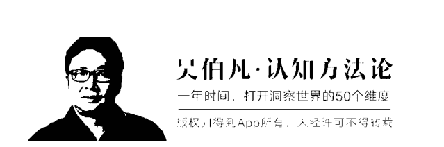

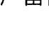

## 用户留言

提交留言可与专栏作者互动

## 真理与方法

## 1.靠谱

我在上个单元的问答里提到了一个概念：道滕爵士乐。用通俗的词解释就是：靠谱。

爵士乐演奏既要遵循乐理，又要即兴发挥，所以爵士乐手好像都有一个天赋，不但能把一首成熟的曲子做各种各样的变换，最后还可以象玩杂技一样一下子收回来——让曲子“靠谱”。

“谱”是做事的规章和法则，但如果只是按照规章和法则做事，事情往往做不下去，我们还需要一定的灵活性；但一旦有灵活性，又往往可能会偏离规则，变得离谱。那如何又要变通，又要靠谱呢？答案是：方法。

哲学名著《真理与方法》说：在世界上是追求真理还是追求方法的确是一个问题。要很好地活下去必须要掌握方法，掌握在行动上合用、管用，能达到很好效果的方法，同时，我们又要在认知上追求真理。

## 2.镜与灯

前面我们讲过“镜与灯”：

+ 镜式认知偏向于真理，是照见一个类似于真相的东西；
灯不能照见真理，不能把真理作为一种认知对象呈现在你面前，但我们借助灯来做事情。

无论真理和方法，还是镜与灯，都是既要提升我们的认知，也要让我们更好地生存——这是认知的目的。

这是真的？还是假的？这是好的？还是坏的？在认知初级阶段，我们常常会这样问，就像小孩特别乐于识别一个人是好人还是坏人。只有大人告诉他这是好人或者坏人的时候，他心里头的石头才好像落了地，才获得了对于世界的认知。

但长大以后，你会发现真和假、好和坏、善与恶不是那么截然二分的——这不是说我们不辨善恶，不在于真假了，而是这两种东西在真实世界始终是交织在一起的。

你想像做化学实验似的分离出真实世界真的东西和假的东西、善的东西和恶的东西，你的行动就会被这两种矛盾的东西缠绕，甚至最后完全失去行动的能力。

## 3.杰出的糖果售货员

给你举一个例子。

在糖果还是一种短缺物资的年代，有一个卖糖果的售货员被认为是一个杰出的卖糖果师傅。

有一天，很多 人排队买糖果，排在后面的一个妈妈抱着的小孩子看见糖果就要吃，不能马上吃就开始哇哇哭闹。

遇到这种情况，一般人就听其自然让小孩闹了，但那个环境会让大家很不舒服。这个杰出的售货员的高明之处在于，她的思维和手段都不是常规的：售货员拿了一块糖给小孩子的妈妈，小孩拿到糖以后立即就不哭了，非常高兴。现场的所有人都很吃惊——为了让这个小孩不哭，你竟然用公民的财物贿赂小孩！

最后，等小孩子的妈妈买完糖果，在秤上称完以后，售货员从袋子里拿了一块糖放回了柜台里。

事情就这么解决了：既让小孩停止了哭闹，也遵守和维护了原则。所以说，这个售货员是一个杰出的爵士乐手：在特定的场景下，以这种看似离谱的方式做了一件特别靠谱的事情。

这就是本单元我们要和你分享的话题：到底什么是智慧？在真理和方法、镜子和灯、认死理和过度灵活之间，如何平衡和把握分寸？

通常我们把这种东西叫“实践智慧”。

## 实践智慧

## 1.管理与实践智慧

事实上，管理也是一种实践智慧。

在管理者眼里，不是去追问真相而是要解决 问题。管理者不会认死理，不会因为盲目追求所谓的真相和原则而让自己失去行动的能力，他的目标很清晰——尽可能完美地实现目标的同时又遵守规则。

通常我们认为德鲁克是管理学的创始人，但德鲁克认为在他之前还有一位创始人，他称她为管理的女先知： 玛丽特（Mary Parker Follett）。

玛丽特认为的一个经典场景是这样的：在图书馆的阅览室里，总会有 人嫌屋子热，或者嫌屋子冷。所以窗户打开总有人去关上，关上又有 人去打开，甚至常常会因为关还是开产生冲突。

遇到这种问题通常有一种方法：下 一道死命令，从技术上解决这个问题，把窗户锁死或者把窗户上面的某个地方开个口，让它根本没办法关上等等——这些方法都在追求原则，但没追求效果。

那么什么才是管理呢？玛丽特认为：管理是能够找到一种方法，让看似 矛盾的事情和谐处处，也就是找到一种路径和方法，让相互对立的因素和观念相安无事并且达到目的。以这个场景为例，就是让人能安安静静地看书。

当我们是管理而不是监督一个事态的时候，用很简单的几次调查和统计就能知道大致相同的季节、天气情况下有多少人是愿意开窗，多少人是愿意关窗。知道这个比例以后，把图书馆的所有阅览室按照这个比例分成开窗阅览室和关窗阅览室，不同的人各就各位互不相扰，这就完成了管理，也是一种实践智慧。

## 2.如何做到“不二”？

我们经常说一个人“很二”，“二”有愚蠢、笨拙、不明事理的意思，同时也包含着明白一点儿、懂一点儿、半懂不懂的意思。很多认死理、一根筋的人会给人“二”的感觉。

那要如何做到不二？不仅做到不二，而且能做到有实践智慧呢？我们说至少需要三个层次：

+ 第一层：“只知其一，不知其二”，一根筋地追求什么东西，是最低的层次；
第二层：知道“既要这样，又要那样”，但常常无所适从，天天纠结“一会儿让我这样，一会儿让我那样，到底想让我怎么做？"
第三层：知道生活中“既要这样，又要那样”是体现具体事情上的，需要找到一种方法将完全相反的东西融合起来，和谐相处。就像写书法的时候，往下写能够看到一股向上的力量，写“点”的时候能看到点是向上收的状态，同时，两种力量都包含其中，这才有智慧，这也是美。

## 3.如何做到不惑？

我们不妨反思一下，是不是经常在问这样的问题：为什么有人这么说，有人那么说？为什么有人一会儿这么说，一会儿又那样说？我往往越听越糊涂，越听越不明白，听的道理越来越多而事情越来越不会做，我到底该怎么做？

如果你时不时会 有这种一种困惑的话，那么你起码没有达到“不惑”的状态。

孔子说：吾十有五而志于学，三十而立，四十而不惑，五十而知天命，六十而耳顺，七十而从心所欲，不逾矩。
三十而立

到三十岁的时候找到了自己的规则，形成了相对固定的性格以及人生做事的方法和价值观，但这仅只是开始；

四十不惑

过了三十而立的阶段就要做到“不惑”。我们心里常常“ 一会儿这样，一会儿那样”，“或者这样，或者那样”，这就是“惑”，它的特点就是没办法把两种选择、因素、观念、路径统一起来的。但“惑”也是成熟的一个阶段，至少你知道了这个世界还有两面的东西，遇到事情的时候不会再一根筋地考虑问题。但到了这个阶段，你就要承担一种代价或者某种认知上的痛苦。我们前面讲的管理图书馆的人和寺庙里的人做做不到不惑了。

先进的技术手段，比如基因编辑来戒除糖的依赖呢？

这个问题，卢斯蒂格教授的回答是，最好不这么做。因为我们不能完全关闭人体的奖励系统，否则，你的身体会出大问题。

2000年左右，科学家曾经做过一次药物试验，测试了一种叫“利莫那班”的抑制剂，这种药物通过阻断人类大脑里内源性大麻素的受体，来帮人戒掉大麻成瘾问题，同时还可以降低人体对于酒精和食物的奖励回馈机制。

使用这种药物的受试者，上瘾症状得到了控制，食欲降低了，体重也减轻了。但在测试进行到第三阶段的时候，大量受试者出现了严重的抑郁症状，很多人甚至试图自杀。由于副作用太明显，这种药物在美国没有通过FDA的审批。

卢斯蒂格教授说，当我们阻断了奖励系统的回馈，我们同时也夺走了人们生存下去的理由。

这句话特别好，我选为了今天的金句：

> If you take away a reward, you take away the reason for living.

所以，想通过基因编辑这样的技术方式，来一劳永逸地解决糖上瘾，一定会带来更严重的问题。不是糖，任何成瘾物的原理都一样，因为它们都是作用于人的奖励回馈系统，不能用这种简单粗暴的方式来戒除它们。

## | 总结

糖在现代的食品工业里无处不在，也符合成瘾物的所有标准，但因为它是我们生存的必需品，所以FDA也没法把它像毒品、烟酒一样进行管制。所谓的营养专家，很难切实地指导和帮助我们，甚至像基因编辑这样先进的技术手段，也无法帮我们戒除对糖的依赖。

或许，最终的解决之道，还在于我们自身。如果想要健康，我们就必须对抗那些会对身体造成危害的习惯，酒、烟、糖都一样。

道理都懂，心瘾难除，我们在对抗的不是诱惑，而是自身的欲望。

你还知道哪些事物，本身是中性的，却因为人过度的欲望而成了瘾子呢？

欢迎你在留言区写下自己的答案，也欢迎你把今天的内容转发给自己的朋友。

划重点

今日得到：
1. 糖符合成瘾物的四大标准：ubiquity（无处不在）、abused（被滥用）、toxicity（有毒性）、和 externalities（外部性），但由于它是人体必须的能量来源，广泛存在于各种天然食物中，难以进行管控。
2. 像基因编辑这样的先进技术，也很难帮助我们戒除对糖的依赖，因为我们不能完全关闭人体的奖励系统，否则身体会出大问题。

## 资料来源：

播客：
*There’s a War on Sugar. Is It Justified?, Freakonomics Radio, by Stephen J. Dubner, November 21, 2018
刊物：
* “The Sugar Wars”, Daniel Engber, The Atlantic, January/February 2017
* “A Big Tobacco Moment for the Sugar Industry”, James Surowiecki, The New Yorker, September 15, 2016
* “How the Sugar Industry Shifted Blame to Fat”, Anahad O’ Connor, The New York Times, September 12, 2016
网站：
* “Dietary Sugar and Body Weight: Have We Reached a Crisis in the Epidemic of Obesity and Diabetes?: Health Be Damned! Pour on the Sugar”, George A. Bray and Barry M. Popkin. April 2014
* “You’re About to Find Out How Much Sugar Is Added to Your Food”, Deena Shankar Bloomberg.com, August 9, 2016
* “Isocaloric Fructose Restriction and Metabolic Improvement in Children with Obesity and Metabolic Syndrome”, Robert Lustig, Kathleen Mulligan, Susan M. Noworolski, Viva W. Tai, Michael J. Wen, Ayca Erkin-Cakmak, Alejandro Gugliucci, and Jean-Marc Schwarz, February 2016
* “The Relationship of Sugar to Population-Level Diabetes Prevalence: An Econometric Analysis of Repeated Cross-Sectional Data”, Sanjay Basu, Paula Yoffe, Nancy Hills, and Robert H. Lustig, February 27, 2013
* “Resolved: There Is Sufficient Scientific Evidence That Decreasing Sugar-Sweetened Beverage Consumption Will Reduce the Prevalence of Obesity and Obesity-Related Diseases”, Frank Hu, August 2013
* “Sickeningly Sweet: Does Sugar Cause Chronic Disease? No”, John Sievenpiper, August 1, 201
*Sugar: The Bitter Truth, by University of California Television (UCTV), March 7, 2017
* “Which Foods May Be Addictive? The Roles of Processing, Fat Content, and Glycemic Load”, Erica M. Schulte, Nicole M. Avena, and Ashley N. Gearhardt, February 18, 2015

## 下期预告：

明天的议题是 #完美主义者为什么不是好员工？ #

《哈佛商业评论》的最新文章综合了从上世纪80年代以来，关于“完美主义”研究的近百篇论文，涵盖了将近2.5万名职场员工，最终得出的结论是：完美主义对职场几乎没有半点好处，这是为什么？

用留言

提交留言可与专栏作者互动

我们上节课通过两个案例/场景分析了遇到相对复杂的事态和情景时，该如何给出恰当的解决之道，如何以看似偏离原则的方式来维护原则，以看似离谱的方式来靠谱——这是一种实践智慧，也可以说是一种管理智慧。

管理既不是监管，也不是放任，而是在严格监管和放任之间找到一种恰当的解决之道，最重要的是实现你的目标。

你可能会很自然地想起一个问题：我们如何才能找到一种方法让自己在面对复杂事态时给出恰当的解决之道呢？

要回答这个问题，我们要先从一个汉字说起：权。

繁体字的“權”是从木从舀，指一种黄花木的木材，这是一种典型的硬木，质地非常坚硬，不容易变形，常常用来做两样东西：拐杖和秤杆子。

## 1.权: 秤杆子

这种秤杆子可能有的同学见过，一般它一头粗一头细，上面有很多星星点点的刻度，还有一个秤砣和一个钩物体用的钩子。

使用的时候，掌秤的人不停地把秤砣在秤杆上 troubled 来抓去，有时候往左，有时候往右，目的是让秤杆子既不掉下去也不翘起来，达到一种平衡状态。而达到平衡状态时秤砣所在的位置就是物体的重量。

“权衡”就是描述这个称量过程：通过变动秤砣的位置达到平衡。

《论语》里的“谨权量，审法度”的“权”也是指秤杆子。

权的本意是认知性的，通过某种方法和工具发现和掌握客观对象的重量。过去掌秤杆子是稀缺的权力，谁掌握了秤杆子就是掌权，后来“权”引申出另外一个意思——权力，但也保留着通过特定的方法和手段找到正确的信息，获得正确认知的意思。

## 2.权: power & right

汉语的“权”翻译成英文，对应的是两个词：power（权力）和right（权利）。很多同学分不清楚这两个词的中文意思，常常弄错。

+ 压倒性的势力、能量、手段，让别人服从自己的是power（权力）；
找到正确的方法、位置、定位等跟正确有关的是right（权利）。

## 3.权: 变通

权还有“变通”的意思。

我们用秤称物体重量的時候，秤砣的位置要不停调整，一会儿向左，一会儿向右，直到最后找到秤杆上恰到好处的准心，也就得到了正确的重量（认知）。

“权宜之计”的本意是通过变通达到“宜”，也就是合适、恰当。一个掌握大权的人，一方面有power，另外一方面他要能通过精细考量找到正确的解决之道，这也是我们通常说的boss和leadership的差别：老板有power但未必有leadership（领导力）；有leadership的人未必是老板，但他很可能有朝一日凭他的领导力成为领导。

我们也可以把权理解为通过认知优势给别人提供方向感和驱动力的人，所以柳宗元说，“智必知权”：一个智慧的人一定懂得变通和调整，最终找到合适的位置。

不懂得权衡也就是不懂得调整/微调，找不到恰到好处解决之道的人，他不是一个智者。

## 4.度量衡: 认知世界的三种工具

我们知道，秦始皇统一六国以后做得很重要的一件事情是统一度量衡：

+ 度是指用来量长度的尺子；
量主要用来称量某些物质，比如粮食、水、酒、油的体积；
衡是权衡之衡，也就是秤。

“度量衡”这三种工具恰好代表了我们认知世界的三种方法：

度：我们自己有一个固定标准，比如用一把尺子去量物体的长短，这个动作就算“度”。

“以己度人”，“以小人之心度君子之腹”的标准是明确而且单一的。

我们初步形成自己的世界观和价值观的时候，常常习惯于用这种方式来认知世界：这是个好人、这是个坏人、这是个重要的人、这是个不重要的人……当你的接触多了，你会发现这个世界上很多东西是没法用一个固定单一的标准去衡量的。

量：尺子最大的问题就是有些东西量不了，它不具有柔韧性，这就需要用斗或者升去“量”，所以，升直到今天还是一种量水及其它液体的单位。

衡（秤）：世界上最难计量的是重量，重量是最不规则的，它的频谱非常宽，几吨、几斤、几两、几钱……但秤的好处是，不管是什么体积什么形状，只要在常规范围内就都是可以计量重量的一——秤是最不挑剔的一种计量工具。

尺子是不变的，斗也是不变的，但秤的特点就是变：秤砣可以从这头一直抓到那头，调整的幅度非常大，权变的可能性也非常大，所以，秤是具有普遍性的一种计量工具。

一个人成熟以后对世界的看法更接近于秤，而不是斗和尺子。也就是说，他不再以单一的、固定的标准衡量人和事了。

主管都可能会跟你讲，“客户并非永远是对的，但与客户争论永远是错的”。明白了“坏钟表”这个比喻的时候，你可能更能明白为什么与客户争论是错的——好的员工应该像秤一样。

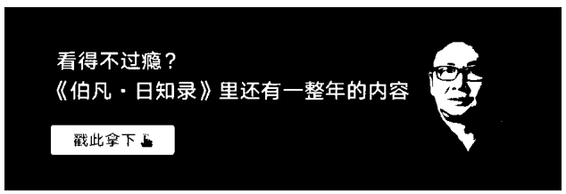

看得不过瘾？
《伯凡·日知录》里还有一整年的内容
戳此拿下

一年时间，打开洞察世界的50个维度

## 以“变”的方式存在的“不变”

上节课我们讲到“权”这个字。小时候我看到“孙权”这个名字的时候，经常会想“他爸爸怎么这么这么希望，有多希望他儿子掌权啊！”

这当然是一种很幼稚的疑问，“权”是一个含义非常美好的词：

- 要拥有权力就必须懂得权变/权通；
做领导者要做正确的事——right，也就是权利，它首先是一种能力，然后才是一种地位；

《孙子兵法》说，“不知三军之权而同三军之任，则军士震骇”：作为一个将军，你不懂得权通是没办法服众的——这个“权通”不是和稀泥，而是随机应变、审时度势。

“权”不是见招拆招、见子打子，而是始终通过变通的方式坚守某东西，比如拿秤的过程，就是通过不断变通在维护一种东西。

我们讲过，“原理”和“原则”在英文中是同一个词：principle，不变的东西。这种不变是以变的方式存在的。

这么讲似乎有点儿奇怪，比如你之所以是你，是因为你5岁的时候是你，10岁的时候是你，20岁、30岁都是你，这个“你”是不变的，但是“你”又是每时每刻都在变——维系“你是你”的基因没变，但“你”每时每刻都在变。

获得认知的目的不是简单的按图索骥，不是掌握了一面镜子不停地照这个世界，找到所谓的真相等——真相永远不是一种静态、固定不变的东西，它始终在一种场景中。

比如我们经常提到的那个伟大的清洁工的故事：他之所以伟大，是因为他能以一种悄无声息的方式变通，同时又维护了一种人的原则以及他的职业原则。《伯凡·日知录》：154 | 付摄行办》最重要的是，他把眼前的事物处理得恰到好处，让一个可能爆发的巨大危机转化为动人的场景。这就是“权”的力量，这个清洁工具有一种实践智慧，而这种智慧是现代社会越来越不被重视的东西。很多人只是希望找到更高的认知，然后用这个认知来洞察和改造世界。

要改造世界，我们需要“镜式认知”，更需要“灯式认知”。认知的真正作用是在面对复杂的世界时，让我们成为一个卓有成效的人，而不是一个自命不凡、总是抱怨世界不按照自己的认知和想法去运行的人。

孟子说，“尽信书，不如无书”，日常生活中你也总能听到“这个人读书读傻了”。“读傻了”就是越来越以掌握了某种真理/原则自居，完全无视周围时刻变化的种种事态和场景。“读傻了”的人常常遭遇种种挫折，但从来不反省，而是以一种可笑的方式维护自己的正确性。

## 做“正确的事”还是“正确的人”？

- 1.维护自己正确性的“铁床贼”

古希腊的神话人物普洛克路斯忒斯（也作达玛斯忒斯）是海神波塞冬的儿子，他开了一家专门截杀行人的黑店，里面有一张著名的铁床。当旅客到宿的时候，他会把高个子的人的腿锯掉，让人跟床一样长，或者用蛮力把矮个子抻成和床一样长。

很多“真理在握，原则在身”的人常常会犯普洛克路斯忒斯的错误：面对丰富的世界，始终以一种可笑的甚至非常残酷的方式维护自己所谓的“正确性”，不是去做正确的事，而是去做正确的人。

- 2.清官的“实践智慧”

“清官”是个好词，但确实也有一种清官忘记了清官的目的是什么。俗话说“清官多酷”，意思是他们常常是“为清而清”，甚至是为了维护自己作为清官的名声而去伤害周围甚至所有人的利益。这种人跟强盗普洛克路斯忒斯一样，在与人沟通、打交道、进行所谓“合作”的时候，都在遵循一种残酷的法则。

比如海瑞是著名的清官，但也是很有争议的人物。如果详细了解海瑞的故事，就会发现他身上有一种很可怕的东西：把自己的标准强加于所有人身上，甚至自己的老婆孩子饿死也被认为是他做清官的必要代价。

历史上还有一个可爱得多的清官：陈廷敬。有兴趣的话你可以看看《大清相国》这本书，书的作者是这么评价陈廷敬的：德官多庸、能官多专，陈廷敬是能官，但他从善如流。

他既能严守道德，做事的时候又不乏铁腕，作为一个清官，处理事情的时候还能做到宅心仁厚。陈廷敬21岁中进士，从政51年，与他同朝为官的很多人要么作为清官被杀，要么作为贪官被杀，而他72岁“老死相位”。

我们从他身上能看到什么呢？首先就是实践智慧，权变/权通的能力，以及在不断地变通中维护原则，并在维护原则中始终寻找最恰当的解决之道。

陈廷敬和伟大的清洁工、优秀的卖糖果的售货员、阅览室的管理员一样，都是能找到第三条道路，或者在好像只有两种选择的时候找到第三种原则的人。

## 第三选择：我们的选择

《高效能人士的7个习惯》的作者史蒂芬·柯维（Stephen R. Covey）还写过一本书：《第三选择》。所谓“第三选择”就是在“我”“你的选择”之外还有一个“我们的选择”——双方都觉得是自己的选择。通过权变和权通让“我”和“你”之间非共识的东西悄悄淡化，凸显“我”和“你”之间共识的东西。

> “第三选择”是一种“非暴力选择”或者“非权力选择”，也是一种“共识性选择”，是尊重双方权利的正确选择。套用前面的话说，就是一种“以看似在原则上让步的方式坚持原则的选择”。

你之所以没有意识到、没有发现、没有找到这种选择，不是因为这种选择不存在，而是你缺乏足够的实践智慧和权通变通的能力。你可能已经习惯于在生活中要么扮演强盗普洛克路斯忒斯的角色，要么扮演普洛克路斯忒斯床上的可怜旅客的角色。但不管你选择做哪种角色，你都可能是一个没有幽默感的人。

## 预告：幽默感是一种高维认知

说到“幽默感”——humor，这个词本来的意思是人身上的体液。

古希腊医学家希波克拉底认为，一个人体好、性格好是因为他身上的体液好，而身体好、性格好的表现是脾气好，后来引申到幽默。幽默的人是变通性好的人：他处于优势的时候有自嘲的能力，弱化自己的优势，不把自己当成黑店的店主强盗普洛克路斯忒斯，也不把别人当成是被害的旅客；当他处于弱势的时候也有一种变通的能力，将侮辱攻击用一种智慧的方式化解，在主人和奴隶之间选择了另外一种角色。

我们讲认知的时候很少提到幽默感，而幽默感常常是具有高维认知的人的一个明显标志：他不会强调“你错我对”，在别人气势汹汹的时候也不会忍气吞声、甘拜下风，他始终以一种超常的主动性，也即是一种前摄能力来抑制自己和别人的权利，同时维护自己的权利。

关于幽默感，我下节课继续。

用户留言

提交留言可与专栏作者互动

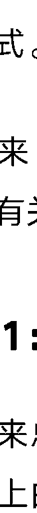

我们在上一节课的结尾从认知讲到了幽默，这个结论可能让你有点儿诧异：幽默竟然和认知有那么密切的关联。

的确，幽默虽然不是认知，但它是一种基于高级认知的精神状态，在面对冲突和突变的情况下可以给出最恰到好处的反应方式。

接下来，你不妨跟我看几个和“幽默&认知”有关的例子。

## 案例1：周总理和嬉皮士

周恩来总理是有极强人格魅力的人，甚至政治上的敌人都非常尊重他，这里有很多原因，其中一个原因是：面对大事小事，周总理都有一种高瞻远瞩的能力，能在复杂多变的事态当中既坚持原则又保持友好界面。

1971年，中国和美国有一场“乒乓外交”：两个没有建立外交关系的国家通过乒乓球比赛来进行最初而且是卓有有效的接触。当时到访的美国著名运动员科恩（Glenn Cowan）还在后来写了回忆录，其中有一个周恩来总理接见美国乒乓球运动员时的故事。

虽然中美两国当时仍处在相当对峙的状态，但周总理在跟美国运动员见面的时候展现出的是 一种大国风范，并且在会见快结束的时候以一种很开放的心态问美国运动员：你们有没有什么问题呢？

科恩既是一个优秀的乒乓球运动员，也是一个著名的嬉皮士。那时候，别说在社会主义的中国，就是在美国也有很多人看不惯嬉皮士的作风——可以说，嬉皮士的价值观看他们的行为特点跟中国当时的政治和文化氛围格格不入。但科恩是客人，他抢先提了一个问题：请问总理先生，你怎么看待嬉皮士？

科恩的问题一提出，现场立刻陷入到一种紧张状态。我们知道，周总理身为中国共产党的领导人、中国的总理，他的回答必须 要维护原则，与此同时，他还必须要尊重远道而来的客人——看上去，周总理只有两种选择：

- 旗帜鲜明地亮出对嬉皮士的批判性立场；
为了维持一种友好的气氛，对嬉皮士表示出一种无原则的恭维和称赞。

显然这两种选择都不合适，但似乎又没有别的选择。

周总理是这样回答的：年轻人很聪明，敢于尝试各种各样的事情，寻找他们自己的答案，我相信经过各种尝试以后，他们一定会找到正确的立场和道路。

这段话科恩听起来很舒服，因为好象是在表扬他，但从中国的立场来看，尽管界面看起来相当友好，但这里没有作为任何原则性的让步。周总理的这个回答之所以恰当，是因为他瞬间习惯性地找到了“第三种选择”。

## 案例2：任正非和IPD

还有一个我亲耳听到的故事。有华为总裁任正非在公司接待前来参访的中国银行肖钢董事长一行。

肖钢：任总，你们华为最近做得最重要的工作是什么啊？

任正非：我们这几年一直在全公司推行IPD（集成产品开发的简称）。

肖钢：什么是IPD？

坐在一旁的华为轮值CEO徐直军是个直性子的人，说话有时候口无遮拦，他听见肖钢这么问，随口回答：IPD对我们老板来说，仅仅是这三个字母。

当时现场的空气一下子凝固了，徐直军作为华为的高管，这明显是当着重要客人的面在拆老板（任正非）的台啊！

通常情况下，任正非有两种选择：

- 严厉斥责徐直军不懂规矩，既不尊重领导也不尊重客人；
没有原则地放低身份，面红耳赤非常尴尬，把不反应作为反应。

但任正非给出的反应却是，他马上哈哈大笑说：是啊，我哪儿懂啊，我要是懂，要你干啥！你赶紧给肖总介绍一下什么叫IPD。

任正非的这个回答很精彩，因为他无意中也采取了“第三种选择”。

## 幽默感：第三种选择（维度）

一个有幽默感的人往往能在瞬间化解尴尬，或者化尴尬为尊严。

如果从另外一个角度看，这是因为他看到了格局和事态的第三个维度，作出了第三种选择。而我们普通人生活在二维（只有两种选择的）世界，那些让我们肃然起敬的人早就像知道了事态的第三个维度（第三种选择）。

我们课程开始的时候提到过一个词：盲维。盲点可怕，盲维更可怕。你搜遍了整个大厦都找不到厕所的时候，以为房间没厕，殊不知厕以一个奇特的姿势贴在天花板上——这就是“盲维”的代价。

我们这个模块一直强调“第一性原理”和原则的重要性：

- 1. 遗忘第一性原理、原则或者初衷，也就同时遗忘了最终的目标，导致了异化，我们的行为和思维也就失去了驱动性的力量；
2. 遵循“第一性原理”不是按图索骥，更不是刻求守旧；无论“第一性原理”还是原则，始终存在于变动的场景和事态中。

“坚守原则，不忘初心”和“随波逐流”之间不是二选一，在这两个维度之上还有另外一个维度：实践智慧，或者“第三种选择”。

要提升我们的认知就不能忘了这个维度，否则就会陷入到致命的盲维当中。

## 用户留言

提交留言可与专栏作者互动

## 给予者和贸易法则

@ 星光旺妾

这节课讲的和我知道的一句谚语有关，“人无所求品质高”，说一个人 不求别人给什么的时候，品格自然高尚，这和老师讲的是不是一个概念呢？

应该说，咱们讲的“三无”原则和这一句谚语有相通之处，还有一句俗语“人人不求人一般大”，也是这个意思——不管这个人比你地位高多少，多么有钱有势，只要不求他，你和他在精神上就是一样大的。

## “三无原则”前提&另外一半

@ 小邪

我觉得“无所求，无所待，无所靠”这三个条件是否显得苛刻了？在如今浮躁的社会中真能完全这样身处事外吗？

## 做价值的创造者还是价值的索取者？

@ 崔山

根据“三无”原则，创业寻求资金是自由吗？建立广泛人脉是自由吗？学习中向老师求助是自由吗？

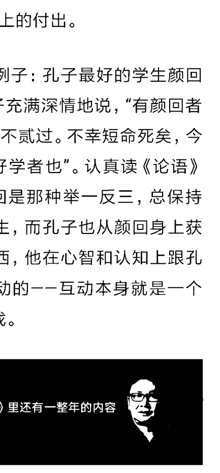
# 吴伯凡·认知方法论

用户留言

提交留言可与专栏作者互动

## 本单元总结

第一节课我们说，要达到实践智慧的高度，我们要经历三个层次：第一层，只知其一、不知其二；第二层，既要这样、又要那样，无所适从；第三层，能将两种相反的力量融合起来，和谐共处。第三层次才是我们说的实践智慧，也是孔子说的“不惑”“知天命”“耳顺”“从心所欲不逾矩”。

第二节课我们通过三个工具一起重新认识了认知，这三种工具分别是：尺子、斗和秤。我们说，这三种衡量衡工具中，前两种都是以一个固有的标准去测量物体，被测量的物体如果不符合一定的条件就无法测量。这就像初级的认知，不懂得变通，只会以单一、固定的标准去看待人和事。而成熟的认知应该像一杆秤，无论是什么物体，我都能够通过调节自身来找到平衡，实现认知。这才是我们追求的目标。

怎样才算拥有了秤式认知呢？第三节课我们说到了第三种选择和幽默感，你可以参照判断一下，自己是否具备找到第三种选择的能利，以及在紧张的时候，是否能用幽默感化解为夷。

第四节课我们用两个案例：周恩来总理接待外宾的例子，和华为的任正非化解尴尬的例子，来让你体会，高手是如何找到第三种选择的。你要时刻记得：“坚守原则”和“随波逐流”之间永远不是二选一的关系，在这两个维度之上还有另外一个维度：实践智慧，也就是“第三种选择”。

好，以上就是本单元的主要内容。以下是 ? 我精选的同学留言，恭喜前三名同学，将获得我签名的书一本，这次送出的书是《生命的法则》，得到的工作人员会尽快把书寄给你，也希望其他同学再接再厉。我们下节课再见。

特别提醒：留言内容会默认公开，并同步到“知识城邦”中，中奖同学留个人信息时，一定记得将留言设置成隐私模式，确保个人信息安全。

## ——本单元十大精彩留言——

## 获奖留言

### 终身思考

台湾政治大学的李瑞华教授认为，“权变”就是首先要建立“不一定”的概念。这其实也对应着老师说的“不再以单一的、固定的标准衡量人和事了”。其实那些只懂得以单一、固定的标准衡量人和事的人是最低级的层次，就像学习上学习最确定的知识（当然这也是最基本的知识）；更高一个层次就是懂得“权变”的人；但其实还有最高境界，那就是老师说的：最高境界，就是要知道“不一定”后面的逻辑，要知道“不一定”后面的东西，要学会在权变式地思考问题之后，再摸索到更深一层的影响因素。

## 潘潘

做事需要权衡。就像用秤称重，首先你得有一杆好秤，秤杆要直，准是要准，就像做事的规则要清晰合理。然后还需要你会用秤，提秤的手要稳，拨秤砣的手要准，眼神要犀利，脑子还得反应快，否则重量大或体积大的东西你可能就称不了。这就像你能够把握规则的核心精神，保证大方向不错，又能同时看清各方利益，在合理的范围内快速进行取舍和调整，使之达到平衡状态，取得比较好的整体效果。

### 刘一

灯镜结合告诉我：世界不止一个真相，时时刻刻都有真相。按照这个真相的推理，想要明白真相是什么，就要做正确的事、正确的人，但问题又来了，你不可以 vodi? 你不可以以一个原则去办事，就像不能用一招吃遍天一样，在这个问题中想要避免由自己去衡量外界，就要用辩证的思维来看待外界，想要做到“变”中不“变”，就要懂得第三选择。

在谈判领域，入行的第一个信仰就是要相信世界上总有一个解决问题的办法，这跟从非共识到共识思维是相通的，第三选择就是要做到你和我的共识。那怎么知道自己做了正确的事和正确的人呢？可以看看是否双赢，是否利于大势，是否实现了整体的最优化。

## 其他精彩留言

### 得超

同样是有点二，为什么郭靖、阿甘成了人生赢家？这是一种以简驭繁吧——知道的道理并不太多，那就像用几条简单规则就逛遍天下吧。这也是一种灿式的认知——他们也许很多年并不知道这些简单原则就是自己的底层算法，而是通过不断的行动和周围世界的反馈来强化和坚持这些简单的规则。知行合一的正反馈，让这套算法战无不胜。而左右摇摆，只能抱着一堆道理举步维艰。

### 怀怀

这节课对于我来说是一节大课，让我更好地理解了“方圆之内，尽自由。去繁就简，大道至简”。我也说说自己的几点感悟：

- 1. 过细。如果一个人还处于与人争论对错，拿着某一句觉得有道理的话指导人生的阶段，那就是还处于很多困惑之中。一个过分着眼于细节的人，容易失去大处着眼，整体把握的机会，容易造成管窥蠖应，自然无法很好地解决问题。

- 2. 绝对。有一些人的世界就是非黑即白的，然而客观世界里，是非善恶完全融合，善恶有可能被诱发，甚至在一定条件下，善恶会互相转换。在这样的客观世界，如果只能在一片光旷，无一物的环境才能获得自由，那真的是在智慧上比较让人着急了。这样的人一定会撞到南墙，可惜的是，即使撞到南墙，撞破了头，他也不必会有机会回头。

- 3. 得乐。忽然懂了一句话，“与天斗，其乐无穷。与地斗，其乐无穷。与人斗，其乐无穷”。这里的“斗”，就是在解决困问题，这个“乐”就是成功筘通思路方法，解决问题。这个“乐”还是一种享受，说明白一个能游刃有余地解决问题的人，已经找到去繁就简的能力，从心所欲不逾矩地在遵守规则的前提下，升级智慧，解决困问题，并且，也在这个过程中能够体会到一种艺术感、美感。做一个靠谱的problem solver，这样是在提升自己的智慧，锻炼提升自己解决困问题的方法。

- 4. 感恩。没有方圆，哪来智慧和成长，方圆之内，尽自由。祝大家乐享人生，智慧超群。

### 五月鹰

斯多葛学派的观点是接受那些我们改变不了的东西，在我们可以改变的事情上所作为。查理·芒格也说过，对于宏观层面的东西我们只能接受，微观层面才是发挥我们作用的地方。

结合今天的课程，我的理解是无论是宏观大势也好，还是道德法律也罢，都是我们不能或是不允许改变的东西，除了接受我们别无选择，这是做正确的事，也是做正确的人。我们尽管不能在宏观上改变大趋势，但如果能在微观看到小趋势并积极行动，这就是变通。即在不对抗客观规律和原则的基础上，能根据形势的变化不断调整自己的认知模式和行为模式，就可称之为变通。古人讲“有所为，有所不为”，就是这个意思。

## 刘伟佳

## 刘伟佳

《明朝那些事儿》中讲到一个故事，说朱棣在位时对于立谁为太子很为难。长子身体有残疾，虽然人品端正，但是是不像自己；还有一个小儿子，很像自己征战沙场，立下不少战功。朱棣想立小儿子，但又不想违背立长子为太子的祖训。于是他问一个大臣，到底应该立哪一个。

大臣当然希望立长子为太子，但是如果直接说的话，可能被朱棣怀疑为太子拉帮结派，适得其反；他知道朱棣非常喜欢长子的儿子，所以他没有直接回答朱棣的问题，而只是说“好皇孙”，最终朱棣下决心立长子为太子，最终太子继承皇位。看上去不是选A就是选B的问题，找到第三个答案，反而更好地解决了棘手问题。这也是一种实践智慧吧。

## yu370

汤君健老师在新课《有效提升你的谈判能力》的发刊词中说，“谈判，是利用人决策过程中的理性和非理性因素，以自己的目的为先，和对方联手找到解决方案的沟通过程”。这一下就帮我打开了一个新的维度——和对方联手找到解决方案。在此之前，我对谈判的认知，似乎基本上就停留在一个“你死我活”的零和博弈状态，但此刻却意识到这是一个双方共同的事。想来，这就是第三种选择了吧。

而关于幽默感，记得李新老师在《有效训练你的随机应变能力》中给出过一个“yes……and……”的万能公式。看完文中任正非的案例，发觉从某个角度来说，或许幽默感就是一种随机应变的 cụ thể 表现形式吧。

## 以武治心

做价值的创造者还是价值的索取者？这句话让我陷入深思中。

沃顿商学院的Adam Grant 教授的研究发现，大部分有成就的工程师、最高成绩的学生，最好业绩的销售人员，都属于价值创造者。另一名教授 Arthur Brooks 的研究还发现，做一个给予者不仅会带来高成就，还让人更富有，因为每捐出一美元，捐钱者的收入就会增加 3.75 美元。

价值的创造者总在想：我能为你做些什么？——作为价值的创造者，经常需要积极发现并主动培养自己的价值，以 each 在更多时候、更多场合，更好地帮助他人。他们热衷于发挥能量，而不纠结于一己得失；靠着对万事万物的关心，来给予自己源源不断的正向激励。价值的索取者总是在想：你能对我有什么用？

尽管价值的创造者最终能不能获得成功，还受限于环境、成长能力等条件，但养成价值的创造者的思维模式，绝对是攀登顶峰的必要基础。我们要找到自己能够贡献价值的部分。换句话说，在做任何事情时，一定要想办法贡献我们自己的价值。未来组织需要的是价值创造者，而不是利益索取者和精致的利己主义者。

## 旺

老师好，听了“交易原则”感触很深，理解如下：

从生物学的角度看，人的第一性原则是生存，而生存的条件就是获得资源，而获得资源的手段无外乎有四种，一是掠夺，二是诈骗，三是乞讨，四是交换。

在文明未完全开化阶段，国与国之间，匪与民之间，甚至是民与民之间，都存在大量靠掠夺来获得生存资源的情况发生；

诈骗行为则主要发生在信息不对称或法律不健全的情况下，且诈骗主要针对陌生人，诈骗也是一种变相的掠夺；

乞讨行为则主要依靠别人的爱心，人的天性中除了有利己的成分，确实也存在利他的同情心，但爱心往往是发生在熟人社会中，对整个社会讲，它是稀缺资源；

而交换行为才是现代社会获得生存资源的主流行为方式，通过自己的劳动创造价值，去交换他人的劳动和价值，这才是风险最小化，利益最大化的获取资源的方式，用伯凡老师的话讲，这也是最道德的获取资源的方式：既有普遍性，又有可持续性。

总结起来，人与自己，与他人，与社会的健康关系是：1.善待自己——找到志趣和使命；2.辛勤劳动——创造价值和意义；3.等价交换——利于自己和他人；4.奉献爱心——彰显人性和德性。

## 认知与契约1 | 现实中的上帝视角
吴伯凡·认知方法论
认知与契约1 | 现实中的上...

“认知与契约”

## Economy: 神圣救恩计划

英文中的Economy（经济）很常用，但其实现这个词还有一个不太常用但很重要的意思：在宗教上，它有一个特殊的意义——神圣救恩计划。

按照基督教神学的说法，上帝创造世界以及世界的运行是有世一套计划的。比如上帝觉得亚当一个人在伊甸园里很孤单，就用他的肋骨造了夏娃陪伴他；然后魔鬼的化身蛇不但引诱夏娃吃了禁果，还让亚当也吃了；上帝发现以后，把亚当、夏娃赶了出去，让他们的子孙在大地上经受很多的磨难之后，最后（死后）还能重新回到伊甸园。

亚当和夏娃的故事是一个宗教神话故事，但整个过程就可以称为“神圣救恩计划”：当事人其中经历各种艰难困苦、波澜壮阔、悲欢离合，但其实已经有一个看不见的远高于你的力量事先把剧本写好了。

我们看电影或者歌剧的时候，会被剧情牵引，但实际上那些是编剧、导演早已经规划好的，就是为了让你不断地“看电影流泪，替古人担忧”。所以，预设的剧情和规划也是Economy。

我们今天显然已经不太相信《圣经》里的故事了，但Economy提醒我们，认知其实有三个层面：

- 第一，对世界的认知；
第二，对自我的认知；
第三，对你和世界的关系、你生存下去该采取什么方式以及对这种方法的认知。

简单说，认知分为what（是什么）、how（要采取什么样的方式）和why（为什么是这样的），但你以为的世界也许不是你以为的世界。

比如看电影的时候，我们是一种看法，懂得电影算法的老手看到的又是一种东西，而编剧导演看到的又是另外一种东西了。所以世界摆在我们面前，你对它的认知程度不一样，反应也是不一样的。但我们要在这个模块探讨的是另外一个问题：

世界的计划是什么？你该采取什么样的计划？这中间会形成什么样的落差？你又该如何调整？

## 天命注定的计划

### 1.十七年蝉的生命历程

为了理解Economy，我们不妨回忆一下以前讲过的一些案例，比如大马哈鱼洄游和十七年蝉的生存经历。

有一种蝉在地下蛰伏十七年，出来以后，雄蝉高声叫唤显示基因的优良性，吸引雌蝉循声而来完成交配。交配之后，雄性死去作为雌性的食物，雌性大块快颐，用不着再费劲地去觅食积累能量，然后回到地下产卵。产卵之后，雌性也死掉了，它产下的幼虫在地下发育成长，蛰伏十七年再出来，就又完成了这么一个过程。

十七年蝉的生命旅程和大马哈鱼的生命旅程有异曲同工之妙：它们的整个过程都是按照一条固定路径来完成一个循环，再开始下一个循环的。

我们可以把这个过程理解成Economy——计划：身在其中的每一个个体，无论大马哈鱼还是蝉，它们自己是不知道自己身处这个计划当中的，所以它们的所有行为表面上都是自主的，无论挣扎还是奋斗都会竭尽全力，但其实结果早已经注定了。

这样的现象在大自然里比比皆是，比如“乌语花香”不过是植物和鸟类的一种营销手段，为了完成生殖行为。当花完成了营销使命之后就会凋谢，因为果实马上就要长出来了——花只是手段，不是目的；果也不是目的，只是手段，它长出来就是为了让不同的动物吃掉，实现种子的移动，尽可能扩大种子的生存概率，然后，再发芽，再长出来，再继续这样一个循环。

无论动物还是植物都生活在某种大计划中，不需要它们自己去作选择。

### 2. 假想的“上帝之眼”

但人和动物植物是不一样的，人有选择：我们每个人都觉得自己有自己的剧情和剧本，都认为自己不是早已经安排好的剧情中的一个角色，我们是有自由意志的。

而当我们这样说的时候，其实已经面临着一个古老的哲学问题了：我们真的有自主性和自由意志吗？

古希腊有一个哲学家说，“你想了解你自己，不妨去看看蚂蚁”，意思是，当你观察蚂蚁的时候就虚拟性地获得了一种看自己的能力；你看见一群蚂蚁忙碌或者两群蚂蚁打仗的时候，几乎是拥有了一种“上帝之眼”——当事人觉得极其宏大的场面在你看来是一个小得不能再小的场景，你完全可以在旁边清楚地看到前因后果，甚至如果你愿意，完全可以去预判，比如当两群蚂蚁激烈打仗的时候，你一脚踏上去把它们大部分都踩死了，而它们都不知道是怎么回事。

观察完蚂蚁之后，我们不妨再思考：假如我们是蚂蚁呢？假如人群就是一个蚂蚁群呢？假如有一个远高于我们的主体在看着我们，那又会是一种什么样的景象呢？

### 3. 希腊式悲剧

古希腊人发明了一种很高级的看蚂蚁的方式：雅典著名的环形剧场是演希腊悲剧的，但希腊悲剧不是一个演艺事业，而是宗教。所有人都坐在这里看演出的一幕幕戏剧，看完之后会强烈地感受到一种超越人之上力量的存在，人其中如此渺小，每个人都假想为自己命运的主宰，但终维逃脱——对命运的逃脱本身就是在强化命运。

比如其中演出的“俄狄浦斯”（Oedipus）就是这样一个故事：俄狄浦斯是某王子，他出生的 Robot... [后续内容略]

## 认知与契约2 | “意义”的本质是一种约定

认知与契约2 | “意义”的本质...

第一模块
认知源代码

第二模块
认知治理

第三模块
算法与第一性原理

第四模块
意义绩金术
“认知与契约”

## 大自然的智能合约

以前我们提到过一个概念：智能合约。这是跟区块链技术相关的术语，指的是以一种以信息化方式传播、验证和执行合同的计算机协议。

智能合约的一个最重要的特点是：在没有第三方的情况下进行可信交易，而且这种交易是一种自动执行的交易，只要双方条件满足，不需要第三方在场，这个合约就会自动执行。智能合约相对于传统合约减少了交易成本。

我们也可以借用“智能合约”的概念看看自然界的很多现象，它们其实也都是一种智能合约，比如大马哈鱼的整个交易程序的执行都不需要第三方在场。

我至今还记得小时候看到的一个场景：有一天我看到一条蛇躺在路上，见了人也不跑，而且显然它没有死去。后来，大人告诉我说这种蛇和别的蛇不一样，它是胎生的（一般蛇是卵生），但小蛇一般没法分娩出来，最好的方法就是母蛇躺在人能看见的地方，被打死，烂掉，然后小蛇才能出来。

我后来知道蛇确实有胎生的，但不知道小时候听到的这个说法到底是真是假，而这个场面我至今不能忘的原因是：蛇的这种英雄主义行为是为了下一代的出生，它宁可去死的动作其实执行的是一个类似于智能合约的程序——为了让小蛇长到出来就能生存的时候，它牺牲自己，使命就完成了。

在自然界里，有无数的智能合约是不需要身在其中的个体作选择的，每个个体都是在一个已经写好的程序中某一地点上的执行者或者被执行者。

张小龙说，“上帝是一个伟大的程序员”，而作为一个不错的程序员就要通过各种努力，直到有一天天机再给你透露一点点信息，能够在你写的程序中加上一笔或减掉一笔——我们通常把这个叫做“神来之笔”。

大自然也可以理解成一个又一个的程序：春夏秋冬，寒来暑往，花开花落，北雁南飞，所有这些可以看成一套程序。而人跟动植物最不一样的是：人不是被动执行程序，我们不会在一个完全写就的程序中听任预置程序的安排，而是会在很多个十字路口拥有选择权。

## 认知不足的困境

我们对世界最初的认知都来源于某种因果联系，包括刚刚出生不久的小孩也知道只要哭，就会给他喂水喂奶；刚刚懂事的时候，小孩要这样，大人不让，他就会疑惑，但大人会告诉小孩：水壶不能摸因为会烫，插座不能用手指去捅因为会触电等等，我们就这样一点一点积累起对于世界的认知，然后凭借这些认知来应对世界。

随着认知提高，经验越来越丰富，我们发现认知越来越不够用，如同登山，一步步终于登到顶峰的时候，意识到这个高度就是自己能达到的高度了，另外的高度是达不到的，而且最要命的是，你的认知就是这样了但你还必须要面对眼前的事。

在网上购物可以通过各种评价以及购买力最后作决定买哪个，但有很多选择我们的认知完全不能应对，比如选择跟哪个男生（女生）谈恋爱，选择哪个行业，选择出国留学还是留在国内等等，是不可能通过罗列出完整理由最后给出一个确定无疑的选择的。更何况最大的限制是时间窗口，这个世界不可能给你无限时间让你去提高认知以后再作选择。

回到小时候那个例子，父母告诉你不能用手指去捅插座，会给你一套说辞，你好像明白了，也不再去捅了，但可能有一天你心存疑惑，突然去捅了一下，电把你弹得老远，你终于明白白也不能捅这个小孔了。这种情况你的认知足以给你的行动提供依据，但这说到底都是小事，真正重要的大事是没有人给出一个理由的，即使给一个理由你也不会心服口服。

电影看得多了，当你特别喜欢的主人公要上刑场了，你心里还是踏实的，因为你知道，在枪响的最后一刻，开枪的那个人肯定会被打死，主人公也会被神奇地救出来，但我们明白这是戏不是现实，在现实里你是不敢冒这个险的，哪怕有人告诉你冒这个险的成功概率超过50%，你也很有可能选择放弃。

## 意义: 一种约定

在没有完备的认知作为依据，同时又不得不采取行动的时候，我们到底依据什么？这跟我们这个单元以及整个模块的话题相关——意义。

我们经常说“你这样做没有意义”“你的人生是没有意义的”——这个意义其实就是一种约定：这样做有一个结果，会是有意义的；这样做没有结果，那就是没有意义的。

我们跟世界的关系其实是建立在一系列契约上的：我们之所以按开关，这里包含的契约是一—你按开关就会亮；我们扭水龙头，这里包含的契约是一—拧水龙头就有水出来。在这些琐碎的约定之上还有一些更大的事情是没有约定的，比如恶人会不会有恶报，好人会不会有好报。

佛教的“因果报应”就是一个契约，基督教的《圣经》分为《旧约》和《新约》，它们也都是一个契约：《旧约》告诉你：崇拜唯一的神耶和华，就会被佑你脱离苦难。不管你处在什么样的灾难中，最终耶和华都会来救你，让你重返伊甸园；《新约》是你要跟随救世主耶稣最终回到天堂。

佛教、基督教，甚至中国的道教，所有宗教都是在没有确定性契约的地方给你一个契约：你怎么样，你就会怎么样。比如宗教会告诉你，“做好人就能上天堂，做坏事就要下地狱”，甚至那个骗人的赎罪券都是，“即使你做了坏事，只要给教会多交钱就可以上天堂”。

可以说这是一种代偿性契约。实际上，这些不确定的地方是没有契约的：太好人并没有得好报，坏人活得很好的比比皆是……面对眼前的利益是舍弃还是不遗余力地获得呢？你最后的选择无非是根据你认定和相信的契约作出的。

由此我们看到两种“约”：

一种是“约束”之约。动植物都是被一个固定的程序约束，执行就可以了，不需要作选择。

一种是代偿性约定。在很多情况下人是没有约束的，自己有选择——这个选择的依据是人类发明的一些代偿性约定：如果这样，就会怎么样。信仰其实就是对某种契约的相信。

## 用户留言

提交留言可与专栏作者互动

## 认知与合约3｜婚姻的本质是贸易法则

认知与合约3｜婚姻的本质是...

第一模块
认知的源代码

第二模块
认知治理

第三模块
算法与第一性原理

第四模块
意义炼金术
“认知与合约”

## 自然律和合约

通过前面两节课，相信你已经了解了“约”的双重含义：

第一重：约束之约

“种瓜得瓜，种豆得豆”。我们不会和种子说，“你好长啊，我种的是西瓜，别长出豆子来！”因为种子的DNA已经决定了它的正常展开过程，换句话说，这是遵守确定性的。

在自然界里，我们把这种约定叫“自然律”，也就是自然的规律和法则，你只需要认真遵循就能很好地生活了。

第二重：契约

人的生活光有“自然律”是不行的，还要面对大量的不确定性，那就必须在人与人之间订立另一种约定——契约。“如果我怎么样，那么我就怎么样。”——两个人不能得以保证的话，就再找一个第三方，可以是机构，也可以是一个想象出来的共同体，或者一种超自然的力量。

古人由于缺乏科学认知，常常会虚构出一个想象的第三方——所谓的“上帝”，而且大家都相信这个上帝，这就是在第三方的监督下签订和执行一个契约。

我们讲过霍金关于网球场的两种法则：

- 1. 自然法则：网球的轨迹、落地回弹的高度等等都遵守自然规律，这些现象都可以用物理学完整地解释，这是自然的约束；
2. 契约：除了自然法则还有规则，比如网球场的大小、赢一个球得几分等等，就是契约。

自然的约束和人为契约结合起来，游戏才能玩得下去。

其中，我们不用去管自然的约束，只要维护人为的契约就可以了，而游戏中奖惩机制本身就是契约的一部分。为了避免人类行为的不确定性带来的混乱和无序，就制定出了契约。我们制定契约的目的是为了保证价值交换，预防价值交换过程中出现的不确定性，在整体上，超越个体的维度上，维护这个价值交换的可持续。

## 契约与贸易

说到价值交换，就想到安·兰德说的：贸易。契约跟贸易密切相关，只要是贸易发达的地方，契约文化就一定发达。

1.宗教是一种特殊的贸易

宗教也是一种特殊的贸易，尽管它是虚构的，越来越多的 人已经不相信它了，但它的法则就是贸易法则。

我们在前面的课里讲到，不管是佛教的因果报应还是基督教的人神之约，宗教的核心是一种价值交换。你的行为观念满足了某种条件，就会出现某种结果，无论看上去多么形而上，背后都是一个贸易。

2.婚姻的本质是贸易法则

那么婚姻呢？婚姻在本质上也是一个贸易法则，和前面我们讲的霍金的网球比赛有很大的相通性：

第一，它遵守自然律，具有自然色彩，有生理基础；

第二，它有一系列人为的契约。

两者合在一起，就形成了婚姻。

为什么会订立这个契约？因为在这个契约签订以后的执行过程中会有一系列的不确定性——如果一切都是确定的，就没有必要签订契约了。

我们知道婚姻是两个人之间的事情，西方传统婚礼都是在教堂里举行的，而且必须要有 一个具有超越性的第三方见证，婚礼的过程就是个签约仪式，主持婚礼的牧师会问，“不管贫穷还是富有，健康还是疾病，你愿意跟他（她）相伴终身吗？”新郎（新娘）必须回答“我愿意”，然后双方给出了一个承诺才可以交换戒指——契约文本。

婚礼的整个签约仪式是在一个人 们想象出来的第三方——上帝的监督之下进行的，同时，牧师也会问另一个第三方——观礼的人有没有异议。如果大家都没有异议，那么天上的见证者看到了，人间的见证者也看到了，而且交换了契约文本，合同就有效了，婚姻双方必须要开始执行这个约定了。

3.爱=自然律+契约

很多文艺作品把男女间的爱情描写为一种一见钟情，或类似一见钟情的神祕又极其强大的力量，好像只要发生，就一定有自然律的一部分，而坠入爱河的人就完全受制于某种自然律的摆布了，但我们常常忽略的恰恰是爱的另一半：契约。

弗洛姆（Erich Seligmann Fromm）的《爱的艺术》准确翻译的应该 《爱的技艺》：技艺就是需要习得的，不是天生就会的。

用弗洛姆的话说：爱不是一种与生俱来的本领，而需要 后天习得的能力。如果不能真正谦恭、勇敢、真诚和 有纪律地爱他人，那么人们在自己的爱情生活中永远也得不到满足——弗洛姆没有说的是：如果没有纪律，纯粹遵守自然律的爱，一定会陷入到混乱和无序当中。这里的纪律就是契约。

当我把爱情和贸易相提并论的时候，相信你已经开始皱眉了：爱情这么纯洁、神圣，怎么是贸易呢？容我解释一下“贸易”到底是什么意思。

我们说的“贸易”是一种在一个完整契约下的一连串行为，由于有了契约，在具体价值交换过程中出现的各种变故和不确定性能够得以对应。

那么为什么要维护这个不变的规则呢？因为只有这个规则不变，交易的行为才可能持续。如果你想终止这个交易，你还要依据这个契约本身的条款。所以，契约维护的是一种程序上的公正，并不能保证局部和单次的效果。

不知道你有没有注意到，所有动人的爱情故事不是爱情本身的美满，而是执行契约本身的严格性——这种义无反顾让我们觉得这是一个美好的爱情。

爱情法则就是对于契约的坚守。

契约规定了另外一种价值标准：什么是“值”。如果针对一次性的局部交易，你选择“值”还是“不值”，这是一种标准；如果是整体以维护规则本身作为选择的标准，那“值”还是“不值”又是另外一种标准了。换句话说，所谓“有意义”就是有利于目标的实现。当你说一件事情没意义的时候，它是不利于这个目标的实现或者是根本就没有目标的。

当我们问，“什么样 的爱情是有意义的？”“什么样的人生是有意义的？”那一定是说，爱情和人生有一个终极的目标，你现在做的一切都跟这个终极目标相关。

4.《简爱》：契约的故事

> “你以为我穷、低微、不美、矮小，就没有灵魂没有心吗？你想错了，我的灵魂跟你的一样，我的心也跟你的完全一样。要是上帝赐予我财富和美貌，我一定让你难以离开我，就像我现在难以离开你一样。我现在与你说话，是我的精神与你的精神说话，就像两个人 都经过了坟墓，我们站在上帝的脚跟前是平等的，因为我们是平等的。”

我们不妨用《简·爱》的这段话来说明什么是“意义”：这段话的最后设定了一个终极价值目标——上帝。按照眼前的标准，罗切斯特富有，简·爱穷；罗切斯特没有受 伤之前长得很帅的，简·爱又矮小还不漂亮。这显然不是一个公平的贸易，也不是一个等价交换。

但是世界充满不确定，换到另一种情况，比如罗切斯特所有的财富化为灰烬，瞎了一只眼睛，还断了手臂，那么价值的天平就发生了改变，原来的价值标准不成立了。所以，需要在这种不确定易变性之上找到一个终极价值标准。在简·爱看来，他们的肉体、外在身份以及财富都是可变

他们的肉体、外在身份以及财富都是可变的，但他们的灵魂不会变而且是平等的，这才是一个真正平等的价值交换。

所以，著名的爱情故事《简·爱》其实是一个契约故事。

综上所述，契约是面对不确定、易变性世界作出选择的价值标准。

看得不过瘾？
《伯凡·日知录》里还有一整年的内容
戳此拿下

## 冯伯凡·认知力法论

一年时间，打开洞察世界的50个维度

版权归得到App所有，大经许可不可转载

## 认知与契约4 | 意义：认知的替代物

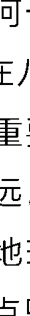

认知与契约4 | 意义：认知的...

+ 第一模块
认知源代码
第二模块
认知治理
第三模块
算法与第一性原理
第四模块
意义炼金术
“认知与契约”

## 很多事情都是偶然

我们在前面的课程里讲到过“偶然性”：

地球出现生命至少要穿过6个偶然性，其中有任何一个条件不满足都不会有生命。比如，在八大行星当中只有地球有生命的一个很重要的原因是因为：地球和太阳的距离不近不远。像排在第二位的金星跟太阳的距离比地球近，表面平均温度是4000度（铜的熔点只有1000多度，铁的熔点只有1500多度），所以上面是不可能有生命的；如果离太阳过远，那么即使有水也不可能是液态水，而没有液态水，生命就不存在。

科学家做了一个计算：如果地球和太阳的距离缩短8厘米，地球上的温度就会提高20度，也就是说，现在有42度的高温，到时候就会变成62度，如果这样的话，就只有南北极可能有生命了。

我们知道，地球与太阳的距离是1.5亿公里，8厘米和1.5亿公里相比是一个可以忽略不计的距离，但这个距离让地球的面貌发生了翻天覆地的变化。

我们看周围的一切都觉得天经地义、理所当然，但其实是要满足极其精确的条件才能将现在的情况变成现实，所以，我们说所谓的“偶然性”是概率极小的可能性变成了现实。

如果我们把地球现在的情况作为一个成功事件的话，那么这个成功的可能性取决于地球和太阳之间的距离，而一旦这个可能性成为现实，我们就觉得理所当然了。

用这个视角看问题的话，我们会发现有很多的事件、结果、现实，都是极其偶然的。

## 偶然性、意义和契约

我们现在复习“偶然性”，因为它跟这个单元讲的“意义”和“契约”有关。

### 1.大海捞针：被误会的可能性

我们常用“大海捞针”来形容一个事件成功的难度之大、概率之小。

请注意！“捞到针”是一个概率极小的事，而在没有开始“捞”之前，从整体上看它几乎是完全不可能的。而如果你基于“完全不可能”的认知马上作出一个选择——终止行动，那它成功的概率立即可是零了，虽然本来成功的可能性也接近于零。

我们绝大多数人遇到小概率事件时都会选择放弃，从根本上把一个接近于零的可能性直接变成零。但是还有极少数的人会去做这样的事情，而且他做成了以后，如果有反省能力的话，他一定会有那种近似于“惊回首，离天三尺三”，甚至更加强烈的侥幸感。这是一种明显的运气——你竟然赢得了那个极小的概率。

普通的认知是没法开启一个行动的，而不开启行动，结果就不存在，但毕竟有人会开启行动，比如生命开始的时候，最初的阶段也就一个类似于大海捞针的行动——你能成为你，有一亿分之一的可能。

那么，看起来成功率那么小的事情怎么会有人去干？答案是：如果真知道成功概率那么小的话，当然没人去干，但之所以有人去干，是因为他误会了成功的可能性，或者说他极大地高估了可能性。

比如在生物界，基因层面的强制性让所有的个体（精子）去追逐这个一亿分之一的可能性：它们被置入了一种内在的程序，并不知道成功率只有一亿分之一，只能竭尽全力地去追逐这种可能性。

### 2.认知的残缺

人作判断和选择、开启一个事件通常是基于自己的认知，但我们的认知常常是不可靠的：你没办法精确地预测这件事值不值得干、成功的可能性到底是多少，不可能把所有场景都清晰预见一遍再开始行动，而你不开始行动，这个情景就不会出来——这就是认知天然的残缺。或者说，在开启一场意义重大的事情之前，认知是帮不上你什么忙的。

我们以前讲过的，人的行动常常不是依据认知的，那你依据什么呢？意义，也就是一种想当然的、充满着不确定性、复杂性、模糊性、易变性的一个目标。认知的缺省状态，或者说相当程度上的无知成为了你行动的依据。

比如我们以前讲过的哥伦布发现新大陆，其实就是基于几个谬误：

+ 哥伦布数学太差，他计算出来的地球周长只有地球实际周长的1/8——要是不犯了这个数学错误，他可能不会开启这一趟旅程；
哥伦布的目标本身就是错的，他最后发现的新大陆是他一个错误目标的正确副产品。他要到中国，也以为自己到了中国，但其实是到了美洲。

所以，在整个过程中支撑哥伦布所有行为，并且导致最后结果的不是认知，而是意义：意义是人设想甚至臆想出来的，想当然以为又坚信不疑的一个目标。

### 3.意义：认知的替代物

我们经常说“XX事是没有意义的”，这句话是说，这样干是没有目标、没有结果的，它设定了一个意义，导致了一个意外的错误或者一个意外的成就。由此，我们可以理解两个问题：

第一，意义是臆想出来的，不是以充分的认知作为依据的目标和假设。尽管它不是基于认知，但能够在认知力不从心的情况下成为行动的依据和动力；

第二，意义是人跟不确定性之间签订的一个契约，并且会坚定不移地履约。这个追逐意义、签订并履行契约的过程就是信仰的过程。

意义既在认知之外，又跟认知密切相关，是认知永远不可或缺的一个替代物，在很多时候弥补了认知的有限性，是人能够在认知不完备的情况下达到某种目标必不可少的生存要素。

关于认知、意义、契约、信仰之间的关系非常复杂，我们在后面的课程里继续跟你深入地探讨。

## 用户留言

提交留言可与专栏作者互动

## 问答41 | 如何训练幽默感？

问答41 | 如何训练幽默感？

### 如何避免成为“和事佬”？

@古道

弗利特认为，“管理就是能找到一种方法，让看似矛盾的事情和谐相处，也就是找到一种路径和方法让相互对立的因素和观念相安无事，并且达到目的”。这句话让我想起了和事佬，我们要如何避免成为和事佬呢？

如果你看到弗利特的这句话仅仅想到“和事佬”，那证明你还没有理解这句话。

### 如何像成人一样看到问题的多样性？

@诸涛霆

### 如何既达到平衡又不失去自我呢？

@非凡

- 原则不变，目标不变，方法也不变；
- 方法不变，原则和目标经常变；
- 原则和目标不变，方法总在改变。

### 如何训练幽默感？

@学习学习再学习

- 工具是一个可以直接递给你东西，而我们常常把方法当工具；
- 宝葫芦是一个方法和工具合一的东西，但现实世界里，方法和工具从来不是一回事，宝葫芦也不存在；
- 给你一把枪，甚至告诉你打枪的方法论，但不能保证你是神枪手。

认知周期1 | 父子关系与“自大狂”

问答39 | 方法和工具之间的区别是什么？

## 用户留言

提交留言可与专栏作者互动

## 认知与契约 | 本单元十大精彩留言

认知与契约 | 本单元十大精彩...

## 本单元总结

第一节课我们提到了一个很常见的英文单词：Economy，但是我们讲到了一个非常不常见的意义：神圣救恩计划。什么时候神圣救恩计划？我们可以这样理解：当事人...这个力量或剧本就是神圣救恩计划。我们可以借用这个概念思考一下，自己或人类是否也处在这样的计划中。

第二节课我们说，关于约定的“约”，世界上其实存在两种约，一种是大自然的智能合约，比如种瓜得瓜种豆得豆，这是基因里就对好的程序；另一种是人与人之间的契约，为了对抗生活中的不确定性而制定。我们跟世界的关系就是建立在一系列契约上的，我们生活在这个世界上，同时受到自然律和人与人之间契约这两种力量的约束。

生活中都有哪些契约呢？第三节课我们说，很多规则、制度、现象都是契约。比如宗教，它的核心就是一种价值交换——你的行为观念满足了某种条件，就会出现某个结果，比如佛教讲的“因果报应”；还有婚姻，婚姻是爱和契约共同作用下的结果，不知道你发现没有，几乎所有被歌颂的爱情都是遵守契约的爱情。

第四节课我们说到了整个第四模块的关键词——意义。意义跟认知有什么关系？它既在认知之外，又跟认知密切相关。认知力不从心的时候，就是意义发挥作用的时候。因为我们面对世界时，不可能具备完备的认知，我们必须根据想当然的意义行动，否则就无法行动。所以我们说，意义是认知不可或缺的一个替代物。

这个单元的内容可能有点抽象，但对于整个模块来说，这是基础，只有理解了这个模块，你才能理解个人在社会、宇宙中的位置，以及我们的命运是如何运行的。

好，以上就是本单元的主要内容。以下是...

特别提醒：留言内容会默认公开，并同步到“知识城邦”中，中奖同学留个人信息时，一定记得将留言设置成隐私模式，确保个人安全。

—— 本单元十大精彩留言 ——

## 获奖留言

### 一黛饮

人的心智模式共有四种：

+ 1. 最低层次的心智模式是“二元对立”，就是把世界分为好人和坏人，而好人最终会战胜坏人。
2. 比“二元对立”更高级的是“力求公平”的心智模式。这种心智模式承认好人有缺点，坏人也有优点。
3. 比“力求公平”更高级的是“相对主义”的心智模式。这种心智模式认为，根本就没有好坏人之分。
4. 最成熟的心智模式是第四种，称之为“个人整合”。这种心智模式认为，好和坏是相对而言，你需要选择一个主张，尽力整合各方的利益。一个成熟的成年人应该使自己具有整合的心智模式，做到一种权衡，寻找第三选择，将双方利益得到合理的体现。

### 仕练功倍

我在一家上市公司担任财务管理岗位。在公司日常经营中，经常有业务部门提出要做一项业务，但这一项业务一旦做了，可能违反公司财务管理规定或上市监管规则；而如果不做，则又会影响公司业务正常开展。

## 以武治心

“幽默感”是一种高维认知的精神状态，是一种表现。幽默感所代表的对于生活的主动，就是我们说的“第三选择”。

## 其他精彩留言

### 小贝

查理·芒格有句哲言：要得到你想要的某种东西，最可靠的办法是让你自己配得上它。这其中暗含了等价交换，也包括婚姻。

世界另有计划，就让我们重做计划。世界没有给我们选择的自由，它只是在优胜劣汰，适者生存，进化永不止步，然而我们自己可以赢得自由，至少选择态度是我们最后的自由。

事物都可以分为变化的和不变的，对于不变的要顺应，要借势，对于变化的就是我们可以有所作为的，我们可以创造出自己的可选项，然后在可选项里面排优先级，放弃大部分不重要的，与风险共舞，最终总能有所收获。

没有上帝之眼并不重要，因为我们不需要作预测，我们只需要作决策，作预测不也是为了决策吗？李笑来老师在年度总结中讲到：我们不要相信命；要从不变里面找灵感，让不变带我们穿透时空；始终着眼于提升能力，能力是一切舞台的门票。

认知与契约 1 | 现实中的上帝视角

### 桃安安

学习了意义和契约后，想到了王立铭老师在《生命科学50讲》中说到的自由意志。研究发现，人可能没有自由意志，自由意志更可能是一种假象幻觉，人作出选择时，大脑已提前给出了答案和决定，你的自由意志只是充当“新闻发言人”的角色。这么想来，意义更像是为自由意志找到一种奖励机制，刺激我们更好地活着。

认知与契约 4 | 意义：认知的替代物

### Apprentice-胡钦元

人的认知跟世界的真实运行规则总有差距，没人可以做得到尽在掌握，我在两年前曾提出一个理论：人境界的高低在于和这个世界的契合度。直到现在这个理论受到千锤百击，依然不需要修正，成为我观察世界的核心准则之一，能做到与真实契合度越高，就是传说中的算无遗策。

所以：1.人的认知与真实总有差距。2.认识到差距，避免陷入以自己认知为边界的桎梏。3.搜集客观情报，作出和真实运行规律更贴近的决策。

认知与契约 4 | 意义：认知的替代物

## 林曦

吴老师好。“幽默感”一词，在英语里的常见说法是：The sense of humor。其中，“sense”一词，除了可以作为名词，也能作为动词，解释成“感觉到”、“意识到”，按牛津词典的解释，是：to become aware of sth even though you cannot see it, hear it, etc.从这个角度出发，似乎能够更为深刻地理解，文中的那句话：工具和方法论都不能代替方法，方法是你在不断地“格物”当中“致知”的，是不可能传授的。

工具、方法论，提供的是确定性；而方法、环境，代表着不确定性；在两者之间的，便是“第三选择”。权衡、权变、权宜，则是帮助我们，可以以更大概率察觉它、感受它、抓住它的锦囊妙计。

问答41 | 如何训练幽默感？

## 用户留言

## 意外与意义1 | 有限游戏和无限游戏有什么区别？

## 故事一定包含着事故

### 1.意外：故事的第一个要素

我们常常说生活中充满了故事，那些告诉你怎么写故事的书首先会告诉你：故事的第一个要素就是“意外”。

比如，有一天你要到南方出差，买了飞机票，搭乘某趟航班到了目的地，办完事情待了两天又坐某趟航班回来了——这显然不是一个故事，这里没有任何意外。

故事一定要有意外：你订了某趟航班，结果由于某种原因取消了，这就是一个“意外”。但仅仅是“意外”还构不成故事。意外发生，又一条线被展开了，比如航班取消，你寻找另外一个航空公司的一趟航班，但买票的时候发现票全部被卖出去了。正当你绝望地要离开，有个人来退票了—当意外出现了一个别开生面的节点，这才是故事的开始。

一句话：故事一定要有意外，而意外的发生是一个别开生面的故事线的起点。

### 2.巧合：意外+意中

## 故事塑造的“有限游戏”

## 培训和教育

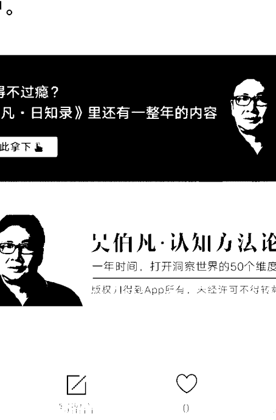

## 意外与意义2丨你为什么会悔棋？

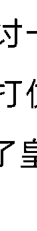

意外与意义2丨你为什么会悔...

俗话说“种瓜得瓜，种豆得豆”，是因为大自然有一个固定的自然律约束。而在人类社会中，这个约束就非常有限。虽然我们相信人类社会的运行规律也遵守自然律，但在现实生活中往往不尽如人意，比如一个人受了很多苦和累，经受受人欺负，最后也没苦尽甘来。我们由此开始怀疑人生以及所信的因果关系。

历史上有很多初始原因跟最终效果不对称的例子。比如朱元璋，当初只是顺路打劫，“初为丐、后为僧、终为帝”，他本来说是想讨一碗饭吃，后来决意从和尚变成军人去打仗想到的还只是当兵吃粮，最后他当上了皇帝。

这些现象都涉及到“风险管理”：通过一系列规则行为防微杜渐，避免小的原因导致灾难性的结果。

## 风险管理

风险掌控是有一套流程的，这个流程针对的是如何将可能的风险消灭在萌芽状态。

从事风险管理的人会告诉你：企业最终倒闭可能是因为在人、财、物的管理上出现了一些小差错，而这种差错会遵循某种机制不断放大，最后导致不可收拾。为了避免这种结果，你自然会设想如何防范风险。那么你可能会从后往前倒推，进而发现是什么原因导致这样一个结果，那只需求消除这些原因就自然会避免那个结果。

这可以说是风险管理的金科玉律，但问题是，你把这些原因都消除了，而且没出任何差错，但结果又出现了。

### 1.世界为什么毁约？

我在2010年见过诺基亚的末代CEO斯蒂芬·埃洛普（Stephen Elop），他在上任42天的时候秘密到北京见了包括我在内的5个人，我们五个都是媒体人，他要求不对外公布这次会面的任何信息，只想知道外界是怎么看他的。

> 我：作为受命于危难之际的CEO，你觉得最应该做的事情是什么？
> 
> 埃洛普：诺基亚有很多钻石，我的任务是切割、抛光，让这些钻石闪闪发光。

他说这话的两年之后，诺基亚就退出了无线通信终端的领域，但埃洛普还留下了一句著名的话，“我们并没有做错什么，但是我们失败了”。这句话听起来很饶害，但其实它代表了很多临危受命的风险管理从事者的共同心态：

我该做的都做到了，为什么结果大出我的所料？

还有一句隐藏的话没说：这个世界为什么要毁约？

### 2.你看清楚合同了吗？

“我该做的事情都做到了，为什么要面对这样一个结果？”我相信很多人有过这样的感受。在面对世界毁约的时候，我们会产生一种虚无感——我们相信一个契约，以为只要做到ABCDE FG，它就会给你XYZ，但最后的结果让我们大跌眼镜。

如果世界老毁约，这个世界还有意义吗？
我为什么要守约？
我还能相信这个世界的意义吗？
我再也不相信以前我所相信的东西了！

每当遇到上述的情景，我都会问一句说：你觉得对方违约了，那你看清楚了合同没有？

有时候我们觉得对方骗了自己，其实是因为自己没仔细看合同——这是一种日常的经验，但我们跟世界和他人的关系远不是这么简单。

### 3.悔棋者说

如果你是一个爱好棋艺并且经常悔棋的人，我建议你反省一下：为什么你会悔棋呢？

悔棋的人一般都是这样的：下这步棋之前，他认为这步棋是一个妙招→一旦棋子落定，对方给出一个反应，他马上发现这是一个昏招→他自然产生一种反应：收回自己这一步。

为什么你坚定不移、自鸣得意的一步棋一旦下出，马上就变成了一个昏招呢？因为你下这步棋时的逻辑还是“种瓜得瓜，种豆得豆”，而当你发现“种瓜得到的不瓜”的时候，你在不到一秒的时间内就后悔了。

出现上述这种情况，是因为你不知道游戏的边界在时刻变化：当你下一步棋的时候，你认为游戏的格局和边界是不变的，只需要促成某种变量就会改变这个格局，但你没想到的是，你这一 步一动，边界和格局已经发生了实质的变化。

### 4.事后诸葛亮的英明

有人说“历史的最大教训是人类从来不从历史中吸取教训”。历史还有一个作用，“让我们这些事后诸葛亮体会到自己有多少英明”。

中学时候学过的《过秦论》里描述了秦朝灭亡的事实，很多人就针对这个结果不断地分析各种各样的原因：一方面，这类议论都是事后诸葛亮；另一方面，事后诸葛亮对当事人来说是没有意义的，但对我们的认知是有意义的。

比如朱元璋痛恨前朝幸相和宦官专权会导致奸臣尤其是宦官当道，这让他深恶痛绝，所以他做了自认为很高明的举措：废除丞相，不让太监认字——朱元璋认为这些措施可以避免前朝的弊端。后来事情我们都知道：明朝恰恰是一个奸臣尤其是宦官当道的朝代。可以想象一下，假如朱元璋活着看到到后面的事，一定会悔棋的。

## 企业管理=有限游戏+无限游戏

我认为在从事企业管理的时候一定要记住：

+ 1. 不管你愿意不愿意，这个游戏既有“有限游戏”的成分，也包含“无限游戏”的成分；
2. “无限游戏”的边界是不确定的，你在玩这个游戏的时候会觉得你主导了这个游戏，其实参与于游戏的还有很多你没有意识到的人。

举一个很初级的例子：打麻将的时候为什么总有人爱“点炮”呢？因为按照他自己的计算，只要出一张牌就能引来一张什么牌，就和了。但问题是，麻将还有其他三个人在玩，别人才可能等着这张牌，所以你打出这张牌一下子就“点炮”了。

不过打麻将仍然算是“有限游戏”，而“无限游戏”的玩家的数量完全不可预期，它的格局随时可能因为你的任何一招发生决定性变化。借用爱因斯坦“相对论”的理论来说：物体的运动不是在一个不动的时间和空间里运动，任何物体的运动都是在改变时间和空间。

在现实生活中我们没办法悔棋。不是世界毁约，而是你自己想悔棋却没办法悔棋——你误解了格局还反过来抱怨格局，这是一种非常致命的认知谬误。

## 用户留言

提交留言可与专栏作者互动

## 意外与意义3 | 世界在不断绽放新的可能性

意外与意义3 | 世界在不断绽放...

+   第一模块
认知/源代码
第二模块
认知治理
第三模块
算法与第一性原理
第四模块
意义炼金术 “意外与意义”

## 延迟判断：管理学的重大进展

我不喜欢和特别爱提问的人看电影，尤其是看那些水平比较高的电影的时候，如果身边老有人在不断质疑，我不知道是回答他好还是不回答他好，尽管我知道他为什么要提问，但不可能跟他去解释“你的这个质疑是没有意义的”，因为如果他稍稍沉住气接着往下看的话，就不会再质疑了。

我们提出一个质疑的时候，其实已经下了一个判断，并且在用这个判断来衡量眼下的格局——觉得既不合情又不合理。而多看一些电影的话就会知道：在有一定水准的电影里，所有的要素是逐渐展开的，如果你觉得有疑问，可能不是对方错了，而是你错了。

我们在前面的课程里说到：我们对于世界有度、量、衡三种反应方式，但有很多人认知和判断都像一把尺子或者一个斗，他们不会去改变自己衡量世界的方式。

+   我们认知的升级要从度、量变成衡，也就是需要通过调整自己来获得对于世界的真实认知；
不要“以不变应万变”，而是“以自己的变来应对外界的变”；
如果采取“衡”而不是尺子和斗的方式，就必须也要遵循一个原则:延迟判断。

> 管理学创始人德鲁克认为，“延迟判断是20世纪管理学的重大进展之一”。

## 还原真相：从静态到动态

“原谅”这个词里的“原”是还原，也就是当对方做了某件有违你预期的事，或者毁约的时候，结果显而易见，但导致结果的所有要素你清楚吗？

## 延迟质疑，延迟判断

回到我们刚开始的话题：为什么我看电影的时候不喜欢旁边坐一个爱质疑的人呢？

+   1. 人和世界的关系是一个由无数节点构成的复杂过程，每个节点又都包含着多种的可能性；
2. 在这种众多可能性当中还包含着一种别开生面、异军突起、绝处逢生、柳暗花明的可能性；
3. 你匆忙下判断就是终止了这种可能性。

## 意外与意义4 | 在不可能中寻找可能性

意外与意义4 | 在不可能中寻.

| 第一模块 认知的源代码 | 第二模块 认知治理 |
| 第三模块 算法与第一性原理 | 第四模块 意义炼金术 “意外与意义” |

我们上节课讲了，延迟判断是二十世纪管理学的一个重大发现，需要注意的是：延迟判断不是拖延的借口，不是随遇而安也不是听天由命，它是一种积极的禁止或沉默，是在一种看似不作为当中积极敏感地等待着可能性。

这里所说的“可能性”和第三选择密切相关：第三选择不是第三个选择，而是第三维度的选择，不是折中或者和稀泥，而是在一个平面的二维世界里找到第三维，在一个不可行、不可能平面上增加一维。所以，我们也可以叫它“第三维的可能性”。

## 黄山松: 可能性的艺术

在《倀凡·日知录》里我们讲过一种植物：黄山松。

我之前在读《可能性的艺术》这本书的时候，对其中的论述似懂非懂，总抓不住要点。这时候我恰好看了一个纪录片，里面讲的就是黄山松。而当我对黄山松有所了解，一下子就明白了什么叫“可能性的艺术”。

黄山松是一种世界上非常罕见的独特植物，它在没有土壤的地方生长出来。我们知道，黄山的特殊地质决定了黄山顶上不可能有任何土壤，而黄山松的种子掉到石缝里以后竟然能生长出来，而且长得还不小，在很远的地方都能看得到它。

黄山松非常生动地体现了“可能性的艺术”：

+   1. 它分泌一种酸性物质将石头降解，而且是逐渐降解，因为分泌酸性物质要消耗能量，所以在长期进化过程中，黄山松非常节制地分泌酸性物质，不至于让自己长得过快；
2. 它的树干不仅是弯曲的，而且是横向纵向两个维度的弯曲，能更好地缓解风对它的冲击力。

一颗种子掉到石缝里想生长出来是不可能的，但黄山松在这种不可能中找到了一个可能性的第三维度的解决方案，让它的生命异军突起、别有洞天。

## 在不可能的生活中活出生命的可能性

黄山松的故事让我想到了另外一本书——《活出生命的意义》，或者按照我的命名：在不可能的生活中活出生命的可能性。

这本书的作者弗兰克尔写了他在奥斯维辛集中营中的经历。在那个死亡随时在侧的人间地狱里，他不但活下来，还活得非常健康和幸福，要知道，很多活下来的人也都留下了巨大的精神后遗症，甚至选择了自杀。

清楚“奥斯维辛”是什么的人一到这里，就觉得生命已经结束了，因为可能性会在这里终止，但其实还是有可能性的。弗兰克尔进入奥斯维辛死亡之门的时候就遭遇了一种可能性：老弱病残一进来就被纳粹全部杀掉了，能干活的人才可以先暂时留下来。

弗兰克尔平时所认为的诸多不可能在这个地方都已经消失，比如你觉得应该是一个人住一个房间，错！在这个地方就是十几个人挤在一个极其狭小、黑暗、潮湿的房间里；或者你觉得被子很薄会冻感冒，错！这里没有一个人得感冒——那这种情况，如果想活下去只能变得坚韧。

所谓“可能性”就是有朝一日能从这个地方出去，不管是越狱还是纳粹被消灭。换句话说，只要你呼吸，可能性就是存在的。

从此以后，弗兰克尔逐渐关闭了对不可能的感知，逐渐开启对可能性的感知，就如同有些动物在可见光之外能看到红外线和紫外线一样，弗兰克尔要具备在不可能中找到可能性缝隙的能力。弗兰克尔是少数能够感知到可能性并相信它的人：因为相信，可能性就逐渐向他敞开；因为相信，对各种意义而易见的不可能性也就越来越不敏感和迟钝。

如果你生命是一个线性故事，包含时间、地点、人物、事件，有头有尾，那么任何一个意外都意味着故事的结束——意外的出现就是以不可辩驳的事实告诉你：不可能！

弗兰克尔逐渐意识到：任何一个意外都是有出口的，同时包含着不可能性和可能性。所以当意外出现的时候，文本思维就意味着故事结束了，而在意外中发出了那个出口就意味着一个新的开端。

## 超文本状态

回到最初的话题：认知是一个有选择性的产品，设施如果改变，生产出来的产品也就不一样了。

+   我们对一个人或一件事情的评价，由于立场不同，得出的认知就不一样；
在平淡生活中，立场、诉求、意向的不同导致结论的不同。

我们说“铁的事实摆在面前，没有选择”的时候，其实是我们前摄性选择了不选择或不可能，自动关闭了可能性。但是，我们和世界以及他人的关系不是一个文本状态，而是超文本状态。

超文本是一个句子中的词可以作为虫洞般的溢出出口，进入到另外一个意义空间中。这个词在句子里只有一个角色：要么是主谓宾，要么是定状补，但这个词本身可能是一个维度的开端。

如果把一篇文字理解为一个平面的话，超文本就是一个立体文本。在一个有超文本链接的文本中，你只要点击相应的词就会进入到另外一个文本当中，而如果另外一个文本也是超文本的话，你还可以继续通过点击其中的某个词进入到另外一个文本中。

这就像生活在二维世界的蚂蚁根本不知道三维世界的存在，更不可能知道人的存在。当你说“不可能”的时候，你可能处在单维或二维的世界里，无论在这里怎么挣扎都是找不到可能性的一它确是一个不可能。

但可能性存在着另外一个维度。我们说的在认知上具有绝对优势的“高人”就是能在不可能的一维世界和二维世界中开启一个可能性的第三维度。

丘吉尔在他著名的演讲《开始的终结》中说过：这不是结束，甚至也并非结束的序幕已然到来，很可能只是序幕已经结束了。

序幕结束了，正文才刚刚开始。

## 用户留言

提交留言可与专栏作者互动

## 问答42｜意义跟价值观有什么区别？

问答42｜意义跟价值观有啥… ↓

## 敬畏和谦卑

@ 张保成

冥冥之中自有安排，从更大的视角看很多事情都存在着某种确定性，而身处其中的人却看不到，这是不是一种宿命论的观点呢？

我们生活在世界上总有一个参照系，但这个参照系GPS可能不够用，比如走立体交叉桥的时候就会出现这样的问题：现有的GPS是二维的，就可能导致在三维的立体交叉桥上走错路。这不是宿命，只是提醒我们对GPS或者说我们的世界观，要有一种谦卑和敬畏。

中国历史上一直上演着游牧民族入侵中原的故事，我们也知道中国北方有一道长城。二十世纪著名科学家竺可桢发现：长城跟中国的400毫米降水线重合，但是以古人的认知是不可能知道400毫米降水线的。竺可桢先生还发现，每当气候发生变化，比如出现了小冰期的时候，400毫米降水线就会南移，而一旦出现这种南移，又正好是游牧民族入侵中原的时候。可以说，中国历史的改朝换代和400毫米降水线的南移有非常密切的关联。

我们想到这个事实的时候会产生一种感觉：你在下棋，但你不知道自己是一个棋子——你所谓的自由意志不过是一个更高意志的执行者而已。但最让人叹息的是，你执行的时候以为自己是决策者而不是执行者。

我们各个民族的智慧里都强调敬畏，而敬畏的另一面是谦卑：我们始终要对自己认知的简陋和有限性有一种意识，哪怕你不知道简陋和有限在哪儿，但如果保持了这样一种心态，就可能在关键问题上免于致命的自负和狂妄。

## 意义是特殊的认知工具

@ 王双

这节课让我想到了马克思·韦伯的一句话，“人是倒挂在自己构建的意义之网上的动物”，我突然发现身边有一部分人做任何事情都要在信息完全具备的时候才开始行动，而这导致他们经常无法行动，事情也没做成；而有些人只要看到希望和机会就会努力想办法采取各种行动去尝试，最后可能就成了（当然也可能失败了），但至少这种概率比前一种概率大得多。佛家有句话“借假修真”，就是说我们通常依托一个看上去是虚假或者事后看来是错误的一个东西，但最后达成了我们想要的目标，这和意义是不是相似的呢？

意义是一种特殊的认知工具，是在认知不完备的时候必须要用到的一种软件性工具。如果你工具箱里净是那些基于事实的认知而没有意义工具的话，你的行动往往就丧失了依据。

意义是一种假说，但跟科学的假说不一样：

我们在科学上提出一个假说，通过逻辑和实验证实或证伪，如果证实了，假说成立，就变成了真理；
意义的功能不仅仅是让我们有认知上的收益，最重要的是让我们的行动有所收益，或者说，它提供了某种支点一一意义支点。你撬起一块大石头的时候必须找到一块小石头作为杠杆，没有这个工具大石头是撬不动的，等你撬完大石头，小石头就显得不重要了，但促成一个行动的过程当中，小石头是至关重要的。

## 意义和价值观

@ 风的去向

意义跟价值观有什么区别呢？

我在这里不可能详细分析价值观和意义的关系，我只能说：它们在相当大的程度上是重合的。价值观和意义一样，是一种主观的东西，能够成为我们认知和行动的支点，同时也是认知和行动的参照系——当你没有这些工具的时候，你的认知和行动是不可能产生进展的。

我们这里说的价值观是一种广义的价值观，你可能会说“我根本不相信有什么价值观，只相信眼见为实的东西”，这其实也是一种价值观，就像你认为“世界和人生是无意义的”，也是一种意义。

作为参照系的意义和价值观不是一种虚无主义的意义和价值观，尽管虚无主义的意义和价值观同样也会导致相应的结果；
意义和价值观对于人的认知和行为的统筹性力量往往要从长时间才能看得出来；
意义和价值观不是针对个别的事实，而是针对一种过程中一个又一个节点上的可能性和不可能性形成的一个意义之网/价值之网。

关于“意义和价值观”的问题，我们会在接下来的单元里详细讨论。

## 用户留言

提交留言可与专栏作者互动

## 意外与意义 | 本单元十大精彩留言

意外与意义 | 本单元十大精彩...

## 本单元总结

第一节课我们提到了两个词，分别是有 finite 游戏和无限游戏。有限游戏是有边界的，而且游戏当中玩家的角色也是固定的，换句话说，你基本能预测这个游戏结局的几种可能。而无限游戏恰恰相反，它不仅没有边界，就连玩家的数量你也是不清楚的。我们生活的世界，大多数情况都是充满了意外的无限游戏，可悲的是，我们常常把它们当做有限游戏。

第二节课我们提出了几个问题：世界为什么会毁约？如果你觉得世界毁约了，那么你看清楚合同了吗？有一门管理学学问叫风险管理，是为了将可能的风险消灭在萌芽之中。但很多时候你消灭了导致问题的可能因素，可问题还是会发生。这时你能说世界毁约了吗？其实，在你做出行动的那一刻，问题的局面已经发生了变化，换句话说，如果你觉得世界毁约了，那是你误解了事情的格局。

第三节课我们重点说了一个词：延迟判断。 人和世界的关系是由无数复杂的节点构成的，每个节点又都包含着多种的可能性，而这里面可能就包含着绝处逢生的可能性，所以，如果你匆忙下判断，也许就会终结这种可能性。所谓延迟判断，就是回归到一种情景当中，从静态回归到动态，从而还原真相。

第四节课我们重温了黄山松的故事，也深刻地感受到了如果力量足够强大，就能从不可能中找到可能性。在一维和二维之外，还有一个第三维的世界，只要一切还没结束，就没什么不可能。

好，以上就是本单元的主要内容。以下是 我精选的同学留言，恭喜前三名同学，将获得我签名的书一本，这次送出的书是之前课程中提到过的《思维简史》，得到的工作人员会尽快把书寄给你，也希望其他同学再接再厉。我们下节课再见。

> 特别提醒：留言内容会默认公开，并同步到“知识城邦”中，中奖同学留言个人信息时，一定记得将留言设置成隐私模式，确保个人安全。

## —— 本单元十大精彩留言 ——

## 获奖留言

快乐

美团网创始人王兴对《有限与无限的游戏》这本书的评价，“有限游戏在边界内玩，无限游戏却是在和边界玩，探索、改变边界本身。死亡是不可逾越的边界，与之相比，其他的边界并不那么重要了”。

意外与意义1 | 有限游戏和无限游戏有什么区别？

小贝

昨天学习隔壁昊军老师的《谷歌方法论》课程，再次说到了计算机中的递归思想。我们日常的思维通常是自底向上的方法，如：1、2、3.....n，从1到n，而计算机的递归算法是一种自顶向下的方法，从n到1。有些题目自底向上是非常难解的，甚至是不可能完成的任务，但是如果换一个思路自顶向下处理，会变得非常简单，柳暗花明又一村的感觉。

意外与意义4 | 在不可能中寻找可能性

张强(汉)

今日收获：在不同维度下思考问题是我们追求的目标，但如何才能具备这样的能力，光靠自己去想终会受自己固有模式的限制，多观察、不戴“有色眼镜”接纳吸收，会让认知有更高效的拓展。

在不可能中创造可能，我想到的是在赋能岛首届年会上，与大家分享旅行经历的盲人旅行家曹康康，他少年因故失明，但不愿放弃心中的理想，上清华北大，参加比赛，全球旅行，我还记得他说过的一句话，如果我看不见世界，就让全世界看见我。无论是自己心中的世界还是别人眼中的世界，都不会因为没有视觉而改变。这也是在不可能的世界活出生命的可能性。

## 其他精彩留言

L.J

有限游戏和无限游戏可以说是两种不同的思维方式，前者是静态、局限、单一地思考问题，后者是动态、全局、多角度地思考问题，通常真正的高手都懂得灵活运用这两种玩法，将有限游戏无限玩，无限游戏有限玩。

## 斜阳

想要做到延迟判断，必须足够有耐心，也是对自己有信心，如果一直担心错过什么，就会慌乱中乱动，反而低效。

我之前给一个公司做问题诊断，刚开始看哪哪都是问题，因为和我熟悉的运营模式差异很大，因为时间比较紧，我每天都会根据自己当天听到的信息和判断作出一些改进的建议，这样过了一周的时间，有了完整的认知之后才发现前两天的局部判断是多么愚蠢，为了省时间反而最后浪费了更多时间，很多东西不得不重新做。

两周后，我以为自己获得了完整的看法，也理解了之前很多看似不合理的现象，可是就在公布报告的当天，被审计的企业又拿出了很多新的证据，再次证明了很多问题的“合理性”，边界在不断变大，我不得不熬夜看了他们所有的合同和往来账目才能进一步说明问题依然存在，整个事件峰回路转，不同的时间点看到的东西，得出的结论都一样。

意外与意义 3 | 世界在不断绽放新的可能性

## 潘潘

与“延迟判断”相对的是“当机立断”。两者没有高下之分，要放在具体的情境下，才能选择合适的方式应对。当信息充足的时候，决策效率自然越高越好，这时就应该当机立断，这是头脑清晰、反应敏捷的表现。但是当信息不充分的时候，我们就应该要有等待的耐心，不轻易下结论，直到有更充分的证据出现。判断和决策不是越快越好，而是在正确的前提下越快越好。在不能保证正确的时候，就该缓一缓，延迟判断，慢即是快。

归根结底，我们还是要多学习。见多识广，我们才能明白这个世界有多么地复杂，人和事存在着无限的可能性，我们才有可能保持一颗谦虚谨慎的心，在适当的信息基础上作出合理的判断。

意外与意义 3 | 世界在不断绽放新的可能性

## 洛洛

有一个真实的故事：

一个孩子在学校成绩不理想，经过家庭和学校的各种努力，成绩不见起效，孩子还出现了严重的心理状况，父母只好为孩子办了休学。休学期间，孩子整天在家画画，家长看孩子喜欢画画，就给他报了画画的培训班，还请了老师教他画画。喜欢画、天天画，孩子画得越来越好，人也逐渐变得快乐起来。有ibt。一天，孩子突然对父母说，想回学校读书了。

故事最后说，孩子回到了学校，学习非常努力。上学-读书-成绩-休学，是孩子的时间故事，它是线性的，这个线性故事出现了意外，也出现了另一个空间，绘画。绘画使孩子看到了自己的可能性，我可以做得更好，这让孩子有了自信。败也成绩，胜也成绩，最后在自信里突围。

我们在故事里，看到了认知开放的家长，在学校教育之外，积极寻找可能性的家长，他们没有把孩子的成长局限在学校这一“管窥”视野。任何一个意外都是有余口的，同时包含着不可能性和可能性。我们的故事是线性的还是超文本、开枝散叶的，取决于我们认知的开放程度，取决于对自己所确定的意义可能性的坚信和坚持。

意外与意义 4 | 在不可能中寻找可能性

## 用户留言

提交留言可与专栏作者互动

## 意义发条1｜意义从哪来？

意义发条1｜意义从哪来？

第一模块
认知源代码
第二模块
认知治理
第三模块
算法与第一性原理
第四模块
意义炼金术
“意义发条”

## 生命的3个版本

我们这节课首先来复述一下生命的三个版本：

+   1. 生命1.0—除了人之外的一切生物

1.0的生命轨迹受制于基因，基因决定了他们的硬件和软件；
作为设置好的程序，1.0的生命不过就是这个程序的展开而已，没有任何自主性；
生命1.0是“一个遵守自然律约束的生命体”。

比如大马哈鱼、十七年蝉表现出的好象跟道德有关的行为，比如自我牺牲或者勇敢等等，其实跟它们本身没有关系，是人投射上去的一一它们所有的行为都是被看不见的程序所操纵的。

再比如鸟语花香，或者我们吃到的美味，这些都深藏着某种大自然的阴谋，是为了让个体完成基因的存在续。

人作为动物也遵循生命1.0的规律，比如我们吃甜的东西，其实也包含着一个阴谋：甜作为一种探测机制，不过是高热量食物发出的一种界面友好的信息，但你自己不知道这是一种信息，以为是自己喜欢甜，但实际上是大自然让你去吃。人的食欲性欲都不不过是大自然的狡黠和诡计，是让你去完成某些任务，所以，你在自然界里是找不到意义的。

在充斥着1.0版生物的自然界里，如果把它们的生命动力理解为发条的话，那大自然早已给它上了发条，它的生命从始至终受这个发条驱使，而一旦完成任务，大自然也就不需要再上发条了。

+   2. 生命2.0—人的生命

生命2.0和1.0的最大差别是：人的发条发生了变化。

一方面，大自然给了我们设定了好多发条驱使我们行动；另一方面，按照泰格马克（Max Tegmark）的说法：生命2.0是硬件不变，但软件会经常变。这里的“软件”是文化，比如父母——我们头脑中装的文化版本不一样就会导致代沟。

作为生命2.0的人的一个非常明显的特点是：软件更新速度非常快，而硬件更新速度非常慢。

+   3. 生命3.0—人工智能

按照泰格马克的说法，生命3.0是软硬件都会快速更新的人工智能（人是碳基的智能生物，人工智能是硅基的智能生物）。

## 文化与意义

我们这里先撇开别的不谈，只说“文化”：如果动物只有一个发条的话，人至少有两个发条——文化就是人行为的另外一个发条。

《菜根谭》中说，“饱后思味，则淡淡之境都消；色后思淫，则男女之见尽绝。”吃饱了以后，想什么味道都没太大的意思。不管是食欲还是性欲，一旦得到满足，你对它的认知判断就完全不一样了。所以说这里包含着陷阱，你是受制于发条的。

当然，我们的行为不能完全用“食色性也”这种自然律来解释，比如你今年35岁，觉得自己应该当副总了，应该买某个价位的车了，应该在某个地段有房子了……在什么年龄拥有什么东西、获得什么身份，这些动物不知道，是人的文化或者意义发条驱使的。

文化赋予了我们一种意义：穿什么服装，开什么车，交往什么样的圈子等等，这都是文化在我们身上加的一根发条，一旦拧上，我们的行为就自然受它驱使并为它奋斗——对人来说，“意义”真的是很有意义的。

如果你发现这根发条对你不太起作用，那你的价值观可能趋向于佛系。我们知道，佛教要消解那些文化价值的标准意义，把这些回归于无意义，比如万物俱灰、四大皆空。某种程度上，佛教是一个无意义哲学，但也并非如此，它其实也是用另外一种文化价值和意义来置换世俗的文化价值和意义。

比如你的邻居原来开的车和你差不多，但他换了更好的车的时候，你就会感到痛苦和失败，受这个意义体系的折磨。那么佛教就告诉你：把这些让我们痛苦的价值体系消解，就不再会痛苦了。你是因为有了这些价值体系，才会被那些本来应当该倚你的身外之物所绊架。

其实佛教仍然是设定了一个意义体系的：离苦得乐，通过消除意义体系消除你的痛苦，然后达到一种乐——乐就是一种意义。比如，西方伯乐世界算不算意义？《西游记》里的唐僧师徒历经千难万险到那儿去，因为那儿有真经，这就是它的意义体系。

## 意义的炼金术

讲到这里就涉及到了我们今天和这个单元的一个关键词：意义的炼金术。

“炼金术”是一个比喻的说法。在今天看来，炼金术是一个骗术和一种谬误，它是人类科技水平非常低的时候的一种巫术思维，它相信世界存在着因果关联，找到了一个因（方法）就能够促成改变（把赝金属变成贵金属，或者用平常的材料变成吃了可以长生不老的灵丹妙药）。

我们今天借用这个词指人作为生命2.0的生物，除了自然律的发条在驱使之外，始终还有另外一个发条。

比如有些人穷几亿元，但他一分钱不敢花，只把钱放在那里，偶尔用点钞机数一数，听听点钞机的声音——他认为这是世界上最美妙的音乐。我们觉得这个行为很荒谬：越有钱就必须表现得越穷，驱使他的发条是什么呢？

+   钱都没有办法用的时候还有什么用呢？
我们不能理解的那个用处是什么？
为什么有人会卖了肾去买一个iPhone手机？
所有这些怪诞行为背后是什么东西？

一言以蔽之：意义。动物是不会做这样的事情的，而人有双发动机构，或者是双核处理器，有两种东西驱使着人的行为。

在某种意义上说，优化我们的认知其实是在优化我们的意义体系（发动机）。它也能让我们更好地理解，为什么很聪明的 人会犯愚蠢的错误，因为在某些局部认知上他非常聪明，但他意义系统的发条出了问题——作为生命2.0的人始终难以摆脱意义的发条。

+   1. 如果人只受制于自然那根发条的话，他就不是一个人；
2. 但受制于文化也不意味着是一个合格的人；
3. 意义是一个很广阔的东西。

我从这节课开始详细探讨意义对于人的意义到底是什么，以及人是如何用类似于炼金术的方式创造意义的。

以简驭繁1 | “简单粗暴、直接有效”有道理吗？
认知与契约1 | 现实中的上帝视角

## 意义发条2 | 人类如何从追求生存转变为追求意义？

意义发条2 | 人类如何从追求生存转变为追求意义？

+   第一模块
认知源代码

第二模块
认知治理

第三模块
算法与第一性原理

第四模块
意义炼金术
“意义发条”

人类从游牧到定居，被认为是人类历史上一次巨大的飞跃，也可以说是人类从野蛮到文明的决定性一跃，但人类史前史的研究学者一直有一个巨大的困惑或者说是争论：

过去的学者认为，人类之所以定居是因为找到了可以耕作的地方，用农业和种植的方式获取生活资料的效率远高于游猎状态，于是选择了定居——农业和定居是同时发生的。但越来越多的学者开始反对这种观点，认为它是倒果为因的，当初的生产力事实是：没有铁器、犁、耙这些农具，用石器耕作获取生活资料的方式效率更低。所以，实际情况可能是先出于某种原因定居了下来，所以才产生了农业社会。

这个猜想被一次重大的考古发现所证实：哥贝克力石阵。

## 哥贝克力石阵

哥贝克力石阵位于土耳其东部的哥贝克力山丘，虽然不那么有名，但它的意义远比金字塔重要。

哥贝克力石阵建于11500年前，而人类的文明史顶多也就是7000年。它是一个巨型的建筑，但不是用来居住的，而只和一件事情相关——原始的宗教祭祀。人类先给神盖房子，再给自己盖房子。

在那个年代，只有狗已经被驯化了，马、牛、羊、鸡、猪都没有被人类驯化。这从哥贝克力石阵上的雕刻上能看出：那上面只有狮子、毒蛇、蝙蝠、野猪这些人类最害怕的东西，而没有马、牛、羊、鸡、猪这些经过人工改造的东西。

哥贝克力石阵这个前农业社会的宗教祭祀场所所引发了一场认知地震。考古学家在这里没有发现任何人类生活的迹象：没有水源、房屋、炉灶，只有数以千计的雕刻和野牛骨头，看上去像是从别的地方捕猎之后在这里集中屠杀的。并且有证据显示，在60英里（100公里）以外才有人居住的地区。

《人类简史》里有一个让大家印象很深但理解起来似是而非的词：认知革命。人们以为人类最早的认知应该是对作物和农具的认知，但哥贝克力石阵告诉我们：在工具极其简陋的情况下造出这样一个工程浩大的祭祀场所，证明了人类的认知不是始于对我们生活最有用的那些东西的认知。

考古学家认为，原始宗教仪式的出现看起来似乎是人类选择定居生活的重要原因：宗教中心吸引着游牧民族生活在一个紧密的圈子里，基于共同的信仰和价值体系最终形成了村落。去欧洲旅游就能看到，无论是城池、乡镇甚至村子，都是围绕一座教堂形成的。

我们如果把哥贝克力石阵理解为人类最早的大教堂的话，那就是先有了教堂再有村庄，而不是有了村庄再建一座教堂——人类不是要寻找生活的实际问题的答案，而是要寻找精神上的答案。换句话说，在农业文明出现之前，人类最关心的是自身的大命运。

## 认知革命的骗局

我们不妨举一个例子来说明什么是人类自身的“大命运”。

在中国，我们通常认为老祖宗设立二十四节气是为了农业生产，告诉你什么时候该开始种地了等等，但这种说法似是而非，因为二十四节气不是一次形成的，它是历史形成的产物。

二十四节气中的第一个节气或者说基准点，不是立春，而是冬至；冬至这天太阳从南纬23.5度直射，并且从这天开始往北回归，是365天当中白天最短黑夜最长的一天。我们的祖先通过看日影，发现冬至这天日影最长，此后逐渐缩短，六个月以后变得最短，也就是夏至。有了冬至，又有了夏至，然后有了春分和秋分，一生二，二生四，逐渐有了24个节气。

冬至的意义在于它跟人类的命运密切相关：如果天一直冷下去，对人类来说就是灾难，恐怕会与日俱增。所以不论中国人还是其他民族的人后来都发现从冬至那天开始，日子变长了。古罗马把这天叫“太阳节”；基督教传入罗马以后后来会说这是救世主诞生的夜晚，寒冷和黑暗将过去，于是形成了“圣诞节”。

正如尤瓦尔说的：在游猎时代，人类的生活比农业时代要轻松得多。游猎时代的人工作时间是2~3个小时，而农业时代工作时间是很长的一一大家终究要记住那个时候是没有什么农具的，还是石器时代。

也正如《思维简史》的作者蒙洛迪诺（Leonard Mlodinow）说的：生活在旧石器时代晚期和新石器时代初期的人类，将注意力从“如何存活下去”转向了对于自身不重要的事情上，这在人类思想上是极具意义的一步。

冬至日的发现意味着人类开始关心那些对他们日常生活并不那么重要的事情了，他们想了解环境以及世界是怎么运行的，主宰人命运的那个看不见的力量是什么，这才是“认知革命”。

尤瓦尔还说过：农业革命其实是一个骗局，这种认知革命也可以理解成一个骗局——人类开始迷信了，开始关心肉眼看不见的那些决定人命运的隐性玩家了。用今天的话说，人类开始从现象转向对于本质的追寻了，尽管那个本质在今天看起来也是一个虚假的东西，但这一步非同小可——人类开始相信故事并编造故事了。

编故事就是我们所说的意义，换句话说，人类对于重要性和不重要性的评判标准发生了一个变化：过去认为重要的、眼见到实的事情变得不那么重要了，而真正重要的则是那些看不见的东西。

我们这么说的时候很容易立刻想到宗教迷信，但这句话同样适用于科学：科学也是从看得见的东西转向看不见的东西，比如万事万物的运动规律被写成F=ma，这是人类的认知革命。只不过认知后来分成了两条道路：一条沿着科学的道路，另一条沿着宗教的道路；一条追求认知的完备，另一条是在认知不完备的情况下我们该怎么办——这是意义体系的出现。

“最重要的事情都是看不见的”，我们下一节课就从这句话的出处——《炼金术士（牧羊少年奇幻之旅）》这部小说来看看什么“意义的炼金术”。

## 用户留言

提交留言可与专栏作者互动

## 意义发条3 | 我们对意义的朝圣之路

意义发条3 | 我们对意义的朝圣之路

第一模块
认知源代码

第二模块
认知治理

第三模块
算法与第一性原理

第四模块
意义炼金术
“意义发条”

## 《炼金术士》

其实在学每个单元的课程的时候，你都可以看一本课外参考书，比如上个单元我推荐《少年派的奇幻漂流》。π是无理数，3.1415926……小数点后面的数字没有任何规律，也可以理解成生活充满意外，你以为的意外之外又有意外，这样就构成了一个好像混乱无序但最终呈现出某种有序的生活。

而这个单元我会推荐《牧羊少年奇幻之旅》这本书，它的另一个名字是《炼金术士》。

很多人（包括我自己）看到“炼金术士”这个名字会有一种本能的排斥，因为这个名字看起来就那么神神鬼鬼不靠谱儿，但这本书恰恰就是在讨论“靠谱儿与不靠谱儿的关系”。

我们前面讲过，炼金术在今天看来是一个充满着谬误甚至欺骗的探索，但是，炼金术也是一种在谬误的缝隙中夹杂着真理的行为。

《炼金术士》这本书告诉我们：

+   1. 我们常常被无知包围；
2. 人类作为孤独的个体，世界上绝大多数地方对我们来说都是陌生的，我们熟悉和陌生的地方的比例可能恰好相当于我们知道的和不知道的东西的比例；
3. 我们头脑当中充满了各种各样的“认知”，这些认知是一个包含很多谬误的混合物。

每个人头脑中都自带大量的幻觉和错觉。我们不可能给自己的头脑做一个手术，把那些坏节、错觉、谬误都清除掉再生活。还是那句话：我们必须携带不完备的认知去生存。从这个意义上说，我们一生都在从事某种炼金术。

所谓“认知升级”包含两个方面：一方面是提高狭义认知的纯度；另一方面，这个纯度是有上限的。

当我们必须在认知不完备的前提下行动和生存的时候，就需要意义。没有意义就没办法进行认知的探索。但后来我们又发现，意义里充满着谬误，甚至我们设定的意义本身也可能是一个谬误，但没有意义我们又只能原地踏步。

《炼金术士》用虚构的故事讲述了在真理与谬误之间、在骗子与先知之间、在真相与幻觉之间极其复杂的博弈。

故事的开头，男孩儿圣地亚哥梦见在遥远的金字塔附近埋藏着一批珍宝，他受到这个梦的盘惑，开始了一段充满艰难、谬误的历程。而到了故事的结尾，他受到了某种启示回到做梦的无花果树下，挖出了那笔财宝。我们这里不再细述具体的情节，总而言之，故事里充满着各种意外。

《炼金术士》这本书想告诉我们的正如一个同学在上个单元的课后说的，“当我们谈论意义的时候，我想到了佛教的借假修真”：圣地亚哥的历程可能是一个梦想、一个幻觉的意义，就像一个内置的发条，驱使你完成一场旅程。

## 意义的朝圣

+   1. 圣家族大教堂 (简称“圣家堂”)

我参观圣家族大教堂 (Sagrada Familia) 地下室的时候，看到高迪的设计突然有个疑惑：高迪不仅仅是一个设计师，还是一个工程力学专家。作为建筑设计师，高迪有一个和所有同行都不一样的观念--建筑应该更像大自然，而大自然是没有直线的。建筑是人工的产品，但更多地是要把你带向自然。

所以，高迪的作品里充满着不规则到诡异的设计，比如圣家堂的柱子像是一棵形状不规则的树，而不是一个符合几何学的圆柱体，这种观念给他的设计和工程都带来了巨大的难度。

和我同行的一个学建筑的朋友参观了圣家堂说：西方工程力学的发达跟西方教堂的建筑历史密切相关。因为要建筑教堂，许多工程力学的难题都被提了出来，这是中国的建筑师没有碰到的。比如石顶，教堂顶是厚厚的石头造的，人可以在上面散步，这种构造就让当时的设计师和建筑师们遇到了很大的难题，但中国古代的建筑师们却没有遇到过。

+   2. 天坛

而说到中国建筑史都会想到天坛，作为无用的建筑，它代表了中国建筑技术和艺术的顶峰。

天坛跟哥贝克力石阵一样，都是用来祭祀的，它不是一个实用的建筑，而是与某种超自然的想象（祭天）相关的建筑。所以，天坛的规模和造型超越了普通人住的房子。另外，由于它是祭天用的，所以里面不能出现钉子（传统观念当中钉子是不祥之物，只有棺材上钉钉子）。

欧洲的教堂和我们的天坛，给人的第一感受是各种迷信和谬误，但正是这些对不存在东西的某种想象，像发条一样驱动着人的行为和认知，让人们开始各种形式的朝圣之旅--朝圣归于对某种幻觉的追逐。

一旦开始，某些真实的东西就会出现，这也是炼金术的意义。

无论幻觉还是错觉，都是一种意义和价值体系，可以统称为“虚构故事”。对于虚构之物的想象导致了一些看得见摸得着的东西，我们几乎可以断言，如果没有想象，不开始各种各样的朝圣之旅，地球上包括金字塔、哥贝克力石阵和天坛在内的许多奇诡都不会存在。

+   3. 耶路撒冷

有一本书叫《耶路撒冷三千年》。耶路撒冷作为一个物意义上的城市，在三千年的历史中，绝大部分的故事都是围绕着意义展开的，甚至可以说，没有意义体系这座城市可能都不存在，或者很可能早已淹没在历史尘埃当中，成为地球上一个小小的地点。

耶路撒冷有一套意义体系，然后又分化出两套庞大的虚构故事或者意义体系：基督教和伊斯兰教。它们都起源于犹太教所确立的意义体系，本是同根生，但不断交战，发生了一系列波澜壮阔、惊心动魄的故事。

尤瓦尔讲的一个小故事可以概括《耶路撒冷三千年》这本大书的所有内容：有一天，尤瓦尔带着他的儿子在耶路撒冷街头溜达，他的儿子居然跟另外一个孩子打了起来，因为他们都在玩“口袋精灵”在线游戏。这两个男孩儿从各自的手机上都发现同一个地方有口袋精灵，跑去抓的时候，又都声称是自己先发现的，所以就打了起来。

不玩这个游戏的人，像尤瓦尔，会觉得这场面有点儿荒诞：在一个什么都看不见的地方，两个男孩儿据理力争，都声称这是自己的地盘。

后来，尤瓦尔突然明白了：这就是耶路撒冷的历史。你之所以觉得荒诞是因为你的手机上没有口袋精灵给你设置的一个意义体系--只有进入了这个意义体系，才会发生打得不可开交的事件。

同时，从尤瓦尔的这个故事里，我们也能感受到“意义炼金术”。

## 意义发条4 | 意义是一个大网络，我们都是终端

意义发条4 | 意义是一个大网络，我们都是终端

第一模块
认知的源代码

第二模块
认知治理

第三模块
算法与第一性原理

第四模块
意义炼金术
“意义发条”

## 获得性意义系统丧失综合征

我有一次和一个有抑郁倾向的朋友聊天，他说了一句让我非常震惊的话：我现在最羡慕的是那种卖肾买iPhone的人。

我听了当然很不解，这个朋友又说：很多人觉得这样的行为不可思议，但我特别希望能为了某个东西不惜伤害自己的身体，甚至付出一切代价去实现自己的目标……我现在最大的悲哀是看不出有什么值得我全力以赴的事情。

我听了之后若有所思、若有所悟。长期以来，人类一直面临饥寒的威胁，当饥寒问题逐渐不成为问题的时候，其他很多问题就出现了。由于人类对于意义的匮乏，很多人选择自己终结自己的生命。

为了方便自己和别人的理解，我给抑郁症取了一个名称：获得性意义系统丧失综合征。这也的确是人类到了21世纪必须思考的一个大问题：意义系统。

## 朝圣：个体的意义系统的关联

“获得性意义系统丧失综合征”让我们也反过来思考与之相反的行为和现象，比如卖肾买iPhone之类不是一种个别的行为，事实上，很多人即使没有这么极端的行为，也有类似的：

- 工资不太高的人长时间吃最便宜的饭菜，为了攒钱买某个包包；
- 有的人手头有一些钱可以买一辆比较便宜的车，但为了在同辈中赢得地位和身份优势，选择买一款好车，而放弃了很多享受；
- 每次世界杯都有很多经济条件不是太好的人用几年攒下的钱漂洋过海，到现场去看一场球；
- 在古代，“官至几品”是多少士大夫一辈子追求的事情，可以为“官至一品，位极人臣，母亲封诰命夫人”付出一切；
- 儒家观念里的“不孝有三，无后为大”长时间影响着中国人的行为，有的人为了有男丁想尽一切办法；
- 春运是每年地球上规模最大的人口迁徙，3亿~4亿人在不到10天之内，完成从此地到彼地迁移——对于春运，每个人既兴奋又紧张还恐惧；
- 关于郑和下西洋的一个传说是：他七下西洋其实是假公济私，因为郑和是一个穆斯林，他借助于下西洋的行动来完成到麦加朝圣的目的。据说最后一次下西洋，郑和上了岸，朝着麦加的方向走去了。

以上的种种都是意义系统。不了解这个系统就不能理解这么多的行为，就像如果不知道中国人把春节团圆当成人生命阶段性意义的一个仪式化行为，就不能理解很多人历经千辛万苦回到老家的这样一场朝圣。

朝圣是个体为了让自己跟一个意义系统发生最紧密、最真实的关联的一种行为，它认可了一种观念和价值，然后付出各种的代价，让自己跟价值源头建立真实的、紧密的连接。

说到朝圣，我们自然会想到以前讲过的大马哈鱼的洄游。虽然结果是极其悲壮的，但我们也知道，大马哈鱼的洄游是受制于自然律的，它的所有行为都是基因层面决定的，或者说，都是一个在基因层面写就的程序的打开方式。所以，尽管我们在这个行为中看到了前赴后继、可歌可泣、英勇悲壮的因素，但它之所以有这样的行为，完全是受到基因的严格约束的，人的朝圣不是自然律层面的约束，而是一种契约行为。

## 个体是终端，意义系统是网络

我们以前还讲到“激情知道答案”，现在可以说，激情就是意义系统的一种表现方式，是包含着愿景、使命、价值观的强大意义系统支配并驱使着个体完成一场认知的朝圣。没有这种强大力量的驱使就找不到答案。

由此，我们对个体与意义系统的关系就有一个比较清晰的认知：个体是一个终端，而意义系统是一种知识网络，一旦失去了网络和后台支持，终端就无法运转。

在一个没有运营商的环境里手机是没有价值的，就像没有任何道路、通讯和排水设施的豪宅没有价值一样，它们都是没有网络和后台支持系统的终端。同样，一款手机的终端再好，如果它只有2G网络或者没有网络，它的价格能有多大？因此，意义系统对个体来说就是一种赋能系统。

个体作为一个终端，在认知上和行动上的力量在相当大程度上是依赖于意义网络系统的。哪怕你智力不够，但是你的意义系统很强大，也会在认知和行动上获得明显的优势。

文艺家们特别喜欢写那种智商不高但成就很高，让人肃然起敬的人，比如阿甘、郭靖、许三多。这些人有一个共同的特点：纯粹的认知能力很低，但拥有一他们内心极其认可的强大意义系统。而有些个体的终端智商很高（聪明人），但意义支持系统很弱甚至没有，那么作为终端就会行动乏力，甚至会在认知上陷入巨大的、灾难性的谬误当中。

升级认知有一个必不可少的步骤，或者说一个常规的、经常要有的流程：不断检视、反省、重装、优化我们的意义支持系统。

如果做不到这点，那么提升认知和行动力、找到生活和工作的地图和答案，会是一件非常难的事情。

作为终端的个体和作为网络支持系统的意义系统，并不简单地是一点对多点的关系，意义支持系统的形成还有相当复杂的机制，我们在下个单元再详细讨论。

用户留言

提交留言可与专栏作者互动

## 问答43 | 培训和教育有什么区别？

问答43 | 培训和教育有什么区别？

## 无字合同：人和世界的契约

@张彬

老师的意思是“意外是因为我们没看懂合同，才以为是世界毁约，如果看懂了合同，世界的约定或者因果，还是明确、可以被掌握的”，那世界是否存在着一份清晰的合同，我们提高认知就能认清它？还是我们当下的人根本无法认清合同，只能靠事后诸葛亮来看清历史的格局呢？

吴伯凡

所有问题的根源还是没有分清楚方法和工具的差别。我们这里的“合同”是一个比喻的说法，是你跟世界的关系和约定：

+   世界不会说话，所以你和它之间的约定常常是一厢情愿的；
你遵守的是因果关系：我付出什么就能得到什么，一分耕耘一分收获，但世界从来没有答应你这样，至少它没有答应“在你的行为和结果之间有一个清晰的因果关联”；
当你付出而没有得到结果或者遭受了巨大的损失的时候，你就以为世界毁约了。

世界和你之间的契约绝不简单，也不存在着一个清晰明朗的合同。比如在《牧羊少年奇幻之旅》里，小男孩把自己所有的羊都卖了当做第一桶金，但他刚刚到了陌生的地方就遇到一个小骗子，把他所有的钱都拿走了，那么这时候对于所谓的约定，他可能会形成两种判断：

+   第一种：我做的梦完全是一个幻觉，这个世界充满了各种欺骗——世界毁约，这件事情终止，这个有限游戏在这一刻已经结束了。
第二种：虽然我的钱被骗走了，但是不是因为一场旅程要从零开始，此刻才是这场旅程真正的开始，这才是世界和我的约定呢？

当小男孩出现第二种想法的时候，我们作为旁观者可以知道：他把自己的行为纳入到一个无限游戏当中了。输赢是有限游戏，而在无限游戏里是没有输赢的，只有如何走才能把这个游戏开展下去。

你可能会说这是小说，那我举个现实的例子：任正非和柳传志都是40岁创业。在以前的中国，有“人到三十不学艺”的说法，如果人在36岁死了，那都是寿终正寝。这两个“高龄”的创业者好不容易找到第一桶金20万，最后都被别人骗走了。这时候如果他们想，“我千辛万苦做生意，结果不仅毫无回报，而且本小都被人骗走了。既然世界毁约，那我就不再玩了”，那这个游戏也就终止了。好在他们都多多少少意识到，这不是一个一次定输赢的有限游戏，而是一个接近于无限游戏的游戏，你要做的就是如何让这个游戏玩得长久。

中国古代还有一种说法叫“无字天书”，一本书上面一个字都没有——没有字又是书，所以叫“天书”；而“人书”就是有字、有清晰的意思。人和世界的真正的合同就是一个无字合同。

我们说“看错了合同”，其实是“拿错了合同”，因为这个合同本来就不是你跟世界的合同，而是你臆想出来的。

“无字合同”包含着层层递进的可能性，因为它没字，人在其中是没办法看清楚的，但在执行过程中你会逐渐体会到这份合同的真实含义。我们和世界的关系不是看清了合同再去做事情，而是在做的过程中逐渐感悟到你跟世界隐秘的、远过于有字合同的合同。

当你觉得世界毁约的时候应该马上意识到：这个约是我自己一厢情愿想象出来的。真正的合同是一份无字合同，是一份沉默的契约，或者干脆叫“默契”。

一个结果出现的时候，不管赢还是输都不是结束，甚至也并非结束的序幕，很可能只是序幕已经结束，接下来才是真正的开始。

“何处是归程？长亭更短亭。”接下来又出现一个结果的时候，你还要有“凡属过往，皆为序章”的心态。

如果我们跟世界有一个契约的话，这才是这个契约的最终核心意义：千万不要以为眼前的结果是最后的结果。

## 培训和教育：点钞和为谁点钞

@痛快成长

为什么培训会缩小人的格局，理由是什么？

吴伯凡

培训是对于技能的培训，针对的是具体问题，但如果你接受的所有教育都是针对具体问题的知识和技能的话，那你面对这个世界的时候一定会捉襟见肘、漏洞百出。

很多接受了很强培训但没有接受真正教育的人会很无奈地抱怨：我做的是对的，结果怎么不是我所期望的呢？

你认为的“对”，是培训中老师给你输入的价值标准，或者说，你接受的是有限游戏的知识和技能，当你应对一个事件的时候，你不知道这个事件是一连串事件当中的一个环节。

有时侯你在具体的环节中做得有多对，整体的过程就会有多错。

说得尖刻一点儿：受培训是学习如何点钞；受教育是知道为谁点钞。不清楚这一点，你就会陷入到一种很悲催的状态中：被人卖了还帮人数钱——这也是培训和教育的差别。

用户留言

提交留言可与专栏作者互动

## 意义发条 | 本单元十大精彩留言

意义发条 | 本单元十大精彩...

## 本单元总结

第一节课我们讲到了生命的三个版本，分别是生命1.0、2.0和3.0。对于1.0生命，也就是除人以外的生物来说，基因决定了它的一切，包括硬件和软件；而2.0生命，它的硬件还是由基因决定的，是不变的，但软件可以变化；而我们所说的生命3.0，也就是人工智能，它的硬件和软件都可以变化、迭代。用咱们课程的话来说，生命1.0跟2.0最大的区别就是发条的区别——驱动人类行为的，除了基因之外还有一根发条，那就是意义发条。

第二节课我们讲到了一个不太有名，但是意义可能比金字塔更重大的建筑——哥贝克力石阵。这个石阵让我们发现，人类开始关注生存之外、对自身没有那么重要的东西了，这是人类思想史上具有重大意义的一步。

第三节课我们讲到了《牧羊少年奇幻之旅》这本书，也叫《炼金术士》，如果你仔细阅读这本书，应该会对这个模块的学习有所帮助。那么，意义炼金术究竟是什么？我们讲到了圣家族大教堂，讲到了天坛，还讲到了耶路撒冷，我们发现，人需要意义的引领，这个意义可能是虚幻的想象，但只要开始对意义的追逐，某些真实的东西就会出现，这就是意义炼金术。

第四节课我们说，意义是一个大的网络系统，而我们每个人都是一个终端，这个系统支持、驱动着我们的行为，如果不理解这个意义系统，我们就很难理解有些行为，比如为什么会有春运的盛况。而一旦失去了意义网络的支持，人这个终端可能就无法运转，就会出现我们说的获得性意义系统丧失综合征。

好，以上就是本单元的主要内容。以下是 我精选的同学留言，恭喜前三名同学，将获得我签名的书一本，这次送出的书是之前课程中提到过的《思维简史》，得到的工作人员会尽快把书寄给你，也希望其他同学再接再厉。我们下节课再见。

特别提醒：留言内容会默认公开，并同步到“知识城邦”中，中奖同学留言个人信息时，一定记得将留言设置为隐私模式，确保个人信息安全。

## —— 本单元十大精彩留言 ——

## 获奖留言

## 邹云华

前天因为某件事跟母亲发生分歧，而且我确定从理智或价值的角度我是绝对是正确的，之后我突然想到课程中的价值与意义的关系，我突然发现我所认为的“价值”是没有意义的。如果按照我认为的价值逻辑去做，这件事的效率是得到了大幅度提升，但母亲的处境比较尴尬，我能感觉到她觉得她在家庭中没有价值感，长期以往肯定会影响她的身心健康。经过认真的思考，我认为真正的价值在于顺着她来，让母亲觉得她有价值。这应该就是家庭中的意义导向处理办法，在某些情况下，要以责任、义务等标准为准则。所谓的孝顺应该就是这个意思吧。

意义发条1 | 意义从何来？

## 金铁马

哥贝克力石阵被誉为近代史上最伟大的发现之一，也被认为是地球上已经发现的最古老的考古基地；它也被认为是人类历史上最早的祭拜神殿，巨石柱上的图腾，是和天上的日月星辰位置标准对应的。这也印证了宗教对于人类文明的促进作用，古人对宇宙的认知有限，但又渴望去探索生命背后的逻辑和意义，进而相信现实世界之外存在着超自然的神秘力量或实体，并对这种超自然的力量产生敬畏及崇拜，引发出信仰认知及仪式活动体系，也就是宗教。

所以，宗教本质是一种精神寄托和终极关怀，通过共同的信仰和统一的仪式，赋予特殊的意义，并凝聚人心，将更多的人组织在一起，为共同的目标而形成合力，进而在客观上推动了文明的进步。

意义发条2 | 人类如何从追求生存转为追求意义？

## 王冰

意义就像珍珠贝壳里的沙子，当一粒沙子进入珍珠贝的壳以后，珍珠贝的很大一部分生命活动都是为了给这个沙子裹上一层又一层的碳酸钙，好让自己不那么痛苦，过得舒服一些。虽然从最终珍珠的角度，这个沙子不但没有益处反而有害，但如果没有这个最初的意义，珍珠也不会产生。人也一样，我们最初追求的意义很可能是无谓的甚至是错误的，但我们却需要这个让我们感到不适和痛苦的“意义”，因为沙子虽然没有意义，但我们为这个虚幻的“意义”所包裹上的时间和努力才是真正有意义的。

意义发条3 | 我们对意义的朝圣之路

## 其他精彩留言

### 终身思考

想起了一句话，“理想能当饭吃吗？”这其实完全把两个发条当成了一个发条来讨论，说这些话的人，“你的这句话有意义吗？”吃饭是吃饭，大自然给你设定了这根发条，你脊背不了，但不代表我们的另一根发条要看前一根的脸色。我觉得前一根发条对应“情绪”，后一根发条对应着“理智”。情绪很强大，理智提供方向，归根结底，要双核爆发，你这个作为“生命2.0”的人才能绽放出丰富多彩的可能性，不枉来这世上走一遭。

意义发条1 | 意义从何来？

## YZM

吴军老师说过能量和信息是贯穿人类文明史的两条主线！人类从狩猎时代转向农耕时代也是必然的。最早人类能够团结在一起靠的就是宗教和信仰。当人类发现了火种，且善于利用和发明显工具以后，这给走向文明提供了先决条件，也就是说人类走向农耕时代是必然的趋势。再加上太阳的位移让地球的温度回暖，这个偶然性加快了人类文明的进程。当人类走向了农耕时代，能量的存储也就越来越大，这就让他们有更多的时间和精力去创造新的文明。

## 宇宙

罗振宇老师讲过一个故事，尼安德特人会说森林里有野兔，就有很多跟著去抓野兔，但是我们的祖先智人说森林里有仙女，结果有更多的人跟著去找仙女，我们现在知道虽然仙女是不存在的，但是找仙女的号召力比抓野兔的号召力大，所以一个东西不论真假，只要愿意相信的人多，就会形成更大的号召力。

所以意义不在乎真假，而在于人们是否愿意去相信，对于个人，应该借助意义的力量，给自己做的事情赋予意义，不仅仅对自己有意义，也要让大家觉得你做的事情有意义，自己觉得有意义可以让自己坚持做下去，大家觉得有意义就可以让你成功，万维钢老师解读过《成功公式》，说成功都是别人给的。

意义发条2 | 人类如何从追求生存转为追求意义？

## 国武

1939年，经济不景气，钻石需求大幅下降。当时，世界上最大的原钻供应商戴比尔斯钻石公司陷入绝境，濒临倒闭。苦思冥想之后，总经理哈利·奥本海默觉得钻石坚硬、永不变质的特点是婚姻市场的最大卖点。通过制造稀缺、永不出售、向时尚靠拢三大战略，通过铺天盖地的“钻石恒久远，一颗永流传”的广告，强化和美好爱情的联系，成功地把钻石推向国际市场。从此钻石成为爱情的象征，赠钻石订婚成为不可或缺的风俗习惯。用坚贞永恒的爱情给钻石赋能，把钻石与爱情等价起来，

给钻石赋能，把钻石与爱情等价了起来，这是钻石模式最大的成功。升级认知，需要一个好故事和不断地重复优化它。

意义发条 4 | 意义是一个大网络，我们都是终端

## 玉壶冰心

买房三原则，位置，位置，位置。做人三原则，意义，意义，意义。每件事情的背后都藏着一个意义之网，生命递进的过程也是意义升华的进程。

新年伊始，想说一下自己对道歉的新认知历程。1.过去是煮熟的鸭子嘴硬，打死都不认错，是人生的无知阶段，就像脸上有脏东西，别人都看见了，自己却不照镜子更不听劝。2.2017年开始，从“自己可能是错的”到肯定“就是我错了”，意识到犯错不丢人，不敢正视才丢人。3.我已经道歉了，你就得原谅我。4.我承认错误改正错误，是为了成为自己希望成为的人。5.查找真正的原因，做错事是态度的问题，就刻意修正态度；是能力的问题，就学习请教提高能力，孔子都不耻下问，没有人什么都懂，虚心请教。6.真诚道歉是我的事，选择是否原谅是对方的事。时间是公平的裁判。

意义发条 4 | 意义是一个大网络，我们都是终端

## 行之若愚

最近听林欣浩的数学课，感觉与本单元的内容异曲同工。他说数学的证明题中的“因为所以”是演绎推理，是严谨的，但生活中我们说的“因为所以”是归纳法得来的因果关系，会有归因谬误的可能。所谓价值观，就是因果关系：我们相信做事情A，能得到结果B。辩论不是要改变对方的逻辑，而是按照对方的逻辑，推理出不同的结果，即做了事情A，得到的结果可能是B，也可能是C。联系本单元，意义其实也是隐因果关系，我们坚定某种意义某种信仰，是因为我们相信背后的因果。优化意义系统，就意味着反思该套因果关系，避免陷入意向立场而不自知。

意义发条 4 | 意义是一个大网络，我们都是终端

## 张洋

感悟：1.我们要由“一怎么样，就怎么样”的对应模式，转变为“可能怎么样，还可能怎么样”的追问模式，因为我们所能看到并察觉到的经常仅仅只是一个世界的片段而已。2.术是完成方法，道是指引方向，单独掌握某一个环节，在实践中都有可能碰壁或遭受挫折，只有两者的融洽使用，问题才会迎刃而解，路程才会一帆风顺。

问答 43 | 培训和教育有什么区别？

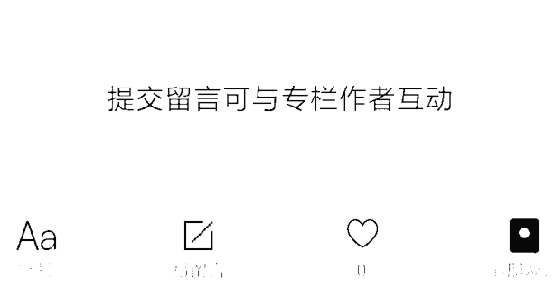

## 用户留言

提交留言可与专栏作者互动

## 主体间性1 | 我们比自己认为的更富有

主体间性1 | 我们比自己认为...

## “趋利避害”之外的东西

“认知”是动词或者谓语，它前面有主语（主体），后面有宾语（客体），这也就引出了“主体和客体”这组概念。

主体要认知客体，因为认知的对象就是客体，你想要生存就要知道世界的样子，然后趋利避害：

+   “避害”是你不摸电门，因为你知道电力的存在；
“趋利” 是基于对世界的认知（知道世界的玩法），我利用这个玩法来实现我的目的。

但是，我们认知的不仅仅是客体，或者说想“趋利避害”还得认识另外一些东西：这些东西不是客观的，甚至在某种程度上是主观的，但它的约束力非常强大。

比如说，你每天穿什么，早晨必须去上班……这些要遵守的是契约（明约）——你知道违约的后果，今天不上班明天就再也不用上班了；还有一种是好像没有谁在明确认束你，但你会给自己提要诉求订计划——这个计划是你跟自己立的一个契约，虽然这种契约最后可能都不能兑现，甚至常被违约。

比如每年一月份的时候，网上都会有“20XX年的计划”，你会根据去年的状况一定修改：

## 201X年计划

+   一、买一辆奔驰或者路虎车
二、买一套值1万的房子
三、去北极看雪，去澳洲吃龙虾，去马尔代夫看海，去珠穆看金字塔，好好看一看我的世界
四、买股票收益达到50%可本金
五、通过一年的努力，活出人生的辉煌

你有没有想过为什么要给自己制订一个计划？

又或者，我们经常觉得自己穷——我周围几乎没人觉得自己是富有的，尽管从客观看他们每个人的财富都是有阶梯的，但每个人还都觉得很穷。

## 绝对贫困感和相对贫困感

经济学家认为有两种贫困：绝对贫困和相对贫困。

绝对贫困感是依据客观指标衡量出来的贫困，比如每天卡路里的供给不足多少，或者冬天没有保暖衣服这种饱不能解决，饥寒交迫的情况，但我们今天绝大多数人觉得自己穷，并不是因为“绝对贫困”。

## 主体间性

以前我们只注意主观世界和客观世界，但二十世纪越来越多的哲学家开始注意这个“第三世界”，或者“主体间性”（intersubjectivity）：我从属于你，你从属于我，实际的契约关系就是“你依附于我，我依附于你”的相互依附性、互属性。

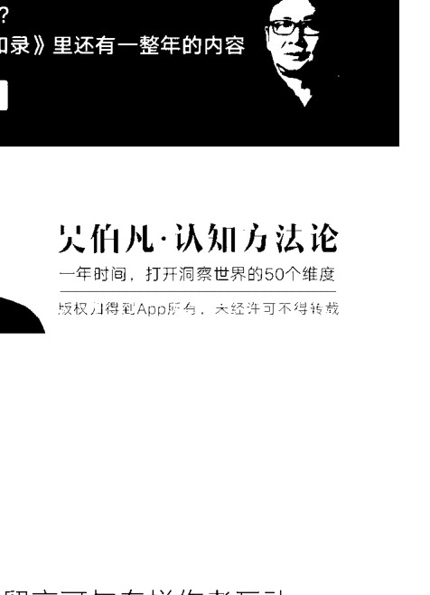

## 主体间性2 | 人的价值和意义是什么？

主体间性2 | 人的价值和意义... ↓

+   第一模块
认知源代码
第二模块
认知治理
第三模块
算法与第一性原理
第四模块
意义炼金术
“主体间性”

## 仪式（聚会）：意义的兑付

有人说，“人生的意义其实就是几场聚会和几场仪式”，这句话在一定意义上是对的，比如在西方国家，如果家庭信奉宗教，那么出生的时候会有一个洗礼，然后是婚礼和葬礼，这三礼就能概括一个人的 一生。

在已经习俗化的现代社会，这些东西显得不那么重要了，但它也被赋予了另外一种意义。比如在我们中国，小孩出生的时候会摆酒庆祝，接下来也是婚礼和葬礼——即使在习俗社会里，大家也特别注重这几个仪式（聚会）。

出嫁和出殡是非常重要的两件事：出嫁的时候要风风光光，出殡的时候也要风风光光——“风风光光”这四个字就是一种意义和价值体系，而仪式相当于一个结算，是意义的兑付，这刻把你前一阶段所有作为的意义展现了出来。

在这几个仪式（聚会）之间还有大大小小的各种仪式（聚会），比如同学聚会、家族聚会等等，同样扮演着一个意义兑付的功能。

比如婚礼，既是一种意义兑付体系，同时又是一种签约仪式。我们在前面的课里讲过，婚礼是一种多重约束的契约，有点儿像区块链：

在传统观念里，签约是跟祖宗或者上天签约——不管在教堂还是家族祠堂里举行的婚礼，都是跟祖先的一个契约；在传统中国社会里，一旦结婚，男方和配偶的名字就进入了祠堂的碑里，也就是说，你成了一个正式的签约方；与此同时，它又是一种社会性契约：结婚的时候，亲朋好友乡里乡亲都来观礼，这是一个类似于区块链的多节点约束，要更改是困难的。

只要在这个社会，人就会不知不觉地签订一个契约——这个契约是在你不知道的情况下认可并签字画押的。比如“活出个人样子出来”，你要的所有这些其实不是你要的，是你和所在的社区悄悄签订了一个仪式，这里确定了一个价值标准，你要做的是如何兑现这个契约。如果到了兑现那天给你出的成绩不符合契约规定，你就会感到很失败。

我们上节课还讲到同辈间的约束，你追求出人头地是因为同辈间（你所在的社区）形成了一个社会性的契约和价值体系——在这个意义上，我们活在世界上就是不停地签约和履约。

有人说，“有许多不道德甚至违反了法律的人啊”，没错，这些人是典型的毁约者，但你也要看到，他们所以毁约，往往是为了履行一个更大的契约。比如有人去抢劫、偷盗、诈骗，为的是兑付他跟所在的社区悄悄签订的契约，他也是想风风光光，想出人头地。在为这个东西付出了惨痛代价以后，有些人可能还在想一件事 情，也是社会契约里一个很重要的部分——孩子的成就不及地位。有些人为了兑现这个契约不惜去破坏跟社会签订的其他契约（犯罪）。

从这个角度说，再不讲信用不守约的人都在履行某种契约。

## “他人即地狱”

法国哲学家萨特有一句名言：他人就是地狱。

这句话出自萨特的一部戏剧，写一个人到了地狱看到非常奇怪的场景：传说中的地狱应该是硫磺烧起的火，人火里被炙烤，极其痛苦，但这个人看见的地狱只是好多人在那个地方，他旁边的人，“为什么没有那些狰狞可怕的场面，看到的都是人呢？”那个人告诉他，“你看到了他人，他人即地狱”。

“他人就是地狱”这句话包含的一个意思是：他人的存在是对你的巨大约束。只要你生活在有其他人的地方，你就有意无意地签订了很多契约和合同。

萨特要追求的是一种所谓的自由：他得了诺贝尔奖之后都不去领，因为只要领了就相当于跟他们（诺贝尔奖）签了一个契约。萨特认为诺贝尔评奖委员会也是地狱，要寻求自由就不能跟他们发生关联——这当然是不可能的。

约束和契约无所不在，“契约化生成”是永远挣脱不掉的；

我们生活在各种各样、大大小小、有形无形的契约中，这些契约对我们的行为和认知形成了或者明显或者隐秘的约束；

这种约束（压力）转化为生命的动力：如果契约不存在，我们的价值意义体系就会崩溃，进入到一个无意义的世界。

“他人就是地狱”只看到了社会对人约束的那一面，没有看到社会对人赋能的那一面，所以我们也可以反过来说，“他人就是天堂”。

在一个契约体系中，契约就意味着合作，合作的目的就是让你获得别人的价值或者让别人获得你的价值，并且在这个价值交换中形成价值增量。

## 主体价值取决于主体间的价值契约

我们知道，在经济活动中，个体与个体之间的价值交换必须借助一个介质，比如你有30斤小麦，他有一把斧头，如果他拥有斧头同时也有小麦，那你固化在小麦里的价值就没法传输给他，于是产生了一种抽象的一般等价物：通货，或者货币。

一种货币在一个社群里通行就意味着整个社群都签订了一个契约，是在一个意义体系下被认可的一种价值，或者说它是有意义的。

除了普通货币，社会生活中还有大量的通用契约，比如你的人品就是你的个人品牌，是你所使用的工具的品牌价值，所有这一切都是一种货币。如果你开一辆谁都不认识的车，它就不是一个社交货币，跟这个社区的价值意义体系不兼容，没办法显现你的面子。通货之所以得以通行，完全依赖于潜在的契约是否存在。

总之，主体有没有价值以及价值多少取决于主体间的价值契约。

# 似凡·认知方法论 一年时间，打开洞察世界的50个维度

用户留言 提交留言可与专栏作者互动

## 主体间性3 | 为什么会存在“意义产业”？

主体间性3 | 为什么会存在“...” ↓

+   第一模块
认知的源代码
第二模块
认知治理
第三模块
算法与第一性原理
第四模块
意义炼金术
“主体间性”

## 通信协议：快速智能化的契约

我们上节课讲到：货币之所以通行是因为有一个通用契约，每个货币相当于一个合同，别人之所以能接受你的货币并换东西给你，是因为这张有形契约的背后有一套价值流通契约，也相当于通信协议。

为什么通信需要通信协议呢？比如，虽然我发出的是物理声音，但你接收到的是意义，所以我说话你就能懂，这中间就有一个我们不知道的契约或者协议。这个契约有点儿像智能合约，不需要第三方执行，只要发出这个声音，我们看不见的通信协议就自动在你头脑当中把声音转换成意义。而如果我现在说西班牙语，发出的是同样是声波，但你听不懂是因为那个意义契约不存在。

说同一种语言的情况是：我发出的声波（编码系统）通过我们不知道的协议把编码好的码解码变成意义，意义传输到你头脑当中；

说不同语言的情况是：我发出了声波（编码系统），翻译听到我的声音以后解码，解码以后再编码形成另外一种语言，再解码变成意义，意义传输到你头脑当中。

在整个意义流通过程中都有一个解码的契约，货币同样也是这样一个过程，背后有一个解码系统，也就是一个契约。这个系统我们看不见摸不着，但它时时刻刻存在，能保证我发出的声音在你那儿生成意义，正如货币流通体系中，我的一张纸能在你那儿兑付为价值，这些背后都有一个快速智能化的契约，负责将编码的东西解码变成意义。

无论意义传输还是价值传输，背后我们看不见摸不着的系统起到了关键作用，没有这种作为智能合约的通信协议，意义和价值传输就会完全终止。

## 通信协议的重要性

## 1.通天塔：被夺走的通信协议

“通天塔”的故事也跟认知有关，是人类历史传说中最早的烂尾工程。

这个故事说的是人类看见上帝高坐天庭，就想要上去看一看，获得上帝视角，达到一种新的认知高度。为了实现这个想法，人类决定建一个塔，然后不停添砖加瓦，直达天庭。

上帝当然不允许人类进入他的地盘，他阻止这个行动用的不是物理的方法，也就是不是摧毁你的硬件——把塔毁了，他用的是类似于黑客的方法：直接摧毁你的智能合约和通信协议。

上帝是怎么做的呢？建塔的人干完一天活儿之后，在第二天早晨，他们说话的语音就变了，每个人都再不能听见另外的人说什么了——这就相当于软件不起作用了，通信协议被夺走了，人类自然没办法再一起建塔了。

从“通天塔”的故事里我们看到：无论货币体系还是语言体系的背后都有一个类似于操作系统的东西，作为软件的通信协议非常重要。

## 2.可以迭代的通信协议

尤瓦尔在《人类简史》里说：十万人在一个体育场里可以有条不紊地看比赛，但十万只猩猩是完全不可能的，一定会乱套。

猩猩不可能的原因是它使用的是部落语言，一群猩猩是一个家族，家族里是有协议和契约的，但这个家族和那个家族之间不存在这种契约——这种小网不能形成一个Internet，所以就没办法统一行动。

人类一对一跟大猩猩叫板的话，会被像撕布娃娃一样撕掉，但在体格上不如大猩猩的人类为什么成为了地球的主宰者呢？关键就在于人类在各个部落与部落之间逐渐形成了一种通信协议（互联网），能够进行密切合作。

不管是货币体系还是语言体系，由于背后存在通用的智能合约式的意义和价值传输系统，使得合作才有可能，而合作的意义是将个体充分连接起来的同时又能分工，从而形成一个庞大的超级个体。

最重要的是，通信协议可以不断升级和变换，能够不断更新迭代，甚至完全重装系统。

## 3.牛仔裤：有意义面值的社交货币

牛仔裤是一个很好的案例。在物理意义上，它最早是淘金人穿的工作服之所以做成那个样子是因为：

+   淘金的人都是流浪汉+单身汉，劳动的时候衣服极容易磨损，所以就需要一种耐磨耐脏的衣服；
淘金过程中，虽然大量的人一无所获，但也有人发了大财，最重要的是，淘金代表着奋斗、财富梦、西部风情等等。

由于牛仔裤代表的这些意义，一些富家子弟和处于社会高级阶层的人认可了牛仔服里的文化意义，而一旦他们 endors 和穿着，整个社会就接受了这个意义。牛仔裤作为局域性的服装就相当于一种货币或者契约了。只要你拥有这个货币就会显现出价值，换句话说，牛仔服就是一个在意义上有面值的社交货币。

由此，我们能看到主观世界、客观世界、主体间的世界之间的关系：牛仔裤首先是一个客观的存在物，当有人把这种客观的存在物赋予了某种意义，而这种意义又在主体之间逐渐被接受，形成了某种通信协议和价值体系，这时候，它一下子就作为货币流行开了。

从这个意义上说，几乎所有客观的对象都有可能成为一种货币：从客观对象（物理世界的東西）变成货币就是建立了一种有人发布并且大量的人接受的价值意义系统，形成了一个覆盖范围很广的通信协议。

我们日常生活中的很多对象物品不一定能成为经济上的货币，但是能够成为社交上的货币。

在《伯凡·日知录》里我们讲过服装业的三个层次：

+   最低层次是制造业，生产御寒蔽体的生活用品；
第二层次是媒体业，把自身的价值主张显现在媒体上给别人看；
最高境界是金融业，不再是一个简单的制造商，也不是在服装上发布信息，而是在尽可能大的范围内构建一套价值体系，在相当程度上形成一种价值银行。已发布的是一个意义系统，让服装业变成了印钞业——服装超越了客观性和主观性，变成了一种主体间的通用契约。

正是因为一个隐性通用契约的存在，服装才成为了一种重要的社交货币。

这个世界上存在着一种我们称为“意义产业”的东西，它超越了制造业和媒体，变成了一种意义和价值的发布系统，在它背后是能够保证意义和价值流通的通用契约。

## 用户留言

提交留言可与专栏作者互动

## 主体间性4 | 群体的智能是如何出现的？

主体间性4 | 群体的智能是如何出现的？

第一模块
认知源代码
第二模块
认知治理
第三模块
算法与第一性原理
第四模块
意义炼金术
“主体间性”

### 第三类存在

法兰西学院的一位院士，同时也是一个作家，曾经写过一篇幻想类的小说：大概在两三个世纪以前，欧洲有很多对于到神秘的南美大陆发财致富有一种宗教般的迷狂。有人声称自己是从南美回来的，在那里的森林深处发现了一个非常富有的城市，后来，又有几个声称从那个地方回来的也讲了这个故事。三人成虎，很多人就相信有这么一个城市存在。

那个城市有一个很奇怪的名字，我们姑且就按照听起来的发音叫它里约热内卢。很多人启程要前往里约热内卢。又因为讲故事的人没有说明这个城市的确切位置，很多人到了一个大致的地方以后就找不到它，于是都在一个地方聚集下来。

人越来越多，大家怀着寻找神奇城市的梦想聚集起来，慢慢形成了一个城市——传说中的神奇城市在不在已经不重要了，城市已经出现了。

我们讲这个故事是因为它跟我们这个单元的话题密切相关：主体间性。

除了客观世界和主观世界，还有一种东西既不是主观的又不是客观的，它可能起源于一个主观的幻想，但由于不止一个人相信或者大家形成了某种幻想型的共识，就形成了一种隐性的现实——这种隐性的现实逐渐显化出来，变成一种显性的现实。小说是城的诞生就是很好的例子。

主体间性存在于主体之间，具有主观属性的同时也具有客观属性，说到底，它的根本属性是关系属性：

> 你和我是两个主体，但你和我一旦呆在某个地方就会出现一种关系，你和我的行为、思维方式都会受到这种关系；
这时候又来了一个人，你我他三个主体之间又形成了一种新关系；
随着人数的增加，关系就会发生变化。

这种关系性的存在是源于主体又高于主体的，是制约甚至操纵主体的一种存在——主观与客观之外的第三类存在。

### 群体的智能

《人类简史》里多次出现的“主体间性”这个词就是这本书的核心心理念，你如果不理解“主体间性”，就不理解尤瓦尔向你描述的历史图景是怎样一步一步演变的。

中国古代也有类似的社会理论和历史理论，我觉得荀子跟尤瓦尔可以说很默契。比如，荀子说，
“力不若牛，走不若马，而牛马为用，何也？人能群而彼不能群。”

人的力气不如牛、速度不如马，但却是牛马给我们做牛做马，原因是人能结成一个群，而牛马不能。

答案是：一种智能契约。

每个个体只需要按一个很简单的方式去做事情，就自动形成一种智能；这种智能能促成个体之间的密切的合作，实现资源、能量、价值的自由流通，而且越来越优化——这个优化是契约的优化。

社会形成是一个多维契约的形成，比如语言是一种契约，货币也是，宗教、伦理、道德、法律都是多个维度的契约，它们只有一个目的：让个体之间的合作最顺畅最持久。

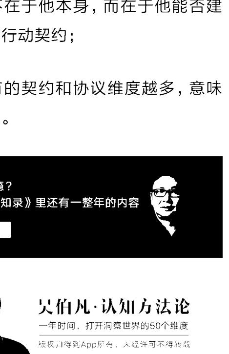

## 用户留言

## 问答44｜习惯更重要，还是目标更重要？

问答44｜习惯更重要，还是目标更重要？

### 主观主义者和客观主义者

@ 灯火阑珊

目标和目的之间到底是什么关系？困惑很久了，想听一下您的见解。两年前面，我从事过一段销售工作，每月都要定目标，我本人不是“目标感”强的人，总会有心理压力，看到那些不达目标不罢休的人，敬佩之余也很好奇。生活中我比较随性，尤其在人际关系中，“目的”性太强会让人不舒服，感觉就是想卖东西给我，角色反而限制了交流的顺畅。无论生活还是学习，目标都不可缺少；而我又不做做“目的性”强的人！这中间的区别到底在哪？

目标和目的在汉语里的分界线并不是那么清晰，“标”和“的”本来就是相通的。一般来说，目标的客观性更明确，目的的主观性色彩更浓。这位同学的纠结涉及到的不是“目标和目的的关系”，而是“客观和主观的关系”。

世界分成两种人：

- 用客观的标准来定义成功：需要实实在在的数据、事实来证明自己达到了目的；
- 用主观的标准来定义成功：用自己的主观感受去定义成功。

如果你是一个老板，要挑选销售人才，或者你作为打工者想弄清楚自己适不适合做销售，可以用一个标准：你倾向于用客观标准来定义成功，还是用主观标准来定义成功？

### 积极心理学的ABC理论

@ 灯火阑珊

刚看到了《李翔知识内参》上比较习惯和目标的一篇文章，文章讲目标是外在驱动，而习惯是内在驱动，这是不是意味着养成习惯比制定目标更重要？

@ 大力木

人的认知是否独立于环境而起作用，环境真的只是内生因素吗？是我们的认知产品，而没有客观性吗？

ABC的理论中，A是指 adversity——逆境。在世界上时时刻刻可能碰到各种事故、意外，逆境是一样的，但在不同的人身上会出现截然不同的结果，C（consequence）就是结果，中间一个关键点就是B（Belief），信念。这个信念是什么呢？就是对逆境的解释体系。

用户留言
提交留言可与专栏作者互动

## 特别放送 | 一份清单：那些能提升认知的书和电影

吴伯凡

今天特别放送一份清单，是课程前三模块中提到的，有助于提升认知的书和电影（影视作品）。其中绝大部分都不是难啃的大部头，比较轻松，但也许会对你的一生产生重大的影响。而且这份清单中的内容都非常精彩好看，即使看过了，也非常值得在空闲的时候反复品读回味。

你也可以在App里搜索书或电影的名字，查看相关的课程来辅助理解。

### 影视作品

- 1. 《黑客帝国》
- 2. 《少年派的奇幻漂流》
- 3. 《魔窟中的幻想》
- 4. 《斯蒂尔传奇》
- 5. 《福尔摩斯探案集》
- 6. 《闻香识女人》
- 7. 《三傻大闹宝莱坞》
- 8. 《人生七年（7 UP）》
- 9. 《阿甘正传》
- 10. 《肖申克的救赎》
- 11. 《头脑特工队》
- 12. 《罗拉快跑》
- 13. 《他们眼里的秘密》

### 书

- 1. 《月亮与六便士》
- 2. 《眨眼之间》（Blink）
- 3. 《福尔摩斯探案集》
- 4. 《原则》
- 5. 《西塞罗三论》
- 6. 《变革之舞》
- 7. 《牧羊少年奇幻之旅》
- 8. 《曾国藩家书》
- 9. 《思维简史》
- 10. 《个人知识》
- 11. 《三体》
- 12. 《米德尔马契》
- 13. 《稀缺》
- 14. 《意志力》
- 15. 《寂静的春天》
- 16. 《浅薄》
- 17. 《关键对话》
- 18. 《清教徒的礼物》
- 19. 《第三种选择》
- 20. 《阿特拉斯耸肩》
- 21. 《直觉泵》
- 22. 《生命中不可承受之轻》

## 用户留言

提交留言可与专栏作者互动

## 契约社会1 | 欢迎来到客观与虚拟之外的第三世界

契约社会1 | 欢迎来到客观与虚拟之外的第三世界

| 第一模块 认知源代码 | 第二模块 认知治理 |
| 第三模块 算法与第一性原理 | 第四模块 意义炼金术 "契约社会" |

我们之前讲过：编码背后必须有类似于密码本的通信协议，才可能解码，然后生成意义；信号之所以是信号而不是噪音，是因为它背后也有一套通信协议。

比如城市里的人听见救火车的声音就知道是有火灾了，而边远山区的人听到这个声音就会把它理解为噪音；再比如，货币其实就是一张彩色的纸，而你用货币能买到东西，用打印出来的彩色纸却买不到东西，它们的本质差别不在物理上，而在于它们背后是否有通信协议。

只有共同接受一个通信协议的时候，一个声音或者一个图像、一张纸，才会兑换成意义，才是一个信号，否则就是噪音。

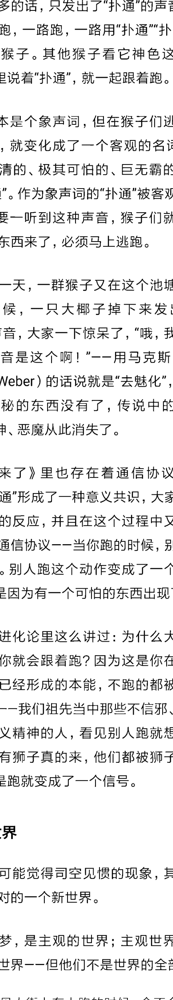

前不久我看到这张委内瑞拉的新闻照片，购买一卷卫生纸要这么多的货币，表明当时通货膨胀的严重程度。但是，这张照片也证明当地的货币还是存在的，还能用来购买——货币背后的通信协议仍然存在，只不过协议的内容发生了变化。

### 案例一：《狼来了》

《狼来了》的故事我们小时候就都听过，大人们讲这个故事的时候往往都会加一句"人要守信用，不然就会被大灰狼吃掉"——这节课我们不妨从另一个角度对这个故事进行阐释。

在《狼来了》里：

小孩第一次说"狼来了"的时候，很多大人应声而来解救他。一个小小的信号就能引发那么大的变化，小孩觉得这个游戏很好玩，但他不知道并不是他发出的这三个字让大人們来，这不是物理世界的规律；

第二次的时候，只来了两三个人——通信协议已经发生了变化，同样的三个字能够兑现的意义已经少多了；

第三次，可能还会有一个人来——这就有点儿像委内瑞拉的新闻照片：同样面值的货币能够兑付的价值越来越少。第三次还有一个人来的话就证明通信协议还在，这个人还是相信"狼来了"这三个字跟"狼来了"的物理事实是相联系的；

第四次再喊"狼来了"的时候，没有一个人来——支撑"狼来了"这三个字的通信协议不存在了，意义就没了。这时候狼却真的来了，小孩被狼吃掉了。

从《狼来了》这个故事里我们能进一步了解"意义和契约"：通信协议本质上是一个契约，能够保证物理事实或者客观事实的意义以及意义的含量是什么样子。

### 案例二：《扑通来了》

有一部中国动画片《扑通来了》，是关于通信协议和主体间性理论非常好的案例。

动画片描述的是：一只小猴子在池塘边的大树上打盹，突然听到了"扑通"一声巨响，小猴子一下子被惊醒了。我们知道，所有灵长类动物都有一个本能：当环境突然出现变化的时候，我们会产生战斗或逃跑的本能反应，于是这只小猴子看也不敢看发生了什么，飞似的开始逃跑。

其他小猴子看见它在跑，问它为什么要跑，但这只小猴子因为害怕和着急，没法儿说更多的话，只发出了"扑通"的声音，然后继续跑，一路跑，一路用"扑通"扑通"回答其他猴子。其他猴子看它神色这么慌张，嘴里说着"扑通"，就一起跟着跑。

"扑通"本是个象声词，但在猴子们逃跑的过程中，就变化成了一个客观的名词：一种说不清的、极其可怕的、巨无霸的东西叫"扑通"。作为象声词的"扑通"被客观化之后，只要一听到这种声音，猴子们就知道可怕的东西来了，必须马上逃跑。

后来有一天，一群猴子又在這個池塘边玩耍的时候，一只大椰子掉下来发出"扑通"的声音，大家一下惊呆了，"哦，我们听到的声音是这个啊！"——用马克思·韦伯（Max Weber）的话说就是"去魅化"，那个魅惑神秘的东西没有了，传说中的巨无霸、恶神、恶魔从此消失了。

《扑通来了》里也存在着通信协议的问题："扑通"形成了一种意义共识，大家会给出共同的反应，并且在这个过程中又产生了一个通信协议——当你跑的时候，别人才跟着跑。别人跑这个动作变成了一个新信号：跑是因为有一个可怕的东西出现了。

搞笑的进化论里这么讲过：为什么大街上有人跑你就会跟着跑？因为这是在非洲草原就已经形成的本能，不跑的都被狮子吃掉——我们祖先当中那些不信邪、具有实证主义精神的人，看见别人跑就知道是不是有狮子真的来，他们都被狮子吃掉了，于是跑就变成了一个信号。

### 第三世界

这些你可能觉得司空见惯的现象，其实是我们面对的一个新世界。

我们做梦，是主观的世界；主观世界之外是客观世界——但它们不是世界的全部。

- 你看见大街上有人跑的时候，会不会跟着跑？
- 你即使不跟着跑，内心会不会有恐慌？
- 你是一个有科学精神不信邪的人？好，当你买的一只股票一下子出现了五个跌停板的时候，你有没有定力持有这只股票？
- “追涨杀跌”跟猴子因为“扑通来了”而奔跑其实是一回事。

在主观和客观世界的两个向度之外，有一个向度是“他人”，是人与人之间形成的一个约束，将物理（客观）现象背后的通信协议解读为一个信号。你一旦出现这种状态，就已经进入到了第三世界。

古代人可能偶尔进入第三世界，今天的人则越来越多地进入到这个介乎虚拟和客观世界之间的世界，尤其是面对金融和泛金融的世界。

如果不理解这一点，你会发现很多事情匪夷所思——你的世界观就会出现一个对于第三世界的盲区。

## 契约社会2 | 第三世界的重要定律：信则有，不信则无

契约社会2 | 第三世界的重要定律：信则有，不信则无

第一模块
认知的源代码
第二模块
认知治理
第三模块
算法与第一性原理
第四模块
意义炼金术
“契约社会”

### 人类的两大发明

人类的发明分成两种：物理的发明和比特（信息）的发明。

### 1.物理发明

物理发明里最重要的发明是火的使用：火不是人创造出来的，但利用火去烤熟食物是人类的一种发明。

我们在《伯凡·日知录》里讲过，火是一个外挂的胃，从那开始，人类开始把自己的身体模块化。胃用物理和化学的方法消化吃进去的食物，而火的使用使这个消化过程在体外就开始进行，节约了消化食物所耗费的25%的能量,这部分能量开始用于供给大脑。可以说，火的发明直接导致人从动物脑袋变成了人脑袋。

另外一个物理发明是针的发明，人类开始用动物骨头磨制出来的针和动物筋做成的线缝制衣服，使得身体模块化获得了外挂皮肤。

火和针这两大发明解决了人类的温饱，使人类变得特别强大。

### 2.信息发明

信息也有两大发明：文字的发明和货币的发明。它们不能解决人类的温饱，但是解决了人类最重要的两个东西：信息流通和价值流通。

文字是信息符号，货币是价值符号。有了这两种东西，人类就能够让信息和财富进行自由流通，自由流通导致合作，个体的 人形成互联的人，互联的人形成某种共同体，用这个整体与其他的物种进行竞争的时候就会获得巨大的优势。

### 相信与承诺之间互为因果

我们这个模块一直在讲“意义”：你的行为跟一个以契约支撑的承诺建立了关系才叫有意义。

### 案例：玛丽的面包店

尤瓦尔在《人类简史》里设想了一个很通俗的场景：

玛丽想开一家面包店，装修和购买各种家家需要100万美元。她没有这笔钱，怎么办？

《伯凡·日知录》：209 | 外包的起源

## 契约社会3 | 谁是真实世界中的天使？

契约社会3 | 谁是真实世界中的天使？

第一模块
认知源代码
第二模块
认知治理
第三模块
算法与第一性原理
第四模块
意义炼金术
“契约社会”

我们上节课通过尤瓦尔设想的一个场景（思想实验）感受到金融业里“信以为真”到“因信成真”的过程，也更能理解为什么信心比黄金更重要。

古人说，“时来铁成金，运去金成铁”，我觉得其实应该是“信去金成铁”——当信心不存在的时候，金就变成铁甚至连铁都不如了。

银行业发展了这么多年，相对固定的存款准备金率就能保证银行的运行，这是一个自然选择的结果。对金融了解得越多，越会发现这是一个意义产业——眼前的行为跟未来承诺之间发生关联、承诺成真的过程。

### 天使：想象性的承诺

我们知道犹太民族特别擅长“意义创造”，他因为相信一种意义而点石成金、从0到1、无中生有。

犹太民族以两样东西在世界著称：宗教信仰和金融。这两样东西其实是有关联的，用“天使”这个词就可以很好地概括。

当你遇到困难，希望在困境当中得到帮助的时候，犹太人想象天使会来帮助你解决困难，让你梦想成真。这当然是一种宗教上的虚构，但“天使”这个词后来被引入到金融行业里。“理想很丰满，现实很骨感”，在你拥有的资源极其有限，简单地说就是缺钱的时候，如果有人能够给你提供帮助，让梦想实现，这种人就是“天使”，而你以你的梦想作为承诺，这种投资就是“天使投资”。

“天使投资”是一种把某种可能性变为现实性的艺术，现实世界里充满着可能性的艺术。我们讲过，地球就是无数种可能性中的一个偶然的存在，我们71亿人的出生都带着亿分之一的可能性。

哲学家莱布尼茨说，“现实世界是可能世界中最好的世界”，更准确的说法应该是：现实世界是无数可能世界中唯一成为现实的世界。

### 案例：《说谎者雅各布》

我们在上一节课里头讲到“相信跟承诺之间是相互映射的关系”，既包含“因为承诺，所以相信”，也包含“因为相信，所以承诺能够成为现实”。

美国社会学家彼得·博格写过一本书——《天使的谣传》，描述的是一个人们根本不相信有天使的现代社会里，可能性和“超自然力量”是如何出现的。

《天使的谣传》看起来令人费解：谣言怎么还能让人相信？天使本身不靠谱，那天使的谣言就更不靠谱了，它对于个人和社会有意义吗？

想要回答这个问题，我们不妨分析一部电影，由著名演员罗宾·威廉姆斯主演的《说谎者雅各布》。

所以，面对巨大的不确定性和极小的可能性，“天使”作为一种幻想性承诺，是一种认知的代偿性工具，让人对并无确定性的承诺抱持一种信念，并因这种信念，让看上去很不靠谱的承诺变得靠谱起来。

## 契约社会4 | 你本身就是一种货币

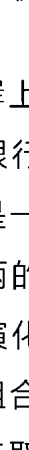

契约社会4 | 你本身就是一种货币

| 第一模块 认知源码 | 第二模块 认知治理 |
| 第三模块 算法与第一性原理 | 第四模块 意义炼金术 "契约社会" |

### 货币的起源

我们这节课的话题仍然是看得见、摸得着的货币。

现代世界的货币体系起源于威尼斯。在那个年代，作为通货的材料不是金子就是银子，非常笨重，商人不可能天天背着金银做生意，于是就把自己的金子和银子存放 在岸上的寄存款，需要支付的时候拿着收条上岸去取。

这种在岸上的寄存款被叫做bank，也就是现在的银行。刚开始，银行给商人开出来的收条是一个总收条，比如一万两就开一张一万两的收条，使用起来非常不方便，后来就演化成开十两、一百两、一千两这种票据组合。商人们支付的时候也就没有必要再回来取了银子去支付，只需要把bank开的这个收条给别人就可以了，别人也可以拿着收条去取钱。

我们从这个场景里看到：货币是个多重契约，具有一定的普适性价值共识和承诺。当然，货币得以通行有一个前提：持有借条或者货币的人跟货币本身没有密切的身价关联—假如别人捡到你掉的票子，也可以把银子取出。

麦克卢汉有一句名言：纸币是穷人的信用卡。

银行收据演化而来的纸币不在于你是谁，只要你持有那种特殊的货币就行，但后来发展出一种特殊的货币——信用卡：

- 信用卡是一种契约和合同；
- 货币与货币的持有者之间是完全关联的，在某种程度上，货币已经不是纸了，而是这个人了；
- 如果说货币是一种契约的话，信用卡在相当程度上已经实现了“以身作约”，“约”也就是契约。

我们还经常听到一句话，“穷得只剩下钱了”，这里可以作多种解读，比如“你穷得只剩下纸币了，连信用卡都没有”。可以想象一下，如果没有信用卡，你的价值交易范围会大大受限，比如你现在在国外，手里没有信用卡，也没有当地货币，那交易就无法完成。

与纸币相比，信用卡是一种普适性更高的价值共识和承诺。如果说货币是一种许可证、通行证，拥有货币是拥有通行权、许可权，那信用卡则是一种面向未来的货币，是以持有者对未来的承诺作为价值依据的。

从金银到纸币，再到信用卡，适用的场景越来越多，范围越来越广，货币跟持有人的身份也越来越紧密。

### 以身作“约”

那么，是否存在这样一种货币：

- 它的适用范围最广；
- 它跟个人身份的关联度最强；
- 它不是以过去的价值存储，而是以未来的价值承诺作为货币的依据的。

也就是说，是否存在一种比信用卡还管用的货币呢？应该说，在金融世界里还没有这样的货币，但在整个社会里早已存在着这种货币了——一套用“以身作则”这个词，我们把它称为“以身作约”，你自己就是一个契约。

我们暂且不说这种货币是什么，不妨在故事和场景里感受一下这种货币。

### 1.曾国藩的契约优化

熟悉曾国藩人生旅程的话就会知道，曾国藩一生中经历过一个重大的转变：从不好打交道变成很好打交道的人，这是个契约优化的过程。

最初跟他打交道的人都发现曾国藩的契约非常复杂，他单方面对你进行约束，这就导致他的合作者越来越少，给他使绊子的人越来越多。后来，他把跟自己打交道的规则变得非常简单，尽可能明确“我的承诺是什么”，并且在单次行中甚至都不约束你，宁可自己吃亏，但通过多次的行为以后，他就让你知道“我的游戏规则是什么”。最后，包括背后捅他刀子的人都在传播跟他打交道“是吃不了亏的”。

这样一来，拥有潜在资源的人，就愿意跟曾国藩合作，进行价值和资源交换，他的合作场景无形中就越来越普遍、越来越广。

### 2.胡雪岩=特殊的货币

这个逻辑在另外一个人身上表现得尤为明显：胡雪岩本来是一个不折不扣的穷人，但他把自己设定成一个路由器，将各种潜在的资源连接起来。比如甲乙丙丁都拥有资源，但他们彼此不关联，胡雪岩就能将甲乙丙丁都连接在一起，或者让甲和丙或者乙和丁之间实现价值交换，把不可能发生的价值聚合各方连接起来。

他为什么能连接起来这些人呢？因为他跟这些人之间形成了一个通兑协议，并且通过他这个路由器实现了互通互联。从这个意义上说，胡雪岩已经把自己变成了一种特殊的货币：他本身不具备既有的价值存储，就像一张纸或者是一张卡，是没有价值的，但他发现了一个货币——他自己。大家都相信他，也就是这个货币，他就变成了一个具有一定普适范围的价值共识和承诺。

我们也可以设想一个相反的例子：当你要做一件事情但没有资源的时候，大家都默不作声，或者你主动要求跟别人合作，别人却说“我没有资源”——真实的情况当然不是别人没有资源，而是你作为一个契约是不被信任的。

### 自由和契约

我们如果从自由的角度来看待贫穷和富有的話，贫穷就是不自由，富有就是自由。在自由和不自由的背后是契约的有无和多少。

你说你有钱是因为你拥有了一个契约，而且这个契约的承诺数量比较大。但钱只是诸多契约当中的一种——这张契约代表的是你在⼀个契约体系当中存储的财富数量，而99.99%的人都不拥有发行权。

自由是你拥有的契约数量、种类比其他人丰富，而且你是发行这个契约的人：在这个契约里，你提供契约的算法和数据。

自由可以有2种维度：

- 一种是在既有的算法里增加数据量。
- 一种是你自己设定一种算法，并让自己成为各种价值关联的关键节点。

自由，就是在价值互联当中成为关键节点。

## 用户留言

提交留言可与专栏作者互动

## 问答45 | 执念是一种意义吗？

问答45 | 执念是一种意义吗？ ↓

## 如何从“我比身边其他人穷”里解脱？

@ 玉壶冰心

“穷”不是问题，“我比身边其他人穷”才是一个大问题。如何放下比较、攀比的想象，获得真正的人生自由？

吴伯凡

人，生而自由，但无时不在枷锁中。

当你说“穷不是问题，我比身边的其他人穷才是大问题”的时候，你已经认可了一个契约并签字了：一定要出人头地才是有意义，比别人差就是没有意义的。当你签约但没有执行合同的能力或者没有执行合同的强烈愿望的时候，背负着这么一个巨大的债务就会特别痛苦——所谓“不自由”就是你已经按下了手印，但你没有执行合同的能力和意愿。

要获得自由就要废除这个不平等条约。在现实世界里，不可能你觉得没法履行合同就把合同给废了，但在意义世界里，你是有这个选择权的。

几个月前我认识了一个小朋友，她出生在一个贫困县，他们家在贫困县里都是属于最贫穷的。这个小姑娘的爸爸在她5岁的时候出去打工，再也没有回来，毫无音信，她母亲常年卧病在床，她们母女俩是靠亲戚、邻居的接济，和国家给的一点儿扶贫救济活下来——这种处境，她自然不会产生“穷不是问题，活得比别人穷才是最大的问题”，对她来说，穷是个问题，而活得比别人穷就是个问题又不是个问题，因为这是个事实。很自然地，这个小姑娘有一个意义：如何让自己不成为一个孤儿。

在别人的资助下，这个小姑娘在学校旁边租了一个月租30块钱的房间，并且有了个绰号：“奔跑女孩”，因为她每天最后一个跑进教室，一下课就跑出去——她要在每一个短短的10分钟里跟她妈妈在一起。只要跑回去的时候发现妈妈还活着，她就觉得无比地幸福。

后来有一次，小姑娘的妈妈病情恶化，她求了很多资源，凑了1000块钱把妈妈送到县医院，医生告诉她，她妈妈没有生还的希望……在手术以后，她一直在妈妈身边重复一句话，“你不能死，你死了我就孤儿了”。最后，出现了所有医生都觉得罕见的医学奇迹——她妈妈活过来了。再后来，这个小姑娘考上了一所幼师学校。

我见到这个小姑娘的时候，看到的是一个不折不扣的阳光女孩，你不能想象她把人世间几乎所有的苦难都经历过了一——她好像在玩一场极其艰苦又幸福的遊戲，每一天、每一月、每一年都在得到及时的奖赏，所以，她比很多生活得特别好的人都能够感受到幸福。

她是一个非常成功的人：虽然被迫地找到了自己的契约，但她履行她的契约，而且一直在得到回报。

## 执念是自己设定的意义

@ smile

除了吴老师讲的“做事的意义”以外，我感觉还有一个：执念。一个人做一件事，有时候真的是因为内心的执念，就像李莫愁，所以，执念算不算自己内心给自己设定的一种意义呢？

吴伯凡

是的，执念就是无论环境怎么变化，你都坚持要这样的一个意义体系，甚至是达到“九死而未悔”的状态。

大自然赋予了大马哈鱼“一根筋”的内在发条，让它不需要意志力就可以驱使整个行为。而我们人类之所以是人类，就在于我们有理性和选择，也就是说人类吃下了智慧果，具有区别好和坏，权衡利弊的能力。当然，不是所有人都会是一根筋的，有了一根筋的人的人生也就被赋予了一种意义。

关于这个意义是否有优劣之分，哲学上一直存在着很大的争论，很多人认为，价值和意义都是相对的，不能用一种价值体系去判定另外一种价值体系。也有一些哲学家在做一件事情：如何在价值相对主义、多元主义时代重建人类的共识。比如在纸面上可以画很多圆，每个圆都相当于一种意义和价值体系，有些思想家认为每个圆的分布不是随意的，每个人都有不同的处境和命运，但人类有共同的处境和命运，比如社会和谐、生态环境改善，在这个意义上价值是有优劣之分的。

在我个人看来，不管你选择什么样的人生价值，有一个东西可能是不变的：你如何在与他人共处的过程当中让自己被需要。可能有人会说，“我只追求我个人的幸福”，但实际上，个人的幸福在很大程度上是依赖于你跟他人的关系的。

哈佛大学的一个教授做了长时间的研究以后发现：良好的他人关系是个心理幸福感的主要支柱，如果没有这个支柱，个人是会陷入到巨大痛苦当中的。

个人幸福在相当大程度上是依赖于你的造福半径的：如果是自私，造福半径是零，如果能造福家庭，造福半径就会增加，而在减少人类共同面对的危机的时候，你能做出一点点贡献，那你的造福半径就会增加一点点。

这个反面的例子就是李莫愁，她设定了一个价值和意义体系，并且坚定不移地去执行这个契约——这个契约的可怕之处在于，没有把意义感和幸福感建立在与他人良好的关系上，所以李莫愁没有扩展自己的造福半径，而是不断扩大自己的祸害半径：表面上，她是在追求自己的意义，实际上，她在把自己不断地置入到一个越来越充满敌意和威胁的世界里。

用词留言

提交留言可与专栏作者互动

## 契约社会 | 本单元十大精彩留言

契约社会 | 本单元十大精彩...

## 本单元总结

第一节课我们讲了两个故事，一个是“狼来了”，一个叫“扑通来了”，通过这两个故事，我们对“通信协议”这个词有了更深刻的认识。当你理解了现实背后的通信协议，你就进入到了一个新的世界——主观和客观之外的第三世界。

第二节课我们讲了一个非常重要的知识点：不是因为承诺兑现了，我们才相信，也不是因为相信承诺才能兑现，承诺和相信之间是互为因果的关系。而这一点恰恰就是第三世界中的一个重要定律。

第三节课我们讲了说者雅各布的故事，通过这个饱含意义的故事我们知道了，面对巨大的不确定性和极小的可能性，“天使”作为一种幻想性承诺，是一种认知工具，让人对不确定的承诺抱持一种信念，并因为这种信念，让看上去很不可靠的承诺变得可靠起来。

第四节课我们的关键词是货币。从金银到纸币到信用卡，适用的范围越来越广，货币跟持有人的身份也越来越紧密。其实，每个人也可以作为契约，去发行货币，就像课中讲的曾国藩和胡雪岩一样，成为价值传递的关键节点，就拥有了发行货币的能力，就会有越来越多的人愿意和你合作。

好，以上就是本单元的主要内容。以下是《思维简史》，得到的...我...下节课再见。

特别提醒：留言内容会默认公开，并同步到“知识城邦”中，中奖同学留个人信息时，一定记得将留言设置成隐私模式，确保个人安全。

——► 本单元十大精彩留言 ◄——

## 获奖留言

国武

1991年，一位名叫坎贝尔的女子独自徒步穿越非洲，不但战胜了森林与沙漠，更跨越了400英里的旷野。当有人问她为什么能够做到如此令人难以想象的壮举时，她回答说：“因为我相信过我一定能，而且我在全力以赴地去做。”而问她对谁说过这句话时，她的回答是：“对自己说过。”马丁·路德说过：“世界上所做的每一件事情都是抱着希望而做成的。”

契约社会3 | 还是真实世界中的天使？

佛祖门徒

老师讲述胡雪岩的故事，让我想起隔壁的王炜老师在课里讲过关系网的结构洞（structural holes）理论...因为关系网延展到这里好像是掉了进去里。

## 其他精彩留言

排长

我在银行工作了四年，记得培训结束，上岗前，分行的一位科级给我们讲话，他强调银行最重要的是信誉，世界上没有一家银行能抵挡储户的挤兑，并列举了世界上几家大银行因挤兑倒闭的例子。后来读《胡雪岩传》，发现击垮胡雪岩的导火索也是挤兑。其实，银行表面上经营的是货币，实际上经营的是信用。因为银行天然具有放大货币乘量的效果，超出实际货币量的部分都源于储户的相信，这种看不见的货币远远大于看得见的货币。

想。那么你一定比大多数人少走错路，少一点现实挫败感。这就是意义、信仰、信则有不信则无的力量。

契约社会 3 | 谁是真实世界中的天使？

## 凌繁荣

人本身就是一种货币，以身作约是人类社会的底层逻辑，不只是在今天信息交流发达时显得比较明显，在过去甚至在改革开放初期，商界骗子现象较普遍的时候，有一些人以他的信誉作为实实在在的一种货币的存在。

80年代我就经历过一次。为了我们企业的流动资金，山区一小镇的大学生镇长可以直接领着我们到农户家，一家借一万、二万，现场点现金，既不说利息、借期，也不打借条，将资金凑齐，大家凭的就是他的信誉。在新世纪，建水库需要这个镇的农民搬家，工作做不下去，县里请他回乡做农民的工作，还是凭他原来在镇里主持工作的信誉，没几天全部都签订了搬迁合同。

> “一个人做一件好事并不难，难的是一辈子只做好事，不做坏事。”这样的人就是一以贯之地以身作约，在需要体现价值时能以金融世界里真实的货币呈现，但又无法用金融世界的计量方式去估算在整个社会里早已存在，既是又不是的货币。

契约社会 4 | 你本身就是一种货币

## 涵章

吴老师以前在《伯凡·日知录》里面提到过口碑的重要性，名誉的重要性，还提到过莎士比亚的话：你可以偷我的钱，但是你不能偷我的名。听完今天的课，我又回看了过去学过的内容，并且找到了莎士比亚的原话：

> “无论男人女人，名誉是他们灵魂里面最切身的珍宝。谁偷窃我的钱囊，不过偷窃到一些废物，一些虚无的幻质，它从我的手里转到他的手里，它也会做过千万人的奴隶；可是谁偷了我的名誉，那么他虽然并不因此而富足，我却因为失去它而成为赤贫了。”

从这段话里面我们可以得知，“货币”其实有看得见的货币和看不见的货币，看不见的货币就是你的名誉组成的，一个人做人做得好我们都会说这个人很敞亮，“敞亮”这个词很有意思，本来是用来形容一间屋子宽敞明亮，而我们却常常常用这个词去形容人。说一个人敞亮其实就是说一个人他能够活动的空间是比较大的，他能够看到的东西是比一般人多的，至于他为什么活动范围大，看到的东西多，是因为他背后积累的名誉能够作为他强有力的后盾。一个人的破产，只是他的产业无法经营下去了，他还是有东山再起的机会的，如果一个人身败名裂的话，那他想要翻身则是难上加难的。

契约社会4 | 你本身就是一种货币

## 高小入队

货币，是价值尺度、交换媒介和储藏工具。这是我们对货币的通常理解。如果把人比作货币的话，那么，由于每个人的禀赋能力、所拥有的社会资源及其整合能力、信用程度的不同，实际上，我们都是人格化的、具有不同面值的“货币”。而我们能够拥有多少通常意义的货币或物质财富，取决于我们人格化“货币”的变现能力。当然，这种变现能力是一个随着我们自身的能力、资源和信用度等因素的变化而波动的变量。从这一意义来看，真正的财务自由，不仅仅是拥有相当数量的货币化财富，而且是拥有了一张高面值、强变现能力的人格化“货币”。

契约社会4 | 你本身就是一种货币

## 用户留言

提交留言可与专栏作者互动

## 契约竞争力1 | 生活就是“契约化生存”

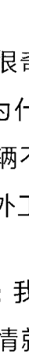

契约竞争力1 | 生活就是“契约化生存” ↓

- 第一模块
认知源码
- 第二模块
认知治理
- 第三模块
算法与第一性原理
- 第四模块
意义炼金术
“契约竞争力”

## 分布在大地上的大马哈鱼

一位同学春节返乡回来，反馈了一个对我们课程的感想，他说：这次回乡让我深深感受到了什么是“意义”和“大马哈鱼的洄游”，意义和契约的暗中影响或者束缚的力量实在太大了！

这位同学的家乡是个四线城市，房价不贵，他这次回去花了几十万买了一套房子，还想买一辆车。

我就很奇怪：明明一年在家乡也住不了几天，为什么要买一个自己不住的房子，或者一辆不开的车呢？而且这些钱还都是他们在外工作省吃俭用省下来的。

他说：我们那里所有的年轻人回去最重要的事情就是买房。如果你没有房，你都不敢见同学。

我就明白了：买房买车之所以重要，是因为必须要在一年一度回乡参加的同学聚会这个意义和价值系统中显现价值。

所有的省吃俭用和受苦受难都是有目的和意义的：当他们在遥远的异乡想到闲置在家乡的房子和车的时候，心里会产生一种巨大的满足感——这两样看似闲置的资产就是他们在异乡生活的支柱。

这位同学最后说，他联系到我们的课程一下子就明白了：自己和众多在异乡奋斗的人其实就是分布在大地上的大马哈鱼。

## 中国式契约

应该说这种现象不是个别的，它提供了理解中国人的一把钥匙。

比如在美国曾经出现过很不公平的排华方案，为什么会出现这种严重违反人权并且有种族歧视的法律呢？立法人有一个理由：虽然哪个民族都没有华人勤劳，但他们挣了钱以后不消费，而是把自己的生活压到底线，攒下来的钱寄回老家盖房子——故乡的房子才是他们的意义。外面的生活不是真正的生活，他们的意义和价值系统都跟故乡连在一起。

有人说“中国是没有契约的”，这是错误的，中国社会一直流行着一种特殊的契约，它不是陌生人社会的契约，而是熟人社会的契约：

- 衣锦还乡、光宗耀祖都是跟熟人社会有关的；
- 所有在异乡的生活都不是真正的生活；
- 你在故乡的表现才是生活的意义和价值所在。

这也是中国人的宗教，或者说是中国人的价值和意义系统，它背后是一个契约：我的所有价值只在一个价值和意义流通系统里显现。在这个价值体系当中，一个人的财富和所有作为都是一种不在异乡发行的货币。

发出感慨的那位同学还跟我分享了她妈妈的一句话让他特别惊和触动的话，她说：你在外面混得再好，别人看不见也是白搭，所以你必须要回来买房子买车。

我不由又想到了在刚刚过去的情人节看到的一幅漫画：丈夫回家，给妻子买了一束很大很大的玫瑰花，不料却被妻子一通骂说，“你花这么多钱，为什么不把花送到单位去！我要让某某李某某和我们办公室的人都看见！这花拿回家有什么意义呢！”——我们可以这样理解，玫瑰花作为一种社交货币必须要在特定的流通体系里才能显现它的价值。

回来再说我们中国人的“特殊契约”，也可以叫做“中国式契约”，它是熟人间心领神会、不成文的契约，在这个契约里弥漫着一套意义系统——置身这个意义系统之中和之外，可能完全是两个人的湖南，甚至极端的情况是：在异乡乡恶多端的罪犯回到老家，表现得特别知书达礼，因为他的知书达礼在异乡不能兑付价值，而他用作为恶多端、偷盗抢劫来的钱财回到老家去尊老爱幼，所有人都会说他好，这在很大程度上实现了他衣锦还乡、光宗耀祖的意义。

## 契约化生存

我们生活在世界上，可以说是“契约化生存”，只是有的契约你知道你是签了约的，还有很多时候我们不知道自己已经签了约，也不知道自己在履约。

我们周围也总有一些人和圈子格格不入，因为他们不加入契约系统。比如佛系、丧文化这些，一方面是对既有意义系统的一种否定，另一方面，它又是在建立一个意义系统：人生不应该这样活而应该那样活——当我们这么想的时候，其实已经不自觉地签了约。

还有就是，个人是没有契约的：鲁滨逊一个人在荒岛上没有必要有契约，但是星期五到了岛上，他的行为就是契约性行为为了。

我们前面讲到“圈子”也是一个意义系统，在这个意义系统当中，一个人的行为和思维都是与这个意义系统签约以后履约的行为，比如说很多我很尊敬的朋友去做公益，虽然做公益又不赚钱也不能买豪车豪宅，但他们找到了自己的一个圈子（群），在这里有一套价值评估体系，能让他们在很大程度上获得身处世俗圈子里的人所追求的那种货币感、成就感、认同感和归属感。

生活就是“契约化生存”，是一种有意无意的加盟，然后在这个意义体系中追求特定的价值回报。

当然，也有很少的一部分人倔强寡和，不认可通行的所有价值，孤独地生活在这个世界上——英文中把这种人叫“孤狼”，一匹孤独的狼：一方面是跟人格格不入的狼，另一方面，他也没有自己的同伴。

如果一个人长期处于不接受世界也不被世界接受的状态，他可能会进入两种状态：

- 一种是精神崩溃，进入到一种虚幻的认同感当中，头脑中幻化出很多的交流对象，是一种混沌、幻觉式的意义系统；
- 一种是想象一个意义系统：在他们的意识中最重要的对话者是一个超越性的实体——上帝、天或者与天地精神相往来的存在。这种人在古代社会被叫做“先知”，而疯子和先知常常是合为一体的，很多的先知其实就是疯子，他们认为自己感受到了常人感受不到的一个意义系统。

总而言之：

- 1. 人生而自由，但无时不在契约当中；
- 2. 契约既是束缚，也是赋能；
- 3. 不管你愿意不愿意，你都身处在契约当中——一个人的生存就是一种“契约化生存”。

## 用户留言

提交留言可与专栏作者互动

## 合约竞争力2 | 你的竞争力处在频谱的哪一段？

合约竞争力2 | 你的竞争力处在..

- 第一模块
认知源代码
- 第二模块
认知治理
- 第三模块
算法与第一性原理
- 第四模块
意义炼金术
“合约竞争力”

我们上节课讲到了“孤狼”，这个词本身包含的意思是：没有合作系统的支持，单独个体的生命极其脆弱，竞争力非常弱小。

说到狼，我们立即会产生两个印象：

- 1. 狼曾经是人类最强劲的对手，尤其在冬天食物匮乏的时候，和人在资源上形成了竞争；
- 2. 狼是群居动物。

我们在《伯凡·日知录》里讲到过“生态竞争力”，这是近年来出现的一个概念。过去，我们讲竞争力都是讲个体竞争力，无论个体是个人还是企业，而现在我们说，最强大的竞争力是一种生态平台式的竞争力。

商业世界这些年出现的一个最大现象就是平台型企业的崛起，比如沃尔玛曾经是零售领域永远没法超越的巨头，但阿里巴巴在既没有发达的通信系统、物流系统、仓储系统，也没有雇很多员工的情况下，轻而易举把沃尔玛超过了。

## “生态竞争力”四象限

有学者把动物的能力分成两个维度，用四种动物划分出四个象限来表达“生态竞争力”的强弱。

## 两个维度：

终端式的个体能力：这种能力很大程度上取决于个体的体型和力量的大小，以及适应能力的强弱；
网络式的合作能力，也就是个体和其它个体形成的一种合作契约，是个体之间在本能层次上就具有的一种合作意愿和习惯。这个合约是写在基因层面上的一种自然互动。

## 四个象限：

狼：终端能力和网络能力都强。
狼的奔跑能力、利爪、尖牙、咬合力和爆发力等等都是很强的，但狼真正的实力表现在它的合作上。
猛虎：终端能力强，网络能力弱。
老虎的个体能力非常强，但它不与其他个体合作。单独比较的话，一匹狼显然不是一头老虎的对手，但“一山不容二虎”，老虎的弱点就是不与其他个体合作。
熊猫：终端能力和网络能力都弱。
熊猫的“弱”表现在两个方面：①捕食的能力弱；②适应能力弱，只在特定的环境里能够生存，既不能开源又不能节流，同时还不跟别的个体合作。
蚂蚁：终端能力弱，网络能力强。
蚂蚁巨量个体聚集在一起以后能形成一个非常精细的合作系统，好像是有了独立生命的超级巨无霸。蚂蚁和白蚁的重量超过了地球昆虫总重量的二分之一，它们的这种内置在基因层面的智能合约使得蚂蚁获得了强大的竞争优势。

## 合约竞争力

由此，我们可以更清楚地看到，孤狼的命运之所以悲惨，是因为它没有连接能力（网络能力），个体没有承载各种智能契约。
那么新的问题又来了：狼的终端能力和网络能力都强，但很多地方的狼已经灭绝了，它的竞争力何在？
我们知道，在人和狼势均力敌的情况下，不是狼吃人就是人吃狼，只不过后来出现了变化，也就是《人类简史》里的“认知革命”。
狼能合作，人更能合作，而人之所以更能合作是因为发明了一套更广泛适用的通信协议：
人的一个小部落跟一群狼的数量差不多，但人的小部落和小部落之间可以联合起来，无数小部落再集合就成了一个国家，甚至最后形成了全球化的合作——在通信协议不断拓展的过程中，人类发明了讲故事的能力。这种比狼强得多的通讯、沟通、连接手段，使狼不再是人类的对手了。
再后来，人类发明了越来越多的通信协议，从神话、宗教到现代通信技术，都以不同的通信协议作为支撑，而狼还停留在以狼嚎作为主要通信方式的阶段。
与此同时，那些被狼群抛弃的最弱的狼由于跟人类结成了同盟，形成了一个新物种：狗。因为加入了一个新的通信协议，跟人形成了一种契约，就从与人势不两立的狼变成了通人性的狗，直接的结果是，现在地球上狼的数量不到20万，而狗的数量已经超过10亿，每7个人就拥有一条狗。
我们把熊猫、老虎、蚂蚁、狼群排列在一起，再加上狗和人，就能更清楚地发现“合约竞争力”。用前面课里的话说就是：人拥有了“第三世界”，一种主体间性，它是彼此之间的一种契约关联——一方面是约束，一方面是赋能。随着这种通信协议不断更新优化，个体的能力变得非常强大。
在过去，做一个隐士是非常困难的事情，需要像梭罗那样自己搭小木屋、种地、收割、打渔等等，因为隐士拥有的通信协议很少，他在相当程度上就是一个孤独的个体；而今天出现的宅男宅女虽然也是一个孤独的终端，但背后有一个庞大的网络支撑系统，可以支持他们宅在家里面有吃有穿有玩儿……什么都有。
当我们反省自己的竞争力的时候，不妨看一看这个竞争力光谱：你是熊猫、老虎，还是蚂蚁、狼或者狗、人？当你觉得自己怀才不遇的时候，这个光谱提示你，很可能你是一只孤狼，甚至更可怕的是，你是一只孤独的蚂蚁。

吴伯凡
这节课后，我们不妨对自己的竞争力作一个反省和审计：你在这个竞争力频谱上到底处在哪一段上？

用户留言
提交留言可与专栏作者互动

## 合约竞争力3｜合约化能力的三原色

合约竞争力3｜合约化能力的三原色。

第一模块
认知源代码
第二模块
认知治理
第三模块
算法与第一性原理
第四模块
意义炼金术
“合约竞争力”

我们上节课讲到“竞争力的审计”：当我们谈论我们是否具有竞争力，以及竞争力的强弱的时候，需要涉及一个维度：网络能力，也就是个体的合约化能力——你的能力是终端化、完全系自己的，还是处于一种赋能系统当中？

一般说到“赋能”，常常是个体或者终端单方面接受系统的赋能，但我们现在所说的赋能是互动式的，是建立在和其他能量源进行有效连接和互动基础之上的，一种双向资源和能量输送关系——这种竞争力审算是也合约化能力的审计。

我们这节课详细分析一下什么是“合约化能力”，以及如何对它们进行审计。

## 合约化能力

我们在前面的课里讲到，人拥有两种货币：

一种是通用货币，一张纸币就是一张社会已经为你背书的合约，你把这张合约给别人，别人就会把你要的商品给你——这种类型的合约是个人拥有合约当中的一种；

我们也可以把纸币换成卡，借记卡跟过去有关，信用卡跟未来有关，但它们都是合约，都可以刷。信用卡作为一种特殊货币，在某种程度上是由你发行的：你兜里没有一分钱也可以刷信用卡消费。

甚至你连一张卡都没有的时候，如果你还可以消费或者获得投资，靠的就是你成为了一个可以发行货币的央行——个人的央行。我们读历史或者小说的时候经常看到一些商业史上的人物在身无分文甚至负债累累的情况下翻盘，靠的就是他个人发行的某种特殊货币，当然，要做到这一点是非常难的。

货币是合约的一种。评估一个人、一个公司、一个组织价值的时候，要看它拥有的合约数量和种类的多少。

比如我要投资一家公司或者跟一家公司合作，这家公司首先会给我展示它有多少钱——这是一种合约，但我更意的合约是它签了多少合同。这些合约再加上它所有的资产构成了这个公司的价值。所以，公司的价值本质上是它的合约种类和合约量的大小。

## 合约组合

被誉为硅谷英雄的LinkedIn创始人里德·霍夫曼写过一本书《至关重要的关系》，他在书里花了很大篇幅讲创业过程中要时刻进行能力的拼图，所谓“能力拼图”就是说，你的能力是由一个个碎片组成的，要看你能把这些碎片拼成一个什么样的图形。

借用他的这个说法，我们可以说：你要审计自己的竞争力和合约化能力，也要做一个类似的拼图游戏，我们可以把它叫“合约组合”。

合约组合大致可以分成三类：

- 1. 第一类：硬合约+软合约

硬合约：一般情况下，创业之初和创业过程中能够拥有的硬合约是很少的，即使拥有了比较多的硬合约也并不一定是好事。马云经常说，“如果一个公司老是用钱去解决问题，那这个公司离倒闭就不远了”——用我们的话说就是：你拥有的合约种类/类型太少。

软合约：软合约是不能马上套现，以及套现的时间、速度不确定的一种合约。

比如人脉，不是你认识多少人，而是在人际关系中合约化的成分占多少，你所有社会关系中拥有的合约化关系是你潜在的发行货币的能力；还有就是用少量的存款准备金能够进行大量银行业务的一种能力；以及一种类似于应收账款的东西：这个应收账款是无形的，比如你服务或者帮别人，并没有马上得到回报，就会形成某种无形的应收账款。应收账款本身就是一个软合约。

- 2. 第二类：价值观（意义系统）

意义本身就跟合约密切相关：有了目标做事才会有意义，这个意义是因为你承诺并且付出，目标得到了兑现——这在本质上是一种合约关系，但显得更加务虚，我们一般把它叫做“愿景”。

“我要改变世界”“我要让天下没有做不到的生意”“我要让每本书桌上都有一台电脑”……旁人可能觉得这是一种痴心妄想或者一个说辞，但当我们头脑当中出现了这种想象的时候，这种想象具有的一种引力会将很多隐含的与数据和事实吸附到想象当中——“我所想象的这个愿景正在成为现实”，这是一种合约化的能力，也是一种天赋。

不是看见了才相信，而是相信了才看见，越相信越能看见。

- 3. 第三类：你的资源、能力和整个环境之间的契合度

这种合约更加无形。虽然有时候你拥有很多合约，但是他人能否跟你形成价值交换才是至关重要的。

合约从来不是个人的孤芳自赏，而始终是“我如何用我的履约来兑换对方的履约”。如果你能力和资源能跟环境、世界、市场形成一种潜在的契合，或者一种可能最终成为现实的合约关系，那你就拥有一份更大的合同。

良好的人际和社会关系、经济环境说到底都是一种合约关系。要形成这种关系，三种类型的合约缺一不可。

我们这里又讲到“三”了，又是一个三原色。

的确，有的人硬合约不少，但没有软合约，没有一种无中生有、借假修真、虚无缥缈中扯回实在在东西的能力；或者前两种合约都具备了，但最后没有考量自己跟环境潜在的契合度，这些最后都是不行的。

我们上一节课讲竞争力是有个光谱的，你是做熊猫、蚂蚁、狼、狗还是人，现在我们说：一个人、一个组织的价值在于拥有的合约类型和合约量的多少。

量和种类都是非常重要的，并且种类更重要；
如果合约化能力的三原色中缺了一色，就拼不出来一个真实的图景，很难形成一种真正的合约化能力。

吴伯凡

你不妨思考一个问题：我是一个能人吗？我的能力到底是什么类型？这个类型里是不是缺少了合约化（网络化）能力的维度呢？我网络化能力里拥有的合约类型是否缺项呢？有了这个三原色的参照系，你就会对自己的能力有一个比以前更清晰的定位。

## 用户留言

提交留言可与专栏作者互动

## 合约竞争力4 | 人是所有合约关系的总和

合约竞争力4 | 人是所有合约关系...

第一模块
认知的源代码
第二模块
认知治理
第三模块
算法与第一性原理
第四模块
意义炼金术
“合约竞争力”

上节课讲到的契约化的三种能力中，第二种（价值观）可能比较抽象，我们不如用一个故事来说明一下。

我的一个朋友十几年前去云南旅游，到了一个白族人居住的地方，遇到一个姑娘。这个姑娘很有亲和力，也很时尚，我这个朋友就说，“你不应该呆在这里，应该到北京去。我走的时候带你去北京吧！”

结果，这个朋友真要回去的时候，姑娘拿着行李要和他一起走。他赶紧说，“我是开玩笑的，你还当真了”。姑娘问，“什么叫开玩笑？”——那个地方的人是不懂开玩笑这件事情的，他们认为“既然你说了，我也觉得很好，就要跟你走”。后来经过反复沟通，姑娘才没有跟我的朋友一起走。

## 自我强化的解释系统

这个故事让我想到两种人：

一种人的起心动念是开玩笑式的，比如他看到有人做一门生意/一份工作，或者听人说起一个地方，也很喜欢，就会说，“我想做这样的事/工作”，“我想去那个地方住”，但他只是动动念头就过去了，不会实施，过后甚至都想不起来——我们把这种人称为“在动念上爱开玩笑的人”；

一种人是不开玩笑的，一个念头一动就会慢慢当真——这种人有一种自我强化机制。

后一种人的特点在犹太人身上表现得特别明显：当我们相信或者追求一个东西遇到障碍的时候，一般人就自然而然地不太相信或者渐渐地生退意了，但犹太人的解释系统里会说，“任何一个你当真的东西一定包含着test，是要试验和锻炼你的。只要是值得相信的东西就一定会有很多的障碍”。

这和我们汉语里的“好事多磨”意思差不多，就是那些不磨你的事不是好事，只不过犹太人的解释逻辑更加清晰。

在犹太人的自我强化机制中：遇到阻碍，甚至是灾难性打击的时候，不要放弃，因为是“我神在开始执行一个计划了”；没有遇到障碍的人也别偷着乐，因为是“他们不配遇到障碍”。

“遇到障碍”反而是因为“自己真的配”，这是一种很可怕的解释，就像有的男生迷恋一个女生，不管这个女生怎么拒绝和当众羞辱他，他都有—套解释系统，什么“当众羞辱我证明她没把我当外人”或者“她对我严厉证明她看重我”等等等。

## 契约性行为

我们讲过，意义是认知的一种必不可少的代替方式，意义系统或者信仰系统的作用就是在事实、证据不足的时候还能让你朝那个方向走。当然，走的时候会出现各种偶然性，但你都会把它当成是有利的证据，让自己相信“种种迹象表明这是真的”——这种自我强化的解释系统很容易把一个没有成为现实的东西当成是真实切切的现实。

那么，到底什么是“契约性行为”？你可以想象一份商业合同。一件很简单的事，成合同却需要几十页，甚至还有各种补充协议，为什么？因为这是要把事当事做，而不是简单动了一个念头。

我们制订计划的时候，可能有A计划、B计划、Z计划：

- A计划是朝着既定的目标走是什么可能，B计划是替代性方案，Z计划是如果遇到了阻碍甚至失败时候的逃生性方案；

A、B、Z三种类型的计划都包含在一份真实的契约中，都是抱着把这事做成的意向去做，同时也充分考虑到如果这个目标出现问题，要怎么改变和调整，以及如果实在不行，出现最坏结果时候的办法；

三者合一才是一个真实的契约。

你可以想想自己生活当中“把事当事”做的时刻有多少？一个最简单的测试方法就是，打开你最近一个月邮件、微信或者通信记录，看看里面有哪些契约性行为，哪些非契约性行为（契约性行为是有清晰的目标的，是需要郑重承诺和严格执行的行；非契约性行为是随随机性的，比如刷抖音肯定不是契约性行为）。

我们再来看看契约到底是什么？

- 1. 首先，契约的目标非常清晰。如果没有清晰目标就不构成契约，而只是个玩笑；
- 2. 其次，要按照正常程序走。那么怎么走，要付出什么，可以得到什么，如果遇到意外还有很清晰的承诺和构想——如何调整/替代，实在不行怎么清算等等；
- 3. 第三，要严格流程化地执行。

轻而易举做成的事情不是契约行为。

《标竿人生》（The purpose driven life，用目的驱动的人生）这本书的具体内容我们不多讲，它的序言很有意思：

> “今天你拿到这本书是有原因的，你不是随便就拿到了这本书，你要跟我签下一份契约：这本书一共40章，你需要每天读1章，既不停止下来也不多读，而是40天严格地每天读一章。然后认真回答每一章后面提出的问题。我保证你会有XXXXX的收益。
>
> 甲方：华里克（作者）
>
> 乙方：（你的名字）”

序言里还建议“为了很好地执行这个契约，你最好跟同时也在读这本书的人一块读”。用我们前面的话说这叫主体间性，既形成了一种制约，也是一种契约：你跟作者之间签订了一种契约；如果是读书小组，大家都在读，你就不敢苟且，这也就成了一种反苟且的措施——契约就是要反苟且。

当然，一般书的作者不会要求你跟他签约，但我们读书的时候也不要轻易动“我要读这本书”的念头，然后把它作为一项议程给忘了。一旦我们郑重选择读一本书，就相当于和作者签订了一个契约，那么，作者有作者的承诺，我们也有我们自己的承诺。如果作者的承诺回报没得到，也有两种可能：一是作者的承诺不真实，二是你没有严格履行这个契约。

当然，光有签约仪式还不够，我们说，“契约的执行过程是一个严格的程序化过程”。比如《标竿人生》的作者就要求把这本书分成40章读40天，原因很简单，他认为你要实现目标驱动的人生应该从签约和严格执行契约开始，读这本书的过程就是目标驱动的人生的开始。

那么为什么是40天呢？因为诺亚经受的大洪水被40天的雨所改变；摩西在西奈山上的40天改变了他的一生；尼尼微的人因为神给他的40天机会而悔改；耶稣在旷野里历经40天考验最终得到力量……这些听起来虽然有点儿牵强，但有一点是对的——契约性行为是要养成的：

契约性行为一定不是随机性的；
契约性行为一定要郑重承诺，轻诺必然寡信；
执行契约是一个流程化、长期的过程，要一点一点地来。

如果我们给自己做一个个人资产审计（你拥有的契约量和契约种类有多少，尤其是契约种类里有没有缺项），你会发现你一天、一周、一月、一年x的行中，真正契约化的行为很少，而大量的行为、思考和念头都是非契约性的——既没有清晰的目标，也没有郑重的承诺，更没有严格的流程化的执行。

我们在埋怨自己缺少资源、没钱、穷的时候，不妨换一种方式来思考这个问题：所谓没资源、没钱，就是契约少；再深究一下的话，是因为自己的契约性行为很少。

前面的课程里我们讲过，在主观世界、客观世界之外，我们很大程度上生活在第三世界（你跟外界形成了某种契约以后才产生的一个世界）里，也就是一种契约化：你价值的大小是你所承载的契约种类、数量和质量的水平。

马克思说，“人是一切社会关系的总和”，更加具体的说法是：人是其所有契约关系的总和。契约构成了你的世界，人的生存本质上是契约化的生存。

量和质量的水平。

马克思说，“人是一切社会关系的总和”，更加具体的说法是：人是其所有契约关系的总和。契约构成了你的世界，人的生存本质上是契约化的生存。

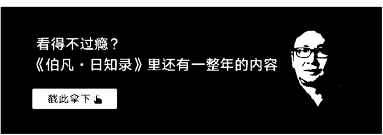

## 伯凡·认知方法论

一年时间，打开洞察世界的50个维度

版权归...App所有，未经许可不得转载

## 用户留言

## 问答46 | “安慰剂效应”是怎么回事？

问答46 | “安慰剂效应”是怎么...

## 文化、习俗、道德和法律

@得稻

是不是文化、习俗、道德，乃至法律都是第三世界的协议？

吴伯凡

我们借用波普的第三世界这个概念提醒我们自己：我们所有人好像生活在同一个世界里，实际上不同的人生活在不同的世界里。第三世界和第一世界、第二世界类似于一种平行宇宙的关系。

比如我们去一个非常落后封闭的国家，他们的客观世界和我们是一样的，但你生活的世界跟他又不一样——这是一套契约体系，你作为一个终端/节点，跟背后看不见的人与人、或者你与不同社群/组织关联，决定了你的价值、能量和资源。

举一个不是太恰当的例子，如果古人穿越到今天，看见我们手里拿着一个东西说话，或者在一个地方就能操纵另外一个地方的东西，比如远程打开家里的空调或者电饭锅，那他会非常不理解，因为他不知道你生活在一个有通信协议连接的世界里。同样，每个人的连接和通信协议，甚至所处的网络都不一样，有2G的、3G的、4G的，那他最终呈现的价值也不一样。

## 安慰剂效应

@毛凯

通信协议的自动化运作在金融世界中尤其明显，无论是“正反馈的放大”还是“负反馈的断崖式破灭”都极为清晰地展现了其中的特征。人类活动的背后已经布满了各类通信协议，以至于一个事情的解读角度发生变化可以直接更改人的核心逻辑。在《活出生命的意义》中，弗兰克尔为老年丧偶的先生提供了比妻子活得久的意义：避免他的妻子因为目睹他离世而遭遇不可承受的悲痛。医学中无处不在的“安慰剂效应”不也正是这个明证吗？

吴伯凡

在个人信仰领域，甚至医学领域，对一个不存在的东西，你选择了什么样的解释体系，最后的结果很不一样。尤其是“安慰剂效应”：从第一世界的标准来看它没有任何实际的效用，但是由于信它是有效果的，最后竟然可能产生某种效果。

## 诈骗里的契约

@终身思考

“信则有，不信则无”。让我想到了“心诚则灵”。一些骗子经常用这句话来跟求助的人解释最后为什么没有用的原因：“你心不诚啊！”老师，这句话是无解的啊。有用，表明你心诚了；没用，你的心还不诚嘛，反正理都在骗子那边。不知道老师您怎么看待类似的话？

吴伯凡

不管是乌合之众的群体，还是正常的社群、组织，都存在着“信则有，不信则无”，或者说，你选择了believe的最终结果是不一样的。我们从一开始就在强调：客观、实在的那面始终是在起作用的。

## 用户留言

提交留言可与专栏作者互动

## 契约竞争力 | 本单元十大精彩留言

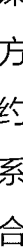

契约竞争力 | 本单元十大精彩... ↓

## 本单元总结

第一节课我们讲了一个词叫“中国式契约”，中国式契约的特别之处在于，它不是陌生人社会的契约，而是熟人社会的契约。人生而自由，但无时不在契约当中，不管你愿意不愿意，你都身处在契约当中。

身处契约社会就要有契约竞争力。第二节能我们通过四种动物，刻画了一个契约竞争力的频谱，这四种动物分别是狼、老虎、蚂蚁、熊猫，通过终端能力和网络能力的强弱来区分。你可以根据这个频谱反省一下自己的竞争力强弱。

第三节课我们讲了进一步审视自己契约化能力的方法。契约一共分为三类，第一类是硬契约和软契约，第二类叫价值观或者说意义系统，第三类是你的资源能力和环境的契合度。你可以审视一下自己是否具备这三种能力。

第四节课我们说，人是所有契约关系的总和，所以，要提高自己的能力，就要增加自己的契约化行为，轻而易举做到的事情不是契约化行为。以后，我再埋怨自己缺少资源、没钱、劣势的时候，不妨思考一下，是不是因为自己的契约性行为太少。

好，以上就是本单元的主要内容。以下是 我精选的同学留言，恭喜前三名同学，将获得我签名的书一本，这次送出的书是之前课程中提到过的《思维简史》，得到的工作人员会尽快把书寄给你，也希望其他同学再接再厉。我们下节课再见。

> 特别提醒：留言内容会默认公开，并同步到“知识城邦”中，中奖同学留言个人信息时，一定记得将留言设置成隐私模式，确保个人信息安全。

## —— 本单元十大精彩留言 ——

## 获奖留言

以武治心

前苏联科学家柳比歇夫，他在数学、昆虫学、生物分类、文学批评中都非常有洞见。柳比歇夫长期坚持一种他自己称作“时间统计法”的工作方法。他把自己每天的工作使用精确到分的时间记录下来，一生坚持，从未间断。柳比歇夫不愿意浪费自己生命的每一分一秒，是因为他要捍卫自己生命的质量，他应得的是踏实感，他的时间是结实的，他的生命历程是结实的，他打开自己的账本，任何一册，他都能知道自己做了哪些事情，他的幸福油然而生。

柳比歇夫用“时间统计法”为自己构建了一个属于自己的时间城堡，抵挡意义的滑坡，让自己免于在各种伪意义的行为中成为被他人裹挟的活靶子。契约既是约束，也是赋能。生活就是“契约化生存”，是一种有意无意的加盟，然后在这个意义体系中追求特定价值回报。

契约竞争力1 | 生活就是“契约化生存”

黄药师

这节课让我联想到中国古代农耕大家族社会，虽然不像现在的网络社会彼此相互连接，但人也不是一个独立的个体，而是一个家族网络的一分子。

联姻是两个家族的联姻，也是为了扩大一个个体的网络，当个体能力达到瓶颈之后，从网络效应和连接能力方面，使得自己变强大。这是人类古代对于契约竞争力的最早认识。但是，繁冗大家族也会带来一些弊病，比如一荣俱荣，一损也会俱损，一人做错也要满足抄斩，个体自由度降低，就像一群蚂蚁中的每一个个体一样。当群体目标很强时，个体的目标就非常弱小了，个体很难违背整体。这就造成一个劣势：如果群体走向了错误的目标，个体再正确，也会抛不过群体而与整体一同跳下悬崖。

所以，现代人类的进步在于，增加了很多其他的维度去形成更高級交织的契约社会，不仅可以和家形成契约，也可以和朋友、公司及同事、兴趣小组，甚至网络上没见过面的人形成多维度的契约社会，人不再只是某个契约中的一员，而是多重契约的一分子，这样可以减少被单一契约网络绑架的错误和悲剧。

契约竞争力2 | 你的竞争力处在频谱的哪一段？

凌繁紫

王立群老师曾经讲过人拥有三种能力：琢磨钱、琢磨人、琢磨事，不同的人拥有其一种或二种、三种能力。当时理解得不是很透，只是针对字面的理解为：琢磨钱：会算账，计算收益，统筹资金；琢磨人：会统筹人际关系；琢磨事：则会对方物的解读并能解决。通过今天吴老师所讲的契约化能力的三原色的描述，将这些知识缝合起来就能更进一步地理解。

琢磨钱：契约组合的第一类硬契约+软契约中的硬契约的价值，加上以身作“约”所产生的价值的软契约。

琢磨人：其中有契约组合的第一类以身作“约”所产生的价值的软契约，再加上第三类：你的资源、能力和整个环境之间的契合度。

琢磨事：包括昨天讲的你的生态竞争能力，面对事物的解决能力以及契约组合的第三类价值观（意义系统），即对未来愿景所赋予的意义，以及让大家也相信（认可意义）的能力。

契约竞争力3 | 契约化能力的三原色

## 其他精彩留言

风渡恶

刘邦问韩信自己能带多少兵，韩信很老实地说：您最多带十万，刘邦又问韩信能带多少兵，韩信说自己带兵自然是多多益善；韩信接着说：您是帅才而非将才，善统将不善统兵。

刘邦的战场不在阵前，而在后方政治。如果从数量上说，韩信的连接能力应该是比刘邦强的，如果不看数量看质量或者效果，那刘邦的连接能力肯定强于韩信。如果从战斗力比，韩信的个人能力比刘邦强，但如果从战术法技术比，刘邦个人能力更强。角度不一样，维度不同，竞争力有异，但强者肯定是个人能力和连接能力都强。

契约竞争力2 | 你的竞争力处在频谱的哪一段？

独行千里

我们同社会的关系，好像是之前一个故事说的一样，一个人一小时最快可以走5公里，如果骑自行车可以走15公里，骑摩托可以走60公里，坐火车可以走300公里，这就是你所在的平台决定了你能取得的成就。

契约系统就像我们所在的平台，我们本身是这个平台上的终端，如果我们的软实力和硬实力都合格，那么一个更广阔的平台会让我们的成就更大，而我们的综合实力有缺陷的话，在同样的平台上，我们的成就就会大受影响，这就是个人同社会的关系，找出自己在系统中缺陷，才能更有针对性地成长。

契约竞争力3 | 契约化能力的三原色

国武

中国人一直吃土法制作的粗盐，氯化钠含量不足50%，一度被西方人蔑称为“食盐民族”。1914年从欧洲考察回国的范旭东目睹天津塘沽海滩边盐坨遍地，如冰雪一般的情景，很是激动。日后他对伙伴说：“一个化学家，看到这样丰富的资源，如果还没有雄心，未免太没有志气了。”1915年他开办久大精盐公司，做出了纯度在95%以上的盐，一举打破了外商长期垄断精盐市场的局面。“中国民族化学工业之父”范旭东，为实现发展民族化学工业的愿望，在“实业救国”的环境背景下，靠着从大海中取盐的专业能力，在价值交换中连接了

中取盐的专业能力，在价值交换中连接了过去、未来和世界，为近代中国化学工业奠定了基础。

## 契约竞争力3 | 契约化能力的三原色

gyl5836536987020

良好的人际和社會关系、经济环境说到底都是一种契约关系。要形成这种关系，三种类型的契约缺一不可。

海尔的张瑞敏说：没有成功的企业，只有时代的企业。因为所有的所谓成功的企业，只不过是因为踏准了时代的节拍。个人的发展也是一样的，个人能力圈、社会圈层、时代环境三种契约的合拍对于我们的未来发展至关重要。

著名的麦克斯韦用数学公理化的方法将安培、法拉第和亨利等人的电磁学理论系统化，把电、磁和光用一组方程式，即麦克斯韦方程组统一起来。正是这种个人的软契约 + 体系化的知识圈层 + 工业革命后从蒸汽机时代到电力时代的社会背景，使麦克斯韦取得了突破性的成果，这项成就被称为继牛顿力学之后，物理学的第二次大统一。

## 契约竞争力3 | 契约化能力的三原色

### 终身思考

ABZ计划除了应用在商业合同中，也可以用来做人生计划。

LinkedIn创始人里德·霍夫曼在他的书《至关重要的关系》中提到如何做足规划，来面对变化莫测的职业，就提到了ABZ计划：A计划：当前的工作。B计划：备选的职业，当A计划无法实现时可以顺利地切换成B。Z计划：最稳妥的退路。所以，当一个选择是去大城市奋斗或小城市安稳时，我们可以想想是否不只二选一，是否还有Z计划？比如Z计划就是在老家安排好所有的事，然后带着理想去执行大城市的奋斗，随时培养自己的B计划以追求内心更想要的，当B计划变成A时，寻找新的B计划。

## 契约竞争力4 | 人是所有契约关系的总和

## 你先走

人是由他的契约数量和质量决定的。人生在世，总有一些契约在身，不得不执行。比如照料老人，养育小孩，参与工作，等等。但在这些共性的契约之外，人与人的差距就体现在有没有自动或被迫执行一些契约，因为契约会赋能。

如果要我只推荐一个好契约，那就是写日记。日记的目标是：客观记录，三省吾身。日记的困难是：难以坚持，一旦断档，容易就此放弃。我的解决办法是，实在没时间写，至少写一句话甚至一个字：比如“我今天很忙”，或“忙”。其实，当你下笔第一个字，很可能就会写下去。日记的标准流程是：购买一款好的付费日记App，自制模板，每日填空。除了不写你感觉对不起钱，还能很好地提醒、催促你，还能让你体验到日记的乐趣。

## 契约竞争力4 | 人是所有契约关系的总和

## 肖胖

一直很喜欢一部电影叫《岁月神偷》，主要讲贫穷的鞋匠家里有两个儿子，大儿子成绩很好，很优秀，小儿子则很顽劣，父母一直对大儿子抱有厚望。直到大儿子突然被发现身患血癌无法医治，母亲开始天天念叨着“做人，总要信”，结果大儿子还是去世，不久连鞋匠也去世了，可是母亲却挺了过来，小儿子长大成人，变得格外优秀，健康。在人生低谷的时候，牌桌上的局面已经完全被控股的时候，学着告诉自己：做人，总要信。因为信，才会看见，终会由一点点的坚持而成真。

## 问答46 | “安慰剂效应”是怎么回事？

## 用户留言

提交留言可与专栏作者互动

## 认知复杂性1 | 我们面对的世界有多复杂？

认知复杂性1 | 我们面对的世.. ↓

第一模块
认知的源代码
第二模块
认知治理
第三模块
算法与第一性原理
第四模块
意义炼金术
“认知复杂性”

“树上有10只鸟，打掉1只鸟，还剩几只鸟？”

这是一道众所周知的题目，小学一年级就做过，我们可以把它看做“测不准原理”的0.01版：这是我们作为观察者、计算者、认知者和我们面对的对象之间的关系问题。

假如树上有10个苹果，摘下1个，还剩9个，这个问题非常简单，但鸟和苹果一个是动物一个是植物，它们跟观察者/游戏参与者之间的依存度是不一样的一—苹果的依存度可以说是0，而你开枪打了一只鸟，其它的鸟就都飞走了。

从这道题我们可以引出一个关于复杂度频谱的问题：我们认知世界的时候面对的有简单对象和复杂对象，但我们很少意识到复杂也是有频谱的。

## 什么是复杂的事情？

我们在《伯凡·日知录》里讲过复杂性的三个层次：
①简单的事 情（看上去复杂，其实很简单）；②复杂的事情；③超级复杂的事情。

## 复杂和错综复杂

简单、复杂、超级复杂的三分法看上去复杂，其实很简单，我们今天主要讲两种复杂：造火箭式的complication（复杂）和教育孩子式的complex（错综复杂）。

## 认知复杂性2 | 什么是复杂性灾难？

认知复杂性2 | 什么是复杂性...

第一模块
认知学校的源代码
第二模块
认知治理
第三模块
算法与第一性原理
第四模块
意义炼金术
“认知复杂性”

我们不妨把自己设定为一个制造业的工人，任务是组装一台机器设备：如果工程师每天给你的图纸都是变化的，你在组装的时候使用的零件也都在发生变化，那你可能会疯掉。

教育孩子就是这样：图纸每天都在发生变化，你跟孩子之间的任何互动都可能造成一个新的格局，并且在这个新格局里，你变他也变，甚至变得你不认得你、他不认得他、你不认得他、他也不认得你。

不仅是教育孩子，在配偶或者同事间的相处，乃至我们面对这个世界都同样存在着类似的可能性：

- 作为观察者，你的观察本身就已经在改变被观察的对象了；
- 追求真相的过程就是在修改甚至完全误导真相——你获得的这个真相立即变成你所谓的“认知”，这种认知再变成一种干预性行为，对方跟你之间也同样存在着在互动当中不断改变的情况；
- 最后的结果可能大大出乎你的意料。

如果更仔细地观察这种互动关系，我们会发现复杂性的程度是不一样的。

有一个传统相声，讲一个爱吹牛的人声称自己可以画仕女图，能够把女性最妩媚的风姿描绘出来。于是就有人拿了一把扇子让他上面画一幅仕女图。画好之后，这个人一看，自己都觉得画的跟仕女差得太远了，就说，“我们改画张飞吧”；张飞自然也画不成样子，这个人又说，“我给你画一棵大树吧”；大树画出来也不像，最后，这个人干脆说，“我全部用墨涂黑了，你请人在上面写上金字吧”——由于绘画者完全没有掌控力，最终造成了这种复杂性。

## 毛笔和宣纸

辜鸿铭先生说，“要理解中国文化就必须理解中国的书画；要理解中国的书画就必须理解中国书画用的一种极其特殊的材质——宣纸”。

我们知道，宣纸跟普通的纸不一样，是一种极其敏感的纸，或者说，宣纸是跟写字/画画的人进行深入互动的一种纸，在宣纸上呈现出来的无论是字还是画，都与执笔人的运笔速度和习惯密切相关。

你把铅笔尖放在一张普通纸上，顶多出现一个点，放再久也就是一个点，但毛笔的笔触就具有不确定性，再加上具有不确定性的宣纸——两个不确定的东西相遇就会出现无数种可能性。

中国画/书法的妙处在于：在一种充满着不确定性、复杂性、易变性和模糊性的游戏当中获得一种确定性。可以说，毛笔和宣纸的这种关系，更准确地反映了我们跟世界的关系。

比如炒股看盘，盘和你之间就类似于毛笔和宣纸的关系：看盘是观察盘，你获得了认知之后就立即折返回来干预你的行为，而你的行为又立即折返回到客观世界，这就造成最后你炒股炒成什么样子往往大出你的意料，尽管你一直试图图于预，想让结果朝好的方向发展。

这个过程中你又深切体会到什么叫身不由己——你和盘的互动产生了一种错综复杂的局面（“错综复杂”就是果和因互相交错，你行为的节奏、力度都不由你自己掌控）。

## 连胜的艺术：截断众流

美国著名的管理学家坎特写过一本书叫《连胜的艺术》，这本厚厚的书谈的是比赛中如何解决“胜并且连胜”这个问题。

我们知道，在所有体育比赛当中，赢是所有参赛者的目的，但赢充满着不确定性：有时候你觉得不太可能赢，结果赢了；有时候你觉得不太可能输，结果输了。这里最难掌控的是：你和你的团队各方面能力都很强，从各种硬指标看都是一支强队，但很难保证连胜，哪怕一场联赛赢了，接下来在同样的场地用同样的队员，甚至同样的天气，这些所有能控制的变量都被控制的情况下再进行一场联赛，也很有可能输掉。

“连胜的艺术”就是在不确定性当中掌握确定性：你对对方的认知是什么样的，对自己的认知是什么样的。但所有能够显化的认知都不能保证你获得一个真实的认知，更不能保证你在这种互动游戏中对复杂性和易变性具有掌控力。

作者在《连胜的艺术》这本书里还讲到一个现象：越是强队越迷信。

比如他们会在某个赛季的比赛中选择什么球鞋，什么颜色的袜子……通过这些在外人看来很可笑的变量干预来确保“赢”。这里最有意思的是：他们居然能够保持这种迷信——这也证明他们的这种行为在客观上是有效的。

这个道理其实并不复杂，一个人或一个团队在比赛的时候，所有的反应都是基于对对方的认知，但赛场风云变幻，很可能出现一个突发情况，比如自己的队员进去一个乌龙球。面对这个实质性变化，你需要给出来一个反应（这个反应不一定奏效）——

如果对方的反应不是你所预料的，你对对方的认知就会陷入混乱→你的行为就越来越混乱→你的应对就越来越缺乏力→对你不利的情况可能就越来越多→你的认知就会出现严重的熵增（混乱）→变量时时刻刻在增加，你没办法形成负熵→通过你和对方的不断互动，变量呈几何级数增加，你的认知越来越趋于混乱，情绪越来越低落→低落会影响你的行为。

这个时候，你需要的是避免熵增。

“因为比赛之前我做了祈祷，换了我五次比赛都赢了穿的那双袜子”，这种做法看起来上去是非理性的，但如果你确信这么做有力量，你就阻断了你认知和行为的复杂性灾难——这种迷信在客观上起到了禅宗说的“截断众流”的作用。

## 总结

划重点

- 1. 人无法控制自身的复杂性，以及世界和你的错综复杂性，但可以避免变量像癌细胞一样以指数级方式增加，从而导致认知和行为的混乱；
- 2. 切记！在认知世界的时候，我们既是观察者，也是干预者。

看得不过瘾？《恩凡·日知录》里还有一整年的内容

用户留言
提交留言可与专栏作者互动

## 认知复杂性3 | 认知世界的同時，你也在塑造世界

认知复杂性3 | 认知世界的同.. ↓

第一模块
认知源代码
第二模块
认知治理
第三模块
算法与第一性原理
第四模块
意义炼金术
“认知复杂性”

## 迷信的两点启示

我们上节课讲到了迷信在比赛中特殊功能，从这个场景里可以明白两点：

## 第一，契约的重要性。

在赛场发生突变的时候，人最容易违约——突变就是一种违约行为，你不再相信以前相信的一切了，这时候就会导致认知混乱，导致你的能量无指向性地消耗。

你也许找不到“怎么赢”的方法，但如果你陷入到认知混乱，就一定会输；
“迷信”是一种非理性的执着，使你能够具有一种抗干扰的能力，比如对方的球员进了一个乌龙球这件事可能没有道理说得清楚，但你会觉得是因为“我们的队都穿上了五次获胜的袜子”或者“我们事先做了一个极其虔诚的祷告”；

## 第二，以毒攻毒。

## 认知是一个支点

## 1.皮格马利翁效应（Pygmalion Effect）

## 2.爱之而勿面

在第一幅画中：一只手在画另外一只手，但从另外的角度看，也是另外一只手在画这只手；

在第二幅画中：一个人画廊里看画，这幅画上画的是画廊延伸的一个城市，城市里也有一个人画廊里看画。

我们既要认识主观世界，又要认识客观世界，更要认识一个被画出来的、你又处在这一画出来的世界中看画的世界。

## 认知复杂性4 | 如何逃离认知的悖论？

认知复杂性4 | 如何逃离认知。 ↓

第一模块
认知的源代码
第二模块
认知治理
第三模块
算法与第一性原理
第四模块
意义炼金术
“认知复杂性”

## 理发师该不该给自己理发？

我在上节课的结尾分享了两幅埃舍尔的画，通常我们会把他的画作为“悖论画”。“悖论”就是你顺着一种思路走下去的时候，却通向了相反的方向，而你还不知道这是为什么会通向相反方向。

我们在埃舍尔的画中经常可以看到这样的场景，比如他画了一个水泵，水一直是往下流的，但流着流着不知道怎么往上流去了，你看不出中间转换的点在哪里；再比如，人和画之间一般是有个分界线的，但在他的画作里，你常常弄不清哪里是画、哪里是画廊、哪里是城市，边界你是分不清楚的。

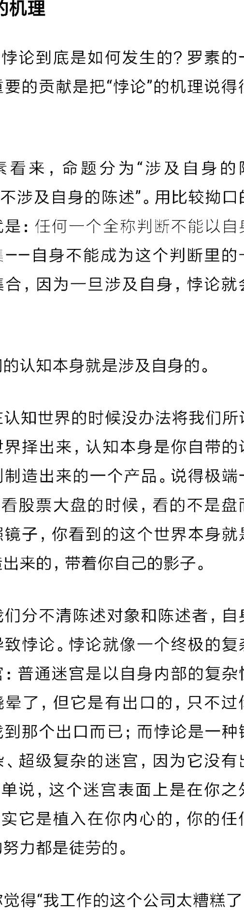

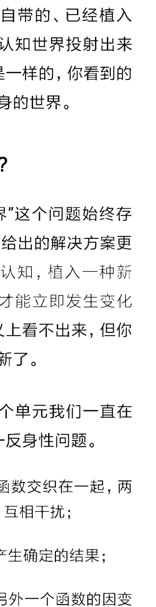

哲学上最早的悖论是“说谎者悖论”：
一个生活在克里特岛上的人说，“克里特岛的人都是说谎者”——你信不信这句话？
你信，意味着克里特岛的人都是说谎者，但说话的人也在克里特岛上，他有没有说谎呢？
你不信，那克里特岛上的人就不是说谎者。

这就引发出很多类似的悖论，比如“相对主义悖论”：
所有事情都是相对的。
这句话本身就有问题，它说所有事情/判断都是相对的，但当你相信“所有事情/判断都是相对的”的时候，你又不会相信这句话。

罗素对这种悖论有一个经典描述（Russell's paradox）：
一个村子里的理发师给所有不给自己理发的人理发，那他该不该给自己理发？
如果他给自己理发，按照他的话，他就不该给自己理发（因为他“只给不自己理发的人理发）；
如果他不给自己理发，按照他的话，他就该给自己理发（因为是“所有”不自己理发的人，包括他自己）。

## 兔子洞：连接客观世界和主观世界的过渡

我们说认知是个谓语，主语是我，是主观认知世界。如果主观和客观浑然一体，看画的人与画浑然一体，我们就置身于一个悖论的世界。中间的过渡既是前面的终点，也是后面的起点，当你进入终点的时候也就进入了另一个起点。

比如在《爱丽丝梦游仙境》里，从一个现实世界进入一个迷幻仙境的世界，中间的过渡是兔子洞：你知道你掉到这个兔子洞里就进入了另一个世界，而你从那个世界出来也得从兔子洞里钻出来。

再比如《黑客帝国》里，人进入虚拟世界需要吃药丸，并且躺在椅子上一—这就相当于一个兔子洞，边界是存在的。一旦穿越兔子洞就进入到一个虚拟世界里，在那个虚拟世界当中，你就立即搞不清楚那个世界跟这个世界到底有什么样的差别。

而《盗梦空间》把这个闻题更加凸显出来：你在梦里，你如何知道你 respetar。

## 悖论的机理

那么，悖论到底是如何发生的？罗素的一个很重要的贡献是把“悖论”的机理说得很清楚。

## 能否逃离悖论的世界？

“如何逃离这个悖论世界”这个问题始终存在，我觉得《盗梦空间》给出的解决方案更深刻：你只有终结一种认知，植入一种新的认知，你所在的世界才能立即发生变化——这个变化从物理意义上看不出来，但你的世界其实已经焕然一新了。

我们看到的是一种相互作用，其中情景和参与者的观点为因变量，以至于一个初始变化会突然同时引起情景与参与者观点的进一步变化——这种现象就是“反身性”。

反身性的世界是我们无法逃离的世界，我们的参与函数命定跟我们的认知函数交织在一起；

这两种函数刚开始的时候影响还是轻度的，随着你认知的推进，参与度的加深，最后你完全分不清眼前的世界是你的认知对象，还是你参与其中的一个场。

这就像一场比赛当中，你只能在这个球场上踢球，不可能逃离这个球场，那么你要做的是如何建立一种屏蔽干扰的机制，阻断不断增多的变量，不让你的认知陷入混沌——这个认知的改变就是你参与方式的改变。

我们把这个过程称之为“炼金术”，让原来的对象通过某种机制和手段从贱金属变成贵金属。

看得不过瘾？
《伯凡·日知录》里还有一整年的内容
截此拿下

#  частью·认知方法论
一年时间，打开洞察世界的50个维度
版权 | 得到App独家，转载请注明出处

## 用户留言

提交留言可与专栏作者互动

## 问答47 | 契约关系会不会阻碍我活出真实的自我？

问答47 | 契约关系会不会阻碍我活出真实的自我？

## 最好的赋能不是遵守而是发布契约

@ 黎水晶

请教吴老师：人的生存是一种契约化生存。社会中有形无形的契约都在影响着你的行为，但是我们就只能被动地等待契约的束缚和牵扯吗？文中的人在家乡买房买车就是为了光宗耀祖吗？如果我们看破了一种契约的虚伪性和荒谬性，我们也要去遵守吗？如果我们总将自己的价值，寄托在别人的评价体系中，那岂不是可悲可怜之人吗？

吴伯凡

这一系列问题听起来朴素，但涉及到了一个很重要的的问题。我们说契约至少分为两种，借用卡尼曼系统一、系统二的术语，我们将其分为契约系统一和契约系统二。

契约系统一是你生活在一个既定的圈子里，要服从这个圈子里各种成文和不成文的契约，并且遵守这套契约系统才能生存下去。但这只是契约系统的一种比较低级的类型，按照孔子的说法就是：乡愿——你生存在于乡里，做人们心中期待你做的事情。

## 自我=所承载的契约关系的总和

@ 快乐天使

契约化生活是不是一种生活在他人认可中的生活？心理学提倡活出真实的自我来，这个真实的自我又是怎样的一种契约关系呢？

吴伯凡

应该说，不存在一个脱离了关系和契约的真实自我，任何一个自我不过是他所承载的契约关系的总和。

## 契约赋能能力评估

@ 徐烨

如果把范围界定在比较小的区域，那我就是一只猛虎，如果把范围放大到整市市场，那我就是一只蚂蚁。我的合作意愿是很强的，做生意也不会让合作伙伴吃亏，但是我觉得我的合作网络不大，我也没有太大的动力去扩展合作网络。我更喜欢的工作是做一个产品经理类型的人，钻研一些自己钻研的内容，其它的则交给其他人。请问老师这个方式算“脆弱”吗？

吴伯凡

如果你真的是一个产品经理，而不是一个码农或者程序员的话，那么作为一个合格的产品经理，应该是狼群里的头狼，否则你做的产品可能不会有太大的竞争力。

## 认知复杂性｜本单元十大精彩留言

认知复杂性｜本单元十大精…

## 本单元总结

整体来看，这个单元我们都在说，我们常常认为认知就意味着“人是主体，认知是客观对象”，其实人跟认知对象之间的关系远不是我们想象的那么简单。

比如第一节课我们讲了事情的三种复杂类型，其中最复杂的就是第三种——超级复杂的事情，而我们的认知常常要面对的就是超级复杂的事情——认知对象会随着你的认知发生变化，出现测不准状态，而这个状态还会反应过来影响认知主体。人的认知就是常常处在这种类似于万花筒的游戏中心。

第二节课我们通过中国传统文化中的毛笔和宣纸，更深入地理解了什么是超级复杂的事。毛笔是最充满不确定性的笔，宣纸是最充满不确定性的纸，当这两者相遇时，出现的结果一定是复杂的，宣纸上呈现的就是超级复杂的事情的象征。

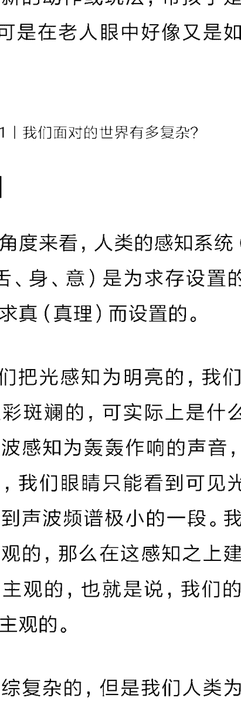

## —— 本单元十大精彩留言 ——

## 获奖留言

山村老狮

今天的课，让我想到了之前听过的“费斯汀格法则”：生活中的10%是由发生在你身上的事情组成，而另外的90%则是由你对所发生的事情如何反应所决定。说白了就是，生活中有10%的事情是我们无法掌控的，而另外的90%却是我们能掌控的。

佛祖门徒

公司一直保留的一些传统似乎就是为了阻断老师所说的认知和行为的复杂性灾难。

Oriental Renai

罗素的“理发师悖论”实际上是要讽刺当时的德国数学家康托尔。（第三次数学危机）

## 其他精彩留言

风逝荣

看过一个故事。地铁上很安静，人不多，有人在看书，有人在休息。某站上来一个成年男子带着三个孩子，一上来三个孩子就开始大喊大叫、来回跑动，甚至去抢夺其他乘客手中的书，而男子只是静静地坐下，好像并没有看到自己孩子的反应。作者有些生气，忍不住上去对他说：对于您孩子的行为，您不该做点什么吗？男子低声说：是的，我该做点什么，一个小时前，他们的妈妈在医院去世了，我想他们现在还有些接受不了，不知道该做点什么。而我，也不知道自己该怎么接受。

逍遥女王

从进化的角度来看，人类的感知系统（眼、耳、鼻、舌、身、意）是为求存设 置的，而不是为了求真（真理）而设置的。

生存，为了生存得更好，我们必须去不断认知，理解这个世界背后的原理，理解我们如何与世界相处，所以我们需要建立各个学科知识，建立各种模型，从而让我们的后人去传承。

## 认知复杂性1｜我们面对的世界有多复杂？

### 桃安安

万老师也提到不确定性，也说到越是经常面对不确定性的人，越容易迷信。普通人上班拿固定工资，不确定性不多，就不怎么迷信；而运动员和演员的收入乃至个人荣辱都随时跟着成绩变化，他们比较迷信，有固定的仪式，让自己进入状态，让自己相信仪式可以战胜面对的挑战。

## 认知复杂性2｜什么是复杂性灾难？

### L.J

我记得罗振宇老师曾经讲过，一个公司的管理者最重要的工作不只是规划方向、分解目标，而是懂得踩刹车，也就是当公司前进的方向发生偏离时，作为管理者就要懂得及时制止并作出调整，从而避免组织出现系统性灾难。

吴老师在《伯凡·日知录》中也说过“少则得，多则惑”的道理，当你的认知或选择过多时，这其中可能就意味着无效选项、错误认知更多，这些元素会对决策和行动产生干扰，这个时候要做的就是减少选项、清除掉“认知垃圾”，从而使得大脑认知带宽得到释放，把精力放在事情真正重要的环节上，这个过程就是避免熵增的过程。

## 认知复杂性2｜什么是复杂性灾难？

### 黄药师

认知和情绪与外界互动中自我加强的特性，正面的称为“正反馈”，负面的会形成“习得性无助”。

正反馈就是我们在做一件事情获得成功，或者受到赞许后，会对这件事的喜爱程度加深，进而变得更擅长做这件事，久而久之越做越好。而习得性无助则是在做一件事甚至每件事都屡屡受挫，怎么努力都会失败，都会被批评或无视，久而久之产生悲观、厌倦等负面情绪，逐渐放弃努力，越做越差的过程。

实际上，习得性无助就是对于眼下事件的一种失控状态，屡次的失败，以及措手不及的突发事件，都会造成失控，而你的对手，则很可能就在这个状态下打败你。我们可以走一个极端，完全不失控的状态，是李世石、柯洁等世界级棋手的对手“阿尔法狗”——人工智能。人工智能没有情绪上的失控和混乱，只有“认知”（程序）上的缺漏，但它会在最快的时间内学习并补漏，再一次达到不失控和不混乱的状态。

高手过招，最后拼的都是心态。最坚硬的心态，就是像人工智能一样波澜不惊的样子，而“阿尔法狗”的淡定，是因为它心中（核心程序）相信契约的恒定。

## 认知复杂性3｜认知世界的同时，你也在塑造世界

### 终身思考

想起了一个故事：一个小和尚看见风吹树叶，树叶在动，就对老和尚说：“师父您看，树叶在动。”老和尚摇摇头。“哦，应该是风在动。”小和尚继续说道。老和尚最后缓缓地说：“是你的心在动。”

假设现在让你想个办法去停止风吹树叶动，你的认知不同，所采取的方式也一定不同（你觉得树叶动就会想办法固定树叶，你觉得风在动，就会出现想办法挡住风甚至阻止风的形成，你觉得是心在动，那么你的不作为也是一种作为），那么最初施加的影响一定不同，根据蝴蝶效应，最后你所塑造的世界会与别人塑造的世界截然不同。

## 认知复杂性3｜认知世界的同时，你也在塑造世界

### 江湖一下

今天的内容和之前课程中所讲的“发现”的定义有相似之处：只有你自己“发散”出去了，才能感知到外部世界。而来自《精英日课》的案例，能很好地佐证今天的内容：

普林斯钉是北卡罗来纳大学（UNC）的心理学教授，每年都有一天，会组织所有选这个课的人，参与一个大实验。实验的前一天是“对照组”，学生们需要时刻记录他们一天当中的互动情况及感受。实验当天，所有学生，包括普林斯钉本人在内，都穿一件颜色特别明亮的T恤衫，上面写着一句特别显眼的话：“我是UNC最受欢迎的人。”他们的任务就是穿着这件衣服在校园里该干啥干啥，同时记录自己跟别人的互动情况和感受。结果实验当天每个人的社交待遇都提高了，许多路人都会关注他们，并对他们报以微笑，发出友好的信息。每个实验参与者都很兴奋，不再低头玩手机，向各种人打招呼。

## 认知复杂性3｜认知世界的同时，你也在塑造世界

## 用户留言

提交留言可与专栏作者互动

## 谬误与认知1 | 那些“种瓜得豆”的故事

谬误与认知1 | 那些“种瓜得... ↓

第一模块
认知的源代码
第二模块
认知治理
第三模块
算法与第一性原理
第四模块
意义炼金术
“谬误与认知”

纵观人类历史或者反省自己的成长经历，我们会发现很多初衷和最终导致的结果存在巨大反差的“种瓜得豆”的例子。

这种反差有的是数量上的：一个很小的因由最后出现了一个影响历史或者你一生的重大转折和结果；

还有一种是本质上的：你要的本来是这样的东西，结果出现的是一个跟你最初所要的东西完全不一样的东西，但当最后结果出现的时候，你又觉得这是顺理成章的。

## “种瓜得豆”案例1：哥贝克力石阵对人类历史的影响

这个模块开始我们讲到了“哥贝克力石阵”，这在现代人看起来是代表着古代人愚昧、幻觉、谬误的一个工程：

第一，它毫无用处；第二，在当时生产力极其落后的情况下去展开这么大的一個工程，现代人觉得很可笑。但就是这么一个在我们今天看来无用甚至可笑的工程，却对人类历史产生了深刻的影响。

## “种瓜得豆”案例2：哥伦布发现美洲大陆

## 种瓜得豆：特殊形态的蝴蝶效应

我反省自己成长过程的时候，甚至想到某年某月的某个下午，如果我没有偶然跟某个人聊起一件事情，然后又遇到了某个人，那么我现在的生活可能完全不是这样的。

那么，我的问题是：

为什么会出现“种瓜得豆”？为什么某种可笑的动机或者某个微不足道的原因导致了重大的实质性结果？

只怕凡·认知方法论\一年时间，打开窥视世界的50%维度
授权仅限得到App发布，大数据可能导致贬值

用户留言

提交留言可与专栏作者互动

## 谬误与认知2 | 两种心灵地图

吴伯凡·认知方法论

谬误与认知2 | 两种心灵地图..

+   第一模块
认知之源代码
第二模块
认知治理
第三模块
算法与第一性原理
第四模块
意义炼金术
“谬误与认知”

## 错误的地图导致的两种结果

我们上节课讲到“哥伦布发现美洲大陆”和“哥贝克力石阵”引发的一种特殊的蝴蝶效应。历史上还有很多“弄假成真”的事情。

比如英文里的“澳门”是Macao，发音和当地人的“妈祖”很相似，是因为有一个葡萄牙商人当初来到澳门，在一个妈祖庙

葡萄牙商人是从一个更大的视野问这个地方，而当地人以为他问的是这个庙。

曾经有人设想这样一个情景：你在拉斯维加斯的“威尼斯酒店”问当地人“这是什么地方”，当地人自然会告诉你“这是威尼斯（人）”，而且这间酒店恰好还有一条河，河上有人划着贡多拉唱着船歌，你不了解的话就会认为你是在威尼斯。

但是等你继续在这个酒店找威尼斯某地地方的时候，你显然是找不到的——威尼斯和拉斯维加斯完全是两个不一样的地方。

于是有人就提醒说：拿着一张错误的心灵地图在现实中找一个你要的地方是永远没有结果的。

但我们在“哥伦布发现美洲大陆”里看到，一张错误的心灵地图会把你引向一个你自以为找到了，其实并不是你要找的地方的地方，并且这种寻找的重大性远远超出你的想象。

拿着错误的地图寻找你要的东西，存在两种结果：导致毫无意义的探索；出现一个意义重大的结果。人的行就足这两种结果交织而成的。

比如生活中，“成功”是达到了你要达到的目标，但从一个更大的视野看，“成功”或者“巨大的成功”常常是达到了你没有达到的地方。假如你去问一些获得巨大成功的企业家“当初有没有想到会是今天这样子”，他一定会告诉你“完全没想到”。

柳传志在刚刚成立联想的时候跟领导保证，“我们一定好努力，让这个公司成为一个年销售额200万的大公司”——200万在当时是一个很大的数目，当然，这个数字的潜台词是“成为一个很大的公司”。现在，联想已经是一家超过2000亿的巨大公司了，这个结果跟柳传志的初衷相比实在是太不对称了。

## 逛庙会：最终结果和初始动机的极不相称

那么，为什么会出现最终结果跟初始动机极不相称的情况呢？这是一个很复杂的问题，你不妨想一想逛庙会的经历。

你约好一个朋友一块儿逛庙会，你们要进入的入口是一样的，动机也一样——好好感受庙会。开始逛之前，你们会约好几点钟在什么地方集合。而一旦进入庙会，你们每人都会产生一个自己版本的庙会：每个人的关注点都不一样，路徑也就不一样。

比如你在庙会上注意到了一个灯笼，而你的同伴注意到了一个小吃，你们会分别走向那咱注意对象——这只是其中的一个节点，你们的潜意识需求、偏会进一步在接下来的过程中进一步展开。

+   客观上：“大道多歧”，客观世界谷路的差异性会形成指数级变化，造成客观世界的节点太多；
主观上：即便怀着相同动机从相同出发点出发，我们的“非认知技能”也会导致结果的差异。

认知心理学家把这种行为称为“非认知技能”，它不是由你的意识层...导致这种选择差异的是大量潜意识层面的因素。

表面上两个有相同出发点和初衷的人，最后的选择如此不一样，是因为他们各自的驱动力是不一样的，尽管他们没有意识。

当然，“逛庙会”是一个非常特殊的情景，我们面对的常常是3个人、5个人、10个人甚至100个人聚到一起做一件事情，而完成这件事情就需要个体之间的通力合作。

还有一个关于错误地图的故事能很好地说明这一点。

一支军队在阿尔卑斯山跟大部队走散了，寻找出路的最初几天，大家大胆探索尝试，但都是没有结果，于是关于怎么走产生不同的意见、谁也说服不了谁的时候，大家决定轮流做庄。然而，轮流做庄的结果是原地打转，补给越来越少，军队出现哗变的可能。

这时候，他们在一个废弃的屋子里找到一张地图——所有人都认为这张地图就是这个地方的地图，一致决定按照这个地图往前走。虽然在按照这个地图走的时候发现地图也有问题，但不管怎样，他们都认可这张地图，最终走出了这个地方。

多少年以后，这些人发现，那是一张根本不是这个地方的地图。

## 两种心灵地图

由此，我们发现有两种心灵地图。

其中一种我们可以拿着它按图索骥达到目标，比如你制定的工作计划。但这种地图的有效性有一个前提：实施的整体环境是相对确定的。但我们的生活经验告诉我们：凡是相对确定的东西往往是不重要的，比如你今天中午吃什么。

而我该选择一个什么样的伴侣终身伴随，这种问题，用按图索骥的方式可以说是完全无效的。

> 法国哲学家卡斯卡说：“世界上再有两种道路，一种道路是我们通常见到的，找到它、踏上它、在这条路上走，达到我们的目标；还有一种是像河流一样，是前者的道路，能够把我们带向某个未知的、可能也是我们目标的道路。”

走上河流一样的道路，它就会把我们带到某个地方，这时候不是你在走它，而是它带着你去行走，或者说，前者是可控的道路，还有一种是不可控的道路。

## 对于“不可控的道路”，我们只有一个选择：找到这条道路。至于怎么走，它自有力量。

我们远行的时候常常是这两种力量交织而成的：一方面要面对现实性，另一方面要面对可能性，而这种可能性通向哪里我们往往不知道，就如同最初建立哥贝克力石阵的人根本不知道后来会有什?结果——可控的道路和不可控的道路，这两者缺一不可。

同样，认知也有两种：一种是提供真实的认知；一种是提供谬误的认知。看上去是谬误，但是它有一个最大的功用：保证你行为的相对一致性，让你不至于在遇到障碍的时候立即调头改变方向；如果你选择遇到障碍和不可能就立即调头，你也就终止了可能性。

看似谬误的地图的最大功能就是：让你打开可能性，避免与接下来别开生面的可能性绝縁。

用户留言

## 谬误与认知3｜谬误在认知中扮演什么角色？

吴伯凡·认知方法论

谬误与认知3｜谬误在认知。

第一模块
认知的源代码

第二模块
认知治理

第三模块
算法与第一性原理

第四模块
意义炼金术
“谬误与认知”

## 道路的二象性

我们上节课讲到了远行时必须携带两种地图，或者说你必须同时走两条道路。

在现实中，我们不可能走两条道路，所以你在走的时候，就必须选择一个真正能把你带到一个有价值目标的路，这条路要同时具有两种特性：①是一条你走在上面的路；②是一条带着你走的路。

我们常常会说“走某条路找到了感觉”，意思是你开始走的这条路是你规划和选择的，但走着走着，你发现有一种力量在引领你，带着你走——在同一条路上，这两种力量同时起作用。

这就像写文章的时候，你会有一个立意和提纲，而真正能写出好文章的状态，一定是写着写着就脱离了提纲的束缚，发现有一种莫名的力量带着你写。“文章本天成，妙手偶得之”，文章已经在那里了，只是借你的手显现出来而已。

这种力量不是你规划的，而是在过程中逐渐给你赋能的东西，是存在于你潜意识的地图在指引你，它是你不可控的。

对话和交流也是如此。哲学家们讲“听者和言者的切换”：刚开始你是一个说话者，说着说着开始变成一个听话者——虽然你在说，但好多话不是你事先想到的，好像是一个比你更聪明更高明的人在引领你——这时候，你除了走在一条路上，你还已经在一条能带着你走的路上，像河流一样。

讲《易经》的人都会说“易”字三义：简易、变易和不易。

简易：这个世界无比复杂，但最终可以归结为两种力量：阴阳或者动和静，就像我们说的一种是陆路，一种是水路；

变易：从起点开始经历不同的阶段，往前走的过程中总会发生变化。按照《易经》的说法，一个事态都会经历六个阶段，好的逐渐变成坏的，坏的变成好的——“亢龙有悔，否极泰来”都是变化的过程；

不易：如果我们把这种东西理解为道/路的话，它不是一条固定的路，而是一条时不时会发生变化的路，或者说，既是规划的路又是过程性的路，但不管有多少变化，它是不变的，因为始终是两种因素在起作用。

很多人做一件比较重要/复杂的事时会说“找不到感觉”，这很可能是你的道路缺乏二象性：一直走在一条自己认定的路上，感受不到一种可能牵引你的力量。还有一种情况是：你走在一条不断变化而没有一个固定指向的路上。

中国报业史上有elar一个很著名的故事：《大公报》在自己的陈列馆里有一张被称为“改变中国历史的报纸”。

红军长征的时候在甘肃某个地方驻扎，有人把一张过期的报纸交给毛泽东。这张报纸上刊登了这么一个消息：红军在陕西北部建立了割据政权。

我们知道，长征的既定目标是一直往北走到中蒙边境，那里有苏联的支持，可以建立根据地。但这张报纸让毛泽东想到：“我们为什么要走那么远？干脆拐到陕西北部去。”后来的故事大家都知道了。

这样一个改变中国命运的重大决定，看似是因为一张过期的报纸促成的，但仔细分析起来会发现各种各样的因素，比如如果红军当时不是往北走，往中蒙边境去，就不可能到这个地方，也就不可能看到这个报纸了——在这里，放弃的那个目标也是有巨大价值的，而且不可替代。

## 在寻宝过程中发现新的藏宝图

我们上节课讲要带两种地图上路：一种是反映真相的地图，还有一种是只有大致方向、没有具体信息地图（甚至可能有错误信息）。

现在我们可以用另外一种方式来表述：一种地图是你事先就能拿到的，还有一种地图是你只能在某条路上拿到的，你不走某条路，就跟这个地图无缘。

这就像玩寻宝游戏，有些藏宝图是一开始就有的，有些藏宝图是需要在寻宝过程中找到的。可能事后来看，重大的结果正是取决于过程中找到的这些藏宝图。

但你要清楚的是：这些地图是附着于一个路径的，你放弃了某条路径也就放弃了重要的地图；而且，如果你当初不选择藏着至关重要地图的这条路径，就意味着你跟最有价值的目标和结果无缘。

有些目标是在达到这个目标之后才知道它是目标的；

这个目标必须经由一条在起步时看似错误甚至没法理解的道路，但它最大的作用是给你提供了一种巨大的可能性；

一旦拒绝这条路，或者在这条路上走了一段以后放弃/偏离它，你和重大的可能性、那个真正目标就无缘了。

英国作家莱姆写过一篇文章说：历史上有很多的重大改变，常常是由一些看上去像傻子一样的人促成的。他们之所以被称为“愚人”和“傻子”，是因为他们所认定的路径（秉持的心灵地图）在很多人看来是错误和可笑的。

面对这样一种心灵（认知）地图，普通人自然不会相信，而愚人、傻子跟普通人最大的不一样是，他们对这个地图信以为真——他们选择了这条在普通人看来是显而易见错误的道路。但普通人不知道的是，这条错误的路上藏着一种巨大的可能性。

讲到这里，你应该有点儿似曾相识的感觉了：你选择了某条路，而这条路的尽头不是你你要达到的目标，而是把你带向了一个藏宝图。这就是《牧羊少年奇幻之旅》里讲的故事，当少年好不容易到达金字塔的时候，他什么也没发现，最大的收获是听到了一个关于财宝的重要消息。

我们在第一节课讲到“认知的目的是为了避免谬误”，那么，谬误在我们的认知中扮演着一种什么样的角色呢？

+   1. 谬误就如同是一条错误的道路，但这个错误的道路上埋藏着一个关于真正目标的藏宝图；
2. 谬误如同是一张提供错误路径的地图，你选择了它，会遭遇各种各样的挫折和失败，但它有一个很重要的功能：让你意识到这是一条错误的道路；
3. 我们也可以把谬误理解成一棵树：你要的是真理的果子，而果子是长在树上的。如果你拒绝了这棵树，你也就拒绝了树上的果子；如果你拒绝了这条看上去充满着谬误的路径，你也就拒绝了埋在路径上的藏宝图。

看得不过瘾？
《伯凡·白知录》里还有一整年的内容
就此往下

吴伯凡·认知方法论

〈上一篇〉

用户留言

提交留言可与专栏作者互动

## 谬误与认知4｜谬误是认知的养料

吴伯凡·认知方法论

谬误与认知4｜谬误是认知..

第一模块
认知的源代码
第三模块
算法与第一性原理

第二模块
认知治理
第四模块
意义炼金术
“谬误与认知”

我在《硬球》(Hardball:How Politics Is Played Told By One Who Knows The Game)这本书里看过这么一句话，是一位美国政治家说的: 我从政之前是干保险的，每天必须去敲100家的门。我的经验告诉我，只有9家会开门，3家会要我的资料，最后只有1家会买我的保险。每天早晨，我自己都必须去敲这100家的门，如果我不敲，那个要买我保险的人我就找不到。

显然，最省事的方式是直接找到那个买保险的人，但如果你不先敲100家的门，是找不到那个人。

这个例子有点儿简单，在真实世界里，我们的机会和时间是有’t限的，不可能去创业100次之后找到正确的创业方式。

真实的情形往往是你只能选一件你觉得可能性比较大的事情开始做: 做之前，你觉得无论从市场需求、资源还是能力适配的角度看，这都是一个可能性比较大的事情；但一旦开始做，各种不可能性就显露出来了。

## “万不得已”路径下的藏宝图

我们说这是“学习成本”，创业就是挣认知，认知需要成本。

我前不久参加了一个关于创业的讨论，说到了三家目前都很有成功但差不多都经过绝处逢生的公司。

有一家公司创业三年，充满着喧哗与骚动，全然不知道方向在哪，做过各种各样轰轰烈烈的努力，最后发现却纯粹是在折腾。这时候，这家公司就面临两种选择:

+   关门大吉，证明你当初的设想是错误的；
选择坚持，撞了南墙也不回头——这种选择其实不是选择，是死路一条。

但这家公司最后能走出来，甚至现在还做得很好，是因为他们在运营过程中发现了一个最初根本不在意的需求现象。正是从这个需求现象着手，像钻进了桃花源的那个洞: 初极狭，复行数十步，豁然开朗。

另外一家公司做的是互联网教育，他们事先做了很多分析论证，觉得这个方向是对的，但一旦开始，一个个可能性就都关闭了。最后最危险的阶段，不仅断了资金来源，还欠了一大笔债。

创始人说，他当时甚至动过跳楼的念头。就在那个时候，有人告诉他“很多人对考试中的真题有很大需求，不妨试试这个”。这家公司的创始人虽然觉得这个东西太狭窄，但在那种情况下，这也是他的最后一根稻草。

后来，他抓住这根稻草，发现认真做，稻草就变成一艘大船了，公司后续也颇发展得非常好。

我注意到，当时这三家公司在回顾自己创业路径的时候都提到了一个词——万不得已，也就是在各种可能性都关闭、实在没有办法的时候做出的选择。你不开始这条路径，是不知道那个“万”的，而这条路最后产生出带着他们走的力量。

一般情况下，既然我们认为的可能性都关闭了，那么我们会关闭这条路径，因为我们认为以极大代价获得一个无用认知是不行的，但你实际上是关闭了这条路径上隐藏着的一个寻宝图——它是在万不得已的时候你才会注意到。

## 迭代：谬误终点的藏宝图

创业的人都说“迭代”。我们以前讲过，“迭代”最初是指，回答别人问题的时候表述不清楚的人，在别人一次次追问下逐渐把问题讲清楚的过程——这其实也始于一种看上去是谬误的东西。

为什么能最终讲清楚？重要的是追问。如果我听你说话发现你没说清楚（信噪比极低），一种选择是我不问了，你讲不清楚的时候没人再问，你也就只能说到这一步了；“追问”是保留问题的大方向，并且沿着这个方向持续纠错，“去粗取精，去伪存真”，逐渐让雕塑在石头里显现出来。

迭代是快失败、常失败、早失败，是在失败中寻找可能的答案:

+   首先，粗看上去是一条充满失败和谬误的道路；其次，它不是从一点出发、放射状、紊乱的路径，而是始终是一条道路；
其次，它不是从一点出发、放射状、紊乱的路径，而是始终是一条道路；
第三，在行走过程中，假如再往前走是更多的坑，它有一种让你去选择别的方式的力量——一旦你选择别的方式，这条路就关闭了，那个隐藏在这个方向上的藏宝图式的认知就跟你毫无关系了。

用我们前面的话说就是：先是你走，然后走的过程当中也会带着你走——这条路你走得足够认真、足够长、足够持久的话，那个藏在远处甚至藏在这条谬误道路终点的藏宝图就不会出现。

## 意义和认知：虽万折而必东

我们前面讲到过河流。河流是自己行走着的道路，或者说河流是带着我们行走的道路，它还有一个重要特点是：没有一条河流是直的，比如黄河巨大的几字形。

孔子把河流的这个特点概括为“虽万折而必东”——不管多少个方向，它最终还是朝东的。也就是说，河流在行走的时候依据两种地图：一种是大方向的地图，一种是因地制宜的地图。如果这两种地图会吵架，一定会不停争吵，因为它们在某些阶段完全是南辕北辙的。

说道这里，我们又回到了这个单元的主题：意义和认知的关系。

意义具有“想当然”的色彩，而认知是要克服“想当然”；构成我们认知的过程恰恰就是“想当然”的力量和“反想当然”的力量相互冲撞交织的过程；

不管是“万不得已”还是“虽万折而必东”，都隐含着一种数据和算法的关系，包含着迭代的真谛；数据是算法的养料，谬误是认知的养料，永远不可能找到一条真正纯粹的认知之路；

谬误如同是戏剧里的坏人、小人、故意人，但站在最终结果看，他们又是必不可少的引路人；

认知像一个由黑和白组成的八卦图，黑里包含着白，白里包含着黑，这就如同神话里包含着科学，科学里也包含着神话（大胆的猜想）。当你拒绝神话和谬误的时候，你也拒绝了认知。

这里我们尤其要强调的是：

认知需要一种不变的东西，这个东西看上去很可能是谬误；错误永远不可避免，关键在于“如何正确地犯错误”。

当你陷入到认知浅薄和没有结果的时候，不妨想想你的道路和方法的配方是否有些——很可能这个配方里缺少了一个非常重要的成分：谬误或者“想当然”。

这个谬误和“想当然”是以“不变”作为前提的，最重要的功能是让你的认知方向保持相对的确定性。没有这种成分，你的认知之路不过是朝不同方向不断尝试，最终会陷入原地踏步或者认知 状态。

## 问答48｜迷信和笃信的区别是什么？

吴伯凡·认知方法论

问答48｜迷信和笃信的区…

## 如何从复杂性中获得解脱？

@王文博

结婚婚姻和教育子女是人生的两大终身课题，而亲子关系出现问题往往是夫妻关系问题的延伸和显现。如何解决这样的难题？如何从复杂的 ⇔ 关系中得到解脱？

吴伯凡

在回答这两个问题之前，我们不妨先问几个问题：

为什么非常优秀的外科医生不亲自操刀给自己的家人动手术？

为什么会出现中国古代“易子而教”（双方都有孩子，分别把自己的孩子交给对方去教）的情况？

## 首先，你意识到这个风险是巨大的，复杂性灾难随着时间而动；

## 第二，在处理这些本身蕴含着复杂性灾难的事情的时候，要确保清晰的目标。

## “拧发条式的世界观”很危险

@哈哈将

## 可能帮到你的迷信

@践行者benny

## 当你的认知过于不可遏制的复杂化的时候，迷信这种简单、粗暴、非理性的认知能起到紧急刹车的功能。

最后再强调一点：我们永远不是认清真相以后再行动的。如何让自己有限的能量不至于消耗在无用的节点上，需要有某种定力，而不管是习惯还是迷信，都有可能在这个关键时候帮你一把。

吴伯凡·认知方法论

用户留言

## 谬误与认知 | 本单元十大精彩留言

吴伯凡 · 认知方法论

谬误与认知 | 本单元十大...

## 本单元总结

第一节课我们首先是重温了哥贝克力石阵这个案例，然后又讲到了哥伦布发现美洲新大陆的过程，通过这两个案例我们发现，初始条件和结果不对称的情况是经常发生的，也就是我们俗话说的“种瓜得豆”。由一个谬误开始，却有可能得出一个你完全意想不到的重大结果。

第二节课我们主要讲了世界上 世界上有两种道路，一种道路是我们通常见到的，找到它、踏上它，然后在这条路上走；还有一种是像河流一样，是前进着的道路，能够把我们带向某未知，也可能是我们目标的道路。准确地说，我们走的道路应该是同时具有这两种属性——既是客观存在的，又是能塑造你、改变你、和你互动的，这两者缺一不可。

听完前两节课你会发现，谬误似乎并不总是谬误，它甚至会把我们引向真相，那么，谬误在认知中究竟扮演着什么样的角色呢？你可以把谬误理解成一棵树：你要的是真理的果子，而果子是长在树上的。如果你拒绝了这棵树，你也就拒绝了树上的果子；如果你拒绝了这条看上去充满着谬误的路径，你也就拒绝了理在路径上的藏宝图。

第四节课我们把谬误的作用作了进一步的深化：谬误最重要的功能是让你的认知方向保持相对的确定性，在你没找到真相前，如果没有这种成分，你就会朝不同方向不断尝试，最终陷入原地踏步或者认知留级的状况。

好，以上就是本单元的主要内容。以下是 我精选的同学留言，恭喜前三名同学，将获得我签名的书一本，这次送出的书是之前课程中提到过的《思维简史》，得到的工作人员会尽快把书寄给你，也希望其他同学再接再厉。我们下节课再见。

特别提醒：留言内容会默认公开，并同步到“知识城邦”中，中奖同学留个人信息时，一定要将留言设置为隐藏模式，确保个人信息安全。

## —— 本单元十大精彩留言 ——

## 获奖留言

## 尚Hoe

老人总会把他们的人生经验毫不吝惜地分享给年轻人，一旦年轻人人不听，就会导致不满意，老 Spect 说一句：不听老人言，吃亏在眼前。这些都是因为老人怕你走弯路，错过了太多机会。

可是，弯路也是路。什么叫正确的路？直路？弯路？是不走回头路。不返工，不回头，就能提高接近目标的速度。大道至简，坚持不贪、不急、不怒，自然会避免很多不必要的“谬误”，渐渐修正前进方向的偏差，道路本身就为你赋予了坚持下去的勇气。

谬误与认知 3 | 谬误在认知中扮演什么角色？

## 山峰

爱迪生在发明电灯之前做了两千多次试验，有个年轻的记者曾询问他为什么遭遇这么多次失败。爱迪生回答：“我一次都没有失败，我发明了电灯。这只是一段经历了两千步的历程。” 爱迪生之所以说“我一次都没有失败”，是因为他把每一次试验都看作整个实践过程的一部分，正是经历了这些失败的部分，才取得最后的成功。 对照意义和认知，认知是认识活动的过程，在这个过程中，意义与现实的碰撞交融，才塑造了我们之后的认知。

谬误与认知 4 | 谬误是认知的养料

## 云上

谬误和想当然，为认知提供一种假设。这节课让我想到了 一种科学研究方法，叫假说演绎法。它的步骤首先是观察现象，提出问题，然后根据问题提出假说，根据假说进行演绎推理，再对演绎推理的内容进行实验验证，如果演绎推理的预期结果，和实验结果相符，说明提出的假说是正确的。如果不相符，说明提出的假说是错误的，我们可以继续提出新的假说，再重新进行演绎推理，实验验证。

老师提到的谬误，相当于提出假说，是研究的一个重要环节，为我们的研究提供了方向，它不一定是正确的，但却是我们找到正确结论的必要之路，而这种谬误或是想当然，实际上是一种主动的求知过程，应该得到肯定，如果连谬误和想当然都没有，那么，对于认知过程，我们连进一步都没有踏出去。

谬误与认知 4 | 谬误是认知的养料

## 其他精彩留言

## 老虎

在企业管理咨询实践中，一些金玉其外，败絮其中的国企，基础管理一塌糊涂，作为咨询顾问，深入基层首先做的事情就是把它们的仓库物资和档案资料进行分门别类，每每这个时候，总会有个别 人企图挑战我们：老师，你能保证分类方法 和谬误肯定是对的吗？

我这个时候会回答他：开始时我的分类方式也许并不完美，但是分比不分强，即便 有瑕疵，也可以获得某种确定性，有了确定性 就可以接受实践的检验，从而自我 迭代、不断完善。如果不跨出这一步（分门别类），以“不确定对不确定”，就会引发系统复杂性灾难，按照黑物熵增原理，一切都会走向无序和混乱。

谬误与认知 2 | 两颗心灵地图

## 雪山飞狐

中国的炼丹术注定是一个谬误，它不可能炼出长生不老的神丹。但是这个谬误的炼丹术却搞出了火药。欧洲的炼金术注定是一个谬误，它不可能炼出金，就它却搞出了化学，通过炼金术，它也发明了欧洲的瓷器。

谬误与认知 3 | 谬误在认知中扮演什么角色？

## 周尚平

美国福泰制药公司的创立过程跟老师说的这期的内容很贴切，一开始药企创始人 的目标是研发抑制免疫系统的药物，经过一系列的努力后他们的新药不是抑制免疫系统的药物，而是一款在治疗癌症上有很好效果的药物，从而拥有了自己公司的第一款药物，凭借这款药物最终融资本上市，成功跻身顶级药公司行列。

“美”是什么？“美”是你从不同的眼光看待问题，维度不同，体验也会不一样。所以，大胆去想，大胆去做，老天爷不会亏待努力勤奋的人的。

谬误与认知 3 | 谬误在认知中扮演什么角色？

## 国武

《薄世宁·医学通识50讲》： “健康是可以生病，又能让疾病康复。” 我们的身体经常会被病毒感染，感冒就是一种最常见的病毒感染。感冒病毒会不断地刺激我们的免疫系统，免疫系统也因为这种刺激，变得越来越强大，就可以抵御更严重的疾病了。应该说，每次感冒都能让我们的免疫系统变强一次。同理，谬误与认知共存， “出淤泥而不染”，认知系统会更加坚定强大，反而不容易动摇。

谬误与认知 3 | 谬误在认知中扮演什么角色？

## 中铁斌

吴伯凡老师，太多的人总是想打造一款完美的爆款，但是我知道很多的爆款，其实离失败都非常地近。为什 么会发生这样的事情？是因为产品最后会发展成什么样子，连制造者都不太清楚。而制造者有一个信念，就是不断地努力做到最好，只有不断地前进，才能保持让产品获得机会。

有一个案例，一个网络公司有一个几乎失败的项目，总监就告诉工程师，你们如果能让这个项目重新获得成功，我就让CEO送你们去夏威夷狂玩一个星期。工程师们都非常地理性，就说这个项目基本上已经失败了，为什么还要去救，为什么不新开一个项目？这个时候总监就说，你们是工程师，就是要完成别人无法完成的事情，只有这样才能体现出你们的价值。最后这些工程师接受了任务，让项目获得了很大的成功，最后在夏威夷享受了一个星期的阳光和沙滩。

从这就可以看出，成功和失败是近义词，成功的反义词是平庸。很多时候人充 满了谬误，认为这件事情是不可能成功的，认为是撞到了南墙。如果把南墙翻过

的，认为是撞到了南墙。如果把南墙翻过去就会发现，未来有无数种可能性。所以失败和成功只有一线之隔，不要把谬误当成负资产，如果明白为什么会产生谬误，就可以把谬误变成正资产，最终获得自己想要的一切。

## 斜阳

有一个非常著名的Cynefin决策框架，根据因果关系提供了四种决策场景：

简单（Simple）：代表了已知的知识，意味着已经有一些现成的规则存在，状况是稳定的，因果之间的关系是清晰的：如果做X就会得到Y。

繁杂（Complicated）：由已知的未知组成。因果关系需要分析或者专业知识，存在很多的正确答案。

复杂（Complex）：代表了未知的未知。因果关系只能通过事后回顾才可能推断出来，并且有可能不存在正确答案。

混乱（Chaotic）：因果关系是不清楚的。在这样的场景下，信息非常困扰，以至于不能采取理性的相应措施，那么唯一正确的行为就是采取行动。对于简单和繁杂的事情，对应着“钟型事件”，可以交给计算机处理。但是后两种场景，对应着“云型事件”，充满了各种不确定的可能性，需要的是行动和试错，必须在“确定意义”的驾驭下进行，也就是需要我们有“以简驭繁”的能力。

## 林曦

吴老师好。关于“谬误与认知”，可能还能引申出一个案例：日本科学家田中耕一曾因“对生物大分子的质谱分析法”获得诺贝尔化学奖。可在当时，获奖的消息对他来说，简直是难以理解。作为一名普通的研究员，在实验上的一次错误操作竟然造成如此轰动，他的脸上写满了疑惑与惶恐。也许就是带着这样的心境，也许是为了证明自己可以肩负这个光环，专属的研究所成立后，田中及其团队先后发表了百余篇论文，包括以特定方法检测血液中与阿尔茨海默症相关的生物标志物。

看得不过瘾？《伯凡·日知录》里还有一整年的内容

截至此写下

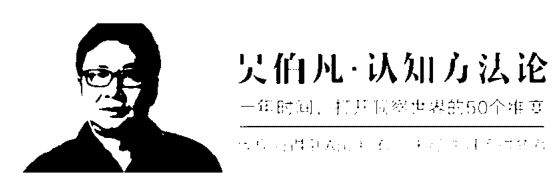

‹ 前一篇

## 用户留言

写留言

点击加载留言

## 认知溢出性1 | 性格决定命运，还是命运决定性格？

吴伯凡·认知方法论

认知溢出性1 | 性格决定命运..

第一模块
认知的源代码

第二模块
认知治理

第三模块
算法与第一性原理

第四模块
意义炼金术
“认知溢出性”

## 性格决定命运=本质主义

很多格言警句仔细思考起来，就会出现问题。

比如金科玉律一样的“性格决定命运”，仔细想的话，如果是性格决定命运，那什么决定性格呢？往深了想，这就是一个“鸡生蛋，蛋生鸡”的问题——你说“性格决定命运”，我也可以说“命运决定性格”，一个孩子出生在富人家或者穷人家，出生在美国或者中国，都是命运，而这个命运会造就他的性格。

我前不久看到一个视频，讲一个中国孩子出生不久就被爸爸妈妈扔在路边，后来被美国人领养，去了美国。在这个孩子24岁找到亲生父母，和他们对话的时候，你绝对不相信他们有血缘关系。当然，基因肯定没有变，但他们就像是两个平行世界的人。

是什么决定命运？性格吗？那这个被遗弃的小孩乐观向上的性格又是 Servi 为...？

## 存在和存在主义

我解释一下“存在”这个词：

在中文里，“存在”是一个被滥用的词，它在英文中是existence，前缀“exi”是出来的意思，比如 exit（ 出口 ）；existence是一个内部的东西展现出来的状态，也可以叫外化/显化。

## 本质不是在先而是在后

我们现在谈论的这些东西，不是在做纯理论探讨，而是在关注一个覆盖面更广大且越来越成为热门话题的争论：这个世界上，从个体命运到制度、经济、文化，到底是事先设计出来的呢，还是摸着石头过河碰出来的？

+   1. 你的认知是受制于你所处的场景和际遇的；
2. 你认为的一个客观判断或者选择，实际上只是你的一个观点，并没有说出世界本来是什么样子，只能表明你是站在什么地方看世界的；
3. 明白的人不会在意你“说了什么”，而在意你说的这句话里透露出“你是什么”。

用户留言

## 认知溢出性2 | 故事导致了人类文明，什么导致了故事？

吴伯凡·认知方法论

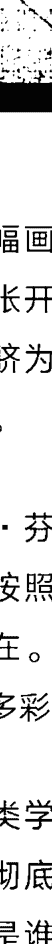

认知溢出性2 | 故事导致了。。

## 偶然因素决定了人的样子

在我看来，最值得听的成功故事只有一个：人类的故事。

别的成功故事（尤其是商业成功故事）往往是用各种话术包装出来的，而人类的故事是一个真实的发人深省的故事。

你一定看过下面这幅达·芬奇的《维特鲁威人》，他想通过这幅画告诉人们：你看到的最感性的东西背后都是有算法的。

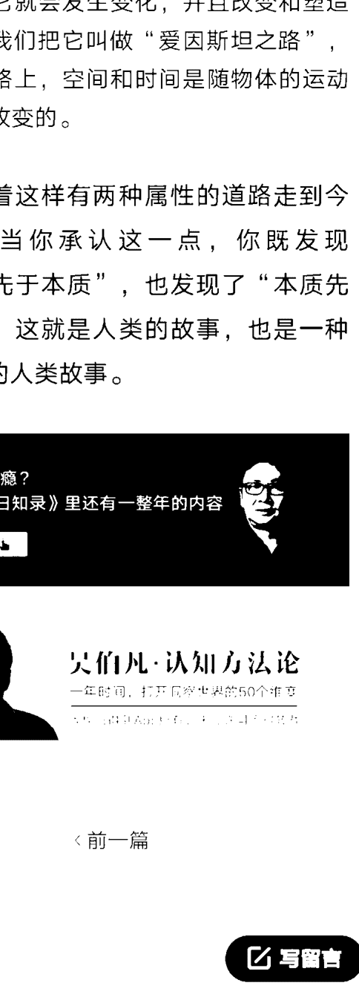

在这幅画中，正方形表示：人纵向身高等于他张开双臂以后的长度；圆形表示：以人肚脐为圆心的圆，人的手指尖和脚都在圆上。

以达·芬奇当时的认知水平，他认为：上帝是按照自己的形象创造出人的，本质先于存在。有了这个蓝图才有了我们看到的丰富多彩的、感性的表象世界。

但人类学、考古学以及大量史前史研究都已经彻底否定了一种观点：人长成这样子不是谁设计出来的，而是那些偶然因素决定的。

## 小趋势：人类的故事

这看起来是奇迹的事件，恰好也是一个小趋势的案例（小趋势=引发趋势的趋势，导致改变的改变），或者说在人的大脑进化上产生了一个小小的蝴蝶效应。

## 1.气候变化导致黑猩猩的分化

这个小事件首先是由气候变化，降水量减少，使得很多森林变成了草原（稀树草原）。气候的变化导致原来是一伙的猩猩发生了分化：

一些黑猩猩习惯了树上的生活——树上容易吃到鲜果和坚果，没有的时候还可以吃树的嫩叶。倭黑猩猩就又找到了和原来类似的地方，继续过着宁静的生活。

还有一些黑猩猩（我们的祖先）留在了在草原上，它们吃不到鲜果和坚果，也没有嫩的树叶，如果选择继续做草动物的話，就只能吃草，而草太难吃了。

## 2.火的作用

还有一个小小的但很重大的变化：当人类开始食肉，而且是吃烤熟的肉的时候，引发了人肠胃的重大变化：人有一个外挂的胃，节省下来的25%~30%的能源供应给了大脑。

人类目前大脑的运行占整个能量消耗的25%，智力比较高的人就具有竞争优势，自然选择就会选择他。

尤瓦尔说：人类之所以跟动物不一样，是因为人类能讲故事。但他没说：故事导致了人类文化的进程，那么什么导致了故事的出现呢？

营地。篝火导致了语言的产生，语言产生的结果是认知革命。

用户留言

## 认知溢出性3 | 溢出性的决定性作用

吴伯凡·认知方法论

认知溢出性3 | 溢出性的决..

第一模块
认知的源代码
第三模块
算法与第一性原理

第二模块
认知治理
第四模块
意义炼金术
“认知溢出性”

## 小趋势：火在人类进化中扮演的角色

我们熟悉的《阿拉伯人和骆驼》这个故事之所以流传很广，是因为生活中常常有那些反客为主的事情。“反客为主”在哲学上称为“异化”：手段变成了目的，配角变成了主角，帮手辅助变成了主宰。

但“异化”其实是个中性词，既有好的方面也有坏的方面，比如火对于人类文明的意义可以说是一个异化的结果：

稀树草原上的一场偶然的火灾，留下了烤熟的动物尸体，让本來以食草为主的人类逐渐变成了食肉动物。而人类的祖先因为这个小小的便宜付出了相当大的代价——食物链从低端向高端移动需要巨大的成本，人类获取食物的难度就会增加，粮食的安全性也成了问题。

我们知道，食草动物一般不会饿肚子——到处都是草，而恐龙的灭绝与它的食量巨大有很大关系（食肉恐龙是最早灭绝的）。人类对肉食形成了“成瘾性依赖”以后，需要花更多的精力，冒更大的风险去捕猎。

当然，这也带来了一个意料不到的影响：人类从合作度低的动物变成了合作高度的动物；接下来又导致人类有了固定的聚居地和篝火；火导致的外挂骨给人类大脑的进化提供了资源保证，而合作、群居进一步让人类的大脑快速进化——最重要的是，火不仅能烤熟食物，篝火还形成了社交机制，促进了信号化的交流，逐渐进化出语言。

语言一旦形成，就成为人类进入“既非主观又非客观”的第三世界的最重要能力。

火在人类自然进化和文化进化中扮演的角色是一个最生动的关于小趋势的例子。

## 溢出性：“药引子”的功能

我们可以给“小趋势”取另外一个名字：引子，或者药引子（中药里的药引子本身没有药效，但能够引发药效）。

在自然、社会、文化的进化过程中，有一些类似于药引子的因素，比如火，而生活中也有很多类似于药引子的要素。

比如说到让人发胖的食品，你可以举出各种垃圾食品，但导致人发胖的更重要的原因也许不是这些东西，甚至不是食品：一个人长期加班可能导致发胖；一个人口味重，爱吃特别辛辣的食物，就会导致吃更多的米饭，也让人发胖。但这些影响是间接隐秘的，如果你不根除这些东西就会不断发胖。

无论是火、辣酱还是加班，都有一个相通的东西——溢出性：

溢出性是在本来的功能之外包含着一种或多种隐性的、间接的、影响力巨大的功能，是在主功能上溢出的一点点功能，看似不起眼，但引发的后果是跑题的：你的视线一直关注你的主打目标，就很容易忽视类似于边角余料的后果，而这种后果有一种不断叠加的增强强制，甚至会导致接近于蝴蝶效应的后果。

这种蝴蝶效应既发生在人类的自然和文化演绎历史上，也发生在个人的生活当中。

以前我们讲到过一对经济学的概念：内部性和外部性，其中外部性就是功能和效用溢出。

我们生活当中有很多这样的外部性，比如有些旅游景点由于特殊的属性，导致这个地方的游客中漂亮女性比较多，但旅游景点定价的时候是不会把这样一个特性定入到价格当中的——这就是外部性或者溢出性。

我们从外部性再回到小趋势、药引子以及随时随地可能发生的蝴蝶效应，就能明白一件事情：存在和本质之间的关系。

当我们观察一个物种、个体、组织甚至国家的…，我们会预带意向性，给它命名给它定价，而定出来的价格、取的名字都只是反映了你的意向跟它的某个功能之间的契合度，它那些隐性的、溢出性的功能效用往往在你的视线之外。

比如一块砖，当你把它称为砖的时候，已经隐含着它的功能——任何一个命名里都包含着某种关系、契约或者连接，尽管看上去它只是一个孤立的个体。

但即使是一块砖，也一定有一些功能是从它最初被设定的功能里溢出的：你可以用这块砖垫桌子，或者往墙上钉木桩的时候，把这块砖当锤子用，甚至有时候还可以把它当做凿器。

任何一个个体，你看到的只是这个个体，其实它自身还携带了很多关系；因为你跟这个个体的关系是固定的，你就会定义你们之间的关系，有时候从你叫它的名字当中就能反映出来，比如古代读书人觉得受到最大的侮辱就是叫他的名而不是字——名是他爸爸叫的；

任何一个名称里都包含着说话者跟它之间的意向关系，这个意向关系也包含着功能：它跟你显现出来的功能只是你特定取景框下涌现出来的功能，它在此之外还有很多的功能。

以上种种提示我们：那些较性的溢出指标往往在你的视线之外，而这些指标所代表的功能产生的后果像药引子一样巨大。

## “溢出性”的重大作用

你可能会困惑于“某某人跟我学历一样、年龄一样、星座都一样，但他怎么就跟我那就不一样”——你的困惑是由你的取景框决定的，而他这个人性格中包含的一些溢出性性格在悄悄开始一个故事，所以结果出来的时候，你会特别不理解。

不管在工作还是生活中，我们总能发现一些平淡无奇的人，但从长一点儿的时段来看，这些人做事情往往风水生起——原因就在于他的行为、性格、Installed... 中有很多你不知道的溢出性。

溢出性也是外部性，我们再来看“外部性”的问题：

+   1. 外部性永远是暂时的，最终也会变成内部性；
2. 外部性在短时段看不出效果，就像我们看人类的历史：着了一场火，烧死几个动物，火好像并没有什么出奇的地方；
3. 不管外部性还是内部性，都包含着矫的测不准原理：我们任何交...

交都是在一个特定场景下成交的，有时候你吃了亏，甚至只能吃哑巴亏，有时候你给了别人好处，但又不能拿钱——不要因为一次一次性交易中溢出的东西被忽略就以为它不存在，它...

我的一个朋友说，他人生最重要的几件事情都是在赚钱最少的时候发生的：

他在一家薪酬不满意的公司遇到了他的终身伴侣；

他在不受重用的公司，因为工作关系买了房子；

他在一家薪酬既不高，也没重用他的公司遇到了他后来来的创业合伙人。

他得到的以上好处并没有在当时的交易中显现出来。

我们生活的世界里存在着很多的“测不准原理”：有价格的测不准、命名的测不准、定义的测不准……之所以有这些测不准是因为它的溢出性，而这些溢出的东西不会因为它是溢出的、附带的、辅助的、隐性的、间接的而不起作用——从一个更长的时段来看，它起的是决定性作用。

吴伯凡·认知方法论

〈前一篇〉

用户留言

## 认知溢出性4 | 考试押对了题，是好事吗？

吴伯凡 · 认知方法论

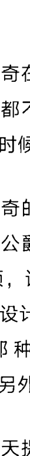

认知溢出性4 | 考试押对了.. ↓

+   第一模块
认知Leia的源代码
第二模块
认知治理
第三模块
算法与第一性原理
第四模块
意义炼金术
“认知溢出性”

## “学渣”达·芬奇：“另外，我会画画”

今年是达·芬奇逝世500周年，很多人在谈论他，就有人提了一个问题：如果达·芬奇穿越到今天会是一种什么样的命运？

达·芬奇在今天会是一个典型的学渣，他干什么都不行，就像他自己说的：“你们读书的时候，我在读大自然的花朵。”

达·芬奇的专长连他自己都搞不清楚：在给米兰公爵写自荐信秀特长的时候，他列了10项，诸如“我会舞台艺术、搞舞台装置、设计城堡/教堂、搭桥梁、做演奏音乐的那种铃铛”等等，最后加了一条：“另外，我还会画画。”

我们今天提到达·芬奇的时候，第一联想到的就是画家，根本想不到他前面说的那些东西。

这就可以套用我们上节课讲的：他的溢出性功能特别多，甚至好像全是溢出的，主要的那个东西反而不太清楚了。

在今天的教育体制下，用比尔·盖茨的话说就是：“他是一个没办法对他的角色和专长进行定义的人。”

我们知道，如果社会没办法定义你是干什么的、你适合干什么，你自己也 step...

## 包容性和非他性

英文的“包容性”是inclusive，它的反义词“非他性/专一性”是exclusive。

## 自然选择是一个塑造的过程

## 避免押题投机式的人生

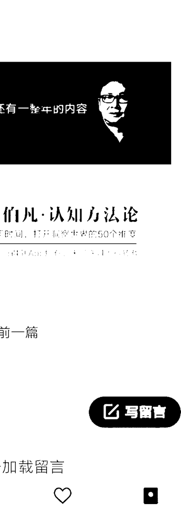

〈上一篇〉

用户留言

## 问答49｜发现自己走在错误 Christianity 路上，该不该停下？

吴伯凡·认知方法论

## 什么是“成功”？

这个单元很多同学的问题都来自于对“成功学”的疑惑。

“成功学”和我们这里讲的认知方法最大的不同是：成功学许诺按照它的方法就一定能成功，是一种证实的方法，而我们讲的正好相反，是一种证伪的方法。

“成功”有一个永远挥之不去的语境：失败。所谓“成功”就是失败的弥天大网下的漏网之鱼。

这种认知方法和以前讲过的“乖兵思维”是相通的：乖兵生来就是被包围的。

在陆地上没有一条成功之路，直接被排放到敌占区，成功的起点就是从失败开始的，就是坠入到敌人的包围当中——这种成功是赎出来的成功，它也是一种你只要害怕失败就永远不会开始的游戏。

在这样的一种方法论下，一些困惑就容易解释了。

## 谬误是不是要“虚心接受，坚决不改”呢？

> @ 郢非一般

这两节课让我有点困惑，感觉老师是让我们无论如何也要坚持行动下去。如果那带人拿到的地图走下去是悬崖的话，那么他们是不是就会被误导了，是不是早该停止了？停止是不是一种最优的选择？

吴伯凡

我在课上已经讲过：真正做一件事情而不是旅游的话，你不可能在起点就拿到一张通向那个地方的地图。

## 一张错误的地图有什么功能？首先，让你起步开始走。用我们前面话说，创业不是找到那个宝藏，而是开启了一条道路，而在这条路上藏着一个真正的藏宝图。

从起点拿到的藏宝图，或者你自己以为你找到的、内心已经有的心灵藏宝图，首先是让你踏上一条谬误的道路，真相悄悄隐藏其中。如果你觉得它是靠谱、不确定的谬误之路，非要等到确定的道路才走的话，真相跟宝藏就永远跟你就是无缘的。

## 真正管用的认知是从无数的谬误中淘选出来的

> @ 终身思考

认知有两种，一种是提供真相的认知，一种是提供谬误的认知。这两种认知的比例是多少才合适呢？是黄金比例，还是因人而异？或者这本来是一个不应该存在的问题？

我们要意识到一点：成和败的结果是两方面因素造成的：

一方面：你提供的性状、结果、资源和能力打在一个包里；

另一方面：自然选择出什么样的问题，环境怎么变化，你也没法保证。

## 留一点身体的感知与世界碰撞

> @ 自己治心

看了“我反思自己成长过程的时候，甚至想到某年某月的某个下午，如果我没有偶然跟某个人聊起一件事情，然后又遇到某个人，那么我现在的生活可能完全不是这样的”这段话，真的有焕然一新的感觉，感慨万千，似乎我的很多重大拐点真的是有很多是不经意的瞬间改变的。那我们追求真相，是不是不会再这么重要，应该留一点身体的“感知”去与世界碰撞呢？

我们说的“机缘”，机和缘是两回事：机是机会，缘是缘分；缘是在机会没出现之前已经做的事情。

## 用户留言

## 认知溢出性 | 本单元十大精彩留言

吴伯凡·认知方法论

认知溢出性 | 本单元十大...  ↓

## 本单元总结

第一节课的开始我们就提出了一个问题：到底是性格决定命运，还是命运决定性格？再往前推进一步我们就得到一个哲学命题：是本质决定了存在，还是存在决定了本质？这是个抽象的问题，也是个具体的问题。当你俯省生命历程的时候就会发现，既是性格决定了命运，也是命运决定了性格；既是世界造就了你的认知，也是认知造就了你的世界。

第二节课我们说，在众多的成功故事当中，值得听的就是只有人类从低级文明到高级文明的故事，从非洲大草原出发，人类经历了一个个大大小小的蝴蝶效应。从这些蝴蝶效应中，我们能看到人类的认知升级、认知革命是如何发生的，人的体质和心智是如何在环境影响下再造这个世界的。

第三节课我们讲到了一个概念叫溢出性。任何功都有我们看不到的附带的隐性能；任何一个原因也都有附带的隐性结果。溢出性虽然是附带的、隐性的、间接的，你可能注意不到，但从一个更长的时段来看，它起到的是决定性作用。进化的历程是副产品不断出现的历程。

第四节课我们讲了两个概念——包容性和摧取性。事情的发展往往会超出我们的意料，节外生枝。所以，当我们面对目标时要意识到，既然我们不知道哪朵云彩先下雨，我就应该放弃摧取性的方法，而采取包容性的方法，让包容性和开放性保证溢出性的出现。

好，以上就是本单元的主要内容。以下是 我精选的同学留言，恭喜前三名同学，将获得我签名的一书一本，这次送出的书是之前课程中提到过的《思维简史》，得到的工作人员会尽快把书寄给你，也希望其他同学再接再厉。我们下节课再见。

特别提醒：留言内容会默认公开，并同步到“知识城邦”中，中奖同学留个人信息时，一定记得将留言设置成隐私模式，确保个人信息安全。

## ——本单元十大精彩留言——

## 获奖留言

## 行之若愚

影视蒙太奇理论中有一个叫“零度剪辑”，也是好莱坞电影的经典成规与惯例。简单讲可以理解为利用剪辑达到故意隐藏摄影机的存在的目的，观众不会注意到画框之外发生了什么。

还有一种剪辑和拍摄手法是故意暴露摄影机的存在，比如让演员直面摄影机，明显是主观众角的镜头用客观视角拍摄等等，希区柯克的电影还有很多恐怖片常会使用这种手法。观众会突然从剧情中跳出，注意到原来画框之外还有一双眼睛。后者其实就是让观众注意到溢出性，看恐怖片时的那种惊悚感，不是存在于画面的，而是由于剪辑和拍摄手法的变化，使得“画框里的场景”有了溢出性。同样的场景同样的画面，在“呈现”功能之外又多了一项效果——恐怖。

## Melissa要智慧

在《魔鬼经济学》中有《罪犯都去哪儿了？》，其中讲到，20世纪60年代是罪犯的黄金年代，而到了90年代，犯罪率突然下降，其下降速度之快、之突然，出乎所有人的意料。专家们进行了各种研究，结果发现，对降低犯罪率起到决定性作用的不是严厉的司法体系，不是经济的繁荣，也不是失业率的降低，而是大家意想不到的“堕胎”合法化的法律。

从1828年至1900年，堕胎在美国全境被宣布为非法。20世纪80年代末，美国的犯罪率达到了峰值，而且在此之前的15年间，暴力犯罪上升了80%。20世纪60年代晚期，部分州开始允许女性在某些极端情况下堕胎，比如强奸、乱伦或生育可能危及母亲生命。1973年，随着“罗诉韦德案”的宣判，堕胎合法化突然普及至美国全境。2

0世纪90年代初，出生于“罗诉韦德案”后的第一代儿童到了十八、九岁，违法犯罪的黄金年龄，但犯罪率开始下降。各种数据显示，“罗诉韦德案”确实是造成犯罪率由升转降的分水岭。虽然，谁也不愿意相信“堕胎”与“犯罪率”的相关性，尤其是反对堕胎的人士甚至认为，堕胎本身就是暴力犯罪。

但事实是，“堕胎”非法化，原本是出于“宗教”或某些国家，如罗马尼亚促进人口增长为目的，但其溢出——被迫生子，却导致了犯罪率的上升。被迫生子的母亲对自己的孩子心生怨恨，不具备健康家庭环境，导致孩子日后走上犯罪道路。而堕胎的合法化，表面上只是给了女性按法律规定终止妊娠的权利，而其溢出——妇女只有当符合养育条件时才会决定生孩子，却提高了养育孩子的质量，降低了犯罪率。

## 孟同学

塔勒布在《黑天鹅》一书中曾提示，要想应对不可预测事件，我们最好建立一些“冗余”。

冗余在经济学上是个不好的东西，因为它意味着资源闲置和浪费，但在生态学上，保持冗余却是大自然的一种智慧，比如我们每个人都有两只眼睛、两个肺、两个肾，这都可以看作是为了应对意外事件所做的配置；在投资层面，保持冗余就是持有部分多余的现金，不要把子弹一次性全打光，这样可以保证在遇到危机时，别人都死了但你还能活下来。

冗余同样适用于我们的职业生涯发展。你永远无法预测今天你掌握的本事能否持续性给你带来生存优势。在这个快速变化、黑天鹅满天飞的时代，如果不建立一点点冗余能力，你很可能会在可看到的将来某一时刻突然发现，你曾经赖以生存的本领和技能变得过时，变得可轻易被取代；而那些在平时建立了看似无用的冗余能力的人，很可能还有更好的立足之地。这就是所谓“多样性红利”，能否享受到这种红利，就看你是否有建立冗余的意识和能力。

## 其他精彩留言

## Trust me

有一则笑话：话说两个小学生放学回家，路上讨论挑食的问题。其中一个问：“为什么大人都说我们挑食呢？” 另一个答：“因为他们只买他们喜欢吃的。”站在孩子的角度说的没有问题，站在大人的角度说的也没有错，那么请问大家到底如何是好呢？牛吃了好，爱因斯坦也晕，关键在于动态或者静态的状况时你怎么做！

## gy1583656987020

溢出性的东西不会因为它是溢出的、附带的、辅助的、隐性的、间接的而不起作用——从一个更长的时段来看，它起到的是决定性作用。

听本书《咖啡癖史》：从咖啡因在不同时期的社会体系中，由一系列的偶然导致演进到人类休闲饮品。咖啡因能刺激人体分泌多巴胺，这是人类对咖啡产生生理依赖的根源。

咖啡之所以能够进入人类社会，起初是因为迷信需求，能够在祭祀时产生幻觉；在后来的战争时期用于激励士气，奴隶贩卖中用于提升存活率。随着欧洲文明的发展，人们的提纯加工蒸馏技术获得了突破，咖啡馆成为一座城市的功能场所，人们来到这里工作、休息，同时品尝着咖啡的美昧，也使思想交流的特性越被进一步放大，使咖啡馆成为碰撞思想的场所，进而对社会进步产生了积极影响。可飧，随着人类从迷信、战争、人口贩卖到社交活动的不同阶段，咖啡因的溢出性被赋予了不同的意义。

## 彭瑶20512044

最近喜欢上练钢笔字，在网上报名了一位老师的课，在直播授课时老师说：“要想写好钢笔字，首先练笔画，笔画过关了再练偏旁部首，偏旁部首练过头了再写单字”

练偏旁部首，偏旁部首练过头了再写单字。"我写了三十几年字了，突然发现自己好像不会写字似的，于是又从横开始写起。在练习的过程中突然发现，干任何事情、学习任何知识不都是一样的道理吗？都是从简到繁，由易到难，逐步推进，最关键的就是不要放弃、不要急躁，从“وامل”开始慢慢来，不要高估短期积累，更不要低估长期积累。这是我在练字中得到的溢出收获。

认知溢出性 3 | 溢出性的决定性作用

## 以武治心

《活出生命的意义》这本书所讲的，实现意义的途径有三种：

做有意义的事情，关爱他人以及拥有克服困难的勇气。当一个人做他最喜欢的事业的时候，他会认为所有的痛苦都是值得的、有意义的(痛苦本身没有意义，但我们可以给它赋予意义);

当一个人真心去帮助他人的时候，受帮助的人会感受到他(她)的真心而心怀感恩，他(她)同样感觉人生真的很美好;

当一个人拥有了战胜困难的勇气，没有战胜他的困难，就会让他变得更加坚强。我们即使在追求人生意义中没有成功。但在这个过程中，我们得到了提升。那么，在未来，我们就更有可能去弥补、完善我们自己。

认知溢出性4 | 考试押对了题，是好事吗?

## 萧湘创业人

卢梭的一个著名论点：教育就是生长。在这引用周国平老师讲的一段话：粗心的大人看不见，在每一个看似懵懂的孩子身上，都有一个灵魂在朝着某种形态生成。

在大人眼中，孩子什么都不懂，什么都不行，一切都要大人教，而大人在孩子身上则学不到任何东西。恕我直言，在我眼中，他们是世界上最愚蠢的大人。逼迫孩子只去适应一种可能性，有时候就有可能从根本上毁掉孩子。教育就是去发现、呵护孩子身上的闪光点和天性。

认知溢出性4 | 考试押对了题，是好事吗?

## 肖胖

非常幸运能看到这篇文章。题目说，要不要考试压对题?吴军老师讲过一个故事，吴军老师曾经有一个邻家师姐，高考时超水平发挥，本来可能连北京航空航天大学或者北京科技大学也考不上的她，居然考上了清华大学。这件事情让我的母校在随后的十几年里一直作为高考超水平发挥的典型来讲，直到教过她、记得这件事的那批老师退休为止。

问答49 | 发现自己走在错误的路上，该不该停下?

## 用户留言

点击加载留言

## 总复习1｜踏上第一个台阶就好

吴伯凡 · 认知方法论

总复习1 | 踏上第一个台阶..

我们规划的课程到上个单元已经结束了，接下来的三个单元既是对前面课程的总结，也是深化。

在课程里，我们以“认知方法论”为基本话题，做了一些串计和总结，从多个角度和维度对认知进行了一些比较细致的探讨，一方面看到我们在认知上的增量，另外一方面，更重要的是认知维度上的增量。

## 努力和计划不能实现真正的升级

我们上个单元讲到了火是如何从体质和精神上塑造人类的，可以说，我们跟黑猩猩、倭黑猩猩最重要的分岔点就是火的使用。

当我们的祖先第一次使用火的时候，我们既可以说“我们的祖先找到了火”，也可以说“火找到了我们的祖先”——火作为一种巨大的创造性力量，把人一步步塑造成为今天的样子。当然，火，特别是篝火，不仅塑造了人的语言，还塑造了另外两种东西：舞蹈和音乐，它们也是一种特殊的语言。

以舞蹈为例。没有舞蹈之前，人的身体动作要么是劳动，要么是表现满足简单生理需求的动作，再加上所有哺乳动物都会的嬉戏。而舞蹈、音乐都超越了简单的信号，变成一种有内在语法、规则的语言。

## 而这个结果以及这个结果导致的新结果不是人类计划来的，也不是努力来的。

## 你有你的计划，世界没有计划

万维钢老师的新书书名很吸引人——《你有你的计划，世界另有计划》。你成为什么样的人相当大程度上取决于世界的计划，而世界的计划是什么呢？

## 踏上第一个台阶

我们经常说“一路登天”，虽然我们知道靠一步是登不上天的，但有时候，某一步就是关键的一步，能够开启一个登天的旅程，我们把这个表述变换一下：因为某一步你可能登天。

马丁·路德·金有一句名言：有信心地踏出第一步，你不需要看到整个楼梯，只要踏出第一步就好。

## 万维钢新书重磅首发

没有系统的人一惊一乍，有系统的人心静如水

你有你的计划,世界另有计划

吴伯凡·认知方法论

用户留言

## 总复习2 | 创新的过程也是认知升级的过程

吴伯凡·认知方法论

总复习2 | 创新的过程也是。

我们上节课讲的“人类祖先在稀树草原开启艰难的进化历程”和电影《黑客帝国》的故事很像：

《黑客帝国》的原名（Matrix）叫“母体”或者“子宫”。主人公安德森具有双重生命：在虚假又感觉到非常真实的世界里叫安德森，但他模糊糊糊感觉到这个虚假世界之外有一个真实的世界，这个世界里他还有一个身份是尼奥。

从安德森到尼奥的过程是一个 lied 动人心又十分艰难的过程：脱离超级舒适的母体监狱，到一个带来各种痛苦和不幸却自由的世界。

许多故事的背后都有一个原型，比如《牧羊少年奇幻之旅》里，过于舒服日子的牧羊少年踏上了艰难困苦，险些丧命的寻宝历程，说的也是同样一个故事。

如果说《黑客帝国》《牧羊少年奇幻之旅》是现代人讲述的故事，那么我们不妨看看最古老的故事里的一个原型：犹太人《出埃及记》的故事。

## 埃及的肉锅

西方有个典故：埃及的肉锅，讲的是摩西带领犹太人逃离埃及的时候，他们刚开始还相信这是一条通往自由的道路，但走着走着，各种困难出来了，连吃的东西都要没有了，很多人开始抱怨说：“我们还不如不出来，要是呆在埃及的话，至少可以固在肉锅旁边幸福舒适的日子，为什么要跑到这个寸草不生的地方来？”

“埃及的肉锅”形容人在追求自由的过程中开始打退堂鼓的时候，怀念自己当初在舒适的母体里过的那种生活。

人类的祖先在稀树草原上生活的时候，一定也会有一些人觉得到不如再回到林子里去，因为人的主食如果是果子和叶子，食物的丰富度就很高，采集的难度也很低；而当你选择在稀树草原捕食动物的时候，食物供应量减少，难度和风险增加，就一定会怀念丛林中那些美味的水果和叶子了。

所以今天，黑猩猩的食物结构仍然以植物为主，肉食只占食物结构中的1%到4%。

如果黑猩猩知道它们的兄弟在稀树草原上艰难捕食的情形，一定会发出得意的坏笑，但是，舍不得舒适区、没有勇气逃离的黑猩猩们仍然在丛林里生活，而人类经过艰难的认知升级和革命以后，成为了地球的主宰。

## 补充型创新

人类有很多创新，比如火的使用、用兽皮缝制第一件衣服、语言的产生等等，那么，创新是如何发生的呢？是不是有了清晰计划和强烈的创新冲动就够呢？

## 1. 窗户：问题倒逼出的创新

有一种理论叫“补充型创新”，它的过程是“就补型创新”。

## 2. 升级与留级

## 总结：

1. 创新首先是创造新的解决方案的过程，也是创造新问题的过程；
2. 创新是创造外在解决方案的过程，也是生成内在解决方案的过程；
3. 创新的过程也是认知升级的过程，这两者交织在一起密不可分；
4. 创新既是创造的过程，也是被创造的过程。

## 总复习3 | 想改变世界，先改变世界观

吴伯凡 · 认知方法论

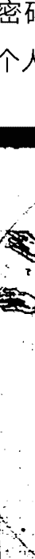

总复习3 | 想改变世界，先...

我们上节课讲了：

+   1. 创新自带的补充性和弥补性使创新成为一连串事件；
2. 无论人类自然进化的过程，还是人类文明进化的过程，都是创新的过程；
3. 大自然中的物种不过是针对环境的解决方案，或者说，是在特定环境下给出的解决方案；
4. 进化的过程是环境在问题倒逼之下的迭代，这种创新引发两个改变：客观世界的改变和人认知的改变。

达·芬奇用《维特鲁威人》这幅画表达了一个观点：人的结构就是世界的结构，世界的密码是藏在人的密码当中的。看上去的一个人，也是一栋建筑甚至整个世界。

总之，创新会导致两个东西的改变：世界和世界观，或者说，我们观察、应对世界的认知方式和能力。

米开朗基罗用《创造亚当》这幅画表达得更直接：所谓的创造的上帝不过就是一个大脑而已。

我们上个单元也讲到，火的使用最重要的成果是篝火导致了大脑的诞生，人类开始具有了语言和讲故事的能力——讲故事的能力本身就成为了一种创造性的力量，在创造这个世界。

越来越多的人都意识到，人类历史就是一部讲故事的历史，或者说，是故事创造世界的历史。用我们今天的话说：世界导致了世界观，世界观又在创造世界。

## 世界观：一个人的八卦能力

“世界观”常常被认为是很高級的东西，事实上，最能体现一个人世界观的是他的八卦能力。

《人类简史》的核心观点就是：讲故事/八卦创造了人类和世界。你选择讲什么样的八卦，以及用什么样的方式讲一个八卦，都是你世界观的体现。

有这么一个例子，两个刚刚开始奋斗的男青年在早晨8点看到一位年轻女士开着一辆豪车，八卦的心态油然而生。一个人的就说：“一个女的开这么好的车，肯定是二奶！”

这位女士听到以后笑着回应：“你们见过8点钟就出来的二奶吗？”

当一个事实摆在面前的时候，你会近乎自动和本能地给它一种解释，这其实就是在表述你的世界观，而这个故事其实就是两种世界观和方法论的交锋，我们可以从男青年看似八卦的话里提取很严肃的世界观：

+   1. 这个世界是不公平的；
2. 得到财富/好处的人都是不劳而获的；
3. 财富和利益根本不是通过诚实劳动和努力得到的。

引申一下，我们可以发现更深一层的世界观：

我之所以得不到财富是因为我没有那么好的运气和资源；我眼下的处境不是我自己的问题；由于外在的各种不公平的习俗和制度安排，我也用不着多努力，努力了也没用；当然，我也不排除将来我能遇到好运气。

另一方面，女士的反应只有一句话，看上去也是一个方法论（突然受到怀疑、猜忌甚至诋毁的时候采取什么样的态度和方法）。

当她笑着对两个男士说这句话的时候，展现的方法论的背后是一种世界观：你控制不了别人对你的态度，随时可能遇到别人对你的不理解甚至攻击，但是这都无关紧要，你可以保持自己的一种态度和方法。

## “世界观”的关键是“观”

世界观是我们随身携带又不自觉的一个装备，我们会自动地、近乎本能地用它来面对世界：它是你所有使用的工具中最基础，也是最终极的工具，这种工具的品质好坏决定了你跟世界打交道的方式和结果。

## “世界观”的关键词不是“世界”，而是“观”，也就是你对世界的认知。

在你使用这种工具认知世界的时候，你不会认为在使用它，而会觉得世界就是你用这种方式看到的世界——用前面讲过的话说：你不知道这是你的一整套认知设备、系统生产出来的认知产品。

你用这种工具和方法得到的认知也许反映了世界的某个方面/节点，但它是“世界观”而不是“世界”，与其说反映了“世界”，不如说反映了你在世界的位置。

我们常常把我们的观点和世界的真实状况打等号，这两者是不能打等号的。

你可以回想一下我们以前提过的场景：当一个朋友第一次到你家找你，迷路的时候，你问他：“你现在看到了什么？”——这个问题是想知道他现在在什么地方，而他看到的东西是他的观点，反映的是他的位置，而不是你所住的这个地方的真实状态。

在这门课快要结束的时候，我建议你再认真地看一看达·芬奇的《维特鲁威人》和米开朗基罗的《创造亚当》，应该能更感悟到世界与世界观之间的关系：

+   你的世界影响了你世界观的形成；
世界观一旦形成，就成为一种认知世界的工具和方法，你这时看到的世界就是由你的大脑创造出来的世界，而不是世界本身了。

当你面对这样一个已经被你悄悄深加工的世界，产生了想改变这个世界、改变你在อเมริกา这个世界位置的念头的时候，你有必要提醒自己：不要急着去改变那个世界，而要先改变你的世界观。

〈上一篇

用户留言

## 总复习4 | 认知是一座城堡，还是 一座监狱？

吴伯凡·认知方法论

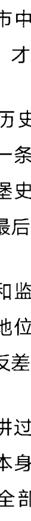

## 城堡与监狱

## 1. 从城堡到监狱

说到“巴士底”这三个字，大家马上会在后面加上“狱”，没错，只要读过一点儿欧洲历史的人都知道“巴士底狱”，但很多人不知道的是，巴士底狱最初不是监狱，而是一座城堡。

随着巴黎市规模的扩大，它从外围位置变成了市中心位置，作为城堡的功能也就丧失了，才开始被用作监狱的。

欧洲历史有两条复线，一条是教堂的历史，一条是城堡的历史。如果你读了欧洲的城堡史就会发现一个有趣的现象：不少城堡最后都成了监狱。

城堡和监狱，一个是贵族居住的地方，一个是地位最低下的人居住的地方——这种巨大的反差是由城堡本身的性状决定的。

我们讲过affordance这个词，意思是 一个东西本身蕴含着多种的功能，但这些功能不会全部在同一时间或者场景里表现出来，某个功能是在特定场景下显现的。

或者说，功能是一种潜在的供给，在适配的场景出来之后，它才会作为功能的提供者开始提供某种以前没有显现的功能。

城堡自身包含着监狱的特性：

城堡最重要的特点是坚固性和封闭性，这两个特性本来是对外的，让外面的人无论使用什么手段都没法进来。但是，坚固性和封闭性也隐含着另外一种可能性：在里的人使用什么样的方法也沒法到外面去。

## 2. 特蕾莎：《心灵城堡》

我们之所以讲到城堡，是因为它与认知有关。

十六世纪的西班牙，有一个叫特蕾莎的人被天主教会封为“圣特蕾莎”，她通过《心灵城堡》这本书表达了一个意思：在动荡和充满着威胁诱惑的世界，一个人在自己的内心建立一个坚固的城堡才可能找到真正的自由，才能真正改变世界，而不是被世界改变。

我们在前面课程里提到的小说《米德尔马契》，就是作者读了《心灵城堡》以后产生了创作冲动才完成的，他觉得很多人最初都是怀着雄心壮志进入世界的，但最后成为庸庸碌碌的路人甲、路人乙，滞留在一个叫“中途镇”的地方。

## 认知的城堡

同样在十六世纪，有个中国人也在关心差不多的问题，他的主題是“如何做到不动心”，并且创立了一门以此为核心的“心学”，这个人就是王阳明，他表述的也是关于心灵城堡的理论。

在王阳明看来，人之所以缺乏对于世界的真知，问题不在世界，而在于人的内心是一个包藏着各种动荡因素的场所。一旦外界有一点儿变化，里面的动荡因素就会闻风而动，导致你的心智陷入昏乱，无法达到真知。

王阳明有句名言：

> “破山中贼易，破心中贼难。”

意思是，人的内心潜藏着大量危险地带的暴徒，外界稍有异动，内心就会一片昏乱和惶乱，如果“心中贼”不除，你就不会攻自破、不战而败。

我们会在下个单元复习认知治理和心智能量管理，这里我们关心的问题是：人要建立一个心灵城堡，通过除“心中贼”做到“不动心”，与此同时，这个坚固封闭的城堡也具有一种自我封闭和自我囚禁的特性。

格本华说：

> “人总是把自己心智的边界当作是世界的边界。”

尼采说得更直接：

> “人本身是处在一个自带的监狱里，你目光的尽头就是监狱的围墙。”

我们会不自觉地被自己囚禁在自己的监狱里而不自知。“不自知”的原因有很多，一个很重要的原因是：这样很舒服。

它提供了某种习惯性的防御，让我们在受到外在环境冲击的时候，借助于已形成的认知模式去抵挡这种冲击，或者当新情况发生的时候，我们表现为一种熟练的无能；

我们没有能力也没有愿意去解决问题，但我们觉得已经看清了真相甚至解决了问题。

一旦让心智处于开放状态，也就意味着它是一种非常危险的状态，不借助于这个城堡，我们即使不被攻陷也会非常地痛苦。所以，我们用一层厚厚的城墙来抵挡外界的冲击。

比如那些在传统产业里已经取得了相当大成就、形成了事实上行业垄断的公司，其实现在整个市场上拥有一座城堡，那些大大小小的挑战在它看来根本不算什么问题。这时候，互联网出现了，这些巨头经历了几个阶段：

- 1. 看不起：这一切所谓的 变化不过是根本不值得考虑的小打小闹；
- 2. 看不懂：接下来，发现这个威胁越来越大的时候，开始迷惑了：为什么它越来越强大？为什么外面的世界越来越不确定？我原有的优势似乎正在丧失，但我不知道原因是什么；
- 3. 看不见：世界发生了巨大变化，曾经看不起、看不懂的产业和企业已经远远把它抛在了后面，它突然觉得应该有所行动去追上这个潮流的时候，发现城堡的大门已经从外面牢牢关上了，它已经没有办法出去了——它早已习惯的这个舒适区已经从一座城堡变成了一座监狱，只能在这个自己营造的监狱里等老死。

认知形成的过程就是建立一种对于数据的系统化处理能力，借助于数据的喂养形成算法，系统性而不是碎片式地应对外界的变化——这个过程是从没有套路到形成套路的过程。

但我们也要意识到，套路具有双重特性：
一方面，它能从混乱到有序；另一方面，这种有序性固化以后，就有了一种自我强化的功能，会对新数据、信息实施自动防御、自动消解。

在这种“以不变应万变”的认知中，认知的功能已大大衰减了：

当你的认知处于这种状态的时候，你好像是对世界发言，其实已经不自觉地进入到播放状态；

在这种自己营造出来的舒适区中，你已经丧失了对于新环境、场景的应对能力。

## 总结：

人的认知如同 一座城堡，它能让你在一个不确定的世界里获得某种确定性，同时在一个动荡的世界里给你一种相对的舒适感和安全感。

但是，这种安全感、舒适感是以封闭和保守为代价的。如果你不充分留意这一面的话，认知会逐渐变成一种“认知监狱”。

用一位历史学家的話说：没有人有能力拥有城堡之外的视野，你应该骄傲的那些成果居然游荡在毫无阻隔的战场上，而你自己已经被囚禁在这样一个安全舒适的监狱里了。

## 问答50｜为什么 Syracuse 人总遇 Syracuse 事？

吴伯凡 · 认知方法论

## 命运不是性格的线性展开

@小顾意

老师，了解本质和存在在真实现生活中有 什么参考意义？对我而言，这两个词都 挺虚幻和遥远。

吴伯凡

其实一点儿都不遥远。你每天思考自己的 现状和命运的时候，就涉及到存在和本 质的问题。

## 目标随环境变化而变化

## 为什么“ Syracuse 人总遇 Syracuse 事，拧巴人总遇拧巴事”

## 管理“溢出性”：但行好事，莫问前程

的时候，兄弟连的人才意识到没有索贝尔就没有他们的今天，而索贝尔当初对他们进行各种惩罚性训练，一是强健了他们的体质，二是让他们像兄弟一样心连心——这完全不是索贝尔的初衷，但它在客观上起到了这样的效果，也是一个溢出性的例子。

管理“溢出性”可以用八个字来概括：但行好事，莫问前程。

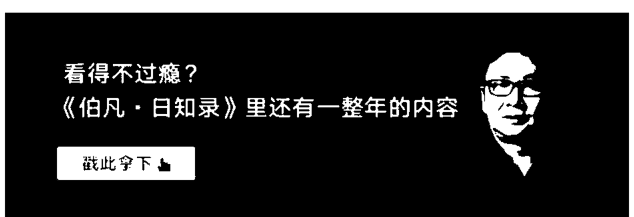

伯凡·认知方法论
一年时间，打好商业思维的50个基本

## 总复习（一）| 本单元十大精彩留言

吴伯凡 · 认知方法论

总复习（一）| 本单元十大

## 本单元总结

第一节课我们说，真正的升级、认知上的革命，都不是靠计划和努力得来的，就好像人类不是靠计划和努力才发展出人类文明一样。那么，如果我们不能依靠计划来提升认知，那要怎么办呢？

马丁·路德·金有一句名言：有信心地踏出第一步，你不需要看到整个楼梯，只要踏出第一步就好。所以对我们来说，要做的是迈出第一步，踏上一条身不由己的上升之路。

第二节课我们讲了一个概念叫“弥补充新”，通过窗口是如何发明出来的这个例子，我们明白了创新其确实是一个解决问题又不断制造问题又继续解决问题的过程，这也映射了第一节课说的观点，创新也不是计划出来的，而是一个个问题倒逼出来的。我们认知升级的过程也是一样，是被问题推着前往走的，这个过程会有痼感，但是你拒绝了痼感，也就拒绝了升级。

第三节课我们主要复习了两个概念：观点和世界观。我们说，你看到的世界并不是真实的世界，它只是反映了你的世界观，反映了你的观点而已。什么是观点？就是你在你所处的位置看到的以及想到的。所以，与其说世界观反映的是事实，不如说世界观反映了你的观察。

基于这一点，当你再产生改变世界的想法的时候，你有必要提醒自己：不要急着去改变那个世界，而要先改变你的世界观。

第四节课我们也有两个关键词：城堡和监狱。城堡是为了贵族建的，它坚固而且防御性强，但也正因为这个特点，在没有了贵族之后它被当做监狱使用。

人的认知就如同 Samen 座城堡，它能让你在一个不确定的世界里获得某种确定性，给你舒适感和安全感。但是，这种安全感、舒适感是以封闭和保守为代价的。如果你不充分留意认知这一面的话，认知会逐渐变成一种“认知监狱”。

好，以上就是本单元的主要内容。以下是 我精选的同学留言，恭喜前三名同学，将获得我签名的书一本，这次送出的书是之前课程中提到过的《思维简史》，得到的工作人员会尽快把书寄给你们，也希望其他同学再接再厉。我们下节课再见。

特别提醒：留言内容会默认公开，并同步到“知识城邦”中，中奖同学留个人信息时，一定记得将留言设置成隐私模式，确保个人信息安全。

## ——本单元十大精彩留言——

## 获奖留言

林麒

创造，在解决旧问题的同时，也在产生新问题。从多门课程的学习中，我深刻地体会到一点：在解决顶级难题时，人类其实并没有所谓的“终极方案”。

无论是在追求信息安全的过程中诞生和发展的密码学，还是癌症、阿尔茨海默症等关于重大的医学难题，是金融学、经济学、社会学等社科领域的理论和实践创新，还是互联网、人工智能、自动驾驶等常给人们便捷的科技……

## 金铁链马

法国大革命的时候，当民众攻陷巴士底狱的消息传到巴黎南郊的凡尔赛宫，路易十六惊愕失措之下问道：“什么？造反了？”当时的波尔多公爵回答他说：“不，陛下，是革命。”造反与革命，一字之差，不仅仅是词语的转换，更是观念和理念的革命，是世界观的不同。

## 春华秋实

下面举几个我人生中的例子来谈谈我学这门课的一些感受。

## 其他精彩留言

海绵
人生就是长跑，不怕慢，就怕站！

roger
薄老师的医学通识课，以及冯雪老师的心脏课上一直强调，人的疾病，与演化有关。人体适应环境需要以万年计，而科技的发展大幅度改变人类的生活习惯却只有几百年。人体还远不能适应现代生活（体力劳动大幅减少，高糖高脂饮食等等），产生各种不适，这是疾病的底层逻辑。

## 行舟

选择了一条路，既是选择这条路的最终结果给人的振奋与路上的可能性，同样也是选择了面对这条路的所有问题与痛苦。

两年我与几个网友约好一起骑行西藏，从云南出发，一冲动就走了，因为对情况不了解反而少了几分恐惧，路上遇到的困难也不少，爆胎、体力不支、摔车、生病、走错路、队员掉队、找不到住的地方，我们可以提前准备，但绝大多数情况下还是要在具体的场景中寻找解决方案。

如果现在让我重新去面对这些情况，那个特定场景下的资源发生了变化，我不敢保证我一定能解决，但我这次的经验至少给了我很多思路。如果要说哪条经验最有用：向周围的人求助。所有的解决方案已经存在，甚至都不用你自己去找，此所谓“方法总比困难多”。

总复习2 | 创新的过程也是认知升级的过程

## 肖胖

王煜全老师在评论如何培养创新能力中说，需要增强4个特质：容忍冲突、容忍失败、具备工匠精神和DIY的能力、学会复杂协作。按照今天的课程，也就是发现问题和解决问题。

最典型的就是乔布斯，对当时手机的各种“不满”，才出现了苹果；牛顿对解题方法“不满”，才出现了微积分。如果用《周易》的“一阴一阳之谓道”，那么我会将发现问题作为一阳，对世界的好奇心推动我们的成长，而用解决问题作为一阴，具体实施，提升能力，获得面对难题的第三选择。

最难的是，问题常常出现按下葫芦浮起瓢的现象，解决问题伴随着下一个问题的诞生。所以，最好的方法就像是李笑来老师讲的，尽量不制造麻烦，也就是减少犯错。而这，需要我们不停总结他人的经验，提升自己的方法。

总复习2 | 创新的过程也是认知升级的过程

## 好

蔡康永在《康永，给残酷社会的善意短信》里说，15岁觉得游泳难，放弃游泳，到18岁遇到一个你喜欢的人约你去游泳，你只好说“我不会耶”。18岁觉得英文难，放弃英文，28岁出现一个很棒但要会英文的工作，你只好说“我不会耶”。

人生前期越嫌麻烦，越懒得学，后来就越可能错过让你动心的人和事，错过新风景。有时候人生选择一条更困难的路，才能收获更多的风景，认知升级也是这样的，升级的过程就是持续的不适感和痛感发生的过程，你拒绝了不适感和痛感，也就拒绝了升级。

面对那些引起不适的情境，我们可以忍受，一叶障目地看到即有处理方式的优势，蝇居不动；我们也可以选择创造新的解决方案，或许这创新的一步，就会带来意想不到的连锁反应。脱离母体是有痛感的，这是我们为认知升级付出的代价。

总复习2 | 创新的过程也是认知升级的过程

## 悟知

当把问题归结为不公或阴谋论的时候，要么停止了思考和进化，要么开始思考如何投机取巧，这两种大概率都不会有太好的结局，因为这样思考的人太多。

听完第一个青年的故事，还 ľ期待老师讲第二个青年的故事，我来脑补一下，第二位青年问女士：“我需要付出怎样的努力才能像你一样买下这辆车呢？”当然女士不会直接给他答案。当他开始这么想的时候，也就是进入了前一节课讲的“盖房子”的过程：贷款买还是全款买，分多少期我能承担得起，用什么担保向谁借钱，我每个月要支付多少费用，我要怎么管理自己的财务状况。

《富爸爸穷爸爸》的作者说过类似的话，“穷人”总是说“我买不起”，“富人”则会说“我需要做些什么”，因为两者的世界观不同导致了思维模式的不同，思维模式的不同导致了行为模式的不同，行为模式的不同导致了现实的不同。这大概就是尤瓦尔在《人类简史》里提到的“双重现实”吧。

总复习3 | 想改变世界，先改变世界观

## 国武

动物园新来了一只袋鼠，管理员将它关在1米高围栏的草地上。第二天一早，管理员发现袋鼠从围栏中跑出来了，立刻把围栏加到2米高，把袋鼠关了进去。第三天还是看到袋鼠在围栏外，于是又将围栏增高到3米，又把袋鼠关了进去。隔壁的长颈鹿问：这围栏要加到多高才能关得住你？袋鼠回答：这很我说，如果他们总是忘记关那扇门的话！

很多时候我们跟世界打交道的方式就跟这个管理员一样，任性的生活方式让身心受损，自私的处世方式让他人远离，短浅的思维方式让处境艰难，而我们还要问为什么。想改变世界，先改变世界观。改变自己，让生活的轨道脱离固有模式，创造新的世界。

总复习4 | 认知是一座城堡，还是一座监狱？

〈上一篇〉

## 用户留言

写留言

提交留言可与专栏作者互动

## 特别放送 | 认知清单1 ——助你提升认知的十部影片

吴伯凡·认知方法论

吴伯凡

课程已经进入了总复习，为了能让你在未来的认知提升之旅中有个抓手，我为你准备了五大认知清单，它们分别是能帮你提升认知的“书单”、“影单”、“概念清单”、“关键人物清单”、“金句清单”。我会在课程结束后全部放送给你。

我们从“影单”开始。换个角度看这些影片，你会很震撼。

- 1. 《黑客帝国》

在当代哲学家看来，《黑客帝国》说的是一个关于苏格拉底的故事——永远在提问，永远不给答案，但是让你在被问中聚焦思绪，得出自己的结论。

什么是真实的世界？什么是认知？什么是自由？这些问题你都能在看电影的过程中，找到自己的答案。

（相关课程单元名称：预备课程）

- 2. 《盗梦空间》

这部电影其实在探讨一个问题：我们自认为的世界，它的真假程度如何？如果你在梦里，你如何知道自己在梦里？

同时，这部电影还给我们提供了一个求改变的思路：如果想改变客观世界，不妨试试改变看世界的人的底层认知。

（相关课程单元名称：预备课程，认知复杂性）

- 3. 《废墟中的幻想》

我们总是戏谑地说，贫穷限制了我的想象力，实际上，限制想象力的东西有很多，而且，限制的程度可能超乎你的想象。

这是一部很老的中国电影，上映于1986年，这部电影的不可能之处在于，你会惊讶地发现别人的世界竟然可以如此地不同，你的司空见惯可能是别人的遥不可及。看完这部电影，至少你会对差异性更包容。

（相关课程单元名称：预备课程）

- 4. 《说谎者雅各布》

因为相信，所以承诺能变成现实；

现实世界中真的存在“天使”，而且你我都可以成为那个“天使”。

（相关课程单元名称：契约社会）

- 5. 《少年派的奇幻漂流》

男主人公的名字派（π），这个无理数本身代表的就是生活——没有规律可言，充满了意外，你永远不知道下一个数字是什么。

这部电影其实是一部特别好的哲学入门作品，你会从中看到如何从确定性的世界进入不确定性的世界，如何从标签式思考进入到反标签的世界。

（相关课程单元名称：预备课程，意外与意义）

- 6. 《人生七年（7 UP）》

这部影片很特别，它是英国BBC拍摄的一部纪录片。

它跟踪拍摄了一群人的7岁、14岁、21岁……一直到56岁，每七年拍摄一次。你可以眼睁睁地看着一群人，从天真的小孩变成大叔大妈。这本身就是一种震撼。

看完之后你或许会有这样的感受：我们每个人都被一种特殊的地心引力牵引着下滑，只有非常少数的人能摆脱引力的束缚，避免认知留级的命运。

（相关课程单元名称：认知周期）

- 7. 《阿甘正传》《肖申克的救赎》

这两部电影是从《伯凡·日知录》开始我就一直很推崇的片子，经典到俗，但是值得换个角度回味。

在我看来，这两部电影讲的是认知算法的问题。我们总是让认知变得更复杂以应对复杂的世界，但是看完这两部电影你会发现：越简单的底层逻辑，越能带来绚放出五彩缤纷的可能性。

（相关课程单元名称：算法与认知）

- 8. 《头脑特工队》

这是一部动画电影，但它的内涵非常深刻，它的基础是非常严格的神经科学。

通过这部电影你会发现，人并不存在着一个统一的自我，我们不过是多个要素在一个调色板上调出来的结果。

（相关课程单元名称：认知与立场）

- 9. 《闻香识女人》

所谓认知高手，就是能够快速识别认知对象，直击问题本质的人。《闻香识女人》中的主人公盲眼中校就是一个认知高手的范本。

（相关课程单元名称：认知与刷卡）

吴伯凡

我给每部电影都标注了相关课程，你可以再去复习一遍，这样在看这些影片的时候就会有更深的体会。

看得不过瘾？《伯凡·日知录》里还有一整年的内容

## 吴伯凡·认知方法论 一年计划，打开你思维世界的60万里

## 用户留言

点击加载留言

## 总复习5 | 什么是“认知的囚禁”？

吴伯凡·认知方法论

## 范式转移=认知越狱

上个单元讲到“认知城堡同时也可能成为认知监狱”——给你提供安全感、确定感、稳定感的认知体系和框架反过来有可能牢牢将你囚禁。

生活中有很多例子都能让我们感受到什么是“认知的囚禁”。

比如以前我们讲过的“在路灯下找钥匙”的故事，说有一天晚上一个人在一个地方找了很长时间钥匙也没找到，就有人问他：“为什么找不到你还在继续找啊？”他回答：“因为别的地方都没有路灯，我只能在这个地方找。”

这个人的周围没有围墙，但他被囚禁在了这个路灯下。

事实上，哲学有个概念：范式转移（范式换代，Paradigm shift）。

“范式”就是在一个特定时期，知识共同体共有的一种认知和思维框架。凭借这种框架，大家解决了许多问题，但随着认知的积累，越来越多的人发现这个范式有问题，矛盾的东西也越来越多。

出现这种情况的时候，大多数人不会怀疑“范式”（框架）有问题，而是怀疑自己的数据或者事实有问题，但也总有一些人开始怀疑我们思考、探索、默认的那个前提是不是出了问题——也就是说，有些人认识到“不能在这个路灯底下找了”，他们试图突破路灯的光照范围，去寻找别的路灯和光源；

“范式转移”这样一个认知框架，其实就是“认知越狱”。

叔本华说：“我们常把我们视野的边界当成是世界的边界”——因为你感受不到，所以就如同不存在，你根本不知道你感知能力的边界之外的那些东西，于是我们就像找钥匙的人一样，把我们的视野自动固定在一个自身局限所决定的认知监狱里。

## 自我囚禁的“受害者心态”

生活中总有一些人有“受害者心态”，老觉得别人阻碍自己，别人、周围的人甚至整个社会都在给自己设障。仔细分析的话，会发现这种心态包含几个因素：

比如说，自己是无辜的，不仅无辜而且有才华特长。

这是“受害者心态”的一个潜在前提，对自己的认知或者对自身以及自身与世界关系的基本认知成为各种感觉、判断、加工、整理事实、形成结论、作出选择的前提条件。

在“受害者心态”认知加工体系下：

- 一些相关事实会处于高光状态：与这个结论相抵触的事实和数据就被自然忽略了，最后导致这种认知越来越强化固化；
在这种心态下也要努力实困和找到解决之道，但这种应对之策常常是无效的——这种认知派生出来的判断、选择带有一种明显跟别人不合作的心态，或者个人的支持网络非常薄弱甚至没有，他的行为行动常常无疾而终，甚至出现悲剧性的结果；
处在“受害者心态”的认知框架下，很容易对结果进行解释，让这个结果进一步印证自己是无辜、优秀和卓越的，是他人总在与自己作梗。

“受害者心态”也是一个很难突破的认知监狱。这种监狱的围墙具有一种反脆弱机制：越是抵抗，它就越强，以至于他的认知最后变成了几乎是唯一的认知——这个世界是与我为敌的。

但“受害者们”没有意识到的是，他所说的这个世界是他定义的世界，或者说他也同样犯了一个毛病：把自己的认知边界当成是世界的边界，错把自己构造出来一个具有明显个人色彩的生活世界当成是整个世界。

## 事障易除，理障难消

由此我们发现，行动会遭遇两种障碍：一种是客观存在的障碍，另外一种是深于我们内心的障碍。

中国古人把这两种障碍称为“事障”和“理障”，事障易除，理障难消。

如果让你开车遇到一块石头挡路，你下车把石头搬走，事障就除了——事障是客观的监狱，你知道这个监狱之外还有一个世界，就会找到越狱的方法；
理障是内在于你的监狱，你自己就是你的典狱长和狱卒，无论如何都无法飞跃认知监狱。而它最要命的地方在于你没有意识到它是障碍，不存在消除的问题；
很多人缺乏行动力不是因为事障，而是因为理障。

希腊哲学里有个“芝诺悖论”（Zeno's paradox），就是听起来特别有道理，从逻辑上很难驳除，但在行动上却是很荒谬的事情。

比如从A出发到B必须先到达AB的中点C；到达C必须要到达AC的中点D……每一个行动的依据都建立在下一个同样不可靠的东西上，你可以无限循环下去，所以，它论证到达中间的点是到达最终那个点的前提条件，而这个过程在理论上可以无限循环下去，以至于很容易推出从A无法到达B。

但从A到B在实践上特别简单，以至于你听到“芝诺悖论”的时候会想“一定是书读多了、读糊涂了的人想出这种理论”，其实不是。

“拖延症”就跟“芝诺悖论”非常像：拖延症的特点是无穷准备，由于你缺乏一种强烈的行动愿望和行动力，所以你马上就会想到“要做好这件事情先要准备做一件什么事”。

我们反复强调：认知始终是手段不是目的，人和其它动物的认知都是为了完成一个目标。比如蝙蝠使用超声波，以这种方式来感知障碍物和猎物只是一个手段，它的目的是要捕食到它的猎物。

我们在这个过程中，一旦你要设定某个目标，就面临着两种障碍，其中一种就是内在于你认知的障碍——这是一个让人很尴尬的事实，因为认知本身是工具和手段，但认知本身带障碍，当你使用这种认知方式和工具跟世界接触，发现哪里不对劲的时候，你常常怀疑的不是你的工具和方法的問題，而会把这种问题归结于认知到的事实。

比如我们讲过，人眼的帧数远低于鸟眼的帧数，所以看到一只飞行昆虫的时候，我们常常会觉得那种非连续性是一种客观事实，但这其实是个假象，因为在鸟眼里，昆虫的飞行是连续性的。

我们常说“聪明反而被聪明误”，我们的认知常常反被认知所误。也正因为如此，我们要对认知实施一种管理和治理，否则，认知可能不仅无效，甚至导致破坏性和次佳性的结果。

## 总复习6 | 认知治理比工具和 方法更重要

吴伯凡 · 认知方法论

总复习6 | 认知治理比工具。

## 工具和方法既是利器也是枷锁

丢一次手机或者上一次医院，我们这些“裸人”（本来的人）就能深深体会到工具有多重要，我们的认知能力有多可怜。

比如到了医院，你会见到有各种各样的工具，从听诊器、显微镜、超声波到CT等等，所有这些工具都是在弥补人本来认知的不足。

过去，我们只能用“望闻问切”的方式获取关于病情的数据，而这些只是工具，我们还需要方法，像“大样本随机双盲对比试验”就不只是工具了，它还是一种方法。

前一阵我在读《西洋医学史》，快读完的时候我发现，他们使用的方法跟我们传统医学使用的方法都一样。

比如“西方医学之父”希波克拉底提出的“人体的疾病源于体液不同，可以分为多血质、胆汁质、粘液质、抑郁质”，并由此派生出多种疗法——这个理论在今天看来是不合理的，因为它不仅工具不足，使用的方法也不对。

随着“大样本随机双盲对比试验”这种方法的出现，原来的工具、方法以及相应的处方和药物得到了改进。这充分说明工具非常重要，方法也很重要。

但我们上节课也讲到：工具和方法既是利器，也能成为我们的枷锁；它在消除我们盲点的同时也在悄悄制造盲点甚至是盲维。

举一个最简单的例子：照相机。我们认为照相机是帮助我们客观记录视觉形象的非常有效的工具，但其实每一种照相机照出来的像都是对现实的扭曲——有的照片是无意中形成的扭曲，更多的是有意的扭曲。

有个建筑学家说：“现在之所以会出现很多很糟糕的建筑，与设计时所使用的工具和方法密切相关。”

比如在评比设计方案的时候，我们往往依据打印在纸上的图片和模拟照片来评价，而那里是一个二维的世界，可建筑是四维世界，除了三维空间还多了一个时间维度，你在建筑里是要度过一段时间来体验的。凭一个图片来判断建筑方案的好坏就很可能出现明显偏差。

我们在网上或者杂志上看到某个建筑之后再亲身到那个地方，感受常常很不一样，比如对气味、光线、声音敏感的人和不那么敏感的人对建筑的感受肯定不一样。图片的悖论在于：看上去真实在在，让你认为它就是真实世界的反映，但这种工具决定了它只能是对世界的一个歪曲反映。

认知的工具和方法，一方面给我们提供了便利，另一方面也在制造障碍和障碍。

## 认知的治理比工具和方法更重要

建筑设计中使用的这种工具和方法扭曲了人对真实世界的认知，这还是一种相对客观的外在工具，还有一些主观工具给我们提供的扭曲的、谬误性的认知也是惊人的。其中最惊人之处就在于它类似于理障，是一种你根本没有意识到的障碍，它的扭曲是一种无形的、感受不到的扭曲。

我们曾经讲过：人的认知是一种后台合成的产物，大致分为理智、欲望和恐惧三要素，每个要素的变化都会直接影响前台输出的认知结果。在客观对象不变的时候，只要把后台欲望和恐惧的份额降低，理智的份额就会明显增加，得出的这个结果和你“被欲望和恐惧主宰的认知”完全不一样，尽管你是有理智的。

### 1. 空船理论

据说庄子提出过一种很有意思的“空船理论”：你在一 条河上驾着一艘船逆流而上，水流很急，这时远处来了一条船，迅速向你冲过来。

如果对面的船上有一个船夫，你就会对他大声喊“让点儿”，他要是 tah

### 2. 情绪是一种行动决策合一的认知行为

我们讲过，情绪/情感都是一种认知工具，比如恐惧就是一种非常直接的认知工具，当你站在高楼顶的时候，一种恐惧感会油然而生，这种恐惧感是探测和执行合一的，它在探测到风险的同时自动让你的身体执行了一种防护措施——如果没有恐惧感，你很可能陷入到一个灾难中去。

所以我们说，情绪也是一种行动决策合一的认知行为。

## 总复习7 | 与其说提高认知，不如说治理认知

吴伯凡 · 认知方法论

总复习7 | 与其说提高认知...

## 好的认知是达到良好的认知治理状态

上节课我们提到一个情景：一个有很多随从、仆人的庄园主，是不是家里就会变得井井有条呢？答案是“不一定”，要取决于他如何确定一个治理结构来管理这些仆人。

没有好的家规家风，就是没有制度和文化，如果主人不在家，最后的结果肯定会一团糟，变成一个类似于贼窝的地方，你能想象的各种混亂、邪恶都在发生。

### 1. “格物致知”致的是“良知”

中国古人常用一个场景来形容一个人的认知状况：耳目间闻为外贼，情欲意识为内贼，只是主人翁惺惺不昧，独坐中堂，贼便化为家人矣。

我们的感知常常包含着各种各样把我们引向谬误甚至灾难的因素，同时，我们的内在情欲（恐惧、害怕、愤怒等等）作为必备工具，如果管理不好就是“内贼”。

王阳明把这种内贼称为“心中贼”。如果主人对这些仆人随从有清晰的判断、掌控和管理，能够在这儿坐镇，那么这些可能的贼便变成家人了——你能看到的井井有条、彬彬有礼都是来自于良好的治理。

而他讲“致良知”，所以也不是说你有认知就是好的，如果不好管理的话也会导致恶知——“格物致知”致的是良知而不是恶知。

### 2.认知缺项导致错误认知

美国一些商业财经杂志每年都会评选这一年商业、财经界出现的最愚蠢的事件和时刻，然后问：为什么恰恰是那些受过最好教育、在过往行动中表现出很高智能和技能的人，犯这么愚蠢的错误？

我们说，是因为他们虽然具备了各种认知要素，但在某些时候没有很好地配置，导致心中的这些认知要素出现了紊乱，有些要素占据了绝对主导的地位，让另外一些要素退位，最后引发了灾难性的后果。

### 3.管理“心中贼”

无论认知还是行为，都是一项输出结果，取决于后台要素的配置运行状况。比如你拥有了千军万马，但是否能打赢仗，取决于你如何管理、配置、运行这些资源。

## 认知是治理和管理的結果

我们经常会碰到一些爱讲道理给人忠告的人，但是他们忘了：一个本来明白的人犯糊涂并不是知道的道理不够多，而是内心的认知要素发生了紊乱。所以，这时最没用的方式就是跟他讲道理。

> 在大街上吵架的结果可能是要离婚的；他们现在需要合作，立即对一个外在的威胁性力量同仇敌忾。

## 总复习8 | 智慧是一种生长机制

吴伯凡·认知方法论

总复习8 | 智慧是一种生长..

## 找到“导致改变的改变”

我们上节课重提了“约翰逊疗法”：疗法不是从输出端改变，而是通过后台改变输出结果的要素配比，从根本上最有效地改变输出端的状况。

“约翰逊疗法”的有效性在于：在某个人对我形成错误和不利认知的时候，我不会正面改变他的认知，而是进入他的后台去改变那些要素的指标。

我们曾经讲过的“口令思维”也是一种疗法：当你和对方产生冲突的时候，对方的所有认知（对你的看法）是某种指标几乎达到极限值后产生的结果。对此，我们通常的反应是：因为“你的看法是错误的”“你对我的判断是扭曲的”，那么我就通过摆事实、讲道理来改变你的看法。

这通常不仅没效果，还可能导致对方的认知强化和固化。因为摆事实、讲道理的过程恰好让对方某个指标进一步增加，也就是说，机制没有改变、指标不降反升，你与对方之间的冲突会越来越大。

## 智慧是一种生长机制

柏拉图把人分成“意见（观点）的朋友”（爱观点、爱知识的人）和“智慧的朋友”（爱智慧的人），这两者有什么区别呢？

在柏拉图看来，智慧不是一种预置的对象，也不是可以装满东西的容器，不能通过书写或者话语直接输送给你，智慧是一种生长机制。

- 我们是选择购买、采集还是生长认知？
- 面对认知，我们是选择一些话语、论辩和道理，还是选择一种跟认知密切相关的生长和生活方式？

## 认知只能从内部改变

认知是一种行动甚至苦修，它是一个一直要达成的某种转变。这里我们要提到三个词：

- information，现成的知识和信息；
- transportation，将现成的东西运输、灌输过来，而能够灌输的一定是已经摘掉的、死了的玫瑰；
- transformation，转型，它不是面向结果，而是面向过程和后台机理的转型。

> 史蒂芬·柯维说：“真正的改变只能从内部发生，门只能从里面打开。”

〈上一篇

用户留言  写留言 提交留言可与专栏作者互动

## 问答51｜如何站在三岔路口不误入歧途？

吴伯凡·认知方法论

问答51｜如何站在三岔路...

## 世界观体现在对人对事的一方方面面

@空影

我如何知道我的世界观是什么？怎么衡量自己的世界观是否真正改变了呢？又怎么知道自己的世界观是向自己想要的方向发展呢？

吴伯凡

这是一个老问题，也是一个很深刻的问题。

关于“世界观”，现在已经有人研究出了相应的产品，比如我曾经看到一...你的世界观就都表现了出来。

我的一个朋友应聘美国一个公司的重要职务，这个公司的人力资源部门派人和他一起待了七天，包括一起打高尔夫、上赌场等等。

## 世界观上的转基因

@肖景尧

王炫老师说“不要追求合三观，因为三观是基因打好草稿的”，老师你怎么看？

世界观是很难以改变的——在这个意义上，我同意确实世界观具有基因的特点。

- 天性，你出生的天时；
- 禀性，你的父母和血统给你的；
- 习性，后天养成的。

只有当一个人的处境发生戏剧性断裂式改变的时候，才可能导致世界观的改变。

## 如何站在三岔路口不误入歧途？

@海鸥

我理解上第一个台阶非常重要，但感觉后面的路虽然是上升通道，却很可能是多条通道，其中多数都是断路或不通，只有一条才能登顶。成功后反推过程相对容易，但是真正站在三岔口时怎么保证不误入歧途呢？

@hxj111

人类到现在站在食物链顶端，究竟是不是无数幸运共同作用下的“幸存者偏差”的结果呢？

我们对人类历史、地球历史、宇宙历史了解得越多，就越意识到人类今天在地球和宇宙中的位置的确是一个幸运接一个幸运，连续中彩票出现的结果。

当你站在一个三岔路口，误入歧途的几率不是2/3，而可能是2/30、2/300、2/3000……因为接下来还有无数个三岔路口。

## 总复习（二） | 本单元十大精彩留言

吴伯凡·认知方法论

总复习（二） | 本单元十大..

## 本单元总结

这一周我们一直都在强调认知治理的重要性。现在我们一起来看看具体每一讲我们都复习了哪些内容。

第一节课我们说，行动会遭遇两种障碍：一种是客观存在的障碍，另外一种是深植于我们内心的障碍。阻碍我们前进的很可能是座大山

就像爱因斯坦所说，问题不可能由导致这个问题的思维方式来解决。如果 你使用的是挖坑的思维方式，那继续下去只会让坑越来越大，而不是让你从中爬出来。这就是为什么我们说障碍易除，理难难消，如果你就是问题的根源，你不改变自己，问题就会屡出不穷。

第二节课我们说，工具和方法非常重要，它们一方面提供了便利，另一方面也在制造谬误和障碍。在这种意义上，工具是有时候一种软性的镜钝，它在不知不觉中妨碍我们进行有效探索；工具和方法，有时候也是一种党察不到好歹，假装带路却把我们引入歧途。及早认知到自己一直在做同一件事情却永远期待不一样的结果，我们就可以避免工具和方法对我们的囚禁。

第三节课，我们经常说“认知升级是提高知识增量”，但是我们忘了，增长见识、扩展见闻的作用是相当有限的。一方面，数据量的增加可能会提升认知，但另一方面，量的变化并不能能自动导致质的提升。如果我们习惯于吃知识的零食，我们的认知就会胃口越来越大，但消化吸收能力却没有改变。我们必须要认识到，获取信息的目的是实现转变。

第四节课我们说，如果要改变认知，就要找到导致改变的改变。比如约翰逊疗法就是这样，当你和别人的观点和立场发生冲突的时候，我们第一反应是通过搜事实讲道理的方法来改变对方认知，但这是不可能的。最有效的方法就是通过后台改变输出结果的要素配比，从根本上最有效改变输出端的状况。认知只是前台结果，而改变认知是需要在后台进行的过程。

由此我们可以看到，智慧不是一个结果，而是一个过程，一种生长机制，改变认知不能走捷径地试图从结果上努力，而应该从过程上努力。

好，以上就是本单元的主要内容。以下是 我精选的同学留言，恭喜前三名同学，将获得我签名的书一本，这次送出的书是之前课程中提到过的《思维简史》，得到的工作人员会尽快把书寄给你。还有一周我们的正式课程就结束了，没获奖的同学，也希望你能抓住最后一次机会，我们下节课再见。

特别提醒：留言内容会默认公开，并同步到“知识城邦”中，中奖同学留个人信息时，一定要记得将留言设置成隐私模式，确保个人信息安全。

## ——本单元十大精彩留言——

## 获奖留言

Stone

南太平洋中西部的密克罗尼西亚群岛中，有一个“天堂岛”瑙鲁国，瑙鲁有鸟粪（硝酸盐矿），这种天然资源给瑙鲁带来了很多钱，政府有钱，使瑙鲁国民无需过多劳动就能轻松享受高福利，于是基本没有发展出像样的工业。但是随着硝酸盐矿的枯竭，瑙鲁工业基础又很差，现在经济变得很糟糕。

相反的情况，德国的鲁尔区，曾经煤矿和铁矿资源丰富，虽然现在也接近开采完毕，但现在仍然是德国的经济发达地区。

对于资源来说，如果没有很好的管理能力、配置能力，那么它可能是灾难，比如瑙鲁。如果有良好的管理能力、配置能力，资源就能带来繁荣，比如德国鲁尔区。由此可见，资源、工具本身不重要，背后的认知治理才重要，认知治理比认知工具和方法更重要。

总复习6 | 认知治理比工具和方法更重要

斜阳

认知是一种状态，不是一种结果，对此我深以为然。这句话容易理解，但在行动中不容易做到，应该说必须能够内化成一种临在状态的时候，才是真的理解这句话了。

总复习8 | 智慧是一种生长机制

邹云华

“口令思维” 是找到一种能快速降低对方某个情绪和认知指标的一种姿态或说法，让对方的认知明显发生改变。在无法达到口令思维的刹卡状态，即找不到口令的情况下，一般可以先同步情感，后引导观点。

## 其他精彩留言

刘瀚涵

面对许多看似非常困难的事情，难以我们 的并非事情本身，而是我们自认为“这件事太难了”这样的心态。

总复习5 | 什么是“认知的囚禁”？

我是谁，我要去何方

“认知始终是手段而不是目的，而认知本身又自带障碍”，当在现实世界中出现问题时，我们更容易将问题归结于事实，而不是认知工具和方法。每一次认知的重大升级，都是在认知和事实出现矛盾的时候

升级，都是在认知和事实出现矛盾的时候，敢于挑战自己的认知，怀疑那些“真理”，而发现了更加真实的世界。

例如，天文学家早在1856年就观测到，太阳系里距离太阳最近的行星，水星，一直都有一个进动。但是19世纪的天文学家已经在很大程度上解释了水星的进动。天文学家精确计算了这些干扰，最后只剩下一点点进动，可以说是牛顿力学无法解释的。这一点点有多大呢？是每一百年，进动43弧秒。这是 elongated ... 这是每100年43弧秒！

总复习5 | 什么是“认知的因禁”?

## 独行于里

认知治理比认知工具更重要。

在林业工作中，现代的科技发展出来的工具越来越方便，但是造成的一个结果就是，我们开始逐渐丢弃了做事的决心。当我们去一个林地现场的时候，如果没有GPS的话，我们就开始找客观原因，说没有工具，什么都做不了。其实这是我们被自己限制了，在没有GPS之前，我们的前辈使用皮尺，也将整个中国一寸寸量出来了。在生活中这样的例子太多了，原来没有先进工具的时候，我们还在想办法解决问题，反而在工具发达了之后，我们却被工具限制了做事的能力。

总复习6 | 认知治理比工具和方法更重要

## 疯狂成长

认知治理比认知工具和方法更重要。钱是很好的工具。而钱背后的智慧，或者说钱的治理能力，人与人之间差别很大。有调查研究，44%的彩票大奖获得者在五年内破产。中大奖反而导致了破产，缺少钱的治理能力，钱多可能不是好事。

我很喜欢林则徐写的关于给子孙钱的对联：子孙若如我，留钱做什么，贤而多财，则损其志；子孙不如我，留钱做什么，愚而多财，益增其过。所以钱的治理能力比拥有钱更重要。

总复习6 | 认知治理比工具和方法更重要

## 无知幽微

听了今天的“空船理论”，想起了曾经发生的一件好笑的事情。

有次我出差，很晚回到家，上小学的女儿不知道我回来了，第二天一大早，女儿就自己按时起床，穿衣整理，准备出门的时候，发现我在家，她惊奇地大声说：天啊！妈妈你什么时候回来的，怎么不告诉我你回来了，这样我就不用自己起床，穿衣服了呀！当时的我……同样的问题，面对不同的态度（认知输出），会产生完全不一样的结果，尽管你还是你。

总复习6 | 认知治理比工具和方法更重要

## Trust me

不久前，我妈剪过头发之后特别像张曼玉，我妈听我这么一说特别地开心。有一次中午吃饭，我妈因为一点小事和我吵架，歇斯底里的那种。当时自己百口难辩，心里想着怎么说服她。明知道在吵架这方面不是她的对手，于是脑子就另辟蹊径。一句：“张曼玉从来不骂人。”我妈突然一愣，争吵也戛然而止。

总复习8 | 智慧是一种生长机制

## 金戈铁马

一个人的世界观很难改变，是因为世界观的背后是人的性格的底色，而人的性格在成年之后是很难改变的。不过，很多人格研究领域的新研究表明，人的性格并不是成年以后就定型的，还是会随着环境而产生一定的变化。

我的身边就有这样的例子，我有两位大学的同班同学，一位性格开朗，另一位沉默寡言。毕业之后，性格开朗的那位同学去了政府机关，沉默寡言的那位同学去了一家有名的互联网公司。几年之后，当我们大学同学再次聚会的时候，那位在政府机关任职的同学，无论是说话、做事都变得非常小心谨慎；反而是那位原本不怎么擅长交际的同学，在互联网公司工作之后，性格反而变得开朗、外向了，也乐于和大家交流互动。

所以，人的性格，以及世界观，是会随着环境的变化而发生变化的；如果我们想改变我们的世界观，就必须把自己投入到一个和以往完全不同的环境，通过与全新的世界的长期互动，让自己形成一种特定的具身认知，才能实现世界观上的“转基因”。

问答51 | 如何站在三岔路口不误入歧途?

〈前一篇

## 用户留言

写留言

点击加载留言

## 总复习9｜意义给个体赋能

吴伯凡·认知方法论

总复习9｜意义给个体赋能

这个单元我们会针对“第四个模块：意义炼金术”进行复习。

这里的“炼金术”是一个比喻：在过去人的想象中，贱金属加入某种东西就能变成贵金属，“意义炼金术”是指“人类通过某种特有的能力产生一种巨大的赋能能力量的过程”。

### 邓巴数字（Rule Of 150）

“邓巴数字”这个概念你可能知道：按照牛津大学罗宾·邓巴教授的计算，现代人社交时建立稳定关系的人数极限是148人，约等于150人。

那么，这个150到底是怎么来的？我们讲过黑猩猩的脑容量大约是400毫升，能人的脑容量大约是600毫升，智人的脑容量大约是1400毫升，现代人的脑容量大约是1400～1500毫升之间，这组数字和邓巴数字的关系非常密切。

邓巴发现灵长类动物的脑容量跟他们建立稳定社交关系的人数极限值正好相关。

比如，黑猩猩的脑容量大约是400毫升，而一群黑猩猩的群体数量是40（顶多不超过60）；能人的脑容量大约是600毫升，而能人的人群数量大约是60到70；现代人的脑容量是1400～1500毫升，而我们能够建立稳定的人际关系的数量是140～150人。

### 个体脑容量决定了合作的半径

正是150这个数量决定了人最终的胜出；所有其他都是一群动物，不是社会性动物。

当狮子冲进角马群的时候，角马是不能够齐心协力对付狮子的；当狮子冲进人群的时候，人群可以通过复杂又稳定的语言和交流方式迅速形成合作。

如果人和黑猩猩一对一，人完全没有胜算；如果是10个人对10只黑猩猩，人就有了几分胜算；如果是100个人对100只黑猩猩……事实上，黑猩猩不可能形成超过60个个体的群体。

我们讲过，人的个体通过一套复杂而稳定的沟通（通信）系统就能形成密切的合作。而合作依赖于沟通，个体的脑容量又决定了他的沟通能力（带宽）——这里的关键是：

脑容量决定沟通带宽→沟通带宽决定团体数量→团体数量越大，智能越大。

我们从邓巴理论可以推导出：个体的脑容量决定了团体的规模大小，也就是决定了合作半径的大小。

### 人类历史是合作半径不断扩大的历史

你可能会有疑问：人类今天的合作半径远不止150人，比如一个公司可能就有1500人、15000人、15万人，而在全球化的今天，人类合作的半径已经遍布整个地球了，这又是怎么来的呢？

所谓“人类的历史”其实也是合作半径不断扩大的历史，是通讯网络所囊括的人数越来越大的历史。

既然150是人类建立稳定社交关系的数量极限，人类的合作半径又是如何扩大的，以至于形成了今天一个无穷庞大的合作网络呢？我们用一个词来解释的话，就是communication——既是通讯，也是交往，也就是说150人是人类最早的局域网，人类合作网络的不断扩大不过是最初的这个局域网不断互联的结果。

在历史学家麦克尼尔看来：“人类的历史不过是由一个个小的局域网不断互联，从氏族、部落到国家，以至于今天变成了一个全球网络的历史。”

“邓巴数字”决定了人类最大的部落也不会超过150人，那么只有150人的网络是如何连接起来的呢？

这150人说一种语言，另外一个部落里可能是另外一种语言，两个说不同语言的部落又怎么会互联互通呢？

- 1. 导致人类第一次联网是人类意识到近亲结婚的危害，于于是出现了部落之间的联姻；
- 2. 如果只是两个部落长时间联姻的话，还会出现近亲结婚，那就必须要寻找另外的部落；
- 3. 仅仅因为避免近亲结婚导致的这些局域网互联、互通以后，他们的语言也就逐渐地互联互通了；
- 4. 这是一个去部落化的过程；
- 5. 当越来越多的局域网连在一起，一种更大范围的语言就出现了。

我们前面讲过，所谓“语言”就是将意义编码传输到接收方，接收方解码再还原为意义。而接收者之所以能解码，是因为信息的发送者和接收者之间有一个约定。

我们通常说的密钥就是代码与意义之间的约定。只有对方知道这个约定，拿到密钥，就知道你的意义了——密钥是极小范围内的意义和代码的约定，如果所有人都掌握了，那就不是密钥，而是一种通行的语言。

说到底，语言是一种意义的共识，它的通信范围就是意义与约定覆盖的范围——我们把这种意义的约定和共识叫做“沟通协议”。语言和货币都是这种“通信协议”。

正是凭借这种意义的约定和共识，个体才能够与另外的个体进行连接，成为群体，而群体就是一种超级个体，它连接的个体数量越大，它的能力/智能就越大；当这个群体作为一个超级个体与别的群体通过一个通信协议进行连接的时候，就会形成更大的超级个体。

我们可以把一个已经形成的更大的、越来越大的超级个体看做是一个网络，个体就是网络的终端。

意义约定和共识网络是对个体的赋能，网络越大，给个体的赋能可能性就越大。由此，我们可以说：意义网络是一个给个体赋能的系统，赋能的过程是“意义炼金术”。

## 总复习10 | 认知是世界上最好的东西，也是最坏的东西

吴伯凡 · 认知方法论

总复习10 | 认知是世界上...

### 语言是世界上最好也是最坏的东西

我们上节课讲到：

语言是人类创造的最早的意义网络；

凭借这个意义网络，个体的 人可以形成密切稳定合作的共同体。这个共同体如同个体背后的知识网络，能够给人赋能；

没有语言，可以有人群，但不能形成人的共同体。有了语言，人类才得以有效沟通、密切合作；

由于语言本身的可复制性和扩展性，人类语言以及与语言相关的故事、后来的宗教、哲学编织成一张意义网络，随着这个网络不断地扩大，人类合作的可能性也就越来越大。

你可能会产生一个疑问：语言真的就是达成意义共识的工具吗？我们常常看到相反的例子，比如人与人或者群体与群体之间，由于语言，反而争吵更多，达成共识的可能性更少了。

我们不妨讲一个古希腊寓言作家伊索的故事。

有一次，伊索的主人让他操办一个宴会，做一顿世界上最好的饭。伊索买了各种动物的舌头，什么牛舌头、猪舌头、马舌头等等，做了一桌菜。

主人：你为什么买这么多舌头做一桌菜呢？

伊索：舌头是世界上最好的东西！有了舌头，我们不仅能够辨别味道、还能吟诵诗歌、赞美诸神，世界上没有舌头和语言，将是一个非常可怕的世界！

第二天，伊索的主人让他做一顿世界上最坏的菜，招待那些不喜欢的人。伊索又买了很多舌头，做了桌菜。

主人：你为什么又买这么多舌头做一桌菜呢？

伊索：舌头是世界上最坏的东西！有了舌头，人类才有了各种各样的谎谬、中伤、谣言、欺骗……人类因为舌头变得邪恶了。

伊索通过舌头告诉我们：语言是世界上最好的东西，也是最坏的东西；它既能促成沟通、达成共识，又能够妨碍沟通、让共识破裂。

### 认知的目的是生存

我们现在不妨再来看认知：

认知是世界上最好的东西，也是最坏的东西；

我们每个人都凭借自己的认知在发表意见，但人与人之间的认知差异是显而易见的；

当形形色色的人携带着形形色色的认知汇聚到一起的时候，所谓沟通和通信变成了巨大的杂音和噪音，“公说公有理，婆说婆有理”，是很难以形成共识的。

那么，如果想凭借认知来形成共识的话，可能最终不但没法形成共识，连本来以达成共识为目的的沟通都变成了认知与认知的激烈冲突。我们在生活中每天都能感受到由于认知的参差不齐而导致的沟通障碍，甚至引发激烈的冲突。

列宁曾经说过：“不是学了生理学之后，我们的身体才会消化食物；不是学了逻辑学之后，我们才开始思考的”——认知永远是手段而不是目的，认知的目的是生存和行动。

人常常在认知不充分的情况下被迫开始行动，因为生存永远是第一位的。正如我们不能学会游泳再下水，也不可能让自己的认知得到完善之后才开始决策和行动。

如果每个人的认知能达到同步，我们就很容易达到共识，但通常的情形是：沟通是两点之间最长的距离。

问题还不在于沟通是否困难，问题在于我们常常不能等到通过认知同步达到共识之后才开始行动。

以前我们讲过一个故事：在一个队伍里形成了三派意见，每一派都觉得应该按自己的意见去走。这时候出现了一张错误的地图像——它虽然错误，但终止了噪音。大家开始替时搁置自己的认知，或者说把自己的认知权让渡给了某一个对象/权威，避免了在无效沟通中付出高昂的机会成本。

事实上，尽管人类今天已经获得了很高的认知，但和50年、100年、200年后的人获得的认知相比，我们今天的认知仍然是非常低下的。摆在人面前的最重要的是始终是如何生存和采取行动。

我们童年时代都听到过许多长大以后觉得极其可笑的理论和认知，但在当时它是有 效的。这些错误但有效的认知我们称为“代偿性认知”。

既然认知的目的是生存和行动，而我们常常面临的是不能等到认知充分完善之后才行动，那么，我们就不得不使用这种认知的代偿物。

### MVP: 勉强可行性产品

经历创业的时候，我们会提到一个很重要的概念：MVP，最小可行性产品，我把它译成“勉强可行性产品”。

创业首先不是挣钱，而是挣认知。所谓“创业”就是凭借一些有限资源制造出勉强可用的产品来跟用户/市场对话。

如果你不推出MVP，那拿什么和用户对话？而不开 始对话，你就没办法获得关于用户和市场的真正认知——当这种“勉强可行的产品”推向市场以后，就开始了一个认知实验，也就是一个认知不断迭代的过程。

你不可能等你的认知充分完善之后再推出一个完美的产品，只能通过跟用户和市场的对话才可能让你的认知迭代；

最终让你成功 的产品可能跟你最初推出的“勉强可行的产品”之间有天壤之别，甚至是风马牛不相及的，但没有当初のMVP，就不可能有后来对于用户需求和市场的真知。

现在，你可能更明白“认知”的角色是什么了：

- 1. 认知是手段，而不是目的——目的是要生存、决策和行动；
- 2. 在决策、行动、生存的过程中，我们的认知常常是不完备甚至极其稀薄的——如果不定一个勉强可用的认知或者认知的  代偿品，我们就没法开始认知的行动；
- 3. 意义不是认知，是我们设定一个目标和方向，它是我们认知的起点，也是我们认知行动的支点——没有这个支点，你就没办法撬动你的认知。

## 总复习11 | 人类只是一个宏大游戏的头号玩家

吴伯凡·认知方法论

总复习11 | 人类只是一个...

### 预置的程序是一种“命中注定”

你知道最早的程序员是什么时候出现的吗？

答案似乎很简单：应该不会早于电脑出现的20世纪40年代。

实际情况是：几百年以前就有了程序员，只不过不是电脑程序员，而是八音盒的制造工匠。

只要拧上发条开启八音盒，就会开始播放一曲曲子。八音盒里面的工作原理差不多是：在一个轮子上预先做出一些凸起，随着轮子运转，看上去没有规则的凸起能够驱动八音盒奏出指定的乐曲——这就是编程。八音盒就是预置的某种程序被开启，自动运转播放乐曲（程序展开）的过程。

还有一类程序比八音盒还要古老，那就是自然界里的各种生物。比如一颗种子或者一个动物细胞都包含着预置程序，它们生长发育的过程不过是这个程序的展开过程，甚至它们的行为都是由这个程序决定的。

我们讲过大马哈鱼：它们在某个沼泽地带的小水洼里出生，然后从小溪汇入大河再到海洋，借着洋流的力量洄大西洋或者太平洋走一圈，最后回到那个河口。这个通过不懈努力回到出生地方，完成生殖使命的过程，也是由一个程序固定的。

由于有了这个预置的程序，对于大马哈鱼或者其他动植物来说，它们的整个生命行为就不再需要由它们自己来规划和打算了——它们内置的程序已经决定了下一步要干什么，最终要干什么，这可以说是一种“命中注定”。

### 《红楼梦》里的命运、人算和天算

在中文里，“命运”两个字是连在一起的，但“命”和“运”其实是不一样的：

“命运”跟军事行动有关，“命”是命令，“运”是行军（参照繁体字“運”）。一个军队接到命令，向着指定的目的地、战场，或者是他们守卫的地方行进，就是一个命运。有了这个命令他们才开始行军，行军的目标和路线都是由命令事先决定好的。

和“命运”连在一起的还有两个词——人算和天算：

一个人的命运或者一个人的命是由天决定的，生命历程是受制于天算的运行和展开，在人的生命历程中要接触和处理信息，做各种各样的计算——这个计算都是“人算”。人算是被制于天算的，也就是“运”是被置于“命”之下的。

中国最伟大的小说《红楼梦》集中体现了这种命运的观念：《红楼梦》里把人的命运描述为一个事先由上天写就的程序（源代码）。

在《红楼梦》第五回里，贾宝玉由警幻仙姑带到一个类似于是图书馆的地方，里面放着各种各样的命册，命册上写着一个个人的命运，比如王熙凤什么结局，晴雯什么结局，林黛玉什么结局等等，都是写好的。

贾宝玉在这里不仅看了这些命册，还看了一场演出，演出的名字就叫《红楼梦》——尽管他当时不知道《红楼梦》里的这些女子的命运都已经写好了，他相当于到了上帝的云计算中心，看到了源代码。

“自古穷通皆有定，聚散岂无缘？”在《红楼梦曲》里有一句很有名的话，“乘除加减，上有苍穹”：乘除加减是人算，但人算是被置于苍穹之下的；苍天是一个超级程序员，写就了每个个体和时代的最终命运——每个人的故事、每个时代发生的事情不过是这个程序的展开而已。

讲这些和我们的认知有什么关系呢？如果你的生命中已经预装了命运的程序，你就不需要有自己的认知了，那你的生命是不是也就不需要有什么意义了？

曹雪芹通过《红楼梦》表述的命运观、人生观只是他自己的一种看法，世界上还存在别的哲学，比如很多哲学家认为：人的生命轨迹并不是人生命中预装的一个程序的展开，因为人有自由意志。在这些人看来，生命不像是一个八音盒，而更像是一架钢琴，你要有演奏你自己的曲子。

现代生物学、生态学已经证明人类的命运并不是一个八音盒式天注定的东西，人类今天的形态、状态、性状都不是人类祖先或者一个高于人类之上的设计师事先写好的。

当人猿一别，人类走的是一条充满着各种偶然性的道路——不管是体质意义上的人类还是文化意义上的人类，他们的命运都充满着极多的偶然性，每个节点都包含着多种选择。如果选择了那个而不是这个，人类今天的状态、形态、性状可能跟我们今天看到的大不一样。

关于“命运”至少有两派观点：

- - 一种是“命决定了运”，源代码式的程序决定了后来程序的展开；
- - 一种是“运决定了命”，人类今天的状况跟人走过的这个历程中的无数场景以及在现场里的选择（最初是自然选择，后来是人的主动选择）密切相关。

### 头号玩家和隐形玩家

我们讲到这里，实际上进入到了“新存在主义”的视野：

无论人类的自然进化还是文明进程，都可以描述为一个认知不断成长、升级的过程；

人之所以为人，因为人的本质跟人的认知能力密切相关——这里的“本质”是在后而不是先的。

任何认知都是凭借一套认知系统生产出来的产品：

- - 人类最初带着一个类似于MVP（勉强可用）的产品，是一个上路者；
- - 一旦开启第一步，做了第一个自选动作以后，这条路本身的轨迹和力量就会开始牵引在路上的；
- - 这条路在某种程度上不再是陆路而是水路了：人会不由自主受这条路的牵引达到一个未知的地方；
- - 在这个过程中，人类有很多主动的选择，但像石器、火这样的主动选择也有它自身的意志，会反过来塑造和驯化人类。

人类的命运是一场宏大的戏剧/游戏，人只是玩家中的一个，可能是第一个玩家或者头号玩家，而一旦开始玩这个游戏，也就激活和唤醒了诸多隐形玩家——人的最终命运是由头号玩家和无数隐形玩家共同参与的游戏。

人在这场游戏中如何身不由己，以及这种身不由己与我们个人的认知迭代有什么关系，是我们下节课详细探讨的内容。

〈上一篇

## 用户留言

## 总复习12 | 认知，是从星星之火到燎原之火的历程

吴伯凡 · 认知方法论

总复习12 | 认知，是从星星。

## 人算不及天算

你可能看过《超级大脑》，觉得这个节目无非是找到一些人群中出类拔萃的大脑，一次次证明人类大脑跟电脑有多大的差距。

不管你有多自信，你对你大脑的能力还是有一个比较清晰的认识的。比如你觉得自己比不过身边的学霸，而这个学霸比不过爱因斯坦或者诸葛亮。

可是，诸葛亮能算出“三分天下”，但他不能算出蜀国是三国中最早灭亡的，他的本事再强也不能避免一次又一次的失败。

又比如朱元璋为了避免宦官专权采取了严厉措施，但明朝是宦官专权最严重的朝代——在我们这些“事后诸葛亮”看来，他采取的种种措施才直接导致了宦官和大臣的专权。

无论历史还是现实，我们一次又一次看到了历史的计划对人的计划的嘲讽，一次又一次看到“人算如何不及天算”。

## 异化：人算和天算的区别

我们前面讲过“火的使用”对于人类文化/文明的意义：我们的祖先偶然使用火，并不是深谋远虑地使用它，而是根本没有想到火会给人类创造出更大的胃，会对人类大脑的发育产生重大的意义：

- 火的使用导致了人类营地的产生→营地的产生又导致了篝火的使用→篝火的使用导致了语言的产生→语言一旦产生，就为人类认知开启了一个崭新的、其他动物不可能具有的维度，于是有了宗教、艺术、哲学、法律等等。

火对于人类的意义也说明了人的计划与大自然的计划、历史的计划多么不对称。

世界上的事情有三个级别：①繁杂而简单的事；②复杂的事情；③错复杂（超级复杂）的事。

## 从星星之火到燎原之火

讲到这里，我想到营销学的一个重要命题：一根火柴如何点燃一堆原木？这个问题概括了很多市场，尤其是新市场的逻辑。

- 1. 我的心灵是一个有待注满的器皿还是一个固有待点燃的火焰？
- 2. 我是一个勤奋而懒惰的知识和信息的囤积者，还是意识到了自己目前身处认知的监狱，不满足于各种徒劳的焦虑，在努力开辟一条崭新维度通向自由的隧道？

认知溢出性3 | 溢出性的决定性作用

认知复杂性1 | 我们面对的世界有多复杂？

谬误与认知2 | 两种心灵地图

## 问答52｜如果身边的人有“受害者人格”，该怎么办？

问答52｜如果身边的人有“受.. ↓

### @ 毛水生

应该怎样和那些自我认同的受害者交往、合作或者改变他们？假如自己的伴侣是这样的，又该如何处置？

吴伯凡

## 受害的毒瘾

看到这一连串的问题，我马上用一种给出一些正面建议、推荐一些书/文章，甚至建议订阅这门课的冲动，但是，有一些考虑让我放弃了这个冲动。

我们常常有一个误区，就是低估那些陷入某种认知而难以自拔的人改变自己认知状态的难度。如果身边有个染上毒瘾的人，我们可能想到把他送到戒毒所，但当我们看到身边陷入严重认知误区的人，周围人会一致认为他有严重问题，但很少会想到送他去戒毒所（当然，世界上也没有这样的戒毒所）。

事实上，严重的认知误区和毒瘾是一样的：我把有严重受害者心态的人称为“受害的毒瘾”。

说到认知，我们首先想到的是如何摆事实讲道理，如果你这样做，就是大大低估了改变一个人认知状态的难度。人的认知的误区如同是一个认知监狱，而且是很难越狱的，因为：

- 第一，一个人根本不会认为这是监狱，甚至可能没有任何越狱的习惯。哪怕午夜梦回的片段清醒时间意识到自己可能有问题，但几乎没有任何实质性愿望和冲动去改变这种状态。

## 后台改变才是有效的认知改变

我们在课程上讲过，认知是一个前台显现的结果，如同一个董事会作出的决策：在这个特殊的董事会里至少有三个董事，理智、欲望和恐惧，而担任董事长有最高投票权的常常不是理智，而是欲望。

## 新习惯代替旧习惯是一个痛苦的过程

在美剧《迷失》里有这么一个情节：有个年轻人染上了毒瘾，并且意识到戒毒的必要性。但在他戒毒的第三天就陷入到巨大的痛苦中，觉得受不了了，我们知道，戒瘾也存在着作用力与反作用力法则：意志的作用力越大，来瘾的反作用力也就越大。

> “蛾子的幼虫变成蛾子需要在茧里挣扎大概8天，看它这么痛苦，我的人可以救它，只要用匕首轻轻一割它就出来了，痛苦也就消失了。但蛾子的翅膀长成恰恰依赖于这8天的痛苦挣扎，如果它现在从这个茧里出来，它的翅膀是飞不起来的。”

既然瘾是一种习惯，消除这种习惯是很难的，准确地说：我们无法消除一种习惯，只能用新习惯来覆盖旧习惯。

正是由于这些考虑，我放弃了给你提建议。

## 用户留言

提交留言可与专栏作者互动

## 总复习（三）| 本单元十大精彩留言

吴伯凡 · 认知方法论

## 本单元总结

这一周我们都在围绕“意义”、“命运”与“认知”等关键词来复习。

第一节课我们说，人类的历史是合作半径不断扩大的历史，合作半径越大，意义网络就越大，网络越大，给个体赋能的可能性就越大。由此，我们可以说：意义网络是一个给个体赋能的系统，赋能的过程就是我们一直在说的“意义炼金术”。

第二节课我们说，认知是世界上最好的东西，也是最坏的东西，因为人与人之间形成认知同步实在是太难了，这达成共识就更难。

如何解决这个困境？一，时刻记得认知只是手段，不是目的，不要被它绑架；二，先设定一个勉强可用的认知或者认知的代用品，不然就没法开始行动；三，把意义作为一个支点，撬动认知。

第三节课我们继续这个话题说，任何认知都是凭借一套认知系统生产出来的产品，而你要做的就是带着一个类似于MVP（勉强可用）的产品，成为一个上路者。你不可能等认知完备了才上路，一旦开启第一步，做第一个自选动作以后，这条路本身的轨迹和力量就会开始牵引你继续向前去。

第四节课我们提到了一句很有哲理的话：人的心灵并非一个有待注满的器皿，而是一团有待点燃的火焰。可不幸的是，我们常常把我们的心灵当成是一个器皿，把我们的认知成长和升级理解为不断地往这个器皿里增加各种各样的知识和信息，而从没意识到，认知是一个过程，是一个从星星之火到燎原之火的历程。

- 1. 我的心灵是一个有待注满的器皿还是一团有待点燃的火焰？
- 2. 我是一个勤奋而懒惰的知识和信息的囤积者，还是已经意识到了自己处在认知监狱里，正在努力开凿一条崭新缝隙通向自由的隧道？

## ——本单元十大精彩留言——

## 获奖留言

纸巾的黑喵子

MVP 还可以翻译成 Most Valuable Player（最有价值球员），这里翻译为 Minimum Viable Product（勉强可行性产品）。

## 其他精彩留言

山峰

马克思·韦伯说过：“人是悬挂在自己编织的意义之网上的动物。”因此每个人都应该赋予生命意义。

+ 一是做有意义的工作，作为人类社会的一员，你需要为人类社会的进步贡献一份自己独特的力量。
二是爱值得爱的人，人是群居动物，有爱就有合作，将你、我、他以及陌生人连接在一起，为了他们，我们甘愿身负责任。
三是在困境中挣扎的勇气，好好活着，本身就是有意义，即使面对再大的困境，人也拥有一种作出自由选择的可能。

特别提醒：留言内容会默认公开，并同步到“知识邦”中，中奖同学留个人信息时，一定记得将留言设置成隐私模式，确保个人信息安全。

认知ymore过程。

在19世纪，斯蒂芬医生面对新生儿死亡率高的痛苦，用培育小鸡的器皿，用汽车、摩托车的零件，在不断迭代中推出婴儿保温箱，使用了他做的婴儿保温箱之后，体重过轻的新生儿死亡率从66%降低为38%，每一个数字，都是一个人的生命。体重过轻的生命获得新生的认知是从小鸡孵化的代偿性认知中、迭代过程中获得，是“相邻可能”性开启了希望之门。

总复习10 | 认知是世界上最好的东西，也是最坏的东西

## 金戈铁马

在医学上，几乎所有的慢性病，人体都会自动启动代偿机制。

我们都知道冠心病是冠状动脉发生硬化病变而引起血管狭窄或阻塞，造成心肌缺血、缺氧或坏死而导致的心脏病。但是很多冠心病病人，血管狭窄了，或者堵塞了，这根堵了的血管周围的小血管就会变粗、变长，甚至长出新的小血管，代替这根堵了的血管给心脏供血，防止发生致命性的心肌梗死。很多经常犯心绞痛的老人反而不容易猝死，就是因为这种代偿机制。

人体的代偿的最终目的是保证器官的基本功能，也就是保命，可以说这是人类在演化进程中作出的一种妥协；同样，认知上的代偿，就是人类在面对这个纷繁复杂的世界，为了实现某种特定目的，作出的一种妥协，这其实也是人类在演化过程中形成的一种智慧。

这种认知上的代偿机制，也就是通过设置一个临时的、勉强可行的认知产品，帮助我们走出认知的困境，迅速地投入到真实世界的实践之中；通过实践的反馈，形成一个正向循环，不断调整、更新，最终实现认知迭代。

总复习10 | 认知是世界上最好的东西，也是最坏的东西

## 以武治心

格拉宁在《奇特的一生》里，向我们展示了科学家柳比歇夫用一种叫作“时间统计法”的方法，构建一个属于自己的时间城堡，抵挡意义的滑坡，让自己免于在各种伪意义的行为中成为被他人裹挟的活傀儡。一个只要能对眼前的目标专注起来，他就能够做到自制，进而视暂时的困难为重重考验毫不动摇。

时间在身边嗒嗒流走，一味想去控制或挽留时间的人没时间聆听内心的声音，柳比歇夫并不对抗时间，他与时间讲和，让时间为成就自己的目标服务，这样一个光彩照人的一生影响着作者格拉宁及其身后每个赞叹不已的追随者。意义不是认知，是我们设定一个目标和方向，它是我们认知的起点，也是我们认知行动的支点，没有这个支点，我们就没办法撬动我们的认知。

总复习10 | 认知是世界上最好的东西，也是最坏的东西

## 金戈铁马

举世闻名的迪士尼公司的创始人华特·迪士尼，小时候的日子并不好过，父亲经常要求他和哥哥们一起打工，第一次世界大战时期还应征入伍，成了国际红十字会的一名志愿兵。战争结束后，他来到堪萨斯城谋生，经过好一番努力，他终于获得了一份工作——替教堂作画。可因为报酬太低，他只好租一间破车库做自己的办公室。

一天早晨，他刚刚醒来，映入眼帘的是一只骨瘦如柴的小老鼠。他并没有把这只小老鼠赶走，而是每天与它一起生活。后来，在朋友的推荐下，迪士尼来到好莱坞，制作一部以动物为主的卡通片，但是效果并不好。

当他回到破车库，看到那只小老鼠时，他突然有了灵感，立刻在纸上画了一只老鼠的轮廓。它，就是米老鼠！而迪士尼的人生命运也因此出现了戏剧性的转折，后来他创立了迪士尼公司，并和他的同事们一起创造了许许多多举世闻名、受世人欢迎的卡通角色。

所以，每个人的 Abbott 生命就是一场无限游戏，一旦你按下了游戏开始的按钮，你就进入了一条充满未知性和偶然性的世界，你的每一个决定，你和其他人的每一次互动，都会改变这个游戏的结局，改变你的人生命运。命运引导每个人走上不同人生的道路，而每个人的选择又会反过来影响命运发展的轨迹，让人的命运充满了无限的可能性，这也是人生的精彩所在。

总复习11 | 人类只是一个宏大游戏的头号玩家

## 乘风

曾经有人说：天下没有免费的午餐，也不应该有免费的建议。不是给建议的人苛责，而是知道受害者若没有发现问题所在，不主动试着逃离桎梏，即使给他助力也无济于事，就像老师在课程里说的，讲道理只是暂时切断了他的显示屏，但只要一通电源，马上还是原来的图样。

只有用新习惯去覆盖旧习惯才可能跳出旧有模式，延伸新行为，王姝老师曾经在课程里提到过，养成新习惯的方法有两个，一个是增加旧习惯向新习惯转换的概率，二是降低新习惯向旧习惯转换的概率。

而我想说，习惯往往是潜意识而不可知的，当我们时常提醒自己要用第三视角去审视自己时，那些所谓的隐形玩家就显现出来了，明枪易躲，此时，新习惯形成的困难就少很多了。

问答52 | 如果身边的人有“受害者人格”，该怎么办？

〈上一篇

## 用户留言

提交留言可与专栏作者互动

## 结束语 | 认知炼金术

吴伯凡 · 认知方法论

结束语 | 认知炼金术

吴伯凡

最后这一节课了，有太多话想对你说，所以这一篇的文章会比较长。建议你先听缩减版的音频，再打开文稿慢慢读。

## 一、《石头记》与《创世纪》

很久很久以前，准确地说，大约300万至500万年前，南美大陆开始向北美大陆靠近。两个本来彼此分离的大陆中间出现了一个细长的陆桥，这就是巴拿马地峡。

巴拿马地峡让本来连在一起的太平洋和大西洋隔离开来。低纬度地区的东北信风将大西洋上空的水汽不断吹向太平洋的上空，形成大量的降雨。久而久之，太平洋的盐度开始下降，与太平洋相通的北冰洋的盐度也开始下降。海水盐度的下降意味着海水冰点的提高，北冰洋被冰覆盖的面积迅速扩大。

这是一个典型的正反馈过程：冰帽的扩大一方面使大量的水被固化，降雨量下降，与此同时，冰帽的扩大意味着太阳施加在地球的热量被反射回太空，地球气温下降，而气温的下降又进一步导致冰帽的扩大，进一步让地球气候变冷，降水量减少。

## 人类的这部创业史同时又是一部认知史。

## 二、形形色色的“舒适策略”

问题在于，人很难在迷梦里主动醒来。正如《黑客帝国》中的墨菲斯（这个名字取自希腊神话中的梦神墨菲斯）说：“如果你不从梦里醒来，你怎么知道你刚才是 在做梦呢？”

离埃及时，一些人不由自主地怀念起“埃及时的肉锅”。

除焦虑之外，人还有一种在无意识层面运行的“舒适策略”。比如，对不愿意面对的事实选择性遗忘，就是一种无意识的止痛策略。

比选择性遗忘更普遍、对认知的危害更大的，是“知识幻觉”。大多数“恍然大悟”都包含着知识幻觉的成分。在读完一本书、听完某一场演讲后，人都会不自觉地放大自己的“懂”，涂白自己的不懂。

要消除这种知识错觉，最有效的方式就是让认知客观化。

认知客观化的简易方式就是以清单化的方式复述已有认知。这种方法能大大提升敏感度。当你读完一本书并且颇有获得感的时候，你可以试着在一张白纸上郑重地列出你懂得了什么。你可能会吃惊地发现，你写不满半页纸。

不过，认知最有效的方式是“行”——践行和练习。

知和行常作作为对比的概念，分别表示理论性的知道与实践性的施行。“知行合一”常常被浅浅地解释为所知与所行的统一。

## 三、你的认知是一支难管的队伍

进化心理学在提醒我们：不要忘了我们是从东非大草原上来的，我们认知能力形成的绝大部分时间都是在那里度过的。

有一个叫“稀树草原假说”的说法。这个假说来源于一次关于心目中理想住宅的调查。绝大部分被调查者对理想住宅的回答是趋同的：房子靠小山而建，屋前是一个水塘，有一两棵树冠很大的树，远处广阔的草场上，点缀着不少的树。

人类在稀树草原上漫长的生活记忆已经潜藏在每个人的内心深处，成为人类的集体无意识。

人类的认知能力是人类最重要的资产。麻烦在于，这份重要的资产既包含正资产，也包含负资产，它是需要妥善的治理和管理。

它们“并没有说出某种真实的东西，但真实地说出了某种东西”。

而且常常并不是“董事长的老大”。

理智的角色更像是一个“董事会秘书”，一个带有公告使命、习惯于见风使舵的发言人。它总是能够很好地理解“董事会”和“董事长的老大”的意图，总是在高效地获取各种有利于“上峰意图”的论据和说辞。“人有亡驴者”的故事很好地说明了理智在认知中的角色和功能。

我多次引用帕斯卡说过的例子：一块木板放在地上，你可以在上面稳步甚至翘跟头，但如果把它放在两座高楼之间，你往往连在上面缓慢步行都不敢，哪个你的理智反复告诉你根本没有危险。在“恐高症”面前，理智的功能大大的萎缩。

“恐高症”是众多“认知阈限”中的一种。它是人在长期的进化过程中形成的预警机制，它曾经有用，今天，在特定的情景下，它仍然非常有用。但在很多时候，它已经不仅仅无用，反而扭曲人的认知和行为。但我们即使知道这一点，也很难控制它的发作。

认知能力是一支有诸多“兵种”构成的队伍，每个“兵种”都有其在特定场景和限度的功能，这自然意味着，脱离特定场景和限度，他们就会有副作用，甚至危害。治理结构和管理不善，将直接导致认知能力的无序和动乱。

对这些“心中贼”，有的要消除（除掉害群之马），有的要降服（驯服悍将）。正如只是招兵买马而没有治理和管理体系（军法）的军队不仅没有战斗力，反而可能招来杀身之祸，提升认知能力，本质上是完善认知的治理结构和管理体系，绝不是在知识和信息的单一维度上加量那么简单。

始终不要忘记，我们是从东非大草原上来的，你始终是在带一支不好管的队伍。“提高智商”、“明白很多道理”与提升认知能力之间的关系低到远远超出你的想象。你并不缺，至少并不很缺认知要素，缺的是将这些要素点石成金的能力——对认知的治理和管理的덕。

## 四、找到认知的牵引者

从石头到芯片，是一种典型的“炼金术”。但我们也许没有想过一个听起来不值得问的问题：谁是炼金术的主体？而易见的答案是：人就是炼金术士。但问题和答案并非这么简单。

“炼金术”的问题同样适用于人。从古猿到今人，从容量400毫升的大脑到容量1400毫升的大脑，不也是一个典型的“炼金术”吗？人从石头“炼”出了比金子还宝贵的芯片，借助于芯片，把旧的世界“炼”成一个全新的世界，那么是谁一个炼金术士把古猿“炼”成了今人呢？这个实施“认知炼金术”的“炼金术士”又是谁呢？

在《伯凡·日知录》里，我们就问过一个问题。当我们看到一艘舰在大海上畅行的大船的时候，我们很自然地要问，这船是谁造的？而易见的答案是：是造船师和造船工人造出了船。

真正的答案是：是大海在造船。造船师可以发挥自己的想象力和创造力造出各式各样的船，但船成为我们看到的样子，却是大海说了算。许多沉在海底的船对于造船是功不可没的。大海通过它们一遍又一遍地告诉造船师：船不能这样造，也不能那样造，还不能那样造。

同样道理，大自然，人类生存的环境，连同环境中各种不期而至的“隐性玩家”，是人、人脑、人的认知能力真正的“炼金术士”。

我们可以列出一个长长的名单：巴拿马地峡、北极冰帽、非洲大草原、火，尤其是营地篝火，连同篝火旁的八卦、舞蹈、歌谣等等等等。

有一些“隐性玩家”是自然界的客观存在（比如巴拿马地峡），有一些是人为造成的（比如篝火），还有一些“隐性玩家”纯粹想象出来的。

从认知的角度看，很多想象出来的东西完全是错误和谬误。这些虚乌有的东西有点像《天方夜谭》中被渔夫从瓶子里放出来的魔鬼，一旦出现，就具有了一股巨大的魔力，其后果大大出人意料。

我们想到了与人的认知相关的石头。哥贝克力石阵上去只是一堆石头。与石器和芯片不一样，它没有实际的用途。在今天的人眼里，这完全是一万多年前的 人认知错觉和幻象的驱使下干了一件蠢事。

但这只是现代人的“观点”和“看法”。用我们在课程里讲到的概念说，哥贝克力石阵是一种Affordance（功能随场景的不同而不同的“模糊供给”），或者说，它 的角色和功能具有明显的“溢出性”。

人们为了敬拜并不存在的神祇建造它，建造的后果竟然是导致了人类的定居状态，继而引发农业革命。

这个世界根本就不存在神，存在的只是关于神的种种想象和观念。“上帝创造世界”是一句荒谬的陈述，但关于上帝的观念影响了世界上很多事情的发生却 是事实。

如果人类没有编造故事，编造出来也没有人相信这些故事，世界上也就没有或者少了许多真实的故事。

不要以为这只是与宗教和迷信相关。在一个传统宗教已趋于消失的时代，故事、相信故事，继而弄假成真，发生真实故事的故事，仍然层出不穷。

如果所有人都不相信银行，也就没有了银行。大家都需要有银行，都相信银行，就有了银行。在没有货币、以物易物的时代，交易成本巨大，苦海无边，但只要回头，就是Bank（岸，银行）。

但银行、信用并非纯然虚构之物。银行必须有自己的MVP（最小可行性产品）——存款准备金，以保证通常情况下（人们相信想取出存款就能取出来）的交易。但如果当人们不相信这个故事的时候，就会出现挤兑潮，这个故事很可能就真只是一个故事。

“信心比黄金还宝贵”不是一句空话。信，能够点石成金，不信，就能化金为纸。

想象，设定一个意义和目标，并且相信它，它就会创造意想不到的结果。这也是一种“炼金术”。

在客观的世界与主观的世界之外，还有一个“第三世界”。这是兼具主观性和客观性，但却独立于主观和客观世界的世界，一个想象、约定出来，因为相信和守约而牢固，也因为不相信、不守约而消散的世界。

人类的历史是一部认知成长史，也是一部创业史。当人类的祖先从树上到草原上时，他们拥有的认知能力是如此孱弱，其中还包含着许多可笑的谬误和幻觉。但这些认知就是他们创业之初的MVP。他们的认知，以及体现着他们认知的石器，在今天的人看来如此拙劣，但没有这些MVP，就没有今天的人类。

这就是MVP的神奇力量。它是一条路的起点，或者说是一个楼梯的第一个台阶。它让人踏上认知之路。

认知之路是一条路，但不是平常的路。它是楼梯，但不是平常的楼梯。它是一条有点类似于河流的路，有点类似于扶手电梯的楼梯。

这就是说，你踏在这条路上，一方面是你 在走路，另一方面是这条路在牵引你向前。你在制造产品，产品也同时在“制造”你，有了MVP，就意味着你就是产品的第一推动者，而MVP也同时成为了你的认知的推动者，它推着你、举着你，甚至托着你走。是它在持续地雕琢、优化你的认知。换言之，它又是一个隐性玩家、一个“炼金术士”。

意义和目标是你创想出来的，而一旦被创造出来，这就变得“意义重大”。不是你在认知，而是认知在使用你，塑造你，点化你。

普鲁塔克说，人的心灵不是一个有待注满的器皿，而是一团有待点燃的火焰。一个人真正的认知之旅与人类的认知之旅是 一样的，不是囤积认知，制造认知（Make things），而是让认知发生（Make things happen）。

如果你仍然只是在收集、囤积认知，那证明你还没有上路，没有找到能牵引、承载你前行的隐性玩家。

这让我想起了《浮士德》的终曲。就让我们以这段“最后的合唱”作为这篇结束语以及《认知方法论》的结尾吧：

一切逝去的，
都不过是象征：
不可企及者，
在此事已成；
不可名状者，
在此已成真；
永恒之女性，
引领我们上升。

《吴伯凡·认知方法论》课程正式收官，Aa 己 ♡ ■

《吴伯凡·认知方法论》课程正式收官，吴伯凡老师打算举办一场硬核知识讲座，作为给同学们毕业典礼。现招募免费到场学员。

## 活动详情

主题：为什么上帝会在第七天休息——一场《道德经》与《圣经》的对话

时间：4月21日（周日）14：30-16：30

地点：北京中粮·置地广场

招募人数：50人

截止报名时间：2019年4月9日24点

线上观看通道：得到直播间全程现场直播

## 报名须知

如果你想到现场参与这场硬核的毕业典礼，你需要准备以下资料：

- 1. 课程《吴伯凡·认知方法论》的学习报告
- 2. 得到学生证（“学生证”获取方式：打开「得到」一右下角「我的」—「我的学生证」—「分享学生证」—「保存到本地」）

如果你准备好了，点击下方链接，填写相关信息并提交，我们会综合你所填的内容进行筛选，同等条件下，先到先得。如果你被选中，我们会在4月12号 24:00 之前联系你。

戳 此 填 写 报 名 表 ： https://jinshuju.net/f/EAZ3bJ?x_field_1=kc

如果你不方便去现场也没关系，欢迎你参加我们的线上直播，你也可以在这篇文章下方留言，留下你想向吴老师提出的问题，吴老师会在现场的提问环节中挑选回答，你的问题就可能出现在直播中。

以下是讲座会涉及到的问题，为了更好的学习效果，你可以提前做预习：

- 1. 为什么把一周叫一星期？一个星期的第一天到底是哪一天？
- 2. 老子的“无为”与“无所作为”的区别是什么？
- 3. 凯文·凯利的失控理论跟《道德经》有什么关系？
- 4. 你听说过“OFF学”吗？

## 特别放送 | 认知清单2 ——助你提升认知的14本书

吴伯凡 · 认知方法论

吴伯凡

为了能让你在未来的认知提升之旅中有个抓手，我为你准备了五大认知清单。它们分别是能帮你提升认知的“书单”、“影单”、“概念清单”、“关键人物清单”、“金句清单”。这是第二篇——认知书单。

### 1.《眨眼之间》

前些年有一本畅销书，英文名叫Blink，中文简体字版叫《眨眼之间》，繁体字版译成《决胜两秒钟》。它说的其实也是认知优势的问题：在很多场景里，你的行为优势和最终的竞争优势取决于你的认知优势，而这种认知优势表现在它消耗的时间是极其短暂的，不是秒级而是毫秒级的一——不到1秒的时间，你就解码了，就看出问题的本质了，就像我们的手机能在瞬间识别我们的指纹或者面孔。

Blink这本书里讲到很多例子，比如一个专门从事婚姻咨询的心理咨询师，他听到临桌一对男女（可能是夫妻，也可能是情人）不过十来分钟的对话，就能对他们目前的状况，尤其是那些已婚夫妇之间的婚姻状况，有一个迅速而准确的判断。

### 2.《原则》

有人干脆把算法就叫“原则”，比如达里奥（Ray Dalio）的《原则（Principles: Life and Work）》讲的就是一个算法。

“原则”的“原”是本来的、最初的、很简单但又很根本的法则。按照“达尔文主义”哲学家丹尼尔·丹尼特（Daniel Dennett）的定义：算法的一个很重要的特点是“底层中立”。

### 3.《自觉录》

> “思考之所以困难，是因为通向真理的崎岖小径与诱惑的捷径总是争持不下。而捷径往往只是条死胡同。我们在思考时所做的大多数努力，都是在抵御诱惑。我们不断受到它们的纠缠，又必须为了手上的任务硬着头皮想下去。”

### 4.《思维简史》

《思维简史》这本书对我最大的触动是：人类思维的发展、进化的历史，就是思维工具进化的历史。

### 5.《寂静的春天》

《寂静的春天》的作者蕾切尔·卡逊注意到，春天本应该是鸟语花香的，但在美国的一些地方，却听不见鸟叫了，为什么？

### 6.《活出生命的意义》

这本书的作者弗兰克尔写了他在奥斯维辛集中营的经历。在那个死亡随时在侧的人间地狱里，他不但活下来，还活得非常健康和幸福，要知道，很多活下来的人也都留下了巨大的精神后遗症，甚至选择了自杀。

### 7.《有限游戏与无限游戏》

所谓“有限游戏”：
边界是确定的，像古罗马的斗兽场，在角斗士和野兽之间划定一个区域进行搏斗，结果不是你死就是我死；
在这个游戏中，玩家的角色是固定的，没有第三方、第四方、第五方突然出手。
而真实世界的游戏，游戏边界和玩家数量都是不知道的，真正导致决定性转变的可能是边界发生了变化，或者“半路杀出个程咬金”——游戏格局发生了决定性变化。

### 8.《习惯的力量》

实际上《习惯的力量》讲的就是这样一个道理：习惯是一种高带宽的专线。

### 9.《硬球》

我在《硬球》（Hardball:How Politics Is Played Told By One Who Knows The Game）这本书里看过这么一句话，是一位美国政治家说的：我从政之前是干保险的，每天必须去敲100家的门。我的经验告诉我，只有9家会开门，3家会要我的资料，最后只有1家会买我的保险。每天早晨，我自己都必须去敲这100家的门，如果我不敲，那个要买我保险的人我就找不到。

### 10.《非暴力沟通》《关键对话》

《非暴力沟通》《关键对话》这些书告诉我们一个原则是立一个标杆。当你想要达到什么目的的时候，你要时不时看着这个标杆，确定自己现在跑题跑得有多远了——只有先有“谱”，才知道你有多离谱。

### 11.《耶路撒冷三千年》

有一本书叫《耶路撒冷三千年》。耶路撒冷作为一个物理意义上的城市，在三千年的历史中，绝大部分的故事都是围绕着意义展开的，甚至可以说，没有意义体系这座城市可能都 skor不存在，或者很可能早已淹没在历史尘埃当中，成为地球上一个小小的地点。

### 12.《月亮与六便士》

这本小说和很多名著一样，是“被讨论最多，被阅读最少”的一本小说。

### 13.《阿特拉斯 shrugged》

很多人觉得这本书不好看，看不懂，但我还是希望你耐心一读。
因为它至少能让你瞥见一种高维度的理想人格，让你看到一种极致的自由：我造福于你，但这与你无关。

吴伯凡·认知方法论

## 特别放送 | 认知清单4 ——助你提升认知的5个榜样人物

吴伯凡·认知方法论

吴伯凡
为了能让你在未来的认知提升之旅中有个抓手，我为你准备了五大认知清单，它们分别是能帮你提升认知的“书单”、“影单”、“概念清单”、“关键人物清单”、“金句清单”。
这是第四篇——人物清单。

### 曾国藩

他是课程里最常被用来举例的人。

他是识人高手：据说曾国藩看人一绝，能从一个人的外貌、行为举止、说话走路的方式判断这个人的内心。

他是对话高手，也是教育行家：曾国藩教育孩子有一个套路，先进行深刻的自我批评和反省，然后对孩子的某个优点进行表扬，之后再说“我当年也遇到过和你一样的问题”，最后才把自己作为过来人的经验告诉孩子。

他还是合作高手：有资源的人都愿意与他合作，因为大家都知道，和曾国藩合作不会吃亏。

曾国藩在为人处世、治军用人、战略战术等方面，有太多值得学习。

（推荐阅读：《曾国藩家书》《曾国藩传》）

### 王阳明

王阳明是我在课程里最常提到的人，绝对的认知高手。

他有“古今第一完人”之称，在当时取得了非常大的成就：

立功：他“挽狂澜于既倒”，不仅打赢了几次事关国家命运的大仗，而且打得非常漂亮，以至于作为一个文官，却因为武功而被朝廷封侯；

立德：在没有互联网的时代，他有2万多名极其忠实的弟子，在其后的500年，他的影响也一直在延续，不仅影响了中国，而且影响日本，甚至影响世界。

立言：他是中国哲学史上顶级的哲学家。

### 稻盛和夫

稻盛和夫一生创立了两家公司（京瓷和KDDI），这两家公司都在他有生之年进入了世界500强；他还拯救了一家公司——日本航空公司，仅一年时间，日航从破产到三个第一：利润世界第一，准点率世界第一，服务水平世界第一。

他是怎么做到的？

在稻盛和夫看来，吃亏可能是占便宜的开始，麻烦就是机会。

### 维克多·弗兰克尔

要知道，在奥斯维辛集中营里，在那个死亡随时在侧的人间地狱里，很多人失去了生命，活下来的人当中，也有很多人都留下了巨大的精神后遗症，甚至选择了自杀。而维克多·弗兰克尔不但活下来，还活得非常健康和幸福，

仅凭这一点，弗兰克尔的经历就值得我们去了解，他从不可能中找到生命的可能性的精神，也值得所有人去学习。

（推荐阅读：《活出生命的意义》）

### 索罗斯

很多人了解的索罗斯是他投资大师的身份，但事实上，他一生的夙愿都是做一个哲学家。所以，他是一个罕见的，既能仰望星空，也能脚踏实地的大师。他的理论注定不俗。

他有一个非常重要的思想：反身性理论，这是一套几乎不可能出错的理论，因为它是一个开放的系统，它的关键在于“动态”和“反馈”。

如果你能不断地在反馈中动态迭代，那还有什么战败不了的困难，有什么解决不了的问题呢？

（推荐阅读：《索罗斯传》）

吴伯凡·认知方法论 一年时光，打破常识中的80个怪象

〈上一篇

## 用户留言

## 特别放送 | 认知清单5 ——助你提升认知的10句话

吴伯凡 · 认知方法论

吴伯凡

为了能让你在未来的认知提升之旅中有个抓手，我为你准备了五大认知清单，它们分别是能帮你提升认知的“书单”、“影单”、“概念清单”、“关键人物清单”、“金句清单”。

这是第五篇——金句清单。

- 1. 真正的改变只能发生在原则层面。
- 2. 世界上只有两种人，“正确地犯错误”的人和“错误地犯错误”的人。最可悲的就是一直在犯错误，但是这些错误连错误都算不上。
- 3. 任何福音都是诅咒，或者说，任何好处都是有代价的。当你的认知变得越来越完善的时候，你也在悄悄阉割自己的认知能力。
- 4. 认知开始的那一刻，也就是舒适结束的那一刻。
- 5. 世界上有很多冲突的观点，但它们只是表面的冲突，实际上是相互补充的。
- 6. 只要你愿意“怀疑自己的怀疑”，一定会发现自己的可疑之处和不可靠之处；只要你愿意相信他人和世界，一定会找到这个世界和他人可以相信的地方。
- 7. 改变认知不能走捷径地试图从结果上努力，而应该从过程上努力。想要结果的简单，就必须做到起点的复杂。
- 8. 古罗马著名作家普鲁塔克有一句话发人深省：人的心灵并非一个有待注满的器皿，而是一团有待点燃的火焰——不幸的是，我们常常把我们的心灵当成是一个器皿，把我们的认知成长和升级理解为不断地往这个器皿里增加各种各样的知识和信息，而从没意识到，认知是一个从星星之火到燎原之火的历程。
- 9. 人类的认知能力是人类最重要的资产。麻烦在于，这份重要的资产既包含正资产，也包含负资产，它是需要妥善的治理和管理。
- 10. 认知是世界上最好的东西，也是最坏的东西。

看得不过瘾？
《伯凡·日知录》里还有一整年的内容
就此留下

〈 前一篇

## 用户留言

提交留言可与专栏作者互动
