# 介绍

本电子书由公众号*懒人找资源*根据网上公开信息爬取，仅在*懒人专属群*内分享学习。

所有内容版权归得到 app 所有，未经允许，不得转载。

# 发刊词：理解他人表达自己，是一张王牌

吴军

2020-07-14

理解他人表达自己，是一张王牌

懒人专属群的群友，你好，我是吴军，欢迎来到我的《阅读与写作 50 讲》。

你可能有些奇怪，我这么一个理工科出身的人，为什么会在得到开一门阅读与写作课。

因为在我看来，一个人，不管你学什么专业，理解别人、表达自己，是在所有学科之外最最基础的一个能力。这个能力好的人，相当于手里握了一张王牌。

而我自己正从阅读与写作中获益终身。我先来说说，我从阅读与写作中获得了什么吧。

**它帮助我拓展了传统理工科的职业发展限制。**

我从一个技术专家成长为大公司的管理者，后来又做投资人。可以说，除了专业之外，阅读与写作能力，是贯穿始终并且在关键时刻帮助我脱颖而出的重要技能。

**我也成为了一个半职业的写作者。**

到目前为止，我出版了 11 部书，既有《数学之美》《浪潮之巅》《智能时代》这种硬核科技类的书，也有《文明之光》《全球科技通识》这样的科技史著作，甚至还有《格局》《态度》这一类的个人随笔。

而且，我的书无一例外都是畅销书，还获得了中国出版界全部的大奖。

**阅读和写作还帮助我更好地理解生活和享受生活。**

我很难相信，如果没有掌握快速有效阅读的能力，没有从阅读经典文学作品中获得人生启迪和智慧，我是否有现在这样丰富的感受力，有感受幸福和表达爱的能力

但是，在中国，除了人文学科，绝大部分人的阅读与写作训练，就止步于高中毕业了。

为了准备这门课，我委托课程主编李倩老师，在得到内部做过一个调查。结果发现只有不到三分之一的人，大学还上过大学语文课，甚至很多文科学生都不再上阅读写作的相关课程了。我想这是一个普遍情况。

相比之下美国的中学和大学的人文教育，以阅读和写作为核心，他们要比中国重视得多。

哈佛大学唯一的一门全校必修课是写作课；MIT 的本科生要学够一定数量的人文课程才能毕业；绝大部分顶级名校都会对研究生开设文献阅读课程或者类似的研讨班。

就拿我在约翰霍普金斯读博士的经历来讲，每写一篇论文，包括博士论文，我的导师库旦普教授都会把稿件打回来很多次并帮我修改。他一直教我，即便是写科技论文，也要把故事讲得吸引人，这样你的思想才能够被更多的人了解。

当然，最近我也听说了一个好消息，我的母校清华大学，刚刚成立了沟通与写作中心。

你看，理解他人表达自己这种能力的重要性，在一流大学中正在形成共识。

一个人学不懂数学，还有办法回避矛盾，可以通过报考文科专业从此远离；如果运气好，别的能力强，甚至可以一辈子不碰数学也过得很精彩。

比如丘吉尔，连带括号的四则运算都算不清楚，却照当英国的财政大臣和首相。

但是阅读和写作能力差的人就没那么运气了。根据我当老师的经验，很多人数理化学不好，根本原因是教科书看不懂，或者考试的时候连题都理解错了。

说白了，这是吃了语文不好的亏。

而且，这个短板会跟人一辈子。这还不仅仅是有没有文采，有没有生活趣味、修养的问题，更是会大大增加一个人融入社会的难度。他不仅不能更好地表达自己，也难以真正理解别人。这方面的缺失，对于任何想担任管理工作的专业人士来讲是硬伤，甚至会把人彻底限制在很窄的专业领域，无法跨界拓展。

阅读和写作的重要性如何强调都不为过。

但这里我们需要澄清一下很多人对它的一种误解，这就是认为写作是一种天分，自己缺乏文学细胞，根本就写不好。

成为伟大的文学家，或许很大程度上需要天分，但普通人为了工作和生活，提高阅读写作能力，绝对是有进阶方法的。这也是我这门课前半部分注重方法论的原因。

老实跟大家讲，我初中作文成绩可不怎么样。我一个学理的人，今天能写畅销书、能做公开演讲，恰恰是后天找到方法坚持训练的结果。

那我这门阅读与写作课会怎么讲呢？

课程会分成两个大部分，上半部是方法论，我会跟你分享我的阅读和写作的方法论。

*   怎么全面构建自己的知识体系？
    
*   怎么提高速度，突破阅读理解的瓶颈？
    
*   阅读如何兼顾广度与深度？
    
*   怎么从害怕写到天天想写？
    
*   怎么写才能让外行理解陌生的东西？
    
*   如何牵着读者走？
    
*   ……
    

这些问题，我会总结自己的阅读写作实践，并结合最新的认知研究一起来讲。

同时，我也会跟你聊聊——

*   怎么用日记提升写作能力？
    
*   怎么写好工作邮件、简历、评论、论文和报告？
    

你可以不写小说诗歌，但这些东西总免不了要写。我会讲讲它们各自的诀窍在哪里。

课程的下半部，我会跟你分享那些在我个人生命中非常重要的经典文学作品：

*   我跟它们在什么样的境况下相遇，
    
*   我从中获得过哪些理解世界、理解他人的启迪；
    
*   我从中学习了哪些写作方法和技巧？
    
*   这些书对我理解他人，特别是世界上其他国家的人有什么帮助。
    

这些作品合在一起，会形成一个我推荐给大家的深度阅读书单。一个人的书单，就是他的精神历程。因此，在分享这个书单的同时，我也是在和你分享我的成长经历。

今天社会上还有一个普遍的偏见，就是理工科更是真才实学，既然功课和工作负担这么沉重，文学阅读就可有可无了。

那么我要说，即便你只想成为自己领域内最成功的人，不想做管理、不想跨界，人文素养也是必不可少的。

1957 年苏联率先发射了全球第一颗人造地球卫星史普尼克号以后，在美国引发了所谓的“史普尼克危机”。

后来美国全方位研究了苏联基础科学研究领域领先的原因，发现在沙皇俄国时代，俄国在人文艺术领域的教育水平和成就极高。我们知道那时俄国有托尔斯泰这样的文豪，有柴可夫斯基这样的艺术家。

于是美国人得出了一个结论，人文和艺术的素养，可以激发科学技术上的创造力，于是之后美国就加强了人文教育。今天它的科技原创力在世界上首屈一指，也许就与此有关。

而且，这件事还有后续，到了 20 世纪末，美国又重新审视了俄罗斯的科研水平，发现它已经是世界二流了。研究认为，这和苏联时代重理轻文，理科和工科分校的教育模式有很大的关系。

当然，人文和艺术素养的培养涉及到很多方面，但经典文学的阅读，肯定是必不可少的一环，也是适用面最广的一环。

需要提醒你的是，阅读和写作，是一种能力而不是一些知识，所以，我的方法论只是教给了你一些工具，它还需要大量的实践。所以，这门课有一个特色，每一讲后面，我会布置阅读材料。

当然，如果你现在比较忙，没时间全读也没有关系，可以在接下来的一年，甚至更长的时间里慢慢读完其中的一些书。

而且，很多时候，我还会请你就当天的学习内容，写一篇两三百字的小文章。我会抽时间评点作业。不用担心自己写得不够好，坚持练习就会有进步。

种下一棵树最好的时间是十年前，其次是现在。阅读和写作能力的培养也是如此。

期待你加入这课，在未来的人生中，也能抓住这一张能力王牌。

1.理解别人、表达自己，是所有学科之外最最基础的一个能力。这个能力好的人，相当于手里握了一张王牌。  
2.普通人为了工作和生活，提高阅读写作能力，绝对是有进阶方法的。 3.阅读和写作，是一种能力而不是一些知识，它还需要大量的实践。

[公众号懒人找资源，懒人专属群独享](https://lazytest.vercel.app/#/data/13.%E9%80%9A%E6%89%8D%E8%AE%A1%E5%88%92)

# 01 理解他人：什么是合格的阅读理解？

吴军

2020-07-14

理解他人：什么是合格的阅读理解？

课程的第一讲，我们先来聊聊阅读理解。

受过教育的人，都识字，但真不见得阅读理解能力过关。比如，根据我当学生、当助教、当老师和职业管理者的经验，在任何考试中，考不好的学生一半是题目没读懂。

为什么我会这么说？

咱们拿一道数学题来举例。在数学考试中，给了一个已知条件：“三角形 ABC 是等边三角形”。

看题面，很好理解，它告诉我们这个三角形三条边相等。但那只是字面的意思，只读懂这一层，很多题肯定做不出来。

因为这句话有隐含信息，它包括三个角相等，而且都是 60 度，此外三角形的高是边长的根号 3 除以 2 倍，而它的面积，则是边长平方的根号 3 除以 4 倍，等等。

什么叫读懂题？把这些隐含信息也读出来，才算读懂题。只看到三条边相等，只能算认识字。

很多人数学题做不出来，是因为没有读懂题目的隐含信息。很多数学不好的人，越是努力多花时间学数学，最后考试越是考不好。

当然，读懂隐含信息，其实已经是阅读理解的高层级要求了，有时候，甚至意思都在字面上写着，也不见得人人都能达到理解的程度。

什么是阅读理解？它是人类通过书面语言学习新知识的途径。站在作者的角度看，他们要把客观的知识或者自己主观的想法，用大家熟悉的概念讲清楚。

无论是哪一个学科，合格的作者在描述一个对象、一种观点、一个想法时，都遵循从熟知到未知这个方向，而不是反过来。为了进一步让读者理解新概念，他们需要从很多维度、很多层次来描述。

比如描述一个圆柱体，从一个方向看过去是圆，另一个方向看过去则是长方形。

作为读者，要想做好阅读理解，就要站到作者的角度来思考，在脑子里把一个个侧面，一层又一层的意思复原成一个完整的形象。

因此，读懂作者的意思，是阅读。完成形象的重构，是理解。

要做好阅读理解，首先要训练自己有意识地阅读。

**作为作者，如果要想有效传达出他的想法，在内容上需要提供六个要素。在中文里，就是时间、地点、人物、发生、发展、结果。**

在美国教语文时，老师们会用六个以 W 和 H 开头的单词来概括，即 when（时间），where（地点），who（人物），what（什么事情，相当于我们说的发生），how（怎么回事，相当于我们说的故事的发展），why（为什么，回答疑问，给出结论）。当然，在很多文章中要比较观点，还有一个 which（哪一个）。

那么英语里有多少疑问词呢？其实只有这么七个，没有更多了。

在计算机做阅读理解时，输入的是一篇文章，输出的就是对上述 7 个 WH 单词的回答，也就是我们下图所表示的一种信息转换。

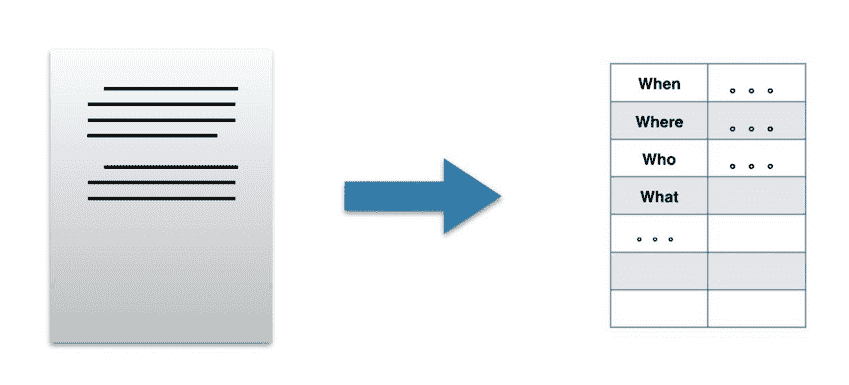

人在阅读时，脑子里要有上面这张表，有意识地做上述的转换。

读完内容，这张表构建出来，从获取信息的角度讲，任务基本上就完成了。美国国家标准与技术研究所（NIST）对全世界计算机自动问答的评测，标准考试针对事实的问题，基本上就是对这张表的构建。

我们不妨来看一个具体的例子。莫泊桑在短篇小说《项链》的开篇是这样写的：

世上有这样一些女子，面庞儿好，风韵也好，但被造化安排错了，生长在一个小职员的家庭里。她便是其中的一个。她没有陪嫁财产，没有可以指望得到的遗产，没有任何方法可以使一个有钱有地位的男子来结识她，了解她，爱她，娶她；她只好任人把她嫁给了教育部的一个小科员。

这是一段文笔非常传神的描写，堪称经典，因为作者只用了短短 100 来字，就提供了大量的信息，让大家一下子就了解了女主人公玛蒂尔德是什么样的人，她原生家庭的背景，她到目前为止的生活和命运等等。

如果是一个合格的阅读者，那么围绕这一段文字，就可以答出好多阅读理解题了。来，我们一起试试，先在脑子里将这段话变成上述的“7 个 WH”的表格。

1.  时间：不知道，作者没说，当然，我们可以根据作者莫泊桑生活的年代推断。由于作者没说，因此如果这一段文章做阅读理解的材料，是不会问关于时间的问题的。
    
2.  地点：也没说，但隐含的是法国。
    
3.  人物：一位女子，姓名虽然暂时没有公布，但文字中已经有指代明确的“她”。而且我们还能知道关于她的若干信息。漂亮，有风韵，出身小职员家庭，经济条件一般。
    
4.  发生了什么事情：她嫁了个小职员。
    

回答了这四个问题，基本读懂了文字表面包含的信息，这叫阅读。

此外我还读出了不少隐含的信息。包括：

*   她教养应该不错，否则很难和有风韵联系起来；
    
*   她虽然是丫鬟命，但是向往小姐的生活。
    

甚至我还可以推论：当时的法国，即便有人想攀高枝，婚姻最终的结果常常是门当户对。其次，嫁给一个所谓的好人，需要有机会先结识“高富帅”，然后彼此了解，产生爱情，最后走入婚姻的殿堂，至少要有这样的四步。

这既是当时法国的现状，也是作者理解的步入完美婚姻的过程。女主人公第一步就卡壳了，于是只能嫁给和她同样阶层的小职员。

这些信息，对理解小说后面的内容都派得上用场。走到这一步，是进行了形象的重构，也就是理解。

从这 100 来字读出这些信息，阅读理解才算是基本上合格了。

只要阅读的方法得当，阅读理解并不难训练，只要你平时阅读时有意识、有条理地获取信息，脑子里都有这 7 个词，慢慢会养成习惯，用不了多长时间，读一遍，各种信息就都掌握了。这样，阅读水平很快就会提高，考试不会太差。

你如果想检验经过一段时间训练后阅读能力是否提高了，很简单，拿一本高质量的杂志来，找一篇文章读一读，合上杂志，看看能否回答上面七个问题。

但这只是阅读理解基本合格，我们还需要对内容进行深层次的理解。一个好的作品，尤其是文学作品，通常在下面五个方面表现出色：

1.  结构
    
2.  描写手法
    
3.  比喻和暗喻
    
4.  用词用语
    
5.  语气
    

因此，作为读者，对文学作品的阅读，除了人物和情节，还需要从上面五个要素入手理解作品。这一讲，我们重点讲一下结构，其余的内容会在后面介绍写作时讲。

文章的结构，和建筑的结构有相似之处。 **作为一个好的作者，写出来的作品一定是结构清晰的，以便引导读者跟着他的思路走。**

这就如同一个好的建筑师，设计出来的房子结构很漂亮一样。

没有经验的人看房子，转了半天，可能注意到房子里的镀金水龙头或者厨房里的小酒柜，但是那套房子里有哪些房间，功能上有什么优缺点，整体上和另一套房子有多大区别，他都说不清，甚至会把书房和卧室搞混。

可是，经常去看楼盘开盘的买家，进到样板房里走一圈，对这个房子的结构就有大致的了解——有几个卧房，彼此之间是如何连接的，朝向如何，客厅和厨房的位置是如何安排的，等等。

这就是行家的眼光。

任何文字内容，写作的结构常常是有定式可以遵循的。虽然世界上的作者千千万，但是大家行文的结构基本上就那么多种，比如以时间为线索，以矛盾冲突为线索，用一个微观细节映射一个宏大的事件等等。

你可以认为它们是套路，是固定的，就那么多种。这就如同建筑师在设计房屋时，不仅自身大致风格是固定的，而且大多数建筑师设计的建筑就那么几种一样。

因此，有经验的读者在有了一定的阅读量之后，大致能摸索各种文章的结构，这些人在做阅读理解考试时，如果遇到涉及到文章结构的问题，是不会做错的。

关于文学作品创作的这些要素，我们后面还会拿具体的作品给你分析。了解了它们，就更容易了解作品的内容。

## 小结：

这一讲，我们谈了我理解的阅读理解，你既要读懂字面提供的基本信息，也要读出作者没有明说的隐含信息，还要对内容进行深层次理解，尤其是文学作品，它的结构、手法、语气都值得关注。

## 作业：

针对诗经的第一首《关雎》，请你试着用表格的形式，整理出它里面所包含的信息。

关关雎鸠，在河之洲。 窈窕淑女，君子好逑。 参差荇菜，左右流之。 窈窕淑女，寤寐求之。 求之不得，寤寐思服。 悠哉悠哉，辗转反侧。 参差荇菜，左右采之。  
窈窕淑女，琴瑟友之。 参差荇菜，左右芼之。 窈窕淑女，钟鼓乐之。

说完了通过阅读，理解他人的基本要求，下一讲，我要跟你聊聊怎样读懂作者的内心。

## 预习：

茨威格的作品《昨日的世界》、《人类群星闪耀时》。

7892

7407

1.读懂作者的意思，是阅读。完成形象的重构，是理解。 2.要想有效传达出想法，在内容上就需要提供六个要素。在中文里，就是时间、地点、人物、发生、发展、结果。  
3.一个好的作品，尤其是文学作品，通常在结构、描写手法、比喻和暗喻、用词用语、语气五个方面表现出色。

[公众号懒人找资源，懒人专属群独享](https://lazytest.vercel.app/#/data/13.%E9%80%9A%E6%89%8D%E8%AE%A1%E5%88%92)

# 02 理解他人：怎样读懂作者的内心？

吴军

2020-07-14

理解他人：怎样读懂作者的内心？

上一讲，我们讲了什么是合格的阅读理解，你既要读懂字面提供的基本信息，也要读出作者没有明说的隐含信息。

但这些仅仅是合格，我觉得， **高明的阅读者，还应该有能力理解作者的本意，或者说他的内心。**

写作常常可以分为两种，一种是类似公文的被动写作，比如你写邮件，不得不写，而且写的内容也不由你定。把你想说的事情写清楚是你的目的。

但是绝大部分专业写作者在写作上，则有很大的选择自由。他们写作的目的一是要表达他们的内心世界，二是要描绘他们的时代和周围的事件。

当然他们不是没有感情的摄像机，只懂得记录，而是要把自己对外面世界的看法告诉我们。

讲回我们自己也是一样的，我们也有要表达自己内心世界的需求，我们也有对事件发布看法的时候。因此学会通过别人的作品了解他们的内心，也就掌握了成功地把自己的内心表达清楚的技巧，也很容易赢得大家的共鸣。

这一讲，我以人为线索展开课程的内容，用著名作家茨威格来做个示例，带你理解，什么叫理解作者的内心，以及怎样才能理解作者的内心。

茨威格是我非常喜欢的作家。喜欢他有两个原因。首先是他的文笔能打动人，我觉得这和他非常了解弗洛伊德的理论，擅长心理描写有关；其次因为他有思想，是一位理想主义者。

我读的茨威格的第一本书是《人类群星闪耀时》。这本书讲了十几个影响历史进程的事件，比如滑铁卢战役、君士坦丁堡的陷落、太平洋的发现、加州淘金热等等。

看完了、了解了这些故事，只能叫完成了合格的阅读理解，还没有走到理解作者内心这一步。对我来说，理解茨威格的瞬间，是我被书中这段话打动的那个瞬间——

“在命运降临的伟大瞬间，市民的一切美德——小心、顺从、勤勉、谨慎，都无济于事，它始终只要求天才人物，并且将他造就成不朽的形象。命运鄙视地把畏首畏尾的人拒之门外。命运——这世上的另一位神，只愿意用热烈的双臂把勇敢者高高举起，送上英雄们的天堂。”

读完这本书，我就体会到，世界上有两种人，一种是关键时刻指望得上的，一种是指望不上的。于是，我就立志要做第一种人，用作者的话讲，就是凡人要在伟大的事业中寻求不朽。

我的第二点感悟是，人类历史上那些伟大的时刻，在出现之前，都有长时间的酝酿和势能的积累。但是绝大部分人只能看到那一瞬间群星的闪耀，而忽略了之前的准备。于是，我就从年轻气盛时候的机会主义者，慢慢变成了一个踏踏实实做准备的人。

正是因为读到了这一层，这本书对我的影响很大，而且书中的内容能让我几十年来记忆犹新。

事实上，我构思近百万字的《文明之光》，就是受到了茨威格的启发。茨威格的表达是非常成功的，我也就有心学习茨威格的表达技巧。

当然，不同人读茨威格的书，会有不同的评价。

比如，一些人就批评他加入的心理活动虚构成分较多，不像是严肃的历史读物。另外，他们不喜欢作者在书中流露出的英雄史观和机会主义倾向。

但在我看来，《人类群星闪耀时》这本书的主角并不是那些他描写的历史人物，比如拿破仑、亨德尔或者歌德，而是茨威格自己。茨威格写这本书，目的根本不是写历史书，也不是写传记，他是在写他的思想。

世界上并不缺历史书，我并不需要在书架上增添一本标准的历史故事书，而是需要一本鼓励市民阶层的年轻人能够通过净化自身，让自己高尚起来的书。

茨威格通过这本书，表达了他这份苦心，读懂了这本书的标志是理解了作者的想法，至于滑铁卢战役的失败是否像书中描写的那样，我觉得不重要。

如果一个读者自鸣得意找出了作者的一大堆破绽，洋洋洒洒地驳斥作者，最后很得意地给这本书打一个一星的差评，我想他不仅没有读懂这本书，而且读再多的书，也难以进步。

**从读者的角度讲，通过读书中的内容，反推出作者是什么人，才是读懂书了。**

从《人类群星闪耀时》中，我读到的是一个对人类世界充满美好理想，同时自己的内心世界特别丰富的茨威格。这个推论，可以从他那本带有回忆录性质的书《昨日的世界》里面得到印证。

那么茨威格是什么样的人呢？他是一个生活在 19 世纪末到二战前的奥地利犹太人，一个知识分子。

在《昨日的世界》里，他讲述了他所经历的从 19 世纪末到 20 世纪初欧洲发生的大事，讲述了他和罗曼·罗兰、罗丹等文化名流的交往，并且如何受到他们的影响，成为一个和平主义者和理想主义者。

他从来没有梦想出名或者大富大贵，只是想和我们一样生活在一个和平的年代，过着今天这样小康的日子，并且自由地表达思想。

在 20 世纪初和两次世界大战之间短暂平静期的欧洲，确实让人看到光明、和平和兴盛的希望所在。但不幸的是，希特勒上台了，纳粹吞并了奥地利，一记闷棍打在茨威格这个犹太知识分子头上。最终，他不得不离开奥地利，流落到南美洲。在那种背景下，他写了《昨日的世界》一书。

虽然我们今天知道二战的噩梦在 1945 年结束了，但是当时在他看来，过去美好的东西，永远不会再有了，人类文明结束了，他所有的理想都破灭了，于是他和妻子双双在绝望中自杀了。

这些内容我讲给你听，你可能依然无感。虽然今天媒体上时不时地在提醒人们珍爱和平，但是世界承平日久，很多人早已好了伤疤忘了痛。

说起战争和法西斯的恐怖，大家不过觉得那是数字。再多的真实的历史书、再多的血腥的纪录片，其实都难让人懂得那个年代的恐怖。

但我读《昨日的世界》，却深深体会到了那个恐怖的时代给人带来的绝望。

今天全世界的中产阶层，其实处境和两次大战之间的茨威格没有什么不同。如果真遇到了茨威格的厄运，结局也未必会比他更好。

今天西方知识阶层，正是因为了解了这些，才会反对排外行为（主要是排挤穆斯林），不少美国人对特朗普的言论和行为非常防范。从这个结果来讲茨威格作为一个表达者，也达到了目的。

在我们接下来的课程中，我会分析理想主义者罗曼·罗兰的作品，垮掉的一代作家海明威的作品。

我发现，那些作品里的主人公，其实都是他们自己。他们为什么要把小说里的人物塑造成特定的式样，其实他们并不是想编一个故事让我们在茶余饭后挤出两滴泪水，也不是想通过情节牵引我们的好奇心，而是想告诉我们，他们当时的世界是什么样子，以及他们所希望的世界的样子。

因此我觉得， **阅读理解到了深层次，其实就是从读书，上升到读人。**

其实，这套用于语言文字的阅读理解方法，也可以迁移到对其它艺术作品的理解上。

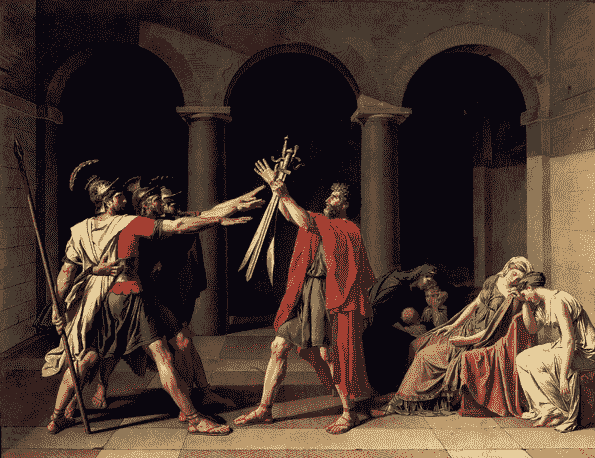

《荷拉斯兄弟的誓言》

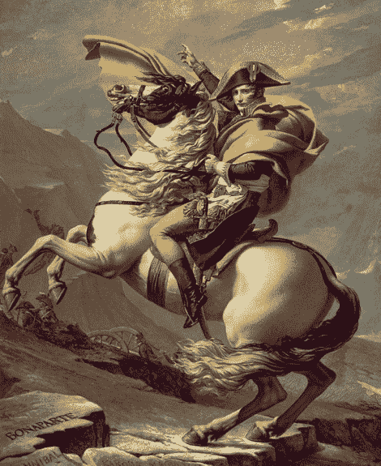

《拿破仑翻越阿尔卑斯山》

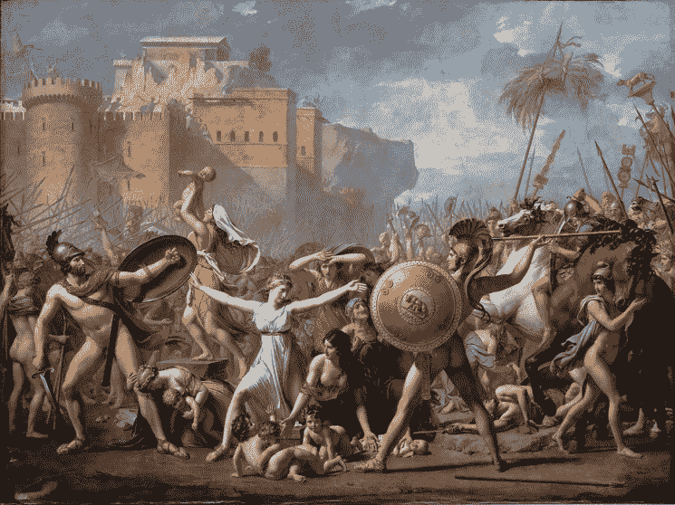

《萨宾妇女的干预》

雅克·路易·大卫是欧洲新古典主义画派的开山鼻祖，他的画人物形象都高大孔武俊美，即便不知道画的具体内容是什么，也能感觉出对英雄的讴歌。

当然探究时代背景，我们也能了解到，大卫的作品之所以有这样的特点，因为他身处法国大革命时代，那是一个需要英雄的新时代。

而且，欧洲文学、绘画和音乐是同节奏发展的。

等到 19 世纪后期，法国绘画变得温情脉脉，欧洲那个时期的文人，像我后面会介绍的雨果、拜伦、雪莱等，作品也同样充满浪漫主义色彩。再往后，欧洲涌现出一大批批判现实主义的作家，同期的音乐和绘画也是如此。

## 小结：

通过读书中的内容，反推出作者是什么人，他想表达怎样的思想，是阅读能力的进阶。

我一直强调学科之间相通的特点。通过读书，读懂人，读懂时代，是我们阅读的目的。反过来，通过一个时代的艺术和音乐了解时代，也能有助于我们自己的阅读和写作。

## 作业：

能不能聊聊你在哪部作品中读懂了作者的内心，它对你有什么样的影响？

下一讲，我们聊聊口语表达，怎么让你的话更吸引人。

## 预习：

《人类群星闪耀时》中的《滑铁卢的一分钟》。

7407

1.高明的阅读者，还应该有能力理解作者的本意，或者说他的内心。 2.从读者的角度讲，通过读书中的内容，反推出作者是什么人，才是读懂书了。  
3.通过一个时代的艺术和音乐了解时代，也能有助于我们自己的阅读和写作。

公众号懒人找资源，懒人专属群独享

# 03 口语表达：如何让你的话更吸引人？

吴军

2020-07-14

口语表达：怎么让你的话更吸引人？

我们讲完了理解他人，接下来讲讲自我的表达。

先问你一个问题，专业上的本事和表达能力，你觉得哪个更重要？

很多人都看不起只会表达的人，觉得他们不实在，我年轻的时候，也是觉得人要靠本事，靠硬实力。

但我们先来看一个大家可能都会遇到的例子：

一个项目组中有三个人，第一个人擅长于做专业工作，组里最重要的工作都是他做的，其他人也经常要靠他来指导；第二个人擅长把大家组织到一起，当大家遇到困难时，他能够鼓舞大家的士气，带领大家克服困难取得胜利；第三个人能把他们组的工作讲清楚。

如果老板要从这几个人中提拔一个人，谁的机会最大呢？我相信很多人会觉得是那个专业能力特别强的。但是，在现实生活中往往是第三个人最大。

为什么呢？我们假想一下三个人去做汇报的场景——

第一个人去做汇报，他讲了一堆专业细节，领导听得无趣，最后他既没有让全组的工作被上级认可，也没有争取到什么资源。也许第二次大家就不推举他做代表了，或者这个项目受不到重视解散了。

如果是那个善于组织的人去作报告呢？他给人的印象就是一个行政管理人员，在具体的项目上一直在外围转悠，指手画脚，细节根本讲不清楚，当然汇报的效果也好不了。

如果是大家找那个会讲的人去汇报，那么全组的工作最有可能得到认可，而且还争取来很多资源。于是大家都有好处，接下来还会让他代表大家去汇报。久而久之，在外人的印象里，他的功劳第一。

这不是我编的故事，大家在单位里看看周围，就会发现情况和我说的大同小异，这是在一个单位里自然选择的结果。

**通常由表达能力好的人去汇报工作和作报告，这样的人也因此更容易被看见，被提拔。**

我刚到美国读书时，惊讶于美国教授讲课都讲得特别好，从中国过去的同学，都有同感。公平地讲，比清华老师的讲课水平高多了。

在美国读书时间长了，发现学校对每一个学生阅读写作的训练是不断的，任何专业的研究生也都要接受表达能力的培训。

表达，包括口头表达和书面表达。这一讲我们先说口头表达。

话人人会说，但让自己的话更吸引人，真正达到表达自我的目的，这个要求可不低。

我刚到美国那一年，正赶上美国总统大选，克林顿对经验老道的多尔。

克林顿的表达方式给我不少启发。他总是以平静、有节制的语调，去夸他过去几年最主要的成绩，不像特朗普和奥巴马把什么功劳，无论大小，都往自己身上揽。

平静而有节制的讲话方式很重要，因为只有那么讲出来，大家才会相信你讲的内容。

克林顿还善于抓住对手的逻辑漏洞，巧妙地把矛头对准对方。但是，在批评和挖苦对方时，要用风趣却不庸俗的语言，不能直接攻击对方。

相比之下，他的副手戈尔和太太希拉里女士显然没有得到他的真传。戈尔后来在竞选时讲他是互联网之父，成为全世界的笑柄。其实他的意思是他直接推动了美国互联网的发展，这其实是事实，但是他一夸张，反而把自己应有的功劳全否定掉了。

至于希拉里，公平地讲，她讲的内容未必不好，但她永远是在攻击和埋怨别人，很不中听，我听两分钟就会把电视关掉。任何傲慢的讲话方式，都会让有价值的内容变成废品。

你看，即便是受过专业训练的美国总统和总统候选人，在口头表达上也不见得都过关。

根据我多年工作和做公开演讲的经验，我觉得，可以分三个层次讲一讲具体的口头表达技巧。

## 好的口头表达，要有侧重点

虽然我们并非每天和别人沟通都像作报告一样，但是哪怕听众只是一个人，是非正式交流，聊天，讲话也最好有点目的，以免对方觉得你是话痨。至于在大众面前讲话，讲什么不讲什么就更为重要了。

由于篇幅的原因，我这里直接给出四讲四不讲的原则，省略掉对原因的分析。

**1.最重要的主题讲，其余都不讲。**

除非你和听众都有足够多的时间，你讲什么内容比郭德纲讲段子还好听，否则不要试图一次讲很多内容，一次只讲一个主题。

讲以前，不妨把想讲的内容列一个单子，然后删除次要的内容，删到最后，如果再删，这次讲话就可以取消了，那就删得差不多了。

如果删到后来还有一大堆内容，怎么都舍不得删，那就选一个最重要的。如果自己选不出来，就掷骰子选一个。

所有没有被选上的内容，不是你有时间就可以再讲两句，而恰恰是要强迫自己不能讲的。如果你觉得有很多事情还要讲，那就下次讲。如果你这一次讲得成功，你一定会获得下一次的机会的。

**2.能讲清楚的讲，讲不清楚或者太花时间的不讲。**

我的导师库旦普教授是一个非常会口头交流的人，他也是一个很能说服发放科研经费的机构给他巨额经费的人，他在霍普金斯大学领导的研究中心是全世界大学里经费最多的自然语言处理实验室。

库旦普教授教给我一个做学术报告的原则，永远不要试图在有限的时间里，讲那些需要花很长时间解释，而且容易引起大家疑问的结果，即使那个结果在你看来好得不得了。

在这个世界上，并非你做了一件很牛的事情，告诉大家，别人就觉得你牛，而是大家听明白了你的贡献，并且对此毫无异议，才觉得你牛，即使那个贡献看上去不是那么大。

**3.讲自己的独到之处，别人都有的东西不讲。**

在过去的十年里，国内很多市长到美国招商引资，我也经常被邀请去捧场。坦率地讲，那些报告内容极差，因为如果你把相应城市的名字去掉，换成另一座城市，这个报告照样成立。

这也是一个单位里经常看到台上领导做报告，台下大家睡觉或者玩手机的原因。

你还可以换一个场景想一想，如果一个总监或者局长，下面有 20 个汇报人，一天听下来的东西都一样，会是什么感觉？

我在 Google 向我的上级申请资源时，一定要找一个别人没有的理由，而不是最重要的理由，这样做的效果非常好。

**4.对自己和朋友有利的话讲，对自己和对方没有好处的话不讲。**

罗老师讲他很少在微信中用语音和对方沟通，而是用打字。这么做的好处是利用打字慢的特点，脑子再想一遍，避免盲目冲动讲一些没必要讲的话。

对此，我也有同感。话讲得不对，即使是好心，对方也未必感激。人在第二次思考后，会避免讲那些没有益处的话。

## 好的口头表达，要有对象感

跟写书不一样，口头表达是对特定对象说话的。

以一个对方愿意接受的方式传递信息，比用自己觉得最精彩的方式去讲，效果要好很多。

因此，讲话一定要看对象。中国有一句话糙理不糙的话，“见人说人话，见鬼说鬼话”，其实是很有道理的。

永远用对方懂得的事情和概念，去解释和形容新的事情，不要用只有自己懂的概念去解释别人不懂的概念，因为自己懂的东西，别人未必懂。这就是为什么很多专家讲东西大家听不懂的原因。很多时候即便是在同一个圈子里，也要避免讲别人听不懂的事情。

在机器学习领域，我知道有一位教授水平极高，还时不时地获得最佳论文奖，但是他的影响力和他的水平完全不相配，一个重要的原因是他爱讲大家都听不懂的笑话，这让那些很顾及脸面的专家们很没面子。

而且，你心里有说话的对象，就要在口头表达时调控废话的比例。

我不是说人不能讲废话，恰恰相反，从信息传播的角度讲，口语表达，如果讲的全是干货，听众接受的速率，是跟不上讲话人的，适当增强趣味性的废话是需要的。

当然如果全是废话，听众就跑光了。我在《信息论 40 讲》中已经从信息传递的角度讲了两个人之间沟通的技巧。因此讲话技巧方面的很多内容，我这里就不重复了。

## 口头表达，最好还要有吸引力

怎么才能有吸引力呢？

你可以善用对比和类比。

在语文的修辞里，有对比才有高下之分。但是要注意，不要把问题说成是成绩，反而是要把小问题说成是大问题，甚至把大成就说成小成绩。

有些人会把自己很小的成绩吹得天花乱坠，这些人显然数学和语文都没学好。很小的成绩是无法吹成大成就的。如果一个人觉得自己那点小成绩很了不起，对方反而会觉得这个人水平太低，他所谓的成绩，不过是那点小东西。

这就如同一个将军，所夸耀的“伟大胜利”不过是杀敌 10 人，再怎么吹大家也不会觉得了不起，反而把他定格在“伟大胜利=杀敌十人”上了。

相反，如果把自己的小问题说成是大问题，而且表现得不虚伪，对方会觉得，你是一个对自己标准定得很高的人。

同时，讲东西像写小说，要预设一些后面的场景。

很多时候，不需要像竹筒倒豆子那样一次把话讲完，而是等对方好奇并提问后，以解答的方式把自己的意思继续表达下去。

至于对方可能会问什么问题，其实你自己在讲述时需要刻意引导他们提问，这就像写侦探小说那样，要不断地制造出一些悬念。这样，对方会感觉到，你传递过去的信息，不是你强加给他的，而是他的好奇心得到了满足。

## 小结：

总结一下，很多时候，表达能力比专业能力更重要，它会让人获得更多被看见的机会。在口语表达中，要有侧重点，有对象感，想要增加讲述魅力，还要善用对比，引导听众的提问跟好奇。

下一讲我们讲讲书面表达。

## 作业：

你可以试试用我所讲的口头表达技巧来分析下面这篇稿子，这是丘吉尔 1940 年 5 月 13 日在英国下议院的讲演《热血、辛劳、泪水和汗水》。

整个讲演篇幅不长，自然和朴素，没有过于华丽的词藻，但非常具有震撼力。丘吉尔用了热血、辛劳、泪水和汗水（blood, toil, tears and  
sweat）这几个很简单的词来形象说明他鞠躬尽瘁死而后已的决心，这也使这句话成为千古传颂的名句。

2018 年获得奥斯卡奖的电影《至暗时刻》重现了当时的历史镜头。

**《热血、辛劳、泪水和汗水》中文译文：**

上星期五晚上，我接受了国王陛下有关组织新政府的任务。 新政府应该建立在最广泛的基础上，应该包括所有的政党在内。这显然是国会和国民的共同意愿。  
目前，我已完成了该项任务中最重要的部分。一个代表工党、反对党和自由党在内的 5 人战时内阁已经组成，代表了国家的团结统一。  
鉴于事态极其紧急严峻，新内阁政府的组建应在一天之内完成。其他重要职位也已于昨日安排妥当。今晚我将向国王陛下呈递一份更进一步的名单。我希望几位主要大臣的委任能够在明天之内完成。其他大臣的委任通常要拖得久一些。我相信，国会再一次召开时，我将完成这一部分任务，整个政府的组建工作也将完成。  
基于公众利益的考虑，我建议议长今天就召开议会。今天的议程结束后，将休会到 5 月 21 日。如有必要，可提前开会。有关事务会及早通知各位议员。  
现在我提请议院作出决议，批准并记录我为此采取的各项步骤，同时宣布对新政府的信任。决议如下：  
“本议院欢迎新政府的成立，新政府代表了全国团结而坚定的决心：发动对德战争，直至最后胜利。”  
组建一届如此复杂且规模庞大的政府，本应该是一项重大的工作。但是我们正处于有史以来规模最大战役之一的初级阶段。我们在挪威、荷兰等地多点作战，另外我们在地中海也必须准备完毕。空战还连绵不绝，而且我们在国内也还有许多准备工作要做。  
在此危机之中，我相信议院会原谅我今天不能发表长篇讲话。我还希望所有在这次改组中受到牵动的朋友、同僚或前任同僚们对于我们不得已的礼仪方面的不周之处能够多多包涵。  
正如我已告知组成新政府的诸位官员那样，我也要告知议院：我能奉献的只有热血、辛劳、眼泪与汗水。我们面临着极其严峻的考验，我们面临着长期艰苦卓绝的斗争。  
如果你问：我们的政策是什么？我的回答是：尽我们的全力，尽上帝赐予我们的所有力量，进行海陆空抗敌；向一个史无前例的凶残暴政作战。这就是我们的政策。  
如果你问：我们的目标是什么？我可以用两个字回答：胜利。不论道路多么崎岖漫长，我们都要不惜一切代价，不畏任何恐怖，夺取胜利。因为得不到胜利就无法生存。  
大家都应该认识到：不胜利，大英帝国将无法幸存，大英帝国所代表的一切将无法生存，推动人类历史不断前进的动力将不复存在。  
我充满乐观和希望地肩负起我的职责，我确信，靠大家的共同行动，我们的事业就不会遭受挫败！  
在此时此刻，在这危机关头，我觉得我有权得到所有人的援助。我要说：“来吧，让我们团结起来，携手前进吧！”

## 预习：

《出师表》 《报燕惠王书》 《留侯论》

\*点击文章标题，即可查看原文

1.工作中通常由表达能力好的人去汇报工作和作报告，这样的人也因此更容易被看见，被提拔。 2.好的口头表达要有对象感、侧重点和吸引力。

公众号懒人找资源，懒人专属群独享

# 04 书面表达：写跟说有什么不同？

吴军

2020-07-14

书面表达：写跟说有什么不同？

上一讲说了口语表达，这一讲我们接着说书面表达。

我们很多人都会觉得，书面表达有更多的时间思考和优化，更容易让人信服。但其实书面表达也有不利的一面。

比如，书面表达因为没有互动，是一锤子买卖，一旦对方不喜欢看，直接扔一边去，你其实没有解释的机会。

因此， **书面表达想要赢得精彩，必须写得漂亮。**

这一讲，我从语言学和传播学的角度，先跟你讲讲书面表达有什么特点。所谓特点，是对比而言的。所以我会用它跟口语表达对照着讲。了解了这些不同，能帮助你更好地写。

口头表达用声音，书面表达用文字，这是两种表达方式在媒介上的区别，但它们的区别可没这么简单，更深层的区别，我概括了四个方面。

## 1\. 用词用语的区别

你最容易感知到的，是词汇上的差别。如果你既订阅了我在得到的课程，也买了我后来精选出来的两本书，就会发现这其中的区别。

音频课程的内容是口语化的，用词用语在语言学中被称为“随意的语言”（spontaneous speech），而书面语则是正规语言（formal  
language），它们是不同的。

如果写的是一份正规的研究报告，里面却用了有不少口语化的词和网络用语，就会给人感觉没有权威性。

此外，在口语表达时，同一个概念用同一个词没有问题，但是在书面表达时，这样就显得太无趣，同一个概念，特别是动词，最好来回来去换同义词。

因此， **书面写作平时积攒足够的词汇量非常重要。**

## 2\. 表达结构的区别

除了小颗粒的词汇，口语和书面语还有表达结构上的差别。

口头表达常常是在时间上从前往后，先因后果地表达。除非是非常重要的事情，否则就要先讲结论，比如你今天出了车祸，打电话向单位请假。

但是 **书面表达，就有很多种表达方式，既可以先讲原因，也可以先讲结果，还可以先把自己要说的大道理讲出来。**

从前往后，前因后果地写作的一个范例就是诸葛亮的《出师表》。他开篇写道，

“先帝创业未半而中道崩殂，今天下三分，益州疲敝，此诚危及存亡之秋也……”

这就是先说眼下的情况。然后诸葛亮分析蜀汉的现状和天下大势，说明为什么需要北伐曹魏。这样写自然流畅，大家会感到北伐是历史的选择。

和出师表不同的是，乐毅的《报燕惠王书》是先给结论，讲自己的做法，然后再倒叙说原因。

当时赏识乐毅的燕昭王去世了，儿子燕惠王上台后，听信谗言，罢免了伐齐有大功的乐毅，用骑刦取代乐毅，乐毅回到母国赵国，结果燕国军队被齐国的田单用火牛阵打败，得到的齐国 70 余城都丢失了。这时燕惠王才想到乐毅，派人去赵国请乐毅回来。乐毅没有回去，让使者带了一封信回去说明原因。

乐毅开篇这样写的，我这里直接用白话解释。

“臣算不上聪明，不能奉承您的命令，顺从您左右官员的心，又害怕犯了杀头的罪，这样就伤害了先王的英明，又伤害了您的道义，所以逃奔到赵国……”

随后乐毅回顾当年燕昭王如何器重他，让他立了不世之功。然后又说今王如何听信小人谗言，不能用忠良，当然，乐毅对此没有直说，而是用了吴王夫差对待功臣伍子胥的做法来暗示。然后表示自己不会回去了。

最后乐毅写了一句千古名句“臣闻古之君子，交绝不出恶声；忠臣之去也，不洁其名”。表示不再啰嗦了，大家好聚好散。

很多人认为诸葛亮的前后《出师表》在风格上很像乐毅的《报燕惠王书》。诸葛亮自比乐毅，一定是读过这篇千古名文。

但是，为什么诸葛亮不采用乐毅的行文结构呢？因为读者不同。诸葛亮好歹是刘禅的臣子，以后还要刘禅支持北伐，不能张口就给结论。

而乐毅已经离开燕国了，而且打算和它老死不相往来，就直接给一个痛快话，省得燕惠王看了一半生气扔到一边还不知道结论。

当然，乐毅花了很多篇幅写原因，讲道理，其实并不是给燕惠王看的，而是给我们这些后人看的，正因为有这篇文章，后人形成了乐毅忠勇双全儒将的印象。这篇文章写得很动人，包括司马迁在内的很多后人，都觉得它是字字血泪。

当然，书面表达也可以先讲自己的道理，比如苏东坡的名篇《留侯论》便是如此，他开篇是这么写的，因为原文比较好懂，我们就直接给原文了。

“古之所谓豪杰之士，必有过人之节。人情有所不能忍者，匹夫见辱，拔剑而起，挺身而斗，此不足为勇也。天下有大勇者，卒然临之而不惊，无故加之而不怒。此其所挟持者甚大，而其志甚远也”。

短短几十个字，想讲的意思一清二楚。观点和道理讲完了，苏东坡才讲留侯张良的故事。

这篇文章为什么这么写呢？

因为这是苏东坡在参加科举考试谋功名前，给当朝的官员杨畋、富弼等人写“作品集”中的一篇，要表达自己的政治主张。因此，苏东坡要让那些大臣们知道自己的政治见解。

不过，苏东坡这种写法是担了一定风险的，因为如果一开篇的几句话不能打动人，即便后面是锦绣文章，也被当官的扔一边去了。但苏东坡是大文豪，开篇几十个字从立意，气势，到韵律都堪称千古名句。

由此可以看出， **针对不同的读者，出于不同的目的，写文章可以采用不同的结构，相比起来，口语表达的结构比较单一。**

## 3.信息方向不同

从受众角度来看，口语和书面也有差别。它不光是听和看的差别，更重要的是信息获取方向的不同。

**人作为听众在接受信息时，完全是单方向线性的，是被动的。**

所以口头表达一般只能用一个线索，这也是为什么最好一次只讲清楚一个问题的原因；如果要讲几个问题也要一二三顺着来。如果讲话人的思路跳来跳去，听众就不容易跟上。

你可能会看到这样的现象，一个人说得太快，对方会说，等一等，我有点跟不上，你再解释解释。这说明两个人的节奏要合拍。

但书和文章，读者可以前后来回翻，读书人可以自己控制节奏。那么为了让文章出彩，表达时可以多个线索同时展开，行文在几个线索中来回切换。即使有多个线索，只要安排得好，就不会走丢。

而且，在书面表述中，多个线索切换还有好处。因为单纯沿着一根线索读得时间长了，读者会觉得枯燥乏味，而且很累，然后就把书扔一边了。

有些书出于轻松阅读的目的，会在书中插入一些小贴士，其实也是为了起到让读者换换思路的目的。

我在写《数学之美》时专门写了几章介绍当今的信息科学专家，一些人问我为什么不把那些内容集中放到最后，因为我安排那些章节的目的，就是让读者在读了比较长时间的数学书后，要调剂一下脑筋。

**一本好书，通常都有两个以上的线索，而且是互相切换的。** 写作如同烹调，不是简单把原材料堆积起来就完成了，而是要让原材料混合，烹炒变成一盘很漂亮的菜。

## 4.逻辑复杂度不同

口头表达的逻辑比较简单，最常用的是三段论：大前提，小前提和结论。搞太复杂的逻辑听众就会跟不上。

如果需要分层次展开论述一件事情，重要的要放在前面，因为听众通常听五分钟之后，就会走神。

在英语里有一个词“the last，but not the  
least”，意思是说“最后一点，但并不因为我放在了最后就不重要”，专门用于讲到最后一个论点时，要提醒听众一下打起精神坚持听下去。

**但书面表达不一样，只要能够不断吸引读者跟着作者的思路走，行文逻辑可以搞得很复杂，而且未必需要重点放在前面。**

书面表达在论述上常采用的两个手段是“层层递进”和“剧情大反转”。

你如果读金庸的武侠小说就能体会第一种，他的书中前面出场的通常是小角色，开始了不得的武功，回过头来看都稀疏平常。

至于剧情大反转，就不用多说了，不仅经常给读者留下深刻的印象，而且常常让人回味无穷。

畅销小说《达芬奇密码》的作者丹∙布朗就经常用这种写作手法，但是由于他用多了，大家都知道他要反转一次，也就不再有悬念，不吸引人了。

如果你身边有孩子写作文不知道怎么推进，也不妨告诉他，层层递进和剧情反转都是可以参考的表述方式。

层层递进的好处是让人觉得作者思维缜密，思想深刻。

剧情反转由于篇幅的原因不能直接使用，可以改良一下使用。具体的做法就是先树立对立面，对立面最好是普通人通常的认知，然后一一推翻自己事先设定的对立面，这样让人感觉作者有独到的见地。

我在写作《硅谷之谜》时其实就是这样展开论述的逻辑的，先把大家印象中的硅谷描述一遍，然后讲，你们想的都是错的，真实情况是我下面要讲的。这样读者会发出“原来如此”的感慨。

## 小结：

书面表达在用语、结构、信息方向和逻辑复杂度上跟口语表达有很大的差别，明白了这几点，你也就能理解，阅读和写作，难度比口语要高得多，是我们语文学习的重点。

关于阅读和写作，你有什么问题和困难，也欢迎在留言区写下来向我提问，我会精选出好问题回答。

从下一讲开始，我们进入一个新的模块，我会跟你分享我的阅读方法论。

1.书面写作平时积攒足够的词汇量非常重要。 2.书面表达在用语、结构、信息方向和逻辑复杂度上跟口语表达有很大的差别。  
2.一本好书，通常都有两个以上的线索，而且是互相切换的。

公众号懒人找资源，懒人专属群独享

*   \_\_ 0
    

**成为自己** 

层层递进，和剧情大反转

2020-06-08 20:46:32

# 05 品位：如何全面有效地构建自己的知识体系？

吴军

2020-07-14

品味：如何全面有效地构建自己的知识体系？

上一个模块，我们概述了阅读与写作的基本功用——“理解他人、表达自我”。

这个模块，我会用 4 讲内容跟你分享我的阅读方法论。

这一讲，我就先来聊聊如何全面有效地通过阅读构建自己的知识体系。

已故的著名物理学家张首晟教授，有一次和我谈到他的老师杨振宁教授对他的帮助。张教授其实只上过杨先生开的一门课，那就是文献阅读课，当时杨先生年纪已大，只传道，不教具体的知识点了。

但是张教授觉得那门课对他的帮助特别大，因为杨先生讲的是如何培养阅读物理学文献的品位，品位不够，了解的知识点再多，终成不了的大学问家。

杨振宁先生讲，你习惯于读什么样的物理学论文，就决定了你在物理学领域能走多远。能够在众多论文中迅速找到那些品位高的，是成功的第一步。满足于随便拿来一些论文就读，看到一个热门的课题就去研究，论文再多也是二三流。

听上去，物理学论文离普通人有点远。但我们每个人，是不是在工作中都会遇到这样的情境呢？

你要进入一个陌生的领域，当然，能找到行家给自己讲讲是最省力的办法，但不见得每个人都有这个条件，剩下最好的办法，恐怕就是阅读了。

如何省时省力地通过阅读构建一个知识体系？对于每一个人来说，都是很现实的需求。

但问题是，今天人类知识更新的速度大大加快了，同时，很多领域的信息也非常庞杂，我们在进入一个新的知识体系时，不光时间少，而且选择困难。

这个时候该读什么呢？就让我想起了杨振宁先生所说的品位。

单说“品位”有点虚，我会用三步阅读法，来跟你分享我快速构建一个知识体系的方法。

进入一个陌生领域，首先要从阅读“正统”文献或者作品开始。

所谓“正统”，是指在那个领域或者行业里被主流认可的。正统的东西不一定正确，事实上过去认为是正统的观点，今天大部分都被证明不准确，被修正了。但是我们依然要从当下正统的观点入手，因为它们提供了一个基准线。后来的阅读，都是在基准线上做修改。

基准线思维，是个很有用的方法论。

比如，地外生命在今天是一个热门的话题，很多人就讲了，为什么天体物理学家们总是按照地球的标准寻找外星生物，什么宜居带、固体行星和液态水，都是我们地球生物必须的条件，宇宙那么大，完全可能有不同形态的生命。

这种说法听起来有道理，但是完全不具有可操作性。因为我们已知的物理、化学和生物学知识，并非只适用于地球，也适用于整个宇宙，它们是我们对生命理解的基准。如果我们抛弃掉这些基准，不限制搜索的条件，成本太高，成功率太低。

说回正统。

也许你觉得这些经典，啃起来太费劲。但是如果你这么想就不一样了：

建立知识体系这件事的成本其实不是花钱多少，主要是要考虑时间成本和收益比。无论是对已知的还是未知的领域，建立知识体系从正统的观点出发，恰恰是效率最高的做法。

那应该看哪些正统的学习材料呢？

今天想进入一个新的领域，一个人如果有时间，有能力，第一步就应该是读教科书，尤其是中美两国普遍采用的教科书。当然也可以学习名牌大学开的 MOOC 课程，包括听得到上的通识课。

如果你想学习物理学，牛顿的经典力学，麦克斯韦的电学方程，焦耳等人的热力学理论就是正统的，这些理论今天看起来不完美，但是从那里入手了解物理学是最为便捷的。

如果你对金融领域想有比较完整的了解，我推荐美国高中的 AP 课教材《经济学》（McConnell 等人著）。

对于人文学科，基准线也许不容易找，但是依然需要有。

比如你想了解世界史，在我看来，斯塔夫里阿诺斯的《全球通史》就是一本不错的入门书。说实话，这本书在细节上有很多错误，但是，即便如此，它依然是一本不错的正统读物，它能让你从全球的角度来观察学习人类的整个历史。

读经典文学作品的意义也是找到基准线。

至于今天很多人获取信息的互联网，我不是说没有用，问题是，从那里寻找好内容的成本太高，特别是当一个人在入门之前，无法判断优劣的时候，一旦把旁门左道的内容当作主流的来读，品位就很难提高了。

当然，这些只是让我们站在了一根基准线上，远没有能构建出知识体系，更何况很多正统的知识可能已经过时了。那要怎么对基准线进行修正呢？

**接下来的第二步就是读权威的综述文章。**

所谓综述文章，基本上会把一个领域最近十年的成就概括了。

比如我了解世界上最新的研究进展，最简单的办法就是看综述类文章。

*   科学类读著名的《科学（Science）》杂志。它是美国科学促进会的核心会刊，非理工专业的人未必读得懂，不过它会定期推送一些综述，涵盖科学的各个前沿领域。
    
*   医学进展，看美国医学会的《展望（Perspectives）》在线杂志，这本杂志可以在网上免费订阅，它也会定期刊登通俗的综述报告，比如我最近看了一篇《人工智能在保健中的应用》，这是一份近 300 页的报告，读完以后，就有把握和别人谈这个话题了。
    
*   工程类看美国电子电气工程师协会（IEEE）的《频谱（Spectrum）》杂志。
    
*   金融领域比理工和医学更受大众关心，也有不少非常通俗的好杂志，我更信赖《巴伦》和《经济学人》。至于名头很响的《福布斯》和布隆伯格的《商业周刊》，其实水平很一般，我觉得不能拿它们的内容作投资指导。
    

如果对某一类知识感兴趣，这一类综述文章读 5 篇左右，就有大致的了解了。虽然到不了科研的水平，但已经有足够的判断力，别人想忽悠我就很难了。

我知道有人会反感我说权威、正统这两个词。但没有办法，要有效地建立起知识体系，这是捷径。 **走正统道路的好处在于，便于和专业人士交流。** 这一点很重要。

今天很多人对学习知识和从事专业领域的工作有误解，以为大学学什么专业就是那个专业的行家，没有学那个专业就是业余的。

这是一种偏见。我们区分民间科学家，或者民间高手和专业人士的差别，不在于他们过去所学的专业，甚至不在于是否供职于一个研究机构或者专业机构，而在于他们是否和专业人士经常交流，融入了专业人士的圈子，并且被专业人士认可，比如参加相应的会议和活动，有专业人士背书等等。

举个例子，因发现大脑中海马体的定位作用而获得 2014 年诺贝尔奖的约翰·奥基夫博士，原本是学古希腊语的，做过华尔街的投资人，后来用半工半读的方式完成了大学学业。

在很长的时间里他都不是终身教职的教授。但是他一直身处学术界，和各种顶级科学家有交流，之后才成为了神经科学领域世界级的专家。

好，你读了正统材料，也看了很多权威综述的文章。 **这时候就该进行构建知识体系的第三步了，也就是读一些有趣的专著。**

今天的学者发表的学术论著，大部分是专著。既然是专著，讨论的课题范围一般都比较窄，而且观点会非常鲜明，甚至偏激。

注意，鲜明而且有新意的观点并不等于正确，有时恰好相反。在专业领域，常常只有不同的声音，才能引起大家的注意，人云亦云是没人听的。

因此，在读这些书之前，我们需要对正统的知识有所了解，不要把标新立异当作主流意见。

很多人对历史感兴趣，今天也有很多非常好的历史通俗读物，比如《人类简史》《丝绸之路》等等。

这些书的观点都有新意，但很多只是一家之言，你如果没有对人类的早期的历史，或者欧亚大陆的历史有所了解，很容易被误导。但如果你有了对于历史的基准线，它们对你的帮助就很大。

## 小结：

通过以上三步——正统文献、权威综述和学术专著阅读，我敢肯定，你在每个领域的阅读品位，就已经比较高了。

之后，如果对某个话题感兴趣，可以把上面书中或者材料里使用的参考文献再拿来读读。当然也可以在互联网上随意找一些自己有兴趣的内容读一读。但是，读这些内容，一定要留心信息的准确性和中立性。

关于这一点，我在后面讲阅读层次的时候会专门讲。

这么多书要读下来，当然需要很多时间，如何提高自己的阅读速度，这是我下一讲要讲的话题。

## 作业：

谈一谈如果你打算系统性地了解投资的理论，应该怎样做。

1.进入一个陌生领域，首先要从阅读“正统”文献或者作品开始，进而是读权威的综述文章，最后可以读一些有趣的专著。  
3.走正统道路的好处在于，便于和专业人士交流。

公众号懒人找资源，懒人专属群独享

# 06 速度：如何突破阅读理解的瓶颈？

吴军

2020-07-14

如何突破阅读理解的瓶颈？

听完上一讲我说的构建知识体系的方法，你是不是已经觉得阅读压力很大了？要读那么多东西，得花多少时间啊？怎么才能提高自己的阅读速度呢？

一目十行，哗啦啦地把书翻一遍，速度当然很快，但如果没有抓取到信息，没有达成理解，当然就没有完成阅读的目的。

这一讲，我先从考试的阅读理解讲起。因为这是一个比较小的验证阅读效果——也就是理解没理解的场景。而且，因为在考试场景中，它对速度有天然的要求。

阅读理解题通常可以分为两类问题，宏观的和细节的。

也就是说， **评价阅读效果，既包括主题思想、作者的态度，也包括特定内容的具体信息。** 其实不光是考试，这也是我们通常评估自己阅读理解的维度。

回答宏观的问题，需要换位思考——如果我是作者，为了组织好信息，达到表述清楚自己想法的目的，会怎么做？

单篇的文本，结构其实很有限，就那么几种，比如对比分析、层层递进分析，等等。只要有心，练习几次就能把握作者们通常使用的文本结构了。

对应到书上，这就是看书要先看目录的原因，目录就是整本书的文本结构。

至于微观细节，其实相对比较好回答，只要在阅读时脑子里一直有我们导论里讲过的 6 个 W 和一个 H 的问题，甚至一边读一边圈出来，其实就不难。

考试的答案，不过是问题下面的选项和文本中内容的对应。只不过绝大多数考试中，考官会在微观细节问题上设置一些陷阱，用大量和原文重复的词，构成一个看似长得很像的答案而已。

如果你身边有需要参加考试的朋友，不妨把我这个观察分享给他。

你可能听过，现在的人工智能阅读理解很厉害，其实啊，计算机只是回答细节问题确实比人厉害，速度快，而且很容易就能做到 80%左右的正确率，但是，对于宏观问题，错得一塌糊涂。

咱们人跟计算机比阅读速度，肯定是没法比，因为  
**人阅读的速度有两个瓶颈，我们人脑接受信息的带宽，以及我们人眼识别图像的速度。所以，我们的阅读不可能无限快。**

所以，接下来，我想跟你分享的，是跟阅读有关的认知科学最新进展，这部分内容里，大多是我在约翰霍普金斯大学时，和研究中心里那些认知科学的教授们讨论了解到的，小部分是我们在 Google 是做的用户测试的结论。通过了解这些内容，我也想跟你讲三个提高阅读速度的新方法。

先说说人脑的带宽。

根据今天对脑科学和认知科学的研究，人一秒钟能接受的信息只有大约 100-200 个比特，换算成汉字，就是大约 12-25 个。

如果阅读速度真能达到这么快，那么一分钟可以阅读 700～1500 个汉字，就是一本大 32 开图书的一到两页。这是非常快的速度，一本 400 页的小说 4-7 个小时就读完了。但是，一般人读书达不到这个速度。

再说说第二个瓶颈，就是眼睛和脑子一同识别文字图像的速度。

遗憾的是，阅读文字，我们的眼睛看到的是图像，脑子需要做一次图像识别，才能理解词汇。读书越多，图像识别的速度越快，但遇到一个生字卡壳，速度就马上会降下来。

当然，在脑子识别图像之前，眼睛需要获得图像信息。如果我们眼睛的分辨率非常高，真能做到一目十行，那么图像识别的速度也能快一些。

但不幸的是，我们眼睛视网膜只有中心区域分辨率高，它也就覆盖我们眼睛前方大约 1 度角的范围。

1 度角有多大呢？

你把手臂伸直，竖起食指，食指的宽度大约就是 1 度角。也就是说你把书放那么远，大约能一次看清楚四到五个汉字，如果书捧得近一点，不过三个字而已。

当然有人可能会问，我看到的画面有几十度宽啊，那其实是我们人脑合成出的图像。

看过魔术表演的朋友会有这样的体会，你眼睛越是盯着魔术师的手，越看不清他的把戏，这是因为他的手动作太快，你的眼睛和大脑来不及合成图像。

我们在 Google 做过这样一个实验，用仪器追踪读者阅读网页的眼球。我们发现他们真正能关注的，就是网页中很小的区域，这也证明了上述理论。

很遗憾我无法将实验的效果图给大家看，不过尼尔森调查公司做的类似的实验，图像如下，你可以扫一眼。

在图片中，只有红色的区域是读者眼睛能够关注到的。你会发现，一屏页面上红色区域最多占 1/10。

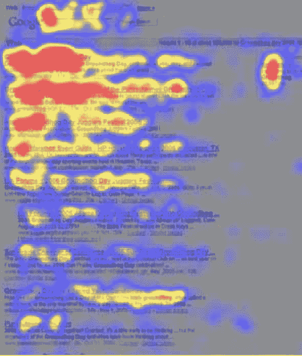

上面讲的这些都是人的生理极限，没有办法改变，你也不要试图改变。但我们了解了这些，就可以通过训练接近生理的极限。要怎么训练呢？

## 调整书本的位置

由于我们阅读的有效视角只有 1 度，因此 **快速阅读时，书不要捧得太近。把书捧得离你习惯的距离远些，养成这个习惯，可以提高 30%的阅读速度。**

## 学会用语音辅助阅读

有的人读书时真的在默读，这并不是一个好习惯。

我们一般在阅读时会一行行扫描文字，但是眼睛扫描的速度和我们理解的速度常常不一致。扫描慢了自然读不快，扫描快了脑子理解不过来会卡壳。这种不同步，让阅读速度降到了大约每分钟 300-500 个汉字。

其实，如果真做到这一点，速度还是不算太慢的，只是很多人根本达不到这个速度。

因此，提高阅读速度的关键，是不断练习眼睛和脑子的同步。

实验室里是这么做的：让人坐在计算机屏幕前，眼睛盯着屏幕不动，屏幕上的字缓缓移动，眼睛关注的中心区域字体加亮，这样阅读速度可以提高大约 50%，换算成汉字就是每分钟 500-600 个左右。

但人日常阅读的过程，并不能自动移动并且加亮文字，替代办法是用语音帮忙，辅助眼睛移动和脑子的配合。人眼和脑子是无法天生同步的，眼睛一扫而过，脑子往往跟不上。但用语音辅助阅读，能帮助眼睛扫描和脑子理解做到同步。

人在朗读陌生文稿时，遇到自己熟悉的词组，语速会快，不熟悉的，则要卡壳，可见，朗读和脑子思考是天然同步的。

用语音辅助阅读，不是真的读出来，而是用默读的节奏来控制眼睛扫描的速度。音千万不要发出来，那会降低阅读速度，只要脑子稍微想一下读音即可。

经过练习之后，你在看到熟悉的词组时，可能读了前两个音节，整个词组就识别完了，眼睛直接就跳到下一个词组了。

实验证明，通过这种训练，大约两个月后，可以提高大约 30%-50%的英语阅读速度。我想，对中文也应该同样有效。

## 练习：

在阅读下面这一段文字时，高亮的部分要一个字一个字地“读”过去的，而黑色可以用极快的速度扫过去的。如果黑色字真要读，也是要快到吞音的速度，一带而过。

在阅读时，眼睛要随着默读的速度在红色的文字（音节）处慢慢扫描，而在黑色部分迅速扫过。

宝石蓝是蓝色的一种，也称宝石蓝色，这种颜色比深蓝色更深一点，比较偏紫，代表冷静、智慧等。是一种晶莹剔透的蓝，比一般的要更深。

## 遇到不认识的词，不要停，跳过去

阅读并不需要理解每一个词，实验发现，如果从一个段落中抠掉 30%的文字，无论是人还是计算机都无法理解它的含义了。但如果抠掉不超过 10%的文字，计算机理解要差点，受过良好教育的人，基本上能恢复全部的信息。

因此，几个词不认识，不会影响人阅读。比如一个中年人不知道网络用语“喜大普奔”，跳过去完全没有问题，读到几次后，自然就学会了。

## 小结:

最后总结一下这一讲的内容。

提高阅读速度，要做到有意识地阅读，提高对文章结构和有用信息的敏感度。关键还在于脑和眼的配合，而语音是帮助眼和脑同步的辅助工具。稍微把书拿远一点，有助于提高速度。

## 作业：

如果你有兴趣提高自己的阅读效率，不妨做这样一个训练。

每天花几分钟时间练习协调眼睛扫描速度和脑子理解速度的协调性，然后合上书（或者屏幕），思考一下文章的结构，以及 6 个 W 和一个 H 的问题。

慢慢提高扫描速度，看看 60 天后（大约就是我们的课程结束后），阅读速度是否能提高，阅读一遍之后，记住的东西是否更多了。

下一讲，我们聊聊阅读的层级。

1.评价阅读效果，既要看是否把握了主题思想、作者的态度，也要看是否捕捉到了特定内容的具体信息。  
2.人脑接受信息的带宽和人眼识别图像的速度，是阅读速度的瓶颈。阅读不可能无限快。  
3.通过调整书本的位置、用语音辅助阅读和忽略不认识的词，可以有效提高阅读速度。

公众号懒人找资源，懒人专属群独享

# 07 层次：如何兼顾广度与深度？

吴军

2020-07-14

层次：如何兼顾广度与深度？

前两讲，我说了阅读应该读什么和怎么读得快，但我发现很多人的阅读不能兼顾广度和深度，要么什么都泛泛地看一点，没有自己的强项，要么钻到专业里出不来，视野太窄。

这一讲，我就来聊聊通过阅读获取知识的有效性。

**要想兼顾广度和深度，我觉得关键是阅读要分层。**

这种读书方法并不是我发明的，而是我从那些很擅长于读书，知识体系非常完备的学者们那里学到的。

我把书分为三类。

## 第一类：浏览的书，快速翻翻

为什么要翻书？是为了数量。

以我本人为例，如果逐句阅读，除非是读比较难懂的教科书，我们大约能长时间维持两分钟读一页书的速度。这个速度应该不慢了，但是仍不足以满足阅读量，又无法进一步提高了。

因此 **很多书我会跳着读，一开始读得仔细，中间有些章节就跳过去了，或者每一章头尾读得仔细，中间快速浏览一下。**

这样，我一个单位时间（半天或晚上，或者一趟四五个小时的飞机）可以翻完一本书。

为了保证阅读质量，在阅读的过程中，我在有兴趣的地方做很多记号，以便将来有时间仔细阅读。这么读一遍，我能了解书的轮廓和感兴趣的内容。

根据我的经验，即使觉得有价值，花钱买来的书，2/3 这么浏览一下就好，其它书只是随手翻翻。

浏览书不等于不关注细节信息。

对于做了记号，值得关注的内容，我经常直接用剪刀把有用的章节剪下来保存，剩下的书就扔进了回收桶了。当然如果是图书馆的书，我只能拍照了。

不过，近 10 年来，我从美国的图书馆借的书大多是音频的格式，这个数量就比较大，但是我坚持听完的不到 1/3。如果好，我会买来一本纸质。

有人可能觉得我这样对待书太浪费，但是读书获得哪怕两三页纸的信息，就不算浪费。

相比信息，书反而是很便宜的东西。

## 第二类：细读的书，逐句读完

这些书也包括一些我在浏览后决定再读一遍的。

我在读这些书的时候，会一边读，一边划重点。有时我还会对重点内容建索引，以便将来写作时需要，可以找得到。

## 第三类：典藏的书，长期放在我的书架上

它们又分两类，一类是作为参考书，我以后会用到。

比如《剑桥中国史》，上千万字，我并没有一字不落地读完。但是，在写作时我需要用它来验证信息的准确性。

另一类则是品读的书，大部分是经典著作。

这些书我甚至有两种语言的多套。既有羊皮封面的收藏版，也有翻得很烂的几块钱一本的廉价版。

这些书我读了很多遍，每一遍都有新的感触。我在后面的课程中也会带你一起读这类经典。

对于优质杂志，我会做同样的处理，大约有 10%左右能留下来，因为里面有写文章写得真是好。另外，根据我的经验，从了解信息来看，杂志比书更有效。

按照我这样的阅读速度，我能读得过来八九种期刊杂志，一份报纸，和每年 20-50 本书。

对于大部分人来讲，有这样一半的阅读量，我想应该足够了，大家如果能做到我之前说的一分钟 300 字以上的阅读速度，这应该不是件难事。

阅读为什么要分层呢？

因为 **分层阅读是我能找到的唯一兼顾知识面、知识完整性和深度的办法。** 接受能力再强的人，即便他每天不上班，只读书，也做不到精读大量的书籍。

我在约翰霍普金斯大学的老师雅让斯基，藏书量和读书量可能都是我的 10 倍，但是他 95%的书也不过是我所说的浏览过。

按照他的观点，绝大多数书，不值得仔细读，但是阅读量大是有好处的，除了拓宽知识面，更重要的是能够保证自己的想法客观中立。如果你只了解一个作者的观点，就有可能被他牵着鼻子走。

任何专业人士想做到一流，必须对所在领域有全面的了解。也就是说，既有知识面的宽度，又对某些问题有深度的理解。

我从 20 多岁做科研算起，每个月都要把所在领域那些顶级杂志全部读一遍，虽然大部分是浏览，但是至少摘要和结论是要看的，这样才能保证我在想法上的客观中立。

而且，这样在需要做判断的时候，我能够马上判断什么事情不能做，降低失败率，因为其它人把成功失败的经验教训都告诉你了。

后来我做投资也是如此，只有快速过滤掉那些不值得花功夫研究的项目，才有时间关注最有潜力的项目。

阅读的品位是土壤，有什么土壤种出什么样的植物。

最深层的阅读是树根，根不仅要扎得深，而且根系要发达才能吸收养分长出大树。比深层次阅读稍微浅一点的细读，是树的枝干。大量的浏览是树叶树冠。

一棵漂亮的树要枝叶茂盛，光秃秃的没人喜欢。树叶回落了再长，大量浏览的书籍文章可能很快就忘了，但是只要有好的阅读习惯，很快又枝叶茂盛了。

和一般的树所不同的是，知识树的枝叶是交叉联系的，是网状的，因此我们也称之为知识图谱。一个人通过阅读，可以构建出自己的知识图谱。

通过分层次，可以大大拓展阅读的宽度，但阅读也必须顾及到深度，如果所有的书都是泛泛地阅读，就难以深入一个专业，这就要说到怎么通过深度阅读读出“深意”的问题了。

深度阅读和浏览的差别不仅在速度和对细节的了解上，而是在一开始它们目的就不同，然后导致方法不同。

首先， **深度阅读的一个目的是在把一本书读透之后，用它的内容构建我们整个知识体系和认知的框架。**  
比如读教科书就是这个目的。我离开学校这 20 年，也还继续读了十来本教科书。

好的学习者，合上教科书，闭上眼睛，能把整本书的要点按照一个线索都整理出来。做不到这一点，说明没有吃透。

为了做到这一点，遇到不懂的地方，需要花时间搞懂，甚至要看一些参考书。而浏览书的话，这些都可以跳过去。

其次， **深度阅读的另一个目的是为了去伪存真。**

今天的大众媒体，喜欢标题党，断章取义，甚至稍稍歪曲事实。其实大部分时候我们没必要搞清楚那些事实。但是，有些问题必须掌握真相，以保证我们是生活在真实的世界里，而不是梦中。只有深度阅读，才能完成这个目的。

这时，深度阅读要做这样两件事：

其一，审查每一个观点是否有依据，信息来源是否可信。

其二，对一些专业的材料，需要做专业的理解，甚至需要专业人士帮助解读，以免自己有错误的理解。

比如，我最近读到一篇论文，是斯坦福医学院的一些研究人员，在论文预发布网站上提前登出来了一篇预测新冠病毒肺炎感染人数的论文。论文原文是英文的，我把它具体内容简单介绍一下。

这些研究人员抽查了医学院所在的圣塔克拉拉县 3300 人，发现大约有 2.5~4%的居民已经感染了该病毒，而目前该地区报告的感染病毒的人不到人口的万分之五。于是他们得出结论，这种病毒的实际感染数量是报道的 50-85 倍左右。

这篇论文一出，就受到了媒体的关注。

如果简单看论文，这些研究者的统计方法和结论似乎无懈可击，他们是这么做的：

首先，在 Facebook 上做广告，邀请志愿者来医院参加免费测试。然后研究人员根据报名者的性别、种族和邮编（地址）做了一些筛选，保证样本的平衡性。然后他们发现这些人中有 1.5%的人感染了病毒，再考虑到有些细分组的样本不足，做了一些统计上的调整，得到了 2.5~4%的居民已经感染病毒的结论。

乍一看，他们的方法似乎也没有问题。作者又是来自著名的斯坦福医学院。这似乎属于专家的正确结论。

对于阅读者来讲，怕就怕看到斯坦福三个字，看到随机抽样，就直接相信了结论。

但是，如果你自己认真读一下那篇论文，就会发现藏在细节中的魔鬼。看似有代表性的样本，其实并没有代表性。

我为什么这么说呢？

因为这个研究其实是假随机。

要知道，当时这个地区已经颁布了居家隔离的限制令，一般人如果没有点症状，或者担心，是不会往医院跑的。能跑去医院检测的人，多少有点担心，考虑到反正是免费测试，就去了。

要真想做随机抽样，就应该到居民区随机敲门，不管里面的人愿意不愿意，都进行检查，那才是真的随机。

https://www.medrxiv.org/content/10.1101/2020.04.14.20062463v1

## 小结：

总结一下：为了兼顾阅读的广度与深度，一个人的阅读应该分层，用于典藏的书，需要深度，不断反复阅读；用于实现知识完整性细读的书，有助于建立自己的知识图谱，翻翻浏览的书，可以用于扩大视野。

不同的书花的力气不一样。

## 作业：

你有没有自己的典藏书目，能不能跟大家分享一下？

下一讲，我们聊聊阅读的一个门类，经典文学的阅读。

1.读书要想兼顾广度和深度，关键是分层阅读。 2.书可以大致分为三类：浏览的书，快速翻翻就行；细读的书，要逐句读完；典藏的书，值得长期放在书架上。  
3.深度读透一本书，就可以用它的内容构建知识体系和认知的框架。

公众号懒人找资源，懒人专属群独享

*   \_\_ 0
    

**成为自己** 

1 浏览的书翻一翻\\n2 细读一本书简历标记和索引\\n3 典藏时不时拿出来读一读，剪下来或者做记号

2020-06-08 20:36:31

# 08 欣赏：如何体会经典文学的魅力？

吴军

2020-07-14

欣赏：如何体会经典文学的魅力？

上一讲最后，我讲到了深度阅读，这一讲，我就用一些经典文学作品作为示范，跟你聊聊，我是如何发现和感知文学魅力的。

很多人只爱看畅销小说，读经典文学觉得沉闷。希望借着这一讲的例子，帮你在阅读中也能体会到这种魅力。

我们开始。

第一个例子是狄更斯在《双城记》的开头说的一段话。

那是最美好的时代，那是最糟糕的时代； It was the best of times, it was the worst of times,  
那是智慧的年头，那是愚昧的年头； it was the age of wisdom, it was the age of foolishness,  
那是信仰的时期，那是怀疑的时期； it was the epoch of belief, it was the epoch of incredulity，  
那是光明的季节，那是黑暗的季节； it was the season of Light, it was the season of Darkness，  
那是希望的春天，那是失望的冬天； it was the spring of hope, it was the winter of despair  
我们拥有一切，我们一无所有； we had everything before us, we had nothing before us,  
我们全都在直奔天堂，我们全都在直奔相反的方向 we were all going direct to Heaven, we were all going  
direct the other way 一一简而言之， – in short, 那时跟现在非常相像，某些最喧嚣的权威坚持要用形容词的最高级来形容它。  
the period was so far like the present period, that some of its noisiest  
authorities insisted on its being received, 说它好，是最高级的；说它不好，也是最高级的。 for good or  
for evil, in the superlative degree of comparison only.

这段话非常有名，因为即便是从原文翻译过来，失去了一部分原文的美感，也让人读起来朗朗上口，想起来富有哲理。

我把原文和译文一一对应放在了一起，希望你能对照中文读一读原文，这里面没有什么生僻的单词，语法非常简单，并不难懂。

为什么要让你读一读原文呢？因为像这样的语句里面的神韵是翻译不出来的。

我们知道唐诗很难翻译成英文，因为翻译之后诗韵就没了。其实好的英文诗文也很难翻译成汉语，道理是一样的。

**读文学，首先是去体会语言的美感。一种成熟的语言，它不仅能承载信息，还有它的美感，翻译只能解决信息问题，但往往带来美感的折损。**

具体到这段话，有很多翻译的版本，我选取的是译林出版社孙法理先生的版本，另外一个比较流行的版本是人民文学出版社石永礼、赵文娟两位老师的版本，我也放在了文稿的最后，有兴趣的同学可以对比一下。

但无论是哪种翻译，其实都很难把狄更斯语言的精妙之处译出来。接下来我就带你对照着中英文，欣赏一下狄更斯的表达艺术。

在这段文字中，狄更斯用了五个表示时代的词，原文里分别是 times，age，epoch，season，spring/winter，中文分别翻译成了时代、年头、时期和季节，以及春天、冬天两个具体的季节，以示区别，但其实这样的翻译，或者其它几个版本的翻译，我觉得都很难表达出原文的准确性。

首先，我要说说这四个时间名词的差异。

按我的理解，times 是对时间和年代最泛泛的说法，第一句话中用的形容词 best 和 worst，恰好是形容词最高级中最泛泛的关于好坏的说法。

这一句话的意思是，那是人类历史上所有时间中最最好的一段时间，当然同时也是最坏的。

当然，我这样的解释如果直接写到译著中就不优美，因此翻译家不得已，用大家读起来比较通顺的话翻译出来。

第二句话中使用了 age 一词，虽然它也有时代的意思，但是细讲起来是一年、几年这种长度的的年代，相比之下后面的 epoch 是比较长的时间段。

比如我们说，地球现在处于地质年代的第四纪的全新世。这个全新世，就用的 epoch。

至于 season，是比 age 更短的时间段，它不一定非要指一个季度，也表示时代，但非常具体。

而且，我还要提醒你注意，狄更斯这里还遵循了具体配具体，抽象对抽象的语义搭配原则。

他把最抽象的时间和好坏搭配放在最前面，然后进一步从智慧和愚昧，信仰和怀疑，光明和黑暗，三个层面进行解释。

其中信仰和怀疑在精神世界是最高层面的，狄更斯用了跨度范围最大的 epoch 来和它们对应。

此外春天总是和希望联系在一起，冬天让人感到绝望，因此最后一句的搭配很自然。这一段文字是在不断强化讲一件事，但是读起来不会感到啰嗦，而且层层递进。

有些中文译本，把这四个表示时间的词，times、age、epoch、season 统统翻译为年代，就是没体会到狄更斯表达的苦心，显得是在讲车轱辘话了。

最后，狄更斯还做一个总结。

很多人在最后总结时，喜欢用，“因此”或者“所以”作为衔接，但是狄更斯用的“in  
short（简而言之）”文学气息更浓。类似场景下，有时我喜欢用“概括来讲”这个词，也供你参考。

细细品读狄更斯这段原文，会感觉畅快淋漓，不由地赞叹文学语言的美妙之处，和我们读唐诗赞叹中文美妙是同样的。

给你做这样的文本分析，正是我之前讲，很多文章要深度阅读的原因。

这段话之所以这么重要，还不光是因为它文笔上的精妙，它也是全书的文眼。

整段话核心的修辞笔法是对比，把看似一组组矛盾的概念放到一起，强调矛盾是有作者的深意的。要知道《双城记》这本书讲的是法国大革命前后故事。

法国大革命的特点就是不妥协，没有温情脉脉，非黑即白，没有灰度，没有折中。

那个时期，同时上演着善良与邪恶、友情与阴谋、自由与暴力的大戏，狄更斯就是要让大家看清楚人类历史上这个充满了矛盾，既伟大又血腥的时代。

同时作者也告诉读者，即便是在那个时代，依然充满着人性的光辉。

你看，同样一段话，深读可以读出这么多东西来。

很多文豪和狄更斯一样，会在他们的著作中，开篇就用一两句话概括全书。

*   托尔斯泰在《安娜卡列尼娜》中开篇写道“幸福的家庭都是相似的，不幸的家庭各有各的不幸”，这预示着卡列宁和安娜家庭未来的不幸以及全书悲剧的结局。
    
*   简奥斯丁在《傲慢与偏见》开篇是这样写的：“饶有家资的单身男子必定想要娶妻室，这是举世公认的真情实理……正是因为这个真情实理家喻户晓深入人心，这种人一搬到什么地方，尽管他的感觉见解如何街坊四邻毫不了解，他就被人当成了自己这个或那个女儿一笔应得的财产。”（张玲、张扬译本，人民文学出版社）
    
*   海明威在《丧钟为谁而鸣》的开头讲了英国诗人多恩的一首诗，讲：“……不要问丧钟为谁，它其实为你而鸣”。
    
*   而尼克松在自传《角斗场上》开篇用了美国前总统西奥多·罗斯福的一句话：“荣誉属于真正置身于竞技场上的人……”
    

这种表现手法的目的都是为了先声夺人，当然，他们也为我们留下传诵至今的名句。

为什么有些文学经典值得反复读呢？

因为这样才能体会语言的美感和文字的魔力，这就如同我们欣赏米开朗基罗的绘画，或者贝多芬的音乐一样。

很多文学大师，给我们树立了一些表达思想的样板，他们用一些很普通的词和语法上很简单的句子，把自己的想法甚至是人类共同的想法，准确而优美地表达出来了，让语言有音乐一般的韵律，绘画一般的色彩。

**深度阅读文学作品，不仅能够体会语言的魅力，也更能把握作者真实的含义。**

接下来，我就以鲁迅的《故事新编》中的《铸剑》为例，进一步来说说作者在作品中会埋藏什么样的深意。

《铸剑》的故事原型出自中国古代的志怪小说集《列异传》，故事大意是这样的：

楚王请天下第一铸剑名师干将、莫邪夫妇为他铸剑。干将夫妇知道剑成之日就是自己丧命之时，因为楚王怕他们给别人铸剑。于是二人铸了雌雄两把剑，雌剑献给了楚王，雄剑由莫邪保留，将来由他们的遗腹子去报仇。干将在献了剑之后果然被楚王所杀。

16 年后，干将、莫邪的儿子眉间尺长大成人，决心报仇。

但是他一个孩子办不到这件事，这时他遇到了侠士宴之敖。宴之敖讲，他可以去杀了楚王为干将一家报仇，但是需要宝剑和眉间尺的头颅。眉间尺相信宴之敖，就把自己的头和剑交给了他。

宴之敖以献眉间尺的头晋见楚王，并设计，在煮头的鼎边用宝剑砍下了楚王的头，最终为干将一家报了仇。

同样的故事情节，鲁迅改编它的价值在哪里呢？

在我看来，是鲁迅给细节赋予了新的深意。这篇小说是鲁迅去世前不久完成的，他一生致力于改良中国社会，但是看客们是唤不醒的。小说里有作者一生的隐喻。

比如残暴的楚王，想报仇的眉间尺，侠士宴之敖，分别象征了反动的旧势力，年轻时的鲁迅和成熟后的鲁迅。

在鲁迅改编过的故事中，暗示了干将莫邪铸剑时，就开始觉醒了，因此准备了为后来报仇的武器。觉醒，向旧世界复仇，是鲁迅自己的写照。但是眉间尺有复仇之心，却无复仇之力，这也是鲁迅对年轻时自己的写照。

鲁迅后来以改造社会为己任，对应到小说里就是宴之敖的形象。小说最后写，仇报了，周围却仍然都是看客，鲁迅暗示自己的希望落空了。

确实有一些书需要精读。但并非所有人都是像鲁迅那么写书，因此并不需要所有的书都那么读。很多书意思表述得很浅显，往深了读，过度解读，就没意思了。

## 小结：

经典文学，之所以值得反复读，是因为只有通过深读，才能体会到语言的美感、文字的魔力和作者的深意。

## 作业：

能不能分享一段你深度阅读过的文学作品，做个分析？

关于阅读方法论的部分，我就讲解到这里了。阅读是写作的基础，从下一讲开始，我们进入写作方法论模块。

## 附录：

**石永礼、赵文娟老师翻译版：**

那是最好的年月，那是最坏的年月；

那是智慧的时代，那是愚蠢的时代；

那是信仰的新纪元，那是怀疑的新纪元；

那是光明的季节，那是黑暗的季节；

那是希望的春天，那是绝望的冬天；

我们将拥有一切，我们将一无所有；

我们直接上天堂，我们直接下地狱。

简言之，那个时代跟现代十分相似，甚至当年有些大发议论的权威人士都坚持认为，无论说那一时代好也罢，坏也罢，只有用最高比较级，才能接受。

1.一种成熟的语言，它不仅能承载信息，还有它的魔力。所以读文学，要去体会语言的魔力。 2.深度阅读文学作品，也会更深刻地把握作者真实的用意。

公众号懒人找资源，懒人专属群独享

# 09 起步：如何从害怕写到天天想写？

吴军

2020-07-14

起步：如何从害怕写到天天想写？

从这一讲开始，我们进入写作方法论的模块。

大部分人写作所面临的第一个问题就是不知道写什么。无论是给一篇命题作文还是自选题目的任务，憋半天写不出几十个字。

今天无论是学生还是职场人士，大部分人其实没有过这个坎。一个具体的表现就是遇到要写点什么，大家就到网上去搜索范文。

糟糕的是那些范文基本上没有思想，和计算机自动产生的文章没有什么区别，把它们抄下来改几个字交上去，既不可能得到好分数，也不可能受到领导和同事的尊重。

一个人熟练的书面写作者，通常都会经过从“害怕写”到“天天想写”，再从“天天想写”到“不轻易落笔”这样两个过程。

这一讲，我以美国私立中小学以及大学对不同阶段写作的要求为蓝本，结合我的体会，介绍完成第一个过程——也就是从害怕写到想写——的 5 个进阶步骤。

按照这五步练习，每个人都有希望成为书面表达的高手。

为了方便你理解，我会对照发朋友圈的例子来说明。

写出一篇好文章，和发一个广受大家点赞的朋友圈没有本质区别，都是要很好地表达自己。

## 第一步：找个有趣新鲜的题材，开始写

这个阶段写得好坏并不重要。

我们在小学时都被要求过写观察日记，把每天看到的事情随便记录一些下来。

但这看似简单的事情，很多小学生其实写不出来，憋半天不知该写什么，从哪里入手。如果读别人观察日记的范文，就更气馁了，觉得自己的差距大，却又无从入手。

其实，写观察日记就像用手机拍张有趣的照片，然后加一句文字说明那么简单。

拍什么不重要，关键是你自己拍的，而且要说清楚什么时候、在哪里、为什么拍它，就可以了。

比如今天一个孩子去动物园玩，看到了食蚁兽，这可能是之前只闻其名未见其物的哺乳动物。这时候如果手机在手，肯定会咔嚓一下就把它记录下来。

接下来家长问他？从照片上看到什么了？他可能会说，食蚁兽有长长的身体，长长的头，长长的鼻子，长长的舌头，总之都是一个“长”字。

继续启发孩子，为什么食蚁兽身体各部分都有“长”这个特点呢？这个原因不难找到，因为它需要把头伸进蚁穴吃蚂蚁。

接下来如果观察得再细一点，可能会看到它的长鼻子外面有鳞甲，长成这样应该跟吃蚂蚁有关，这就又找到一个身体特征和习性有关的证据。

把上面这些发现都写出来，就是一篇很好的观察日记。

当然，也可能孩子在动物园没看到新鲜的动物，只看到了过去在视频和图片中已经见过的长颈鹿和大象。这是不是就没得什么可写了呢？不，即使这样，把对它们的印象写出来也可以。

比如“长颈鹿远没有我想的那么高” “大象的牙齿远没有想的那么长”。这些都是观察到的现象和感受。

俞敏洪老师讲过这样一件事，他的一个农村老乡，到了北京见到天安门后大失所望，因为它没有闪着金光。你看，这其实就是一个很好的观察。

**任何一个让我们感觉到“原来如此”，或者“原来不过如此”的见闻，都是很好的写作题材。**

## 第二步：让主题画面突出出来

写东西最重要的，就是要突出主题。

就好比如果拍了张照片发到朋友圈，朋友在评论区问：“你照的啥？”那就算是拍失败了，即便你和他讲：“是食蚁兽，在左上方那个树丛里，你放大就看见了”。也无济于事了。

书面表达和口头表达不一样，人没有机会辩解。合格的记录者要让食蚁兽在照片中足够突出，一眼就能看见。

不是说周围不允许有环境背景，但是那些背景只是为了反应食蚁兽的生存环境和生活习性，而不能喧宾夺主。

你不妨用这个标准去过滤一下自己以前写的东西，表达的主题是否突出，是否参杂了太多没有用的信息，以至于别人看了之后不知道在说什么，或者即使知道在说什么，却觉得没用的内容太多。

当然，有人会讲，我没有长镜头，食蚁兽就是拍不大，周围画面就是太多。

就像很多人在写作时，当时没有机会仔细观察和思考，事后想不起来细节，为了凑字数，就扯一些没用的事情。这就如同画面不够清晰，硬要通过增加背景来增加像素。

其实，这时候最好的办法是做一次裁剪，把没用的画面裁掉，这样得到的图片可能像素并不高，但是你表达的目的能达到。

能记录新鲜有趣的东西，并且突出主题，做好上述这两步，就达到了初中的作文水平。

## 第三步：形成具有动感的故事

如果向别人介绍食蚁兽，可能一张整体的照片是不够的，因为看不到细节。但是你如果只拍它的带有鳞甲的鼻子，或者它的尖爪子，大家可能又不知道你在拍什么动物。

因此，你需要拍一组照片来讲述一个完整的故事。如果你看过介绍动物习性的纪录片（比如央视的《动物世界》），就会发现它常常是先带给你一个整体的画面，然后带你进入一些特写镜头的描述里，了解动物的生活细节。

至于选取哪些细节，就有讲究了。最能反映食蚁兽特点的细节是它们的长舌头、尖鼻子等等，它们的尾巴不重要。但是，如果是讲述孔雀的故事，美丽的尾巴就是重点了。

按照美国私立高中对作文的要求，一篇合格的作文需要有轮廓、细节和故事情节。

轮廓很好理解，食蚁兽的轮廓不能看上去和长颈鹿一样。对于细节的选择就有讲究了，它们需要支持主题和故事情节，和这个目的无关的，哪怕自己再感兴趣，也不要选择，除非打算更改主题。

当然，堆砌细节并非就能写好文章，还需要有一条线索把它们给串下来。

比如我们讲动物的习性，可以用它“一天的生活”来串，也可以用它的迁徙来串，不同人会有不同的线索。

注意，线索替代不了主题，这是两回事。

不仅记录一件事情（记叙文）要有线索，说明一个观点也要如此，我们会有一个整体的看法、态度，这是轮廓。

然后有支持它的证据，这是细节。这些细节不是以清单的方式罗列，而是要根据一条线索展开。

达到这些要求，就能写一篇合格的高中作文了。这样的作品，多少就会有人来点赞。到这个时候，基本上就做到想写随时就能写。

## 第四步：让读者产生共鸣

人在高中以前，写作常常是文笔练习。但是到高中以后，不管是申请奖学金，还是要表达对某件事的看法，写作常常是有现实的目的的。如果目的没有达到，就是失败。

**为了达到写作目的，挑选素材很重要。**

比如同样是食蚁兽这个题材，如果是环保人士，想通过一组短片或者一小段视频表现食蚁兽的生活习性，强调它们对保护环境的作用，可能需要找到食蚁兽吸食白蚁的画面、被白蚁侵害的树木的画面等等。

这些画面放在一起，要让读者或者观众的心随着一同震颤。如果观众主动转发，说明他产生共鸣了。达不到目的的素材，你再喜欢也没有用。

**为了让对方和我们一起产生共鸣，写东西的时候还要看对方是谁，还要以对方的认知体系为前提进行交流，做到有的放矢。**

有些人写提职申请，心态是求求你们，提拔我吧，我这么多年没有功劳也有苦劳，这种写法常常不会产生什么效果。

其实，如果上级和同事看了后觉得，贡献真大，不提拔你，整个公司就没有公平可言了，你的目的就达到了。

如果是一份申请研究生或者奖学金的材料，系主任看到后觉得，如果不把你招进来，就是系里的损失，这个目的也就达到了。

## 第五步：形成自己的风格

这是对专业写作者的要求。

贝聿铭的建筑、夏加尔的绘画、鲁迅的杂文、张爱玲的小说，一看就知道出自他们之手。这就是自己的风格。

我曾经花了不少钱跟随一位摄影大师去学摄影，他从不教我技巧，总是强调自己的风格以及按动快门那一瞬间的感受。在他看来，没有风格的作品，永远可以被替代，相应的艺术家就不可能有立足的根本。

关于风格，还要顺便说一句，不要简单模仿一个人的风格，那样很快就让人看出来是廉价的复制。要形成自己的风格，需要了解很多人的风格。

在清华教我艺术史的王乃壮教授和我讲，当初徐悲鸿先生对他们的要求，是需要了解至少 500 个艺术家的风格，这样才会产生自己的风格。

很多人读我三本以上作品，应该能体会到我的写作风格，但是要知道我自己读了不知道多少人的多少作品。

当然，这是对专业人士的要求了。

## 小结：

这一讲是写作训练的总纲。从找到新鲜题材写起来、突出主题，到形成具有动感的故事、让别人产生共鸣，最后进阶到形成自己的风格，是一个持续进阶的过程。

相信按照这种方法进阶，你也会产生天天想写的冲动。

## 作业：

请你按照以下四个步骤在朋友圈（或者知识城邦）发观察日记：

1.  把自己这周自己拍的，发到朋友圈的照片写成观察日记，说说自己为什么要拍它，在按动手机那一瞬间自己的感受。
    
2.  对这一周自己发的朋友圈，或者看到的朋友圈中的照片做一个点评，看看哪些照片重点不突出，杂乱无章。
    
3.  下次再拍照，发朋友圈之前，考虑一下用一些照片构成一个故事，而不是照片的罗列。当那些照片构成故事后，把故事写下来。
    
4.  针对某一个群（或者在自己的朋友圈里），发一些照片和自己的文字描述，打动读者，看看是否有人为你点赞，或者回应你。如果有，分析一下是什么原因让别人产生了共鸣。
    

也欢迎你来留言区聊聊自己做这个练习的收获。

下一讲开始，我们进入写作进阶的细节，先讲讲写作中怎么让外行了解陌生的东西。

1.从“害怕写”到“天天想写”，你需要经过五步：发现新鲜题材开始写、学会突出主题、让故事有动感、让别人产生共鸣、形成自己的风格。  
2.任何一个让你感到“原来如此”或“原来不过如此”的见闻，都是很好的写作题材。 3.想让读者产生共鸣，既要了解读者的偏好，也要学会挑选素材。

公众号懒人找资源，懒人专属群独享

*   \_\_ 0
    

**成为自己** 

走出黑暗的屋子，看到天上弯弯的月亮，那一刻心情也美丽了起来，按下快门，心情也好了一些

2020-06-08 20:55:38

# 10 比喻：怎么让外行理解陌生的东西？

吴军

2020-07-14

比喻：怎么让外行理解陌生的东西？

上一讲说到，要让读者和自己产生共鸣，需要在他们的认知水平内进行表达，但是如果我们不能够提供一些别人不知道的东西，他们又会觉得乏味。

怎么把别人不知道的东西讲清楚？这对于写作者是一个很大的挑战。我的经验是，很多高手会借助比喻。

讲到比喻很多人会说，这在小学就学过，比如形容女孩子的脸像苹果一样，还有什么好讲的。

这没有错，比喻确实每个人都学过，但是真要把它用好不容易，用不好要么显得俗气，要么把原本容易理解的事情搞复杂了。

我们先来看一个经典的比喻，它出自《诗经》的一首诗，叫《卫风·硕人》：

手如柔荑（tí ），肤如凝脂，领如蝤蛴（qiú qí），齿如瓠（hù）犀，螓（qín）首蛾眉，巧笑倩兮，美目盼兮。

这是描绘春秋时期齐庄公女儿庄姜之美，这里面用了一连串的比喻。

荑是白茅草的芽，它又白又细，用来形容女性纤纤手指非常恰当。

蝤蛴是一种昆虫的幼虫，像蚕宝宝似的，形容脖子白而长。

瓠犀是瓠瓜的瓜子，是白色的，而且排列整齐，用来形容牙齿洁白整齐。

螓是像蝉一样的昆虫，用螓首，也就是蝉的头来形容额头丰满开阔。

蛾眉比较好理解，是说女子的眉毛像蚕蛾的触须，细长而弯曲。

大家可以想象，庄姜应该是个子高高的（所谓的硕人），手指纤长白皙，肌肤光滑柔嫩，脖子又白又长，牙齿洁白整齐，额头饱满，弯弯的细眉，这是今天的标准美人。

在上面的诗句中，大多是用植物和昆虫来做的比喻，这可能是当时的人比较接近大自然，对它们比较熟悉。

## 1.用熟悉的事物形容不熟悉的事物

从这个例子里面可以看出比喻的第一个特点，就是 **用熟悉的事物形容不熟悉的事物** ，所谓“由简喻难”。

不仅比喻如此，任何描写都应该是用熟悉的概念解释不熟悉的，千万不要反过来。

今天很多人为了卖弄学问，用一些读者不容易懂得概念来形容普通的概念，其实就起不到表达自己的作用。

比如今天很多学者在给大众写读物时，经常用到“修昔底德陷阱”这个词，这个词在 Google 上有 300 万个搜索结果，可见它使用之频繁。

不知道有多少人真的能体会这个词的含义。这其实就是一个比喻，多数人用它是来形容“大国必有一战”的。而“大国必有一战“这种直白的说法，只有 2 万个搜索结果。

写学术文章不妨这么用，让老百姓读就没有必要了。这种比喻就违反了由简喻难的原则。

## 2.用来打比方的事物，相似点要直观

比喻的第二个特点是 **用来打比方的事物，相似点要直观** 。

我们常说柳叶眉，大家马上能想到它是形容眉毛的形状，相似点在形状，而不是颜色。我们说桃花脸，则能想到它的颜色，而不是形状。

这种联想是天然的，不需要解释。前面那首诗中写的“齿如瓠犀，螓首蛾眉”便是如此。

用熟悉形容不熟悉，相似点要直观，做到上面两点，就有可能成为一个风趣的、能够把复杂道理讲明白的人。

## 3.通过比喻产生美感

但是这还只达到了使用比喻的初阶水平。再往上一层，我们需要做到通过比喻产生美感，写出来的东西才能打动人心。

《晋书·王凝之妻谢氏传》里讲过谢安的侄女——著名才女谢道韫的一个故事。

她小时候和叔伯兄弟姐妹们在一起，赶上天降大雪。谢安让他们来形容雪。谢安的侄子谢朗就说像在天空中撒盐。

这种比喻有两个毛病，一来用不存在的事情来形容常见的现象，二来缺乏美感。

谢道韫则说，未若柳絮因风起，这不仅贴切，而且柳絮飘飘摇摇的画面极美。形容女子有才的成语“咏絮之才”就是这么来的。

历史上另一位具有咏絮之才的女子是李清照，她的词中有非常多具有美感的比喻。比如形容太阳落山的景色，她用了“落日熔金，暮云合璧”；形容桂花，她用“揉破黄金万点轻，剪成碧玉叶层层”来比喻。

一些缺乏视觉形象的事物，比如音乐，我们看不见，很难直接描写。

白居易在《琵琶行》中用了大量的比喻来形容音乐，诸如“大珠小珠落玉盘”。

我问过一些人为什么喜欢某首歌或者乐曲，他们回答我只有一个词——好听，我又问他们怎么好听，他们会说，就是好听，音乐又看不见，没法给你描述。

这不是音乐无法描述，而是因为这些人不善用比喻。

而德国音乐评论家莱尔斯塔勃在听了贝多芬的第十四号钢琴奏鸣曲后讲，它“犹如在瑞士琉森湖月光闪烁的湖面上摇荡的小舟一般”。

这个比喻准确形象，于是这首名曲就获得了《月光奏鸣曲》这个名称（顺便说一句，我们小学课本里讲贝多芬为盲人姑娘演奏《月光奏鸣曲》的故事是杜撰）。

除了音乐，心情也很难直接描写，也需要用比喻。

比如南唐后主李煜写的“问君能有几多愁，恰似一江春向东流”，这个比喻直观、形象，而且和前面讲的几个例子一样，非常具有美感。文字有美感，有时就会吸引人不断读下去。

## 4.创造概念，浓缩某方面的认知

我理解，比喻的第四个层次要上升到思想层面，是要创造一些新概念，浓缩人类在某个方面的认知。

日本的村上春树是一位非常擅长使用比喻的作家，他的小说里通篇是比喻，我们后面还会讲到他的一些作品。村上创造过一个词，叫做文化扫雪工（《舞舞舞》中），这些人其实就是我们今天互联网上常说的“小编”。

这些人所从事的工作并不重要，也不痛苦，但是必须有人来做，就像下雪天专门负责扫雪的人一样。但“文化扫雪工”这个词就比说“小编”要友好，而且有美感。

今天我们常说在事业上遇到了玻璃天花板。这是一个比喻，很容易理解，你看得见，但是突不破。

这个词来源于美国女权主义记者玛丽莲·洛登（Marilyn  
Loden），她在 1978 年的一次演讲中，用这个词说明在职场上对女性无形的歧视，在职场中攀升，总会感觉一层看不见的障碍阻隔在上面。洛登因为这个词，被评为了 20 世纪 100 个争取职场平等的女权主义者之一。

在洛登之前，其实法国著名女作家乔治桑就形容过女性这种困境，但她用了一个过于文学化的词“坚不可摧的水晶穹顶”（une voûte de cristal  
impénétrable），虽然表达的意思差不多，却不容易流传。

今天玻璃天花板其实已经成为了形容任何人在职业上遇到无法突破的极限的代名词。可以讲这个词的出现，是对人类思想的一个贡献。

在汉语中，通过比喻创造出来的词也很多。

比如前面讲的柔荑、凝脂、蛾眉就被专门用来代表女性的手、肌肤、脸蛋，或者眼眉等等，蛾眉甚至可以泛指美貌的女性。

钱钟书先生讲的“围城”、杨绛先生讲的“洗澡”，也都是很好的比喻，今天它们都成为了专有名词。这些通过比喻创造出来的文化概念，不仅读者容易理解，而且也会让作者出彩。

我出版的第一本书是《浪潮之巅》，这个书名其实就是比喻，浪潮代表一代又一代的产业发展趋势。现在，站在浪潮之巅已经成为媒体上常用的说法了。

在这本书中，我还用了一个比喻——企业的基因。我用基因这个词来形容一个企业中与生具来的、难以改变的特色和行为方式，大家就很容易理解。“企业的基因”今天也成为了一个常用比喻。

由此可见， **比喻远不只是为了生动形象，亲切自然，它是我们传递思想，让读者便于理解的一个重要的工具。** 如果我们想让读者更好地理解，就需要善用比喻。

大家如果听过我的《谷歌方法论》和《信息论 40 讲》，就会发现里面有大量的比喻，比如我用芝麻、西瓜、大象和地球来形容量级的差异。没有这样的比喻，就很难让非理工科的同学理解差 100 倍、1 万倍和 100 万倍是什么概念。

我要额外说一下，和一般直白的比喻不同，理解有些文学作品里的暗含的比喻，也就是隐喻，需要有一定的文化背景。

比如诺贝尔文学奖得主波兰女作家托卡尔丘克，她的小说《太古和其他的时间》以及其它作品里面充满了隐喻，如果对波兰近代的历史不太了解，就不太容易读懂她的书。

由此可见，有些时候比喻的使用是一把双刃剑，它可以让一部分读者更喜欢，也可以让一些潜在的读者望而却步。我们上一讲说到写作要看读者是谁，有针对性地说话，也是这个道理。

## 作业：

请你使用比喻的技巧：

1.  向你奶奶解释比特币；
    
2.  劝说剁手党朋友少花点时间网购。
    

欢迎在留言区写下你的练习，咱们提倡短文，最好在 300 字以内说清楚。

## 预习：

川端康成《古都》的第一节《春花》。

1.比喻是我们传递思想，让读者便于理解的一个重要的工具。 2.比喻最基本的原则是“由简喻难”，用直观的表达讲清楚。  
3.高手运用比喻，还能通过比喻写出美感，甚至通过比喻制造概念，浓缩认知。

公众号懒人找资源，懒人专属群独享

# 11 写景：如何寓情于景？

吴军

2020-07-14

写景：如何寓情于景？

人的心理活动其实是很难描述的，喜怒哀乐固然会有表情，但不是所有的表情都会挂在脸上，更何况人的心理活动，要比情绪复杂得多。

写作中怎么让别人看到心理活动呢？其中一个好办法就是寓情于景。

希望你做了上一讲的预习作业，已经读了日本著名作家川端康成代表作《古都》中的第一章《春花》。

小说开头主要是景致的描写，写得非常细致入微。他是这样描写的：

千重子发现老枫树干上的紫花地丁开了花。 “啊，今年又开花了。”千重子感受到春光的明媚。  
在城里狭窄的院落里，这棵枫树可算是大树了。树干比千重子的腰围还粗。当然，它那粗老的树皮，长满青苔的树干，怎能比得上千重子娇嫩的身躯……枝桠从倾斜的地方伸展开去，占据了整个庭院……  
在树干弯曲的下方，有两个小洞，紫花地丁就分别在那儿寄生。并且每到春天就开花。 打千重子懂事的时候起，那树上就有两株紫花地丁了。  
上边那株和下边这株相距约莫一尺。 妙龄的千重子不免想道：“上边和下边的紫花地丁彼此会不会相见，会不会相识呢？”

当然，川端康成不是为了卖弄他的文笔，这么写景物是有目的的。

古树洞里的两株紫花地丁，其实代表了千重子和她失散的姊妹，在小说家笔下，虽然两个人住得其实并不远，但是却无法相见、相识。

这样的景致描写在《古都》中随处可见，它们不仅让作品极富抒情性，而且呈现了京都这个城市的风貌。

后来很多人干脆就拿这本书作为京都的旅游攻略，这可能并不是川端康成最初的目的。

我觉得能把心理活动和感受写好的作家非常了不起。

比如川端康成就把千重子的想法通过她看到的景物，以及对她对景物的态度表现出来。用王国维的话讲，就是“以我观物，故物皆着我色彩”。  
**寓情于景是个写人心理活动的好工具。**

但是情和景的联系，并不是那么简单。

人的心情会随外在世界，也就是景变化而变化，就像范仲淹所讲的，如果你登岳阳楼时，赶上“淫雨霏霏，连月不开，阴风怒号，浊浪排空”，心情就是“去国怀乡，忧谗畏讥，满目萧然，感极而悲者矣。”

相反如果赶上“春和景明，波澜不惊，上下天光，一碧万顷”或者是“长烟一空，皓月千里，浮光跃金，静影沉璧”，那么心情就是“心旷神怡，宠辱偕忘……喜洋洋者矣”。

但更多时候，同样的景色，不同心情和文化背景的人来看，心情会不一样，把景和人对照着写，景就有了主观色彩。

比如杜牧在《齐安郡中偶题二首》写道：

两竿落日溪桥上，半缕轻烟柳影中。

这是一个大诗人眼里美好恬静的乡村日落景色。

类似地，范成大在《早发竹下》写道：

碧穗炊烟当树直，绿纹溪水趁桥湾。

但是，在一个辛苦了一天，扛着锄头回家的老农民眼中，炊烟除了呛得他咳嗽，弯弯溪水除了让他多绕路，没有什么好处；太阳只剩下两竿高了，他得趁着天还没有黑赶回家。

这就是不同人眼中景物的差异。

对我来说，这种看上去矛盾的情景关系，在信息论里却可以找到科学依据。

先说说前一种情随景移。

**人的心情和外在景物可以产生相似性关联。** 有些文学作品中会利用这种关联性，用景来暗示心情。

更重要的是第二种，假如有一个多视角的信息源，从不同视角看过去，看到的信息不同，那么我们根据接收到的信息，就能反过来找出相应的视角。

比如炊烟既有在杨柳的背景中梦幻的感觉，却又有呛人的味道。这是它不同的性质，在写作中，选择不同的性质，就刻画出不同的人，不同的生活。

比如我读到这样一段写炊烟的文字：

黄家屯的傍晚炊烟四起，空气中飘散着饭菜和浓烟混合的味道，小丫光着脚站在门外，她用力吸了一口气，那股味道呛得她剧烈的咳嗽了几声。

这位小女孩过的生活和杜牧、范成大一定有天壤之别。

世界上传世作品中所反映的语言现象，很多都能够找到科学依据。并非那些作家需要懂什么理论，而是他们在写作中无形中遵守了规范之后，作品就流畅、精炼、易懂，得以流传。

我们喜欢寓情于景，而不是寓情于食物的味道，或者听到的声音，也很少寓情于身体的触觉，当然，除了一些男女之情的描写，这是因为正常人 70%以上的信息都是靠眼睛获取的。

相比我们，美国著名的盲人女作家海伦凯勒就不幸很多，她又聋又瞎。因此，她在自传中即使有景物的描写（其实还不算少），都是别人转述给她的的，而她亲身的感受则是来自于嗅觉、触觉和对温度的感受。

比如她在描述去见马克吐温时的情节，是这样写的：

“松林里吹来的风带着淡淡的清香。马车缓缓地行进在曲折的山路上。”  
“我们很舒服地坐在熊熊的炉火前，室内飘着清爽的松香。我们喝着热腾腾的红茶，吃着涂了奶油的吐司，感到无比的舒适。吐温先生对我说，这种吐司如果再涂上些草莓酱就会更好吃。”

你可以感觉到她无论是在路上，还是在马克吐温的酒店里，心情都是非常兴奋愉快的，这是她寓情于景的方式，而我们其实很难体会松林的清香。

接下来，我就从三个层面来说如何掌握好寓情于景这种写作手法，我们从易到难。

## 第一层：采用人们已经习惯的思维定式

比如在季节上，春天象征着新生命和希望，夏天象征着旺盛的生命力，冬天象征着死亡。

至于秋天，一直有两种看法，一种是肃杀，另一种是收获和成就。至于为什么会有多种，这是我们要在第二个层面讨论的问题。

再比如在颜色上，红色代表温暖和热情，橙色（金色）代表生命和希望，绿色代表青春和平和，白色代表朴素和纯洁，等等。

在山川河海上。山、峰属于壮景，和男性相关，而水、小溪则是阴柔的。

我的印象里，在西方的语言中，和陆地上的壮丽景色相关的自然物通常是阳性名词，和水相关的则是阴性的。甚至在陆地上跑的交通工具也是阳性的，而在水中的船则是阴性的。这算是语言给人植入的思维定式。

就算在汉语中不分阴阳性，但是我们讲平湖秋月或者三潭映月，你也会想到阴柔的美。

寓情于景的思维定式，其实你只要阅读量够了，很容易总结出来，当然一些帮助写作的读物也会提供相应的样板。

## 第二层：通过不同人看同一景致的不同态度，折射他们的心情

讲回到秋天，欧阳修的《秋声赋》中完全是肃杀之气，而杜牧的“霜叶红于二月花”则充满了生命力。从这中间我们可以读出作者心情的不同。

**看到同样东西，不同的反应，也可以推断人的性格。**

比如到了一天将要结束时，李商隐看到的是“夕阳无限好，只是近黄昏”，他觉得生命和仕途快要走到终点了，而海明威则说，“明天太阳照样升起”，他是一个不屈服的硬汉。

即使是相似的句子，在不同的语境下，反映出来的心情也是不同的。

元曲中最有名的一段小曲，当属王实甫《西厢记》中的： “碧云天，黄花地，西风紧，北雁南飞。晓来谁染霜林醉，总是离人泪。”

这是在写崔莺莺送张君瑞进京赶考时分别的情节，由于整个西厢记是喜剧，这段描写看似悲，但实际上心情是轻松的。

这几句曲子是根据范仲淹《苏幕遮》改写的，范仲淹的原词是这么写的：

碧云天，黄叶地，秋色连波，波上寒烟翠。山映斜阳天接水，芳草无情，更在斜阳外。 黯乡魂，追旅思。夜夜除非，好梦留人睡。明月楼高休独倚，酒入愁肠，化作相思泪。

范仲淹当时正在镇守西北边关，他写的是将士们思乡的心情，就沉重得多了。

关于心情和景物的互动，我还给你分析了沈从文《边城》的一个例子，如下：

这本书讲的是湘西小镇上一个非常单纯、善良的船家少女翠翠的纯爱故事。她从小和爷爷相依为命，她一直有一个担心，就是如果爷爷不在了，自己怎么办。在第四章里，有这么几句话：  
落日向上游翠翠家中那一方落去，黄昏把河面装饰了一层薄雾。翠翠望到这个景致，忽然想起了一个怕人的想头，她想：“假若爷爷死了？”  
由日落黄昏，联想到生命终结，这是很正常的事情。因此，日落触发了翠翠的不安全感，如果爷爷死了自己怎么办。这个问题一直潜伏在书中，是翠翠后面要回答的。过了一会儿翠翠在一个吊脚楼下，听到几个水手们在聊天，然后  
“且听水手之一说楼上妇人的爸爸是在棉花坡被人杀死的，一共杀了十七刀。翠翠心中那个古怪的想头，“爷爷死了呢？”便仍然占据到心里有一忽儿。”  
楼上的妇人是个妓女，因为爸爸死了，被逼出来讨生活，沦为妓女。翠翠此时联想到如果爷爷死了，自己可能也会沦落到这个地步。  
害怕养活我们并提供保护的长辈亲人死去，对自己的未来缺乏安全感，是十几岁孩子常有的担心。我读到这里就想到我自己也有过这样的担心，非常能理解翠翠的心思。  
在小说的最后，爷爷死了，他所爱的傩送也离开了，而翠翠一夜之间长成大人了。我们的成长也是如此，在某一天，我们终于不担心自己能不能养活自己了，对于过去自己的那些担心，可能会淡淡一笑。

## 第三层：在情和景之间建立一个桥梁

除了我们在第一层讲到的那些定式，要将复杂的情和景结合得天衣无缝，需要一些技巧，要做到这一点不容易，因为同样的景在不同的读者看来可能会有不同的理解，这就需要你去用桥梁建立共识。

在这方面的经典作品当属《岳阳楼记》，它 2/3 左右的篇幅是写景，最后转而抒发自己的政治情怀。

前面讲的是凡人都会心随物移，后面却讲士大夫要做到“居庙堂之高则忧其民，处江湖之远则忧其君” “先天下之忧而忧，后天下之乐而乐”。

这个跳跃似乎有点大，在这两部分之间，“不以物喜，不以己悲”这八个字起了关键作用。

大家可以把他们想象成高楼大厦砖石之间的水泥，没有这些粘结剂，直接把砖石落在一起，大厦是不稳固的。

中国历史上另一篇寓情于景的名篇是王勃的《滕王阁序》。

它前一半写美景，写胜友如云、高朋满座的盛况，后面其实在写自己渴望遇到明君施展政治抱负，投笔从戎，乘长风破万里浪。

这两部分如果直接放在一起是非常生硬的。因此王勃用了整整一段文字讲述为什么自己看到那样的美景，会有如此的联想。

他的逻辑基本上是这样的，先从美景盛宴想到了天高地迥，宇宙无穷，然后想到人生的渺小，要建功立业，机会和明君很重要，最后写如果我有这样的机会，要立志报国。

这样从写景到写情，逻辑上就通顺了。

## 小结：

看不见的内心活动，可以用寓情于景的方式传达出来。

想要寓情于景，可以借助人们的思维定式，也可以用景物折射人物的心理，但无论如何，都要在情和景之间架设桥梁。

## 作业：

写一段 300 字以内的短文，练习寓情于景。

1.寓情于景是个写人心理活动的好工具。 2.想要寓情于景，可以借助人们的思维定式，也可以用景物折射人物的心理，但无论如何，都要在情和景之间架设桥梁。

公众号懒人找资源，懒人专属群独享

# 12 写情：如何写好心理活动？

吴军

2020-07-14

写情：如何写好心理活动？

高尔基曾经说过，“一个人真实的性格并不经常在他的言语里，而是在他隐秘的内心活动中。”

上一讲我们说到寓情于景，这当然是一种含蓄曲折的表达方式。更多时候，文学作品是通过心理描写来塑造人物的。

同样的，在我们生活中，也需要清晰地表达自己的心理感受，来让别人了解自己的意图。

描写好心理，不仅仅是文学家的事情，这个技能我们每个人都用得到。 **所谓情商高，就是善于理解别人的内心，表达自己的内心。**

比如：你可能需要给老板写封邮件，表达自己得知被提升后的兴奋之情、感激之情。从范文中抄几个例句显然不行，万一老板读过会觉得你不真诚，写得太肉麻又会适得其反。

当然，过了几天，也许你需要向老板说明别人抢了你的功，你除了讲事实以外，可能还需要讲讲自己在得知这个消息后，有多么震惊。

这时如何表达自己的心情也是有讲究的。这些表达心理感受的技巧，人不会天生就知道，我们可以从文学作品中学习，先看看别人是如何描写的。

用的心理活动描写可以大致分为直接描写和间接描写。

直接描写是最常用的手法，我们举三个例子来说明。

## 例一：《项链》片段

第一个例子是取自莫泊桑的《项链》，里面有这样几句话：

她（玛蒂尔德）一向就想望着得人欢心，被人艳羡，具有诱惑力而被人追求。她陶醉于自己的美貌胜过一切女宾。

几句简单的话，把女主角玛蒂尔德是什么样的人向读者介绍得一清二楚。

## 例二：《红楼梦》片段

第二个例子是《红楼梦》第三十二回《诉肺腑心迷活宝玉 含耻辱情烈死金钏》里的。

史湘云劝贾宝玉考一个功名，宝玉说是混账话，然后说：“林妹妹不说这样混帐话，若说这话，我也和他生分了。”

这时林黛玉正好经过——

听了这话，不觉又喜又惊，又悲又叹。 所喜者，果然自己眼力不错，素日认他是个知己，果然是个知己； 所惊者，他在人前一片私心称扬于我，其亲热厚密，竟不避嫌疑；  
所叹者，你既为我之知己，自然我亦可为你之知己矣，既你我为知己，则又何必有金玉之论哉；既有金玉之论，亦该你我有之，则又何必来一宝钗哉！  
所悲者，父母早逝，虽有铭心刻骨之言，无人为我主张。

最后，黛玉想到自己身体不好，怕自己薄命不能和宝玉走到头，不禁叹息。

曹雪芹通过喜、惊、悲、叹这种内心独白的方式，把黛玉的心理感受写得入木三分而合情合理。而且通过这次独白，不仅描写出黛玉的内心、她对宝玉的感情和她的担心，作者也明示了宝黛之间真正的感情，这就从一个人的心理到了两个人的关系。

在两个人之间表达表达自己感情和想法时，很多人觉得有无数的话要说，但是理不出头绪。

其实 **黛玉的喜、惊、悲、叹四种情感，可以作为你的清单提示符，人需要表达的主要情感无非就是这么几种。**

## 例三：《老人与海》片段

书中只有一个主要人物，就是老渔夫圣地亚哥。

他老了，一连 84 天都没有钓到一条鱼，但他仍不肯认输，在第 85 天钓到一条大鱼。那条鱼太大了，圣地亚哥和它斗了两天两夜才把大鱼杀死。

但是当他把大鱼拖到岸边时，来了一群鲨鱼抢夺他的战利品，老渔夫拼尽全力击杀鲨鱼们，但他的鱼还是被啃光了，筋疲力尽的老人最后拖着一副鱼骨头回到了港口。人们看着骨头惊叹于这条鱼的巨大。

由于在大部分篇幅里只有一个人物，整部小说其实都是在描写老渔夫的心理活动。海明威的写作手法是用老人的独白（自言自语）来反映他的内心。

比如他在第 85 天感觉到有鱼咬钩时，是一种盼望已久渴望而又怕失望的心情。他自言自语地说：

来吧，再绕个弯子吧。闻闻这些鱼饵。它们不是挺鲜美吗？趁它们还新鲜的时候吃了，回头还有那条金枪鱼。又结实，又凉快，又鲜美。别怕难为情，鱼儿。把它们吃了吧。

这是他在恳求鱼。但是很快他的手又感到没有了动静，鱼游走了，于是开始恳求。

求天主帮它咬饵吧。 它不可能游走的，天知道它是不可能游走的。它正在绕弯子呐。也许它以前上过钩，还有点儿记得。

等到鱼转了一圈又来咬钩时，虽然他知道鱼会掉过头来把饵吞下去的，但是这一次他没有敢说出声，因为他知道，一桩好事如果说破了，也许就不会发生了。

这种得而复失的担心便被描绘得淋漓尽至。

最后鱼终于咬钩了，他内心充满了喜悦：

它咬饵啦，现在我来让它美美地吃一顿。

等鱼把钩咬实了，老人喊了一声，“着（zhao）啊！”然后双手使劲猛拉钓索。

老人的整段心里活动就这样被惟妙惟肖地描绘出了，我们读起来很有画面感。

《老人与海》整部小说都是这样通过揭示老人的内心世界推动情节的发展的。其中最有名的一段独白，是大家熟悉的这句话——

不过，人不是为失败而生的，……一个人可以被毁灭，但不能给打败。

你看，这个例子，这个例子不仅描绘出了老人的心理，也传递出了海明威的心感受和他对人生的态度，小说里面的老人，不过是作者的化身。

海明威为这位老渔夫赋予了坚强、宽仁、勇敢而不服输的特质，也就是后人对海明威本人的评价——硬汉。

在海明威的作品中，经常有这样的人物，他们在巨大的压力和厄运打击下，依然勇往直前，即使失败也保持了人的尊严。老人的独白，就是这些人内心的独白。

另外多说一句，海明威在《老人与海》里的表白，其实是两种大家可用的范式：

一种是表达自己即在努力多次都失败后，终于看到了胜利曙光时心里的忐忑；

另一种是在遇到困难时自己给自己打气，或者在一群人中间给大家打气时，该怎么说话。

在历史上，麦克阿瑟说过“老兵不死”，凯撒说过“真正的勇士只死一次，而懦夫在倒下之前已经死了多次”。而海明威塑造了一个永恒的文学形象。

## 怎么间接描写内心活动？

接下来我们花一点时间讲讲怎么间接描写内心活动。这里面最常见的方式我分为两种：

一种是通过描写行为来描写内心，比如你如果读到这样的话——“他站在那里，两眼发呆，又惊又怕，身体不停颤抖”。这样写，人物的内心想法就已经传达了十之七八。

另一种是借别人的嘴说出来，或者由别人的话产生感触和联想。下面的这个例子跟我自己有关。

我读到《倚天屠龙记》第二回最后一段，讲少年张三丰在师傅觉远大师去世后，和郭襄分别时，一个人不知道该去哪儿。

忽见一对小夫妻从身旁经过，那女子责备丈夫，说道：“你一个男子汉大丈夫，不能自立门户，却去依傍姐姐和姐夫，没来由的自己讨这场羞辱。咱们又不是少了手脚，自己干活儿自己吃饭，青菜萝卜，粗茶淡饭，何等逍遥自在？偏是你全身没根硬骨头，当真枉为生于世间了。”

然后她又说，“常言道得好：除死无大事”。

张三丰想：“郭姑娘说道，她姊姊脾气不好，说话不留情面，要我顺着她些儿。我好好一个男子汉，又何必向人低声下气，委曲求全？这对乡下夫妇尚能发奋图强，我张君宝何必寄人篱下，瞧人眼色？”

于是独自上了武当，成为一代宗师。

少年张三丰当时正在茫然之际，心思被那个村妇说出，产生了感触。

我读到这里，也就记住了“除死无大事”这句话，大家可能看到我在之前的专栏里这句话讲过很多次，出处便在这里。

以后，我每次遇到难事时，总想起这句话。这时候人的心思，和书中人物的心思，是相通的。

## 小结：

这一讲我们说了直接和间接的心理描写，文学大师的过人之处，在于能够把人的心思描写得很透彻。

通过分析各种描写心理的文字，你也可以看到，不同时代、不同国家的人其实内心有相通之处。

## 作业：

练习写一段 300 字的心理描写，可以是直接的内心独白，也可以是我们讲过的间接描写。欢迎把作业发到留言区。

下一讲，我们聊聊讲故事的技巧。

1.表达自己的心理感受，是一种通用能力。 2.喜、惊、悲、叹四种情感，可以作为你的清单提示符，人需要表达的主要情感无非就是这么几种。  
3.间接描写内心活动的方式有两种：借助行为描写内心，和借助别人的话来描写内心。

公众号懒人找资源，懒人专属群独享

# 13 叙事：如何牵着读者走？

吴军

2020-07-14

叙事：如何牵着读者走？

我在约翰霍普金斯大学读书的时候，每写一篇论文，我的导师库旦普教授都要把我的稿件打回来很多次，等我写博士论文时，他打回来的次数就多得不计其数。

有时候，次数太多，我都不耐烦，向他抱怨说，那些写得不如我的同学，导师也让发表了，而我这篇文章里，想法、实现结果、逻辑性足够好了，为什么还要改。

库旦普教授总是说，故事讲得还不够吸引人，我们可能还要换一个角度来解释。然后他就讲，如果花得功夫少，可能将来读的人也少。绝大部分科技论文，除了自己和审稿人，恐怕读的人两只手就能数得过来，这样时间一长，很难在同行中获得认可。

他特别强调， **写任何东西，都应该像讲故事、写小说一样。**

今天回想起来，我非常感谢他对我写作的帮助。把故事写得吸引人，牵着读者走，不仅让我的论文能够得大奖，也让我后来写的书广受欢迎。

故事大家都爱听，但不同的人讲故事的效果差别巨大。有的人讲故事别人不愿意听，而有些人讲故事，大家会花钱去听。

故事怎样才能吸引人呢？这一讲我们重点谈讲故事的顺序。

## 1.顺叙

一般人讲故事，会按照时间（或地点）次序来讲，或者按照因果关系发生的次序讲，或者按照重要性顺序讲，这是最常见的办法，我们称之为“顺叙”。

顺叙好处很多，作者比较容易写，读者也比较容易读，毕竟先知道原因，后知道结果是我们正常的思维方式。而且，一环扣一环，没到最后大结局，悬念就可以一直牵引着读着往前走。

《达芬奇密码》的作者丹·布朗的书大多如此，你捧起来就想一口气读完。

但是很多时候，优点搞不好就成了缺点。用顺序的办法讲故事，有三个坑要特别注意：

1.  要避免流水账。很多中学生写作文，都是因为简单地按照时间次序写成了流水账，而工作中最无聊的公文，也往往是 1、2、3、4 地罗列事实。
    
2.  要避免跑题。这种想到哪儿写到哪儿的做法，时常讲到后来就逐渐跑题了，很多人的邮件就有这个毛病。也正是因为这个原因，我以前在谷歌培训新入职的员工时，都要求他们在写邮件时，如果不知道怎么写得漂亮，就先把重要的事情说了，这样即使最后跑了题，最重要的事情大家也都知道了。
    
3.  要避免结构散掉。作品要有完整性，如果中间有环节扣不上，读起来就别扭。
    

顺叙故事的经典作品非常多，我就不一一列举了。

你如果有兴趣，可以把我们这门课里提到的和推荐给大家的作品分析一下，把顺叙讲故事的挑出来，自己看看那些故事是怎么讲的。

## 2.倒叙

相比顺叙，倒叙则是难度更高的写法。

稍微简单一点的，可以像《了不起的盖茨比》和电影《美国丽人》那样，先交代一个结尾，然后就按时间先后写。

更厉害的，是把今天当作锚定点，往回讲一点故事，又回到今天，再往回讲，逐渐抽丝剥茧，把谜团解开。

这种写法里一个非常成功的例子是《英国病人》。

小说一开始，一架英国飞机在飞越撒哈拉沙漠时被德军击伤，迫降之后，驾驶员受了重伤，虽然被当地人救起来，送往盟军的战地医院，但是那名驾驶员却想不起自己是谁，因此被叫作“英国病人”。

医院的护士汉娜孤身一人留下来照顾他，他们留在了意大利一个远离战争被废弃的修道院里。在宁静夜晚，“英国病人”静静的躺在房间的木床上，逐渐恢复了他的记忆。

然后作者化身为汉娜帮助英国病人回忆，一点点搞清楚了过去发生的故事，每一次破解一些谜团，作者又把大家带回到现实。

如果你没有读过这部小说，可以在得到每天听本书里听一听这本书的解读（点击文末链接即可学习）。

倒叙和顺叙的本质差别在哪里呢？

顺叙写法由于会在最后公布结局或者结论，因此要让读者脑子里的悬念集中在“是什么”上。倒叙是先告诉你结论，让大家把注意力放在“为什么”上。

比如大家读阿加莎克里斯蒂的侦探小说，结果是知道的，就是人已经死了，读者好奇的是他是怎么死的。

而同样是悬念小说，大家读丹·布朗的书关心的是将要发生什么。

所以 **为了不同的目的，可以用不同的顺序来讲故事。**

比如你在单位里给领导做汇报，只有 10 分钟时间，不妨先给他结论，特别是那些让他喜出望外的结论，吊起他的胃口，再给他讲你是怎么做的，他可能会有问题，而你不断回答他，就是抽丝剥茧解决谜团。

但是，如果你给 100 人做一个 1 小时的报告，就不能这么做了。通常需要从背景、工作的性质，到方法，再到结论这样依次来讲，因为大部分听众未必对你的工作有足够的背景知识，你需要按部就班地告诉大家。

另一方面，你即使有一个非常好的结论，听众也未必像你的老板那样惊喜，先告诉他们结论的好处，不如把它作为悬念留到后面。

## 3.“叠叙”

除了顺叙和倒叙，文学作品中还有更复杂的叙事顺序，这就是《呼啸山庄》和《吕蓓卡》（也就是电影《蝴蝶梦》的原著小说）所用的写作方法。

这种叙事策略，中文里没有什么现成的词汇，为了方便你记忆，我把他叫做“叠叙”，交叠的叠，是说叙事逻辑有前后的穿插交叠。

当然，可不是胡乱交叠。所谓叠叙，它其实是找到一个时间锚点，然后采用倒叙的方式展开故事，或者跳回到最早的时间，然后，再按照顺序的方式讲。

为了帮助你理解，我在下面放了三张叙事时间轴的示意图，建议你看一下。

顺叙是按时间先后，一个情节接着另一个情节讲。

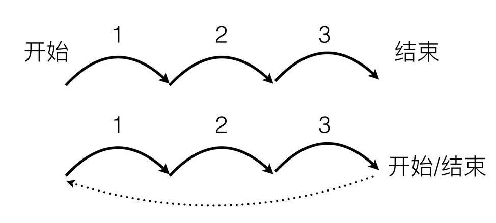

而在倒叙的写法中，需要有一个时间上在最后的锚定点，其他情节是在追忆中不断回到这个锚定点。

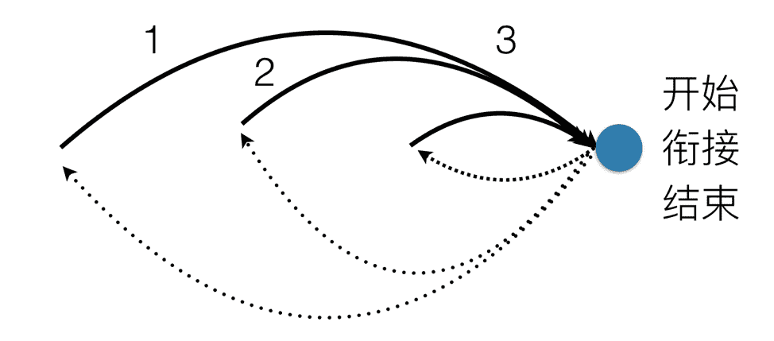

但《呼啸山庄》和《蝴蝶梦》中，则采用了更加灵活大胆的叙事顺序。

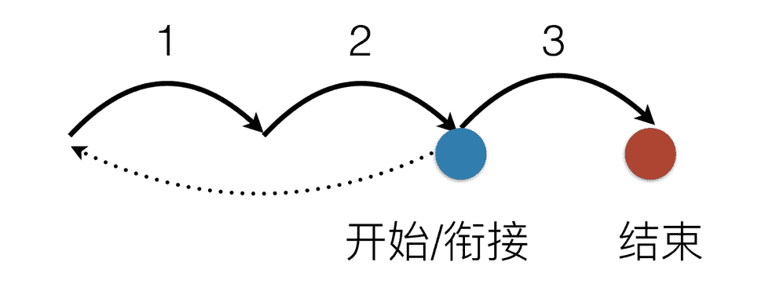

讲述是从故事中偏后的某一个点入手，作为锚定点开始讲故事。然后采用倒叙的方式展开，或者跳回到最早的时间后，按照顺序的方式讲。在讲到锚定点后，接着讲后面发生的故事。

读这种故事，没经验的人确实会糊涂。

但这种讲故事的方式有什么好处呢？

实际上，它结合了上述顺叙和倒叙两种方法的优点。前面说了，顺叙强调结果有悬念，过程是自然的。倒叙强调过程的悬念，但失去了结果的悬念。

但叠叙是在前一部分，给大家留下过程的悬念，但是对于最终的结果大家在读到结尾之前，一直不知道，因此这个悬念也保留了。

我们不妨以《吕蓓卡》为例来讲讲这种讲故事的方法。

《吕蓓卡》是 20 世纪英国女作家杜穆里埃的作品，后来被电影大师希区柯克将它搬上了荧幕，电影的中文译名《蝴蝶梦》在中国的名气更大。

故事一开始，是年轻姑娘“我”在法国南部海边偶遇英国贵族马克西。俩人一见钟情，闪电结婚，然后一起回到马克西在英国曼陀丽的豪华庄园。

一夜之间山鸡变凤凰的“我”对贵妇人的生活方式很不习惯，而前女主人吕蓓卡陪嫁带来的老管家丹弗斯看不起“我”，还暗中给“我”使坏。

在这个古老的大庄园里，到处都是吕蓓卡的影子，甚至充满了阴森恐怖的氛围。整个故事就围绕着“我”破解吕蓓卡之谜展开。现实生活是锚定点，吕蓓卡之谜则把读者不断地带回到过去。

后来，随着一条沉船被打捞起来，吕蓓卡的尸体被发现，似乎故事有了结论——马克西杀死了前妻吕蓓卡。这时时间回到了锚定点，看似故事该结束了。如果这是这样，它的结构就是一个简单的回忆倒叙。

接下来开始进入情节反转阶段，从锚定点出发往前走，最后告诉大家真相其实是另一回事。

马克西其实对吕蓓卡之死并没有过错，但管家丹弗斯却不愿意女主角从此过上幸福的生活，放火烧了庄园， 也烧死了自己。

这种讲故事的方式是不是比简单的顺叙或者倒叙更精彩？

我学会这种叙事方法，是看了《呼啸山庄》这本书，这本书因为我后面会专门分析，这里就不介绍了。

后来我在《浪潮之巅》和《文明之光》中，经常采用这种手法，比如我在写微软的故事时，是从它被反垄断诉讼写起的。写苹果和乔布斯的故事时，是从乔布斯和盖茨见面写起。写牛顿的贡献，是从他的葬礼写起。

前面是倒叙，后面是顺叙。这种写法需要挑好锚定点。因为这个锚定点是最先和读者见面的事件，因此要吸引人。

其次，在后面还需要有一个比它更重要的高潮，这样才能让作品在高潮中结束。

另外，我在做汇报时，如果要汇报一些麻烦和困难，我也会采用这种方式去做。先把坏消息告诉大家，然后讲原因。

但是故事到这里没有结束，最后我会给出解决办法，也就是用所谓的好消息，把故事推向高潮。

## 小结：

叙事可以按照时间顺序依次写，但这样容易平铺直叙，好的故事讲述者，要学会通过打乱时间轴，来控制读者的注意力。倒叙和叠叙都是更复杂的叙事技巧。

虽然你未必会写书，但是了解上述三种叙事顺序的优缺点，灵活应用它们，也能成为善于表达的人。

## 作业：

请你试着关注叙事顺序，写一段 300-500 字的故事。可以是顺序、倒叙或者叠叙。

下一讲，我们聊聊怎么让你的写作更富有魅力。

1.写任何东西，都应该像讲故事一样，牵着读着走。  
2.讲故事有三种常见的叙事顺序：顺序、倒叙、叠叙。顺叙强调结果的悬念，倒叙强调过程的悬念，叠叙综合了两者的优点。

公众号懒人找资源，懒人专属群独享

# 14 技巧：如何写得有魅力？

吴军

2020-07-14

技巧：如何写得有魅力？

这一讲，跟你分享五个我自己常用的写作高级的技巧。不光是专业写作，即便只是想在平时工作和生活中表达自我，这些技巧也能帮上你的忙。

## 1\. 设置悬念

悬念不仅存在于侦探小说，也不仅限于文艺作品，任何一个吸引人的作品，都需要有一些悬念，包括科技论文。

有人可能会说，这是不是为了贩卖悬念而夸大其词，其实你读读大师们的科技论文，就会发现我所言非虚。

我一直非常推崇一篇诺贝尔奖的论文，一共 A4 的纸一页半不到，却提出了悬念，又解开了谜团，这就是沃森和克里特关于遗传物质 DNA 结构的那篇佳作。

论文一开始设了一个谜，让人马上就想知道谜底。然后它给读者排除了一些可能性，最后揭晓答案。为了结论有说服力，他们又给出了补充的证据。读完之后我感叹，大师就是大师啊。

国外像沃森和克里特这样会写论文的学者不少，比如著名机器学习专家柯林斯教授（哥伦比亚大学教授），他的博士论文堪称范文，我的导师库旦普教授将它作为范文推荐给我们。那篇论文也像侦探小说一样设置谜团、破解谜团。

后来柯林斯教授曾经五年三获 COLING/EMNLP（机器学习和自然语言处理领域最高水平的学术会议）的最佳论文奖，这和他会写论文有莫大的关系。

要怎么在作品中设置悬念呢？

比较常用的是 **期望式悬念** 。它建立在对读者不保密的基础上。

比如科学论文，方法和结果大家都会有所了解和预期。一般的小说、非虚构作品、回忆录等等，都属于一类。

为了激发读者的好奇心，作者需要在结果可预期的前提下人为制造紧张的情节，增加对立面。

比如在《天龙八部》中，有大量的情节是关于萧峰调查自己身世的，金庸给他安排了一个看不见，却又无时不在的对立面。有了这个对立面就容易制造悬念了。

在论文写作中，经常要做比较，那就是安排对立面，勾起读者兴趣想知道到底哪种方法、方案、观点更好。

我在写《硅谷之谜》时，就安排了很多期望式的悬念。

比如一开始讲述很多大家知道的关于硅谷成功奥秘的说法，这就是我树立的对立面，但是我将它们一个个否定掉。接下来通过进一步又一步深入分析，告诉大家那些表面现象背后的本质是什么。

而更吸引人的是 **突发式悬念** ，它主要依靠对读者保密，通过使人大吃一惊的情节，让人发出“原来如此”的感叹来达到效果。

当然情节的发展虽然在意料之外，却必须在情理之中。有的人为了制造悬念，刻意反转结局，搞得前后自相矛盾，漏洞百出。这就是画虎不成反类犬了。

我过去在中学时，比较喜欢看阿加莎克里斯蒂的侦探小说。她的小说既合乎逻辑，又惊险离奇。

近几年带有悬念的小说我喜欢看丹·布朗的。他的小说文笔一般，套路过于明显，但是在制造悬念方面做得非常好。读他的书，就是在解谜，当然最后的谜底会出乎大部分人的预料。

不光是写小说，制造悬念的技巧也可以用于作报告或者发布消息，乔布斯就是这方面的行家。

我的朋友阿历克斯∙阿萨罗曾经是微软语音项目的负责人，后来到苹果负责 Siri 项目。他刚到苹果时非常惊讶于各个部门之间不讨论工作问题，这和大部分研究所鼓励大家喜欢讨论工作的做法截然相反。

后来他知道这是乔布斯留下的文化，因为乔布斯认为，一个产品卖得好不好，要看有多大的突发式悬念。如果在开发过程中和太多的人讨论过，大家对将来的产品会有准确的预期，就不会有轰动效应了。

当然乔布斯的这种做法有一个前提，就是那个新产品所带来的悬念真能轰动。

## 2\. 有张有弛

悬念让阅读具有张力，但高明的写作也要懂得把握节奏，有张有弛。

我们叙事的策略要和读者阅读时的精神忍受限度有关。

有的人为了制造悬念，或者戏剧化的效果，让读者始终处于紧张状态。这时，读者会感到疲惫，可能随手把书扔到一旁了。

**好的叙事策略是有张有弛，悬念的设置与平和的叙事要交替出现。**

有些时候，可以把读者胃口吊起来，有些时候要适当地缓解情绪，同时又让读者为进一步紧张做精力上的准备。

在这方面，《水浒传》是一个很好的范例。

书中主要的人物有二三十个，一个个写很松散，但如果整本书作为一个整体来写，大家读起来又会很累。

施耐庵将它分成了几个“十回”，比如讲述鲁智深和林冲故事的林十回，讲述杨志和晁盖等人故事的杨十回，以及“武十回”，“宋十回”，“卢十回”等等。

每个十回里会有高潮迭起的故事，但是高潮过后，作者通过一些很优美的文字带着大家休息。

比如在描写鲁智深大闹桃花村，又和史进一同杀了两个恶人后，就进入一段平缓的叙述中，讲鲁智深来的东京汴梁城时所看到的繁华景象。这为接下来讲述林冲故事的高潮做准备。

再比如讲完了宋江杀了阎婆惜四处逃命这段紧张情节过后，作者安排了一段很轻松平和的文字，讲宋江在柴进庄上避难遇到武松的故事。

不光是小说，平常写文章、作报告也用得上这个技巧。

一般来讲，人很难集中精力超过五分钟，让读者和听众精神集中了五分钟之后，一定要让大家放松一下。

## 3\. 管中窥豹

第三个技巧，管中窥豹。这是指通过一个细节把全景讲清楚。

我在《文明之光》中写美苏太空竞赛时，选择了将它写成冯·布劳恩和科罗廖夫两个人的竞赛。用的就是这个技巧。

好莱坞有很多大片，投入了很多钱，但是票房表现平平，而且大家的评价很低。比如《特洛伊》《珍珠港》等等。

在此之前，还有差点把二十世纪福克斯搞垮了的《埃及艳后》。这些制片人的初衷很好，想把宏大的历史场景记录下来。但是由于场面太大，很难把控，更难以添加细节。

相反，《拯救大兵瑞恩》和《兵临城下》。前者通过一个瑞恩这个大兵反映了战争的惨烈，而后者通过苏德双方两个狙击手在斯大林格勒会战中斗智斗勇，全景展现了那场被誉为二战转折点的战役。

这都是通过一个点、一个侧面，甚至一件小事来展示全景。

在这方面给我很多启示的是余华的小说《活着》和电影《阿甘正传》，他们通过两个小人物，描绘了两个大时代。

## 4 .点睛之笔

一篇好的作品，还常常需要点睛之笔，比如说警句。

今天人们常说“金句”这两个字，它和警句都有含义深刻的意味，但是警句更有警示和激励的意味，要激发读者思考。

很多时候大家读完一篇作品，里面的细节全忘光了，但是里面的警句都记住了。

比如《岳阳楼记》，可能大部分人今天已经背不下来了，但是，它里面的“先天下之忧而忧，后天下之乐而乐”大家都记得。

读过《双城记》的人大多记得开篇的那几句话：“这是一个最好的时代，这是一个最坏的时代……”很多作品就是因为有这么一两句话而被后人知晓的。

要想写出这样的点睛之笔的，需要做好两点：

第一是善于总结作品的内容，最好能用一句带有“标语性质”的话把自己要说的内容总结出来。要注意的是，这句话不能断章取义，更不能做标题党。

比如我在《智能时代》一书中讲，未来社会首先受益的人可能只占人口的 2%，这句话一下子引起了读者注意，但是这个结论是总结了过去三次工业革命得出来的，不是凭空吓唬人。

第二是要考虑读者心理和知识背景，说什么话能让他们有所触动，最好是替他找到一句话，把他思考了很久但是想不透彻的思路一下子点清楚。

比如巴菲特讲“永远不要问理发师你是否需要理发”，这就点出了客户和基金经理人之间的利益冲突。

再比如他说“垃圾资产总有一天会变成名符其实的垃圾”，回答了大家在投资时是否捡便宜货的疑问。

有了点睛之笔，一篇作品的意境常常就被提升了。

## 5\. 反讽手法

我要分享的最后一个技巧，是反讽手法的运用。

在任何时候，写东西都不能抱有怨气，不能吵架，哪怕自己再不高兴。一生气，不论自己多有道理，都已经输了。

但是，人不可能永远不生气，如果 **真想表达自己的不满意，用反讽的写法是一个解决办法。**

由于时间的关系，这一点我们不展开讲了，我在文稿中给你留了卡夫卡的短文《海神波塞冬》。那篇短文没有直接骂任何人，但是它把社会上所有的浮于俗事的人都给骂了，推荐你可以读读看。

## 附录：卡夫卡《海神波塞冬》

波塞冬坐在自己的办公桌前，伏案计算着。管理各海域给他带来没完没了的工作。他原本可以得到助手的，要多少就可以得到多少，他也确实有许多助手，但是由于他对自己的工作很认真，一切他都要重算一遍，所以助手们也就帮不上他什么忙。  
不能说他喜爱这工作，他干这工作其实仅仅是因为这工作托付给了他，他确实曾经常常，如他自己所说的，谋求得到一份“美差”，但是，每当人家向他提出种种建议的时候，事实便总是表明，什么工作也不如他迄今做着的这份差事那样让他称心如意。  
给他找一份别的工作也着实不易。总不能把某个特定的海域分配给他吧；且不说，这里的计算工作也不是小了，而是琐碎了，伟大的波塞冬始终只能得到一个占统治地位的职位呀。  
如果人们给他提供一个水域以外的职位，那么这种想法就会引起他的反感，他的神圣的呼吸就会紊乱起来，他的坚强的胸膛就会起伏难平。再者说了，人们也不把他的牢骚当回事；如果一个大人物发脾气，那么人们就得装出在绝无希望解决的事情上向他让步的样子；没有人想到要真正解除波塞冬的职务，自古以来他就是被选定当海神的，一切必须照旧。  
在人们的想象中，他总是手持三叉戟驾车乘风破浪，对此他时有耳闻，这最让他生气，他对自己的职务心怀不满也大多应归咎于此。实际上他坐在这儿大洋的深处，算个不停，偶尔造访一下朱庇特便是他单调生活的惟一调剂。其实，他回来时通常都是火冒三丈。所以他几乎不曾见过大海，只是在急急忙忙升向奥林匹斯时匆匆一瞥而已，穿海越洋更是从未有过的事。  
他经常说，他在等世界末日的来临，那时或许还会出现片刻的宁静，他或许就可以在查阅完最后的账目后快速地作一次小小的巡视。

## 小结：

这一讲，我讲了设置悬念，把握张弛节奏、管中窥豹、点睛之笔和反讽手法这些写作技巧。

## 作业：

请你试着运用这一讲我讲到的写作技巧，写一篇 500 字以内的文章，发布在留言区。我会对好的作品进行点评。

下一讲，我想和大家分享一下我自己的写作经历。

1.想把文字写出魅力，有 5 个常用技巧：设置悬念、把握张弛节奏、管中窥豹、点睛之笔和反讽手法。  
2.不光是专业写作，日常写文章、报告、论文，这五个技巧也能帮上忙。

公众号懒人找资源，懒人专属群独享

# 15 实践：我是怎么写出畅销书的？

吴军

2020-07-14

实践：我是怎么写出畅销书的？

今天和大家分享一下我写作的体会。这倒不全是我个人经历的回顾，而是想聊聊，在不同的阶段，我是如何使用各种写作技巧的。

我到目前为止正式出版的书大约有 400 万字。虽然在很多人看来，我写作依然属于玩票，但是既然玩，就要玩出名堂来，要努力做到比专业人士不差。

这就如同京剧大师马连良先生做饭，比北京当时最好的鸿宾楼饭庄的大师傅还要好一样。大家都是人，专业人士做到的，你平时认真做也能做到，当然这里面方法和积累很重要。

我在高中毕业以前，作文成绩时好时坏。这倒不完全是因为水平发挥不稳定，在很大程度上是因为成绩的好坏取决于文章是否对了老师的胃口。

后来回想起来，我总结了这样的一条经验—— **写一篇文章是两个人的事情，不仅要表达好自己，还要理解读者的心理。**

我在初三的时候，作文水平“似乎”有了一个飞跃。我之所以说似乎，因为那只是一家之言——我的语文老师的评语。

那时我已经读了几年文学作品，因此能写出几句漂亮的话，而那位老师恰巧喜欢漂亮的文字，因此我似乎水平提高了。

阅读和写作到底有没有关系？不同人的看法差距很大。公平地讲，它们之间有关系，而且关系密切，那么为什么很多人说，读了很多东西还写不好呢？

我觉得这里面有三个深层次的原因：

首先， **阅读对写作的帮助至少要延后一到两年。**

其次，读什么很有讲究。

**真正对写作有帮助的是那些经典著作，那些经过了上百年，甚至上千年，被各种人筛选后留下的经典作品。**  
天天看杂志，刷朋友圈，阅读量再大，对写作也没什么帮助。

再其次，怎么读，关注什么很重要。

很多人读书很心急，希望从书中找到一些警句或者漂亮的描写，自己直接抄到作文里。这种想法过于天真。即便是经典，那些警句和高潮篇章也是不可能经常出现的。而它们之所以出彩，是周围的语境烘托出来的。

这就如同一杯茶，虽然香味来自于茶叶，但是必须用水沏出茶，才能品出茶的好坏，干嚼茶叶是不行的。

很多人在写作中抄袭一堆名人名言，不仅没有拔高自己作品的境界，而且会显得过于牵强，文理不通。

到了高中，我的作文成绩一下差了很多。原因也很简单，那时候的语文老师余顺吾先生不太在意文辞，而非常在意文章的结构和行文的逻辑，而我当时没有能力驾驭它们。

虽然他一开始给了我不少坏成绩，但是我今天依然非常感激余老师，因为他给我指出了一条正确的练习写作的方向。我用了将近三年的时间把写作的风格定型了——注重结构和逻辑，而不是文采。

有了这个基础，文采是可以慢慢补上。当然，在这三年间，我的阅读量极大，这种积累的收益 20 年后才显现出来。

在高中我写得最多的东西就是日记，开始是流水账，后来每天就思考和记录一两个主题。 **对于日记来讲，写什么比怎样写更重要。**

除此之外，我还学着写古体诗和填词，因为那一阵子我对唐诗宋词着迷。掌握诗词的韵律并非最难的，难的是要写出真情实感。当一个人的社会经验不足时，免不了会“为赋新词强说愁”。

那些内容今天看起来文字还算工整，但是由于缺乏真实的情感，读起来很好笑。这也让我认识到，任何时候，内容都比形式重要。

我那时还担任了一些社会工作，口头表达能力得到了锻炼。为了做好口头表达，我开始阅读很多的著名讲演，里面很多片段我至今还记得住，当然讲演的逻辑和方法也学到了不少，这其实也是语文教育不可或缺的一部分。

今天的大学，大部分人不再上语文课，这并不是一件好事情。很多理工科学生的悲哀就在于此。

由于缺乏持续的语文训练，人虽然从一个青涩的少年长成了成年人，但是文字水平永远停留在 18 岁。

我写作水平的第二次飞跃是在约翰霍普金斯大学。我的导师库旦普教授给予了我很大的帮助。那段写作训练让我写的东西能够很轻易地达到发表的水平。

除了我前面介绍的，他在行文结构和逻辑上、在讲故事上对我的指点，他给出的另一个值得分享的经验是，  
**一篇文章的口气和用语方式要保持一致性，这样写出的东西才显得专业。**

比如，一篇文章是以非常严肃的口吻写的，那么通篇都要如此，不要后一半写成了调侃的口气。反过来，如果是以诙谐幽默的口气写的，那么通篇用词都要符合这个风格。

当然，英语比较讲究时态和语序，它们也需要保持高度的一致。而在中文里，口气和人称也要保持一致。不要一会儿用第三人称写，一会儿用第一人称写。

此外，库旦普还是个细节大师，他对再细小的用词都会很考究。每次我们这些学生投稿，他都要确认我们的文章在细节之处没有任何问题才算过关。

正是靠库旦普教授的帮助，我的写作水平才能和年龄相称，而不是停留在 18 岁。

我在 Google 的时候，写的最多的是专利申请书，通常几个人一同申请专利，而最后复读把关的是我。

到美国后的大约十年里，我很少有机会写中文的稿件，直到后来谷歌中国请我为它的官方博客写文章介绍 Google 的产品。当时这类公司博客绝大部分文章都是直接介绍产品或者公司动态，而我觉得这种做法会让人感到自吹自擂，而且和其它公司没有分别。

为了体现 Google 产品在技术上的优势，我决定写那些产品背后的数学原理。这就是《数学之美》系列博客。由于之前没有人向大众普及应用数学，因此这个系列博客受到了热捧，有几百万的阅读量。

在《数学之美》之后，我把自己对 IT 产业以及商业的思考写成了另一个系列博客，就是《浪潮之巅》。

我和同事最初研究商业规律的初衷，既有推广产品、确定研发方向的目的，也有个人理财的需求。

由于我们于私是用真金白银在投资，于公是动用大量的人力和财力资源搞开发，一旦搞错了，我们的损失是实实在在的，因此我们不会像一般媒体记者那样说不用负责任的话，也不会像很多商学院老师那样为了出论文刻意发表新观点，而需要尽可能准确地把握市场。

为了保证信息的准确性，我们几乎不用二手资料，很少看媒体对商业事件带有主观性的解读，而是从大量的一手资料入手做研究，这样得到的规律就是媒体记者们通常得不到的。

我觉得，正是因为这个原因，我的《浪潮之巅》一登出来就很受欢迎。

可以这样讲，这两个系列博客的成功首先是选题好，这是写作成功的第一步。其次是内容真实，有独特性，这是成功的第二步。再接下来是组织好材料，用大家看得懂的方式表达出来，这是成功的第三步。

做到这三条，作为博客写作已经足够了。但是想要出书，还远远不够，还需要做更多的工作。

博客就像日记一样，不需要有整体结构，但是一本书需要有；博客可以没有明确的主线，但是书需要有；博客每一篇行文风格未必要一致，但是书需要一致。

此外，书相比博客还有很多需要改进的地方，因此这个改写的过程工作量还是很大的。那两本书的出版协议虽然早在 2008 年就签了，但是我一直没有时间做改写工作。

2009 年底，我利用换工作有两个月长假的机会，才完成了从博客到书的改写工作。

此外，我发现在飞机上无事可做时，写作是一件很好打发时间的方式。

2010 到 2012 年，我在周筠老师和出版社的帮助下，出版了《浪潮之巅》和《数学之美》，它们在市场上和出版界都获得了成功。

《数学之美》和《浪潮之巅》算是我的处女作，它们在结构上依然维持了博客的特点，就是每一个章节相对独立。这样的书相对好写一些，后来我发现初次写书，把书写成这样是一个明智之举。

有了这两本书的成功，我便构思将自己对于历史的思考写成一套完整的书，那就是《文明之光》。这本书我前后写了四年多，但是在此之前我已经准备了 10 年。

王石先生在给我写序言时讲，一个人写一部通史是需要勇气的，做这件事的难度确实如他所说是很大的。

所幸我找到了一个化繁为简的办法，就是参照茨威格的《人类群星闪耀时》和房龙《人类的故事》，将几千年的文明史切成 32 个片段，通过 32 个片段折射出历史全貌。这个做法就是我们前面讲到的“管中窥豹”的方法。

相比《文明之光》，我其它书的创作要容易多了。但是每一本书的写作手法都不尽相同。写作永远要让形式和内容相匹配，内容不同，读者群不同，写作的手法也需要调整。

希望听完我的写作历程，会让你觉得，只要自己按照正确的方式经常练习，再遇到需要写作的时候，能够有信心写得更好。

从下一讲起，我们进入一个新的模块，具体讲讲为了不同题材写作要注意的事项。

1.阅读对写作的帮助会延后一到两年，且不是任何书都能帮助写作，经典著作才能。 2.写文章重要的是结构和逻辑，而不是文采。  
3.一篇文章的口气和用语方式要保持一致性，这样作品才显得专业。

公众号懒人找资源，懒人专属群独享

# 16 如何用日记提升写作能力？

吴军

2020-07-14

如何用日记提升写作能力？

课程进入新的模块，我会用 5 讲篇幅，跟你聊聊实用文体的写作。

我们绝大部分人成年以后，小说、散文写得少，日常工作中却免不了要写邮件、简历、评论、论文和报告这些。一个人光会干不行，还得会写。

在我看来，提升一个人的写作能力，有个很重要也很有效的办法，就是写日记。所以，我把它放在这个模块的第一讲。

日记是一种特殊的写作，通常读者只有自己，这就给作者很大发挥的空间，因为他既不必顾及自己说什么，也不需要担心写不好被大家笑话。

有些大人物的日记，就像蒋介石日记和曾国藩日记，哪怕是流水账，但因为他们的特殊身份，日记也就变成了很珍贵的史料。

但对于我们普通人来说，如果只为了写日记而写，只是记一些琐碎的事情，每天还花了两个小时，就非常不值得了。

因此，我想跟你聊的是，怎样每天利用半小时到一小时，写好日记，帮助自己不断提升写作能力。

写好日记的第一要素是“写什么”，比“怎么写”更重要。根据我从中学开始长期写日记的经验，  
**以下三类内容非常值得写，却又是很多人忽视的。它们分别是：工作日记、读书心得和特殊的经历。**

## 第一类：工作日记

在历史上，很多大科学家和发明家，都有详细的工作日记，这些工作日记能够成为维护自己发明权和各种利益的证据。

在电话的发明上，曾经发生过亚历山大·贝尔和格雷关于发明权的争议，这场官司一直打到美国的最高法院。最终贝尔获胜了。

虽然一些传记作家和媒体人总是喜欢把这种事情戏剧化，把贝尔获胜的原因归结于他的岳父（也是合伙人）哈伯德，比格雷早了几个小时将贝尔的专利申请送到了专利局，但这并不是主要的原因。

因为在美国，只要有证据表明某个人更早想到并实施了这项发明，即便他提交发明的时间晚了一些，也依然有可能获得发明权。

另一方面，如果发明权的判定能够简单到只比较提交专利时间即可的话，这场官司也没有什么好打的，地方法院直接判贝尔获胜就可以了，用不着打好几年，打到最高法院。

事实上，贝尔最后赢得官司，是由于他提交了完整的工作日记，里面详细记录了他每一天的研究进程，而且贝尓还保留了一些格雷给他的书信，在书信中显示格雷承认贝尔对电话技术的贡献。

我在 Google 工作时也有一个习惯，会把一些重要的想法写下来，在和同事讨论后，请他们在我的工作日记旁签个字，将来我们一同申请专利时，这就是在某天形成最初想法的证据。

当然，工作日记更大的作用是在总结得失。

我在工作中，会时不时遇到一些问题然后卡壳卡在那里，有些问题是自己花了很长时间慢慢解决的，有些是请人指点一下很快解决的。

我们通常在解决了这些问题的时候，觉得自己学会了，掌握了，下次就知道该怎么做了。但是，大部分时候，真到了下次，我们可能怎么也想不起来上次是怎么做的，结果又花了很多时间再来一次。

后来我就学乖了，但凡遇到这种情况，都随手记录下来，周末的时候把有价值的内容整理出来。再遇到类似的问题，就能节省很多时间。

有些时候，用 Photoshop 把一张照片处理得很漂亮，都值得把处理的步骤记录下来，否则下次未必能重复原来的结果。

**记好工作日记，既是为了让自己同样的错误不犯两遍，更是为了不断积累成功经验。**

## 第二类：读书的心得和收获

我们在前面讲到阅读时，希望通过阅读获得三个层面的收获：对全书轮廓的了解、对里面一些细节或者知识点的了解，以及对作者在写作上技巧和手法的了解。

这些收获除非印象特别深刻，否则会像狗熊掰棒子，学了新的忘掉旧的，因此就需要记下来。

**读了书，把自己的收获和想法写下来，过了一遍脑子，才能更好地变成自己的东西。**

把自己的思考和想法写出来的另一个目的，是防止记住一堆似是而非的信息。

研究表明，人的记忆力在 17-24 岁达到高峰，25 岁之后会下降，理解力的发展曲线会延后 5 年，也就是说在 30 岁之后也会下降。

人们通常会随着时间的增长对事情的了解有所增加，但是由于遗忘的作用，很多记忆会逐渐变得似是而非，这种印象有时比完全不知道更有害，因为它会让人变得自以为是和固执。

如果人对一件事没有经验，他不会对此自负，但是有过经验又忘了一大半，这就比较麻烦，因为会把错误记忆当成正确的经验。因此将自己当时的想法写出来，在写的同时脑子会思考，记忆会加深，即便记不住，也有日记可查阅。

很多作家都有写日记的习惯。这样他们在需要使用某些素材时，有案可查，不会抓瞎，更不会把记忆不准确、似是而非的东西写到书里。

## 第三类：对特殊经历的感受，特别是失败的经历

记下失败，是以防自己好了伤疤忘了痛。

很多人会在同一个地方跌倒很多次，一个原因是尽管脑子把事情记住了，但是会把感受给忘了，这是我们的天性。但是这种保护自身的本能，会让人重复犯同样的错误。

比如自己炒原油期货不仅输掉了本金，而且欠了一屁股的债，自己当时可能后悔不已，连死的心都有了。但是两年后依然会再去做同样的事情，因为那种想求死的感受早就没了。

类似地，很多人在感情上同样的错误犯很多遍，每一次都是切肤之痛，但是下一次还会再犯。把这些感受写下来，人才容易做到不二过。

说完日记可以写什么，我们接着说说这类日记怎么写。我把它总结为三个要点。

首先，要过滤出哪些值得写。

如果觉得值得写的内容太多，那么，给自己限定半小时时间，找到最重要的。有了这种本事，写作文时就能找到最重要的点，而不是写很长，最后连自己也不知道在说什么。

我大约从初中开始写日记，到了高中时比较认真地坚持写，曾经有大约两年时间一天不落地写。

高中和初中最大的不同之处在于，从高中开始我每天找一件最值得写的事情写，它可以是读书的收获、自己经历的好事或者坏事、自己的想法， **每次只写一件事。**

此外，到了高中我会刻意将写日记作为语文练习。

比如学到了某个词的用法、某一种描述现象的手法、某一种行文的结构，都不妨用日记练习一下，但每一次只练习一个技巧。

过一段时间回过头来看看，自己新的习作是否读起来比过去更吸引人。各种技巧练习熟了，以后真到了要写邮件时，要做报告时，那些技巧就手到擒来了。

为了达到练习写作的目的，最好努力做到表达清晰、行文流畅、准确用词，不要因为只是自己阅读就错别字满篇，文法乱七八糟。

其次，要带着目的写。

虽然后来我做不到每天写，但总的来讲能坚持下来，直到我离开学校。

再往后，经常性地总结自己的工作会占日记的大部分。除了每天记录的内容，我每周还会用一两个段落做概括总结。

那些总结出来的内容都是将来写论文、申请专利、写书、做报告的素材。甚至有时为了将来写作方便，我会将一部分总结直接按照论文或者书中段落的形式写出来，而不仅仅是自己一个人看得懂的形式。

因此我过去做研究时，每过一段时间自然就有一篇论文出来，做产品时，专利的申请会随着工作自然开展起来，不会是额外的负担。

每到周末做一个总结，还有一个非常大的好处，就是发现自己的时间管理漏洞。

比如我当学生时，就发现 12 月份班级的活动、文艺演出、过元旦等等，其实严重挤压了读书的时间。到了工作时，从 11 月底到阳历新年，也会有很多时间都花在了杂事上。

但是因为忙，所以之前不会察觉。如果周末做个总结，就会发现问题。

最后，日记要真实。

不论是对客观对象的描写，还是自己想法的记录，都要追求真实。

日记是写给自己看的，而不是写给别人看的，即便有写进公开文稿中不合适内容和想法，记在日记里也没有什么关系，不需要进行过多的文饰。

比如你对某一个人的看法，后来改变了，如果你记录下来你产生最初想法的原因，事后就会发现自己为什么看人有片面性。这样日记就成为了一面镜子，可以不断校正自己的想法。如果一开始写的内容是文饰过的，回头自己再读，不会有什么价值。

此外，很多事情对自己心里的触动，我们未必会说出来，但不妨真实地写下来。这样，将来如果真的需要对某一类事情发表看法，那些看法也是自己深思熟虑过的。

## 小结：

在我看来，工作日记、读书心得和特殊经历的记录，是比随意记流水账更能提升自己的练习。写日记要学会过滤值得写的内容，带着目的去写，还要真实记录。

## 作业：

你有没有写日记的习惯？你写的是哪一类的日记呢？欢迎在留言区跟大家分享。

任何人，只要能坚持每天写一点，刻意练习使用学到的技巧，时不时回过头来审视一下自己有没有进步，有个半年到一年时间，写作能力应该都会有提升，期待你也能写起来。

下一讲，我们聊聊怎么写工作邮件。

1.写日记，是提升写作能力的一个重要且有效的办法。 2.写好日记的第一要素是“写什么”，比“怎么写”重要。  
3.日记中值得写的内容有常见的三类：工作日记、读书心得和特殊的经历。

公众号懒人找资源，懒人专属群独享

# 17 如何写好工作邮件？

吴军

2020-07-14

如何写好工作邮件？

上一讲，我们聊了如何通过日记提高自己的写作能力。

日记毕竟是私密写作，而这一讲我们要说的工作邮件，是成年人最常用的公开写作。

首先做个定义，所谓 **工作邮件，就是工作中的书面正式表达。**

擅长写工作邮件，对人的职业生涯至关重要。

回到古代，司马光跟王安石虽然同朝为官，还是会一来一回地写《与王介甫书》和《答司马谏议书》；大臣虽然上朝见得到皇上，也要写正规的奏折递上去。

中国古代有很多大臣，能够做到位极人臣，主要是奏章和来往批复的文件写得好。

比如明朝前后两任首辅大臣夏言和严嵩，就是靠文章上位的。据说后来严嵩失宠，也是因为自己老了写不动了，儿子严世蕃怠惰，不替他认真写。

很多人以为今天大家都用微信了，不再需要写工作邮件了，这其实是个误解。我们今天口头非正式表达的工具越来越多，甚至也像白纸黑字一样有保存功能，但工作中的书面正式表达，仍然是非常重要的。

事实上，今天不擅长写邮件的人会更容易遇到职业发展的天花板，这样的人不仅容易被人误解，而且别人可能不把你的事情当回事，久而久之就会耽误自己的业绩。

**写好一封工作邮件，最重要的还不是怎么写，而是什么该写，什么不能写。** 我把它们总结为“三写四不写”。

不想留底的不要写；没有深思熟虑的不要写；负面的东西不要写，特别是气话；一次讲不清，需要反复讨论才能搞清楚的事情不要写。

1\. 不想留底的不要写  
这倒不完全是为了将来赖账，而是有些东西根本不能留底。比如：讨论涉及到法律结果的问题。千万不能用工作邮件讨论：“如果我们这么做，是否会侵权，是否会违法”等等。这种文字将来到了法庭上，就会被认作“明知故犯”的证据。  
2\. 没有深思熟虑的不要写  
很多人想问题没有想清楚，就通过邮件的方式说出去了。当想清楚之后觉得不妥时，改变想法吧，怕人说打脸，不改变吧，损失更大，两边为难。 3.  
负面的东西不要写，特别是气话。  
比如：一些人没有得到领导提拔，没有跟客户达成交易，写邮件撒气。这不仅没有帮助，还授人以柄。如果当面吵架过后后悔了，最坏情况是道个歉，还有挽回余地。留下书面的文字总在提醒别人一些不愉快的经历。  
4\. 一次讲不清，需反复讨论才能搞清楚的事情不要写  
不是说完全不能写，而是用写邮件的方式讨论这种问题效率太低，邮件里讨论来讨论去，既浪费时间，又增加误解。这种时候最好的办法是当面讲，不行就电话讲。最后，如果有了一致的认识作为总结，可以写几行字做个记录。

明确了哪些不该写之后，写之前想一想，可能一多半的邮件就可以省去不写。咱们就可以集中精力写好那些该写的。下面三条，是工作中尤其该写的：

## 1\. 重要的、需要留底的话

比如：你的老板承诺你做完这个项目就提拔你，他或许当时真的是在认真考虑这件事，但是真等到你做完了，可能过去半年时间了，单位的情况发生了些许变化。他可能在考虑提拔别人，可能那一年名额有限，总之他对你的口头承诺恐怕要泡汤。如果你去问他，两个人口说无凭，你只要认倒霉了。

对于这种情况，即便事先说好了，也要留下书面文字。

比较好的做法是，在你们谈完话之后，你以感谢他的名义写一封邮件给他。在邮件中不妨这么说：

感谢领导对我的信任，把如此重要的任务交给我，而且承诺在完成任务后提拔我。我一定努力完成好任务，不辜负您的期望和栽培。

这时只要老板没有说“我没有打算提拔你”这样的话，他就是默认了你说的一切。

类似地，很多人在求职时谋求的是比较高的职位，但是拿到的 offer 却是相对低的，对方给出一个理由，比如：我们有三个月的见习期，这中间如果没有问题，我们会给你那个你想要的高一级的职位，你就放心来吧。

这时你不妨直接给对方负责人写一封邮件，可以这样讲——

根据我们电话里的沟通，我的理解是目前给我的部门经理一职，只是前三个月试用期的职位，三个月后只要我还在单位里，正式的职位是部门总监一职，请确认我的理解是正确的。

这时他们希望你去，一定会确认，如果不肯确认，你也就不用去了。由于这时你还没有去，是他们求你，说话态度要明确，表达要清晰。不要像前面和老板说话那么委婉客气。

类似地，自己有什么值得讲的成就，也要写出来。

重要的谈话，我通常会以邮件的方式确认并打印保留。

工作关系不可能总是在蜜月期，做这样的记录有几次确实保障了我在单位的权益。

## 2\. 必须写而大家又懒得写的备忘

在一个规范的单位里，部门里开一个会之后，应该发一份备忘录，告诉大家会上都讨论了什么内容、有什么结论、哪些议题没有结论，等等。

这件事大家常常懒得做，因为毕竟写上千字的备忘录需要花点时间，结果第二次开会，发现前一次开会的问题都没有解决。

这时候，不妨主动要求自己承担起这个任务。这有两个好处：

第一，让部门里的人关注自己，特别是上级，他们其实需要这样一份留底的书面材料；

第二，站在整个部门的角度想问题。如果一个人真想被提升，想管理更大的部门，就要从做这种事情开始，才会学会管理，才会有全局观。

我过去组里有一位年轻的同事，今天是中国某个最成功电商公司的创始人，他管理经验的积累，就是从写这样的邮件开始的。

## 3\. 重要的通知和安排

上级正式通知下级一件事情，比如提升、调岗、新的工作安排等等，不能发微信或者口头通知一下，即使口头通知了，也需要有个用书面文字再说一遍。

反过来，下面的人要接受什么任命或者工作安排，也需要书面表达。同事之间也是如此。

明确了该写哪些内容，接下来我们说说怎么写。

写邮件的称谓、用语，该抄送给谁，不该抄送给谁，这些最最基本的职业要求，我这里就不说了，咱们集中讨论表达自己、影响别人的技巧。我们分为四个要点：

## 1.简要清晰地说明邮件目的

用书面文字进行沟通，必须清晰地把自己发邮件的目的说清楚，比如：“你能不能推荐我这次晋升”  
“你能不能分享一下你的实验数据”，或者“我建议你去找某某机构，了解如下信息，然后做如下工作”等等。

虽然我们前面讲了很多一般性的写作技巧，比如：如何制造悬念等等，但这些都不适合写工作邮件。

很多人读邮件通常是扫一眼内容，看不到自己觉得特别重要的事情，很多时候就把它扔到一边回头再看，但其实回头也不会看。不信你看看自己的邮箱里，没有读的邮件是否超过 1000 个。

顺便说一句，为了保证你的邮件能够在第一时间被读到，最好不要下班前发邮件，那样通常你的邮件会被埋在一大堆其他邮件中。

我一般会从侧面了解一下我的上司看邮件的习惯，然后在他通常看邮件的时间发给他。

## 2.一封邮件讲一件事

一封邮件最好只讲一件事，如果是好几件事，就用多封邮件。

这个原则对邮件来讲至关重要，但很多人意识不到，这是由我们今天的工作方式决定的。

你也可能会有这样的经验：常会有人从中间加入某一个话题的讨论，或者需要把邮件转发给第三方。

如果一封邮件讨论了三个话题，加入进来的人只是参加第二个话题的讨论，第一和第三个话题的内容让他看到就是多余。

站在主管的角度想，如果一个部门里不少人围绕着某封邮件讨论，那是很花时间的事情，这时要讨论的内容越聚焦越好。

如果一封邮件有好多主题，大家难免会扯到其他主题上，造成不必要的发散。最后如果工作邮件经常需要保留，每一个主题一封邮件也更便于管理和查找。

## 3.主观感受对表达要视收件人而定

有些邮件中需要表达自己主观的感受，有些则不能。

如果收件人是一个人，或者是一群利益一致的人，可以加入主观的感受。

比如你给门部门下属写邮件，你可以写：亲爱的 xx 部门同仁们，在过去的三个月里，我们如何通力合作，如何克服各种困难，现在取得了何等的成绩，你是如何喜悦等等 。

虽然收信人是很多人，你其实相当于在一对一地表述自己。

但是如果你在协调两个部门的关系，就应该避免加入主观感受。

比如你对 A 部门人讲，我们过去合作得很好，你们特别够意思，我一直心存感激，等等，说了一大堆套近乎的话，现在也请你像对待我一样对待 B 部门。

A 部门的人收到邮件，不会因为过去对你好就需要同样对 B 部门的人好；反过来，B 部门的人会想，你和 A 部门关系那么好，会不会偏向于 A 部门。

这种时候，能促成两个部门合作的是它们自身的利益，而不是你的情感。因此这种时候用利益打动，比情感更有效。

总的来讲， **一对一邮件，可以代入主观色彩，使得工作关系不是那么冷冰冰的。一对多的邮件，就少引入主观看法，做到客观公正。**

## 小结：

这一讲，我们说了工作场合的正式邮件。这种正式的书面表达，今天依然是一个人职业发展的重要技能。

重要的备忘、通知和需要留底的话，最好通过工作邮件传递。

写好工作邮件，要把重要的事放在前面，尽量一封邮件只讲一件事情，还要注意视收件人的不同，来决定自己的主观表达。

## 作业：

关于工作邮件，你还有什么心法？欢迎在留言区跟大家分享。

下一讲，我们聊聊如何写好简历。

1.工作邮件，是工作中的书面正式表达。写好工作邮件，对职场生涯至关重要。 2.写好一封工作邮件，重要的不是“怎么写”，而是“什么该写，什么不该写”。  
3.重要的备忘、通知和需要留底的话，最好通过工作邮件传递。

公众号懒人找资源，懒人专属群独享

# 18 如何写好简历？

吴军

2020-07-14

如何写好简历？

除非你是家族企业的传人，否则，这辈子总要写简历。

我在过去几十年的职业生涯里，看了几千份的简历，可以很负责任地告诉大家一个结论：

**一个人无论是求职也好，晋升也罢，成功率和简历的质量强相关。** 因此，你哪怕有多么不愿意写作，最起码也需要把简历写好。

在讲怎样写简历之前，我先讲讲写简历的四点忌讳：

## 1.切忌把小成绩当大成就夸

有些人把自己很小的成绩和奖项当作很大的成就来写，这就不仅让人怀疑他的水平和资历，而且怀疑他的见识。

举个例子，如果有人把小时候在初三二班获得的智力竞赛三等奖列到大学毕业找工作的简历中，你会有什么感觉？

这不仅仅是画蛇添足或者滥竽充数，而且说明在那个人的心目中，所谓的成就都是一些不值得一提的事情。

这就如同过去吃不饱饭的老汉，能想出来的最富裕的生活就是兜里总有花生米一样。

当然，可能没有人把自己在初三二班得的奖写在简历上，但是写类似内容的却大有人在。比如有不少本科毕业生会把自己在中学得的奖列出来，这毫无意义。

人一旦进入某所大学，甭管是从哪所高中进去的，和大学同学都是平等的了。大家更关心你是带着什么样的收获走出大学的。

还有很多人没有工作经验，把自己在课程中做的很小的项目加进去，让自己工作经验显得多一些。这种做法好比别人秀肌肉时是谈论自己能扛几袋大米，你说自己提起过三个馒头。这种还不如不说。

## 2.切忌把别人的功劳当自己的夸

今天很多工作都需要大家合作完成，大家各司其职。简历中要把自己的功劳讲清楚，但不要笼统地讲，故意误导对方，让人以为所有的功劳都是你的。

我见过一份来自某个顶级跨国企业员工的简历，那个人讲她曾经召集过上百名企业的 CIO（首席信息官）开会。

你如果光听这句话，会觉得她应该职位不低，因为那样的活动很上规模。但是你如果看她的工作年限只有两年，一打听，她也就是负责发邮件和做了一些会务辅助工作。

鉴于她提供了不实的信息，简历自然就被扔到一边了。

其实，一个只有两年工作经验的人，大家原本没有期望她干出多少大事，更看重的是发展潜力。

## 3.切忌平均用力，没有亮点

很多人写简历就是按照时间次序 1、2、3、4 这么写。

其实，人总有事业高峰期和低谷期，一个人职业生涯做了 5 件事，可能有两件比较突出，一件平平，两件没做好，那就要重点突出做的好的，而没做好的那两件事在简历中要淡化处理。

我们不妨量化说明一下，大家就更容易明白了。

比如：你五件事综合评分分别是：35、70、90、85、40。我的看法是，如果不影响简历的完整性，35 的和 40 分的经历就别写了。

如果一定要写，就淡化地写。对方问起来，就说那些工作在你的心中只值 10 分，而其他几项工作值 70、90 和 85 分。这样对方就会想，那些值 10 分的成绩，并非一无是处，而求职者所说的其他成绩，一定水平高很多。

如果反过来，非要把 35、40 分的工作说成 70 分。对方就会想，看来他是一个对自己要求很低的人，而且自我感觉良好，其他几项工作，恐怕也是夸大其词。

**写简历的关键，不是把金子埋到沙堆里让人去找，而是要把沙子洗掉，让金子更耀眼。**

## 4.切忌用 PPT 写简历

我见过一些产品经理、市场人员和媒体人这么做，他们把自己参与的每一个产品和项目做成一张张 PPT。这些人把简历和作品集（Portfolio）搞混了。

那么简历应该怎么写呢？我把它总结成五个要点：

## 1\. 搞清楚写简历的目的

简历是关于自己的正式文件，它里面除了有必要的个人信息外，主要是介绍自己的背景、技能和成就。

此外，对于求职的简历，需要说明自己下一步甚至一生的职业目标。

比如写上：“寻求在一个高速发展企业中市场主管的职务”。当然这个目标会因投递对象而改变，如果对方是 IBM 这样缓慢发展的企业，就得说“寻求一个技术领先的跨国公司中某某职务”了。

## 2\. 分清楚资历和能力的差异

很多人把自己的工作经历按时间顺序一一列出，那是资历。即便资历看上去很漂亮，也不等于能够做事情。

我见过一份简历，那个人工作六七年，换了 5 个单位，里面包括甲骨文、微软等明星公司。但是每一个段经历能讲出来的成绩并不突出。

你看了这样的简历第一印象会是什么？恐怕会觉得这个人是找工作的行家，不是善于做事情的人。这个例子可能有点特殊，但是把资历和能力混为一谈的人非常多。

**一份好的简历，要通过自己做过的事情，体现自己的能力，特别是显示出比同龄人，同职位的人能力更强。**

## 3\. 强调效果胜过强调水平

水平很高的人，不等于做事情的效果就好。有经验的用人单位都清楚这一点，当然老板提拔部下时也是更看中效果。

因此，在简历中要强调自己做事情的结果，让对方由结果倒推出水平；要把自己包装成产生效果的人，而不是光有光环的人。

2002 年我在面试 Google 之后，对方的 HR 为了劝说我加入公司，把主要负责人的简历给了我一份，给我印象最深的是销售主管科德斯坦尼的简历。

他并非从什么名校毕业，工作时间也不长，在全球的销售主管中比他更出名、能力更强的一定有，但是在他做销售的效果却让人感到非常惊艳。

比如：他在网景公司两年就将销售额提升了百倍，在 Google 则把销售额从几乎为零做到了盈利。看到这家小公司（当时 Google 还很小）有这样实干的销售能人，让我觉得，加入进去不至于哪天公司揭不开锅。

通常很多小公司为了撑门面，都会找一些有名的人来担任顾问或者名义上的主管，但是这些人通常不会尽全力，水平再高也未必产生效果。

对于一个单位来讲，需要大量能产生效果的员工，而不是头顶光环的员工。

## 4\. 保持一致性和向上的趋势

每个人在不同的时间段以及不同的领域发展是不平衡的，但是 **在简历中要给人呈现一个表现稳定，而且是逐渐向上的趋势。**

不要让人感觉高中的表现比大学好，大学比工作中好。有些人喜欢吹“我当年是北京四中毕业的”，如果从这所著名高中毕业后，上了一个二流的大学，然后研究生也没考上，工作换了几个都很一般，就不用提当年勇了。

一个部门的主管在选拔下属时常常有一个“期望成绩清零”的原则。

什么意思呢？如果你申请推荐研究生，只看你从哪个大学毕业，不看你从哪个高中毕业。如果你工作 10 年了，只看你最近五年的工作经验，不看从哪个大学毕业，甚至不看第一份工作的经验。

类似地，在这一次提拔和晋升时，上一次晋升前的功绩就给清零了，因为那些功绩在上一次提拔时已经被用过一遍了，这一次，只会看中从上一次被提拔之后，到目前为止这一段时间里的成绩。

人不能靠人生第一份功劳用一辈子。

因此，在简历中需要讲这样一个故事——我在求学和职业的生涯中，是一直在进步的，成绩越做越大。

如果我把这种表现按照时间顺序画在图中，最好情况是上升曲线，最糟糕的是下降趋势。

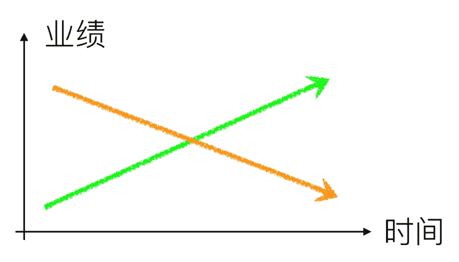

人的经历一旦确定，我们是不能造假修改的，但是可以强调和忽略一些细节。

经历和业绩有所起伏，如果全部堆到简历中，人的表现就显得比较平。如果我们删掉那几个为数不多的影响趋势的点（就是示意图里的红点），同样会给人感觉你是不断进步的。这就是修饰简历的技巧。

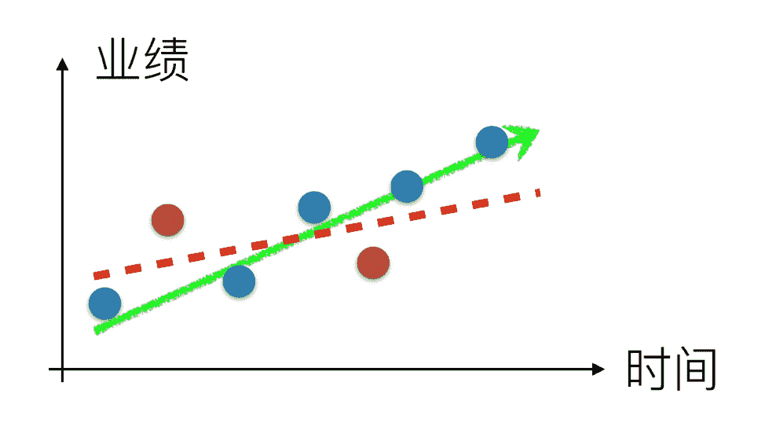

## 5\. 注意用词

我在《信息论 40 讲》介绍了在简历中要用好主题词。

今天很多大公司招聘，除非有“内部人士推荐”或者简称“内推”这样的内容词，否则简历通常都是由计算机先筛选一遍，才能进入到 HR 人员或者招聘主管的眼中。

**缺乏合适的关键词，或者充满了各种关键词，都是写简历的大忌。** 关于这一点，请大家回归《信息论 40 讲》中有关信息分类的第 13 讲。我们这里就不赘述了。

我在约翰霍普金斯有一个同学，以前在清华是读土木工程的，到美国后换到计算机专业硕士毕业。这样的经历在一些公司看来不算完全科班出身，因为土木工程学了 5 年，计算机只学了两年，会比一路计算机专业学上来的吃点亏。

后来我建议他把在清华的经历该写成“某年月，从清华获得工程本科学位”，不用强调是具体哪个系毕业的。

这样的确没有作假，但是大家得到的印象是本科接受了工程的通识教育，又是一个很好大学毕业的，硕士阶段接收了计算机的专业训练，这样的教育背景就非常完美了。

不过在有些时候则需要讲得很具体，比如我们在 Google 收到一份简历，申请人泛泛地讲他做过机器学习的工作，机器学习是一个巨大的概念，这时就需要点出来自己具体做的是什么了。

## 小结：

简历既然叫简历，就不能太长，通常不超过两页（A4 纸正反两面）为佳。但职业目标和与具体职位有关的技能和成绩是不能漏掉的。

简历的格式不需要太复杂，太花哨，但是需要设计得让人一眼能看到他们想看到的信息，同时要让自己提供的信息构成一个完美的故事，能够呈现出自己的职业上升趋势。

下一讲，我们说说怎么写好一篇评论。

## 作业：

请你思考一下，在简历中要多用名词，少用形容词，才是合适的？

1.一个人的职场成功率，和简历质量密切相关。 2.写简历不是罗列资历，而是通过做过的事情，体现自己的能力。  
3.人的发展有起伏，但简历中要呈现自己表现稳定且逐渐向上的趋势。

公众号懒人找资源，懒人专属群独享

# 19 如何写好一篇评论？

吴军

2020-07-14

如何写好一篇评论？

这一讲，我们说说怎么写好一篇评论。

听到我说评论，你可能觉得我又不是作家，也不是评论家，评论似乎跟我没什么关系。其实，评论是日常应用非常广泛的文体，不光是对一本书、一部电影、某件时事发表看法叫评论。

到了年终总结的时候，同事或上下级之间相互写的是评论；某个同事想提职称，希望你写一封推荐信，是评论；大到给一个项目做评估，小到去应用商店评价一个手机 APP，这些也都可以归为评论的范畴。

**好的评论应该针对性强、视角独特、客观公正、令人信服。**

所谓针对性强，是指在写评论前，要非常清楚它是给谁看的，针对不同读者，有不同的写法。这一点，写书评和给人写评语，都是一样的。

给一本书写推荐序，和写一般性的评论，写法是完全不一样的。

前者需要尽可能全面地概括这一本书的内容、风格和特点，这样读者看了推荐序就知道这本书讲的是什么，好在哪里。后者主要是谈自己的感受，特别是自己对书独到的看法。

类似地，如果你是一个部门的经理，给每一个员工写评语，可能会希望面面俱到，不要忘掉他任何一个特长，任何一个主要的贡献。

但是，如果是公司让周围同事给一个人写评语，其实是希望他们每一个人独立地把对评议对象的某些特点分析透彻，不一定需要很全面，但是要准确、深刻、有根据。这样 10 份不同人的评语看下来，上级对那个员工就会有非常全面的了解。

一般人写前一类评论的机会少，写后一类评论的机会多。后一类评论写好了，才有机会写第一类。不幸的是，绝大部分人，会把第二类写成第一类，面面俱到。其实，第二类评论更需要的是独特的看法、个人的感受。

接下来，我们就从四个方面来谈谈常用的第二类评论怎样写。

## 第一，要有自己独特的视角

我们前面讲了，人云亦云的话没有太大的意义。评论相比记叙文和议论文都有所不同，记叙文要更多地偏重客观描述，议论文更多的是主观想法，评论则介于这两者之间。

一篇评论必须基于被评议对象的基本事实，比如评议张三，他没有做过的事情，无论好坏，都不能算在他头上。但是， **一篇评论必须有主观看法。**

很多人一想到主观二字就有点害怕，怕自己说出主观看法后，和别人的说法不一样，被扣上不客观的帽子。其实，看评论，大家希望得到的就是你的主观看法和想法。

每一个复杂的目标，我们从某一个特定的角度看，都只能看到一部分。只有每个人独立地讲出自己看到的，合在一起，才能对目标有全面的了解。如果每个人都试图猜测别人看到了什么，考虑的是怎么样让自己写出来的看法和别人的一致，评论的意义就消失了。

对人的整体评论，就更为复杂了，因为人不仅有多个侧面，而且不同时间的表现还不同。

如果 10 个人评议一个准备升迁的同事，每个人都说出了自己主观的看法，领导就能在综合之后，结合你和他的关系，还原出一个活生生的、全面的形象。对人的评价只有这样写，才能达到目的。

## 第二，要看到对方独特的地方

看到对方独特的地方，特别是别的观察者看不到的地方。

很多人都读过《福尔摩斯探案集》，里面福尔摩斯的特长除了逻辑推理能力，还有就是他能观察到别人忽视的细节，很多时候魔鬼就藏在细节里。

写评论时，如果能从一般人看不到但是又非常重要的地方入手写，这就迈出了写精彩评论的第一步。

中国古代有一个“管鲍之交”的佳话。当时大家看到的管仲是个既贪财，又怕死的人，只有鲍叔牙发现管仲这两个行为都是因为家贫有老母要赡养，而他独具慧眼地发现管仲贤明的一面。

所以，与其说鲍叔牙厚道，倒不如说，他看到了管仲不被别人注意的优点，他对管仲的评价就格外有价值。

## 第三，非凡的结论要有非凡的证据

前两个原则都是在强调评论的独特性，一个是从自己的角度讲，另一个是从被评论者的角度讲。但是这两个原则切忌使用过度，走极端，否则就变成哗众取宠、以偏概全了。

很多人为了一鸣惊人或者其它的目的，刻意要标新立异，发表与众不同的观点，甚至做一些歪曲事实的评论。这就有悖了评论最基本的原则——那就是以主体的事实为依据。

比如，在辛亥革命前后，很多知识精英出于反清的目的，把所有能够和反清扯上一点边的书都说成是反清的。当时，就连著名学者蔡元培先生，也要硬把《红楼梦》说成是反清复明的书，这篇论文大家可以从网上找到，你会发现它真的有损蔡先生的形象。

反清没有问题，但是为此胡乱找根据，就有失公允了。

今天，随着互联网的普及，大家可以发表评论的地方，比蔡元培的时代多了很多。在互联网上，你会发现更多哗众取宠的评论。你要说他们没有证据吧，他们也给出一些，但是那些证据通常是孤立的、牵强的，只见树木不见森林。不光是普通大众，甚至是专业人士也可能这么做。

在 2020 年全球新冠疫情爆发期间，斯坦福大学的一些研究人员发表了一篇文章，讲目前检测出来的冠状病毒感染人数，只有真实被感染者的 1/50~1/85。

这篇论文说真实感染人数是检查出来的人数的 50-85 倍，这个结论确实会吓人一跳。作者标新立异的目的显然是达到了，但是这篇文章一出来，马上受到学术界的诟病，因为他们寻找证据的方式非常有问题。

加州州立大学旧金山分校的进化生物学家彭宁丝（ Pleuni Pennings）犀利地指出了问题所在：

**非常的主张需要非常的证据。** 可惜，这篇论文的主张很独特，而证据不是，反而漏洞百出。

你看，即使一篇研究论文出自名校，也不能保证这项研究就是靠谱的。

如果一定要发表一鸣惊人的主张，千万记住，非常的主张需要非常的证据。如果你的结论轰动效应是 1，证据的强度是 1 就可以了，如果想产生轰动效应是 10 的结论，就必须成比例地找到轰动效应是 10 的证据。

当然，这种情况对读者来讲也是一种智商测试，谁信了证据强度只有 1，却产生了轰动性是 10 的结论，可能要反省一下自己的思维方式。

## 第四，3:7 分配原则

评论通常有篇幅限制，长篇大论也不会有人爱看。在有限的篇幅内，要把自己的看法说清楚，而且不能太空洞，就要平衡轮廓的描述和细节的描写。

我通常的做法是用 30%的篇幅给读者画一个轮廓，然后用 70%的篇幅写一个侧面。

举一个例子，我曾经成功地推荐过几个认识的孩子进入美国名校，我不可能了解他们生活学习的每一个细节，但是会根据我和他的接触，强调他们的某方面特长和品质，只讲一件事，这比泛泛地谈那是一个好孩子有效得多。

但是，如果我不用一些文墨对这个孩子做一些整体评价，可能显得我对他所知甚少，影响了我那个例子的可信度和份量。

此外，还有一点，不算是写作的技巧，算是我个人的经验，但值得分享出来，就是 **任何时候不要轻易写负面评价。**

如果一位同事，你觉得他不该被提升，或者一本书，你觉得不算太好，你可以不写评论，可以推托，但不要轻易写负面评论。

特别不能为了让自己显得有见识、了不起，故意去贬低别人。常玩刀剑的人最后会死在刀剑之下。笔有时也是一把刀，用起来要小心。

如果不得不写，又不愿意写很正面的评论，通常有两个办法：

一个办法是写得不温不火，那么其他人读起来就能感觉到你的态度；另一个办法是用反转手法，先从正面肯定，最后写一点和大家不同的看法，或者负面的评论。聪明的读者也能读出味道来。

总之，如果想给别人写一分的负面评论，就要有 10 分的证据，而不要像有些人，有一分的证据，给人写十分的负面评论。

## 小结：

概括来说，写评论，一定要写出自己独特的角度，找到普通人没有观察到的事实，非常的结论要用非常的事实支持，在有限的篇幅内，要平衡轮廓和细节，给细节七分的篇幅，会让你的评论更精彩。发负面评论，一定要更慎重。

## 作业：

纪录片《舌尖上的中国》相信很多人都看过，也很喜欢，请你为《舌尖上的中国》写个 300 字以内的评论。相信每个人都有自己独特的角度。

下一讲，我们聊聊怎么写好论文。

1.好的评论应该针对性强、视角独特、客观公正、令人信服。 2.非常的主张需要非常的证据。强度为 1 的证据证明不了轰动效应为 10 的结论。  
3.任何时候，不要轻易给别人写负面评价。

公众号懒人找资源，懒人专属群独享

# 20 如何写好一篇论文？

吴军

2020-07-14

如何写好一篇论文？

接下来的两讲，我们聊聊如何写好论文和报告。这是我们实用文体写作里最难的两种了。在工作中绝大多数正式的写作，都可以使用到这两种文体的写作技巧。

不要以为你毕业了，或者不从事科研工作，就不需要写论文。比如说，一个工程师完成了一个项目，要写一份总结报告，这也是论文的变种。

我们之所以把论文拿出来作为这一类写作的代表来讲，是因为论文的格式比较规范，比较容易学习，而且从它的写作出发往非正式的工作汇报走比较容易，反过来就比较难。

在工作中另一类经常要写的是综述或者调查研究报告。

一位领导让一个产品经理对行业中类似的产品做一番调研，然后写一份研究报告供大家参考，这就属于我们所说的报告类。

类似地，做投资之前，需要做“尽调”，也就是尽职调查，成果也需要以报告的形式展现给大家。这一类写作，我都归总到报告类。

简单来讲，我说的论文类写作是对自己做的创新类工作的汇报，而报告类写作是对客观上已经存在的，通常是对别人做的工作的分析和总结。

论文和报告的写作有很多联系，又在一些地方截然相反，因此我将它们对照着来讲。

这一讲先讲论文的写作，一方面因为它比报告的写作稍微容易一些，另一方面，  
**写正式的工作汇报，或者成果汇报，如果用到一些写论文的技巧，能让自己的报告看起来更专业。**

论文通常是科学（包括医学和经济学）、工程或者人文学科研究成果的展现。当然所研究的问题应该是前人尚未解决的问题，而不是把轮子重新发明一遍的问题。

这些成果有很多方式可以展现，比如以演示的方式（在历史上英国皇家学院经常用这种方式展示研究成果）、报告的方式，甚至纪录片的形式，而用文章形式展现的，就是论文。

写论文（不论是科技的还是人文学科的）是有技巧的，掌握了这些技巧，不仅论文写得快，大家容易读懂，而且也容易被杂志和会议接纳发表。相反，如果写得不好，即使科研做得很好，也会被拒稿。

以清华大学为例，在施一公回去之前，一年也发布不了一篇《科学》或者《自然》杂志（它们是目前世界上自然科学领域水平最高、最难发表论文的杂志）的论文，施一公回去，他一个人在那两份杂志上发表的论文数量就超过学校其他人的总和。

但是很快，清华的教授们经常能在这两份杂志上发表论文了。这倒不是施一公一个人将清华的研究水平提高了多少，只是过去国内的教授们不太会写国际杂志认可的论文，施一公等归国学者的示范，让大家很快掌握了写论文的技巧了。

我至今经常还会遇到一些国内学者把论文寄给我让我帮助改英文，从他们的论文中我能看出一些共同的问题。因此我讲的写论文的技巧，主要是针对很多人常犯的毛病，分为四个部分来讲解。

## 1.要重视研究综述

**虽然论文报告的是一个未解决问题的研究结果，你也别觉得新观点、新发现最重要。其实，这个问题的来源，用文献综述的方式交代清楚更重要。而且要放在论文开头。**

今天的学术研究，99%是 N＋1 的工作，不管你觉得它多么重要，也不过是在前人工作的基础上进行一些改进。

既然是 N＋1 的工作，任何人写论文时的第一件事情，就是要提一下 N 的工作，也就是同行们以前做过的工作，这就是文献综述，在英语里叫做 Literature  
study。

综述的目的不仅是引出问题，也是对前人和同行成就的认可。

一些人请我帮助改他们论文中的英文，但是我通常发现，他们更大的问题在综述部分。他们通常会写这个问题对世界科技发展、对国民经济，甚至对每一个人多么重要。

如果是到人大或者政协去提建议，这么讲或许没有错，因为听众是政策的制定者。但论文是写给同行的，也就是学术共同体看的，那些大而空的话就不是有的放矢了。

而且，这里头还有个考虑。综述中引用的是同行的论文，万一碰上他是审稿人（这个几率很大），人之常情，看到这样的综述，他对你的论文第一印象会更好，论文也更容易通过审核。否则同行在审阅时，看到你没有引用他们的工作，就容易觉得你的研究基础不扎实，这也是人之常情。

## 2.要重视呈现研究方法

做研究写论文的直接目的，是要告诉大家你的新结论。但结论不能凭空得出，方法和过程要写清楚。对于方法的描述在论文中非常重要。

很多被退稿的论文，不是结论不够好，而是方法讲得不清楚。当然，有些人数据造假，故意把方法说得不清不楚，那是另一回事。

我说的方法和过程，可不仅限于理工科论文，哪怕是人文学科，方法和过程也同样重要，相应的方法虽然不是实证，却依然需要有据可循、合乎逻辑，合乎同行们认可的学术规范。

有些时候，同行们从你的论文中所获得的最大收益来自于方法，而非结论。

比如在历史研究中，王国维先生用了一种他那个年代新的研究方法，“二重证据法”，也就是出土文物和史书的文献记载相互印证的方法。他这种新方法后来普遍为国内历史学界所采用。

## 3.要重视比较工作

**不能光顾着说自己的研究，好的论文，不仅要得到自己的结论，还需要比较自己工作和相关工作的优劣。**

既然做学问是 N＋1 的工作，为了证明 N＋1 比原来的 N 要好，你首先要重复前面 N 的工作。科研上实验结果要求必须能够重复，这叫“可验证”。

一个专业的研究人员，在开展研究工作时，通常是从重复和验证前人工作开始的，前人的结果要作为对比的基准点（Baseline）。这些结果通常会放到自己各种实验结果之前。

此外，同时期不同人可能会用不同方法解决同一个问题，如果论文的篇幅允许，也需要将自己的结果和同行的结果进行对比。大部分时候，同行们来读你的论文，未必是要采用你的方法，但是他们需要知道各种方法的有效性。

如果全世界有五个研究小组研究同一个课题，但是采用不同的方法，得到不同的结论，大家把自己的方法都公布出来，相互比较，就知道哪种方法更有效了，整个研究领域就进步了。

有些论文，只孤零零地给出了自己的结果，大家不容易迅速了解它真正的水平，这种论文很容易被拒稿，或者被打回去要求补充对比数据。

## 4.要为 N+2 指明方向

这也是一个容易被人忽略的问题。

**论文的完结，不应该是一个句号，而是一个省略号。**

一篇合格的论文，要讨论一下在这个领域尚未完成的工作，它们很多是自己正在进行和将要进行的工作，也可能是留给同行继续解决的工作。

如果不提同行的贡献，只吹嘘自己的工作，最后说我解决了所有的问题，给这个研究划上了句号，这就和研究工作本身固有的特性相违背了。

写论文的人要很清楚，我们是在一个学术共同体中生存的，我们相比前人进步了，后人也会超越我们，我们的工作承前启后，只是学科大厦中的一块砖而已。

从我强调的这几点，你可能会发现，论文有点像中国过去的八股文。这是因为论文的主要目的是进行学术交流，用一种大家都熟悉的方式来表达，大家就容易理解你的工作。

处理好这几个要点，只要论文本身的研究工作水平不差，文字表达不晦涩含糊，论文被录取的可能性会大增。

最后，我还想提醒你，写论文有三件事千万不能做，它们只会帮倒忙：

## 1.过分拔高自己

也就是过分强调自己研究的重要性和结果水平之高。

很多人怕立意不够高、结果不够好而被拒稿，于是拼命往上拔，这样的做法是在帮倒忙。

有些人的论文喜欢宣布自己解决了一个天大的难题，改变了世界等等。其实，论文的阅读者都是同行，对这项研究意义如何，大家心里都清楚，无需费太多口舌。

## 2.故作惊人之语

能够得到和同行不同的结论，固然可以一举成名。但这是双刃剑，搞不好自己永远无法在圈子里混了。

这里我们要特别强调一下上一讲说的那句话：“非常的结论，一定要有非常的证据支持。”只有民科，才会动不动推翻已经被反复验证的结论。

## 3.次要的、相关性不大的工作

对于一些次要的、相关性不大的工作，根本不需要写到论文里，因为这会让读者反而更糊涂。一篇论文能说清楚一件事就好。

## 小结：

如何写好一篇论文，我强调了四个容易被忽略的要点，相比起大家都关心的结论，写论文更要重视开头亮出来文献综述，中间写清楚自己的研究方法，要注重跟相关工作的比较，最后，还要对未来的研究做个方向上的展望。

## 作业：

对比一下你曾经写过的论文，我课程里提到的四个要点，有没有哪一项你也曾经忽略了？欢迎在留言区说说你听课的心得。

下一讲，我们就说说如何写好一篇报告。

1.把写论文的技巧用在写工作总结上，能让你的总结显得更专业。 2.相比结论，更要重视论文的文献综述。  
3.结论不能凭空得出，所以论文中要把研究方法和过程写清楚。 4.把自己的研究和相关研究做对比，才能帮读者看出各类方法的有效性。  
5.一篇合格的论文，结束前要对这个研究方向做展望，而不是给研究画上句号。

公众号懒人找资源，懒人专属群独享

# 21 如何写好一篇报告？

吴军

2020-07-14

如何写好一篇报告？

上一讲我们讲了写论文的技巧，这一讲我们谈谈报告的写作。

对很多人来讲，大学毕业论文一通过，可能再写正式的、准备发表的论文的机会就不多了，但是很可能免不了需要写各种形式的报告。

能够写好报告，是一个人职业上升很必要的高级技能。

报告的种类很多，我们主要讨论综述报告和研究报告的写作。

最典型的综述报告是政府工作报告，或者是像巴菲特每年给股东公开信那样的总结过去、展望未来的报告；典型的研究报告是高盛等公司对某家上市公司的评述报告。

别觉得这种报告离你太远，公司 CEO 在年度业务会上作的报告，本质上就是综述报告，而我们写个行业趋势报告或者竞品分析报告，则类似于研究报告。

先说说综述报告，越是高层管理者，越会需要写这种类型的报告。我会拿论文跟它对照着来讲。

## 1.综述报告要关注不同水平的读者

论文的读者群是同行，但是报告的读者可能是外行，而且通常外行比内行多。

这里我们要说明一点，如果你在单位里作报告，在小组内讲自己的工作细节，这其实属于宣读论文，不是作综述报告。

如果你是一个总监，代表部门给全公司作一个报告，或者出去给媒体作一个宣讲，这就属于综述报告了。

综述报告，由于读者水平参差不齐，因此在内容上需要做必要的背景知识介绍，在使用概念时需要做必要的解释。如果大家读 IEEE 杂志的综述报告，会发现那些作者会用很多比喻来说明新的概念，而不是做字面上的解释。

比如在一份介绍引力波的综述报告中，讲到了人类花那么大代价发现引力波有什么意义。作者把哈勃太空望远镜看到的太空图像比喻成视觉，把引力波装置测到的波动比喻成听觉。过去人们看宇宙，虽然是明眼人，但却是聋子，现在能测引力波了，相当于有了顺风耳。

这样读者即使不懂近代物理，也会理解检测引力波的意义。这种文字在论文中完全是浪费篇幅，但是在报告中却是必要的。

## 2.综述报告要求覆盖面全

**论文强调的是重点突出，而综述报告要求覆盖面要全。**

比如我如果要写有关人工智能技术进展的报告，就要把目前在这个领域主要的研究工作都包括进去，不能因为我自己喜欢人脸识别，就把人工智能报告写成了人脸识别的，其他领域一带而过。

即使在学术界，如果某一位大师受一个大型学术会议的邀请，作一个综述报告，或者为某一份杂志写一个综述报告，如果只总结了他所熟悉的领域，会被认为是水平不够，而且藏了私心，不客观，以后就不会再有人请他来做这种事情了。

我过去无论是写综述报告，还是作综述报告，通常都会向相关的人发邮件，希望他们每个人提供两张 PPT，由这些内容构成报告的主体。

虽然他们的工作我也了解，但找他们要一来是为了保证报告的准确性，二来是提前告诉他们我会讲到他们的工作，没有忽略他们。当然，我可能会为了报告的完整性和可读性有所侧重，但是基本上会涵盖他们每一个人或每一个组的工作。

## 3.综述报告强调内容的对等性

这是它跟论文的第三个差别。

什么是对等性呢？就是在文中所展开的要点，都需要在同一个层次上。论文只讲一件事情，不用考虑这个问题。很多文学作品，为了可读性，可以采用不对等的写法，比如我们说以一斑窥全豹，就是如此。

在《拯救大兵瑞恩》中，虽然一开始的场景是整个诺曼底登陆，但是很快镜头就集中在一个人身上了。这就是严重不对等的写法。

但是，如果你是公司总裁的秘书，要为你的老板起草一份年底给全体员工的总结报告。在这个报告中，你在总结这一年的成就时，可以把同一级别职能部门的工作一一总结，因为它们的地位是对等的；也可以按照主要任务一一总结，比如开发新产品、开拓新的市场、改进内部管理、招聘人才等等，这些主要的任务也是对等的。

但是你不能把某个部门的某项研究工作，和全公司改进内部管理这两件事放到一起讲，因为它们不对等。前者是某个部门内的事情，后者是整个公司层面的事情。

报告写不好最常见的问题就是忘记了对等性的原则，不同层次的内容放到一起写，这让听众和读者感觉非常混乱。

大家如果有兴趣可以拿政府工作报告读一读，里面主要的内容，都是符合对等原则的。

## 4.报告不重过程，只重结论

还记得我上一讲强调过论文要把研究过程和方法写清楚吧。

比如，在政府工作报告中，不需要讲为什么明年的 GDP 增长能做到 7%。这一点和我们等会儿要讲的研究报告也不同。一些人写综述报告是花了很多篇幅讲道理，讲为什么，其实这些内容读者并不关心。论文的可信度来自于事实和严密的推理，而综述报告的可信度来自于报告人的信誉。

每年很多人专程跑到美国小镇奥马哈，听巴菲特对于经济形势和投资的综述报告。巴菲特的报告并不会用数据给大家做分析，大家相信他的话，在很大程度上是冲着他的信誉而去的。

**一个好的综述报告，要让读者在不长的时间里对一个领域的情况有全面的了解**  
，这是综述报告的目的。和这个目的无关的细节，都可以省略掉。如果因为自己的偏好，让读者产生了片面的误解，报告写得就不算成功。

接下来我们谈谈研究报告的写作。

我这里讲的研究报告，主要指对跟自己无关的对象、事物和现象的研究结果，比如高盛关于微软公司的研究报告，或者政府的智囊机构对石油价格动荡可能产生的后果的研究。

当然，你的老板让你做的竞品分析、公司和行业调查等等，虽然读者限于单位内部，甚至只有你的几个上级，但内容上也要向研究报告看齐。

有的研究报告甚至是专门花钱请专家写的，比如某个企业请麦肯锡做管理改进建议书。

**研究报告的针对性需要非常强，结论一定要清晰，不能因为怕说错话而模棱两可。** 出具这类报告的专业公司，通常也会有自己的行文规范。

一份研究报告，怎么才能有专业性？我归纳了四个要点：

## 1.分析要中立、客观

我们在前面讲，写论文时，再发明一次轮子的论文是没有机会发表的，你一定要找点以前人不知道的新东西发表。但是研究报告没有这个问题，而且千万不要为了新而忽视了全面性和客观性。

比如，一只基金上个季度发布对微软的研究报告，发现这家企业发展得很好，结论是大量买入。这个季度对微软的结论类似，再强调一次之前的买入结论是没有关系的。虽然这份报告和上一份可能 50%的内容是重复的，但是没有关系，千万不要为了增加新内容，把一些无关紧要的事情加进去，更不要刻意标新立异，最后误导了读者。

## 2.要做好横向和纵向对比

这一点和综述报告不同，和论文有相似之处。

比如分析微软这家公司，要把它放在整个行业来分析，也要放在一个较长的历史时间段来分析。比如它每年增长 10%，是不是很快呢，这要对比整个行业才能得出结论。此外，也要和它过去的发展、未来的潜力做对比。

因此，要写一篇好的研究报告，做的研究工作可能要比想象的多出一个数量级。对比一下国内不少研究机构的研究报告，和麦肯锡、高盛等企业的同类报告，我发现前者在格式上比较花哨，但是缺乏后者的严谨性，特别是缺乏后者详尽的对比。

## 3.注意证据的充分性和数据规范化

我们前面讲了，非凡的结论要有非凡的证据支持，这点对于研究报告依然重要。在寻找结论时，不仅要从正面证实，而且还要找反例，看看能否证伪。

比如对比同行业中 A、B 两家对手公司，讲 A 公司最近发展很好，因为这受益于它的在线业务，于是得到结论，它应该进一步发展在线业务。

这个结论虽然看似符合逻辑，但是对于任何一个结果，可以有很多种符合逻辑的解释，如果我们认定所给出的结论最合理，那么需要否定掉其他的解释。

假如 B 公司的在线业务也发展得很好，但是整体发展却不太好，我们就不能得出“应该进一步发展在线业务”的结论，而需要找 A 公司发展好的其他原因。

## 4.对数据要做解读，甚至做可视化处理

在研究报告中常常会有很多数据，很多人简单地把数据放在那里，就算交差了。

研究报告的读者之所以愿意花时间读研究报告，是希望在短时间里了解结论，而不是自己花很多时间再做一次研究。因此，对数据合理的解读很重要。

不仅给第三方研究报告如此，给上级的报告也需要如此。

## 小结：

概括说来，综述报告要关注不同水平的读者，内容上争取全面覆盖，讲究内容对等；而研究报告，更注重对比，注重数据和证据，还要对证据进行分析，善于写好报告，我们就变成了更专业的人。

## 作业：

你在工作中需要写报告吗？这一讲里哪个点对你有启发？欢迎在留言区跟大家分享。

下一讲，我想带你了解一下美国的大语文教育，也当作我们这个模块的阶段性总结。

1.报告的种类很多，常见的是综述报告和研究报告。 2.好的综述报告，要让读者在不长的时间里对一个领域有全面了解。  
3.好的研究报告，针对性需要非常强，结论一定要清晰，不能模棱两可。

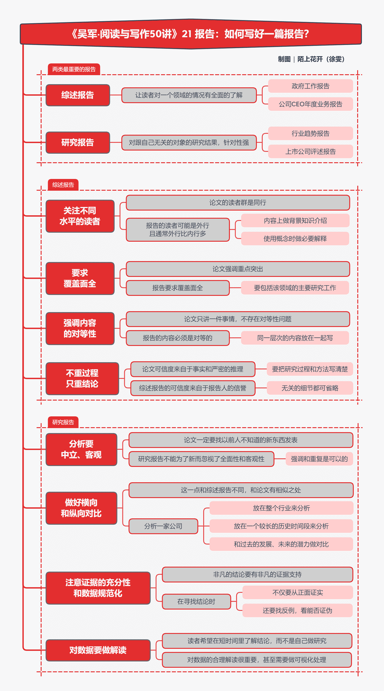  

公众号懒人找资源，懒人专属群独享

# 22 小结：美国的大语文教育给我们什么启发？

吴军

2020-07-14

美国的大语文教育给我们什么启发？

关于阅读与写作的方法论，到这里就要结束了。从下一讲开始，我会带你读一系列经典的文学作品。那都是深刻影响过我的写作与成长，在我看来，也值得年轻人读一读的好书、好作品。

今天这一讲，算作一个阶段小结，但我主要想给大家介绍一下美国语文教育的情况。虽然你未必会到美国读书，学的是中文而不是英文，但是美国语文教学的很多思路值得我们借鉴。

我这么讲有两个原因。

其一，如果拿中美两个高中毕业生和大学毕业生做一个有意义的对比，比如哈佛的新生和北大的新生比，MIT 的新生和清华的新生比，或者中国一本大学的新生和美国州立大学的新生比，我感觉美国学生的语文水平要高得多；

其二，我们的语文教育比较单一，缺失的部分可以借鉴美国的经验自己补上。

首先，美国语文教学有三个能力方面的训练，很值得关注，如果你自己这方面不足，也应该有意识去补上。

## 1\. 口头表达能力

在美国，口头表达能力是语文教学的一部分。不仅在课堂上，每一个人经常需要来讲自己写的东西、做的东西，或者对暑假的阅读材料发表看法，而且几乎所有的课程，都会有 5%-10%的成绩是由发表讨论意见来决定的。

一个上课闷着头听讲的好学生，这方面就可能丢分了。在课外，有很多事情既需要用到口头表达，也锻炼这方面的能力。这里我给大家举几个例子：

*   申请私立大学时的面试；
    
*   暑期工作时的面试；
    
*   参加一些竞赛时的演示或者报告，做公益时募款；
    
*   讲演和辩论比赛；
    
*   需要口头交流的社会工作，比如校报、校刊的记者，学生会领导和办事人员等等。
    

我接触国内的一些人，大家觉得强调口头表达能力，在欧美文化的大背景下特别重要，但在中国可能重要性没有那么明显，毕竟古人强调“讷于言而敏于行”（语出《论语·里仁》）。

但是今天不再是过去的熟人社会，而逐渐成为生人社会，讷于言不再是美德。清华的毕业生一直被认为是讷于言而敏于行的，但是据我对它在全球 400 多名企业家协会会员的观察，他们每一个人口头表达能力都很强，远远高出清华毕业生的平均水平。

口头表达这个能力，对于离开学校的人，如果过去没有接受过这方面的训练，要及早补上。虽然高考不考，但是希望有孩子的家长可以注意，比如吃晚饭的时候，让孩子讲讲自己的作文是怎么写的、聊聊对一些问题的看法。

## 2\. 严肃读物的阅读能力

坦率地讲，人不是天生有阅读能力，严肃读物的阅读习惯，更需要后天的训练和培养，它会让人受益终身。这个能力，光靠浏览网页或社交媒体可不够。

美国高质量的高中，学生们在每一个暑假大约要读 10 本严肃的著作，有些在开了学以后还要写评论，并且在课堂上做宣讲。

那些严肃的著作，既包括一些文学名著，比如《红与黑》《战争与和平》《奥德赛》等等，也包括一些受到好评或者影响力较大的人文社科著作，比如《21 世纪资本论》《人类简史》等等。

我近年来读的一些书，很多是孩子的老师推荐的，比如《异类》和《贫穷的本质》。

哈佛大学给学生们开的书单，大量的是 100 多年前的非小说类有思想的图书。

即便如此，美国大学教授鲍尔莱恩的一本书《最愚蠢的一代》最近在美国亚马逊上热卖。作者认为，数码时代正在使美国的年青一代成为知识最贫乏的一代人，因为读的都是社交媒体上的垃圾。

我想，中国的年轻人，在有质量的严肃阅读上恐怕做得还不如美国同龄人。

## 3\. 语文在生活中的运用能力

语文是语言的艺术，也是为生活服务的艺术。美国小学一开始给学生们教授的不是大量的单词、著名的诗歌等等，而是这样一些内容：

1.  认识自己，能讲清楚自己是谁，家里的情况，家庭从哪个国家来等等；
    
2.  认识社区；
    
3.  世界是随时间改变的；
    
4.  动物和植物；
    
5.  理解周围的世界，什么叫做合理，什么叫做有逻辑；
    
6.  团队合作。
    

你看，他们的语文教育很实用，跟实际生活紧密相关。他们认为，一个小孩子，如果连自己的家庭情况都介绍不清楚，语文水平恐怕是大打折扣的。

到了小学二三年级，美国语文教育的阅读策略，就上升到通过文字延伸思考，提出疑问并寻找答案。

再往高年级走，就需要通过阅读培养严谨思考和批判性思维。比如老师会引导大家对书中的观点进行合理的质疑，然后让大家讨论。

到了中学、大学，美国语文的学习依然会和生活挂钩。我们在前面介绍的很多内容，都涉及语文在现实中的使用。

介绍这些内容，是希望你能意识到， **语文不是一门学校里的功课，更不是高考之后就可以扔掉的课本，而是我们每个人每时每刻都需要的基础技能。**

美国语文教学的一个特点是，语文为所有课程服务，所有课程帮助提高语文水平。

写作显然是教学的重头，但是培养写作能力不仅仅在语文课上，还会在历史和人文地理课上。

在学习历史时，最后总成绩的很大一部分来自于几篇评论。甚至考试中，也会给一两个题目，让学生写短文。因此语文没学好，历史成绩就会受影响。

另一方面，历史论文的写作，其实也是提高写作能力的一部分。我们在前面讲了论文和评论的写作，美国对论文写作的训练其实从高中就开始了。比如历史老师会要求学生对某个历史事件写一篇论文，这篇论文在格式上是有严格要求的。它的背景介绍、印证推理，包括最后结论的给出，都需要符合规范，每一个例子和引用的观点都需要有出处。比较认真的老师甚至请图书馆的老师帮助核对这些出处。

不仅人文课程如此，美国的数学课和自然科学课也少不了写报告。很多老师会给学生一些额外提高成绩的机会，比如做一个小项目可以在期末成绩上加五分。这个项目的报告也涉及写作，而且是很规范的写作。项目做出来了，报告没写好，就会丢分。

美国语文教学另一个特点是，死记硬背少，实用为主，综合性强。

虽然英语的语法比中文严格，但是美国学校很少讲语法。

我记得有一次孩子不明白一个语法现象去问老师，为什么要用这个时态，老师的话让她很吃惊，老师讲“因为这样读起来通顺”。

实际上，美国中小学对语法的教学很大程度上是通过大量的阅读和写作完成的，而不是背语法规则。

美国的阅读理解教学通常聚焦在三个方面：了解作者的写作策略（strategy）、写作技巧（skill）、风格和体裁（genre）。然后老师会让学生练习写作，根据人物、事件、主题和细节，来构造一篇作文。学完语文，能读能写，这是目的所在。

为了让学生掌握各种体裁的写作，语文教学中会留这样的作业：在读了林肯《葛底斯堡的讲演》后，让学生以一名南方士兵或者北方士兵的身份，给家人写封家信。

当然，在教学时，不管是文学性的评论、剧本、小说、散文、传记，还是跟生活有关的体裁，比如日记、书信、倡议书、研究报告、讲演，甚至广告和旅游宣传册，都会是阅读的内容，学生相应的写作作业，可能就是把小说改编成电影剧本，或者根据剧本，写一个广告。

另外，美国语文的教学，常常会综合文史哲，他们认为这些合在一起，才构成一个人真正的人文素养，并在此基础上形成价值判断力。为了保证学生将来有一个健康的人格，美国语文教学会强调多元文化，因此在课文的选取上非常注意各种内容和观点的平衡。

这是让我以前没有想到的。

## 小结：

美国的大语文教育，重视口语表达，重视严肃读物的阅读量，注重语文在实际生活中的运用。最近几年，这些观念也在中国的基础教育中得到了提倡和尝试。

对于语文的学习，不可能哪一种教法或者学法就一定好，另一种就一定不好。中国的语文教学形成今天的样子有它的道理。但是，我们在过去学习中所欠缺的，我觉得可以借鉴美国教学的方式，自己补上。

## 作业：

学完这个模块的课程，你觉得自己阅读和写作最大的痛点是什么？最大的收获又是什么？欢迎在留言区跟我分享。

从下一讲开始，我们就将进入课程的下半部，我会带着你，读一系列的经典文学作品。希望那些曾经照亮了我的书，也能为你打开理解世界、理解他人的一扇扇门。

咱们下一讲课程见！

1.语文不是高考后就可以扔掉的课本，而是我们每个人每时每刻都需要的基础技能。  
2.美国的大语文教育，重视口语表达，重视严肃读物的阅读量，注重语文在实际生活中的运用。这样的教学方式我们可以借鉴。

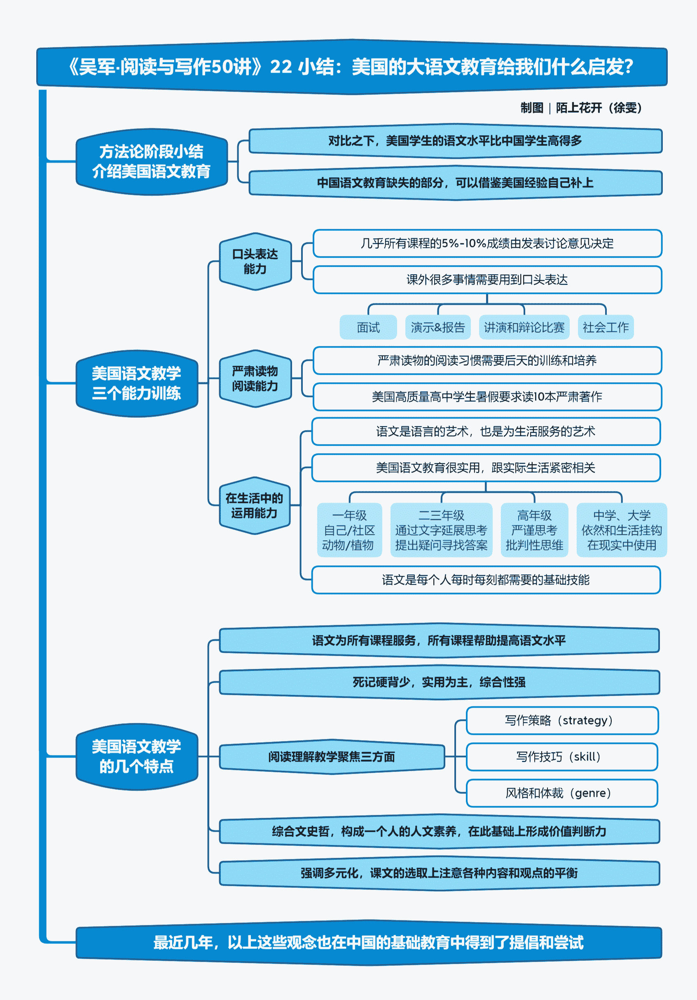  

公众号懒人找资源，懒人专属群独享

# 23 《春江花月夜》| 如何从传世之作参悟渺小人生？

吴军

2020-07-14

《春江花月夜》| 如何从传世之作参悟渺小人生？

上半部分是我这门课程的方法论部分，我把自己关于阅读和写作的方法和盘托出。

但无论如何，阅读和写作，都是能力而不是知识，不做大量实践，方法论再高明，都无法真正对你自己有帮助。

所以，从这一讲开始，课程进入下半部分。我会跟你讲讲那些曾经深深影响了我的经典文学作品。

事先声明，这些文学经典，有很多学者做过大量的研究和批评，都很专业。而我要跟你分享的，完全是我个人的阅读经验和体悟。我会跟你谈谈，我是在什么时候，在什么机缘下跟它们相遇，在理解他人和表达自己的维度上，它们又给了我哪些重要启发。

这一讲，我先跟你聊聊王羲之的《兰亭集序》和张若虚的《春江花月夜》。

## 《兰亭集序》

我读《兰亭集序》是中学时代，正是这篇文章，教会了我写游记。

中学时郊游之后，老师都会让我们写游记，开始我写的常常都是流水账，然后就想着编出一两个佳句增增色，当然成绩不会很好。直到我读了王羲之的这篇文章，才算学会了写游记。

王羲之用三分之二的笔墨描绘了他在春游结束一刻的感悟，从而把全文的境界提升得很高。受到启发，经过了大约三年练习，我到高考时作文就写得很好了。

《兰亭集序》只有 400 字，在这节课里，请你先欣赏一下全文。 听不懂也不用怕，白话翻译已经附在下文了，但现在，让我们去音频里一起先沉浸在中国文字的美妙中吧。

## 原文

永和九年，岁在癸丑，暮春之初，会于会稽山阴之兰亭，修禊事也。群贤毕至，少长咸集。此地有崇山峻岭，茂林修竹；又有清流激湍，映带左右，引以为流觞曲水，列坐其次。虽无丝竹管弦之盛，一觞一咏，亦足以畅叙幽情。  
是日也，天朗气清，惠风和畅，仰观宇宙之大，俯察品类之盛，所以游目骋怀，足以极视听之娱，信可乐也。夫人之相与，俯仰一世，或取诸怀抱，悟言一室之内；或因寄所托，放浪形骸之外。虽趣舍万殊，静躁不同，当其欣于所遇，暂得于己，快然自足，曾不知老之将至。及其所之既倦，情随事迁，感慨系之矣。向之所欣，俯仰之间，已为陈迹，犹不能不以之兴怀。况修短随化，终期于尽。古人云：“死生亦大矣。”岂不痛哉！  
每览昔人兴感之由，若合一契，未尝不临文嗟悼，不能喻之于怀。固知一死生为虚诞，齐彭殇为妄作。后之视今，亦犹今之视昔。悲夫！故列叙时人，录其所述，虽世殊事异，所以兴怀，其致一也。后之览者，亦将有感于斯文。

## 译文

*永和九年，这是癸丑之年，三月上旬，我们会集在会稽郡山阴城的兰亭，做禊礼这件事。很多贤士能人都汇聚到这里，年长、年少的人也都聚集在这里。兰亭这个地方有高峻的山峰，茂盛的树林和竹丛；又有清澈激荡的水流，在亭子的左右环绕，我们引水做成曲形水流，让酒杯流传。大家排列坐在曲水旁边，虽然没有管弦齐奏的盛况，但饮酒作诗，也足够来畅快表达内心深藏的感情了。*

*这一天，天气晴朗，和风习习，抬头纵观广阔的天空，俯看大地上繁多的万物，用来舒展眼力，开阔胸怀，极尽耳目的欢娱，实在很快乐。*

*人与人相互交往，很快便度过一生。有的人在屋里畅谈自己的胸怀抱负；有的人就自己爱好的事物，寄托情怀，不受约束，放纵无羁地生活。虽然各有各的爱好，安静与躁动各不相同，但当他们对所接触的事物感到高兴时，一时感到自得、高兴和满足的时候，竟然不知道衰老将要到来。等到对自己喜爱的事物感到厌倦，心情随着当前的境况而变化，感慨就随之产生了。过去喜欢的东西，转瞬间已经成为陈旧的痕迹，尚且会引发心中的感触，况且寿命长短，听凭造化，最后都归结于消灭。古人说：“死生毕竟是件大事啊。”怎么能不让人悲痛呢？*

*每当我看到前人兴怀感慨的原因，跟我所感叹的好像很契合，面对着他们的文章，没有不感叹哀伤的，在心里又不能清楚地说明。本来知道把生死等同的说法不真实，把长寿和短命等同起来的看法是妄造的。后人看待今人，也就像今人看待前人。可悲呀！所以我一一记下当时与会的人，录下他们所作的诗篇。纵使时代变了，事情不同了，但触发人们情怀的原因，他们的思想情趣是一样的。后世的读者，也将对这次集会的诗文有所感慨。*

当然，《兰亭集序》对我的意义，可不只是个作文范例，更让我理解了宇宙之浩大，人生之渺小。我觉得，正是这个主题让它成为传世之作。

我认为  
**人类能够谈上千年的主题，可以大致分为两类，一类是向内认识自我，另一类是向外认识宇宙。当然两者是互动的，不同人、不同时代背景对内对外的看法会不一样。**

《兰亭集序》作为书法作品，在中国历史上无出其右。只是它在书法上太有名了，以至于很多人忽略了它的文采。

关于《兰亭集序》的来历，你可能也听过王羲之兰亭雅集的故事。

简单说，就是晋穆帝永和九年（353 年）的暮春时节，王羲之和子弟朋友们，在绍兴郊外赏花春游，饮酒赋诗的事。

这种事在古代文人里很常见，这类游记文章也很多，但为什么《兰亭集序》就成了千古名篇呢？因为它涉及了一个普遍的人类话题：有限的生命与无限的宇宙。

王羲之在文中先讲了当时的情况。江南最好的时节，最好的风景，最好的朋友们，又赶上最好的天气。这样一天的游玩，大家会玩得很开心。但是转眼一天过去了，人就不免开始惆怅了。

这说的首先是一种喜聚不喜散的普遍情感。我记得我中学时，遇上学校去郊游，早上会异常兴奋，整个一天都玩得尽兴，但是当暮色降临，大家要返回时，就开始惆怅起来，这是人之常情。

再比如大家过春节长假，临近春节时，充满了期盼，心里最高兴，过了三四天，会想还有一半呢，不太发愁。但是到了最后一天，想到第二天要上班、上学了，就开始惆怅起来。

王羲之当时就是这样，在这个时候，他产生了感悟。你看，写人的普遍情感，就更容易得到读者的共鸣。

当然，如果只是这种单纯的喜悦和惆怅，还不足以支撑《兰亭集序》成为千古名篇，王羲之对主题进行了进一步的升华。王羲之接着写到，好朋友们彼此相处的时光，其实过得很快，一天如此，一生也如此，很快就度过了，“不知老之将至”。不管人活多长，最后一切都化为乌有，想到这里，岂不痛哉。

今天，我们在这里感叹古人都不在了，今后的人，也会同样感叹我们。因此，今天我记录下我们这些人抄录大家的诗作，以后时代不同，人们的情致却是一样的，后人看到这些，也会有同样的感慨吧。

今天的人对王羲之的《兰亭集序》是否有同样的感慨呢？反正我有，相信你也会有。这恰恰是写作的意义所在。

王羲之当时的心境和思考，永远留给了后人。他谈到了一个任何时代、任何人都绕不过去的话题，就是人的生命、人和宇宙的关系。人终有一死，和宇宙相比终究渺小。人生怎么过，就是每个人都必须面对的问题了。

**《兰亭集序》把触景生情，上升到了对人生和宇宙的哲学思考，这样的文章当然更能超越时间、空间，甚至民族、国家的局限。**  
曾国藩讲，文章以立意为第一要义，这话说得没有错。

## 《春江花月夜》

初唐诗人张若虚的《春江花月夜》，跟《兰亭集序》有立意上的相似性。

王羲之生活的东晋是个乱世，但他的家族是天下第一家族。而张若虚一生只做到兖州兵曹，这是一个八九品的芝麻官，是个生逢盛世却不太得意的文人。

虽然两个人生活的年代和家庭迥然不同，但两篇作品的格局却同样阔大。

我们先采用之前说到的阅读技巧，通过题目《春江花月夜》，来获取一下藏在这首诗中的基本信息线索。

“春”“月”“夜”三个字都在说时间，“江”字告诉大家地点，诗中对江水的描述暗示地点可能是长江的下游，因为描写的江面比较开阔。

但理解全诗的重点，则是标题里的“江”和“月”，以日月象征时间的亘古永恒，以流水象征时间的变动流逝，是汉语中非常重要的两个诗歌意象。

整首诗我们也放在了下文，不熟悉的人可以看一看。

## 原文

春江潮水连海平，海上明月共潮生。 滟滟随波千万里，何处春江无月明！ 江流宛转绕芳甸，月照花林皆似霰； 空里流霜不觉飞，汀上白沙看不见。  
江天一色无纤尘，皎皎空中孤月轮。 江畔何人初见月？江月何年初照人？ 人生代代无穷已，江月年年望相似。 不知江月待何人，但见长江送流水。  
白云一片去悠悠，青枫浦上不胜愁。 谁家今夜扁舟子？何处相思明月楼？ 可怜楼上月徘徊，应照离人妆镜台。 玉户帘中卷不去，捣衣砧上拂还来。  
此时相望不相闻，愿逐月华流照君。 鸿雁长飞光不度，鱼龙潜跃水成文。 昨夜闲潭梦落花，可怜春半不还家。 江水流春去欲尽，江潭落月复西斜。  
斜月沉沉藏海雾，碣石潇湘无限路。 不知乘月几人归，落月摇情满江树。

它分为三部分。第一部分写良辰美景；第二部分是对人生的感叹；第三部分写游子思妇的相思情愁。

《春江花月夜》在文学史上褒贬不一。赞誉它的人讲这首诗“孤篇盖全唐”，但也有不少文学家觉得，它依然没有摆脱前代文学华丽的形式主义，很多诗句有重复感。

在我看来，虽然这首诗篇幅有点长，不够精炼，有些段落显得重复，但是就凭着“江畔何人初见月，江月何年初照人”全诗最出彩的这两句，就可以和李白的“今人不见古时月，今月曾经照古人”相媲美。

如果我们考虑到当时离六朝金粉时代不是很久远，保留了过去一些绮丽浮华的文风，是可以理解的。但这首诗已经有了盛唐气象，它写出了无尽的时空和我们每一个人生命的关系。

良辰美景，是世世代代的人们对美好生活的渴望；游子思妇，也是普遍的人类情感。更重要的是，虽然一个人的生命是短暂的，每一个人是渺小的，但人类的历史却是久长的，人类是伟大的。这个感悟我也有，因此就有遇到知己的感觉。

而且，这首诗高明的地方在于，它能够把情感和景物、时间和空间、永恒和易逝揉合到一起，形成一个有机的整体，而不是列清单。

对比《兰亭集序》和《春江花月夜》，我们不难发现，人类在一些最根本的问题上有相似的思考。古人所谈论的问题，和今天的人依然密切相关。

事实上，诗人李白在写下“今人不见古时月，今月曾经照古人”时，心境显然和张若虚是一样的。他写“浮生若梦，为欢几何”时，心境和王羲之也是类似的。时代变了，那些永恒的问题依然存在。

《兰亭集序》和《春江花月夜》也给了我很重要的写作上的启发。选对超越时效性的话题很重要。

今天你即使不写文章，就算在社交媒体上发个微博，或者朋友圈，也希望一大堆人参与讨论。其次，谈论涉及人和宇宙的话题，不能空对空，可以把外景、内心和时空融合到一起。

说句题外话，如果让你穿越变成王羲之，你愿意么？你是愿意做生逢盛世的小人物张若虚，还是乱世中的大人物王羲之呢？

读了这两篇作品，我感觉大人物王羲之好像并不比张若虚过得开心。张若虚的生活可能有不少失意之处，但从他笔法清丽的诗中，我更多的感觉是内心的宁静。王羲之出身豪门，但生逢永嘉之乱，《兰亭集序》虽然写的是欢聚，但所表现出来的心境，却更多的是忧郁而非欢喜。

俗话讲：“宁为太平犬，不做乱世人”，这一点我是认同的。

## 小结：

我们今天不可能回到唐朝，回到东晋。但是那些善于表达的文人墨客，他们的作品，千百年后，之所以依然引起我们的共鸣，不仅因为他们写了人的普遍情感，更因为他们立意高远，超越了时空的限制。

自己的写作，也要有这样的野心。

## 作业：

试着把外景、内心和时空融合到一起，写一篇不超过 300 字的小短文，我会选出优秀作品进行评点。

下一讲，我们聊聊雨果的《九三年》。

1.人类能够谈上千年的主题，大致有两类：一类是向内认识自我，一类是向外认识宇宙。 2.谈论涉及人和宇宙的话题，不能空对空，可以把外景、内心和时空融合到一起。

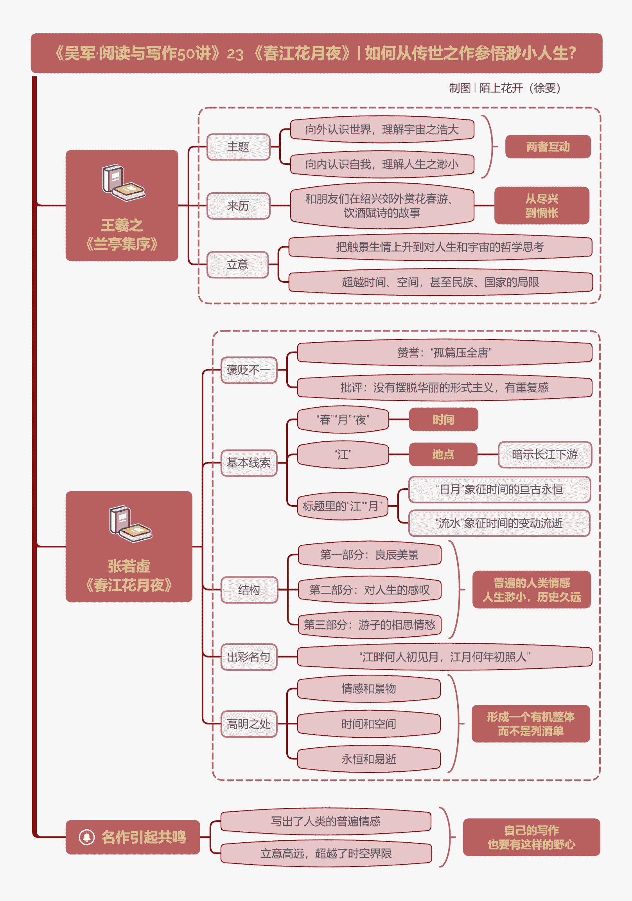  

公众号懒人找资源，懒人专属群独享

# 24 《九三年》| 如何理解复杂的人性？

吴军

2020-07-14

《九三年》| 如何理解复杂的人性？

这一讲，我们通过法国作家雨果的《九三年》，聊聊复杂的人性。

2020 年的全球公共卫生事件，在考量人性。大家在这个时候也经常会谈论人性的话题。

你会发现有些人悲天悯人，也有些人相对比较冷血。有些人不分国家种族在考虑问题，也有些人则是小群体“利”字当头。

总之，关于人性，人类讨论了上千年，今天依然是一个在朋友圈和社交媒体上很热门的话题。它值得讨论上千年的原因在于，人性问题没有标准答案，不像数学或者物理那样，因此谁都可以发表自己的看法。

不同国家民族、不同社会背景的人，对于它的看法会相差很远。遇到这样的情况，评判别人的看法是对是错，恐怕没有什么意义，更多的是需要搞清楚为什么对方这么想。遗憾的是，很多人在带有情绪时，自己都说不清楚自己的想法。

这一讲，我就以法国文豪雨果的《九三年》为例，来试着理解人性的复杂。

我对西方人的理解，其实是从这本书开始的，而且我到美国后融入社会很快，也要感谢这本书。

雨果最知名的小说是《悲惨世界》和《巴黎圣母院》，但是我觉得体现出他对人性这个问题思考深度的却是《九三年》。

《九三年》这个书名来自于 1793 年。了解法国大革命的人都知道，这是雅各宾派当政的时期。当时，法国社会严重分裂，产生了严重的阶级仇恨。

一方面，极端的雅各宾派严酷地清洗贵族、教会和其他任何保守势力；另一方面，保皇党的军队（白军）在很多省叛乱。于是共和国军（蓝军）就和白军展开了你死我活的激战。

在书中，主要人物是相互关联的三个人：白军统帅朗特纳克侯爵（简称朗特纳克），蓝军指挥官郭文子爵，他是朗特纳克的叔侄孙；还有一位监军西穆尔登神父，他是郭文的老师。

虽然郭文和朗特纳克是远房亲戚，但双方都坚持自己的政治主张，要消灭对方。

朗特纳克是一个非常冷血而残忍的人，对拥护共和国的人绝不留情。而郭文是一个军事天才，打得白军节节败退，并且把朗特纳克等人包围到一个城堡里。这个城堡里还有一些平民，成了白军的人质。最后白军终于抵挡不住，放火烧了城堡，朗特纳克带领手下从密道逃跑了。

但就在朗特纳克跑出城堡的一刻，听到一位母亲的呼救声，原来她的三个孩子被困在城堡里了。朗特纳克经过一番考虑，毅然从暗道返回城堡，救出了那三个孩子，然后就被郭文逮捕了。

这时，郭文和老师西穆尔登就如何处置朗特纳克产生了分歧。西穆尔登认为革命高于一切，主张处死朗特纳克。郭文却认为大恶人朗特纳克在危急时刻，显示出人性善良的一面，希望饶他不死。

但是他又无权释放朗特纳克。于是，郭文进入牢中，跟朗特纳克交换了服装，放跑了他，自己伪装成朗特纳克留在了牢房中。为了维护法律，西穆尔登忍痛将郭文处死，然后自己也自杀了。

《九三年》这本书是雨果最后一部小说，它完成于 1874 年，当时法国刚经历巴黎公社起义。已经 72 岁高龄的雨果对人性有了极为深刻的思考。因此，他在这本书中所描写的人性相当复杂，不像在《巴黎圣母院》中所描写的善恶美丑分明。

雨果一生经历了法国的多次革命，可以讲是惯看秋月春风了，他的思想相比年轻时有了巨大的变化。

当年他曾经因为反对拿破仑三世称帝而被流放，但是到了晚年，他却开始怀疑暴力行为能否真正解决社会问题。早年他支持法国殖民非洲，到了晚年，他开始谴责法国参与血洗圆明园。在巴黎公社的问题上，雨果则强烈谴责对阵双方的暴行。他在日记里写道：

“简而言之，这个公社是白痴，正如国民议会太残暴一样。两边都荒唐。”

虽然这么评价巴黎公社，但对于晚年的雨果来讲，人性的善是最可贵的，并且他身体力行。在巴黎公社失败后，他一边帮助遭到镇压的公社社员，一边给当时的比利时政府施加压力，希望比利时为公社成员提供政治庇护。

雨果最终的理想是建立一个大家能够和平相处的欧洲共和国，不再有战争和暴力，并且呼吁废除死刑。如果他生活在今天一体化的欧洲，大概会感到欣慰很多。

了解了雨果的这种思想变化和他对人性的理解，我们不妨从写作技巧上看看，在《九三年》这本书中，雨果是如何表达自己这种复杂立场的。

他其实采用了“苏格拉底启发式提问”的方法，启发读者思考下面这些问题。有些问题他有答案，有些没有。

**1\. 政治主张/派别和亲情相比，哪一个更重要，更有凝聚力？**

对于这个问题，雨果是有明确答案的，那就是政治主张。小说中的三个主要人物都是亲朋，但是都要为各自的立场站队。这个现象至今如此。

**2\. 朗特纳克该不该受到处罚？**

这一点雨果没有直接指明，但是花了很多篇幅讲朗特纳克冷血的一面，特别是他挟持了无辜平民到城堡做人质。因此，雨果对朗特纳克是持否定态度的。

**3\. 朗特纳克有没有人性？**

这是一百多年来，大家一直争议的一个问题。

从朗特纳克冒死救人的行为来讲，他显然还是有人性的。但是，很多人提出，作为一个相当冷血的反派角色，他的这一点善行不足以掩盖他的恶。

为了解释朗特纳克身上的矛盾，很多人主张人性会被阶级性或者说团体的利益扭曲，也就是说，朗特纳克原本是有人性的，但是一旦被阶级、民族利益所左右，人性就会被淹没或者掩盖。

对于这个问题，雨果没有给出答案，而是启发读者去思考。但是，从雨果在巴黎公社事件前后的所作所为和言论来看，他到后来是厌恶了当时法国大革命的那些政治、民族主义和阶级对立的，认为它们扭曲了人性。

回到当下，你也一定能体会出，所有人搁置争议，共同对付病毒最为重要。

**4\. 朗特纳克做了善事，有没有资格将功补过？**

这又是一个没有答案的问题。

在书中，雨果暗示他只是终止犯罪，因为那一家平民母子是被他劫持到城堡中的，最后他决定去救这一家人，只是自我赎罪而已。对于自我赎罪的人，雨果的想法是矛盾的，所以他通过郭文表达出，他希望对这些人网开一面，又通过西穆尔登神父，表达出应该严惩首犯的看法。

**5\. 郭文是否是个烂好人？**

对这个问题雨果也没有给出答案。显然，朗特纳克逃出去后，肯定会继续组织反攻。对敌人的同情，就是对自己人的残忍，这一点郭文是清楚的。但是他依然决定用自己的命去救朗特纳克，这体现出一种骑士精神。如果朗特纳克真的有贵族精神的话，他应该好汉做事好汉当，而不是让郭文顶缸，自己逃走。郭文这样的人物，同样能够影射到今天欧美人身上。

关于这一点，我过去在中国，对这一点理解不深。但是和他们打了几十年的交道后，发现今天很多欧美人，就是雨果笔下的郭文。

他们不会站在全局的高度来决定该如何做事情，很容易被一些善行感动，这当然也有人性光辉的一面。因此，处于矛盾中的雨果，一方面将郭文这个烂好人处死，另一方面讴歌他的善。

在全球化的今天，和西方人打交道，就必须理解他们中有一大堆郭文这样的烂好人。你要是不认同他们，就很容易受到围攻。

**6\. 为什么小说的结尾正面的角色都死了，反角反而逃脱了？**

这就需要换位思考了。其实，虽然雨果整本书都安排郭文处在一个正面角色的地位，但是如果换一个角度来看，可能那就是另一个故事了。

朗特纳克为什么要反叛，因为当时雅各宾派在法国各地杀了一万六千人，抓了 50 万人，所以朗特纳克也不得不反抗。

实际上在雨果的书里，不管是保皇党还是共和党，在面对平民时，都是同样冷漠和残忍。大革命里法国的芸芸众生，在他们眼中不过是实现自己政治目的的代价。但是雨果认为：“在革命的绝对真理之上，存在着人道的绝对真理”。因此在他的书中，并没有真正的正派和反派之分。

**好的作品，不是给一个完美的答案，而是启发你做更多的思考。** 这个写作技巧给了我很大影响。提出一系列大家关心的问题，引发读者的思考，比解决问题更重要。

此外，在写作上要留点余味，让一批又一批读者讨论、争论起来，思想就流传下去了，完全没有争议的作品，就不能算是成功的。

如果你在单位里，经常提出一些好的问题，别人总是绕不过去，必须面对，你也会被认为是有思想的人。

## 小结：

《九三年》这本书出版时，雨果在文坛的风头已经过去了，因此没有引起像《悲惨世界》那样的轰动。但是今天，很多人跟我一样，认为《九三年》才是他的最佳作品。这部作品凝练了雨果一生对人性善恶的思考。

雨果提出的问题，我们至今绕不过去。比如：前两年对待中东难民的问题、今天各国防疫的措施，都涉及人性的冲突。这时我就会想：“这又回到了雨果当年谈的老问题了。”

## 作业：

请你就郭文这个人物写个评论，不要超过 200 字。动笔之前，可以去复习一下第 19 讲评论的写法。（戳此回顾：如何写好一篇评论？）

下一讲，我们聊聊爱情诗。

1.人性问题没有标准答案，谁都可以发表自己的看法，所以关于人性的话题被讨论了上千年。  
2.《九三年》没有引起像《悲惨世界》那样的轰动，但这部作品凝练了雨果一生对人性善恶的思考。 3.好的作品，不是给你一个完美的答案，而是启发你做更多思考。

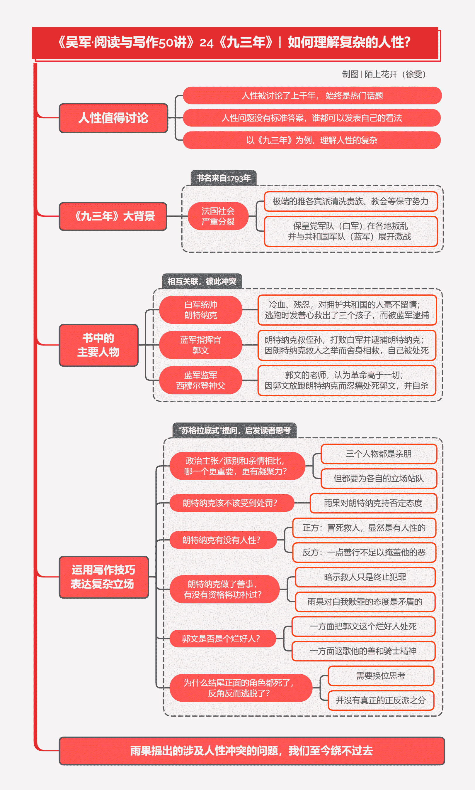  

公众号懒人找资源，懒人专属群独享

# 25 英伦情诗 | 爱要怎么说出口？

吴军

2020-07-14

英伦情诗 | 爱要怎么说出口？

很多人在激情之爱面前，既羞于表达，也往往变得笨嘴拙舌。但我认为，爱，不管是对朋友的爱、对异性的爱，还是对人类的大爱，其实是生活中最重要的事情。  
**学会表达爱和享受爱会让人受益终身。**

情诗可以被看作是最直接、最炽烈的爱的表达。但我猜，很多人，尤其是读理工科的人，成年以后就不再读诗了，更别说情诗了。

其实， **实在说不出口的话，自己不能准确概括的心情，不妨直接挪用，或者借鉴那些经典的情诗。**

这一讲，我就通过雪莱、济慈和拜伦的三首情诗，来谈谈怎么表达“爱”。

如果要是有人和你讲，爱情比生命重要，你信么？

我想大部分人会觉得这只是夸张的说法。但是我们不要轻易下结论，世界上还真有这种人，这一讲说到的三位英国诗人雪莱、济慈和拜伦就是如此。我自己喜欢他们这三首诗，还有一个原因是，那些诗比较容易理解，熟悉的人也多，是一个很好的和别人交流的平台。

## 1.雪莱

这首小诗不是雪莱最有名的，但我认为是他最优美的，遗憾的是它极难翻译成中文而不失其韵味。这种现象叫做“迷失在翻译中（Lost in  
Translation）”，唐诗翻译成英语就乏味了，英文诗也难翻译成汉语。

具体到雪莱的这首小诗，就是极尽语言之妙。我找了四五个译本，都不满意，只好勉为其难参考各个版本自己翻译。你可以打开音频听听。

音乐，当柔声已逝， 还在记忆中震颤； 芬芳，当甜美的紫罗兰凋谢； 仍会在感官中留有余香。 Music, when soft voices die,  
Vibrates in the memory— Odours, when sweet violets sicken, Live within the  
sense they quicken. 当玫瑰枯萎， 花叶仍堆积在爱人的花床。 当亲爱的你离去时， 爱情沉睡入梦乡。 Rose leaves, when  
the rose is dead, Are heaped for the belovèd's bed; And so thy thoughts, when  
thou art gone, Love itself shall slumber on.

这首诗极为柔美。我记得在美国时，一个男生把这首诗抄给一位女生，对方当时就哭了。这就是文学的魅力，当一个人有一种感情要表达时，他自己甚至不知道如何表达，如果他读到过一些诗，就可以借别人的口表达出来了。

不管你是从事什么行业的人，都会经过“当时年少春衫薄”的年龄，学习语文，了解诗歌，背下几首唐诗，可不光是应付考试用的，我们完全可以从各种优秀作品中体会和模仿，他人是如何成功表达情感的。

比如，读了雪莱上面这首小诗，我自己就真的体会到了男女感情中那种细微的美妙之处。

至于为什么雪莱能做到，这就要说说他这个人了。

雪莱出身于一个贵族家庭，年轻的时候受到苏格兰启蒙运动思想家休谟的影响，成为一个反对宗教的人文主义者，并因此被父亲切断了经济来源，靠两个妹妹接济过活。后来他遇到了妹妹的同学委斯特布洛克，这个 16 岁的少女是他的迷妹。雪莱与女孩子仅见了几次面，觉得她很可爱，又听她说自己在家受父亲虐待，便带着这个身世可怜的少女私奔结婚了。

在这个过程中，雪莱完全把自己当成了一个浪漫的骑士。但是爱情不等于婚姻，他们婚后很不幸福，在精神上都备受煎熬。

几年后，雪莱遇到了才华横溢的少女玛丽·葛德文，两个人志同道合，于是就同居了，然后一起去欧陆旅行，玛丽当时才 17 岁。也就是在那次旅行中，雪莱伉俪和拜伦等人在瑞士密切交往，而玛丽则在那时完成了著名的《弗兰肯斯坦》一书的构思。

雪莱第一个太太当然很不开心，虽然衣食无忧，但是两年后还是在绝望中自杀了。玛丽也就正式成为雪莱太太。为了不致影响到他与玛丽所生孩子的教养权，雪莱离开了英国到欧洲大陆定居，算是为爱放弃了一切。

在随后的两年里，他完成了重要的长诗《解放了的普罗米修斯》和名作《西风颂》。29 岁那年，雪莱死于海难，过早地离开了人世。雪莱的作品，后来大多是玛丽整理出版的。

从雪莱的经历可以看出，他有了爱，可以不在乎钱，不在乎荣誉，甚至不在乎生命。这样一个作家，他的情诗，的确是出于真情实感。

爱情带来的不光是甜蜜、思念和幸福，也可能伴随着孤独和痛苦。下面我们就来看雪莱的另一首短诗，看看他是怎么表达失去伴侣的悲伤苍凉的。

这首诗叫做《歌》。我之所以选这首诗，一个原因是郭沫若先生的译文非常棒。郭老是这样翻译的：

有鸟仳离枯树颠， 哭丧其雄剧可怜； 上有冰天风入冻， 下有积雪之河川。 A widow bird sate mourning for her love  
Upon a wintry bough; The frozen wind crept on above, The freezing stream  
below. 森林无叶徒杈枒， 地上更无一朵花， 空中群动皆息灭， 只闻呜唈有水车。 There was no leaf upon the forest  
bare, No flower upon the ground, And little motion in the air Except the mill-  
wheel's sound.

郭老的翻译已经是再创作了，当然他不得不放弃原诗中的韵律。

苏福忠先生在《译事余墨》一书中评价说，译作原诗更多了一种荒凉、悲切和孤独的氛围。我甚至能想象一个画面：冬天看到小溪流过山谷，皑皑白雪覆盖在水车磨坊上，旁边的枯树上，有一只孤独的鸟。

很多时候，在爱恋中感到孤独的人，会觉得自己就是这样一只小鸟。

但我要提醒你，表达爱，是以真心和真诚为前提的。这是我们强调的爱的表达的第一个层次。

**情诗也能触及我们内心柔软的部分，触动我们感受爱、享受爱。**

## 2.济慈

济慈也是以写爱情诗文而出名的。虽然他出身的家庭背景和雪莱差别很大，但是两个人的思想和追求却很相似。

济慈为了照顾他感染了肺结核的兄弟，自己也染了病。在外地养病期间，济慈和邻家小姐布朗相爱了，两个人还私定终身，一同度过了几年非常幸福的时光。

济慈最后几年全部的诗文都是写给布朗女士的，那些文字感人之至。我们不妨看一篇。这首著名的诗，其实是一封情书，所以也没有题目。

我最亲爱的女士： 我正惬意地临窗而坐， 眺望远山如黛， 碧海连天。 晨光和煦。 我之所以能调适心情， 享受此间生活， 全因有你的甜蜜回忆相伴。  
你近乎残忍，让我无可自拔， 将自由拱手相让。 曼妙如你，我欲诉衷肠却一时语塞， 再璀璨烂漫的字句都不足以形容。 期翼你我化蝶， 生命仅有三个夏日，  
有你相伴三日的欢愉， 也胜过五十年寂寥岁月。 在信里向我倾诉， 即刻动笔， 全力抚慰我， 满篇的情愫， 像罂粟般迷醉我心， 亲吻你最温柔的字句，  
至少我也能感受你唇间的余温。

如果我们回顾一下济慈的一生，他做过的最被人称颂的事情，就是和布朗小姐恋爱了一次，他们幸福地生活了几年，随后济慈就病逝了。但是无论是济慈还是布朗小姐，都觉得这辈子很值得。事实上，正是这段爱情造就了济慈。

他们二人的故事后来被拍成了电影《璀璨情诗》，这部电影也翻译成《明亮的星》。

济慈也是一个用生命写诗的人，从这首诗我能真切感受到，他非常享受和布朗小姐的这段爱情。这首诗写得热烈而不肉麻，有点西洋版的《关雎》或者《蒹葭》的味道。

最吸引我的是这几句“生命仅有三个夏日，有你相伴三日的欢愉，也胜过五十年寂寥岁月。”这和秦观的“金风玉露一相逢，便胜却人间无数”有异曲同工之妙。

## 3.拜伦

拜伦也是一位情事丰富多彩的英国诗人。但是相比他对女人的爱，更打动我的，是他对人类的爱，并且这是付诸行动的爱。这就是爱更高的层级——超越个人的博爱了。

拜伦在 37 年的短暂生命中，写了大量的优秀诗篇，包括史诗般的《唐璜》。节选自《唐璜》的《哀希腊》，说的是浪荡公子唐璜到了希腊，沉浸在青春的爱情和大自然美景中，他对脚下的这片土地，欧洲文明的发源地是如此地痴迷与爱慕。但是当时希腊正受到土耳其的入侵，拜伦以唐璜之口说道：

我独自在那里冥想一刻钟， 梦想希腊仍旧自由而欢乐； 因为，当我在波斯墓上站立， 我不能想象自己是个奴隶。

拜伦对希腊的爱，并不是说说而已，他积极而勇敢地投身了希腊民族解放运动，并且后来死在了希腊，希腊因此为他举行了国葬。

## 小结：

讲完雪莱、济慈和拜伦，你会发现，世界上真的有把爱看得比命还重的人。我觉得，有这种特征的人，才是更纯粹的诗人。

纯粹的诗人是一个特殊的群体。真正的诗人是在用生命作诗，所以他们表达爱的水平比我们高多了。这也是我推荐你读一点情诗的原因。

当然，对我来讲还有一个原因，我虽然羡慕这种用生命写诗的人，但并没有勇气这辈子真像他们那么活。  
**假如我们能活 10 辈子，我愿拿出一辈子过雪莱、济慈或者拜伦的生活。但是，我只有一辈子。因此，读了他们的诗，了解了他们的想法，是让我的生命延长了。**

## 作业：

欢迎你在留言区聊聊最打动你自己的情诗，当然，更欢迎你把自己写的情诗分享给大家。

## 附录：拜伦《哀希腊》全文

一 希腊群岛呵，美丽的希腊群岛！ 热情的萨弗在这里唱过恋歌； 在这里，战争与和平的艺术并兴， 狄洛斯崛起，阿波罗跃出海面！ 永恒的夏天还把海岛镀成金，  
可是除了太阳，一切已经消沉。 二 开奥的缪斯，蒂奥的缪斯， 那英雄的竖琴，恋人的琵琶， 原在你的岸上博得了声誉， 而今在这发源地反倒喑哑；  
呵，那歌声已远远向西流传， 远超过你祖先的“海岛乐园”。 三 起伏的山峦望着马拉松—— 马拉松望着茫茫的海波； 我独自在那里冥想一刻钟，  
梦想希腊仍旧自由而欢乐； 因为，当我在波斯墓上站立， 我不能想象自己是个奴隶。 四 一个国王高高坐在石山顶， 瞭望着萨拉密挺立于海外；  
千万只船舶在山下靠停， 还有多少队伍全由他统率！ 他在天亮时把他们数了数， 但日落的时候他们都在何处？ 五 呵，他们而今安在？还有你呢，  
我的祖国？在无声的土地上， 英雄的颂歌如今已沉寂—— 那英雄的心也不再激荡！ 难道你一向庄严的竖琴， 竟至沦落到我的手里弹弄？ 六 也好，置身在奴隶民族里，  
尽管荣誉都已在沦丧中， 至少，一个爱国志士的忧思， 还使我的作歌时感到脸红； 因为，诗人在这儿有什么能为？ 为希腊人含羞，对希腊国落泪。 七  
我们难道只好对时光悲哭和惭愧？ ——我们的祖先却流血。 大地呵！把斯巴达人的遗骨 从你的怀抱里送回来一些！ 哪怕给我们三百勇士的三个，  
让德魔比利的决死战复活！ 八 怎么，还是无声？一切都喑哑？ 不是的！你听那古代的英魂 正像远方的瀑布一样喧哗， 他们回答：“只要有一个活人  
登高一呼，我们就来，就来！” 噫！倒只是活人不理不睬。 九 算了，算了；试试别的调门： 斟满一杯萨摩斯的美酒！ 把战争留给土耳其野人，  
让开奥的葡萄的血汁倾流！ 听呵，每一个酒鬼多么踊跃 响应这一个不荣誉的号召！ 十 你们还保有庇瑞克的舞艺， 但庇瑞克的方阵哪里去了？  
这是两课，为什么只记其一， 而把高尚而坚强的一课忘掉？ 凯德谟斯给你们造了字体—— 难道他是为了传授给奴隶？ 十一 把萨摩斯的美酒斟满一盅！  
让我们且抛开这样的话题！ 这美酒曾使阿纳克瑞翁 发为神圣的歌；是的，他屈于 波里克瑞底斯，一个暴君， 但这暴君至少是我们国人。 十二 克索尼萨斯的一个暴君  
是自由的最忠勇的朋友： 暴君米太亚得留名至今！ 呵，但愿现在我们能够有 一个暴君和他一样精明， 他会团结我们不受人欺凌！ 十三 把萨摩斯的美酒斟满一盅！  
在苏里的山岩，巴加的岸上， 住着一族人的勇敢的子孙， 不愧是斯巴达的母亲所养； 在那里，也许种子已经散播， 是赫剌克勒斯血统的真传。 十四  
自由的事业别依靠西方人， 他们有一个做买卖的国王； 本土的利剑，本土的士兵， 是冲锋陷阵的唯一希望； 但土耳其武力，拉丁的欺骗， 会里应外合把你们的盾打穿。  
十五 把萨摩斯的美酒斟满一盅！ 树荫下正舞蹈着我们的姑娘—— 我看见她们的黑眼亮晶晶， 但是，望着每个鲜艳的姑娘， 我的眼就为火热的泪所迷，  
这乳房难道也要哺育奴隶？ 十六 让我攀登苏尼阿的悬崖， 可以听见彼此飘送着悄悄话， 让我像天鹅一样歌尽而亡； 我不要奴隶的国度属于我——  
干脆把那萨摩斯酒杯打破！

9742

1.学会表达爱和享受爱，会让人受益终身。 2.对于说不出口的话、难以准确概括的心情，不妨直接挪用或者借鉴那些经典的情诗。  
3.情诗还能触及我们内心柔软的部分，触动我们感受爱、享受爱。

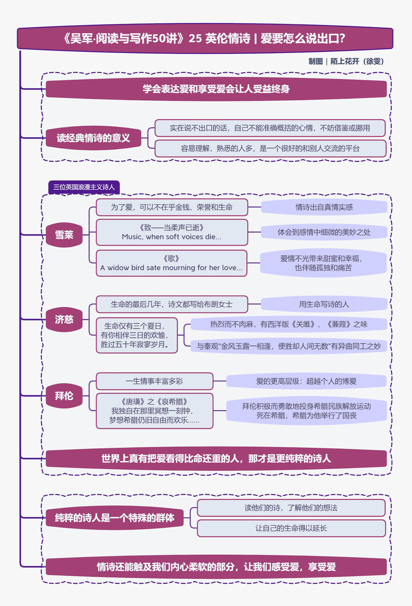  

公众号懒人找资源，懒人专属群独享

# 26 《俄狄浦斯王》| 如何理解人生的底色？

吴军

2020-07-14

《俄狄浦斯王》| 如何理解人生的底色？

我们人生到底是一场喜剧还是一场悲剧，以及我们对待人生的态度应该是怎样的。不知道你有没有问过自己这个问题？

我最早思考这个问题，是刚上大学的时候，当时我正天天坐在病床上，处于人生的低谷。说句不太孝顺的话，当时父母、师长、同学和朋友都帮不上忙。真正帮了我的，是尼采和罗曼·罗兰。

读了尼采的《悲剧的诞生》，我才振作了起来。这是一本影响到我人生的书。而正是通过这部书，我开始了解希腊戏剧。后来我去了很多次希腊，特别是有一次和窦文涛等人在当地学者的陪同下做节目，得以对希腊的文化，包括戏剧文化有深刻的理解。

这一讲，我想通过自己对古希腊戏剧的阅读，带你一起探寻关于人生底色的原点问题。

上一讲，我们讲到拜伦为了希腊的解放而献身，希腊在很多欧洲人的心里，就像文明之母，因为它确确实实是欧洲文明的原点。因此，很多人了解西方的文明和今天的社会，都需要从古希腊开始。而要了解这个原点，则要从希腊的戏剧这个“原点的原点”开始。

说希腊文化，离不开众神，其中太阳神（文学界也翻译成日神）阿波罗和酒神狄奥尼索斯非常重要。他们都是宙斯的儿子，阿波罗代表诗歌、光明、理性和逻辑，而狄奥尼索斯则代表生命力、戏剧、狂喜和醉酒。

从古希腊留下的雕塑来看，他们都长相俊美。但是在希腊的文化中，他们代表的性格和艺术风格截然不同。当然，这种不同可以更多地理解为互补，而非对立。

从哲学层面上讲，他们代表了我们每一个人身上的两个对立的侧面，当然这两个侧面也统一在我们每一个人身上。尼采就是在《悲剧的诞生》这本书中，通过古希腊悲剧的产生，把这种对立统一关系讲清楚了，让当时才 20 岁的我看清了人生中很多本质的东西。

在古希腊的文化中，理性是由阿波罗精神主导的，尼采讲，日神精神代表了形式美、节制和对称，这也是我们今天思想的主旋律。同时，人也都有酒神狄奥尼索斯的一面。

你可能觉得有点不好理解，打个比方，我们日常在理性的驱使下工作生活，可以认为是日神精神主导的。但如果今天觉得很累，就可以理解为身上的日神精神不足以支撑全部的生活。这时，做一些非理性的事情，比如喝个半酣，或者找一个人吐槽，反而是解决问题的好方式。这就是酒神的一面了。

希腊人讲，在阿波罗之下没有阴影，既然没有阴影，那些不太见得了光的事情就不能做。但是，世界上总是有些事情又不得不做，比如你托关系让一个老师帮助你把孩子送进幼儿园。日本人对这些事情的做法就是避过太阳，晚上到酒桌前去做。

用尼采的话讲：“酒神状态的迷狂，它对人生日常界限和规则的破坏，其间，包含着一种恍惚的成分，个人过去所经历的一切都淹没在其中了。”这种带有点疯狂的快感，会让人非理性的一面暴露出来，消除了人与人之间的界限，让大家成为一个整体。

好，刚才我们说了希腊文化里，有太阳神主导的理性精神，也有酒神主导的非理性精神，它们其实能对应进我们的生活，我们既有乐观积极的一面，也会有沮丧阴暗的一面。从这个意义上讲，希腊戏剧的喜剧和悲剧，就不仅仅是遥远而陌生的文学经典了，它跟你我有密切的关系。

总体来讲，希腊戏剧是以悲剧为主，偶尔辅以一些喜剧。希腊的学者和我讲，“悲剧”这个词，其实在希腊语里的原意，更多的是严肃剧的意思，而非悲伤的意思。之所以很多国家将它翻译成“悲伤的剧”，是因为它们大多以悲惨的结果而告终。

那为什么严肃剧总是以悲惨收尾呢？这里面有三个原因：

首先，人生是短暂的，这本身就是个悲剧。其次，人的力量是有限的，很多事自己做不到。最后，命运是无常的，用今天的话讲，总有黑天鹅事件，逃得过初一，逃不过十五。

**古希腊的悲剧并不责备人的过错，不是说谁干了件蠢事，导致了悲剧，而是更多地分析命运。**  
悲剧其实是古希腊人奉献给神的。他们是通过那些悲剧里的故事，告诉神，人类对命运的理解。

那么酒神精神代表了沮丧和无望吗？并不是。在古希腊的文化里，没有来世，因此希腊人对现世的态度是非常严肃认真的。

既然生命本身是一幕悲剧，有很多无奈，那么人能够勇敢地承担这种无奈而并不消沉衰落，这正是生命的骄傲。这也让我联想到日本人对樱花的态度，虽然樱花的美丽转瞬即逝，带有忧伤色彩，但是它毕竟绽放过。

尼采说的这种酒神精神，其实在我前面介绍的王羲之等人身上你也能看到。王羲之在饮酒后写出了绝世佳作《兰亭集序》，酒醒了后想再抄写一遍，结果怎么也写不出原来那么漂亮的书法了。回顾一下《兰亭集序》的内容，也能体会到尼采所描绘的各种无奈。

尼采认为，古希腊顶峰时期的悲剧作家埃斯库罗斯和索福克勒斯，他们的作品《被缚的普罗米修斯》和《俄狄浦斯王》当中，同时蕴含日神和酒神的精神。后来，剧作家们  
舍弃了酒神精神，将戏剧引到纯理性的逻辑层面，于是西方的文化就走到了死胡同中。

了解了这个背景，我想具体谈谈索福克勒斯的《俄狄浦斯王》。如果你只读一部古希腊悲剧的话，我的推荐就是它。

简单概括这就是一个杀父娶母的悲惨故事。对心理学感兴趣的同学，一定知道“俄狄浦斯情结”这个词。杀父娶母这种桥段，发生概率非常低，说《俄狄浦斯王》之所以伟大，当然不仅仅是因为这么一个小概率的人伦惨剧。它给我最大启发的，是当这样的惨剧发生后，俄狄浦斯的所作所为。

我们先来回顾一下故事情节，我会说得简单一点。

俄狄浦斯的父亲——底比斯国王因为劫走邻国科林斯国王的儿子，因此遭到诅咒。为了逃避厄运，他让牧人把俄狄浦斯抛弃到荒野。后来，俄狄浦斯碰巧被科林斯国王，被当作其亲生儿子抚养长大。

有一天，俄狄浦斯得到阿波罗的神谕，得知自己将来会“杀父娶母”。为避免神谕成真，俄狄浦斯便逃离科林斯国，谁知在三岔路上与一群人发生了冲突，杀了人，其中就包括他的生父。

后来，俄狄浦斯破解了斯芬克斯之谜，杀了狮身人面怪兽，救了底比斯城的人。他被拥戴为国王，并娶了原先的王后，也就是他的母亲。

但你一定要注意故事后来的发展。接下来底比斯一直灾祸不断，俄狄浦斯向阿波罗请示神谕，并且向牧人了解了自己的身世，才知道杀父娶母的命运应验到他身上了。为了拯救底比斯的人民，俄狄浦斯刺瞎了自己的双眼去流浪，国家得到了拯救。这部悲剧对我来说，真正伟大是在这里。

结合尼采给我的启发，我在大约 20 岁的时候，对人生第一次有了这样的认识——悲剧底色下要保留一抹亮色。  
**个人最终的出路在于超越自我，就如同俄狄浦斯一样，当他刺瞎了自己的双眼，接受自己过错（虽然不是他的本意）的结果时，底比斯就得到了拯救，他的后代就世代为王了。**

我在我的《格局》这本书里讲过，悲剧有三类：

第一类是自身有问题，造成的悲剧，即所谓的可怜之人必有可恨之处；

第二类是由坏人包括社会造成的悲剧，比如我们一直说的岳飞的悲剧；

第三类是自己也没做错事情，也没有坏人，但是命运还是造成了这样的悲剧。俄狄浦斯的悲剧属于第三类，这才真的是悲剧中的悲剧。在古希腊的戏剧中，强调人生这种悲剧的必然性。

那么，对待没有来世，而且命运不确定的人生该是什么态度呢？简单地讲，有悲痛，但没有忧伤，平和地对待厄运和死亡。

我记得周国平先生编了这么一个寓言：一队人默默地排着队往前走，走到路的尽头就是死亡。渐渐地有一个青年向一个少女搭讪了，他们聊了起来，队伍里有了笑声，大家都有说有笑地聊了起来。

这特别能拿来说明古希腊人对人生的态度， **虽然知道路的尽头是无尽的黑夜，但是欢笑地走完这条路和愁眉苦脸地走完则是人可以选择的。**

古希腊有很多人吃饱了饭没事瞎琢磨人生的问题，他们会把自己的想法告诉后人，我们今天从他们留下的想法中，能够看到人性最根本的一些东西。

顺便说一句，古希腊的宗教和犹太教、基督教以及伊斯兰教这样的一神教完全不同，古希腊的神是人格化的，具有人的喜怒哀乐，也会犯错误。而一神教的神则是绝对精神、绝对权威和绝对智慧的象征。

从这个意义上说，古希腊宗教跟中国的传统信仰更接近，古希腊人的人生态度，和今天不大相信来世的中国人没有本质的区别。这也是我们中国人更应该花一点时间读读古希腊悲剧的原因。

## 小结：

如何理解人生的底色？这一讲，通过《俄狄浦斯王》，我想请你注意，古希腊的悲剧中，是命运造成的悲剧，强调人生这种悲剧的必然性。但在承认这样的悲剧性之后，人仍然可以像俄狄浦斯一样，作出超越自我的选择。这也是我对命运不确定的人生的态度。

## 作业：

你怎么理解人生底色？能不能请你分享对自己影响最大的悲剧故事，它对你有什么影响？

下一讲，我们聊聊带我走出人生低谷的另一个作家罗曼·罗兰。

1.古希腊是欧洲文明的原点，而希腊戏剧则是“原点的原点”。 2.希腊戏剧以悲剧为主，但并不责备人的过错，而是分析命运，强调人生这种悲剧的必然性。  
3.古希腊宗教跟中国的传统信仰接近，古希腊人的人生态度，和今天不大相信来世的中国人没有本质区别。所以我们应该花一点时间读读古希腊悲剧。

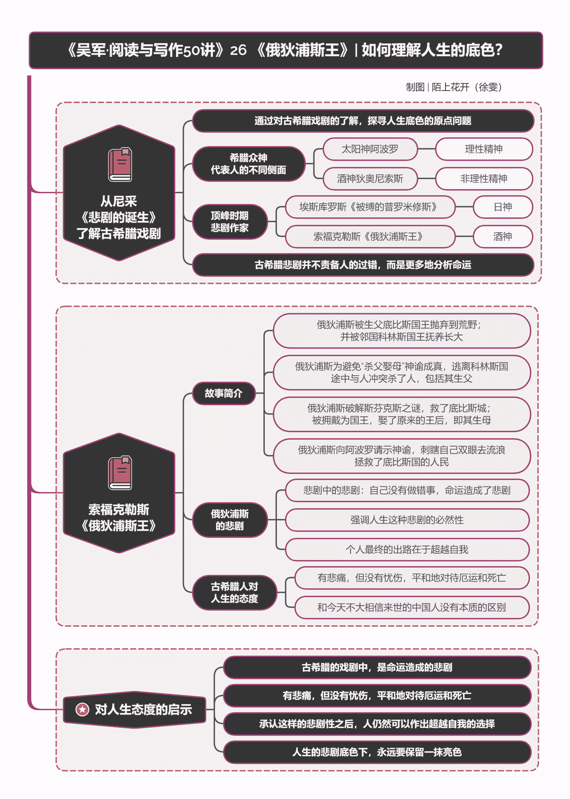  

公众号懒人找资源，懒人专属群独享

# 27 罗曼·罗兰 | 年轻时为什么需要理想主义？

吴军

2020-07-14

罗曼·罗兰 | 年轻时为什么需要理想主义？

这一讲，我们谈谈罗曼·罗兰。上一讲我说过，我年轻的时候得了一场大病，那阵子特别消沉，除了尼采，我还坐在病床上读了罗曼·罗兰的“巨人三传”，也就是《贝多芬传》《托尔斯泰传》和《米开朗基罗传》这三本传记。这三本传记也给了我很大的鼓舞。

罗曼·罗兰在讲述他写“巨人三传”的原因时，道出了一个几千年来世俗社会各个国家都有的一个现象，就是周围环境的市侩气和有理想的年轻人之间的矛盾。这也是我年轻的时候遇到的问题，我想这是我被“巨人三传”吸引的重要原因。

人年轻的时候，理想和现实的矛盾解决不好，就很容易变成“愤青”“废柴”，或者“精致的利己主义者”。读书你就会发现，在这个问题上，我们今天其实和贝多芬生活的两百年前，或者罗曼·罗兰生活的一百年前，没什么区别。

而且这个问题，并不是你学了理工科、学了商科、学了医就能逃避的。根本逃避不了。而大家的数学书、经济学读本和医学课本中甚至更不会教怎样看待这些现象，怎样解决问题。能解决问题的，我认为反而是文学。

罗曼·罗兰一生都试图用他的笔来解决这个问题。他解决没解决，我不知道，但是对我个人来讲，他是给了我答案的，而且是灵验的答案。

你不妨跟我进入《贝多芬传》，看看他对现实和理想的描述。

这部传记以莱茵河为线索。贝多芬出生在莱茵河畔，年轻时结识朋友也是在那里，后来到了法国，梦里浮动的依然是莱茵河，最后在弥留时，耳边听到的是莱茵河的涛声。

先说现实，十八世纪末期的欧洲，工业革命方兴未艾，但同时社会充满了市侩气，鄙俗的物质主义压制着思想，普通老百姓面对的是艰苦沉重的劳动，过着没有光华的生活。

在这种环境中，清醒者其实很痛苦，一方面他们受这种环境所压迫，自己力量微小。另一方面，他们不知道彼此的存在，没有同盟军。这跟鲁迅在《呐喊》自序中描述的情景很相似。

但总有想通过自己努力改变现状的人。罗曼·罗兰给出的解决方式是什么呢？就是呼吸英雄的气息。当然，这先要定义什么是英雄。

罗曼·罗兰讲：“我称为英雄的，并非以思想或强力称雄的人；而只是靠心灵而伟大的人。好似他们之中最伟大的一个，就是我们要叙述他的生涯的人所说的：除了仁慈以外，我不承认还有什么优越的标记。”

读完这段话，米开朗基罗、牛顿、贝多芬这些创造文明的人，在我心中的地位大增。而横扫欧洲的拿破仑在我心中的地位顿时矮了一大截，其他的王侯将相就更加不值一提了。正是罗曼·罗兰等人的书，让我重新定义了英雄的概念。这是我后来写《文明之光》和《全球科技通史》的原因之一。

罗曼·罗兰随后一辈子写作的目的，就是“为了援助他们，我才在他们周围集合一批英雄的友人，一批为了善良而受苦的伟大心灵……这样，我们在战斗中不是孤军，世界的黑暗受着神光烛照”。

罗曼·罗兰的这种想法，和鲁迅讲的“有时候仍不免呐喊几声，聊以慰藉那在寂寞里奔驰的猛士，使他不惮于前驱”，其实是一个道理。

可以看出，这是一种普遍困境——人要进步，但似乎受到社会环境的限制，又没有志同道合的朋友，出路在哪？

虽然时间过去了 100 年，但这样的问题依然存在，所以罗曼·罗兰的书还值得读。

要深入了解罗曼·罗兰所说的英雄主义，你还得知道他最著名的小说《约翰·克利斯朵夫》。这套巨著前半部分其实是《贝多芬传》的文学版，讲述了一个意气风发的音乐天才崛起的故事。

中间一部分，其实是罗曼·罗兰这一批理想主义作家在欧洲的追求和生活。他们才华横溢，有抱负，有过青春和爱情，也曾经有过不错的物质生活，但是他们不谙世故，时不时地被卷入是非之争，搞得自己身心俱疲，最后只好逃避现实。

书的最后，克利斯朵夫老了，他的爱人去世了，充满激情与斗争的生活也遥远了。这时，他的反抗精神已完全消失，甚至和充满他当年理想的人产生了代沟。他不问世事，一切恩怨都付诸笑谈中了。

是不是所有人都会有跟克利斯朵夫相似的经历呢？年轻的时候有过理想，最后不得不回归现实。

但是，克利斯朵夫又和那些碌碌无为走过一生的人不同，他一直在不断地创作，在为社会的文明添砖加瓦。

罗曼·罗兰其实是在克利斯朵夫身上注入了双重性，既是一个英雄，也是一个凡人，他有过梦想和感情，也有过过错。这个人内心时常充满矛盾，既会为了理想和爱情奋斗，又时不时地表现出软弱与痛苦。对于我来讲，读完罗曼·罗兰的作品后，英雄的定义发生了改变，那就是要回归凡人。

《约翰·克利斯朵夫》出版两年后，罗曼·罗兰就获得了诺贝尔奖。此后他一直致力于宣传人道主义和理想主义。

很多年前我第一次读诺贝尔的遗嘱时，读到他说要把文学奖授予理想主义的文学，就去关注什么是理想主义的文学。了解得多了以后，觉得诺贝尔的想法是有道理的。这种理想主义也对我的创作产生了很大的影响。

简单地讲，从 15 世纪开始，欧洲人开始关心现实和现世的问题后，就会发现现实很不完美。

在我看来，  
**作家们也会分成两种，一种是告诉人们问题在哪里，当然他们说的问题有些只是自己的猜测，他们就是批判者；而另外一些作家，则会在头脑中去构造完美的世界，你可以认为他们是建议者。**  
他们就是理想主义的作家。

如果按照这个标准来衡量，你也许就知道哪些文学作品够格获得诺奖了。比如，莫言的《红高粱家族》就算得上理想主义的作品。他讲的那些故事在现实中其实很难发生，抗日的实际情况完全不是那么回事，但是他在书中弘扬了很多精神层面积极向上的东西，大到报效国家，建立一个乐土家园，小到个人追求精神的自由，都是符合诺贝尔对文学的期望的。

但是，今天讲职场勾心斗角的小说和电视剧，或者虚构出的逆袭励志故事，高富帅和白富美的爱情故事却算不上理想主义。即便是像菲茨杰拉德的名著《了不起的盖茨比》也不算，因为它只说问题，不给建议。

我觉得，如果一个人读的都是这类故事，难免陷入一种死循环的怪圈：从得不到到失望，从多次失望到绝望，在绝望中更加得不到。

理想的社会到底该是什么样的，大家见仁见智，但是在两点上，批判者和建议者这两拨人是有共识的。首先，理想社会应该是积极向上的；其次，它不倡导唯利是图的物质欲望，而是提倡一种精神层面健康而有力量的生活，这包括人的健康和社会的健康。

诺贝尔奖委员授予罗曼·罗兰 1915 年文学奖的理由是：“文学作品中的高尚理想和他在描绘各种不同类型人物时所具有的同情和对真理的热爱”。

这其实既是对罗曼·罗兰作品很好的总结，也是对诺贝尔理解的文学的诠释。

当我通过文学作品，结识罗曼·罗兰所描绘的那些人时，我发现好像自己也是那样，原来我在这个世界上不孤独，那些人走过的路，我也可以走。  
**心灵是引导生活向上的动力，而它动力的来源在于前人为我们留下的深层次的思考和高维度的智慧。做到这一点，你就是英雄。**

## 小结：

这讲我想告诉你的是，理想主义所宣传的大多是精神层面的价值理念，它的思想在今天和 100 年前没有太多的不同。

一个 20 多岁，希望通过自己努力改变自己向上走的人，在遇到阻力时，如果能接触到罗曼·罗兰的书，并且读进去，可谓是人生大幸。

## 作业：

你读过什么理想主义的文学作品吗？它们有没有对你的价值观产生影响？欢迎在留言区跟大家分享。

1.环境的市侩气和有理想的年轻人之间的矛盾，是几千年来世俗社会各个国家都有的现象。能解决这个问题的，是文学。  
2.作家分两种：一种是批判者，另一种是建议者，后者才是理想主义的作家。 3.心灵是引导生活向上的动力，它动力的来源是前人为我们留下的深层次思考和高维度智慧。

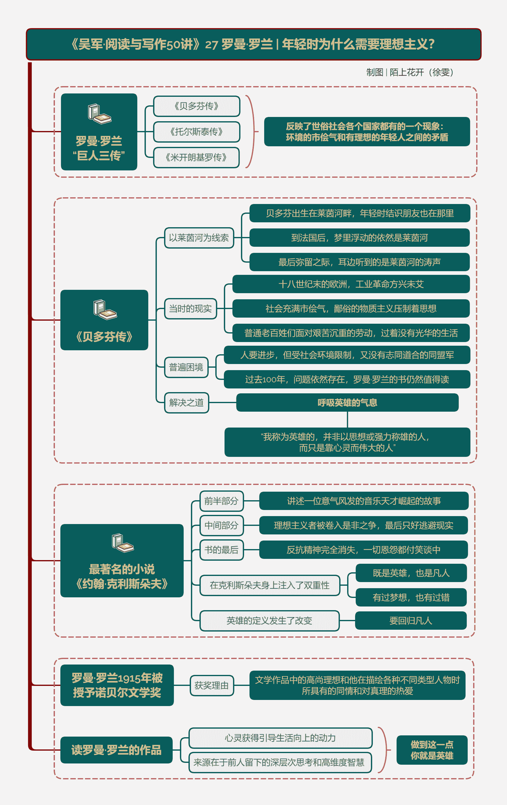  

公众号懒人找资源，懒人专属群独享

# 28 《十日谈》| 精读和泛读各自有什么意义？

吴军

2020-07-14

《十日谈》| 精读和泛读各自有什么意义？

前面我们都是在谈英雄、谈理想主义，人在平时，更多想的是向前，向前，向前，明天会怎么样。但世界的发展未必会沿着我们理想的方式，遇到灾难时，我们正好借这个机会，重新审视人生，重新理解幸福。

2020 年全世界遭受了疫情的袭击，人们很容易从过往的文学作品中去寻找相似的境遇，很多人此时都把目光投向了薄伽丘的《十日谈》。

的确，薄伽丘的这本书讲述的是 14 世纪中期意大利的故事。当时，佛罗伦萨和欧洲很多城市都暴发了黑死病，仅佛罗伦萨就死了十多万人，而整个欧洲，据说死亡人数多达 7000 万到两亿。

1350 年，薄伽丘开始创作《十日谈》，内容是讲述十位年轻男女跑到佛罗伦萨郊外躲避瘟疫。他们在宜人的花园住下，每天除了唱歌跳舞之外，每个人要讲一个故事，十天下来就讲了一百个故事，这些故事合在一起，就是这本书。

春节前后，得到也做了十日谈的对话，命名的灵感也来自于薄伽丘的这本书。

但我特别想向你推荐这本书，还不光是因为这一次的全球疫情。其实是它里面的一些故事影响了我一生，让我学会了换个视角理解人生。

这一讲，我也会就这本书谈一下精读和泛读各自的功用。

## 一、精读的功用

《十日谈》里面的故事写得都非常离奇有趣，书中的人物非常多，有王公贵族、僧侣骑士，也有平民百姓、贩夫走卒。但在书中，教会里面的人物，特别是头面人物，嘴上都是仁义道德，骨子里却是男盗女娼，而且贪得无厌。相比之下，人间正常的男欢女爱反而都是值得称颂的。

我最早读《十日谈》时，这本书还没有解禁，我是通过北大图书馆的一位朋友才借到的。回去以后就如饥似渴地阅读起来，不到一周就读完了。书中有几篇对我的触动很大，比如《第一天∙第二个》的故事，因此我读了好几遍，至今能记住细节。它们对于构建我的思维方式是有直接帮助的。这就是精读的目的。

《十日谈》里的故事，从主题到形式的差异非常大，但是薄伽丘的主题思想是非常清晰的。那就是赞美人间美好的生活，讽刺教会和贵族骑士。书中所有的故事，都是围绕这一目的组织的。

你可能也听说过，《十日谈》很多故事并非是作者原创的，而是在当时欧亚诸国广为流传的民间故事，比如乔叟在《坎特伯雷故事集》中也讲了一些类似的故事，但薄伽丘根据自己表达思想的需要作了修改。

这其实是我们需要学习的表达技巧，就是材料的选取和剪裁。当然我说的不是歪曲事实，而是在各种场合，用各个角度的证据，证明我们的想法。

这一讲我就跟你展开聊聊《第一天∙第二个》的故事。

## 《第一天∙第二个》

故事讲的是有一个叫做亚伯拉罕的犹太人，他是个非常好的人，他有一个叫杨诺的好朋友，是个天主教徒。杨诺为了劝说亚伯拉罕皈依天主教，就不断劝说他，不断吹嘘天主教的好处。

时间一长，亚伯拉罕多少有点信了杨诺的话，但是他说，耳听为虚，眼见为实，他要去罗马一趟，亲眼看看天主教是什么样，然后才能决定信与不信。

杨诺一想，亚伯拉罕到了罗马，目睹教会的腐败生活，肯定就不信了，因此他不建议亚伯拉罕去罗马。

但是亚伯拉罕很坚决，没有亲眼看见就不信。杨诺也没有办法，只好让他去了，但是心里清楚纸包不住火，朋友回来肯定不会信了。

果然，罗马教廷丑陋的东西都让亚伯拉罕看到了，但是回来后，亚伯拉罕对杨诺讲，自己决定皈依天主教了。杨诺就很奇怪，问他为什么。

亚伯拉罕讲，罗马本该是神圣的，但成了包容一切罪恶的大熔炉。那位高高在上的“牧羊人”，也就是指教皇，以及下面那些“牧羊人”，也就是指主教们，本该做天主教的支柱和基础，却正日日夜夜千方百计要让天主教早些垮台。

但是，亚伯拉罕的话锋一转说：“我还是决定皈依天主教”。为什么呢？因为教皇、主教和教士们应该是天主教的基石、支柱，而他们却在挖墙脚，但是不管他们怎样拼命想把天主教推翻，天主教还是屹然不动，反而日益发扬光大。那么天主教一定有圣灵在给它做支柱、做基石。你们的宗教确实比其他的宗教更加正大神圣。

杨诺万万想不到，亚伯拉罕会因为教会的腐朽反而得出这么一个结论来。

这个故事很短，但是有很多值得学习的地方。

首先它的写作手法非常妙，用今天的话说叫做剧情大反转，但是这样的反转很符合逻辑。

其次，也是更重要的，就是它教会我另一种思考方法。而且，就是这样一个从文学作品里看来的故事，在日后被我两次用到了工作中。

## 故事应用一

很多年前我在腾讯的时候，一位从 Google 来的员工就和我抱怨，代码的质量怎么这么差，单元测试也没有，三天两头死机，没救了，他觉得很郁闷。我就和他讲了这个故事，我讲，这要换一个角度看问题。

你看，照理说，这么差的工程质量，系统应该三天两头崩溃，用户应该都跑光了，可是它的用户还在不断增加，大家使用好像也没有遇到什么麻烦。这说明它像故事里的天主教一样，“有圣灵给它做支柱”。

接下来，我就建议他去找原因，这个原因一定是价值所在。后来他按我说的去做，真的找到了原因，因此能够客观地评价腾讯的工程工作，他的职业发展得很顺利。

## 故事应用二

第二个例子是关于一个投资，它给我的基金带来了几十倍的回报。那个创业公司，如果你盯着它很多细节看，一大堆的问题，但是非常奇怪的是，很多其他企业做不成的事情，它都能做成，因此从外面整体看起来发展得很好，而且也没有作假。

国内有一家很有名的基金，本来要和我们一同投资给它，后来看到那么些“乱象”，就放弃了。几年后回来问我，你为什么当时坚持看好它？我也给他讲了这个故事。

然后我说，如果你发现这个大厦有很多蛀虫，却屹立不倒，说明它可能有过人之处；如果真能找到它，就可以放心投了。我是发现那个创始人很厉害，他总是先人一步进入一个即将蓬勃发展的领域。事实上，今天像华为、三星这些企业都是它的客户。

听完这两段经历，你还会觉得文学对读理工科、做技术、做投资的人完全没用吗？

当然，这个故事可不仅仅是我工作中一个好用的例子，它其实是提醒我思考表现和本质的区别。  
**表现可能是假的，当表现解释不了原因时，就需要思考我们是否没看到本质。**

## 二、泛读的功用

前面我说的，是精读一部作品中的某些段落给我的启发，接下来我也会讲讲泛读。泛读让我获得的，是对一部作品，甚至作品所处时代的整体印象。

我们刚才说了，《十日谈》这本书成于黑死病肆虐之后。黑死病对欧洲社会的影响巨大，这不是死了一半人的问题，而是让大家从此对宗教的兴趣大减，转而关注世俗的幸福了。这种转变有三个原因：

首先，和上帝距离更近的主教和教士们也没有少死，这让大家对上帝的崇拜大减。好像在细菌面前是人人平等的。另外，既然神治不了病，还得靠医生，这促进了欧洲医学的发展。

其次，在中世纪，欧洲人比较重视来世，一下子死了好多人，活着的人倍觉生命的可贵，开始重视活好当下的生活。因此从 14 世纪开始，以意大利为代表的欧洲进入一种享乐主义，再加上十字军带回了阿拉伯地区的生活方式，就连教皇都成了享受生活的人。

这也是为什么薄伽丘笔下的教士们，很多都沉醉于肉欲的快感之中，因为当时欧洲就是这个情况。

第三，由于劳动力一下子少了很多，荒地到处都是，人就变得非常值钱，有条件过更好的生活。当时城市里的雇主为了吸引劳工都在涨工资，这就逐渐形成了城市中产阶级。此外，因为缺了劳动力，欧洲开始寻求通过机械取代人力，这导致了后来的工业革命。

在薄伽丘之前，伟大的但丁完成了《神曲》，那是讲神的故事、精神的故事，薄伽丘则补上了人间的故事、世俗的故事。这样作为文艺复兴的先驱人物，他们二人共同完成了文学从中世纪到新世纪的转折。

在薄伽丘之前，中世纪的文学体裁远没有现在这么丰富，只有宗教文学、诗歌和宫廷文学。凡人的故事是难登大雅之堂的。

在《十日谈》之后，欧洲出现了大量的讲述人间故事的短篇小说。这些短篇小说后来又成了一些著名戏剧的创作原本。比如莎士比亚的很多戏剧的情节就来源于那些短篇小说。

从这个角度看《十日谈》，就让我避免了陷于故事的猎奇，转而关注它背后的人文主义精神。

## 小结：

**一部文学经典，可能因为某个机缘，精读过的段落，会在日后的工作生活中常常影响人的选择。同时，通过泛读形成对作品的整体印象，也更能帮助我们理解作品的本意和它所处的时代。**

## 作业：

有没有什么作品的哪个段落，深刻影响了你？欢迎在留言区跟我分享。

1.精读过后，很多细节会记忆犹新，它们对于构建思维方式有直接帮助。 2.泛读让人获得对一部作品的整体印象，甚至作品所处时代的整体印象。

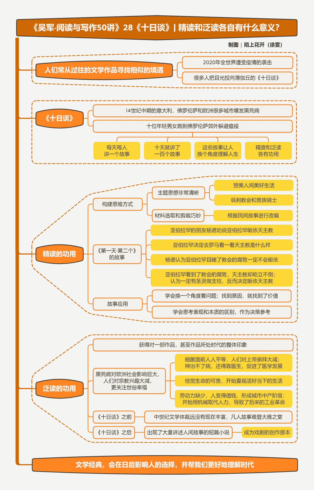  

公众号懒人找资源，懒人专属群独享

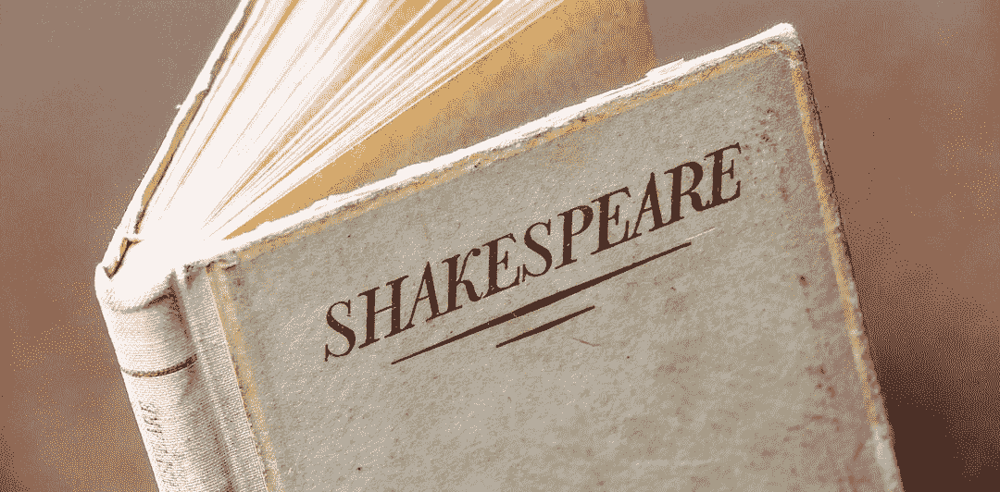

# 29 《李尔王》：什么样的作品能穿越时空？

吴军

2020-07-14

《李尔王》：什么样的作品能穿越时空？

这一讲我们谈谈莎士比亚。熟悉我的同学都知道，每年元旦，我会在课程里跟大家一起读莎士比亚的戏剧。这个小活动，在得到已经坚持了四年。

我第一次了解莎士比亚，是父亲和我提到《罗密欧与朱丽叶》和《梁山伯与祝英台》的相似性，后来他又讲了《哈姆雷特》和《威尼斯商人》的故事。

我对这个四百多年前的英国作家产生了兴趣，开始是好奇，后来读了他的一些作品后，发现他对人生看得极为透彻。他的看法和时代、国度无关，引发了我很多思考。后来就陆续读了他所有的作品。今天，他的书我还会时不时地拿起来看一看，帮自己理清楚一些想法。可以说，莎士比亚对我的成长和写作帮助很大。

莎士比亚距离我们有四百多年历史，但直到今天还有人跟我一样在读他的作品，他的剧本也还在不断地被改编成话剧、翻拍成电影。我觉得，莎士比亚长盛不衰的主要原因，是他作品所讲述的人和人之间的问题，所探讨的问题是跨越时空的。

**莎士比亚不仅是一个文豪，也是一个充满生活智慧的人。**  
他常常会通过作品中人物之口，说出自己的想法。比如我在《硅谷来信》中介绍过，莎士比亚在《哈姆雷特》中，借老臣博诺涅斯之口说出的这样一段话：

不要想到什么就说什么，凡事必须三思而行。对人要和气，可是不要过分狎昵。相知有素的朋友，应该用钢圈箍在你的灵魂上，可是不要对每一个泛泛的新知滥施你的交情……  
倾听每一个人的意见，可是只对极少数人发表你的意见；接受每一个人的批评，可是保留你自己的判断……  
不要向人告贷，也不要借钱给人；因为债款放了出去，往往不但丢了本钱，而且还失去了朋友；向人告贷的结果，容易养成因循懒惰的习惯……  
尤其要紧的，你必须对你自己忠实，正像有了白昼才有黑夜一样，对自己忠实，才不会对别人欺诈……

博诺涅斯的这段话对我处理人际关系影响很大。

和很多文人穷困潦倒所不同的是，莎士比亚是一个精明的商人，他晚年生活得恬适和安祥，这其实和他的人生态度以及生活方式有关。

今天虽然存有一些关于他的生平的文献和史料，但是了解他思想最好的办法就是读他写的书。比如我从他的书中总结了这样一些人生信条：

1.  合理支配金钱。
    
2.  家庭和谐最珍贵，要忠贞于爱情，区分爱情与情欲。两性关系需要两情相悦，水乳交融，不能勉强。
    
3.  要放松自己，享受生活，体会文学和音乐的魅力，享受美食，不要过度悲伤。
    
4.  要克制自己的欲望，不要酗酒、赌博、纵欲无度。
    
5.  年轻与老迈全由心灵决定。
    

如果篇幅允许，我还可以列出很多。

这一讲，我会重点聊聊莎士比亚晚年创作的悲剧《李尔王》。

## 《李尔王》

李尔王的故事源于英格兰一个远古的传说，可以追溯到罗马人统治之前，也就是他们的史前。因此，流传到莎士比亚至少有 1500 年了。虽然在剧本中故事有好几条线索，但是情节并不复杂，故事大概是这样的：

年事已高的李尔王打算退位，把国家交给三位女儿来统治。李尔讲，他会把最大部分领地赏赐给最爱他的人。于是大女儿高纳里尔和二女儿里根就献媚，称自己爱父亲胜于世上的一切。

三女儿寇蒂莉亚不会阿谀奉承，说她的爱不可以用言辞表达。喜欢听奉承话的李尔，在盛怒中取消了三女儿寇蒂莉亚的继承权，将国家分割给了高纳里尔和里根，寇蒂莉亚什么都没有得到。

这样安排的结局可想而知，得到了土地的两个女儿不仅不赡养父亲，而且还想着残害手足获得全部的土地，反倒是一无所有的小女儿寇蒂莉亚这时体现出了对父亲的爱，并且在法国国王的帮助下起来反抗自己的两个姐姐。

最后的结局，是个大悲剧，反抗失败，寇蒂莉亚和李尔被俘。寇蒂莉亚被杀，当然她那两个罪大恶极的姐姐也没有好结局，荒凉的世界上只剩下垂老的李尔。

**《李尔王》是一个上了年纪才写得出来，上了年纪读也才更有体会的大悲剧。**

《李尔王》是莎士比亚成熟期的悲剧作品，这时他对人生已经有了非常深刻的理解。这一类作品和早期的悲剧《罗密欧与朱丽叶》不一样，后者就算结局悲惨，故事推进还是比较轻松的，用歌德的话说，到处充满了青春与春天。而《李尔王》整体上都非常沉重。这反映出作者经历了人生沧桑后对人生和命运深刻的感悟。

获得过诺贝尔文学奖的英国剧作家萧伯纳讲：“没有人可以写出比《李尔王》更加悲惨的戏剧了。”

回顾我们讲过的古希腊悲剧的本质，你会发现这时的莎士比亚走上了希腊古典主义悲剧的道路。

许多有名的演员扮演过李尔王，但一般来讲只有上了年纪的演员才能真正体现这个角色。这也很像西班牙的弗莱明戈舞，通常只有 40 岁以上的演员才能跳出那种沧桑劲儿。

当然，《李尔王》中有很多夸张的地方，但作为阅读者，你不必较真儿。读这个作品，需要关注的是作者通过它所表达的思想，以及那些发人深思的对话，而不是故事本身有没有破绽。

**作为读者，我们应该清楚，作品是作家对生活本质的独特观察和总结，而非对生活的直接临摹。**  
这里面不仅掺杂了作者主观的看法，而且为了实现作品的戏剧化效果，常常会在一个场景中，融合平时生活里很多场景下才可能出现的多个画面。

这就如同中国绘画有所谓“四季开花”的现象，也就是把不同季节开的花画到一幅作品中。尤其是戏剧，为了表现作者对人生独特的观感，也为了吸引人，通常会把剧情编得比较夸张，因此在英语里才有了 Dramatic 这个词，表示戏剧化，夸张的。

当然，莎士比亚对我的影响，不光是为人处世之道。他是个很擅长通过讲故事传递思想的人。读了这么多年莎士比亚，莎士比亚在表达自我方面的技巧，我总结了下面三个层次：

## 1.讲能唤起别人共鸣的故事

正如我们前面所说，莎士比亚是一个生活经验非常丰富的人。因此，他的作品虽然故事大多取材于当时流行的一些故事和传说，以及历史事实，但是莎士比亚其实是把他经历的生活，加以裁剪和整理后，附着在他讲的故事中。这是莎士比亚剧今天还有很多人读的重要原因之一，因为那些故事讲的似乎就是我们身边的事情。

比如《李尔王》里所说的亲情问题，并不会因为社会整体进步就消失了。几百年后我们再读起来，完全不觉生疏，反而觉得很熟悉。因为我们周围其实也有一堆李尔这样的人。当你看到当面溜须拍马，背后使绊的人，就会想到李尔的两个女儿。这就是一种超越时空的表达方式。

托尔斯泰说：“作家要唤起一种经验过的情感，这种情感要以别人可能体验到的方式交流。”这一点，莎士比亚做到了。

## 2.文学创作的元素要抽离现实生活

抽离现实生活，就是文学需要高于生活的地方。

《李尔王》从本质上来讲，是探究亲属关系对人类不幸的影响。这是一个有哲学高度的话题，不是一个时代一个民族的问题，而是我们世代都必须面对的问题。

我环顾自己身边，像李尔这样的家长非常多。即便现在很多人是独生子女，但单位里的领导也可能是个李尔王。当一个人需要在普遍性问题上表达自己的思想时，就必须抛开那些和具体时代、地域、文化背景有关的元素，抽取出最本质的东西。这样才可能对全人类都适用。

我在《硅谷来信》中介绍过如何将一个产品做成全球化的产品。其中一个最重要的思想就是抛开国别、地域的特色，寻找全人类都有的基本需求。我还举了两个例子，一个是好莱坞的电影，一个是 iPhone 手机。  
**过于个性化、本土化，就不可能全球化。**

莎士比亚作品的一大特点，就是从生活中提取和浓缩关于人性和社会本质的做法。当然，这些思想必须要附在一个故事中讲出来，这样才有人读，否则就是哲学作品了。

## 3.再深刻的道理，也要用直白的语言说出来

我们不妨看一下《李尔王》中的三句话：

1\. 一个负心的孩子，比毒蛇的牙齿还要多么使人痛入骨髓。 How sharper than a serpent's tooth it is To have  
a thankless child! Away, away!（第一幕） 2. 疯子领着瞎子赶路，是这个时代一般的病态。 tis the time's  
plague when madmen lead the blind（第四幕） 3. 爱情里面要是搀杂了和它本身无关的算计，那就不是真的爱情。 Love’s  
not love when it is mingled with regards that stands aloof from the’entire  
point.（第一幕）

有的人为了让人觉得文字有美感，会用很多形容词和典故。在我看来，这就如同为了做一道好菜，用了很多名贵的原材料一样。

其实， **写作最高的境界是用平实的语言写出警句。** 不过莎士比亚剧作的很多金句没有典故，也没有难懂的词，但是含义却深刻隽永。

## 小结：

《李尔王》一部需要用人生历练写，也需要用人生历练读的悲剧。莎翁的剧作几百年后仍然有人读，能够跨越时空，是因为他讲了能够唤起大众共鸣的故事，又抽取出了人类亲属关系的本质，而且用直白的语言表达了深刻的道理，这些都是我们在写作中可以借鉴的技巧。

关于对莎翁剧细节的讲解，我会每年在新年讲一次，这里就不展开了，大家可以到时关注我的更新。

## 作业：

你最喜欢的莎翁名句是什么？欢迎在留言区跟大家一起分享。我们一起来看看它们是不是同样有言语直白但道理深刻的特征。

下一讲，我们聊聊《红楼梦》。

1.莎士比亚之所以长盛不衰，是因为他作品所探讨的问题是跨越时空的。 2.莎士比亚的《李尔王》，是一个上了年纪才写得出来、上了年纪读才更有体会的大悲剧。  
3.写作最高的境界，是用平实的语言写出警句。

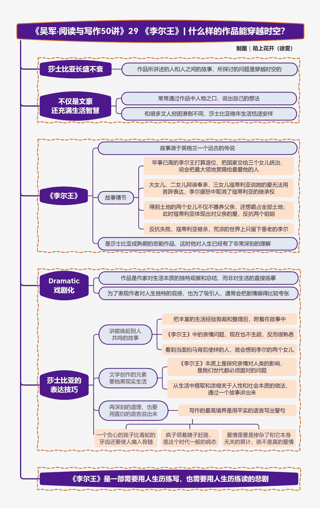  

公众号懒人找资源，懒人专属群独享

# 30《红楼梦》| 曹雪芹到底是在讲谁的故事？

吴军

2020-07-14

《红楼梦》：曹雪芹到底在讲谁的故事？

这一讲，我们聊聊《红楼梦》。

我最早读《红楼梦》是初中，看了个故事，没能坚持看完，因为里面家长里短的故事无法引起我的兴趣。

我第一次认真通读完是准备高考的时候，每天晚上复习完功课睡觉前读半个小时，主要是为了欣赏里面优美的文字，愉悦自己，算是在做功课的闲暇时间里的享受。

后来读了很多遍，主要是把它当作了解中国社会和文化的样本来读，这时那些家长里短的故事背后的含义就能读明白了。

《红楼梦》是中国人的国民必读书，尤其脑子被简单逻辑思维所主导的理工科学生更要读一读。为什么呢？

很简单，我们在中国生活、工作、寻找机会和发展，必须要深刻理解中国社会，这不是技术趋势能告诉大家的，最好通过有质感的文学去把握。

《红楼梦》的高明之处就在于，它能看到我们这个民族超越时代的一些共性，我概括了下面几个方面：

## 1.自上而下的权力结构

贾府如此，今天大家所在的单位也是如此。这和海洋文明国家横向和纵向分权是不同的。每一种权力结构有它的好处，也有它的弊端。比如遇到困难的时候，第一种方式可以及时应对。

在《红楼梦》中，王熙凤代理整治宁国府，贾探春在大观园兴利除弊，效果都立竿见影。但这也带来一个问题，就是谁当这个头，影响很大。贾府之所以衰落，和贾宝玉这一代没有一个成器的男子有莫大的关系，这一点我们后面还会讲到。

## 2.能够集中力量办成大事

这也是自上而下结构的文明形态决定的。

在《红楼梦》中，贾府修大观园很快就按时完工了，这和法老修金字塔、路易十四修凡尔赛宫没什么两样。相比之下，权力分散的商业文明的国家，做这种事情就很困难。

古代商业文明的代表古希腊，修宙斯神庙修了几百年还没有修好，因为无法集中力量办大事。直到 600 多年后，才由能够调动整个罗马帝国资源的哈德良皇帝完成这项工程。

## 3.自给自足的经济形态

贾府能出产很多东西，但不是为了卖钱，而是自己消费。它所用的东西，除了些胭脂首饰，自己都能生产制作。这种经济形态有它的缺点，就是效率不高、缺乏创造力；但也有它的优点，特别是在遇到灾难的时候。

最近的全球卫生事件就很能说明问题，美国拥有世界上最高的技术、现金最多的五家企业，但它不生产口罩，再多的钱也没有办法。

可以想象，如果一场瘟疫发生在古代，贾府一定比《金瓶梅》里的西门庆家更容易渡过难关。

## 4.熟人社会的人际关系

贾家联姻、政治上的交往，出不了那个小圈子。在贾府里，表面上有大家族的规矩，但关系也常常要靠人情来维护。

别看史湘云是小姐，但也免不了送戒指打点丫环袭人、鸳鸯等人。同样是大丫环，怡红院的晴雯能去大观园的小厨房点餐，轮到迎春的丫环司棋，就碰了一鼻子灰。

了解了上述这些特点，就能理解当下的很多现象。

比如《红楼梦》中所讲的人和人的关系，不仅清代如此，现在也差不多，从中总结经验，平时完全用得上。

我在《见识》一书中讲了晴雯悲剧的原因，今天在职场上，如果犯了晴雯的错误，结果和晴雯也差不多。这也是名著超越时代之处。因此我一直建议大家，要了解中国文化，需要好好读《红楼梦》。

这一讲，我也会代入自己作为写作者的角度，来聊聊读懂这部小说的三个层次。

就算没读过小说，你也一定知道，《红楼梦》前 80 回的作者是曹雪芹。 **通常一个写作者，都是在通过写作表达他对世界的看法。** 曹雪芹也不例外。

曹雪芹生不逢时，这个人经历了大富之家的迅速衰落。后来他心灰意冷，连在皇家的子弟学校捧一份铁饭碗都懒得了。正是因为曹雪芹把那个时代和社会看透了，他才有那么些叛逆想法，变得心灰意冷，《红楼梦》里的故事的发展才是步步向下，直到“落了片白茫茫大地真干净”。

在我们一般人的想象中，谋个功名，混碗饭吃，也好过吃了上顿没下顿。但那是因为我们没有经历过断崖式下跌的人生。我自己见过一些有着像曹雪芹那样经历的人，很容易体会为什么他对世界是那样一种悲观的态度。

但曹雪芹写的不光是个人的故事，《红楼梦》写的其实也是曹家的故事。了解作者的家世背景，里面很多情节才能读懂，才觉得很自然。

这里有必要交代一下曹雪芹的家世。

曹雪芹的曾祖母孙氏是康熙皇帝的乳母，他的爷爷曹寅是康熙的发小，从小陪康熙读书。在清朝，按宫廷规矩，嫔妃们生的孩子，是不能自己带的，要交给皇后。

当然皇后也不会亲自带，就由乳母带。皇子的乳母不是喂奶的，而有点像幼儿园阿姨。康熙小时候得了天花，被送出过紫禁城，当时就是由孙氏照顾的。康熙非常懂得知恩图报，后来对曹家一直很好。他下江南到曹家后，见到孙氏，牵着老太太的手和大臣们讲：“此（乃）吾家老人也。”可见关系之亲近。

曹寅一直是康熙信得过的大臣，他当江南织造实际上就是康熙安排在江南的眼线。曹寅的妻子李氏是康熙另一个发小苏州织造李熙的妹妹。此外，曹寅的长女嫁给了一个王爷。对照《红楼梦》里贾家颇受皇帝器重，四大家族联姻，就跟曹家的家事有很多相似之处。

曹寅没有儿子，康熙就特许他的寡妻李氏从曹家侄子中过继了一个儿子，继续担任江宁织造，这个人就是曹雪芹的父亲曹颙。

了解了这一层关系，我再看书中贾母和贾政不亲，就不觉得奇怪了，也能够理解为什么贾母更愿意把林黛玉嫁给贾宝玉，因为林黛玉是她自家人。

曹家后来衰落了。雍正其实对他并不算寡恩，还特别关照了自己最信任的十三阿哥允祥关照曹家。但曹颙在雍正朝三天两头办砸差事。我读过当时的奏折和雍正的批复，也感觉曹颙实在是不会做官的人。这和《红楼梦》书中讲贾家后代不成器也是一致的。

可以讲，《红楼梦》在第二层讲了一个大家族的历史，特别是衰落史。了解了这本书、这段历史，我就特别认同曾国藩的一个观点：给孩子留万贯家财，不如把他们教育好。

关于《红楼梦》的原型，其实还有不同的说法。其中有一个说法，出自乾隆皇帝。小说在乾隆年间以手抄本的形式流传，很多王公贵族都读了它。据说乾隆在读了《红楼梦》以后说，这讲的不就是明珠家的故事吗？

为什么乾隆这么说呢？因为对比一下纳兰明珠家和《红楼梦》里的贾家，还真能看出很多相似的地方。

首先，明珠作为康熙朝两个最著名的宰相之一（另一个宰相是康熙的岳父索额图），家里的排场和贾府差不多，明珠先人是跟随顺治皇帝一起入关的，明珠的妹妹也是皇妃，自己得到了皇上的恩宠。最重要的是，明珠还有一个和贾宝玉有点神似的儿子，就是大才子纳兰性德。这些都和《红楼梦》所描写的贾府很像。

其次，明珠家的结局，以及纳兰性德的结局，和《红楼梦》里描写得也差不多。明珠后来也失了势，而这个曾经当过叶赫那拉部落酋长的大家族，最后真的也像《红楼梦》写的那样，“落了片白茫茫大地真干净”。

当然今天更多人倾向小说原型是曹雪芹的家事。但离作者年代更近的乾隆为什么会说是明珠家呢？

乾隆其实是在不知道这本书作者是谁的情况下，一句话道出了专制时代钟鸣鼎食之家共同的特点和最终的结局。

因此，我觉得 **《红楼梦》在最顶层讲的，不仅仅是一家两家的事，而是专制时代中国上层社会普遍的规律。**

## 小结：

关于《红楼梦》，有很多值得讲的地方，但我从写作者的角度出发，觉得它既是曹雪芹在讲自己的故事，也是在讲曹氏家族的故事，更是在讲专制时代中国上层社会的普遍规律。当然，它人物形象丰满，诗词歌赋也很精彩，值得我们一遍遍品读。

## 作业：

假设得到公司招人，让你替《红楼梦》中的某个角色写一份推荐信，你会推荐谁？能不能给他写一封不超过 300 字的推荐信？期待在留言区看到你的作品。

下一讲，我们聊聊《诗经》，在我看来，它可是理工男的恋爱宝典。

1.《红楼梦》的高明之处就在于，通过它，能看到我们这个民族超越时代的一些共性。 2.通常，一个写作者都是在通过写作表达他对世界的看法。  
3.《红楼梦》讲的，是专制时代中国上层社会普遍的规律。

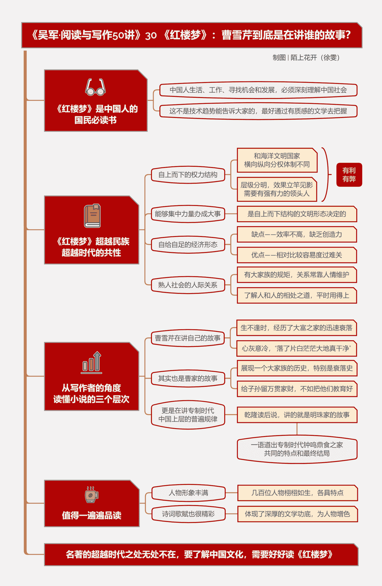  

公众号懒人找资源，懒人专属群独享

# 31《诗经》| 为什么是理工男恋爱宝典？

吴军

2020-07-14

《诗经》| 为什么是理工男恋爱宝典？

上一讲我说到，即使从事理工类的工作，也应该读读《红楼梦》，因为可以帮助我们了解周围的社会。

同样，学理工的人，特别是理工男，还应该读读中国第一部诗歌总集，距今差不多 3000 年的《诗经》。它创作于周代，那是我们中华文化形成的早期，更重要的是，它定义了我们这个民族的恋爱婚姻价值观。

《诗经》总共 305 篇，有很多是情诗，这一讲，我来说说我很喜欢的三首。

理工男总是苦恼猜不透女生的心思，我觉得你一定要读一读《郑风·子衿》，它对恋爱中的人的心理，把握得实在太准确了。

## 《郑风·子衿》

青青子衿，悠悠我心， 纵我不往，子宁不嗣音？ 青青子佩，悠悠我思， 纵我不往，子宁不来？ 挑兮达兮，在城阙兮。 一日不见，如三月兮。

这首诗表达的是相恋中的女子对心上人的思念之情。“青青子衿”四个字放在一起，就是：“青色的是你的衣衫”。从这句你就能看到，女子对男子着装细节记得很清楚，这是只有恋爱中的女子才做得到的。

我在一篇小说中读到过这样一个细节，一位女生注意到恋人的手指上有一个小肉刺，这种描写间接地写出了两人恋情已经很深了。

“纵我不往，子宁不嗣音？”这句特别有意思，“就算我不去，你难道不能派人来传个音信吗？”

钱钟书先生对这句诗特别称颂，他在《管锥编》中讲：“薄责己而厚望于人也。已开后世小说言情心理描绘矣。”

什么意思呢？想见，又不好意思开口或者采取主动态度，然后半嗔半怪半埋怨，埋怨对方不主动。后来的言情小说里，恋爱中的女子也常常被描写成这样子。你看，短短几个字，写尽了恋爱中的人特别普遍的心理。

最后的“一日不见，如三月兮”，是点睛之笔，也是今天成语“一日不见，如隔三秋”的出处。这种夸张的手法在《诗经》以及后来的诗歌中很常见。

《郑风·子衿》说的是一个人的相思，要论最美的爱情画面，我觉得要数《诗经》的第一首《关雎》，那是很美好的两情相悦。

## 《国风·周南·关雎》

关关雎鸠，在河之洲。 窈窕淑女，君子好逑。 参差荇菜，左右流之。 窈窕淑女，寤寐求之。 求之不得，寤寐思服。 悠哉悠哉，辗转反侧。 参差荇菜，左右采之。  
窈窕淑女，琴瑟友之。 参差荇菜，左右芼之。 窈窕淑女，钟鼓乐之。

就算没读过整首诗，我相信你也听说过“窈窕淑女，君子好逑。”

雎鸠是绿毛的扁嘴水鸭子，今天依然不难见到，它们总是成对出现。春天它们会出现在河边、湖边，求偶时发出“呱呱”的叫声。“关关”两个字，就是表示野鸭叫声的象声词。

诗的场景非常美，时间是春天，地点是河畔，那里风景优美，有春光还有鸟叫声，可以肯定那不是一条湍急的大河，因为那样的话是不会有沙洲的。人物是有貌有德的女孩子，一个翩翩君子见到了她。

在任何国家，任何时代，爱情中最美好的时刻，就是青年男女在无意间的美丽邂逅。这一瞬间两个人身体里的激素水平迅速发生变化，整个人就变了。男子见到自己的梦中情人，先是对她钟情，接下来是朝思暮想，晚上翻来覆去难以成眠，然后就采取行动——“琴瑟友之，钟鼓乐之”。

这两句话的次序描写得很好，先是亲近对方，然后是取悦对方。而这个男子想的办法，不是装大款，送美玉，而是在用琴瑟和钟鼓的音乐打动对方。

**音乐在中国的文化中可不仅仅是娱乐，尤其在周代，它是礼的象征，还意味着和谐。**

整首诗读一遍，可以感觉出周代的人在追求一种自然、浪漫并且充满阳光的爱情。

当然，也有不少学者认为这首诗是新婚的祝福诗。毕竟那个年代的诗和歌是合二为一的，这首诗歌用在婚礼上唱，讲述新人从相识、相恋到结合的过程，然后祝福两个人今后鼓瑟和谐，也是能说得通的。此外这种理解还有一个合理之处，就是解释了为什么这首诗是以第三人称叙述的。

但不管怎样，它反映了那个时代人们心目中理想的恋爱——“窈窕淑女，君子好逑。”两千多年过去了，今天的人也依然在梦想能让自己辗转反侧的美丽邂逅。

从恋爱到婚姻，仅有两情相悦是不够的，这就不能不说到《诗经》的《召南·鹊巢》了。它描绘的是婚礼场面，我们一起读一遍，你仔细听，看看它描绘的场景和当下有没有一致性。

## 《国风·召南·鹊巢》

维鹊有巢，维鸠居之。 之子于归，百两御之。 维鹊有巢，维鸠方之。 之子于归，百两将之。 维鹊有巢，维鸠盈之。 之子于归，百两成之。

我们今天大家所熟知的成语“鸠占鹊巢”就来自这首诗，当然这首诗中的意思和今天我们理解的侵占了别人的资产，或者寄生于他人的羽翼下却反过来伤害对方完全没有关系。

这首诗讲的是男女婚嫁的事情。诗里的“鹊”所指的是男方，“鸠”指女方。

你看，男方要准备好大房子，用一个长长的车队迎亲。诗里形容车队的规模，用的是“百两”，当然百是虚数，但仍然说明规模很大，可见双方的家境非同一般，甚至可能是诸侯、卿大夫联姻，新娘远嫁。这种家族的联姻常常还有这样一个特点，就是嫁一个再陪嫁几个，所以第三句有“盈之”的说法。

直到今天，中国人的婚礼，还有很多时候，需要男方有房有车，然后用一个车队把女方接过去。也许有的人觉得这么做有点俗气，可这真的就是我们这个民族在形成早期的做法，而且延续至今。

从女方来讲“维鹊有巢，维鸠居之”还有一个含义，那就是“嫁人要嫁好人家”。

虽然这首诗讲的是上层社会的婚嫁，但是历来上行下效，上层社会是下层的榜样。它反映的，确实是我们的民族认可的价值观。我们也必须承认，  
**物质是婚姻关系必不可缺的经济基础。**

你可能听说文学作品里有很多典故，因此有畏难情绪，觉得自己不懂那些典故，就无法理解作品。

这也是我推荐理工科学生读《诗经》的原因——它自己就是中国最早的诗歌集，没有可以引用的典故，理解它们不需要更多的文学知识，只需要细细体会那种至真至纯的情感的自然流露就可以了。有什么感情问题解决不了，翻翻《诗经》也许就有答案了。

能读懂女孩子的心思，懂得两情相悦是一种什么样的感觉，以及为婚姻准备必要的物质基础，这样的理工男，在恋爱上也会所向披靡吧。

## 小结：

最后，我用理工科的思维，来聊聊我对《诗经》的看法。

**《诗经》在中国诗歌文学中的地位，犹如《几何原本》之于数学，《罗马法》之于法律，《圣经》之于宗教。**

世界上很多知识体系里的内容，都可以不断往前追溯其来源。比如数学很多东西可以追溯到欧几里得的几何学，法律的很多东西可以追溯到《罗马法》，宗教可以追溯到神话传说。而中国的诗歌，也可以追溯到《诗经》。

那么再往前该怎么追溯呢？那就只能追溯到自然的法则了。自然界不证自明的公理，是欧几里得几何的基础，自然法是《罗马法》的基础，自然界中最有力量的天地雷电和命运，则是神话的基础。

同样，人的本性，两性的爱情婚姻，中国社会形成初期的法则（礼数）和价值观，就是《诗经》的基础。体会到这一点，《诗经》就不再是三百首古文诗，它如同山林田野中自然长成的鲜花，虽然不会像牡丹、芍药那么艳丽，但却充满了生命的力量和朴素淡雅之美，这是它永恒的艺术魅力。

## 作业：

如果你也读过《诗经》，能不能跟大家分享你最喜欢的那一首，说说你喜欢它的理由。

1.《诗经》创作于中华文化形成的早期，它定义了我们这个民族的恋爱婚姻价值观。  
2.《诗经》在中国诗歌文学中的地位，犹如《几何原本》之于数学，《罗马法》之于法律，《圣经》之于宗教。

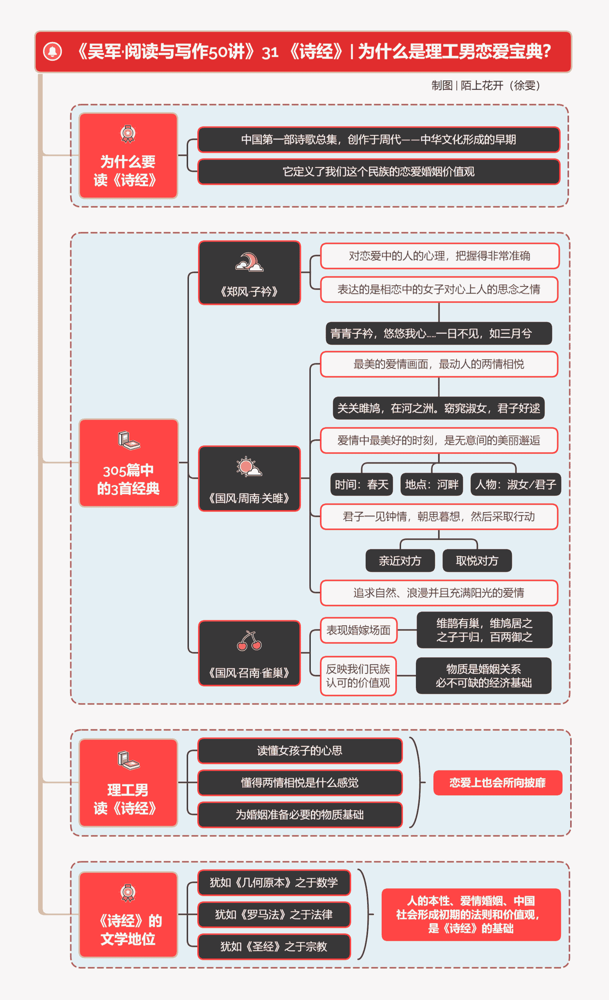  

公众号懒人找资源，懒人专属群独享

# 32 《简·爱》| 为什么是现代女性必读书？

吴军

2020-07-14

《简·爱》| 为什么是现代女性必读书？

上一讲我推荐理工男一定要读一读《诗经》，这一讲的《简·爱》是推荐给女生的，当然这不是说男生不能读，只是在我看来，它是现代女性寻找理想伴侣的必读书。

《简·爱》这本书不能光看故事，虽然它的情节并不枯燥，甚至很有悬念。但是相比这本书中所透露出的思想，以及极为细腻优美的文笔，它的故事情节顶多排到第三位。

我最初读这本书是在初中，和很多人一样是抱着看故事的心态读的，因此没有读出太多味道。

第二次读这本书是在高中，是我的历史老师推荐的。他建议我们将这本书和哈代的《德伯家的苔丝》一起读，说这样我们就清楚年轻人将来应该选择过一种什么样的生活。

我的这位老师并没有习惯性地，把女主人公苔丝个人的悲剧全部算到时代的头上，而是指出了苔丝个人性格的缺陷、软弱和对男人的依赖性。作为对比，他认为简·爱是坚持独立、平等、自己掌握自己命运女性的代表。

我惊讶于他对我们的坦诚，正巧当时刚读完《苔丝》，马上又把《简·爱》找来读了一遍，就读出一些味道来了。后来我读了英文的版本，进一步体会了文字上的美感。

《简·爱》的情节大致是这样的。简·爱出生在一个穷牧师家庭，从小父母双亡，被舅妈虐待，然后她在 10 岁的时候开始反抗舅妈。从此舅妈再也不敢小觑她，不过很快将她送到一个条件极差的寄宿学校。在学校，简·爱被老师训斥，还遭受霸凌。唯一能给她安慰的是她的好朋友海伦，但是不久之后海伦就得肺病去世了。

讲到这里我必须要多说几句，我个人认为全书最细腻、最有感染力的一段文字就是关于海伦之死的。这段情节大致是这样的：

那天晚上，病重的海伦已经预感到自己将离开人世，简·爱来到了她的床上。作为基督徒，海伦并没有恐惧，但依然有生的留恋，也舍不得离开简·爱，仿佛简·爱能够留住她不去另一个世界。于是海伦讲“别离开我，简，我喜欢你在我身边”，简·爱讲，“我会同你呆在一起的，亲爱的海伦，谁也不能把我撵走。”于是简·爱把脸埋在海伦的颈窝，两个人都睡着了。第二天拂晓，管理宿舍的坦普尔小姐发现，两个女孩紧搂着，简·爱睡着了，而海伦，死了。

这段描写我一直忘不了，它把我们和亲人的离别悲伤写到了极致。

说回故事的主线。

海伦去世的多年之后，简·爱从寄宿学校毕业，来到一个有钱人家当家庭教师。这个家庭被一种神秘的氛围所笼罩。后来她爱上了男主人罗切斯特先生，男主人也爱上了她。就在他们准备结婚时，有人指出罗切斯特先生早已结婚，而他的妻子原来就是那个被关在庄园里的神秘疯女人。

于是简·爱毅然离开了罗切斯特。她沿途乞讨，历尽磨难，最后病倒在了路上。后来，简·爱被一位叫作约翰的牧师救起来并收留，然后在当地一所小学校任教。约翰（其实是简·爱的表兄）向简·爱求婚，简·爱虽然感激他却不爱他，最后离开了约翰。

小说的最后，简·爱回到罗切斯特的庄园，那座宅子已被疯女人放火烧成了废墟。疯女人随后坠楼身亡，罗切斯特则双目失明，简·爱找到他，觉得这时两个人平等了，和他走到了一起。

简·爱这个角色其实就是作者夏洛蒂·勃朗特自己的化身。她是十九世纪初的英国女作家。

夏洛蒂的父亲是一位穷牧师，母亲虽然来自一个富裕的家族，但是在她很小的时候就去世了。勃朗特三姐妹就被送到书中所描绘的那样一个规矩非常严厉，生活条件很差的寄宿学校里。那里很多孩子得病死掉，或者导致终身体弱，夏洛蒂的姐姐就病死在了里面，她是小说中海伦的原型。

夏洛蒂从学校出来，自己办过学，当过家庭教师。对于家庭女教师这个职业，夏洛蒂感到艰辛和屈辱，这是她在小说中一直表达渴望平等的原因。

在这段时间里，有两个人向夏洛蒂求婚，一个是她的一位女友的哥哥，另一个是一位年轻的牧师。这两个人是小说中牧师约翰的原型。夏洛蒂都没有答应，因为她觉得那两个人并不是真正爱她，只是要娶妻生子罢了。对照夏洛蒂和简·爱的经历，就会发现它们高度相似。

夏洛蒂写这本书，就是要通过简·爱这个人物表达她自己对婚姻、对女性社会地位，以及对人生价值的思考。但你也许不知道，在 150 年前，英国社会很少有女子出书，因此《简·爱》这本书 1847 年第一次出版，用的甚至是“柯勒·贝尔”这样一个男性化的笔名。

虽然今天女性的地位已经比夏洛蒂的时代有了翻天覆地的变化，但我认为  
**《简·爱》这本书所坚持的女性价值，具体说来，就是公平意识、平等意识和独立意识，仍然是我们认同的现代女性基本价值。**  
而且我觉得，男性想要更好地跟女性相处，也应该对此有所了解。

## 1.公平意识

而且不仅有意识，还要懂得反抗。简·爱从 10 岁反抗舅妈开始，到后来反抗学校的霸凌，反抗社会偏见对女性的不公平，她一直都在这方面努力。

其实如何对待霸凌、对待不公平的待遇，是今天每一个在学校的孩子，在职场和社会上的年轻人，以及无力再加班的中年人都必须面对的问题。我在《见识》一书中讲，小时候在挨了一巴掌后的反应，决定了人后来的命运。其实，即便在西方，强烈的公平意识和自我意识也并不是从来就有的。

从《简·爱》这本书中可以看出，具有这个意识的女主角，在她当时也是另类。但是正是因为社会上有简·爱这种人，公平意识今天才深入人心。

我自己对公平意识的追求、对不公平的反抗，其实是从读《简·爱》这一类书开始的。我要感谢我的老师，明确告诉我们他对简·爱身上所具备的公平意识的肯定。

## 2.平等意识

在恋爱和婚姻中，双方一定要平等，才能走得远。这个平等不仅仅是对待自己和对待对方的态度，更是以双方的自身条件为基础的。

如果一方是一棵参天大树，而另一方是一株小草，前者即便表示出平等意愿，后者即便提出平等的要求，也很难做到平等。这种平等，不在于双方的物质条件、外在条件，而在于思想和灵魂。

《简·爱》一书中最著名的一段就是在第二十三章简·爱在离开罗切斯特时说的一段话——

“我告诉你我非走不可！”我回驳着，感情很有些冲动。“你难道认为，我会留下来甘愿做一个对你来说无足轻重的人？你以为我是一架机器？——一架没有感情的机器？能够容忍别人把一口面包从我嘴里抢走，把一滴生命之水从我杯子里泼掉？难道就因为我一贫如洗、默默无闻、长相平庸、个子瘦小，就没有灵魂，没有心肠了？——你不是想错了吗？——我的心灵跟你一样丰富，我的心胸跟你一样充实！要是上帝赐予我一点姿色和充足的财富，我会使你同我现在一样难分难舍，我不是根据习俗、常规，甚至也不是血肉之躯同你说话，而是我的灵魂同你的灵魂在对话，就仿佛我们两人穿过坟墓，站在上帝脚下，彼此平等——本来就如此！”

简·爱这种男女双方公平对等的原则，即便在今天，也不是所有人都能坚持的，尤其是女性。这种不平等不大会影响到人的热恋，但是会影响人的婚姻。

简·爱很清楚这一点，靠高攀得到的婚姻不会有好结果，因为那样自己不过是婚姻中一个无足轻重的人。虽然她贫穷而且长相平庸，但是她和上层的人一样心灵丰富，她需要的不是怜悯，而是灵魂的对话。当她发现她的地位不可能让她做到这一点，她宁可选择了离开，虽然她表现出非常的不舍。

小说的最后，罗切斯特几乎失去了一切，而且失明了，这时简·爱觉得她这只丑小鸭终于和心上人平等了。他们于是走在了一起。

## 3.独立意识

简·爱出身卑微，没有太多朋友，时常生活窘迫，但她无论在什么时候，都有独立意识，有主见，坚持自己把命运攥在自己手里。在任何时代，大多数人的处境其实都和简·爱差不多，但是不同人的想法和行为方式差异很大。

当时的英国，很多女子热衷于钓金龟，当时为了这个目的而举办的社交活动也很多。很多未来的丈母娘只关心男方的姓氏，不关心男方是个什么样的人。这些女子在高攀的同时，也失去了对自己命运的把握。

但由于女性在经济上越来越独立，也出现了不愿意在婚姻上凑合的女子，找不到合适的，她们干脆终身不嫁。不过，夏洛蒂对这两种做法都不赞同，她一方面追求婚姻的幸福，另一方面坚持自己的独立性。

夏洛蒂的生活智慧，还在于她懂得感激和爱情是两回事。

在书中，约翰牧师救了简·爱，帮助过她，但是她并不爱约翰。因此，当约翰向简·爱求婚时，简·爱果断地拒绝了。我们在生活中会发现很多人拎不清感激和爱情的区别。在我看来，一个人不能因为别人对你好，经常帮你，就嫁给对方或者娶对方。

简·爱是一个善良的人，但是并不因为感激对方而委屈自己。世界上很多悲剧是因为把感激和爱情混为一谈而造成的。  
**人不应该因为一时的孤独，而走入一个婚姻，然后造成一辈子孤独。**

## 小结：

《简·爱》一书问世后，受到了热捧，主要是它第一次谈到女性在婚姻中平等地位的问题。以后，随着全世界女性地位的提升，这本书的地位也越来越高。

作为一位有思想、有文化的女性，夏洛蒂不仅提出了问题，而且给出了她的答案：公平、独立、平等的意识，永远把命运把握在自己手中。

当然， **夏洛蒂的观念不仅适用于婚姻，也适用于处理任何可能存在不平等现象的关系上。**

拓展一下，你也可以拿这个原则，重新审视自己和单位的关系。个人看似是弱势的一方，但是如果能坚持独立性和对公平的诉求，即便遇到一些暂时的困难，从长远来讲也是主动的。如果过分依赖于一个组织，就会陷入被动，而且会习惯于这种被动。

## 作业：

如果你是女性，你会向往成为简·爱这样的女性吗？如果你是男性，你会愿意选择简·爱一样的伴侣吗？

就这个问题，请你写一篇短评，记住，尽量在 300 字以内讲清楚你的观点和理由。

下一讲，我们通过《牡丹亭》聊一聊中国人的浪漫情怀。

1.《简·爱》所坚持的公平意识、平等意识和独立意识，正是我们认同的现代女性基本价值。  
2.公平、独立和平等意识不仅适用于婚姻，也适用于处理任何可能存在不平等的关系上。

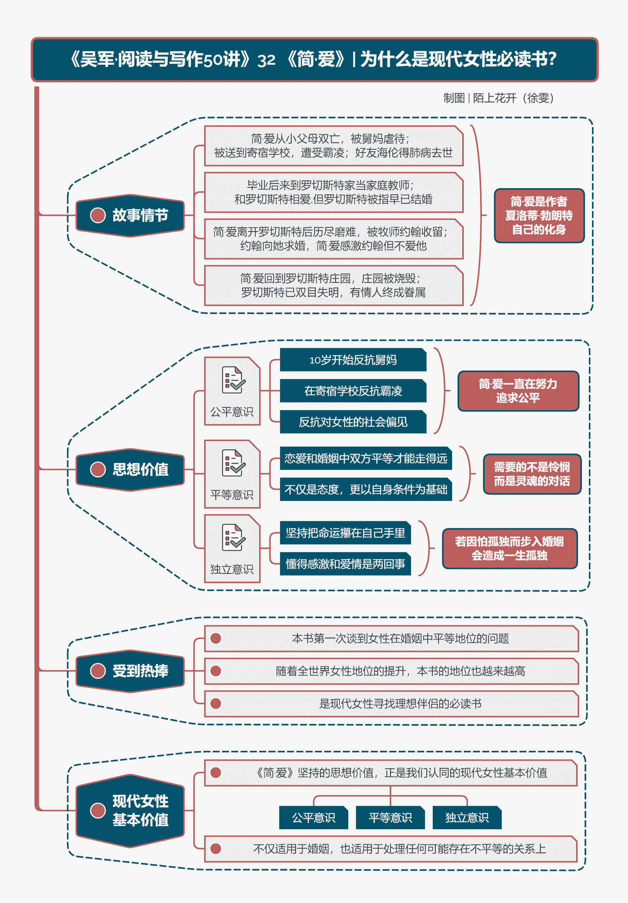  

公众号懒人找资源，懒人专属群独享

# 33 《牡丹亭》| 什么是中国人的浪漫情怀？

吴军

2020-07-14

《牡丹亭》| 什么是中国人的浪漫情怀？

你可能已经知道，我很喜欢莎士比亚的戏剧。对我来说，明代汤显祖的《牡丹亭》，是能够跟莎士比亚相提并论的伟大作品。恰好这两位伟大的剧作家都逝世于 1616 年。

**在我看来，《牡丹亭》是中国文学里少有的浪漫爱情佳作。**

中国人从古到今都比较讲究实用主义。在对待自然界方面，中国人不会像古希腊人那样，琢磨“芝诺悖论”那种看似无聊但是对科学至关重要的问题。（关于芝诺悖论，以及它在数学史上的重要作用，你可以回顾我的《数学通识 50 讲》戳此回顾）

在人文方面，有机会接受教育的人，大多希望学得文武艺，货与帝王家。不能帮助做官的学问，就不愿意花功夫研究。虽然我们有屈原、李白、李贺这些伟大的浪漫主义诗人，但是大部分的文人还是比较现实的。包括我们前面讲的更早的《诗经》，也是现实主义远远大于浪漫主义，很少有人会像雪莱和拜伦那样用生命写诗。

正是因为这个背景，对我来说，《牡丹亭》就格外突出。有了这样一部浪漫主义作品，我再跟西方人交流，也很有底气说，中国人在内心和世界其他追求浪漫的民族没有什么不同，也渴望纯粹的爱情，也珍惜青春和春天，也会把爱情放在生命之上，也有人鬼不了情。

我觉得也正因为如此，《牡丹亭》让西方的文艺界重新认识了中国人的情感，也因此获得了很高的评价。美国文学评论家巴特（Daniel  
Burt）认为，中国的戏剧在汤显祖时期达到了顶峰，他做过一个“全球有史以来的 100 部戏剧”的榜单，《牡丹亭》是唯一一部入选了的东亚剧作。

另外说个小八卦，上个世纪 90 年代，著名作曲家谭盾将《牡丹亭》改编成了歌剧，在纽约大都会歌剧院的主场林肯艺术中心作为年度主打剧目演出，受到了西方世界的好评。不过，很多中国人觉得它被改编为歌剧后有点不伦不类，因为男女主角的体型都很壮硕，加上英文的歌词过于俗白，没有了汤显祖原词的美感，不如直接听昆曲来得有味道。

《牡丹亭》的长度，超过莎士比亚任何一部剧，但它的情节其实很简单，讲的是太守杜宝的独女杜丽娘和书生柳梦梅的爱情故事：

杜丽娘在读《诗经·关雎》时春心萌发，在梦中见到书生柳梦梅。两个人在芍药栏前、湖山石边卿卿我我。醒来后杜丽娘因思念梦中情郎，郁郁不乐身亡。到了阴间，阎王查出她命不该绝，而且命中注定有一段姻缘，便放她返回人间。柳梦梅在赴京赶考的路上，梦见了杜丽娘，跟她的游魂相会。杜丽娘指示柳梦梅挖开坟墓，自己还魂复活。于是两人结为夫妻。随后，柳梦梅到京城赶考高中状元。

故事如果到这儿结束，其实也可以，但就会显得非常平庸。实际上，至此这出戏才进行了一半。

柳梦梅从京城考试回来就到杜府见杜宝拜岳丈，杜宝听这书生讲了一番话后觉得匪夷所思，因为女儿已经死了三年了，哪儿能复生。又听说女儿的墓被这书生挖开，便怒不可遏，把柳梦梅抓起来要处斩。但因朝廷来人报，说柳梦梅中了状元，杜宝就无权处置柳梦梅了。于是他写了奏本让皇上公断，最后皇帝传杜丽娘来到公堂，在照妖镜前验明，果然是真人身。于是皇帝下旨让这父女夫妻都相认，一段为爱而死，死而复生的爱情得到了大团圆的结局。

这样一个故事，可能今天的人会觉得情节有点俗套。不过，任何能够让全世界人都接受的爱情故事多少都有点俗套，因为  
**理想的爱情本身并不复杂，全世界人的看法都是类似的。**

从《牡丹亭》中，我归纳出了几个浪漫爱情的基本元素。可以简单概括为“无可替代”“苦恋”“反对力量”和“命运考验”几个关键词。

## 1.无可替代的对象

**在文学作品中，写爱情的作家们会努力刻画出一个无可替代的对象。**

这个对象刻画得好，读者读起来就觉得作品中爱情的部分写得好，否则，就觉得爱情不动人，当然，这对象未必需要是俊男靓女。

很多人读金庸小说，是把它们当作爱情小说读的，那里面经常有一些无可替代的对象，比如赵敏对张无忌来讲，阿朱对萧峰来讲，丑和尚虚竹对西夏公主来讲，便是如此。在《牡丹亭》中，显然柳梦梅对杜丽娘来讲，就是这个无法替代的对象。

## 2.有苦恋的成分

从今天科学的角度讲，恋爱中的人和平时的人已经不是同一个人了，因为他身体内的化学成分、头脑的思维方式都变了。就像毕加索在他生命最重要的一段恋爱经历中，画风都变了，大家把那些画单独拿出来看，根本不觉得是他画的。

类似的，贝多芬在和勃伦施维克小姐谈恋爱时写的《第四交响曲》和其他八首作品完全不同。这种变化会让人既幸福，又痛苦。用一句网络上流行的诗句说，苦恋就是“世界上最遥远的距离不是生与死，而是我站在你面前，你却不知道我爱你”。

成功的爱情作品必须要能把苦恋写好，这一点《牡丹亭》也做到了。杜丽娘甚至因此感梦而死。而且，杜丽娘的死而复生也是有象征意义的，她实际上已经变了一个人。

## 3.浪漫爱情要遇到反对力量

世界上凡事没有阻力就没有动力。阻碍爱情的反对力量很多，可以来自家庭、社会地位的差异，也可以来自情敌，甚至可以来自自身性格的缺陷等等。

正是因为反对力量的存在，才衬托出爱情的伟大，这就如同死亡让生命显得特别美好，艰难时世会让友谊显得难能可贵。

在莎翁的剧作中，《罗密欧与朱丽叶》，反对力量来自世仇的家族；《奥赛罗》，它来自情敌和自身的缺陷。同样，《牡丹亭》中也有反对的张力，它来自家庭。

## 4.浪漫爱情要过命运这一关

世界上的事情，一半靠人谋，一半靠天命。浪漫爱情要受到命运的作弄。命运有些时候会帮助人，这就是喜剧结局，但是有时会出现阴错阳差，毁掉一对恋人，这就是悲剧结局。

现实主义作家常常会安排一个悲剧的结局，因为人世无常是现实情况。不过，汤显祖在《牡丹亭》中，安排了让命运帮助这一对相爱的人，这其实寄托了他对爱情的祝福，也彰显出他作品的浪漫主义色彩。

读到《牡丹亭》的时候，我是真的问过自己，我们中国人难道真的那么现实，我们内心深处难道没有浪漫的情怀么？答案是否定的。

经过我的分析你会发现，上述浪漫爱情的元素，《牡丹亭》跟西方的浪漫爱情作品没有什么差别。只是替中国人把这样的情感写出来的优秀作品并不多，特别是在古代，因此它就显得特别难能可贵了。

可以讲， **《牡丹亭》写出了我们这个民族内心深处的浪漫情怀。**

说了这么多，跟你分享三个《牡丹亭》在创作手法上我认为的可圈可点之处。

## 1.用梦境描写现实

这是浪漫主义文学常用的手法，想象不存在的事情是人特有的本领。人在现实中有很多东西得不到，因此只好在梦中得到，或者寄托于神鬼，这样才能让人们保持乐观，保持希望。

在现实生活中，如果不仅是自己在做梦，而且还能让很多人都相信一个共同的美好梦想，这样的人就会有领导者气质。今天马斯克被很多人崇拜，他其实是给大家画了一个梦中的美景，而且让大家真的相信。

## 2.故事结构一波三折

其次是《牡丹亭》故事的结构，它出现了三次反转，也就是常说的一波三折。第一次是杜丽娘由生到死。剧情到此结束也可以，著名的芭蕾舞剧《吉赛尔》就是这样（关于《吉赛尔》的剧情见附录）。

接下来是第二次反转，由死复生。你熟悉的《梁山伯与祝英台》的剧情——两个人双双化蝶，其实可以看作到这儿结束。

但是《牡丹亭》还有第三次反转。杜丽娘的父亲不认可女儿和柳生的爱情，柳生差点丢掉性命。如果是现实主义的写法，到此就可以结束了。但汤显祖作为浪漫主义的作家，是用第三次反转给出了一个喜剧性的结局。浪漫就浪漫在这里，它给并不完美的社会，保留了一份对美好爱情的念想。

## 3.文字出彩

中国古代绝大多数戏曲，包括很多有名的元曲，唱词都比较俗白，但《牡丹亭》是个例外，它的文字非常富有诗意。比如最著名的那个唱段，实在是值得反复吟咏背诵：

原来姹紫嫣红开遍，似这般都付与断井颓垣。良辰美景奈何天，赏心乐事谁家院。朝飞暮卷，云霞翠轩，雨丝风片，烟波画船，锦屏人忒看的这韶光贱。

推荐你也上网搜搜这一段的昆曲片段，听一听，感受一下。

## 小结：

在结束这一讲的课程前，讲讲我由这部名著延伸的两点感触：

首先，人要成为不可替代的对象，这不仅仅是在恋爱中，在生活和工作中也是如此；

其次，换个角度看待反对力量，也就是对立面。完全没有对立面，其实很难激发人的能动性，爱情会变得平庸，其他情况也如此。

## 作业：

在 200 字之内，描述一个你心目中的浪漫爱情场景。期待在留言区看到你的分享。

## 附录一 《吉赛尔》剧情

《吉赛尔》是世界上演出率最高的几部芭蕾舞剧之一。它的剧情很简单，全剧只有不长的两幕。第一幕，天真单纯乡间少女吉赛尔对一个外乡年轻人阿尔伯特一见钟情。阿尔伯特其实是一个贵族，为了逃婚乔装成农民来到这个村子。后来吉赛尔发现了真相，心碎而死。第二幕，阿尔伯特知道真相后来到吉赛尔在森林中的墓前，森林里有很多弃妇的亡灵，会用魔法逼迫来到森林的年轻男子不停地跳舞，至死方休。正当阿尔伯特被魔法附体，无法摆脱女鬼的纠缠时，吉赛尔的亡魂出现了，原来她对阿尔伯特的爱没有因为她自身的死亡而消失，她驱散女鬼救回阿尔伯特。阿尔伯特和吉赛尔缔结爱盟，可惜二人已阴阳永隔，日出时分，吉赛尔随黑夜一同离去。

## 附录二 《牡丹亭》的几段词

江儿水 偶然间心似缱，梅树边。这般花花草草由人恋，生生死死随人愿，便酸酸楚楚无人怨。待打并香魂一片，阴雨梅天，守的个梅根相见。 山桃红  
则为你如花美眷，似水流年。是答儿闲寻遍，在幽闺自怜。转过这芍药栏前，紧靠着湖山石边……是那处曾相见相看俨然，早难道好处相逢无一言。

1.《牡丹亭》是中国文学里少有的浪漫爱情佳作，写出了我们民族内心深处的浪漫情怀。  
2.浪漫爱情有几个基本元素，可以简单概括为：“无可替代”“苦恋”“反对力量”和“命运考验”几个关键词。  
3.人要成为不可替代的对象，在恋爱、生活和工作中都是如此。

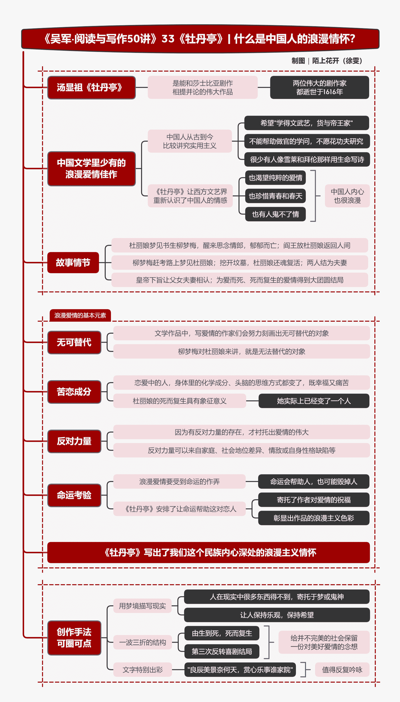  

公众号懒人找资源，懒人专属群独享

# 34 《傲慢与偏见》| 奥斯汀为什么长盛不衰？

吴军

2020-07-14

《傲慢与偏见》| 奥斯汀为什么长盛不衰？

2003 年，英国 BBC 举办了一个书籍票选活动，叫做大阅读（The Big  
Read），全民票选最喜爱的 100 本小说。女作家简·奥斯汀的《傲慢与偏见》，排在第二名。

很多人都不理解，这不就是一部 200 年写前英国乡绅家的女儿相亲谈恋爱的小说吗？为什么会这么多人追捧？

在我看来，这恰恰说明，第一，爱情是永恒的文学主题；第二，这部小说可以成为我们理解英国人的一个切入点，更何况，它很好读。奥斯汀这部书，浓缩了人类婚姻爱情的很多共性，不但适合当时的英国人，也很适合今天世界其他地方的人。

故事情节

小说故事发生的时间：作者奥斯汀所生活的年代，即欧洲从农耕时代进入到工业社会的转折期，从熟人社会进入到陌生人社会的过渡时期。

地点：英国伦敦附近浪博恩村的庄园。

人物：当地乡绅班纳特一家，以及他们周围的年轻男女。

班纳特一家生活还算富裕，有五个女儿。但是根据当时英国的继承制度，女儿们是没有继承权的，家产要给同族男性继承。因此等到女儿们到了待嫁的年龄，班纳特夫妇就急着要为女儿们找到好人家嫁出去。

作者为什么要安排五个女儿呢？因为这样便于在每一个人身上设置不同的恋爱观。大女儿简美丽单纯，只看到别人好的一面。她的想法很传统，很现实，就是找一个有经济实力的本分人。简因为自身条件好，顺顺利利地嫁给了一位她喜欢的，同时也喜欢她的年轻绅士。

二女儿伊丽莎白是小说中的女主角，也是英国文学中最著名的女性角色之一。伊丽莎白有很多令人钦佩爱慕的地方，她不但聪明可爱，还很优雅，最重要的是，她没有当时上层社会女性常见的低俗、无聊的毛病，她是作者笔下理想的女性。但是过分的自信，也让她对男人带有偏见。

而小说的男主角达西本性高贵善良，但是为人傲慢，这就让伊丽莎白对他产生了偏见，这本书的书名就是这么得来的。

班纳特家最小的女儿丽蒂娅又不同，她是叛逆少女的代表，毫不顾及当时的社会道德准则，跟人私奔又差点被人抛弃。

奥斯汀安排了这么多人出场，一方面在伊丽莎白身上倾注了自己的爱情婚姻理想，另一方面要让其他角色当衬托红花的绿叶，这种写作方法我们后面还会讲到。

奥斯汀爱情婚姻理想

**1.爱情要建立在理性基础之上**

我们在前面讲了雪莱、拜伦和济慈，他们和奥斯汀是同时代的人，这三个人是用生命去爱的。这种带有点疯狂的爱并不为奥斯汀所赞颂。在奥斯汀的笔下，那些被感情冲昏了头脑的爱都没有好结果。

比如《傲慢与偏见》中的小妹丽蒂娅，又比如她另一部小说《理智与情感》中情感的代表“情感”的玛丽安。她都安排这两个人物会吃点亏，然后再接受教训。

爱情有很多种，彼此之间没有好坏之分，奥斯汀为什么不赞成冲动型的爱情呢？这反映出女性在爱情中的不安全感，也和奥斯汀自己的经历有关。

奥斯汀自己对爱情其实就是又渴望，又害怕。奥斯汀的家庭背景和《傲慢与偏见》中的班纳特家非常相似，是当地乡绅。

奥斯汀非常早熟，而且才华横溢，14 岁就开始写作，21 岁便完成了《傲慢与偏见》的手稿，在此之前也已经轰轰烈烈地恋爱过了。但是那段无果的爱情让奥斯汀一生在爱情上变得很谨慎。当她父亲退休，要将全家搬到英国著名的“相亲小镇”巴斯时，奥斯汀居然选择了逃跑。

了解了奥斯汀自身的经历，就能理解为什么她笔下的爱情虽然也有激情和缠绵的成分，但是从来不会挣脱理性的约束。

**2.婚姻要建立在爱情基础之上**

在《傲慢与偏见》中，作者把她的祝福给了有真正爱情的伊丽莎白和达西。或许正是因为特别看重婚姻中的爱情基础，奥斯汀写了一辈子爱情小说，自己居然终身未嫁。奥斯汀曾经拒绝了一位富有的继承人的求婚，因为自己并不爱他。

**3.关系要建立在双方精神平等的基础之上**

奥斯汀追求的平等和后来夏洛蒂·勃朗特要追求的男女平等不同，因为奥斯汀没有夏洛蒂生活的大环境，不可能有男女之间在经济和社会地位上的完全平等。奥斯汀所要的平等也不是郎才女貌，门当户对，而是指两个人在精神层面的平等。

奥斯汀笔下的女主角，都是人格独立、有主见、有自尊心，并善于思考的知性女子。奥斯汀觉得女性需要在知识层次和见识上与男性站在相同的水平，这样他们在婚恋中就是对等的。我觉得这种思想至今依然没有过时。相反，在她的书中，起衬托作用的女配角们，则显得浅薄。对那这些人，奥斯汀时不时地会进行一番讽刺，讽刺她们的虚荣和可笑。

**4.理想的爱情要有物质基础**

为了爱情抛弃一切的做法在奥斯汀看来长久不了，因此在她的书中，找不到跨越阶层的爱。

**理性是爱情的基础，爱情是婚姻的基础，平等是关系的基础，以及，理想的婚恋要有物质基础，这几个原则，在 200 年后的当代人看来，一点也不过时。**

我觉得，这恰恰是这部小说直到今天仍然被英国民众追捧的重要原因。奥斯汀了不起的地方在于，她把那些不会随时间、地点，以及具体主人公而改变的爱情元素，从具体的生活场景中剥离出来了。

甚至我觉得，小说也让今天中国的读者能有共鸣。今天的中国社会，在发展阶段和富裕程度上，和奥斯汀所描写的场景，即英国中上产阶级具有可比性：

首先，温饱问题得到了解决，大家过着小康生活，但是大部分人也还并没有所谓的财富自由，当时英国的上层社会也没有。

其次，年轻人接受过足够好的教育，而且常常比上一辈的教育水平高，希望过一种优雅的生活，同时也因为教育背景不同和上一代产生了代沟。

最后，大家普遍追求自由恋爱，而不是由父母熟人介绍，更不是包办婚姻，一段婚姻关系，往往要和过去素不相识的人恋爱，经过自己亲身的接触和体会，最后找到生命中的另一半。

你看，这些特征，是不是今天中国的中产阶级家庭也都具备？其实现代西方中产阶级家庭也差不多。

除了对婚恋的看法，奥斯汀在小说中还描绘出两个永远存在的社会现象，也和今天有关。

小说描绘的社会现象

**1.代沟**

在《傲慢与偏见》中，班纳特夫妇关心的是婚姻，他们从来没有问过女儿是否爱某个男子，而女儿们关心的则有婚姻、爱情和青春的冲动刺激，这种现象今天也依然存在。

**2.在和平时代人们对教养的追求**

奥斯汀在小说中一直强调男女行为的教养，它对应的英文词是 manner，这个词包含很多意思，比如对人的礼貌，举止优雅，谈吐的风度等等。奥斯汀的小说两个世纪以来一直是英国人的教养教科书。

也许正是因为上述这些原因，全世界读者的口味在过去的 200 年里已经换了好几轮了，但奥斯汀却长盛不衰。

别看这只是一部轻松的爱情小说，奥斯汀的写作方法对我也颇有启发，我不妨分享几点，供大家参考。

奥斯汀的写作方法

**1.选择自己熟悉的场景讲故事**

绝大部分作家只有自己非常熟悉的生活才能写得好。中国很多成功的作家也秉承这个原则，比如鲁迅习惯写绍兴，沈从文习惯写湘西。

相反，如果硬要写那些自己不熟悉的生活，如果不是做大量的调查研究，就会捉襟见肘。比如在我看来，很多影视作品中对投资领域的描写，实在是漏洞百出。

**2.列举各种可能性，让读者感到全面公正**

这不是说写作者没有立场。奥斯汀的小说中常常会描写好几个生活背景类似，但是行为和想法不同的对象，而她其实只中意一个。剩下的，是她拿用来做对比，突出主人公的。

这种写法今天我们写报告可以用到。你给领导写一份建议书，你的想法只有一个，但是如果你只写自己的想法，就显得看法片面、夹带私货。不如把主要的可能性列出来分析，最后推荐一个你中意的。

**3.扁平人物要和立体人物结合**

一个作品不可能只有主角没有配角。很多作家会把主角写得形象丰满、有血有肉，配角则在无意中成为了路人甲、匪兵乙这样的纸片人。奥斯汀的做法则不同，她书中的配角不是随意安排的，而是将每一个配角赋予了一个特殊目的，承载她思想的一个侧面，因此每个配角都不是符号。当然因为常常只有一个侧面，她们是平面人，主角相比之下则是立体的人，有很多侧面，甚至奥斯汀会把矛盾的性格加到一个人身上。

奥斯汀笔下主角形象，还不会一成不变，她们的性格和想法是随着时间变化的。比如《傲慢与偏见》中的伊丽莎白，对男人的看法、自己的价值观，都是随着故事的展开而发展的。而在配角身上，作者就不浪费这些笔墨了。

我在之前讲到，《诗经》定义了我们这个民族婚恋的标准线，奥斯汀的书在英美世界，多少起到了类似的作用。

但是，东西方表达思想的方式又有所不同—— **东方人的经典讲究高度概括，常常要靠领悟才能理解，西方人则喜欢给出具体的描述和做事方法。**

比如《孙子兵法》里讲述了高超的战争艺术，但是里面一个例子都没有，即使读懂了，不会打仗的人还是不会打。相比之下，克劳塞维茨的《战争论》在哲学层面并没有超越《孙子兵法》，但是具有可操作性，能解决战争中的实际问题。《诗经》和奥斯汀的书，之间的差别也大致如此。

## 小结：

优秀的文学作品通常需要完成两个过程。

首先是从具体到抽象。奥斯汀从她熟悉的生活中，将一桩桩爱情故事本身具体的情节过滤掉，留下完美爱情的共性。这个过程是浓缩和提纯。具有共性的东西才能持久。

然后再从抽象到具体。她将自己关于完美爱情的想法，通过自己最熟悉的生活场景，表达出来。这个过程是展示和表现。

## 作业：

请给别人推荐一部你喜欢的爱情作品，小说或者电影都可以，请写下你的推荐理由。不要超过 200 字。

下一讲，我们聊两部暗黑色彩的哥特体小说。

1.理性是爱情的基础，爱情是婚姻的基础，平等是关系的基础，以及，理想的婚恋要有物质基础，这几个原则，在今天也一点不过时。  
2.东方人的经典讲究高度概括，西方人则喜欢给出具体的描述和做事方法。 3.优秀的文学作品通常需要完成两个过程：首先是从具体到抽象，然后再从抽象到具体。

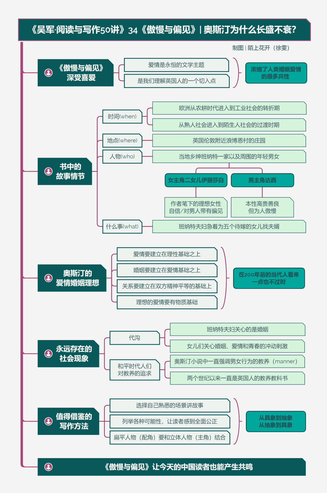  

公众号懒人找资源，懒人专属群独享

# 35 《呼啸山庄》| 如何理解文学里的黑色话题？

吴军

2020-07-14

《呼啸山庄》| 如何理解文学里的黑色话题？

这一讲跟你谈两本哥特体的小说，《呼啸山庄》和《弗兰肯斯坦》（也被称为《科学怪人》）。

哥特体是诞生于 18 世纪后期的一种流派。这类小说因为充满着悬念，有着意想不到的结局，而且通常伴随着极端的感情，因此能吸引很多读者。

在 2003 年 BBC 开出的大阅读书单中，排名的书有大约五分之一是哥特体小说，包括我们今天要讲的《呼啸山庄》。

在哥特体小说中，通常会有阴森恐怖的城堡或庄园，神秘的走廊，隐秘的门，一个威胁性的秘密，一个古老的诅咒，无数的困扰，有时还有经常昏倒的女主角等等这些暗黑惊悚元素。哥特体小说，一般被看作是今天惊悚小说和恐怖电影的源头。

不过今天我讲的不是如何写惊悚小说，而是探究在哥特体小说的背后，那些暗黑的情节、怪异的人物、极端的情感背后，它所记述和映射的社会现实。

我们先从《呼啸山庄》说起。

## 《呼啸山庄》

**《呼啸山庄》的作者是勃朗特三姐妹中的艾米丽∙勃朗特，这本书在我看来是女作家创作的最优秀的小说，比作者的姐姐夏洛蒂·勃朗特写的《简·爱》还要好。**

这一方面是它的故事情节复杂，写作方法独特，更重要的是小说提出的问题其实都是现实生活中的问题，发人深思。

我们在之前的第 13 讲，介绍了《呼啸山庄》讲故事的方式。小说一开始已经进入到时间轴 90%左右的位置了。然后前 31 章都是倒叙，最后 4 章顺序。艾米丽采用这种在当时非传统的戏剧性写法主要的原因是，书中的故事时间跨度非常长，是两代人的故事。

为了让结构不显得杂乱，艾米丽引入了两个故事的讲述人，一个是小说中的“我”，即客人洛克乌，另一个是女管家纳莉。小说中的倒叙部分由纳莉这个过去的见证人来讲，顺序部分由“我”这个旁观者来讲。根据我对小说的了解，这种双重叙述法始于艾米丽。

小说一开始，“我”第一次来到山庄作客，那是一个冬天。我所看到的是一片肃杀——那里连树都被北风吹斜了，“向太阳乞讨温暖”，要不是建筑师把房子盖得很坚实，恐怕早就给风吹跑了。所以这个地方叫呼啸山庄一点都不奇怪。

一到山庄“我”在正门附近发现了“1500”这个年代和某个名字，读者马上就能想到这个古老的庄园里一定有很多故事，但是当“我”问主人时，极不友好的主人希斯克利夫对我很不耐烦。

接下来，我看到了极不协调的一幕，这个凶巴巴的主人却有一个 17 岁的天仙般的儿媳妇，而他的儿子已经死了。虽然“我”是一位遁世者，到此也不寒而栗了。

不仅主人如此，仆人也都冷漠无情，就连狗也全是一群恶狗，而那个天仙般的姑娘，也傲慢得不近人情。读到这里，大家的好奇心一下子被提了起来——这个山庄里一定发生了很离奇的故事。

接下来就由女管家纳莉来揭开呼啸山庄之谜了。

这个山庄原来的主人欧肖收养了一个弃儿，就是现在的主人希斯克利夫。希斯克利夫和家里的小姐凯瑟琳朝夕相处产生了爱情，但是凯瑟琳的哥哥辛德雷却十分憎恶他。等老欧肖一死，辛德雷不仅禁止希斯克利夫与凯瑟琳接触，还百般虐待和侮辱他。这加剧了希斯克利夫对辛德雷的恨，也加深了对凯瑟琳的爱。

接下来，凯瑟琳认识了邻近的画眉田庄的小主人，温文尔雅的林顿。林顿向凯瑟琳求婚，凯瑟琳比较天真，就嫁给了林顿。希斯克利夫知道后痛不欲生，便离开了山庄。

接下来就是希斯克利夫报复这两家人的故事。

他先从辛德雷下手，辛德雷是个纨绔子弟，挥霍光了家产，只能把山庄抵押给了希斯克利夫，并沦为他的奴仆。希斯克利夫随后拜访画眉田庄，让林顿的妹妹伊莎贝拉对他倾心，并随他私奔。但希斯克利夫把她囚禁在呼啸山庄并折磨她，作为对林顿的报复。

凯瑟琳嫁给林顿以后生活平静，但是希斯克利夫的归来唤起了她曾经对他的爱。在激动中凯瑟琳病倒了，并很快就死去了，留下一个女儿凯蒂。

如果希斯克利夫的复仇仅限于此，他还算不上是十足的恶棍。接下来，他还要报复他那些所谓的仇人的下一代。

辛德雷不久之后酗酒而死，而他的儿子哈里顿落入了希斯克利夫的掌心。希斯克利夫将这个孩子当猪一样养，剥夺了他受教育的权利，并且想把他培养成一个恶魔。

被希斯克利夫囚禁的伊莎贝拉，后来找到机会从呼啸山庄逃了出来，并生了一个男孩，叫林顿·希斯克利夫，我们不妨称呼他为小希斯克利夫。12 年后，伊莎贝拉病死他乡，希斯克利夫接回儿子，却非常厌恶他。

对于情敌林顿，希斯克利夫则趁他病危之际，将凯瑟琳的女儿凯蒂接来，并强迫她与自己的儿子结婚。几天后，林顿死去，小希斯克利夫就成了画眉田庄的主人，但是不久小希斯克利夫也悄然死去。从此，希斯克利夫就霸占了这两家人全部的家产。至此，希斯克利夫的复仇圆满成功。

为了方便大家理解其中的人物关系，我画了一张关系图放在下面了。

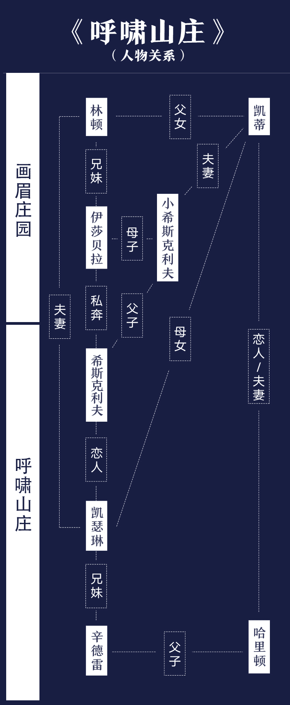

但是，人善良的天性和对爱情的追求是压抑不住的。被仇人当猪养的哈里顿尽管没有受过教育，没有得到人间的温暖，却敦厚忠实。长大以后，他居然风度翩翩，并且和年轻寡居的凯蒂产生了爱情。这让希斯克利夫大为恼怒，他决心拆散这对恋人。

然而，生活在仇恨中的希斯克利夫此时身体已经变得很差了，他时日无多，此时，他从这对恋人身上似乎看到了当年他和凯瑟琳的影子，心里不再有恨意。最后，在一个风雪之夜，他呼唤着凯瑟琳的名字，离开了人世。

故事接下来又是由局外人“我”来讲述了，哈里顿和凯蒂有情人终成眷属，呼啸山庄的冰终于被画眉庄园的阳光融化，爱战胜了恨，全书到此结束。

《呼啸山庄》自问世以来，关于它的文学评论特别多，尤其集中在希斯克利夫这个人物身上。这个人物极为复杂，他是一个彻头彻尾的恶棍，非常心狠手辣，但他又有恶的智慧。

而且，作家艾米莉在塑造这个形象的时候，却又让他令人同情。而且最后安排他恨意消退，爱意复苏。怎么理解文学作品中这样的怪人呢？

在我看来， **《呼啸山庄》的恐怖，并不是来自情节，而是来自对不可测的私欲的恐惧。**

同时我也要提醒你一点，对希斯克利夫的评价，不仅争论的观点多，而且随着时间的变化，看法还在改变。比如在很长的时间里，西方主导舆论的自由派都倾向于寻找他做恶的社会根源，对他心中还有的一点善予以肯定，特别强调在幼年时期正确引导的重要性，等等。

但是在 9·11 恐怖袭击之后，很多人开始质疑，一个人过去不幸的遭遇，能不能成为他今后犯罪或者作恶的理由。可以讲，对希斯克利夫的争论，在今天已经成为西方世界分裂的一部分。

## 《弗兰肯斯坦》

在艾米丽之前，另一位女作家的哥特体小说，也在社会上引起了巨大的反响，那就是我们在之前课程中提到的玛丽∙雪莱的《弗兰肯斯坦》。

在这本书中，生物学家弗兰肯斯坦造出了一个人造怪人，这个人造怪人本心善良，但是因为没有女伴，得不到温暖和友情，后来制造了一系列诡异的命案。最后连弗兰肯斯坦的新娘都死于怪人之手。

玛丽∙雪莱生活的年代正值工业革命。在此之前，人类发明的影响有限，负面影响也有限，很少有人考虑科学家的社会责任感问题。

但工业革命很大的不同，是人造的东西，从机械到工业废物，对社会的影响和冲击远远超出创造者们的想象，很多影响是负面的。人们开始思考一个社会问题，没有节制的科技发展对人来讲是好事还是坏事。

从那时开始，科学家和发明家需要考虑，自己的研究和发明可能产生的社会后果。

19 世纪初，这些问题被玛丽∙雪莱以小说的形式提出来，时刻提醒人们注意。

《弗兰肯斯坦》在 2016 年全球人工智能热之后再次热销，因为人们再次思考，是否没有节制的智能技术会把人类毁灭。这件事并非杞人忧天，从 19 世纪开始，发生过很多次因为对技术和发明缺乏全面了解所导致的灾难，比如海洛因的发明和使用。

甘地经常引用一句话，讲人类新的七宗罪，就包括没有人文的科学。

很多年前，我们在 Google 开发新技术，一直要秉承一个原则，就是不作恶，因为掌握技术的人一旦做起恶来，就会造成严重的灾难。可以说，  
**《弗兰肯斯坦》这部小说的恐怖，来自于对不可知的技术的恐惧。**

## 小结：

所以，我读这两部带有哥特风格的小说，关注点并不在阴森恐怖的气氛和怪异的情节上。  
**在我看来，任何一部作品放在一个较大的时空中来考察，都是现实主义的作品。**  
哪怕是哥特式文学也不例外，它们在虚构的场景下讨论现实问题。那些惊悚的悬念，不过是对现实世界某种恐惧的心理影射。

## 作业：

能不能分析一部你看过的黑暗题材的作品，能不能找出它们对应的现实恐惧？

下一讲，我们聊聊日本文学的代表作家川端康成。

1.在我看来，《呼啸山庄》是女作家创作的最优秀的小说。 2.《呼啸山庄》的恐怖，并不是来自情节，而是来自对不可测的私欲的恐惧。  
3.任何一部作品放在一个较大的时空中来考察，都是现实主义的作品。

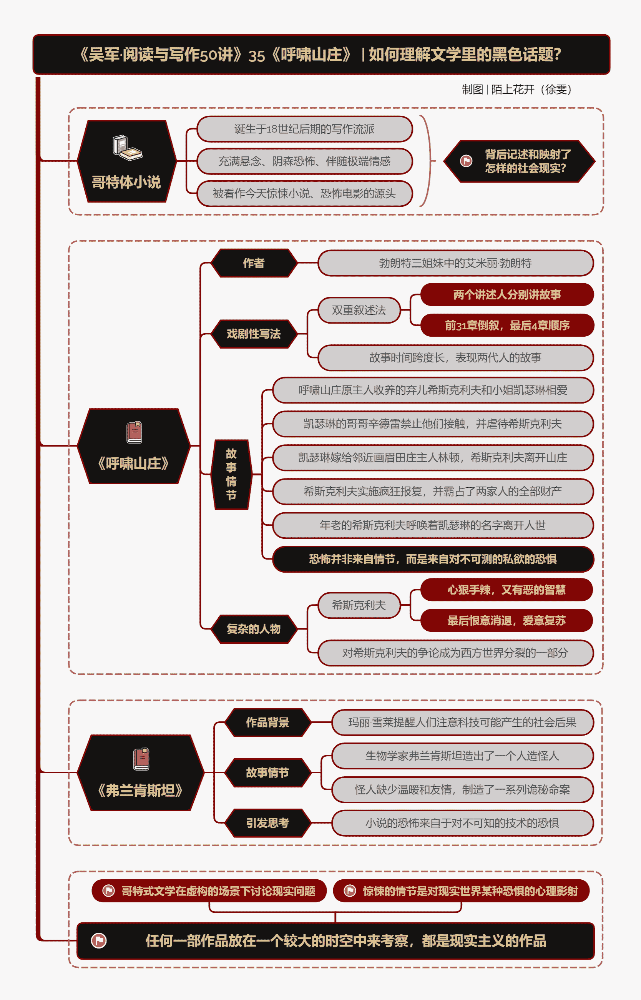  

公众号懒人找资源，懒人专属群独享

# 36 川端康成 | 如何更深地理解日本美学？

吴军

2020-07-14

川端康成 | 如何更深地理解日本美学？

很多人喜欢日本文化，喜欢去那里旅游，吃日式料理，也有人喜欢它制作精良的工业品和工艺品。

中国人一方面觉得日本文化和中国文化应该有很多相似之处，但是另一方面又觉得二者之间的差异其实非常大，而这些差别又很难说清楚。因此大部分人对日本的了解只能停留在表面上，很难细细欣赏和品味。

要解决这个问题有两种办法，一个是交往一些日本朋友，在日本生活一段时间，另一种是读他们主流作家的小说，后者显然容易得多。  
**在所有的日本作家中，川端康成对我来说是一把理解日本文化本质的钥匙。** 这一讲，我们就重点说说他的小说《千只鹤》。

川端康成的作品在中国市面上非常多，大家可能并不陌生。他的文字非常独特，为了增加对他作品的感性认识，我们还是先来读一段《千只鹤》中的原文。

稻村小姐为太田夫人再次点茶。全场人的目光都落在她的身上。不过，这位小姐大概不晓得这只黑色织部茶碗的因缘吧。她只顾按照学来的规范动作而已。  
她那纯朴的点茶做派，没有丝毫毛病。从胸部到膝部的姿势都非常正确，可以领略到她的高雅气度。  
嫩叶的影子投在小姐身后的糊纸拉门上，使人感到她那艳丽的长袖和服的肩部和袖兜隐约反射出柔光。那头秀发也非常亮丽。  
作为茶室来说，这房间当然太亮了些，然而它却能映衬出小姐的青春光彩。少女般的小红绸巾也不使人感到平庸，反倒给人有一种水灵灵的感觉。小姐的手恍若朵朵绽开的红花。  
小姐的周边，仿佛有又白又小的千只鹤在翩翩飞舞。 太田遗孀把织部茶碗托在掌心上，说道：“这黑碗衬着绿茶，就像春天萌发的翠绿啊！”

对于这段文字你有什么感觉。我问过不少人，大家的第一感觉是细腻、精致，还有人说是一种清淡的美。这些感觉没有错，这些都是日本文化的特点。日式料理也很精致，但在形式上又很简单。

在我看来，日本是一个生存空间狭小，而且物产贫乏的国度，很多时候只能在螺蛳壳里面做道场，因此倾向于把每一个细节做到极致，而在外观形式上又做得非常简洁。

当然，如果对日本文化的理解只停留在细腻这个层面就太肤浅了。中国江南的文化也很细腻，但仍然跟日本文化截然不同。

**我在川端康成的作品中，更加深切地体会到了日本文化里的“物哀”美学。**

## 物哀

物哀不是简单的触景生情，也不是悲惨，这一点和黛玉葬花不同。日本人所说的物哀，有伤感凄凉的成分，这是一方面，另一方面则是哀怜和感动。

比如《千只鹤》中，太田遗孀说：“这黑碗衬着绿茶，就像春天萌发的翠绿啊”，你体会一下这种赞叹，是不是饱含着哀怜和感动？这就是物哀。虽然中国人和西方人都会触景生情，但是这样的物哀却很少。

在日本的文学作品中，物哀的情绪随处可见。比如在被誉为日本的《红楼梦》的《源氏物语》中，整个小说的情调就是这样一种淡淡的哀愁。相比之下，《红楼梦》虽然是悲剧，却要明快得多。

**之所以有物哀，常常是因为生活本身充满了悲剧，而这些悲剧是命运所致，逃不出。**  
这就如同日本人所喜爱的樱花，虽然在绽放的一瞬间非常美丽，但那种美丽极为短暂，很快就化为尘土。

川端康成的《千只鹤》是将物哀文化演绎得淋漓尽致的一部作品。

在这本小说中，太田夫人是男主角菊治父亲的情人，她是一个十分善良的女性。在菊治的父亲去世后，她将对菊治父亲的情愫转移到了菊治身上，这种感情让她产生罪恶感，于是她受不了良心的谴责而自杀了。这种悲剧是挣脱不出的命运所致。

在整部《千只鹤》中，充满着浓郁的物哀情愫，亲人的死去，情感的哀伤，人生的短暂等等贯穿始终。

这本书中另一位对菊治有感情的女性是象征着至纯至美的雪子，作者花了很多笔墨描写她的美。但是雪子的美有如樱花的美，也是转瞬即逝。菊治不久之后再看到她，她已为人妇，漠然和慵懒的眼神，已不再包容任何美的幻觉。

川端康成暗示雪子所代表的美，只是一只在清晨或暮色之中飞舞着的千纸鹤，令人憧憬，却不可触及。

讲到这里，你会不会觉得，《千只鹤》中的男人似乎很渣，菊治的父亲有情人，菊治不仅和父亲的情人有过暧昧，而且还交往了很多女性。这其实也是日本文化的一种现实，当然，在日本文化中，男人有好色和风雅的区别。川端康成笔下描绘的男性属于后一种，这是他的作品所体现出的日本文化的另一个特征。

## 风雅

“风雅”源于日本文化中男性对女性的欣赏。在讲这个话题之前要事先声明一点，在日本传统的文化中，没有男女平等的概念，男性是处于主动的一方，女性相对来讲就要卑谦很多。

这种文化好不好，对不对，我们先别忙着做评论，只讲事实。这也是我提醒你跟不同文化的人交往应该注意的事。

**我们读世界各国的文学，一个很重要的意义，就是更大程度上去了解和理解跟自己不同的文化，进而理解文化背后的人。**

说回日本，在这样的男权社会里，男性对女性的美是否有欣赏水平，决定了他是否风雅。另一方面，作为女性，赢得男性欣赏，就被认为有魅力。在《千只鹤》中，这种风雅就体现在对女性美的感悟和追逐上。

川端康成在书中并没有赞誉或者诟病这种文化，而只是把它写出来。当然，我们也就得以通过他的文笔了解日本人的这一个侧面。

川端康成生活的年代距今已经有半个世纪了，日本文化的这个侧面今天已经被隐藏得很深了，至少在表面上，男女是平等的。

## 禅宗

川端康成的作品，还帮助我对日本的禅宗文化有了更感性的认识。

在英文里有个词，Zen，指的是日本禅宗。它和你熟悉的中国禅宗不太一样。中国讲的禅主要是指静修，自己修心、顿悟。日本的禅则是融入生活的一种文化，体现为剑道、茶道、饮食和文学上的崇尚自然和极简主义。

一方面，他们认为现实世界的一切，在自然面前都是短暂的，再绚丽的美都是虚妄的幻象。另一方面，人们却又用各种方式，比如插花、枯山水庭园、文学作品，将这些易逝的美“永恒”地保留下来。这种眷恋尘世的“永恒”，反倒更添对现世的哀愁。

川端康成对于日本禅宗的诠释，在他的小说《雪国》中也随处可见。这部书，得到每天听本书止庵先生有个解读版，我放在了文稿末尾，推荐你也听一听。如果愿意读读原文，我提醒你注意《雪国》里的幻像之美。

禅宗文化讲究人融于自然，同时人作为主体去领悟自然之美。去过日本参观过他们寺院的朋友会发现那些寺庙都非常漂亮。

这不是给旅游者看的，而是修行的人刻意营造一个清净的环境帮助修心。川端康成把这种思想融入到他的作品中，自然美在他的小说中无处不在，它们和主人公的情感相融合，体现出一种王国维说的“以我观物，故物皆著我之色彩”的境界。

最后，必须要一提的是，川端康成那一代人在日本被称为觉醒的一代。他们经历过战败，一方面看到了国家城市变得疮痍满目的景象，另一方面因为战败，在一夜之间突然就转向了各种西方生活方式，而且不到 10 年，国家就实现了从战争状态到和平状态的转型。这一切来得太快、太容易，过去的各种愿望“轻飘飘”地就实现了。这时日本人就觉得不踏实，不得不开始思考“我是谁”的问题。这个“我”是指日本民族。

日本人的成功之处在于，他们将大和文化进行了西式的包装，然后推向了全世界。除了川端康成以外，三岛由纪夫、黑泽明都是这个时代的人。他们把日本的文化，用西方人容易接受的方式表达出来，在西方引起了很多人对日本文化的兴趣。从这点来讲，  
**川端康成值得当下中国人学习，特别是如何将中国文化的精髓以国际化的语言表达出来。**

## 小结：

我过去周围有不少日本同事，他们做事情的习惯和我们不同，和他们交朋友就需要了解他们的文化，他们的书和电影就是了解日本文化最好的工具。哪怕你不需要经常和日本人打交道，即便想在日本玩得有收获，也推荐你读一读川端康成的书，感受一下日本文化中精致、物哀、禅宗这几个关键词。

## 作业：

能不能给你喜欢的日本作品，小说、电影，甚至动漫都可以写一段推荐语？如果能够联系到我今天讲的日本文化这几个关键词就更好了。

还是那个老规矩，不要超过 300 字。

1.从川端康成的作品中，能深切地体会出日本文化里的“物哀”美学。 2.读世界各国的文学，要去了解和理解跟自己不同的文化，进而理解文化背后的人。  
3.川端康成能够将日本文化的精髓以国际化的语言表达出来，这一点值得当下中国人学习。

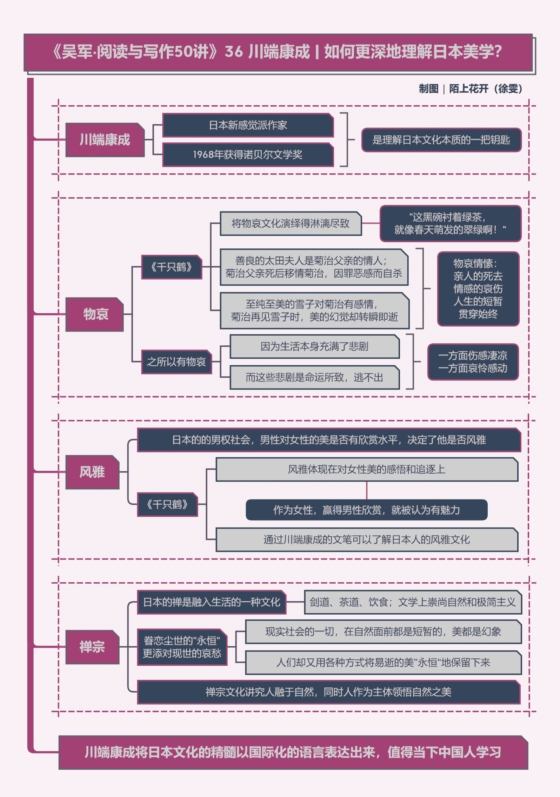  

公众号懒人找资源，懒人专属群独享

# 37 《浮士德》| 如何理解德国的崛起？

吴军

2020-07-14

《浮士德》| 如何理解德国的崛起？

几年前，一位学历史的中央领导在读了我的《文明之光》后，专门和我聊了一次对文明和文化的看法，然后他问了我这样一个问题：如果在世界上找一个和中华民族比较相像的民族，会是哪一个？我说是德国，至少近代的中国和近代的德国极为相似。

他听了以后觉得这个看法很独特，大家很容易想到日本，或者俄罗斯，不太容易想到和中国相距很远的德国，于是就接着问我原因，我讲完之后他觉得很受启发。

这里面的原因是多维度的，涉及到地理、政治、军事和经济的方方面面，这些维度的特性其实都投射到了文化这个维度，而从文化上理解德国，以及它和中国相似性的有三把钥匙：歌德、黑格尔和瓦格纳。

这一讲，我就通过歌德的《浮士德》，带你理解德国崛起对中国人的启发。

歌德出生于 1749 年，正好是欧洲三十年战争结束后的一个世纪之后。当时发生了三十年战争，这是历史上第一次的全欧洲大战，战争对德国（更严格地讲是德意志地区，因为当时还没有德国）发展轨迹的影响，就相当于鸦片战争对中国的影响。

在此之前，北德意志地区也就是今天的德国所在地，最早开始了宗教改革，本来可以平稳而渐进地进入近代社会，但是三十年战争的失败，不仅让它损失了大片土地（包括被法国割走的阿尔萨斯和洛林，我们中学在学习都德的小说《最后的一课》时，读到了法国人丢失这两个省时痛心疾首的心情，其实这两个省原本就是德国的土地），而且从此陷入四分五裂的状态，在欧洲一直被人欺负。这和鸦片战争之后的中国很相似，都具有“苦难”这个特性。

**在那个时代，德国的政治精英们就有点像中国从清末到五四的知识精英，一直在寻找德国的出路。歌德就是其中的一位作家。**  
也就是说，他不是一般的文学家，我觉得他有点像中国的梁启超、鲁迅和陈独秀，身上具有一种求索的精神。

“求索”这两个字，是读懂和理解歌德的代表作《浮士德》的关键。

浮士德的故事在欧洲流传已久，他的原型是一位炼金术士，有很多魔法。歌德将这个故事赋予了新的内容，而且塑造出一个全新的浮士德的形象。

在歌德这部长达 500 页的史诗中，浮士德被塑造成一个令世人景仰的学者，他精通科学、哲学、神学和医学等，因此他是上帝最喜欢的臣民。魔鬼梅菲斯特就和上帝打赌，说他能诱惑上帝最喜欢的浮士德跟随他走。上帝答应了梅菲斯特的赌局，他其实只是想借机考察一下浮士德。

在这部长诗的第一部分里，歌德使用的是我们前面讲到的多线索同时展开的写作方式。浮士德当时正陷入苦恼，因为他了解到自然知识越多就越困惑，一方面知识是无穷无尽的总是学不完，另一方面学得越多似乎就越搞不清楚知识的本质是什么。

浮士德的这种心态在当时德国的文化精英中具有普遍性。在困惑面前，浮士德想自杀，这时魔鬼梅菲斯特找上了他，要和他做一个交易。

梅菲斯特愿意给浮士德超能力，让浮士德随意地时空穿越，寻找他想要的一切。作为交换条件，一旦浮士德对梅菲斯特给他提供的东西（或者服务）感到由衷的满意，并且希望那一时刻永远停下来的时候，浮士德就得跟梅菲斯特走，去地狱为梅菲斯特服务。这其实就是用灵魂换取无所不能的能力。

有了这种超能力，浮士德就随着魔鬼梅菲斯特游历五光十色的大千世界，他首先体验了凡人世界的爱情，和少女格雷琴相恋，但这却是一个悲剧的结局，他搞得人家家破人亡。至此，《浮士德》的第一部就结束了。

在第二部中，歌德其实更多地是通过浮士德为线索，讲述社会现象、历史事件以及国家政治。不过其中对浮士德故事的描写还是很完整的。

浮士德自从有了超能力后，他就可以变出钱，解决一个王国的财政问题。对现实世界不满意，就可以穿越回古希腊。在古希腊，他还成了英雄，娶到了西方世界里古往今来的第一美女海伦，并且两个人生了一个孩子。但是浮士德还是不满意，于是他又回到现实，来到了皇帝的身边，帮助皇帝在战争中取得了胜利。浮士德得到了皇帝的奖赏，那是一片海滩，在那里他想围海造田。

浮士德古往今来地游历了一大圈，已经百岁高龄了，但依然没有找到让他真正满足的“理想”。这时，魔鬼梅菲斯特已经等不及了，他开始为浮士德挖墓。年迈的浮士德这时候已经双目失明，他听到挖墓的铲声，误以为是工人在施工。这时，终于认识到劳动是最美好的事情，于是他说一声：“停留一下吧，你多美啊！”

这句话其实是浮士德对未来社会的憧憬。他说：“我想看到这样一番忙碌的景象，要在自由的土地上与自由的人民站在一起”。

但是，这时根据他和魔鬼的协议，他既然找到了自己心目中的理想世界，便要将灵魂让魔鬼带走，于是话音刚落，浮士德便倒地死去。

当然，最后歌德给了浮士德一个完美的结局，代表正义力量的上帝拯救了他的灵魂，将他带到了天国。

结尾几句非常出名，我们不妨先欣赏一下：

一切无常者， 不过是虚幻； 力不胜任者， 在此处实现； 一切无可名， 在此处完成； 永恒的女性， 领我们飞升。 （钱春绮译本）

**浮士德的游历，也可以理解为一个德意志知识分子一生的求索，也是歌德给生活在他所热爱的那片土地上的人民的建议——通过劳动建设一个国家。**

歌德从 23-26 岁（1762-1765 年）就开始构思浮士德的创作，三十年后（1806 年）才完成了第一部分。其间他担任过魏玛公国的枢密顾问，几十年的从政经验让他意识到，现实的问题在现实中无法解决，这在《浮士德》中表现为人间爱情的失败。

随后，歌德经历了法国大革命对欧洲的冲击，当时德意志各小国的知识分子，对拿破仑这个人物的感情很复杂。一方面拿破仑是一个入侵者，另一方面又把自由和平等带到了欧洲各地。因此在史诗的第二部，浮士德开始深入到古今各个时代、各个地区求索。

古希腊的政治制度对很多近代欧洲人来讲是理想的制度，这就如同海伦是最理想的美女一样，但是它们依然解决不了浮士德的问题。接下来，战争的胜利依然不能解决问题。

在史诗中，浮士德希望围海造田，这象征着歌德希望在白纸上创造一个乌托邦的社会，这当然也不可能。最终，歌德意识到只有劳动、建设才能解决德意志的问题。这时歌德已经 82 岁了，他终于完成了浮士德的创作。一年后，也就是第二部分出版的那一年，歌德也走完了他 83 岁的人生历程。

歌德在《浮士德》中，用了大量的象征写法。比如，在日出时，已经获得超能力的浮士德站在大地上，企图直视象征着真理的太阳，可是阳光仍旧刺眼，浮士德马上低头。歌德通过这段话告诉大家，再了不起的人，在真理面前都需要谦逊。

大地在《浮士德》中，象征了生命，浮士德站在大地上，他可以享受生命。生命虽然不像永恒的太阳那样神圣、纯粹，但对浮士德来讲却同样重要。在整个长诗中，浮士德一开始并没有意识到这一点，他在自己的知识范围内越陷越深，甚至要到了自杀的地步。正是魔鬼梅菲斯特带领他游历五光十色的大千世界，浮士德才开始积极地、充分地体验生活，他的精神才得到了升华。

我们经常讲两句话：“未经审视的人生是没有价值的”，“没有人文的科学是灾难”（这句话甘地经常讲），这两点歌德都借浮士德进行了诠释。

读《浮士德》，我会不由自主地联想起四个人：

## 1.屈原

可以讲，屈原是中国古代的浮士德，他也用生命求索，但是没有找到出路。我读完《浮士德》，马上就想起了屈原“路漫漫其修远兮，吾将上下而求索”那句话。

## 2.李商隐

李商隐的《锦瑟》实际上是对自己一生求索的回顾，可以讲曾有过美好的往昔，但是总体来讲一生过得有点失败，当他写《锦瑟》的时候，过去对他只是一种幻灭，而他最终也没有找到出路。

## 3.歌剧大师瓦格纳

我在《硅谷来信》中，专门花了两天的时间介绍他史诗般的巨作《尼伯龙根的指环》（简称《指环》）。这部长达 17 小时的歌剧，从另一个方面提供了理解德意志民族性的钥匙。

歌德和瓦格纳有很多的相似性，他们都有英雄情结，都给德意志民族找到了出路，那就是寻找英雄、自强不息，实现自我救赎。但是，他们又有所区别。歌德倡导的是和平建设，是劳动，而不是战争。

对于人的能力，歌德认为人在神的面前，在真理面前是渺小的，因此最后浮士德要靠上帝救赎。而瓦格纳则要激进很多，他在《指环》和其他作品中，讴歌的都是牺牲自我、解救世界的英雄，那些英雄甚至比神更伟大。瓦格纳在歌剧上是不世出的天才，他能唤起成千上万听众的英雄情结，然后为了一个心目中的新世界团结在一起，共同奋斗。

在《指环》中，当男女主人公相爱时，他们唱的是：“热爱绚烂的生命，嘲笑死亡”，在我看来，这和日本武士追求樱花短暂而绚烂的美丽是何等相似。当一个民族采用暴力的方式崛起时，他们需要瓦格纳。但是那种方法并不能真正解决问题。而在今天，当德国开始领导欧盟和平崛起时，我认为它更需要歌德。

## 4.鲁迅

我想起来的第四个人是鲁迅。鲁迅那一代人所生活的时代，和输掉三十年战争的德国很相似，因此，他们那一代人一生也在求索。但鲁迅更多地是提出问题，而不是给出答案。不过，当我想到我们的前辈为这个国家的前途求索时，就很能理解歌德了。

## 小结：

**歌德和《浮士德》，可以用“苦难”、“求索”、“自赎”和“建设”四个词来概括。**

德意志民族最终走出了四分五裂的状态，今天是欧洲最强大的民族，中国也有幸走出了鸦片战争以来的厄运，实现了复兴。两个国家的崛起，靠的是什么呢？其实就是歌德给出的答案，实实在在的劳动建设。

和海洋文明的国家喜欢做生意挣钱不同，德国人和中国人都喜欢实实在在地靠双手创造财富，因此这两个民族虽然在地理上相去甚远，却有着相似的国民特性。

## 作业：

不管你是去过德国，还是接触过德国人，或者使用过德国制造的产品，请结合《浮士德》谈谈你对德国的理解，希望不超过 300 字。

下一讲，我们聊聊俄罗斯作家普希金和屠格涅夫。

1.从文化上理解德国，以及它和中国的相似性，有三把钥匙：歌德、黑格尔和瓦格纳。  
2.歌德和《浮士德》，可以用“苦难”、“求索”、“自赎”和“建设”四个词来概括。  
3.浮士德的游历也是一个德意志知识分子一生的求索，是歌德给生活在他所热爱的那片土地上的人民的建议——通过劳动建设一个国家。

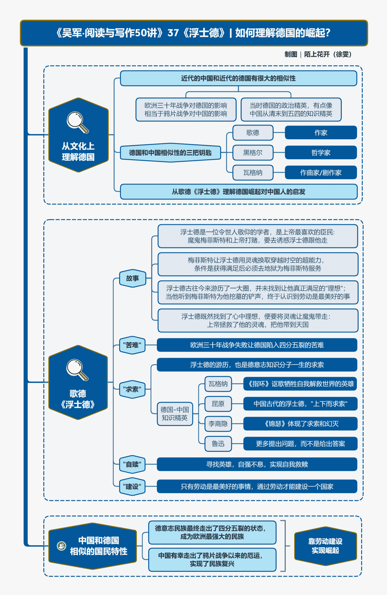  

公众号懒人找资源，懒人专属群独享

# 38 普希金 | 怎么理解俄罗斯文化里的精英责任？

吴军

2020-07-14

普希金 | 怎么理解俄罗斯文化里的精英责任？

这一讲，我们聊聊俄罗斯文学的代表人物，从普希金到屠格涅夫。

在发刊词里我提起过，1957 年 10 月 4 日苏联先于美国发射了第一颗人造地球卫星史普尼克号，这在美国造成了恐慌，史称史普尼克危机。

随后，美国就全方位研究了为什么当时的苏联能够在基础科学研究领域领先，一个结论是在沙皇俄国时代，俄国在人文和艺术领域教育水平和成就极高。从普希金到托尔斯泰，俄罗斯可以讲是文豪辈出。

到了 20 世纪末，美国又重新评价了俄罗斯的科研水平，发现它已经是世界二流了。研究者认为这和它在苏联时代重理轻文、理科和工科分校的教育方式有很大的关系。

事实上， **俄罗斯的文人在它的历史上扮演了极重要的角色，俄罗斯历史中文明的元素在很大程度上是由他们书写的。**  
通过他们，我深刻体会到了人文对社会的影响。而讨论俄罗斯文学，“精英意识”和“精英责任”是个避不开的话题。

俄罗斯真正的民族文学始于普希金。我们都熟悉他写的童话《渔夫和金鱼》，这其实只是他作品中非常轻量级的。普希金虽然只活了 37 岁，却创作了大量的重量级作品，对俄罗斯更为重要的是，那些作品是用俄语写的。

当时俄罗斯上层社会都说法语，在 18 世纪之前，很少有人会用俄语进行文学创作，觉得那不登大雅之堂，甚至很多作家是后来才学习俄语的。因此普希金开创俄语写作之风意义重大，他因此被誉为“俄国文学之父”，并且定格了俄罗斯文学的主题、风格和特点。

今天很多人形容普希金，往往会用浪漫二字，很多人更是津津乐道于普希金的风流韵事。的确，他的代表作——长诗《叶甫根尼·奥涅金》确实有浪漫主义色彩，但我更关注普希金骨子里现实主义的一面。

普希金一直在通过作品，提出当时主要的社会问题，他的风格影响了后来绝大多数俄罗斯作家。后来者虽然在创作形式上千变万化、不断创新，但是最终内核讨论的都是社会问题。这也就是为什么我在标题中会强调俄罗斯中的精英责任。

接下来我就对《叶甫根尼·奥涅金》做个分析，我们一起看看普希金在表层和深层分别讲了什么问题。

作品的主人公奥涅金是一个受过良好教育的贵族，但是他心境苦闷，于是他来到外省乡下，结识了年轻诗人连斯基，然后他们一同认识了一个地主家的两位千金小姐。姐姐塔姬雅娜疯狂地爱上了从大城市来的、见过世面的奥涅金，而妹妹奥丽加和连斯基相爱了。

面对塔姬雅娜的情书和炽热的爱，奥涅金居然不为所动，还故意追求妹妹奥丽加，这让连斯基非常生气。被惹恼的连斯基向奥涅金提出决斗的挑战，在决斗中不幸被奥涅金杀死。奥涅金受到良心的谴责，便离开了田庄，到各国旅游。

几年后他回到圣彼得堡，在一次舞会上见到已经嫁给一位老将军的塔姬雅娜。奥涅金这时才发现原来他一直深深爱着塔姬雅娜，并跪在她的面前表白。但一切已经太晚了，塔姬雅娜不能背叛丈夫，拒绝了奥涅金。

这看起来是一个浪漫的爱情故事，但这只是表面现象。在深层，普希金这部长诗全景式地展示了当时俄国社会的各种问题，被后人称为“俄国生活的百科全书”。

普希金首先谈的是自己所在的上层社会的问题，或者说贵族们的问题，这和普希金自己的经历有关。

普希金在他生活的早年经历了拿破仑战争，特别是 1812 年拿破仑入侵莫斯科这件事。那时普希金是一个非常爱国的热血青年，他开始学习俄文，用俄文创作也是受那件事的刺激。几年后俄国随着反法同盟的其他国家攻入了巴黎，虽然在军事上看似是俄国胜利了，但是在政治和文化上则是法国人赢了。

当俄国的贵族军官们进入到巴黎，看到了全方位超越俄罗斯的西欧文明。特别是开明、民主的政治制度，对军官们的冲击是非常大的。回到俄罗斯后，他们不仅带回了法国的生活方式，而且带回了自由民主的思想，他们中的一些人后来成为十二月党人。这些人的思想影响了普希金，他从此开始大量阅读狄德罗和伏尔泰等启蒙思想家的作品，在文学上受到歌德和拜伦的影响。此后普希金的写作风格也从浪漫的诗歌改成了古希腊的哀诗。

在文学创作之外，普希金倡导上层社会的改革，因为这件事他还得罪了沙皇。所幸他在上层社会有很多朋友，才没有被流放到西伯利亚。后来十二月党人起义，试图推翻沙皇专制制度，普希金虽然没有参加，但是他赞同十二月党人的主张。

普希金所塑造的奥涅金和连斯基这两个形象，多少有点当时普希金这样的俄国贵族的影子。上层社会纸醉金迷的生活，缺乏政治权利无所事事的处境，让他们很不满意，但是又没有解决办法，于是只能想办法回避。连斯基更是年轻时普希金的化身，他充满激情、富于浪漫主义的幻想，但是最终被代表现实主义的奥涅金杀死了。

当时在俄国的专制制度下，一代代有理想的年轻人就这样被扼杀了理想。奥涅金扼杀了自己的理想，也扼杀了自己的爱情。

作品中的女主角塔姬雅娜是普希金心目中理想女性的化身。后来俄国著名的文学评论家别林斯基和大作家陀思妥耶夫斯基对塔姬雅娜的评价都很高。

别林斯基认为，普希金用诗歌再现了俄国妇女的典型形象——外貌并不引人注意，但她理智、有思想、有个性，情感丰富而且忠诚。作为有钱人家的小姐，塔姬雅娜接受过良好的教育，甚至受到法国启蒙主义的熏陶。

但是，现实给她安排的道路就是嫁人生子，因此当她看到奥涅金时，就像看到了一根救命的稻草，幻想着能得到爱情。但是在当时死气沉沉的俄罗斯，这种努力是徒劳的。别林斯基认为普希金是比较早关注妇女问题的文化精英。

**奥涅金这样的人，在俄罗斯上层社会非常普遍，后来屠格涅夫给他们起了一个名字，叫做“多余的人”。**

在普希金之后，几乎每一个俄罗斯文豪的笔下，都有一些多余人的形象。比如莱蒙托夫《当代英雄》中的毕巧林，屠格涅夫的《罗亭》的主人公罗亭，《战争与和平》中的皮埃尔等等。这些人都受过良好的教育，不少还在西方见过世面，像皮埃尔经常说的是法语而不是俄语。

但是，由于当时俄罗斯是一个专制社会，不是商业社会，这种知识青年唯一的出路就是进入政府机构任职，然后往上爬。在一个专制体制中，他们也并没有多少上升空间，于是便觉得自己怀才不遇，无所事事。他们一方面批评社会，另一方面又不采取行动。列宁称这些人是“语言上的巨人，行动上的矮子”。

俄罗斯文豪们塑造的另一类典型的俄罗斯民众形象就是“小人物”。这里所说的小人物，不是文学作品中路人甲、匪兵乙这样没有什么戏的小角色，而是指俄国处于社会阶层下级的职员和低微的小官吏。

在官僚体制的沙皇俄国，他们形成了一个特殊的阶层。一方面他们是“先生”、“老爷 ”，另一方面他们在职业上受到歧视，还经常受到上司的欺辱，被视为“  
老鼠”、“擦脚的破布”，还不得不逆来顺受，甚至在经济上他们也穷困潦倒。比如普希金笔下的十四等文官、一个驿站的站长（《驿站长》），果戈里笔下的九等文官抄写员（《外套》）和陀思妥耶夫斯基笔下的小公务员（《穷人》）。

这些人出身低微，但都非常善良，渴望过一个好的生活。在专制的俄国，他们的命运都非常悲惨。

十九世纪文豪们所讲述的现实问题，“多余人”和“小人物”，其实在很多国家很多时代都存在，大家回避不了。当然，谁也不想成为这样的人。

我以为，最简单的办法就是避开容易产生这两种人的大环境。比如今天，中国市场化程度高、竞争激烈的北上广深，就不容易出现这两种人。我过去在专栏中多次建议年轻人在择业时，如果有条件，一定要“城市优先”，这些经验之谈不仅来自我，也来自俄罗斯的文豪们。

我要提醒你注意的是，普希金、果戈里、陀思妥耶夫斯基和前面提到的屠格涅夫，以及我们下一讲讲的托尔斯泰，这些伟大的俄罗斯文学家，都出身于贵族或者大地主家庭，他们其实和自己笔下写的小人物，完全不属于同一个阶层。

很多人觉得，出身于哪个阶层就会为自己所在的阶层说话，没有受过教育的人或许如此，但是  
**接受了良好教育的俄罗斯上层知识分子们，见识会超出他们所在的阶层，通过自己的笔把社会问题写清楚，并且引起社会的重视，这也是社会精英责任的体现。**

这方面，比普希金稍晚的屠格涅夫，同样是很好的例子。

屠格涅夫出身于一个大地主家庭，但他对自己母亲虐待农奴的行为很不满，还常常和农奴们交谈。从底层民众那里，屠格涅夫了解了俄罗斯社会，并获得了创作的源泉。

别林斯基读到他写的诗歌等作品后大加赞赏。在别林斯基关心下，屠格涅夫成为职业作家，随后写了很多反映底层民众生活和谈论社会问题的作品。当时沙皇正在致力于废除农奴制度，屠格涅夫的作品对当时父子两代沙皇产生了很大的影响。

## 小结：

当时俄罗斯言论并不是很自由，作家们通常把现实主义的内核装到各种外壳中，这就形成了各自的风格，比如普希金的浪漫、果戈里的幽默、陀思妥耶夫斯基的戏剧化和屠格涅夫的反讽。这也让我觉得那个时期俄罗斯的文学丰富多彩。但他们骨子里的精英责任，是那个时代俄罗斯文学共同的精神特质。

## 作业：

听完这一讲的俄罗斯文学，请说说你所理解的社会责任，咱们提倡短文章，请尽量控制在 300 字以内。

下一讲，我们聊聊另一位俄国大文豪托尔斯泰。

1.普希金的长诗《叶甫根尼·奥涅金》，全景式地展示了当时俄国社会的各种问题，被后人称为“俄国生活的百科全书”。  
2.俄罗斯作家们通常把现实主义的内核装到各种外壳中，形成了各自的风格，但他们骨子里的精英责任，是那个时代俄罗斯文学共同的精神特质。

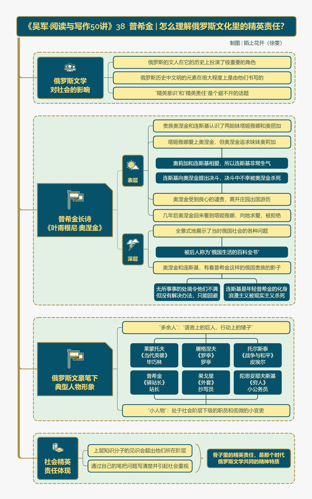  

公众号懒人找资源，懒人专属群独享

# 39 托尔斯泰 | 怎么理解贵族的自我救赎？

吴军

2020-07-14

托尔斯泰 | 怎么理解贵族的自我救赎？

这一讲我们说说托尔斯泰。我在很多场合讲，人类有一种向善的天性，这种看法最初就源于我读托尔斯泰的书。

前面的课程里，我讲过，罗曼·罗兰把世界各国文化巨匠们梳理了一遍，要找几个巨人给有志青年做伴。最后他找了三个，贝多芬、米开朗基罗和托尔斯泰，他们分别代表了音乐艺术、视觉艺术和文学艺术。

选择贝多芬和米开朗基罗大家可能没有疑问，但在文学方面，为什么是托尔斯泰，而不是莎士比亚、歌德或者雨果呢？

因为在罗曼·罗兰看来，托尔斯泰不仅是文豪，而且是自我救赎的英雄。在我看来，  
**托尔斯泰也是我们理解今天西方的富豪精英，比如比尔∙盖茨、布隆伯格、扎克伯格以及他们的前辈，比如卡耐基和洛克菲勒等人行为的钥匙。**

为什么这么说呢？请你带着两个问题来听今天的课程：

1.  这些人为什么要大量捐出自己的财富，甚至是裸捐？
    
2.  美国的贫富差距远比欧洲大得多，但是仇富现象似乎并不很严重，这是为什么？
    

我们还是从托尔斯泰入手来回答这两个问题。

和很多俄罗斯文豪一样，托尔斯泰出身贵族，而且他的家族是俄罗斯最重要的家族之一，祖先曾伴随沙皇左右。托尔斯泰少年时并没有体现出写作的天才，也算不上一个好学生，甚至可以讲是纨绔子弟，曾经把大量时间花在社交场上，还欠了不少赌债。

托尔斯泰后来和家族其他男性一样参了军，并且表现英勇。在服役的闲暇时间，托尔斯泰开始写作，并且显示出这方面的天赋。屠格涅夫在看了他的作品后大加赞赏，说他将是第二个果戈里。几年后托尔斯泰退役，又回到圣彼得堡的社交场上鬼混。

不断提携托尔斯泰的屠格涅夫看不下去了，希望他不要虛度青春，浪费自己的才华，更不要成为自己作品里批评的人。但年轻气盛的托尔斯泰和作为长辈的屠格涅夫发生了多次争吵，最后导致两人断交了 17 年。这时的托尔斯泰很像自己在《战争与和平》中写的“多余人”皮埃尔。

让托尔斯泰生活发生改变的是他随后在欧洲和俄罗斯长期的旅行，他看到了真实的俄罗斯和世界，又了解了西方的人文主义和平等的思想，从此他开始走出了原来的上层贵族圈子，思考俄罗斯的出路。

托尔斯泰也和普希金等前辈一样，通过文学作品全面揭露俄罗斯的问题，尽到一个文化精英的责任。但是他超越了那些文豪前辈，也像歌德一样穷其一生寻找解决社会问题的答案，托尔斯泰的几部大作就记录了他的思想和思考的过程。

## 《战争与和平》

我们先说说《战争与和平》，这本在世界文学史上地位堪比《荷马史诗》和《浮士德》的文学史诗，其实表达的是托尔斯泰对国家、民族、历史和政治的思考。

我读《战争与和平》时第一感觉是规模宏大。它以拿破仑战争，特别是 1812 年拿破仑入侵俄国为背景，叙述了三个俄罗斯贵族家族将近 20 年悲欢离合、曲折动人的故事。其次，我通过这本书全方位了解了 19 世记初期俄国社会的全貌和政治变迁过程。

《战争与和平》里面有 500 多位人物，从赫赫有名的拿破仑和俄军统帅库图佐夫，到普通士兵民众，应有尽有。

由于托尔斯泰家族的男性历代从军，他的父亲就参加过 1812 战争，他自己也服过役，对拿破仑战争和军旅生涯再熟悉不过了，因此他对于那场战争的描写非常真实。同时他又熟悉上流社会的社交活动和爱情故事，读了以后会有身临其境的代入感。

当然这本书最重要的是托尔斯泰自己对政治、战争历史和权力的看法，很多观点非常独特。

在《战争与和平》中，托尔斯泰常常大段大段地表述自己对上述问题的看法，当然他是借助于小说中人物之口。读完这本小说合上书，我有一种强烈的感觉，  
**战争的胜负和政治的结果，其实不完全由拿破仑或者库图佐夫这样的英雄人物决定，而是由很多不随人的意志改变的客观事实决定的。**  
就算拿破仑不犯错误，失败也是难免的。

类似地，库图佐夫的胜利，并非是因为他比拿破仑更会打仗，而是最终各方面的有利条件站在了他的一边。我们今天称之为历史的必然性，但是当时的精英们可不这么认为，他们认为成功是自己的功劳，失败是自己运气不好。

托尔斯泰在见识上另一个超越时代的地方在于，肯定了那些微不足道的小人物的作用。他在书中刻画了不少低级军官士兵的形象，正是靠他们浴血奋战才拯救了国家。库图佐夫也正是因为看到了人民的意志，才有过人的胆识和必胜的信心。

相比之下，他书中的很多贵族对国家的命运毫不关心，只关心自己寻欢作乐和敛财囤货。托尔斯泰的一生，是从贵族化走向平民化的过程，而这个趋势在他写《战争与和平》时已经很明显了。

你如果读过我的《文明之光》，就能体会我的很多历史观和上面这段描述很相似，我必须承认我在历史观方面受到了托尔斯泰的影响。

## 《安娜·卡列尼娜》

托尔斯泰的第二部巨著是《安娜·卡列尼娜》。书中的主人公安娜是一位充满魅力，渴望爱情，但婚姻并不幸福的贵族女性。

她极力追求感性生命的舒展，托尔斯泰对此极为肯定。但是安娜陷入了人性的迷误，为了狭隘的个人情爱，成为了情欲的奴隶。托尔斯泰对此并不赞同，认为她在摆脱社会枷锁的同时又陷入了另一种枷锁——感情和精神的枷锁。

在托尔斯泰看来，要获得真正的自由，就需要理性和健全的人格。这种看法和托尔斯泰自己从物质贵族过渡为精神贵族的行为是一致的。

我理解，托尔斯泰通过这本书表达的是自己对人的理解，特别是对爱情、婚姻和家庭的看法。一开篇就写出了那句名言：“幸福的家庭都是相似的，不幸的家庭各有各的不幸”，托尔斯泰认为人性解放、恋爱自由、婚姻自主是所有幸福家庭的基础。其次，他强调情感和精神的平衡。

顺便说一句，这部长篇巨著，一般人啃下来还是需要不少功夫的，得到每天听本书有解读版，你可以去快速浏览一下故事情节。

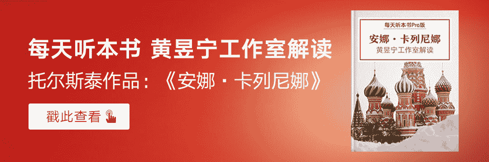

作为贵族，托尔斯泰天生地获得了别人没有的资源，同时他还曾经滥用这种资源，过着腐朽颓废的生活。托尔斯泰的太太在看了他过去的日记后发现，丈夫年轻时天天鬼混，赌博欠账，还有一个私生子，气得想把丈夫的日记烧掉。

对于过去的荒唐事，托尔斯泰一辈子在用行动忏悔和赎罪。他把这个过程写成了小说《复活》。托尔斯泰在《复活》中写道，“一种是精神的人，他为自己所寻求的仅仅是对别人也是幸福的那种幸福；另一种是兽性的人，他所寻求的仅仅是他自己的幸福，为此不惜牺牲世界上一切人的幸福。”

**托尔斯泰认为人要通过自我完善来改变社会。在我看来，这就是他自我救赎的思想根源。**

那么托尔斯泰都做了哪些事情呢？作为伯爵，托尔斯泰有 380 公顷的巨型庄园和很多农奴。他先是在自己的土地上搞土地改革，把土地还给农奴自己掌管。但是农奴们不敢接受，纷纷拒绝，甚至恩将仇报。

托尔斯泰终于开始明白，贵族和农奴之间的隔阂是无法在一朝一夕消除的，先要改变底层民众的思想，于是他开始为农民兴办学校，教穷苦的孩子识字、数学和信仰宗教。

但是，托尔斯泰的善行却受到了政府和其他地主的反对，他们联合起来，搜查他的学校，迫害和赶走老师，托尔斯泰的梦想再次破裂。

后来他就用笔来揭露社会问题，同时身体力行，放弃了贵族化的生活，让自己像平民一样从事劳动。

在遭遇灾害的年头，他为农民搞募捐。1908 年，俄国发生了暴动，农民毁坏了地主的庄园，当托尔斯泰看到有 20 多个农民因此被判死刑后，为农民说话，悲痛地写下《我无法沉默》一文，指是出沙皇政府而非农民，才是暴力的实行者。

托尔斯泰到了晚年，对社会的认识越来越深刻，他把自己对社会的长期思考以杂文的形式写了出来，编成了一个集子，就叫做《我无法沉默》。书中的内容涉及社会、教育、艺术、生命、文学创作等方方面面，  
**在我看来，《我无法沉默》是最体现他智慧的一本书，这些杂文对当时西方精英的影响甚至超过他的几本小说。**

后来美国的一些富豪也在反思自己获得那么多的财富是否公平，也在做类似托尔斯泰做的事情，通过慈善的方式把钱交还给社会。比如当时美国的首富卡内基就讲，“在巨富中死去是一种耻辱”，于是裸捐了他的财富。

美国的那些富豪在表达思想上显然不如文豪托尔斯泰那么精辟，但是他们认同托尔斯泰的话。

100 年后，盖茨和扎克伯格在捐出巨额财产时都讲过这类的话，他们获得如此巨额的财富时在反思，自己做过的事情是否配得上如此高的回报。感觉自己似乎配不上，因此捐出来帮助需要的人是自己的义务。

托尔斯泰的思想后来被人们总结为“托尔斯泰主义”，包括这样几个方面：理性的利他主义、改良主义和非暴力不合作抗争，最后一点，对甘地以及马丁·路德·金等人产生了决定性的影响。

对我来讲，体会最深刻的则是改良主义。在托尔斯泰的年代，美国两极分化其实很严重，缺乏社会公平。最终美国通过所谓的进步运动，也就是改良的方法解决了问题。富豪们捐出自己的钱解决社会问题。

## 小结：

托尔斯泰自我救赎的思想和行动，被罗曼·罗兰誉为英雄。伟人之所以伟大，是因为他站得高看得远，能摆脱时空的局限和约束，一百年甚至一千年前说过的话，放到今天，依然有现实意义，能够启迪当下的人。

## 作业：

你怎么看待超级富豪的捐赠行为？欢迎在留言区发表你的评论观点。

下一讲我们聊聊马克·吐温和社会问题。

1060

7720

1.托尔斯泰是我们理解今天西方的富豪精英，比如比尔∙盖茨等人行为的钥匙。 2.托尔斯泰认为人要通过自我完善来改变社会，这也是他自我救赎的思想根源。  
3.托尔斯泰的思想被总结为“托尔斯泰主义”，包括：理性的利他主义、改良主义和非暴力不合作抗争。

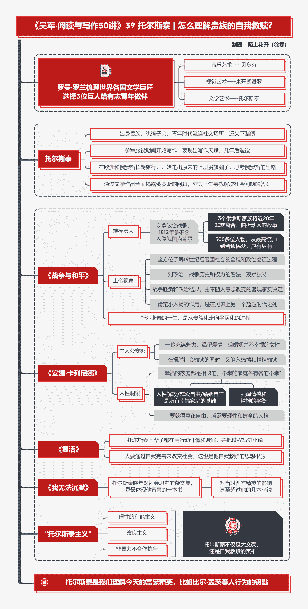  

公众号懒人找资源，懒人专属群独享

# 40 马克·吐温 | 怎么理解高速发展产生的社会问题？

吴军

2020-07-14

马克·吐温 | 怎么理解高速发展产生的社会问题？

如果要问今天中国和历史上哪个时期最相似，就个人发展而言，我觉得和第二次工业革命时的美国最相似——比如大家的生活迅速改变，财富剧增，但同时贫富差距有所扩大。这是每一次工业革命的特点，和国家无关。因此那个时代的经验教训对我们今天生活在中国的人特别有启发。

这一讲我们聊聊美国小说家马克·吐温的《镀金时代》。这就是反映第二次工业革命时期美国的传世之作。从前面几讲你可以看出，很多文学上的传世之作，都全面地反映了一个国家、一个时代的问题和特点，通过读那些书，我们可以回到那个时代。

由于历史在很多方面会有惊人相似之处，对过去的了解有助于我们今天做抉择。今天我就从这本书入手，看看我们从那个时期的文学中都能了解到什么社会现象，应该采取什么对策。

第二次工业革命时的美国被称为镀金时代，这个名称恰恰就来自于马克·吐温的《镀金时代》一书。

《镀金时代》成书于 1873 年，这是第二次工业革命初期，当时美国已经打完了南北战争，形成了一个大市场，有很多发财的机会，这一点有点像中国改革开放之初。

在小说中，老霍金斯是一个一心想做生意发财的人，他先是囤积了 75000 英亩荒芜的土地（约 300 平方公里），指望靠它发财。这时正赶上美国开发大西部，他的朋友塞勒斯劝他到那里去试试机会，于是霍金斯就举家离开故乡往西部走，路上他还收养了一个养子克莱和养女劳拉。

到了西部，霍金斯靠做畜牧业的生意事业有了些起色，但是从来没有发过大财。他的梦想就是有朝一日他囤积的那一大片土地能够升值挣大钱。

但是做了一辈子发财梦的霍金斯到死也没有等到这一天，还因为做投机生意把挣的钱都赔了进去。临死前，他让孩子们守住那一大片可能值大钱的土地。

霍金斯家接下来的故事就围绕着美丽的养女劳拉展开了，她要去实现养父生前的愿望，而能将那片贫瘠的土地卖个大价钱唯一的方式，就是说服国会议员要求联邦政府购买那片土地。于是她前往华盛顿并且在参议员迪尔沃西的帮助下成为国会的职业游说者。

劳拉和迪尔沃西合谋，提出在霍金斯家那片土地上建大学的法案，然后就可以把土地卖给政府赚大钱。但是迪尔沃西贿赂投票的阴谋败露，竹篮打水一场空，但是他居然靠政治手段洗刷罪名全身而退。

劳拉也惹上了自己的麻烦，她在第二次被初恋情人欺骗感情后，开枪杀死了对方。虽然她也靠贿赂得以逃脱罪名，不过后来受到良心谴责忧郁而死。

最终老霍金斯留下的那块土地、想象中的巨额财富，只能被他的儿子贱价处理掉。

《镀金时代》书中还有一条跟主线交织的副线。霍金斯家的那个朋友塞勒斯有一次遇到两个来自东部的年轻人斯特林和布雷尔利，这两个人出生于有钱家庭，还是耶鲁大学的毕业生，毕业后他们在东部工作一段时间，就加入了到西部冒险的大潮，参加了太平洋铁路的建设。

塞勒斯得知他们会修铁路，就鼓动他们做一个新的铁路建设计划，然后在铁路沿线开发一座新城——拿破仑城，这样他们就可以拿到政府的钱一夜暴富。

这两位年轻人也找到了参议员迪尔沃西，并且在后者的运作下，还真拿到了政府批准的 20 万美元的项目，这在当时是一笔巨大的财富。但是塞勒斯和布雷尔利后来发现，那些钱在给议员们行贿以及支付游说者之后，剩下的连筑路工人的工资都不够发。他们的发财梦也就破灭了。

小说中当然也有“正能量”。斯特林在筑路失败后，靠辛苦采矿，获得了成功，他的女朋友，一位生活优越的大小姐，不顾家人反对成为了医生，两个人有情人终成眷属。

**《镀金时代》所描写的当时的美国社会，和这本书的书名一样，看上去无比光鲜，但是镀金外表的下面是泥沙俱下的复杂。**

我 20 多年前在国内第一次读《镀金时代》这本书的时候完全看不懂，因为我对里面的场景一点也不熟悉。所以，当时虽然冲着马克·吐温的名气硬着头皮读了一半，还是扔在了一边。

大约十年前我开始研究技术革命对社会的影响，那时又有了投资、做产品，以及商业上的很多经验，再读这本书，发现它简直就是当今社会的写照。

比如当时美国西部大开发时，很多在东部城市里生活优越的年轻人放弃舒适的生活，到西部去寻求更大的机会，这和我很多同学毕业后，放弃北京的生活，南下深圳捞世界是一个道理。

中国今天很多房地产巨头，比如王石、潘石屹、任志强那一批人，都是在深圳开发的早期到那里碰运气成功的。当然，有成功就有失败。在美国西部大开发中，铁路大王斯坦福，后来的传媒大王赫斯特家族是成功者，它们相当于中国的房地产老板们。

但是，美国当时大量的做着发财梦的人，最后像老霍金斯一样，不仅到死也没有发财，而且还客死他乡。

读完《镀金时代》这本书，你的第一感觉，可能是当时的美国社会糟透了，这个国家真乱啊。但我要提醒你，  
**任何时代的知识分子，都更多地会是时代的监督者，而不是歌颂者，他们更多地喜欢揭露社会问题，所以你不能把小说跟现实完全划等号。**  
在这一点上，马克·吐温和俄罗斯的批判现实主义作家们没有差别。

另一方面，凡事不经过对比就得到的结论常常是片面的。如果把《镀金时代》这本书放在一个大的历史背景下，从一个更大的全球视角来阅读，我们就会看到工业革命时期美国社会的另一面。

事实上，那一段时间是美国在整体上发展最好的时期之一，美国也就是在那 20 年的时间里超越英国成为世界最大的经济体，而且当时第二次工业革命的一大半重要发明也来自美国。

我们在前面分析《十日谈》中《第一天·第二个》故事的时候时讲过，如果一个体制看似全是问题，但是却发展得很好，其背后一定有很多我们没有注意到的价值。我们对比一下俄罗斯文豪笔下同时代的俄罗斯，就会发现当时美国丑陋表现下好的一面。（戳此回顾：《十日谈》|  
精读和泛读各自有什么意义？）

首先，当时的美国社会是一个开放的社会，而沙皇统治下的俄罗斯是个封闭社会。在开放的社会中，不会出现“多余人”和“小人物”。如果斯特林和布雷尔利这两个耶鲁大学的毕业生生活在当时的俄罗斯，他们很可能是多余人，除了批判政府，无所事事，不可能到西部去闯世界。正是因为社会的开放性，他们才有发展空间。《镀金时代》里的各种人物天天在忙自己的事情，没有时间抱怨和批评社会。

其次，工业革命给各种人带来了机会，虽然它给社会也带来了不少乱象，但是相比之下它带来的机会对全社会的人好处更多。《镀金时代》里的人物可谓是三教九流什么都有，他们都有一个特点，通过自身的工作改变经济状况和经济地位。在那个社会里，你也看不到阶层固化。

当然，很多人未必是靠正当的手段谋得财富，但不管怎么样，他们需要做事情才能获得财富，而不是靠继承祖上的遗产不劳而获。

另一方面，有成功就有失败，在一个变革时期，一夜暴富是很多人的梦想，但是最终能够成功的只有少数人，这一点马克·吐温表述得很清楚。

最后，由于工业革命所带来的经济上的机会，女性也自然而然地参与到了经济活动中，甚至扮演了很重要的角色。霍金斯家族后来最重要的人物就是他们的养女劳拉，她虽然社会经验不算丰富，但是却担负起了完成家族使命的重任。

斯特林的女朋友露丝，虽然出身在富有的家庭，却也成为一名职业女性，而不是依靠男人过活。她们和安娜·卡列尼娜，或者简奥斯汀笔下的女性都不同。

在另一本非常值得推荐的，了解第二次工业革命时美国社会的名著《嘉莉妹妹》中，我觉得嘉莉妹妹就是我们今天意义上的北漂。这位来自于美国中西部的女生，虽然一开始在大城市生活艰难，找不到工作，甚至要靠男人过活，但是最终靠自己的努力和天分，成为舞台剧当红的演员。

虽然在《嘉莉妹妹》中，讽刺和批判多过赞赏，但是正是因为工业革命和城市化所带来的机会，才造就了嘉莉妹妹这样的“北漂一族”。虽然我们这里没有时间讲解这本书，但是我非常希望你也读一读它，可以更好地理解变革时代。

## 小结：

作为身处第四次工业革命的我们应该怎么办？我觉得除了积极参与进去别无他法。

当然，最终巨大的受益者人数恐怕只有 2%，这也是我在《智能时代》一书中表述的一个观点。这个观点的形成在一定程度上要感谢一百多年前的美国作家记录了当时美国社会的全景。

## 作业：

你是不是也远离家乡、奋斗在大城市呢？能不能用 300 字写一写你的生活和感受？

下一讲，我们聊海明威。

1468

1.就个人发展而言，今天的中国和第二次工业革命时的美国很相似，因此那个时代的经验教训对我们今天很有启发。  
2.《镀金时代》所描写的当时的美国社会，看上去无比光鲜，但是镀金外表的下面是泥沙俱下的复杂。  
3.任何时代的知识分子，都更多地会是时代的监督者，而不是歌颂者。

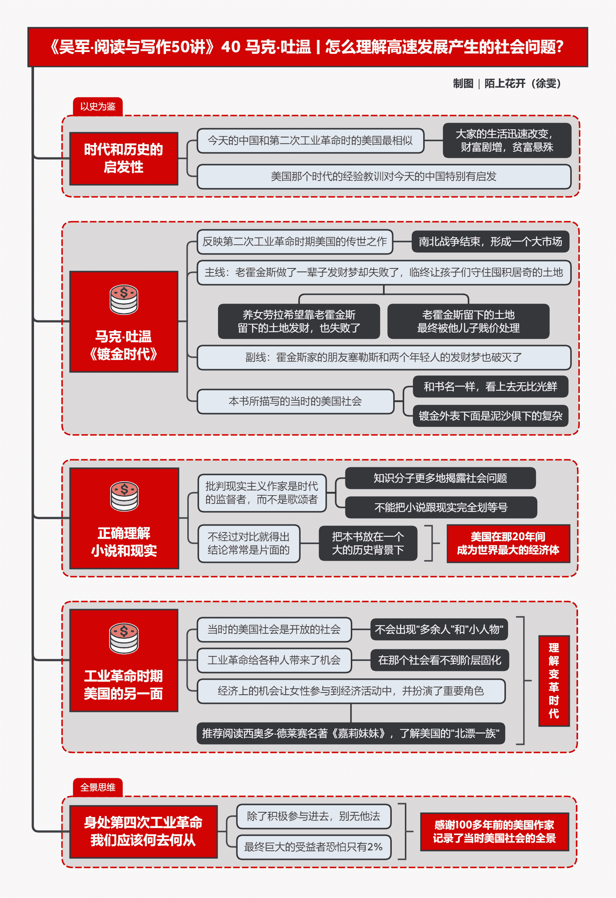  

公众号懒人找资源，懒人专属群独享

# 41 海明威 | 人在物质满足后有什么困惑？

吴军

2020-07-14

海明威 | 人在物质满足后有什么困惑？

我们上一讲讲到的美国工业革命是一个大时代。但是任何一个大时代都有结束的时候，接下来，社会就会从一个高速发展时期进入到一个平稳期。一个平稳的社会，大家衣食不愁，那是不是就万事太平了呢？

历史和文学告诉我们，并非如此。

一个国家快速发展、财富迅速积累之后，会出现什么问题呢？

首先是干什么都能挣钱，不断有升迁机会的好时代不会再有了。其次就有可能大量地出现“多余人”和“小人物”。

在美国和欧洲，1890-1900 年出生的那一代人就面临这个困境，因此他们在历史上得到一个专门的称谓——迷惘的一代（Lost Generation）。

对于今天的我们来说，读一读“迷惘的一代”的作品，不光是文学欣赏意义，也有现实意义。

这就不能不提菲茨杰拉德的代表作《了不起的盖茨比》了。这本小说被誉为美国 20 世纪最重要的小说之一。

相信得到的同学对这本书并不陌生，咱们先简要概括一下情节。

6688

小说的主人公盖茨比原本是一个穷小子，在一战前和白富美的黛西坠入爱河，但是等他从欧洲前线回来，女友黛西转身就嫁给了高富帅的布坎南。盖茨比后来靠贩卖私酒发了财，在纽约郊区富人聚集的长岛买下了黛西家对面的豪宅，天天举办奢华的派对以吸引黛西的注意。

最终，盖茨比设法和黛西重温旧情了，他觉得自己拥有了整个世界，而黛西愿意和他重新交往的真实原因，却是因为自己的丈夫布坎南有了婚外情。最后，黛西开车撞死了人，盖茨比为了保护爱人黛西，替她承担下撞人的责任。而车祸死者的丈夫知道后误杀死了盖茨比。

在这个故事中，盖茨比有点像今天我们所说的备胎。但是菲茨杰拉德主要的目的不是讲爱情中的备胎，而是通过盖茨比这个既让人同情又有些可悲的人物，揭示了  
**一个国家在平稳阶段会遇到的社会问题——阶层固化、对底层人的歧视、上层社会纸醉金迷，等等。这就是那一代年轻人迷惘的原因。**

这样一种状况的出路在哪里呢？迷惘一代的另一位代表性作家海明威给出了答案—— **在更大的空间和时间里寻找自己的位置。**

海明威在 19 世纪的最后一年，出生在美国中部的一个富有家庭。他的父亲很像文艺作品中的硬汉形象，喜欢户外活动。他的母亲是一名歌唱家。虽然家里一度想挖掘海明威的艺术天分，但是他却和父亲一样喜欢户外运动和冒险。不过海明威从小就显示出文艺创作的天分，在中学就是校报的编辑。高中毕业后他原本该进入著名的伊利诺斯大学学习，但是一家著名的报社同时给了他一份记者工作，他毫不犹豫地选择了后者。

在报社工作期间，海明威形成了自己的写作风格——行文简洁，用很短的段落开篇，用具有震撼力的句子表达思想，宣传“正能量”。今天如果你读托尔斯泰的书，可能会着急，因为要静下心来慢慢读，但读海明威的书，就会感觉畅快淋漓。

海明威如果生活在 19 世纪的俄罗斯或者法国，有可能会逐渐成为一个多余的人，所幸的是他生活在一个开放的社会里，他还有其他的选择。当时正值一战爆发，海明威不顾父母的反对，作为战地记者到了欧洲前线，除了冒着炮火到一线采访报道，还参加了伤员救助。在一战期间海明威受了伤，在养伤期间他认识了美国的护士安格妮·库洛斯基，两个人于是产生了爱情。但是一战结束后这段爱情就戛然而止了，这时的海明威并没有盖茨比那样一心要挽回失去的爱情，到前女友面前炫耀自己，而是将他在一战期间的经历和思考写成了自己的第一本小说《永别了，武器》。

虽然海明威在战争期间获得了意大利政府发的军功奖章，但他却因为看到了战争的伤害，而成为国际主义者和反战主义者。在此之后，海明威有了自己更大的发展空间，那就是全世界，而且他一辈子坚信全世界是一个整体。

这个观点，海明威在他的代表作《丧钟为谁而鸣》中用英国诗人多恩的诗（《沉思录》第十七章，Meditation XVII）表述得清清楚楚，这首诗是这样写的：

没有人是自成一体、与世隔绝的孤岛， 每一个人都是广袤大陆的一部分。 如果海浪冲掉了一块岩石， 欧洲就减少。 如同一个海岬失掉一角，  
如同你的朋友或者你自己的领地失掉一块。 每个人的死亡都是我的哀伤， 因为我是人类的一员。 所以， 不要问丧钟为谁而鸣， 它就为你而鸣！

《丧钟为谁而鸣》的故事发生在西班牙内战期间。代表着西班牙民主力量的共和国战士们在国际纵队的帮助下，准备对弗朗哥叛军实施反攻，收复马德里郊外的一个军事重镇。战役的关键是炸毁一座铁桥，以切断叛军支援的通道。这项任务就交给了国际纵队的爆破专家、美国人罗伯特∙乔丹。最终，罗伯特在游击队的配合下成功地炸毁了桥梁，但是撤退的过程中，他中弹落马。于是他告别爱人与战友，自己一个人留下阻击追兵。

在这本书中，海明威成功地塑造了罗伯特∙乔丹这样一个硬汉的形象，“硬汉”后来也被读者看成是海明威自己的形象。书中的故事时间跨度只有四天，周六的下午到周二的上午，但海明威却洋洋洒洒地写了几十万字，而且读起来一点不乏味。

在西班牙内战期间，海明威参加了国际纵队，支持民主的西班牙共和国。最终的结果是民主共和国输了，德、意法西斯支持的弗朗哥叛军赢了。海明威用“丧钟为谁而鸣”作为这部西班牙内战故事的书名，有两层深刻的寓意：

1.  告诫法西斯们，不要觉得今天暂时获胜了，因为丧钟已经为他们敲响。
    
2.  告诫那些袖手旁观的人，今天法西斯摧毁的是西班牙，明天可能就轮到自己头上，不要对别人的灾难冷漠，因为在全世界成为一个整体的今天，丧钟是为每一个人敲响的。
    

要知道那时候美国国内孤立主义流行，海明威的国际主义就显得格外突出。我在《浪潮之巅》中引用过多恩的这首诗，也多次引用过海明威的这个观点。

**海明威超越同时代人的地方在于，他更早地意识到人类必须有一个全球的视角，来关注和处理社会发展所导致的民族、国家和利益群体之间的竞争和冲突。**

当一个人走出自己的小圈子，把自己放在全世界，就会有无数的事情要做，即使遇到挫折，也会在失败中奋起。

我们不妨对比一下盖茨比和海明威，就能看出两种人、两种做法在同一个国家、同一个时代的高下之分了：

这两个人都参加了一战，都因此失去女友。盖茨比的做法是要千方百计逆袭，然后在女友面前证明自己，夺回自己所失去的。海明威则是让自己过去的经历过去，继续往前走。

世界是很大的，总能有自己的位置。对于一个自己发展受限制的时代，盖茨比是千方百计想让上流社会接纳他，而海明威则是看到世界上有很多问题没有解决，亲身去解决这些问题。

盖茨比最终遇到了过不去的坎，成为了迷惘的一代，海明威则因为自己在世界各地的经历，悟出了人生的道理，活得有滋有味。

海明威自己有过很多的挫折，但是每一次都没有倒下，只是受到打击，然后又再次奋起，因此他的“硬汉”头衔不是浪得虚名。

我觉得，今天中国的年轻人，读读盖茨比和海明威，都具有很大的现实意义。

在我看来，大家的上一代人所处的年代在某些方面有点类似于美国的镀金时代，一切都在发展，有很多空白的机会，因此根本没有时间，甚至不必要考虑人类的问题，只需要自己努力工作，就能改善自身的经济状况和社会地位。

今天则更像是 20 世纪 20 年代“柯立芝繁荣”时期的美国，一方面大家有了物质基础可以考虑更高层次的问题了，另一方面在一个小世界中上升的空间其实很有限，这时，到更大的空间中寻求发展就有了一定的基础，并且成为一种必要。大家在今天的社会上能同时看到盖茨比和海明威这两种人的影子。

## 小结：

所幸的是中国是一个开放的社会，不会像 19 世纪的俄国不给大家选择的自由，它给大家准备好了做选择的物质基础。

何去何从是每一个人自己的选择。为什么在同一时代，既会出盖茨比，也会出海明威呢？我的理解是：因为  
**人的见识，活动的范围，以及自己的抱负，决定了最终的命运。**

盖茨比有很多值得同情的地方，但是他见识狭隘，没有超越过去的阶层。海明威有全人类一家的情怀，对精神和自由的追求远远超过对物质的追求。“在伟大的事业中寻求不朽”。

通过“迷惘的一代”作家们的作品，了解他们曾经遇到过的社会情况和不同应对做法的结果，相信你不难找到适合自己的选择。

## 作业：

这一讲，我用了对比手法，跟你讲了小说人物盖茨比和现实中的作家海明威。能不能也请你运用对比手法，写一篇小文章，尽量不要超过 300 字。

1.一个国家在平稳阶段，会遇到阶层固化、上层社会纸醉金迷等问题，这也是当时的年轻人会感到迷惘的原因。海明威给年轻人的答案是：在更大的空间和时间里寻找自己的位置。  
2.海明威更早地意识到，人类必须有一个全球视角，去关注和处理社会发展所导致的民族、国家和利益群体之间的竞争和冲突。

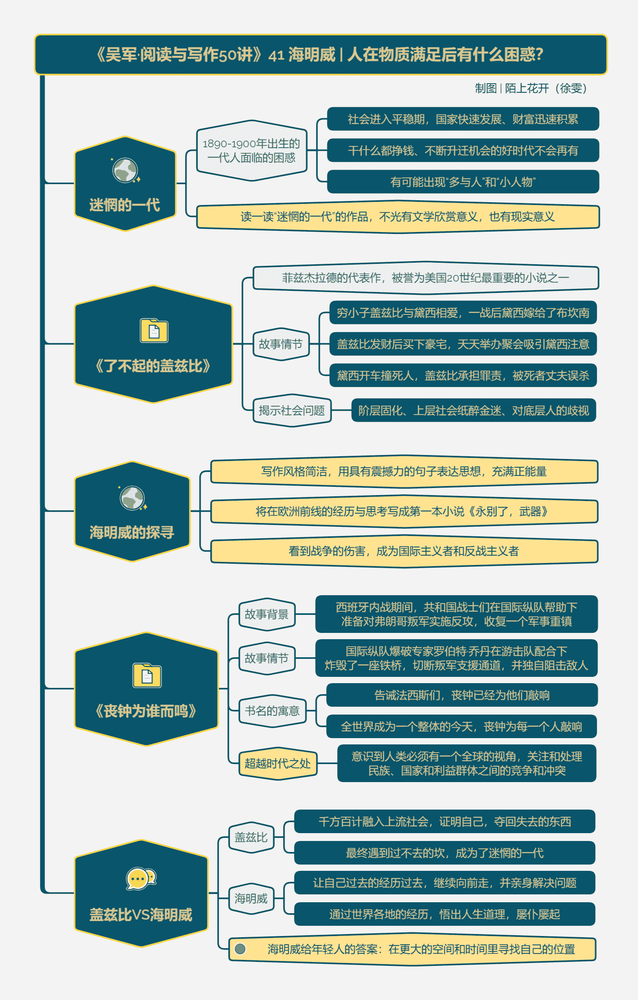  

公众号懒人找资源，懒人专属群独享

# 42 鲁迅 | 怎么理解文学与社会变革？

吴军

2020-07-14

鲁迅 | 怎么理解文学与社会变革？

这一讲，我们来聊聊鲁迅先生的作品。你也知道，以鲁迅在中国新文学史上的地位，研究他的人和出版的专著数不胜数，但我一直关注技术进步和社会变革的关系。在咱们的阅读课上，关于鲁迅这一讲，我还用这个视角，重点跟你聊聊文学跟社会变革的关系。

我们在前面第 37 讲谈了歌德等德国文化精英对四分五裂的德意志民族出路的思考。中国在鸦片战争后的情况，和三十年战争后的德意志地区非常相似，社会精英也都在寻找中国的出路。（戳此回顾：如何理解德国的崛起？》）

甲午战争失败后，李鸿章访问了德国，并专程到乡下去向已经退休在家的铁血首相俾斯麦求教。一番会谈后，李鸿章得到的结论就是三句话，“五洲列国，变法者兴，因循者殆！”此后，中国的文化精英们虽然在怎么变这件事情上吵得一塌糊涂，但是对“变法者兴”的认识是一致的。当然，要变就必须对过去有全面的反思，在这一点上，“五四”那一代文学家们都有很深入的思考。

**鲁迅先生对中国人国民性的认识是入木三分的。**  
他的小说中有相当大一部分都是在讨论这个问题。任何一个民族的国民性，一定都有好的一面和坏的一面，但是对于好的一面，鲁迅先生很少说，我个人的理解，他是觉得他们那一代人的任务，就是要改变中国，给中国寻找一条出路，因此好的就不用说了。

不过，褒扬少，贬抑多，这种做法是很招人恨的。这也是今天很多不明事理的人胡乱批评和调侃鲁迅先生的原因，在他们看来，辜鸿铭歌颂中国人的温良优秀品质，更值得褒奖。

著名学者马克斯∙韦伯曾经说过，一个真正学者的任务就是牺牲他自己。他应该说出别人不想听到的事实。在这方面，鲁迅先生确实担得起“中国魂”这个评价。

为了能够让更多人容易接受他的思想，鲁迅先生通过文学作品的方式（包括他自己写的和他翻译的），在故事中把自己的想法讲出来。

他早期小说的代表作《呐喊》和《彷徨》，揭露了封建礼教对人性的摧残的那一面，同时，对中国国民性的缺点，有深刻的洞察，在我看来，以下三个方面特别值得关注：

## 1.“奴性”特点

这是鲁迅先生代表作《阿 Q 正传》《药》主要描写和批判的内容。

这种奴性表现为当了奴隶还不自知，泰然处之，甚至有些欢喜；对同伴的悲惨境遇麻木不仁，只要厄运没有落到自己的头上，就去当吃瓜群众，甚至叫好。

## 2.自欺欺人

阿 Q 的精神胜利法就是最好的体现。这个很多人在中学语文中都学习过，我就不赘述了。

## 3.做人和办事不认真

鲁迅先生在《端午节》这篇小说里，创造了一个叫方玄绰的“差不多”先生。这个人糊里糊涂地过了一年又一年，不愿意面对现实，苟且偷安。不仅做人如此，做事情也一样。鲁迅先生在很多杂文中也讲了中国人不认真的毛病，而且特别跟日本人的做事认真做了对比。

这种看法，不仅鲁迅先生有，当时陈独秀、胡适，甚至一直赞誉中国传统文化的辜鸿铭都有。辜鸿铭讲：“如果拿现代中国和日本相比较的话，中国人只是口头饶舌，而懒得去做，日本人是口头上不怎么说，但却认真地付诸行动”（《辜鸿铭文集》下册，海南出版社，1996）。

需要特别指出的是，鲁迅先生和“五四”那一批文化精英指出的中国人的毛病，在今天的中国人身上已经不太明显了。这在很大程度上要感谢他们那一批文化精英，将中国人的这些劣根性从几千年的文化中挖出来。

要知道，做这样的事情是具有道德风险的，但是他们承担了各种骂名，做了这件事，通过自己的文学作品，影响了一代又一代的人。中国人逐渐抛弃了传统专制社会，转向近现代文明社会，那一代人的文学努力，起到了相当的作用。

当然，鲁迅先生看到的中国国民性，也不光是缺点，还有好的一面，这主要集中在他晚年的作品中。大家都知道鲁迅先生有“中国的脊梁”的说法，1934 他写了《中国人失掉自信力了吗》一文，那时离鲁迅先生去世只有两年时间了。在这篇短文中，他特别肯定了，中国自古以来“就有埋头苦干的人，有拼命硬干的人，有为民请命的人，有舍身求法的人”。

其实，直到今天，这四种人依然是中国社会的中坚力量。此外，鲁迅先生自始至终对中国很多底层百姓的优秀品质赞誉有加。比如：他在《一件小事》中描写了一个心灵美好、有责任担当的人力车夫，在《故乡》中描写了各种善良的乡村民众，相比之下，他对上层人士更多的是批评。

这种看法，我觉得，和我前面介绍的俄罗斯文豪们如出一辙。

了解一个地方的国民性有什么用处？我在大学毕业前其实对此无感，因为平时打交道的都是和自己同类的人，不是同学就是老师。后来我参加工作，接触到了办公室政治，就多少需要对中国人的国民性有些了解了。再后来我在全国各地做生意，就需要对世界各国人的国民性了解得更多。

我在生意场上的一位领路人和我讲过这样一段话，大意是，我们无法改变每一个地区的国民特性，但是需要非常好地了解他们的长处和弱点，善用他们的长处，同时抓住他们的弱点。这是一位成功的商业人士的忠告。

**对于今天的年轻人来说，了解中国的国民性，鲁迅先生的作品是个很好的路径。**

当然，了解了国民性，不等于找到了解决中国问题的答案。事实上鲁迅先生一生也都在这个问题上不断求索，在我看来，这和歌德很相似。

不仅鲁迅在寻找，那个时代的社会精英们都是如此，从梁启超到陈独秀，从蔡元培到胡适。这些人用今天的网络术语来讲，都是那个时代的“网红”，他们后面有一大群追随者，他们思想形成和变迁的过程，影响了同辈人和下一代人，跟随他们一同往前走。只不过，对于解决问题，陈独秀采用的方法是革命，胡适采用的方法是教育，而鲁迅先生等人则是靠文学。

当然，那一批人离今天时间有点久了，因此有的人读他们的作品会觉得吃力，也因为社会环境发生了很大变化，有的人甚至觉得有点乏味。而要想从他们的作品中吸取营养，就需要了解他们思想形成的过程。

我的理解是，鲁迅等中国的文化精英，相比德国的歌德、黑格尔、瓦格纳等人有一个便利条件，就是有可以借鉴的东西，因此他们都是拿来主义者，他们借鉴了日本和西方的思想文化。

比如胡适受美国的影响比较大，特别是受他的老师，实证主义大师杜威的影响很大，陈独秀受马克思主义的影响，而早期的鲁迅先生则受日本和德国文化的影响，后来则受到唯物主义的影响。理解了这一点，我感觉读鲁迅先生的作品就容易多了。

你知道鲁迅曾经留学日本，他的日文水平很高。但你也许不知道，鲁迅先生也下功夫学过德语，在日本留学的期间，鲁迅先生阅读了大量尼采的原文作品，并且在早期的作品中有很多尼采的影子，包括德国式的英雄情结。

因此，德国著名汉学家、《鲁迅文集》的德文译者顾彬讲，如果不理解德国和日本的文化，是很难真正理解鲁迅先生的。这些话有一定的道理。比如，英雄情结和超人思想在鲁迅先生早期的作品中体现得非常明显。

如果要说鲁迅先生一辈子在做什么事情，我把它概括为“唤起民众”，而“唤起民众”这件事，就是典型的德国式英雄主义情结，以及日本近代启蒙思想家福泽谕吉做的事情。

在中国传统的文化里，文人讲穷则独善其身，达则兼济天下，但很少有唤起民众的思想。 **在鲁迅先生的作品中，唤起民众的目的性很强，甚至很直接。**

我们不妨看两个例子：

比如，在《呐喊自序》中，鲁迅先生讲，“我们的第一要著，是在改变他们的精神”，这话说得很直接。后面虽然他写道，“我决不是一个振臂一呼应者云集的英雄”。这其实是一种自谦，在我看来，他真正想做的事情，恰恰是要振臂一呼。

鲁迅先生在这篇文章中还谈到自己的想法不被人理解而感到孤独，感到无端的悲哀，但是他却并不愤懑。我觉得这其实和尼采的心态非常像。尼采也觉得当时的人不理解他，感到孤独，但是他对自己非常有信心，相信后世的人能够懂得他，因此他从不愤懑。

不过，随着新文化运动的落潮，鲁迅也陷入了彷徨之中，跟“五四”时期的“呐喊”状态完全不同。直到上世纪 20 年代末，他接触到左翼的思想，结识了瞿秋白和其他左翼作家，开始接受唯物主义，逐渐抛弃了英雄主义。他对中国民众的肯定，也是在那之后的事情。

## 小结：

鲁迅先生思想的转变，并不意味着他早期努力的失败，因为有阅读能力的青年人，的确被那一代的知识精英唤醒了。中国最终也像德国一样开始了复兴，这中间有革命者的功劳，有教育者的功劳，也有鲁迅这样文学家的功劳。

## 作业：

如果请你给一个外国朋友推荐鲁迅的小说，你会选哪一篇，会怎么推荐？这又是一个评论题材的写作，请把篇幅控制在 300 字以内。

下一讲，我们讲现代女作家张爱玲。

1.对今天的年轻人来说，读鲁迅先生的作品是了解中国国民性的好路径。 2.在鲁迅先生的作品中，唤起民众的目的性很强，甚至很直接。  
3.早期的鲁迅先生受日本和德国文化的影响较多，后来受到唯物主义的影响。理解这一点，读鲁迅先生的作品就容易多了。

公众号懒人找资源，懒人专属群独享

# 43 张爱玲｜怎么理解都市生活？

吴军

2020-07-14

张爱玲 | 怎么理解都市生活？

在上个世纪 90 年代，活跃在上海 40 年代的女作家张爱玲，在沉寂了将近 50 年之后，突然在中国图书市场上变得非常流行。

之所以出现“张爱玲归来”的文化现象，我理解是因为此后的革命年代，描写十里洋场红男绿女的张爱玲，变得不合时宜，也因此被冷落。随着中国改革开放和城市化的进程，张爱玲她所描绘的都市生活场景，再次让 90 年代的中国读者觉得亲切起来。  
**张爱玲还是那个张爱玲，但社会环境变了，读者的接受程度也随之发生了变化。**

这一讲，我们就通过张爱玲的代表作《倾城之恋》，来聊一聊张爱玲对于当代读者的意义。

在上个世纪 80 年代以前，中国文学写都市生活的作品数量不多。茅盾先生的《子夜》算是有分量的一部，这是描写民族资本家生活的作品，里面有关于上海生活很精细的描写。但是，由于它讲的是金融市场的故事，改革开放前的中国人并不熟悉。而且小说的政治意味比较浓，大家也就忽视了都市生活。

另一部写城市生活的作品，是曹禺先生的剧本《日出》。故事虽然也发生在上海，但由于是剧本，讲的是一家之内一天之内发生的故事，社会生活场景也很少。其他写城市生活的海派作家，多数时候处于边缘位置。

所以比较之下，对于 90 年代重新对现代城市有感觉的中国读者来说，看到张爱玲的作品，当然会觉得很惊喜。张爱玲在上海出生长大，又去香港读过书，她早期的作品写的也是这两个城市的生活。

在相当长的时间里，中国真正有现代大都市气息的城市，几乎只有上海和香港。北京虽然大，但是现代都市的生活气息不够浓。苏杭、广州虽然生活气息浓，但是城市不够大，时代气息不够浓。

**当 90 年代中国开始城市化和现代化，大都市里的现代生活、人际关系应该是什么样的，怎么处理感情上的问题，大家其实不是很清楚，于是，张爱玲的书就重新成了都市生活教科书。**

我们先来看看张爱玲在她的代表作《倾城之恋》中所描绘的几段生活场景，这本书写的是 1940 年代初期发生在上海和香港的故事。对于很多文学爱好者来说，最关注的当然是女主角白流苏和男主角范柳原的爱情纠葛。但我 80 年代上大学读这部书，最惊讶的其实是那些城市生活描写。

比如，张爱玲在开篇着这么写的：

上海为了“节省天光”，将所有的时钟都拨快了一小时，有人说：“我们用的是老钟”，他们的十点钟是人家的十一点。他们唱歌唱走了板，跟不上生命的胡琴。

这讲的是夏时制这件事情。夏时制跟根据季节，对标准时进行调节，这本身就是一种现代社会的产物。其实中国上个世纪 80 年代末，也实施过几年的夏时制。我在大学时读到这一段，既感到惊讶，又觉得特别亲切，因为当时我们四月份也要把表拨快一个小时。

接下来，书中讲白四爷“在万盏灯的夜晚”，咿咿呀呀地拉着胡琴。中国过去江南小镇上拉胡琴的不少，但是却没有在“在万盏灯的夜晚”拉。瞎子阿炳只能在月色下拉，因为中国过去根本没有路灯，而且到了晚上街上就没人了。

到了上个世纪 80 年代以后，我见过的北京夏日夜晚，也是万盏灯火，而且年轻人有了闲暇享受生活。那时，虽然没有人拉胡琴，却有很多人弹吉他唱歌，也就是说，对于绝大多数中国人而言，所体会到的城市化初期的生活氛围，反而是跟张爱玲描写的几十年前的上海非常像。

当中国的城市居民再有点钱，开始出去旅行了，我发现，也能在张爱玲的小说里找到近似的情境。

在《倾城之恋》的第四章里，是这样描写徐先生徐太太一家和女主角白流苏到香港后住酒店的情景。

首先，他们在下了船之后，“上了岸，叫了两部汽车到浅水湾饭店”。到了饭店之后，“他们下了车，走上极宽的石级，到了花木萧疏的高台上，方见在高的地方有两幢黄色房子。徐先生早定下了房间，仆欧们（也就是仆人）领着他们沿着碎石小径走去，进了昏黄的饭厅，经过昏黄的穿堂，往二层楼上走”，这才到了他们预订的房间。然后“仆欧拿钥匙开了门”，帮他们放下行李。

你看，这是不是和今天大家到一个地方出差或者度假住酒店的情形很相似呢？

再接下来，徐太太开着门放白流苏和她的男朋友范柳原进房间请他们吃茶，说“在我们这边吃茶罢，我们有个起坐间。”然后“揿铃叫了几客茶点”。这和我们今天几个朋友出门旅行也差不多，到了酒店，会聚到一个相对大的客房里喝茶聊天。

然后，徐先生从卧室里走了出来道：“我打了个电话给老朱，他闹着要接风，请我们大伙儿上香港饭店。就是今天。”这种接风的场景你也觉得很熟悉吧？

但是，这样的生活，在中国 90 年代之前，很长时间都难得一见。八九十年代的普通人如果不读张爱玲的小说，其实很难想象出来。不要说巴金、丁玲这批老作家很少写这样的生活，就是 90 年代年轻的小说家们，也大都不涉及这样的题材。

张爱玲是中国三四十年代大都市的中上层，她的生活后来在全中国普及化了，所以后来的读者，能从她 50 年前的小说里读到亲近感。

不过，  
**在我看来，张爱玲小说更大的价值，还不只是描述大都市的生活方式，而是非常细腻地写出了，城市社会环境中，男人和女人会怎么相处，人的婚恋观具有什么样的特点。**

我还是以《倾城之恋》来说明。

在这部中篇小说中，女主角白流苏是一位漂亮的大家小姐，书中花了不少笔墨描写她的美丽和风韵。她经历过一次失败的婚姻，身无分文，备受亲戚们的嘲讽，因此看透了世态炎凉。好不容易遇上了有钱未婚的男主角范柳原，便拿自己当做赌注，专门到香港去博取爱情和婚姻。

范柳原则是一位情场高手，原本就有点逢场作戏的意味。两个人从一开始交往，就各自揣着自己的小九九，不肯拿出真心。张爱玲对白流苏的心态写得特别好，把城市女人的那些小心思全写出来了。

两个人斗到后来，范柳原也乏了，准备出国了，白流苏也准备放弃了。但就在这时，老天爷成全了他们。日军在袭击珍珠港的第二天，开始轰炸香港。白流苏开始为范柳原担心，担心他的船被炸沉。而第二天一大早，白流苏听到门铃声，站在门口的居然是范柳原，原来他并没有走，回来保护白流苏。两个人紧紧地搂在了一起。

张爱玲说，“香港的陷落成全了他们”“传奇里的倾国倾城的人大抵如此。”这也就是小说名称的来历。

在这部小说，以及张爱玲几乎所有的小说中，描写的都是生活中普普通通的人，当然那些人放在当时都是中上层的人。这些人不会做出惊天动地的伟业，不会有什么充满悬念的离奇经历，他们甚至可以讲是一些俗人。但是，一对俗人也可以有惊世骇俗的爱情。他们原本出于防范心态，都不愿拿出真情，但是日本人的炸弹炸掉了两个人用来防范对方的墙，两个人的真心都让对方看到了。

张爱玲自己在小说的结尾讲“他（指范柳原）不过是一个自私的男子，她（指白流苏）不过是一个自私的女人。在这兵荒马乱的时代，个人主义者是无处容身的，可是总有地方容得下一对平凡的夫妻。”这是城市人的“患难见真情”，有算计，也有真心。

对城市里恋爱中男女的人性特点细致入微的描写，是张爱玲小说的一大亮点。很多人喜欢读张爱玲也是这个原因。她道出了很多男女关系中普遍存在，但未必人人好意思说出来的心思。

也许你听过她的红玫瑰和白玫瑰的理论，即男人娶了美艳活泼的红玫瑰，就会想要温柔理性的白玫瑰，反过来也是如此。这种心态很多人都会有。

而在《倾城之恋》中，作者也有一段关于好女人和坏女人的理论，意思是说，男人就希望对方既是坏女人，也是好女人。在家里关起门来，是风骚的坏女人，在外人面前，是一本正经的好女人。这也是今天的城市生活中，很多人有但不愿意承认的心态。

根据我的观察，这种想法不仅男人有，女人也有。公平地讲，在我的阅读范围里，中国其他作家，还真没有超过张爱玲的。因此，我觉得无论男女，想要了解恋爱中对方的心理，也不妨读读她的书。

说完了张爱玲笔下的现代城市和爱情，最后我要说几句跟写作有关的题外话。

讲到张爱玲，很多人都知道她“出名要趁早”那句话。这句话成为了今天很多人想轻轻松松一夜出名的理由。事实上，张爱玲说这句话是有背景的。

张爱玲家虽然祖上是一个大家族，祖父张佩纶是李鸿章的女婿，但因为父母离婚，张爱玲跟着父亲和后母生活，童年并非无忧无虑。在这样的环境下，张爱玲发奋读书写作，12 岁的时候在校刊上写文章，中学还没有毕业，已经开始写稿挣钱了。这让她的生活有了很大的改变，父亲对她的态度也改变了。因此，后来张爱玲在书摊上看到自己的书感慨，“出名要趁早啊”。

很多人只记得了这句话，却不知道张爱玲从小就在读书上花了非常多的时间，她 11 岁读了《红楼梦》以及大量的古典名著，因此还是中学生的时候，文学素养就极高。这有点像今天一些十几岁就大学毕业的天才，大家不能光看到结果，还需要明白他们十几岁的时候，学问早就不在成年人之下了。

## 小结：

今天张爱玲的书仍然值得读，绝对不是因为她出名早，而是因为她对于都市男女入木三分的刻画。

## 作业：

你看过张爱玲的小说吗？她最打动你的是什么？欢迎在留言区跟大家分享。

下一讲，我们聊聊米兰·昆德拉。

1.90 年代中国开始城市化和现代化，人们对于大都市里的现代生活、人际关系应该什么样，并不清楚，于是张爱玲的书重新成了都市生活教科书。  
2.张爱玲小说更大的价值，是写出了城市社会环境中男人和女人会怎么相处，人的婚恋观具有什么特点。

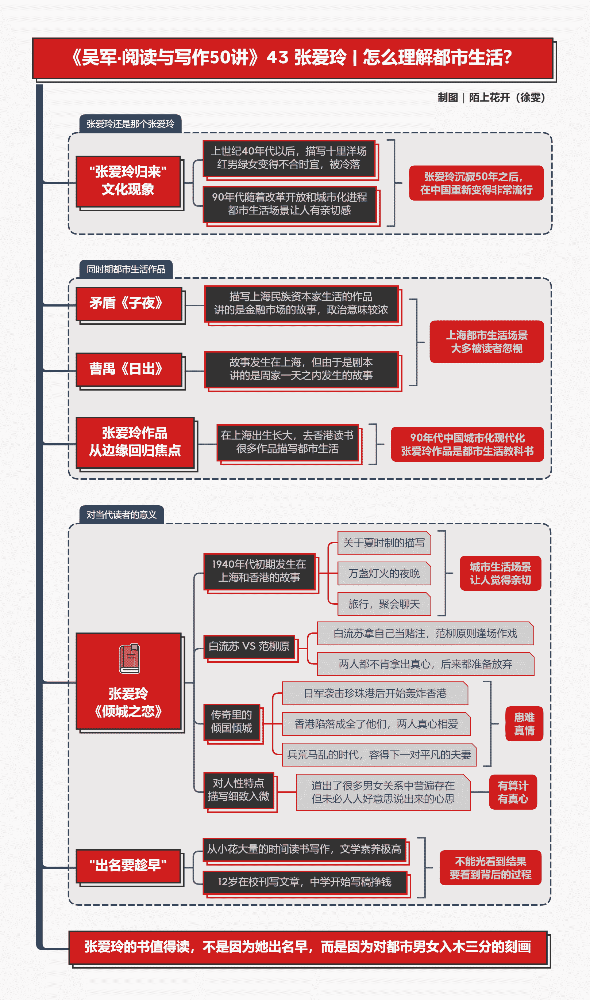  

公众号懒人找资源，懒人专属群独享

# 44 米兰·昆德拉｜如何理解当代欧洲人？

吴军

2020-07-14

米兰·昆德拉｜如何理解当代欧洲人？

我每年都会去欧洲旅行，坐内河游轮徜徉多瑙河，去萨尔斯堡参加音乐节，也接触了不少欧洲人。我遇到很多西欧和北欧的人，他们在生活中对物质的欲望不是很强烈，能吃饱饭，有地方睡觉就好，包括他们对婚姻家庭和两性关系的看法，不仅和东方人不同，和美国的清教徒也完全不同。

想要理解当代的欧洲人，我觉得，捷克作家米兰·昆德拉的作品不能不读。

米兰·昆德拉这个名字对中国读者来讲并不陌生，他经常得诺贝尔文学奖提名，因此每到 10 月份，他就和村上春树等人，出现在中国的媒体中，而他的代表作《不能承受的生命之轻》在中国也非常畅销。顺便说一句，这是现在小说的通行译名，我读这本小说的时候，它被翻译成《生命中不能承受之轻》。

这本书有很多种解读方式，这一次，我说的是个人的经验，会过滤掉政治和社会视角的解读，集中在人和人的关系上。

小说写的是 1968 年的捷克，主人公托马斯是一位生活在布拉格的外科医生，他在婚姻失败后，开始和多个情人交往。他有一套自己的理论，认为性和爱是可以分开的，而且他对自己的情人们总是一视同仁。所以，他和几个女性同时交往完全没有心理负担，而他的情人们也不好有所抱怨。

后来，托马斯遇到了特蕾莎，开始改变自己的想法，决定娶她。当时时局动荡不安，托马斯带着特蕾莎来到了瑞士，开始了新的生活。但是不习惯异乡生活的特蕾莎后来回到了捷克。托马斯在特蕾莎离开后，最初有一种重新获得自由的轻松，但是他发现自己其实已经无法再过回原来无拘无束的生活，于是回到捷克去找特蕾莎。

在捷克，托马斯不仅要受到特蕾莎的约束，还受到政治的约束。他因为发表文章丢了大医院里的工作，只能和特蕾莎到了农村。所幸的是，在那个天高皇帝远的地方，没有人关心他的政治表现，这让托马斯和特蕾莎可以有自己快乐的生活。不过作者暗示他们二人死于一场人为制造的车祸。

在书中，作者还安排了两条副线做对比。

第一条副线是托马斯与女艺术家萨宾娜的感情纠葛。萨宾娜曾经是托马斯的情妇之一，她漂亮，和托马斯有共同语言，因此是特蕾莎吃醋的对象。萨宾娜的生活态度和过去的托马斯非常像，她是一个能够把爱与性分割开的女性，因此她选择在自己的生活中没有责任，她认为忠诚是讨好大众的媚俗行为，因此她在感情中不断选择背叛。托马斯在和她的交往中两个人都没有负担，因此显得特别的“轻松”。

第二条副线是萨宾娜的情人，大学教授弗朗茨的故事。弗朗茨原本是一个比较传统的人，他原本有家庭，并对婚姻有坚定的信念。为了和萨宾娜在一起，弗朗茨离了婚，但是却被萨宾娜抛弃，因为萨宾娜并不想受到婚姻的约束。于是，弗朗茨的婚恋观受到了重创，他发现自己的想法可能还停留在上一代。像是矫枉过正，他要去过一种轰轰烈烈的生活，就和自己的学生相恋了。一次弗朗茨跑到柬埔寨参加了一场毫无意义的游行，遇到了抢劫，他想展现一下自己的勇气，和劫匪打斗起来，不幸被击倒而丧命。

这本书的写作手法是将人物和思想两两对照着写。比如托马斯和弗朗茨，特蕾莎和萨宾娜，他们彼此既对立，又形成相对的统一。当然，生命中的“轻”和“重”则是作者要重点对照的。

所谓生命之重，昆德拉引用了尼采的永恒轮回理论，但用文学语言这样讲：

“如果我们生命的每一秒钟都有无数次的重复，这就会像耶稣钉于十字架，被钉死在永恒上。”

我的理解是，这样一种轮回，让每个人的一举一动，变得极其重要，会给别人、给世界造成重大影响。因此生命就成了一种重负，沉沉地压在人身上。但如果没有轮回，生命一旦消失，没有了那些重复的东西，生命又变得毫无意义，轻得同样让人不能承受。个人生命如此，历史也是这样。

在这本书中，故事发生在 1968 年，这是苏联入侵捷克的“布拉格之春”事件发生的年代。你也能想象，托马斯生活在一个动荡的年代，他的每一次抉择，都意味着将失去一些东西。这让人感到非常沉重。于是托马斯和萨宾娜在男女关系上看似很随意的做法，就成了追求一个“轻”字。

虽然我们今天跟托马斯面临的社会环境全然不同，但关于生活之重的体验，其实我们每一个人也都有。往小事上说，大家在单位里每周要做的事情，总是做完一件又来了两件，没完没了，仿佛被钉在了十字架上。往大事上说，我们每一次的人生选择何尝不是沉重的。

同样，今天不少年轻人虽然有固定的伴侣，却不愿意结婚，也是想获得那种“轻”的感觉。似乎只有轻，才能平衡生活中的重。讲到这个轻，你可能会联想到我们前面讲的尼采讲的酒神精神，我觉得它们确实有联系。

但是，如果简简单单用一个“轻”就能化解生活中的重，那么问题就简单了。 **但现实生活中，追求轻本身就是一个无法承受的负担。**  
这也是书名《生命中不能承受之轻》的由来。事实上没有了重，轻就失去了根基。在书中，特蕾莎是“生命之重”的化身，她在托马斯的一次出轨之后，也试着尝试了一次一夜情。这不仅不能让她解脱，还让她陷入麻烦和苦恼。也就是说，“轻”并不那么容易化解“重”。作者在书中讲了这样两句话：

“可是在每一个时代的爱情诗篇里，女人总渴望压在男人的身躯之下。也许最沉重的负担同时也是一种生活最为充实的象征，负担越沉，我们的生活也就越贴近大地，越趋近真切和实在。”

“完全没有负担，人变得比大气还轻，会高高地飞起，离别大地亦即离别真实的生活。他将变得似真非真，运动自由而毫无意义。

这说明“轻”实际上要以“重”作为基础的。然后，作者向所有的读者发问：

“那么我们将选择什么呢？沉重还是轻松？”

米兰·昆德拉的这个发问，其实是 20 世纪 60 年代之后，欧洲自由派知识分子经常问自己的问题。在信息时代到来之后，西方社会在物质上已经比二战之前进步了许多，但人类的根本性问题并未消解，只是掩藏在浮华喧嚣和全民娱乐之下。在这种背景下，存在主义成了非常热门的文化思潮，并且对欧洲人产生了很大的影响。存在主义按照它的当代代表人物让-  
保罗·萨特的说法，就是“存在先于本质”。这句话的含义是，按我自己的理解，就是人本身并没有先天的道德和灵魂，相反道德和灵魂都是人在生存中创造的。因此，人也没有义务遵守某个特定的道德标准，信仰特定的宗教，而是具有选择的自由。更通俗地讲，我们的行为，我们的选择，最终形成了我们的思想。

照理讲，要了解存在主义应当去看萨特的书，但是，他的书实在是太难读。我几次捧起来，然后又放下了。相比之下，同样思考这个问题的米兰·昆德拉，对我来说就容易多了。  
**虽然昆德拉极力反对将他划归到某个主义中，但我觉得，他的作品确实充满了存在主义色彩，他是在用文学的语言写哲学。**

书中的萨宾娜，在我看来很有今天女权主义者的色彩，而弗朗茨这个形象，也很像今天欧洲理想主义的知识分子。他们在年轻的时候接受的是比较规矩的教育，但是他们渴望更精彩的人生。弗朗茨就像写下《动物庄园》的英国作家乔治·奥维尔，虽然有上层社会身份，上过伊顿公学，但十分关注社会不公和底层民众，还跑到西班牙参加国际纵队，反对独裁者佛朗哥。

在存在主义思想的影响下，托马斯、特蕾莎、萨宾娜和弗朗茨的行为就容易理解了。他们都没有预先设定的道德和价值观，各自选择了自己的道路，而在他们选择的背后，既有他们对自由、爱情和情欲的渴望，也受到他们过去生活轨迹的影响。他们追求着“轻”，但每一次的选择又都是很沉重的，而且没有回头路可走。

昆德拉在书中用四个人物讲述轻与重的问题，但是他更多地是启发我们思考，而不是给出答案。事实上他自己也没有答案。托马斯和特蕾莎之死，你可以理解为即使放弃对生命之轻的追求，问题依然得不到解决。弗朗茨临死前是他前妻守护在身旁，这似乎又在说，传统社会依然是他们的避风港。我理解，今天欧洲的很多知识分子也都是这样的人。他们的梦想和现实发生着强烈的冲撞。

## 小结：

如果我们回顾一下欧洲过去一百年的思想文化史，就会发现已经有好几代人在思考“人的存在”这个很基本的问题。  
**理解存在主义，感受小说中人物的行为和想法，思考昆德拉给我们提出的问题，有益于我们在全球化的时代更好地理解欧洲人。**

当然，每一个人其实也都不可避免地遇到所谓轻和重的问题。让我们再次重复昆德拉那句灵魂拷问：“那么我们将选择什么呢？沉重还是轻松？”

对此，我更愿意学习写下《老人与海》的海明威，追求人生中积极的一面，在更广阔的天地里寻找自己人生的意义，把大部分精力用于行动。那么你呢？

## 作业：

你怎么理解现代人生活的轻与重，请以此为题，写一篇小作文。

下一讲开始，我会从体裁的角度，来聊聊文学的欣赏与写作，我们先谈唐诗。

1.在现实生活中，追求轻本身就是一个无法承受的负担。事实上没有了重，轻就失去了根基。  
2.信息时代到来后，西方社会在物质上比二战之前进步了许多，但人类的根本性问题并未消解，于是，存在主义成为非常热门的文化思潮，对欧洲人产生了很大的影响。  
3.我们的行为，我们的选择，最终形成了我们的思想。

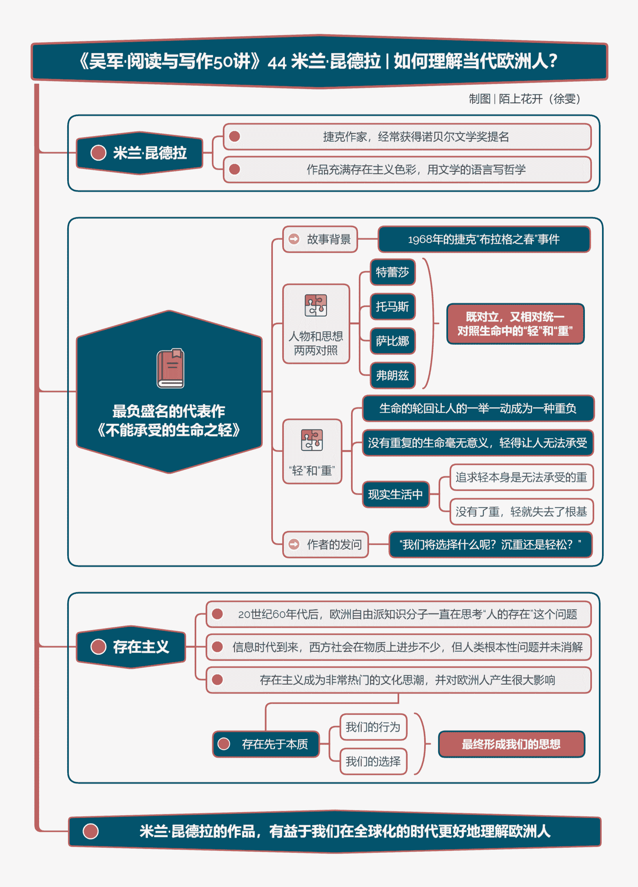  

公众号懒人找资源，懒人专属群独享

# 45 杜甫｜形式与内容哪一个更重要？

吴军

2020-07-14

杜甫｜形式与内容哪一个更重要？

从这一讲开始，我会尝试从体裁的角度，来聊聊文学的欣赏与写作的个人经验，这一讲我们谈唐诗。

中国的诗歌水平最高的时代是在唐朝，再往后其实是在走下坡路。如果你上过我的《科技史纲 60 讲》，应该会有一个印象，我讲过，历史不断重演，科技永远向前，科技是唯一能够产生可叠加式收益的进步力量。

对比之下，你可能就会有一个问题，为什么我会说中国诗歌到了唐代以后在走下坡路，为什么无法随着社会的进步逐步提高呢？其实不仅是诗歌，各种艺术都未必能做到后人超越前人。  
**“越来越高”这样的规律只适用于科技发展或者经济的发展，不适合于艺术。** 具体到诗歌，我觉得，唐朝之后，它进一步发展的社会基础和需求不存在了。

诗歌在唐代达到高峰有两个标志，一个是题材丰富了，另一个是诗歌的各种形式定型了。这些都是唐代人的创新，以后的文人其实在这两方面都没有太多的突破。我们今天重点通过我对杜甫的阅读，来谈谈唐诗在形式上的创新，以及这件事对写作方法论上的重要性。

中国早期诗歌的代表是《诗经》和《楚辞》，它们读起来和唐诗的差异极大，最早有点唐诗样子的诗歌是汉代的古诗，今天流传下来的代表性作品是《古诗十九首》。那些诗我都非常喜欢，尤其是：

生年不满百，常怀千岁忧。 昼短苦夜长，何不秉烛游。

《古诗十九首》我过去基本上都能背下来，要做到这件事其实并不难，因为这些诗都押韵，读起来琅琅上口，而且通俗易懂。这十九首能流传下来，是靠内容取胜的，它们反映了古人对人生的思考，有一种忧伤的美，表现出道家的哲学意境。

但公平地讲，这十九首诗和唐代之前的诗，除了押韵，还没有什么格律可言。另外在隋唐之前，写诗的人其实并不多，诗歌也没有广泛流传。这里面有一个技术的原因，就是印刷术没有出现。

到了唐代，印刷术的普及带来了文化的大繁荣。这时的诗歌和过去完全不同了，虽然类似于汉乐府和魏晋南北朝的古体诗还存在，但大家写得更多的是格律诗，也就是绝句和律诗。在格律诗中，不仅诗的长短、字数有规定，一首诗的韵脚要固定，中间不换韵，而且每句诗中用字的平仄，也有严格的要求。尤其是，律诗还要求中间四句各自对仗。写诗符合这些规范，就被称为工整，否则就不工整。

在唐代诗人中，写诗最工整的是谁呢？是大家熟知的诗人杜甫。

读杜甫，如果仅仅局限于中学课本，你恐怕还没真正体会到杜甫诗歌的风格。杜甫一生写了 3000 多首诗，流传下的也有 1400 多首，包括各种题材的诗，不过以七律成就最高。其中《登高》一首被历代文人所推崇，很多人甚至认为它排在中国历代律诗第一名。我们不妨先来欣赏一下这首诗，体会它的文字之美：

风急天高猿啸哀，渚清沙白鸟飞回。 无边落木萧萧下，不尽长江滚滚来。 万里悲秋常作客，百年多病独登台。 艰难苦恨繁霜鬓，潦倒新停浊酒杯。

这首诗我把它总结为三佳。

1.内容佳

这首诗是杜甫在重阳节登高有感而作，寄情于景，写透了他对人生的感悟。虽然这首诗只有 56 字，内容却极为丰富。比如第一句就写了风、天、猿、渚、沙、鸟六种景，而且宏大的场景和工笔写实相结合。在这个意义上，我不由联想到了米开朗基罗在西斯廷教堂天顶画的《创世纪》。

2.气势佳

曾国藩在论文章之道时讲，文章的气势要雄奇。杜甫的这首诗景象宽阔、气势雄浑，特别是中间“无边落木萧萧下，不尽长江滚滚来。万里悲秋常作客，百年多病独登台”四句。

3.格律佳

对于律诗来讲，颔联（即第三、四句）和颈联（即第五、六句）需要对仗，至于剩下的首尾两联，只需要平仄对应和押韵即可。但这首诗很特别，四联句句对仗都非常工整。后人评价它是一篇之中，句句皆律，一句之中，字字皆律。明代的文艺批评家胡应麟，在他的《诗薮》中说这首诗：“（全诗）五十六字，如海底珊瑚，瘦劲难名，沉深莫测，而精光万丈，力量万钧。”而且说他不光是唐人七言律诗第一，根本就是古今七律第一。

其实，这首诗还配得上一个“格调佳”，关于格调我们下一讲讲到宋词的时候再说。

杜甫的律诗和绝句，随便拎出一首，在格律上都无可挑剔。比如我们都很熟悉的《绝句四首》中的第三首：

两个黄鹂鸣翠柳，一行白鹭上青天。 窗含西岭千秋雪，门泊东吴万里船。

别看这只是他在杜甫草堂即兴而写的小诗，却也写得工工整整。虽然绝句这种题材，对仗不是必选项，但是杜甫依然全诗四句对得极为工整。杜甫曾经说，语不惊人死不休，这倒不是吹牛，而是他对自己诗歌中文字的要求非常高。细细品读杜甫的诗，对我来说，最能感觉汉语文字的美感。

说到这儿，你可能会想，诗歌的形式受到严格限制，写起来束手束脚，写诗是不是变得非常困难了呢？我的看法是，恰恰相反， **律诗因为有章可循，入门反而并不难。**  
这就如同你学习开车，一本驾规和驾驶指南在手，照着学一个周末就学会了。但是如果不给你那些规定，让你随便来，可能学一个月也学不会。

诗歌在有了定式之后，诗人们要做的事情，其实不是凭空写诗，而是在“填诗”，就如同我们说的填词一样。我在前面讲了日常要用到的各种应用文的写法，其实也就是给大家一个格式参考，让大家来填入内容。当然，填出来的诗有好的，也有差的。乾隆皇帝平生写了上万首诗，还有一堆文人帮他润色，结果还是一首也没流传下来，因为写得太差。那么怎样才能写出好诗呢？我们还是来看看杜甫是怎么做的。

首先杜甫的文学功底深厚，他的爷爷是大诗人杜审言，他从小就接受了非常正规的中国文化和儒家思想的教育。这和李白那种靠天赋写诗的人是不一样的。此外，他有四个写诗的原则，其实大家都可以学习，平时写作都用得上。

1.  **在主题的选取上，多以有典型意义的事件、经历和人物来描写。**
    

我们在前面的课程里多次讲，该不该写，写什么不写什么，比怎样写更重要。至于什么该写，最简单的原则有两个，一个是重要性，另一个是自己熟悉能写得好的内容。杜甫绝大部分诗，写的都是对他触动很大的生活经历、当时大事件、在重要地点的感悟。

杜甫成就最高的时期是在安史之乱期间和之后，这时一方面他的创作水平到了炉火纯青的地步，另一方面他经历了太多值得记录的事情。

比如他的长诗《三吏》《三别》都是那时期的作品。那时，他每听到朝廷、官军传来一个好消息，都会写首诗；遇到他感受特别深的事情，无论是喜事还是伤心事，都会写诗记下来，因此他的诗被称为“诗史”。比如当时，吐蕃攻陷长安，唐代宗出逃，宦官专权、藩镇割据，朝廷内外交困。杜甫听说朝廷任命了新的剑南节度使，欣喜万分，回到成都，登楼凭眺，有感写下了《登楼》一诗：

花近高楼伤客心，万方多难此登临。 锦江春色来天地，玉垒浮云变古今。 北极朝廷终不改，西山寇盗莫相侵。 可怜后主还祠庙，日暮聊为梁甫吟。

诗中的北极朝廷是指唐王朝，西山寇盗是指吐蕃。由于有真实的历史事件做背景，不是无病呻吟，《唐诗别裁集》中称这首诗，“气象雄伟，笼盖宇宙，此杜诗之最上者。”

2.寄情于景，在叙事的过程中抒情。

我们在前面讲写日记时提到过，每一个人看到一件事都会有自己的想法，把当时的想法写下来很重要，但是写想法需要有真实的场景为背景，这样别人读起来才有味道，能够引起共鸣。当然，自己的想法要写得入木三分。

比如我们前面提到王羲之的《兰亭集序》就是一个很好的例子，它好就好在写下了王羲之当时的人生感悟。杜甫很多诗也都有这个特点，除了前面的《登高》和《登楼》二首，他在“游玩三峡”时写的五首咏怀古迹诗，是在叙事中抒情的代表。这五首诗分别吟咏了庾信、宋玉、王昭君、刘备、诸葛亮，我们这里看其中写王昭君的一首，其余四首我们放到了文稿的最后。

群山万壑赴荆门，生长明妃尚有村。 一去紫台连朔漠，独留青冢向黄昏。 画图省识春风面，环珮空归夜月魂。 千载琵琶作胡语，分明怨恨曲中论（这个字读二声，伦）。

这首诗写的是杜甫在王昭君的故里，感叹她的遭遇，远离故国之怨，难以言表。当然，作者也是通过王昭君的身世感慨自己的遭遇。其余的四首，也都抒发了自己怀才不遇、壮志难遂的悲怨心情。

杜甫是一个官宦人家子弟，从小就想像爷爷那样做官为朝廷效力，但是命途多舛。他考科举的那一年，遇上李林甫向唐玄宗汇报说，天下所有的人才都已经被朝廷录用了（野无遗贤），结果玄宗居然也信了李林甫的鬼话，包括杜甫在内的所有考生全部落榜。后来他虽然当过小官，但是仕途一直不顺。也正是如此，更激发出他的全部写作潜力，写了很多寄情于景的好诗。

1.  **叙事注重客观描述，让故事本身直接感染读者，少发议论。**
    

还是以上面那首写王昭君的诗为例，八句中前七句都是客观记事，只有最后一句是作者一点点感慨。但是读者通过前七句，已经感受到一种苍凉的韵味了。

4.在格律诗原则不变的条件下，提升表现力，这是我们常说的在边界内做事情。

比如，杜甫的律诗常常会做一次主题反转。举一个例子，杜甫著名的《登岳阳楼》是这样写的：

昔闻洞庭水，今上岳阳楼。 吴楚东南坼，乾坤日夜浮。 亲朋无一字，老病有孤舟。 戎马关山北，凭轩涕泗流。

前一半写景，后一半写自己的近况和心情。这种转折写法在盛唐之后的诗中很常见。

## 小结：

很多人在写作时不喜欢受限制，觉得不受限制发挥的空间更大。是否如此呢，这就要看一个人驾驭文字的能力有多强了。和杜甫这种讲究形式的诗人形成鲜明对比的是不讲究形式，而更重视真情实感的大诗人李白。李白号称“诗仙”，这个仙字不是白说的。像《蜀道难》《将进酒》这样的诗，李白之后是不再有人能写出来的。

**对于绝大部分人来讲，向杜甫学习更现实，在一定章法甚至定式的范围内，选好主题，情景结合，侧重客观描述，灵活应用规则，练习一段时间就会有进步。**

## 作业：

你是怎么理解内容和形式的关系的，你有什么好用的写作格式？欢迎跟我分享。也欢迎同学们把自己的格律诗习作发到留言区，大家一起欣赏。

## 附咏怀古迹四首

其一 支离东北风尘际，飘泊西南天地间。 三峡楼台淹日月，五溪衣服共云山。 羯胡事主终无赖，词客哀时且未还。 庾信平生最萧瑟，暮年诗赋动江关。 其二  
摇落深知宋玉悲，风流儒雅亦吾师。 怅望千秋一洒泪，萧条异代不同时。 江山故宅空文藻，云雨荒台岂梦思。 最是楚宫俱泯灭，舟人指点到今疑。 其四  
蜀主窥吴幸三峡，崩年亦在永安宫。 翠华想像空山里，玉殿虚无野寺中。 古庙杉松巢水鹤，岁时伏腊走村翁。 武侯祠堂常邻近，一体君臣祭祀同。 其五  
诸葛大名垂宇宙，宗臣遗像肃清高。 三分割据纡筹策，万古云霄一羽毛。 伯仲之间见伊吕，指挥若定失萧曹。 运移汉祚终难复，志决身歼军务劳。

1.诗歌在唐代达到高峰有两个标志，一个是题材丰富，二是诗歌的各种形式定型。  
2.杜甫一生写了 3000 多首诗，传世的有 1400 多首，涉及各种题材的诗，以七律成就最高。  
3.对于绝大部分人来讲，向杜甫学习写作更现实，选好主题，情景结合，侧重客观描述，灵活应用规则，练习一段时间就会有进步。

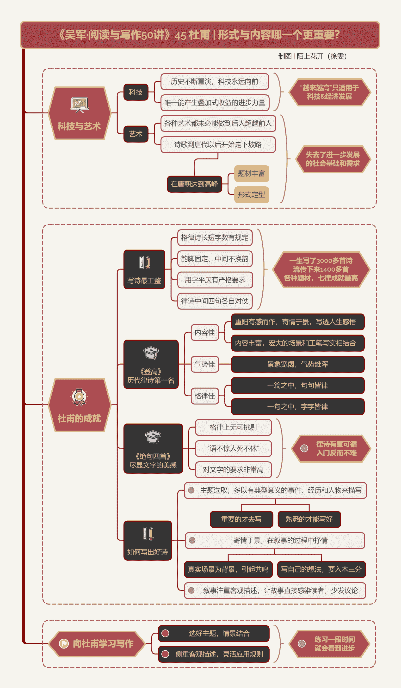  

公众号懒人找资源，懒人专属群独享

# 46 李清照｜艺人词是怎么登上大雅之堂的？

吴军

2020-07-14

李清照｜艺人词是怎么登上大雅之堂的？

说完唐诗，这一讲，我们谈宋词。

我在中学时代，曾经很痴迷古典诗词，甚至还自己学着写诗填词。当然我没成为诗人，但那个时候因此背了很多诗词，觉得受益终身。

不过，那个时候我们习惯说唐诗宋词，把它们当作古典诗歌的双峰。后来读了更多书，我才明白，其实在南宋之前，词是无法和诗相提并论的。

正是因为苏轼、李清照、辛弃疾这些文人的努力，词才从歌楼舞馆里的流行歌曲，变成了登上大雅之堂的文学经典。这一讲，我们就重点聊聊李清照。

在北宋时期，词的地位并不高。

首先，词的起点不高。词形成于唐代，最初只是唱曲的歌词，也被称为曲子词。唱曲嘛，当然都是发生在酒楼歌肆，或者士大夫的宴饮场合。这就像今天大家喝酒高兴时编两句顺口溜。比如韦应物用《调笑令》写过一匹迷途的马，整首词是这样写的：

胡马，胡马，远放燕支山下。跑沙跑雪独嘶，东望西望路迷。迷路，迷路，边草无穷日暮。

这简直就是顺口溜，你完全无法将它和写了“春潮带雨晚来急，野渡无人舟自横”的那个诗人联系起来。

其次， **虽然词在北宋繁荣起来，但是文人们只是把填词当作休闲的雅趣而已，认为写诗才是正经事。**

虽然在中晚唐之后，诗人们，比如张志和、白居易、刘禹锡和韦应物等诗人开始填词了，并且有张志和的《渔歌子》和白居易的《忆江南》这些语言生动、格调清新、寄情于景的好词，但是绝大多数文人写词都是业余的娱乐消遣，他们并没有把词当作一种严肃的文学体裁。

大词人柳永，你上中学可能读过他的《雨霖铃》，那首词离别之情写得很好：

多情自古伤离别，更那堪冷落清秋节。 今宵酒醒何处？杨柳岸、晓风残月。 此去经年，应是良辰好景虚设。 便纵有千种风情，更与何人说？

不过，柳永当时成天混迹于青楼，写的都是轻浮香艳的词。虽然他出身大族，也考中了功名，但因为只写艳词，被宋仁宗厌恶，考上功名之后，吏部也不敢给他官做。

柳永没办法，只好去找同样写词的宰相晏殊。晏殊上来就调侃他，说“贤俊作曲子么？”

这个曲子就是词。柳永虽然地位低下，却有文人的傲气，反唇相讥道：“只如相公亦作曲子。”晏殊当然很不高兴，就说：“殊虽作曲子，不曾道：‘针线慵拈伴伊坐。’”意思是说，我虽然也填词，却不会写你那样格调低的词。

别看晏殊虽然看不上柳永，但那个时代，词本来就是用于歌楼舞馆演唱的通俗文学，即便是欧阳修这样的大文豪填词，也都是柔媚婉转一路，我们今天看，也并不比柳永端庄多少。

那词是怎么跟诗平起平坐的呢？我觉得一来是靠苏轼、李清照和辛弃疾这些著名的词人的贡献，二来也要感谢北宋末年靖康之难带来的社会巨变。这段历史你大概也听过，来自北方的女真人，攻陷了北宋京师汴梁，也就是今天的开封，把宋钦宗和宋徽宗都掳走了。

苏轼可以讲是北宋第一个扩大了词的表现功能和题材的文人。过去词的题材无非是恋情、离别、伤时，首先是苏轼以一己之力，将它变成了表达人生思考的文学体裁，比如他的《念奴娇·赤壁怀古》《水调歌头·明月几时有》，思想深度可以和杜甫或者李白的诗相比。

当然，词后来更根本性的改变则是由李清照、张孝祥、朱敦儒这些“南渡词人”完成的。

他们的词前后风格差别很大，从描写闲情逸致的个人生活，转变为描写国家兴亡的重大主题。在这些人中，我觉得，李清照格外突出，是中国历史上最了不起的女词人。把词从通俗娱乐的艺人词，提升到登大雅之堂的文人词，她功不可没。

而李清照给我的最大启发就是，想写一篇好文章，需要有真情实感，而真情实感常常又来自于丰富的经历，这也是我们在读万卷书的同时，还需要行万里路的原因。

要了解李清照词风格的变化，先要了解一下她早期的词和生活环境。

李清照出生于一个中等的官宦人家，但是她母亲娘家王家是名门大族，因此李清照从小就接受了非常良好的教育，这和当时大部分官宦人家的女子只是识个字，做做女红完全不同。

李清照后来嫁了同是官宦人家出身的赵明诚，赵明诚是所谓的金石学家，你可以把他理解为一个文化素养很高的古董收藏家。

李清照的前半生过得很幸福，她在那个时期的词大多是描写幸福的家庭生活，或者夫妻之间思念之情的。其中最有名的，当属她在重阳佳节思念差旅在外的丈夫时写下的《醉花阴》：

薄雾浓云愁永昼，瑞脑消金兽。 佳节又重阳，玉枕纱厨， 半夜凉初透。 东篱把酒黄昏后，有暗香盈袖。 莫道不销魂，帘卷西风， 人比黄花瘦。

这首词虽然也和当时很多词一样是写离情的，但因为充满了真情实感，温柔含蓄而绝无“曲子词”那种轻浮的感觉，为历代文人赞颂。

根据清朝徐釚《词苑丛谈》的记载，据说赵明诚拿到这首词后，自愧不如，废寝忘食地三天写了 15 首，然后拿给朋友陆德夫（北宋的一位文人）看。陆德夫说：“只有‘莫道不销魂’三句绝佳。”

这时的李清照可以讲写词的技巧已经到了炉火纯青的地步，风格清新婉约，但是由于生活经历有限，她的作品在内容和题材上，比起前辈的词人也并没有太大的突破。

我今天欣赏她那个时期的词，是处于“养性”的目的，体会她的文笔和表达情感的方式，但是不会被她的词震撼。这和我读南唐后主李煜前期的词感觉是一样的。

但李清照 43 岁那年，发生了靖康之难，这时李清照女丈夫的一面就体现出来了。

当时，赵明诚因为母奔丧先到了南方。李清照一个人担负起全家南迁的事宜。她将重要的文物装了 15 大车（还留下 10 个房间的带不走），在兵荒马乱的年代，经历了很多坎坷，将它们运到了江南。

相比李清照，赵明诚就懦弱得多，他在南宋朝廷身为地方官，遇到叛乱时却不思守土，而是弃城逃跑。赵明诚因临阵脱逃被革了职，后来虽然再被起用，但第二年便郁郁而终，此后李清照的日子就更艰难了。

几年后，她跟一位叫张汝舟的下级军官结了婚，但张汝舟品行低劣，婚后两人性格不合，那个时代女子并没有提出离婚的权力，于是李清照冒着自己也得坐牢的风险，把张汝舟的科举舞弊告上了公堂。还好，李清照在友人的帮助下很快被释放了。这样刚烈的女子，在中国历史上不多见。

国破家亡，既让李清照看到了国家的不幸遭遇，又彻底毁掉了她原先无忧无虑幸福的生活。在这个过程中，她经历了太多事，对人生的感悟越来越深刻，从此词和诗文的风格发生了巨大的变化。词作多是感慨命运多舛，诗文则是感时咏史。这时期，李清照最有代表性的作品是《声声慢》：

寻寻觅觅，冷冷清清，凄凄惨惨戚戚。 乍暖还寒时候，最难将息。 三杯两盏淡酒，怎敌他晚来风急？ 雁过也，正伤心，却是旧时相识。 满地黄花堆积。  
憔悴损，如今有谁堪摘？ 守着窗儿独自，怎生得黑？ 梧桐更兼细雨， 到黄昏、点点滴滴。 这次第，怎一个愁字了得？

对于这首词的妙处，首先在开头的七叠字上，这是过去诗词都不曾有的写法，也成为后世很多文人学习的样板。

不过，这还只是这首词浅层的精妙所在。国学大师梁启超对这首词的评论更深刻，他讲“这首词写从早到晚一天的实感。那种茕独凄惶的景况，非本人不能领略，所以一字一泪，都是咬着牙根咽下”。

这首词的核心是个愁字，为了写它，李清照将外界景物和主观情感一层层交织推进，最后让一个愁字愈结愈大，大到心无法包容的地步。因此，相比之前清新婉约的风格，这首词可以讲是韵味苍凉。

如果我们对比李后主的名句——“问君能有几多愁，恰似一江春水向东流”，它也是表达愁绪，但是还是有大小有边界的，李清照这个愁字，则是无边的，读者将它想成多大就说多大。可以讲，这首词奠定了李清照在中国文坛上的不朽地位。

**从李清照早年的诗词中，我看到的是一个有情趣、热爱生活的人，但是这种生活跟腐朽奢靡不沾边。晚年她虽然失去了一切，却并没有消沉。**

她将大部分时间和精力用于整理和完成赵明诚写了一半的《金石录》一书，这是中国早期最重要的金石研究专著之一。李清照可以讲是一个外柔内刚的人，虽为女子，却不乏男儿气。

李清照写过这样的一首《渔家傲》：

天接云涛连晓雾，星河欲转千帆舞。 仿佛梦魂归帝所， 闻天语，殷勤问我归何处。 我报路长嗟日暮，学诗谩有惊人句。 九万里风鹏正举， 风休住，蓬舟吹取三山去！

这首词，想象力丰富，气势磅礴，毫无钗粉之气，如果不说是她写的，大家可能会猜这出自苏轼、辛弃疾之笔。

当然  
**南渡的词人不止李清照一位，他们的经历和文风的变化和李清照都有相似之处。在他们的推动下，词从描写绮罗香泽的工具，变成了文人们抒发家国情怀的工具，才站到了和诗平起平坐的地位。**

## 小结：

李清照用白描的手法，凄婉悲怆的格调，把当时国家和个人的悲剧真实地记录下来，将宋词推向了新的高峰。从李清照的创作经历，我们可以得到启发：要写好的文章，丰富的人生阅历，跟真情实感同样不可或缺。这一点我们在后面讲纪实文学和纪实报道时还会再讲到。

## 作业：

你是怎么理解人生阅历跟写作的关系的，你自己的成长和写作中，有没有相应的变化？欢迎在留言区跟大家分享。

1.正是因为苏轼、李清照、辛弃疾这些文人的努力，词才从歌楼舞馆里的流行歌曲，变成了登上大雅之堂的文学经典。  
2.李清照经历了靖康之难、离婚、坐牢等事情后，对人生的感悟越发深刻，词和诗文的风格从此发生巨大的变化。  
3.要写好的文章，丰富的人生阅历，跟真情实感同样不可或缺。

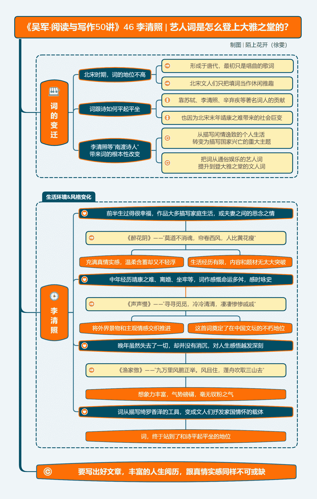  

公众号懒人找资源，懒人专属群独享

# 47 《西厢记》｜剧作家为什么要改造张生的形象？

吴军

2020-07-14

《西厢记》｜ 剧作家为什么要改造张生的形象？

这一讲我们聊聊元曲的代表作《西厢记》。

前两讲我们讲的唐诗和宋词，虽然是中国文学的瑰宝，但有些人觉得，它们只能影响士大夫阶层的思想和审美情趣，对于不识字的老百姓来讲，传播不了什么思想。但不识字，文学就完全没用了吗？那倒不一定。

文学对人的影响，其实比你想象得要大得多。如果我问你，在老百姓心目中，关公的忠勇形象和曹操的奸雄形象，是从何而来的？很多人会说是看戏得到的印象。没错，  
**历史上很多人的形象，以及人们接受的价值观，都来自于戏剧。**

比如说，一提中国古代的奸臣，很多人马上会想到明代的严嵩，这种印象很大程度就是拜戏剧所赐。

古代大奸臣哪朝哪代都有，比严嵩更坏的也不少，但是严嵩的名气特别大，这要“感谢”严嵩的一个对头，大才子王世贞。王世贞因为父亲被严嵩害死，因此以后就不断地用笔把严嵩往历史的耻辱柱上钉。

他写了一部戏剧《鸣凤记》，专门讲严嵩父子罪恶行径。因此从明朝开始，严嵩白鼻子奸臣形象就被树立起来了。虽然有人讲《鸣凤记》可能是王世贞的学生写的，但不管是他们师徒谁写的，这些观点来自王世贞。

王世贞还写了一本《嘉靖以来内阁首辅传》，在书中凡是严嵩做的事，都是坏事，凡是和严嵩做对的人都是好人。这本书后来成为很多描写严嵩的戏剧，比如《一捧雪》和《打严嵩》的根据。

普通老百姓不会去看历史书，也懒得花时间去搞清楚朝廷大臣们的对与错，但是看了戏，他们就会对某个人物有共识，如果这个共识符合社会对惩恶扬善的期盼，还会代代相传，于是严嵩就成了头号奸臣。

这就是戏剧的力量。所以有人读到严嵩和王世贞的恩怨时感叹道，得罪谁也不要得罪能写的文人。

为什么传统戏剧能对民众的价值观和认知产生如此重大的影响呢？

因为传统戏剧常常会用三分引导、七分迎合的表达方式，是少有的大众容易接受的文艺体裁。

所谓三分引导，就是剧作家要把自己的想法通过戏剧表达出来，而七分迎合并非完全是揣测观众的想法，而是要迎合当时社会普遍的价值判断。

比如在关于严嵩的戏剧中，会有忠有奸，但奸人终得上天报应，这是迎合大众的部分，至于谁是奸，谁是忠，面对奸臣，忠臣该怎么做，这就是作者要表达的想法了。

这一讲，我会通过《西厢记》故事里张生的形象演变，来跟你谈谈戏剧跟民间思想的关系。

《西厢记》的故事可以追溯到唐代著名诗人元稹写的传奇小说《莺莺传》。这个传奇小说一开始的故事情节和后来的《西厢记》是一致的。

在故事中，张生旅居在普救寺时遇到匪乱，救了同在寺中的远房姨母郑氏母女，并因此对美貌的远房表妹莺莺动了心。经过莺莺的丫鬟红娘牵线搭桥，两人成就好事。到此为止，这似乎是一个私定终身的爱情故事。但是接下来的情节就非常狗血了。

张生赴京应试未中，虽然莺莺依然一往情深，但是张生不久就变心了，另娶他人。对于自己的这种行为，张生还总结出一堆红颜祸水的歪理为自己开脱。后来，莺莺当然也另嫁，而张生路过莺莺家门时，居然以外兄的身份请求相见，遭莺莺拒绝。

从宋代开始，一直到现代，很多学者，包括鲁迅先生和陈寅恪先生，都认为张生就是元稹本人，而崔莺莺就是他的表妹崔双文。

元稹自己和《莺莺传》里的张生，在行为上是高度一致的。元稹一辈子的感情经历就是遇到一个爱一个，然后为了前程抛弃一个，再娶另一个，不断重复，生命不息，折腾不止。

就在他妻子去世，写完前面那首“曾经沧海”的诗的时候，身在外地的元稹并没有奔丧，转身开始和女诗人薛涛相爱了。这也算是对那句诗的讽刺。

我过去读元稹的诗 “曾经沧海难为水，除却巫山不是云”，还颇为感动，后来了解他的生平，就深深体会到什么叫做“要看一个人怎么做，不要看他怎么说”。

但我要提醒你，这样的一个故事，这样的一个张生，如果搬到舞台上，是会给观众骂死的。

即便在古代的男权社会，大家也觉得张生是个渣男，纷纷谴责。包括宋代词人秦观在内的很多文人，都会写诗文表达对崔莺莺的同情，谴责张生的始乱终弃。虽然《莺莺传》里发生的故事，在现实中并不少见，但是至少中国正统的文化和道德观念并不支持这种渣男行为。

可以说， **和大众价值观明显抵触的作品，很难有大量的读者和观众** 。到出现了戏剧演出和商业竞争的宋金时代，这个故事就被改成了痴情女子负心汉的故事。

但这样的故事，仍然是不会有太大的市场，人们并不喜欢悲剧结尾。因此，剧作家就开始把这个故事中大家喜爱的部分，即前半部分保留下来，然后再给故事安排一个大团圆的结尾。

这样就完成了七分迎合的任务，而完成这件事的，是金朝文人董解元（董解元并不叫解元，我们今天对他的生平了解甚少，解元是对当时读书人的尊称，就像今天说董博士或者董教授一样）。

董解元保留了《莺莺传》中的前半部分，把后半部分改成了如下的情节：

张生在考中了功名后，有一个叫郑恒的年轻人编造谎言说张生负心，在京城另娶他人，崔母要莺莺嫁于郑恒，但这时张生赶回来，带崔莺莺私奔，有情人终成眷属。

当然，这样一来这个故事再叫做《莺莺传》就不合适了，于是董解元将之改名为《西厢记》。

在《西厢记》中，无论是张生还是崔莺莺，都是正面形象了。同时，为了增加戏剧性，只好把崔莺莺的母亲放到他们的对立面去，同时还给张生创造出一个叫郑恒的情敌。

而我们今天读到的《西厢记》，还经过元代剧作家王实甫的进一步迭代。他保留了董解元版本的基本故事情节，但是做了两个重大的修改。

1.结局改得更完美

张生和崔莺莺两个人不是私奔，而是光明正大地走到了一起。为了增加故事的合理性，红娘这个牵线的角色就变得特别重要了。在王实甫的《西厢记》中，红娘这个配角的形象，在很多人心目中甚至超过了主角崔莺莺。

2.增加了文学性

在这以后，老百姓会在舞台上看故事，而文人们则会在花前月下品读作品。

在《红楼梦》里有这样一个情节——贾宝玉和林黛玉要偷偷地读《西厢记》。那是一个春光明媚的日子，贾宝玉坐在园子里聚精会神地看《西厢记》，林黛玉葬完花经过那里，和他一起看。

曹雪芹给我们描绘了一个浪漫唯美的画面，表现出这两个情侣共同沉浸在理想的爱情之中。

通过对张生形象的改造、大团圆的结局和文学性的提高，《西厢记》有了在士人和老百姓中广泛传播的读者基础。

**这就给我们作为写作者一个提醒，你想要表达自己的想法，也要努力扩大自己的受众范围。传统戏剧的七分迎合、三分引导值得借鉴，当然迎合和引导的比例，需要自己拿捏。**

那么在《西厢记》当中，作者传达了哪些思想呢?

1.作者写出了大家想实现却不容易实现的理想

在这部剧里，是遇到自己一见钟情的对象，娶一个大家小姐，考中功名、封妻荫子。人们在现实中得不到的东西，很容易寄托于戏剧。这样的戏大家看多了，慢慢就把这样的生活当作了目标。

在中国古人的内心中，并不缺少浪漫的情怀，但现实并不浪漫。《西厢记》营造一个浪漫的氛围和完美的结局，非常符合人们弥补现实缺憾的需求。

2.作者在作品中将女性的地位提高了

无论是莺莺还是红娘，她们的行为都是主动的，这可能和王实甫生活在元代有关。《西厢记》也因此成为古代支持女性追求自主婚姻的作品，进一步影响了民间思想，红娘也因此成了媒人的代名词。

最后我想从社会变迁的角度，跟你聊聊元杂剧的繁荣。

中国古代戏剧到了元代达到顶峰是有它的道理的。在宋金时期，主流的文人是不会去写剧本的，他们要考功名做官。但是到了元代，不再有科举考试了，文人们学而优则仕的出路被阻断了，而当时商品经济发达，看杂剧是人们娱乐的主要方式，于是水平高的文人们都开始写戏剧，即元曲。

从此，中国的戏剧就由本来结构不严整的短小戏曲，变成了文辞精美、结构完整、能够雅俗共赏的长篇剧作了。明代之后，读书人们又有了考功名的出路，戏剧文学反而不及元代繁荣了。这又反映出文学与时代的关系。

## 小结：

1.文学作品想要影响大众的思想，既要有引导，也要有迎合。

2.《西厢记》故事的数次改编，显示了剧作家跟民间思想的互动关系

## 作业：

你是怎么看待张生形象的变迁的？欢迎在留言区跟大家分享。

1.传统戏剧常常会用三分引导、七分迎合的表达方式，是少有的大众容易接受的文艺体裁。  
2.《西厢记》可以追溯到唐代诗人元稹写的传奇小说《莺莺传》，原本是个悲剧故事，经过金朝文人董解元、元代剧作家王实甫等的数次改编，才变成了现在这样一个浪漫唯美的爱情故事。  
3.元代没有科举考试，文人们无法学而优则仕，正值商品经济发展，看杂剧是人们娱乐的主要方式，于是水平高的文人们都开始写戏剧，元曲繁荣。

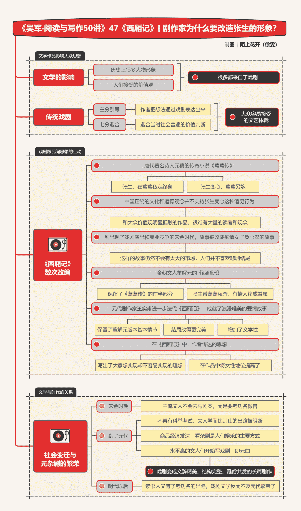  

公众号懒人找资源，懒人专属群独享

# 48 《三言二拍》｜市井文学的价值在哪里？

吴军

2020-07-14

《三言二拍》｜市井文学的价值在哪里？

我在前面的课程中所介绍的作品，大多是文人、知识分子或者社会精英的思考，以及他们想对老百姓传播的思想。从大的范畴来讲，它们多半属于严肃文学，或者叫高雅文学。

但我们知道，社会是分层的，很多时候老百姓会有自己的想法和价值取向，而那些想法很多来自于他们看到和听到的通俗故事。  
**俗文学的价值，恰恰在于，能让你获得一种民间视角，它跟知识分子和社会精英的视角可能会有很大差别。**

拿中国来说，这种现象在明代以后非常明显。当然了，即便是俗文学，也有高下之分，这一讲我们要聊的《三言二拍》，我觉得就是中国俗文学里的翘楚，很值得一读。

在明代，城市和商业的发展让市民阶层有了文化需求。这些人当然不会去听文人给他们开诗词大会，只会去听故事。为了满足市民的需求，市面上就出现了不少白话小说。

不过，这些小说和故事普遍来说写得水平太低，无法传世。用后来创作了《二拍》的凌濛初的话讲，那些作者都是“初学拈笔，便思污蔑世界，非荒诞不足信，则亵秽不忍闻”。翻译一下，就是那些人刚学着写东西，要么胡编乱造，要么低俗色情。

在大量低水平的俗文学里，《三言》和《二拍》脱颖而出，在我看来，它们是中国古代短篇白话小说的最高成就，这两套书大约有 150 万字，内容包罗万象，可谓了解宋元明生活和民间思维的百科全书。这两套书之所以今天看还有价值，跟创作者较高的文化素养有关。

冯梦龙出生于书香门第，他搜集了宋元明时代说书人讲故事的底本，编辑、整理、再创作，总共汇集了 120 个故事，编为《喻世明言》（也被称为《古今小说》）《警世通言》和《醒世恒言》三本书，简称“三言”。

“三言”在市场上获得了巨大的成功，让当时的书商们看到了商机，于是有书商找到另一位秀才凌濛初，请他也来编写白话小说挣钱。

凌濛初动笔时才发现当时各种广为流传的宋元话本差不多都给冯梦龙收集完了，于是只好动笔编写故事。

书商们看到这些新故事，不禁拍案叫绝，就给这部短篇小说集起名为《拍案惊奇》，并马上刊刻付印。

《拍案惊奇》同样在市场上获得了很大的成功，于是书商们又鼓励凌濛初继续写，为了区别这前后两部书，就把第一部叫做《初刻拍案惊奇》，后一部叫做《二刻拍案惊奇》，合称《二拍》。

我第一次接触《三言》是中学时读《警世通言》中的《俞伯牙摔琴谢知音》，读完以后感慨万分。人进入青春期之后，非常渴望别人理解自己，而这篇讲知音友谊的小说写得非常感人，马上引起了我的共鸣。我至今都能背出它中间这样几句诗：

摔碎瑶琴凤尾寒，子期不在对谁弹！ 春风满面皆朋友，欲觅知音难上难。

《三言》里的故事很有趣，特别是那些题材的小说，我过去从来没读过，非常好奇，就又看了几篇。父亲知道后不让我再看，说里面的内容格调不高。我当时也不太理解为什么他这么说，但还是把书还回给图书馆，并且很长时间也没有再借。

但是人总是有好奇心的，到了假期，我就在图书馆的开架书库里，把《三言》都读完了。读完之后，发现有的故事很有意思，说的道理我也愿意接受，但有些内容是确实是糟粕，对有些说教很反感。

此外，“三言”中很多观点是矛盾的，比如一方面告诉读者有志者事竟成，另一方面又非常宿命。这时，我大致明白父亲说它格调不高的原因了。高中和大学时我又读了《二拍》，发现里面的想法比《三言》还保守。

但等我成年工作之后，“三言二拍”对我来说有了新的意义。

我最后一次通读那些书是大学毕业后做生意的那段时间，因为那时候走出校门，我接触到了社会上三教九流的人，发现很多人的想法，和我从小生长的环境，和我熟悉的同学、师长相去甚远。

那些想法，有些可以说是民间智慧，有些在我看来，则是迂腐、俗气、迷信和宿命，还有些甚至是今天说的阴谋论。

我知道，我不可能一下子改变周围人的想法，但是又要和他们打交道，因此只能了解他们，尽可能去理解他们。于是我就把《三言二拍》再次拿起来，通过这些书看社会的百态，理解书中各种各样的观点。

所以，  
**重读《三言二拍》，我的目的就变了，不是为了欣赏文学，而是了解宋元明时代百姓的生活、他们的想法；更重要的是，比较当时人的想法和今天大众想法的相似和差异之处。**  
我发现，过去芸芸众生的想法和今天三教九流的想法高度重叠。

我们不妨来看几个我深有感触的例子。

其一，上天不欺老实人。

《初刻拍案惊奇》中的第一个故事“转运汉遇巧洞庭红  
波斯胡指破鼍龙壳”，就讲了一个叫文若虚的老实人，虽然一开始做生意总是运气不好赔钱，但是老天爷不会欺负老实人，后来他在和别人去波斯做生意时拣了一个别人都看不上的大乌龟壳，谁知里面有十颗大夜明珠，结果发了大财。而且以后他子孙繁衍，家道殷富不绝。

这一类故事在中国讲了上千年，今天在很多媒体上还经常出现。你既可以把它认为是一种民间智慧，也可以把它看成是心灵鸡汤。但不管怎么样，它反映出一大批人的想法，大家还是期望“上天不欺老实人”，即便生活在今天，这种想法也依然有生命力。

当然，上面的想法是作者传递出来的，我读完它还有一点自己的联想，就是 **做生意永远不要去扎堆儿和别人去挤去抢，永远要找一些别人看不到的机会。**

在这个故事中文若虚第一次挣钱，其实是用一两银子买了一百多斤橘子，带上了出海的大船。开始还被大家嘲笑，谁知到了海外国家，他那些在岸上毫不值钱的橘子变得稀奇，卖了大价钱。

我当时正在做生意，读这篇小说就比较容易产生共鸣。后来读到美国淘金热时，卖水的挣了大钱，李维·施特劳斯卖牛仔裤挣了大钱，我总会想起这个故事。2011 年，中国“万团（购）大战”，很多基金投资团购公司，结果都赔了，我当时投资了广告公司，结果回报极高。

为什么投广告公司呢？因为一旦市场有那么多团购公司，几乎不可能有人能挣到钱，但是他们都要投广告，而广告公司挣到的是真金白银。这和做文若虚的橘子生意、淘金热中卖水是一个道理。谁说小说里没有商业智慧呢？

其二，强中自有强中手。

在《初刻》的第三回“刘东山夸技顺城门  
十八兄奇踪村酒肆”，讲的是这样一个故事。刘东山是北京的一名捕头，一身好本事，弓马熟娴，箭无虚发，抓了很多盗贼，平时很是得意。一天他在北京附近赶路，遇到一位文弱的美少年。这位美少年好像很怕路上盗贼的样子，想和刘东山搭伴同行。刘东山看他不像歹人，又要显自己本事，就答应了。

两人同行很快就熟了，少年和刘东山把各自的弓给对方拉拉看。结果刘东山的弓在少年手里就像软皮筋似的，但他根本拉不动人家的弓。当然结果不用想，刘东山被少年劫了钱财，这时他才明白强中自有强中手的道理，从此心灰意冷，辞了差事，隐姓埋名，卖酒为生。

多年后，一群少年来到刘东山的酒店，这群人个个英雄了得，劫他道的少年也在其中，而这群人姓李的首领（十八兄），本事又比那群手下不知道强多少。从此，刘东山大彻大悟，弃弓折箭，本分营生度日，后来善终。

这个故事我经常给我的下属和同事讲。一些人初出茅庐，做了一两件事情，觉得天下没有比他强的。我和他们讲，上至诺贝尔奖获得者，下到各大公司的顶梁柱，我都见过，人和人的差距，常常会是量级的差别。

刘东山要是不遇到那个美少年，也不知道自己的本事小，再遇到那位“十八兄”，才知道自己是井底蛙。觉得自己了不起，只能说明见过的能人太少。

在“三言二拍”中，常常能读到的民间观念还有：好人有好报，恶人有恶报；负心汉会遭报应；富贵运气自有天命；家和万事兴等等，这几条我就不举例子了。总之，这些话你今天也经常听人讲。

“三言二拍”中讲的都是这样一些老生常谈的“道理”。说它们老套吧，但其中一些，真的是我们做人该懂的道理，不过其中也有大量偏见和过时的说教。

无论如何，它们就是当时老百姓的真实想法，甚至今天这些想法也还有市场。因此 **读些俗文学，成为我了解老百姓想法的钥匙，特别是理解社会不完美的钥匙。**

我们不妨再看一下《醒世恒言》中“闹樊楼多情周胜仙”这个故事。故事中的周胜仙是一位花容月貌的少女，她看上了开酒肆的范二郎，谁知父亲极力反对，周胜仙一气身亡。

离奇的是，她下葬后遇到一个盗墓的，受尽凌辱却死而复生。一天周胜仙趁盗墓者不注意逃了出来，来到樊楼见情郎范二郎，结果被后者当成鬼失手打死。

这样一个故事让人读完之后嘘吁不已。不过如果我们往深了想，中国古代为什么会流行这样的故事，这显然不是歌颂自由恋爱的，而是警示女孩子们婚姻要遵照父母的意愿，不要以为跑到外面的世界就能获得幸福，外面有像盗墓贼那样的豺狼。

至于作者安排范二郎失手打死周胜仙，其实也符合过去中国古代“饿死事小，失节事大”的社会认知。如果让周胜仙活着，范二郎是娶她还是不娶她呢？

读“三言二拍”，我发现私定终身的女子，基本上就没有好结果。今天虽然不至于出周胜仙这样的悲剧，但有着她父亲那种想法的人还不少。同时整个社会的婚姻观念中，对女性远不如对男性那样宽容，动不动会加之以语言暴力。

虽然元明时期有《西厢记》《牡丹亭》这种支持青年男女追求幸福的作品，但是也有“三言二拍”中这种大量反对的声音，这反映了当时的现实。这就如同今天，虽然社会越来越进步，但是也有很多过旧观念依旧顽固。

## 小结：

今天，我是非常同意我父亲的看法，“三言二拍”的确格调不高。但是另一方面，我倒觉得，这样的俗文学，有辨别能力的读者不妨读一读，了解一下人们思想的多样性，特别是老百姓一些固有的想法。这样就能明白不同成长环境的人，会有不同的思想，从而对他人多一份理解。

## 作业：

你读过哪些俗文学作品，从中得到过怎样的启发？欢迎在留言区跟我分享。

1.俗文学的价值能让你获得一种民间视角，它跟知识分子和社会精英的视角可能会有很大差别。  
2.《三言二拍》内容包罗万象，可谓了解宋元明生活和民间思维的百科全书，是中国古代短篇白话小说的最高成就。  
3.做生意永远不要去扎堆儿和别人去挤去抢，永远要找一些别人看不到的机会。

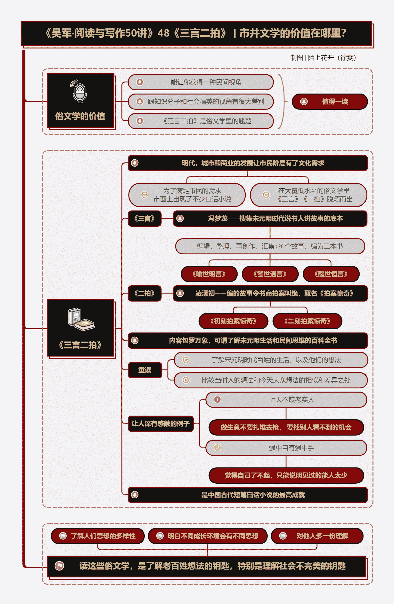  

公众号懒人找资源，懒人专属群独享

# 49 阿瑟∙克拉克｜科幻为什么会流行？

吴军

2020-07-14

阿瑟∙克拉克｜科幻为什么会流行？

你有没有想过这样一个问题，为什么现在电影里的外星人那么多？为什么当今科幻小说会这么流行？

我的看法是，现在没有鬼了！

为什么过去神鬼的故事特别多，鬼又是从哪里来呢？

其实，它们来自于人脑所具有的超经验能力。现代智人（我们的祖先）和我们的近亲，也就是曾经出现过的，后来灭绝了的其他人类，比如尼安德特人，最大的区别在于，前者有超经验的想象力，能想象出不存在的东西，包括神和鬼。

人类不仅具有超经验的想象力，而且人类在文明开始之后，获得的大部分知识都不是经验，而是超经验，或者是被告知的，而不是自己经历的。

比如老师告诉你地球围绕太阳转，你一辈子不会去验证。我们说秦始皇统一了中国，大家谁也没看到，为什么会相信，因为老师告诉我们，我们就相信了。过去很多人接受神和鬼，和我们接受地球围绕太阳转没有什么差别。

对于超经验的要求，是人的一种内在需求，是刻在我们的 DNA 中的。我们了解了地球围绕太阳转，其实不能当饭吃，但是我们就想了解它，这是我们的内在需求。

今天，我们掌握了科学知识，不再信神和鬼了。但是，我们很多原本需要神鬼世界才能安放的内在需求还存在，这种需求就以其他形式表现出来，比如虚构的武侠故事、玄幻穿越小说，以及这一讲我要谈的科幻作品。

**古代人对于神鬼的需求，并非完全出于迷信。有的是用来获得自己在现实生活中得不到的东西。**

比如《聊斋志异》写落魄书生们遇到美丽的狐仙，就和今天一个一无所有的人幻想逆袭娶了美女总裁、白富美一样。再比如，过去人的寿命很短，越是这样，就越想长生不老，自己做不到，就创造出神和仙，神是不死的，仙是长寿的。有了这样的幻想，人会觉得多少活得更有些希望。

今天还有很多人问我，是否到了 2030 年医学和人工智能就能让人永生，这和信神信鬼没有区别。

在所有神鬼的替代品中，科幻是显得非常高大上的。武侠的能力毕竟有限，这就限制了我们的想象力，而且武侠小说也不符合物理学原理。

科幻追求的，却是在基本不违反物理学原理的前提下，不受制于当前技术的可行性，这让很多科幻的读者觉得自己读这样的书是有科学素养的。因此，科幻作品几百年来起起落落，但总是有读者，而且随着科学的进步，科幻的想象力也越来越丰富了。

科幻作品在满足人的超经验时，总要谈一点吸引人的主题。在我看来，那些主题无一例外都和人的现实世界有关。

比如在美国轰动一时的 3D 电影《阿凡达》，我就看到了西方殖民者当年殖民过程的影子，只是加上了今天倡导的人性光辉。

在各种涉及到外星人的电影中，外星人也总是有好有坏，这和人类社会是一样的；外星人也是有的人具有高尚的品德，有的人卑鄙阴险和贪婪，在他们的身上，我们看到的是地球人性的优缺点。

很多人看了好莱坞的科幻大片激动得落泪，那不是外星人或者科幻吸引人，让人感动，而是人性让人感动。

所以在科幻作品中，更受欢迎的，其实并不是那些对科技的想象力最丰富的作品，而是对人性、对世界，以及对人类思考更深刻的作品。在科幻作家中，我觉得把这些问题思考得非常透彻的是阿西莫夫和阿瑟∙克拉克。

这一讲，我们就来谈谈阿瑟∙克拉克。

我最初接触阿瑟∙克拉克的作品是在美国看了他编剧的电影《2001 太空漫游》。那一年他出版了“太空漫游”系列的最后一本《3001 最终的奥德赛》，很多媒体介绍他最初的那部电影，而且给予了很高的评价。

但是我看了之后颇为失望。我向我的美国同学吐槽，他说，那可能是因为电影是六十年代末拍的，那些技术今天看起来太落后，然后他问我有没有读过阿瑟∙克拉克写的这个系列的小说，我告诉他没有。他说，你一定要读一读，写得非常精彩。于是我就把他这个系列的四本书都读了一遍。

坦率地讲，阿瑟∙克拉克的文笔远不如我们前面介绍的那些文豪，但是他很善于思考人类一些最根本的问题，并且把这些问题作为悬念融入小说中。

那么 **克拉克讨论的是什么根本问题呢？概括说来，就是“我们从何处来，我们是谁，我们将向何处去”的终极追问。**

下面我把几本书快速串讲一遍，你可以感受一下，科幻小说是怎么呈现这种追问的。

这个系列的第一本书是 1968 年他为电影写的剧本。那时是阿波罗 11 号登月的前一年，人类对即将到来的太空旅行完全陌生，又过于乐观。因此克拉克通过太空漫游这个热门话题来讲述他对人类的思考。

这本书讲述了人类发展的三个时间点。

第一个时间点要倒回到猿猴变成人的时候。一群猿猴因为某个巨大的黑石板被赋予了灵感，懂得了使用工具来狩猎，并不断进化，于是就有了我们人类。

第二个时间点是在人类有能力建立月球基地的时刻，其实就是阿波罗计划高潮的时期，人类在月球基地上发现了相同的黑石板。经过研究，专家们发现这是一个发射器，它发出的信号射向木星。于是载有鲍曼博士、普尔和一台人工智能电脑的宇宙飞船就前往木星。

在旅行的过程中，人工智能造反，普尔死了，人工智能被关闭，鲍曼一个人到达了木星附近。这时，鲍曼见到了第三块黑石板，这是第三个时间点。在那里鲍曼被一种超自然的力量置身于广袤的太空之中并且灵魂变成了不死的星童。

到此为止，克拉克为大家留下了一个大大的谜团，那就是变成星童的鲍曼会有什么故事，人类的命运会是什么样的。

在接下来的两本书，即《2010 太空漫游》和《2061 太空漫游》里，揭开了鲍曼的秘密和人类的秘密。

原来宇宙中有一个超级文明，就是黑石板的主人。这种超级智慧生命把宇宙变成智慧生命的试验场，他们通过黑石板去发现其他生命迹象，并启发他们进化，地球人类就是受益于他们。当地球人能够进行太空旅行后，他们就把鲍曼变成了永生的星童，守护人类。

在第二本书中，地球人派了第二艘飞船到木星去寻找鲍曼等人的下落，已经没有了形体的星童鲍曼指示他们离开木星，因为它即将变成太阳系的第二个太阳，同时星童鲍曼向人类传达了超级文明的警告，不要去木卫二欧罗巴，因为那里出现了正在进化的新的生命。

不过到了 2061 年，依然有一群人类登上了欧罗巴，并且看到了正在进化的另一种形式的新生命。当然这也就惹怒了黑石板的主人，那么他们将如何惩罚地球人呢？这个悬念就留到了最后一本书，《3001：最终的奥德赛》。

在最后一本书中，之前死去的普尔在绝对零度的太空中飘浮了千年，又被救活了。普尔见到了星童鲍曼，鲍曼让他转告人类，黑石板的主人要清除不听话的人类，因为人类私闯了禁区欧罗巴星。

这时的人类在物质层面无法抗衡黑石板的主人，因为后者根本不是物质的。不过最终人类通过打信息战，也就是感染计算机病毒打败了对手，获得了胜利。

在书中，关于“我们从何处来，我们是谁，我们将向何处去”，一一都有呈现。

我们从哪里来？今天我们知道人类是从古猿进化而来，但为什么是我们这一支，即现代智人，最后成为了地球的主宰，今天很难给出明确的结论，这里面又很多偶然性。很多科学家最后都觉得世界上似乎有一种冥冥的力量在帮助人类，克拉克在书中反映出了很多人的这种想法。

那么我们是谁呢？ **我们是一群好奇心极强的生物，越是不让做的事情，越想突破禁区试一试。有些时候，这让人类往前迈进一大步，有些时候则是巨大的灾难。**  
但是不论是哪一种，人类都必须面对结果。

最后，人类将向何处去？在《3001：最终的奥德赛》中，描述人类生活在天上，但这并非是人类最终的归宿，或许人类将来会像是黑石板的主人那样，并非以物质的形态存在，而是以信息的形式存在。

克拉克讲“只要是一种生命，归根结底它是一种信息”。这其实反映了在发现 DNA 双螺旋后，很多人对生命的认识。

但信息只是全体人类的归宿，并非每一个个体的归宿。个体的归宿就是死亡。克拉克说，爱与死是普通人最重要的两件事。死亡无法操控，从出生起我们就注定了悲剧的结局，我们能做的就是勇敢去爱。

因此他要在自己的书中，为那个已经永生的星童鲍曼赋予人性的光辉。 **对于人类的每一个个体，在悲剧的命运中活出自我，这就是作为个体对命运的抗争。**

“太空漫游”系列在每天听本书里有介绍，你可以去听一听，更深入地了解它的故事情节。得到也有全套的电子书。另外，克拉克的另一部短篇小说《星》含义深刻，因此获得了科幻小说大奖雨果奖，也推荐你阅读。

## 小结：

科幻小说和过去的神鬼传说一样，其实在虚幻的背后折射出的是现实社会，回答的是现实的问题。好的科幻小说，能对人类的终极追问，给出很有想象力的答案。

## 作业：

你最喜欢的科幻小说是哪一部？参照这一讲的观点，请你分析一下，它背后折射的现实问题是什么。

1.科幻作品在满足人的超经验时，总要谈一点吸引人的主题，这些主题无一例外都和人的现实世界有关。  
2.科幻小说和过去的神鬼传说一样，在虚幻的背后折射出的是现实社会，回答的是现实的问题。

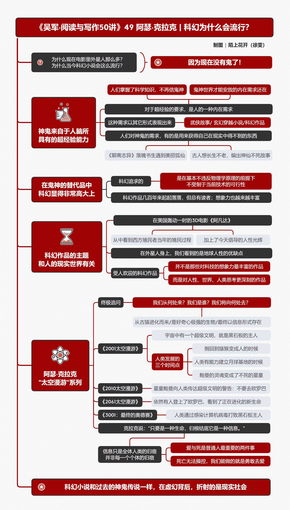  

公众号懒人找资源，懒人专属群独享

# 50 弗里德曼｜怎样记述好真实的事件？

吴军

2020-07-14

弗里德曼｜怎样记述好真实的事件？

这是课程的最后一讲，前面我讲的文学作品，大多是虚构类的。这一类的作品虽然会在虚构的背后反映现实，但是并不要求写作时受到真实性的约束，作者可以充分发挥自己的想象力。很多作家就是利用想象力创造出不朽的艺术形象的。

但是，还有一大类写作是非虚构的（nonfiction），它包括回忆录、传记、历史事件和新闻报道等等。按照韦伯斯特字典的定义，只要不是小说、戏剧和诗歌，其他作品都可以归到非虚构作品中。

当然，有人以为非虚构类作品只是讲述真实世界的文学作品，我觉得这是比较狭义的理解。

为什么最后我要谈谈非虚构作品，特别是报道类的作品呢？

一来这一类作品的写作手法在我们写公文时用得上，二来我觉得可以根据严肃记者和撰稿人写这类作品的原则，学会如何判断报道的真实性。

这一讲，我就以美国著名记者和作家、普利策奖获得者托马斯∙弗里德曼为例，来说明报道类作品的写作和阅读。

2006 年，弗里德曼借着他的新书《地球是平的》出版的机会，在 Google 分享过他的创作心得。因此，今天的内容一部分是我读他的代表作《从贝鲁特到耶路撒冷》一书的心得，另一部分是他自己写作的心得。

## 1.报道类写作的真实性

我们在前面讲了，写作有六个要素，时间、地点、人物，以及事情发生的原因、经过和结果。在很多文学作品中，上述信息是隐含地给出的。

**但是，在报道类的写作中，时间、地点、人物或者对象必须明确具体，意义明确、事情发生的起因和经过必须确凿、不能含糊不清。**  
这一点也是我们日常写公文时要注意的。如果事件还在发展的过程中，结果还不清楚，就不能臆测结果。

你如果按照这个要求去审视一些今天的报道，就会发现很多是不合格的——除了基本的信息都含糊不清外，还加入了很多作者自己“合理的想象”和感慨。很多人问我如何在信息爆炸的时代，过滤不可靠的信息，我的看法是，看到这种基本信息模糊，掺杂大量想象的报道，就不用往下看了。

此外，报道类的写作，也不能由写作者揣测人物的心理活动。这些不仅和小说不同，和文学类非虚构作品也有非常大的差别。

**文学类的非虚构作品，在符合事实的大前提下，可以添加一些背景元素、人物心理活动等虚构成分，增强作品的文学性和趣味性。**

比如美国女作家巴巴拉·塔奇曼的作品，很多对环境景物的描写，甚至人物角色的想法，都是她构想出来的，但它们不违背已知的事实，而且符合逻辑，我们读起来也有意思。

比如她的普利策奖获奖作品，《八月炮火》，这是一部叙述第一次世界大战危机的形成、爆发和大战初期战役的历史著作，书中有很多作者加入的合理猜测和推论。

## 2.时效性

**新闻报道的价值在于时效性，时效性一丢失，它的价值就打折扣了。**  
但是强调时效性必然带来一个结果，就是故事通常只有开头没有结尾。这个矛盾怎么处理，弗里德曼来 Google 演讲的时候，他给出的答案有点让我吃惊，那就是不要管结果（等结果），因为你根本等不到结果的到来。

弗里德曼给我们举了一个他自己的例子。他的报道类图书《从贝鲁特到耶路撒冷》是 1989 年出版的。在书中他根据自己在贝鲁特和耶路撒冷 10 年的经历，向世人介绍了一个真实的中东。这本书对当时的政治家们了解中东问题起到了很大的作用，也让他获得了普利策奖。

但是，到了 2006 年他给我们做报告时，过去了快 20 年，书中的内容很多已经不符合现实了。比如后来，巴以矛盾曾经出现了转机，以色列总理拉宾和巴勒斯坦领导人阿拉法特握了手，似乎和平要到来了，然后一个被暗杀，一个病逝，这些结果都是始料未及的。

今天，以色列和巴勒斯坦旧的问题解决了，又出现了新的问题，新的问题书中显然不可能提及。因此弗里德曼认为，纪实性报道不要太在意结尾，要把已经发生的事情赶快写好，让读者在第一时间看到准确的报道是最重要的。至于结论，那是历史学家的事情。

那一次在 Google，他主要是介绍新书《世界是平的》，今天回过头来看他那本书中介绍的全球化今天已经完全过时了，但是当时他的书让很多人思考全球化的问题，并且采取了行动，这样纪实报道的目的就达到了。

从弗里德曼的经验我们可以知道，如果一个报道给不出结论，就千万不要牵强附会地下一个对自己有利的结论。今天有些报道，内容本身不错，但是被胡乱下结论毁了。

弗里德曼讲，纪实报道的价值体现在两方面。

首先，正是有了这样的纪实报道，让全世界都知道真相，在一定程度上改变了历史的进程。他认为，一件事早报道和晚报道，其结局是不同的。

其次，纪实报道要带给读者一双眼睛。比如，虽然从上个世纪 80 年代末到 21 世纪初，中东地区发生了天翻地覆的变化，但这只是表面现象。政治与宗教、商业与社会、人性与利益、仁爱与漠然，依然在相互角力。读者通过读纪实报道，学会了解事实、观察社会、讨论问题，这永远不会过时。

## 3.要注意讲故事的视角和内容的选取

记者做一次现场报道很容易，把真相讲出来就可以了。但是要做深度的系列报道、跟踪报道难度就要大得多。弗里德曼在中东呆了近 10 年时间，用他的话讲，几乎每天发生的事情都值得写，如何选取内容，如何讲故事，带着读者从什么视角来看问题，就是一门艺术了。

在《从贝鲁特到耶路撒冷》一书中，弗里德曼把重点放在了讲述黎巴嫩的磨难和动荡。他讲，在黎巴嫩，他是一个冷眼旁观的局外人，在那儿的生活没有任何个人利益，他不因此高兴，也不因此绝望，但是他对中东充满了好奇心，那段经历使得他的好奇心如愿以偿。

对于世界上绝大部分人来讲，一辈子都不会去黎巴嫩，更不会经历那里纷飞的战火，因此和他一样充满好奇心。

在这本书里，他就用大家的好奇心牵着读者走。弗里德曼的这本书是纪实作品，但是很像故事书，这是因为作者精选了那些能够引起读者好奇的故事来支持他的思想。

写耶路撒冷对他来讲就有点难了。作为一个犹太人，他很难做到完全中立不带感情色彩。因此他选择另一种创作的视角，就是做对比。

以色列和黎巴嫩不仅在同一地区，而且一百多年前有相似之处，都是处于殖民统治状态。但是后来那里有了两个不同起源和命运的政体，今天产生了不同的结果。作者通过回顾历史反思宗教政治对中东国家带来的结果。

总的来讲，我觉得弗里德曼关于贝鲁特的部分写得比耶路撒冷的部分更吸引人，这说明牵动读者对于纪实事件的好奇心，不断随着作者的眼睛看世界，要比作者大段分析要吸引人。

## 4.人物的塑造和场景的还原

纪实作品中也有人物，那些人物也需要塑造。当然在这些作品中，不能胡乱编造人物故事，因此纪实文学作品中人物的塑造更准确地讲是人物形象的设置。

比如，2016 年奥运会，中国女排夺得了冠军，记者们都去报道主教练郎平。对于郎平的形象，有各种塑造方法，将她写成一个能够鼓舞士气、临场指挥水平很高的教练，是绝大部分记者采用的方法。但是这样的报道不会出彩，因为没有给读者带来新的信息。

我看过的一篇报道就写得很有意思，讲郎平用了大量的数据统计来帮助训练和制定战术，这就将郎平塑造成一个懂得高科技的教练。

纪实报道要给读者画面感，因此重建场景对这类写作是必不可少的。

在《从贝鲁特到耶路撒冷》一书中，作者一开始给我们的是什么画面呢？刚下飞机，就看到千疮百孔的机场以及荷枪实弹的军人；几周之后，他租住的公寓就被炸了。这就是作者给我们重构的场景。当然，场景的还原必须来自于自己亲身经历，而非想象。

除了弗里德曼给出的经验之谈，我个人还有一条体会可以分享给大家—— **要想给读者身临其境的感觉，自己先要尽可能地靠近现场。**

亚马逊网站上读者是这样评价弗里德曼的，外人看到的是（中东的）高墙，而不是高墙内的庭院，然后凭主观想象里面的情景，弗里德曼带着大家进入了庭院。

当然，靠近现场是有风险的。匈牙利裔的美国战地记者卡帕在西班牙内战中拍摄了《倒下的士兵》，由于从照片上看，拍摄的距离非常近，一些人怀疑卡帕是摆拍，卡帕轻蔑地回答，那是因为你们自己走得不够近。

我很能理解卡帕这种说法的合理性，我以前在巴尔的摩的房东 Ed（爱-得）就是这样一位摄影记者。他供职于《巴尔的摩太阳报》，后来为了拍出有意义的照片，去了战火纷飞的索马里，他太太天天为他祈祷。经过了半年的枪林弹雨，他总算平安回来，随后又被提名了普利策奖。

不仅纪实作品需要深入到一线获得信息，很多其他题材的写作也是如此。我在写《浪潮之巅》之前，去过很多公司和里面的员工了解该公司不为外人所知的情况。  
**很多人稿子或者书写得好，是因为拿到了别人没有的素材。**

## 小结：

我们在工作中，经常要写工作中的一些事情，这些类似于纪实报道。客观性、时效性、讲故事的视角、人物的塑造和场景的还原，是我们要注意的要素。大家不妨在写年终总结时，考虑一下这几个因素。

## 作业：

你还读过哪些非虚构佳作？选择你最喜欢的一部，写一段不超过 200 字的评论，推荐给大家。

1.在报道类的写作中，时间、地点、人物或者对象必须明确具体，意义明确、事情发生的起因和经过必须确凿、不能含糊不清。  
2.纪实报道要给读者画面感，因此重建场景必不可少。 3.要写工作中的一些事情时，客观性、时效性、讲故事的视角、人物的塑造和场景的还原，是我们要注意的要素。

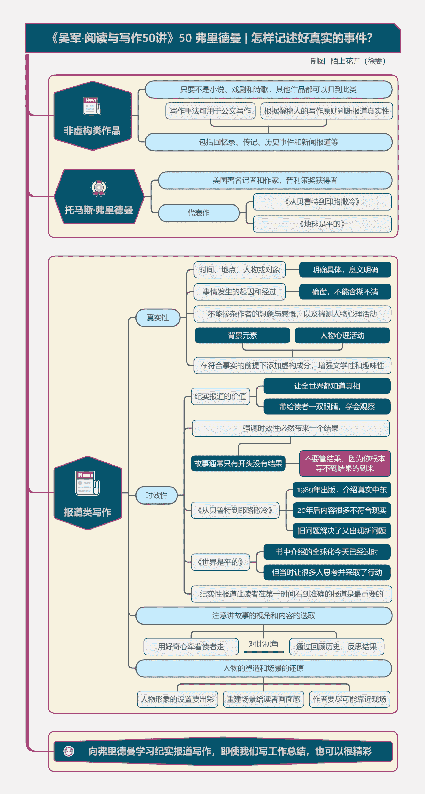  

公众号懒人找资源，懒人专属群独享

# 课程问答：总在重要的讲话场合大脑空白，怎么办？

吴军

2020-07-14

总在重要的讲话场合大脑空白，怎么办？

读者 问答 1:

> "我在自己认为重要的场合，就算先前准备了怎么说，临场还是有时候会大脑空白，或是词不达意。过了以后又会因为没有表达清楚感到遗憾。请问老师，我如何能让自己在表达的现场能够从容应对，大脑能迅速检索出想要表达的信息呢？"

这是一个很好的问题。根据你提供的有限信息，我觉得你可能准备得还不够，否则不会临场大脑空白。什么叫做准备得够呢？我给你举三个例子：

**例 1：库旦普教授**

库旦普教授是一个表达能力极强的人，即便如此，他准备报告也极为认真，无论是 15 分钟的，还是 1 小时的，都是这样。

即使是一个 15 分钟的报告，他恐怕要准备一两天，不仅 PPT 要反复修改，而且每一张 PPT 结束的时候，该停一秒钟？两秒钟？还是不停？都是事先设计好的。

有些 PPT，他会觉得听众可能听完后要想一下，这时在讲完以后，他就会停两秒钟不说话。有些时候，他需要讲一句俏皮话做过渡，这也是设计好的。

我在跟库旦普教授做研究的前两年，每次我去做报告之前，他要帮我改四五次 PPT，至少要预演三四次。后来到我快毕业的时候，他也还是要帮我改两三次 PPT，预演一到两次，每一次讲的内容我都会背得滚瓜烂熟。

**例 2：辛格博士**

辛格博士是我在谷歌的老板，他是谷歌负责搜索和人工智能等最重要部门的高级副总裁，是美国工程院的院士。

辛格博士对我说，他因为有口音，过去怕说话，于是在任何人谈话之前，都会把要谈的内容写下来，包括和同事之间 5 分钟的谈话。久而久之，他就能讲了。

但是即便如此，他做报告之前，都要请我们事先听一听，提一提意见。

从辛格博士的例子来看，我认为任何人做报告的时候，即使不能把内容背得滚瓜烂熟，讲什么至少要写到纸上，最不济，也可以拿出来念。

科技圈的人很多时候问说，为什么硅谷的印度人在公司里职位做得比华人高？很多人觉得是因为印度人能讲。不过，这个能讲其实并不是天生的。

很多人只看到现象，没有看到所谓“能讲”的人，在背后准备时花的时间。

**例 3：一个朋友**

第三个讲话前准备充沛的例子是我的一个朋友。

每次开派对，四五个小时就听他一个人说，而且听完，大家收获还很大。过去他和女朋友在一起，从早上到深夜，能说十几个小时，还能让对方感觉意犹未尽。

后来我才知道，我的这位朋友哪怕是在派对上，准备讲什么笑话、讲什么严肃的内容、从哪里切入，都写到了纸上，有想不起来，会找个借口去洗手间看看。

和女朋友在一起，也是这么做的。正是因为他做足了准备，所以在别人面前才显得轻松自如。

所以， **任何人，多准备、多练习，口头表达的能力就可以提高。**

但是这里说的准备是真正的充分的准备，也就是我举的例子里的那种，而不仅仅是自己觉得准备好了。对于如何充分地准备，有三个简单的改进步骤，大家可以遵照着来。

1.  把要讲的东西写出来，讲话的时候，实在想不起来就念稿子。
    
2.  事先做几次预演，让一些同事、朋友提意见，当然自己讲什么要提前背熟。
    
3.  讲完之后，问一问同事和朋友的反馈。
    

这些方法坚持做半年，就会有明显的进步。

当然，你如果要想成为一个讲演大师，就得像库旦普教授那样一点点抠细节了。

读者 问答 2:

> "每次当我发朋友圈想要表达一些感受的时候，总是觉得想了半天还是只想得出几个词汇。但是，身边有朋友每次发动态，我都感觉文字非常优美。请问老师，我如何才能让写出来的东西更美好，显得水平更高？"

写作的目的是提高水平，不是显得水平高。 **文字优美固然重要，但是内容和结构更重要。**

李清照的词很优美，其实她用词很简单，用典故也很少；她的作品用的几乎都是白描手法，但是有真情实感，就产生了巨大的感染力。

读者 问答 3:

> "我想请教吴老师：很多人都说多阅读会提升表达能力，但是怎么才能判定什么样的阅读会对表达能力有帮助呢？我又能怎么样通过阅读影响表达呢？"

表达能力也分为口头表达和书面表达两种，口头表达水平还是要靠多练习提高，但是书面表达的确受阅读的帮助较大。

我给你的建议有两个：首先是选择好“读什么”，其次是“怎么读”。

在读什么这方面，我在《阅读与写作》的课程中讲了很多，比如：怎么通过有层次地阅读构建自己的知识框架？

经典文学作品里，我既讲了茨威格的《人类群星闪耀时》、罗曼·罗兰的“巨人三传”，也讲了歌德的《浮士德》、川端康成的《千只鹤》。

如果你有兴趣了解更多，可以订阅听听。但在这里，我要特别强调阅读的品位。什么意思呢？

读一些格调不高，水平不高的内容，对书面表达是没有什么帮助的。

比如，著名教育家傅斯年和一些晚辈聊天的时候，发现如果他们读的都是市井文学，就判断他们不会有什么大出息。

至于怎么读书，我认为今天 **大部分人的问题是读得太快，读不出作者的深意。**

很多人读书是看故事，故事看完了，就觉得读了一本书。这样的阅读，我觉得不要也罢。在今天的互联网时代，最不缺的就是故事。

我认为，读书至少要读出三层意思。在小说等文艺作品中，是这样三层：

1.  主人公的想法；
    
2.  作者的想法；
    
3.  我对此内容有什么看法；
    

如果你看的是非虚构类作品，那么就需要读出这样三层意思：

1.  作者的想法；
    
2.  书里的事件、书里的人物是否具有可重复性？也就是说，同样的事情能不能在另一个场景下发生第二次？
    
3.  如果可以的话，那么从这个故事中，我应该获得什么样的启示？
    

读出这三层意思以后，不妨看看作者的写作手法，看看他的想法是怎么表达出来的。

想清楚了，就学到了，将来你需要在类似场景下表达自我的时候，就知道该怎么用了。

读者 问答 4:

> "我想请问一下吴军老师，我看了一些书，也听了不少书，可是当我想写点东西的时候，会感到无从下手。比如：我对某件事有点印象，但又不能很好地组织语言，把它表达出来。我要怎么做才能顺畅地写出我想要描述的东西呢？  
> "

这个问题很有代表性。很多人读书的时候，似乎明白了别人是怎么做的，到了自己头上，就无从下手了。

解决这个问题要分三步走：

**第一步：收集写作所必需的素材**

今天很多自媒体写的东西，显然没有什么真实内容，都是自己脑子里的主观想象，在这种情况下写作，就有一种“憋”的感觉。

我在《阅读与写作》课程中会讲“有感而发”的重要性。

比如：南唐后主李煜和李清照后期的作品比前期的水平明显高出一大截，就是因为有了足够的生活经历，有感而发。

在课程的最后，我还会讲到著名记者，也是经济学家托马斯•弗里德曼等人写作的方法。他们用的方法，很重要的一条就是收集别人没有的素材。

**第二步：参考之前的人写类似题材的经验**

这就是我们在前面一个回答里讲的，阅读对写作的帮助，也就是阅读需要有针对性，不是看故事。

比如说，我要写一篇关于男女平等的杂文，不妨拿出《简爱》看看，看看里面的女主角是如何论述男女平等这个问题的。

阅读的时候，如果我只是记住了一个爱情故事，那是不够的。阅读后，我们要做到在需要的时候，随时能够翻出书中那些文字内容做写作的参考。

**第三步：先搭架子，再填内容**

什么意思呢？就是先把想写的东西都列出来，看看如何基于那些想法搭一个架子。

在搭架子的过程中，你就会发现，很多想写的内容其实和这个架子无关，那么这时候你就要提醒自己，坚决不要写这些内容。

另一种情况是，很多人把自己想写的东西先搭出一个架子来以后，发现凑不出一篇完整的文章。

有了架子后，你就可以逐项填入内容。

很多人写着写着，卡壳了，半天憋不出几句话。这种时候，就要根据搭好的架子先把后面能写的写完，回过头来再补上前面卡住的内容。

我的两个孩子都是用这样先搭架子，再填内容的方法学习写作，都度过了“憋半天写不出来”的阶段。

1.任何人，只要有充分的准备和练习，口头表达能力就能提高。 2.把文章的内容和结构写好，比文字优美重要。  
3.针对写东西无从下手的问题，可以分三步走：收集写作所必需的素材、参考前人写类似题材的经验，以及先搭架子，再填内容。

公众号懒人找资源，懒人专属群独享

