# 吴军信息论40讲


## 发刊词 | 信息时代每个人的必修课

吴军

你好，欢迎来到我的《信息论 40 讲》。

如果要问你，我们生活在什么时代，你会说现在是信息时代。如果问你信息时代最显著的特征是什么，你可能会说“有计算机”、“信息爆炸”、“大数据”等等。这些都没有错，但这些都是表象！我的答案是，其实，信息时代的最大特征是不确定性。

而信息论就是这半个世纪以来，人类对抗不确定性，最重要和有效的方法论。今天的人，已经无法通过掌握几条不变的规律，工作一辈子；也难以通过理解几条简单的人生智慧，活好一辈子。一个通用规律就能解决一切问题，一个标准答案就能让人一劳永逸的时代，一去不复返了。

可以说，用来应对这些变化的信息论，是我们每个人在信息时代的必修课。

## 一、从未知到确定再到不确定

6000—8000 年前，人类文明就开启了，但长期处于无知和少知的时代。在近代短短的 300 年里，人类迎来了历史上最伟大的认知革命，迅速地进入到理性认知的机械时代。

是牛顿和他同时代的很多科学家一道，确立了机械思维，让人从此不再囿于神的脚下，这是人类历史上思维方式的一次飞跃。牛顿等科学家告诉世人，我们所处的宇宙是连续变化的，而各种变化的规律是确定的。这些确定的规律，可以用简单的公式或者语言描述清楚。即便你是普通人，掌握了这些规律后，应用到各种未知领域，也可以在各个领域获得成功。

但是，我们今天很多大学生毕业后不知道自己该干什么，好像之前的校园里教的经验正在逐渐失效。这是因为，当前的整个世界充满了不确定性。自从 20 世纪之后，当确定性的规律被人类认识得差不多了之后，世界本身所固有的不确定性，给大家带来的麻烦就越来越凸显出来了。我在《科技史纲 60 讲》中讲到的量子力学给物理学带来的危机，其实就是这种不确定性影响的体现。

除了年轻人的学业和毕业的不确定性，对比我们这一代人的生活和父辈的生活，我们必须承认今天各种的不确定性大了很多。就拿理财来说，父辈们只要把钱存到银行吃利息就可以了，它的收益非常确定，但是今天这显然不是好的做法，而投资到任何地方都显得非常不确定。

当然有人会说过去也在变，但是牛顿时代大家看到的变化是连续的，而今天经历的常常是非连续的，或者说是跳跃性的变化。不确定性加上跳跃式变化，才让大家感到格外焦虑。

## 二、如何应对信息时代的不确定性？

当然，不确定性也不是眼下才有的，只是人类过去连确定性的事情还搞不定，没有心思去研究驾驭不确定性的方法，因此偶然遇到不确定性时，常常采取回避的态度。

但是进入到 20 世纪后，我们无法再回避这个问题了。而近代科学的发展，又给人类掌握有关不确定性的规律提供了钥匙，这就如同 300 多年前牛顿等人找到了通过确定性消除无知的方法一样。

那对于不确定性的方法是什么呢？20 世纪初概率论和统计学的成熟，使人们得以把握随机性。在此基础上，1948 年，香农博士找到了不确定性和信息的关系，从此为人类找到了面对不确定性世界时的方法论，也就是利用信息消除不确定性。可以说，这是随后的半个多世纪里，特别是今天，最重要的方法论。

比如，我们今天讲的大数据思维，从本质上讲，就是这种方法论的一个应用而已；再比如回溯历史，数字和文字的诞生其实就是对信息编码的过程；再比如回到现实，当面对多条信息犹豫不决时，其实是你不懂有效找出不同维度信息，以及组合优化的方法……

当然，要学会这些方法论，就要先了解信息论。学会使用信息论这个工具，我们对今天的跳跃式变化和不确定性就再也不会恐惧了。

## 三、课程怎么安排？

信息论在大学里通常是通信和信息处理专业研究生的必修课，其它专业（包括计算机专业）的人其实很少会去学这门课。这并非因为这门课本身不重要，或者是它的内容不吸引人，而是因为它太难学，里面有太多的数学公式，它要求听课的人熟悉微积分和概率论。

后来在 Google 工作期间，我发现不了解信息论的人在从事信息领域的工作时会走很多弯路，比如，还有不少软件工程师，反而地使用同一个维度的信息，试图对产品进行改进，开始的时候是事倍功半，后来就是劳而无功，而他们自己却搞不清楚原因。在外人看来，这些人学傻了，一条道走到黑，白白浪费自己的时间和晋升机会。但是，我知道，其实只是这些人并不了解信息的作用。

因此，我一直建议身边的 IT 从业者学学信息论——即使不了解其中理论的细节，也应该知道它的原理。为此，我还在 Google 买了 20 本信息论的教材给大家。但是大部分人告诉我，读了 1/4 就读不下去了，因为讲得太难。

于是我萌生了开一门通俗信息论课程的想法——不讲细节，特别是理论的细节，只讲原理和应用，以便听众能够熟悉我们这个时代最适应的思维方式。

世界上的知识，可以分为道和术两个层面，我们这门课讲的是道的层面的知识，它不会讲任何具体的方法，比如信息的采集、处理或者传输的理论细节。这样，我们就能把重心放在讲授用信息论指导做事的方法上，以便让我们能够在不断变化，而且充满不确定性的世界里把握住机会，立于不败之地。

我们的课程主要包括三个模块的内容，它们分别围绕着信息的产生，信息的传输和信息的应用展开。具体的每一讲，我在后面的课表里列出了。每一讲，我基本都会采用两种方式讲解：一种方式是从分析事件或现象背后的信息论原理出发，讲解信息论的概念；另一种是从信息论的原理出发，分析我们今天的做事方法。

这三个模块学完以后，我希望你获得三种能力。

模块一信息产生：在面对大量信息时，排除噪音，提取利用有效信息，科学做决策的能力；

模块二信息传播：向外界传递信息时，平衡分配有限资源，增加沟通带宽，放大影响力的能力；

模块三信息应用：看懂信息应用的逻辑和通信发展的趋势，提前抓住新机遇的能力。

课程中既包括信息论最基础、最重要的内容，比如香农的两个著名的定律：与信息产生相关的第一定律和与信息传输相关的第二定律，也包括对今天很多热门的技术的剖析，比如 IoT 和 5G 等。

## 总结

一个人的思维方式和做事方法常常决定了一个人能够走多远，而在历史的任何时期，都有最适合时代的方法论。如今，面对不确定性和非连续变化，信息论所提供的方法，能成为解决今天各种困惑的工具。

世界上任何一个探索者都需要清楚三件事：我们现在的位置，我们的目标，以及通向目标的道路。我们知道哲学是一门生活的艺术，它帮助我们认识自己，它回答了第一个问题。至于每一个人的目标，我相信大家比我更清楚。而第三件事其实是方法论或者说是理性的工具，也正是我想要给你的，相信大家有了信息论这个工具，就能更好地应对下充满不确定性的世界，达成自己的目标。

清楚了这三件事，我们便不再需要焦虑，内心就得到安宁。

如果你准备好了，那现在就加入《吴军·信息论40讲》吧。


## 信息论外传

## 01 | 影响世界的三比特信息

吴军

你好，欢迎来到我的《信息论 40 讲》。

这个模块是我们课程的寻论部分，介绍信息的作用，它是如何被度量的，为什么它能够起到四两拔千斤的作用，我会用三讲，帮你串联这门课中要陆续介绍的知识点。

我在和得到同事讨论为什么要开设这样一门课的时候，我讲因为信息太重要，太有用，以至于我们必须了解关于它的理论。

我们每个人都知道钱很重要，因此对金融和经济学非常重视。确实，善用金钱成为一些人成功的根本原因，这个道理大家都明白。但是对于信息的重要性，很多人却未必明白，更不会将它和金钱放在同等的地位。

当然，世界上还是有人会看得更远一些的，比如我在 Google 的老板诺威格博士。2007 年，他的母校柏克利要授予他一个特殊的荣誉，我作为同事参加了那个活动。

在仪式上，诺威格博士回答了一个很多校友都好奇的事情——他为什么在 2001 年互联网在全球范围内处于低谷时，要离开工作非常好的 NASA，加入当时还很小的 Google 公司。

诺威格博士讲，你们知道，在 1929—1933 年经济大萧条时，银行亏得一塌糊涂，很多都倒闭了，但是在那时买银行股票的人后来都发了大财。别人就问他们，为什么敢于在那种情况下买银行股？他们说因为全世界的钱都在银行里啊！

同样地，2001 年，互联网泡沫时，我就在想，全世界的信息都在 Google 里啊！那么在信息最不值钱的时候加入信息公司，就如同在银行最不值钱的时候买银行的股票。

因此，今天我给大家的第一个知识点就是“不要重视钱而轻视信息”。

将信息的重要性等同于钱，是否言过其实呢？一点也不，为了说明这一点，我们不妨看三个大家并不陌生的例子。前两个和二战有关。

我们首先来看第一个例子。我在《科技史纲 60 讲》中强调了能量总量确实了二战时美国的压倒性优势，这一点已经成为了大家的共识，以至于今天人们一提到战争就说它是拼经济，拼后勤。

但是，在二战时科学家们和情报人员在信息上的贡献却时常被低估，信息论便是在那个背景下诞生的。

在二战时，另一条战线的信息收集工作也在悄无声息地进行，并且对战局产生了巨大的影响，大量的间谍正在暗处的情报战场所较劲。

当然，这其中最杰出的代表当属具有传奇色彩的佐尔格。佐尔格一生给苏联发送了两份足以改变世界的重要情报。一次是告诉斯大林，希特勒将在 1941 年 6 月 22 日进攻苏联，斯大林没有将其当回事，这条信息也就废了。另一次就是关于日本军部“北进还是南下”的战略决策的信息。

当时的局势是这样的，纳粹德国已经兵临莫斯科城下了，斯大林在欧洲已经无兵可派，而他们在西伯利亚的中苏边界有 60 万大军却不敢使用，因为苏联人不知道德国的盟友日本是否会从背后捅它一刀子。

当时日本军部的战略是北上进攻苏联，还是南下和美国开战，外界无从得知。

最后，佐尔格向莫斯科发去了一条只有五个字却价值无可估量的信息：“日本将南下”，于是前苏联就把西伯利亚所有的军队调往了欧洲战场。后面的故事大家都知道了。

佐尔格的这条信息给当时不得不进行二选一决策的苏联指挥部，提供了重要的决策依据。可以讲，这条信息救了莫斯科。那这么条信息的信息量有多大呢？我先不回答你。我们再来看后面两个类似的例子。

1944 年，盟军要从英国出发，横穿英吉利海峡在法国登陆，从西面进攻德国。这件事不是什么秘密，因此德国人就在大西洋沿岸修筑工事防范盟军登陆。

但是德军在法国前线只有 60 个不不满员的师（中间还有一半是拼凑起来的东欧部队和苏联伪军），相比盟军在海峡对岸的 300 多个师则少得可怜，因此面对很长的海岸线，德国人只能重点布防。

当然，德国情报部门也想方设法去了解盟军的登陆地点。盟军对此自然也是心知肚明，于是盟军就耍了很多花招，比如故意让德军捕获一些情报，甚至让之前一直统帅美军主力的巴顿将军带领一支比登陆部队更大的掩护部队在加莱对岸的多佛做登陆准备，当然真正的登陆目标是 300 公里以外的诺曼底。

中了埋伏，更重要的是因为他信息缺失，不知道对方的主帅是谁。在他之前，秦国与廉颇对垒的主将是王贲，并非大名鼎鼎的白起。

赵括虽然非常自大，但是对威震天下的武安君白起还是忌惮三分。用他的话讲：“秦若使武安君为将，尚贤臣筹画；如王贲不足道矣。”如果他知道对方的主帅已经换成了白起，或许还不敢贸然出战，秦军一口气吃掉他的 40 万人并不容易。

而在秦国一方，正是为了把握赵括这双眼中无人之毛病，才将白起任守指挥官的消息封锁得特别严，诱使赵括轻敌冒进，并一举全歼对方。那么在这个例子中，秦国隐藏了“白起为将”这条信息的作用是非常大的。

在上面三个例子中，信息的作用远比千军万马重要。但是如果我们从信息论的角度看，它们的 information 量有多大？有人可能会说非常大！这是二十世纪上半叶之前的说法，因为那时没有定量的度量。

而知道一些信息论的读者朋友会说，也就 1 比特吧，因为这三个例子中都是非此即彼二选一的问题，等同于 0 和 1 之间确定一个，因此信息量是 1 比特。这种说法大致正确。但如果更确切地分析一下，这三种情况并不那么简单。

在第一个例子中，佐尔格的情报其实信息量不到 1 比特。二战时苏联对日本军部的战略多少有些判断，佐尔格送来的信息其实只是证实他们的判断，因此这条信息的信息量其实没有想象的那么大。

根据信息论对信息量单位比特的定义，如果存在两种情况，它们出现的可能性相同，都是 50%，这时要消除其不确定性所需要的信息是 1 比特。

中阵亡的最高记录。

为什么盟军躲过了德军，却还是损失惨重？因为德军采用了信息论中一种非常好的对策，也就是不把鸡蛋放在一个篮子中，他们在诸要地也严密设防了。因此，德军在得到信息前和得到信息后，策略差不多，这1比特的信息作用就变小了。

你可以通过这两个例子看出，改变世界的信息，信息量可能1比特都不到，而且这1比特的信息很可能会遇到更明智的应对策略，失去价值。

不仅如此，很多时候，可能这1比特信息还会害了你。在最后一个例子中，情况就是如此。赵括以为对方的主帅是王贲，但是结果正相反，真正的主帅是白起。这种情况最为悲催。怎么从信息论的角度分析这种危害最大的情况，我们在后面介绍交叉熵时会专门讲。

我们知道1比特信息是非常少的，是一个计算机字节的1/8，一个像素的1/24。但是，这么一点信息产生的效果却是巨大的。

为什么信息有这样四两拨千斤的作用呢？这其实背后也是有科学根据的，在控制理论中有一种开关电路，控制这个开关只需要一比特的信息或者极低的能量，但是经过它的电流（可以被认为是能量）却能近乎无限大，今天我们很多电器中那些弱电控制强电的元器件就是利用这个特点工作的。

用很少的信息驱动很大的能量，这也是今天交付给大家的第三个知识点。而这也是信息非常重要的原因。

要点总结

- 1. 信息很重要，甚至比钱更重要，它能四两拨千斤。而信息作用的大小和信息量有关。
- 2. 信息量和不确定性有关，大家都知道的事，就没有什么信息量了。
- 3. 对一个未知系统（黑盒子）所作出的估计和真实情况的偏离，就是信息的损失，偏离越多损失越大。

此外，我们还提到了信息论的一个原则，不要把鸡蛋放在一个篮子中，这样可以避免因为信息缺失，而导致灾难性结果。请你举一些生活工作中类似的经历，写在留言区和我们互动。

在接下来的课程中，我们会用例子介绍信息论的一些理论，以便于大家做事情有理论指导。我们下一讲再见。

## 02 | 解开世界之谜的三篇诺贝尔奖论文

你好，欢迎来到我的《信息论 40 讲》。
上一讲，我为你介绍了改变世界的 3 比特信息，希望你能体会到信息的重要，也认识到它其实比我们了解的，要复杂得多。但信息论真是一门复杂深奥的学科吗？
这一讲我会再为你介绍 3 篇获得诺贝尔奖的论文，你会感受到信息的简洁之美，以及传递效率的重要性。

我要给你介绍的第一篇论文和宇宙诞生有关。我常说，我们这一代人非常幸运，因为在我们这一代生活的世界，人类搞清楚了三个非常本源的问题，也就是宇宙是如何产生的，地球生命的共性和起点，以及人类文明的起点。

那么，宇宙到底是如何诞生的呢？我们现在知道，宇宙是从一个体积无限小，温度近乎无限高的质点爆炸产生的，这就是今天大家认可的宇宙大爆炸理论。

根据这个理论，在大约 138 亿年前，那个质点发生了大爆炸。在随后大约一个普朗克的时间里（普朗克时间是能够度量的最小时间单位，大约是 10 的负 44 次方秒），重力场开始形成。

到了大爆炸后的 0.02 秒，宇宙中出现了第一丝光。接着，宇宙中的一部分能量就变成了物质。几乎同时，大量的能量转化为质子和中子，在这个过程中，宇宙中能量减少，物质增加。

然后，随着宇宙的膨胀、冷却，原子核、原子相继出现。引力又让这些原子形成星云和天体。再往后进化出生命，背后也有一套规律在起作用。

也就是说宇宙在诞生的同时，就有了各种物理的法则（Law）在起作用，后来又有化学和生物学的法则，它们都是宇宙固有的信息。

《科技史纲 60 讲》中有读者问我：

> “能量是世界固有的，它是诞生之初就存在的，那么信息从哪里来？”

在大爆炸大约 1 秒的时候，宇宙中最初步形成的中子因为不带电，率先冲出宇宙这个大火球，弥散到宇宙的四周，它们所携带着的能量形成了今天宇宙的背景辐射。当然随着时间越来越长、宇宙越来越冷，背景辐射的温度会越来越低。

如果宇宙大爆炸理论是正确的，那么应该在宇宙的任何方向都能测量到宇宙形成时的这些背景辐射，而且今天它们的温度不应该太高。

1964 年，贝尔实验室的工程师阿诺·彭齐亚斯和罗伯特·威尔逊在无意中发现了这种宇宙背景辐射。他们架设了一个天线，本来是要接收卫星发回的信号的。为了检测这个天线的性能，他们将天线对准天空。

起初彭齐亚斯和威尔逊怀疑是他们的天线系统有问题。1965 年初，他们对天线进行了彻底检查，甚至把天线上的鸽子窝和鸽粪都清除了。于是他们发表论文，正式宣布了这个发现，整篇论文只有两页纸。人类后来又根据背景辐射的温度，以及扩张的速度等信息，倒推出了宇宙有 138 亿年的历史。

1978 年，彭齐亚斯和威尔逊因为那个偶然的发现和那篇两页纸的论文，“幸运地”获得了诺贝尔物理学奖。

有时候有价值的论文并不需要啰里啰嗦写很长，它们里面的信息量很重要，正如我们上一讲讲到的，对于一件过去大家不知道的事情，现在知道了，信息量就大，对于一件大家基本上了解的事情，即使你的文章写得再长，信息量都有限。

我过去多次讲，提出问题比解决问题更重要，因为提出问题的人，开创了一个重要的却是完全未知的领域，回答问题并且给出最初解答的人，由于通常只是在某种认识阶段上对未知的领域提供一些有限的信息，因此贡献有限，被认可的程度不高。

物理学家推测宇宙早期状态的第二个方法，就是用空间换时间。

我们知道宇宙有 138 亿年的历史，在离我们非常遥远的宇宙空间，光传递到我们这里需要很多很多年，因此这其实记录的就是很多很多年前的的信息。事实上今天我们看到的很多星辰，它们可能已经不存在了，我们不过看到的是它们的快照和化石。

所以，只要观测到 138 亿年前的星系，就能知道宇宙早期的情况，事实上人们也做到了。这就是用空间换时间，在信息论上，这实际是信息等价性的体现，关于信息的等价性我们后面会讲到。

好，刚才为你介绍了两种推断宇宙诞生的方法，一是寻找 3K 背景辐射，二是以空间换时间。其中提到了两个要点：第一，信息是宇宙本身固有的属性；第二，在一个领域的贡献大小，不在于你提供了多少材料，而在于提供了多少信息量。

但事实上，今天对于最早期宇宙状态的描述是使用各种理论模型推导出来的，要证实它们还需要后人的努力。

人类一方面对外部世界很好奇，比如设法去了解宇宙起源和演变的信息，另一方面面对自身也很好奇，试图去了解生命起源和传承的信息，这些信息本身，也是世界所固有的。


关于这一点我在《科技史纲 60 讲》里介绍遗传和 DNA 时已经介绍了。接下来，我想从信息论的角度出发，为你介绍这篇诺奖论文。

首先，沃森和克里克获得诺贝尔奖的论文也只有一页半纸，我把它附在了课程的后面，有兴趣阅读英文原文的朋友可以读一读。

当然有人可能会问，这么高深的论文我能读懂吗？你只要有比较好的大学教育基础，就能读懂。这也就是说，一篇好的论文，一方面需要信息量高，另一方面需要在信息传播上效率高。大家都读不懂的论文，信息传递的效率就低。

怎样利用信息论原理，做到信息传播的高效率，是我们这门课要讲的重要内容。

我有时会帮助一些做演讲的人做一些正式演讲前的指导，我给大家最多的建议就是，不要嗡里嗡啊很长时间，要精简，要保证对方听懂自己最核心的想法，这就够了。我阅读过几十篇的诺贝尔奖的论文，很少有超过 10 页纸的。

其次，沃森和克里克这篇论文的逻辑很清晰，他们首先否定了鲍林之前的三螺旋结构，因为和一些已知的信息不相符。

然后，他们提出了自己的双螺旋模型，那一段关键描述只有 105 个单词（包括 the, a, so 这些虚词）。最后，他们说明了自己的模型同威尔金森、富兰克林观察到的信息相吻合。

沃森和克里克等人提供了一个“利用能够看到的信息，解释看不到的信息。”的绝佳案例。他们的论文和理论也验证了信息论中一条被称为“奥卡姆剃刀”的原则。

这条原则用牛顿的话讲，就是“我们需要承认，自然事物各种现象的真实而有效的原因，除了它自身以外再无须其他”。我想这是我们在认识世界时应该有的态度。关于奥卡姆剃刀原则，我们后面会专门讲。

在了解了和 DNA 相关的信息之后，人类后来发现 DNA 会通过复制出 RNA 传递生命所需的信息，RNA 会在指导合成蛋白质时，继续将这些信息传递下去。

但是你可能还有一个疑问，就是有了蛋白质后，生命体是如何工作的？比如我们的细胞是如何接受有益的物质，拒绝有害的物质，保护自身细胞，杀死有害的细胞的。

细胞里显然没有大脑，不是通过思考作出理性判断。但是蛋白质本身会对外部的刺激信号作出反应，这些反应维持着我们生命的活动，并且保护我们自身。用诺贝尔奖获得者科比尔的话讲，这涉及了 G 蛋白之间的通信。

你可能会奇怪蛋白质不是基本的生活单元，怎么还能通信？其实我们的细胞膜上有 G 蛋白偶联受体（GPCRs），它们可以探测荷尔蒙、气味、化学神经传递，和其它外界刺激，在解码后激活细胞内不同的 G 蛋白，转而引发各种生命活动，这便是生物体工作的原因之一。

下面这一张图，是 G 蛋白偶联受体的工作示意图，G 蛋白偶联受体（蓝色）被外界信号，也就是紫色的小球入侵时，激活相应的 G 蛋白（金色的和红色的）。

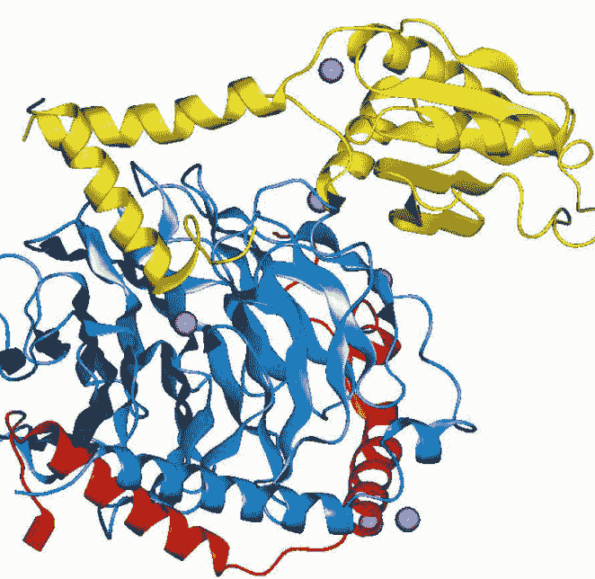

G蛋白是蛋白质中最大的家族，有多达800种蛋白质，在搞清楚了它们的通信原理之后，对了解人的生命现象，治疗疾病有极大意义。

事实上，世界上1/3到一半的药物靶标都和G蛋白有关。科比尔卡在2007年完成了上述研究，并且在《科学》杂志上发表了一篇8页纸的论文，并因此获得了2012年的诺贝尔奖。

从这个例子我们可以看出，控制生命活动的信息，其实并不被我们主动控制，但是我们可以发现它们。

到这里，三篇诺奖论文都给你介绍完了。

## 要点总结

你可以看出，那些影响世界的重大科学发现其实都是在极短的论文中发表出来的，因为世界上最关键的信息（知识）其实是非常简洁的，也就是说一条信息的信息量可能和信息的长度无关。那信息量和什么有关？关于这一点我们会在后面仔细讲述。

今天的三个例子，都说明了信息是我们世界固有的属性。

这两讲课程，我们介绍了信息是什么，它的作用有多大，信息是世界固有的属性，并且预告了信息论中很多内容。下一讲，我们讲讲信息论和方法论的关系。

论文地址：
http://www.sns.ias.edu/~tlusty/courses/landmark/WatsonCrick1953.pdf

## 03 | 大数据思维的科学基础

你好，欢迎来到我的《信息论 40 讲》。

前面我们讲了信息在历史和理论上的重大作用，你可能还没有切身感受到它的重要性。这一讲，我们从当今的商业社会切入，透过热门的大数据应用，来看信息是**如何改变商业模式，以及我们思维方式的**。

我们今天常常讲大数据思维。一说到它，很多人就会想到大型互联网公司使用用户的數據做很多事情，既有好的事情，比如今日头条给大堇推送有用的资讯，也有坏的事情，比如一些电商公司利用个人信息进行价格歧视，甚至一些公司出卖大家的隐私。

关于大数据思维的一些例子，点击《科技史纲 60 讲》的第 47 讲复习。我们这里就不赘述了。这里我为你总结了在当下最常见，也是最成功的四类应用。

- 第一类是解决人工智能问题，把那些过去看似需要人脑推理的问题，变成今天基于大数据的计算问题。
- 第二类是利用大数据，进行精准的服务。
- 第三类是动态调整我们做事情的策略。
- 第四类是发现原来不知道的规律。

当然我们还能举出其它的种类，由于篇幅的关系，我们在这一节就集中讨论这四类应用，学习它们背后的信息论原理，获取对我们做事情的指导意义，也就是在方法论层面的意义。

**先说说第一类，解决人工智能问题。**世界上利用大数据解决的第一个智能型的问题是语音识别，接下来是机器翻译。语音识别的历史正好和电子计算机一样长，可以追溯到 1946 年。但是一直做得非常不成功。

到了 60 年代末，计算机已经进入到第三代了（基于集成电路的），语音识别才只能做到识别十几个数字加上几十个单词，而且错误率高到 30%。这样水平的系统是不可用的，因为如果每十个词就错三个，你就无法复原原来的意思了。

为了做这件事，科学家们就试图让计算机学会构词法，能够分析语法，理解语义。
但这件事证明是不可行的。贾里尼克到 IBM 之前并没有做过语音识别，他也不懂得传统的人工智能。

事实上，直到死他都不认为他是人工智能专家。由于不受传统的人工智能思想的约束，他得以用信息论的思维方式来看待语音识别问题。他认为语音识别是一个通信问题。

贾里尼克是这样考虑问题的。当说话人讲话时，他是用语言和文字将他的想法编码，这就变成了一个信息论的问题。语言和文字无论是通过空气传播，还是电话线传播，都是一个信息传播问题，在通信中有一套对应的信道编码理论。在听话人，也就是接收方那里，他再做解码的工作，把空气中的声波变回到语言文字，再通过对语言文字的解码，得到含义。

于是，贾里尼克就用通信的编解码模型，以及有噪音的信道传输模型，构建了语音识别的模型。但是这些模型里有很多参数需要计算出来，这就需要用到大量的数据，于是，贾里尼克就把上述问题又变成了数据处理的问题了。

在这样的思想指导下，贾里尼克裁掉了 IBM 全部的语言学家，并且对各种仿生学，比如研究人耳朵的模型完全不感兴趣，他只注重收集数据，训练各种统计模型。

那么这样能否解决语音识别问题呢？在一开始，学术界确实有人怀疑，不过贾里尼克很快用结果回答了大家。

在短短几年时间里，他的团队（都是数学家和数学很好的理论物理学家）就将语音识别的规模扩大到 22000 词，错误率降低到 10% 左右。这是一个质的飞跃，从此数据驱动的方法在人工智能领域站住了脚。

贾里尼克思想的本质，是利用数据（信息）消除不确定性，这就是香农信息论的本质，也是大数据思维的科学基础。这就是第一类应用，把人工智能问题变成数据问题带给我们的启示。

## 再说说第二类应用，利用大数据进行精准服务。我们不妨用一个例了来说明。

如果我们想知道搜索“迈克尔·乔丹”的网页结果，我们可以先把包含着两个关键词的网页先找到，然后根据相关性和网页质量排序。

但是，在美国有很多“迈克尔·乔丹”，到底用户找的是谁呢？有人可能会说，当然是那个篮球球星了，其实美国还有一个非常有名的“迈克尔·乔丹”，他是当今世界上最著名的人工智能专家之一，美国三院院士（科学院、工程院和文理学院）。

很多年前在 Google 时，我们想了不少办法来解决这个问题，比如有人提出是否在 10 条结果中放 5 条篮球球星的，5 条教授的。但是这种想法很快被大家否决了，因为无论是找篮球球星的人，还是找学者的，都会认为你的搜索做得不够好。

对这个问题唯一好的解决办法就是理解用户的意思，进行个性化服务。但是这样一来就需要非常非常多的数据，因为之前可以对所有的人进行统计，看看大家最希望得到的搜索结果是什么。

但是，如果对每一个人进行统计，数据量就不够了，因为一个人搜索的数量再多，也无法和所有人相比。一旦数据量不够，统计就变得毫无意义，这一点我们会在后面介绍置信度时详细分析。

因此，这方面需要尽可能多地收集数据，另外一方面则需要对行为习惯和偏好类似的人进行聚类。

今天，微软的搜索效果没有 Google 的好，不是技术不行，而是数据量不够。对于那些常见的搜索，大家其实水平差不了多少，微软差距就在了那些很少见到的长尾搜索关键词上。

但是不管怎样，这两家公司已经从重视方法研究，转为重视信息收集和处理了。这是我们透视大数据思维的第二类应用，利用大数据进行精准服务，得出的一趋势，供大家借鉴。

## 接下来说说动态调整做事策略的问题，也就是第三类服务。

我们在前篇《科技史纲 60 讲》介绍了机械论的思维方式，它是通过找到通用的规律试图一劳永逸地解决间题。今天容易一劳永逸解决的那些问题大多数已经解决了，留给我们的是不确定性的间题，因此我们做事情的策略也就变了。

反过来，如果有了足够多的数据，是否在理论上有保障，只要调整的次数足够多，就能收到最佳匹配呢？答案是肯定的。具体为什么，我们在后面会讲到。大家先记住这个结论，这是你今天需要记住的第三个知识点。

最后说说如何利用大数据发现不知道的规律。我在之前好几次课上都讲过，今天研制一款新药需要 20 年时间，20 亿美金的投入，这是惊人的投入。能否减少这方面的研发成本，缩短研发周期呢？

如果按照过去的做法工作，即使再努力，能提升的空间也很大。后大家换了一个思路想问题，那就是让处方药和各种疾病重新匹配。

比如斯坦福大学医学院发现，过一种治疗心脏病的药治疗胃病效果很好，于是他们直接进入小白鼠试验，然后进入了临床试验。由于这种药的毒性已经试验过了，因此临床试验的周期短了很多。这样，找到一种新的治疗方法平均只需要 3 年时间，投资 1 亿美金。

当然，找到药和病的配对，本身是一个大数据问题。这种做事的方法能够成立，背后是有信息论理论依据的，即所谓的互信息理论，这一我们后面还讲。

## 要点小结

今天给大家举了四类大数据思维应用在商业上的成功案例：

- 第一类是解决人工智能问题，是利用数据（信息）消除不确定性，这是香农信息论的本质，也是大数据思维的科学基础。
- 第二类是利用大数据进行精准服务，从中你可以看出一个商业趋势：公司从重研究方法到重数据收集的转变。
- 第三类是动态调整做事策略，足够多的数据可以帮助我们动态匹配最佳结果。
- 最后一类是利用大数据发现未知规律，这背后涉及互信息的理论，是我们后面课程的重点内容。

这四类大数据应用，都在传达一个信息，那就是大数据的关键是思维方式的变化。

我们这门课的导论部分就结束了，信息既不简单也不复杂，对过去很重要，对当下更是如此，对社会影响深远，对个人也极具指导意义，以至于如今，信息论在经管领域的应用比通信领域本身更广泛和深入。

从下一讲开始，我们就开始系统地学习信息论，先从信息源入手，理解信息理论，回信息的历史。

## 04 | 信息的量化度量：世界上稳赚不赔的生意吗？

吴军

在前几节课里，我们介绍了信息论的大致内容，信息的作用，它作为一门交叉科学，是如何成为今天信息时代做事情所采用的方法论的。

我们课程的第一模块围绕着信息的产生，也就是信息的源泉（香农称之为信息源，information sources）展开。第二模块围绕着信息传播，也就是我们今天所说的广义上的通信和传播学展开。信息的应用放到了第三个模块中。

从这一讲开始，我们就沿着香农当年提出信息论的思路一点点抽丝剥茧，讲解信息理论。

我们先来说讲信息的量化度量。我在第一讲问过你，夺冠给熊大林的信息作用很大，但是信息量其实不到 1 比特，那到底怎么去衡量信息量的大小呢？在香农之前，人们并不认为信息还能像重量、体积、电流一样可以用什么单位去衡量。

人们过去曾经脑汁试图从信息的内容出发，通过对比重要性，度量信息。香农说，这条路其实走错了。对于一条信息，重要的是找出其中有多少信息量，要搞清楚“信息量”，就要对信息进行量化的度量。但人们始终没找到量化度量信息的桥梁，也就是缺少一个合适的“衡量单位”，比如你用天平称重，需要在另一边排放相应重量的砝码，那衡量信息的砝码是什么呢？

香农最大的贡献在于找到了这个“砝码”，也就是将信息的量化度量和不确定性联系起来。他给出一个度量信息量的基本单位，就是我们第一讲所说的“比特”。

“比特”这是这样定义的：如果一个黑盒子中有 A 和 B 两种可能性，它们出现的概率相同，那么要搞清楚到底是 A 还是 B，所需要的信息量就是一比特。如果我们对这个黑盒子有一点知识知道 A 的概率比 B 大，那么解密它们所需要的信息就不 到一比特。

当然，在信息论中不用钱来当信息的单位，而采用了比特。也就是说，要确定四选一问题的答案需要 2 比特信息，确定世界杯冠军的问题需要 5 比特信息。

我们把这样充满不确定性的黑盒子就叫做“信息源”，它里面的不确定性叫做“信息熵”，而“信息”就是用来消除这些不确定性的（信息熵），所以搞清楚黑盒子里是怎么回事，需要的“信息量”就等于黑盒子里的“信息熵”。

我们知道，熵其实是一个热力学的概念，表示一个系统的无序状态，或者说随机性。比如把冰水倒进一杯开水中，它们会彼此融合，杯子里的“熵”，也就是混乱程度会增加；在信息系统中也是如此，信息熵则表示一个系统内部的不确定性。

我们都知道，一个系统中的状态数量，也就是可能性，越多，不确定性就越大；在状态数量保持不变时，如果各个状态的可能性相同，不确定性就很大；相反，如果个别状态容易发生，大部分状态都不能发生，不确定性就小。这段原理其实很简单，你先记住它，接下我给你详细讲解。

香农把这个原理呢，用公式表示出来了，从此信息不仅可以度量了，信息熵也可以计算了。信息熵的公式：

```
H = -P1 log P1 - P2 log P2 - P3 log P3 - ... - Pn log Pn
```

我们大家不用搞懂公式，但要明白这个公式的原理。我先解释什么叫“一个系统中的状态数量（即可能性）越多，不确定性就越大”。比如，你买彩票，只有两个号，其中一个必中彩，不确定性就小，那么这个问题的信息熵就小。如果有 10000 个号，也是其中有一个必中彩，那不确定性就大了。

接下来，我再解释这半句：“在状态数量保持不变时，如果各个状态的可能性相同，不确定性就很大……”我们现在假设可能性的数量是固定的，比如在只有两种情况时，也就是非 A 即 B 的情况，信息熵的变化图类似一个抛物线：

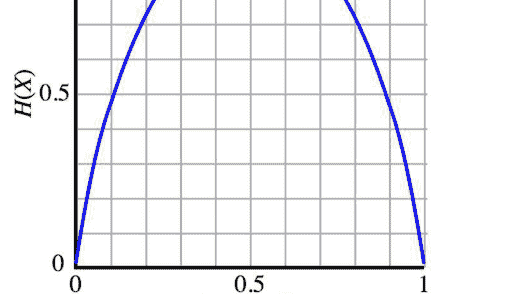

图中的横轴是 A 发生的概率，它从 0 到 1 分布，纵轴就是熵，也就是确定它发生，你需要的信息量。你会发现，当 A 发生的概率正好是 1/2 时需要的信息熵达到顶峰，是一比特。

这就类似抛一枚均匀的硬币，谁也猜不好结果，因为正反两种结果发生的概率一样，都是 1/2。但是，如果这枚硬币没造好，一面重，一面轻，那就大概率是重的那面朝下，需要确定它哪面朝下的信息量就小。

这告诉我们，永远不要听那些正确率总是 50% 的专家的建议，因为那相当于什么都 没说，没有提供能够减少“信息熵”的“信息量”。这是今天的第一个知识点。

最后半句：“相反，如果个别状态容易发生，大部分状态都不能发生，不确定性就小。”其实是这个意思：如果 你买彩票要从 10000 个号里选出一个中奖的，不确定性就大多了。不过，如果其中一个号中彩的可能性是 99%，剩下所有的号加起来的可能性只有 1%。这个问题就比较确定，熵就小。

现在，你明白什么叫“一个系统中的状态数量，也就是可能性越多，不确定性就越大；在状态数量保持不变时，如果各个状态的可能性相同，不确定性就很大；相反，如果个别状态容易发生，大部分状态都不能发生，不确定性就小。”这个原理了吧？

好，你知道了信息有单位，还可以通过公式计算，那又有什么用呢？

大家都知道赌球的庄家总是稳赚不赔，就觉得里而猫腻很多，这次我带你从信息论的角度来看清这个问题。你会发现其实很多类似的复杂难题都是信息熵的计算问题。假设，我们能提前确定各个球队获得世界杯冠军的概率，设定它们分别是 P1，P2，……，P32。那么我们套用上面的公式，就可以算出这件事需要多少信息，或者说这个问题的信息熵。

我们假定为 3.4 比特，或者说对应于 3.4 块钱。如果有一个人提一次问题支付一块钱，从理论上讲，所有参加赌局的人只要平均支付 3.4 块钱就能得到谁是冠军这个信息。但是如果设定赌局的人将收费标准略微提高，提高到一个人平均 4 元。这里面的盈余就被设赌局的人拿走了。

你可能听说过“结构化的投资证券”（Structured Notes），比如说石油的价格上涨到 100 美元以上，每 1 美元高盛就付给你 1.5 美元。但是，如果没有到 100 美元，你需要每个月付给高盛 1 美元。这种投资工具，就被做成一种结构化的投资证券。

像航空公司或者运输公司因为害怕油价浮动太高，会买这样的投资产品。那么你以为是高盛和石油公司，或者其他人对赌呢？不是的，因为高盛转手就将和它完全相反的投资产品，卖给了希望油价波动的人。当然，高盛会包装得很好，让两边都感谢它，其实它才是真正挣钱的一方。

你可能听说过金融数学这个专业，那里的人天天做的事情就是设计这种不容易为人所看懂的，自己永远不赔钱的金融产品。而所谓的基金经理，很多就是把这样的产品卖给你的人。

因此，多了解信息论和基本的数学常识，可以在生活中省下不少冤枉钱。这是今天我想告诉你的第二个知识点，希望你知道，很多交易和产品都是利用了信息的可度量性，知道了这点，就可以看清很多复杂交易背后的原理。

掌握了信息量化度量的原理，你还可以用来对付当前“信息过载”的问题，比如如何判断一篇报道到底有多少信息量。

信息说到底是用来消除不确定性的。如果讲的事情大部分大家都知道，信息量就很少。这也是为什么那些心灵鸡汤的文章大家不愿意读，并非是它们说的对不对，而是没有信息量。

和它们相反的是，我前面介绍的三篇改变世界的论文，都非常短，特别是沃森和克里克的那一篇，一页纸多一点，但是把我们过去不知道的 DNA 的结构讲清楚了。这个信息量就很大。

## 要点总结

+ 1. 香农告诉大家，信息可以衡量，但不是用重要性，而是用信息量，单位是“比特”。
2. 你可以把一个充满可能性的系统视为一个“信息源”，它里面的不确定性叫做“信息熵”，而“信息”就是用来消除这些不确定性的，所以搞清楚黑盒子里是怎么回事，需要的“信息量”就等于黑盒子里的“信息熵”。
3. 很多复杂交易背后其实都用到了信息的可度量性。
4. 信息量的大小不在于长短，而在于开创多少新知。

这一讲我留给你的思考题是：如果你和一个特别会玩锤子、剪子、布游戏的人玩这个游戏，你最好的策略是什么呢？

预告：
有了信息的量化度量，我们就知道了信息的多少，但是如果我们还想知道具体的信息是什么，就需要对它们进行编码了。这是我们下一讲要讲的内容。


## 05 | 信息编码：数字和文字是如何诞生的？

你好，欢迎来到我的《信息论40讲》。上一讲我们说了信息就是用来消除不确定性的，这一讲我们来讲人类是如何利用信息编码创造数字和文字，克服复杂世界的不确定性。

信息编码并非只是人才有的技能，很多动物，甚至一些植物都有。

为了理解它的原理，让我们先来看这样一个场景。

在非洲的草原上，食草动物在发现狮子或者狼狗接近它们的时候，会发出预警的声音，然后大家一起逃命。这其实就是使用和传播信息，而那声怪叫，就是一种信息编码。

20世纪的人类学家在研究一些原始部落时，发现原始人在遇到危险时，也像动物一样发出怪叫，然后他们用一些含糊的声音，进行通信。

比如某种特定的声音可能表示“那里有只豹子”，提醒同伴小心。同伴可能“呼呀”地回应两声，表示知道了，或者发出另一串含糊不清的声音，表示“我们用弓箭射它”。这就是简单的 信息编码。

在《信息简史》一书中，作者还举了非洲丛林里的人们用不同的鼓声传递不同信息 的例子，那也是一种信息编码。

在没有信息论之前，信息编码的复杂度通常和要传播的信息种类数量有关。早期人类了解和需要传播的信息是很少的，因此他们并不需要语言和数字，只需要发出不同的叫声，或者做些不同的手势和肢体接触即可。

但随着人类的进步和文明的进展，需要表达的信息也越来越多，不再是几种不同的声音就能完全覆盖，语言就此产生。人们生活的经验，作为一种特定的信息，其实是那个时代最宝贵的财富，他们通过口述的语言传给了后代。同时，由于人类开始拥有一些食物和物件，便有了多和少的概念，因此数字也就产生了。

我们如果要表达 100 个数字，一个办法是设计 100 个不同的编号，让它们一对一对应，另一种是只设计几种编号，然后相互组合，来表达 100 个数。

你可能觉得第二种方法更简洁，但这两种方法，在信息论中是等价的，我就来帮你算一下。

好，假定我们有 100 个数，从中挑出一个，不确定性是 100 选 1，用上节课学得信息论的公式表达，它所代表的信息熵为 log100=6.65（注：log 以 2 为底的 100 的对数，课程中的 log 函数如果没有特殊说明都是以 2 为底的。）比特。也就是说，如果我们有 6.65 比特的信息，就可以确定 100 个数中的一个。接下来，我们看看到刚才说的两种编码需要的信息量是否一样。

### 我们先来试第一种编码，也就是一一对应，比如用 100 种奇怪形状的符号对应这 100 个数字，这种编码所能表示的信息量，其实际就是 100 选一的问题，也就是 log100=6.65 比特。由于一个编码正好表示一个数，因此编码的长度为一。

### 第二种编码方法是采用十进制编码，也就是用 10 种符号，每个符号所代表的信息量只有 log10=3.325 比特，但是 10 个符号想表示 100 个数字，就需要两两组合。也就是说，一个符号无法消除 100 个数中的不确定性，这样两个符号的信息量加起来还是 6.65 比特，正好可以消除 100 个数的不确定性。

这样的编码系统比较简单，但是编码的长度是前一种的两倍。这个十进制的做法呢，就类似我们现在用到的阿拉伯数字 0~9。

当然，我们还可以用二进制编码，就是只有 0 和 1 这两个符号，它们所包含的信息只有 log2=1 比特，如果我们想用它来表达 100 个数，则需要 6.65 个码。进位取整以后，也就是 7 位的码长，才能表示 100 个数字。

你可能注意到了，符号越少，意味着码位越长，所以你看到二进制通常是一长串的 0101……由此可见，对数字的各种编码其实是等价的，无非是平衡编码复杂性和编码长度之间的关系。

对于数字，如果采用很多个符号，编码长度就短，但是系统就复杂。比如我们如果采用的是 20 进制，编码长度短了，但这就意味着它的编码系统很复杂，要记住的符号很多，大家学数学就太麻烦了。

在历史上即使有这样的文明，在竞争中也会被淘汰。玛雅文明发展不快的一个原因，就和它的计数和书写系统太复杂有关。

相反，如果采用很少的符号编码，比如采用二进制，编码的长度就长。比如 100 在二进制中的编码是 1100100，你去买东西，人家问你要 100 块钱，说出这一大串数字，你很容易听糊涂，如果让你背九九八十一，它就成了 100110011010001（9 的二进制是 1001，81 的二进制是 1010001），完全是自虐。

所幸的是，各种编码系统在数学上是等价的，我们可以为人类找一个自己方便使用的，也可以为计算机找一个它方便使用的。

但是要说明的是，由于它们是等价的，在一个编码系统中解决不了的问题，换一个系统同样解决不了。一些媒体讲，由于量子计算不是二进制的，因此它能解决今天计算机解决不了的问题，这个说法显然缺乏常识，因为任何进制都是等价的。

当然对数字的编码不能有半个，因此如果我们采用二进制对 100 个数编码，刚才计算出来是需要 6.65 个码，那就取下一个整数，编码的长度也就变成了 7 了。于是我们就得到了信息论中一个重要的公式：

### 编码长度 ≥ 信息熵（信息量）/ 每一个码的信息量。

香农对此作出了严格的数学证明，他同时还证明，只要编码设计得足够巧妙，上面的等号是成立的，这就是著名的香农第一定律。至于如何找到最巧妙的编码（或说最短的编码），我会在第 7 讲介绍。

### 说完了数字的编码，接下来我们说文字的诞生的过程。它和数字的诞生也很相似，早期无论是苏美尔人、古埃及人、古中国人、还是印度河文明的古印度人，都采用的是象形文字。一个图画就是一个意思。

但是后来要表达的意思实在太多了，总不能无限制地发明文字，于是就出现了用几个文字表达一个复杂的含义。

那么这些原始的编码背后的信息论原理是什么呢？我们还是回到消除不确定性这件事情来看看这个问题。假如一个原始人家里面有 10 样东西，他给每个东西起一个名字，这就是最简单的编码，而且早期起的那些名字都容易让人联想起东西的特性，就如同把狗叫成汪星人，把猫叫成喵星人一样。

当然，家里的东西多了，要做的动作多了，就做不到把每一件事情单独编码，就需要利用一些编码进行组合了。比如说我们有一对一些东西的编码，又有了一些对动作的编码，这就形成可以表达复杂意思的简单的句子。

比如说一个原始人让孩子把家里的石斧拿来，他就可以告诉他采用“拿来”这个动作，而要拿的对象是“石斧”。人类使用动词，标志着文明的一大进步，这不仅仅意味着

他们能够把动作进行分类，编码了，而且这样才能表达复杂的意思，才有可能形成知识。

有了象形文字和动词之后，人类就有了书写系统，各种信息就通过文字这种编码记录下来，这才让我们了解到过去的历史。但是，从此人类的不平等也开始加剧，因为能够认识编码的人，就掌握了其他人所没有的信息。

我们从前面几讲的课程中知道，信息太重要了。于是，这些能够读写的人就成了精英甚至是统治阶级。在任何历史阶段，谁控制了信息，谁就是世界的主人。

一个最有说服力的例证就是：在马丁·路德之前，关于上帝的信息是由教士和主教们控制的，因此农民们只好受人摆布。在中国虽然大家不信上帝，情况也是类似。过去在农村，不能识文断字的人，怕再有钱，也不过是土财主，家业很难长期兴旺；能够读写写字的人，怕穷，在宗族里也很有地位。

今天，虽然大家都能识文断字，但是有的人掌握的信息多，有的人掌握的少，这就造成了很大的不平等。对于个体来讲，改变自身获取信息的能力，要比改变整个社会的不平等容易得多。

古代文字难以普及的一个重要原因，就是基于各种象形文字的编码系统太复杂，要记忆的东西太多，学习的成本太高。于是全世界的语言都在沿着简化这条路发展。至于怎么简化，我们后面会专门讲。

## 要点总结

- 1. 我通过讲人类创造数字和文字语言的过程，告诉大家，其实它们都是人类用来消除信息不确定性的编码手段。各种编码系统，其实都是在编码复杂性和编码长度之间作平衡，它们在数学上是等价的；
- 2. 由于它们是等价的，所以，在一个编码系统中解决不了的问题，换一个系统同样解决不了；
- 3. 香农第一定律告诉我们，只要编码设计得足够巧妙，就可以找到最短编码。

思考题：编码要在长度和复杂性上作平衡，其实很多工作都是在作平衡，我想听听你的行业是否也有类似的平衡之道。

预告：至于怎样设计一个好的编码系统，它既不太复杂，又比较有效；推而广之，怎样表达一个意思，它既非常明确，又非常简洁，这是我们下一讲要讲的内容。我们下一讲再见！

## 06 | 有效编码：10 个手能表示多少个数字？

你好，欢迎来到我的《信息论 40 讲》。

我们上一讲讲了信息编码最简单的原理，今天谈谈如何设计一个好的编码系统，以及其背后的本质。这些原理，也可以用于提高我们日常的有效沟通。

我们上一讲提到，各种编码系统本身在信息论上是等价的，但是，不同的编码系统可以有好有坏。比如今天使用的阿拉伯数字（其实是印度人发明的）0～9就是一个很好的编码系统，对于描述数字信息来讲，它们的数量不多不少，形状差异大。

如果采用一个小圆点“.”代表一，两个“..”代表二，三个“...”代表三，十个“................”代表十，就不太好，因为大家容易看花眼。因此好的编码第一个特点就是要便于区分不同的信息。

我国在文革后曾经推行过一版过于简单的简化字，但是很快就停止使用了，这里主要的原因是将汉字的笔画简化得太少后，使得近形字大量出现，不易辨识，非常容易搞混，因此很快就废止了，从信息论上讲，它违反了好编码要便于信息辨识的原则。

上述原则在平时的表达和沟通中也很重要。比如说，德国著名的营销专家和演讲家多米尼克·穆特提出的清晰表达的五个原则：明确、诚实、勇气、责任和同理心，前四条就和信息编码要便于识别有关。

第一个原则：“明确”，这就不必说了，它是沟通的核心。只有意思表达得明确，才能保证对方不误解。

很多专业文件都写得像八股文，无论是病例，律师写的法律文件，或者科学杂志上的论文，都是如此，其最根本的目的就是要确保意思表达无误，在同行中不会产生任何误解。

至于其他的三条原则“诚实、勇气、责任”，也是辅助将想法明确表达出来的。“诚实”是能够明确表述的基础，因为口是心非，难免会语焉不详。而“勇气”则代表对一件事情的态度确定，因为只有内心非常确定，表达才能明确。至于“责任”，说的是代表对一件事情要有所谓，如果对一件事情持无所谓态度，说出来的话就一天一个样。

这就是我想告诉你的第一个知识点，也就是信息编码的第一个基本原则：“易识别”，应用在我们个人沟通中，也是如此。

便于识别，不容易混淆只是编码的第一个基本要求。作为一种好的编码还需要做到“有效”。我们在《科技史纲 60 讲》中介绍了信号旗、信号臂，它们都是有效的编码，通过一些图形或者动作的组合，能表达很多信息。

在信息传播上，只有当编码有效时才能在短时间里传递大量的信息。比如我们经常在谍战片中看到通过发电报传递信息，电报的电文都非常简洁，因为发报时间不能太长，否则很容易被对方发现，这其实符合有效性的原则。那么怎么样做到有效编码呢？我们先来看这样一个问题：

### 用十根手指头，能表达多少个数字？

很多人觉得能表达十个数字，因为我们平时数数就是这么数的。也有人觉得可以表示100个数字，因为我们一个巴掌就能表示十个数字，将巴掌组合起来，一个表示个位，一个表示十位，就能表示从0到99共100个数字。这个想法非常好，能想到这层可以讲是多多少体会了编码原理的精髓。

但是，这依然不是最有效的编码，如果我们考虑采用二进制，而不是十进制进行编码，则能表示1024个不同的数字。

具体的做法是这样的，我们把十个指头伸开：从左边的小拇指到大拇指编号为0～4，再从右边的大拇指到小拇指，编号为5～9。这十个指头，每一个都有伸出、收起两种状态。每一种状态对应于一位二进制，十个指头能表示10位二进制，因为10个指头，每个指头有两种情况，就是2的10次方，也就是1024种可能性。

当然你说，能不能让每个手指具有伸开、半伸开和收缩三个状态，表示59049，也就是3的10次方种可能性呢？这种想法不能说有错，但是并不好，因为它过分强调有效性，而忽视了易辨识这个原则，凡事过犹不及。

好，这是我想说的第二个信息编码的原则：有效性。如何组合信息，保证它高效传递，还能不违背第一条“易辨识”的原则。这就需要我们主动思考了，下面我为你介绍一个现实的例子，看看能否启发你。

利用上述两个编码原则，可以有效地进行生物和IT产品的实验。硅谷的公司里有这样一道面试题：

有64瓶药，其中63瓶是无毒的，一瓶是有毒的。如果做实验的小白鼠喝了有毒的药，3天后会死掉，当然喝了其它的药，包括同时喝几种就没事。现在只剩下3天时间，请问最少需要多少只小白鼠才能试出那瓶药有毒？

很多人看了这个题目从直觉出发，直接答64只，每一只吃一种不同的药。这样自然没有问题，但是并不有效。能不能减少老鼠数量呢？你可以暂停10秒，自己思考一下。

好，我要公布结果了，实际上解决这个问题只要六只小老鼠就可以了，如果你上节课认真真听讲了，就知道，这是一个64选1的问题，那么需要的信息量就是log64，也就是6比特。你要是想具体操作验证，方法是这样的：

| 十进制编号 | 二进制编号 |
| --- | --- |
| 0 | 0 0 0 0 0 0 |
| 1 | 0 0 0 0 0 1 |
| 2 | 0 0 0 0 1 0 |
| 3 | 0 0 0 0 1 1 |
| …… | …… |
| 31 | 0 1 1 1 1 1 |
| 32 | 1 0 0 0 0 0 |
| …… | …… |
| 61 | 1 1 1 1 0 1 |
| 62 | 1 1 1 1 1 0 |
| 63 | 1 1 1 1 1 1 |

↑ ↑ ↑ ↑ ↑ ↑
对应 6 只老鼠： 鼠1 鼠2 鼠3 鼠4 鼠5 鼠6

说明：将一个十进制数除以二，得到的商再除以二，以此类推，直到商等于零或零时为止，然后依照倒序取得除得的余数，即换算为二进制数的结果。比如32除以2，商是16。余数是0。然后再用商16除以2，得到余数0。以此类推，得到6个余数，再倒序排列，就是100000。要点是：除二取余，倒序排列。

1.我们将这些药从0~63号。按照二进制编号，获得64个六位数的二进制编号，也就是从000000（六个零）到111111（六个一），每个二进制编号的最左边是第一位，最右边是第六位。

2.然后选六只老鼠从左到右排开，和二进制的六位，从左到右地依次对应。文稿里的二进制编号，你可以试着一位一位竖着看，下面每只老鼠负责一位。

3.从左边数第一个老鼠对应的二进制是1的药，0就不吃。那老鼠1依次吃第32, 33, 34, …… , 63号药。第二只吃16, 17, …… , 31, 48, 49, …… , 63号药，等等。最后一只老鼠吃1, 3, 5, …… , 63号药。你可能注意到了，6只老鼠都吃了63号，因为63对应的二进制编号是6个1，所以6只都要吃。

4.吃完药之后三天，某些老鼠可能死了，我们假定第1, 2, 6这三只老鼠死了，剩下的活着。这说明什么呢？说明编号110001号药有问题，也就在第1, 第2, 第6位上分别是3个1，因为这三只老鼠都吃了它，而3, 4, 5这三只没死的老鼠没有吃它（对应的位置为0）。而110001对应十进制的49，也就是说第49瓶药是有毒药。

对于其它的组合也是同样的，你可以自己随便假定哪几只老鼠死了，看看哪瓶是毒药。当然，还有一种情况，就是所有的老鼠都没有死，那说明第 0 号药是毒药，因为其他的药都吃过了，就这一瓶没有吃。

通过上述方式，可以用 6 只小老鼠一次性完成 64 选 1 的任务。怎么确定 6 只老鼠就足够了呢？结合我们前面讲到的理论，64 选 1 的任务其实只需要 log64=6，也就是 6 比特的信息就够了，每一只老鼠提供了一比特的信息。

因此，从理论上讲 6 只小老鼠就足够了，而有效的编码，其实就是完成从理论上的上限到现实中解决方案的桥梁。所以 IT 公司在招聘计算机工程师中会考这道题，因为很多的是 IT 间题，就是编码问题。

这是我通过道疋在面试验，想传达给你的第三个知识点，也就是有效编码，其实就是让理论最佳值在应用中落实。

不仅如此，有效编码的选想在今天 IT 的产品性能比对测试中有直接的用途。我们在第 3 节讲到大数据思维，其中很重要的一条就是采用大量用户反馈信息决定产品的设计和技术方案。

比如在一个产品中，有两种可用的方案，A 和 B，哪种更好呢？过去常常是工程师们和产品经理们拍脑袋想，有时候某些人的“眼光”很好，正好蒙对了，选了一个用户也喜欢的方案，但是这种“眼光好”是无法复制的，一个公司将自己的商业成功寄托在“眼光好”上早晚要失败。

这时，就可以用用户大数据评测 A、B 方案的好坏，通常的做法是随机选取 1% 的用户作对比实验。比如 Google 在改进搜索算法或者其它产品体验后，会先做这样不公开的测试，一般会持续一周左右。但是像 Google 这样有好几万工程师的大公司，每天的各种改进是很多的，如果每个项目都用掉 1% 的用户，把全部用户都用上也不够。

这就回到了我们刚刚学过的高效编码问题，用少量用户同时进行很多个实验的方法，就类似上面这种让小白鼠试毒药的方法，也即将各种不会发生冲突的实验用二进制进行编码，几组实验者，就可同时进行几十个不同的实验。

## 要总总结

- 1. 我们介绍了信息编码的两个基本原理：易辨识和有效性；
- 2. 我们用实例说明了信息论原理和我们工作的关系。

我在过去的课程中介绍了不少方法，很多同学讲，吴老师，您和其他老师讲的东西我觉得都很好，但是怎么听了一年课程没有提高呢？

对此我想说的是，知识学习了之后只有真正使用了，才能变成自己的东西。信息论是不少大学里通信专业研究生的必修课，学的人很多，但是绝大部分人学了以后也就扔一边了，少数人则在工作中刻意使用它，最后就做出了很多别人没有得到的成就。

因此学以致用比多学习更重要。

思考题：请在留言区与我分享你学以致用的小案例。

预告：下一讲，我们讲一个在现实生活中能够实现的，达到理论上效率极限的编码——哈夫曼编码，以及它在各个领域的应用。我们下一讲再见！

## 07 | 最短编码：如何利用哈夫曼编码原理投资？

你好，欢迎来到我的《信息论 40 讲》。

如何对信息进行编码才最有效？这个问题一直困扰着人们，我在《科技史纲 60 讲》中介绍莫尔斯电码时讲到，他根据常识对经常出现的字母采用较短的编码，对不常见的字母用较长的编码，这样就可以降低编码的整体长度。

下面这张图，其中圆点（嘀）代表电报机的继电器短暂的接触，长线（嗒）代表长时间的接触（要求至少是短接触时长的三倍以上）。

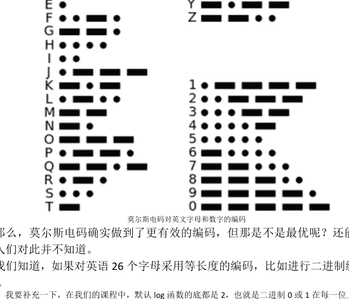

莫尔斯电码对英文字母和数字的编码

那么，莫尔斯电码确实做到了更有效的编码 但是它是不是最优呢？还能不能更短呢？人对此并不 知道。

我们知道，如果对英语 26 个字母采用等长度的编码，比如进行二进制编码，需要 log26。

注：我需要补充一下，在我们的课程中，默认 log 函数的底数是 2。也就是说二进制 0 或 1 在每一位上的两种可能，需要多少位，就是多少个次方，也就是多少个比特的信息

那么 log26 就约是 5 比特信息。而采用莫尔斯的编码方法，平均只需要 3 比特，这个效率就高了很多，这样发报，时间就能节省大约 1/3 左右。

我们在谍战片中经常看到报务员还没有发完报，敌方的特工就冲了进来，这种场景并不完全是虚构的，因为在二战时欧洲德占区这种场景时常出现，因此省一点时间就意味着自身的安全。即使不考虑战争中的特殊情况，省掉三分之一的通信成本，也是很可观的。

无独有偶，全世界除美国之外，各国在设计长途电话区位码的时候，也充分考虑了每一个城市和地区的电话机数量，比如在中国北京、上海等重要城市就是两位，小城市就使用 3 位，这样做的目的是为了减少平均的编码长度。


那么是否能够证明，越常出现的信息采用较短的编码，不常出现的信息采用较长的编码，就能比采用同样码长的信息总体上更合算呢？答案是肯定的。

详细的推导步骤：
我们不妨看一个具体的例子。我们假定有 32 条信息，每条信息出现的概率分别为 1/2, 1/4, 1/8, 1/16……依次递减，最后 31、32 两个信息出现的概率是 1/2^31、1/2^31 （这样 32 个信息的出现概率加起来就是 1了）。现在需要用二进制数对它们进行编码。等长度和不等长度两种编码方法，我们来对比一下：

方法一：采用等长度编码，码长为 5。因为是 log32=5 比特。

方法二：不等长度编码，如果出现概率高就短一些，概率低就长一些。
我们把第一条信息用 0 编码，第二条用 10 编码，第三条用 110 编码……最后 31、32 两条出现概率相同，都很低，码长都是 31。第 31 条信息就用 1111……110（30 个 1 加 1 个 0）编码，第 32 条信息，就用 1111……111（31 个 1）来编码。
这样的编码虽然大部分码的长度都超过了 5，但是乘以出现概率后，平均码长只有 2，也就是说节省了 60%的码长。如果利用这个原理进行数据压缩，可以在不损失任何信息的情况下压缩 60%。

事实上，这种最短编码方法等于香农第一定律的继续，它最早是由 MIT 的教授哈夫曼发明的，因此也被称为“哈夫曼编码”。

关于哈夫曼编码有三个要点值得一提：

- 1. 如果你还记得第 5 讲的香农第一定律，一定知道编码长度是有个理论最小值的，从数学上可以证明哈夫曼的这种编码方法是最佳化的。
- 2. 哈夫曼编码从本质上讲，是将最宝贵的资源（最短的编码）给出现概率最大的信息。至于资源如何分配，哈夫曼给出了一个原则，也就是一条信息编码的长度和出现概率的对数成正比。
注：比如在上面的例子中，第一条消息出现的概率为 1/2，我们知道 1/2（以 2 为底）的对数等于 -1。因此它的编码长度就是 1（即 0）。最后两条消息出现的概率为 1/2^31 次方，取对数后等于 -31，因此它们的编码长度就是 31。

如果我们回顾一下莫尔斯电码，就会发现它是不自觉地采用了哈夫曼编码的原理。只是它没有严格统计各个字母的频率，没有完全做到最优化。
在一个极端的情况下，如果所有的信息出现的概率相同，采用哈夫曼编码，每一条信息的码长都一样，这时哈夫曼编码就变成了等长编码，没有优势了。

- 3. 在现实生活中，很多信息的组合，比单独一条信息，其概率分布差异更大，因此对它们使用哈夫曼编码进行信息压缩，压缩率会更高。比如说，在汉语中，如果对汉字的频率进行统计，然后压缩，一篇文章通常能压缩掉 50%以上，但是如果按照词进行频率统计，再用哈夫曼编码压缩，可以压缩掉 70%以上。

讲完了哈夫曼编码的原则，那它又是怎么应用到我们的工作生活呢？
其实，但凡需要分配资源的工作，它都有指导意义。我在《浪潮之巅》一书中介绍凯鹏华盈时讲，虽然换了三代掌门人，但它能在四十多年，20 多期基金中，平均每一期基金的回报总是有 40 倍左右，这说明它不是靠一两个人天才的眼光，而是有 整个 一套系统的方法，保证投资的成功率。

那么它投资方法中的秘诀是什么呢？其实就是哈夫曼编码的原理，即通过每一次双倍砸钱（double down），把最多的钱投入到最容易成功的项目上。它具体操作方法可以这样一个例子来说明。

我们假定一期基金有 1 亿美元可以用来进行风险投资，怎样投资效果最好？我们列出三个做法：

- 1. 平均地投入到 100 个初创公司。
- 2. 利用我们的目光投入到一家最可能的公司中。
- 3. 利用哈夫曼编码原理投资。

我们还假设如果投资的公司最后能上市，将获得 50 倍的回报；如果上不了市，只是在下一轮融资被收购，将获得 3～5 倍的回报。在硅谷地区，获得投资的公司最终能上市的概率大约是 1%，大家不要觉得这个比例低，它已经比世界其他地区，包括美国硅谷以外的地区和中国，高很多了。至于被收购的概率，在硅谷地区大约是 20%，比中国要高很多。

如果使用第一种方法，基本上是拿到一个市场的平均回报，也就是一轮基金下来大约是 31% 到 71% 的回报，如果扣除管理费和基金本身拿走的分红，出资人大约能得到 20%～50% 左右的回报。通常一期风险投资基金投资的时间是 2～5 年（持续的时间可以长达 7～10 年），这样年化回报大约是 5%～20% 之间。

这是硅谷风险投资的平均水平，大家不要觉得风险投资一定能挣钱，在中国，大部分风险投资基金是赔钱的，而在硅谷赔钱的基金的比例也高达 40%。

第二种方法，只投一家，这其实是赌博，如果碰上这家公司上市，有 50 倍的回报，碰上被收购的有 2～5 倍的回报，但是绝大多数情况则血本无归。

如果所有的基金都玩这样的赌博，虽然平均回报率和第一种情况相似，但是投资风险高达 500%。根据投资领域普遍采用的夏普比率（请回到《硅谷来信》查看第 145—148 封信）来衡量，这是极为糟糕的投资方式。

第三种方法是按照哈夫曼编码的原理，可以先把钱分成几部分逐步投入下去，每一次投资的公司呈指数减少，而金额倍增。具体操作方法如下：

- 第一轮，选择 100 家公司，每家投入 25 万美元，这样用掉 2500 万美元。
- 第二轮，假定有 1/3 的公司即 33 家表现较好，每家再投入 75 万美元左右，也用掉 2500 万美元。至于剩下了的 2/3 已经死掉或者不死不活的公司，千万不要救它们，更不要觉得便宜去抄底。
- 第三轮，假定 1/10 的公司，即 10 家表现较好，每家投入 250 万美元，再用掉 2500 万美元。
- 第四轮，假定 3% 的公司，即 3 家表现较好，每家投入 800 万美元左右，用掉最后的 2500 万美元。

这样通常不会错失上市的那一家，而且还能投中很多被收购的企业。由于大部分资金集中到了最后能够被收购和上市的企业中，占股份的比例较高，这种投资的回报要远远高于前两种，大家可以估算一下，大约有 3～10 倍的回报。

当然，这还达不到凯鹏华盈 40 倍的回报，但是已经非常好了。你也可以认为，一个系统的方法和坚持纪律能够带来 3～10 倍的回报，而对于凯鹏华盈来讲，投资人的经验和人脉，带来的就是剩下的那几倍回报。

当然大部分人不会去参与风险投资，但是这种分配资源的原则在哪个都适用。我在之前《Google 方法论》中介绍 Google 和 Facebook 等公司的管理方法时讲到，它们内部其实是一个大风投，各个项目一开始都有获得资源（主要是人力和财力）的可能性。

但是很快，通常是三个月到半年，类似的项目就要开始整合，资源开始集中到更有希望的项目上去。最后能够变成产品上市的，是少数项目，但是大量的资源投入在其中了。这样既不会失去新的机会，也不会浪费资源。

今天的华为养了一个拥有几万人庞大的预研部门，很多人觉得这是有了钱之后嚎啕浪费，但是你可以把它看成是一个内部的大风投，每一个前期研究，都得到一定的发展机会，而投入的资源并不需要太多，最后能够进入到获得巨大资源攻坚阶段的项目，终究是少数。

这个道理对个人来说也是适用的。美国有名 的私立学校哈克学校的 前校长尼克诺夫博士讲，在孩子小时候，要让他们尝试各种兴趣爱好，但是最终他们要在一个点上实现突破，他将此比喻做圆规画圆，一方面有一个扎得很深的中心，另一方面有足够广的很浅的覆盖面。

## 要点总结

最后大家可能对我有一个问题。那就是你讲了半天哈夫曼编码，你自己是否采用了用它指导行动呢？简单的回答就是：“是的，我是这么做的。”

一方面我从来不排斥尝试新东西，这样不会失去机会，我尝试过的各种事情远比外界知道的多，只是绝大部分失败了，我没有继续坚持了，大家也就从不知道了。但是，另一方面对于花了一些精力，看样子做不成的事，我是坚决做减法止损，这样可以把最多的资源投入到我擅长的，有兴趣的，可能也是成功率最高的事情上。这算是我对今天内容的总结。

思考题：假设你有五天时间在巴黎度假，有些景点比较有名，你非常想去，但是可能比较拥挤。有些景点没有太大的名气，但是游人很少。你会如何安排这五天时间呢？

预告：下一讲，我们就从信息聚类的角度来讲讲语言编码的变迁，比一比拼音文字和象形文字哪一个是更有效的编码。

## 08 | 矢量化：象形文字和拼音文字是如何演化的？

你好，欢迎来到我的《信息论40讲》。

我们在第6讲，讲了有效编码的原则，可能有同学会想，按照那两个原则，我们的文字，无论是西方的拼音文字，还是东亚的方块字，都不算完美，一方面有些字长得有点像，比如人和入，土和士，没有上下文不好辨认，不符合易识别的原则，另一方面大部分文字作为编码也不高效。

就说英文单词吧，用5个字母就能拼出1200万个单词，即便扣除掉iiii、jjjj这种不合理的，也能拼出几十万个看起来很“合理”的英文单词，要是这样的话，所有单词只有5个字母，大家不就不需要背那些很长的英文单词了吗？

对这个问题简单的回答是，语言和文字是慢慢演化过来的，而不是人为利用信息论的编码原理刻意构造的，因此不可能只照顾易辨识和有效性，而不考虑人类接受它们的难度，以及演化的过程。

相反，人给计算机识别的单词，比如汇编语言的指令代码，基本上就是很短的、等长的字母组合，因为那是完全利用编码原理人工设计的。

当然，在人类文字演化的过程中，也无意间用了一个信息论的原理——信息的矢量数字化（也被称为VQ），或者简单地讲就是矢量化。

今天我们就从文字和语言的演化过程，来谈谈这个原理以及它们的意义。

人类在进入到文明社会时，活动的范围越来越大，需要记录的信息越来越多，人类就开始通过动词和名词的组合来表达复杂的意思。

但是新概念、新事物还是不断地涌现，人类只好造出更多的象形文字，这就如同今天人们不断创造新词一样。信息越多，需要的编码越多，这是文明自然演变不可避免的过程。

太多不同的编码（文字）出现后，就要对编码进行简化，否则大家就没法学习了。

而简化的自然过程，就是矢量化的过程。

那什么是矢量化呢？你一定有这样的经历，就是把一张图片放大再放大，通常就会模糊，出现马赛克甚至锯齿。

学计算机的人知道，计算机中使用的字体有位图（bitmap）和矢量图两种。位图一经放大就会出现锯齿，而矢量图随渴放大，都很清晰。这是怎么做到的呢？

我们先从信息的矢量化说起。

我们假定有一些几何形状，它们具有不同的颜色。例如下面这张图：

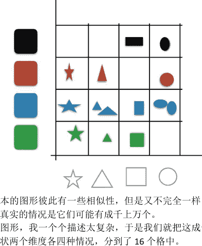

这些基本的图形彼此有一些相似性，但是又不完全一样。我只画了十四个不同的形状，当然真实的情况是它们可能有成千上万个。

这么多图形，我一个个描述太复杂，于是我们就把这成千上万个彩色的形状，按照颜色和形状两个维度各四种情况，分到了 16 个格中。

这样，所有的图形，就被归为了 16 类。当然，其中还有四个格子没有信息，因此可以看成是不存在的。这便是矢量化的原理。

这个用坐标分类，概括多种形状，就是形状的矢量化过程。当然，如果我们分类所概括的是信息，而不是图形，道理是一样的。

为什么这种特殊的归类过程，我们称之为矢量化呢？因为当我们把杂乱无章的信息投射到两个维度之后，两个维度坐标就可以决定平面上的一个矢量。

比如在上面的例子中，要找圆形和椭圆形的蓝色图形，就用下面这个从原点出发到（4，2）坐标的矢量来表示：

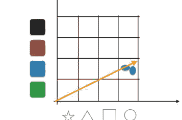

当然，通常将信息投射到两个维度是不够的，根据应用场景会投射到多个维度中，这样的过程就被称为矢量化。

人类象形文字的演化，实际上就是这样一个矢量化的过程。我们不妨先看看各种象形文字演化的过程。

文字演化的第一步是抽象化。下面一张图描述了美索不达米亚文字（上）、古埃及文字（中）和古代中国的文字（下），对“鱼、鸟、咸、矢（“有的放矢”的“矢”，也就是箭）、壶”这五个字抽象化的过程。

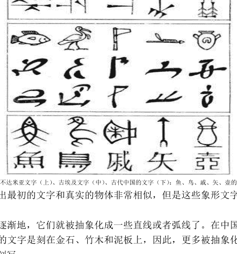

美索不达米亚文字（上）、古埃及文字（中）、古代中国的文字（下）：鱼、鸟、咸、矢、壶的写法

你可以看出最初的文字和真实的物体非常相似，但是这些象形文字彼此之间缺乏共性。

但是后面逐渐地，它们就被抽象化成一些直线或者弧线了。在中国和美索不达米亚，由于早期的文字是刻在金石、竹木和泥板上，因此，更多被抽象化成点和线的组合，这样便于刻写。

而古埃及是写在莎草纸上的，能够使用曲线书写，因此多用曲线进行抽象化。但不管怎么样，抽象化之后，就可以看到总结出共性了。

接下来第二步，我们就以汉字为例说明矢量化的过程。

绝大多数汉字被映射到两个维度上，即一个表意的偏旁维度和一个提示读音的发音维度，有 Cardinal times，提示读音的维度本身也表意。

再在后，表达含义的偏旁已经和原来的图画不太像了。而这些偏旁就构成了文字的基本单元，而且慢慢固定下来了。

以后有新的概念需要创作出新字时，使用那些基本单元，即偏旁部首，重新组合就可以了。比如唐朝的宗奭客为武则天发明了一个“囿”字，意思是日月当空，献给武则天拍马屁。

当然，很古古代人所表达的信息今天早已经过时了，因此大量的古体字其实今天已经废了。虽然《康熙字典》里收集了 47000 个汉字，但是 3000 多个一级国标汉字已经能覆盖今天 98% 以上的文本了。

类似地，在《牛津词典》中大约 1/4 的词今天已经不用了。今天的人，更习惯于用现有的字发明新词，而不是造字。

好，说完了象形文字的演化。我们再看看拼音文字是如何矢量化的。

拼音文字的简化主要是围绕读音进行的。在美索不达米亚人发明了楔形文字后，它很快就由象形文字变成了拼音文字。但是那些拼音文字并不简单，每一个表达意思的拼音其实是一堆很复杂的小箭头（很像楔子，所以也被称为楔形文字）。

后来楔形文字被当地的闪米特人学会了，他们中间有一支非常善于远洋经商的族群——就是腓尼基人。

腓尼基人将美索不达米亚的文字传播到地中海各岛屿。但是，在经商途中，商人们可没闲情逸致刻写精美漂亮的楔形文字，于是他们对这种复杂的拼音文字进行了进一步简化，就剩下几十个字母了。

可以说，从复杂的楔形文字，变成简单的几十个字母，是一个巨大的进步，它使人类学习读写变得很容易。再后来希腊人从腓尼基字母中总结成 24 个希腊字母，而罗马人又将它变成 22 个拉丁字母。

随着罗马的扩张，征服了很多外国土地，吸纳了很多外国人，有些外国的人名和地名就无法表示了，于是罗马人在字母表中加入了 x，代表所有那些无法表示的音和词，这既是英语里包含 x 的单词特别少的原因，也是后来人们用 x 表示未知数的原因。

再后来拉丁文里的 i 被拆成了 i 和 j 两个字母，v 被拆成了 u,v,w 三个字母，最终就形成了今天英语的 26 个字母。

今天欧洲其它的拼音文字大多源于拉丁语，虽然它们字母表的多少略有区别，而且读音不同，但是写法上相似，因为同一种写法表达的是同一条信息。

## 虽然象形文字和拼音文字的形成和进化代表了两种不同的信息编码方式，但是它们都利用了信息 Quantity 化原理。

在欧洲的拼音文字中，虽然没有表达意思的偏旁部首，但是有很多词根，前缀和后缀起到了表达意思的作用，也就是说这些语言实际上将表达信息的基本单元（单词）用一个词根、前缀、后缀这样三维的矢量表示了。

于是，稍微有些语言基础的人，可以猜出一些没见过的单词的含义。正因为这个原因，拼音文字比汉语容易学。

在近代史上，曾有不少学者提出过将汉字改为拼音文字，但其实这是不可行的。比如你把计算机变成 jisuanji 这几个罗马字母，它完全没有词根、前缀和后缀，因此猜不出意思。

信息的矢量化这件事应用的场景非常广，前面提到的矢量字体就是一个，它的原理是将字体的轮廓映射到一组曲线上。在显示（和打印）时，经过一系列的数学运算，恢复字体的形状。

这一类字库不仅占用空间小，而且从理论上可以被无限地放大，笔划轮廓仍然能保持圆滑，非常美观。

此外，矢量化在生活中也有应用，比如我们通过高考成绩录取大学生，或者通过身高筛选篮球运动员，其实就是利用矢量化的原理，只不过是将所有的人映射到了一维的空间中。

这种做法给工作带来了极大的便利性，但是显然没有全面地考察每一个人，或者说有信息的损失。

所以，在信息论中，一个更有普遍意义的问题就是：矢量化会带来多大的信息损失，关于这一点，在信息论中有 一套理论计算这种损失。
而在工程中大家要做的事情就是，如何平衡便利性和信息上的损失。人在年轻的时候，总是会想两者兼而有之，学习了各种科学知识后，就知道这种事情在理论上是办不到的。

## 要点总结

- 1. 我们从文字的演变，介绍了信息的矢量化这个概念，以及其的应用。
- 2. 我们进一步讲述了，无论是象形文字还是天然形成的拼音文字，都通过两到三维度的矢量化兼顾了读音和达意的关系。但是，如果强制将中文拼音化，它将失去达意的功能，这不符合信息论的原则，因此做不下去。世界上人为想做的，但是违背规律的事情，做起来总是困难重重。
- 3. 在生活中其实也有很多矢量化的例子，它们让问题变得简单，但是会丢失信息，而平衡便利性和信息的完整性，就成为了艺术。

思考题：如果你是一家公司的人事经理，年底时要设计一个对员工进行评估的方案，利用矢量化的原理，该怎样设计方案比较好？

预告：我们还留下了一个问题，为什么说中文比西方拼音文字更精炼，也因此更难学？这个问题我们下一讲再说。下一讲见！

## 09 | 冗余度：《史记》和《圣经》哪个信息量大？

你好，欢迎来到我的《信息论 40 讲》。

上一讲，我们说到中文比西方拼音文字更精炼，我们总是听说联合国的同一份报告，只有中文报告是最薄的。这种说法到底是不是真的？是否是我们自己往自己脸上贴金呢？其实我们可以用信息论来证明。

中文是否简洁，我们不妨先看一个具体的例子，那是我多年前自己做的一个实验：量化度量一下《史记》和《圣经》的 信息量

## 量化度量一下《史记》和《圣经》的 信息量。

为什么统计这两本书呢？因为这样经典的典籍语言相当精炼，比较有代表性，而且在翻译成不同语言的版本时，都极为仔细准确。相比之下，文学作品的翻译随意性就较大。

我先把《圣经》的中英文版本分别进行压缩，然后对比大小。

《圣经》的英文版有 80 万个英文单词，扣除掉空格和标点符号，存下来接近 4MB。你可以认为将它们用今天计算机常用的 ASCII 编码书写后，长度是四百万字节。

然后我又找到了《圣经》的中文版本，我用的是比较流行的“和合本”，原文有 93 万多字。和合本虽然是白话文，但是翻译得极为紧凑，一点废话没有。如果用国标汉字存储它，接近 2MB，也就是说大约只有英文文本的一半。

当然学过计算机的同学会说，国标编码本身就比英文的 ASCII 编码紧凑，事实也的确如此，考虑到这个因素，我抠掉国标和 ASCII 编码中的水分，中英文编码长度的差距大约缩小 30%。

即使如此，汉语的文本依然可以比英语的短 30% 多，也就是说汉语的文本和英语文本在公平的基础上作对比，长度是 2:3 左右，具体讲是 1.6MB vs 2.5MB。


53 万字，如果直接按照国标码存储大约要 1.1MB，当然我们说了国标码本身在编码上是有水分的，因此在挤掉水分后，《史记》的编码长度应该是 900KB 左右。

如果采用上面同样的哈夫曼编码程序对其压缩，压缩完不到 500K，压缩比大约为 1.8:1，和中文《圣经》的压缩比是差不多的。

你可以看看这个表格中它们的对比结果：

|  | 字数 | 原始大小 | 压缩后大小 | 用哈夫曼编码压缩后 |
|---|---|---|---|---|
| 《圣经》英文版 | 80 万个英文单词 | 4MB | 2.5MB | 750KB |
| 《圣经》中文版 | 93 万字 | 2MB | 1.6MB | 750KB |
| 《史记》中文版 | 53 万字 | 1.1MB | 900KB | 500K 以内 |

那么结论就来了，从上面的例子可以看出，中文的信息比较“密集”，相比之下，英文（和其它欧洲语言）比较“稀疏”。在信息论中，我们采用一种叫做冗余度的概念对信息的这种“密集”和“稀疏”程度进行描述。冗余度是这样定义的：

（信息的编码长度 - 一条信息的信息量）/ 信息的编码长度

我们知道信息量其实就是按照信息熵计算出来的。

在上述例子中，中文的冗余度大约是 1/2，英文的冗余度为 2/3，如果对其它书籍的双语文本文作同样的对比，也能得到类似的结果。因此，中文简洁是完全有科学根据的。

接下来可能你会想，简洁不是一件好事么？冗余不是应该尽力去除吗？如果我们原本需要读 5000 字节的内容，现在只需要读 3000 字节，那不是省时间么？

其实不然，因为如果冗余度太低，会严重影响接收信息的速度。比如我们对一篇经典的论文和一篇小说进行压缩，就会发现小说的冗余度要高得多，但也正是因为如此，小说才容易阅读。

相比之下，极为严谨的拉丁语和法语则没有这个问题。比如在英语中，名词和动词数量的一致性，句子中语气和写法的一致性，都保证了相应的信息不容易漏掉。这都归功于它们的冗余度大。

## 冗余度的第三个好处是：带来信息的容错性。

我们有这样一个经验，如果你的朋友给你发送了一个文本文件，这个文件丢失了一段，你依然能够得到大部分内容，甚至能够通过前面或者后面的内容恢复出一部分丢失的内容。

但是，如果他把文件压缩成 Zip 格式了，而压缩后的文件少了一点，你就惨了，完全无法恢复其中的内容。

冗余度给我们带来好处，最著名的例子就是通过罗塞塔石碑破解古埃及文字的例子。关于罗塞塔石碑的故事我在《科技史纲 60 讲》中已经作了详细的介绍。这里只作一个简单的说明。

1801 年，拿破仑远征埃及时，一个军官在一座古神庙的遗址上发现了一块古埃及石碑，上面刻有三种语言：除了古希腊文，还有两种他不认识的文字。

21 年后，著名的语言学家商博良，根据石碑最下方的古希腊文字，破译出中间的世俗体古埃及文字。从此，尼罗河流域五千年文明的面纱就此揭开。

一块石碑上刻有三种语言，从记录信息的效率上讲是极低的，信息冗余度至少是 2/3，但是正是因为有信息冗余，才能利用另一种信息找回原来丢失的信息。

当然，凡事有一利必有一弊，信息冗余自然有它的问题。

## 首先，大家能够直接感受到的就是在存储和传递信息时的浪费。

可以想象，如果你存储的文件，编码的长度是信息量的好几倍，肯定是浪费。当然有人可能在想，现在存储器便宜得很，网速也很快，冗余就冗余吧，浪费不了多少钱。

但是要知道文字的冗余度是在各种信息中非常低的。如果你传输标准的 4K 电视，对于任何信息冗余，一点也不压缩，那你的网速需要每秒钟 12Gbps。也就是采用光纤入户后峰值传输率的大约 10 倍，今天家庭使用的 Wi-Fi 的 200 倍左右。

当然，你今天能收看 4K 电视，是因为通常这种视频图像的信息冗余度极高，压缩几十倍也不会损失任何信息，如果允许略微损失一点点信息，则可以压缩上千倍。

## 信息冗余的第二个问题是，如果在信息中混有噪声，过多没用的信息可能会导致错误。

我们在前面讲述信息时，都是假设它是准确无误，没有噪声的。但是在真实的世界里，很少有绝对干净的信息，它们总是混有噪声的，这些冗余的信息就可能彼此矛盾，这反而让大家糊涂。

就说准确性极高的《史记》吧，里面经常会对一件事有两种完全不同的描述，哪一种是真的，就是很大的问题了。

比如说，关于秦朝的末代秦王子婴是谁，《史记》里就有三种说法：秦二世胡亥的侄子（扶苏的儿子）、秦二世的哥哥，秦始皇的弟弟（即秦二世的叔叔），到底哪一个是真的？大家就糊涂了。这样的例子在《史记》中极多。

至于为什么司马迁这么做，史学家一般认为，因为对一些史实他也拿不准，因此把常见的说法都列出来，让读者自己判断。但是，如果我们在和别人交流时，这样自相矛盾的冗余信息给多了，大家会觉得我们是说话完全不靠谱的人。

那么这些原理和我们的工作有什么关系呢？善用信息冗余会帮助我们成为沟通的高手，我根据自己的经验，有这样三点体会供你参考：

- 1. 讲东西时要通过加入一些看似是废话，但是实际上是从侧面诠释你的想法的句子，帮助对方理解你的意思。比如我常说“换句话说”，“比如说”，“从另一方面讲”这样的话，这就是利用信息的冗余便于大家理解。
- 2. 讲东西要有一致性，不要补充有可能和主要思想相矛盾的例子，或者和想法无关的冗余信息。
- 3. 在我们脑子存储信息时，要进行压缩，这样脑子才记得住事情。很多人问我，你读那么多书，记得那么多事情，怎么记得住的？其实我脑子的记忆力并不好，别人五分钟能背下来的英文单词，我 15 分钟也记不住。但是我无论读书，还是学习，都会做类似于写卡片的工作，也就是说，把这一本厚厚的书的内容，变成薄薄的几页纸的东西，那些冗余的信息，就删除掉了。我有时讲，读书要不求甚解。这不是说不读懂，而是说要读出主线，将一些细节过滤掉。真到了需要寻找细节时，大不了回过头来再看看就好了。

## 要点总结

- 1. 我们介绍了信息冗余度的概念，并且通过冗余度证明了汉语是最简洁的语言，但是同时也说明了因为汉语的冗余度太低，理解起来比较困难，因此难以学习。
- 2. 我们介绍了冗余度带来的三个好处：易理解、消歧义和容错性。
- 3. 但是信息冗余也带来了问题，一方面它造成信息存储和传输的浪费，另一方面它在有噪音的情况下，可能导致混淆。

思考题：太简洁晦涩的文字和太啰嗦的文字读起来都比较花时间。单纯从接受信息来讲，怎样写文章才能让大家接受信息的效率最高呢？

预告：这一讲，我们还留下了一个疑问：秦王子婴到底是谁。下一讲，通过讲解信息等价性原理你就知道答案了。

## 10 | 等价性：信息是如何压缩的？

你好，欢迎来到我的《信息论40讲》，这一讲的主题是，信息的等价性，这一讲我会告诉你信息是怎么被压缩的。

你可能会好奇，我为什么要让你知道信息压缩的原理，你又不会真的去压缩视频。在回答你这个问题之前，我们先从上节课最后留下的那个问题谈起，秦王子婴到底是谁？

我们上一讲说《史记》这本书里对于他的身世就有三个说法，而且前后差出两代人。第一个说法，说他是秦始皇的弟弟，第二个说法：他是秦二世的哥哥，第三个说法是根据《秦本纪》记载，子婴是秦二世的侄子。这样，从秦二世的上， empowered，到平辈，到晚辈都让子婴占了，这当然不可能。那么史学家是如何确定他的身份的呢？这就用到了等价信息。

好，我们就先从说子婴是秦二世侄子的《秦本纪》里找线索。在《秦本纪》中，还写了子婴在秦二世驾崩后杀赵高的事情，讲他“与其子二人谋”。也就是说，秦始皇的孙子子婴谋杀赵高时，已经有了两个能参出主意的儿子。我们知道，秦始皇49岁就驾崩了，秦二世在3年后也驾崩了，那时子婴还是十多岁的孩子，不可能有两个能出主意的儿子杀赵高。

至于是不是他哥哥，这个可能性就更没有了，因为《史记》中写了秦二世怕他的兄弟和自己争皇位，把他的20多个兄弟都杀了。排除了这两个可能性，子婴只能是秦二世的叔叔了，而《史记》中也没有和这条信息相矛盾的记录。

当然，这是一桩史学界著名的悬案，目前还没有一个定论，我只是用自己的推导方法为你演绎了一下，面对错综复杂的信息时，如何利用其他信息的等价性为我们理清思路。而信息等价性的应用，在今天尤其广泛，对于指导你处理复杂信息会很有帮助。

在很多时候，我们直接得到一种信息，或者原封不动地保留一条信息并不容易，但是却可以从等价的信息中导出所要的信息。当然，这样倒手一次的操作需要一个桥梁，让原有的信息和等价信息一一对应。在信息科学中，最著名的桥梁就是傅立叶变换了。

傅立叶是十九世纪法国的数学家，他发现任何周期性的函数（信号）都等同于一些三角函数的线性组合。下面这张图，就是周期性函数的样子，也就是说它们的波形都是重复的。

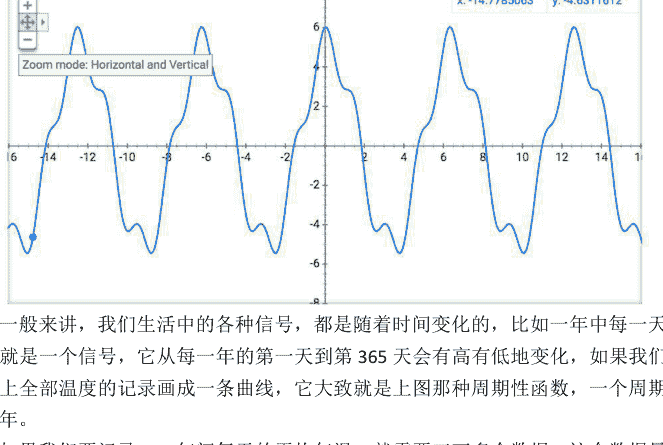

一般来讲，我们生活中的各种信号，都是随着时间变化的，比如一年中每一天的温度就是一个信号，它从每一年第一天到第 365 天会有高有低地变化，如果我们把历史上全部温度的记录画成一条曲线，它大致就是上图那种周期性函数，一个周期就是一年。

如果我们要记录 100 年间每天的平均气温，就需要三万多个数据，这个数据量比较大。但是由于它具有周期性，我们就有可能会利用这种周期性来进行信息压缩。而对于这一类波动信号，信息压缩的基本原理大致如下：

- 1. 找到这种周期性信号的等价信息；
- 2. 对等价信息进行压缩；
- 3. 如果要使用原来的信号，通过压缩后的等价信息复原原来的信号。

这里面的关键，是找到等价信息。对于周期性的信号，等价信息就是一组正弦（或者余弦）波。正弦波的性质如下，大家可能并不陌生，因为它是最典型的波动曲线的性质。

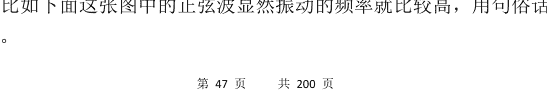

世界上所有的正弦波曲线形状都差不多，但是振动的幅度可大可小，振动的频率可高可低。比如下面这张图中的正弦波显然振动的频率就比较高，用句俗话讲，它抖动得特别快。

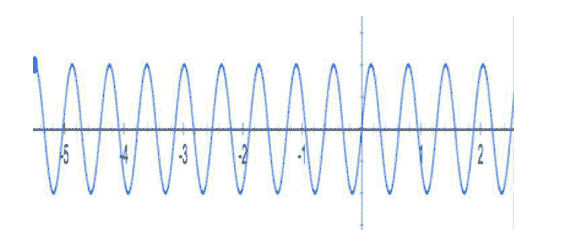

19 世纪初，法国数学家傅立叶发现所有的周期性信号都可以频率和振幅不同的正弦函数叠加而成，也就是说周期性信号里所包含的信息与若干正弦函数的频率、振幅信息完全等价，这种变换被称为傅立叶变换。

如果利用傅立叶变换，可以将 100 年里温度变化的信息用大约 20 根频率和振幅不同的正弦曲线叠加而成。也就是说，100 年里 3 万多个温度样点里的信息，基本上就等价于 20 个频率数据和 20 个振幅数据，这样一来信息就被压缩了近百倍。

今天音频、图像和视频的压缩，就是利用这个原理。其中的关键就是找出那个等价的信息。

今天我们见到的各种音频信号，包括我们的语音、音乐等等，在较短的时间内，都有相对稳定的周期性，比如下图就是一段语音，你可以看出它有一定的周期性。利用傅立叶变换，可以对语音进行压缩编码，然后传输，这样可以将语音信息压缩 10 倍左右，当然这样可能会有很少的信息损失，这一点我们后面再讲。但不管怎样，这样的信息压缩是非常合算的，如用微信语音打电话，如果不进行信息压缩，可能要多用十倍的数据流量。

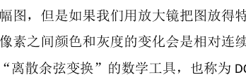

那么图像又是怎样压缩的呢？它们看上去不像是周期性振动的波形啊。这其实只是我们在宏观上看一幅图，但是如果我们用放大镜把图放大得特别大，看到的就是一个个像素，而且相邻的像素之间颜色和灰度的变化会是相对连续的。利用这个特性，人们发明了一种被称为“离散余弦变换”的数学工具，也称为 DCT。

DCT 可以被认为是傅立叶变换的延伸，只不过它没有使用正弦波，而是采用了下面图中所示的 64 个基本灰度模板，任何照片都可以用这些模板组合而成。当然，对于彩色图片需要用带有红绿蓝三原色的彩色模板。这样一幅图片，就变成了一组数字，这些数字是模板中相应的模块的权重。我们经常使用的 JPEG 格式的图像，就是这么生成的。

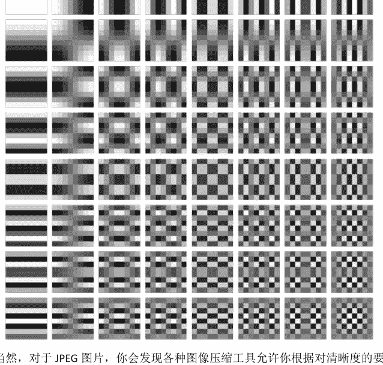

当然，对于 JPEG 图片，你会发现各种图像压缩工具允许你根据对清晰度的要求，压缩得多一点或者少一点，这里面的技巧我们后面介绍信息损失时再讲。

通过上述语音和图像的压缩，我们介绍了信息等价性的应用。很多时候，一种原始的信息，它们虽然里面有很多冗余成分，但是很难直接压缩掉。但我们可以将它们转化为容易压缩的等价的信息，再进行压缩，然后进行存储和传输。在使用和接收到被压缩的等价信息后，我们先解压，再恢复回原来的信息。

不仅每一篇文章，每一段语音，每一个图片可以利用信息的等价性分别压缩，将很多相同形式的内容放到一起，还能进行更有效的压缩。之前有读者问我，在 Google 上什么东西都能够查到，难道它保存了互联网的所有内容？这听起来难以置信。其实 Google 还真这么做了，只不过它在向大众服务时，把所有网页中的文字顺序打乱了，它按照每一个关键词在网页中出现的位置重新整理了互联网的内容。这样不仅方便查找，而且能够压缩信息，节省存储空间。这样当你查找时，它不仅能够告诉你你要找的内容在哪里，还能够根据每一个词出现的位置，恢复出原来的网页展现给你。这就是等价性在信息处理中的应用。

## 善用等价信息，是我们这个年代每一个人都必须掌握的工作技巧，这是我们这讲最希望你记住的一个知识点。

比如说我们无法看清人体内部的情况，但是我们知道人体内有很多水分，水里有氢原子，它的电子在旋转中形成一个个微小的磁针，我们在人体外施加磁场，就可以把水分子里的小磁针方向给排列顺了，然后我们加入一个能够和水中氢原子共振的脉冲，就可以把人体氢原子振动的信息取出来。由于人体各个部分水的分布不一样，我们通过各个部分氢原子振动的信息，就可以把人的结构画出来。这就是核磁共振的原理。因此核磁共振就是利用了等价信息。

类似地，检测引力波的 LIGO 装置，检测希格斯玻色子的 ATLAS 装置，用的是也是等价信息。我们今天在医院里做的大部分血项检查，都是在用等价信息。

## 要点总结

我们通过信息压缩来说明了等价信息的重要性，当然这个原则的应用要远不止信息压缩这件事情。它对于我们获取信息，乃至处理信息同样重要。

思考题：说说你是如何通过等价性原则找出一些难题的答案的，欢迎你和我在留言区和我交流。

预告：当然，对于信息压缩是否会丢失一些信息，这个问题我们下一讲再讨论。我们下一讲再见。

## 11 | 信息增量: 信息压缩中的保守主义原则

你好，欢迎来到我的《信息论 40 讲》。
我们上讲了信息的等价性，以及如何利用等价性压缩信息。
说到信息的压缩，大家可能会有这样一个体会，就是视频的压缩比要远比图片的高很多。

大家的这个观察是完全正确的，它们通常会相差两个数量级，也就是说 JPEG 图片能压缩 10 倍基本也看不出损失，而 MPEG 视频能压缩近千倍，肉眼也分辨不出来是压缩过的。

有人就问我，那么能否用视频的压缩方式压缩图片，达到上千倍压缩的效果呢？简单的答案是不能，因为视频压缩时，利用了信息的相关性，能够采用所谓的增量编码，而单一一张图片中，不具有太多的相关性可以利用。

所谓利用相关性进行压缩编码，简单来说就是如果两个信息“长得很像”，只要保留一个，对另一个，只要保留它们的差异，然后进行微调就行了。

要讲清这里面的原理，我们先来看一个简单的例子。
如果我们要对这样一组数：
3210、3208、3206、3211、3220、3212……进行编码，需要多少比特（或者多少字节）呢？

我们首先观察到，这些数字毫无规律可言，不存在哪一个出现的概率更大，哪个更小的问题，因此无法利用哈夫曼编码的方法，将比较短的代码分配给出现概率高的数字，我们只好将它们一一编码。

由于这组数字都是三千多，我们需要用 12 位 2 进制表示每一个数字，也就是说每个数字编码长度为 12 比特。因为如果用 11 位二进制，那么 2 的 11 次方是 2048，它不能涵盖 3000 多的数字，而 12 位 2 进制能表示到 0~4095 的数字，所以我们用 12 位二进制来表示。

但是，我们还注意到一个现象，那就是各个数字变化不大，它们的动态范围不超过 16。因此，我们可以利用这个特性进行压缩编码了，具体的做法是这样：

- 1. 对第一个数字使用 12 比特的编码，我们没有办法做得更精简。
- 2. 对第二个以后的各个数字，我们将它和上一个数字相比较，发现它相比前一个数字，动态变化的范围在正负 16 以内。因此，我们只需要对差异（也被称为增量）进行增量编码，就就可以了。

对于这些增量，如果不考虑符号的话，我们用 4 个比特就够了，因为 log 以 2 为底 16 的对数等于 4，也就是 2 的 4 次方等于 16。

当然，增量可以是正，也可以是负，我们再加一个比特的信息表示符号，于是从第二个数字开始，我们采用 5 个比特就可以表示它和前一个数字的区别了。

于是我们可以将上面一组数字做如下的编码：
3210 [-2][-2][5][9][-8] …… 于是除了第一个数字还需要 12 比特之外，剩下的只需要 5 个比特即可（4 个比特表示变化范围的区间是 16，1 个比特表示加或者是减），相比原先每个数字 12 字节的编码，压缩比大约是 2.4:1（12:5）。

在解码时，我们先解出第一个，然后解出后面的增量，再根据上一个的数值和当前的增量，恢复出一个个原来的信息。

今天对于视频的压缩，用的就是上述原理。我们知道一般的视频一秒钟有 30 帧，高清的是 60 帧，4K 的是 120 帧（甚至 240 帧）。每一帧视频之间的差距其实极小。

我们对第一帧视频（也被称为主帧）进行全画面编码，对于这一帧的压缩比，其实不会太高。

但是对后面每一帧的视频，只要针对它们和上一帧的差异进行编码即可，这样除了主帧外，后面的每一帧的视频，其实编码的长度非常短，视频文件就显得比较小。

我们上一次说到的 Google 搜索所用的索引，其实也用到了前后相关性进行压缩。

搜索引擎的索引是什么东西呢？它是把每一个单词在全部网页中出现的位置列出来。比如

“中国”出现在第 50001，50008，50300 等位置，“科学”出现在 50009，50045 等位置。

由于互联网上的网页数量巨大，单词的位置如果从头到尾排一个序，大约要排到几百亿，这些数字就很大。Google 的做法是每一个网页只保存第一个单词的起始位置，剩下的单词是相对第一个单词的位置。

比如某个网页起始的位置是 50000。那么刚才我说出现“中国”这个词出现了三次，它的索引记录的就是 50000，以及位移量 1，8 和 300。“科学”这个词相应的一段索引，记录的是 50000，和位移量 9，45。这样就能有效压缩信息的长度。

在搜索时，如果要找同时包含“中国”和“科学”的网页，只要看看它们是否有共同的网页起始位置即可，比如它们出现在了起始位置为 50000 的网页中。


如果非要找“中国科学”（连起来的）这个词，除了保证它们在同一个网页中出现外，还要保证它们的位移量相差正好是 1。因为在这个例子中，“中国”的位移量 8 和“科学”的位移量 9 正好差 1，我们就知道它们是相邻的了。

通过这种方式，网页搜索的索引可以在很大程度上节约空间（大约节省 75%），而且这种信息压缩是无损的。

当然，凡事有一利就有一弊。正如我们前几天所讲，当我们把信息冗余都抠掉后，编码长度非常短时，容错的性能就会下降。

你过去看影碟可能有这样的体会，当光盘被划了一道，它就经常跳盘，这就是因为视频的压缩是前后相关的，中间坏了一点，很多帧的视频就都看不了了。

为了防止这样编码造成的累积误差，也为了防止中间有一点点信息损失，后面的视频打不开，所以，每过若干帧，我们就要重新产生一个主帧，以免错误会传递太远。

信息的前后相关性，其实是信息本身固有的特征。或者说，绝大多数时候，我们这个世界的变化是渐进的，而不是完全随机的。不仅在信息的世界如此，在我们的生活中也是如此。

我在过去的专栏里讲了保守主义的做法态度，它的好处其实是由我们这个世界渐变的特点决定的。因此，在绝大多数时候，我们不需要推倒重来，只需要对变化进行一些修补就好了。

有些人看不起总在修修补补的做法，觉得缺乏革命性，但是从信息论的角度讲，保守主义的做法成本最低。

在美国生活过的人，一开始会发现两个难以理解的现象。第一个是美国的税法很复杂，每年报税是一个工作量很大的任务。那为什么要把税法搞得那么复杂呢？这是因为利用增量进行修修补补的结果。每一個群体都有自己的利益，都想要尽可能让自己能够多免税，于是各方博弈，在原有的税法上不断修补，就成了今天的样子。这样经过长时间迭代，总算各方面相对满意。

当然，过了很长时间，一些税法跟不上经济和社会发展了，就要作大的调整，这就如同视频压缩中，一旦新的画面出现，就要重新开始一个主帧一样。

第二个现象是学区划分得犬牙交错。这也是为了平衡各方面利益不断修补的结果。

因此，不要根据“保守主义”这四个字就认为英国人和美国人保守，它其实更多地反映在这种渐进的做法方式上。

甚至美国的宪法也是通过修正案的方式在作微调，而没有像法国和德国那样几次彻底修改宪法。正是为渐进，牵扯的利益不会太多，才能勉强推行得下去，从长期来看才能发展。

## 如果想一次完成巨大的突变，常常会因为牵扯的利益太多，最后总是掏空，永远改不了，结果反而是不进步。

这就如同我们如果非要对一个 2 小时的电影每一帧都保留全部的信息，那么一部电影的数据会大得在网络上无法传输，我们的计算机播放电影就会不断卡壳，我们看到的画面反而不如压缩的清楚。

## 要点小结

- 首先，我们讲了善用信息前后的相关性，对于后面的信息做增量编码，达到大幅度压缩信息冗余的目的。
- 其次，我们把这种信息处理的方式，和保守主义的做法方法作了一个对比。所谓保守主义，其实就是坚持总体原则不变，不断作微调，达到渐进改变的目的。这样做，比每一次都推倒重来，或者干脆达不成一致，其实效率反而高，因为我们的世界在绝大多数时候都是渐变的。

## 思考题：如果说我们在视频压缩中有一个主帧的概念，后面各帧图像都是对它作对比，那么在我们的生活，什么事情其实扮演了主帧的角色？

## 预告：上一讲我们说了信息等价性，可以利用这个原理来进行无损压缩，在做事情时我们也要学会找出等价信息。

这一讲，我又给你介绍了信息的前后相关性，可以对像视频这样的信息进行高压缩比的处理，进而告诉大家要找到自己做事的主帧，做一个保守主义者。

下一讲，我还会告诉你，在压缩信息时，如何在压缩比和失真率之间保持平衡，看看你能收获什么启发。

课程对你有所启发，欢迎你分享给自己的好朋友。我们下一讲再见。

## 12 | 压缩比和失真率：如何在信息取舍之间作平衡？

你好，欢迎来到我的《信息论 40 讲》。上一讲，我们谈论图片和视频是如何压缩的，介绍了它们背后的两个原理：信息的等价性转换，以及利用信息的前后相关性，找到差异，对增量编码。用这些方法，就可以压缩信息。

但是大家都有一个疑问，那就是，我压缩过的图片，恢复回来似乎没有原图清晰了，这是怎么回事？信息的压缩是否都会让一部分信息丢失掉？

这一讲我告诉你，信息压缩是要考虑失真率的，而这种取舍平衡的原则，其实是我们都应该学习和了解的。

我们在前面讲了香农第一定律。香农指出，任何编码的长度都不会小于信息熵，也就是通常会大于等于信息熵，当然最理想的就是能等于。

如果编码长度太短，小于信息熵，就会出现损失信息的现象。

因此，信息熵是告诉信息处理的人，做事情的边界，就如同不能试图逾越热力学第二定律发明永动机一样，大家在压缩信息时，如果想要无损，就不能逾越香农给的这个边界。

也就是说，如果一张图片里面有 10K 的信息，你再怎么压，也不会比它小，否则就会损失信息。

理清了这一点以后，我们就知道无论是语音，还是图像、视频，都有两类的压缩方式，一类就是无损压缩。 比如我们昨天说的通过傅里叶变换和离散余弦变换将音频和图像信息变成频率信息，再用类似哈夫曼编码进行压缩，这是不会丢失信息的。

另一类是需要丢失一部分信息的，也被称为有损压缩。 比如一幅图经过无损压缩已经被压到 10K 了，你还想压到 1K，那就需要有所损失了。因为在很多场合下，有损的压缩还是必要的。

事实上我们今天对于音频、图像和视频的压缩，绝大多数情况都是有损的压缩。而有损压缩最关键的是要清楚如何保证因为压缩而丢失的信息不影响我们对信息的理解呢？这就需要平衡压缩比和信息失真度之间的关系。

所谓失真度，其实通俗来说，就是压缩前、压缩后的两串信息的差的平方。也就是说，如果信息没有任何失真，失真率是 0。如果信息完全消失了，失真率是 100%。有了失真率的概念，我们就可以来讨论有损失的信息压缩了。

其实我们生活中大量应用到的都是有损压缩，只不过我们感受不到，这就说明压缩很好地考虑到了失真率。

比如一个数码相机拍的照片，原图有 18MB 的大小。通常 JPEG 算法会将它压缩到 3～5MB，这其实会有信息丢失，但是肉眼根本看不出的。

你将它印成 10x8 寸的照片，只要你拍得清晰，每一个像素基本上都是清晰的。但是如果你将它压缩到 500K，再印成一样大小的照片，就能看出来一个个小色块了，而且一些细节也消失了。

同样的道理，如果我们将原始的语音压缩 10 倍，或许有失真，但是语音本身肯定是清晰的，还能听出是谁的声音，但是如果压缩 50 倍，语音内容可以辨认，但是却听不出是谁的声音了。

那么到底该压缩多少倍呢？接下来我就为你介绍，压缩比和失真率平衡原则。

在进行信息压缩之前，明确压缩的目的非常重要，你印一张证件照，图片压缩到 100K 也是可以接受的，你要做一张会展的海报，那就还是用原始文件比较好，不要做有损压缩了。

通常，压缩比和失真率的关系会是下面这样一条曲线：

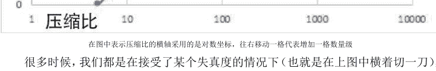

在图中表示压缩比的横轴采用的是对数坐标，右移动一格代表增加一格数量级

很多时候，我们都是在接受了某个失真度的情况下(也就是在上图中横着切一刀)，

然后再去尽可能找到好的压缩比。

## 世界上很多时候没有最好的技术方案，只能根据场景找到合适的，因此做事的目的性很重要。这是第一个原则。

我们还知道信息的作用是消除不确定性，那么反过来，丢失了一部分信息，一定会增加不确定性。用的信息少，永远不可能做得和原来一样好，这是第二个原则，大家一定要记清楚。

不久前，有一个 YC 的创业团队，介绍他们如何只利用别人 1/1000 的数据就可以进行深度学习的训练。有些投资人问我是否值得投资。我就对他们讲，丢失了 1000 倍的信息，不要指望做出来的东西和以前一样好。

至于如何平衡数据量和效果的关系，就看矛盾的主要方面在哪一方了。如果说过去没有数据，牺牲掉一点性能，也就罢了。

今天世界上最不缺的就是数据，在最近的三年里，全世界产生的数据，比三年前到有文字以来人类产生的数据的总和还要多。在这种情况下，节省数据是一条错误的努力方向，这家公司不值得投资。

## 除了要考虑目的，考虑到信息数量之外，第三个原则是，在压缩信息时，有时要看应用场景。

还是以语音压缩为例，在语音通话时，牺牲一定的讲话人的口音，问题不大，因为它的目的是传递话音中的信息。

但是，在进行声纹识别时，情况就正好相反，那个人说了一句话什么话不重要，重要的是知道他是谁。

因此在后一种应用中，需要保留的是说话人本身的信息，反倒是他说的内容无关紧要。也正是因为应用的场景不同，才有了各种压缩算法。

接下来大家可能会有一个疑问，那就是高比例的信息压缩到底是压缩掉了什么信息？

简单地讲，就是压缩掉了高频信息。进一步说，人通常能够听到 20 赫兹到 2 万赫兹的声音，但是人发音的范围只有 300 赫兹到 4000 赫兹左右，因此任何高于 4000 赫兹的语音信号，就被过滤了。

虽然据说世界上音调最高的女性叫起来能到 1.7 万赫兹，这已经远远超过了小提琴的最高音了，但是对不起，为了压缩信息，我们不保留。今天的语音通信就是这么实现。

对于图像也是如此，你可能注意到这样一个现象，如果你以蓝天为背景拍了一张照片，照片上只有很小的鸟，你如果用 JPEG 算法进行图像压缩，小鸟可能就会被过滤掉了，而且蓝天的细节就没有了。这就是因为有损的图像压缩算法都是先过滤高频信息的。

我们在生活中有句谚语，叫做“枪打出头鸟”，其实在信息压缩中，总是遵守这个原则的，任何与众不同的东西，总是最先被压缩掉，因为对那些与众不同的东西做编码，占用的空间相对太多。

信息压缩的原理，不仅在计算机存储、通信和信息处理中经常用到，还被用于了生物、金融等很多领域。

根据华社基因创始人杨焕明教授的说法，如果把人以及他体内细菌（量是相当大的）的基因都测序，然后存起来，每个人要超过 1PB 的存储空间，也就是 1000 个 1T 的硬盘，这显然是一件成本极高的事情。

2012 年，约翰·霍普金斯大学的科学家们发表了一种遗传压缩算法，在不丢失任何信息的情况下，压缩比达到了 1000 倍。这件事对于普及基因测序很有意义。

约翰·霍普金斯大学的科学家们是怎么做的呢？简单地讲，他们的方法和视频压缩的方法很相似——考虑到人的很多基因是相同的，只需要存储有差异的基因即可。

## 要点总结

信息的压缩分为有损的和无损的两种。对于无损的压缩，原先的信息能够完全复原，但是通常压缩比不会太高，因为它存在一个极限，就是香农第一定律给的信息熵的极限。对于有损的压缩，信息复原后，会出现一定程度的失真。

通常失真率和压缩比直接相关，压缩比越大，失真率越高。采用什么样的压缩方法，压缩到何种程度，通常要看具体的应用场景。在信息处理这个领域，常常不存在所谓的标准答案和最佳答案，只有针对某个场景的好答案，而一切都是妥协的结果。

信息压缩看似是信息处理专业的问题，但是它的思想可以用到很多地方。我们有时强调要把知识学通，就是这个道理。

思考题：我们身边有很多朋友，都是无损音乐、无损电影的爱好者，从听觉和视觉上说说真的有那么大的区别吗？有没有其他影响因素呢？

预告：下一讲，我们学习一个面对多种信息时的取舍之道。我们下一讲再见。

## 13 | 信息正交性：在信息很多的情况下如何作决策？

你好，欢迎来到我的《信息论 40 讲》。

生活中你可能有这样的经历，面对决策时，知道的信息越多，反而越是扰乱了你的思路。反复权衡，最后，干脆就瞎选了一个，如果这是人生的重大决策，很可能会追悔莫及。

这一讲，我想告诉你当面对的信息很多时，如何利用和组合信息，提高自己的决策水平。

我在《科技史纲 60 讲》中用信息和能量这两根主线将科技发展的历史串了起来。不少读者就问，信息是否具有和能量相似的性质，比如信息是否也守恒呢？

应该说信息和能量有一定相关性，但它们的性质完全不同，比如信息并不具有守恒的特点。你将一条信息告诉别人，你自己并不损失这条信息。

除此之外，不同信息彼此之间的关系，以及使用相同或者不同信息带来的结果，它在这些方面和能量也完全不同。

我们今天就从信息和能量的对比出发，谈三个获得有效信息和利用好信息的要点。首先，和能量不同，相同的信息使用两次，不会产生两倍的效果。

我们在使用能量时，你用投石机轰击一下城墙，上面会砸出一个坑，你再把那个圆形巨石捡回来，再轰击一下，砸到同样的位置，坑会被你砸大。最后你可以一下下这样重复操作，把城墙砸开。
但是，你使用同一条信息后，第二次使用它就没有用了了，你使用一万次，结果还是一样。这个道理并不难理解，但是很多人到了工作中就糊涂了。

我在 Google 工作时，看到一些工程师把同样的信息反复使用，试图进一步改进产品，但最后他们发现是白费工夫。我对他们开玩笑讲，他们应该好好学习信息论。比如说，利用语言模型，也就是根据上下文信息建立起来的，关于句子中每一个词出现概率的统计模型，可以将拼写的错别字减少 70% 以上。

张图，你可以点击文章查看，图上给出了几个不同角度的合力共同作用所产生的效果。

图中的黑线是每一个动力的来源和方向，红线是合力。大部分时候，合力到不了各个动力的总和。在使用信息时也是如此，如果我们利用了多个信息源的信息，大部分效果达不到每一种信息所产生效果的总和。

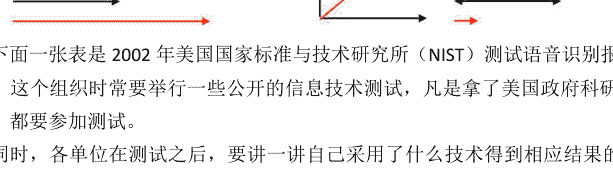

下面一张表是 2002 年美国国家标准与技术研究所（NIST）测试语音识别报告的一部分。这个组织时常要举行一些公开的信息技术测试，凡是拿了美国政府科研经费的单位，都要参加测试。

同时，各单位在测试之后，要讲一讲自己采用了什么技术得到相应结果的。NIST 可能还会将各家的新技术综合起来，看看能得到怎样的总体改进。

在 2002 年的测试中，大家采用两年前最好的结果作为基准。各个研究单位一共提出了 8 种主要的改进方法，你可以认为是采用了八种不同的信息，从各个角度来消除语音识别中的不确定性。

最终，将语音识别的错误率降低了 2% 左右。下面这张表呢，就是每一种技术各自的改进：

| 方法 | 改进（错误率低的百分率） |
| --- | --- |
| 1 | 0.8% |
| 2 | 0.7% |
| 3 | 0.5% |
| 4 | 0.4% |
| 5 | 0.4% |
| 6 | 0.3% |
| 7 | 0.3% |
| 8 | 0.3% |
| 1—8 全部使用 | 2.1% |

如果你将上述八种方法各自的改进加起来，应该是 3.7%，但最终只有 2.1% 的改进。这表明，看似来源不同的信息，它们在消除不确定性时，作用有可能会重叠。那么什么时候不重叠呢？当信息是垂直的时候，也叫做正交的时候。

什么是垂直的信息呢？我们不妨看两个例子。

第一个例子是语音识别。语音识别问题其实可以被看成是一个 N 选一的问题，就如同猜测世界杯和球赛冠军那样。

比如说汉语里大约有 1260 个左右的拼音读音，对每个音节的识别就是 1260 选 1 的问题。要消除这里其中的不确定性，用到的最有效的信息是两类，第一类是所谓语音的信息，也就是说每一个读音和各种语音之间的相关信息。

第二类是语言信息，也就是一种读音在上下文中出现的可能性。这两种信息就是正交的。

我们在前面讲了，任何一种信息都可以对应到某个空间中的一个矢量，如果你把上述两种信息在空间中画出来，就会出现它们之间的夹角是 90 度，也就是说两种信息是正交的。

李开复当年在卡耐基-梅隆大学做了一个实验，如果只采用语音信息，要进行语音识别的难度相当于 1000 选 1，如果同时采用了语言信息，难度则下降到 20 选 1。

你可以从中看出使用相互正交的信息作用有多么明显。

第二个例子是名片的识别。就是把纸质打印的名片扫描一下，储存成电子信息，大家平时也经常用到这类软件。

名片识别是印刷体识别中不是很困难的一个任务，但是它对准确率的要求极高。

今天市面上大部分的软件识别率在 98% 左右，这其实已经很高了。但是总有 2% 左右的错误会发生的话，还是让人有点烦，因为总觉得手工更正。如果遇到懒人不检查就直接放进通讯录，有时会搞错对方的电话或者邮箱。

以前大家解决这个问题思路比较单一，总是想着提高图像的识别率，虽然各种办法都想了，总是有些情况难以通过图像识别解决。

2012 年，加州大学洛杉矶分校的一位华裔教授通过大数据的方法解决了这个问题。她能够将名片识别的准确率提高到 99.9%。

她是怎么做的呢？说起来非常简单，就是把互联网上能够找到的各个单位的信息找到，然后用那些公开的信息验证图像识别的结果。

比如某个人的公司的总机电话是 738 5546，即使名片上 3 和 8、5 和 6 印得不清楚，只要识别对这家公司，和她之前在互联网上找的数据一比对，就可以纠正过来。

之前人们通过图像扫描得到的信息，和她从互联网上找到的信息，不仅属于不同的维度，而且是彼此近乎正交的（这一点可以被验证），使用起来效果就特别好。这就是垂直信息利用效果最大的两个例子。

讲回到上面的那个 NIST 测试，8 种不同的信息凑到一起，整体效果能够做到各自效果总和的六成左右，已经非常好了。

在实际工作中，绝大部分时候，如果每一种信息可以减少 1% 的错误，两种合在一起能够减少 1.2% 就不算失败，能够到 1.5%，就非常满意了。这也说明寻找正交的信息不容易。

那么怎么才能找到正交的信息呢？这和具体的应用场景有关，而且多多少有点艺术的味道。但是依然有三个原则应该遵守，以免走弯路，另外有一个方法可以使用。

首先，不同的信息要来自不同的信息源。比如在上述名片识别的例子中，图像信息和互联网上的信息，完全属于不同的来源。

比如医生给你看病，会让你做血液检查和医学影像扫描，因为这两种也属于不同的信息来源。它们放在一起使用，信息带来的好处就可以叠加。

如果做检查，你做了一遍 X 光透视，又做了一遍 CT 扫描，最后还做了一次核磁共振，这三种信息基本上是一个维度的。核磁共振发现了不了的问题，前两种基本上也没有用。

这就是为什么很多人容易上当的一个原因，就是他们不善于选用正交的信息进行交叉验证（关于交叉验证，我们后面还会专门讲）。

很多人觉得他也注意了不同媒体的信息，而不只是信一家之言，但是他忘记了今天很多媒体的信息都是相互抄的，也就是说一种信息多次使用而已。

第二个原则是，避免反复使用相互嵌套或者相互包含的信息，即使它们来自不同的来源，因为那些信息即使不完全相同，但是可能一个覆盖了另一个，或者相似性太高。

很多人申请工作，简历中提供的都是相互覆盖的信息。比如最重要的两段工作经验本身已经证明专业能力了，还罗列了一大堆无关紧要的工作经历，以及可有可无的专业证书。这些对别人了解自己不会有更多的帮助。

最后一个原则，看问题要刻意改变一下观察的角度，从几个不同的角度看。下面这张图，你从前往后看是个正方形，从上往下看，则是一个圆。如果坚持只从一个角度看这个物体，永远看不清楚全貌，因为它实际上是一个圆柱。

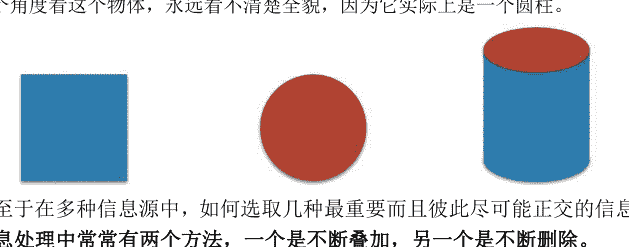

至于在多种信息源中，如何选取几种最重要而且彼此尽可能正交的信息呢？

在信息处理中常常有两个方法，一个是不断叠加，另一个是不间断删除。


先说说不断叠加的方法。这有助于你利用好手上的资源，有效排兵布阵。道理很简单，但常常被人们忽略。

我们假定有十种信息，需要选出三种，使其组合起来是最有效的。我们先对它们单独评估，列出对于解决我们的问题的有效性，并且从大到小排序，然后把排在第一位作为基准。

第二步，是在第一种信息已经使用的基础上，对剩下的九种重新评估，再重新排序，选出这次排序最高的。

第三步类似于第二步。这样可以不断选择下去。这种做法衡量的不是每一种信息单独的有效性，而是找到它们组合的有效性。

这就好比你是篮球教练，要打造一支好的球队。你先选定控球后卫，然后选择一个和他配合发挥最好的选手，再选第三个和前面已经选定的人能够配合的人。

第二种方法是不 断删除的方法，这和不断叠加的方法类似，但是过程是逆向的。

但是不论是哪种方法，都有可能陷入一种局部最佳值。而这件事其实至今也没有得到彻底的解决，因此很多时候，成功有运气的成分。

## 要点总结

- 1. 在力学上，用力要在一个方向效果才好，在使用信息上，要选用彼此垂直的正交信息。这其实是换一个角度看问题背后的科学原理。
- 2. 我们给出了选择正交信息的 3 个原则，和 2 个做法。

思考题：最后介绍的选取正交信息的两种方法，你可能也经常用到，欢迎你举例说明你在工作中是如何应用的。

预告：下一讲，我们从数据的相关性出发，介绍一个信息论的新概念——互信息，可以帮你判断两件事到底是不是相关。我们下一讲再见。

## 14 | 互信息：相关不是因果，那相关是什么？

你好，欢迎来到我的《信息论 40 讲》。
我们上一讲谈的内容其实是找到不同信息之间的联系，加以利用，我们这一讲介绍一个衡量两条信息之间相关性的新工具：互信息。

正如这一讲的标题，相关不是因果，其实世界上大多数联系都是相关联系，而非因果联系。相关的联系可以强，可以弱，但弱相关其实没有什么意义，我们需要寻找和利用的是强相关性。

但是，要知道相关程度的大小，就需要有一个定量衡量它的指标，这就是我们今天要讲的互信息。利用互信息我们可以找到那些靠谱的信号，过滤掉那些不大灵的信息。

你可能听说过有些炒股的人迷信一种所谓的“裙摆指数”，它在美国有一个更通俗的名字叫做“牛市与裸露的大腿”。

19 世纪，宾州大学的经济学家齐乔·泰勒讲：“当经济增长时，女人会穿短裙，因为她们要炫耀里面的长丝袜；反之，当经济不景气时，女人买不起丝袜，只好把裙边放长，来掩饰没有穿丝袜的窘迫。”

后来一位美国人（埃拉·考伯雷）宣称，他发现，道琼斯综合指数的升降真的经常与妇女裙摆的长度有关，妇女的裙摆短，恰恰是指数上升时，反之，则指数一定趋于下降。

当然，投资人对此也有一番自己的解释：当股市繁荣时，投资者有了钱就要去亲近女性，于是女性的服饰自然也会随着男人的态度而更富有性感；而当股市反转之后，投资人便对女性没了兴趣。

当然这些说法听起来都是自圆其说。于是，人们找到一些证据来证实它，比如：

1900 年，股市低迷，那时候美国女士的裙子也非常长，显得死板而无趣。

1928 年，也就是大萧条的前一年，女性的裙摆迅速上移。而 1930 年的大萧条开始后，却流行长裙子了。

最神奇的是 1987 年，本来流行的是超短裙，但是当 10 月来到的时候，短裙忽然不流行了，随后不久美国股市就出现了“黑色星期一”，道琼斯指数暴跌了 23%。

接下来问题是，你是否该根据街上女生穿的裙子长短来购买或者抛售股票呢？有些人确实在这么做，但是我们知道今天没有听说靠这条信息在股市上发财的人。

著名经济学家马尔基尔在他的《漫步华尔街》一书中详细剖析了这则传说，他认为这个牵强的相关性是毫无根据的。虽然总有人能举出证实这种指数的例子，但也有人能举出大量的反例。

那么秃揍的高度和股票的涨跌到底有没有关系？这显然不能通过举例子来证明，就需要有一个正确的数学模型，好好计算一下了。

在信息论中有一个互信息的公式可以算出来这个答案。我们假设裙子长度这个随机变量是 X，股市涨跌为 Y，然后设定好时间等参数，带入互信息的公式，就就可以了，以下是公式，以及详细的推导过程，其实很简单：

I(X, Y) = Σ P(X, Y) log P(X, Y) / P(X)P(Y)

推导过程：

我们知道女生的裙摆长度是随机变量，我们假定为 X。如果裙子的长度在膝盖处，X=0；如果高于膝盖一寸，X=1；高于两寸，X=2；如果比膝盖长出一寸，X=-1；长出两寸，X=-2，等等。

股市的涨跌幅度 Y 也是一个随机变量，我们假定涨 1%，Y=1；涨 2%，Y=2；如果下跌，Y 就是负的；如果不涨不跌，Y 就是 0。如果我们把过去的 100 年以每一个月作为一个单位，大约能够得到 1200 个样本，这样就能算出 X 和 Y 的概率分布 P(X) 和 P(Y)。如果女生穿短裙，而股票也上涨，这两件事情同时发生了，它的概率就是 P(XY)，被称 为“这两个随机变量的联合概率分布”。

这个公式是怎么用的呢？假如裙摆比膝盖高一寸的概率是 10%，股票某天上涨 1% 的概率也是 10%，如果这两事件同时发生的概率是 1%，说明这两件事毫不相关，用上面的公式计算，互信息就得到 0。

反之如果这两件事情一同发生的概率有 5%，就说明它们高度相关。代入公式中算下来，它们的互信息就非常大。

大家不必太关注这个公式本身，记住这样一个结论就可以了，就是如果 X 和 Y 基本上无关，它们的计算结果，也就是互信息就近乎为零。如果相关，它们的互信息就非常大，你可以把互信息简单地理解为相关性。

经过计算，穿短裙这件事和股票上涨之间的互信息近乎为零。马尔基尔等不少人还用不同的模型算过它们的互信息，得到的结果基本上是“无法根据是否穿短裙来判断股市涨跌”。

断未来股票涨跌”。

## 世界上很多事情彼此相关，如果它们之间有确定的因果关系，那样的信息就是等价的。比如从 A 一定能推导出 B，那么知道了 A 就等同于知道了 B，它们是可以划等号的。

## 但是世界上大部分相关的信息未必有因果关系，它们之间只是一种动态的相互关联的关系，比如 A 发生后，B 发生的可能性就增加，这就是相关性。

如果相关性比较强，我们在得到信息 A 之后，就可以看到消除关于 B 的不确定性。但是，如果 A 和 B 之间的相关性较弱，那种联系就没有意义。

## 而互信息则给出了一种量化度量各种不同信息相关性的方法。

在历史上，很多信息是无法直接衡量的，甚至找不到完全等价的信息，只能依靠不同信息的相关性猜测。

比如欧洲人对地球年龄的估计历程就是如此。在不知道放射性同位素之前，很难判断一块岩石到底oksen有 300 万年的历史，还是 3000 万年的，随便给你两块石头，你是看不出它们形成的时间早晚的。

1795 年，当时正值英国工业革命时期，到处是建设工地，在挖掘一条新运河时，地质学家史密斯发现每一层岩石都有属于本层岩石特有的化石。而化石中的动植物，是可以比较年代先后，比如像三叶虫这样简单的动物，以及一些有贝壳的软体动物，出现得就较早，爬行类和哺乳类脊椎动物出现得就较晚。于是史密斯提出了“化石层序律”，就把岩石的时间与生物演化阶段联系起来。

今天我们说到地质年代时会说诸如寒武纪、奥陶纪、三叠纪等名号，那些词原本都是用来描述古生物出现年代的名词。

“化石层序律”的本质，其实现就是反映地质变化和生物进化这两种相关信息的互信息。当然，正如我们前面讲的，互信息有一个变化的范围，并不是非零即一的绝对度量。

它并不能确定因果关系，因此我们只能用它来说 A 这件事情发生后，B 也同时发生的可能性的大小。

在众多的古生物门类中，有些门类特征显著，而且只出现在一个地质时代，它们就可以作为一个特定地质年代的标志，比如三叶虫，这种化石就被科学家们称作“标准化石”，也就是它们的出现和相应的地质年代之间的互信息很大。

但是，另一类古生物，比如舌形贝，从寒武纪就已出现，今天依然在海洋中很常见。而且在几亿年的时间跨度里，它们的形态和内部结构，几乎没有显著变化，它们和地质年代的互信息就非常小了。

如果你在一个地质层中发现了它们的化石，得不出那里是在寒武纪形成这样的结论。

这就如同你看到街上的女生开始穿超短裙，并不意味着股票会上涨。

我在《智能时代》一书中讲，在大数据时代，我们需要寻找的是强相关性，而不是看似有点关联的弱相关性。而两种信息相关性的强弱，是完全可以通过互信息衡量的。

## 使用互信息还要注意的一点就是不要把因果关系搞反了，即便可以由 A 得到 B，但是 B 未能够反过来确定 A。

我们听说过“乌鸦叫，丧事到”这种说法。它有没有道理呢？其实如果计算一下乌鸦出现这个随机事件和附近可能要死去的老人，多少是有点相关的。

但这里面的因果关系，事实上不是因为乌鸦来了，所以人死了。而是人老之之后，特别是快死的时候，会发出特殊的腐臭味，吸引来了嗅觉非常灵敏的腐食动物乌鸦。

1986 年，美国国立卫生研究所（NIH）的网站专门登了一篇《生理学和行为学》杂志（Physiology & Behavior）上的研究文章，证明乌鸦的嗅觉是极为敏感的，它们可以找到埋藏的食物。

很强的互信息总让人想到因果关系，但是谁是因，谁是果，都要花点意思搞清楚。

比如我在之前的专栏《硅谷来信》中对盖茨和扎克伯格退学创业的事情作了评论，今天很多人都拿这两件事情说事，鼓励大学生们退学。

但事实却是，这两个人先是证明了自己初期的创业已经成功了，然后才退学的，因此大部分媒体把因果关系搞反了。

如果我们进一步把这件事情放入大量的退学创业案例中作统计，把创业成功这件事情看成一个随机事件 X，把退学看成另一个随机事件 Y，你就会发现它们的互信息几乎为零。

相反，高学历和高收入这两件事，互信息却非常高。

信息论并非关于一条单一信息的理论，而是对大量信息整体规律性的描述。相关性差的两件事虽然有可能发生，但是放到大的时空里，就会出现这纯属偶然了。

而信息论则是给我们一个科学方法，能够从整体上估计那些看似无关的事件一同发生的可能性到底有多大。这让我们能够趋利避害。

那么，如何找出事物之间更高的相关性呢？

接下来我们又要讲到专业人士做事情的方式了，他们比业余的人普遍做得好，除了我在《硅谷来信》中分析的发挥稳定，能够重复成功等因素外，还有一个原因就是他们有很多业余人士没有的工具。

比如在风险投资方面，正规的基金会有一些研究人员，研究具有哪一些特质的创业者成功的可能性更大，第一次创业成功和第二次再成功之间的互信息，以及受雇于某些大公司和创业成功的互信息等等。

然后，他们会有意识地往特定的群体中进行投资倾斜。而业余做天使投资的个人，常常只能凭感觉作判断了。

## 要点总结

- 1. 我们介绍了量化衡量信息相关性的工具：互信息，虽然不相关的事请有时也会一同出现，但只是互信息高的事情彼此才有较强的相关性。
- 2. 我们指出了相关性和等价性的区别，以及不要在利用互信息时把两件强相关的事情之间的因果顺序颠倒了。
- 3. 我们说明了专业人士可能会因为掌握专业工具，做得比业余人士要好。

希望它们能够对你有所启发。

## 思考题：

人们发现，一个经济比较发达的国家通常政治制度都比较好，于是就有学者认为政治制度决定了经济发展。但是也有学者认为，只有在经济发展之后，才有可能建立起好的政治制度。那么政治制度和经济发展之间是否存在因果关系，如果有，谁是因，谁是果？如果没有，只是相关关系，这种关系是否强？

## 预告：

这讲我们开头用来股市的例子来说明信息之间的关系，下讲，我们还是会说到股市，我会告诉你为什么不要去画K线。我们下讲再见！

## 15 | 条件熵和信息增益：你提供的信息到底值多少钱？

你好，欢迎来到我的《信息论 40 讲》。

前两讲，我们通过介绍信息的正交关系，讲了寻找能够彼此互补信息的重要性，又通过介绍互信息，讲了两条不同信息之间的相关性。

这一讲，我们更加系统地、量化地分析一下，如果别人给你提供了一条信息，到底有多大的价值。

我们还是从熵指数说起，不过这一次我们换一个角度来看这个问题。我们假设这个指数多少有点道理，那么利用它是否能够帮助炒股的回报多靠帕是一点点？

我们知道股市是一个非常不确定的地方，如果你获得了一种关于股市的信息，比如 A 公司要并购 B 公司，只有你一个人知道，而你之前对它的了解不亚于其他人，可能你的投资会表现好一点。

但是要注意它们未必构成因果关系，也就是说你挣到钱的可能性大一点，但未必一定能挣到钱，因为股市的涨跌受到太多不确定性的影响。

接下来我就用信息理论对这个问题作一个比较严格的分析。

我们假定，股市的涨跌是一个随机变量，用 X 表示，对于它的全部的不确定性，就是 X 概率分布所对应的信息熵，通常用 H(X) 这个符号来表示。

如果你得到了一些内部消息，这些消息我们用 Y 来表示，那么股市对于你的不确定性就是 Y 条件下，X 概率分布的信息熵了，通常用 H(X|Y) 表示，它被称为条件熵，Y 是条件。

也就是说，在别人眼里，股市的不确定性是 H(X)，而在你眼里，因为有了信息 Y，因此它的不确定性变成了 H(X|Y)。

这时，股市对于你来讲，就是确定的事情了，也就是说，如果 X 和 Y 是等价信息，它们的条件熵瞬间降到了 0。注意，我这里所说的的前提是，这件事只有你知道，别人才不知道。

接下来就说说坏消息。如果你知道的信息，别人才知道了怎么办？对不起，由于市场的有效性，也就是股价能够充分反映所有信息，苹果会在一瞬间上涨 1.1%。这时你再使用那条信息作出购买苹果股票的决定，就捞不到钱了，也就是说苹果公司的股价已经包含了市场对回购股票那条信息的反应。

这就是我们前天说的，同一条信息使用一万遍，只有第一次会产生结果，后面都不会产生结果。由于这个“鞅摺指数”假说已经存在了上百年，大家早就知道了，即使再有道理，一个人尽皆知的信息也没有用。

我们不妨假设今天大家使用过的关于股市的各种技术指标分别是 Y1，Y2，Y3，……，YN，有 N 种。

今天股市的不确定性其实已经不再是 H(X) 了，而是在这些信息条件下的 H(X|Y1，Y2，Y3，……，YN)，也就是说在 Y1，Y2，Y3，……，一直到 YN 所有信息都使用后的条件熵。

这时，你再将其中的某个指数，比如 Y5 重复使用，不会得到任何更好的结果。这也就是我常说的，靠画 K 线炒股捞不到钱的原因，因为它不过是众人所知的某个 Y。事实上，专业投资人没有靠画 K 线投资的。

当然，如果你有幸发现了一种新的和股市变化有关的信息，我们假设是 YM，它不在 Y1，Y2，……，YN 中，那么恭喜你，你有可能捞到钱。

这就是当年彼得·林奇在发现 PEG 这个信息后捞到钱的原因（关于彼得·林奇的故事，大家可以回顾《Google 方法论》第 55 封来信）。

当然，你还必须像彼得·林奇那样心里能够装得下事情，不要出去乱说。因为一旦 YM 这个信息被别人知道，成为公众信息，你就再也捞不到钱了。

正是因为这个原因，真真正能够通过投资股票捞钱的人，是不会告诉你所谓投资秘诀的。而在电视上开讲座讲投资的，反而是自己捞不到钱的。

不过，我一直反对年轻人花精力去找所谓的别人没有发现的和股市相关的信息，包括反对专业人士这么做。为什么呢？因为最有效的信息已经被发现了，剩下留给大家的微乎其微。

要讲清楚这一点，我们就需要讲一个信息增益（Information Gain，简称 IG）的概念。

我们还是回到了了解股市变化（对应随机变量 X）这个话题，在没有任何信息的情况

下，它的不确定性是 H（X）。在有了 Y1 这个有用信息后，它的不确定性变成了条件熵 H（X|Y1），我们前面说了，它比 H（X）有所减少。

那么 Y1 所带来的信息增益就是 H（X）-H（X|Y1），我们写作 IG（Y1）。

事实上具体到这个特殊的情况，IG 就是 X 和 Y 之间的互信息，这个值越大，说明消除的不确定性越大，X 和 Y 越具有相关性。

接下来，假设我们又有了另一条信息 Y2，它所带来的信息增益就是在原来 Y1 基础上的增加，我们写成 IG（Y2）。

我们假设后面还有 N 种不同的信息，从数学上看，它们带来的信息增益，每一个都是在原来所有信息基础上递减的。

通常，人总是率先发现和所要解决问题的互信息最大的信息，也就是增益最大的信息，因此通常来讲，越往后发现的信息，带来的增益越小。世界上的股市已经被研究了几百年，各种直觉的能够预测股市的有用信号已经被挖掘殆尽。

有了计算机之后，一些专业的在对冲基金里建造数学模型的人，利用计算机把几乎所有的已知信息都试验了一遍，如果有用他们就保留了下来，于是很快股市就反映了那些信息使用后的情况，也就是所谓的被 price in 了。

如果你真的有幸找到一个大家都漏掉的信号，那么还要确定两件事，才能知道它有没有用：

- 1. 这个信号不要和其它已经采用过的信号重复，或者相互覆盖。 2. 这个信号带来的结果要有足够高的置信度，也就是说，如果它让你收益平均高出 1%，收益浮动的区间要远远小于 1%，否则浮动区间高达 10%，那就一点意义没有了。关于置信度，我们后面还会讲。

如果把这两个条件再一限制，你就知道在股市上系统性地检测漏洞近乎不可能。好，这就是从信息论中信息增益的概念出发，我为为什么不支持年轻人去研究所谓的炒股秘笈。

利用信息增益的概念，我们可以衡量一条信息的价值，也可以衡量一项研究发现的贡献。

先说说一条信息的价值，它取决于这条信息对未知系统所带来的信息增益。两条信息，先出现的，价值更大，第二条价值就小，在数学上可以证明这一点。

当然，如果两条信息相互正交，那第二条信息依然像过去那样有价值。这一点我们前面讲正交性就已经讲了。

正是由上述特性，在一项课题的研究中，最初的几篇论文，即使绝对水平不是最高，但是通常提供的信息增益最大，因此影响力也最大。越往后，信息增益就越来越

越少，影响力自然就少。

在学术界，大家评估一个人的科研水平，主要是他所发表的论文的两个指标，一个是引用的数量，另一个是所登载期刊的影响因子。

其中后者是整个期刊一段时间内发表的所有论文的引用数总和（不是直接计算的，来自不同期刊的引用会有不同的加权）除以论文数，也是引用数量的间接度量。

因此，论文的重要性几乎就等于引用数，而引用数几乎无一例外地和信息增量相关。

当你说出一个别人不知道的事情时，就会得大量引用，很快就成了学术权威。如果总是做别人已经解决得差不多的课题，做得再好，在学术界也没有影响力。

对于媒体报道，独家报道受关注的程度，远远高于凑热闹跟观。所以，第一个发稿的，影响力要远远大于后面跟踪报道的。

这是因为一开始的时候，大家一无所知，提供巨大的信息增益容易，后来则是在增益上补充而已。

对于个人，也是如此。第一个说出看法的人，常常就成为了意见领袖，跟着发表看法的，大家其实记不住。这时，如果还想引人注意，就要提供之前谈到的正交的信息，也就是说和别人已经提供的信息都不相关的。

很多人喜欢发表与众不同的意见，其实是有道理的，因为标新立异的观点，才有可能提供之前大家不了解的信息，当然那些观点本身需要有证据支持，符合逻辑。

## 要总总结

- 1. 我们用条件熵的概念，解释了为什么大众已知的<|start|>信息对投资和其它决策其实都没有意义。
- 2. 我们给出了一个定量衡量每一条信息价值的尺度，就是信息增益。
- 3. 我们用上述理论解释了为什么在一个研究领域最初的发明贡献，影响力最大。

对于每个人，第一个发表意见，以及能够发表与众不同的意见，对提高自己的影响力至关重要。

至于今天给出的一些细节公式，如果看不autos不不用太在意，理解背后的原理就可以了。

思考题：有一句话叫，第一个用鲜花比喻美女的是天才，第二个是庸才，第三个就是蠢材了。你能否再提供一些类似的，能用信息增益来解释的俗语呢？欢迎你在留言区和我互动。

预告：下一讲，我会告诉你如何判断一条信息靠不靠谱。我们下一讲再见。


## 16 | 置信度：马斯克犯了什么数学错误？

你好，欢迎来到我的《信息论 40 讲》。

2016 年，特斯拉汽车出现了第一次因为使用它的辅助驾驶功能而导致的撞车死亡事件。一时间媒体就开始对该公司的技术质疑，舆论大多认为特斯拉公司该负责。

为了摆脱公关危机，作为提供辅助驾驶技术的特斯拉公司先是解释，说那起交通事故死亡事故责任主要是开车的人长时间不扶方向盘。

但是媒体讲，你既然提供了辅助驾驶的功能，司机使用了出了事，说明你的技术不过关。

技术过关不过关这件事解释不清楚，特斯拉公司的 CEO 马斯克于是讲，特斯拉这起致命事故出在自动驾驶功能使用了 1.3 亿英里之后，而美国平均行车 0.93 亿英里就出一次死亡事故。因此特斯拉的事故概率低于平均水平。

这个声明一出来，就惹出了一些科学家的嘲笑，说马斯克数学没学好，因为他完全没有统计中的置信度的概念。

### 置信度就是我这一讲要教给你的知识点，它可以帮你衡量一个信息到底是否可靠。

我们常说要总结经验教训，其实大多数人并不会正确地总结经验和吸取教训，常常和马斯克一样的错误。

那么马斯克错在哪里呢？要知道，出重大车祸是随机性事件，你并不清楚下一次什么时候发生，只有当统计的数据量足够大的时候，从结果上判定一种车比另一种安全才有意义。

否则，按照马斯克的说法，如果很快特斯拉又出一次车祸，事故率不就一下子又翻了一番吗？这时该说说它的技术不够好，还仅仅是运气不够好呢？

为了便于你更好地理解这一点，我们不妨看下面这个例子：

如果你在清华大学的校门口数一数，一天里经过校门的人数，发现有 4543 名男生和 2386 名女生进出了校门，据此你大致可以得出“这个学校男生和女生的比例是 2:1”这样的结论。

当然，你不能说男生和女生的比例就是 4543: 2386，因为你知道每一个人今天是否出校门完全是随机的，由很多偶然性的因素决定。

更何况，男女对于到校外的喜好程度和需求可能也会略有偏差。因此，如果你统计了这近 7 千个样本后，给出一个大致的比例，没有人会挑战你。

但是，换一种情况就不不同了，如果你在 5 月 3 日这一天一大早就起床了，到清华西校门口蹲了两分钟，看见有 3 名女生进出，1 名男生进出，就得出该校 3/4 的学生是女生的结论，显然大家不会接受，因为大家会觉得这可能完全是随机的巧合。

也许第二天 5 月 4 日你再去看两分钟，会发现进出校门的 4 个人全是男生，肯定不能得出“这个学校只有男生”的结论。

对于特斯拉的辅助驾驶是否安全这件事，摩根士丹利后来做了一个估算。在美国目前的死亡事故发生的频率条件下，要想证明它的辅助驾驶更安全，需要行驶 100 亿英里才能得出有足够高的置信度的结论。

那么什么是置信度（Confidence Level）？

我们不妨再看这样一个简单的例子，你扔了 14 次的钢镚，有 8 次正面朝上，6 次背面朝上，你有多大的把握说钢镚不均匀，正面朝上的概率更大，这个把握就是置信度。

衡量置信度的方法有很多，有一种被称为“T-测试”（也叫 T 检验）的方法，它可以告诉我们在看到某种看似有偏差的现象时，有多大的可能性可以判断这种偏差是因为随机性造成的，而非真正存在偏差。

具体到刚才那个扔钢镚的例子，如果 14 次有 8 次正面朝上，我们是否敢说这个“钢镚铸造有偏差”呢？

这里面有两种可能，其一是偏差确实存在。另一个原因是，它就是偶然造成的。

那么这两种情况的可能性各有多大呢？

从数学上可以算出，前者的可能性是 57%，后者是 43%。也就是说，钢镚铸造有偏差这件事有可能是真的，但是我们不太确定。我们把自己有多么确定这件事也量化地衡量一下，它就是置信度。

具体到这个问题，置信度是 57%。当然相反的结论“这个钢镚没有铸造问题”的置信度是 43%，在统计上，我们一般认为，置信度不到 95% 的结论不大可能相信。

那么怎么样才能提高置信度呢？通常的办法就是要增加所统计的样本的数量。

如果一直保持 8:6 这个正反面的比例，我们扔得次数越多，最后就越有把握说，“钢镚两面不均匀”。根据 T-测试原理的计算公式可以得知，大概扔 140 次就能使置信度达到 95% 了。当然如果扔到几千次，我们的置信度就能达到 99%。也就是说，扔了 140 次以后，我们有 95% 的把握说，这个钢镚两面不均，它造成了 80:60 的偏差。而运气的因素，只占剩下的 5%。

回到特斯拉的例子，摩根士丹利讲，要证明辅助驾驶功能比人开车安全，大约要等到积累近百个致死事故才能得到解决，这样他们推导出是需要 100 亿英里的总行驶里程。

当然他们采用的是另一种叫“Z-测试”的衡量置信度的工具，其原理和“T-测试”类似。对于无人驾驶汽车，大致也需要累积测试这么多的里程。

从目前来讲，即使是最早进行路试的 Google 无人驾驶汽车（今天被称为 Waymo），离 100 亿英里也还差得很远。

至于马斯克通过一个样点给出的的数据，完全没有置信度可言，也就是说那一条信息的可靠性可以忽略不计。

人们在对待信息时通常犯的一个错误，就是忽视它的置信度，以至于我们把完全随机的事情，当成必然的事情。

大量重复的事情发生背后常常有它固有的规律。比如，常压下的水到了零摄氏度就要结冰，这种事情很容易验证。

但是很多事情并不会重复或者完全重复，它们的发生就很大的偶然性，几乎每 一件历史上的事件，社会学上和经济学上的事情都是如此，甚至很多医学上的奇迹也是如此。

虽然人们总能找到合理的解释，用一种理论证实很多事情，但是换一种理论也能做到这一点。因此，严肃的学者们才感到证伪证实更重要。

在上述研究领域，常常不存在绝对正确的理论，因为每一种理论其实置信度都非常低。这也让学术界必须认可百家争鸣。

那且置信度要达到什么水平才算是可靠呢？在工程上，包括在药物试验上，通常要求达到 95% 以上。

对于两个可以量化量的结果，比如在投资的回报方面，基金经理 A 声称比竞争对手 B 高 1%，是否说明基金 A 就比基金 B 好呢？

我们假如以一个月为一个单位统计一次，按照通常股市的波动幅度，需要 1000 个样点，也就是需要大约 100 年的数据。

这个要求今天没有基金能达到，也就是说那些声称 10 年平均回报好于大盘的基金，其实都在等大其词，因为那一点差异根本不具有很高的置信度。

或者说，类似于“某某基金的回报 10 年高出大盘 1%”的说法，没有什么信息量能表明这个基金就比大盘好。

世界上有很多道理其实都很难验证，大到历史事件，由于很难多次重复，总结经验其实是非常难的。

中到某些企业的成功经验，其实都是事后总结出的一套自圆其说的理论，让它们稍微换一个环境甚至不换环境再来一遍，都很难获得同样的成功。

小到个人，做成一件事也有很多偶然的因素，下一次同样的方法是否可行，也要看情况而定。

我在《见识》一书中谈到了命运的作用，很多时候我们不得不承认这一点，一定

不能去总结那些根本不存在的经验，或者用更科学的话讲，就是别相信置信度不高 的信息。

如果使用置信度不高的经验或者信息指导行动会有什么样的结果呢？

这就如同 一支军队，一直相信世界上 有鬼，将精力都集中在寻找鬼以及思考对付鬼 的方法上 了，结果后面来了几个人，轻而易举地将这一大支军队都消灭了。

大家可能觉得我 这只是打一个比方，其实这件事在我们身边正在发生。而这个鬼 就是所谓的“能够控制人类”的 人工智能。

我们在前面的课程中从各个角度反复讲了，所谓的有意识的，不受人控制的智能计算机不仅今天不存在，而且在未来几代人的时间里也不会存在。很多人疑神疑鬼，总在思考这样 的机器人出现之后人该怎么办，这就是在找鬼。

实际上，今天真正可怕的，是那些利用超级数据中心无比强大的计算功能，以及无所不在的监控系统，和具有很强数据处理能力的大公司，它们是人工智能背后的人，比人工智能更可怕。

当我们普通大众还在为机器取得了智能，会不会反抗人类发愁时，其实已经被那些智能程序控制了。

不信的话，就 看看今天有多少人自从有了微信后生活的习惯就改变了，有了今日头条后就失去了主动寻找新闻的能力，甚至失去了判别新闻真伪的能力，有了淘宝以后，又有多少人买了一堆没用的便宜货。

## 要总总结

我们讨论了置信度的概念。人们平时 看待消息时常犯的错误，是忽视它的置信度。对于能够重复的事情，要被检验足够多次之后，置信度才高。对于难以重复检验的事情，我们要通过其它一些方式验证，这些以后我们会讲。

当然，并非接受了 不靠谱的信息，都会付出巨大的代价，那么问题是，是否能够量化度量错误信息所带来的损失呢？这还真的是可以做到的，这一点我们下一讲再讲。

思考题：你平时有归纳总结，及时复盘的习惯吗？你是如何判断哪些经验值得以后借鉴，哪些经验无法复制，只能称之为经历呢？

预告：我们下一讲说说，为什么利用了不靠谱的信息会耽误事儿，以及如何避免制订出与事实相反的计划。我们下一讲再见。

## 17 | 交叉熵：如何避免制订出与事实相反的计划？

你好，欢迎来到我的《信息论 40 讲》，这一讲的主题是：交叉熵——如何避免制订出与事实相反的计划？

我们 在导论中讲了影响战争结果的三比特信息。也就是前苏联所获取的关于日本战略意图的信息，德军对盟军登陆地点的预判，以及优先级对秦军主将的猜测。

这三比特信息看似不多，作用却很大。

我们在前面也分析了其作用出判断的一方，无论是正确的判断还是错误的判断，得失的程度其实差了非常多。

同样是误判，德国人的损失要比起诸小很多。这一方面是损失的绝对信息量有所不同，另一方面是因为误判的方向所导致的代价函数差异巨大。代价函数有什么用呢？

今天我们就从理论上分析一下误判的代价函数，以防我们万一作出了误判，不会像起诸一样满盘皆输。

我们要介绍的代价函数被称为库尔贝勒交叉熵（K-L divergence 也叫 KL 散度）。从这个名称可以看出，它和熵有关。库尔贝勒交叉熵讨论的是在信息误判时的损失。它的思想是这样的：

我们用 X 代表一个随机事件，它发生的各种可能性有一个概率分布，我们用 P（X）表示，比如说盟军登陆地点的两种可能性是，诺曼底=0.7，加莱=0.3，我们就写成 P（X） =（0.7，0.3）。

如果登陆地点的可能性有 5 个，我们就写成（0.5，0.2,0.1 ,0.05, 0.15），分别表示这五个地点的可能性，总之这些概率的和都是 1。

当然，由于德军不知道盟军真实的意图，它只能猜，这就有可能出现偏差，我们不妨假设它猜的结果是 Q（X），通常 Q（X）不会正好等于 P（X），比如是（0.3，0.7），正好把两个概率猜反了。

那么这时候它因为信息偏差带来的损失是多少呢？库尔贝勒交叉熵给出了这样一个公式：

```
D_KL(P || Q) = - Σ_{x∈X} P(x) log( Q(x) / P(x) )
```

推导：

代价函数 KL = 诺曼底登陆的真实概率 x log（诺曼底登陆的真实概率/诺曼底登陆的预测概率）+ 加莱登陆的真实概率 x log（加莱登陆的真实概率/加莱登陆的预测概率）

注意公式前有负号，所以分子分母互为倒数。

我就直接告诉大家计算结果了，也就是如果我们代入前面假定的数字，这个代价函数值=0.49比特。那么这个代价是大还是小呢？我们换两组数据看一看，对比一下就知道了。

我们再假定在另一个例子中，日本人的战略方向是南下的可能性，即P（X=南下）=0.8，北上的可能性，即P（X=北上）=0.2。

苏军统帅部在得到佐尔格的情报后，也作了完全一样的战略调整，也就是说Q（X）的数值恰好也是（0.8，0.2），那么使用上面公式计算出来的代价函数值=0比特，也就是说当你预测的概率分布和真实情况完全一致时，损失是零。

接下来我们看第三个例子，赵括对秦军主帅的估计。

我们假定秦军主帅是白起和王贲的概率分布是0.95和0.05，假定赵括的猜测是0.05和0.95，正好反过来，那么根据上面的公式，计算出的代价函数值=3.8，这可比德国人的损失大多了。要知道信息的度量是个对数函数，差出1，实际就算差了2倍出去。

当然，在长平之战中赵括的赌性更大，他完全压秦国的统帅是王贲，也就是说，他的估计是：王贲当主帅的概率为100%，也就是1，白起的概率为0。

这时赵括错误的代价又是多少呢？代入上面的公式，有一项是用0.95除以0，是无穷大。没错，如果孤注一掷，又猜错了的话就是这个结果！这也就是赵括的悲剧所在。

至于德国，虽然也猜错了，但是他们没有孤注一掷，没有完全从诺曼底撤防，因此损失有限。

从库尔贝勒交叉熵的理论和上面三个实际的例子可以有下面五个更深入的思考。

**1.如果你的猜测和真实情况完全一致，你不损失任何东西，但只要猜测和真实情况不一致，就会有或多或少有损失。**

**2.你的猜测和真实情况相差越大，损失越大。**

特别是原来以为的小概率事件发生了，损失最大，那些就是所谓的黑天鹅事件。因此，在战争中，一方常常想设法把它真实意图隐藏得非常深。

《史记》中在讲到秦军换将这件事时，写了这样一句话，“（秦）令军中有敢泄露武安君将者斩”，意思是说，秦国发布命令，军中有敢泄露武安君白起来了的这件事的人，要被杀头。

在最极限的情况下，该考虑的事情完全不去考虑，最后发生了，损失无穷大。

因此《孙子兵法》就讲，“夫未战而庙算胜者，得算多也；未战而庙算不胜者，得算少也。多算胜，少算不胜，而况于无算乎！”（《孙子兵法·计篇》）

这段话的意思是说，开战之前进行庙算时，充分估量了有利条件和不利条件的，开战之后就往往会取得胜利；开战前没能进行周密庙算的，开战之后就往往会失败，更何况开战之前根本没有“庙算”的呢？战前没有庙算，就相当于把很多可能发生的事情的概率设成了零。

### 3.自大的人非常容易遗漏很多原本应该考虑的事情，赵括如此，后来的马谡也是如此。

我在《Google 方法论》中介绍过英国名将惠灵顿公爵，他在滑铁卢战役中打败了拿破仑，惠灵顿自知自己在军事上比不过拿破仑，甚至比不过当时很多人，因此他每次战役之前就做足准备。

到了近代，大家即使没有学过信息论，已经懂得要作万无一失的防范。因此像德国在防

### 4.过分防范各种情况，患得患失，是否有损失呢？

这里的答案也是肯定的。我们假设当时赵国领军的是一位谨小慎微的将军，比如说廉颇，他不仅考虑到了白起来自前线的可能性，还把当年率领另一支秦军的主帅司马梗，以及后来接替白起的主帅王陵都考虑进去了。

为了计算简单起见，我们假设赵国主帅将四个人的概率都设为了 1/4。根据前面的公式计算，这时的代价函数值=1.73，比赵括的猜测损失小不少，但也不是算太小。因此，如果没有什么根据随意猜测，其实成本是很高的。

当然，如果你要说，我资源多，是对方的十倍，10%概率能做成一件事，我都付得出别人100%的资源把它办成，那这就如同二战后期美国和日本的武力对比一样，美国实力很强大，赢起来没悬念，那么有没有信息的帮助，关系都不大了，什么事情都可以放到明面上，不需要策略了。但是通常这种绝对优势的情况并不多见。

### 5.在信息论中，任何硬性的决定（hard decision）都要损失信息。

所谓硬性的决定就是像赵括那样强制将一些可能性设成零，或者像前两年一位声誉很差的创业者动不动呼吁大家“all in”一样。那样的损失可能是巨大的，而且是补不回来的。

今天做人工智能的人都有这样一个经验，在走到最后一步之前，最好多保留一些可能性，哪怕将那些可能性的权重设得非常低，而不要很早就硬性地作决定，因为在硬性决定后失去的信息是永远也补不回来的。

我在谈到教育时，常常讲在本科以前，要进行通识教育，不要在一棵树上吊死，就是要避免过早开始硬性决定。我常常提倡变色龙精神，也是要避免一旦押宝押错了得到不可逆转的灾难。

当然，对那些可能性不大的事情，在有所防范的同时，不要均匀分配力量，因为这种做法成本也很高，我们在上一条已经分析了。

至于该分配多少资源给那些虽然没有发生，却不能排除可能性的事情，早在上个世纪 50 年代，图灵的学生古德就提出了一种很实用的方法，被称为古德-图灵估计（Good-Turing Estimate），它的原则是从所有预见到事情中拿出很少一些资源，分配给没有预见到事情。

这一讲我们的内容很多，但是都是围绕着量化度量错误预测所要付出的成本进行的。需要你对黑文稿多读几遍，当然可能有同学会想，我也记不住库尔贝勒交叉熵这个公式，遇到实际情况该怎么办呢？

——◆要点总结◆——

其实大家只要记住今天讲的五点原则即可，在平时灵活应用。比如说，我在《硅谷来信》中讲不要过度揣测领导的心思，因为猜对了和猜错了，得失实在不成比例。这用交叉熵就可以实标算出来。希望这些原则对大家有参考意义。

思考题：请你说说自己随机应变把事情做成的经历，以及“all in”做事的经历，回顾一下，看能否在下次制定计划时，得到新的启发。

下一讲：我会帮助大家回顾整个第一模块“信息产生”。我们下一讲见！

## 18 | 复盘：如何识别误导人的错误信息？

这一讲，我们复盘一下第一模块的课程，我会围绕“如何识别误导人的信息”这个线索展开。

掌握准确信息的好处我们不多说了，特别是当别人得到的信息是片面的、支离破碎的，而你掌握的信息是准确全面的时候，你的优势是巨大的。经过这十多讲的课程，我大致介绍了和信息产生相关的理论，大家平时不妨用这些理论对当下很多消息进行一下过滤，去伪存真，高效率地接收真正有用的信息，同时避免被一些错误和带有偏见的信息误导。

我在第 15 讲介绍量化度量信息增量的作用时，讲了如果根据道听途说的消息炒股是没有什么好处的，其背后一个原因就是片面而不准确的信息会误导人。

那么误导人的信息都有哪些特征呢？这讲我希望你记住它的三大特征，以后不管什么信息，你都能用这三大标准先对它进行一下过滤。

首先，刻意要引起你注意的人，常常会用耸人听闻的信息打动你，他们也知道那样来信息提供的信息量最大。因此，对于那些看似颠覆了你长期认知所谓的“新知”，你要特别小心。比如说前一陣子股市有些动荡，你会发现很多人发出了这一类的信息：

- a. 昨日股市暴跌了 1%；
- b. 美国政府对互联网公司动手，Google、Facebook 和亚马逊一天蒸发 10000 亿元的财富；
- c. 由于 xxxx（某个原因），股市在一周内抹去了今年以来的全部增长。等等。

这一类消息基本上就是耸人听闻，如果你信了，然后就会心慌，难免作出错误的操作，最后损失的是你自己。那么怎样判断这样耸人听闻的信息是否真的有价值呢？我给你提供三个方法，分别是：

### 1. 将它们放在更大的时空来考量，因为更大的时空提供了基本的信息量，而最近的消息，某一篇报道，某一个人的观点，某一本书的内容，就算信息准确，提供也只是增量信息。这有点像图像压缩中的主帧和随后作为增量每一帧的关系。

类似的，上面第三条信息说抹去全年增长，听起来挺吓人的，但是再看两眼细节就不足为虑。那句话是 5 月份说的，而之后 7 个月，股市的走势还没有确定，而且那之前所说的今年以来的增长不过几个百分点，在历史上，股市一周跌几个百分点属于正常波动。

### 2.要看信息的一致性。今天标题党最大的特征就是标题和内容不一致。信息的一致性是信息本身的特征，但是人为地加入了很多虚假信息后，就不一致了，标题党便是如此。

上述第二条信息，它够人听闻的地方在于所谓的 10000 亿元。对于一般人来讲，这确实是一个不得了的数字，看了标题以后的第一印象是这三家公司倒大霉了，甚至可能要有关门危险了。

但是，这篇报道的标题玩了两个猫腻，首先它把这三家公司的市值由美元转化成了人民币。显然，如果标题说，下跌了 1000 多亿美 Стоит，唬人的效果显然不如说 10000 亿元。编辑刻意 专门转化成币值较小的货币，显然带有欺骗的目的。

其二，文章并不告诉你这三家公司的市值是多少，事实上它们加起来有 2.3 万亿美 元，1000 多亿美 元的跌幅大约占了 6%，虽然跌幅不算低，但是没有多可怕，市场上跌 幅超过它们的公司还很多。

### 3.对于从一大堆信息中抽取的信息，要看它们的失真率。我们在前面讲语音压缩和 图像压缩时说过，压缩过的信息和原来的信息相比，要尽可能避免失真，为此，只能 过滤高频的信息，也就是不太经常出现，高出正常频率的信息，而不是相反。

那些故意误导人的信息则相反，它们把背景的低频信号过滤掉，保留个别高频信 号，这就如同 一张图片中蓝天上有 一只鸟，那些人把背景的风景都过滤掉了，把那只 鸟刻意留下来。然后他们刻意渲染——整个风景就是一只鸟，这样的信息过滤后，失 真率是极高的。

比如在很多人印象当中，印度这个国家天天发生强奸案，这个印象并没有错，因 为印度每天平均要发生 100 强奸好案。但是，如果你考虑到印度有 13 亿人口，这个比 例并不高，在全世界大约排 90 多名，不仅比南美洲和非洲低一个数量级，比欧洲很多 国家也低很多，甚至比国民大多信佛教的泰国低好几倍。

维基百科上有各国详细的数据，有兴趣的朋友可以去查询看看，那些数字都有出处， 即使有所偏差，但是大致的范围是可信的。对此，印度的妇女和儿童部长也专门解释 过，说真实的情况并不像大家想象的那样。


印度在这方面给全世界的印象极差。还用我们照片的例子来解释，你可以把印度想成一幅面积巨大的风景画，背景是一大片蓝天，如果你一定要在上面找小鸟，可能会找到很多，因为那幅画面积实在太大。也就是人口基数太大导致犯罪数量很大。

当然，国际社会对印度印象不好的另一个原因是大家痛恨印度政府在这方面无所作为，但这和案发率是两回事。由于报道印度强奸案这一类的信息特别容易吸引眼球，久而久之，印度这个黑锅是背上了。

但公平地讲，它多少有点冤枉。如果说印度这方面的负面形象，多少有它本身的问题，但是很多类似的信息则是有刻意过滤低频信息，只保留个别高频信息的结果。这一点大家要特别注意。

好，我刚才才介绍了误导人的信息的第一个特征，那就是谣言听闻，对付这类信息，我给了你三个办法，分别是放大更大的时空里判断，看信息的一致性，以及看看是否刻意过滤了大背景的低频信息提高信息失真率。

## 误导人的信息的第二个特征是没有出处，或者只有一个无法验证的出处，几乎所有的和阴谋论相关的信息都有这个特点。

2002 年，Google 在做新闻搜索时，要把某一个新闻所有的信息都归为一类，然后要溯源它们各自的信息来源。通常一个被上百家媒体报道的消息，经过这样的溯源之后，来源通常不会超过 5 个，这最初的 5 个甚至更少的来源，如果没有官方的报道，或者专业的媒体采访，可信度通常都比较差。

很多信息，其实是某个人断章取义，甚至篡意改之后，发布到所有媒体上的，也就是说，它只有一个不太可靠的来源，这种信息不信它也罢。

对于没有条件溯源的同学们，该怎样评价这些信息呢？一个最简单的办法就是看同行评议。比如之一有关于 NASA 不曾登月的信息在流传，你去看看世界各国航天专家们怎么说就可以。关于用水制氢气驱动汽车的消息，看看这方面的专家怎么说就好。

## 误导人的信息的第三个特征是缺乏上下文。你如果看到一条报道，说俄罗斯是全世界最大的产油国，你信不信呢？这个说法不完全算错，但是忽略了一个事实，就是时间维度。在历史上它确实曾经是最大的产油国，但是现在不是。

实际上很多时候，我们的信息要不断更新，因为很多是在变化的。很多人为了证实俄罗斯的强大，常常喜欢拿这个历史数据说事。事实上，今天它不仅产量低于沙特，更低于美国。

而在人们印象中的石油进口大国美国，其实才是世界上最大的产油国，而且它很快会由进口国变为出口国，这一点要感谢页岩气革命，有兴趣的读者可以到得到的每天听本书去听听《页岩气革命》这本书。

当然，并非所有的信息都是有人要误导我们的，只是当今的信息过载，我们不能不有所防范。

我们在课程中还讲了这样五个重要的原则，你一定要记住：

- 1. 最好、最重要 的资源要用于那些出现最频繁的事情，这样分配资源最有效，其背后的原理是香农第一定律和霍夫曼编码。
- 2. 不要将相关性当成因果关系。弱相关性对我们做事情没有什么帮助，而对于强相关性，要搞清楚谁可能是因，谁可能是果，切忌因果倒置。
- 3. 我们很多时候，要直接获得某种信息是很困难的，因此可以通过获得等价信息，得到同样的效果。
- 4. 我们日常遇到的大部分事情，都是渐变的，因此通过增量改进，要比推倒重来效率高，这就如同对增量压缩，可以比静态压缩高很多一样。
- 5. 由于我们遇到的信息很多，一个比较高效表示信息的方法是矢量化，也就是将很多维度的信息映射到我们关心的几个维度。我们用到的例子是：文字的演变就是矢量化的结果。

此外，在第一个模块中还有这样几个概念，也希望你能记住：

- 1. 信息熵，它说明信息量和不确定性的关系。
- 2. 冗余度，任何信息中都有冗余，去除冗余是今天信息处理的一项重要工作，但是，有时冗余又有它的好处，它可以避免出错。
- 3. 不同信息的正交性：我们常常说的互补，其实现就是某种意义上的信息正交。同一种信息用好几乎遍，效果不如使用两种正交的信息。不仅信息如此，打造一个团队也是如此。

以上就是第一模块的所有要点，建议大家回到每一讲，再对照文稿学习一遍，如果你实在没时间，那就直接看每一讲的要点总结，也建议你多看看大家的留言，多参与大家的讨论。这个第一模块是信息论里最难的，为此，我还特意加了班，为大家准备了一期加餐问答，希望能解决大家的困惑。

从下一讲开始，我们就进入新的模块，关于信息传输的。我们下一讲再见！

## 问答 | 高盛是怎么两头通吃的？

吴军

你好，欢迎来到我的《信息论 40 讲》。

这一讲是为大 家准备的加餐，通过集中回答大家的几个典型问题，再配合前面 的复盘，帮助大家消化、回顾和总结。我们第一模块的内容，确实是信息论中比较难 的部分，但是大多数同学都跟下来了，祝贺大家。我也建议你抽空复习前面的内容，巩 固基础知识。

好，开始我们今天的问答。

## 开不得：

吴老师，复杂金融产品背后的信息论应用我还没搞清楚。高盛首尾两头斟，对冲 掉自己不想想要的风险赚钱，这个我明白，可具体怎么实现，我还是搞不太清楚，希望 老师再讲讲。

吴军

这是一个很专业的问题，详细讲解起来篇幅较长，我这里就简单说明一下，有些 概念的定义和说明我就简单带过了。

设计这种两头通吃的金融产品，通常需要用到一种工具叫做期权。所谓期权，就 是一种在未来能够以某个价格进行证券买卖的合约。比如说今天的石油是 60 美元一桶， 在一年时间内买石油的期权可以这样定义：

- 1. 乙方卖给甲方一种期权，有效期是一年，在这一年内甲方都可以按照 60 美元一 桶的价格随时买进石油，不论当时的价格是多少。
- 2. 如果一年内石油的价格没有达到 60 美元，甲方不需要对乙方尽任何义务。
- 3. 一年过后，期权合同到期，乙方不再对甲方有任何义务。

这样的合约看起来是甲方稳赚不赔，因为如果石油价格上涨比 60 美元高，那么甲 方就可以选择行使合约中的权利，还是以每桶 60 美元的价格购买石油，然后再转手在 市场上卖出挣钱。如果石油的价格下跌，甲方什么都不用做，这个合约就当没有存在。

这么看来，好处都让甲方赚了，乙方当然不会免费为甲方提供这种合约，它会收 取一个双方认为合适的价格，按照今天石油期权的...

幅度太大了。另一方面，如果油价上涨，甲方按照 65 美元行权，利润也显然要比按 60 美元购买低。因此，甲...肯否再出 8.3 美元来买这个期权，根据石油市场实际期权的行情，65 美元的期权价格大约是 5.5 美元左右。

因为甲方一开始花钱买了期权，它将来的买卖就有成本，不是无本万利的了。对于买了 60 美元期权的人来讲，在一年内，如果石油的价格不能超过 68.3 美元，即 60 美元行权价格加上 8.3 美元的成本，它就会赔钱。

在油价超过 68.3 美元之后，每涨 1 美元，它就赚 1 美元，涨 10 美元，就赚 10 美元。

假如你特别看好油价上涨，花 8.3 美元买了 60 美元行权价的期权，如果油价涨到了 100 美元，你就用 8.3 美元的投入，换得了 100-68.3=31.7 美元的利润，利润率接近 400%。如果你直接买石油存着，投入 60 美元挣了 40 美元的利润，利润率只有 67%。

因此可以看出期权其实是一种投资杠杆，它可以在有限损失的情况下增加自己回报的比例。当然期权投资大概率也是会亏损的，如果行权的价格越高，一旦成功，利润率就越高，但是亏损的可能性也就越大。

对于期权投资，你可以认为甲方在支付一定费用的情况下，希望以较小的概率获得很高的利润率。对于乙方来讲，如果一年的时间过去了，石油的价格控制在 68.3 美元以下，它就谢天谢地地把对方的钱赚到手了。

好，你明白了期权是怎么回事，那么问题来了。万一石油的价格疯涨，乙方赔不出那么多钱，是不是就会倾家荡产呢？那么你要爲高盛，会怎么做呢？你就需要反过来想问题了。

我们不妨想想谁手上有大量的石油，不怕油价上涨，而且希望油价上涨呢？你可能会想到是石油公司。没错，就是它们。

假如你是石油公司的老板，今天 60 美元一桶的价格出售是可以接受的，如果油价下跌了，你就不得不降低产量，以避免以过低的价格卖掉太多的原油。这样你就没有了收入，但是如果这时有人讲，以每桶 8.3 美元的价格自给你钱，不论将来的油价高与低，你自然会非常高兴。

当然，提供这样好条件的人加了一个附加条件，如果油价上涨，他需要从你手里以 60 美元的价格买油，你为了维持利润的稳定，可能答应。就这样，高盛就找到将来能够提供原油的一方。

那么什么人最喜欢花钱买石油的期权呢？你可能会觉得是赌徒，其实还不是，主要是那些需要大量使用能源的客户，比如航空公司，它们害怕油价暴涨，于是就愿意花钱买期权锁定油价。

好了，既然双方都有各自完全相反的需求，高盛就会做一种结构化的投资产品，同时卖给双方，它在定价时会略作小的调整，比如它把期权的价 格从 8.3 美元提高到 8.5 美元，把付给石油公司的费用降到 8.0 美元，中间的差价就是它的了。

那么你会想，石油公司和航空公司能否直接进行这种交易，绕过高盛呢？几乎不可能，因为这种一对一谈判的成本比付给高盛利润更贵。更重要的是，石油公司和航空公司都未必能够就对未来油价波动的风险达成一致的看法。

今天之所以花了很多的时间来讲结构化的投资产品，还是为了说明信息的作用。

高盛在这个游戏中是信息的提供者，只不过它没有直接卖信息，而是把它想办法和钱联系了起来，通过金融产品挣钱。

## 吴鹏：

吴老师，您好！有个问题希望您能解惑：辨识度和冗余度是同时消长的，它们是同一概念吗？

## 吴军

辨识度和冗余度是两个不同的概念。辨识度高必然要以提高冗余度为代价，但是反过来，冗余度高了，辨识度未必高。比如说，在生活中你可能会发现有的人讲话，废话一大堆，半天没有讲清楚，这就是冗余度很高，但是对于辨识度没有帮助的例子。

## Alex（钟前）：

请教吴老师：压缩和过滤是两回事吧？压缩内容是可解压恢复的；但是过滤内容是不可恢复的，是被剔除的信息。请问老师，如何区分压缩和过滤呢？

## 吴军

压缩和过滤是两回事。压缩是指通过优化的信息编码，用更小的编码长度（或者存储空间）表达同样多的信息，而过滤是根据自己特定的需求，保留自己认为有用的信息，滤除自己用不到的。

为了便于你理解它们的差别，我们可以从这般几个角度来看：

- 首先，无损的压缩是没有过滤的，因为所有的信息都保留下来了。
- 其次，有损压缩时，肯定是过滤掉一些信息，这个过滤的原则是让信息量尽可能地不减少。但是一般性的信息过滤，原则就是保留自己要用到​的，而非信息量。
- 比如大学里学生的档案信息，有很多维度，其中一个维度是性别，它对每个学生来讲只有一个比特，信息量并不大，如果要统计学生男女比例，所有其它信息量大的信息都可以过滤掉，只保留这个维度即可。

## 朱翌果：

吴军老师你好，初识信息论我很有收获，同时也有一些疑问，请问老师：凭直觉来看，A. “姨姨的姨妈的外甥”和 B. “父亲的弟弟的配偶”这两个字数一样的短句中，A 包含的信息量，似乎较 B 更多吧？因为要想半天，如果是的话，如何用信息论的方法验证以上结论呢？

## 吴军

你可能觉得第一句话关系比较复杂，信息量就大，但其实从信息论的角度讲，信息是用來消除不确定性的，比较确定的事情，提供的信息比较少。因此如果一定要比较一下这两句话，第一条是稍微多一点，但推导应该是下面这样的。

我们先看第二句话，每个人都有父亲，假如我们大部分家庭不是独生子女，父亲有弟弟的可能性是存在的，而弟弟有配偶是一个大概率事件，因此这句话并没有提供太多信息。但是第一句话就得多绕两层，即姨姨（相当于叔叔的配偶），有姨妈，姨妈有外甥，虽然每件事的概率并不小，但毕竟乘以了两个小于1的概率会让总的可能性变得更小。因此这件事一旦确定，信息量要大一些。

## 第7讲课后思考题

假定你有五天时间在巴黎度假，有些景点比较有名，你非常想去，但是可能比较拥挤。有些景点没有太大的名气，但是游人很少。你会如何安排这五天时间呢？

## 吴军

对于这个问题，大家的回答都利用到了哈夫曼编码的原理，每个人也有各自不同的倾向性，答得都很好。但我想提醒的是，除了可以把景点根据你的喜好，以及拥挤程度排个优先级，每一个方案要有一个备选。比如说，你打算去卢浮宫，如果发现那里出现了什么事故，暂时限制流量，那么就应该考虑马上 去不远处的奥赛博物馆。备选方案通常是针对小概率事件的，但是对于小概率事件，我们也要分配资源。

## 第 8 讲课后思考题

如果你是一家公司的人事经理，年底时要设计一个对员工进行评估的方案，利用矢量化的原理，怎样设计方案比较好呢？

## 吴军

不同企业衡量人的标准不同。但是有三点是共同的：

- 1. 这个人过去一年的绝对贡献的多少。当然在衡量贡献时，要考虑他的职级，贡献要和职级相一致。
- 2. 这个人的成长，能力的提升。特别是在上一次考核中，希望他提高和改进的地方，他是否改进提高了。
- 3. 完成贡献的过程，是否是通过团队合作完成的，还是通过抢同僚功劳完成的。
在完成任务时，是帮助了其他人，还是对整个组织机构的发展没有帮助。

这些供你参考。欢迎大家继续提出好问题。

吴军

后面的课程，我还会给大家留思考题，欢迎你写下自己的思考。从下个模块“信息传播”开始，如果你坚持写下自己精彩的留言，我会在模块结束后，选出 20 个留言精选次数多、留言质量高的同学，每人奖励 100 得到贝的奖学金。

下一讲，就是我们的第二模块“信息传播”了，难度会降低不少，我们下讲见！

你好，欢迎来到我的《信息论40讲》。
从这一讲开始我们进入课程的第二个模块：信息传播，我们先介绍和信道有关的知识。

我们今天的课程从一个故事讲起。

著名收藏家马未都先生有一次在电视节目中和北大一个教授争论历史是否有真相。

那一次马先生其实是有备而来，他一开始引导对方进入自己准备好的战场，然后引导对方讲出破绽，最后拿出自己的证据反击。

对方显然是没有准备，其实现有几次自圆其说的机会都因为慌乱而抓不住。大家可以在网上搜一下那段视频，那是一个很好的辩论和说服人的案例。今天我们不讲辩论的技巧，只是就他们讨论的话题谈论信息和噪音。

在那次电视节目中，马先生讲出一个和大众看法不太一致的观点，即历史没有绝对的真相。我们在前面的课程中讲了，重复别人的话最没有信息量，如果讲出和别人视角不同的观点，就有信息量了。这是马先生的第一个策略，先抛出一一个颠覆你认知的观点。

那么历史没有真相有什么呢？马先生认为有大势，比如“分久必合，合久必分”，但是细节的真相有七成都不能确定。

同时他指出，正确的历史观比历史细节更重要。这种讲话的方式也是非常值得学习的，因为我们不能一味地语出惊人，而要讲清楚自己的观点。

一看到自己研究的领域被人说成找不到真相，那位历史教授就急了，说历史当然有真相，而且言下之意，历史学家就是要找真相。人在任何场合，特别是在和别人辩论时都不能急，一急就会被对方拉入自己的主场了。这位教授就犯了这个错，着了道儿。

随后，马先生就抛出了一个问题：司马光砸缸是不是历史真事？这对研究宋史的教授来说并不是困难的问题，因为从所接触的资料看，司马光砸缸一事属实，正史《宋史》中明明有记载。

马先生随后又问，“你确定砸的是缸，而不是什么别的容器？”那位教授很确定，而这其实是马先生的圈套。

问完几个问题后，马先生开始讲自己的证据，根据他对中国古代陶瓷的研究，以及对中国科技历史的了解，宋朝还没有能力烧出可以淹没哪怕是孩子（直径超过半米，高一米左右）的大缸。

其实，那么大的陶瓷早就有，唐朝就有请君入瓮的故事，而中国确实也出土过一些能装得下孩子的瓮。但是瓮不是缸，马先生显然是要将这个漏洞堵死，才拿出自

己的证据。

如果你查一下《宋史》，里面确实写了司马光类似的故事，但是还真不是砸缸，而是瓮。那位教授显然是看了马先生的道儿，但如果她当时比较冷静，回一句：“您从考古证据和科技发展研究出来当时没有缸，只有瓮，正好还原了历史，说明历史还是有真相的。”

如果当时她这么讲，自己就能借坡下驴，全身而退。只不过由于没有准备，那时就慌了神，一定要辩解说你没发现缸，不等于没有缸。

我们不去评论两人的对错。单说说历史有无真相。要说有肯定是有些真相的，我们对大量史实的了解是没有问题的。

比如我们前面讲到的长平之战，秦国胜，赵国败，这是一条确定的信息，而不可能反过来。这场战役使得后来六国无法逆转秦国的统一进程，也是没有争议的。

但是很多细节，今天其实并不清楚，比如为什么赵国决定换将，赵国到底被坑杀多少人，等等。对此今天至少有四五种非常合情理，但是却完全不同的解释，但那些都不能说是真相。事实上由于古代信息在传递的过程中，混入了大量的噪音，因此很多细节真相今天是无法得知的。

下面这张画是著名的超现实主义画家达利画的“林肯”。那里面呈现给我们的细节和林肯没有什么关系，但是你远远地看它还是能看出林肯的轮廓。也就是说这幅画中包含着信息，但是也有噪音。历史也是如此，很多时候近看不得。


中国上一代历史学家喜欢考据，了解真相，但是历史的很多真相是了解不清的。

## 只要历史的信噪比足够高，就能还原出历史的大脉络。

于是，中国很多新的一代历史学家受到西方大历史（Macro History）的影响，开始从宏观的角度思考历史。比如施展老师讲的《中国史纲》课程，就是沿着这种思路。

那么，信号和噪音的比例达到一个什么程度，就能恢复出有用的信息来呢？这件事没有一个绝对的阈值，超过那个阈值就能恢复信息，不到就恢复不了，而是根据信号和噪音的比例，也就是我们要说的信噪比，在不同程度上能够恢复一定的信息。

我们前面讲了信息的置信度，对那些置信度不高的信息，并不值得相信，而相信了错误的信息是要付出代价的，代价的大小视自己心中的估计和真实结果的差异而定。

## 但是很多时候，我们要考察的不是一条信息的准确性，而是大量数据中，有多少是准确的信息，有多少是噪音。当信息量非常非常大时，即使单个信息的置信度不是很高，我们还是能够在信噪比允许的范围内，恢复出不少信息的。

## 要说信噪比，先说什么是噪音。"噪音"这个词大家经常在生活中用到，对它并不陌生。在信息论中，噪音有特殊的含义，它可以是嘈杂的信号和声音，但又不完全相同，也可以是其他的干扰。它有下面三个特点：

- 1. 未知，而且通常是随机的，也就是说难以预测。我们在生活中有这样的经验，如果你在房间里和别人说话，有背景音乐让你觉得说话听不清，你关了音乐即可，很确定。但是对于那些不知道来源，或者你关不掉的窃窃声，你就很烦。
- 2. 不含有用信息。比如你在咖啡厅和朋友聊天，有一些轻柔的背景音乐，不影响你们的谈话，还让你感觉增加了两个人接近的程度，但是从信息论的角度讲它也是噪音，因为它其实影响到你们的语音通信。但是，如果你们在谈话，后面有两个人议论你，被你无意间听到了，这时虽然它影响了你和朋友的说活，但对你来讲不仅不是噪音，甚至是非常重要的信息。
- 3. 噪音和信息不是绝对的，要看场景。你开车时发动机的声音就是噪音，但是在检查汽车工作状态时，那种窃窃声可能就是信息了。

噪音的出现使得信息的捕获、存储、传输和处理会受到影响。因此，我们要想准确获得信息，信息本身的幅度（也就是能量）相比噪音需要足够高。比如在吵闹的街道上，你可能听不清同伴的声音，这时你的同伴就不得不提高音量。

相反，如果是在夜深人静的时候，你们轻轻说话，彼此都能够听清楚。也就是说，信号（能量）和噪音（能量）的比例，决定了我们是否能够有效地获取信息。这个比例在信息论上被称为信噪比。


## 信噪比要多高，获取的信息才准确呢？这取决于接收者捕捉和处理信息的能力。

比如有的人耳朵非常好，信噪比比较低的讲话都能听清楚，但是有些人你就要冲他们大声叫。很多电子设备，它们接收语音，过滤噪音的能力比人强，我们人分辨不了的话语，那些专门的机器能做到。

类似的，识别图像也是如此。给我们一张相机拍下来的照片，我们很容易分辨出一个人。如果给我们视频中的截屏，我们分辨起来就难了，因为后者的信噪比太低。

如果回顾一下我们第 12 讲的内容，由于视频压缩的比例极高，因此很多信息是丢掉了的，相比之下照相机拍的静态图片压缩掉的信息并不多。但是，今天具有智能识别功能的摄像头，识别视频中人的能力要超过我们人，也就是说，它们能够处理信噪比比较低的图像信息，而我们人类做不到。

## 关于信号和噪音的关系，你还需要知道两点，这两点可以帮你：

首先，它们是一对孪生子，总是相伴存在的。虽然我们在处理信息时总希望没有噪音，但是这就如同我们希望一个完全没有缺点的人一样，是不可能的。

因此，考察和判断一个人是否具有处理信息的能力，不是要考察他在纯粹无噪音的条件下的能力，而是要考察他能否在有噪音的情况下，依然把信息找出来，处理好。这就如同培养交友能力必须基于存在损友这个前提假设一样。

我们在生活中会发现这样的现象，张三这个人讲的事情大部分时候是靠谱的，但是有些时候很随意，这时候你信他还是不信他，这就是艺术了。

有的人爱轻信，结果经常把噪音当成有用信息，免不了作出错误的判断；有些人则完全相反，只要有噪音就不信，结果他就是一个怀疑一切的人，我个人觉得后一种人比前一种人还辛苦。至于怎么过滤噪音，这是我们下一讲要讲的内容。

其次，由于信号的能量和噪音的能量叠加了，因此具体到每一个信号点，它的准确性，或者说置信度，都是严重受到干扰的。

下面两张图是相同的语音，前面的一张是比较干净的，后面的一张是被噪音覆盖了的。你如果看细节，它们相差很大，但是你看整体的轮廓，还是能找到相似性的。事实上，如果你播放这两段语音，还是能够听出是同一个意思的。

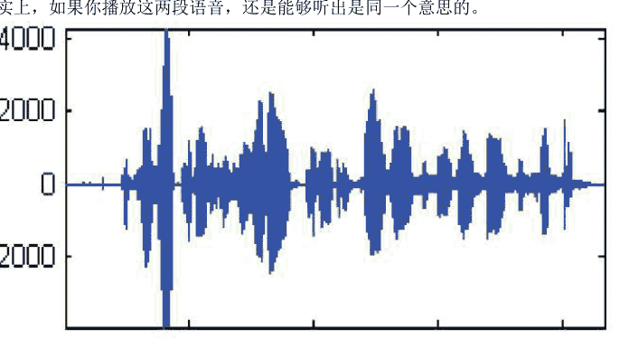

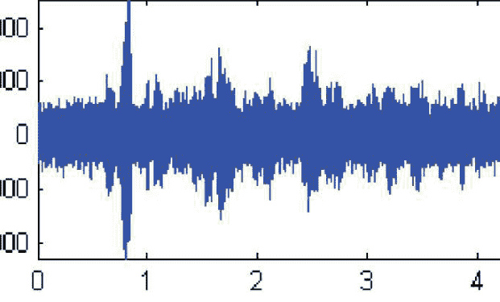

讲回到历史这件事。历史的很多细节是不准确的，而且也无法准确，因为历史书上记录的内容犹如第二幅图中的语音，信号是被噪音所覆盖的。但是，历史的轮廓还是可以看清楚的。

很多人讲，我写的历史是西方那种大历史，不追究细节，只讲大势。这里面有一个重要的原因，就是我无法搞清楚每一个细节，因此只能使用信得过的学者对细节的研究作为我再加工的基础，然后在很长的宏观维度，去诠释历史的规律。

也就是说，我看到的历史就如同达利画的林肯，亦或者是上面两张图中的第二张，重在轮廓和走势。而很多专业历史学家的工作，则是去除噪音，提高信噪比。

预告：至于如何去噪音，如何提高我们对信息准确性的判断力，准确把握信息，让我们的工作和生活变得更好，这是我们下一讲要谈论的话题。

思考题：请你说说自己在工作和学习中，抓大放小的经历。欢迎在留言区和我互动。我们下一讲再见。

## 20 | 去除噪音：如何获得更多更准确的信息？

你好，欢迎来到我的《信息论 40 讲》。
我们上一讲说了噪音，以及它和信息的相伴关系，并且知道了用信噪比来度量和还原信息。我们讲了，当信噪比非常低的时候，我们是无法从噪音中分离出信息的。因此很多时候我们要通过过滤噪音，提高信噪比。

在日常学习和工作中，去除噪音提取有效信息的原则也很重要。今天我们就来说谈消除噪音的问题。

噪音通常可以根据产生的原因以及表现形式作如下的分类：

## 1.能够找到噪音来源的 vs 不清楚来源的。

比如说开车时汽车马达的声音，就是已知来源的噪音，而你打电话时，觉得对方的声音不清楚，有噪音，那些噪音常常原因不明，或者说来源太多，讲不清楚。

去除知道来源的噪音，最简单的方法就是屏蔽它们，比如把汽车里面的隔音做好，车厢内就会显得很安静。如果你坐过直升机，就会发现它的发动机和螺旋桨的噪音巨大，任何隔音材料都不可能把舱内的噪音降到你能听清楚说话的程度，因此坐直升机大家都是戴耳罩，用麦克风讲话。

还有很多时候你即使知道了噪音的来源，也有方法消除它们，但是无法实施。比如晚上 10 点钟楼下一群跳广场舞的，搞出很大动静，但是你显然没有本事让他们不跳，甚至没有本事让他们降低噪音。这种时候就需要我们后面提到的方式降噪了。

至于来源不清楚的噪音，去除时，常常比清楚噪音的来源要更困难。

## 2.有规律的噪音 vs 随机的噪音，固定频率的噪音 vs 白噪音。

汽车的马达声其实是有规律的噪音，它的频率比较固定。集市上的就是随机噪音了。显然前一种比后一种好去除。

有些噪音频率比较固定，比如鸟叫，这很容易从背景中去除，但是如果各种频率都有噪音，也就是白噪音，那就很难去除了。

了解了噪音的分类，我们就来谈谈怎么去除它们。不过这里我们先强调一点，下面 的内容大多是介绍利用计算机如何去除噪音的，而不是我们的耳朵怎么工作。事实上我们的耳朵很缺乏抗噪的能力。

### 第一个常用的方法就是利用信息的冗余。

如果我们受到来源已知、规律性比较强的噪音的干扰，比如汽车发动机的声音，很容易去除。比如在汽车中进行语音识别时，当麦克风接收到人说话的声音后，在进行信号处理之前，会先减去马达的声音。

这件事情很容易做，增加一个专门接收发动机噪音的麦克风即可。事实上在汽车里，哪怕发动机的噪音能量极高，完全淹没了我们说话的声音，人可能听不清，但是计算机识别起来并不难。

类似的，如果一个领导在大会场作报告，在不同角度装几个麦克风即可（它们通常也被称为麦克风阵列），通过对比几个麦克风收到的语音，就可以判断哪些是信号，哪些是噪音。这种方法，从本质上讲，利用了信息的冗余度，也就是说，利用多余的信息，减少误差。

对于知道来源，但是没有规律性的噪音，处理起来难度加大了不少。通常解决方案会和应用场景有关。比如在卡拉 OK 厅使用的麦克风，对距离非常敏感，这样不会将几米以外喝酒划拳的声音收进去。

### 第二个方法就是换一个角度看问题。

在一个维度分不开的两件事，换个角度看就分得清清楚楚了。比如下面这张图，从正面看蓝色长方体和红色的椭球重叠了，分不开，但是从侧面看，它们之间的距离其实很大。

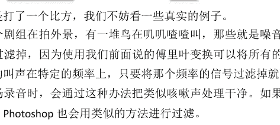

当然这只是打了一个比方，我们不妨看一些真实的例子。

比如说一个剧组在拍外景，有一堆鸟在叽叽喳喳叫，那些就是噪音。但是这种噪音其实很容易过滤掉，因为使用我们前面说的傅里叶变换可以将所有的音频信号变成频率信号，鸟的叫声在特定的频率上，只要将那个频率的信号过滤掉就可以了。

音乐会现场录音时，会通过这种办法把类似咳嗽声处理干净。如果照相机的感光器上有了灰尘，Photoshop 也会用类似的方法进行过滤。

于是美军想到一个可能的解决办法，就是将丘吉尔的电话变成数字化的，中间混入白噪音，这样德国人听起来像一些噪音。

由于白噪音产生的算法是美国人想出来的，德国人如果不知道这个算法，是无法过滤掉噪音的。美国军方就想知道这个想法是否可行可靠，而香农的任务就是研究这个课题。

当时香农经常和图灵一起喝咖啡、吃饭，两个人谈论了很多东西，但是就是不谈彼此的工作。其实他们所从事的研究很有相似性，图灵的任务是破译德国人的秘密，而香农其实是给盟军加密。如果他们能够进行学术交流，其实对各自的工作都大有益处。但是在战争期间他们被要求严格保守秘密，他们也做到了这一点。

最后香农证实，这种想法是可行的，因为噪声分布在各个频率，任何算法都无法过滤掉。但这有一个前提，就是对方不可能知道你产生白噪音的算法，否则他们可以复制这种白噪音，然后从信号噪音相混的信息中将噪音滤除。

香农也就在这个课题的基础上，发展起来了信息论。因此信息论的出现，在一定程度上要感谢噪声。

当然，很多人会想，我不搞通信，是否有必要了解这些知识呢？其实，正如我们上一讲讲到的，噪音存在于各种信号中，不仅仅在通信中会遇到，比如说历史上的记录，就混杂了很多的噪音，而我们平时听到的消息常常也是如此。

有意思的是，生活中的噪音和通信中的一样，有些能找到源头，有些则不能，有些能找到规律，有些则没有。于是，过滤信息中的噪音最简单有效的方法，其实也不外乎上面两种。

### 第一种是通过信息的冗余和比对，过滤噪音。

举一个例子，如果今天美国总统特朗普发表了一番言论，当然媒体对此有记录和报道。但是，各种媒体可能记录有误差，而且可能还有意无意加入自己的看法，把不是特朗普意愿的内容加到他头上，这就主观或客观地引入了噪音。

如果你只从一个信息源了解信息，你其实很难判断所获得的是噪音还是信号。如果你从多个信息源了解信息，虽然它们各自都有噪音，但是由于报道的角度不同，很多噪音彼此可以抵消掉，获得的则是信息，或者说是信噪比很高的信息。

这就和在会场的不同地方摆置好几个麦克风是同样的道理。当然，如果所有的媒体都站在同一个位置，读再多媒体的内容都不可能将噪音过滤掉。

我在《Google 方法论》中讲到过，最可贵的意见不是所谓客观的，而是真正反映自己想法的主观的意见。因为那种看似一客观的理论，其实是有偏见的，当一个企业，只有领导一个人的意见时，那些原本不大的噪音就被放大，以至于会淹没信号。

相反，如果每一个人都把自己主观的意见说出来，虽然每一个人有偏见，也就是说噪音，但是合在一起我们就得到了大众想法的轮廓。

### 第二种，将有噪音的信息分解到不同的维度过滤噪音，这个方法可以怎么用呢？

比如，中国人常常被纠结一个问题，就是老婆和妈妈掉到水里先后救谁。这个问题两难的重要原因在于，要考虑的因素太多，以至于大家越想越糊涂。其实在这个问题上解决并非难事，关键是分清楚什么是我们该考虑的信息，什么是噪音，或者说你最看重哪方面。

比如，如果你觉得孝道是第一位的，或者觉得以后谁和我生活更长时间是第一位的，作出选择就没有什么是难的。这时，你其实是将这个信息混杂着噪音的问题，投射到了某些你能够区分的维度，比如孝道维度，或者和你未来一起生活的时间。

在这样两个维度上比较，就很容易区分大小。这就如同将声音从能量的高低，投射到频率的维度后，就能简单地从频率高低识别出鸟的噪音，然后过滤掉一样。

当然，如果你反过来思考去利用噪音，想将一些信息隐藏在噪音中不被别人发现，最好的办法就是制造毫无规律的白噪音。

Google 信息安全部门曾经为了防止偷账号的人反复试验证码，增加了一个输入验证码的要求，这样反复猜测密码的人就无法使用计算机试错了。为了对视觉有障碍的人使用这种验证码的功能，Google 提供了语音提示。

但这样一来就出现了一个漏洞，因为盗号者可以使用语音自动识别。于是，开发这项服务的工程师就往语音提示中加入了一些噪音，降低语音识别率。但是除了前两天给盗号者增加了难度，两天后，情况又像以前那么糟糕了，于是他们找到我询问原因。

我就问他们语音是哪里来的，他们说是在饭厅里录了一些噪音加进去的。我说问题就出在这里，由于他们录的噪音就那几分钟来回使用，盗号者很快发现了这一点，他只要对比每天不同语音提示的差异，很容易找到加进去的噪音，然后就像过滤鸟叫声那样过滤掉即可。

如果想让盗号者过滤不掉噪音，就要在语音的各个频率加入随机的噪音，也就是白噪音。后来他们这么做了，果然盗号的成功率就降低了很多。

要总结

- 1. 我们介绍了噪音的种类和来源，并且介绍了两种去除噪音的方法，即利用冗余度去除噪音，以及从不同维度看问题去除噪音。
- 2. 我们介绍了生活中的噪音，并且强调了去除通信中的噪音和去除生活中的噪音，其实是同样的原理。

可能会有读者朋友好奇，我们这一模块明明是讲信息传输的，那么为什么要先讲噪音呢？它和信息传输有关系？下一讲我们就来谈这个问题。

## 21 | 信道：信息通道的容量有边界吗？

你好，欢迎来到我的《信息论 40 讲》。

我们这一模块是围绕信息传输这个主题展开的，而传输信息就需要一个信道，比如我们讲话时，从声带到空气到耳朵，就形成一个真实的信道。

如果你用电话线或者网络线传输信息，它们也构成真实的信道。当然，如果你用手机进行无线通信，虽然你看不见信道，它也是真实存在的。没有信道，信息就传输不了，这就如同没有路，车子就跑不了一样。

由于信道这个东西比较抽象，不像道路那么具体，因此在很长的时间里人们搞不清楚它的性质，对它只有感性认识。

比如，人知道两个人讲话频率差不多的人，站在你正前方三米的地方同时对你讲话，你是无法听清楚他们在说什么，即使偶尔听清楚几句话，也很难分辨那是谁说的。

但是，如果一个男生、一个女生站在同样的位置同时说话，虽然他们讲话有干扰，但是你还是能听出他们每一个人讲的话。

造成上述现象的原因并不难寻找。在第一种情况下，两個人用了同样的频率讲话，信号都挤在了一起，因此不能分辨，这就如同只有一个车道，却有两辆车各不相让想同时走，结果就撞在了一起，谁也走不了。

后一种情况，两个人说话的频率不同，就如同有两条车道，两辆车只要别靠得太近，就不会撞上。于是人们得到一个结论，不同频率的信号似乎不应该相互干扰，但这个结论其实只是一种感性认识。

在无线电被发明之后，大家很快就发现一个现象，就是不同电台的频率不能靠得太近，否则互相干扰，谁的也听不清。

但是当时人们并没有关于信道能传输多少信息这样的概念，还以为是频率调制和解调制作得不够精确，就花了好多工夫把电台和收音机频道调得特别准确。但是大家发现不管把调制解调做得多么精确，彼此的干扰依然存在。

这个问题，直到香农给出对于信道容量的量化度量之后，大家才搞明白。原来，当信息传输所用的信道一旦固定，能承载的信息量是有限的。香农给出了对于信道的量化度量，也被称为信道的容量，你把它想成是高速公路的宽度就可以了，有时我们直接使用“带宽”这个词来描述它。

那么什么是信道容量，或者说带宽呢？我们先来看一个具体的例子：我们人正常通话，需要多宽的带宽？

我们人讲话的频率通常在 300～3400 赫兹（Hz）之间，也就是说我们声音的音频一秒钟振动 300～3400 次。振动 300 次的是低音，振动 3400 次的是高音。我们在前面讲到，任何周期性信号，都可以变成很多不同频率正弦波（或者余弦波）的叠加，这在信息上是等价的。

于是，我们可以把人讲话的语音，等价成从 300 赫兹、301 赫兹、302 赫兹……一直到 4000 赫兹的正弦波的叠加。在数学上任何一个频率的正弦波，都是由两个变量确定的。于是这 3100 根曲线就对应了 6200 个变量。

在工程上我们会把频率的范围放大一点，放大到 1～4000 赫兹，于是 1 秒钟的语音就需要用 4000 条正弦曲线，即 8000 个变量来描述。

我们再假定每个变量用 8 比特信息编码，于是传递我们说话语音的带宽就需要能每秒钟传递 8000×8=64K 比特信息，这就是语音通话所需的信道的宽度。事实上，这也是我们使用的长途电话的标准带宽。

不仅电话线的带宽有限，给定任何频率范围的电磁波，所能够承载的信息都是有限的。比如很多人家里使用 2.4G 的 Wi-Fi 信号上网。如果我们限制频率的范围从 2.4G（千兆赫兹）到 2.401G 之间，带宽有多宽呢？

这中间的频率范围是 0.001G（千兆赫兹），也就是 1M（1 兆）字节左右，大约是每秒钟传输 8M（8 兆）比特，因此你的带宽就这么点儿。

在无线通信中，想增加带宽，就需要增加频率的范围，比如说你把 2.4G～5G 的带宽都占了，你一秒钟就可以接收 2.6 千兆字节的信息，相等于一小时高清电影。你上网就会特别爽，但是别人就上不了网了，于是大家就不得不共享带宽。这就涉及到通信标准的问题。我们后面再讲。

有了对带宽的感性认识，我们就可以来讨论香农对信道容量的定义，他用了我们在第 14 讲中介绍的互信息的概念来定义带宽。为了避免你去读那些数学公式，我举一个具体的例子来说明。

王老师是你的论文导师，但是他不直接指导你，而是派三个助手张三、李四和王五给你带话。他们仨就是你和王老师之间通信的信道。

你从张三那里听到的話，和王老师的原意差不多，而从李四那里听到的，意思有不小的偏差，从王五那里得到的信息，意思和王老师的完全无关。

假如某一天王老师派他们仨传递了同一条信息 X，你从这三个人那里得到的信息分别是 A、B 和 C，对比王老师的原意 X，A 和 X 的互信息非常大，B 和 X 的互信息就小一些，C 和 X 的互信息是零。显然，张三这个信道的带宽就宽，李四相对就窄，王五干脆带宽为零，完全不可用。这就是带宽和互信息的关系。

香农进一步指出，信道的容量，决定了有效的传输率，这就是信息论中著名的香农第二定律，关于它我们后面会专门讲。

接下来，我们来谈谈信道这个概念和我们平时生活的关系。

首先，我们要清楚信息的传播是有成本的，其成本就源于信道的容量。比如说你有一个好消息，想让所有的人知道，你就让张三和李四替你去传播，他们就是你的信道，他们表达你意思的能力有限，不可能无限制传播，那就是他们的信道容量。你如果想让你的消息传播得更快点，就得多找些张三李四这样的信使。

在单位里，你想把自己的想法通过你的经理，告诉总裁的助理，再告诉总裁，他们俩就扮演了你和总裁之间信道的角色，而他们反映你意思的准确性，就是这个信道的容量，或者说带宽。

由于他们会不断往你的信息中加入噪音，即便是有意的，领导其实未必能够真实地了解你的想法。有可能你通过他们表达了五次信息，领导得到的信息量还是有限。

## 第二，我讲了某个范围的无线电波，所能承载的信息是有限的，因此无线通信的效率其实永远赶不上 有线电缆/光缆，因为有线的传输信号是封闭在通信线路里面的，从理论上讲你可以无限制地在地下埋通信线路。但是空中的频率是共享的，在一定区域内，你占了 2.4～2.401G 之间的带宽，别人就用不了了。

因此，大家不要指望 5G 到来了，无线通信率高在家里有线上网快，那些媒体上讲的测试速度，都是没有人互相抢带宽情况下得出的，不能够完全当真。当然，5G 比 4G 快，这没有问题，大家要防范的是对 5G 的过度炒作，以免自己糊里糊涂地把身家投进去。

另一方面，也正是因为空中的无线电波的频率是有限的，因此它们今天成为了最有价值的资源，可以讲谁拿到它们，谁就发财了。各国电信管理部门当然也不会随意就把这样的资源给出去，它们通常是通过拍卖的方式有偿提供给运营商。

今天各国的无线电波频率从低到高已经不断地被开发出来，它们先后是无线电收音机广播，电视广播，早期的移动通信，后来的 3G、4G 和家庭的 Wi-Fi，现在要开发的是 5G。

由于各国移动通信所使用的频率略有不同，即使采用同样的标准，你的手机如果不支持特殊的频段，到了一些国家也可能无法使用，原因就在于是此。

## 第三，量化度量这件事很重要。我们今天举了一个例子，语音传输的带宽是怎么计算出来的，它可能读起来有点枯燥，但是我想通过这个例子来说 明寻找我们做事情边界的方法，就是估算一下它们的理论极限。

在没有信道容量这个概念之前，人类在通信上走了很多的弯路，把精力浪费在实现根本不可能实现的事情上。这和过去人们寻找长生不老药，发明永动机很相似。

了解做事情的边界，在边界内尽可能把事情做好，不仅在通信上是这样，在生活的方方面面都是如此。我们后面在讲到通信标准时，还会介绍科学家们是如何在边界里做事情的。

## 要点总结

- 1. 信息传输需要信道，信道就像是公路，它对信息的“运载量”是有上限的。
- 2. 信道是可以量化度量的，它的容量也被称为带宽，带宽决定了传输效率，有线通信的效率通常高于无线通信的。

思考题：你认为，在工作中如何提高自己传递信息的带宽呢？
预告：下一讲，我们介绍信息论中重要的香农第二定律。我们下一讲再见。


## 22 | 香农第二定律（一）; 为什么你的网页总是打不开？

你好，欢迎来到我的《信息论40讲》。上一讲，我们讲了信道和信道容量的概念，它们和我们日常有效的沟通有关。这一讲，我们要学习信息论中的重要理论，香农第二定律。

如果我们只有一个很窄的信道，也就是说信道容量C非常小，却想传输非常多的信息怎么办？唯一的办法就是延长传输的时间，也就是降低传输率。

在信息论中传输率R的严格定义是单位时间（通常是秒）传输多少比特的信息。比如我们说用电话线传输网络信息，不会超过56K，它就是指一秒钟不会超过56,000个比特的信息。

如果按照这个速度我们传输汉字，不经过压缩，每秒大约可以传递3500个。通常一个网页都没有这么多字，因此从理论上讲，即使用电话线上网，网页也应该是一眨眼的工夫就打开了。

但事实上，就是10倍的时间也未必打得开，这里的原因我们后面再讲。不过大家可以记住一条，你真实感受到的网速，也就是运营商告诉你的1/10左右。

那为什么明明理论上网速很快，或者说带宽还可以，但是看网页还是会卡住呢？今天我就从这个问题讲起。

我们上一讲说道，香农发现，信息通道的传输率R，是无论如何无法超过信道容量C的，即R≤C。接下来香农还讲，总能找到一种编码方式，使得传输率R无限接近信道容量C，同时保证传输不出任何错误。

至于怎样找到这样的编码，香农没有讲，他给出了一条原则。但是，如果谁要试图超越信道容量传输信息，不论你怎样编码，出错的概率都是100%。这三句话概括了香农第二定律的大意。

香农的结论在数学上是可以严格证明的，这里我们就省略了。为了便于你理解这一点，我们不妨通过一个例子定性分析一下。我们来看看为什么你的网页总是打不开。

今天的互联网最基本的通信协议是TCP/IP协议，它实际上是把要传输的数据先拆成一份份的，每一份是一个数据包。然后在数据包上加入一个数据头，里面包括对这个数据包的描述，以及它应该被送去的地址。

这时网络的传输率是多少呢？从用户的角度看，它在单位时间里传了10个包，应该 是这10个包的数据量除以自己等 的时间。

而对于网络来讲，它是实际传输包的总数量，比如在上一个例子中是12个（7、8两个包传了两次），加上每个数据包的数据头上额外 的信息，再加上接收后确认回传的 信息，除以实际的传输时间。

显然，网络上所传递的对你有用的信息，要比实际传输的信息少，而你等待的时 间要比实际传输的时间长，因此你就觉得传输率远没有标称的高。

如果网络的带宽很宽，也就是容量很大，一个数据包就能迅速抵达接收方，接收 方接收到之后就会发送确认信息，这样一来一往，发送就非常顺畅，你也不觉得慢。

但是，如果网络容量有限，比如我们在前面讲到，如果你只有56K的带宽，发送 方在一个包接一个包地拼命发送，接收方就会丢掉很多包，然后它就不断通知发送方， 第2、3、5、6、7……各个包都没有收到，请再发一遍。

发送方于是马上把那些包重新发送，结果原来的包还没有发完，现在又要多发很 多包，网络就变得更加拥堵，最后无论是发送方还是接收方都会锁死在那里。

你有时打开一个网页，刚刚显示了头上10%的內容就再也打开不下下面的内容了。 你就在想，即便是网速很慢，只有56K的带宽，等待时间长一点也该传完了吧。

其实不是，因为在网络的某一处信道的容量难以满足传输率的要求后，你的计算 机作为接收方很长时间没有收到某个包，就无法发出接收完成的信息，传送信息的服 务器就不断重新传输那些没有得到接收确认的数据包。传输就永远无法完成了。

那么假如你只有一条很慢的线路怎么办呢？唯一办法就是主动降低传输率。我们 不妨看三个实际生活中的例子：

- 1. 我们昨天讲到，张三是你和领导之间的信息通道，但是他的信道容量非常有限，也就是说通过他传递后，领导的意图和你所听到的意思之间互信息非常低。这样的人，如果还想要他做信息通道，唯一 的办法，就是领导每次只对他讲一件简单的 事情，由 他传递给你，而且你还需要复述一下你的理解，再传回给领导。

## 第一个建议，根据孩子的潜质，决定他所学的內容。

客观地讲，绝大部分孩子都不是数学学霸，不适合搞奥数，甚至不适合花太多时间做难题，或者比别人学更多内容。

今天的教学大纲定成这个样子，当然你可以把它看成是信息的传输率，是考虑了老师的水平和孩子们的接受能力、paste的。也就是说，它是建立在老师、孩子通信平均的信道容量基础之上的，是有道理的。

当然对于一部分学生来说，他和老师沟通的信道容量非常大，这个信息传输率远远低于他们的潜力，对他们可以增加信息传输率，也就是，多讲，往深了讲。但是对于大部分学生来说，讲多了讲深了，就如同互联网很低的网速，还想要快速传递信息，最大的部分数据包都会丢了，什么信息都没送出去。

## 第二个建议，选择学校，要选择一个适合自己的。

很多家长觉得，孩子和学习好的学生们在一起，自己也会被带好，这一观点完全没有错。但是，好的学生，可以是学习态度好的，学习方法好的，未必需要是脑瓜极好的学霸。

一个资质中等的学生，和一群接受能力极强的学霸在一起，未必有多大的收获。因为在那个环境中，老师教得会很快，内容也会比较深，大部分学生接受起来没问题，想方设法挤进那个群体的学生会很痛苦。

这就好比，如果一群学生都用的是4G的手机，只有你用的还是10多年前2G的手机，老师根据大多数人手机的带宽，不断发高清视频，你拿2G手机什么都没收到。但是如果换一个环境，大部分人都是2G手机，老师是按照2G这个网速发文字内容，你虽然看到的内容不够丰富、逼真，但是牢靠有效。

## 3.男女朋友和夫妻之间的关系和沟通。

我在《态度》中讲，做男女朋友，两情相悦就好。真要走入婚姻，最好双方三观一致。从信息论的角度看，所谓三观一致，就是两个人对世界的看法互相信息很高，这样两个人沟通信道的容量很大，丈夫说件事情，妻子马上理解了，反之亦然。

如果两个人的三观完全不同，对同一件事的看法完全不同，互信息接近于零，讨论起事情来，鸡同鸭讲。一开始那股兴奋劲头一过，矛盾是难以避免的。

另外，“下嫁”（也包括男生低就）这件事，说起来很感人，但是在真实生活里...因为下嫁的一方需要放弃掉自己过去所有的生活习惯，去就对方。否则的话，两个人就没有了沟通的基础，进而就没有了有效的信道传递。

当然我这里说的“低就”不是指物质生活水平方面的差距，物质生活的改变相对来讲是很容易的，我指的是抛物质条件之外的因素。

## 要点总结

- 1. 我们讲了香农第二定律，重点强调了永远不要试图越超信道容量传输信息，因为那样的效果等于零。
- 2. 我们再次强调了在边界里做事情的重要性，只是这一回，我们是通过量力而行来说明的。如果某天的信道容量不足，唯一的方法就是降低速度。

思考题：就“连接比拥有更重要”发表你的看法。

预告：下一讲，我们讲讲香农第二定律和商业的关系。我们下次见。

## 23 | 香农第二定律（二）：到底要不要扁平化管理？

你好，欢迎来到我的《信息论 40 讲》。

今天我想和你讨论的是，信息时代的企业到底要不要扁平化管理。这一讲的内容可以帮助我们从管理和商业上进一步理解香农第二定律。

扁平化的管理，顾名思义，就是管理的层级要足够少。我们先说说不这么做有什么后果。

数字设备公司（DEC）曾经是历史上第二大的计算机公司，它在小型机和操作系统技术上从来不曾落后过，但是到了上个世纪90年代就关门了，其主要的原因是管理方式无法适应信息时代的要求了。

该公司曾经出现过上下九级只有一个单一汇报人的奇怪现象，即一个高级副总裁手下只有一个副总裁，后者手下只有一个资历更浅的副总裁，这位副总裁下面只有一位高级总监，以此类推，最后由一位一线经理指挥仅有的一个工程师。也就是八个领导指挥一个干活儿的。

这种糟糕的管理有两个明显的危害，首先是中间六七层都是冗余人员，使得企业的成本剧增，另一方面，使得上下沟通的带宽变得非常窄。

我们知道带宽等于一收一发两端的互信息，这东西是随着信息传递次数衰减的。假如经过一次传输，互信息是原来信息的90%，八次下来就只剩下1/3了，下面工程师做的事情，恐怕早就不是上面要的了。

今天新一代的企业，管理层级相对较少，这里面有历史的成因，因此新的企业看到过去企业的问题，可以避免。也有竞争的原因，今天信息交流比较通畅，容易形成赢者通吃，上下交流效率太低的企业就被淘汰了。因此，今天哪怕是一个决策极为不民主的家族企业，也在努力往扁平化管理上面靠。

但是，将层级减少后，是否就真的受到了扁平化管理的好处？也未必。

我们再看一下另一种极端情况，就是一个老板下面有上百个直接的汇报者。这看似是绝对的扁平，而且管理者的意图可以直接达每一汇总报者，但是这样的管理其实效率同样很低，因为管理者自身通信的带宽是有限的，他要传递的信息量又太大。

根据香农第二定律，他只有两个结果，一个是降低自己的信息传输率，也就是说延长信息交流的时间，比如把每周和下属进行一次的交流，延长到每个月一次，这样的结果无非是，下面真出现什么问题，他根本没法察觉。

第二个结果就是将大量的信息硬往不宽的信道里塞，整天晕头转向，其结果是完全失真，信息沟通的效果还不如前一种。

还有一种虚假的扁平化管理，就是虽然在汇报关系上，底层员工可以直接向高层

领导汇报，但是层级设置过于分明，部门的边界过于明显，你想约领导的时间他永远没空，你想和旁边部门沟通，你的领导会觉得你不忠，这种扁平化就没有意义了。

你可能会在一些单位中看到这样的现象：

开大会时，会场的座位就分为了三六九等，参与级别最高的领导坐在主席台上，座位前还有个名牌；第二等级的领导坐在第一排，有桌子有茶水；第三等级的领导坐在前面比较好的预留位子。其他员工在后面和旁边随意坐。

每个人的办公场所完全与职级挂钩，中层以上的干部分享独立办公室，高层干部拥有豪华办公室，有些公司的 CEO 或者创始人甚至一个人占了几层楼，而员工则挤在小隔间里，甚至有些新来的员工要在过道里临时搭个办公桌办公。

上级对下级具有过大的人事权，从招聘、考核评估到提升无不由上级说了算，因此下级会过分看重直接领导的态度，而不是公司的利益。上级也会把下级员工看成自己的私有，并且为了提升自己在公司的地位，不断扩大自己下属的人数。

同时，上级还对内部调动的下级进行打压，每次都将最差的考核评分给予那些希望流动的员工，使得这些员工因为具有了不良的业绩考核记录而难以提升。

上面说的管理方式，即使在汇报关系上再扁平，也起不到信息沟通顺畅的目的。因为各个层级之间，一旦分出了三六九等，信息再往下一层层传递时，就难免人为地根据自己的目的，“截流”一些信息。下属向上汇报时，完全可以报喜不报忧，甚至把坏事当喜事办，因为第一级的的管理者无法绕过第二级的中间层向第三级的员工了解真实情况。

类似的，上级向下传递企业的精神时，中间任何一个环节都可以随意夹杂私货进去。我观察一些企业，发现有些总监让员工做的事情，完全不是公司希望的，而是他的私活。

在 Google 就出现过原本是半个人工工作量的活，被一位总监安排了三个全职员工去做，当然这位总监也往里糅杂了很多私活。所以幸的是，Google 的各个项目是公开透明的，越级沟通也被允许，因此这样的事情通常可以很快被纠正。

但绝大部分企业发现和纠正这种问题的时间非常长。因为三六九等的职级和部门之间的壁垒将人与人通信的带宽变得非常窄，信息传输率就非常低，同样一个信息传递出去的时间自然长，当然收集信息也变得困难。所以上面说的这种扁平化管理其实是虚假的，其本质和集权分层的企业一样，都让信息传递和反馈变得漫长，沟通成本增高。

比如清朝康熙两朝，皇帝都是勤政的好皇帝，但是到了他们统治的后期，对帝国的情况已经完全没有准确的了解了。等到了道光时，完全不清楚衣裳打个补丁需要多

少钱，而光绪皇帝则不清楚一枚鸡蛋要多少钱。

一个企业里，再勤勉的领导，智力、见识和体力也未必超过康乾两位皇帝，如果不能保持信息沟通的流畅，就算把自己累死，也未必能把企业管好。

扁平化管理流行于信息时代，是有它原因的。这一方面是因为信息量太大，在管理上需要更多的带宽，另一方面是新的通信手段增加了带宽。

而扁平化管理从本质上讲，使得整个公司内部信息交流的带宽比过去有了质的提升，基于这样的带宽，对内合作可以更顺畅，对外能有更强的市场适应性。

所以，扁平化管理的本质就是对香农第二定律的应用，保证一定带宽内的沟通效率或者利用科技提高带宽。其实除了管理，市场推广也是一种应用，市场推广的本质，也是增加对外沟通的带宽。

我们常说做生意要靠人脉，其实这个人脉就是人与人交往的带宽。买卖双方彼此认可，这在信息论上，就表现为彼此观点的互信息较高，这种情况下买卖就能达成。

如果人脉不够，发出的信息和获得的信息都有限，生意一定做不大。现代通信手段和传媒技术的本质，就是以相对低廉的成本让人获得人脉。

在古代，浙江杭州周边的商品想要卖到南京上海去，就需要很长的传播时间，因为商品信息流通的带宽太窄，信息传输率不可能高。

有了近代的传媒，包括报纸、广播和后来的电视，商品信息传播起来就比较容易。这是因信息传播的带宽增加了。但是，由于报纸和广播具有地域性的特点，电视广告的成本很高，因此大企业在这样的环境下收益多，小商家收益少。

互联网的出现不仅进一步扩展了带宽，而且让带宽的成本大幅度下降。这样浙江的小商品不仅能够很快卖到全国，而且不出几年就能卖到世界的各个角落。这就是利用了互联网这个廉价大容量传输渠道的结果。

从本质上讲，阿里巴巴所做的事情，就是拓宽了商家和消费者之间信息交流的带宽。这便是互联网思维，这种思维方式，是符合香农第二定律的。实际上，香农第二定律描述了自然界本身所固有的规律性，这也是它很容易应用于通信之外的原因。

那同样是互联网公司，为什么大家要在淘宝上交易或在京东上交易？这里面的原因还是带宽，当然这种带宽并非是指网速有多快，而是指互联网平台怎样能够建立起商家和买家之间彼此的信任。

我们在前面几讲中说过，信道的容量，也就是带宽，是由双方的互信息决定的，在商业上，它就是双方的信任。卖家传递的信息，和买家认可的信息一致，两种信息之间的互信息就高，带宽就大，生意就能做成。

相反，如果卖家吹得天花乱坠，买家不认可，互信息就为零，两者之间就没有沟通。

通的带宽，生意就做不下去。中国早期失败的电商代表8848就没有能够让买卖双方在它的平台上产生信任，因此生意就做不下去。

因此，当我们说互联网思维时，不要老想着把东西放到网上，就是互联网思维了。

## 互联网的本质是通信工具，通信里面自有它的规律，比如香农第二定律。做事情的时候符合了规律就做得顺利。

## 当然，在互联网时代，除了信任，不信任也可以通过互联网来传播。

比如2019年5月有一则新闻，一位西安奔驰车主因为无法解决和厂家在汽车质量上的纠纷，一屁股坐在了汽车发动机盖子上痛哭，于是成为了网红，最后厂家和经销商不堪舆论指责，还算比较好地解决了这个问题。这位车主就是利用互联网思维让商家的负面信息迅速传播。

当然，我想更进一步告诉你的是，车主能够得到大家的支持，是因为她的行为引起了大家的共鸣。所谓共鸣，其实就是产生了很高的互信息，也就是大家对汽车经销商不合理的所有作为，都有共识。

## 要点总结

- 1. 我们从多个角度讲述了扁平化管理，互联网思维和香农第二定律的关系。拓展带宽是今天我们所有人都需要做的事情。
- 2. 我们特别强调了带宽是由通信双方的互信息决定的，这在人际交流中就是信任。
- 3. 利用互联网的带宽，既可以传播正面信息，也可以传播负面信息，而后者无形中起到了社会监督的作用。

思考题：什么样 的企业不适合做扁平化管理，什么企业必须做扁平化管理？欢迎和我在留言区互动。

预告：下一讲，我们说说对待错误的正确态度应该是什么。下一讲再见。

你好，欢迎来到我的《信息论40讲》。

我们前面讲到，信息在传输的过程中难免发生错误。比如说你的电脑正在通过网络线传输信息，有一个地方接触不良，产生了一个小的脉冲电压，0被传输成了1。4和10说不清。在英语里，14，fourteen和40，forty在电话里也是经常混淆的。

机器和我们人一样，也会出错，只不过它的出错率会低一点。但是由于机器处理和传输数据的总量非常大，绝对的出错数量还是非常多的。

因此，对于必然发生的错误我们该如何面对呢？这是我这一讲想告诉你的方法论。

如果我们采用正向思维，就会把工作做得更细致一点，试图不出问题来解决问题。比如多检查检查线路，通信线路屏蔽做得好一点；在通信时说话慢一点，发音标准一点。

这样的努力不能说没有用，但一来使得成本剧增，二来依然有一些问题无法解决，因为出错是人的天性，而干扰无处不在。对大部分人来讲，就是花上三倍的时间，也未必能够做到绝对准确的要求，总不能不让那些人通信吧。

此外，很多随机事件我们并不知道它们什么时候发生，像太阳的活动其实是极不稳定的，太阳黑子微妙的变化，就能够干扰我们的无线通信。我们能够管得了飞机起降期间不用手机，但是管不了太阳。

因此，从根本上解决传输过程中信息错误的做法，就是在信息传输编码时，考虑到错误必然存在，然后通过巧妙的编码解决那些问题。这就是在信息传输中的逆向思维。具体到通信中，就是通过巧妙的信道编码保证了有错误能够自动纠错。

信息纠错的前提是要有信息冗余。如果一条信息已经被压缩一点冗余都没有了，它容错的能力就是零，更不要谈纠错的可能性了。

比如说别人给你一个网址，不小心写错了一个字母，你拿到后发现打不开，然后再仔细看一遍网址，根据单词的意思大概猜一猜可能出的错误，可能就打开了网页。但是，如果给你一个没什么意义的短网址，比如xAy32Dz，错一个字符就一点办法都没有了。

古代犹太人一直是靠手抄《圣经》将它代代相传的，今天你去以色列，依然能买到很多手抄的《圣经》。抄写的过程是一个信息传播的过程，因此错误便在所难免。

虽然说犹太人做事很认真，而且在抄写《圣经》时，要虔诚并且打起十二分精神，尤其是每写到“上帝”(God 和 Lord)这个词时要去洗手祈祷，但是抄写错误还是难以避免。

于是犹太人发明了一种有效发现抄写错误的方法，他们把每一个希伯来字母对应于一个数字，这样每行文字加起来便得到一个特殊的数字，同样，对于每一列也是这样处理。

当犹太学者抄完一页《圣经》时，他们需要把每行每列的文字加起来，看看新的校验码是否和原 来的相同。如果中间有一个词抄错了，比如在第五行、第六个词，那么第五行和第六列的校验码就和原文中的不同了，于是就可以定位错误发生的位置，然后进行修改。

今天计算机里最简单的信息校验使用的就是上述原理。我们还是以上面的二进制10011101为例来说明。

在这个二进制序列中，任何一个0或者1发生了传输错误，我们都无法判断是否有错误发生。但是，如果我们将它从8位二进制扩展到9位，第9位就是所谓的奇偶校验位，记录这个八进制到底是奇数个1还是偶数个1。如果在传输时，错了一位，1的数量就对不上了，这样我们就知道出了传输的错误。这就是奇偶校验的原理。

在上述方法中，如果错了两位，那就检验不出来了，但是这种情况不多见。90%儿的传输错误是能够发现的，不能发现的错误不到10%。

接下来我们从信息冗余的角度对它作一个分析，它其实多用了1个比特的信息，也就是1/8的信息冗余，这样信息编码的长度就略有增加。

当然，这种方法只能发现错误，不能纠正错误，因为错误可能出现在任何一位上。

那么我们能否通过巧妙的编码纠正错误呢？答案也是肯定的。

我们需要想个办法，如果发现传输出错时，能够确定出错的位置，那么我们就可以纠正错误了。我们回顺一下古代犹太人在抄书时定位错误的方法，他们采用横竖两个维度交叉实现。

1940年，贝尔实验室的科学家海明（Hamming，也被翻译成汉明）设计了一种原理和上述方法类似的纠错的编码方式。

他将一个很多位的二进制数据映射到几个维度，然后在每一个维度进行奇偶校验，如果有错，就可以定位出错位置。这种编码后来被命名为海明码，它在今天计算机中被广泛使用。

海明码要增加编码的冗余信息，如果纠正一个8位2进制中的1位错误，就需要增加5个校验位，这就是成本。这比简单将信息传输三遍已经有效得多。事实上，海明码的纠错效率接近了信息论给出的最优值。

今天依然有一些科学家在研究纠错编码，其数学基础主要是数论和近世代数。从这里面我们可以看到数学和信息科学之间的关系。


如果我们再换一个角度来看信息纠错的问题，合理的编码如果太密集，就不容易纠错，如果让合理的编码距离拉大，就容易发现错误。

我们不妨看这样一个例子。假如 0—999 这 1000 个数字，每一个都被认为是正确编码，正确编码之间的间隔只有 1，比如 87 和 86 是正确编码，它们的差距就是 1。这样稍微错一点就出错了。

如果我们要求正确的编码必须是个、十、百三位数都一样，那么 0—999 只有 10 个正确的编码，即 000、111，一直 999。这时正确编码之间的距离至少为 111，距离很大，就不容易出错。

如果我们不断增加合法编码之间的距离，我们的传输就变得越来越可靠，但是这样就要浪费很多信息。因此，有效的纠错编码实际上是在平衡编码的效率和纠错的可靠性。在这方面，最极端的情况可能是我们自身 DNA 的编码了。

在上个世纪 80 年代之前，研究基因遗传的科学家和研究信息的科学家鲜有交集，因此作者发现 DNA 中很多碱基似乎毫无用处，因为它们根本和任何功能对应。

今天你依然能读到这样的观点，主要是采用了八十年前的说法。但是后来随着人们对 DNA 的进一步了解，认识到两件事：

- 1. 一些原本不知对应什么功能的碱基，现在找到了它们的功能。
- 2. 那些多余的 DNA 并非真的没有用，而是对于防止基因之间在复制的时候因为一个错误而引起一连串的错误很有帮助，你可以认为它们是基因之间的防火墙。甚至有人认为它们可能起到了纠错的功能。事实上，人的基因也是通过信息冗余起到了容错和纠错的效果。

## 要点总结

- 1. 不要高估自己的仔细，以及自己通过努力做到最仔细后，能够达到的效果。不确定性是我们这个世界自然的属性。因此，在解决任何问题之前，都要考虑到世界的不完美和不确定性。这就是所谓的预则立，不预则废。
- 2. 在信息的传输过程中总是不可避免发生错误的，要想避免出错，就要增加一点信息冗余。增加的信息冗余越多，检验甚至纠正错误的能力就越强。当然，并非简单增加冗余就能查错纠错，人的水平的高低，就在于是否有效利用资源解决了更多的问题。上帝给每一个人一天 24 小时，谁也不会多，谁也不会少，只有些人利用得比其他人更好罢了。
- 3. 有一些自然存在的，看似没用的信息，先不要下结论说它们没有用，在了解清楚之后，你可能会惊叹于大自然的美妙之处。

思考题：如何利用纠错的原理增强我们交流的准确性？

预告：第二模块的这几讲，我们都是在围绕信息传输中可能遇到的麻烦，比如噪音大、信道窄、传输错误等等来教你破解之道的，下一讲，我们再说一个传输中可能遇到的难题，就是加密。我们下一讲再见。

你好，欢迎来到我的《信息论40讲》。

金庸小说中的韦小宝谎话连篇，但居然有不少人信，很多 人就觉得这是金庸瞎编的。但从信息论的角度来分析一下，这个现象背后还是有一些道理的。我们先来看看韦小宝这个人的行为。

## 韦小宝说谎的第一个要诀：说谎九句真，一句假。

由于有九句是真话，因此大家对他有一个基本信任，否则要是100%讲假话那就没人信了。

韦小宝的这个做法，就给对方出了一个难题，就是要不要信他的话？如果完全不相信，可能错失一两次机会，当然如果相信也可能被骗有损失。

当然，稍微谨慎一点的人，会想办法从侧面验证韦小宝说话的真假，比如康熙的信息渠道多，经常能识破他的谎话。但是并非任何时候人们都有机会来验证，比如他通知兄弟们逃跑，那时就没有时间去验证，要么信他，要么不信。

这在其实就利用了信息论密码传输中的一个实用性原则，也就是保证一定的时间内密码有效就可以，如我们认定比特币协议是安全的，其前提条件是，以现有的计算能力，我们无法在有限的时间里破解它。

同样的，由于无法在短时间里验证韦小宝话的真假，因此大家就要算一算，到底是收益大还是损失大。因为他9句真1句假，让人感觉可能还是收益大，于是很多人就信了。

## 韦小宝说谎的第二个要诀，就是同样的理由不用两次，这就符合加密中一次性密码永远无法破译的原则。

## 此外，韦小宝在传递信息的时候，无意中还使用了加密最基本的原则，就是第三方截获加密信息后，不会获得比此前更多的信息。

有一次韦小宝想通知康熙，有人要刺杀他，画了一幅画，中间是个圆圈，边上是一把刀指向圆圈。他的解释是，让人准备刻花汤圆给大家吃，暗含的意思是有人要刺杀小元子。他没读过书，玄和元分不清，而小玄子是他私下里对康熙的称谓，只有他和康熙两个人知道。别人即使拿到这个密语，也看不懂。

故事讲完了，我们现在从信息论的角度出发，谈谈加密的本质。

假如我们有一个原始信息I（大写的i），我们对它进行编码，变成C，C是所有人都可以读懂的，因此我们称之为明文。当然传输明文C是极不安全的，因此我们就对它进行加密，得到密文E，而使用的密码则是K。

加密的目的是什么呢？当敌方获得密文E之后，对明文C的知晓程度不会增加。

换句话说，如果敌方对原始信息I的知晓程度原来是10%，拿到密文E之后还是10%。

当然，在信息论中我们采用的是信息熵 H 来衡量对方的知晓程度，或者反过来说，对方对这个信息的不确定程度。

比如我方一支部队伍可能从南边行军，也可能从北边走，我们要通知友军自己的行军路线。假定敌方原本对这件事的不确定性是 H=1 比特，也就是 50% vs 50%，截获了加密信息后，不确定性依然是 H=1 比特，那么加密就成功了。如果截获了密码，破译了，变成了明码，故方就得知了行军路线，不再有不确定性，于是 H=0 了。

因此，加密的原则就必须是，当对方收到由密码写的密文后，无法降低任何不确定性。比如，韦小宝画的那张谁也看不懂的图，就符合这个要求。

那么怎样才能让密码在最大程度上做到信息不泄露呢？从上述原理可以看出，就是要将原本有规律的信息，变成看似毫无规律，随机分布的编码。这时候，无论敌方怎么处理收到的密码，获得的信息都近乎为零。

但是，做将原本有规律的信息随机化这件事，说起来容易做起来难，因为它不是真的随机的，而是伪随机的，是让敌方觉得是随机，而我方其实知道背后的算法或编码原则。如果派真的的随机，我方自己也读不出原来的信息了。

所谓伪随机，就是用一个算法产生的随机序列。比如我问你，下面的数字序列是否随机：445923078164062862。

你的第一感觉是，它一定是，但其实它不是，它只是从圆周率 Pi 中截取的一段。如果敌方知道了我的随机算法是按照某种规律截取 Pi 中的序列，我加密的密文就被破译了。

在信息论出现之前，数学家们已经开始懂得要增加随机性这个原理，但是做法上却非常简陋。

比如用某一本书的页码和字的位置做编码。我们经常在谍战片中看到间谍们要竭尽全力搜寻对方的母本，其实就是这么一个保留了编码原则的书，找到了就很容易破译。有了信息论之后，加密就有了理论指导，因此二战后的密码被破译的就少了。
想更多信息加密相关知识的同学可以参阅「得到」里卓克老师的《密码学》课程。

那是否存在永远无法破解的加密呢？有的，那就是使用一次性的加密密码。为什么一次性加密无法破译呢？为了说明这一点，我们先说说为什么重复使用的密码不安全。

我们可以把加密的过程看成是这样的：明文+密码=密文。
在加密的过程中如果给定明文和密码，你一定能得到唯一的密文；但是对于破密的人来讲，这个过程的逆过程非常困难，也就是说给你最后的密文，你是无法倒推出明文和密码的。

这就如同 3+5=8，但是你拿着 8 这个数，想知道它是哪两个数相加而来的，那就很

难，因为可能性太多，不仅 3+5=8，2+6 也等于 8。

那么破密是怎么进行呢？从原理上讲，如果一个密码重复使用，某些明文和密文的对应恰好又不小心被泄露了，对方就能够倒推出密码，于是整个密码系统都被破解。虽然在密码破译之前很难找到明文和密文的对应，使得密码在一段时间内是安全的，但是对方可以设计圈套，获得这种对应。

比如，二战时在中途岛海战之前，美军截获的日军密电经常出现 AF 这样一个地名，应该是太平洋的某个岛屿，但是美军无从知道是哪一个。于是，美军就趁次发布与自己控制的岛屿有关的假新闻。

当美军发出“中途岛供水系统坏了”这一假新闻后，从截获的日军情报中又看到含有 AF 的电文（日军的情报内容是 AF 供水出了问题），美军就断定中途岛就是 AF。事实证明美军判断正确，于是美军那里成功地击溃了日本联合舰队，并一举扭转了太平洋战争的战局。

但是，如果密码只用一次，就不会有这个问题，以后的加密不会因为一次失误泄露而被破解。

这一点香农在信息论中表述得清楚楚。我们说量子通信是安全的，就是因为它使用一次性密码。关于量子通信，大家可以回顾《科技史纲 60 讲》第 59 讲。

我们一开始说韦小宝撒谎不容易被捅穿的第二个要诀，就是因为他每次使用不同的理由。当然我们不是要教大家撒谎，而是从这一出开发告诉大家保护自己隐私的技巧。

首先，密码要经常替换，而且最好不同的网站使用不同的密码。当然密码多了，你可能记不住，一个简单的方法是把密码分为两部分，一部分是所有网站都固定的，另一部分是容易记忆的，不需要太长，你记得住的。

两部分拼起来即可，这是研究网络安全的专家推荐的办法。事实上，如果你起了一堆很难记住的密码，因为记不住，全写在了纸上，反而不安全。

其次，保护隐私的一个很好的办法，就是将隐私藏在随机的噪音中。

今天很多在线服务的电商（比如订酒店、机票）都存在着价格歧视的问题。对方通过你的网络行为了解你的意图，比如你总是在出门前两天订机票，你看到的价格就可能高于其他人。

但是如果你总是随意浏览价格，从不购买，就不会有这样的问题。因此一个可行的办法是经常删除你的上网记录（主要是 Cookie），然后将偶尔的购买行为放到大量随机的浏览中。

这就如同韦小宝十句真话夹杂着一句谎话。当然，这样做要花费时间。对于时间

很宝贵，钱不是问题的人来讲，就不用花这个精力了。

## 最后，如果你想让人知道你的观点，就要明确表述。反之，你的表述就应该让对方得不到任何信息量，但也不要误导别人。

比如对方问你是否愿意支持他竞选学生会主席，你不想支持他，又不好明说。该怎么办呢？

如果他一开始对此的期望值是7成支持，你说出去的话，还应该让他维持这个期望值。如果你让他觉得是十成支持，回头你又不支持，这是误导他，过后他会翻脸。

反之，你发表你的看法后，让他觉得是三成支持，这是比较明确地表达了你的否定态度，他当场就会不高兴。如果你说了一大堆的话，维持了他事先的想法，这其实没有传递出任何的信息，是最不得罪人的做法。

## 要点总结

- 1. 密码的精髓在于，对方拿到你的密文，得不到额外的信息。要让对方获得了密文后，也无法减少你传递的信息的不确定性。
- 2. 保护自己隐私的办法也在于此。如果你不想给对方提供任何信息，最好的办法就是让他对你的猜测在得到你的信息前后不产生任何变化。
- 3. 一次性密码最安全。虽然我们不能做到每次通信都更换密码，但是至少能够做到不同网站使用不同密码。当然，如果你要给人一个委婉拒绝的借口，最好每次用一个不同的理由。

思考题：你不想得罪朋友，又怕告诉他真相后他受不了，如何委婉地告诉他一个坏消息？

预告：接下来的两讲我会先带你回顾1G—5G的通信历史，然后再一起看看通信的未来发展趋势。我们下一讲再见。

## 26 | 极简通信史：从 1G 到 5G 通信，到底经历了什么？

你好，欢迎来到我的《信息论 40 讲》。

5G 在今天是一个非常热门的话题，但想深入了解 5G，你就得知道从 1G 到 5G 到底发生了什么，从而看出一些技术的趋势，并且知道我们对 5G 可以有什么样的期盼，这样就不会与 5G 的机遇擦肩而过。

我还是先从 1G 说起。世界上最早的民用移动通信电话是由摩托罗拉公司发明的。在 1968 年的消费电子展（CES）上，最吸引眼球的是由它推出的第一代商用移动电话的原型，当时一部这样的电话售价 2000 美元，重量达九公斤！

但是几年后，当它开始在市面上销售时，就降到了不到三公斤重，售价还是很贵。当然设备要能通信还需要让它们都遵守一套大家都认可的信息编码规范，这就是通信标准，这就如同发电报有标准的电报码一样。没有标准，彼此就没法沟通，是鸡同鸭讲。

通信的标准中有两部分最重要，一个是对信息的发送和接收的描述，比如打电话时大家的电话号码；二是对方信息编码的方式，比如文字就是对信息的一种编码。

好的信息编码能保证信息的传输率尽可能高，接近信道的容量。在移动通信的发展过程中，每隔十多年，就会出现新一代的通信标准。当然，谁掌握了标准，谁就掌握了行业的制高点。

在早期的移动通信中，标准是以摩托罗拉为主制定的，我们后来称之为 1G。进入到上个世纪 80 年代，诺基亚等公司就开始研制新一代的移动通信设备，并且提出新的移动通信标准，它们在 1991 年开始投入使用，为了区分，我们称之为 2G。

## 那么 1G 和 2G 有什么区别呢？

从技术上讲，1G 是模拟电路的，2G 是数字电路的。从外观上看，2G 的手机比 1G 小很多，更省电，而且收发短信方便。

为什么 2G 的手机小？因为数字电路可以把更多的数字芯片集成起来，用一个专用芯片就取代了过去上百个芯片。而在摩尔定律的影响下，这种技术进步的叠加效应更明显，就越做越小。

但是，从 1G 到 3G 都存在一个大问题，那就是上网用的移动通信的网络和原有打电话用的通信网络虽然能够彼此融合，但是却彼此独立。

今天的人回过头来看这件事会觉得有点荒唐，但是如果我们了解了当时移动通信和以 AT&T 为代表的传统电信公司是多么水火不容，就不难理解这一点。

这就使得独立的移动网络就无法受益于网络技术的快速进步。2G 和 3G 时代用手机打一个电话实际上经过的物理路径很长。其中的原理细节，请看下图 2G、3G 时代移动通信网络的原理示意图。

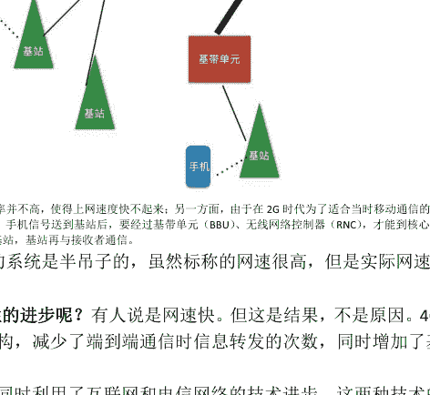

一方面基站和基站之间的通信效率非常不高，使得上网速度提不起来；另一方面，由于在 2G 时代为了适合当时移动通信的特点，手机端到端的通信要经过好几级的转发，手机信号送到基站后，要经过基带单元（BBU）、无线网络控制器（RNC），才能到核心网，然后再从核心网到 RNC、BBU，最后送到基站，基站再与接收者通信。

因此，由于 3G 的系统是半吊子的，虽然标称的网速很高，但是实际网速并不快。

于是 4G 很快出现了。

## 4G 有什么革命性的进步呢？

有人说是网速快。但是这是结果，不是原因。4G 一方面使用了扁平的网络结构，减少了端到端通信时信息转发的次数，同时增加了基站之间光纤的带宽。

更重要的是，它同时利用了互联网和电信网络的技术进步，这两种技术的融合才使得 4G 的速度比 3G 快很多。你可以认为，到了 4G，电信的网络已经统一了，但是它和互联网还没有完全统一，你先记住这个事实。

虽然在 4G 时代从理论上讲移动通信的网速可以变得很快，你今天能够想到的所有应用都是够快的。但是，如果很多人同时上网，它不仅不够快，甚至连不进去。

2018 年我在杭州开全国计算机大会，参会者近万，在会场上无论是 4G 还是 Wi-Fi 都不大管用，你如果拍一张照片想在朋友圈中分享，那么能否分享成功，全靠运气。这一方面是因为总的网速不够快，另外一方面是很多人要同时和基站通信，基站成为了瓶颈。

比如一个基站覆盖半径一公里的范围（基站之间的距离通常在 2～3 公里），通常

这方圆一公里范围内的人不会同时上网，因此分给每个上网的人的带宽是够用的，但是当大家都要发照片时，总的传输率超过了信道的总的带宽，根据香农第二定律，出错率是 100%，于是大家都传递不了信息了。

公平地说，4G 对于我们目前的上网需求绝大部分时候是足够了，但是在未来我们有很多智能设备，它们也要同时上网，就会出现像前面说的那种“会场拥堵”的问题。

那怎么解决这个问题呢？有人会想到继续增加带宽。这是一种自然而然，颇为合理的想法。虽然在 4G 的基础上增加 2～3 倍的带宽并非难事，但是如果想增加 1～2 个数量级就办不到了。

那一方面要求基站的功率增加很多，这在城市里完全不可行，因为基站周围会因为电磁波辐射太强而变得很不安全。另一方面，要想增加带宽，就要增加通信的频率范围，无线通信的频率无法向下扩展，只能向上扩展，也就是让无线电波的频率增加。

我们知道无线电波的频率越高，它绕过障碍物的能力就越差，比如说它高到可见光的频率时，你随便用张纸，用块布就能挡住它。因此在城市里高楼会严重影响通信。

那怎么办呢？最简单的办法就是在提高通信频率的同时，把基站建得非常密，这样在你的附近就有基站，它不会被建筑物所阻挡。

基于上述想法，5G 的概念就被提出来了。5G 是如何进行无线通信的呢？如果我们说 4G 是一公里的范围建一个基站，负责这方圆一公里范围内的手机和基站的通信，那么 5G 则是要在百米的范围内建基站（今天的方案是基站距离平均在 200～300 米左右），负责半径为一百多米范围内的通信。

手机和基站的距离缩短，会带来三个好处。

- - 首先是建筑物干扰的问题得到解决，这是显而易见的。
- - 其次是更少的人分享带宽。我们假定方圆一公里范围里的人口是 1 万人，那么方圆百米范围就就会下降到 100 人。这样每个人能够分到的带宽就可以增加两个数量级。
- - 最后，由于基站的通信范围可以从 1 公里减少到 100 米，功率可以降低两个数量级，这样，在基站周围电磁波辐射也会大大降低，我们生活的环境反而变得更安全了。

当 5G 的基站密集到两三百米甚至不到一百米一个的时候，我们家里是否还需要安装 Wi-Fi 呢？或许不需要了，Wi-Fi 或许会消失，或者会退居次要的地位。这样，就将互联网和通信网络融合成为一个网络了，这无疑将是一次通信的革命。

接下来我们总结一下从 1G 到 5G 的革命性变化。

- - 1G 的诞生。
- - 从 1G 到 2G，是从模拟电路到数字电路，由于采用了专用集成电路，单位能量传输和处理信息的能力提高了两个数量级。
- - 从 2G 到 3G，实现了从语音通信到数据通信的飞跃。
- - 从 3G 到 4G，实现了移动通信网络和传统电信网络的融合，将云计算等互联网技术用于了移动通信，使得不同区域之间的流量能够动态平衡，大大地提高了带宽的使用率。

从 4G 到 5G，可以实现移动互联网和有线的互联网的彻底融合。当然，万物互联才会成为可能。需要指出的是，由于网络基站的密度非常高，每一个基站的功率非常小，因此单位能耗传递信息的效率会进一步大幅度提高。

## 最后我们看看未来会是什么样子。我们做什么事情是顺应技术发展的趋势，做什么则是逆流而动？

首先，如果基站的距离缩短到 200～300 米，单位面积的基站密度比 4G 就要增加 100 倍，这是一个巨大的国家级的的基础架构建设，因此从事基础设施建设的企业都是受益者。你或许已经听到这样的消息，5G 的传闻一出，制造电缆杆子企业的股票已经开始疯涨了。

其次，任何努力将于各种网络融合的努力都是顺势而为，任何试图搭建一个独立的，单纯基于无线技术的努力都是逆流而动。几个月前，一些国家决策部门的领导问我，以现在的技术再开发类似以卫星的通信系统，是否可行？我完全没有必要，因为那是逆流而动。从 1G 到 5G，将各种网络融合是一个大趋势。

再次，由于网速极大地提高，很多需要高速互联网的应用可以开展起来了，包括 IoT，这个题目我们明天会详细讲。

最后，让我们一同来思考一个问题。有了 5G，光纤通信是否还需要？答案是，不仅需要，而且还要大幅度提高。

我们不妨从相反的角度思考这个问题，就很容易得到答案。假如没有光纤，只有移动网络，那么基站和基站之间的通信就不得不由移动网络实现，这就要占据很大的带宽，就会影响我们每一个人和基站的通信。

因此光纤依然是必要的，不仅必要，而且要增加，因为我们和基站通信的速率增加了，又有很多 IoT 的设备连进来，总的通信量就增加了。从这里我还可以得出一个结论，从事光纤通讯产业的人，将是 5G 的获益者。

## 要点总结

我们先介绍了半个多世纪以来移动通信的发展历程。对于这段技术发展的历史，你只要记住四个要点即可：

- 1. 单位能量的信息传输率越来越高；
- 2. 网络不断融合；
- 3. 设备的辐射越来越小；
- 4. 每一代都会有新的主导型公司出现，1G 是摩托罗拉，2G 是诺基亚，3G、4G 是苹果、谷歌和高通，5G 是华为。

关于摩托罗拉、诺基亚、高通、华为等企业的发展历程，大家可以读我的《浪潮之巅》一书。

思考题：如果说从 1G 到 5G 所有的网络都整合为一体了，那么 6G 将会往哪个方向进步？

预告：下一讲，我们结合另一个热门的话题 IoT，再谈谈 5G。


## 27 | 通信趋势：5G 和 IoT 的商机在哪里？

你好，欢迎来到我的《信息论 40 讲》。

我们上一讲说过，每一代移动通信的进步，都会产生新的商机，而且从历史上看，每一次变化的受益者都是一家新的公司。

1G 出现让摩托罗拉在一定程度上取代了 AT&T。从 1G 到 2G 又缔造了诺基亚的神话，在 3G 之后，前面这两家公司都落伍了。在手机芯片方面，高通是赢家，而在软件方面，Google 和苹果是赢家，在手机本身，华为、三星和小米是赢家。

那么 5G 到来之后呢？拥有大量专利，能够左右标准的华为和高通无疑会是赢家，但是，根据移动通信过去发展的历史，应该还会崭新的赢家。虽然我们不清楚它是谁，但是我们可以确定寻找的方向，而这个方向就要从将来必须使用 5G 的产业说起。

我们为什么要从 4G 升级到 5G？并非我们今天使用手机时的网速还不够快，事实上我们今天在手机上观看高清视频并没有太多的问题，也不是要解决上万人开会上网的问题，毕竟那种时候并不多见。

5G 的一个应用，是让多个设备长期同时上网，而 IoT 恰好可以利用 5G 移动通信的这个成果。

什么是 IoT？一些媒体把它翻译成“物联网”，这只是不准确的字面翻译，完全没有反映出它的本质。对于 IoT，我更喜欢“万物互联”的讲法，因为它不只是物和物的联网，而是所有东西的联网，包括我们人自己。

为了便于你理解万物互联，我常常把它比喻第三代互联网。当然，有第三代就有第一和第二代。接下来，我就来看这三代互联网的区别和特点。

## 第一代互联网从本质上讲是计算机和计算机的联网。互联网诞生于 1969 年几台计算机服务器的联网。虽然后来它不断扩大，并且演化成个人的电脑通过服务器彼此相连，但依然是机器和机器相连。

每一个使用互联网的人，只有坐到计算机前，甚至在登录互联网之后，才算连到网上。当我们离开计算机，比如下班开车或者坐地铁，我们就离开了互联网。直到你吃完晚饭，做完家务事，再坐回到计算机旁边，才算又和互联网相连了。

## 第二代互联网是我们今天使用的移动互联网。它从形式上讲是移动设备，主要是手机，通过空中的无线电信号相连，但是从本质上讲它是人和人的相连。我们加一个微信好友，扫一个商家的二维码，不是为了让你的手机能够连接上对方那台手机或者服务器，而是要随时找手机背后的那个人。

## 第三代互联网是万物互联，关于这一点，我在《科技史纲 60 讲》中已经介绍了，（IoT：万物互联到底是什么意思？）这里就不再赘述了。为了便于你理解万物互联和之前两代互联网的区别，我们需要强调三点：

### 1. 万物互联之后，联网设备的总数会极大地提高。

从第一代互联网，即 PC 的互联网到第二代互联网，即移动互联网，上网的设备数量增加了半个数量级，即 3 倍左右，从 10 亿增加到今天的 30 亿。而到了万物互联的时代，联网的设备数量最保守地估计，也有 500 亿，比今天增加了一个多数量级。

更重要的是，我们也会成为万物互联的一个节点。最后这一点非常重要，它可以非常有效地预防疾病。

### 2. 这么多设备来了，就带来了那个问题。首先是上网的带宽不够了，这就让 5G 成为必需品。其次是为 500 亿个设备经常更换电池显然不太现实，这就要求 IoT 设备采用比今天移动设备功率更低的芯片，最好很多设备终身（比如 10 年）不需要更换电池，这就会导致新一代半导体公司的兴起。

### 3. 万物互联形成的市场规模，要比前两代互联网大得多。

2018 年，全世界互联网企业的收入是 4000 多亿美 元，这里面既有 PC 互联网的收入，也有移动互联网的收入，也就是说，第一代互联网的收入远低于这个水平。

但 是同时期，通信产业的收入却是 4 万亿美元左右，几乎高出了一个数量级。虽然这里有传统电信的存量，但是有很大一部分来自于移动互联网。这说明移动互联网的市场规模比第一代互联网大得多，几乎大出了一个数量级。

到了万物互联，也就是第三代互联网的时代，这么多的设备连入到网络中，形成的经济规模是极可观的。

最保守地估计，到 2030 年，应该能够让今天电信市场规模扩大一倍，即从目前的 4 万亿美元左右达到 7 万亿~8 万亿美元，甚至更多。要知道今天日本的 GDP 才 4 万多亿美元，如果增添出一个日本 GDP 的产业，那么商机是多么地巨大不言而喻。

巨大的商机并不等于每一个人都能获得同样的受 益机会，那么谁有可能从万物互联中受益呢？为了看清这一 点，我们不妨看看第一代和第二代互联网的产业结构。

在第一代互联网时期，最重要的设备就是 PC 机和服务器，当时互联网本身的那点收入相比设备的收入小得可怜。而谁是那时侯设备 的受益者呢？不是生产计算机的惠普、戴尔和联想，而是控制这个产业线不过去的两个环节，微软和英特尔。

合适的操作系统，将这么多设备管理好，这个目前还没有。

不过，在具有操作系统之前，先要有行业的通信标准，这方面，华为占到了先机。据华为自己讲，它在 5G 技术上领先其它设备商半代。半代是很大的优势，这足以让它在全世界建设 5G 网络时成为最大的受益者。

从第一代互联网到第二代互联网，受益的还有一大堆终端制造商，比如在 PC 互联网时代的惠普、戴尔、宏基和联想，在移动互联网时代的三星、小米、华为，以及 vivo、oppo 等。

这类公司又分为两类，第一类是成功转型产生的公司，比如惠普、三星；第二类则是新出现的，比如 PC 时代的戴尔、宏基和联想，智能手机时代的小米、华为、vivo、oppo。显然，后一类公司占大多数。

为什么原来自据了市场的 大公司反而竞争不过后来新成立的公司呢？主要是前者的基因不适合新产业发展。

联想是中国最早宣布向智能手机转型的公司，但是它今天是这个市场最弱的一个竞争者；类似的，戴尔也在很早的时候就宣布进入手机和移动设备市场，但是却彻底失败了，因为它做移动设备的思路，还停留在实 PC 的做法上。到了 IoT 的时代，也会诞生不少制作 IoT 设备的 大公司。

从第一代互联网到第二代，还带动起关键性配件公司的诞生和发展，包括闪存、显示屏和电池。到了 IoT 时代，也会如此。

## 要点小结

- 1. 互联网经历了两代，IoT 也就是万物互联可以算是第三代。 
- 2. 每一代互联网比上一代，从设备的数量和市场的规模，都会有巨大的增长，这是未来的机会所在。 
- 3. 每一代互联网都有掌握产业链的龙头公司，从 PC 时代的英特尔和微软，再到今天的 ARM 和 Google，以及未来掌握核心芯片、操作系统和通信标准 的公司。 
- 4. 由于大公司改变基因是几乎不可能的事情，因此在 IoT 产业链的各个环节会出现一批新的公司，从操作系统、处理器，到设备和配件。很多人觉得自己错过了加入到小米等企业发财的机会，但是不用着急，在万物互联逐渐发展的过程中，还会有新的小米出现。就像常讲，亘古而长青的昨天，永远是过去，也永远会再来，就是这个道理。 
- 5. 从能量的角度讲，每一代互联网都是以更少的能量传输和处理更多 的信息，这一点是未来发展的方向。大家可以根据这个规律判断哪一家企业契合 IoT 的发展。

思考题：如果 你是一个学生，如何利用 IoT 提高学习成绩？如果你是一个上班族，如何利用 IoT 节省时间？请把你的想法写在留言区，我们一起开开脑洞。

预告：下一讲，我会回答大家在“信息传播”这个模块的典型问题，带大家回顾一下这个模块的内容。我们下一讲见。

## 模块二问答 | 群体的共识就等同于客观事实吗？

## 吴军

你好，欢迎来到我的《信息论40讲》，这一讲我回答大家提出的几个问题，帮助你加深对“信息传播”这个模块的理解。

## 纯洁的憎恶

吴老师好，我有个疑问，您说“如果每一个人都把自己主观的意见说出来，虽然每一个人有偏见，但是合在一起我们就得到了大众想法的轮廓”。这个轮廓我理解应该是共识，那么群体的共识就等同于客观事实或者历史的轮廓么？

## 吴军

这个问题问得很好，各种主观意见的总和是否就是共识呢？有时候是，但绝大多数时候并不是这样的。

比如一个年级100个同学要聚会，每个同学可能都会提出不同的聚会时间和地点，当然大部分人会以方便自己为原则，因此他们将自己的想法说出来时，并没有共识。之后的共识是彼此牺牲各自的一些利益，最终达成的，既不是一开始就有的，也不是取平均值得到的。

但是，在这个过程中，每个人说出自己的想法，对后来达成共识至关重要。或者说，当每一个人将自己的想法说出来的时候，各种观点和要求的概率分布情况变成了清晰的事实，完全不确定的事情，变成了部分确定的事情。那么基于这些事实，有可能达成共识。

如果这100人在一开始一定要遵循某个所谓客观的原则寻找聚会的时间和地点，那么这个原则是如何产生的，就很有随意性了，因为每个人的想法依然不清楚，依然是一个不确定的事情。

历史的轮廓其实讲的是另一回事，各种历史事件，各方面的作用形成一种合力，影响了历史的进程，中间有很多细节的因素，并非所有的细节因素都能搞清楚，有些即使能够搞清楚，成本也很高。但是，这些因素加在一起，轮廓是清晰的。

这就像你抛硬币，每一次落下去的时候，是正面朝上，还是背面朝上，有很多随机的因素决定，比如它起始的速度、翻转的速度、高度、风速、地面凹凸程度，当然还有硬币本身的细微差别，等等。

你要把这些因素搞清楚几乎是不可能的。但是换一个角度讲，如果我们不纠结那些细节，只关心1万次实验后，有多少次是正面朝上，那么这个概率分布的轮廓是清晰的。就像下图这样一个曲线，也就是高斯分布。

历史的大势也是如此。

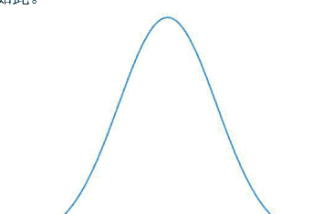

## 小小世界

吴老师，平常我们经常输入各种验证码，但是 zvak 一直不明白它的原理，老师可不可以稍微再深入地介绍一下？感谢。

## 吴军

验证码通常有两个作用：

- 1. 验证使用计算机的是一个人，而非计算机程序。绝大部分入侵者是使用自动的程序大量地猜测别人账号的密码，使用验证码能够在一定程度上杜绝这样的行为。
- 2. 提供一个很短的时间窗的一次性密码。很多时候系统会给你的手机发一个验证码，说 60 秒有效，这实际上给你和系统之间提供了一个一次性密码，但是在 60 秒内，入侵者恰好也蒙上了这个密码，可能性不是很大，就把入侵的概率降低了很多。

要说明的是，世界上没有绝对的信息安全，但是有防范得好和坏之分别。

## 盒装困

吴军老师好，在宽带普及前，我在网络上下载文件时，总会遇到这样的状况，不知道大家会不会也有同感，就是下载一直很顺利，但最后总是卡在了 99% 处，半天没有反应，这是因为信道阻塞卡死在那里造成的吗？

## 吴军

我在课程中讲了，互联网的协议是将一个大的数据模块（网页、图片或者视频）变成很多小的数据包传输的。

比如说分成了 1000 个。那么这些数据包并不一定是依次接收到的，因为它们可能在互联网上走了不同的通路，有快有慢，也可能某些数据包丢了，后来重新传输的，到用户那里就慢了。不管怎样，到了用户那里，这些数据包都需要凑齐了，才能完全拼回原来的大数据模块。

浏览器所显示的下载完成率百之多少，是根据它接收到的数据包的比例提供的，比如接收到了 200 个，就显示 20%。我们假设网络传输时，有 20% 的数据包会丢失，要重新发。因此第一次传输时，有 800 个包很快就到了，于是你看到很快下载了 80%。

但是，另外 200 个包因为丢了，它们不得不第二次传输，因此你等了几乎同样长的时间，下载的进度才从 80% 增加到 96%，接下你又等了同样长的时间，到了 99%，显然越往后越慢。最后的 1%，其实还有 10 个包，根据概率，未必能一次传成功，这样你就感觉下载速度越往后越慢。

## 王绪金_AI

吴老师，小米公司今年做了很大的组织架构调整，变成了有十个层级管理的等级组织，请问老师，这样做会对小米接下来的发展产生不良影响吗？

## 吴军

据我的了解，小米设置了十个管理层级，并非所有基层员工都有十级汇报关系。
通常一个企业发展大了，它必须增加管理层级，这并不是一件坏事，而是必须做的事情。否则就如同我在课程中讲的，有个有上百个直接汇报人的领导，自己就成了信息传递的瓶颈，而且他的管理就从原来的并行，变成了串行。

Google 在 2001 年之前，所有的工程师都没有职级高低之分，都汇报给副总裁罗森伯格，当罗森伯格下面的人数超过 100 人时，他其实已经很难了解每一个人的工作了，到年底，只好给每个人发放了同样的数量的股票。

这时公司就不得不增加管理的层级，罗森伯格就引进了几个资深管理人士形成公司的中层管理。随后，他引进到公司的尤斯斯又设计出使用到今天的 10 个管理和专业层级。从此，不同的工程师就有了层级的分别。

但是有层级分别并不影响 Google 的扁平化管理，因为我在课程中所说的扁平化管理的特征它依然满足，比如 CEO 和每个员工虽然在股票数量上不同，但是其它福利待遇完全相同。

小米的创始团队很大一部分人来自于 Google 和微软，它的管理方式和这两家公司很相近。而它在成长为大公司之后，管理方式变化的方向和上述两家大公司也有很多相像的地方。

## Ly&M‌r. Du

吴老师，用 2G 和 4G 手机，来比喻个人信息通道的潜力大小，令我深有感触。对于学渣来说，只能通过降低传输率来接受信息，也就是不断地终生学习，弥补知识。但是，如果我们想拓宽自己认知的信息道，有可能吗？请吴老师给予指点。我们现实中带宽一定是有边界的，个人用哪些方法可以更好地拓宽带宽？

## 吴军

这个问题很大，答案也是因人而异。简单地讲，有这样三个原则可以供大家参考：

- 1. 在年轻的时候，或者事业刚刚起步的时候，以增加技能为改进的核心，以融入社会为基础。

- 2. 有了足够的专业技能，对社会有了了解之后，以增加见识为改进核心，以提供价值为目标。

- 3. 再往后，以洞察大势为核心，以理解多元文化为基础。 当然，最后，不论走到什么高度，都要常怀敬畏之心，在边界里做事情。

## 28 | 复盘：世界不完美，我们该怎么办？

你好，欢迎来到我的《信息论40讲》。

今天我们来复盘一下第二模块，即有关信息传播的内容。我来带领大家复习回顾其中的要点，建议你收藏这讲内容，时时翻看复习。

在这个模块中，核心的内容是香农第二定律，当然，我们大部分人是把它用在人与人的沟通过中，而非真正去做通信的产品。

在这个模块一开始，我们先介绍了噪音，以及它对通信的影响。我们特别强调了
噪音是我们这个世界的固有特征，不要指望存在没有噪音的信息，也不要指望不受噪音干扰的传输。

我们在真实的世界里做事情，就要有一个世界不完美的假设，然后练就在不完美的世界里尽可能做好事情的本领。

斯蒂芬·库里可能是当今全世界最擅长投篮的选手，他能够在各种干扰之下准确命中。他这个本事是怎么练就的呢？

据他讲，他小时候个子也不高，身体也不强壮，总是被人挤来挤去，撞到一边，投篮永远受干扰。因此，一边被撞，一边还要投篮对他来讲就是常态。久而久之，他练就了能够在任何情况下投篮命中的本领。

因此，我们对世界的态度也应该如此，承认各种噪音的存在，争取在有噪音的情况下，准确传递信息。

由于有噪音的存在，信息传递的速率就要受到影响。而香农在研究信息论时，就是以噪音信道为前提假设的。他关于信息传输的核心，是他的第二定律。这个定律说的是这样一件事情，信息的传输速率不可能超过信道的能力。因此，如果我们在人与人的沟通过中想要变得顺畅，就必须想办法增加信道容量，否则信息的传输就会很快遇到瓶颈。

另一方面，如果信道容量有限，最好的做法是降低信息的传输率，以使保证信息的传输依然能够持续，而不是急于一次传输太多的信息，因为那样一来，出错的概率为100%，什么信息也传递不下去了。

那么信道的容量（或者说带宽）又是由什么决定的呢？香农讲了，它取决于发送和接收方彼此之间的互信息。

鉴于信息传输的这个特点，我们在与他人的沟通过中应当注意这样几个要点：

- 1. 如果我们需要经过他人传递信息，比如你要托人向领导带个话，要特别挑选那些带话不走样的人，而并非简单地和你关系好的人。所谓带话不走样，就是指你讲的话，和他理解的意思之间互信息很大，而他向领导表述出来的意思，和领导的理解，互信 息也很大。

很多人喜欢找自己熟悉的人带话，这当然没有错，因为毕竟面对熟人，你讲话可以比较随意，但是决定那些话能否带不出取决于是你是否熟，而取决于他作为信道的能力。而这个能力在今天的生人社会里，其实非常有价值。

我们在前面的课程里讲了，连接比拥有更重要，那些能够带话的人，就是连接所在，你如果具备了这个能力，在一个机构中就显得特别有价值。

为了增加信息沟通的带宽，我们常常还需要准备好多个信道，以便万一某些信道受阻后，信息还能有效地传递出去。我们常常讲“人脉”这个词，人脉其实就是信道。

所谓人脉宽，就是指我们有能力很快地把这种信息收集进来，或者传递出去。

- 2.在表达意思时，一定要注意听众是谁，用不同的方式去表达。表达的速率，取决于听众接收的能力。采用有针对性的方式，是为了增加你和听众之间的互信息。控制速率，是为了保证信息传输的速率不超出信道的容量，这样可以不出错。

我们经常在职场上看到一些人对所有人说话都是同一种方式，同一语言，他们还标榜自己率真，其实这种人信息传递的效果很差，因为他们和听众之间互信息很低。

类似的，你还会看到一些人表述信息时俨倔简倒豆子一样都倾泻出去，他们根本不能将自己所知在最短的时间里都告诉对方。这种时候，他们信息传播的速度已经超过了信道容量，对方接收的信息一定有错。

选择学校，要选择一个适合自己的，不用一心往学霸的圈子里扎。很多家长觉得，孩子和学习好的学生们在一起，自己也会被带好，这一点完全没有错。但是，好的学生，可以是学习态度好的，学习方法好的，未必需要是脑瓜极好的学霸。

一个资质中等的学生，和一群接受能力极强的学霸在一起，未必有多大的收益，因为在那个环境中，老师教得会很快，内容也会比较深，大部分学生接受起来没问题，想方设法挤进那个群体的学生会很痛苦。

这就好比，如果一群学生都用的是 4G 的手机，只有你用的还是 10 多年前 2G 的手机，老师根据大多数人手机的带宽，不断发高清视频，你拿 2G 手机什么都没有收到。但是如果换一个环境，大部分人都是 2G 手机，老师是按照这个网速发文字内容，你虽然看到的内容不够丰富、逼真，但是毕竟收到了一些信息。

- 3.从上一点出发，也给家长们一个建议。由于两代人之间的代沟是客观现实，也就是说家长和孩子之间的互信息通常难以达到最大，因此和孩子沟通要需要非常慢，非常有耐心，要么家长自己想办法增加和孩子之间的互信息，也就是说增加带宽。

我出版了《态度》一书，也就是给孩子的家书之后，很多多人问我为什么要给孩子写信（其实是邮件），而不打电话说。原因是读邮件是一个慢慢接收信息的过程，这样

能将信息的传输率控制在我和他们通信带宽以内，保证想法的传递不失真。

此外，我在《硅谷来信》讲了一个老奶奶阅读孩子读物的故事，这位老奶奶的做法，就是增加她和孩子之间的互信息，也就是带宽。

## 4.在男女朋友之间和夫妻之间的沟通上，要在对等条件下进行。

有些人觉得，我条件好，你条件差，你跟著我高攀了；或者我条件差，对方条件好，我一定要迁就他（她）。

这样的关系很难长时间稳定，因为这样的话他们对很多问题的看法完全不同，互信息近乎为零，彼此沟通的信道太窄。

俞敏洪老师讲过很多次，夫妻双方关系出现问题通常是因为，双方在认知上的差距逐渐越来越大，以至于无法沟通。所谓认知的差距大，就是信息论所说的信道太窄。

## 讲完人和人的关系，再说说组织机构作为一个整体，内部沟通的要点。

我们在前面的课程中说了扁平化管理的美好。我们考察一个机构的管理结构是否合理，应该看信息能否有效传递，而不是绝对层级的多少。层级本身是手段，不是目的，信息的有效传递，以及合作的达成，才是目的。

我们在课程中列举了很多虚假的扁平化管理，它们表现为层级过于分明，部门的边界过于明显，每一个中层干部都是关键节点，能够阻拦上下级的沟通。

我们还举了一个例子，说明一些管理层级看似非常平的单位，其实并不是真正的扁平化管理。当一个领导的直接下属有几百人时，他就是信息传递的瓶颈，原本可以做到的并行管理，反而变成了串行的。

在这个模块中，我们还用香农第二定律分析了互联网思维的本质，特别是在商业上互联网的作用，也就是拓宽了买家与卖家之间的带宽。

变得比较虚弱，甚至名存实亡。

而打破小团体界限最有效的做法，就是大家认可一个相同的内部通信协议，这种通信协议，就是企业文化和行为规范。如果大家都按照企业整体的行为规范进行交流和合作，而不是小团体自身的规定做事，整个机构就成为一个有机整体。

因此，一个企业好的创始人和 CEO，会把树立企业文化和制定行为规范作为首要任务，而不是事必亲躬地做每一件事情。

## 吴军

从下一讲开始，我们将进入课程第三个，也是最后一个模块，有关信息论应用的内容。另外，我也选出了 20 位在第二模块积极留言，而且留言质量高，信息增量大的同学，分别是：

金 morphology-Steve、Bazinga Mo、顾昱晓、Mark、王黎骝、Ed.旋、张平、Stone、shzhang、TryTs、Vincere_肖遥哲、古小千、杨诗琦、Michael、完美坚持、斜阳、佛祖门徒、冯珺、罗杰.费德勒、马克李。

得到的工作人员会尽快为你们充值 100 得到贝的奖学金。下一模块，还是延续这个规则（如果你坚持写下自己精彩的留言，我会在模块结束后，选出 20 个留言精选次数多、留言质量高的同学，每人奖励 100 得到贝的奖学金），欢迎大家给我留言。我们下一讲再见。

你好，欢迎来到我的《信息论40讲》。

从这一讲开始，我们进入课程第三模块——应用篇。我会介绍一些信息论的应用。

今天我们讲讲信息的交叉验证，我先从很多年前经历的一件事情讲起。

那时我刚到美国不久，一位朋友的父亲到学校里来看他，请我们一同吃了顿饭，然后讲欢迎大家来家里玩。他说，我们家很好找，就在95号洲际高速公路的边上，在场其他的朋友都笑了，我刚到美国不久，不清楚他们笑什么。

于是一位朋友给我解释道，95号洲际高速公路从美国东北部最上端的缅因州，一直到延伸到最南端的佛罗里达州，就相当于从哈尔滨延伸到海南岛。显然，“在95号洲际高速公路的边上”这句话，说了和没说差不多，因为总不能在那条路上走一公里一公里地搜索。

在我们的生活中，绝大部分时候，一个维度信息是很难消除所有不确定性的，而解决这个问题最好的办法，不是把那个维度的信息搞得更准确，而是要用其它维度的信息进行交叉验证。

我们中学时学习数学会有这样的经验。当我们在解方程时要复查一道题是否做对了，如果顺着原来的思路将解题的过程再看一遍，通常是很难以查出错误的，最有效的方法是把方程的解代回到原来的方程中，看看方程两边是否相等。

类似的，我们推导公式时，顺着原先的推导再看一遍也很难以发现问题，最好的方法是代入几个数据，看看前后结果是否一致。如果一致，出现错误的可能性就小，这其实就是交叉验证。

交叉验证是我们每一个人必须掌握的做事方法，它可以让很多难题迎刃而解。在中国的历史学界，王国维的地位极为崇高，因为他开创了历史研究的新时代。

在王国维之前，几乎所有的学者在治学时，都是采用考据和集注的方式，也就是说通过研究史料来还原历史，然后写上自己的看法，后面的学者再从前面学者的注释中得到启发，继续研究。

由于溯源之后，大家其实使用的都是相同源头的信息，即便各自有各自的看法，也很难还原历史的真相。很多时候，甚至成了以讹传讹。

王国维先生治学的方法则不同，他通过考古（比如研究新挖掘出来的甲骨文）来发现新的史实，然后用考古得到的信息和文献记载中的信息进行交叉验证，也就是“二重证据法”，如果它们能得到相同的结论，说明是可信的，否则则存疑。

王国维先生的这个做法，西方学者在之前已经使用了几百年了，直到今天欧美大学历史系的教授们要花很多时间现场考古，而不是坐在书斋里搞研究。

但是，王国维先生没有留过洋，也没有接受过笛卡尔方法论的熏陶，独自创造出这种研究方式，他的贡献是开创性的。在他之后，学者们对中国历史的研究有了个飞跃。

我们在第 19 讲信息嘈比那节课讲到马未都先生说“司马光不可能砸缸”，其实也是用了交叉验证的方法。马未都先生通过对宋代制作工艺的研究，以及对出土文物的研究，发现文字的记载和考古对不上号。

事实上，司马光砸缸的说法是后来才有的，那时大缸已经被普遍使用了，于是当时的人物当然地把瓮和缸相混淆了。

虽然今天很多人不需要研究历史，但是我们在使用信息时，应该养成一个习惯，从多维度进行交叉验证。

硅谷有一位很有名的投资人，失误率很低。他在决定投资之前，除了向其他投资人一样认真做背景调查之外，还会做一件事，晚上 9 点之后到那家公司外面去转转，看停车场里停了多少辆车，楼里面是否有很多人再工作。

当然我知道今天中国很多人都反对“996”地工作，但是在硅谷的创业公司中“996”是常态，而且大部分人要工作到 11、12 点，那不是为了显得工作努力，而是确实有做不完的事情。这位投资人的做法其实就是换了一个维度对创始人他们提供的信息进行了交叉验证。

我们知道今天大数据的威力。比如当社交网络在掌握了你很多的数据之后，它对你的判断极其准确。2018 年在 Facebook 泄露个人信息的消息传出之后，媒体对这件事有很多跟踪报道，讲述 Facebook 在了解个人隐私方面的可怕之处。

比如，你如果在 Facebook 上点赞 70 多次，它就可以给你画像；如果点赞 150 次，它可能比你的父亲更了解你；如果点赞 200 多次，它甚至可能比你更了解自己。

也就是说，用一些他们已知的已知信息，从你那里钓出更多的已知信息。

比如诈骗分子常常会冒充银行或者公安部门，讲出一些关于你的信息，当你发现那些信息准确无误时，就如同在做数学题时，验证了几个数字都对了一样，开始相信对方说的是真的。

然后，他们就开始让你确认一些信息，比如确认生日、银行卡号，在美国还有就是确认母亲娘家的姓氏（因为在美国，女生结婚后通常改为丈夫的姓，娘家姓氏外人不知道）。

当你确认完那些信息后，诈骗犯就得到了你全方位的信息，他们就可以给银行打电话，要求重新设置银行卡密码，或者做其他的操作。而银行在信息被交叉确认之后，常常会相信对方就是银行卡的持有者。

这其实就是诈骗犯利用大家相信交叉验证的心理后，两边进行欺骗。这件事本身并不是说我们不该使用交叉验证这种方法，而是提醒我们要避免泄露自己全方位的信息。

我刚到美国时，一些美国朋友就告诉我那些信息一定不能告诉别人。如果有人打电话让你确认那些信息，你要让他留下电话，告诉他你会打回去。然后你要在网上查一下那个电话是不是公司、信用卡的客服电话。这其实就是你使用交叉验证对它进行识别。

在交叉验证中，什么样的信息组合最有效呢？那就是我们前面提到的垂直正交信息，因为当两个不同维度的信息正交时，它们的共同作用能够最大程度地降低信息熵。

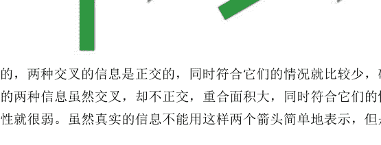

在左边的，两种交叉的信息是正交的，同时符合它们的情况就比较少，确定性就很强。右边的两种信息虽然交叉，却不正交，重合面积大，同时符合它们的情况就比较多，确定性就很弱。虽然真实的信息不能用这样两个箭头简单地表示，但是道理基本上如此。

最后就这个话题，谈谈我对跨界的另一种理解。很多人把跨界理解为同时做很多种不同的事情，这其实很难做好。我对跨界的理解是，从另一个领域来回望所在领域的问题，就容易准确地找到答案。

很多人提高工作质量的想法，就是在一个维度上将刻度画得越来越细，因为这样可以更精确。但是，如果一个维度从头到尾范围很大，刻度画得再精细也并不能帮助我们确定答案的范围。这时候，引入另一个维度的信息帮助定位显然更有效。这就是跨界的意义所在。

当然，定位了答案的范围后，我们还是需要一个刻度很准的尺子，找到答案所在的那个点。这就是具有大局观和能够精深钻研二者的关系。

## 要点总结

+   1. 我们介绍了交叉验证的概念，以及它从治学做研究，到指导我们生活的意义。
+   2. 我们通过讲述电信诈骗为什么能成功，以及为什么 Facebook 等公司利用大数据能做很多事，说明了多维度信息的作用。
+   3. 我们用交叉验证解释了跨界的意义。

思考题：今天我想请你分享几条防止电信诈骗的经验和建议。
预告：下一讲，我们看看如何利用等价性，找出更多信息。我们下一讲再见。

## 30 | 等价性：如何从等价信息里找答案？

我们在前面介绍密码时讲到，保密的关键在于不能够提供看似无关，却有助于消除不确定性的信息。侦探小说鼻祖爱伦·坡在《金甲虫》中讲述了这样一个故事：

主人公勒格朗捡到了一张被海水冲上岸的羊皮纸卷，上面写着看似很难理解的由数字和符号组成的密码，下图就是密码图。勒格朗花了几个月的时间破解了这份宝藏密码，最后获得了一大堆宝藏。

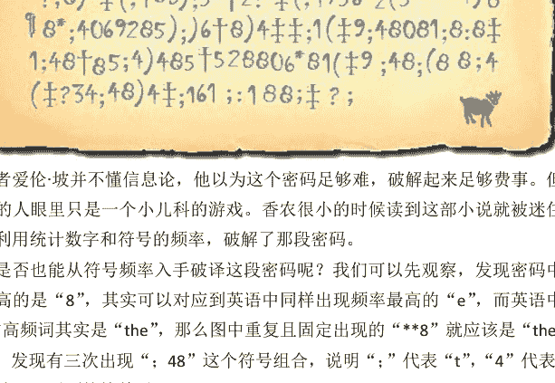

作者爱伦·坡并不懂信息论，他以为这个密码足够难，破解起来足够费事。但在了解信息的人眼里只是一个小儿科的游戏。香农很小的时候读到这部小说就被迷住了，他很快利用统计数字和符号的频率，破解了那段密码。

你是否也能从符号频率入手破译这段密码呢？我们可以先观察，发现密码中出现频率最高的是“8”，其实可以对应到英语中同样出现频率最高ales，最后获得了一大堆宝藏。

我在《科技史纲 60 讲》中讲了如何通过了解虱子基因的变化，推算人类开始穿衣服的时间。由于最早的兽皮和织物会腐烂，今天找不到这方面的证据，因此，我们无法直接了解人类穿衣服的时间。

但是当人类开始穿衣服后，长在身上的虱子就开始进化，长出钩子抓在衣服上。而基因变化的速率是非常均匀的，通过这个信息，就能倒推出人类穿衣服的时间，这便是用了信息的等价性。

类似的，通过对人类 DNA 序列的测序和对照，我们今天得到了“人类非洲起源说”这样的结论。在此之前，很多中国人认为北京猿人是我们的祖先。那到底哪个对呢？

幸运的是，运用分子遗传学的工具对非洲、欧洲以及亚洲人种的母系线粒体和父系 Y 染色体进行分析，发现不同人种共同的祖先距今天的时间为 14.3 万年—14.4 万年，也就是说现代人类其实都起源于非洲。

从上面例子中可以看出，信息的等价性条件其实是很严格的。如果我们说 Y 等价于 X，那么从 Y 就能完全推导出原本需要 X 才能得到的信息。信息的等价性和信息的相关性不同，找相关性的要求要宽松得多。

比如，我们说气象云图的形状分布，空气的气压、湿度和下雨有关，那只是有关，我们无法从前面几条信息完全确定是否下雨。这就是相关性，而非等价性。相关的信息有用，但是不像等价的信息那么具有确定性。

在找人类起源的各种学说中，过去常常使用的是对化石相似性的对比信息，就能得出人类起源的多元说，比如欧洲人是尼安德特人的后裔，中国人是北京猿人的后裔。但是这种找化石相似性的做法其实只是找到了相关信息，并不是等价信息，因此得到的结论，置信度远没有通过基因信息来得准确。

分清楚等价性和相关性，对于我们理解今天的很多技术有很大帮助。今天，人工智能一个重要的应用就是身份的认证。通常识别的方式是根据人体的生物特征来识别，比如脸部特征、眼睛虹膜特征、指纹特征，或者基因特征等等。

这些特征可以被分为外在特征和内在特征。脸部特征（包括颅骨特征）、虹膜、指纹等生物特征都是外在的，基因则是内部的。

严格来讲，外在特征只能作为相关信息使用。比如在上百万人中进行脸部识别，准确率其实只有 90% 左右，它今天更多的是作为交叉验证的信息——你在机场过安检，不能只靠脸就让你通过，还需要验证护照。

同样，如果在商店买东西单纯靠脸验证身份付费，也不是很安全，哪怕错了 1%，每天都会出现不少纠纷。此外，外部特征信息常常可以伪造，比如可以通过伪造指纹套混过指纹识别，用照片混过人脸识别等等，但是体内特征不仅具有唯一性，而且很

当然，体内特征通常不方便使用，总能安检时测 DNA 吧！不过，当人们意识到等价信息和相关信息之间的区别，就会想办法在需要非常准确时，弥补这个漏洞，比如采用能够在体外提取的体内特征。

今天，采用红外拍摄获得手掌内部的静脉血管的图片并不困难，而这个图片（也被称作掌静脉图片）不仅对每个人来说都不同，而且在人的一生里几乎不会变化，因此可以被认为是身份信息的等价信息。今天基于掌静脉识别的技术在高准确率的身份验证中已经得到了利用。

人不仅自身的特质具有很多等价信息，可以搜集到，人的行为也有很多等价信息或者相关信息，可以帮助区分不同的人。今天的人脸识别在被识别者不配合的情况下（比如戴了一个帽子或者口罩墨镜）是难以实现的，但是他们走路的动作姿态却可以用于跟踪与鉴别不同的人。

2018 年我考察了以色列和德国这方面的技术，他们根据人的身体上百块肌肉的形状和在运动中不同的伸缩方式，能够从人走路的姿势识别人。当然如果人站着或者坐着不动，它就不管用了，因此这只是相关信息，并非等价信息，但是作为证实身份的补充手段，还是很有效的。

不仅人的具体行为可以被跟踪，人做事的风格习惯也可以通过寻找等价信息而识别出来。比如说，每一个作家（特别是专业作家）有自己的文风，这其实是很难以改变的。

通过文风，你可以看出一部作品是原创的，还是假借他人之笔创作的。在文学史上，胡适先生就曾经根据写作视角的区别，考证出《红楼梦》并非出自曹雪芹之手。

今年来一直有出版团队，希望帮我编书，让我署名出版，我一律拒绝，因为这种做法不仅让我内心不安，而且作为曾经在约翰·霍普金斯和 Google 从事过对写作风格研究的人，我深知这种把戏很容易被现代信息技术戳穿。

我在约翰·霍普金斯大学时，曾经和同学一起统计过世界上那些著名语料库中不同作者的文风，发现很容易找到和作者信息完全等价的信息。

比如他们使用并不受大家关注的虚词（比如英语里的 the，a 或者各种介词）的数量和方法，这些特征在一个作家不同题材的作品中鲜有变化，而在不同作家的作品中，差别迥异。

在 Google，我们通过用词和句法的分析，很容易找到那些抄袭者。也就是说，人虽然在做事的时候，通常会留下等价信息让他人知道你的行迹，甚至写作的风格也是可以量化度量的。

了解了信息的等价性对我们有什么意义呢？首先它可以帮助我们成为一个慧眼如炬的人。巴菲特判断经济形势的方式很简单，也很独特，就是到百货店里去看看。
在巴菲特看来，大家在百货店付出的真金白银和经济形势是等价信息，而经济学家的各种模型预测，最多算是相关信息。此外，正如我们前面所讲，了解了各种信息彼此之间是等价的，还是相关的，然后在不同应用场景就知道该使用什么信息，而不会过度依赖并不可靠的信息了。

## 要点总结

+   1. 很多时候我们无法直接获取某种信息，于是我们提供了一个使用等价信息解决问题的办法。我们举了三个破解历史疑案的例子来说明，它们是今天世界各地人类的起源，人是什么时候穿衣服的，《红楼梦》后四十回之谜。
+   2. 等价信息和相关信息不同，后者的要求宽松得多，但是可靠性也差很多，因此采用不同信息源的信息进行交叉验证是必要的。我们还介绍了一些最新的身份识别技术，希望帮助你了解最新科技的原理。
+   3. 人类的活动会留下痕迹，无论是物理的真实痕迹，还是写作等习惯，它们可以几乎准确无误地还原我们自身的很多信息。因此在大数据时代，要保护隐私其实很难。在过去，有些信息的跟踪和处理成本较高，但是有了人工智能，这件事也很容易，比如我所说的确认一部作品的作者。

思考题：请你了解关于引力波发现和黑洞照片合成的过程，梳理一下科学家是如何利用等价信息设计上述实验的。

预告：接下来两讲的信息应用，我们就从信息论出发，谈谈大数据的本质和大数据思维。我们下一讲再见。

## 31 | 大数据（一）：从四个特征把握大数据的本质

你好，欢迎来到我的《信息论40讲》。
关于大数据，大家已经不陌生了，因为今天我们都不知道不觉地使用了大数据，并且也在向那些为我们提供服务的公司提供大数据。当然，有人会说，使用大数据是IT公司或者互联网公司的事情，我自己不搞IT怎么会使用大数据呢？

其实你如果使用美图秀秀修图，或者使用华为手机照相，你在无形中已经用到了大数据。美图秀秀P图，不是根据规则来的，而是将你的脸往所谓“标准的脸”上靠，而“标准的脸”，上面各个尺寸基本上是我们每个人脸的平均值，是大数据统计的结果。

美图秀秀上市之后，在美国就被一些人告到法庭上了。不是因为产品做得不好，也不是因为财务数据有问题，而是因为一些美国人觉得，不论自己是白人还是黑人，都被P成了黄人。这也说明它背后用了大量中国人的数据进行训练。类似的，华为的手机有很多图像识别功能。而它们也是建立在大数据基础之上的。

那么，什么是大数据，它有什么特征？今天在媒体上经常看到一些公司讲自己是大数据公司，它们是真像美图秀秀或者华为那样拥有和使用大数据，还是在炒作概念？我们怎样才能练就一双火眼金睛？这就是我们今天要谈的内容。

## 我们先从大数据的特征说起，这可以帮助你判断真假大数据。

首先，大数据要求数据量大，这一点大家没有疑问。数据量小一定不符合大数据的原则。至于数据量多大合适，我们在前面介绍了置信度的概念，数据至少要大到让统计的结果具有非常高的置信度。

## 其次，大数据需要具有多维度的特征，而且各个维度最好是正交的。为什么多维度很重要呢？我们不妨看看仅仅是数据量大但是维度不足有什么问题。

我们一个人的基因全图谱数据，大约在1TB这个数量级，也就是1000个GB，这个数据量不可谓不大，但是它没有太大的统计意义，因为我们无法从一个人的数据看出是否有潜在的疾病。那么多几个人的数据是否就可以了呢？也未必。

比如我们有100个人的基因数据，我们发现某个人的一段基因和其他人不同，这是否说明他有疾病呢？我们得不出这样的结论，因为不同人的基因总是或多或少有些不同，否则也无法通过基因确认人的身份了。

但是，如果我们有另一个维度的信息，比如这100人过去的病例，那就有可能发现某段基因和某些疾病之间的联系。这就是大数据多维度的作用。当然100人的数量还太少，得到的统计结果未必可信。

2016年，Google同斯坦福大学和杜克大学开展了一项长期的合作，就是监测并取得5000人全部的医疗数据。由于有了各个维度的数据，就有可能发现一些生活习惯或者基因和其它生理特征与疾病之间的联系。


今天，淘宝或者其他网店，能够有效地给你推荐产品，在很大程度上就是因为它不仅有了你在网上购物的数据，而且还从其他渠道，包括在你不知不觉中，获得了生活上的信息。

比如，它可以根据你上网的行为，了解你的年龄、性别和教育背景，根据你晚上和白天的地方，了解你的工作地点和住址，甚至你的工作性质和生活习惯，比如是否经常出差，在什么样的饭店吃过饭，是否爱运动，是否使用名牌产品等等。

由于阿里巴巴数据收集的时间跨度比较长，它还可以看出人们消费习惯的变化。根据这些信息，它就知道你是谁，需要什么。在没有大数据之前，这种事情很难做到。

## 大数据第三个重要特征，是数据的完备性，它在过去常常被人忽略，因为人类过去使用数据，都是采用抽样的办法来获取，根本不可能做到完备。抽样统计有一个问题，就是总有 5% 左右的小概率事件覆盖不到，如果最后运气不好，正好落在那 5%，统计的方法就失去作用了。

今天情况就不同了，因为收集数据的设备无所不在，我们也有意无意向它输送数据，因此获得完备的信息完全可能，这样一来就堵住了采用数据作预测的死角。

我们在前面讲到提高名片识别率的方法，就是从网上抓取全部的企业和私人联系地址，拿它们和从名片识别出的信息进行比对，就可以过滤掉几乎所有的错误。这里面其实就是用到了数据的完备性——也就是说，全部的地址、电话等数据我都收集完备了。完备性使得大数据可以算无遗策。

除了上述三个特征，很多时候大数据还需具有实时性，因为在那些应用场景，一定时间过了，数据就失去意义了。

几个月前我在密云参加大学同学毕业周年聚会，会后我要赶回清华给同学们做讲座。讲座的时间是晚上 7 点，通常这段路（大约 120 公里）通勤的时间是两个到两个半小时。我那天 2 点钟出发，原本怎么也能 5 点到清华，然后吃顿饭，再去会场。

谁知道刚离开密云不久，进入到京承高速公路，道路就因为交通管制被堵上了，而这个信息手机地图上并没有及时给出，因为只是几分钟前发生的事情。于是我们绕道走京沈高速，当我们好不容易移到那里，那条道路也被封了，而且绕出来还很困难，因为大家都堵在那里。

最后我们绕道进入密云县城，过了不知道多少个红绿灯，又进入怀柔县城，沿着城区里的道路慢慢走。通常是看到地图上有一条通畅的道路，拐上去的时候就遇到拥堵。好在开车的司机对北京的道路足够熟悉，总算赶在 7 点前将我送到了。

如果我们能够随时获取道路信息，比如高速公路被封堵的信息直接通过车联网送达我们的汽车，那么也不至于那么狼狈。从这个例子，你可以看出万物互联的必要性。但是单纯从大数据出发，很多时候如果不能保证信息的实时性，作出的决策常常是马后炮。

## 要点总结

1.我们今天介绍了大数据的4个明显特征，即数据量大、多维度、完备性和在一些场景下的实时性。我们特别强调了光是数据量大还不能构成大数据，因为它可能无法得出有效的统计规律，而多维度的特征则让我们可以交叉验证信息，提高准确性。
2.大数据的威力大家都看到了，那么可能会有人要问，有了大数据，我原来从事的行业是否会消失？其实大部分行业不会很快消失，但是可能会以另一种形式出现。而具有行业知识的人要做的，就是用所谓的领域知识建立起不同维度之间信息的桥梁。
3.当大数据维度非常多之后，就会出现矛盾。下面这张图。左边的图有两个维度的信息，它们共同的作用是，固定了一个目标范围。右边的图有三个维度的信息，但它们并没有共同的交点，这下麻烦就来了，我们到底该信谁？

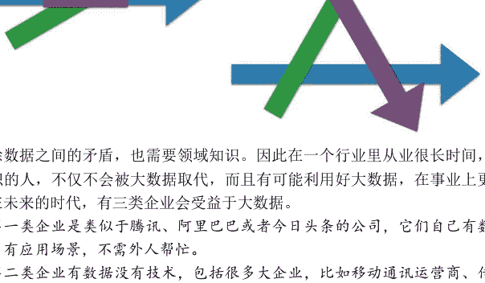

消除数据之间的矛盾，也需要领域知识。因此在一个行业里从业很长时间，具有专业知识的人，不仅不会被大数据取代，而且有可能利用好大数据，在事业上更上一层楼。在未来的时代，有三类企业会受益于大数据。

- 第一类企业是类似于腾讯、阿里巴巴或者今日头条的公司，它们自己有数据，有技术，有应用场景，不需外人帮忙。
- 第二类企业有数据没有技术，包括很多大企业，比如移动通信运营商、传统的银行和零售业等等，它们需要外人帮忙，但是通常由于保护自己利益的考虑，不会和第一类公司合作。这里面的专业人士，就能够解决上面数据冲突，以及将行业内不同维度的数据联系起来的问题。
- 第三类企业缺乏数据，但是有技术，于是它们需要为第二类企业解决实际问题。当然，在解决问题的过程中，它们或许能够进入很多领域，逐渐成为新的平台性公司，比如美国著名的大数据公司 Splunk 就是这么一步步发展起来的，它今天的市值高达 200 亿美 元。但是在一开始，这类公司一定是做赔活累活。

思考题：就大数据多维度的特征谈谈它对你的影响。欢迎你在留言区和我互动。
预告：当然，无论是对哪一类人，最关键的是要掌握大数据思维，这一点我们下节课接着说。

你好，欢迎来到我的《信息论40讲》。
我们上一讲说了大数据的特点，今天来谈谈大数据思维。
说到大数据，就不得不说它的英文名称 Big Data。不知你有没有想过，它为什么叫 Big Data，而不叫 Large Data，或者叫 Vast Data、Huge Data，等等？Large、vast 和 huge 都是指体量大，在程度上，后二者可以看成是 very large 的意思，比 large 更大。
但是，Big 和它们的区别却在于它是强调相对抽象意义上的大，而并非具体的。
比如说，“Large Table” 经常表示一张桌子尺寸很大，而如果说 “Big Table” 并不强调尺寸，只是要强调已经称得上大了，比较抽象。因此，仔细推敲 Big Data 这种说法，我们不得不承认它非常准确，最重要的是它传递了一种信息——大数据是一种思维方式的改变。
我们过去说，量变会带来质变，那常常是在一个维度上说的，而今天我们说大数据思维，已经超出了这一层含义，是一种全新的思维方式和做事情的方法。
今天大部分人所理解的大数据，是从大量的、看起来杂乱无章的数据点，总结出原来找不到的相关性。在这个过程中各种数据如同百川入海一般汇聚到一起。我们在前面已经举了不少这一类的例子。但这只是大数据思维的第一层含义。
我们需要强调的是，大数据思维和过去通过大量数据验证一件事情还是有区别的。那就是由于这些数据在产生和收集时是没有特定目的的，因此怎样使用它们，则需要视特定的应用而定。
比如 Google 趋势这个产品就用到了大数据，由于收集数据事先没有目的性，从这些数据中能够得到什么结果事先也不知晓，这让它发现了很多过去没有想到的规律。
为了更清晰地说明这一点，我们不妨看一个大数据在医疗制药方面的应用。
我在《文明之光》和《全球科技通史》中介绍过青霉素漫长的研制过程。今天几乎所有的新药的研制过程都有青霉素很类似：科学家们通常需要分析疾病产生的原因，寻找能够消除这些原因的物质，然后合成新药。
这个非常漫长过程导致药物研制的周期很长，斯坦福医学院院长米纳（Lloyd Minor）教授估计，从最重要的那篇研究论文发表算起，到新药上市，平均需要 20 年的时间。
另一方面，研制的资金投入也是巨大的，通常需要 20 亿美元。这也就奇怪为什么有效的新药价格都非常昂贵，因为如果不能在专利有效期内 捞回 20 亿美元的成本，就不可能有公司愿意投资研制新药了。
虽然美国的专利有效期长达 17 年并且可以延长 3 年，但是因为大部分核心专利在

药品进行试验时已经申请，中间有非常长的各种试验过程，等到药品上市，剩下的专利有效期通常不超过 10 年。

今天，有了大数据，寻找特效药的方法就和过去有所不同了。世界上只有大约 5000 多种被批准上市的药，人类会得的疾病大约有一万种，包括很罕见的疾病。如果将每一种药和每一种疾病进行配对，就会发现一些意外的惊喜。

比如斯坦福大学医学院发现，原来用于治疗心脏病的某种植药物，对治疗某种胃病特别有效。当然，为了证实这一点需要做相应的临床试验，但是这样找到治疗胃病的药，只需要花费三年时间，成本也只有一亿美元。

这就是应用大数据思维所带来的好处。相比过去那种从病理出发分析原因，再寻找和研制药物的正向过程，今天这种做法其实是先有了结果，再反推原因，是一种逆向的做法，但是正是就因为有了足够的数据支持，它无疑会比较快。不事先假设，从大数据出发先得到结论，再分析原因，这是大数据思维的第二层。

今天我们说大数据思维时，很多人能够想到从很多具体的数据样本总结、提炼出一般性的规律，然后加以应用。我们在前面讲通过大量的数据，消除噪音的影响，寻找信号的轮廓，就是指这个方向的思维方式。

但是，由于大数据的维度非常多，很多维度彼此独立地提供相互补充的信息，可以让我们从过去只能了解大体轮廓，变成可以把控每一个细节。我们把这样两种沿着不同方向使用大数据的思维方式，用下图中的两个箭头表示出来。

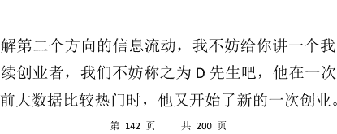

为了便于你理解第二个方向的信息流动，我不妨给你讲一个我亲身经历的例子。硅谷地区的一个连续创业者，我们不妨称之为 D 先生吧，他在一次创业中斩得了第一桶金，于是...

他发现，在美国一半小型服务企业，特别是餐馆、酒吧等，寿命不超过五年，很多不超过 18 个月。于是他花了一年的时间，调查了美国酒吧行业的情况。D 先生发现，酒吧之所以经营不下去，除了一般所说的经营不善，更重要的是大约 23%的酒都被酒保们偷喝了。

那么酒保们是如何偷喝掉将近 1/4 的酒的呢？D 先生讲，其实很简单，主要是酒保们趁老板不在的时候偷喝酒，或者给熟人朋友免费的和超量的酒饮。由于每一次的交易的损失都非常小，不易察觉，因此在过去，酒吧的老板平时必须盯得紧一点，如果有事离开一会儿，只好让倒霉。

开过小餐馆的人都会有这样的经验，自己是否在店里看着，对营业额的影响特别大，因此做这种餐饮买卖的人特别辛苦，稍微不注意就开始亏损。

D 先生针对酒吧老板的这些麻烦，利用大数据和 IoT 设计了一套解决方案。他把酒吧的酒架改造了，装上了可以测量重量的传感器，以及无源的射频识别芯片（RFID）的读写器，然后再在每个酒瓶上贴上一个 RFID 的芯片。

这样，哪一瓶酒在什么时候动过，倾倒了多少酒都会记录下来，并且和每一次的交易匹配上。每一笔交易，酒吧的老板都可以用平板电脑查询，因此即使出门办事也可以了解自己酒吧经营的每一个细节。

D 先生对酒吧的改造带来了一个额外的好处，就是积累了不同酒吧，长时间经营的数据。在这些数据的基础上，他可以为酒吧的主人提供一些简单的数据分析。我把他提供的服务概括起来，包括这样三方面：

## 首先，每一家酒吧自己过去经营情况的统计数据，这有助于酒吧的主人全面了解经营情况。在过去，像酒吧这样传统行业，业主其实除了知道每月收入多少钱，主要几项的开销是多少，对经营是缺乏全面了解的。至于哪种酒卖得好，什么时候卖得好，全凭经验和自己是否上心，没有什么分析。D 先生提供的数据分析让这些酒吧老板首先对自己的酒吧有了确切的了解。

## 第二项服务是，提供每一家酒吧异常情况的预警。比如 D 先生可以提示酒吧老板某一天该酒吧的经营情况和平时相比非常反常，这就足以引起酒吧老板的注意，找到原因。在过去，比如某个周五晚上的收入比前后几个周五少了 20%，老板们一般会认为是正常浮动，也无法去一一检查库存是否和销售对得上。有了 D 先生提供的数据服务，这些问题都能及时发现。

除此之外，第三个服务是各家酒吧数据的收集和分析，D 先生会提供这个行业宏观的数据给酒吧老板们参考。比如从春天到夏天，旧金山市整体上酒吧营业额在上升，如果某个特定酒吧的销售额没有增长，那么说明它可能有问题。

再比如，D 先生还可以提供各种不同酒的销售变化趋势，比如从春天到夏天，啤酒的销量上升而葡萄酒涨，而烈酒的销售平稳等等。这样有助于酒吧老板们改善经营。

2013 年，D 先生从硅谷几家风险投资基金获得了融资。利用大数据在准确把握宏观规律的同时，精确到每一个细节，这是大数据思维的第三层。

## 大数据思维的第四个层次，是通过几个维度的强相关性，替代过去的因果关系。

我们都知道吸烟对人体有害。比如美国外科协会的一份研究报告显示，吸烟男性肺癌的发病率是不吸烟的男性的 23 倍，这从统计学上讲，早已经不是随机事件的偶然性了，而是存在必然的联系。

但是，就是这样看似如山的铁证，依然“不足够”以此定烟草公司就是有罪，因为它们认为吸烟和肺癌没有因果关系。烟草公司可以找出很多理由来辩解，比如说一些人之所以要吸烟，是因为身体里有某些部分基因缺陷或者身体缺乏某种物质，而导致肺癌的，是这种基因缺陷或者某种物质的缺乏，而非烟草中的某些物质。

从法律上讲，烟草公司的解释很站得住脚，美国的法律又是采用无罪推定原则，因此，单纯靠发病率高这个单一事件是无法定烟草公司的罪的。所以在很长的时间里，对烟草公司的诉讼，只能不了了之。

上个世纪 90 年代中期，密西西比州的总检察长麦克·摩尔带领 40 多个州的总检察察长再次对烟草公司提起诉讼。这一回，控方聘请了包括约翰·霍普金斯大学公共卫生学院教授们在内的很多顶级专家。

这些专家们派助手和学生到第三世界国家的农村的地区（包括中国的西南地区），去收集相同族群、相同收入和生活习惯等人群的对比数据。这样既排除了基因等先天的因素，也排除了收入和生活习惯等后天的因素。然后再根据吸烟是否对身体有影响作对比。各州检察官和专家们经过三年多的努力，最终让烟草公司低头了。

1997 年，烟草公司和各州达成和解，同意赔偿 3655 亿美元。这场胜利，标志着在法律上认可了从不同维度找到的强相关性可以取代因果关系作为法律证据。因此，用不同维度找到的强相关性可以取代因果关系，这是大数据思维的第四个层次。

今天我们讨论了大数据思维的四个层次，它们层层递进，希望大家记在心里，想想自己如何具有大数据思维。

思考题：为什么收集吸烟的对比数据，要去第三世界国家的农村？

预告：下一讲，我们说说 Google 又是怎么应用信息把广告服务做好的。

## 33 | 互联网广告：为什么 Google 搜索的广告效果好？

你好，欢迎来到我的《信息论 40 讲》。

我们前面在 23 讲时讲到，有了互联网，广告就可以发挥自身的灵活性，成为能够触及更多的受众，成本较低的互联网广告，使得小商家受益。于是电子商务得到了发展。

假如你是一个做电商的，你会怎么利用互联网来打广告呢？那么多种互联网广告，哪种效果最好呢？具体到哪家媒体或者网站上去做呢？

我们先说一下结论，Google 的搜索广告优于 Facebook 的个性化展示广告，后者优于一般的展示广告。接下来我们就用之前学到的信息论知识，量化计算一下各种广告形式的效率。

先说 Google 的搜索广告，它是和 Google 的引擎相伴随的。Google 的搜索引擎中收录了大约几十亿个常用的网页和上千亿个其它网页，当然它还有近千万的广告主以及几千万种广告。为了聚焦，我们只关注它几十亿个（我们假定为 40 亿）常用网页和几千万种广告。

如果我们要从 40 亿个网页中找出自己最需要的那一个网页来，需要多少信息呢？如果每一个网页大家查找的频率相同，那么从 40 亿中选 1，需要 log（40 亿）=32 比特的信息。

但实际上，有些网页大家查找得越频繁，是你想要的那个网页的概率越大，所以根据这个概率计算信息熵，其实不需要 32 比特。我们假设，需要大约一半信息，即 16 比特就够了。

另外，我们还考虑到用户的浏览器所使用的语言，比如英语最广泛，那么划定范围又小了一些，又可以节省一些所需信息，这时候我们估计大约需要 12 比特信息。

好，这时候，你在搜索框里输入的关键词，能减少这 12 比特的信息吗？要知道，在英语里，一个表达意思的英语单词，（即排除 the、a、is 等使用太频繁，但没有鉴别力的单词）平均大约只有 6～8 比特信息。

是一种商业信息，虽然它和钱相关，但是如果我们不考虑内容，只看信息量，它和网页搜索没什么差别。

在中国，Google 和百度广告主的数量在几十万到百万这个量级，但实际上，很多广告主预算花光了后，就不再及时续费了，此外还有一些广告主的广告质量很差，点击率不高，我们也暂

于是，我们假设有 12 万广告主要做广告，要想让用户从中把你这一家商店选出来，信息熵（不确定性）是 17 比特。

如果不知道任何用户的需求，那么只好随机做展示广告。在历史上，展示广告效果从来都不好，原因就在于它无法消除不确定性，在这里就是 17 比特的信息熵无法消除。因为展示的广告和读者的意图无关，读者偶尔的点击也只是好奇和不小心。

据京东主管广告的负责人顾伟鹏先生介绍，在门户网站上做展示广告，获得一个用户的成本可高达 10000 元以上，做那种广告完全得不偿失。

当然了，展示广告的收费也就不可能太高，通常每一千次展示的收费，也被称为 RPM，不会超过 0.5 美元。但你不是为了省钱，而是为了效果，为了更便捷地获得客户。

当然了，展示广告的收费也就不可能太高，通常每一千次展示的收费，也被称为 RPM，不会超过 0.5 美元。但你不是为了省钱，而是为了效果，为了更

那么搜索广告的效果怎么样呢？由于用户在搜索时提供了信息，表达了他这一次搜索的目的，因此，广告就好做了。

如果我们还是假设用户搜索的关键词是两个词，每个词平均两个汉字，通常这两 个词提供的信息是正交的，根据汉字字词平均的信息量，这两个词大约提供了 16～20 比特的信息，基本可以消除 17 比特的信息熵。

对 Google 来说，已经可以确定该显示哪一个广告了。也就是说广告和用户的需求其实完全匹配了。

这样，广告的效果就好很多，当然搜索广告也因此收费贵很多。Google 通常可以做到 30 美元，甚至 50 美元以上的 RPM，百度也能做到 100 人民币左右的 RPM。

这比之前传统的展示广告高出了大约两个数量级。虽然广告的收入并非不确定性 的减少呈指数相关，但是，如果你作为广告主知道用户的意图再进行服务，效果也要好得多。

那么，你可能还会说，我能做一些个性化广告以及和内容相关的广告？很遗憾，个性化服务会带来的好处并没有人们想象的多，这里面根本的原因是，人的差异远没有我们想象的大。关于个性化，我们可以理解成我们自身的喜好，和大众平均值的差别。

如果我们把自己日常关心的事情放到 10 个维度中来考虑，每一个维度有一个权重，十个维度放在一起，就是一个关注度的概率分布。

我们假设 P=（P1，P2，……，P10）。类似的，我们假设大众在這十个维度上的关注度的概率分布是 Q=（Q1，Q2，……，Q10）。那么所谓个性化的差异，就是 P 和 Q 这两个概率分布的交叉熵 KL（P，Q）。

那么这个交叉熵有多大呢？如果是考虑十个维度，其实并不大，根据我们在 Google 和腾讯使用了大量的数据计算，它不到一比特。

这也就是說，中国人所說的“性相近，习相远”是對的，因为人的本性差不多。

但是如果考虑的维度比较多，比如细到 100 维，这个数值就大一些了，大约在 1～2 比特之间。

1～2 比特信息虽然比不上搜索时用户自己输入的信息那么多，但是对于改进广告系统还是有用的。这其实是 Facebook 的广告效果比当年雅虎等门户网站好原因之一。

为什么我說之一呢？因为光靠那 1～2 比特的信息，Facebook 完全不可能做到今天的市场规模，它的广告系统另有玄机，那就是利用了承载广告页面本身的内容信息，以及社交网络的网络效应。

我们先说说利用承载广告页面本身内容信息的作用。如果我们在一个介绍金融的网页中放一个薯片的广告，效果恐怕好不了，但是如果放一个高端旅游的广告，效果就会好一些。这就是所谓的和内容相关的广告。

至于社交网络的网络效应，用我们一句俗话讲，就是“近朱者赤，近墨者黑”。你周围圈子是什么人，你就被划分成什么人，他们点击什么广告，你就被推送什么广告。这样一来，广告的效果又有进一步的提升。

你可能注意到了，搜索广告使用了用户主动告知自己的目的而极大地得到提高，那么 Facebook 广告系统的效果则是通过几个隐含的信息叠加式改进的。

后者虽然每一类信息的效果有限，但是由于使用的信息彼此是正交的，它们的效果可以叠加，几种主要信息在一起，效果就比传统的门户网站的展示广告好了很多。

那有没有其他效果很好的广告投放方法呢？在互联网的世界里，还有第三类广告系统，那就是电商平台上的广告系统，它以亚马逊和阿里巴巴为代表。

这类广告系统，实际上直接使用了用户过去的购买行为信息，甚至可以预测上一次购买的消费品是否已经用完。因此对用户信息把握是极准确的，它的效果也非常好。

## 要点总结

1.Google 的广告系统利用的是用户主动输入的信息，它最为有效，因为任何时候，

人总是喜欢买东西，不喜欢被卖东西。任何推送都比不上用户主动的请求更有效。

## 2.我们介绍了个性化服务的本质，就是寻找每一个个人和整个群体在喜好上的差异程度，我们可以用交叉熵来定量衡量它。维度分得越细，个性化特征越突出。但是，人对各种东西喜好的差异比我们通常想要的小很多。

今天有很多不重视底层技术和信息理论的创业者，天真地以为自己做了点个性化的事情，就可对现有的行业竞争者取得碾压性的优势，这只是他们自己的想象。“化学之父”拉瓦锡说，不使用平衡量就得不到真理。

类似的，Google 一直强调，没有数据就得不出任何结论，道理是相通的。在信息时代，为什么我们要了解信息论最基本原理？就是要能够判断做事情的方向是否正确，以免像一些公司那样，死都不知道是怎么死的。

## 3.我们看到了使用正交、可叠加信息的作用。这才是 Facebook 成功根本原因。

## 4.我们与其说是大数据帮助亚马逊和阿里巴巴了解我们的意图，不如说我们自己直接将自己的需求放到了亚马逊和阿里巴巴里面。它们的成功也揭示了一个规律，就是离达成交易的环节越短，广告的效果越有效。

根据我们在 Google 的研究，发现人从了解到一些商业信息到最后达成购买并付费是一个非常长的过程。开始先看到一些普通的信息，如果他真感兴趣，会向周围朋友去了解，然后会去做一些研究，包括看看使用者的点评，再随后是搜索比价，最后才达成购买。

大部分媒体，包括门户网站上的信息，只是提供普通信息，它们离购买最远，因此广告的效果最差。社交网络的信息和 Google 搜索的信息属于第二、第三阶段的，离购买越来越近，广告的效果也就越来越好，电商上的属于最后一环，效果最好。我在很多场合讲，做人做事要直截了当，效果最好，不要拐弯抻角，就是这个道理。

这是我使用信息论对广告效果定量分析的一个示范，也欢迎你给出一个自己是如何使用信息论指导工作和生活的样本。我们下一讲再见。

## 34 | 幸存者偏差：如何避免被已知信息误导？

你好，欢迎来到我的《信息论 40 讲》。

很多人问我，为什么要学一点像数学或者信息论这种看似在生活中用不到的通讯课程？我的回答是，那些从一个个具体案例中抽象出来的数学概念、原理和方法，是我们透过纷繁复杂的表象，认识问题本质的基本功。

这就如同通过长跑练就的耐力，和通过短跑练就的速度，是踢足球和从事很多体育运动的基础一样。特别是，当我们要进入一个之前一无所知的领域时，它们会给我们带来一些最基本的原则，和最有价值的经验。

信息论在一定程度上，可以让我们的生活有一个基准，遇事能够找出大致的方向。

2018 年的高考试作文中所说的事情，就是一个很好的例证：

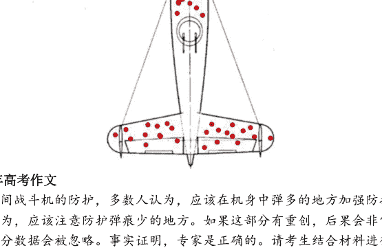

### 2018 年高考作文

二战期间战斗机的防护，多数人认为，应该在机身上弹多的地方加强防护。但有一位专家认为，应该注意防护弹痕少的地方。如果这部分有重创，后果会非常严重。而往往这部分数据会被忽略。事实证明，专家是正确的。请考生结合材料进行分析。自定立意、自拟标题，写一段作文。

这位没有给出名字的专家叫做亚伯拉罕·瓦尔德。他是一个犹太人，出生于当时隶属于奥匈帝国的克劳森堡。和二战时很多从欧洲逃到美国的犹太科学家一样，他也是因为排挤而运走的。大约在上个世纪 30 年代，瓦尔德在纽约的哥伦比亚大学得到一个教职，得以来到美国。

在第二次世界大战期间，瓦尔德和维纳、香农等人一样，都在秘密地为美军工作，但是表面上只是在做一般的学术研究。瓦尔德所在的小组是位于哥伦比亚大学的统计研究小组（SRG）。

这个小组里的成员都很牛，包括维纳（他有时不在纽约）、哈佛大学统计系创系的主任莫斯特勒，决策理论和贝叶斯方法的先驱萨维奇等人，后来成为著名经济学家的米尔顿·弗里德曼在里面还能只能算是小字辈。

据说瓦尔德是这个组中最聪明的的人。

有一天，统计研究小组接到一个研究课题，如何加固轰炸机的装甲，以提高它们被击中后的生存率。

美国军方认为，如果每次战斗中，自己被击落的飞机比对方少 5%，消耗的油料低 5%，弹药多 5%，机动性高 5%，就会最终成为胜利方。这个结论也是有数据依据的，不是假设。

于是海军（美国的海军拥有自己的航空兵）就让这些专家们来设计对飞机改进的方案，他们为统计研究小组提供了一些数据，主要是飞机上弹孔的分布，这就是上面画的那张图。从图中可以看到，这些弹孔分布并不均匀，翅膀上比较多，引擎上比较少。

当时军方普遍认为，应该减少装甲总量，然后在受攻击最多的部位增加装甲，这样飞机可以轻一点，但是防护作用不会减弱，因为防御的效率提高了。

但是，这些部位需要增加多少装甲，他人并不清楚，于是找到瓦尔德，希望得到答案。但是，瓦尔德彻底否定了他们的想法，给出了相反的答案。

瓦尔德认为，需要加装装甲的地方不应该是留有弹孔的地方，反而是没有弹孔的地方，即飞机的引擎。

瓦尔德讲，飞机各部位被击中的概率应该是均等的，但是引擎上的弹孔却比其余部位少，这说明那些被击中引擎的飞机根本没有机会返航。我们看到的数据，都来自成功返航的飞机，这说明即使翅膀被打得千疮百孔，仍能安全返航。

瓦尔德还举了一个更容易懂的例子，如果去战地医院的病房看看，就会出现腿部受创的病人比胸部中弹的病人多，这并不是因为胸部中弹的人少，而是胸部中弹后难以存活。

于是，军方马上按照瓦尔德的建议改进了飞机，取得了良好的效果。虽然人们不清楚这项改进挽救了多少轰炸机和飞行员的生命，但是对这条建议带来的效果从不吝惜赞誉之词。这件事，后来被总结为“幸存者偏差”。

我们接下来从信息论的角度分析一下有关幸存者偏差理论的数学基础。对于上述问题，我们做一个简单的假设，飞机被击中的部位只有两个，引擎和机翼，这两个随机事件分别被称为 A 和 B。

当然而还有一种情况，就是 A 和 B 同时发生，为了简单起见，我们不考虑它。于是飞机被击中的总概率为 P（A）+P（B）。接下来如果 A 发生（也就是击中引擎），坠落的概率我们假定为 P1，返航的概率当然就是 1-P1。

类似的，我们假设 B 发生后，坠落和返航的概率为 P2 和 1-P2。由于有幸存者偏差，我们看到的坠毁和返航的分布情况是 P2 和 1-P2，但这是一部分信息缺失的情况下的误判。那其真实的坠毁和返航比例应该是什么呢？

在前面的假设下，飞机坠毁的总概率为 P（A）x P1+P（B）x P2。考虑到前面说的飞机被击中的总概率为 P（A）+P（B），因此被击中后坠毁的条件概率可以用一个公式给出，当然返航的概率就是从 100%中减去它。

公式及推导：
【P（A）x P1+P（B）x P2】/【P（A）+P（B）】

我们假定引擎被击中的概率为 5%，被击中后坠毁的概率为 60%，机翼被击中的概率为 10%，被击中后坠毁的概率为 10%。10% vs 90%，这是我们在缺少信息后看到的坠毁和返航的比例。

用上面的式子算下来，总的来说飞机被击中后坠毁的概率为 27%，因此真实的返航坠毁比例是 27% vs 73%，而不是 10% vs 90%，这两个概率分布的交叉熵是比较高的，也就是说信息缺失很多。

如果我们加固引擎，让击中后坠毁的概率降到 30%，减少机翼的装甲，让相应的概率增加到 15%，那总的来说飞机被击中后坠毁的概率降低到了 20%，比前面的 27%降低了很多。相反，如果加固机翼，减少引擎的装甲，被击中后坠毁的概率将大幅上升。

虽然我们今天并不会像瓦尔德那样去分析战机的防护问题，但是用瓦尔德这样的思维方式提问非常重要。我们经常听到某个人办公司挣到了大钱，于是大家不顾一切，辞职退学办公司。这其实就陷入了幸存者偏差，因为媒体永远只报道成功者，让大家都觉得创业必定能成功。

最后我们用幸存者偏差讨论一下股票投资。在过去的近一个世纪的时间里，标准普尔 500 指数每年增长接近 8%，这是非常高的回报。但是美国经济显然没有那么快的增长，大约也就是一两半左右，这个差异是怎么形成的呢？

在短期，股市可能过度乐观，但是不可能偏差出 100 年。这其中的原因是，标准普尔 500 指数几乎每年都把表现不好的企业从指数中淘汰掉，换进那些表现好的。因此那些表现不好的企业你就永远看不到了，这其实反映了幸存者的偏差。

这也是巴菲特等很多投资大佬，一直推荐大家购买美国标准普尔 500 或者道琼斯指数基金的重要原因，因为它其实是利用了幸存者偏差占到了便宜。

更有意义的是，美国股市通过对表现不好的企业强制退市，允许做空股票，彻底将表现不好的企业清除出股市。如果一个股市没有强制退市制度，就难以有长期良好的表现，那种股市的指数基金表现好不了。

了解了幸存者偏差，还可以防止在投资上被基金经理或者媒体误导，那些媒体包括一些在金融界非常有影响力的，比如著名的晨星（Morningstar）公司，它宣称在 1995—2004 年之间，共同基金年均增长高达 10.8%，高于标准普尔 500 指数的水平，这和金融界通常理解的共同基金做不过大盘的结论是相违背的。

一些学者于 2006 年完成对上述数字的分析研究。他们发现，已经消亡的基金不会被统计进去，而真实情况却是，共同基金虽然有的会蓬勃发展，而有的因为长期不赚钱则消亡。

《金融评论》(Review of Finance) 于 2011 年对过去近 5000 只基金进行了综合的研究，结果表明仍然存在的只有 2600 多只，略高于 50%，而它们的收益率要明显高出消亡的。

如果考虑这个因素，所有的共同基金年化回报率只有 8% 左右了，略低于同期标准普尔 500 指数。因此，根据依然存在的共同基金判断所有共同基金的价值，就如同通过计算成功返航飞机上的弹孔数来判断飞机生存概率一样，是不合理的。

关键的问题是，共同基金的生命周期通常不是很长，据我的一位在富达基金主管两只基金的同学讲，大约有 1/4 的基金存活期只有一次股市上行的周期，即 8～10 年。

## 要点总结

- 首先，我们从理论上分析了幸存者偏差，并且用它来分析了股市，最后给大家的结论就是要购买那种不断淘汰坏企业的股市上的指数基金。此外，在工作中，大家也要不断淘汰不好的项目，在生活中要止损。这样就可以利用幸存者偏差将利益最大化。
- 其次，也是更重要的。我希望通过这件事，让大家了解通识教育的重要性。瓦尔德对于飞机、空战的理解肯定远不及美军军官，但他却能看到军官们没有发现的盲点，这是因为他的数学常识让他有好的思维习惯，他在得到结论之前会问飞机样本是如何选取的，而军官们恰恰忽视了样本选取不具有代表性这一点。
- 最后讲一个投资领域的小骗局，也算是今天的作业题：有一天专从从事仙股（股价只有几分钱）交易的弗罗斯特先生向你推荐股票，当然你不会相信他。他说，没关系，我每天发邮件给你，告诉你一只股票的涨跌。在接下来的 10 个交易日里，你每天收到他的邮件，10 天他都说对了。这时，你是否该将钱交给他去炒股？为什么？他是否有什么独到的眼光，还只是运气好？另外他为什么只炒仙股？

预告：下一讲，我们再讲一个信息论被广泛应用的推广原理，奥卡姆剃刀原理。
我们下一讲再见。

## 35 | 奥卡姆剃刀法则：最简单往往是最有效的

你好，欢迎来到我的《信息论40讲》。

奥卡姆剃刀法则(Occam's Razor 或者 Ockham's Razor)看似和信息论没有太多交集，但是托马斯·科弗在信息论的教科书中用信息论解释了奥卡姆剃刀法则，在我上学时，给了我很大的启发，希望这讲内容也能帮助大家理解并利用好这个法则。

奥卡姆剃刀法则，又被称为“简约之法则”，它是由14世纪圣方济各会修道士奥卡姆（英格兰的一个地方）的威廉（William of Occam）提出来的，他说过这样一段话：

> “切勿浪费较多东西，故做‘用较少的东西，同样可以做好的事情’。”

这句话用信息论来解释，就是如果关于同一个问题有许多种理论，每一种都能作出同样(准确)的预测，那么应该挑选其中使用假定最少的理论。

怎么理解这句话呢？我们看一个大家比较熟知的例子，关于地心说模型和日心说模型。

地心说模型很容易想到，因为我们从地球上看，日月星辰都是围绕我们运动的。不过，由于其它的行星其实是围绕太阳运动的，因此在地球上看，它们的轨迹是不规则的。

托勒密的伟大之处是用40～60个大圆套小圆的方法，精确地计算出了所有行星运动的轨迹，在数学上完美地证明了地心说（当然我们现在知道地心说从物理上讲是错的），可见这在当时是一个多么精妙的模型，但是它依然不够好，因为太复杂了。

如果我们换一个参照系来描述天体运动，比如用太阳为中心，那么模型就直观多了，其实这也说明，简洁的往往是正确的，越是复杂，越容易犯错。

当然，由于行星围绕太阳运动的轨迹不是圆而是椭圆，以圆为基础建立的模型还是需要很多圆相互嵌套在一起才能组成椭圆，因此也不直观。直到开普勒提出了椭圆模型后，这个问题才得到解决。从此，一个方程就可以描述行星运动的轨迹了。这就是简洁的力量。

尽管刚才说的三个模型对行星运动作出的预测可以同样准确，因为它们在数学上完全等价，但是，椭圆模型只需要用两个变量，而另外两个模型则要很多变量，因此在预言能力大致相同的情况下，椭圆模型显然更好。

因此，我们可以这样来理解奥卡姆剃刀法则，如果能够得到同样好的结论，假设越少越好，或者说条件越少越好。

奥卡姆剃刀法则在当时最流行的解释是“若无必要，勿增实体”(拉丁文是: Non sunt multiplicanda entia sine necessitate)。西方历代大学问家，都将奥卡姆剃刀法则作为自己治学的行为准则。

牛津大学第一任校长罗伯特·格罗斯泰斯特说：“在其他情况相同时，需求更少的更好、更有价值……一个普遍的规律比特定的规律更好，因为它从更少的假定出发产生知识。就像在自然科学中，最好的部分不需要前提假设，其次是需要较少前提假设的。”

托马斯·阿奎纳也说过类似的话，他的大意是，用较少规则推导出来的结论，使使用的次数较少。科学领域的集大成者牛顿则说：“我们需要承认，自然事物各种现象的真实而有效的原因，除了它自身以外再无须其他，所以，对于同样的自然现象，我们必须尽可能地归于同一原因。”这些都体现出他们对这个看似简单准则的认同。

今天，计算机科学家和物理学家都在用奥卡姆剃刀法则，作为寻找理论模型的工具。而经济学家们，则把它解释为，怎样用较少的资源，可以做好同样的事情。

既然大家都这么推崇这个法则，它是否有科学根据呢？接下来我们就说它和信息论的关系。

我们知道，要消除不确定性，就要使用信息。这个大方向没有错。那么使用什么样的信息，使用多少信息合适呢？我们不妨假定需要预测的目标是 Y，当然它有不确定性，因此就有信息熵，我们写作 H(Y)，它是大于零的。

我们现在有一大堆信息，我们写作 X1，X2，X3，……，XN。这些信息可以帮助消除 Y 的不确定性。我们不妨假定如果这些信息都用上，那么所有的不确定性就消除了，也就是说在 X1，X2，X3，……，XN 的条件下 Y 的熵降为了 0 (即 H(Y|X1，X2，X3，……，XN)=0)。现在问题来了：

## 1.真的需要那么多信息么？

显然不是，因为总有信息不那么有用，甚至是无效信息，那么就一定存在一个很小的集合，比如 X2 和 X4，我们用例如这一小点信息就足够了。也就是说 Y 在给定 X2，X4 条件下的熵，等同于它在给定所有条件下的熵。

接下来问题就是：

## 2.既然不需要那么多的话，怎样找到一个最小的集合？

对于这个问题，其实数学上是有答案的，就是找到一组所谓的基函数，我们前面讲到的傅里叶变换，正弦或者余弦函数就是基函数。在计算机科学中，对于一个复杂的联络图，或者网络来说，就是找到一个所谓的最小支撑树。

大家不用记这些名词，只要记住在任何领域，都有这种成为支撑点的关键信息，找到它们并且使用它们，一切问题就可以迎刃而解，掌握和利用这些支撑点，就如同用剃刀剔除树的枝叶，把多余的枝桠蔓薙，使我们困惑的信息去掉。

奥卡姆剃刀法则不仅有科学根据，在实践中也被不断地验证。

首先，我们说说为什么简单的解释通常是正确的。这里面有两个原因，一个是世界本身的规律在形式上并不复杂，虽然通常找到这样简单规律的过程极为复杂。在历史上各个时代，最高深的物理学理论，从形式上讲都不复杂，从牛顿力学，到爱因斯坦的相对论，到今天物理学的标准模型。

牛顿在《自然哲学的数学原理》一书中讲了四条法则，其中的法则一就是“除那些真实而又足够说明其现象者外，不必去寻找自然界事物的其它原因”。只不过，看似简单的，却非常准确的解释其实很难找到，而看似复杂的，似是而非的解释反而找起来容易一些。

其次，过于复杂的描述常常是骗局，因为骗局只有被包装得很复杂才不容易被识破。2008—2009 年金融危机前，有人向巴菲特推销金融衍生品，巴菲特看了他们的说明书后，断然拒绝了，理由是那说明书之所以要写成厚厚几百页没人看得懂的东西，里面多半藏了不可告人的事情。

我最初接触到奥卡姆剃刀法则是多年前在美国上学期期间，是在科弗的教科书中读到的。后来我专门了解了它的背景，觉得里面体现了智慧。我自己对它的体会有这样三点：

## 1.做减法。

很多次时候，我们生怕自己错过一些机会，于是做了很多其实对目标结果不再有帮助的事情。

比如年轻入头几回在大会社上作报告时，常常喜欢尽可能多地把自己的工作讲出来。这样不仅无法在规定的时间里讲完，而且由于传递出的信息其实有很大的重复性，接收者并不因为耐性子听完了就觉得更多的认同。讲东西如此，做事情也是如此，并非做得越多，效果就越好。

## 2.不要制造伪需求。

很多看似很重要的事情，其实是伪需求。我在《硅谷来信》中评论过无人超市是否需要，我讲其实超市有没有人并不重要，重要的是顾客是否能够以最便宜的价格，最短的排队时间买到自己需要的日用品。至于可有可无的奢侈品的销售，更是需要推销的了。

四月份我带人去参观了一家研制无人驾驶汽车的企业。暂且不考虑他们研制的无人车在技术上是否过关，他们想象中的市场就不存在。

按照他们的说法，节省一个司机能够让公交系统从需要政府补贴到盈利，但是他们的无人驾驶汽车的成本比公交车贵 100 多万元，车子的折旧费远远超过司机的工资。因此，随我一同参观的学员们一致认为那是伪需求。

我们不妨用奥卡姆剃刀法则过滤一下创业的项目，就会发现一大半其实是伪需求。
或者说，奥卡姆剃刀法则可以帮助我们提高判断力。

## 3.要提高自己寻找基函数的能力。

我们说的做减法，不是把有用的信息剪掉，而是设法只保留少量的，等同于全部信息的有效信息，这就是数学上所说的基函数。

比如说，投资的原则有很多很多，但是真正称得上是基函数的其实很少，比如巴菲特和芒格的价值投资，马尔萨尔的定投指数基金等等就是。而其它一些所谓的秘诀，什么低买高卖，追涨杀跌，则不是。

如果我们保留了那些基函数，我们就获得了最大的效益，但是如果我们保留了一堆似是而非的信息和方法，就得到时灵时不灵的结果。

而提高这个能力，就要对自己进行专业的训练。

思考题：我们在《硅谷来信》中介绍了毕加索的绘画，总的来说他的绘画风格的演变符合奥卡姆剃刀法则。能否分析一下为什么毕加索的画法在表达主观想法时，比古典时期的绘画手法更有效？

预告：下一讲，我们继续谈论信息论中一个简单性的原则，没错，其实信息论往往就是在教你更快找出答案的简单做法。比如我们在第一模块讲过的确定四选一的答案，利用最少的小白鼠找出毒药，以及哈夫曼编码等等。我们下一讲再见。


## 36 | 最大熵原理：确定的答案找到之前，我们该怎么做？

你好，欢迎来到我的《信息论 40 讲》。

我们上一讲所讲的奥卡姆剃刀法则，其核心是一个简单性的原则。当我们找到基函数时，而且找到了对一个事物最根本规律的认识时，我们可以得到对它最简单、最有效的描述。这就是牛顿、爱因斯坦、沃森、克里克和门捷列夫等人所做的工作。

但是，在寻找找到这样的本质规律之前，我们可能需要有很多过渡性的模型，让它们来帮助我们解决当下的问题。毕竟，人类不可能等到建立起牛顿力学才制定历法，等到门捷列夫画出元素的周期表才开始寻找基本元素。

那么我们在建立那些过渡性的模型时应该遵循什么原则呢？最有效的原则就是所谓的“最大熵原理”。这也是我在信息论领域的主要研究方向。

“最大熵原理”这个词听起来有点吓人，但是它的原理并不难理解，我举两个例子你就明白了。

第一个例子是我在博士毕业找工作时，给别人做报告时举的。通常在美国，博士生要找一个研究型的职位，需要在应聘的研究机构做一个学术报告，展示自己的学术水平。

我做的研究就是最大熵模型的算法，这个算法背后是一大堆数学公式。如果直接推导数学公式，听众就走光了。因此为了给大家讲明白这条道理，我每次去做报告的时候，会随身带两个骰子。

在做报告时，我会先拿出第一个骰子掷一下，问听众五点那个面朝上的概率是多少？所有人都说是 1/6，因为各个面朝上的概率是相等的。这种猜测当然是对的。

我随后又问听众为什么猜 1/6，而不是 1/2 或者 1/10？大家都回答说，因为对这个骰子一无所知，只好假定它每一个面朝上的概率是均等的。

接下来我拿出另外一个被我做了手脚的骰子，我把几个角给磨圆了，然后给大家看，问大家五点朝上的概率是多少？这时没有人再猜 1/6 了，因为他们看到这个骰子并不均匀，他们有人猜是 1/3，有人猜 1/2，总之不再是 1/6，说明大家在得到新的信息后，会自动考虑到“现在 5 点朝上的概率应该变化”这个事实。

当然，具体到那个骰子，5 点朝上的概率大约是 2/5，这是我经过实验验证过的，而在 5 点对面的 2 点，朝上的概率近乎是零。

于是，我又把这个事实告诉大家，接下来我再问听众，那么剩下的四个面朝上的概率分别是多少呢？大家通常会猜是 3/20。因为认为除去五点和两点的概率总和 2/5，剩下的 3/5 概率要由四个面均分，于是平均来讲就是 3/20 了。

为什么大家要平均分配剩下来的概率，而不会觉得 1 点朝上的概率比 6 点朝上的概率来得大呢？因为这样对大家来讲风险最小。

听我报告的人每次在作判断时，其实就是基于简单的算术加上直觉。而人作出这种基于直觉的预测，背后的依据是让风险最小，平均分配概率符合这一要求。所幸的是，让风险最小的直觉碰巧符合了信息论中最大熵原理，因此它作出的判断是基本正确的。

接下来我就说说最大熵原理，它的意思是这样的。当我们需要对一个随机事件的概率分布进行预测时，我们的预测应当满足全部已知的条件，而对未知的情况不要作任何主观假设。

我们在第一个骰子的问题上，得不到任何已知条件，因此我们不能有任何主观假设，猜每一个面朝上的概率是 1/6 就可以了。

但是，当我给大家看了做过手脚的骰子，大家就得到了部分信息，所以在第二次作预测时，大家首先要保证预测符合已知的信息，也就是说 5 点和它所对应的 2 点朝上的概率应该分别是 2/5 和 0。

但是对于任何的未知，依然不能作任何主观的假设，于是大家在其他四个面朝上的概率上，均匀分配剩下的概率，猜 3/20 就可以了。

如果我们按照上述的方法，去建立一个概率的模型，可以证明这样的概率模型会使得熵，也就是不确定性，达到最大值，因此这种模型被称为“最大熵模型”，而相应的，建立模型原则就被称为最大熵原理。

最大熵原理也可以用老子的智慧从另一个角度诠释一下，那就是“过犹不及”。我们学了信息论，知道信息是用来消除信息熵，也就是不确定性的。

在上面的例子，大家在猜骰子哪面朝上时，已经利用了所有已知信息，将信息熵减少了，该确定的已经确定了，我们不可能进一步减少信息熵了。于是剩下的信息熵就达到了最大，这就是把信息使用地刚刚好。

如果我们自作主张地想进一步降低信息熵，作了很多主观的假设，作出来的预测反而并不准确了，我们在前面学了，不准确的预测风险是极大的。因此这就是老子所说的“过犹不及”了。

## 那么这个最大熵模型在技术上有什么好处，或者相对其它技术有什么优势呢？

首先，它显然和我们所有已知的信息相符合，因为我们的模型就是用已知信息搭建起来的。

其次，这样的模型最光滑。光滑在数学上是一个什么概念？你可以理解为它不会遇到黑天鹅事件，方方面面都考虑得很周全。最大熵模型光滑的原因，在于我们对于未知的信息，没有作任何的主观猜测，就可保证结果能覆盖所有的可能性，不会有所遗漏。

我们还是以那个做了手脚的骰子为例来说明。我们只知道两件事，五点朝上的概率大约是 2/5，两点朝上的概率大约是零，对于另外四个面的概率不知道。

这时候你可以赌，比如赌三点朝上的概率为 1/3，四点朝上的概率为零。你或许会赌对，又或许会赌错，但是长期看下来，这样的赌的风险很大，因为不符合概率上的计算结果。

因此，我们可以认为，一个光滑的模型，可以让预测的风险最小。而最大熵原则恰好满足这一点。

我们在投资时常常说这样一句话，不要把所有的鸡蛋放在一个篮子里，其实就是最大熵原理的一个朴素的说法，因为当我们遇到不确定性时，就要保留各种可能性，而不要随便作主观的假设。

最后，如果你得到的信息是矛盾的怎么办？其实很多时候，我们之所以难以决策，就是因为它们相互矛盾，我们常常在“如果这样……”可是“又会那样……”的两难境地。

最大熵模型用数学推理的办法解决了整个问题，它无法同时满足两个矛盾的先决条件，会自动地在这两个条件中找到一个中间点，保证信息的损失最小。可以讲，最大熵模型在形式上是最漂亮、最完美的统计模型，在效果上也是最好、最安全的模型。

了解了最大熵模型的这么多好处，很多会想，那我们就在各种场合使用它吧！

凡事有一利就有一弊，最大熵模型虽然有很多好处，但它最明显的弊端是计算量太大，直到 21 世纪之后，由于计算机速度的提升以及训练算法的改进，很多复杂的问题才开始采用最大熵模型来解决，比如自然语言处理。

这个问题一解决，就马上被用在了新技术上。当然，和钱紧密联系的行业总是喜欢最先采用新技术，因此美国的不少对冲基金，包括著名的文艺复兴技术公司，都是最大熵模型的 earliest 用户，它们也因此取得了很好的收益。

我在约翰·霍普金斯大学期间改进了这个模型的训练算法，然后写了一个简单的编程工具，后来有人把我论文中的算法做成了开源的代码，今天你如果需要使用这个模型，并不需要从头开始，只需要使用开源软件即可。

对大部分人而言，最大熵重要的是原理，而不是公式模型，毕竟模型使用的人会非常少。对于最大熵的原理，每一个人都应该记住以下三个结论：

1.如果 你获得了全部的信息，事情就是确定的了，就不要用概率模型进行预测了。所以，最大熵模型的应用场景是你获得了一部分确信的信息，但是没有获得全部的时候。这时你要保证所建立的模型满足所有的经验，同时对不确定的因素有一个相对准确的估计。

2.在没有得到信息之前，不要作任何主观假设。这一点对投资非常重要。很多人觉得股市连续涨了半年就一定会下跌，或者下跌了半年就一定会涨，这些都是主观的假设。

我们在前面介绍投资时讲过，要想获得投资最大的收益，就需要将钱长期放置在一个健康的股市中。事实上时机你是把握不住的，而时间是你的朋友。很多人对所谓时机的判断，都是主观的，其实是一种投机行为。

3.不要把鸡蛋放在一个篮子里，而要让凡事变得“平滑”，因为按照最大熵的原理，这样做风险最小。

此外，透过最大熵模型，我还想表述一个事实，那就是形式上简单的东西，获得它未必容易，在数学上漂亮，形式简单，但是实现起来反而难度很大。

我上节课讲到奥卡姆剃刀法则时说简单的方法常常最有效，可能有人将简单和初级、低水平划等号。形式上简单的东西未必初级，相反，要把道理总结得简单易懂，自己需要有深刻的理解，在科学上，要得到形式简单的规律，反而要做更多的工作。

思考题：如果 你知道未来汽车都将是电动车，但是你不知道哪家电动车公司值得投资，你怎样投资才能不错失机会，也不会把鸡蛋放在一个篮子里？

预告：下一讲，我们介绍另一个原理，麦克斯韦妖和测不准原理，告诉你能量和信息之间的互换关系。我们下一讲再见。

## 37 | 麦克斯韦的妖：为什么要保持系统的开放性？

你好，欢迎来到我的《信息论40讲》。

我在课程《科技史纲60讲》和《全球科技通史》这本书中用能量和信息两条主线来解释近万年的人类科技成就，有读者问，信息和能量之间是否有十分明确、本质的联系呢？

其实是有，我们今天就从物理学假设开始， 说说它们的关系，这个假设被称为“麦克斯韦的妖（Maxwell's demon）”。

麦克斯韦大家并不陌生，他可能是牛顿之后，爱因斯坦之前最重要的物理学家，他奠定了电磁学的基础，而且正是因為麦克斯韦电动力学的方程和经典力学的矛盾，才导致了爱因斯坦提出相对论。

在麦克斯韦生活的年代，物理学上发生了一件大事，就是卡诺、克劳修斯和开尔文爵士发现了热力学第二定律。通常我们用的是克劳修斯的描述，“不可能把热量从低温物体传递到高温物体而不产生其他影响”。也就是说，你不可能把冰和热水放在一起让冰变冷而热水变热。

我们今天知道所谓温度高，无非是分子运动快的表象，而温度低则相反。

那现在如果有一个隔断的容器，左边有热空气，右边有冷空气，这种情况被称为相对有序的状态，因为热空气里都是速度快的分子，都到了左边，冷空气里都是速度慢的分子，在右边。

如果这个容器是相连通的，中间有个门，我们把门打开，速度快的热空气分子就要进入到右边，而速度慢的也会进入左边，最后由于空气分子的碰撞，两边的空气分子运动速度差不多快，有序就变成了无序。

于是，克劳修斯就发明了熵这个概念来形容分子运动的无序状态，从有序到无序，是一个不断熵增的过程。

单个分子的运动。

如果它看到一个速度快的分子从右往左运动，它就让它过去，同样，如果它看到一个慢分子从左往右运动，它也让它过去。但是反过来，它会严格把门，不让分子经过。

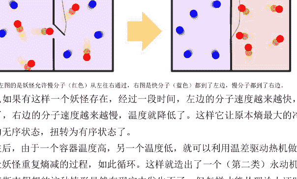

左图的是妖怪允许分子（红色）从左往右通过，右图是快分子（蓝色）都到了左边，慢分子都到了右边。

那么如果有这样一个妖怪存在，经过一段时间，左边的分子速度越来越快，温度就升高了，右边的分子速度越来越慢，温度就降低了。这样就让原本熵最大的冷热空气混合的无序状态，扭转为有序状态了。

再往后，由于一个容器温度高，另一个温度低，就可以用温差驱动热机做功了，然后再让妖怪重复熵减的过程，如此循环。这样就造出了一个（第二类）永动机。

麦克斯韦假想的这种情形显然在现实中发生不了，但怎样才能从理论上证明这样一个妖怪不可能存在，却不是一件容易的事情。

我们回想一下麦克斯韦的妖怪工作的过程，它需要先测量分子运动的速度，也就是说需要获取信息，它需要不断的信息输入才能降低热力学上的熵。我们知道信息的输入可以降低一个黑盒子里的信息熵，现在它也可以降低热力学上的熵。

但是，这时麦克斯韦所假定的两个容器，本来已经不再是封闭系统了。也就是说，麦克斯韦想象的系统并非克劳修斯总结热力学第二定律所说的系统。这样麦克斯韦的妖和热力学第二定律就不矛盾了。

接下来问题是，测量分子运动速度这件事是否需要能量，或者更广义地说，在物理上，测量这件事是否需要能量？答案也是肯定的。我们知道在物理学里有一个测不准原理，也就是说我们“观察”这个动作本身是会改变物质状态的。

霍金在《大设计》一书中介绍这个原理时讲，在微观世界里，当我们测量时，哪怕两个光子照在原子上，它的状态都会改变。也就是说，信息的获取本身需要能量。

也就是说，这个（第二类）永动机确实没有直接消耗什么能量，但是它消耗的是信息，麦克斯韦的妖把信息转化成了能量，或者说通过提高信息熵，降低了热力学的熵。这样算下来，总的熵并没有减少。

这一顺带说一句，在信息科学中也有一个类似于测不准原理的不确定原理，也就是说频率的误差和时域的误差不可能同时变小，这和物理学是一致的。

接下来我们来讲讲热力学第二定律和麦克斯韦的妖同信息时代管理的关系。
在信息时代，你会发现一个现象，一个开放的、包容多元文化的社会，容易催生出伟大的公司。而一个封闭保守的地区，发展就缓慢。

这个现象很好解释。根据热力学第二定律，一个封闭的系统永远朝着熵增加（也就是越来越无序）的方向发展，一定会越来越糟糕。而要扭转这种局面，唯一的办法就是从外界引入负熵。

比如你可以用空调机将炎热的室外变得更热，让凉爽的室内更凉爽，这是因为空调机消耗了能量，也就是引入了负熵。这时候，你的房间内外其实不再是一个封闭系统，而是一个开放的系统，它和远处的发电站连为一体。

对于一个地区、一个组织也是如此。它只有成为一个开放的系统，会引入负熵，才有可能让系统通过与外界的交换变得更加有序，也就是朝着越来越好的方向发展。

世界上最有经济活力的地区可能要数硅谷地区了，它成功的一个重要原因，就是因为它自身是一个开放的系统，不断地从世界各地引入新的人才，不断地丰富本已很多元的文化，才能在整体上蒸蒸日上。

在过去的十多年里硅谷地区每年和世界各国进行人才交换，净流入 1.7 万～1.8 万人，这些人大多是思想活跃的年轻的专业人士。他们实际上是给硅谷带来了负熵。类似的，中国最开放而包容的城市是深圳，其次可能是浦东或者长三角的一些城市。

相反，一个封闭的社会，如果闭门造车，最终那里的人会变得同质化，整个环境就会变得死气沉沉。我一直非常强调工作地点，反对年轻人贪图安逸，跑到生活成本低的三四线城市去，因为那些地方是相对封闭的系统。

一个地区也好，机构也罢，从外面引入负熵有两种办法，一种是直接与外界进行人的交换，另一种则是接受外界新的思想。前者可以被看成是引入负的能量熵，后者则是引入负的信息熵。

日本明治维新时，在很大程度上是采取后一种做法，即把西方的思想全面引入日本。对于一个机构也一样，既可以通过对外进行合作引入负熵，也可以直接引入外界的技术和管理思想，这方面很好的一个例子就是华为。

1994 年华为开发出了当时具有国际先进水平的 C&C08 程控交换机，并且经过努力获得邮电部的认可之后，从此它的产品在中国市场上站住了脚。但是，如果华为还是按照习惯性的管理方法来管理公司，它就会和国内大部分 IT 企业一样，成为一个“窝里横”的公司。

1998 年，华为迈出了成为后来国际化大企业关键的一步，任正非决定从 IBM 聘请大批顾问，将公司打造成合乎信息时代做事规范的国际化企业。

当时华为很多高管对 IBM 开出的高价目瞪口呆，怀疑那些钱花得不值，但是任正非力排众议，接受了 IBM 的报价，然后开始了一场长达数年的全面学习 IBM 管理的变革运动。

和一般中国企业聘请一些外国成功企业，或者咨询公司为自己把脉、找问题、给出解决方案、改善管理所不同的是，华为在这个改造期间，很多部门是由 IBM 的顾问直接担任负责人，华为的干部则为他们担任助手，向前者学习。通过这样手把手的传授，华为最终在管理水平，特别是研发管理上，成功达到了世界一流的水平。

在这个过程中，华为得到的是什么？你可以说是先进的管理经验，但是从本质上讲是负熵。

对于个人来讲，什么算是引入负熵呢？那就是行万里路，读万卷书。这两句话当然是比喻，第一件事是指自己走出去和别人接触，我把它等同于在能量上引入负熵。第二件事是指接受新的信息，引入负的信息熵。

我有时听一些朋友诉，我太忙，没时间走出去，没时间学习，或者我太内向，不善于和别人打交道。对此我想说的是，每个人都有自己的困难，但是世界自有安排，不会因为谁困难就照顾谁。不管什么原因，一个人一旦封闭起来，他就离无序的状态不远了。

## 要点总结

+ 1. 我们介绍了热力学第二定律，并且通过介绍麦克斯韦的妖讲述了信息和能量二者的关系。我们还通过物理学的测不准原理和信息科学中的不确定原理，说明了二者的相关性。
+ 2. 任何一个封闭系统都是越变越无序的，要想变得有序，就要引入负熵，即能量和信息。对地区，对企业都是如此。
+ 3. 对人来讲，引入负熵的方法就是行万里路，读万卷书。

思考题：能否想两个例子，一个是用能量换信息，一个是用信息换能量。

预告：下一讲，我们就来复盘一下这一模块“信息应用”的内容。

## 38 | 复盘：如何把信息论学以致用？

你好，欢迎来到我的《信息论40讲》。

这一讲，我们对信息论第三模块进行一次复盘。在这个模块中我们主要讲述了信息论原理在工作中的应用，并且对一些方法，比如大数据思维，介绍了其背后的科学原理。通常，没有科学基础的方法常常难以持久。

今天我们的复盘换一种方式进行，先抛开这个模块的内容，从最近想到的一问题讲起。

前一陣少年得到的负责人张泉灵老师问我，如何告诉孩子计算机科学是怎么一回事，这个行业的从业者都在干什么？

我讲，从事计算机科学的工作，第一步是将我们这个世界的现实问题变成一个数学问题，这就是计算机科学家们做的事，第二步就是将数学问题重新描述一下，变成计算机能够处理的问题，这就是计算机工程师的工作，这个重新描述的过程，其实就是把人的自然语言变成计算机程序语言。

当然，还有一部分科学家在研究如何让计算机变得更快更强大，那是另一件事情。对于绝大部分计算机科学家来讲，他们不需要自己真的去设计制造计算机，而是做好现实问题到计算机问题的转化。

在信息论的应用中，情况也大致如此。我们很多人所做的工作，就是将工作中的问题，变成信息的收集、传输、综合、存储和处理的问题。我们绝大多数人不需要知道上述信息技术的细节，但是需要知道如何把自己领域中的问题，描述成一个信息处理的问题。

我们在课程中讲了，CT 和核磁共振（MRI）等医学影像仪器的发明，就是把医学中的一些问题变成了信息处理中的信号检测问题。

亨斯菲尔德是英国的一位电机工程师，他试图通过不同角度进行 X 光照射的成像，恢复人体内一个截面的图像信息，但是他自己不知道如何计算 X 光在人体内的辐射特性。后来他发现美籍南非科学家哈马克发明了这种有关 X 射线在人体不同组织内的辐射特性的算法，于是发明了医学上用的 CT 扫描仪器。

这种仪器用 X 光探测器接收透过人体不同组织各个层面的 X 射线，将光信号转变为电信号，再变成计算机可以处理的数字信号，然后通过计算机的处理形成图像，还原我们身体内的结构，展现给医生们看。

活和工作呢？得到老师所教的内容，相当于科马克给出的有关 X 射线在人体不同组织内的辐射特性的算法。

不同的人得到它，会产生不同的结果，绝大部分人看了看，就放在一边了，亨斯菲尔德看到后，就用它来解决自己在工作上所面临的问题。他的贡献，其实就是将一个现实的、具体的问题，变成了那个算法能够解决的问题。

我在前面的课程中讲述了 D 先生通过大数据和 IoT 解决酒保偷喝酒的问题，他的贡献也是将一个具体的问题变成了一个信息收集和处理的问题。

很多人担心在信息社会里自己落伍，其实每一个自己的专业特长，就是信息时代最大的价值。关键看大家如何利用信息技术，发挥自己的特长了。亨斯菲尔德正是因为有在医疗仪器上的特长，才让科马克的技术发挥出效益。

在这个模块中，我们重点讲了信息论在五个方面的应用：

## 首先，我们讲述了验证信息的方法，并且给出了一个比较高效的做法，就是交叉验证。

人们通常习惯于在自己熟悉的维度中往深里挖，往细了挖，但是这样的做法到后来成本很高，准确性有限。从另一个维度进行交叉验证的效果则好很多。

## 第二，我们谈到了在信息不可获得时，如何利用等价信息获得相应的效果。当然，在使用等价信息时，要注意不要把相关信息都当作等价信息了。

## 第三，我们剖析了大数据思维的底层逻辑。虽然今天很多人拿着大数据思维当作新的概念炒，以至于已经被炒得有点烂了，但是如果我们理解了它的本质，就知道它其实是一种全新的思维方式，我们可以通过这样四个层面，对它一层层地深入理解：

- 第一层：百川入海，从各种枝末细节得到规律；
- 第二层：逆向思维，先有结论，再找原因；
- 第三层：洞察枝末，通过宏观规律对比细节，找到异常发现问题；
- 第四层：相关联系，通过多个维度的强相关性，找到因果关系作决定。

## 第四，我们介绍了奥卡姆剃刀法则，即简约之法则，它原意是“切勿浪费较多东西，去做‘用较少的东西，同样可以做好的事情’”。

发明简约的法则，并加以很好的利用，应该是我们日常做事的准则。

接下来，我们介绍了最大熵原则。这个信息论的原则可以从几个角度来理解。人们把它理解为，不要把鸡蛋放在一个篮子里，而要让凡事变得“平滑”，这是没有问题的。

但是，在课程中，我们还强调了这个原则的另一面，那就是在没有得到信息之前，不要作任何主观假设。这一点对投资非常重要。

很多人觉得股市连续涨了半年就一定会下跌，或者下跌了半年就一定会涨，这些

都是主观的假设。事实上时机你是把握不住的，而时间是你的朋友。很多人对所谓时机的判断，都是主观的，其实是一种投机行为。

基于最大熵原理构建的最大熵模型，它符合奥卡姆剃刀法则，因为它在形式上非常简单。但是，形式上简单不等于实现起来就简单容易，相反，最大熵模型的训练计算量非常大，这件事告诉我们，任何事情都不是无成本的。

今天你可能会觉得华为手机照相特别好，一键按下去不用修图，就把人拍得很漂亮，但是在你使用简单的背后，是他们工程师大量的工作，以及处理器完成的大量计算。

今天我们每一个人都希望自己在市场上受欢迎，这件事如果有秘诀的话，就是在下面多做工作，让别人感到方便。

随后，我们介绍了幸存者偏差，它形成的原因，以及如何利用它，让自己的利益最大化。此外，我们特别强调了通识教育的重要性，因为瓦尔德能够看到军官们没有发现的盲点，这是因为他的数学常识让他有好的思维习惯，他在得到结论之前会问飞机样本是如何选取的，而军官们恰恰忽视了样本选取不具有代表性这一点。

很多人看到这门课的时候，都担心它是一门需要很多数学知识的通信课程，但是听了以后发现它其实讲的是方法论。事实上今天信息论在管理上的用处比通信中一点也不少。

因此，也希望你把这个信息传递给你周围的人，让他们不至于被信息论这个名称吓着，不妨也来了解一下我们当下和未来世界的方法。

信息论的基本原理，已经交给大家了，接下来，就看大家如何在工作中将它们用好了。下面讲，我会回答大家在“信息应用”这个模块遇到的问题。我们下一讲再见。

## 问答 | 从信息论角度看科技发展的方向

吴军
你好，欢迎来到我的《信息论40讲》。

这一讲，我想通过回答大家的几个问题，告诉你，从信息论的视角看，未来科技发展的趋势是什么？当然我可以先告诉你结论，这个趋势就是：以更少的能量，传输、处理和存储更多的信息。好，我通过回答大家的具体问题来展开谈。

## 无线充电会普及吗？

吴老师的每节课程我都听过，获益良多。我是一名物联网专业的大大学生，当我听完吴军老师讲解5G和IoT的时候，您说电池问题不好解决，我有个疑问：五年之内大规模无线充电是否会普及？如果普及了，会对IoT行业造成怎样的影响？请吴军老师解答，非常感谢。

吴军
这个问题问得很好，非常具有代表性，因为之前很多人问过类似的问题。在回答这个问题之前，先给大家讲一个历史上的争议。

如果要问谁发明了无线电，很多人会说是特斯拉，当然还有很多人会说是马可尼，因为过去官方的说法是他，而且他因此获得了诺贝尔奖。我在《全球科技史纲60讲》中讲过，追究最早的发明权其实一点意义没有，因为总有更早的，关键看谁的发明提出后，对世界产生了后果，对这项发明画上了句号。

从这个角度讲，将无线电发明的荣誉给马可尼是应该的。当然我知道支持特斯拉的朋友会不服气，说毕竟特斯拉的理论早一些，但是，在特斯拉之前，还有更早的赫兹，今天无线电频率的单位就是以他的名字命名的，此外还有从理论上指出无线电波存在的麦克斯韦。这样追究下去就没完没了了。

好了，接下来的问题就是，似乎更早发明无线电的特斯拉为什么失败了？原因很简单，他把无线电用错了方向。

无线电这件事，简单地说就是一个相互转化的电场和磁场，电场的变化产生变化的磁场，磁场的变化又产生变化的电场，于是它们就往远处传播了。这种无线电可以做两件事，传递能量或者传递信息。

先说说传递能量。如果在某一处有一个线圈，放到变化的电场中，线圈就产生电流，于是能量就传输了。这就是今天无线充电的原理。

今天在近距离小功率充电上，这种应用早就有了。20年前我买了一个飞利浦的电动牙刷，就是这样无线充电的，牙刷放在了一个四周相对封闭的架子上，大约充电15~24个小时，电就充好了。我们讲讲 IoT 中提到的 RFID，也是通过这个原理获得电流的。

此外，今天三星等公司搞出的手机无线充电，用的是类似的技术，要说明的是，手机无线充电要把手机放在充电站上，不能放在远方。

看到这些应用，你可能已经注意到无线充电的一个特点，那就是输电的功率很小，距离很近。为什么距离远不了呢？因为电磁波辐射到远方衰弱得特别快。如果我们让电磁波在四周辐射，在辐射源10米附近的强度，只有1米附近的强度的1/100，100米以外的强度，只剩下万分之一了。因此不能距离很远。

为什么功率不能很大呢？因为被充电设备获得的能量占本身辐射出总能量的很少一部分，剩下的都辐射到空间了，太大的功率会伤害到我们。为了让能量尽可能少往四周辐射，飞利浦牙刷充电时其实是把牙刷手柄包在基座中的。因此，没有屏蔽，往远处各个方位大功率输电是不可能的事情。这也是为什么特斯拉试图利用无线输电失败的原因。

给特斯拉投资研究无线电的是著名投资人J.P.摩根，他看到特斯拉净做这些不靠谱的事情，就停止了对他的资助，转而资助另一个年轻人，从意大利来到美国的马可尼。

马可尼用无线电传递信息，而传递信息不需要太高的能量，于是马可尼成功了，名利双收，不仅仅得了诺贝尔奖，而且还创立了RCA公司，该公司在很长时间里是世界上最大的收音机、无线广播和电视机公司。

那么为什么用无线电传递信息能传得较远呢？因为信息可以叠加在无线电波（也被称为载波）上传输，在接收时，只要信噪比足够高，就能复原出信号，不需要在接收端具有太高的能量。因此，马可尼的成功在于走对了路，或者说，为无线电这项技术找到了合适的应用场景，而特斯拉没找到。

不过顺便说一句，即使是无线传输信息，比有线传输，带宽也低很多，低好几个数量级。只不过我们对此不敏感罢了。类似的，无线充电，以手机或者电动牙刷为例，其实也比有线的低很多。

那么能否用无线的方式大功率传输能量呢？其实变电站的变压器早就做到这一点了，但是变压器有个大磁圈，把电磁场限制在周围不往远处辐射（辐射不超过5%）而已。但是远距离无线输电，是不可能有一个大磁圈的。

另外，有些人想，能否用激光进行远距离能量传输？这是可以的，但是如果满大街都是大功率激光，对人的危害极大。

很多时候，我们掌握一些科学方法，对于理解今天的世界，对于判断技术是好是坏，还是非常需要的。

## 晒太阳的加菲猫：马斯克“星链”计划靠谱吗？

吴老师您好。课程里您讲到，“绕星”系统与现代通信发展方向不符。埃隆·马斯克提出“星链”计划，用12000颗卫星实现无线通信并开始部署。您如何评价他的方案呢？

吴军
这个问题问得很意思。

俄罗斯有一句格言，一种表述不因为提出者的身份就成为真理。很多事情靠谱不靠谱，不在于谁讲，而在于它是否合乎基本的科学法则。很多事情，不因为马斯克说了、做了，就从不靠谱变成了靠谱。

我们在回答前一个问题时讲了，无线通信在接收时，需要保证信号的能量和噪音能量之比足够高。而信号能量是和传输距离的平方成反比的。

卫星离地面的距离，最近也有一百公里，至少是4G网络的上百倍，因此到地面上的信号强度只有4G基站的万分之一。如果想提高传输率，就要加大功率，但是卫星的功率显然没法和连了电线的基站相比。

因此卫星的传输率其实非常有限，远不如一个基站。此外，你的设备向卫星通信，也需要很高的功率。如果你见过铱星手机，会发现它和大哥大一样黢笨，它只是传输一路语音数据，数据量极小。

如果你想传视频怎么办？你只要看看今天在演唱会现场外的转播车就可以，巨大无比，那也只是一路电视信号。即便你想传递的视频清晰度没有电视转播高，恐怕也要推一个婴儿车上街。

就算大家可以按照和基站通信的方式和卫星通信，每个小小的卫星总的传输率也无法和连有光纤的基站相比。实际上大约只有基站的1/10~1/100。要知道全中国有500万个基站，马斯克那一点点卫星（一万个），只能提供4G时代中国移动通信量的10万分之一左右。当然，你在塔克拉玛干沙漠中央可能有用。

今天给大伙算这道题目，也是告诉大家一个在信息时代甄别信息的方法。我在《硅谷来信》第138封信中讲，在大数据时代要识数，1万在不少人看来是个很大的数字，但是，和中国的基站数来讲，少得可怜。

此外，我们在这门课和《全球科技史纲60讲》中反复强调了，未来科技发展的总趋势是，用更少的能量，传输、处理和存储更多的信息。5G取代4G，符合这个规律，用卫星取代4G，违背这个规律。

## 大肚皮麻烦

想问吴老师个问题。网络传输速度和网络中的节点数是高度正相关的。如果5G加入了这么多的基站，会不会降低传输速度呢？

吴军
不会的，因为5G虽然基站多，但是传输的路径并不长。从4G之后，电信网络的发展已经用到了计算机网络的很多技术，比如云计算和虚拟化，因此今天通信的很多节点，只是虚拟的，在物理上，它们都在同一个云计算中心。

## 岳山：奥卡姆剃刀法则是否不适用？

吴军老师，想问您奥卡姆剃刀法则的应用，是不是也要看情况呢，它简洁的属性似乎也有不足之处。比如，从简洁程度看，编程语言中Python似乎是最简洁的，但是它执行的速度却比不上C、Java语言。这是否是一个简洁原则的不适用的情况呢？

吴军
我在前面课程中讲到了，要想给用户提供简洁和便利，背后就要多做工作。Python就是利用计算机背后多做工作，实现对人的简洁。由于人的时间宝贵，而计算机的资源相对便宜，这种做法是合理的，并不违背奥卡姆剃刀法则。

## 32讲 “大数据思维的四个层次” 课后思考题

为什么专家收集双胞胎的对比数据，要去第三世界国家的农村？

吴军
去第三世界国家的农村有三个其他地方没有的好处，能够促成橘子和橘子的对比。
- 1. 那里同一个村子里的人基因相近，因为他们世代生活在那里，相对与世隔绝。
- 2. 那里的人的生活习惯，特别是饮食习惯相近。
- 此外，那里的人流动性较差，如果进行回访，想取得更多的数据也能够得到。

上面这些条件，是生活中流动性很高，基因和文化多样性很强的城市里不具备的。
下一讲我继续回答大家提出的问题，希望能够帮助你吃透课程内容。当然，问答之后，我会把控制论和系统论也讲给大家。

## 问答 | 精通各种语言才能做好语言搜索吗？

吴军
你好，欢迎来到我的《信息论40讲》。

这一讲我继续回答大家在课程里的提问。你将听到我作为中日韩搜索的发明人到底是不是懂日韩的语言，以及年轻人要不要去大数据公司就业等问题。

## Michael

吴老师，我们都想知道，您是中日韩搜索的实现者，那么老师您精通日语和韩语么？

吴军
这个问题问得很有意思。简单的回答是，我不懂日语和韩语，日语还能根据汉字猜一猜，确认找到的网页是否合理，但是韩语真是完全地两眼一抹黑。

那么不懂这些语言怎么做研究的呢？说起来原因也很简单，信息处理的问题是数学问题，让计算机处理自然语言也是数学问题，不是我们通常理解的语言学问题。

在香农之前，人们一直没有把信息量和信息的含义、这两件事之间的区别和联系搞清楚。即便是在香农之后，很多人理解的让计算机处理自然语言，依然是模仿人的思维方式，去找信息里的意义。

按照那种思路，处理语言就需要精通语言。但是后来计算机处理信息其实是从信息论出发，而非语言。这也就是为什么里尼克尔玩笑讲，他每解雇一位语言学家，他的语音识别系统的错误率就降低1%的原因。

语言是承载信息的工具，或者说是一种编码方法，而背后的信息才是最重要的。
从天底下大部分语言背后挖掘信息的数学模型，都是相通的。

不仅我不懂韩语，能够做韩文的处理，Google过去负责机器翻译的奥科不懂中文，照样是世界上中英翻译做得最好的科学家。实际上，从事自然语言处理这个领域的工作，数学基础不够很难成事，了解语言只是锦上添花。

所以，世界上各种语言以及语言要表达的含义，这些都只是表象，本质还是信息和不确定性，我们掌握了本质，就不怕自己没办法应付那些表象问题了。

## 花花臭臭

听了课程，知道了大数据很重要，那么问题来了，请问吴军老师，大学生想要择业的话，既没有数据，又没有技术的公司，是不是就不用考虑了？我相信目前还有很多得到同学，也正在既没有数据，又没有技术的公司工作，像这样的情况是不是就要

吴军
这个问题很有代表性。我从三个角度讲自己的看法。

首先，如果能够去一家有数据、有技术的公司当然好，这就如同30年前大家喜欢去银行工作一样。但是要注意，如果你去那种公司却做了和数据、技术无关的工作，那就是另一回事了。这就如同你去高盛就是要做交易，而不是HR、去清华，应该是当老师，而不是厨师。

对于某些专业的人来说，他们未来的工作场所未必是大数据的公司，因此也不要勉强往里面挤，因为挤进去后，成为那个公司人员金字塔底端的人，就没有意思了。

其次，怎么才能进有数据、有技术的公司？很多人讲，我们刚毕业，没有经验，人家凭什么要我们？其实像阿里巴巴和腾讯这样的企业每年都有很多校招，而且还会解决户口，只要自己基础不错，还是有机会的。反倒是毕业几年后换工作时，解决户口反而难了。

最后，判断一个公司是否应该待下去，是看自己能否在那家公司里不断有机会成长进步，如果那家公司不错，给你的机会并不好，而且你也看不到通过自己的提高能够获得机会，也不用太留恋。

## 第34讲 “幸存者偏差”课后思考题

有一天专门从事仙股（股票只有几分钱）交易的弗罗斯特先生向你推荐股票，当然你不会相信他。他说，没关系，我每天发邮件给你，告诉你一只股票的涨跌。在接下来的10个交易日里，你每天收到他的邮件，10天他都说对了。这时，你是否该将钱交给她去炒股？为什么？他是否有什么独到的眼光，还只是运气好？另外他为什么只炒仙股？

吴军
这个问题其实问了两层含义。首先是，为什么连续猜对了十天，依然不能信他？因为他其实挑了一堆股票，向一大堆人发邮件。每次发邮件时他对一半的人说涨，对另一半人说跌，因此每天都有二分之一是对的。十天下来有1/1024的人收到的信息和市场情况是一致的。

如果你连续10天收到的信息都和市场相符，你不过是1024个人中的那个幸存者而已。等到第11天、第12天，你就未必再有那种好运了。这一点，很多读者朋友已经指出了。

至于为什么挑仙股，主要有三个原因：
首先，购买仙股的成本很低，一个人花1万元，就能买一大堆，入门的成本很低，很容易让小股东。而且很多人搞不懂股票的每一股价格和公司市值的关系，总觉得10块钱的股票比100块钱的便宜，容易上涨。

至于对仙股的态度更是如此，他们在想，我现在花1万元，买了20万股，万一——股涨到了5毛钱，当不就值10万元了？

其次，仙股的交易手续费其实极高，而且买卖差价极高。很多股票就值个七八分钱，交易一股算下来成本却有一分钱，占了交易额的1/10，中间商就是在挣这个钱。相反，那些100元一股的股票，交易一股可能成本不过1毛钱，占了交易额的1/1000。

最后，也是很关键的，仙股对应的公司盘子都不大，很容易操控。中间商常常先买一点，然后拉几个能大头进来，就能把股价炒得很高，然后自己脱手。

在金融市场投资上，如果我们没有很好的渠道，也没有很多专业知识，最好的办法就是记住“上帝喜欢懒人”这句话，不要试图贪便宜，自然也不会吃亏。

## Sunny Shao：怎么找等价信息？

请问吴老师，学完课程我有了一个问题，一是我们要怎么去训练一双发现等价信息或者相关信息的慧眼呢？

吴军
今天大家普遍采用的各种基于大数据的方法，其实就是寻找相关信息或者等价信息。

在过去，我们常常是先感觉两种信息相关，然后通过数据来验证，这是传统的数据方法。大数据的方法不同，它不先进行预先的假设，由于数据量大，总是可以总结出一些相关性，然后再分析什么靠谱，什么不靠谱。并非所有看起来相关的事情都靠谱。

在课程中有一位读者讲了这样一个笑话。影片A比影片B在上映时卖掉的冰淇淋多，一些大数据专家就在统计：是否看影片A的情侣多，一起吃冰淇淋，是否看影片A的年轻人多，喜欢吃冰淇淋，等等。

最后来了个卖冰棍的老太太说，嗨，影片A是夏天放映的，影片B是冬天放映了。如果我们一定要统计，可能真能发现看影片A和B情侣比例的细微差异，但是如果我们就得出情侣看电影一定会吃冰淇淋的结论，就有点荒唐了。

我们在课程中讲了，只有强相关性才有意义，并且用互信息来量化相关性强弱，对于那些看起来有关，但是相关性不是很清晰的信息，不必强求联系。

至于如何找到等价信息，这比强相关性的信息更难，通常需要一点领域知识，来缩小搜索的范围，此外可能还需进行一些量化度量和计算。

当然在生活中你显然无法用笔计算之后，再作决定。对此我给出两个简单的操作方法。

首先，如果你无从得到信息X，要用信息Y做它的等价信息，Y里面的信息量只能比X的大，不能小。

其次，虽然在理论上我们认为可以有完全等价的信息，但是在现实中这一点有可能做不到，如果你用Y作为等价信息取代X，最好再用一个正交的信息Z做交叉验证。

## 小李子

吴老师，冗余和噪音是一回事吗？有信号必有噪音，可以说成有信号必有冗余吗？

吴军
我们在前面已经回答过，噪音和信息冗余不是一回事，虽然它们看上去有些相似的地方。

冗余说的是两件事：一是因为信息编码无效，导致信息的（编码）长度超过了信息量。

比如我们用16比特表示一个国标汉字，其实6700个国标汉字做编码用大约12.7个比特就足够表示了，多出来的就是信息冗余。当然，如果考虑到汉字出现的频率不同，用哈夫曼编码，不到6个比特，冗余就更大了。

第二件事是重复信息，比如把一句话说了三遍。无论是哪一种，信息显得很长，但是都是准确的。

噪音则是另一回事，它在信息中夹杂了与信息无关的东西。比如一篇报纸出现了一些错别字，这就是噪音。

当然，如果信息没有压缩，带有冗余信息，那么噪音所造成的不确定性，可以通过其它的冗余信息恢复出来，如果没有任何冗余信息。那错一点就不知道该怎么恢复了。

好，“信息应用”这个模块我们就学完了，后面两讲，是大家一直想听的控制论和系统论的内容，作为信息论的补充。我们下二讲再见。

## 39 | 控制论：要不要成为变色龙？

你好，欢迎来到我的《信息论40讲》。

我们在前30多讲的课程中，以应用为核心介绍了信息论。大家可能知道与信息论几乎同时诞生的交叉学科还有两个，即控制论和系统论，它们被称为“(老)三论”。这些理论不仅在通信和控制等学术领域有非常重要地地位，而且对管理学和社会学有着深远的影响。

事实上，在书店里，你在管理类的专柜中看到的和“三论”有关的书，甚至会超过你在信息专柜中看到的。因此，为了帮助你更好地了解信息论，我们接下来用两讲的篇幅简单介绍一下控制论和系统论。这讲我们先说说控制论。

但凡一个新理论的出现都需要两个先决条件——长期深入的思考和偶然的契机，当然很多时候还需要一个天才来推动。牛顿提出万有引力定律、爱因斯坦发现相对论、图灵提出图灵机的数学模型，都是如此。控制论也不例外，它的诞生，和神童、长期思考，以及偶然的契机都有关系。

先说说那位神童，他叫诺伯特·维纳，1894年出生于一个俄裔犹太人的家庭，父亲是哈佛大学的教师。维纳从小智力超常，3岁可以读写，3年读完了中学的课程，12岁申请大学时，他父亲为了不显得张扬，也为了保护他，没有让他报考哈佛大学，而是选择了哈佛北边10英里外的塔夫茨大学（Tufts University）。

维纳15岁时获得数学学士学位，同年被哈佛研究院录取，攻读动物学，但是 一年后他又转入康奈尔大学攻读哲学，然后又转回到哈佛继续攻读哲学，18岁就获得了哈佛大学的逻辑学博士学位。从维纳的求学经历来看，他在科学领域涉猎非常广泛。

维纳一生的经历相当丰富，年轻时还做过报社记者，后来先后来到澳大利亚的墨尔本大学和中国的清华大学短期任教。在清华大学期间，他还指导过华罗庚等人的工作。后来在自述中，他将1942年的1935年作为开创控制论的起点，因为在那里他有了对控制论深入的思考。

在了后方，但是他（和很多科学家）总觉得自己该为战争做点什么。于是，他就开始研究火炮控制问题。

在此之前，火炮的设定都是人为进行的，一旦对设定的计算完成，打出去的炮弹落在哪儿就看运气了。如果没有打中目标，接下来的调整就看经验了，无法根据之前命中与否的结果，自动调整火炮的设计方位和仰角。

维纳在二战之前对通信理论和系统反馈已经有了深入的思考，他决定用他的理论改进火炮，这最终促成了控制论的诞生，当然这样改进后的火炮准确性大增。

二战之后，在 1948 年，维纳将自己在控制论上的研究成果发布了。

控制论的本质可以概括为下面三个要点。

## 首先，维纳突破了牛顿的绝对时间观。

什么是绝对时间观呢？在牛顿等人看来，时间是绝对恒定的物理量，比如昨天的一小时和今天的一小时是一样的，昨天出去玩了一小时没有做作业，今天多花一小时补上就可以了。

维纳采用了法国哲学家柏格森的时间观，即 Duree 这样一个概念，中文被译为“绵延”，意思就是，时间不是静态和片面的，事物发展的过程不能简单拆成一个个独立的因果关系。

比如昨天浪费了一小时，今天多花了一小时做作业，就少了一小时的休息，就可能造成第二天听课效果不好，因此浪费一小时和没有浪费一小时的人，其实已经不是同一个人了。

如果我们把这种观点应用到企业管理上，那么工厂主强制员工在某一天加班一小时，未必能够多生产出通常一小时生产的产品，因为多加班一小时的员工们已经不是原本的员工了。由于事物发展的过程前后高度耦合，也就是紧密咬合，没有空余。所以，我们在做事情时，就要考虑它的连带影响。

## 其次，任何系统（可以是我们人体系统、股市、商业环境、产业链，等等）在外界环境刺激（也称为输入）下必然作出反应（也称为输出），然后反过来影响系统本身，这一 点很重要。维纳就是根据这个理论改进火炮的。

这一点，也可以很好地帮助我们理解资本市场。比如如果大家都觉得一种股票有利可图，大量购买，就会瞬间抬高股价，于是，炒股的人并不能赚到预想的收益。这便是市场的有效性。

正因如此，根据过去的经验或者任何已知的信号去操作当下的股市，都不可能达到预期。在维纳看来，任何系统，无论是机械系统、生命系统，乃至社会系统，撇开它们各自的形态，都存在这样的共性。

最后，为了维持一个系统的稳定，或者为了对它进行优化，可以将它对刺激的响应反馈回系统中，这最终可以让系统产生一个自我调节的机制。

比如上百层楼高的摩天大厦，在自然状态下不会随风飘摆，顶层的位移会在一到两米之间，在大楼的顶上安装一个非常重的阻尼减震球，让它朝着与大楼摇摆相反的方向运动，大楼顶端飘移（输入）得越多，它往相反方向运动（输出）也越多，而这种反方向的运动反馈给大楼，最终会让大楼稳定。

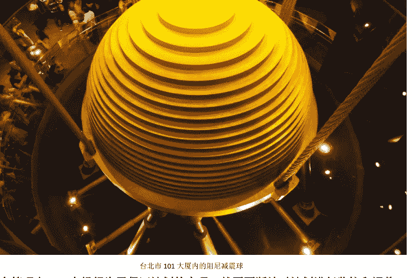

在管理上，一个组织为了保证计划的实现，就要不断地对计划进行监控和调整，以防止偏差继续扩大。

维纳的理论后来被卡尔曼等人进一步发扬光大了，并且在阿波罗登月中发挥了巨大的作用。

说到登月所必需具备的条件，大家首先想到的会是火箭技术。但登月其实是一个巨大的系统工程，除了火箭技术，还需要很多相关的技术，比如如何保证火箭运行不出现偏差，准确到达预先设定的降落地点，就是一件很困难的事情。

阿波罗登月用的土星五号火箭，他的设计师是德国过去的导弹之父冯·布劳恩。

在二战后期，他设计并领导制造了著名的 V-2 导弹。虽然纳粹德国向英国发射了 3000 多枚，但是那些导弹完全没有准头，开始的一点点误差在长距离飞行后被各种因素（比如风力、温度、气压等等）不断叠加放大，落地完全不是预想的了。

到了美苏太空争霸时，加加林乘坐的飞船仅仅围绕地球转了一圈，最后他降落的地点和预测的还差出了上百公里。阿波罗登月火箭的飞行距离远比 V-2 导弹和加加林的飞船飞行的距离长得多，如果按照机械思维的方式继续改进火箭，即便考虑了所有能想到的因素，最终向月球发射的火箭恐怕会与预期落点要偏差出十万八千里。

所幸的是，就在冯·布劳恩等人研究火箭的同时，卡尔曼改进了维纳的控制理论，提出了著名的卡尔曼滤波，可以让火箭随时动态调整方向，这样才保证了它最终准确着陆。对比 V-2 和土星五号，可以看出确定的机械思维和不断调整的控制论思维两种方法论的差异，前者是对未来作一种尽可能确定的预测，后者则是根据变化不断进行调整。

我经常讲，在当今这个时代，我们要轻预测，重反应，其背后的科学原理就是控制论。我们在前面第 7 讲中介绍霍夫曼编码和风险投资时讲的方法，即不断对好的项目加倍投入，其实就是在投资上重反应的表现。

不仅在投资时应如此，在做很多事情时，也需要不断调整策略。我经常讲，创业者要成为变色龙，而不是恐龙，也是这个道理。什么是恐龙呢？它们架子很大，很魁伟，但是适应性差。

今天不少创业者喜欢一开始就给投资人画一个大饼，五年后的发展前景。其实稍微有点经验的投资人都不会看它，因为即便有稳定市场、核心技术、专业团队的上市公司，都很难对一年后的财报作准确预测，更何况一家初创公司呢？

很多成功的企业，它们最终做成的事情和创始人最初的想法相差十万八千里呢，因为环境和市场在不断变化。一个好的创始人需要是变色龙，他能不断应对环境变化作出调整，而不是一开始就把摊子铺得很大。希望这种办事方法对你能有所启发。

## 要点总结

- 1. 我们介绍了控制论的由来和它的应用，以及它的三个本要点，即突破了传统的绝对时间观，利用反馈对系统进行控制，以及利用反馈让系统稳定。
- 2. 我们用阿波罗登月的例子，说明了控制论思维和传统的机械论思维的差异，并且强调了我们今天需要轻预测，重反应，做变色龙。

思考题：能否思考一下坚持原则和调整想法之间的度应该如何把握？ 预告：下一讲，我们来谈谈系统论。我们下一讲再见！

## 40 | 系统论：如何让整体效用大于部分之和？

你好，欢迎来到我的《信息论 40 讲》。

如果说信息论和控制论都有一个明确的主要发明者，那么系统论则是一批学者各自独立研究，共同创建和完善的一项新理论。

不过，一般认为，1948 年奥地利生物学家贝塔朗菲出版的《生命问题》一书，标志着系统论的问世。虽然系统论最初源于对生物系统的研究，但是它适用于各种组织和整个社会。贝塔朗菲和其他系统论的奠基人主要的观点如下。

**首先，一个有生命的系统和非生命的系统是不同的。** 前者是一个开放的系统，需要和外界进行物质、能量或者信息的交换。后者为了其稳定性，需要和外界隔绝，才能保持其独立性，比如一瓶纯净的氧气，盖子一旦打开，就和周围环境中的空气相混合，就不再是纯氧了。

**其次，根据热力学第二定律，一个封闭系统总是朝着熵增加的方向变化的，即从有序变为无序。** 这一点我们在前面已经讲过了，无论对一个热力学系统，还是一个信息系统，或者一个组织机构都是如此。

特别需要强调的是，对于一个复杂的系统，比如我们的生命体，或者一个公司、一个组织，一旦它成为一个封闭系统，一定是越来越糟糕。相反，对于一个开放的系统，因为可以和周围进行物质、能量和信息交换，有可能引入所谓的“负熵”，这样就会让这个系统变得更有序。

最初薛定谔等人用负熵的概念来说明为什么生物能够进化（越来越有序），后来，管理学家们借用这个概念来说明一个公司或组织在外界环境的影响下，可以变得更好。中国的谚语“他山之石，可以攻玉”就是这个道理。

**最后，贝塔朗菲认为，对于一个有生命的系统，其功能并不等于每一个局部功能的总和，或者说将每一个局部研究清楚了，不等于整个系统研究清楚了。** 比如熟知人体每一个细胞的功能，并不等于研究清楚了整个人体功能。相反，多出了一个部分，整体的功能未必会增强，而少掉一部分，相应的功能未必会失去。

我们今天很多人喜欢大量吃补品，比如各种维生素，事实上，当我们的身体获取了所需要的维生素后，多余的全部代谢排出现外了。很多人迷信吃碱性食品能够中和体内过多的乳酸，但事实上人体会自动平衡酸碱性，而不会因摄入了所谓碱性食品就降低酸性。

类似的，一些胆固醇高的人以为只要吃不含胆固醇的素菜就能降低胆固醇。虽然少摄入胆固醇对降低指标有好处，但是即使不摄入胆固醇，人体也会自己产生，也就是说健康饮食其实是一项系统工程。

系统论的思想对我们有什么启示呢？这里我不妨分享一下我的体会。

## 首先要想办法做到整体大于部分之和。

我们知道，在机械思维中的“整体总是能够分解成局部，局部可以再合成为整体”。这种思维方式有着它的道理，只有相信这一点，才有可能将复杂的系统分解之后，一部分一部分分解，也才有可能通过完成每一个局部的构建，搭建起一个大系统。这一点并没有错。

我们知道在冷兵器时代，一支 20000 人的军队通常战斗力就是比 10000 人的军队高，一个 300 名工人的工厂就是比一个 100 人的工厂产出要多，因为整体等于部分之和。但是今天，我们需要超越这种想法，因为我们今天面临的系统要复杂很多，局部的改进未必能带来全局的优化。我们不妨看这样一个例子。

假如你被安排设计一款新的手机。如果给你一个比今天手机处理器快十倍的最新处理器，你能够让手机提高十倍的速度吗？答案显然是不能，因为手机在处理器的速度被大幅提高后，内存的速度就可能成为瓶颈，以至于处理器本身的速度发挥不出来，这时整体就小于部分之和了。

接下来我问你，如果给你十倍的内存，从今天的 128G，增加到 1280G。用户用起来的体验是否更好了呢？也未必，因为更多的内存可能意味着耗电量增加，体积增大，而且大家可能三年也无法用完全部的内存，而三年后，这款手机就过时了。

类似的，有的手机厂家为了标新立异，把手机后面的金属壳换成玻璃的，而那块玻璃又没有特别的用途，这不仅极大地增加了加工的难度，还让大部分人觉得设计怪怪的，多做一件事反而影响了原有的功能。但是，当 vivo 能够将后面的玻璃变成另一块屏幕时，这个功能就有用了。

几年前的苹果，每次有新的手机问世时，从来不宣传自己的速度提升了多少，容量有多大，分辨率有多高，而是强调自己的手机使用起来非常流畅，因为它在设计手机时，综合考虑了各种因素，做到了整体大于部分之和。

售价提高了 50%甚至更多。这便是整体大于部分之和的很好的例子。

几个月前我给一些企业家讲课，强调从 N 走到 N+1 叫做创新，从 N 出发偷工减料，做成 N-1，叫做山寨。有些企业家讲，在中国这样相互抄袭的环境下，做 N+1 的事情在市场上生存不下去。大家都不得不陷入恶性竞争，比如摩拜单车 1 块钱 1 公里，ofo 就 5 毛钱 1 公里，其它颜色的自行车就脆不要钱。

我当时就给他们举了华为的例子，我讲，要有本事通过增加 5% 的成本多赚 50% 的钱，而不是减少 5% 的成本之后，少赚了 1/3 的钱。偷工减料的事情不用学大家都会，如果只懂得这样竞争，就不用到商学院回炉学习了。要有本事像华为那样做到我说的整体大于部分之和，才能在竞争中逐渐胜出。

我的第二点体会是，当上帝关上一扇门时，他可能同时给你打开了另一扇窗。这句话是美国盲人女作家海伦·凯勒说的。什么意思呢？在一个有机的系统中，很多功能是可以相互替代的，因此不会因为某个缺损，而使得整个系统瘫痪。

我的一位担任某三甲医院院长的同学讲，人到了 50 岁之后，多多少会有点血管堵塞，但是如果是非常轻微的情况，不用太担心，因为人体会自动调节自身，适应这种情况，整体的功能不会有影响。也就是说虽然门关上了，但是窗户打开了。

在过去的半年里，总有人问我对中美贸易战的看法。我的观点是，即使某一扇门关上了，但是由于贸易本身是有利可图的事情，它会用另一种方式开展。其实在美国开始对中国的部分商品征税之后，中国对美国的出口并没有减少。

因此，作为大的经济体，无论是美国还是中国，都不会因为局部的变化就完全改变它们固有的发展轨迹。

对人也是如此。很多人会一直对当年高考少了一两分，没有进入一个更好的大学而耿耿于怀。其实，对绝大部分人来讲，进入 A 大学还是 B 大学长期的影响没有那么大。同样，很多人会因为自己一次好运沾沾自喜，但是勉强进入了一所好学校，随后学得非常吃力，自信心备受打击，最后那次好运气真的是祝福还是诅咒还很难说呢。

- 1. 整体。任何局部的改进，都需要放回到整体中去考察。
- 2. 综合。iPhone 是一个很好的例子。
- 3. 科学。在分析问题时必须要遵循科学方法，而不是简单的经验，因为只有这样才能获得可重复的成功。20 多年前，公牛队称霸 NBA，靠的是乔丹等人的天赋，那是不可重复的。今天勇士队的成功，靠的是科学训练，特别是找到了投三分球这个秘诀，以至于整个联盟的比赛都成了三分球的比拼。这说明它的成功是可以重复的。
- 4. 发展。系统工程不仅要在空间上，作整体考虑，还需要在时间上考虑一件事情的影响力，然后决定做不做。

思考题：如果我们需要同时做几件事情，如何保证它们的结果是整体效果大于部分之和？

吴军

我们的《信息论 40 讲》到此就结束了。谢谢你听完了这门并不简单的课程。我知道大家关心接下来我有什么写作或者开课的打算。经过和得到团队的协商与合作，我将有一本新书出版，随后我会开设一系列的通识教育课程，把一个人一生应该知道的那些科学与学问，用通俗的讲法讲给你。内容上会比信息论轻松很多。

还是和之前一样，我们重在讲述方法，以及学科之间的关系，而不在乎讲述具体的知识点。希望大家继续关注得到。谢谢大家。

最后“信息应用”模块精选留言的 20 位同学名单：

Bachmozani Tchaikofievendelsso、Ed. 旋、完美坚持、顾显晓、罗杰.费德勒、冯晃、佛祖门徒、卢海林、金勇-StePt、HansKeng、金戈铁马、王黎骁、刘长青、古小千、... And Oce ans、Apprentice-胡钦元、岳山、Stone、Vincere_肖洒哲、陈C。

你们每人将得到 100 得到的贝奖学金充值。

## 直播回顾｜吴军：5G 只是比 4G 多 “1G”？

## 吴军

7 月 5 日晚间，我在得到直播间，进行了一场有关 5G 话题的精彩演讲。如果你错过了直播，以下的图文实录，供你复习回顾。

可能听过我一些课的人知道，我讲东西其实讲技术本身，不是最终目的，这只是一个手段，或者说这是我建造通向这个目的的一个桥梁。目的是我讲讲一个它的底层逻辑，这样你学到以后，可以自己来分析一些技术，对当下的一些观点有自己的看法，很容易判断哪个是对的，哪个是不对的，哪个是投资的机会，或者说你自己的创业机会，哪个是一个永远实现不了的情怀。

所以我们一直在讲一些底层逻辑，这也是我想大家来得到大学很重要的一个原因。因为很多基本的知识你在大学已经学了，你在这儿是希望认知能够得到一个提高。讲 5G 这个东西，其实我一直和 IoT 连着讲，因为这两件事分不开。

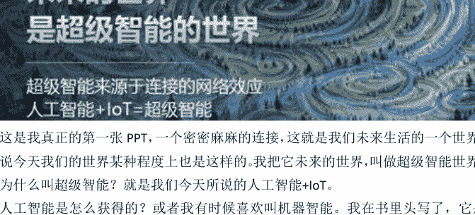

这是我真正的第一张 PPT，一个密密麻麻的连接，这就是我们未来生活的一个世界，或者说今天我们的世界某种程度上也是这样的。我把它未来的世界，叫做超级智能世界。

为什么叫超级智能？就是我们今天所说的人工智能+IoT。

人工智能是怎么获得的？或者我有时候喜欢叫机器智能。我在书里头写了，它是大数据+摩尔定律+数学模型。和人的智能有什么差别？很重要一个特别大的差别在于，人工智能是一个网络的智能，而我们人的智能是个体的智能。

世界上有一些生物是有网络智能的，比如说蚂蚁，每个单独的智能很弱，但是组合在一起就很强。人工智能具有这个特点。

未来我们的世界就是这样密密麻麻的，然后这个网络是越来越复杂的。IoT 设备种类很多，除了我们刚才说的摄像头以外，你人家也会有很多 IoT 设备。我估计在座的很多人家里买的类似于小米的 IoT 设备，超过了 20 个。超过 20 个的举个手，还是有不少的。

所以，再加上你的可穿戴式设备，我在讲座里也讲了，当我们能跟踪人的新陈代谢的时候，你自己就是 IoT 里的一个节点，还不算你的计算机、手机都是，所以未来的社会会密密麻麻这么满。

所以我有时讲，IoT 是第三代的互联网，是一种特殊的互联网。

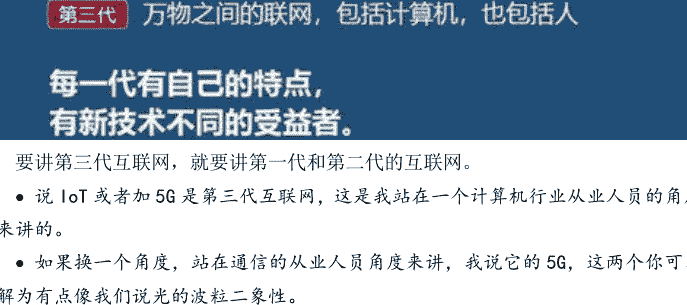

要讲第三代互联网，就要讲第一代和第二代的互联网。

- 说 IoT 或者加 5G 是第三代互联网，这是我站在一个计算机行业从业人员的角度上来讲的。
- 如果换一个角度，站在通信的从业人员角度来讲，我说它的 5G，这两个你可以理解为有点像我们说光的波粒二象性。
- 你站在哪个方面，比如说站在小米的角度来讲，他可能会说 IoT，你站在华为的角度，他会说 5G。

要讲第三代互联网，先说第一代互联网。第一代互联网是什么互联网呢？是计算机和计算机的互联网。它其实起源于最早的四台服务器，这四台服务器就分布在美国加州的三所大学，以及犹他州的一所大学。它们传输的速度非常慢，第一个命令发出的时候是五个字母的指令，大概敲了三个字母以后，这个网络就断了，然后又花了两个小时才修好。这是 1969 年的事。

距今年 50 年，说长不长，对一个人来讲是挺长的时间，但对我们科技发展来讲，是个很短的时间。

今天我们知道，互联网很发达，每一代互联网都有它的特点，所以这是我今天想讲的，不是跟你讲 5G 怎么回事，讲完就完了。我要让你们学会对比，然后就知道未来

是怎么做判断，每一代必然有它的特点。

## 第一代互联网：WinTel


第一代是机器和机器联网，然后在这个产业中，它有龙头企业，我们叫龙头老大。第一代互联网是谁？Windows+英特尔，就是微软+英特尔。为什么呢？因为你可以用联想的计算机上网，你也可以用戴尔的上网，你可以用惠普的上网，Windows 是绕不开的。

第一代互联网到了第二代互联网，是人和人联网，不是简单地用你的移动终端取代了固定线路的这样一个 PC 机，而是人和人的联网。在 PC 机时代，如果你下班离开了计算机，你就离开了互联网，坐地铁或者打车回家，你就不在互联网上。

但是在第二代互联网的时候你随时在互联网上，你的老板随时用微信找你。比如你找我，说吴老师咱们加一下微信。你不是想连我的手机，你是想连我这个人，希望把我 24 小时拉到你自己的网络中。所以这是本质，手机和计算机不是本质，人和机器是本质。

这带来一个什么结果呢？因为我们随时要联网，所以它不是那根线在联网，而是空中的频率在联网。所以，这时 1G、2G 的移动通信网络不够用了，3G、4G 就起来了，这个逻辑关系要清楚。

谁谁控制了第二代互联网？有很多家企业都很发达，都很受益，待会儿我会讲。但是真正起决定作用的主要有两家，一个是谷歌的安卓，一个是 arm 的处理器，跟第一代格局完全一样。

## 第二代互联网：安卓 + ARM


你今天用一个英特尔的处理器，你的手机可能两小时就没电了。英特尔不是没有想过做一个针对移动设备的处理器，但它做失败了，因为它原来的复杂指令集架构，不适合我们这种低能耗的这样一个设备。

所以从这里头你可以看得到，当下其实在过去的几十年里都是这样，就是科技发展的一个很本质的规律，就是什么呢？要用更少的能量处理传输和存储更多的信息。

我在《科技史纲 60 讲》里给了一个例子，你如果用 1946 年的技术，做一个 AlphaGo，那么相当一个三峡的技术。

这里阐释了两个道理，一个就是能量和信息的关系；第二个，实际上不仅仅是这件事情，很多事情都是新一代起来的时候，我们需要新的公司，当平台稳定发展起来的时候，你拿巨无霸企业是毫无办法的。只有当时代变化的时候，你可以很顺利地就赢了它。这不是什么弯道超车的问题，你不需要弯道超车，因为它自然就落了。

所以这是第二代互联网，第一代、第二代讲完了，就是为了讲第三代互联网 IoT。

每一代互联网的发展不是一个简单的重复，而是市场扩大。我在《见识》这本书里讲，商业的本质是让大家花越来越多的钱，不是替大家省钱。市场越做越小就没有意义了，要把市场越做越大。

在第一代互联网，PC 互联网的时候，最高出货量在 2011 年，每天一百万台计算机的出货量。一年有 3.65 亿台到头了，然后就一直往下走。

而在手机的互联网时代，这个出货量是多少呢？到现在，每年超过十个亿，还在往上走。当然有人说这两年可能会开始饱和，我估计如果 5G 起来，它又不饱和了。不管怎么说，就算一年十个亿，也是那个的三倍，就是从数量级来讲，大了半个数量级。

设备的保有量，以后计算新买了旧的扔了，有多少设备在网上？从大概 10 个亿到 30 多个亿，虽然说有 50 亿个手机，但是有些手机是不用的。

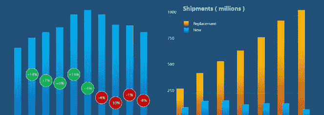

所以这个体量也大了半个数量级，更关键的是什么呢？一开始虽然你感觉手机很便宜，今天一部稍微好点的手机，苹果华为还是苹果，比电脑一点也不便宜。说明什么呢？他想尽办法让你花越来越多的钱，这是一个从第一代互联网到第二代互联网，是一个做得非常好的商业。

我们有些商业是越做越没钱，那不是一个好商业，所以这是一个。

好了，体量也大了，所以从这个往下推讲第三代互联网 IoT 的时候，你可能会得到一个结论。

- 首先，会有一批新的企业诞生，尤其是龙头企业。
- 第二，体量会很大。

体量有多大呢？最保守估计，大概要一个数量级，就是说各种 IoT 设备，包括智能摄像头，它们有可能比我们现在的手机要贵，有的可便宜，有些小家电可能便宜。将来智能汽车是一个大的 IoT 设备，这比手机贵，一个智能摄像头也比你的手机贵。

## 第三代互联网：万物互联

- 500 亿（2020 年） - 1 万亿（2030 年） IOT 设备
- 70000 亿元的市场（2030）
- 2016 互联网 3800 亿、电信 3.5 万亿

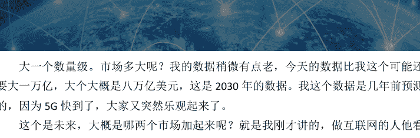

大一个数量级。市场多大呢？我的数据稍微有点老，今天的数据比我这个可能还要大一万亿，大概是八万亿美元，这是 2030 年的数据。我这个数据是几年前预测的，因为 5G 快到了，大家又突然乐观起来了。

这个是未来，大概是哪两个市场加起来呢？就是我刚才讲的，做互联网的人他看的世界和做通信的人看的世界，也就是说互联网市场+通信市场，5G 的时候它会融合。

从现在加起来四万多亿，到最最保守的八万亿，最最保守估计增加 3.5 万亿这样一个市场的规模。

3.5 万亿是什么概念？差不多德国的 GDP，如果涨得更高一点，大概 4.5 万亿，就是今天日本的 GDP。

这是不得了的，你可以想象，如果过一段时间，说如果中国能够真正在 5G 上在世界这个蛋糕里划一大块，你相当于把日本的 GDP 和中国 GDP 整合起来了，这是很不得了一件事，否则说让中国的经济涨出一个日本的 GDP，这是不容易的事，也是非常大的一机会。

事实上从第一代互联网到第二代互联网，可以看到通信的市场其实是很大的。这里要跟大家讲一句不算外话，如果你们创业，怎么去找市场，找规模？

我给大家 2016 年的数据，因为这是各方面证实的。2018 年也有数据，可能还有待一些证实。就是说整个互联网企业，2016 年它创造的产值是 4500 亿美元，不算小。

但是你要知道，其中谷歌一家占了三分之一，腾讯、阿里巴巴、facebook 和亚马逊四家，也占得非常多。再加上稍微少一点的，eBay 和百度、今日头条其实现在也不错，也上百亿人民币了。

大概世界上一七八家企业加起来，占到大概 80%。四千多亿除去这 80%，就剩大概一千亿了。全世界大大小小的互联网公司，你们知道吗，有上百万家，去争那一千亿，每家平均十万美元，就是养一个工程师的钱。

这也就是为什么这些互联网都亏诸不挣钱，创业这么艰难，因为你完全走错了市场，不是说你们，而是说那些创业者，完全占错了市场。

有些时候，你们看媒体的东西要动脑子，媒体又那么爱报道互联网，好像互联网很热闹似的。确实很热闹，但是这个市场不算大。

几天前，我跟冯仑做一个节目。冯仑一说这个市场太小了，我们中国一年 20 万亿房地产市场，所以相比较你就知道为什么有的人那么挣钱，有的人那么辛苦但是不挣钱。所以我说男的怕入错行，你是入错行了。

但是从另一点来讲，电信这个市场非常大，2016 年 3.5 万亿，包括两个，一个是设备制造商，一个是运营商。运营商你基本上去不去，不可能说移动再办一个张三移动，没人理你，但是你可能可以做他的生意。设备商是进得去的。

过去四五年里，中国真正的 IT 企业办得比较好、比较成功的都跟这件事有关。比如我们说华为，比如我们说小米，包括段永平的 VIVO 和 OPPO，其实他们都是闷着头挣钱，为什么？因为他们占到了一个大的市场，不是一个小的市场。

但是这两个市场有一个特点，这个特点是什么呢？计算机互联网这个市场，它规模小到发展比较有动力，比较快。电信这个市场比较保守，比较慢，所以到了未来，IoT 的时代和 5G 时代，我说它会融合。融合以后，就会形成一个相对发展又比较快一点，然后又给了类似于计算机公司一个发展空间的机会。这也就是说，它形成将从现在大概两个加起来四万多亿到八万亿美元这样一个市场的原因。

所以在未来，这还是可以期盼的。

## 问题来了：

## 这么多设备怎么上网？

今天现有的解决方案很滑稽

- WIFI 加蓝牙

### 4G 的问题

- 基站能传输的总流量有限
- 能否并发处理的数量有限

刚才讲了 IoT 有这么大的市场范围，你凭什么要 5G，4G 为什么不行？

4G 这里头有两个根本原因，我们今天讲的基本上都是底层逻辑。第一个原因，我们就要来讲讲现有的解决方案，其实它显得有点滑稽。

你就想这么一件事情，你今天是怎么用 IoT 设备的？基本要通过两个，一个是蓝牙跟你的手机相连，比如说可穿戴式设备，就是这样子。你戴一个可穿戴式设备，可以接电话，但是你的手机落在家里了，你的可穿戴设备就接不了电话了。

或者你在家的时候要用 Wifi，这相当于一个什么场景呢？就相当于当我们发明了移动通信无线电话的时候，你在外面打不了。你要回家，回到你的座机旁边，通过一个蓝牙跟你的座机一连，你的手机就能打电话了。

是这样的情况吧？你难道不觉得这样很滑稽吗？但是今天你有没有想我们的 IoT 上网就是这个方式，我们说它是第三代互联，但它实际上要通过第一代互联网和第二代互联网才能上网。

但是我们知道，我们最终形成的移动通信的网络是一个单独的网络，而并不寄生于我们的电话网络。所以，未来的 5G 也需要是这样的，就是说我们直接的一个通信。

比如说我们的车联网，我们想知道这个交通情况，你如果能知道周边汽车的行车意图的话，各方面证明基本能缩小 20% 到 30% 的时间。

比如说他们在美国做了一些实验，上班下班的时间从 70 分钟缩短到 50 分钟。在济南，济南是中国最拥堵的市场，大概滴滴做实验也差不多能缩短三分之一的时间。

在一些交通不太拥堵的地方，像苏州工业园他们做过实验，主干道我忘了叫什么大道了，反正就是那附近的大道，通过这种方式来控制交通灯，能节约 20% 的时间。

总归就是说车和车直接联网会比你把信息都上传到高德或者百度再告诉你会好，因为都上传再告诉你会有一个很大的延迟。

这时候，我们就需要每一个 IoT 设备直接上网。直接上网就遇到一个什么问题呢？带宽不够，总的带宽不够，以及我们的基站处理不了这么多并发的上网请求。

去年底，中国每年要开一次中国计算机大会，参会的人很多，我作了一个大会报告。我一看下面大得很不得了，他们告诉我有三千人，楼底下还有三千人在看大屏幕，会场加上参展的一共上万人。

大家有一个抱怨，无论你用 4G 还是 Wifi，都发不了微信的东西，因为人太多。

### 怎样增加传输率？

香农第二定律

- 传输率不可能超过信息通道的容量（带宽）

怎样扩展空中的带宽

- 往上增加频率

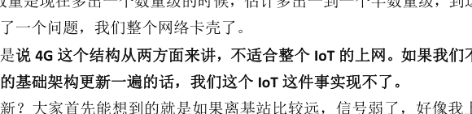

我最近开的《吴军·信息论 40 讲》课里讲了一件事情，就是说当你要传输的信息量超过带宽的时候，出错率百分之百，什么信息都传不出去。

当如果未来在第三代互联网 IoT 的时候，它移动设备的数量或者说有的是固定的，IoT 设备的数量是现在多出一个数量级的时候，估计多出一到一个半数量级，到这个时候，就带来了问题，我们整个网络卡壳了。

这也就是说 4G 这个结构从两方面来讲，不适合整个 IoT 的上网。如果我们不把网络这个底层的基礎架构更新一遍的话，我们这个 IoT 这件事情实现不了。

怎么更新？大家首先能想到的就是如果离基站比较远，信号弱了，好像网上就不好了。你能不能把信号加强，功率加大，这是一个可以做的事情。

再有一个，怎么办呢？我们在《吴军·信息论 40 讲》的课程里讲了，你如果听了那门课的话很容易懂。我们讲空间通信有一个带宽，带宽实际取决于你通信的频率的一个范围。范围往下是没有什么油水可挖的，因为最低低到零，不可能再低了，而且中间收音机、电视机用掉了很多，你只能往上走。

实际上 4G 的网络大概就是这样一个形状，就是一个带宽都比较窄。5G 是每一个带宽都特别宽。

你能不能用 4G 的基站或者增加功率把带宽往上走？这件事做不到。第一个，如果你把功率增加，你想把传输的范围比如半径增加十倍的话，功率要增加一百倍，首先它是平方关系。

现在如果在小区加一个 4G 的基站，小区都会反对，甭管怎么解释、有道理没道理都会反对，来一个一百倍功率的基站，你们小区的人就不干了。

如果你戴一个手镯碰到发射塔下，goodbye？你手就会烧焦，所以简单增加功率不是个办法，频率简单增加也不是个办法。

### 频率太高的问题

- 很难绕过障碍物（极端情况可见光），障碍物的反射不能不考虑
- 4G 的标准并没有考虑这些问题
- 解决办法，把基站建设得太密集

为什么？无线电波频率一开始比较低的时候，就像我们说话的时候，可以绕过这个障碍物。你在外面，虽然这个门虚掩着，但是你在外面也听得见。频率比较高的时候，障碍物就把它挡住了。

比如说可见光频率比较高，你拿一束光照在我手上，我就把它挡住了。这是很荒唐的。所以今天 5G 的信号基本上要到毫米波、毫波，那就是波长很短的，遇到一个大楼就弹回来了。

所以 4G 的时候是没有考虑这种情况的，所以今天 5G 协议很复杂，遇到大楼怎么反射，一个是直接的信号传到你的手机，一个是反射一次传到你的手机，怎么叠加，5G 从技术来讲，细节不讲了，这些考虑是很周到的。

更关键的是，如果我们把基站建得足够密集，4G 的基站今天基本上是每 2—3 公里一个。在深圳像华润附近，会建得比较密，一公里就得建一个。

5G 现在一般标准是 200 米—300 米一个。那么这样就带来好几个好处，第一个，毕竟离得近了，信号就好了，就传得快了。你在家很有经验，假设你的 Wifi 在卧室，你跑到厨房信号就差一点，回到卧室就好了。

再一个，假设两个基站的距离原来 4G 是两公里，现在变成一公里，你拿一公里作为一个半径画一个大圆，原来这个大圆里的人都要共享一个基站去通信。但是，这

里头假设我有一万人，就是一万人共享，每个人能分到的蛋糕就很少。

现在我半径一百米画一个小圆，这里头就小部分人通信，分到的蛋糕就多。你这个面积和半径平方是成正比的，原来是一万万人分享这个基站，现在是一百个人，当然也不光是一百个人，你们家还有一大堆 IoT 设备。像有的同学家里一两个人，你有 10—20 个 IoT 设备，再加上汽车，再加上别的。

IoT 到那个时代以后，我刚才还讲的仅仅是有源的 IoT，还没讲无源的，比如说超市一瓶水扫一下就购买了，它也是 IoT。当然这些东西也都需要通信。如果把这些 IoT 也算成一个 IoT 设备，全世界估计至少上万亿个，因为一瓶水就是一个，一本书就是一个。

所以这是我们为什么要提出一个全新的方案来解决未来 IoT 通信的这样一个问题。所以，听到这里，你可能就明白一开始的答案了，它远不是原来说的 4G+1G。4G 和 3G 其实差别不是很大，4G 几乎听说世界上没有建什么新的基站，用的还是 3G 的基站。

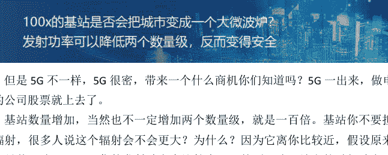

但是 5G 不一样，5G 很密，带来一个什么商机你们知道吗？5G 一出来，做电线杆子的公司股票就上去了。

基站数量增加，当然也不一定增加两个数量级，就是一百倍。基站你不要担心它的辐射，很多人说这个辐射会不会更大？为什么？因为它离你比较近，假设原来我们说信号传一公里远，那你的发射功率会比较大，虽然到一公里地地方的时候功率已经不算太大了。现在我只要传一百米远，发射功率不需耍那么大，从理论上来讲，只需要原来的 1%。

所以，这时候就在你们家小区放个基站你是不会反对的，就跟现在在你家装个 Wifi，你不会反对一样。

所以，从这个角度来讲，你不用去担心 5G 的传输。

那好好了，具体到我们每一个基站，你现在看，我们用了几乎 1% 的功率，我们传了将近一百倍的信息。

这就是一个大的科技进步，我们用更少的能量，传递更多的信息。所以为什么说从 4G 到 5G 一定是一个发展方向，这是整个大趋势，一定是这么往前走的，这一点毫无问题。

### IoT 和 5G

同一件事的两个侧面

互联网和电信网络将融合

如果 5G 仅仅到此为止，那它仅仅是电信行业的一次革命。我刚才讲了，其实它有更深层的一个对我们社会的影响。刚才我也说了，有可能带来我们计算机的互联网，以及电信网络的一个融合。

接下来花费时间给大家讲讲为什么融合这件事会发生？我第一半的内容主要是讲了单位能量传递信息这么一条线索，具体的内容你可以可不记，但这条线索你一定要记住。

第二个我想要传达的意思是融合这件事是未来一个大方向。我们就大致简单地回顾一下，从 1G 到 5G，电信行业都发生了什么变化。

### 移动通信简史：1G - 4G

- 1G: 摩托罗拉，模拟电路，大哥大
- 2G: 诺基亚，GMS，数字电路，翻盖手机
  - 能量效率提高100x
- 3G: 高通，CDMA，移动互联网，网速提高~10x
  - 问题：没有完全利用电信网络和互联网
- 4G: LTE，网速进一步提高，和互联网开始融合，使用了云计算等技术
  - 通信的环节减少
- 5G: 移动通信和互联网的高度融合

1G 当时还不叫 1G，因为还没有 2G 的时候就没有 1G。移动通信这个网络最早是谁搞起来的？摩托罗拉。在 1968 年的 CES 消费电子展（以前在世界各地开，今天在拉斯维加斯开）上，摩托罗拉展示了一个九公斤重的超级大哥大。

三公斤，还是很重，能够打电话。

之后，就开始进行商业运营了。开始进行商业运营以后，AT&T 就笑话摩托罗拉个大，觉得这个大猪蹄子有什么用，觉得卖不出两百台。摩托罗拉也不信这个邪，所以就架设了自己的通信系统。

大家注意一条，基站跟你手机之间是用无线通信的，但是基站之间是有线连着的，不是说基站和基站之间也用无线，那就就比较糙了，空中很宝贵资源不能用这个。这套系统和 AT&T 没有关系，AT&T 有自己的网络，摩托罗拉又建了一个网络。我可以打进你的手机，但是两套网络，他们有时候在交换机上是可以连上的。

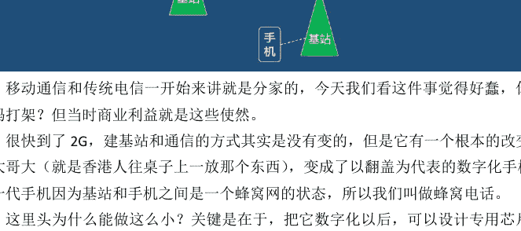

移动通信和传统电信一开始来讲就是分家的，今天我们看这件事情觉得好蠢，你们干吗打架？但当时商业利益就是这些使然。

很快到了 2G，建基站和通信的方式其实是没有变的，但是它有一个根本的改变，从大哥大（就是香港人往桌子上 一放那个东西），变成了以翻盖为代表的数字化手机。第一代手机因为基站和手机之间是一个蜂窝网的状态，所以我们叫做蜂窝电话。

这里头为什么能做这么小？关键在于，把它数字化以后，可以设计专用芯片，来进行数字化处理。一个芯片代替了原来差不多一百个芯片，那么就使得单位能量处理信息的能力增加了近百倍，所以我就能做得够小，持机时间很长。翻盖手机持机时间最长，能达到一个星期，摩托罗拉大哥大只能持机四小时。

第二代除了通信语音，还能发短信，但是也仅仅能发短信，因为它单位能量通信能力还不够。所以就出现了第三代标准，就是 CDMA 的标准。

CDMA 的标准，你能够上网了，浏览网页，刚开始出智能手机的时候，包括苹果手机浏览网页，干别的其实挺慢的。

然后大家觉得不够，就建了第四代，就是今天的 LTE 这些，到第四代的时候，我们看视频就已经非常流畅了。

但是，第三代和第四代之间其实没建什么基站的，建基站只是为了提高覆盖率，但从技术上来讲并不需要。

从第三代到第四代，还有一个让你感觉荒唐的地方，我们说固定电话和移动电话的分离，到第三代固定电话和移动电话，你可以认为是和合二为一了，基本上主干网合二为一了，而且移动互联网智能手机起来的时候，很多人家里没有固定电话了。以前家里两个电话，一个固定电话、一个手机，留言都是留两个。

到第四代就开始了计算机网络和通信网络融合的尝试，第四代互联网之所以速度快，有各种原因，通信协议变了，还有一个过去的节点变短了。原来物理的打手机不是说你到了基站，基站到了就完了，基站还要到中枢，中枢还要到原来一个更大的中枢，然后再一级级传到你的手机。这是过去的做法。

今天这个逻辑还在，但是常常放在一个云计算的中心里头，这个实际上传输的效率就提高了，不用中转这么多，所以第四代开始用到了计算机网络。

但是，到今天为止，还是两个不同的网络。你在外面发微信，发照片，你用手机，用 4G，回家以后你赶紧用 WiFi 连上网，为什么呢？要不然你就要交钱。

这个你可以认为是波粒二象性，看上去像粒子，另外一拨人看着像光波，一拨人强调流量收费，一拨人强调网络中性化，甭管我用网是多好，你最好一个月收一次就完了。

到 5G 的时候，当基站的密度有点像我们家庭的 Wifi 这么密集的时候，其实除了你在公司可能要处理大数据传输很多，又是视频网站，还要光纤接入，否则的话，一般在家里面讲，你其实可能不再需要装 Wifi 了，就像今天家里已经不再需要装固定电话了。

今天有多少人家里装固定电话，可能呢会觉得很好笑，以后你们可能也会觉得很可笑，你们家还拉根线干什么？

融合这件事这是未来的大趋势，任何与融合有关的事，这个路子就走对了。任何自己再单独搞一套，就有问题。所以这是一个未来发展的趋势。

这是画的 3G 时代，真正的你的通信物理上来讲是这么走的，实际上并不是说手机到基站，基站到手机这么简单。绕来绕去，最后上到核心网，然后再回来，所以它很复杂。

4G 的时候，中间这一大堆都放到一个云计算中心就完了，所以逻辑上就简单了。

这是我对整个从 1G 到 5G 的一个总结，有一个共同的特点，基站之间永远是连线的，基站之间不是无线通信，这点很重要。网络是不断融合的，频率越来越高，单位

能耗传输的信息越多，或者说你传输单位信息能耗越来越低，这是一个。

## 1G - 5G 的特点和趋势

+   基站之间是有线连接
• 带宽高
网络不断融合
• 另搞一套是逆势而行
频率越来越高
• 单位能耗传输率提升

我们刚才讲了，交给大家一条主线，理解能量和信息的关系。我还专门讲了英特尔处理器和 arm 的关系。

还要补充一个，接下来就要讲一下，大家想这么一个问题，到 5G 的时候，或者说 IoT 这个年代，我们现在的 arm 这一套设计方法，就是做处理器、做芯片的这套方法，是否适合绝大多数的将来 IoT 设备？

不适合，为什么？因为能耗还是高。你觉得还可以了，你要知道，如果你每一个 IoT 设备在墙上挂着，你都要连根电线的话，这事很麻烦。因为全世界有 500 亿个，而且它是高度移动的，我们的网络都是移动的，你希望这个设备不要那么死板。

你要老给它换电池的话，很麻烦，全世界 70 亿人，有 500 亿个设备挂在那，三天两头换电池很麻烦。我家里有六七个摄像头，用的就是现在这种智能的，utility电的。那个摄像头像一半的重量都在电池上，每过一两个星期就会有其中一个摄像头给我报一下警，意思是没电了，然后我就得拿去充电。

一开始不觉得怎样，可每过一两星期烦我一次，还是觉得挺烦的。

华为他们做过一个测算，如果这么设计做出来的一颗芯片，差不多一个智能水表装一节电池，能用十年。所以这很可观。

说明什么呢？说明在未来，我们从英特尔到 arm，可能将有一个大商机会出现一个超级半导体公司来生产 IoT 芯片。

当然了，未来的 IoT 设备需要很多很多的芯片，所以这是一个机会，站在一个时代的制高点上。

再有一个什么机会？从 1G 到 2G 什么东西变了？操作系统变了，到今天还没有看出谁来控制操作系统。其实设备制造商也在改变，第一代是谁？戴尔、惠普、宏基、联想。第二代他们也看到机会了，联想和戴尔试过，惠普做过，联想是唯一第一代 PC 机制造商还在那么苦苦坚持的。它是坚持得不好，不是说它不想做好。因为为什么？因为它的基因不合适。他们想象的还是生产 PC 机的这个基因。

第二代的设备制造商是谁？受益的是华为，是小米，三星也是第二代的时候受益，第一代时候没听说三星的电脑怎么怎么好。还有段平行的 OPPO 这些公司。

唯一的例外是苹果，苹果是从产业链上下游自己吃一个企业，但是它也有一个问题。它遇到问题的时候，没有一家能帮它，甚至没有人愿意帮它，因为他们都希望它死掉。剩下自己的产业链形成一个依赖，互相抱团取暖。

所以苹果在第一代操作系统输给了微软。到了第三代互联网的时候，IoT 的时候，我们很有理由相信我们会出现一些非常大的，像小米你还不觉得它是巨无霸，就是这个量级的 IoT 设备制造商。我们现在还不知道它是谁，在座的各位将来就有可能成为下一个雷军。

所以这是我们整个分析了从能量到信息这个关系，以及基因来分析到底 5G、IoT 能给我们带来什么样的一个商机。

好了，接下来考大家一个问题，现在有一个很热门的话题，你就用我们刚才讲的内容做一个分析。说马斯克要发射一万颗卫星上去，做一个超级的铱星计划。大家说好有情怀，你觉得这靠谱吗？用处大吗？

## 新的铱星计划靠谱吗？

+   - 中国有多少基站：~500万
- 基站之间通信的带宽比空中带宽高得多
- 基站/设备无线通信 + 基站/基站有线通信，单位能量传输效率最高
- GPS的传输率50bps

没用，为什么没用？逆着潮流，你看我们的同学果然都是非常有悟性，学得很快。

刚才我讲了，你传输的功率随着距离的增加，是成平方地在衰减。最低轨道的卫星也要有一两百公里，我们刚才讲的，说两三公里都嫌它距离高，每一个卫星能够传输的信息带宽是非常有限的。

再加上你在卫星上，你这个基站可以是 380 伏或者 220 伏的电在那供着，卫星上就那点太阳能电量，供不了多少电。太阳能连一辆汽车都驱动不了，卫星上更供不了多少电。所以发射功率不够，传输距离更远，或者带宽更窄。

一个基站传输信息的总量比一个卫星不知道要多多少。大家知道中国有多少基站？我这上面写了，500 万个，超出你们的想象吧。这是到去年 12 月份的数字，你发射一万个卫星，管什么用？一点都不管用，就相当于说我有 500 万块钱，你再给我一块钱，而且这一块钱还是韩元。

当然了，它在塔克拉玛干沙漠的中央还是管用的，但是也没有多少了不得，和我们接下来讲的 5G 完全不是一个量级的事情。

更关键的是什么呢？网络是融合的，而且从 1G 到 5G，我们基站之间的通信从来是固定的线路连接的。因为这样才能保证传输的光纤里头可以传的量很大，一根光纤不够可以两根，两根不够可以四根，空中的频带就那么点是不够的。

当然有人可能会想这么一个问题，GPS 怎么管用？对啊，你们大家车里都用 GPS，好像一个卫星也能管不少事，这是怎么回事？

你们知道 GPS 的传输率是多少吗？一秒钟 50 比特，或者说一秒钟大概 50 个比特相当于多少？6 个字节。我们一个汉字两个字节，也就是说一秒钟他跟你说一句我爱你，每秒钟 GPS 传输信息就是每秒钟跟你说一次我爱你。当然还不能用语音来说，只能用国际编码来说，这个信息量是低得不得了了。

我们传一路电话是多少，4.8k 比特。我们视频要多少？最慢，你别看高清，大概要几兆、几百万。所以为什么说 GPS 管用，不等于其他 的通信管用。所以我讲全球科技通史和信息论，有些东西你算一算就马上对科技的报道有一个 get 点，你对自己创业管不管用马上就会有一个基本的判断了。

刚才讲了，有各种各样的机会，设备制造商。还有一类特别大的机会，你说我办一个小米也挺辛苦的，就是这个服务的提供商。

## 未来谁是受益者

+   处理器
操作系统
设备
- DELL, HP, 联想, 宏基
- 小米, 华为, Vivo/OPPO
- IOT: ? ?
应用开发者
通信标准
- 摩托罗拉、诺基亚、高通、华为

随着我们手机的诞生，出现了一些你们想象不到的服务的提供商。比如说今日头条，比如说美图秀秀，比如说抖音、快手这种东西。IoT 出来以后也一样，四五百亿的市场是需要这种服务来往里填的。任何一个适应于这种市场的一些事情，这都是一个比较好的。

为什么到手机的时候会出现抖音？在 PC 互联网络的时候会出现 Youtube，PC 互联网络是连上电源的，网速是有限的，也可以比较有保障，Youtube 上传十分钟就是十分钟，鸟叔在那跳半小时就跳半小时。

你在手机互联网上传半小时就不符合我们能耗的原则，所以抖音这玩意 15 秒钟就比较管用。

还有一个，从 1G 到 5G，又回到通信这个层面。通信这个层面，谁是一个真正比较大的受益者？1G 的时候刚刚讲了是摩托罗拉，2G 是诺基亚，美国的时候一个国家他们不团结互相打架，一个国家提出了三个标准，欧洲就一个，3G、4G  basically 是高通，4G 的时候华为已经占了很多专利了，3G 的时候中国是普遍向美国企业交专利费，向高通交专利费。比如说 WCDMA 是完全给他交，中国人自己搞了一个 TD，不大管用，所以使得中国移动有一阵子很吃亏。

到 4G 的时候，因为华为、中兴这些中国企业专利数量比较多，所以 4G 的时候，基本上中国就不交专利费了，咱俩扯平了。4G 的时候，中国发展很快，中国迅速离开 3G 进 4G 是有原因的。

到 5G 的时候，倒过来了，华为开始收到专利费了。所以，每一次的变革，在通信上谁掌握了标准，谁就是大头。

在计算机上，谁掌握了操作系统，谁就是大头。所以，整个产业是这样一个关系。

## 每一代都有新的王者

+   - 能量和信息
- 基因决定
- 未来最伟大的公司还没有诞生

最后总总结一下，每一代都有自己的核心技术，核心的公司都有自己的特点。这是第一个。

第二个，不管怎么变，从信息和能量的角度来讲，更少的能量能够传输和处理更多的信息。这永远是技术发展的一个方向，也是我们无论工作也好、创业也好，要秉承的一个原则。

从每一代开始，由于基因的作用，所以都会诞生新公司。未来，我刚给大家描绘了一个光辉的前景，有一个四万亿的市场在等着大家。所以，在未来来讲，可能会诞生一家伟大的公司，也许是人类历史上最伟大的公司，而这家公司现在还不存在。因此在座的每一个人，你们都还有机会。

好，谢谢大家！
