# 吴军科技史纲60讲

## 发刊词 | 历史总在重演，科技永远向前

欢迎来到我的《科技史纲 60 讲》。

在完成了四卷《文明之光》的写作之后，我其实酝酿了很久，来筹备这门科技史。

科技史浩如烟海，在梳理的过程中我获得了两个视角，非常受益，在这里也分享给你：一个是回望；一个是俯瞰。

回望历史，把握历史进化的来龙去脉，可以清晰我们今天所处的位置；

俯瞰历史，把握所有要素之间的联系，可以看清世界变化的规律。

拥有了这两个视角，你就可以更清晰地作出决策，这也是我在写作这门课程时，一直想要帮你达成的目标。现在，我终于完成了这门课，可以邀请你和我一起回望和俯瞰这部跨越几万年，涵盖所有人类文明中心的科技史了。

我们都知道科技史时空跨度极大，但你不用担心，我会给出两条清晰的线索：“能量”和“信息”，帮助你重新梳理整部科技史，你会发现，这个世界的终极答案就是能量和信息。

我们过去说世界是物质的，其实，更准确地讲，世界应该是能量的，因为物质从本质上讲就是由能量构成的。那信息又是什么呢？信息就是组织和调动能量的法则，比如语言、文字、公式、公理等等。科学的本质就是通过一套有效的方法去发现这样一些特殊的信息。

那怎么从能量和信息的视角去解读这段历史呢？

比如说，古代历代王朝的更替，本质上都是土地创造的能量无法满足人口消耗的能量；语言相较于基因，是更高效的信息载体，使人类的进化得到快速发展……你会发现这两条线索，在整个科技史中，都充满了解释力，人类的所有科技进步，一定会毫无意外地落在这两条线索上。

有了线索还不够，我还会为你从庞杂的科技史中，遴选出 60 个最伟大的科技进步，这 60 个伟大进步，每一个都是科技史上的里程碑，每一个都蕴含着复杂但内在逻辑，值得你拆解研究。透过这 60 个瞬间，你就可以了解整部科技史全貌，找到人类进步所共通的规律，当然我更希望你记住一句话：历史总在重演，科技永远向前。

我们总是要铭记历史，但是，在一个较长的历史阶段回望历史事件的影响力，再大的事情都显得微乎其微。

甲午战争重要吗？中国完败，日本完胜，获得了很多人羡慕良机，但是今天，对比中日两国的发展，你就会发现那场海战的影响力几乎衰退殆尽；

两次世界大战重要吗？但是德国在两次世界大战中虽然被打败，却丝毫没有影响它如今欧洲第一大经济体的地位；

拿破仑战争，普法战争，十月革命，这些国家兴衰、王朝更替的大事，在今天看来，影响力已经非常有限了。

但科技史却是永远前进的，科技是唯一能够产生可叠加式收益的进步力量。

直到今天，我们依然穿着10多万年前发明的衣服，吃着1万多年前驯化的水稻，用着4000多年前的勾股定理和300多年前的牛顿力学……每一次科技的发展，都为今天的科技大厦添砖加瓦，都让活在当今的人们享受它的恩泽。

因此，我经常说，在历史的轮回中，王侯将相比起那些推动文明前进的人，太微不足道了。历史的界碑应该以每一次科技的进步为节点，也只有科技变革的按钮，才能触发不可逆转的历史进程。你会发现，真正推动历史发展的只有科技，科技史就是一部确定的、不断向前的历史。

从科技史给出的视角去串连历史，你才能真正洞察世界变化的趋势。因此，我有必要带你完成这次对人类文明的回望和俯瞰。

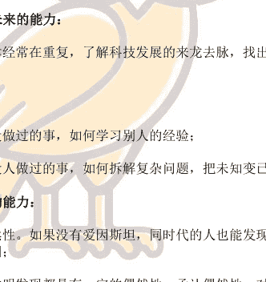

学完这门课程后，我希望你收获以下三种能力：

- 1. 看清楚自己，看清楚未来的能力：
在科技史中，它的现象和规律经常在重复，了解科技发展的来龙去脉，找出共通的规律，就能更好地把握未来。

- 2. 掌握解决问题的能力：
学习他人的能力：对于自己没做过的事，如何学习别人的经验；
自我创造的能力：对于从未没人做过的事，如何拆解复杂问题，把未知变为已知。

- 3. 分清偶然性和必然性的能力：
科技的发展有很多历史的必然性。如果没有爱因斯坦，同时代的人也能发现狭义相对论。认识必然性能帮你摆脱错误归因；
但是另一方面，很多重大的发明发现都具有一定的偶然性。承认偶然性，对世界多一分敬畏，就可离成功更进一步。

最后，了解历史的目的，还是为了能够把今天的事情做好。因此，这门课的重点不仅在于讲述历史事实，更在于训练思维。我会在每一节课的最后，都强调出这一讲的要点，帮你从特定的侧面理解科技。

如果你愿意和我一起重新回望人类历史，俯瞰这都不可逆的科技史是如何一步一步推进到今天的，那么我们现在就启程吧。

## 01 | 人类是什么时候发明衣服的？

这是我们科技史纲的第一讲，我先不着急开讲具体的科技发明。我想先用三讲来为你介绍这门课程的两条主要线索：能量和信息。这一讲，我会先通过一个故事帮你看清这两条线索，而这个故事是围绕着“衣服”这个发明展开的。

人类是什么时候穿上衣服的？这个问题长期以来一直困扰着人类学家和历史学家们，他们想知道人类的祖先是先发明了衣服才走出非洲，还是在走出非洲的过程中被动发明出衣服的？

要了解人类是什么时候发明衣服的，要远比搞清楚火的使用和工具的使用要难得多，因为使用火和石制工具会留下很多线索，比如今天在北京居住过的洞穴里就能看到使用火的痕迹。但是衣服很容易腐烂，本身留不下来。

当然，你可能会说，如果找到了早期的骨制的针，是能否推断出人类穿衣服的时间呢？这确实可以算是一个可行的主意，现在也的确找到了一些早期用于缝制衣服的针，它们是在人类走出非洲向西伯利亚迁徙（大约 3 万年前）的途中留下的（这批人应该是中国人的祖先）。

一些学者曾经因此而认为人类是在走出非洲的过程中因为需要，被动地发明了衣服。但是，找到针只能够证明人类穿上衣服不晚于 3 万年前，而人类完全有可能比这个时间更早就来开始穿衣服了。因此要准确地推测具体的时间，就得想其它办法了。

破解这个谜的并非考古学家，而是一位遗传学家，他依靠的工具不是考古的证据，而是基因。基因是记录人类历史的一本“书”，只是这本书通常只有基因遗传学家能够读懂。

至于穿衣这件事，它和人类身体的一个变化是相关的，那就是祖先体毛，也就是说，如果我们能够找到其中一个的时间点，就能找到另一个。但问题是人类是什么时候褪去体毛的，本身又是一个无头公案，因为无从从我们人类自身的基因变异中找出这个时间点。这就得继续寻找相关性了，而这个相关性居然找到了在一种常见的寄生虫——虱子身上。

就这样，隐藏了人类历史的“谜题”就从人的身上转到了虱子身上。斯托金根据两种不同虱子在基因上的差异，以及虱子基因变异的速度，推算出了体毛出现的时间。经过他这么一推算，这个时间确定在 7 万 2 千年前。有趣的是这个时间点，几乎就是现代智人走出非洲的时间。

可见，我们的祖先很可能是“盛装出行”，周游世界。当然，2015 年，有人用相同的做法又得出了更精确的结果，衣服诞生的时间往前推到了 17 万年前。

最近的 30 年，基因技术的进步，为我们提供了一种新的研究方法，就是通过基因的变化，还原当年的场景。在前面的例子中，就是通过虱子基因的变化，大致了解了人类穿衣服的时间。

故事讲完了。通过这个故事我首先想告诉大家的是信息的相关性，可以帮助我们解决今天各种没有答案的问题。实际上上述这个故事本身所讲述的事情，就是最近的 20 多年来一项重大的科技发明——基因技术，它把一些生物学问题变成了信息处理的问题。

说起信息，很多人觉得那是 IT 从业者的事情，但其实它的应用远比你想象的广。今天的很多科学研究，都是通过信息这个工具将看似无关的两件事联系起来，找到答案的。掌握了这个方法，你就在生活中和工作中比别人多握了更强大的工具。

你可能都听过碳-14 年测定法《放射性碳定年法》，这是一项获得过诺贝尔奖的研究成果。碳-14 年测定其实就是使用一种信息去测定另一种信息。

在文物形成时，或者生物死亡时，内部的碳-14 和碳-12 的比例是自然界中正常的比例，但是由于碳-14 会衰变，而碳-12 不会，因此年代久远的文物或者化石中碳-14 的含量会减少。

通过这种方式，就能测定年代。这个方法出来之后，很多文物《包括古画》的真实都被重新判定了。在我们这门课程中，还能看到更多的例子，都是将原来领域中的难题变成信息处理的问题。

在人类之前，物种是靠自身的形成变化来适应环境的，这样一来就需要花费比较长的时间。今天美洲的物种，从极北的阿拉斯加，到最南端的阿根廷，差异是很大的，因为各种物种难以在不同纬度之间生存。如果现代智人要通过自身进化走出非洲，可能要几十万年时间。

而现代智人与其他物种的高明之处在于，他善于借助外力。

衣服在今天依然是我们人类重要的发明，为什么它无论在哪个历史阶段，都能扮演重要的角色呢？因为它符合一个发明最基本的底层逻辑，就是它是符合实际需求的。

人类在早期的发明，还不止衣服这一种，只是衣服流传下来了，我们今天还在穿，而很多发明都没有流传下来。

如果你今天去世界上一些大的历史博物馆了解一下南极哈拉、大洋洲和澳洲土著人的生活，就会发现他们有不少在今天《甚至在当时》毫不实用可用的发明，我们对这些发明完全不了解，因为它们对我们没有用途。从这件事情可以看出，好的发明其实目的性是很强的。

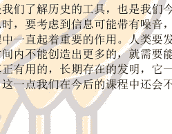

## 要点总结

- 1. 信息的相关性，不仅是我们了解历史的工具，也是我们今天解决尚未有答案的问题的重要工具。在利用信息时，要考虑到信息可能带有噪声，因此交叉验证是必要的。
- 2. 能量在人类的文明过程中一直有着重要的作用。人类要发展，就需要让创造的能量超过使用的。如果在短时间内不能创造出更多的，就需要能“节能”的发明出现。
- 3. 需求和发明的关系。真正有用的，长期存在的发明，它一定要能够解决实际问题，也就是说有很强的需求。这一点我们在今后的课程中还会不断看到。

## 思考题

我们在工作中是如何利用信息的相关性以及不同信息交叉验证来解决问题的？

## 02 | 能量：文明的标尺和钥匙

上讲，我们通过讲衣服的例子，让你了解了“能量、信息”这两条线索，算是一个开场白。这一讲，我会重点讲述衡量科技发明和文明水平的第一条主线，那就是能量。

为什么我可以用“能量”帮你把科技史串联起来？因为能量不仅仅是一把衡量文明的标尺，而且还是一把解密文明的钥匙。

通常，我们用 GDP 这类指标去判断不同经济体的发达程度，而用“能量”的尺度来衡量不同的文明。这种衡量文明的方法来自西方的一些历史学家。

斯坦福大学教授伊恩·莫里斯（Ian Morris）在其代表作《西方将主宰多久》一书中，对比了各个不同文明的发展，以及不同时代文明的水平，得到了“能量”这一衡量标准。

在使用能量总量的背后，既反映出一类文明当时的发展水平，也反映出它能够创造财富，或者动员战争的可能性。虽然能量不是唯一衡量文明水平的标志，但是它是一个非常方便实用的指标。

伊恩·莫里斯还不是第一个提出用能量作为衡量文明水平的人，在他之前，苏联科学家卡尔达肖夫（Nikolai Kardashev）在 1964 年就提出了以他名字命名的等级（Kardashev Scale，也称为卡尔达肖夫指数）。卡尔达肖夫将文明水平根据使用能量的能力分成三个等级：I 型、II 型和 III 型。

I 型文明能够使用在它所处的行星（对我们来讲就是地球）的所有能量；II 型文明能利用它所在的恒星（太阳）系所有的能量，III 型文明则能利用它所在星系（银河系）的所有能量。

按照这个标准，人类其实现在尚未达到 I 型文明，但已经颇为接近了。如果人类未来能够实现可控核聚变，应该就谈到了 I 型的文明。

很多科学家认为，今天人类的文明水平大约处在 0.7 型左右，而达到 I 型是指日可待的。至于什么时候科技水平能够达到 II 型、III 型的文明，没有人知道答案，但是大部分科学家认为，人类如果想飞出太阳系，就需要达到 II 型文明。

那么在能量的刻度上，人类文明是怎么从 0 开始的呢？对于微观的个体人类而言，突破 0 的限制，就意味着首先要活下来，但是这个任务对原始人类说可不轻松。

具体来说，今天一个成年男子大约需要 2000 大卡的热量，但是如果你生活在狩猎的年代，大约需要两倍，也就是 4000 大卡的能量才能维持生活。如果你要养育后代，需要的能量就更多，可能是 6000 大卡。也也就是说，如果人类获得能量的水平低于这个数字，可能会灭绝。

而当人类每天获得能量仅仅达到这个数量时，也只能勉强生存，他们一天忙到晚只是为了吃饱肚子不饿死，部族的人数也无图增加，文明根本无法开始，也谈不上科技发明。如果人类只是像草原的狮子一样捕猎谋生，获取能量，进化的速度比猴子或者黑猩猩快不了多少。

人类的快速进步是因为借助了外力，上讲提到的衣服就是一种帮助人类节省能量的外力，另一个重要的外力就是火的使用，或者说取火技术的发明，这是人类最初掌握的远高于自身能量的能源。渐渐地，人类活动所获取的能量就大于了生长和生存所需，也就能够得以用剩余的能量改变世界。

在此之后，人类有了更进一步的能量利用方式。

我们试着推演一下，人类在迁徙过程中，人口的繁衍使得人类不可能通过狩猎采集获得整个族群所需要的全部食物。狩猎采集的方式虽然让人类每天花不了太多时间觅食，但是能够获得的食物总数有限。它们甚至通过延长哺乳时间来避孕，或者饿死和杀死多余的人口。

在史前时期，部落之间的竞争非常激烈，而取胜的一方几乎无一例外的就是人口占多数的部落。虽然以狩猎采集方式生存的部落或许在体力上有优势，但是如果面对十倍人数的农耕部落，则毫无胜算可言。

逐渐地，那些靠狩猎采集为生的部落就被边缘化了，人类从自由狩猎采集时代进入了农耕时代。而这一进步让人类能够控制和使用的总量进一步大幅提升。

这里我就强调一下“能量总量”对一个文明的重要性。以美索不达米亚和古希腊为代表的商业文明在获得财富的效率上，要远高于以古埃及及古代中国为代表的农耕文明。但是在获得能量的总量上，古埃及及古代中国具有极大的优势，这才让它们能够修建金字塔、始皇陵和长城。

说到这里，你会发现，能量不仅是衡量文明的标尺，它还是一把解密文明的钥匙，很多历史上难以破解的谜题都可以从能量的视角找到答案。

再比如，在中国历史上每一次小冰期通常都伴随着北方游牧民族南迁，因为他们在北寒地区无法获得让部落生活和繁衍所需要的能量。

此外，西方史学家也用能量解释中国一个王朝更替的根本原因，就是到了王朝的末期由于人口太多，农民收获的能量《和收成的庄稼数成正比》不足以养活很多人。中国每一次大的王朝更替或者动乱都会造成大量的死亡，在此之后就会有大量空闲的土地可供耕种，整个社会于是就能得到解决。新王朝往往会出现一段时间的治世。

有了能量这把钥匙，你就获得了俯瞰文明史的另一个维度，我希望你从中可以进一步理解为什么我们课用了能量作主线。

以后的课程里，你都会感受到人类几次大的科技进步都和能量有关，比如农耕时代牲畜的使用，欧洲近代风车和水车，第一次和第二次工业革命，以及 20 世纪原子能技术等等。

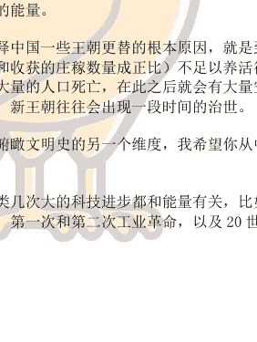

## 要点总结

- 1. 任何事情最终做好，需要一个正反馈机制。在我的专栏《硅谷来信》中讲过好几次，好的生意是要能够不断盈利的。这其中的目的就是要形成正反馈，这和人类利用能量取得进步后，就能获取更多的能量是一致的。我们在后面会不断地看到，一种文明是否有生命力，就看它是否能形成正反馈。同样，一个人是否富有，就看他做的每一件事，是否能够成为放大自己进步的台阶。
- 2. 一个文明能够利用的总能量，决定了文明的高度。今天像瑞士这种国家，尽管科技很发达，很富有，但是它无法像中国和美国，做出现对水平很高的科技成就，主要就是总量不足造成的。因此，办事效率是需要的，总量也是需要的。
- 3. 系统研究一门学问，需要有一个清晰的、容易理解和量化度量的线索，对于科技的发展，能量就是这样的线索。对于生活或者工作，我们不妨给自己定这样一个衡量进步的线索。

## 思考题

对于你从事的专业，寻找一条线索，将它的核心知识串起来，然后分享给大家。

## 03 | 信息：如何贯穿人类文明？

上一讲，我为你介绍了能量作为课程主线的重要性，它是衡量文明的标尺，也是解密文明的钥匙。

当人类发展所创造和累积的能量越聚越多，如何调度组织这些能量，就变成了一个亟待解决的问题。信息，其实就是调度、指挥这些能量的要求，也是这门课程的另一条主线。

你有没有想过，为什么古代埃及法老可以组织数十万奴隶去建造现在都很难完成的大金字塔？为什么鸦片战争时期，明明中国和印度的人口总数据超过英国，在能量总量上占据绝对优势，但还是败给了英国？可以说，文明的竞争，除了能调动能量总量的
一方容易占优之外，更强的组织能力和沟通能力也是必须的，而这一切要靠信息的传递。

这一特点早在现代智人《也就是人类的祖先》和尼安德特人的竞争中就体现出来了。

无论是从身体条件、脑容量，还是对非洲以北寒冷气体的适应性来看，现代智人相比尼安德特人都不具有任何优势。但是，我们的祖先在长达万年的生存竞争中，最终把对手挤出了历史的舞台，这里有很多原因，最根本的一条是现代智人的语言表达能力更强。

关于这一点，简单地讲，尼安德特人在 FOXP2 基因，也就是语言基因上和现代智人有差异，以至于语言能力比现代智人相差很远。

至于现代智人是如何获得这样的语言优势的，其实这不过是运气好而已，早期各种人类连同人类的近亲黑猩猩在 FOXP2 基因都是相同的，但是后来现代智人这一支在这个基因上发生了突变，导致了较强的语言能力。

当然，现代智人获胜的另一个重要原因是发明了投射武器，包括弓箭和标枪，这是从能量的角度对现代智人竞争优势的解释，我在后面马上会讲到。

有了语言能力，人类的通信水平就有了质的飞跃，他们可以向对方描述一个完整的思想。比如，我们会这么说：

今天在南边要打仗，你带上自己的兵器。

这样的交流我们轻而易举就能完成，可以通过对话将一大部分人组成一个整体共同完成一件事情。而 FOXP2 基因缺失的人就只能表达类似下面断续的概念：

打仗，你，兵器。

这样，大家彼此理解起来就有些困难。同样地，FOXP2 基因处于劣势的尼安德特人只能和十几个人沟通，而现代智人能够和大约 200 个人沟通。

你可以想象，在几万年前现代智人在和尼安德特人那场殊死拼斗中，前者一大群人相互招呼向对方为首的几个人冲了过去，对方却无法召集同样数量的同伴进行反击，被打得落荒而逃。最终人类将尼安德特人赶到了比利牛斯半岛的尽头，后者从此消失在历史舞台上了。

## 说完了语言能力是如何帮助现代智人取胜的，我们再来说说语言。

如果说语言能力是天生的，那么语言则是进化和发明的双重结果。人类最初可能只能像其他动物一样通过一些含糊不清的声音表达简单的意思，比如“呜呜”叫两声表示周围有危险，同伴“啊呀”地回答表示知道了。

但是随着人类活动范围的扩大，要处理的事情越来越复杂，语言也越来越丰富，越来越抽象。大家在信息交流中，对一些共同的因素，比如物体、数量和动作，用相同的音来表达，就形成了概念和词汇；当概念和词汇足够多时，就逐渐形成了语言。

语言的出现可以让一个部落一致行动，可以把力量聚集在一点完成一件事。

更重要的是，语言可以传承经验，是比基因更高效的信息载体。因为有语言，人类获得信息的途径超越了其他动物，而后者只能通过父亲基因传递本能，或者通过自身经验积累。

一只爬行动物吃了一只色彩斑斓的毒昆虫后死掉了，它的基础就中断了，而某种类怕色彩昆虫的爬行动物活了下来，它的基础就传递下去了。这样以生命为代价试错的信息传递效率实在太低。

语言则是地球上在基因之外另一种传递信息和知识的方式，它的效果要比基因高得多。人类并不需要被毒虫蛰过才懂得远离它们，父辈们会告诉后代远离那些有斑纹的毒虫，甚至会远离它们出没的水边草丛。因此，人类进步的过程，就伴随着信息的积累和传递。

在语言的基础上，人类还发明了数字和文字。从今天出土的文物来看，数字出现的时间远早于文字，大约早了近一万年。除了数字，人类还开始用图画记录信息。

1868年，考古学家在西班牙加塔布里亚自治区阿尔塔米拉洞窟中，发现了11000–17000年前的岩画，从一个侧面记录下了当时人类的生活情况。

当然，人类不可能把什么事情都用图画的方式记录，为了方便记录信息，图画就被逐渐简化成了形象的符号，这便是文字的雏形。

当然，这个简化的过程很漫长。因为从形象思维到抽象思维不是件容易的事情。在文字的形成过程中，还有类似取过去类似、非画非字的文字，它们是从画到字的过渡。下面展示了美索不达米亚楔形文字演化的过程，你可以看到，一开始是非常形象的图画，后来就变成了比较抽象的符号。

| 象形 | 早期楔形 | 楔形 |
| --- | --- | --- |
| 头 |  |  |
| 嘴 |  |  |
| 吃 |  |  |
| 汲头 |  |  |
| 走 |  |  |
| 绵羊 |  |  |
| 山羊 |  |  |
| 牛 |  |  |
| 女奴 |  |  |
| 箭 |  |  |
| 种子 |  |  |

有了数字和文字，人类传递信息就更方便了，但是光有文字传递信息还不够准确，虽然在一个部族内交流没有问题，但是要想管理一个城市就办不到了。

## 科技史纲 60 讲

假如你是一个国王，想要向下传达自己的指令，如何保证自己的命令不被曲解呢？要表达复杂的思想和完整的知识，就需要发明一种书写系统。它可以将一条指令，或者一个法律法规不走样地传递下去。

在语言学上，书写系统和文字是两回事。英国著名人类学家、皇家科学院院士古德认为“书写支撑文明”，因为仅仅靠简单的、意思不连贯的图形文字显然做不到将人类的知识积攒起来，一代一代地传承下去，也无法将统治者的思想向成千上万的大众传播，这些都需要靠书写系统。

当然，书写系统是建立在文字基础上的，接下来我们只谈书写系统在信息这条线索上的巨大作用，关于书写系统的历史，我们后面再讲。

好，假设你还是那个古代的国王，你会发现，一套完备的书写系统不仅可以帮助你把指令自上而下地准确传达，而且还可以帮助你完成“攻城略地”的事业，让你的思想跨越时间，流传千载。

因为信息的传播，体现为横向传播和纵向传播两种形态。

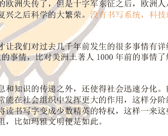

所谓横向传播，是指在同时代通过书写的文字将信息传递给他人，这就能够帮助你建立起比部落更大的社会组织，这才使得城邦和国家的出现成为可能。

所谓纵向传播，就是指先前的人将知识和信息通过文字记载下来，传递给后面的人，这样即使中间相隔成百上千年，后人也能够了解到之前的文明成就。

古希腊的很多科学论著在中世纪的欧洲失传了，但是十字军东征之后，欧洲人从阿拉伯地区带回了那些书籍，这导致了文艺复兴之后科学的大繁荣。没有书写系统，科技就不可能在先前的基础上获得叠加式的进步。

此外，正是因为有了书写系统，才让我们对过去几千年发生很多事情有详细的了解。今天，我们对古埃及 5000 年前发生的事情，比对美洲土著人 1000 年前的事情了解得更多，这便是书写系统带来的结果。

书写系统的出现除了大大加速信息和知识的传递之外，还使得社会迅速分化。能够读写精英阶层，通常是僧侣和贵族，常能在社会组织中发挥更大的作用，这样阶级化的奴隶社会就诞生了。但是，如果一个文明将读写书写文字变成少数精英的特权，这样一来这些文明的发展，就非常缓慢，因为知识的传递受阻，读写越来越慢便是如此。

在历史上由于率先发明了纸张和印刷技术，中国文明能够后起直追，超越所有早期的文明，这和信息传播顺畅有很大的关系。我们在后面会看到，近代各地区的发展，和印刷术普及的时间是相吻合的。

到了近代，技术革命通常是和信息联系在一起的，从电报、电话、无线电广播、电视、雷达、计算机、互联网、移动通信，到如今热门的量子计算和量子通信，都和信息有关。因此，信息是另一个贯穿整个科技史的主线。

## 要点总结

- 1. 将很多人组织起来一起做事情，沟通能力很重要，做不到这一点，就无法管理一个上万人的企业，更无法治理一个上亿人口的国家。因此，我们怎样花费精力锻炼自己的沟通能力都不为过。
- 2. 如果我们不能从前辈那里学习有益的经验，而是凡事都靠自己试错、探索，我们的进步无疑会比同龄人慢得多。
- 3. 书写系统和文字是不同的，书写系统可以让科技完成叠加式进步。
信息是贯穿整个文明的主线，信息传播越通畅的文明，发展越快。

## 思考题

如何理解“今天科技公司从本质上讲都是信息公司？”

## 04 | 你比原始人更懂得借助外力吗？

在介绍完这门课的两条主线之后，这一讲我们正式开讲人类最初的两个重大发明。

我们都知道能量对于物种生存和发展的重要性。生物想要从自然界获取能量，就必须按照自然界设定的轨迹发展，后果就是，它自身进化的速度在很长时间里就会和自然界的变化相适应，很慢很被动。比如，有的小动物冬天就要冬眠，那是因为它们的活动在能量上是入不敷出的。

那为什么人类不需要通过冬眠节省能量呢？你会说是因为我们有各种取暖设施，错了，我们人类懂得借助外力，因此，就从被动遵循环境进化，进入到主动改善环境的发展轨道上了。在获取能量，自行进化的路上，我们就和动物分野了。这节课，我就带你回到人类最早的起点，看着早期的人类是如何借助外力获取能量的。

人类学会借助外力是从这两个发明开始的：第一是学会制造和使用工具，提高能量获取的效率，第二是学会使用火，在捕食之外获得能量。

工具的使用使人类在获取能量时能够事半功倍。可试想这样一个场景，一群原始人要靠双手使用蛮力将一些树枝折断拿回去烧火取暖。一天可能也折断不了太多树枝带回去，而另一群原始人用锋利的石斧砍伐树枝，带回去燃料的效率就高得多了，然后他们就有时间和体力做别的事情了。

但是，人类早期的工具很简陋，就是石器工具，而且这些工具的发展也极其缓慢。一开始，早期人类可能只会用石头砸开坚果，或者打死一些小动物。以后，又过了很多代，人类发现石头上锋利的棱角可以割开动物的皮或者砍断小树，于是石头的用途就广泛了。又过了很多很多代，人们可能在无意中发现破碎了的有棱角用起来更方便，便逐渐开始人类地制造更好用的工具了。

在这个过程中，技术的进步是非常缓慢的。今天发现的最早的工具是在非洲发现的200多万年前的阿舍利手斧（Acheulian Hand Axe）。虽然它被称为手斧，其实就是一块由燧石砸出来尖头的石器（也称为打制石器）。

但是到了 20 万年前，石器的种类突然丰富起来，制作也精良了许多，就是因为现代智人贡献了自己的聪明才智。因此从这个维度提供了证据，说明我们直接的祖先现代智人也是在 20 多万年前出现的。

那些石器，从大小、形状和功能来看都各不相同。第一大类被称为石核（Core），个头最大，作用有点像今天的锤子或者剁肉的斧子。第二类是刮削石器（Flake），有点像我们今天用的菜刀，可以剥兽皮，削东西。第三类是尖状石器（Blade），它有点像后来的匕首或者短刀。

下面三张图分别是石核、刮削石器和尖状石器，大家可以看它们的差别。

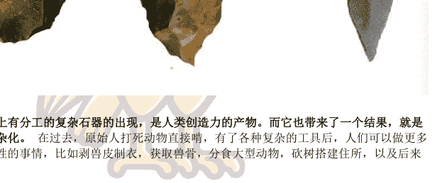

这些功能上有分工的复杂石器的出现，是人类创造力的产物。而它也带来了一个结果，就是劳动的复杂化。在过去，原始人打死动物直接啃，有了各种复杂的工具后，人们可以做更多具有创造性的事情，比如剥兽皮制衣，获取兽骨，分食大型动物，砍树搭建住所，以及后来的耕种。

在没有工具，或者工具比较差的情况下，人类其实发展非常缓慢，也就是说，通过借助外力，人类把工具越做越精细，工具的用途也越来越广，这就帮助人类完成了更多前所未有的任务和成果。

早期人类借助的第二个外力是火。如果说其它动物也能制造简单的工具，那掌握和利用火是人类所特有的本领。

为什么火的作用那么大呢？我们可以从能量有关的三个方面来找答案。

第一个作用是取暖，这是火最直接的用途，也是获得更多能量的直接手段。依靠它人类才能在恶劣的环境中生存，才能走到世界的每一个角落。如果没有火，早期人类靠自己的生存活动所获取的能量是很难以离开温暖的非洲而生存的。

第二个作用是驱赶野兽，这减少了自身能量的消耗。这不仅仅表现在夜晚把野兽吓跑，让自己的部落安全栖息，更有意义的用途是，用火把到野兽的山洞里将野兽赶出去，从此占据那些山洞居住。

人类一旦有了住所，生活就会发生翻天覆地的变化，他们从此能过上安定的生活了。火的使用，代表人类在能量上能够“开源”，而迁进山洞又代表着人类能够“节流”了。

至于火的第三个用途——烤熟肉食，则是非常晚才被人类利用的，这个却不是因为人类不懂得烤肉吃，而是因为人类在早期根本没有什么肉吃。

人类掌握比较高超的狩猎技术是在现代智人出现之后，也就是有了比较复杂的工具之后。在此之前，人类主要靠采集为生，对凶猛的动物更多地是防范和躲避生存。也就是说，当时的人类虽然会用火，但也只能烤烤果子。

吃烤熟的肉类对于人类的进化和后来开启文明意义非常大。它大大节省了人类的能量支出。在此之前，人类主要靠吃野果为生，附近找不到果子就只能挨饿，这样人类难以长途迁徙，更不要说有体力改变周围环境了。

有了熟食吃之后，人类进食的时间大大缩短，才有了时间和精力从事吃以外的活动，比如在自己生活的区域修筑一道篱笆围栏。可以说人类的进化和后来的文明始于吃肉，而这都是使用火所带来的结果。

因此，火的利用是人类在使用能量之第一次巨大的飞跃。

## 要点总结

人类早期称得上科技成就的，只有工具的发明和火的利用，它们都和能量有关。

从本质上讲，工具的发明和火的利用都反映出人类学会了借助外部的力量在自然界生存，而不是单纯靠自己进化的优势。这一点应该对我们今天的人有所启发，也就是说，人之所以为人，是因为我们善于借助外力，而不是先天有多少优势。

原始人都懂得借助外力，而现代人恐怕还真不一定能明白这个道理，不信我们看这样四个问题：

- 1. 一个奥运百米冠军和开汽车的人谁跑得快？
- 2. 一个智商 160 的数学天才，和一个智商 100，数学平平的学生比赛算 6 位数的乘法，后者有了 一个计算器，谁算得快？

对这两个问题的答案，大家恐怕没有什么疑问。但是，我把这两道问题变一下，很多 人其实就糊涂了。不信看下面两个问题：

- 3. 一个连续十年表现都比股市大盘好的炒股天才，和一个进入到一家好单位，业绩非常 好的员工，谁的收入高？

第三个问题其实是和第一个问题相对应的。我们假定股市的平均回报是 7%，一个天天把心思放在炒股上的天才做到了每年都比股市好 2%，这是华尔街最好的专业人士也不敢保证的投资表现。

我们假设今年的薪酬、奖金等意的收入是 10 万元，能够拿出 20%，即 2 万元投资。 一年下来，他不比按定投指数基金的人多收入 400 元，即使算上 10 年复合成长的差异，也就是 8000 元的差别。与此同时，由于这位天才就无法安心做好本职工作了，因此在单位里提升机会会有限。

另一个人把别人花在炒股上的心思花在工作中，一年多拿 5000 元的奖金很容 易，即便第二年奖金的差异相同，十年的差异则是 50000 元。更何况，第二种人第二年 工资涨得还比第一种人快，奖金差异会更多，几年后还会获得晋升机会，收入涨得更快。

大家算出来，10 年下来，其实第二种人比第一种人收入多得多。这也就是我常说的，最好 的投资是投到自己的事业上，因为能够进到一家好单位，能够在业 绩上超过别人，那就是在借力发展。自己一个人努力，相当于自己跑步，借助单位的力量发展，相当于开车。

最后我们看第四个问题：

- 4. 使用自己已经用熟了的现有的工具做事情，和花两周时间学会一个能够提高 10 倍效率 的工具做事情，哪个效率高？

第四个问题和第二个对应。掌握新工具，就相当于掌握了计算器。但是很多人 在工作中懒得学习新东西，而喜欢重复过去已经做熟练的事情。这两种人，时间一长，胜负立判。

最后，我们用荀子的話来结束今天的课程：君子生非异也，善假于物也。

## 05 | 走出非洲，做世界的主人

今天人类类的祖先（现代智人）在史前做的最重要的一件事就是走出非洲，这是现代智人成为地球主人关键的一步。

虽然人类这个举动最初的目的只是为了追逐食物，但是在客观上这件事使得人类得以接触全世界各种物种（包括可食的植物，牛马狗等可用的动物），并且利用它们发展自己，这才能够开启文明。

为实现这次出征，人类做了充分的准备。而跨出非洲这一步，现代智人进行了 2 次殊死搏斗，用了 2 万年，并且曾经一度面临灭绝的危险。

完成这一项需要很多技术上的先决条件，这些技术条件就如同大家在“文明”游戏中所玩的那样，要发明一种新的技术，就要先有其他的它们。那些先前技术，我们称之为“预先要求（pre requirements）”，那基于先前技术发展出的新技术，我们称之为“依赖技术”（dependent technologies）

比如说，让炉温达到 1300 度是烧制瓷器的预先要求，而瓷器就是依赖于炉温的依赖技术。我们在课程中，会经常讲到先决条件和依赖技术，帮助大家了解科学和技术的关系。在人类走出非洲这件事上，先决条件有这样一些：

- 1. 制作衣服;
- 2. 搭建住所;
- 3. 发明武器;
- 4. 发明语言。

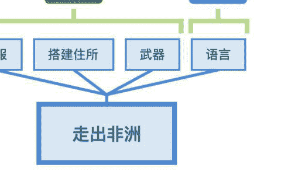

衣服的重要性我们在课程的一开始就讲了，在非洲之外的地方，没有保暖的衣服，人类获取的能量抵不上消耗的能量。

除了衣服，搭建居所又是怎么样帮助人类走出非洲的呢？

直到几万年前，人类依然是以住在山洞里为主。在山洞里可以取火避寒，有效地累积能量，但是人类在迁徙到世界各地的路途中，不可能随时随地找到山洞。而从能量的角度来讲，搭建住所这件事和当初在山洞里使用火，效果是一样的。所以，能在迁徙过程中搭建居所就是大规模长距离迁徙的必要条件。

此外，大部分河山都是远离平原河流，不利于人类的发展。所以住茅屋还是是有茅屋的好处，最大的好处就是让居住之所和谋生之地距离比较近，就像今天的人都想在工作机会比较多的城市买房，而不是偏远地区的大宅子一样。

渐渐地，茅屋变得坚固了，尤其是有了夯土的墙之后，不仅可以避风雨，而且可以防止野兽的袭击，并且能够贮藏生活用品，这时，最初帮助人们迁徙的发明，开始帮助人们定居下来了。就这样，人类学会建造大规模的居住场所，也才有了后来大规模的部落，可以说，这项早期发明是人类从向前早期文明过渡的必要条件。

我们常常使用“茅屋”两字形容人类早期的住所，但这只是为了说明其简陋，并非意味着这些住所一定是用茅草构成的，事实上很早早期的住所是使用兽皮覆盖，甚至使用大型动物的骨骼（包括象牙）搭成的。人们在德国境内发现尼安德特人就曾经用大型哺乳动物的骨骸和牙齿搭建过茅屋。

这里就出现了个问题，无论是取得木材还是兽骨，对于当时的人类来讲都是很耗费体力的事情。如果说山洞是当时人类的“豪宅”，那么搭建的住所就是移动的帐篷，可是，想搭建一个住所可没有现在搭一个帐篷那么容易。

搭建住所本身需要消耗能量，因此，人类发展到了一定阶段才可能干这件事。

今天考古学家们估计，人类大约在 80 万年 - 20 万年前，开始掌握搭建茅屋的技术了。迄今发现的最早的茅屋在法国尼斯的 Terra Amata，距今大约 40 万年了。

我们刚才说了，人类走出非洲的先决条件是搭建住所，而搭建住所的先决条件是人类自身对能量的使用达到一定阶段，最后，搭建住所又逐渐成为了人类定居和群居的一个先决条件。你可以看到，在人类科技发明的知识图谱中，有些发明就是其他预先技术满足后所触发的结果，也是新发明产生的先决条件。

接下来，我再说帮助人类走出非洲的第三个先决条件，也是最关键的一个，那就是武器的发明。武器就是早期人类能量的放大器，尤其是投射型武器的发明，让人类释放出的攻击力大大提升。

我们设想这样一个场景，一个猿人如何和狮子搏斗。猿人的一拳不足以伤害狮子，因为后者在进化中形成的抗打击力远远超过猿人一拳打下产生的动能。相反，狮子如同匕首的爪子和尖利的牙齿可以轻易刺破猿人的皮肤。因此这是一场没有胜算的争斗。

## 科技史纲 60 讲

但是，如果猿人有了类似我们前面讲的石锤之类的工具，就有可能产生更大的动能打击狮子，如果有了尖锐的武器，那么效果会更好。

自从人类发明了尖锐的燧石子之后，各种大型动物的厄运就来了。但是发明燧石子也是有预先要求的，对长矛来讲，重要的是要装有燧石的子头，这样才能具有很强的攻击力，而且，人类还要掌握用火烘干树杆的技术，才能制成比较坚硬的杆。这样人类才有能力捕杀大型猎物了。

早期武器的发明既为了杀死动物，也为了杀死同伴。早期的类是极为残忍的，杀死同伴，消灭其他部落的事情时有发生。

但是，矛的发明者不仅有我们的祖先现代智人，还有其他人类，包括尼安德特人和海德堡人，那么为什么现代智人可以战胜其他人类，完成这场走向世界的大进徙呢？

一般认为，弓箭和标枪等投射型武器，可能是现代智人战胜其它人类（主要是尼安德特人）的利器。从能量的角度来讲，这些武器是将足够杀死猎物和动物的动能输送到远方的工具。前面我们还讲过智人在信息角度上的优势，那就是语言能力。

尼安德特人比现代智人更早定居在欧洲。他们身体高壮，躯干要比人类明显长很多，四肢相对粗短，这种体型血液循环效率高，非常适合生长在寒冷的欧洲。尼安德特人是最早使用矛的人，但是他们自始至终没有发明出远程攻击的武器，比如标枪和弓箭，这是他们和现代智人在技术上的差距。

现代智人走出非洲，突破到亚洲和欧洲的尝试大约经历了两次，第一次是在 8 万一10 万年前，但是很多证据表明，那次尝试并不很成功，除了少数人可能通过跨越红海进入了阿拉伯半岛，大部分被欧洲和小亚细亚的尼安德特人挡了回来。

这里面的原因有很多，从根本上讲，现代智人这个外来户当时在欧洲并不比地头蛇尼安德特人更具有优势。但是大约两万年后，当我们的祖先再次努力走出非洲时，他们成功了。

很多学者认为，现代智人这一次带上了最先进的武器——弓箭和标枪，2012 年，英国的《自然》杂志刊登了亚利桑那大学人类学家的一篇文章，提出人类大约在 71000 年前开始使用弓箭。这个时间点恰好在人类两次走出非洲的尝试之间。

当然，我在前面说了，武器发明以后，人们不仅用来猎杀动物，而且还用来猎杀同类，现代智人部落之间大规模的争斗也就是从那个时期开始了。史前的人类是非常野蛮的，并且在程度上超过其他哺乳动物。

当然，武器给人类更多地是带来好处，让人类在耗费同样能量的前提下，能够更有效地围猎和杀伤敌人。于是，现代智人在追逐各种大型动物的过程中，闯到了世界几乎每一个角落，成为了地球的主人。

## 要点总结

- 1. 任何技术、发现或者重大事件的出现，都需要先满足很多先决条件。我们以人类走出非洲为例说明了这一点。此外，像矛这类武器的发明，预先的技术要求是石制工具和火的利用。没有这些技术，制造出来的矛其实只是磨尖的树叉，今天的猴子也会使用。

今天我们会看到两种产品在外观表现似乎差不多，但是性能差很多，耐用性也差很多，其实这背后的技术含量完全不同。

- 2. 我们进一步展示了能量危机的作用。无论是茅屋还是武器都是如此。

- 3. 人和动物的一个区别在于，动物的进化是缓慢的、缓慢的，如果一种动物生活在天天掉下尖锐石头的山林里，它们会进化出保护自己的甲胄，但是当它们突然遇见能用锋利石器攻击它们的人类，就来不及适应了。

另一方面，从人类来讲，如果要花费很长的工夫才能破解猎物的防御，那么猎物早已经进化出防御的甲胄了。

## 思考题

作为一个新型企业，如何做到在原有大企业没有进化出防御手段之前，制造出挑战它们的工具？

## 06 | 文明的曙光：农耕是怎么开始的？

这讲，我要讲的是“偶然性”在文明进程中的作用，以及在这个过程中所体现的滞后效应。我们用到的例子是发生在1万年前的农业革命。

我在前面讲过，从狩猎采集到农耕，人类的生活质量下降的，但是，人们为了提高生存竞争力还甘愿忍受高强度的农耕劳作，放弃狩猎采集。

但是这里面还有一个问题，我们的祖先现代智人虽然在约6万年前，在空间上走出了非洲，但是在时间上依然没有走出石器期，根本没有足够的能量养活自己，更不要说用多余的能量去发展科技。但是如果没有农业科技的发展，粮食就不会增多，养活自己就更加困难。这就是成了一个先有鸡还是先有蛋的难题。要解决这个难题的并非古人类，而是老天爷。

要看懂这场老天爷一手策划的戏剧，你要留意三个时间点：

- 第一幕是：大约 20000 年前，太阳活动使得地球获得的能量增加：
- 第二幕是：大约 17000 年前，全世界大量的冰川开始融化：
- 第三幕是：大约 12000 年前，气温和今天已经差不了多少。人类历史上最近一次的冰期总算结束了。

为什么这个过程如此漫长呢？学过物理的人都知道，把 1 克 0 摄氏度的冰变成 0 摄氏度的水，需要 80 卡路里的热量，而将 1 克水的温度提升 1 摄氏度，只需要 1 卡路里的能量。因此，融化冰吸收掉的热量足以可以将水温从 0 摄氏度提升到 80 摄氏度。

这就带来一个结果，只要地球上 有不断融化的冰，气温就很难上升。也就是说，太阳活动带来的热量，要先用在冰川的融化上，然后才能用在气温的提升上。这不仅是一个漫长的冰川融化的进程，也是一个海平面不断上升的过程。这个过程，充分体现了“滞后效应”。简单来说，滞后效应就是要改变原先的状态，通常不能立竿见影，效果总是滞后。

> 《谷歌方法论》相关紧看：
第 206 封信 | J 曲线和滞后效应
第 207 封信 | 冬至、夏至和滞后效应

这对很多物种来说是灭顶之灾，试想一下，地球在 17000 年前有一段时间里，海岸线每天要往陆地延伸一公里之多，很多植物和动物就此消失了。

然而这对于人类来讲却是一个福音。首先，人类维持生存繁殖需要的能量比冰河时期少了很多，这一点很重要。因为，假如人类每天能够创造 6000 大卡的能量，却要消耗掉 4000 大卡，只能勉强维生。而如果气候变暖，只要消耗 3000 大卡，就极有可能形成能量的正循环。

其次，全球变暖让生活在“幸运纬度带”（即北纬 20~35 度之间，以及美洲大陆南纬 15 度以北）的生物迅速繁殖。而农耕的第一个前提就是，需要长出足够多的供人采食的植物。在全球变暖之后，西南亚和中国中部、南部，野生的谷物迅速繁衍，并进化出大颗粒种子。这才让定居农耕有了可能。

如果没有太阳活动对人类进步的这一次推动，单靠人类本身每天从事劳动积累的那一点能量形成正循环，不知要多经历几千几万年才能进入农耕时代。

因此，在文明的过程中，很多时候，偶然性起到了很大的作用，在人类文明正式开启之前，帮助人类打开文明大门的，正是太阳活动的偶然性。而农耕时代就在 10000 年前这个时间点开始了。

我们常常讲历史的发展有它必然的规律，那又应该怎样看待和理解偶然性呢？应该讲，人类通过自身的活动，慢慢做到获取的能量超过消耗的能量，然后养活更多人，进一步提高自身获取能量的能力，这样一个正循环体现了必然性。

如果没有 20000 年前太阳活动的变化，人类自身积累能量的过程可能会非常长，进化到我们今天，可能大家依然在狩猎。但是一个偶然的变化让人类的发展进程加速。所以，你可以把必然性理解为我们终将到达的那个目的地，而偶然性则可能是这个过程中的变速器。

我们刚才说了太阳活动的偶然性以及“滞后效应”，那么除了外部的这个偶然条件，人类走进农耕时代还需要哪些自身的预先条件呢？接下来，我们来看看人类是如何通过自身努力走进农耕时代的。

但是，这里还有一个问题，从 12000 年前全球温度大幅上升，到农业真正开始的 10000 年前，期间已经历了大约 2000—3000 年的时间，这大约相当于秦始皇到我们现在的时间。为什么需要这么长时间才能开始呢？因为技术条件还没有准备好！接下来我们就来看看人类进入农耕时代的预先要求，从中你也可以再次体会到滞后效应的威力。

第一个预先要求是，需要建造村落的技术。村落和居所还不一样，像尼安德特人用象骨和兽皮搭的“窝棚”是难以长期居住的，它们只适合狩猎部落短期躲避风雨。今天发现的现代智人的早期村落遗址，都不早于 12000 年前。

其次需要合适的工具。旧石器时代仍以采集和狩猎为主要生产方式，那时的工具是锋利的打制工具，可以用来杀死野兽，砍树，切割兽皮骨等，但是不便于耕种和建造生活生产设施，因此人类发明了适应农耕生产的磨制工具，也就代表着进入了以农耕为主要生产方式的新石器时代。

而新石器时代，始于 12000 年前，但是早期文明的大部分地区，直到 8000—7000 年前才进入新石器时代。比如中国的仰韶文化是 7000 年前开始的，良渚文化是大约 5300 年前开始的。

此外，要走进农耕文化，还需要很多技术条件，我们就不一一列举了，最后要说的，也就是最重要的是获得高产的谷物种子，或者叫做谷物的驯化。

农耕的本质，其实就是利用谷物（和其它农产品）将太阳能变成生物能储存起来，供人食用，而这中间能量转换的效率很重要。如果一种作物光长人类无法消化的叶子，不长谷子，那么能量的转换效率就低了，甚至获得能量不足以补偿耕种付出的能量。

对农民来讲，最好的谷物是少长叶子多长种子。但是这又不符合生物基因传递的需求，因为原先生长一株谷物的土地，不可能到了第二代长出 100 株，那样密度太密集，谷物长不好。于是谷物驯化的过程就花费了人类很长的时间。

人类最初驯化的谷物是小麦，这大约是 10000 年前的事情，这个过程主要是靠自然的进化加人工筛选得到高产的谷物，这个时间非常长，大约经历了 1000 年，原因是谷物 DNA 在进化时并不会考虑供人食用这个目的。

因此，要想在短期内提高谷物的产量，还需要其它的技术。在这方面最具有代表性的科技成就，就是中国人对水稻的驯化。

为什么我们把对水稻的“驯化”也称为一项科技成就呢？因为水稻是靠中国人偶然“发明”一种新的种植技术实现高产的。野生的水稻长在水里，产量并不高，它和其它谷子没有什么本质差别。

但是，中国的先人们偶然发现了水稻有一个特点，如果在它快成熟时突然把水给它断掉，水稻为了传宗接代，就拼命长种子（谷子），一株水稻会长出好多支稻穗，而每支稻穗可以长出几十颗谷子，这样一株水稻就可以获得上百颗谷子（今天高产出水稻每株能收获 300 粒谷子，甚至还更多）。通过这种技术种植水稻，产量自然就高得不得了了。

于是，他们就利用水稻的这个特性，对它进行了驯化。他们就人为地在水稻长到一半时，让水田干掉，一下子就获得了大量的谷物。这种水稻的种植，和水稻原先生长方式完全不同了，因此，可以说是中国人通过发明水稻的种植技术而偶然“创造出”一种高产的谷物。

在中国人驯化水稻的同时代，西亚人用类似的方法驯化了无花果。在地中海气候的地区，无花果树是一种生命力极强、果实又很多的树木。更重要的是它的果实含糖量很高，而且容易保存，是非常好的能量来源，因此它

自然生长的无花果树的果实虽然数量多，但是个子小，含糖量也不够高。但是，人们发现只要给它们修剪，就能长出又大又甜的无花果。类似的技术、后来被用到葡萄等藤类浆果的种植上。

无论是人工种植小麦、水稻，还是修剪果树，都意味着比过去采摘时代更多的劳动。于是，定居下来的人类不得不每天辛勤地耕作，以保证每年在收获时获得足够的能量以维持部落的生存和发展。

从这个意义上可以讲，人类被他们驯服的农作物又栓在土地上。但是，人类只有处于定居状态，才能真正开启文明，因为定居使得人类可以聚在一起，规模越来越大，文明才有可能产生。这些内容我们下讲再说。

## 要点总结

- 1. 理解偶然性的作用。不仅农耕的开始有赖于太阳活动这个偶然性事件，而且稷谷和很多其它作物的驯化也是如此。没有中国人偶然的发现，水稻的驯化可能需要像小麦那样经过 1000 年的时间。
2. 进一步理解滞后效应，它是很多事物的内在规律。17000—12000 年前的全球变暖其实有一个滞后效应，因为早期的能量都用来融化冰而并不是完全用于增加温度了。农耕文明开始也有一个几千年的滞后效应，因为做好各种技术准备需要时间。
3. 理解预先要求。我们学习不仅要了解每个知识点，还需要了解它们的预先要求和自然结果，这样知识点就能形成知识体系。

## 思考题

就一个具体的重大事件，谈谈它发生的偶然条件和预先要求。

## 07 | 文明的标志：文明是怎么开启的？

我们上一讲，讲到了农业的开始，但那还不是真正意义上的文明，只是文明的曙光而已。大家可能注意到了，我上一讲使用了良渚文化和仰韶文化的说法，没有采用“文明”二字，因为当时并没有严格意义上的文明存在。

“文明”和“文化”这两个概念，在中国常常被混在了一起，但是在学界里，它们的 区别很清晰。“文明”一词（Civilization，拉丁语为 Civitatem）源于词根 Civil，即“城市”的意思，即一种文明的开始必须要 有城市的遗迹为证。而“文化”一词（Culture，拉丁文为 cultura），本意为农耕和养殖，也就是说，人类定居下来，有了农业和畜牧业，就开始有了文化。

很多人问我什么时候才算是文明的开始呢？按照史学家普遍接受的观点，有文字记载（也就是有了书写系统），修建城市，使用金属器（不包括发现的天然黄金），是产生文明的三大特征。

没有文字记载的历史叫做“史前”，我们总不好意思把史前称为文明开始，同样，我们也不好意思把住在村落，使用石器的部落称为文明的开始。从耒耜到文明开始之前，又经历了大约 3000 年。

听了上一讲的课程，理解了滞后效应和预先要求，对为什么有这 3000 年的间隔应该不会有太多疑问了。今天我们就来讲讲这 3000 年里发生的事情，如果只用一句话总结，那就是：定居开启了人类文明。

这一讲我会告诉你两个由定居所产生的重大发明，一个是书写系统的发明，这也是文明出现 第一个特征。第二个重大发明是陶瓷，这是人类第一次有能力创造和控制能量的标志。同时，你将略感到信息和能量这两条线索在“开启文明”这件事上的再次统一。

早期的文明发展首先离不开两个根本的地理条件：气候温暖和靠近水源。气候温暖的重要性已经说过了，而靠近水源才能保证农业灌溉，一年的收成才能保证部族所有人的生存。

但是，水对于刚办定居的早期人类来说既是福祉，也是灾祸。几乎所有早期的文明都有大洪水的传说。中国有大禹治水的故事，《圣经》里有诺亚方舟的故事，古希腊有宙斯发洪水的故事。

为什么在早期没有太多文明交流的各地区都有这样的传说呢？大部分学者倾向于的说法是，人类在文明之初都住在大河边，而大河的洪水会给人类带来灭顶之灾，很多部落就此消失了，很多人类死亡了，因此早期不同地区的人都记录下了类似的悲剧。

而早期书写系统的发明就和水患有关。

## 科技史纲 60 讲

在 10000 多年前，人类其实没有治水的能力，所做的只能是趋利避害。所谓趋利，就如同古埃及及那样子在洪水泛滥之后的土地上耕种，所谓避害，就是搞迷信。

今天我们谈起迷信，觉得很落后，很愚昧，但是在历史上，迷信很重要。尤其是在农耕之后，那些和生产有关的迷信，首先是给人以信心，应对大自然的不确定性。拜了河神，就有信心应对洪水，就能取得好收成。其次，也是更重要的作用，就是将人团结起来。

我们知道，人的基因只便于大约 200 人直接交流，因此狩猎的部族只有百十来人。而定居下来的部落（Tribes）就有上千人，这时候就需要创造一个神，来帮助管理了。再往后，部落发展成酋邦，一个酋邦往往（Chiefdom）会有上万人，就必须依靠神，依靠宗教才能做到万众一心。

因此，与其说人是神创造的，不如说神是人类最伟大的发明。在神正式登场后，就逐渐出现了重要的一个阶层，就是神职人员或者祭司，他们可能本身就是部落首领，当然也可能是专职人员，不论是哪一种，他们最终逐渐演化成了早期的知识阶层。

在这之后，人类才逐渐发明了书写系统，最早的书写系统就是用来记录人们的祭祀活动的，目的也只有一个，就是凝聚人心。这套系统不断发展到后来，不仅可以一代一代地准确传递信息，而且便于管理上万的民众。你会发现，从最初出于对水患的恐惧，到后来对迷信的需求以及对书写系统的改造，其实本质都是一个利用信息这条线，管理和组织更多能量的过程。

世界上最早的书写系统也是出现在美索不达米亚，即便比较保守地估计，也有 5500 年的历史了。接下来在三个世纪之后，也就是在大约 5200 年前，古埃及及人独立地发明了基于象形文字的书写系统。而中国的文字以及完整的书写系统可以追溯到殷商中期的甲骨文，距今大约 3400-3200 年前（有的说法是 3500 年前）。

虽然中国的书写历史不如上述两个文明长，但是学者们都承认中国的文字和书写系统是独立发明的。从书写系统的历史来看，它和早期文明的进程是高度吻合的。

到此，一切和开启文明相关的技术都是围绕着两根主线展开的，一条是多获取能量，以便于生存，当部族发展为酋邦时，它能产生和调动的总能量就大了，就具备了率先进入文明的条件。另一条线是信息，这方面是为了能够管理起酋邦，另一方面是总结、记录并传授经验，这两件事情做好的酋邦，在竞争中就藏有了迈跑线上的。

人类定居之后，技术得到了很大发展，而最早的技术是适用于制造生活必需品，这就涉及到我今天给你讲的第二个重大发明，也是新石器的工具与、最为代表性的技术成就——制陶。要居家过日子，就需要各种盛器。陶器则是早期最常用的盛器，它出现在新石器时代的后期。

陶器的出现标志着人类有能力创造和控制足够能量了。其实在远古，人类已经在无意之中发现黏土经过火烧之后会变得坚硬而结实。在人类早期生活过的洞穴里，留下了使用火的痕迹，其中就有被火烧成类似陶砖的黏土。但是从发现黏土被烧成陶这个现象到发明陶器，中间间隔了几十万年。这是因为为什么呢？

首先，更早的人类并不像我们见过陶瓷。人如果没有见过一种东西，想象出器皿的样子是很 难的，从 0 到 1 的时间有时比我们想象的要长得多。

其次，陶器的出现其实是和定居相关联的。在冰河时期，人们经常从一个地方迁到另一 个地方，过着采集狩猎的生活，带上一堆笨重的陶器显然不是好主意。事实上，即使在几百 年前，游牧部落更多地是使用轻便的皮制容器装水和酒，而不是笨重的陶器。

第三，也是最重要的一个条件，是拥有足够多的能量。烧陶需要很多木材，当人类仅有的那 些燃料只能用于夜晚取暖时，是不可能烧制陶器的。此外，烧制陶器也需要额外的劳动，只 有当人类获取能量效率足够高之后，才有闲暇的时间，或者多余的劳动力做这件事情。

在冰河时期结束后的 5000 年里，人类每天能获取的能量只是消耗量的两倍左右。即便有了烧 制陶器的技术，也没有能量大批量烧制陶器。因此在那个时代的人类生活遗址中，只有一 些遗留的陶片，并未发现大量的用作盛器的陶器。

陶器的广泛使用是在新石器时代后期，因为那时工具的使用使得人类获取能量的效率大增， 而农业开始之后人类产生的能量总量也急剧上升，这才有了足够的能量烧制陶器。

注：事实上西方历史学家，把新石器时代的第一个阶段称为“前陶新石器时代 A 期”（Pre-Pottery Neolithic A），大约在距今 11500—10000 年前，在那个时期陶器并没有被广泛地使用。

除了陶器，人类定居之后，在能量方面的另一个收获就是家畜，它们就像古代的“电池”一 样，为早期人类储备能量和提供动力。人类在迁徙的后期和定居下来之后，驯化了家畜，它 们既是人类的帮手，也为人类提供了食物。

比如，像牛这样的家畜，对农耕民族来说是主要的动力来源，而猪和羊则是食物的来源。它 们接受驯化的时间大约在 11000—8000 年前，其中猪和羊较早，牛稍微晚一些。家畜驯化的 过程今天看起来其实是一种人为的基因选择，那些带有和人比较亲近的基因的牲畜就被留了下 来。

到此，人类完全安定下来，从能量上来讲，也形成了正反馈，文明自此拉开了帷幕。

## 要点总结

- 1. 我们再一次强调了滞后效应和预先要求。
2. 地理环境对文明的影响很大。
3. 经济的总量，或者说能量的总量很重要。人类从小部落，到大部落，到酋邦，能够创造和控制的能量越来越多。率先达到一定总量的酋邦会赢在起跑线上。今天在全世界，一个国家经济总量依然很重要，这是中国的优势。
4. 我们通过对部落和酋邦的管理，讲述了信息的作用。虽然早期的知识一半是迷信，但是迷信和后来的宗教在团结大众面是有贡献的。我们不能简单地以今天的视角看待10000年前的事。
5. 我们通过陶器的发明，说明了能量的重要性，同时也说明从0到1是一件很困难的事情。

## 思考题

运用能量这条线索，解释一下为什么西伯利亚发展不起来，以及为什么中国云贵地区扶贫非常困难。

## 08 | 能量的密度：为什么要在城市生活？

这一讲，我们从三个现实的问题谈起：

- 1. 为什么除了中国，世界各国的 020 都不发达？
2. 为什么俄罗斯的西伯利亚地区发展不起来？这也是我们上一讲留的思考题。
3. 为什么大家喜欢挤在大城市？

找到这三个问题的答案，你就会明白，为什么城市的建造是文明出现的第二个标志。当然，第一个标志是书写系统的发明，你在上一讲已经学过了。

先说说美国 020 的现状，除了有优步打车，以及纽约地区、硅谷地区有些类似中国“饿了么”的送餐服务，美国没有什么 020。原因很简单，在一个面积和北京西城区大小相同的城市，如果人口只有 10 来万人，根本发展不起来 020 的业务。

你可以想象如果只有 10 家餐馆，5 家家政服务公司，根本就没有选择性。我过去在马里兰住的地方就是如此。虽然那里经济发达，人均收入高，但和北京西城区同样的面积（还稍微大一点），人口只有后者的 1/8。

人口密度太低对于经济的发展有很多不利的因素。你能看到的典型例子就是俄罗斯的西伯利亚，它有 1300 万平方公里，却只有 3600 万人，人口密度只有中国的 1/60。即使在今天，这么低的人口密度很难形成规模经济，也不可能产生很细的社会分工，更不可能集中力量办大事。此外，彼此离得太远，沟通的成本也很高。

按照这个逻辑，我们可以推测一下，在人类文明开启的时候，足够多的人口总量，足够高的人口密度，也是文明开始的必要条件。具体来说，足够的人口密度在当时带来了三个好处：

- 1. 能够让一部分人从农业之外的事情。
2. 能够养活一部分僧侣和知识阶层，能够养活专职的城市管理者和执法者。
3. 有足够的力量抵御外部的威胁。

我在第二讲提到过，能量总量的重要性，人类不得不放弃采集狩猎，聚集人口，选择农耕的生活方式，那很自然的，人口密度也就越来越高了。

当然，这么多的人不可能挤在原先的村落里，因此在大约 8000 年—6000 年前的时候，一些较大的酋邦聚集地就发展成为了早期的城市，并率先进入了文明。

今天能够找到的最早的城市遗迹是乌鲁克城，在现在的伊拉克境内，这是苏美尔人在公元前 4000 年建造的，距今已有 6000 多年的历史了，要再过大约 1500 年，埃及的法老胡夫才建造大金字塔。也就是说，最早的文明是诞生于两河流域的美索不达米亚文明，其次才是埃及文明。而在美索不达米亚文明中，苏美尔人是最早的一批文明缔造者。

乌鲁克古城里大约居住着 5000 人，人口密度非常大，此处它周围还有不少村落。由于当地有着稳定的农业收成，人均获取的能量是每日最低消费量的 5 倍。5 倍的最低消费量大约是什

么呢？如果换算成粮食，大约是5斤小麦，和中国20世纪70年代末的水平差不了太多。

有了剩余的粮食，乌鲁克不仅养活了专职的统治者，而且能养活一些手工业者。这意味着分工出现了，而分工意味着效率的提升。乌鲁克的统治者让生活在靠近河岸平原地带的人种植谷物、远离河岸在干燥而阳光充足的半山坡地区则种植葡萄等经济作物，而手工业者也居住在远离河岸的山脚下。

**分工在提高效率的同时，也促进了货物的交流，并渐渐发展起商业。** 到公元前3500年，那里已经是一个非常有组织的城邦了。

任何文明刚刚起步的阶段，要想有效地管理一个城邦，都需要有阶级之分。在乌鲁克以及美索不达米亚的各个城邦，最高的统治者是国王，他下面有僧侣和知识阶层帮助他来管理，从当地的遗迹看，有市政厅、法庭和多个庙宇，其中很多建筑是用砖砌成的。

下图是乌鲁克神庙的一面墙。从图中可以看到，当时的砖烧得很不错。这就意味着他们的城市建设是具备一定规模的。而建筑这样的城市，本身需要大量的劳力，烧制那么多砖，更是需要足够的能量，因此如果人口密度不高、文明程度不够高，是不行的。

## 科技史纲 60 讲

苏美尔人文明起步早，城邦也建设的不错，能量密度也是够了，但是却一直没有建立起强大的帝国。苏美尔人的文明更像后来的古希腊文明，或者中国的商周文明，各地城邦之间具有相当的独特性。而在之后的第二个人类文明中心：尼罗河下游地区，法老建立起统一的王朝——埃及王朝。

为什么古埃及人能够建立强大的王朝，而苏美尔人则不能？这主要是由地理环境决定的。在尼罗河下游地区，由于有大片肥沃的农田可以耕种，因此便于形成统一的王朝。而在美索不达米亚，气候相对干旱，并没有大片可供耕种的农田。所有的城市都是沿着底格里斯河或者幼发拉底河建设的，因此保留了相当的独立性。

这两种文明形态有着各自的特点，前者能够调动大量的能量，因此可以建造大金字塔这样伟大的传世工程，后者则更容易发展商业。

在随后的文明中，古代中国和古印度更多地具有古埃及的形态，我们通常称之为农耕文明或者内陆文明。而地中海的海岛文明以及随后的古希腊文明则具有后者形态，我们通常称之为商业文明或者海洋文明。

苏美尔人的商业文明一度十分繁荣，但是要想让商业进一步发达，前提是需要有良好的交通运输工具，因此苏美尔人在公元前 3200 年左右就做出了当时科技史上最重要的一项发明——轮子。

尽管轮子在今天看来再普通不过了，但是它的发明意义重大。在中学物理中，我们都学过滚动摩擦力比滑动摩擦力小很多这个原理。如果用木头或者皮革做轮子接触面，在石板铺成的道路上就可以以一个数量级的力量。古代的马车可以轻松地拉动一吨的货物流速奔驰，但是如果让一匹马驮货物，两百公斤已经是极限了。

依靠车辆和帆船，苏美尔人沿幼发拉底河建立了很多商业殖民地，并将其文化影响扩散到波斯、叙利亚、巴勒斯坦，甚至进入到地中海沿岸和埃及。苏美尔人之后的阿米特人，则将生意一直做到了西班牙和印度，这当然是后话了。大约到了公元前 2500 年，乌鲁克实行的社会分工就成为了美索不达米亚地区的社会规范了。

在人类几乎任何文明阶段，最有效掌握动力的文明常常在那个时期的文明竞争中处于优势。4000 多年后当英国人完成以蒸汽机为代表的工业革命之后，它所倡导的政治经济秩序也就在世界开始普及了。

在结束这一讲的课程之前，我来回答一开始提出的第三个问题，为什么大家喜欢挤在大城市？从文明一开始，城市就比乡村具有很多优势，比如它具有多样性，产业更多，机会更多，而且由于人口密度高，商业的潜力更大。但是从本质上来讲，城市比乡村具有更高的能量密度，因此那里能够创造出比乡村更发达的技术、更多的财富和更大的发展空间。

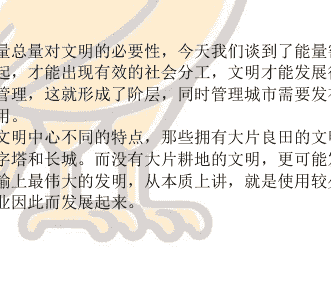

## 要点总结

- 1. 我们在之前提到了能量总量对文明的必要性，今天我们谈到了能量密度的必要性。
- 2. 大量的入口生活在一起，才能出现有效的社会分工，文明才能发展得比较快。这样的社会需要专职的人员管理，这就形成了阶层，同时管理城市需要发布命令，使用法律，体现出信息的作用。
- 3. 地理环境决定了早起文明中心不同的特点，那些拥有大片良田的文明中心，有可能集中人力和物力建造金字塔和长城。而没有大片耕地的文明，更可能发展出商业文明。
- 4. 轮子是人类早期运输上最伟大的发明。从本质上讲，就是使用较少的能量，把货物运到更远的地方，商业因此而发展起来。

## 09 | 冶金：一场三千年前的技术碾压

我在前面讲过了文明开始的过程，也讲了文明产生三个标志中的两个——书写系统和城市的建立。今天我们介绍第三个标志，也是早期文明最重要的科技成就——冶金技术。它本身既是衡量文明程度的标尺，也是文明进程的结果。

我先从古埃及和美索不达米亚的一场大战说起。

公元前 1274 年，爆发了古埃及和美索不达米亚两大早期文明之间最大规模的战争。古埃及一代英雄拉美西斯二世亲自率领的大军越过西奈半岛北上，在卡迭石和当时统治美索不达米亚的赫梯大军遭遇。

双方出动了几千辆战车，当时的战车并不像坦克那样对对方进行碾压，但是高度的机动性让上面的射手可以快速进入敌阵射杀对方，射手越多，军队的攻击力就越强。第一天埃及及军队打对了对方一个措手不及，获得了胜利，但是第二天，赫梯军队利用制式兵器和装有铁车轴的战车，击退了古埃及大军的进攻。最后，双方签订了人类历史上第一条条约——《卡迭石条约》。

赫梯人获胜的原因是他们的战车使用了铁轴，上面可以坐载三个人，而古埃及的铜轴战车上只能载两个人，在各自扣除一个驾车的战士后，赫梯人每辆战车的战斗力是古埃及人的两倍。此后，古埃及奋起直追，学习美索不达米亚的技术，开始制造和普及铁器。

故事讲完了，你是否感受到这其实现不是一场力量的对决，而是一场技术的交锋，确切地说是高水平的铁器技术对低水平的铜器技术的碾压。

冶金水平是早期文明程度的标尺。各文明中，金属时代开始的时间，以及金属器的普及程度，可以反映出当地进入文明的时间早晚和文明的发展水平。美洲的印第安部落直到最后被西班牙人征服，也没有进入到青铜时代，因此它在全世界同时期各个文明中的水平是最低的。

## 人类最早冶炼的金属，是青铜。

世界早期的很多文明，彼此独立地发明了青铜的冶炼技术，并不存在它从一种文明传到另一个地区的问题。早期文明普遍开始使用青铜器是在公元前3300年左右，距今大约5300年，因此，一般把这个时间点作为青铜时代的正式开始，从公元前3300年前1300年，中东、北非和小亚细亚地区率先进入了青铜时代。

但是，最早冶炼青铜的地区，既不是美索不达米亚，也不是古埃及，而是东欧和小亚细亚地区的温查文化（Vinăča Culture），注意这里用的不是文明二字，因为那里的文明并没有真正开始。那大概是公元前4500年的事情，距今已经有6500年。不过，那里的青铜冶炼技术并没有开始规模普及，也就说温查还没有真正出现青铜，但是整体还不够迅速发达，没有系统、大地制造铜器，也就没有进入青铜时代。

中国步入青铜时代比较晚（今天发现的青铜器是商周中期的，距今也载是三千多年而已），却是冶炼和做青铜器（包括武器）水平最高地区之一。所以，很多时候，文明水平不能够只看开始时间的早晚而要看整体水平。

那我为什么说中国冶金技术整体水平高呢？因为我们完成了大批量青铜器的制造，这体现出我们的相对对冶金技术这项系统工程具有很高的掌握程度。

中国青铜礼器制作的第一高峰是商朝，从商朝流传下来的后母戊鼎（原先称为司母戊鼎）来看，制作水平相当高。中国能够大量生产青铜，是在周之后，那时兵器已经普通使用青铜了，而青铜制作的顶峰则是春秋战国时期（越王剑之类的兵器代表了那个时期的水平）。

在中国，青铜出现的早期还扮演了另一种功能，就是被作为一种实物货币，作为天子给诸侯发放的俸禄和奖励。在西周早期的钟鼎文上，记载着用青铜交换奴隶的事情。因此，一些经济学家认为中国是最早采用金属货币的国家。

## 青铜器虽然好，但抗强度不如后来的铁器高。

但是，冶铁的难度则比青铜的制作大多了，这不仅因为冶铁的温度比制造青铜高了很多（1300度以上），而且因为铁比较容易氧化，因此需要用木炭还原，也就是说，不仅对能量的要求提高了，对技术要求也更高了。

人类早期掌握成熟冶铁技术的地区是美索不达米亚，时间是在公元前1300年。由于当地整体的文明水平很高，一下子出现了大量的铁器，因此今天一般把铁器时代的起始日期定为公元前1300年左右。赫梯是最早使用铁器的国家，因此才有了开篇我说的，铁器时代的赫梯大军对青铜时代的埃及大军的碾压。而中国掌握炼铁技术是在公元前600年左右，即春秋时代，而它的普及是在秦汉之后。

一旦一种文明能够熔出青铜甚至生铁，从能量的标尺来看，他们就能做到很多其它的事情，比如制造高质量的陶器和砖瓦。事实上，世界各个早期文明大规模的城市建设也都是在青铜时代之后才开始的。今天在埃及、美索不达米亚和希腊的岛屿上发现了大量古代城市的遗迹，那些用砖石建筑的城市始于青铜时代。这些都并非是巧合，而是科技发展应有的次序。

在中国，我们经常讲“秦砖汉瓦”，它们其实也泛指战国时期出现的非常高质量的陶制建筑材料。那些砖瓦可以在几千年后依然完好无损，其原因就是当时的中国人掌握了高温烧制陶器的技术。

## 科技史纲 60 讲

我在前面讲过，人类烧制陶器、标志着对能量的第一次掌控。而有能力冶炼青铜，则是人类掌控能量的一次飞跃。这次飞跃，也是人类创造能量，能量积累达到一定程度的结果。冶金 的出现和发展标志着人类在使用能源的总量和效率上获得了巨大的提升，而金属工具的使用 使劳动生产力极大地提升，人均生产能量从每天 5000 卡，上升到 10000 大卡。

**随之而来的生产关系的变革。** 中国到了战国初期能够开阡陌、废井田，这都和金属工具的使用有关。大规模垦荒种植粮食，让战国时的各国长有条件长期大规模征战，最后得到统一。 类似地，在欧洲，几乎同时的古罗马也通过战争基本统一了地中海岸，这都离不开人类冶金技术的出现。

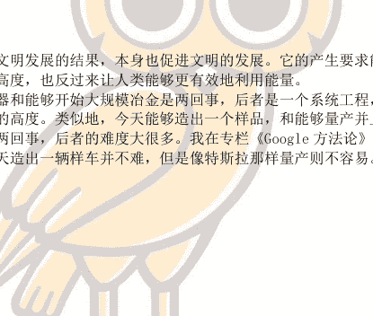

## 要点总结

- 1. 冶金技术既是文明发展的结果，本身也促进文明的发展。它的产生要求能量的利用水 平达到相当的高度，也反过来让人类能够更有效地利用能量。
- 2. 烧出一件金属器和能够开始大规模冶金是两回事，后者是一个系统工程，要求文明的 水平达到相当的高度。类似地，今天能够造出一个样品，和能够量产并且在商业上成 功，也完全是两回事，后者的难度大很多。我在专栏《Google 方法论》中介绍电动汽 车时谈到，今天造出一辆样品并不难，但是像特斯拉那样量产则不容易。

## 思考题

当人类能够冶炼铁时，除了陶瓷，还能发明什么副产品？

## 10 | 农业科技：中华文明为什么领先？

前面我们介绍的科技进步大多起源于人类最早的两个文明中，古埃及和美索不达米亚，从时间先后来说，这两个地区是人类文明的第一梯队。我今天要说的中国和后面要说的古希腊对世界科技的贡献，它们和古印度一道，是文明的第二个梯队，它们的起步比第一梯队晚了大约 1000 年左右。

在很长的时间里，中国和古印度一直是全世界 GDP 最高、文明程度最高的两个地区。这里面最重要的原因就是我在前面讲过的，它们人口众多，能量总量是巨大的。

因为，农业文明时代和后来的工业时代不同，后者可以通过使用更强大的机械，一个人完成几个人甚至十个人的工作，而前者每个劳动力所能做的事情的差距是有限的，因此人数的绝对值很重要。这也就是中国和古印度能够在农业时代领先的秘诀。

但是，当人口太多时，又会带来一个新问题，就是有限的土地养活不了那么多人。在明清之前，中国历史上有好几次非常惨烈的政治崩坏，都是王朝末年人太多了有关。而王朝末年的很多改革，也是要解决耕地问题。从西汉末年开始，每一次战乱之后人口急剧减少，出现大量空置的土地安置农民，经济就开始恢复，百姓安居乐业。

在从美洲引入高产粮食作物（明清之际）之前，解决上述问题的办法就是让单位的土地能够有更多的产出，也就是说，提高太阳能到生物能的转化效率，同时，还要让每一个人（以及牲畜）在劳动时，单位能量的消耗能换回更多的能量，也就是提高使用效率。要实现这两点，极根结底还得提高农业技术，在大约长达两千年的时间里，中国在农业技术上对世界的贡献非常大。

相比古印度，中国古代文明发展最大的内在困难就是可耕种的土地稀少。直到今天，中国的耕地面积仍然比印度少 20%（中国 1.28 亿公顷 vs 印度 1.6 亿公顷）。为了让农田里的庄稼长得更好，中国的农民发明了一种简陋却非常合理的种植方法——垄耕种植法。

垄耕种植，顾名思义，就是将庄稼成排种植在稍微高出来一点的垄上，垄与垄之间相对低洼的土地被称为沟。为什么庄稼这样产量就高呢？这里面有四个主要的原因：

首先，它可以保证每株庄稼独立成长、互不干扰，这样光照比较均匀，用今天的观点看，就是能量转换的效率高。此外，由于庄稼排列整齐，中间有成行的空隙，比较通风，在快成熟的时候不容易腐烂。

其次，便于农民在庄稼之间行走劳动，而不至于踩坏庄稼。庄稼从播种（或者移植秧苗）到收获，需要除草、施肥和间苗，有一大堆的农田劳动要做。

再其次，这样便于灌溉，特别是对南方的水稻田。大家可以做一个实验，将一盆水泼到水泥地上，一定是有箭的地方有水，有的地方依然干燥，但是如果地上有一道道的沟槽，水就自动沿着低洼的沟槽扩散开了。在田地里，毛细作用会让长在垄上的水稻根自动从沟槽中吸水。

最后，耙和沟在两季种植之间是互换的，每季庄稼收获完半期，要将田重新耕一遍，这时耙就变成了沟，沟就变成了耙，这一方面实现了土地的轮流修耕，可以保证地力的恢复，另一方面便于牲畜耕种土地，因为牲畜不可能像人一样往任何一个方向挥锄头，它只能在田里走直线。

中国人何时发明的耙耕种植法今天已经难以考证，当然更不知道是哪里的农民先发明的，不过根据李约瑟在《中国科学技术史》中的描述，这个年代不晚于公元前 6 世纪，也就是春秋末期。而欧洲的农民直至 17 世纪，也就是欧洲的农业革命时期，才懂得耙耕种植的道理，才超过了中国。

这是为何欧洲自中世纪后期开始，其实科技水平已经超过中国了，但是无论是人口数量还是经济水平都相去甚远的原因，主要原因就是产量太低。产量低，养活的人就有限，人口基数小，能够创造的总能量就有 限，文明的水平就低。因此，在能量的转化效率上，耙耕种植法帮助中华文明走在了前面。

我们在课程的一开始讲到，文明水平的高低在很大程度上取决于调动的能量多少。在农耕 时代，所能调动的能量除了人力，主要就是畜力了。在耕作时，畜力能够释放的能量越多，使用 效率越高，换回更多的单位能量就越大，农业就能领先。我们的祖先在利用牲畜的能量上，又发明了哪些科学技术呢？

今天大部分历史学家都同意这样一个观点，生活在欧亚大陆的人类因为有牛马等大型动物可 以驯化，因此文明发展较快，而在美洲和澳洲的原住民运气就没有那么好了。在农耕文明时 代，最强劲的动力来源是马和牛，在中国，牛是耕种的主要动力来源，而马则用于运输。在 欧洲，耕牛较少，无论是耕种还是运输，都靠马。

这有什么差别呢？差别在于，牛的牵引力大于马，只是速度不足而已。对于耕田来讲，速度 不是主要矛盾，牵引力更为重要。因此中国人发明了可以深翻土地的犁，在深翻过的田里种 植庄稼，庄稼能长得更好。

在农耕时代，运输货物的能力会在很大程度上决定经济的繁荣。在古罗马占领了地中海沿岸，并且修建了北非的大道，以及从美索不达米亚经过南欧到高卢的大道后，各地的农业趋向于种植当地最适合生存的单一的作物，而非生活所需的各种作物。

实际上，一个文明圈的影响范围有多大，取决于它有有效送货物的终点有多远。在农耕时代，采用牛马长途运输粮食或者一般的生活品从能量的角度来讲，是一件成本很高的事情。

下图是英国南威尔士地区在火车开通之前运货的牛车的照片，你可以看出，十几头健壮的牛只运输了不算太多的货物，而比采用牲畜运输效率高很多的方式是水运。从美索不达米亚，到古希腊，再到古罗马，经济能比较发达的原因，就在于它们占了地理上的便利，风平浪静的地中海就是它们的内海。

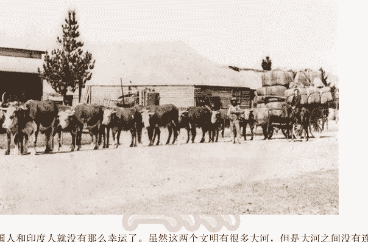

中国人和印度人就没有那么幸运了。虽然这两个文明有很多大河，但是大河之间没有连接，因此不同流域的文明难以融合。解决这个问题的方法是建造运河。

除了古希腊，世界早期文明都修建过运河，但是除了中国，规模都不大。说到中国的运河，大家都能想到大运河，但那已经是很晚的事情了。实际上在中国春秋战国时期，各国就已经挖掘了不少运河，比较著名的有魏国的鸿沟。

## 科技史纲 60 讲

中国最著名的运河当属大运河，建造这条规模巨大的运河当时已经超出了强大的隋帝国的经济能力，也就是说，当大量劳动力离开田地去挖大运河之后，剩余劳动力创造出的能量就不足以养活全国人。这条运河的建造直接导致了帝国的灭亡。七百多年后，另一个强大的帝国元朝也亡于了运河工程。

这说明在整个农耕文明时期，人类创造能量的能力还是非常有限的。这就又回到我们开篇所说的，王朝覆灭的主要原因就是创造的能量难以满足人口消耗能量的需要。

## 要点总结

- 1. 我们从能量的角度，分析了为什么中华文明在长达 2000 多年的时间里能够领先于世界，以及古代王朝又是如何在能量创造的匮乏中覆灭的。
- 2. 我们通过犁耕种植法说明了能量转换效率的重要性，从华具（深耕犁）和马具说明了能量使用效率的重要性。大家可以从这个角度理解一下为什么电动汽车更环保。
- 3. 我们从运输的能量效率，说明了水路运输的重要性。大家可以试着从这个角度出发，理解今天大洋贸易的重要性。

## 11 | 瓷器：中国历史上最伟大的发明

过去我们总是说“四大发明”很伟大，但是，在我看来，中国历史上最伟大的发明是瓷器。这一讲，我们以瓷器为例，来说明伟大发明的特点和能量作用。 虽然我在过去的专栏里也谈到了瓷器，但是重点放在发明的过程上，今天我们重点讲讲它背后反映出的一些规律性，特别要从预先要求和自然结果上介绍技术之间的网状联系，以及发明的必然性和偶然性。

为什么说瓷器是中国历史上最伟大的发明？因为它在下面几个方面有独特性。

首先，瓷器的发明特别难，要知道欧洲人到了18世纪才做出来，那时瓦特已经改进入万用蒸汽机了。如果向大宋末代烧瓷的工匠和瓦特推不起了，大家一定说是瓦特，但是从欧洲发明这两种东西的时间来看，差不多。那发明瓷器为什么这么难呢？

我们虽然总是说陶瓷、陶窑，其实陶和瓷是两回事。从材料上讲，陶器就是把普通的黏土捏到一起烧结完了，这就如同雪夫把雪和泥土夹杂的雪捏成一个雪球，它既不结实、也不纯粹。

而瓷器则是将特殊的黏土（高岭土或者叫微瓷土）烧化了再冷却形成一种新的材料。这就如同将特别纯净的雪融化成水再凝固成冰。冰的强度不仅比雪强高多了，而且有很多雪球没有的性质。

人类烧制陶器的历史有几千年，而且烧制陶器的黏土也遍布全世界，因此全世界各个文明都独自地发明了陶器。但是瓷器却不同，从中国在西晋前后发明原始的瓷器，到19世纪初德国人麦秸“再发明”出瓷器，中间相隔了大约1500年。

1500年是什么概念？比我们离婚唐太宗或者穆罕默德的时间还长。在这么长的时间里，已经掌握了蒸汽机技术，能制造显微镜的欧洲人居然造不出瓷器，可见发明它的难度有多大。

发明瓷器难的原因，用我们所讲的“预先要求”理论很容易解释，就是要想发明瓷器，需要具备的条件特别多。

首先，烧制瓷器的高岭土不是一般的黏土，虽然它在地球上的储量并不低，但它毕竟是一种矿，需要探测开采，而且在五个早期文明中心（美索不达米亚、古埃及、古希腊、古中国和古印度）中，只有中国有。高岭土储量最大的地区是美洲，但是那里的文明太落后，用不上。

其次，瓷器的烧制需要很高的温度，因为它的过程其实是将高岭土烧成半熔岩的状态，再冷却凝结成瓷器，因此这个温度至少要1100度~1300度。也就是说，一种文明必须要进入到能够冶铁的文明程度，才可能烧制瓷器。

当然，仅能够达到炼铁的炉温依然不够。冶铁不需要在大范围、长时间维持很高的炉温，过去的土高炉都比较小。但是烧制瓷器却需要非常大的炉窑，中国烧制越窑瓷器的古窑窑可以依山而建，长达近百米，烧窑的时间，一烧就是几天，甚至更长。

## 科技史纲 60 讲

要维持这么大的窑长期高温，首先要有足够的能量（木柴、木炭等）使用，而且还要保证能量使用的效率很高，否则烧出来的瓷器就太贵了。因此，能烧制瓷器的文明需要有足够的创造能量和利用的水平，而且还要有足够的燃料使用。仅最后一个条件在美索不达米亚和古埃及就无法满足，因为那里没有大片的森林。因此，烧制瓷器对技术的要求比冶铁要高得多

最后，瓷器的烧制还有很多偶然性的因素，我们这里只举一个例子，那就是：如何解决瓷器渗水的问题。今天我们都知道瓷器表面的釉起到了这个作用。但是给瓷器上釉又是怎么发明的呢？这就很有很大的偶然性在里面了。

中国古代的陶工在烧制陶器时，无意中发现木炭屑偶然地溅到了烧热的瓷器表面，产生了还原反应，形成了釉面。当然，这种反应要在很高的温度、相对封闭的空间中才会出现，烧制一般陶器（炉温不到 1000 度），是不会出现的。

上釉这件事情在一开始未必给陶工们带来了惊喜。因为本来白净的瓷器变成了表面沾上褐色的“粘铜物”的丑八怪。但是这样一来，烧出来的东西就具有了防水功能，这成了一个额外的发现。

当然，如果靠碰运气，靠木炭屑溅出一个自然上釉的瓷器，那个成功率也太低了，这就像让你解方程，你不知道怎么解，反复拿不同数字凑答案，不知道要凑多少次才能找到。

中国工匠的过人之处在于，他们发现了可以重复获得成功的方法，也就是让陶坯在烧制以前先浸泡在混有草木灰的石灰炭中。这样烧出的瓷器表面都有一层釉。这就如同找到了方程的解法。

很多人问，发现和发明有什么区别？发现木炭屑溅到高岭土坯子上能形成釉面，这叫发现，因为是以前不知道的现象。找到一种方法，能够重复地制造出上釉的瓷器，这叫发明。发明的本质不在于是不是第一个发现了现象，而在于找到一条行之有效的方法、确定性的方法，保证成功率。

从瓷器的发明，我们还可以体会到偶然性和必然性的关系。瓷器诞生在中国具有很多的偶然性因素，比如中国正好是一个文明水平比较高的国家，同时具有高岭土，古代中国植被丰富，不愁燃料供应，恰好中国又有一些爱琢磨的工匠发明了草木灰上釉法。这些缺一不可的因素凑到一起，偶然性很大，这多少都有很远运气的成分在里面。

但是，偶然性的背后常常有着必然性。高岭土在世界上并非稀罕很少，在中国这么大的地区被发现并不偶然；中国当时已经具有了较高的文明程度，能够冶铁，这也具备了发明瓷器的条件。只是上釉这件事情让中国人花了上千年时间才掌握（古巴比伦和古埃及人在公元前一千多年就发明了上釉技术），否则的话，瓷器可能会早出现几百年。

因此，当上面这三个主要条件都具备后，中国人发明瓷器是早晚的事情，这就是必然性。当然，必然性的背后，是中国人能量的获取和利用水平。

除了“发明特别难”，瓷器的第二个特点就是用途特别大。虽然在过去它主要作为盛器使用，但是后来的用途越来越广。在我们通常的印象中，陶瓷是最好的绝缘材料之一，电线杆和变电站的高压电线的绝缘瓷芯都是用陶瓷制作的。

到了上个世纪七、八十年代，科学家们又发现混合有特殊金属氧化物的瓷器在低温下呈现出超导的特性。此外，陶瓷由于能够耐高温，化学性质稳定，是航天飞机等特殊仪器的隔热材料。

## 瓷器的第三个特点是影响力广泛，经济意义大，这一点我在讲到瓷器贸易时再解释。

## 瓷器的第四个特点是难以替代性。相比其他的盛器，瓷器轻巧，耐用，相对比较结实，能做成各种形状，因此在古代的世界里，它是最好的做盛器的材料。由于热稳定性好，不像玻璃那么容易炸裂，因此即使是玻璃也竞争不过它。

此外，瓷器的表面可以做得很漂亮，除了日常使用，还可以做成摆件和玩具。这些是瓷器独一无二之处，靠着这一点，瓷器在被发明之后的一千多年里，在中国的经济和生活中占有极其重要的地位。

其实，这几个特点也不能完全解释瓷器为什么是中国历史上最伟大的发明，它对于解释信息的的重要性，以及作为几百年贸易关键商品的重要性，我会在后面继续讲解。

## 但是，中国历史上的这种瓷器性地位带来的一个问题，就是它抑制了另一种材料——玻璃的发展。很多人以为玻璃是西方人发明的，清代才进入中国，其实中国早在西周就能制造玻璃了。

从发明的难度来讲，玻璃属于青铜时代的产品，远比瓷器容易。在玻璃出现后的几百年中，中国人使用含重金属（铅锡等）比较高的玻璃，做各种装饰品，因为那种玻璃颜色比较丰富，当时人们就称它为琉璃。当然，中国人也用玻璃做了少量的盛器，一直使用到唐。到了宋代以后，瓷器发展起来了，那些并不算好看，还容易碎的玻璃完全竞争不过瓷器，便被淘汰了。

这原本对中国人的生活以及社会的发展也没有什么影响，但是在欧洲到了16世纪，玻璃的用途开始大爆发，特别是对科学研究产生了重大的影响，各种光学仪器和物理化学实验设备，都是玻璃制作的。

因此，今天有一种观点认为中国近代科技不发达，是因为舍弃了玻璃。关于这一点是否正确，我们不好下论断。但一种技术会抑制另一种技术却是不争的事实。

## 要点总结

+   1. 任何改变世界的重大发明通常具有这样一些特点：要有一定的难度，要有很大的用途，要有广泛的影响力和商业价值，要有难以取代之处。
2. 具体到瓷器的发明，它是人类利用能源水平达到一定水准后的必然结果。
3. 在任何时候，经常会出现两种相互竞争的技术或者产品，一种因为具有某种特殊的优势慢慢占据了上风，另一种就逐渐消失在人们的视野中了。但是，很长时间后，那种处于下风的技术在新的环境下又显示出特别的优势。而受益于前一种技术的企业和地区，在新的时代反而落伍。中国受益于瓷器上千年，但是正是由于瓷器产业太发达了，影响了玻璃产业的发展。因此，凡事有一利，就有一弊。

其实不仅东西如此，人最大的价值也在于他的不可取代之处。这是 我这一讲最想传递给你的信息。

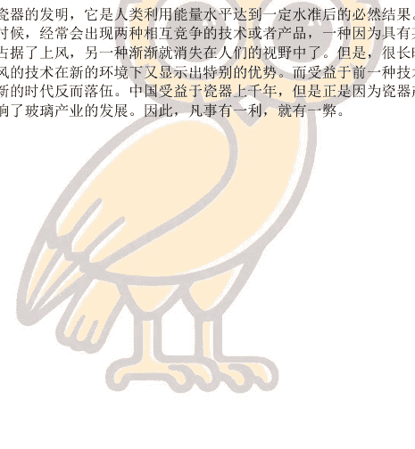

## 12 | 金字塔：为什么不是外星人建的？

这一讲，我要讲一个古埃及及文明的伟大工程——金字塔，搞清楚金字塔是如何建造的，可以帮助我们学到很多改进认知的方法。

金字塔给世界留下了太多的谜，也给人类留下了巨大的想象空间。埃及金字塔太巨大，本身就是一本活的档案，记录了太多现在看起来都难以置信的信息，以至于它是 如何建造出来的，一直到现在都是个谜。

虽然绝大部分人，当然也包括几乎所有的学者，大家都认为金字塔是古埃及人建造的，但是它一直也有两种非常主流的观点。一种是认为金字塔是由与今天一样发达，但已毁灭的史前文明建造的，另一种是认为金字塔是外星人建造的。

于是我发现，正确理解金字塔是澄清的这件事，其实是一个试金石，能够测试出一个人的认知水平、思考问题的方法，以及是否有解决问题的能力。

先说说为什么这两种非主流的观点不太靠谱。第一种很容易驳斥，因为如果曾经有过被毁灭的高度的文明，一定有一些那种文明的动物在地球上生存的证据。

这就好像当初达尔文找到了灭绝了的植被化石后，发现进化过程中有很多被淘汰的物种曾经统治着地球。如果有过和今天同样发达的文明，它一定能分布在地球很广的地区。但是今天地球的表面几乎已经被翻得很彻底，人们也没像达尔文发现化石一样，发现任何史前高度发达文明的痕迹。

更重要的是，从今天的考古发现和生物基因变化来看，在过去的上千年里，地球物种的演变是连续的，并没有中断，也就是说，不存在 5000–6000 年前人类文明曾经极高，然后又跌回原点重新开始的可能。

对第二种观点的驳斥，其实罗老师和其他老师在课程中也讲过很多了，外星人从未到访地球已经是确定无疑的结论了，如果你有兴趣，可以在得到搜索关键词“外星人”进行检索学习。

## 科技史纲 60 讲

芝加哥大学的古埃及学家马克·莱纳将主要的研究成果编成了一本很厚的书，叫做《金字塔大全》，里面详细解释了建造金字塔的各种秘密。我在《文明之光》中概括了这本书中的很多内容，今天我将你再提炼和总结一下。

首先，我们要承认金字塔的大。位于吉萨的三个大金字塔中，最大的胡夫金字塔，在 1311 年，高 147 米的英格兰林肯大教堂建成之前，它是世界上最高的建筑，这个纪录保持了 3800 多年，非常的不起，在它建成后再过 1000 年，中国的商朝才建立，同期古希腊的迈锡尼文明才刚开始。

对于这么大的建筑，科学家们首先要搞清楚建筑材料，也就是那些巨石到底是从哪里来的，这些巨石每块平均重 2.5 吨，最大的巨石重达 80 吨左右，而且有大约 230 万块之多。最关键的是，金字塔所在地本地本身没有这些石灰岩巨石。考古学家们发现它们来自于尼罗河对岸，但是接下来大家就又有一个问题，那就是这些巨石是如何开采、切割和运输的呢？

古埃及当时已进入了青铜时代，有青铜的锯子，但是青铜锯子硬度不够高，因此当地人把石英砂粉末在钢绳的表面，这就可以锯开石灰岩了。古埃及留下的一些壁画描绘了当时工人开采切割巨石的情况。

至于运输，由于古埃及当时还没有发明轮子，因此他们搬运这些石头确实费了些功夫，不过古埃及人远比我们想象的要聪明，他们制作了类似雪橇的运输工具来搬运石头。这件事情是有证据的，在第十二王朝的法老杰胡提霍特普的墓中，有一幅壁画，就描绘了 172 个人拉着一个雪橇似的木筏运巨石的场景。

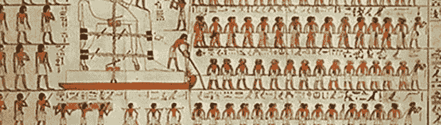

从画面上石头的比例估计，巨石有 60 吨重。大金字塔最大石块的重量大约 80 吨，也就证明这种方法应该是可行的。另外，古埃及人还是用了圆木铺路，相当于起到了轮子的作用。下面是那张搬运巨石的图。

接下来，一块块巨石是如何摞在一起，建成金字塔的呢？他们用的方法说

当然现代人猜想的方法是否管用，需要试一试。日本人做事比较婆婆，日本著名的建筑公司大林组还真按照古埃及留下的记录做了模拟试验，他们搭了一个坡度为1：4（高度和长度的比例）的土坡，然后用18个人将一块2.5吨重（大金字塔石料的平均重量）的巨石拉了上去，每分钟能移动18米，不算太慢。这证明这样的方案是可行的。

我们知道大金字塔摞起来的石头之间是严丝合缝的，连头发都插不进去，这是怎么做到的呢？实际上石头之间是填满了石膏的，保证石头之间不留缝隙。

当然使用石膏填充又有一个问题，就是它本身是强的，如果等它干燥需要很长时间，流动的石膏会形成缝隙，这个问题古埃及人是如何解决的呢？科学家们发现石膏中有干烧过的痕迹，证明古埃及人用炭火（或者木柴）将它烤干的。

当然，大家可能还有一个问题，那就是巨石是如何从山体上开凿下来的？古埃及人的做法很有创造性，他们先用青铜的凿子凿出一个小缝，然后打入木楔子，然后往缝里灌水，木楔子被水浸泡后膨胀，就把有缝的石头给涨开了。总之，关于大金字塔建造的各个细节在今天都找到了答案。

另外，大金字塔一些特别的建筑设计，今天从力学的角度也能解释。比如大金字塔的入口，位于塔身距地面13米高处，是三角形，由4块巨石砌成。

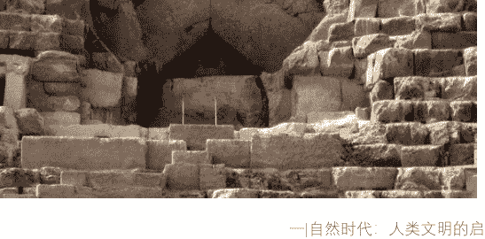

## 为什么它的入口要这么建，而不是建成方形门？

因为从力学的角度来看，三角形的设计最能承重，其他几何形状（如四边形）的入口，都无法承受金字塔本身几百万吨的巨大重量。

大金字塔还有很多谜团，它还记录了古埃及很多文明成果，关于这一点，大家也可以参考我写的《文明之光》。

从工程上来讲，金字塔并非古埃及及完成的难度最大的工程，比它难度更大的工程是巨型的方尖碑。方尖碑上那一整块重达数百吨的巨石是从遥远的阿斯旺开采出来的，然后通过水路运到卢克索等地区。接下来还要将其它毫不差树立在设定的石座上，这可难度比建造金字塔大多了。

今天在法国协和广场可以看到的古埃及方尖碑重达 250 吨，古埃及其实制造了一个更大数量级的，但是实在太大没有立起来。金字塔的伟大之处主要在于总量太惊人了，《金字塔大全》这本书里记载，埃及有 138 座大小不一的金字塔。

我们在前面的课程中讲了能量和科技、文明的关系，大家可以算算建造一座大金字塔要消耗多少能量。据估计，当时在金字塔工地上有 20 万平民和奴隶工作，养活这么一大群人在当时都是一个巨大的问题。

## 要点总结

+   1. 对于我们不知道的事情，我们有两种态度，一种是设法将它们搞清楚，这就是人类积极的态度，也是科学家每目工作的目的。另一种是简单归结于神或者什么外星人，这是一种懒惰的态度。不同的态度得到不同的结果。
2. 我在之前的课程中讲过，在金融上，市场永远是正确的，如果理论和市场不一致了，不Қазақ市场错了，而是理论错了。在生活中，事实是正确的，如果理论解释不了现实，不是客观存在事物错了，而是要修正理论。对于金字塔，它的存在是事实。不能因为它存在在肯定人类的问题，而是需要通过它的存在，了解当时的文明水平。
3. 通过介绍大金字塔的建造，希望大家进一步理解能量和文明的关系，体会为什么只有中央集权的农耕文明才能完成这样伟大的工程。
4. 要想摧毁对方不切实际的想法，我们需要提出自己合理的想法。科学家们在解释大金字塔建造之谜的问题上不是和阴谋论者吵架，而是通过研究，给出合理的解释。

## 思考题

能否分享一些你了解的古代世界上的伟大工程？

## 13 | 古埃及象形文字是如何破解的？

这讲和下一讲，要说的话题是关于破解人类最早的两种书写系统，古埃及的象形文字和美索不达米亚的楔形文字，我希望通过这两节课程，帮助大家对信息的相关性和冗余度有所理解。

发现和破解古埃及文字的过程非常偶然而富有戏剧性。1798年，拿破仑率领四万大军远征埃及，试图从背后切断英国和印度之间的贸易。他在金字塔战役中一举击败了十倍的敌人（包括3万英军、20万奥斯曼土耳其帝国的军队、8万埃及的军队以及十几万其他中东国家的军队），这样一来，就更不把敌军放在眼里了，孤军深入，一直占领了埃及及在尼罗河下游的主要地区。

当时拿破仑不仅想在军事上重现亚历山大帝两千多年前征服埃及的伟业，而且想在文化上超越前人。于是他也像亚历山大那样，带领了上百名科学家一同远征埃及。

1799年的一天，一个叫布沙尔的法国上尉在一个要塞中发现了一块缺额的石碑，这上面刻有三种文字：除了古希腊文，还有两种他不认识的文字。

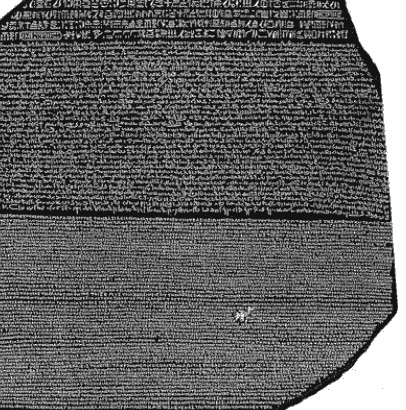

## 科技史纲 60 讲

但是，拿破仑的胜利没有持续很长时间，英国海军名将纳尔逊在地中海上击败了法国海军。失去海上支持和补给的拿破仑虽然在陆上取得了一系列的胜利，但是在埃及和中东最终还是维持不下去了，于是就和英国人和议，撤出了埃及，同时包括罗塞塔石碑在内的很多古埃及文物也就移交英国人，这些文物就成了后来大英博物馆最重要的馆藏。

英国人得到罗塞塔石碑后，就开始投入很多学者去进行破译，其中贡献最大的是著名物理学家托马斯·杨。你可能在中学物理的光学部份学过一个叫做托马斯杨双缝实验的课题，那个著名的实验就是他做的。

托马斯·杨是个全才，甚至被称为英国最后一个全能型科学家，他对古埃及文字也很感兴趣。他通过研究，发现了古埃及文字和古希腊文的个别对应，特别是埃及法老托勒密密和克利奥帕特拉的名字。这两个名字对于古埃及人来说都是外来字，因此相当于今天汉语中对外国人名的音译。但是除此之外，英国人并没有取得什么新进展。

法国人虽然失去了石碑，但是保存了拓片，也一直在研究它。1822 年，法国天才的语言学家商博良通过碑文上的古希腊文，破解了石碑上的古埃及象形文字的含义，尼罗河流域五千年的文明的面纱就此揭开。

讲到这里你可能会好奇商博良是怎么破解的，为什么他之前的人没有做到？这里首先的原因是商博良本人是语言天才，不仅懂很多语言，而且学习语言特别快，因此他对语言的敏感超过任何人。在商博良之前，虽然托马斯·杨也做出了一些研究成果，但是总的来说，方法走偏了。

罗塞塔石碑最上面是 14 行古埃及象形文，又称为“圣书体”，是献给神明的文字，其中的句首和句尾都已缺失，很难破译。中间是 32 行埃及草书，相当于我们的白话文，又称为“世俗体”，是当时埃及平民使用的文字。

我们今天在埃及纸莎草上看到的文书大多是这种文字，在下面的 54 行则是古希腊文。研究罗塞塔石碑的学者，都是试图先找到第二种文字和古希腊文的对应。

以前，大家都觉得古埃及象形文字完全是表意的。但是商博良发现如果它们（像汉字一样）都是一个符号一个意思，碑文相比希腊文的就太长了，因此一定有一些是音节文字。

商博良利用托马斯·杨已经确认的埃及法老托勒密和克利奥帕特拉的名字，确认了古希腊文和古埃及文字对应的确定位置。然后商博良找到了 12 个古埃及文字中音节符号的含义，下面这张图是商博良制作的古埃及文字音节和希腊字母的对应表。

|  |  | Signes Hieroglyphiques | Valeur chez Mr. Young | Valeur dans mon Alphabet |
|---|---|---|---|---|
| 1 |  |  | BIR | B |
| 2 |  |  | E | R |
| 3 | * |  | I | I. È. AI. |
| 4 | * |  | N | N |
| 5 |  |  | enebé | K |
| 6 |  |  | KE. KEN | S |
| 7 |  |  | MA | M |
| 8 |  |  | OLE | L |
| 9 | * |  | P | P |
| 10 |  |  | inutile | Ô. OU |
| 11 |  |  | OS. OSCH. | S |
| 12 | * |  | T | T |
| 13 |  |  | OU | KH. SCH |
| 14 | * |  | F | FV |
| 15 |  |  | ENE | T |
|  |  |  | 4 5 1 | ? |
| Page 33 |  |  |  | 19.11 |

## 科技史纲 60 讲

在完成了最艰难的一步之后，商博良一点点抽丝剥茧，逐渐破解了罗塞塔石碑上的内容。原来，这个石碑是在公元前 196 年埃及国王托勒密五世加冕一周年的诏书。在此此前大约一百年，埃及已经被来自希腊北亚历山大大帝征服，被纳入了希腊文化圈。亚历山大死后，他的部将托勒密自立为埃及法老，开始了埃及历史上的托勒密王朝，希腊文就成为了埃及的官方语言。

与此同时，埃及原有的文字也在使用，因此就出现了一碑三文的现象。无疑，罗塞塔石碑便是开启以象形文字记载的古埃及文献秘密的金钥匙。

我们今天对 5000 年前古埃及历史的了解要远比对 500 年前印第安文化的了解多得多，这要感谢发现罗塞塔石碑的法国军人包沙尔，拓下石碑文字的科学家让-马塞尔，当然最该感谢的是商博良。至于托马斯-杨的贡献，历史上一直有争议，商博良自己并不认为托马斯-杨的工作有多大的意义。

讲回到破解古埃及文字这件事，那些失传的文字之所以能够被破解，主要是因为相同的内容以不同的文字或者其他形式记录了很多遍。这种信息论上被称为信息冗余，靠信息冗余，可以恢复丢失的数据。对于大数据，由于它是从很多不同维度来描述一件事，因此具有信息冗余，在丢失了一些维度的信息后，可以通过其它维度的信息补回来。

从好的方面讲，它可以避免信息的丢失，从坏的方面讲，即使我们删掉了一些敏感信息，比如和我们隐私相关的信息，也可以从其它维度补回来。因此我们今后恐怕要生活在一个没有隐私的年代了，因为机器破解我们的隐私，要比商博良破解古埃及文字容易得多。

通过这一讲，我希望你进一步体会信息在整个文明中的作用，包括我们破解历史的作用。

## 14 | 楔形文字是如何破解的？

上一讲，我们说了古埃及及的象形文字是如何破解的，这一讲我们谈谈有关楔形文字的破解。

美索不达米亚楔形文字的破译相比较古埃及象形文字的破译要难很多。在很长的时间里，人们一直以为古埃及是人类第一个文明中心，但是近年来大家发现美索不达米亚的文明开始得更早。不仅如此，当地的楔形文字出现的时间，也早于古埃及的象形文字。

由于美索不达米亚采用泥板记录，而泥板的制作成本极低，比古埃及用的莎草纸便宜多多了，使用范围很广，因此有大量的泥板保存至今。

刻有楔形文字的泥板其实早在文艺复兴时期就被运到了意大利，但是没有人知道那些符号是什么意思，因此也就没有人再去揣摩它。最初研究和破解楔形文字的是罗林森。

和商博良一样，罗林森也是一位语言天才，他17岁时就熟练地掌握了波斯语，此外他还会古希腊语。1835年，罗林森还是英国东印度公司的一个雇员，他被派到德黑兰去训练当地的部队。

他听说在恰马丹毕竟希斯村附近的一块岩石上非常漂亮的雕画，于是出于好奇就跑去看热闹。在那个悬崖峭壁上，他看到了令人震撼的一幕——高达百米的巨型雕画，虽然经历了上千年的风雨，但画面依旧清晰而漂亮。

这时罗林森注意到在巨幅雕画的上部刻有很多古怪的符号，他本能地感觉那些符号隐藏着什么秘密。他想爬上去把它给拆下来带回去琢磨，可是他爬不了那么高。后来，他找一个能够爬高的库尔德小男孩，拿出一大笔钱请那个男孩爬上去帮他拓下那些符号。这就是著名的贝希斯敦铭文。

由于那个雕画高近百米，当时也没有什么攀岩工具，因此攀高拓片是一件非常困难而危险的事情。小男孩在岩石缝里打下了木桩，然后用绳索栓在木桩上，相当于搭了个简易的脚手架，这才得以攀到岩石的顶部把那些符号拓了下来。

那些拓片上的符号像一个个小钉子，后来那些文字在英语里就被称为钉子形文字，而在中文里被翻译为楔形文字。罗林森对这件事，后来写道，“我当时并不知道攀登到岩顶找到那些铭文会是这样伟大的壮举”。

也是罗林森运气好，拓片上的文字和罗塞塔石碑上的也三种，那么它们应该是三种不同的文字。但是和罗塞塔石碑所不同的是，这三种文字也一种也不认识。

罗林森也没有办法，只能先把这件事搁置了。后来他被作为外交官派驻到巴格达，当然同时也被安排了间谍工作。他在巴格达的大街小巷收集各种信息，有些是英国要的情报，有些是他自己想要的史料。

## 科技史纲 60 讲

在他32岁那年，一件事让他后来下决心破解那些楔形文字。那一年，法国人发现了传说中的亚述帝国的都城尼尼微，欧洲掀起了研究中东地区古代历史的热潮。于是，罗林森决定专注于楔形文字的研究。但是，由于他所得到的的黏片上没有任何他能够认识的文字内容，因此那些楔形文字的破译要比利用罗塞塔石碑破译古埃及象形文字难得多。

罗林森决心从其他的地方找到那些铭文的内容。最终他从古希腊人的记述中，见到了对这个古波斯雕画和碑文的描述，由此，他知道希腊文的内容。以这里，他将希腊文的内容和拓片上的波斯楔形文字原文相互对照，花了16年时间，才破解了波斯楔形文字，1849年他发表了自己的破译成果。

美索不达米亚文明和古埃及或中国文明都不同的是，那里不是单一文明，而是在大约3000年的时间里被一个又一个国家轮流统治，因此不同时期的文字也不一样，需要一一破译。在破解了古波斯楔形文字后，罗林森试图破解黏片上的第二种楔形文字，以便了解更多的历史。

当时欧洲人在美索不达米亚地区发现了大量早期文明的遗迹，大量的楔形文字泥板被发现，很多学者对此感兴趣而参加到了破译的工作中，不过他们并没有合作。几年后罗林森和其他学者们独立地破解出了新埃兰楔形文字和巴比伦楔形文字。

但是，最古老的苏美尔楔形文字却一直没有得到破译，因为它们太古老了，和其他楔形文字没有什么共同之处，从某种意义上讲，它们更像是象形文字。

下面这张图是我画的一些从苏美尔象形文字到它的楔形文字再到后来巴比伦的楔形文字演变的过程。从图中可以看出，苏美尔的楔形文字和后面的差别很大。

| 含义 | 苏美尔象形文字 | 苏美尔楔形文字 | 新巴比伦楔形文字 |
|---|---|---|---|
| 天、神 | * | * | 丨 |
| 人 | ▲▲ | △ | 人 |
| 网 | 网格 | 网格 | 网格 |
| 手臂 | 手臂象形 | 手臂楔形 | 手臂楔形 |

直至18世纪末到19世纪，其他楔形文字才一一被解读出来。解读顺序是这样的：古波斯楔形文字—新埃兰楔形文字—巴比伦楔形文字—苏美尔楔形文字。

苏美尔文字的破解非常难，是非常多科学家共同努力的结果，从19世纪末直到20世纪40年代，大家花了大约半个世纪的时间，才算把它基本上搞清楚了。从此，我们才得以了解地球上近7000年的文明。

生活在美索不达米亚的人都为人类贡献了什么呢？说到那里，大家可能第一个想到的是已经不存在的空中花园，但那其实在美索不达米亚的文明中不过是一个微乎其微的成就。

从苏美尔人开始，那里为人类发明了车子：和帆船，最早的水利系统，最早的文字，最早的上釉技术，那里也是最早普遍使用铁器的地区，那里的先人还制定了最早的法律，和埃及人签署了最早的和平条约，等等。

美索不达米亚在很长的时间里是世界上几何学和天文学的中心，当时古希腊的学者都要到那里学习数学。这就是我在下一个模块第一讲要讲的内容。

不过，随着气候的变迁，波斯帝国的入侵，那里的文明消失了，并最终被埋在了黄沙之下。不过，如果你到世界一些大博物馆去，依然能够看到几千年前那里的文明。

## 要点总结

- 1. 文字破译最根本的是利用对一件事件多种文字同时记载时所产生的冗余度，找到信息之间的对应关系，即信息的相关性。
- 2. 记录这件事很重要，而且有时需要用不同的方式留下多种记录。不仅对于将来研究历史如此，对我们的工作也是如此。徐涛说得好，再好的记忆都不如烂笔头子。我们在后面的内容中会看到，记录是保证科技发展能够取得叠加式进步的条件，也是职业人士做事的方法。
- 3. 记录载体廉价、易获取，对于文明本身很重要，今后我们在介绍纸的发明时还会讲到这一点。

好，到这里，我们的祖先借助外力走出了非洲，开始了农耕定居的生活，创造能量的水平和能量的使用效率都越来越高；另外，依靠着语言、文字和书写系统等发明，经验、技术也得以传承，在能量和信息这两条线索的共同作用下，文明也就随之开启了。

## 15 | 为什么其他文明没有诞生古希腊的科学？

我们都知道著名的李约瑟难题：尽管中国古代对人类科技发展做出了很多重要贡献，但为什么科学和工业革命没有在近代的中国发生？

对于这个问题，有不下百种的原因分析，譬如近代中国因为专制制度，科技落伍了，明清统治腐败，中国知识分子重文轻理等等，我们就不一一列举了。这些其实都没有说到点子上。这里最关键的问题是，李约瑟混淆了概念，硬地把科技和科学混为一谈。

李约瑟说的中国古代学术技术很发达，其实只是指技术很发达。虽然中国古代也有了很多具体的科学成就，比如对圆周率的计算，张衡类似地心说 浑天说等等，但是中国古代是否有成体系的科学，那就是另别论了。其实很多著名的学者，包括...)等人都认为中国古代没有科学，所以，李约瑟的问题也就自动解决了。

接下来，要讨论有没有科学，就要先说清楚什么是科学。民国时期中国科学的奠基人任鸿隽先生把科学分成广义上的和狭义上的两个不同的概念。所谓广义上的科学，是指任何成为体系的，能够自洽的知识。如果从狭义上讲，那科学就是指源于古希腊，建立在严格逻辑推理之上，后来在近代西方科学方法基础上传发展起来的，可以证实和证伪的完整体系。

按照狭义科学的定义，不仅中国，还有古印度文明，它和中华文明一样持续了几千年，在很长的时间里 GDP 都是全球第一的，也有很多数学上的成就，但是它也没有出现系统的科学。这样说来，除了古希腊，任何其他古代文明都没有产生严格意义上的、有体系的科学。

那么为什么偏偏只有古希腊能诞生科学而其他地方不行呢？科学不同于解决实际问题的技术，它不是经济发达，有了钱之后，就自然而然出现的，它需要很多先决条件。

我们都知道，古希腊的学者苏格拉底每天早上吃完早饭，和他那个叫做老婆打个招呼，就去广场上与人辩论了。事实上不止苏格拉底如此，当时很多雅典的公民都是如此。古希腊人具有其他民族缺乏的逻辑推理能力和抽象思维能力，并且与其他民族不同，他们非常享受纯粹思维的乐趣。

古希腊人之所以能够达到这一点至少有三个原因：

## 第一，他们喜欢对自己不明白的事情刨根溯源，喜欢辩论，觉得道理越辩越清楚，这就如同中国古代的庄子和惠子老是争来争去一样。

在这些爱争辩的古希腊人中，最有名还不是苏格拉底，而是一叫做芝诺的人。他提出了好几个悖论，比如飞毛腿阿喀琉斯是否追得上乌龟，射出去的箭到底是运动的，还是静止的等等。

这些问题按照中国的价值观完全是庸人自扰，因为毫无实际用途。但是后来关于极限的概念，关于无穷小的概念，关于运动速度的概念，都和芝诺的这些悖论有关。关于芝诺的四个悖论，你可以回顾我的专栏《硅谷来信》。

## 第二，古希腊那些自由民有基本的生活保障，一方面他们因为商业发达而有些钱，另一方面一些奴隶在帮助他们干活。

古希腊的奴隶其实有两种，一种是我们理解的没有人身自由、干体力活的人，另一类则是有知识有文化的人，相当于我们今天公司的白领，他们是家里的管家、家庭教师、乐师，甚至是生意上的店长。

因此，像苏格拉底那样的人平时候没有什么烦心事，他唯一的烦恼就是他那个悍妇老婆。这些人有闲情思想大自然的道理，并且享受地中海良好的气候。

## 第三，古希腊人对物质的欲望非常淡，即便统治者也是如此，这和古埃及、古代中国都不相同。古希腊人每天的食物只有一点面包，一点橄榄油和一杯葡萄酒而已，直到今天，希腊除了烤羊排，都没有什么是美食。

但是另一方面，古希腊人的精神世界比较丰富，而且充满理性的精神。他们认为人是理性世界的一部分，应该避免受到感情方面的影响。人生目标就是符合这个世界的理性，过有德性的生活，他们褒奖节制、知足、平静（一种对外在事物的冷淡）视为美德。这在后来演化出斯多葛学派。亚历山大帝和后来的一些罗马皇帝，都很推崇这种世界观。

古希腊人独特对精神世界的追求，成为了科学诞生的基础，科学的体系在此基础上生根发芽。再对比古代中国，我们的技术发明大多是用于改善实际生活，目的也很明确，就是要“有用”，对现象背后的规律缺乏系统、深入的探究。因此我们离“科学”就越来越远了。

你可能会不服，说古希腊时期那些学者提出的思想很多都是错的，泰勒斯说世界是水构成的；亚里士多德关于重力的说法后来也被伽利略的铁球实验证伪了；毕达哥拉斯不承认无理数的存在，甚至不惜消毒自己的学生，这个毕达哥拉斯学派简直就是邪教……

## 科技史纲 60 讲

提起毕达哥拉斯，你会想到他的“毕达哥拉斯定理”，也就是勾股定理，但是你有没有想到，明明古埃及、美索不达米亚、古代中国和印度都也都很早就观察到了直角三角形中的这个现象，可这个定理为什么却偏偏归属于毕达哥拉斯呢？

因为，其他地方的人只能算是根据经验总结出一个结论，并举出一些具体的例子，而毕达哥拉斯则把它上升成一个定理并且根据逻辑而不是实验证明了它。这样，他就将代数和几何统一起来了，并通过逻辑推演的方式而不是经验和测量的方式，得到数学结论，这就完成了数学从具体到抽象的第一步。

如果说毕达哥拉斯奠定了数学的基础，亚里士多德则奠定了基于观察和实验的自然科学的基础。今天科学上尤其是物理学的很多基本概念都是亚里士多德提绕出来的，比如密度、温度、速度等等。当然，亚里士多德最大的贡献在于建立科学乃至整个人类知识的分类体系。

在古代的世界里，第一位将建立在逻辑之上的数学，和建立在实验之上的物理学结合在一起的科学家是阿基米德。他也可以算得上是人类第一位科学的集大成者。依靠数学，阿基米德完成了物理学从定性研究到定量研究这一飞跃。

他在科学上的贡献很大，比如我们在中学学到的杠杆原理和浮力定律都源于他。但是，他更了不起的地方在于，他开始主动使用科学结论指导工程，这就将纯粹抽象的科学和技术结合起来了。再往后，能够做到这一点的科学家要等到一千年后才出现。

好，这一讲我讲了古希腊诞生科学的基础，以及完成这一项系统性伟业的四个关键人物。无论是在研究的广度还是深度上，古希腊文明都远远领先于同时期的其他文明，甚至比一千年后欧洲普遍的水平还高。

他们以理性探究为基础，以严谨论证和观察实验为手段，确立了数理科学的传统，为系统科学的诞生打下了基础，影响一直延续到两千年后的哥白尼、笛卡尔、伽利略乃至牛顿。

## 要点总结

- 1. 科学和技术不同，科学未必和经济效益直接挂钩，从科学的出现可以看出，它需要从业者有比较纯粹的探索精神，远离物质的诱惑。因此，如果谁想当一个科学家，就不能和钱走得太近。
- 2. 我们不应该忘记在科学发展过程中那些奴隶的作用，没有他们的工作，古希腊的科学家就难以有暇思考科学的问题。今天虽然没有奴隶，但是由国家或者慈善家出面，保证科学家基本生活物质条件是必要的。
- 3. 科学是系统的，是在逻辑的基础上不断进的，而不是各种知识点的简单的结合。因此我们的学习也应该是系统的，只有这样我们才能获得可叠加式的进步。

## 16 | 为什么造纸“术”的发明远比“纸”的发明重要？

这一讲我们从信息传播的角度来分析一项人类历史上的重大发明——造纸术。

造纸术为什么重要呢？从信息的角度来看，人类文明的进步不仅取决于科技发明本身，还取决于对这些发明的传承和传播，而无论是传承还是传播都有赖于对于科技成果的完整记录。

人类早期总结出的知识只能口口相传，这样不仅传播得慢，而且还经常误传、失传。我先给你讲一个真实的故事：在19世纪中期，在格陵兰岛北极圈里生活的因纽特族群中，几位长老染病去世，按照当地的风俗，要把他们生前所用的狩猎工具拿去贬弃，由于他们没有文字记录的传统，制作这些工具的手艺就失传了，这个族群的人口数量就减少了一半。

这样的结果就是，人类只好再花很多时间重义之前的发明，经常在低水上重复，而不是获得可叠加式的发展。因此，记录和传播知识很重要，而且对文明的重要性可能不亚于创造知识本身。

人类其实很早就意识到这个问题了，他们于是将信息记录在洞穴的岩壁上、石头、陶器或者龟壳兽骨上去记录信息，这些信息很多都被永久性地保留下来了，但是，这样做的成本很高，而且不方便信息的记录和传播。怎么能把信息记录下来并且随身携带呢？

美索不达米亚的苏美尔人无疑是先驱，他们把泥捏造成比巴掌略大的平板，将图形和文字刻在上面，然后晒干或者用火烧成陶片。胶泥随处可取，非常廉价，在上面刻写也不麻烦，因此这种记录信息和知识的方式在美索不达米亚迅速普及。

今天我们依然能找到美索不达米亚各个时期留下的大量的泥板，里面记录了各种各样的内容，从合同到账单，从教科书到学生的作业，从史诗到音乐，这让我们能够非常好地了解当时的社会和人们的生活。

## 科技史纲 60 讲

莎草纸的历史也可以追溯到大约5000年前，并且一直使用到公元800年左右，直到阿拉伯人从中国学到了造纸术，前后时间跨度近4000年。不过在最后的1000年里，莎草纸和羊皮纸是并存的，而羊皮纸的发明，按照普林尼在《自然史》中的描述，则是埃及一位国王对莎草纸禁运的结果。

事情是这样的，在很长的时间里，埃及垄断着这种昂贵又必不可少的“纸张”，因此从环地中海国家那里发了不少财。公元前200—300年左右，小亚细亚的希腊小国帕加马（Pergamon，也翻译成“佩加蒙”）开始繁荣。国王欧迈尼斯二世对文化很推崇，打算建立起一个大图书馆，并试图超越在地中海对岸的亚历山大图书馆。

当时图书馆的概念不仅是藏书，而且像一个大学或者说研究所在，建立图书馆是为了吸引人才，帕加马当时从欧亚非各地四处网罗人才，包括跑到亚历山大图书馆去挖人。经过逐步几代国王的努力，帕加马图书馆终于成了古代世界仅次于亚历山大图书馆的文化中心。

帕加马文物的繁荣使得对纸张及莎草纸需要的剧增，以至于短时间内对尼罗河三角洲纸莎草的过度开采便导致原材料不足以供应。在这种情况下，埃及（当时已经是托勒密王朝了）国王决定将帕加马来个帝国封杀——禁止莎草纸的出口。

帕加马人不得不寻找新的文字载体，他们发现可以将刚出生就夭折的羊羔和牛犊的皮，经过处理，拿来写字，不仅字迹清晰，而且耐久耐磨，取放方便，于是就发明了羊皮纸。

“羊皮纸”这三个字的中文字面意思有点误导，因为这种纸张的原材料从一开始就是羊皮和小牛皮都有，在拉丁语中，它以当地的名字 pergamena 命名，而它的英语说法 parchment 则是以制作的方式“烘烤”命名的。

相比较脆弱的莎草纸，羊皮纸有不少优点，比如它非常坚实，可以随意折叠弯曲，此外它还可以两面写字，这就图书籍从一开始的卷轴发展成册页；这就如同中国在纸张出现之后，图书馆也从一卷一卷的竹简书，变成了 一页一页的纸书一样。

羊皮纸非常昂贵（实际上比莎草纸更贵），因此通常不得不反复使用。具体的做法是用小刀把以前的字迹刮去，然后重新书写。这便出现了一张羊皮纸上有不同历史时期文字的现象，而经过多次的刮去处理，有时能从羊皮纸上读出表而文字下面的文字。阿基米德手稿的抄本就是这样被复原的。

无论是莎草纸还是羊皮纸都不是理想的信息传播载体，因此知识传播的速度并不快。

在过去的上千年里直至今天，全世界知识和信息能够被记载，并得以迅速传播、普及，则要感谢中国1世纪时也就是东汉时的发明家蔡伦。需要指出的是，蔡伦发明的并不是纸张本身，而是能够大量生产廉价纸张的造纸术。

在科技史上，第一个造出某物件的意义其实远没有发明生产这种物件的流程来得意义大，在纸张的发明上也是如此。虽然在蔡伦之前已经有了纸张，但是要么价格太高，要么质量太差，只能当扑布使用，不能书写。在历史上发明的荣誉常常是给最后一个发明者，而不是第一个。

从某种意义上讲，蔡伦既是造纸术的第一个发明者，也是纸张最后的发明者，他的贡献不仅是发明了一种具有通用性的书写载体，而且发明了一种工艺，能够大量生产这种纸张。

古代一种文明的繁荣包括其科技水平的提高，总和相应信息载体的发明和普及直接相关。苏美尔文明能够率先发展起来，和它发明了泥板记录相关，类似地，莎草纸的发明和普及伴随着古埃及文明，羊皮纸的发明伴随着希腊和罗马文明，竹简（和木简）的使用和普及让中华文明春秋、战国时期达到一个顶峰。而纸张的发明，则在随后的中华文明进程中起到了巨大的作用。

中国从东汉末年到隋唐，虽然战乱不断，中华文化却在不断发展，这里，纸张的贡献不可低估：相比之下欧洲在古罗马之后，因为为数不多的藏书被毁灭，很多知识和技术都失传了。到了文艺复兴时，欧洲人不得不从阿拉伯将失传的著作翻译回来。

中国的造纸术在8世纪被阿拉伯人学会了：一般认为他们是在打破了唐军，俘获了一批工匠后学会了造纸术。造纸术传到了大马士革和巴格达（正值阿拉伯帝国的崛起），然后进入摩洛哥，在11世纪和12世纪经过西班牙和意大利传进欧洲。造纸术每到一处，当地文化就得到很大的发展。

欧洲的第一个造纸作坊于1150年在西班牙诞生。一百多年后，意大利出现了第一个造纸厂，当时正是但丁生活的年代，很快文艺复兴就开始了。又过了一个世纪，法国成立了第一个造纸厂，然后欧洲各地才逐渐有了自己的造纸业。宗教改革才有了开始的条件。

1575年，西班牙殖民者将造纸术传到了美洲，在墨西哥建立了一家造纸厂。而美国（北美殖民地）的第一家造纸厂于1690年才在费城附近诞生，早于北美独立运动。

造纸业的发展，和西方国家的文明进程、经济发展有着很强的相关性，因为它们都“恰好”先于重大的历史事件。这其实并不奇怪，文明的进程常和知识的启蒙、普及有关，而知识的普及离不开廉价的载体——纸张。

## 要点总结

+   1. 禁运这种事其实很不靠谱，如果一种商品有很大的需求而又得不到满足，常常会出现替代品。
2. 信息在文明进程中的主线作用体现在两方面，上一次讲我们讲科学，其实是信息的产生，是有关信息源。这一讲所说的纸张，是有关于信息的载体，也就是信息的传播。
3. 蔡伦发明的不是一个具体的东西，而是一套工艺。在历史上，造出一张纸不难，难的是发明一套能够不断廉价造纸的工艺。今日专利所保护的，主要是流程、工艺和方法，不是一个具体的产品。比如，你不能把冰箱这种东西保护起来，不让别人做。只能把制造出冰箱这种东西的某个方法保护起来。

从这一讲的内容可以看出，文明的进程和信息的传播关系非常大。在计算机磁盘存储出现之前，纸张是最廉价，最方便的信息载体，因此它在科技历史上传特别重要。结合上一讲的内容，未来任何与信息产生和信息传播（或者是信息载体）相关的技术，都可能有巨大的市场潜力，也是我们值得为之投入精力从事的行业。

## 17 | 印刷术：信息复制的革命

我们讲过，从信息论来看，古希腊科学的诞生，丰富了信息产生的源头，而文字和纸张，则加速了信息的传播和文明的进步。后来一个普遍的现象就是：世界各地造纸厂的建设和当地的经济发展是同步的。

但其实，从人类最早的楔形文字被发明到现在，在 80% 的时间里，我们都是靠“抄书”来复制信息、传播知识。这种信息传播可以看作是线性的，一本书被手工地复制成两本、三本、四本……因此传播的速度非常慢。如果按照我们在专栏《Google 方法论》中介绍的数量级概念，来衡量一下这个技术，那就处于线性这个非常低的量级。

更糟糕的是，手工抄写出错的几率非常大，一本书被复制到第 100 本时，往往就以讹传讹，和原著产生了很大的差别，今天我们看到《红楼梦》有很多版本，有不少就是抄书抄错了所导致的。

虽然在历史上一些民族，比如犹太人，发明了有效的核对抄写错误的方法：把希伯来文的字母都对应成数字，在抄写时要核对每一行字对应的数字之和，如果这个数字之和错了，就说明抄写过程中一定产生了错误。

但即使如此，依然很难杜绝书籍复制过程中不断叠加的错误。而解决这些问题最根本的方法就是发明一种印刷术来批量生产图书，完全不走样地复制信息。从信息论上看，就是要保证信息不被噪声所影响。

复制信息的技术，就朝着提高信噪比这个目的 一直发展下去。发展脉络是这样的：从抄写、到印刷再到 20 世纪的电磁复制和激光复制，大致经历了四代。每一代相比上一代，速度越来越快、成本越来越低、准确率越来越高，大家记住这个技术趋势。

那么这一讲，我们就看看这场信息复制的革命是怎么开始的。听完这一讲，我会帮你解决两个问题，一是 你将会理解为什么我演讲中印刷术虽然被称作中国“四大发明”之一，但其实贡献并不大；二是为什么明明是中国人早早地发明了印刷术，但西方总说活字发明的印刷术是最伟大的发明呢？

## 首先我们来解决第一个问题，雕版印刷和活字印刷谁的影响更大？

中国是最早发明印刷术的国家。说到印刷术，大家常常想到的是活字印刷术，因为教科书里就是这么写的。但是，对中国人以及对全世界真正有实用价值的印刷术是在唐朝甚至更早的隋朝所发明的雕版印刷术。

所谓雕版印刷，是将文稿反转过来摊在平整的大木板上，固定好后，让工匠在木板上雕刻，然后再在木板上刷上墨，经纸张压在雕版上，形成印刷品，一套雕版一般可以印几百张、这样书籍就能批量生产了。

长期以来一些人在历史研究问题上有一个误区，总以为历史越长越好，在发明上喜欢通过寻找没有意义的发明把发明的时间往前推。

## 科技史纲 60 讲

在印刷术问题上，中国的一些学者喜欢把秦汉时期的石碑拓片技术说成是印刷术，这其实意义不大，因为按照这个逻辑，伊拉克人可以把公元前 3000 年当地人发明的滚筒印章印刷称作更早的印刷术。这些原始的拓片或者印章技术，并没有起到推动知识传播的效果，和印刷术不可同日而语。

## 但是我们的雕版印刷术所产生的影响就非同一般了。

如果我们看雕版印刷出现的时代，也就是唐朝乃至隋朝，恰好是和科举制度的诞生时间相吻合的。在隋朝之前，中国虽然也涌现出不少诗人文人，但是他们并不受到其他人的关注。隋唐以后，这个情况就不同了，中国文人的地位开始提高，文化出现了空前的繁荣。雕版印刷术的出现，使知识得以在中国开始普及。

到了宋朝，印刷业已经非常发达了，当时有“官办”（被称为“官刻”）和“民办”（被称为“坊刻”）两类印刷书坊，全国各地到处可见。以至于在今天的收藏市场上，制作精美的宋刻本图书都是价值连城的。在宋代，全社会会形成读书、考科举的风气，整个国家文化繁荣，和低成本的信息传播关系很大。

中国的雕版印刷是迄今为止使用时间最长的印刷术。不过，雕版印刷的木版不耐用，在印刷使用过程中很快就损坏了，需要不断更换，这就限制了大量印刷的可能性。同时，由于雕版的制造比较艰难，刻错一个字，整板就要重新刻制，因此成本很高。大部份时候，刻制都需要由比较强的工匠来完成，只有使用比较便宜的木头或雕刻不太重要的部分时，工作才交给经验较少的工匠。

我们知道，最终取代雕版印刷术的是活字印刷术，对此我们都不能陌生，因为它被列入了中国四大发明之一。但是，我必须要指出，中国的活字印刷并没有普及，因此也就没有产生什么大的影响。

中国发明活字印刷术的是北宋时期的工匠毕昇。中国在历史中能留下姓名的发明家并不多，但是毕昇却是个例外，这要感谢北宋文人沈括所写的《梦溪笔谈》，里面记载了毕昇的事迹。

真正活字印刷才变成实用技术，并且改变了历史的，是德国人约翰内斯·古腾堡。2005 年德国评选了历史上最有影响力的德国人，古腾堡排在第八位，在巴赫和歌德之后，在俾斯麦和爱因斯坦之前。而世界其它国家也经常把古腾堡排在对世界贡献最大的发明家之列。

好，接下来我们来解决第二个问题：为什么大家对古腾堡的评价如此之高呢？

因为他发明（或者说再发明）了一种实用的、采用活字低成本大量印刷高质量图书籍的方法。具体来说，古腾堡最大的贡献不仅仅是发明活字本身，更重要是一整套印刷设备，以及可以迅速大量印刷图书的生产工艺流程。

其次，古腾堡发明了一种大量铸造模具一样铅锡合金活字的技术，这不仅使得排版非常整洁美观，也比早期手工雕刻泥活字的做法的效率高了很多。

除此之外，古腾堡作为一个师傅带出了一大批徒弟，他们作为印刷商将印刷术推广到了全欧洲，这不仅是让图书的数量迅速增加，而且开启了欧洲重新走向文明的道路，并最终摧毁了一个在文化上封闭、技术上停滞不前的旧世界。随后而来的宗教改革和理性主义，都和印刷术有关。

下图是印刷术发明后，欧洲图书的数量，你可以看到由于有了活字印刷术，欧洲的图书出版的册数从零，增加到 18 世纪的 10 亿，这还不包括东欧。

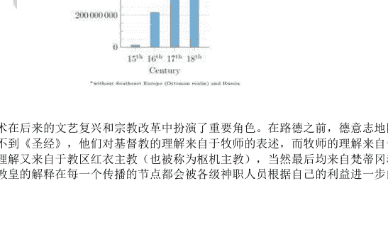

古腾堡的印刷术在后来的文艺复兴和宗教改革中扮演了重要角色。在路德之前，德意志地区的教民其实读不到《圣经》，他们对基督教的理解来自于牧师的表述，而牧师的理解来自于主教，主教的理解又来自于教区红衣主教（也被称为枢机主教），当然最后均来自梵蒂冈教皇的解释。而教皇的解释在每一个传播的节点都会被各级神职人员根据自己的利益进一步曲解。

路德将《圣经》翻译成德语白话文，并通过印刷术传播，让德意志地区的农民们都可以读到，这样教皇和各级神职人员再也无法控制和曲解信息，这最终动摇了梵蒂冈教会 对欧洲的控制，帮助欧洲走向理性的时代。

到了 19 世纪初，活字印刷在经过欧洲的铅活字印刷等技术改进后，再次传回到了印刷术的故乡中国。催生出中国近代的出版业。清末民初，著名的商务印书馆、中华书局、世界书局等著名的出版机构先后诞生，《申报》等近代报纸也出现了。这些文化机构的出现，促进了中国新文化在社会各阶层的传播，在中国面临民族危亡之际，帮助中国迅速走向了近代化。

## 要点总结

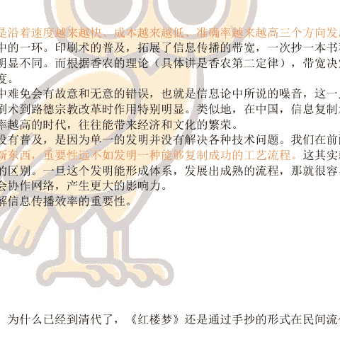

+   1. 信息复制的技术是沿着速度越来越快、成本越来越低、准确率越来越高三个方向发展的，印刷术是其中的一环。印刷术的普及，拓展了信息传播的带宽，一次抄一本书和印一百本的带宽明显不同。而根据香农的理论（具体讲是香农第二定律），带宽决定了信息传播的速度。
2. 信息在传播过程中难免会有故意和无意的错误，也就是信息论中所说的噪音，这一点在古腾堡发明印刷术到路德宗教改革时作用特别明显。类似地，在中国，信息复制水平越高，传播效率越高的时代，往往能够带来经济和文化的繁荣。
3. 中国的活字印刷没有普及，是因为单一的发明并没有解决各种技术问题。我们在前面讲过，发明一种新东西，重要性远不如发明一种能够复制成功的工艺流程。这其实就是工艺等级和商业的区别。一旦这些发明形成体系，发展出成熟的流程，那就很容易打造出本身的事业协作网络，产生更大的影响力。
4. 我们需要深刻理解信息传播效率的重要性。

## 思考题

今天留给你的思考题是：为什么已经到清代了，《红楼梦》还是通过手抄的形式在民间流传呢？

## 18 | 阿拉伯文明：一个被低估的文明

说起阿拉伯文明，你可能会首先想起阿拉伯数字，那是由印度人发明的，经由阿拉伯人传递到了欧洲；你可能还会想到我在前面讲的造纸术，那也是经由阿拉伯人，才从中国传到了欧洲。

除此之外，阿拉伯地区还把古希腊、罗马的文明书籍也保留了下来，之后又把这些文明的火种“交棒”，还给了欧洲，点燃了后来的文艺复兴，完成了它在文明史上的使命。听起来，好像阿拉伯文明仅仅是东西方文明的一座桥梁，或者一个保险箱，仅仅是翻译、存取信息罢了。

但其实，阿拉伯文明的价值远不止于此，这是一个完全被低估的文明。从上个世纪50年代开始，就不断有学者提出，阿拉伯文明其实有很多原创性的科学发明，而且辉煌程度要比我们以为的高得多。我们这一讲就来了解这个被低估的文明，它的真实面目。

阿拉伯文明出现的时间，恰巧是中国和欧洲一东一西两个文明，同时处于低谷的时候。在公元二世纪之后，罗马帝国和大汉王朝都开始风雨飘摇，走向了灭亡。欧洲从此进入长达近千年的中世纪黑暗时代，而中国则进入长达近四个世纪的分裂和战乱。可以想象，在世界版图上，只有亚欧大陆中部的阿拉伯文明高高地耸立着。

从八世纪到十三世纪，整整500年，世界上真正的科技中心就是当时的阿拉伯帝国，或者叫做伊斯兰世界，也就是以阿拉伯地区为中心，包括波斯、北非和东欧信伊斯兰教的地区。

注：由于波斯人（和伊斯兰世界里其他一些民族）并非阿拉伯人，因此历史学家更倾向于给这个时期一个准确的称谓——伊斯兰的黄金时代（Islamic Golden Age），不过我们通常把它称作阿拉伯文明。

要了解辉煌的阿拉伯文明，你可以从一个人入手，他是阿拉伯鼎盛时代科学的集大成者，甚至可能是古希腊之后，文艺复兴之前全世界最重要的科学家，因此他也被称为“巴格达智慧之家”，他就是波斯的花拉子密。

花拉子密是少有的全才型学者，在阿拉伯文明中的地位有点相当于亚里士多德在古希腊的地位，牛顿在英国的地位，他在数学、地理学、天文学及地图学等方面都有杰出的贡献。

如果说欧几里德建立的几何学作为数学一个独立分支的地位，那么确立代数学作为数学独立分支地位的人就是花拉子密。花拉子密在数学上的代表作是《代数学》，他在这本经典的数学著作中给出了一般一元二次方程的通用解法。这个解法我们今天的初中生都要学习。

也正是花拉子密在他的著作中使用了印度数字，这些著作在12世纪被翻译成拉丁文传到了欧洲时，欧洲人才会以为印度数字是阿拉伯人的发明，也就一直叫成了阿拉伯数字。

花拉子密的第二大贡献在天文学上，他拓展了托勒密奠定的经典天文学范畴。但是，他研究天文学的动机很有意思，他是为了准确预测日影、方位和时间，以便穆斯林教徒能够在准确时间对准正确的方向朝拜。从中你就可以感受到宗教最初对于科学是有激发作用的。

花拉子密还发明了最早的象限仪，这个观测天空的天文仪器后来被欧洲人称为“第一象限仪”。而那些我们熟悉的正弦函数、余弦函数都是他为了方便天文学中的计算而发明的。

花拉子密的第三大贡献是在地理学上，他完善了托勒密的《地理学》，修正了世界上主要城市的位置，并且给出了对地球地形地貌的描述，这些地理概念成为了今天地理学的基础。

当然，花拉子密是阿拉伯科学家的杰出代表，但是阿拉伯帝国全盛时一流的科学家还不止他一人。那个时代，在阿拉伯半岛和波斯的大地上可谓是群星璀璨。

如果只挑一个最重要的成就说，那就是炼金术，这也是现代化学的源头。和古代中国人一样，伊斯兰世界也热衷于炼金术。但是阿拉伯人却是实实在在地为这门新学科完成了奠基。

那么他们都做了什么呢？阿拉伯人发明和改良了许多实验设备和实验方法，比如蒸馏、升华、过滤和结晶等方法都是他们发明的，还成功地提取出纯酒精、苏打（碳酸钠）、硝酸、硫酸、盐酸、硝酸银和硝酸钾等多种化学物质。

在诸多的炼金术士中，非常值得一提的是被称为贾比尔（和穆罕默德的弟子同名）的阿布·穆罕·贾比尔·伊本·哈扬，他被誉为化学的奠基人。贾比尔不仅进行了很多科学实验，发现了很多化学物质，而且记录了很多化学物质的制作方法以及金属的冶炼方法。

十四世纪他的著作被翻译成拉丁文传入欧洲，成为了后来欧洲炼金术士和早期化学家重要的参考书。今天，大量的化学名称和术语都来自阿拉伯语，这和贾比尔等人的贡献有关。

## 那为什么阿拉伯文明能在长达 500 年的时间里，作为当时世界文明之巅，屹立不倒呢？

我们不妨从信息的空间传播和流动这个角度来看这个问题。

首先，地处欧亚非交界的伊斯兰世界，从欧亚非三个地区获取知识和信息都比较便利。在希腊时期和古罗马时期的科技成就，大部分并非诞生于希腊和罗马本土，而是在其统治的东部地区，也就是今天埃及及亚历山大和小亚细亚的叙利亚等地。

因此，后来阿拉伯所在的地区在很长的时间里，科技水平和古希腊罗马处在相同的地位，并且翻译保存了古希腊罗马的科学著作。当欧洲陷入中世纪停顿状态时，那里就保留了文明的火种，并且在当地相对宽容的政策下，科技得到了发展。

我们每个人都听说《一千零一夜》的故事，那个每天晚上要听故事的国王，其实是有原型的。他就是巴格达的统治者哈伦·拉希德（764—809 年），其实当时很多统治者都是非常有文化修养的开明君主，对哲学、科学都报之以巨大的热情。

## 阿拉伯文明繁荣的第二个原因：

通过不断向其他文明学习，阿拉伯帝国在科技上繁荣起来。阿拉伯帝国早期的发展靠的是军事扩张，比如在 751 年，极盛期的阿拉伯帝国和唐王朝就在瓜分中亚的势力范围进行了一场决战，史称怛罗斯战役，阿拉伯帝国战胜，并获得了大批的中国工匠，学会了造纸术和其他技术。当然，也有一些学者认为具体到造纸术，在怛罗斯战役之前已经传到了阿拉伯地区。

在对外战争的同时，它也不断从周边国家学习文化和技术、它的学者们曾经进行过大规模的翻译运动，把其他文明的典籍，从亚里士多德到托勒密等希腊学者的著作，再到古代印度学者 的，都翻译成了阿拉伯文。

## 第三，阿拉伯学者和专业人士在治学方法上比先前的文明也有所进步，

有利于信息的流通和去伪存真。和中世纪之后的欧洲实验科学家一样，阿拉伯学者们非常注重基于量化实验的科学研究，因此他们修正了过去很多根据主观经验得出的结论。你从他们在炼金术中的贡献就能感受到。

而且，世界上最早的同行评审制度始于阿拉伯地区，比如当时医生给病人治病，无论是康复了还是死亡了，该医生的记录都会被当地由其他医生组成的评审会检阅，判断该医生的工作是否符合所有要求的医科规范。同行评审制度使得失败的尝试在将来能够避免，成功的经验可以推广，从而加快科技进步的速度。

## 最后，阿拉伯文明的科学成就与伊斯兰教是密不可分的，

这就如同西方近代科学的成就和基督教密不可分一样。伊斯兰教在当时提倡兼收并蓄。正在这样的环境中，在欧洲滞滞的科学，在阿拉伯帝国却得到了发展。

据说伊斯兰教先知穆罕默德曾经说过，“学问虽然远在‘中国’，亦应当求之”，体现了他对学术的重视。我们向阿拉伯的学者求证这句话的真伪，他们讲，“穆罕默德表达过类似的意思。在当时阿拉伯人所知的世界，中国是最遥远的地方，因此中国可能只是一个比喻，穆罕默德的本意是，不管获得学问多么困难，也应该去做。

## 科技史纲 60 讲

听到这里，你是不是会有个疑问，为什么阿拉伯文明这么辉煌，却没有诞生现代科学呢？

阿拉伯帝国在公元 10 世纪到 12 世纪达到鼎盛。史学家常常感慨它的短暂。因为蒙古人的入侵，阿拉伯帝国灭亡，除了少数工匠，所有阿拉伯精英悉数被杀，从此它在科技水平上就开始走下坡路了，一蹶不振。

但也有人认为，阿拉伯文明没有孕育出现代科学，是因为到了后期，宗教的保守势力对科学进行打压，比如天文台被拆毁，科学人士也遭受了各种审判等等；还有人说，是由于阿拉伯地区的教育体制越来越倾向经院化，而 12 世纪的欧洲，在大学与宗教势力的交锋中，世俗思潮越来越活跃、智力和创新在大学中不断涌现。因此，两种文明就走在了不同的路上，演化成了你现在看到的迥异的样子。大学真的那么重要吗？我下一讲给你答案。

无论哪种原因，阿拉伯人在科技上的成绩，为后来中世纪末期的欧洲人提供了丰富的理论、资料和研究方法，有力地推动了全世界科技的进步和欧洲科学的复兴。

## 要点总结

+   1. 我介绍了阿拉伯文明的科技成就，它远比我们想象的辉煌。它科技文化繁荣的一个重要原因是它地处欧亚大陆，商业和信息的交流便利。这也是今天沿海交通便利地区经济文化发达的原因。
2. 科学是非常具有生命力的，无论政治安危、灾祸迭迭，它在这个地区衰落了，一定会在另一地区繁荣。
3. 我们今天提到了宗教对科学的促进作用，虽然很多时候宗教是站在科学对立面的。

## 19 | 大学：中世纪开出的最美的花

上一讲我们分析了繁荣的阿拉伯文明。事实上，如果不是因为蒙古入侵，阿拉伯帝国灭亡，那里非常可能诞生真正意义上的现代科学。但是，还有很多学者认为，阿拉伯文明没有诞生出现代科学，更重要的一个原因是，那里首先就没有诞生合格的大学，越来越宗教学化的教学内容成为当时阿拉伯地区大多数学院的主流，这就限制了科学思想的发展。

那么，大学对于现代科学有多重要吗？我告诉你的是，非常重要，有了大学，才有了培养科学家的场所，也才有了各个学科生根发芽的土壤。大学的体制，保证了科技能以相同的范式在一个框架里不断叠加，展现出它不断放大的进步力量。从信息的角度来看，大学就像是信息传播的节点或枢纽，让科技发展的成果得以保留、降噪、强化以及再传播。

那么大学是怎么诞生的呢？大学没有出现在阿拉伯地区，也没有出现在经济文化繁荣的唐宋王朝，反而出现在了当时看似处于中世纪黑暗时代的欧洲。为什么？

首先，中世纪，特别是中世纪后期的欧洲，并没有我们想象的那写黑暗。按照过去的说法，从 410 年罗马城的陷落算起，到 14 世纪文艺复兴开始，在长达将近九个世纪的时间里，整个欧洲的发展都非常缓慢，而且一切都是基督教的制约造成的。

但是，从近代开始，更多的研究表明，真正的黑暗时期只是公元 410 年到公元 754 年的三个半世纪。公元 754 年这一年，整个欧洲划归到了基督教的统治之下，从此相对稳定的欧洲恢复了发展。这其实并不是一件坏事。

今天对中世纪的负面看法，主要来自于法国的启蒙思想家们，伏尔泰、狄德罗和卢梭等人都是反对教会，因此把教会主导的中世纪说得一无是处。事实上，到了中世纪后期，欧洲虽然在政治上四分五裂，但是在基督教的主导下，没有爆发什么大的战争，这就给科技发展提供了技术保障。

虽然很多人总觉得混乱更适合思想解放，但是对于科技来说，从中国到欧洲的科技发展历程其实都显示出，统一比分裂更容易造就科技的进步。

## 第二，中世纪后期，欧洲出现了一个不愁温饱的知识阶层，那就是教士群体。欧洲当时的国王、贵族和骑士基本上等同于文盲，既没有精力，也没能力，更没有动力进行学习和研究。

但是，教士们不仅有时间，而且能够看到仅存的数量不多的书，更重要的是，他们很好奇上帝创造世界的奥秘。事实上早期科学研究并不是为了破除宗教迷信，反而是为了更清楚地了解上帝的行为，荣耀神。

## 第三，也是最重要的，人类对未知的的好奇，并不因为其他人的嘲笑而会消失，总是有些人试图搞清楚从物质世界到精神世界的各种奥秘，并且喜欢聚在一起研究学问。我们今天说的大学University一词，起源于过去的拉丁语Universities，意思就是有一种包括老师和学生在内的团体。

而这个团体中，早期的老师都是教士，学生则是想成为教士的年轻人，或者家里有些财产、自己充满好奇心的年轻人，他们研究的内容，就是宗教神学。虽然当时的学生都是“准教士”，为了研究神学聚在了教堂里，但是随着研究领域的不时扩展，大教堂就慢慢变成了知识“集散地”，现代意义上的大学就开始慢慢形成了。

好，听到这里你可能会想，大学最早是服务宗教的，那应该会得到教会支持，迅速发展吧。其实并没有，大学的发展非常艰难，可以说是一路抗争的结果。在中世纪，很多封建领主是不学无术的文盲，一些地方上的宗教人士甚至民众也比较保守，他们把研究学问的教士看作是异类，经常干扰他们办学。

为了免除愚昧的封建领主们和保守派宗教人士的干扰，大学需要得到神权或者国王权力的支持。最好的、也是一劳永逸的办法就是从教会或者国王那里获得一张特许状，让大学的管理独立于所在地方的地方政权，这样大学里的人干什么，大家就不会过问了。

1158年（也有人认为是1155年），神圣罗马帝国的皇帝腓特烈一世（Frederick Barbarossa）签署了被称为学术特权认可的文件。在这个文件中，赋予了大学很多特权，一下子将当时的学者和大学生的社会地位提高到了神职人员的水平。

这时候，世界上最早的现代意义上的大学才诞生了，也就是意大利的博洛尼亚大学（University of Bologna），它成立于1088年，并且在1158年成为第一个获得学术特权法令的大学。但是拿到大学特权法令的教士们一定没有想到，一旦他们可以自由地研究学问，最终居然产生出动摇基督教教义的新知识，那就是自然科学知识。

接下来，我们看大学是如何滋养出现代科学的，这里必须要提到的大學就是牛津大学。中世纪的大学在一开始时，教学体系很混乱，教授的自然科学知识也比较少，最初改变这种状态的是牛津大学。

牛津大学的前身，是1150年成立的巴黎大学，它是当时欧洲最著名大学，后来有欧洲“大学之母”美誉，因为牛津和剑桥大学都是由它派生出来的。当时，全欧洲追求真理的精英们，都会到巴黎大学求学，当然也包括海峡对岸的英国人。后来英法关系开始恶化，巴黎开始驱赶英国人，于是这些学者和学生都跑到了伦敦郊外的小城牛津继续办学。

现代科学的产生，要感谢牛津大学的两个人，这两位可以说是现代科学的先驱——是牛津大学的第一任校长、神学家格罗纳斯特斯，二是教士罗杰·培根。他们一个确立了大学系统学习原则，另一个开创了实验科学的研究方法。

格罗纳斯特斯在牛津大学确立了后来大家教学和做学问的原则，简单地讲，就是学习要系统地进行，也就是我们今天所说的科研训练。早期大学的教学方式都是师父带徒弟式的，学生收获的多少，完全取决于老师的水平，以及如何教学，因此就有很多的随意性。而且整个教学体系是非常混乱的。

比如，我们可以看到最古老的大學，博洛尼亚大学，那是一种典型的“学生大学”，整个学校校长的权力都掌握在学生手中，教授如果不能来上课需要向学生请假，学生可以评估老师的表现，如果不满意就能对其进行罚款，甚至还有规定，教师讲课，如果不能吸引来至少5个学生来听讲，也要被罚款。这就造成教学上很大的随意性，而且那些优秀的教师都不再愿意去博洛尼亚大学了。

于是，格罗斯泰斯特在牛津大学，确立了一整套标准的大学术纲，让教授们按照大纲进行教学。这样学生学习的系统性就增强了。很多人问我，我能否通过自学进入一个新的领域，我说可以的，但是学习一定要系统。因为只有系统化的学习，才能取得事半功倍的效果。后世评价他不仅是中世纪牛津的传统科学论的开创者，而且是现代英国智慧论的真正创始人。

第二位对大学制度产生重要影响的是培根，他是一位科学家。16岁时进入牛津大学学习数学、几何、音乐和天文学，并且在那里阅读到了亚里士多德等人的著作，而当时在欧洲大部分地区，除了《圣经》之外就找不到什么其他图书了。毕业后培根留在牛津教授自然哲学和数学，后来他自己出钱建立了英国第一个科学实验室，并且开始系统地研究数学、光学，尤其是炼金术。

培根被认为是英国实验科学的开山鼻祖，因为在他之前，大家做学问全靠查资料（其实也没有什么资料可查）和主观的演绎推理。培根认为，经验哲学，也就是教士们研究的哲学，只是对已有知识的诠释，而只有实验科学才能获得新知识，这种现代科学思维是至关重要的。培根做研究的目的不为名利，单纯是探求真理。直到今天，牛津大学对这一理念依然相当坚持。

在15世纪文艺复兴后，欧洲的大学得到了长足的发展。

这背后其实有两股力量，其一是世俗的力量，特别是国王和大公们开始热衷于资助大学，今天英国很多大学的国王学院，都是国王出资赞助的。其二是大学学科的实用性和世俗化，研究的内容从神学扩展到了自然哲学（也就是今天我们所说的科学），以及逻辑学、数学、医学、天文学、炼金术等等。大学在欧洲遍地开花，为现代科学积蓄着力量，因此我们经常说，大学是中世纪开出的最美的花朵。

## 要点总结：

- 1. 科学的发展需要一个相对独立，不为生计发愁的知识阶层。欧洲中世纪末出现大量的、不需要从事实生产的教士阶层，和当时经济恢复有关。学习了前面课程的同学很容易通过能量这条线索解释这个现象。此外，教士们有书读，其他人没有书籍，他们和贵族在获取信息上有差异。
- 2. 人类的天性对自然现象和未知是好奇的，这是科技发展的原动力。另外，知识也就是信息本身，是封锁不住的、是流动的，大学的出现，就是为人类信息传播增加节点和纽带。
- 3. 我们通过格罗斯特斯泰斯的教育方法，强调了系统学习的重要性，因此我也一直强调如果能上大学一定要上大学，不要迷信自学。
- 4. 我在专栏《黄金方法论》讲过很多大学相关的课程，也经常提到欧美大学的自治性和自发性，我希望能从这一讲找到其中的原因。

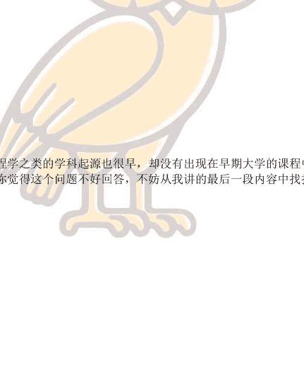

## 思考题

为什么经济学和工程学之类的学科起源也很早，却没有出现在早期大学的课程中呢？欢迎写下你的思考，如果你觉得这个问题不好回答，不妨从我讲的最后一段内容中找答案。

## 20 | 文艺复兴：本质上是一场科技复兴

关于文艺复兴的故事，特别是文艺复兴三杰的故事我们已经听得很多了。这讲，我们就从一个与技术相关的故事开始，从科技的视角再次理解文艺复兴。

14世纪，意大利佛罗伦萨有一座大教堂，当地没有一个老人说得清这座教堂是从什么时候开始修建的，因为从他们的父亲甚至祖辈起来，教堂就已经在那里了。

但是，这么多年来，它始终也没有完工。因为，当时的佛罗伦萨人都是虔诚的天主教徒，他们最初计划着要为上帝建一座空前雄伟的教堂，所以就把规模搞得特别大，光是教堂四周的墙就修了长达80年时间。

当他们努力了近100年，修好了墙壁之后，却发现工匠们根本没有足够的技能修建教堂巨大的屋顶，因为教堂的穹顶太大了，乎是这栋震天的巨型建筑就立在那里很多年。修建圆形屋顶的技术，人们其实早就发明了，在一千多年前，古罗马人就修建了高达40多米的万神殿，但是这项技术在中世纪却失传了。所以人们一直不知道这个教堂该怎么办。

这时，一个自称可以解决这个工程难题的天才出现了，他坚信自己可以为教堂修建一个圆形的穹顶。这个人就是后来西方近代建筑的鼻祖——布鲁内莱斯基。

事实上，他曾经专门测量过罗马万神殿的穹顶，研究了大量古罗马建筑的资料，因此他对于完成圆形屋顶，非常有信心。但是当他跑到市政厅，声称自己可以解决这个教堂顶的工程难题时，大家都觉得他是一个疯子，甚至把他扔了出去。

但是有一个人始终支持他的想法，他就是科西莫·德·美第奇。科西莫是什么人呢？他是当时佛罗伦萨的大名族美第奇家族的成员，这个美第奇家族从手工业起家，后来发展金融业，为教皇管理钱财，并最终走向政治，而科西莫就是家族最早成为佛罗伦萨的大公的人（大公也就是统治者）。

在教堂落成的那一天，佛罗伦萨的市民潮水般涌向市政广场，向站在广场旁边的顶楼上的科西莫祝贺。这座教堂不仅是当时最大的教堂，也是文艺复兴时期第一个标志性建筑。

这座教堂以圣母的名字命名，现在中文把它译作“圣母百花大教堂”。但是，在佛罗伦萨当地，它有一个更通俗的名字——Duomo，意思是圆屋顶。

好，透过这个关于建筑技术的故事，你应该能理解科技复兴的含义了。在当时，科西莫和布鲁内莱斯基就用“复兴”这个词来形容这个大教堂，因为它标志着人们终于复兴了古希腊罗马时代的文明，走出了蒙昧的中世纪。

这也解释了我们这个模块的标题：“走出蒙昧的徘徊时代”，人类从雅典文明跌回到中世纪，又通过对信息的收集，实现了文艺复兴，完成了一次在文明与蒙昧之间的徘徊。

在此之后，布鲁内莱斯基还发明了在二维平面上表现三维立体的透视画法，今天的西洋绘画和建筑草图都采用透视画法。这样，绘画的风格就非常写实，因此你看到很多文艺复兴时期的绘画，都特别逼真和世俗化，显得特别有“人味儿”。

这些都要归功于人们对古希腊、古罗马科技文化的再次学习和二次创新。你会发现，人们掌握了更先进的科技知识，就越顺理成章地创造出了不同于以往的文艺作品。可以说，文艺复兴只是科技复兴的外化结果，对科技的探索才是这场运动的本质。所以，我说文艺复兴也是一场科技复兴。后面达·芬奇、伽利略也会印证这一点。

## 接下来问题是，这场科技复兴是怎么被推动的？这就必须介绍美第奇家族的贡献了。

在刚才的故事里，你有没有好奇科西莫为什么能成为布鲁内莱斯基的伯乐？因为对于布鲁内莱斯基是否能完工，科西莫其实是心里有底的。科西莫提倡古希腊文化的复兴，四处收集古代的手稿和文献，他的私人藏书馆最终成为全欧洲最大的藏书库。

他很早就接触到了古希腊罗马时代留下的一些经卷和手稿，里面有很多机械和工程方面的图纸，所以他知道，按照古罗马人的做法，教堂的顶是可以完成的，也就义无反顾地支持了布鲁内莱斯基。

科西莫不仅成就了建筑大师布鲁内莱斯基，他还仿照公元前4世纪末的柏拉图，建立了14世纪的柏拉图学院，这个研究机构后来成就了一大批学者。科西莫到处收集古希腊、古罗马文物和资料的行动，引发了市民的纷纷效仿，人们学习求知的欲望都空前强烈，好奇心和创造力被极大地调动起来。

可以看出，科西莫可不仅仅是一个政治家，他的格局和眼光已经超越了时代。科西莫用于资助艺术、建筑和科学的资金，相当于同期佛罗伦萨税收的六倍。他曾经发出这样的慨叹，美第奇家族被默认为历史可能只要50年，但是文化却会永远地留下，说明对于科技进步的长期收益性，他很早就认识到了。

从科西莫开始，美第奇家族的历代成员都会出巨资供养学者、建筑师和艺术家。他的孙子“豪奢者”洛伦佐·美第奇在资助艺术家和学者方面超过了他的爷爷，我们今天熟知的米开朗基罗和达·芬奇，都是洛伦佐资助的。

如果说中世纪是因循守旧，一味模仿的时代，那么文艺复兴就是一个涌现天才，人人都争先恐后去创新的时代。这样的时代一扫中世纪的封闭和压抑，为呼之欲来的现代科学做足了准备。

到这里，你知道了文艺复兴的本质是科技复兴，而文艺复兴的发展离不开美第奇家族的推动，那么我继续追问，美第奇家族如此至关重要，那如果没有他们，文艺复兴是不是就不会发生？ Glück 在佛罗伦萨呢？我想要通过这个间题你再次理解，历史中的偶然性与必然性。

首先，佛罗伦萨处在通往罗马的必经之路上，地理位置便利，这里成为信息交流的枢纽。其次，十字军东征后，佛罗伦萨人从阿拉伯文明那里学到了中国的抽丝和纺织技术，开始生产丝绸，随后又发展金融，非常繁荣，追逐利润的商业阶级不断打破社会的教条。

有了这样的经济基础和社会环境，文艺复兴的发生其实是必然的事情，只不过美第奇家族的出现加速了这一进程，要知道，在美第奇家族发迹之前的14世纪末，佛罗伦萨的文艺复兴就已经悄然开始了。关于偶然性和必然性，你可以借此加深理解。

## 要点总结

- 1. 我用圣母百花大教堂修复的例子，说明科技复兴就是对过去希腊、罗马文明的复兴。而文艺复兴的本质其实是科技的复兴，科西莫和布鲁内莱斯基之所以能完成其他工匠无法完成的伟业，就在于他们掌握了其他人不知道的信息。从这个角度想，文艺复兴的本质还是信息的复兴。
- 2. 我讲了文艺复兴发生在佛罗伦萨的必然性和偶然性。如果没有美第奇家族，文艺复兴会晚很多，但最终一定会到来。

## 思考题

请你试着举出其他例子，从科技的角度重新理解，文艺复兴的核心，也就是“以人为本”。

## 复盘 | 各个文明的竞争，比的到底是什么？

今天我们复盘一下课程前两个模块的内容。我为你提炼了四个重要的概念和观点，希望你通过把握这四点，体会领先的文明，到底做了什么，对于我们个人，又应该朝哪些方向努力。

### 1. 科技进步的必要条件和充分条件是什么？

从第一模块的课程中你可以看到，一种文明的进步速度与它能够获取和利用的总能量有关。在远古，居住在宜居纬度，靠近大河的人类容易通过农业获得生存和发展的能量，因此早期 的文明都出现在那些地区。

相比之下，居住在高寒地带的人就没有那么幸运了。今天住在西伯利亚地区的人所获取能量 的1/3用于取暖了，你可以想象过去在那里的人几乎不可能开启文明。实际上，生活在常年近北极圈的因纽特人（也就是过去所说的爱斯基摩人）已经在当地定居了近万年了，也没有进入到青铜时代。

当然，能量的总量只是开启文明的必要条件，还远不充分。世界上很多事情，最后做成都需 要临门一脚的努力，而在早期文明中，在一个小范围内人口和能量密度比较高的地区，会先 出现文明的曙光，然后它会影响到周边地区。

直到今天，世界上不同地区由于能量创造的能力有差异，能量密度也相差很大，大城市密度 大，乡村密度小，因此文明，特别是科技，总是以城市为中心的。这也是我常说要去一线大 城市寻找机会的原因。

今天世界各国，要想获得长期的发展，既要比拼能量利用的总量，也要比拼平均的能量密 度。缺了这两点，很多看上去的繁荣都是纸面上的，难以持久。今天美国的一些有识之士 看到了产业空心化对美国发展长期的危害，呼吁重振制造业，其实这从能量的角度就很容易 解释了。

当然，有人说今天不再需要修建大金字塔，能量总量不再重要。其实在任何时代，都有类似 于修建金字塔的工程，我们在后面会介绍德国人在二战时原子能计划远远落后于美国，在冷 战时前苏联在登月上无法和美国竞争，其实就是输在了能量总量上。当然，另一方面能量密 度也很重要，因为只有能量密度高了，才能腾出人力去发展科技。

所以，科技进步的必要条件是能量总量，而充分条件是能量密度。

### 2. 信息传递的效率给现代公司什么启示？

在文明的进程中，把很多人组织起来管理好，需要有效地传递信息。信息传递的有效性又取决于两个方面，一个是信息传递的载体。从语言到文字，到书写系统，再到纸张和印刷术的发明，都属于这方面进步。第二个是信息传递的方式。

按照传播学的分类，信息传播简单概括可以有一对一，一对多，单向和双向，四种组合。口口相传就是一对一，用大喇叭广播是一对多，只从一个方向往另一个方向传播是单向，双互动是双向。显然一对多比一对一要有效，双向比单向要有效。一个文明是否有竞争力，在很大程度上取决于信息传递的效率。

让信息传播保持一对多，和双向互动，就是一个文明能在信息上领先的关键。宗教的出现、阶层的分化可以实现这个效果，于是，部落管理的效率就因而提高了。

在古代，最有效的信息传播和管理，就是借助宗教这个工具，这是一对多的信息传播。今天的情况也类似，一个大企业，要统一思想，就要树立一个大家都认可的远景和价值观，这是一对多的，否则经理找员工一个个读讲道理，就成了一对一的低效率传播了。

双向的交流对过去，对今天都很重要。在古代，一个君王愿意听取下属意见，特别是对自己想法的反馈意见就是双向，只愿意发号施令就是单向，这种人在历史上通常被称为昏君。今天，一个领导只要发号施令，不听取不同意见，和昏君差不多。从本质上讲，他们没有懂得如何进行信息有效的传递。因此，文明的出现伴随着阶级的出现和社会的分层。

在历史上，各个文明在印刷术后都以后，都有一个文明的跃进，这就是信息传播的功劳。当然，我们讲历史，不是为了简单地听故事，而是希望通过了解那些普遍适用的规律，对今天有启发。

我们今天经常讲要做扁平化管理，实际上就是通过改变信息传递的方式，提高管理的效率。今天大“公司病”的一个典型特征就是管理的层级太多，而且部门的边界太过明显。一些大企业从上到下有七、八层的结构，中间经过六、七次的转达才能完成信息的传递，在这个系列环节的路径上，每个人都是关键节点，链在中间谁出了问题，信息传递就走样了。如果部门之间再有界限，两个不同部门的基层员工在业务上的沟通，就要先通过向上汇报，在上层协调后再往下传递。信息沟通就更不顺畅了。

今天我们说要打破部门界限，或者就像我在《Google 方法论》中介绍的矩阵式管理，从本质上讲就是增加沟通的渠道，让信息流动顺畅。

下面的这张图，实照式代表传统的层级分明，部门清晰的组织架构。那种架构下，信息的传递环节特别多。蓝色的线代表打破部门界限后直接的信息沟通，而虚线代表矩阵式管理，增加沟通渠道。

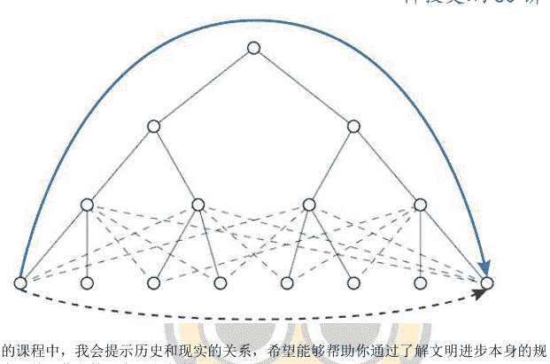

在今后的课程中，我会展示历史和现实的关系。希望能够帮助你通过了解文明进步本身的规律，在自己的工作和管理水平上有所提升。

### 3. 起步越早的文明，对科技的贡献就越大吗？

我们在课程中主要介绍了人类早期的五大文明中心，即美索不达米亚、古埃及、古希腊、古印度和古代中国。按时间上看美索不达米亚起步最早，古希腊、古印度和古代中国要晚一些。但是，在长达五千多年的整个农耕文明时期，有一半左右的时间古代中国的文明成就最高。我们从能量的使用，以及信息的产生和传播方面分析了其中的原因。

对科技成就的衡量，也不仅在于谁最先做出贡献，而在于谁的贡献和影响力最大。早期很多科技成就，能否算是发明，其实很难说清楚，比如说印章的发明就不能算是印刷术。世界上真正称得上是印刷术的最早是中国雕版印刷，因为它能够真正帮助到信息的传播，而印章则做不到。类似地，世界上说起印刷术就要想到古腾堡，而非更早的毕昇，也是因为古腾堡的发明影响力深远。

今天一些人，产生了某些不成熟的想法，就觉得自己了不起。其实真正了不起的人，能把想法落地，创造能够改变世界的发明，而不是到处宣扬自己的想法早，谁想到的不重要，谁做成的才重要。

所以，衡量科技成就的大小，从来都不是文明起步的早晚，而是成就的大小，影响力的深远。

### 4. 科技发明，流程和结果哪个更重要？

我们在课程中介绍。了科学的诞生，它意义不在于是提供了更多的零散知识点，而在于提供了一套系统的方法，使得后人能够在前人的基础上不断发展科学，得到更多的知识，获得叠加式收益。

比如，古埃及人和美索不达米亚人很早就知道了勾股数，但是他们无法得到勾股定理这个普遍规律。毕达哥拉斯超出前人的地方在于，他总结出一系列数学的方法，证明了很多几何学的定理，包括这个以他名字命名的定理。

对于技术也是如此。我们强调蔡伦发明的是造纸术，而不是纸张。区别在于，纸张早就有了，即使没有造纸术，通过很复杂的方法，付出很高的成本也可能获得纸张。但它对于文明进步没有什么意义。蔡伦发明了造纸术后，人类就可以廉价地获得纸张，从此很多人都可以书写、记录和传播信息，并带来文化的繁荣和技术的发展。

类似地，我们介绍中国工匠发明瓷器的草木灰上釉法，那也是一个具体的上釉工艺可以重复成功的过程。不掌握这项技术，也偶尔能烧出带有釉的瓷器，但是那样的成果很难复制，而且质量得不到保证。有了中国陶工发明的上釉技术，成功烧制瓷器就成了有把握的事情了。

今天，世界各国的专利法，保护的都是做某种东西的过程和方法，而不是保护某一个具体的东西。无论是对科学还是对技术，都要强调发明过程和制造流程的重要性，而不强调某个具体的结果。

此外，我还向你展示了我思考问题和整理知识的方法，希望这些学习方法和解决问题的方法对你有所启发。

我把课程里提到的这些方法，为你制作了卡片，你可以保存下来，也欢迎你转发出去。

最后，我还为你绘制了一张知识图谱，帮你理解开启文明的能量线索。

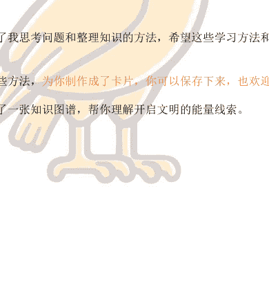

以往人们学习历史，会依据历史的时间点来学习，我们这次从能量的尺度出发，来看看文明史是如何开启的。按照获取能量和消耗能量的收支比的倍数，我们可以在这个过程中找出四个节点：

第一个节点：最初，人类艰难觅食，每天的能量收支勉强平衡；

第二个节点：借助火和工具的外力，人类获取的能量一旦超过消耗能量的 2 倍，就可以用剩余能量制造衣服、武器等更多的工具，开启能量的正循环，最终走出了非洲；

第三个节点：在太阳活动，这个偶然条件的帮助下，人类每天能够获取的能量终于达到了消耗量的 2 倍，从狩猎时代表进入了农耕时代；

第四个节点：随着城市聚居的开启，冶金工具的发明，人类获取能量的能力，达到了消耗量的 3~5 倍，人类文明就正式开启了。

注：当然，其中“语言”和“书写系统”是信息线索上的要点，在人类开启文明这个模块，主线还是能量。

## 21 | 哥白尼、布鲁诺、伽利略，到底是谁确立了日心说？

我们上来讲，谈到了美第奇家族对文艺复兴的贡献——他们资助了布鲁内莱斯基、达·芬奇等人，复兴了古希腊、罗马的艺术，当然更重要的是开创出全新的技术、文化，造就了一场科技的复兴。

在这批科学家中，有一个可以说是翻开了科技史新的一页，他就是伽利略。说到伽利略，大家首先能够想到他是伟大的物理学家和天文学家。但是如果再往下问，他在科学上到底有什么贡献，以至于常和牛顿、阿基米德等人并列到一起？

大部分人未必讲得出来，当然大家可能会想到他的一些具体的发明发现，比如在比萨斜塔上证实自由落体的加速度恒定，发明望远镜，发现木星的卫星等等。

但是，这些零散的发明通常难以支撑起一个人在科学史上崇高地地位，正是这个原因，绝大部分诺贝尔奖获得者的名字你根本没听说过。能享有科学史上崇高地位的人，都需要在构建科学体系上做出重大贡献。伽利略在这方面的主要贡献是确立日心说，日心说的确立为人类正确认识宇宙打下了基础。

说到日心说，大家可能会问，不是哥白尼提出日心说的么？的确如此，但是哥白尼并没有能够确立日心说的历史地位，这一方是因为他到死才发表日心说，另一方面是因为他确实没有什么证据证明日心说是正确的。

因此，日心说在哥白尼那里还是一个假说，并非像今天这么严密的科学理论。更遗憾的是，哥白尼的日心说在计算行星运行轨时，还没有一千多年前托勒密的地心说说得准。

在哥白尼之前，不同的科学家都提出了类似的模型，比如古希腊的阿里斯塔克斯在公元前3世纪已提出这种看法，只是没有给出准确的数学模型；此外，当时另一位伟大的科学家阿基米德也建立了两个天体模型，虽然那两个模型被毁了，但是从记载的信息来看，他建立的应该是日心说的模型。到了阿拉伯文明的黄金时代，当地的天文学家比鲁尼也提出了地球自转以及地球绕太阳公转的理论，这比哥白尼早五个世纪。

真相是，布鲁诺因为泛神论触犯了教会，同时到处揭露教会的丑闻，最终被作为异端处死。在日心说这件事情上，布鲁诺其实是带了倒霉，因为在此之前，教会并没有把日心说当回事。而布鲁诺宣扬泛神论用的工具是哥白尼的日心说，这样日心说便被牵连了。教会从过去允许日心说存在，到逼迫每一个人表态站队。关于这一点，《斯坦福哲学百科全书》有详细的记载。

应该讲，布鲁诺是一个很好的讲演者，否则教会也不会那么惧怕他；布鲁诺也是一个很好的哲学家，他很多想法和后来人们了解的宇宙很一致。但是，科学理论的确立既不是靠口才，也不是自己设计一套能够自圆其说的假想，而是事实，布鲁诺对日心说的确立事实上没有起到多大作用。

## 第一个拿事实说话支持日心说，并且最终确立日心说地位的科学家是伽利略。

伽利略出生于1564年，正巧这一年他的佛罗伦萨同乡、文艺复兴的巨匠米开朗基罗去世了。伽利略一生大部分时间都是在美第奇家族的资助和保护下进行科学研究的，他有很多物理学的发现，不过我们今天只说他最大的贡献：日心说。

为什么伽利略能确立日心说？首先他在工具上领先了，和之前的天文学家不同的是，伽利略能够看到别人看不到的东西，因为他发明了一种新的工具——伽利略天文望远镜。

今天很多人以为望远镜是伽利略发明的，其实在他之前欧洲一些眼镜商已经知道可以把一个老花镜和一个近视镜组合起来看到远处的东西，并且制造简单的望远镜。但是那些人说不清楚原理。1609年伽利略听说这件事情，在没有见过实物情况下就利用自己的光学知识，造出了更好的天文望远镜。

如果我们回顾一下信息这条主线对科技的作用，就能体会到，从本质上讲伽利略借助望远镜这个工具获得了比别人更多的信息。而在伽利略以前，天文学家是天生的，好的天文学家一定眼睛好，因为大家比拼获得信息多少的方法就是视力。

古希腊最伟大的天文学家是喜帕恰斯。他最大的优势就是超凡的视力，他能看到亮度是六等的星星（等级越低，亮度越高），那是人类肉眼可见的最暗淡的星星。在望远镜的帮助下，伽利略看到了很多前人没有看到的星体和宇宙现象。

有了天文望远镜，伽利略观测到了一系列可以支持日心说的新天文现象，包括木星的卫星体系、金星的满盈现象等等，这些现象只能用日心说才解释得通，地心说根本说不通，这时日心说才开始被教会接受。而被科学家接受是被世人接受的第一步。

因此，伽利略的贡献不仅仅是对日心说的确立，更重要的是，他确定了科学研究的重方法：实验和观测。要知道，在此之前，人类研究的科学的方法并不是找出事实，而是依据常识和经典，从生活经验出发，或者干脆从亚里士多德和《圣经》里找依据。所以，霍金曾经这样评价伽利略：“自然科学的诞生要归功于伽利略。”

## 科技史纲 60 讲

从 1609 年到 1611 年，仅历两年，伽利略的天文学成就不断，这一年，也就是 1611 年，他游访罗马，受到英雄般的欢迎。但是，正当伽利略在天文学和物理学上不断做出成就时，当时的政治环境已经对其的研究非常不利了。从文艺复兴开始直到 16 世纪末，罗马的教皇都是一些懂得艺术，温和行事的人，其中有四位来自于美第奇家族。

1605 年，来自美第奇家族的利奥十一世教皇去世了，这标志着这个影响了欧洲几百年的老家族对政治的影响力开始式微。在 17 世纪初，罗马教廷由于权威受到了来自北方新教（宗教改革后的路德派和加尔文派）的挑战，开始变得保守，并对持有颠覆思想的人开始打击追查。

在这个背景下，1616 年教会裁定日心说和《圣经》相悖，伽利略也因此受到了指控。不过教会并没有禁止日心说，仍然将它作为数学工具教授。1623 年，伽利略的朋友当选为教皇，即乌尔班八世。新教皇对这位大科学家十分敬重，反对 1616 年对他的指控，至此事情似乎要出现转机。

乌尔班八世希望伽利略写篇文章对日心说从正反两个方面进行论述，这样既宣传了科学家的思想，也维护了教会的权威。伽利略答应了，不过，等他把论文写完，却惹大了祸。

伽利略在他的这篇《关于托勒密和哥白尼两大世界体系的对话》大作中，让一个叫做辛普里西奥（Simplicio，即头脑简单到白痴的意思）的人为地心说辩护，所说的话也是子虚乌有，伽利略甚至把乌尔班八世自己的话放到了辛普里西奥的嘴里，这样一来他算是彻底得罪了教会。

当时美第奇家族的家长费尔南多·美第奇二世是伽利略的保护人，虽然他多方周旋试图保护伽利略，但是也无济于事。伽利略在最后的十年里回到佛罗伦萨的家中，著书立说，在 1642 年走完了他传奇的一生。

几乎与伽利略同时代，北欧的科学家第谷和他的学生开普勒也开始研究天体运行的模型。最终，开普勒在他的老师第谷几十年观察数据的基础上，提出了著名的开普勒三定律，将日心说的模型从看起来很多圆互相嵌套改成了椭圆轨道模型，这样他就用一根曲线将行星围绕恒星运动的轨道描述清楚了。开普勒的模型是如此简洁易懂，而且完美地吻合了第谷的观测数据，这才让大家普遍接受了日心说。

在这些科学家的共同努力下，人们终于可以正确认识太阳系了，但是要解释那些行星为什么那样运行，则需要另一代人的努力了，有趣的是，就在伽利略去世一年后，一个早产儿在英国降生了，他带给了世人更彻底的解释。

## 要点总结

- 1. 我们通过伽利略使用望远镜这件事情，强调了善用工具的重要性。
- 2. 伽利略、第谷和开普勒的成就，从本质上讲，靠的是彼此拥有更多的信息。从这个角度上讲，日心说的胜利可以说是信息的胜利。
- 3. 科学成就的确定，需要证据，而不是雄辩。

这一讲是我们这个模块的第一讲。之所以用伽利略和日心说开篇，是想告诉大家，科学的研究方法意味着人们可以更加接近事实和真相，现代科学的曙光就此出现了。更多的科学研究方法，就能够构成人们观察世界的系统方法，这个重大任务，需要更多的科学家一起来完成。

## 思考题

如何在智能时代善用工具，获取更多的信息？

## 科技史纲 60 讲

## 22 | 现代医学：如何从非科学到科学？

很多人喜欢把医学分为西医和中医，其实这种分类并不很准确，因为医学其实没有国界之分。更准确地分类应该是现代医学和传统医学。今天如果到西班牙马德里皇宫的医务室看一看，就会发现它几乎就是一个中药铺子，只不过一格格的抽屉换成了一个个玻璃的储药罐，里面尽是草药和矿物物质，一个个熬汤药的瓦罐换成了一个个玻璃的烧瓶。在近代之前的欧洲，医学的方法和中国传统医学没有多大的不同。

实际上，科学往往都是伴随着很多非科学的认知诞生的。比如早期的占星术和天文学，炼金术和化学等等。那些早期看起来并不严谨的知识体系，后来经过一套全新的方法，经过梳理加工，慢慢发展，变成了今天符合客观存在，而且严谨异常的学科。那套方法就是科学的方法。

这一讲，我们不妨通过传统医学到现代医学的演变，看看科学方法到底是什么，尤其是逻辑推理和实验的意义。你需要记住两个人，一个是现代医学的开创者哈维，另一个则是把这套方法总结提炼的集大成者笛卡尔。

为什么说近代医学的革命始于哈维？因为哈维不仅通过实验证实了血液循环理论，而且他还开创了现代生理学和医学的研究方法。

他生活的年代比中国的名医李时珍仅晚了半个世纪。他在 1628 年发表的医学巨著《关于动物心脏与血液运动的解剖研究》（简称《心脏运动论》），指出血液受心脏推动，沿着动脉血管流向全身各处，再沿着静脉血管返回心脏，完成循环。当然这在今天对我们来说都是常识，但是在他的面前，人类并不知道身体里的血液到底是怎么一回事。

在哈维之前，欧洲一直沿用古希腊的医学家盖伦（Galen of Pergamon，129-199）的医学理论。虽然盖伦也做解剖研究，但是他的解剖对象是狗、是牛，而不是人，所以即便他发现了神经以及脊柱的作用，但是对绝大多数人体器官的功能还是不清楚的。

盖伦的理论认为，生命来源于“气”。后来的医学家们在此基础上进一步发展，认为脑中有“精气”（Pneuma psychicon），决定运动、感和知感觉；心中有“活气”（Pneuma zoticon），控制体内的血液和体温；肝脏中有“动气”（Pneuma physicon），控制营养和新陈代谢等等。

对于血液的作用，盖伦认为是心脏输出到身体各个部分，而不是循环的。也正是因为如此，盖伦并不认为人体的血液量是有限的，因此还发明了放血疗法，这种错误害了很多人的命。莫扎特最后就是被放血疗法夺去了生命，而那时已经是 1791 年了，距离哈维发表血液循环理论都过去 160 多年了，人们还是相信那些荒谬的治疗手段，可见信息的传播也是具有滞后效应。

你现在听起来，传统医学似乎很荒唐，那是因为他们没有科学的研究方法。要给人治病，第一步就是了解他的生理特点，这后来被笛卡尔总结为感知，也是科学研究获得新知的第一步。但是，从中世纪开始的很长一段时间里，教会是禁止解剖这种行为的，以至于在文艺复兴时期，达·芬奇等人还需盗墓，偷尸体才能进行解剖研究。

由于缺少一手的信息，医生们对人类器官功能的研究没有什么进展。从这里面也可以看出，如果没有信息，科学是很难进步的。但是在文艺复兴之后，人们对于医疗的实际需求和知识的渴望越来越强，解剖学还是十分艰难地发展起来了。

哈维师从于当时的名医法布里修斯。法布里修斯通过解剖发现了静脉瓣膜的存在，但他没觉得这个防止血液倒流的瓣膜有什么功能，因为他和其他医生一样，忠实于一千多年前盖伦的教条，总想着用旧的理论解释新的发现。

但是，哈维就不一样了。血液循环原理，其实是他从逻辑推理出发得到的，他首先通过解剖学得知心脏的大小，并且大致推算出心脏每次搏动挤出的血量，然后他根据正常人的心跳的速率，进一步推算出人心脏一小时要泵出约500磅的血浆。如果血液不是循环的，人体内怎么可能有这么多的血液呢。根据这个矛盾，他彻底抛弃了盖伦的理论，提出了血液循环的猜想，并发现新理论是契合实验结果的。

不仅仅如此，哈维最后还通过长达九年的实验验证了他的理论。事实上，哈维直到去世前，一直都在通过实践来收集更多的证据证明自己的理论，以保证对盖伦的批判是公正的。如果我们回想一下上一个月所读的伽利略的工作是紧紧围绕着信息，确立哥白尼提出的日期说。哈维的工作在这个意义上也是类似的，只不过侧重点不同，提出理论的检验证明理论的人都是哈维本人。经过他多年的努力，一套关于人体的全新理论终于建立起来了。

哈维的《心血运动论》和哥白尼的《天体运动论》，牛顿的《自然哲学的数学原理》以及达尔文的《物种起源》一起并称为改变历史的科技巨著。这本书的影响不仅仅在于提出了一种理论，更在于找到了 一种医学研究的方法，使得后来欧洲的医学得以突飞猛进地发展。这也再次说明科学方法，尤其 是逻辑推理和实验，对于科学发展的重要性。

1651年，哈维又发表了另一部大作《论动物生殖》，在这本著作中，哈维否定了过去占主导地位的先成说——也就是说胚胎具有与成年动物相同的结构，只是缩小的版本。哈维认为胚胎最终的结构是一步步发展起来的。

好，总结一下近代医学上开山鼻祖哈维的这两大成就。哈维首先告诉大家血液循环是一种特殊的物理运动，而不是盖伦所谓的虚无缥缈的“气”，其次，他纠正了当时医学界对动物胚胎发展的错误认识。

当然，更重要的是，哈维为生理学和医学开创了先进的研究方法，他的发现不是靠研究和解释经典，而是靠推理，靠观察和实验。哈维在他的书中写道：

“无论是解剖学或是学习解剖学，都应以实验为依据，而不应以书籍为依据，都应以自然为师，而不应以哲学为师。”

哈维的成就一开始在天主教势力强大的法国遭到反对，后来由于笛卡尔的支持，才被大众所接受。笛卡尔比哈维小十几岁，一直对这位近代科学的先驱敬重有加。

从 17 世纪到 18 世纪末，是人类的启蒙时代，我们今天中学学术的很多知识，都是人们在那个时代第一次认识到的。为什么人类到那个时代科学研究能有突飞猛进的进步呢？主要是研究方法先进了。哈维的研究方法为后来笛卡尔提出方法论提供了启发。关于科学的方法，笛卡尔做了很好的总结，大致是这样几步：

- 1. 先提出问题，但不要有预先设定的结论；
- 2. 进行实验；
- 3. 从实验中得到结论和解释。这一点很重要，结论是实验得到的，而不是头脑里固有的。
- 4. 将结论推广并且普遍化；
- 5. 在实践中找出新的问题，如此循环往复。

在笛卡尔之前的科学家，并非不懂得研究的方法，但是他们了解的研究方法大多是自发形成的，而方法好坏就看自己的先天条件、悟性或者特殊的机遇了。

古希腊著名的天文学家喜帕恰斯能发现一些别人看不见的星系，一个原因是他的视力超常，开普勒发现行星运动三定律是因为他的老师第谷手里继承了大量宝贵的数据，而亚里士多德能成为最早的博物学家，在很大程度上仰仗他的学生亚历山大帝带着他到达世界各地。这些科学家常都有幸重复，以至于科学的进步难以持续。

笛卡尔之后情况就不一样了，他总结出了完整的科学方法，也就是：科学的研究是通过正确的证据（和前提条件），进行正确的推导，得到正确的结论的过程。后来的科学家自觉遵循这个方法，大大地提高了科研的效率。因此，笛卡尔称得上是开启科学时代的祖先者之一，受到他影响的学科，不仅仅仅是他所研究的数学和光学，还包括很多其他的自然科学，比如生理学和医学。

近代科学和古希腊科学有着一定继承性，这主要体现 在理论性的一面。但是近代科学和古希腊科学又有着巨大的不同，这体现近代科学强调实验的重要性，特别是进行精确可重复性实验，从“大约”地观察世界进化到“精确”地观察自然现象和实验结果。这是之前各个文明都 不曾有的研究技能。关于这一点，我们下 1 讲还要详细。

这里需要指出的是，虽然笛卡尔有一句名言，“大胆假设，小心求证”，这并不是让大家有一个古怪的想法，然后结果角尖去证实那种并不正确的想法，而是说在实验之前，什么想法都可以有，什么结果都是可能的，要有开放的心态，然后通过小心求证，找到真理。

如果我们对比哈维和他的老师法布里修斯的工作，就会发现后者失败的主要原因，是脑子里存在一个固有的，来自先贤盖伦的想法，他老师的工作都是试图解释盖伦的想法。而哈维头脑里并没有预先的假设，心态是开放的，准备接受任何结论。

## 要点总结

- 1. 有些时候从结论上看非科学和科学的边界不是那么明显，但是两者做事的方法完全不同。
- 2. 科学的方法可以让我们更容易接近真理。在这个方法中，假设、逻辑推理、实验，都是收集和验证信息的过程，非常重要。
- 3. 在没有验证之前，不要急于下结论、心态要开放，这就是笛卡尔说的‘大胆假设’；在论证的过程中，做事情要严谨，要有逻辑，这就是小心求证。
- 4. 科学不是一个结论，是一个求真过程，随着它的结论被推广，大家就会发现新的问题，在解决新问题过程中，科学就进步了。

## 思考题

希望这套做事方法对你有所启发。也请你说说你做事的方法，欢迎分享在留言区。

## 科技史纲 60 讲

## 23 | 牛顿 “牛” 在哪里？

今天我们来谈谈牛顿。

不知何时社会上出现了一个词——“牛人”，这个词至少在我小时候没有。但遗憾的是，在很多 人嘴上的牛人其实非常一般，说他们是牛人的那些人，只是没见过世面罢了。

比如每当中国有科学家在《自然》杂志上发表一篇论文，就被某些媒体吹为牛人，什么“诺贝尔奖级的发明”，“国家宝贵的人才”等等。公平面说，那些人对人类、对文明确实有贡献，但是贡献的量级和我们今天要讲的牛顿等人相比，就如同蚂蚁和整个人。

牛顿有多牛，我们从当时人们对他的态度就能看出来。牛顿是第一个以非王室身份享受国葬，安葬于西敏寺的人，再往后享受这个殊荣的人要在一个世纪后才出现，那就是拯救了英国的海军军神纳尔逊。当时为牛顿抬棺的六个人包括一位公爵、三位伯爵和当时的 大法官，整个伦敦全城为他送葬。

就在当时，人们已经开始神化他了，法国数学家洛必达爵就就对牛顿产生了对神一般的崇拜，他问英国人：“（牛顿）他吃啥，喝啥，睡觉吗？他和我们一样吗？” 有类似崇拜情绪的，还有著名科学家莱布尼茨、笛卡尔、笛卡尔想象伊尔泰等人，要知道这些人都是以理性著称的学者，结果也变成了牛顿的“脑残粉”。

经过三百年，牛顿似乎逐渐走下了神坛，很多人甚至可能会觉得：我不认为他那么牛，他有历史的局限性。我们不应该以今天的科技水平衡量过去的成就。我们常讲，对于历史事件或历史人物，需要在一个放大的时空里看，对牛顿也是如此。

在中国，人们通常只是将牛顿看成是一个杰出的科学家，而在西方，大家认为他是开启了近代社会的思想家，这两点就很大的区别。牛顿在西方社会里的地位依然非常高。2000年，《时代》杂志评选人类历史上最有影响力的人，牛顿排名第二，排名第一的是耶稣。

关于牛顿的生平我们就多说了，“得到”里有不少这方面的课程，大家可以搜索一下。这里我们先说说他在科学上的主要贡献，我将它们总结为这样几个方面：

- 1. 在数学上发现二项式定理，与莱布尼茨分别独立发明微积分；
- 2. 在物理学上，奠定了经典力学的基石，定义了诸多物理量，提出了力学三定律和万有引力定律；
- 3. 在光学上，提出了光的粒子说，发现了光谱，发明了牛顿望远镜；
- 4. 在天文学上，利用经典力学和微积分，构建了当时最准确的天体运动模型；
- 5. 在化学上，通过对炼金术的研究，提出了原子论的原形，以及朴素的物质不灭定律的构想。

当然，牛顿最了不起的不在于发现了那么多的知识点，而在于构建起很多庞大的学科体系。我们在介绍牛津大学第一任校长格罗斯特斯的贡献时讲过，这位杰出的教育家对大学贡献的关键在于他让高等教育变得具有系统性了。因此，能够建立起系统性学科的人当然非常牛。

在牛顿之前的数学是初等数学，在他之后才有了高等数学。初等数学和高等数学有什么区别呢？这不仅仅在于前者容易，后者难，而在于它们看待世界的方式不同。

在微积分出现之前的初等数学时代，大家研究的对象和解决的问题都是属于静态的，而牛顿关注到了精确而瞬时的动态计算问题，以及对一个变量长期变化的累积效应的追踪问题。微积分就是解决这两种动态问题的数学工具。什么意思呢？我举一个例子你就能明白了。

你是否还记得我在第15讲，说到科学的诞生，提到芝诺悖论，说飞毛腿阿喀琉斯要追赶上乌龟，要先走完路程的1/2，再走完剩余总路程的1/2……如此循环，他永远走不完与乌龟之间的距离。这个悖论存在了几百年之久，人们都束手无策，直到微积分的出现，人们才解决了这个问题。从静态到动态，从孤立到统一，这是人类在认识上的一个飞跃。

在物理学上，牛顿之前的人类虽然也掌握了很多力学和光学知识，但都是零星的知识点，经验的总结，不成体系，有些理论甚至和非科学的没有什么区别，是牛顿完成了它们科学化的过程。建立一个学科体系，首先的任务就是定义清楚各种基本概念。

在牛顿之前，那些最基本的物理学概念，包括质量和力，都没有清晰的定义，甚至是相混淆的，比如人们搞不清比如力、惯性和动能的区别、质量和重量的区别、速度和加速度的区别。这些概念可能你在中学时也区分得很才搞清楚，更不要说几百年前的了。

牛顿定义了经典物理学中的这些最基本的概念，然后在此基础上，才提出了力学三定律，进而搭建起整个物理学的大厦。牛顿的工作重现了当年欧几里得构建公理化几何学的过程，再次向世人展示了构建一个学科体系的方法。在牛顿之后，各门自然科学都开始从知识点向体系化发展了。

类似地，在光学方面，牛顿提出了完整的粒子说。此前虽然人类对于光、颜色和视觉的研究历史悠久，但是缺乏统一、系统、分类。牛顿建立起完整的光学体系，用各种实验证实了他的理论，并可用理论解释光学的一个个现象。有了完整而可以重复验证的学说体系，人类对规律的认识才可能从自发状态进入到自觉状态。

在天文学方面，牛顿通过万有引力定律解释了宇宙中日月星辰运行的规律，也从理论上解释了他的前辈开普勒的行星运动三定律，牛顿就是我在第21讲“日心说”最后提到的早产儿。

这件事情对人类的认知意义很大。因为从此之后，宇宙中星体的运行和各种天文现象都可以变得可预测了，人类从此有了非凡的自信心。

与牛顿同时代的科学家哈雷，利用牛顿的理论，准确地预测出一颗彗星回归的时间。虽然他本人没有能够等到它的归来，但是73年后，彗星真的回来了。这颗彗星也因此以哈雷的名字命名。

在牛顿之前，几乎所有的科学发现都需要在先观察到现象，才能发现规律，在牛顿之后，很多发现则是先通过理论的推导，预测可能观察到的结果，然后再通过实验证实。

你可能注意到了，我在前面的叙述中，用了许多“从牛顿以后”这样的表述，以上所说的科学领域都以牛顿为分界点开启了新的纪元。但是，牛顿的贡献还不止于此，他在思想领域最

## 科技史纲 60 讲

大的成就就是将数学、物理学和天文学三个原本孤立的知识体系，通过物质的机械运动统一起来。因此，牛顿和当时其他科学家们一起，确立了一种新的世界观，就是机械论。关于机械论我们后面还会具体讲。

简单地讲，机械论认为我们的世界是客观物质的，是确定的，是可以认识的。物质世界的变化，我们看到的各种现象都可以用各种机械运动来描述，而人类则可以通过对世界的研究，发现那些运动背后确定的规律。

这些描述虽然你今天听起来觉得有些绝对化，但是在人类的进步过程中，这是一次巨大的飞跃。因为在牛顿之前，人类搞不清楚世界上各种事情是怎么回事，于是就把自己能力所不及的原因都想象为神的作用。

这就如同今天还有些人相信金字塔是外星人造的一样。但是牛顿等人，给了人类这个自信，从此人不再是囿困在神的前面，而开始相信自己。这也是为什么西方对牛顿的评价如此之高的原因。

诗人亚历山大·玻普在拜谒牛顿墓时写下了这样一句著名的诗句，“自然和自然律隐藏在黑暗中；神说，让牛顿去吧！万物遂成光明”。这其实就反映出人类在牛顿之前和之后对世界态度的变化，在那之后，人类不再觉得自己身处不可知的黑暗了。

从历史的必然性来看，牛顿的出现不是偶然的，与他同时代的英国出现了一大批顶级科学家，包括胡克（弹性定律的提出者）、哈雷、波义耳和惠更斯（生活在英国的荷兰人，牛顿选定的继承人）等人。

哈雷和胡克等人其实也注意到了行星围绕太阳运动需要一种向心力，即来自太阳的引力，只是这些人没有能力完成理论的建立罢了。不过，如果没有牛顿，可能用不了多久，也会有科学家发现万有引力定律。事实上，哈雷参与了牛顿《原理》一书的出版，并且是该书第一版的出资人。这些事实说明了科技发展的必然性。

从历史的偶然性来看，牛顿非常幸运，用法国大数学家拉格朗日的活讲，“牛顿是那么地幸运，因为发现并建立一个宇宙系统的机会只能有一次”。因此牛顿可以说是生逢其时。在牛顿之后，世界上还有很多伟大的科学家出现，但是以一己之力构建新门学科大厦的机会不会再有了。

这一讲说到了牛顿的很多贡献，如果你只能记住一条，那就是下面这条：

牛顿最伟大的地方在于他通过确立机械论，让人类有了空前的自信。我们今天遇到问题时，不是求助神，而是通过自己的努力解决问题，并且相信问题一定有答案，这种自信来自于牛顿的年代。

## 思考题

就“遇到问题解决问题，不求助神，不求助超自然的力量”发表你的看法。

## 24 | 现代化学：如何从炼金术演化而来？

我们知道炼金术是不可能实现的，但是各个文明都曾经发展过自己的炼金术。

在东方和西方（包括阿拉伯），炼金术的定位并不相同。在中国，炼金术是以制造万灵药和长生不老药为目的，因此它也被称作炼丹术。而在西方，炼金术的目的是将廉价的金属变成贵重的黄金。

无论是为了长生不老，还是为了赚钱，炼金术背后都着巨大的利益驱动，因此虽然从来没有成功过，术士们仍为此一代代前仆后继，东来不辍。比如，你可能会听说过，牛顿一辈子大量的时间都花在了不靠谱的炼金术上，甚至还留下了 650 万字的炼金术著作。

虽然炼金术劳民伤财而且从来没有成功过，但它也并非一无是处。在中国，它催生了火药的发明；而在西方，通过炼金术，人们找到了各种各样的矿物，提炼出了一些元素，并且在这个过程中积累了化学实验的经验和方法，发明了许多实验设备。

今天的化学就源于炼金术，这个貌似换骨的进化过程非常值得大家了解，那早重启非科学的炼金术是如何演化成现代化学的？它的背后其实有一整套做事方法的，今天我们就来讲讲这套方法。

在西方，人们是怎么炼金的呢？举个例子，他们会熔铅锡，因为觉得铅和金都挺重的，也都叫得动，感觉两者的属性应该差不多，明显的差异就是在颜色上，那这个问题的关键就是让灰色的铅变黄，怎么办呢？

炼金师们觉得可燃物都是黄色的，可以通过火把黄色属性加入到铅中。就是在这样一次次的实验中，人们不仅无意中发现了很多其他物质，而且得到了一条很重要的科学研究方法，这就是从炼金术到科学的一个重要转折点。

最早从炼金术士转变成化学家的，要数德国商人波兰特了。1669 年，他试图从人体的尿液中提取出黄金，这可能是因为它们都是黄色的缘故，于是抱着发财的目的，用尿液做了大量实验，结果意外地发现了白磷。其他的炼金术士听到这个消息后百般打探消息，但是波兰特的保密工作做得很好，在接下来的好几年里大家对提炼磷的细节过程毫无知晓。要知道，当时很多炼金师为了保护自己的配方，甚至会用密码来书写。

后来德国科学家克里斯多夫打听，探知这种发磷光的物质是从尿液中提取出来的，于是他也开始做类似的实验，并且在 1678 年成功地提取出白磷。几乎同时，英国的科学家波义耳也用相近的方法制作出了磷。

这个提取磷的方法就传播开来了，后来，波义耳的学生通过制作白磷发了财。磷的发现，标志着从炼金术到化学的第一个转折，因为不同的人用类似的方法得到了同样的结果，从此让一个新物质的发明过程变得可以验证，这一点很重要。

在从炼金术到化学过渡的这个过程中，起了最大作用的是著名科学家安托万·拉瓦锡，他在化学界的地位堪比牛顿在物理学的地位。拉瓦锡是法国末代王朝的贵族，从来不缺钱，他做化学实验只是为了探求自然的奥秘，而不是为了赚钱。拉瓦锡一生的贡献很多，最大的贡献是以下四个：

- 1. 确认氧是一种化学元素（oxygen 一词就是拉瓦锡创造的），并且提出了氧气助燃的学说；
- 2. 证实并确定了质量守恒定律；
- 3. 联合其他科学家制定了今天使用的化学物质的命名法；
- 4. 制定今天广泛使用的公制度量衡。

这里任何一项都是以让人名垂青史，相比结果，他取得每一项成绩的过程，对科学的发展都更为重要。

我们从他的第一项贡献“确氧气的作用”说起。在拉瓦锡之前，学术界普遍认为一些物质能够燃烧，是因为其中具有所谓的“燃素”，燃烧的过程就是物质释放燃素的过程。但是人们还没发现，给叶子吹风火堆就能得到更旺，拧油灯的罩子盖住灯就会灭，当时的人们感觉没空气不行，但并不知道是空气中的氧气在助燃。

最早发现氧气能够助燃的其实是英国科学家普利斯特里。1774 年，他在加热氧化汞时，得到一种气体，这种气体不仅能使火焰燃烧得更明亮，还能帮助呼吸。遗憾的是，燃素学说在普利斯特里脑子里根深蒂固，因此他没有得出有用的结论。后来普利斯特里到了法国，向拉瓦锡介绍了他自己的实验，拉瓦锡重复了他的实验，得到了相同的结果。

但是拉瓦锡不相信燃素说的解释，因为他通过定量分析和逻辑推理发现了燃素说的逻辑破绽：如果燃烧是因为物质中的燃素造成的，那么燃烧之后，灰烬的质量应该减少，而事实上，燃烧的生成物的质量是增加的，这说明一定有新的东西加入到了燃烧的产物中。

正如牛顿建立了经典物理学的体系一样，拉瓦锡建立化学的体系，有了拉瓦锡，化学这个学科才有了规则，这是拉瓦锡的第三个贡献。一个科学体系的建立，首先要将各种概念定义清楚。今天化学上的很多概念就是拉瓦锡定义的，更重要的是化学物质的命名方法他确定的。

拉瓦锡等人指出每种物质必须有一个固定名称，而且它的名称要尽可能地反映出其组成成分和特性。比如我们今天说食盐的化学名称是氯化钠，这种命名规则，就是拉瓦锡确定的。

从炼金术过渡到化学，从根本上讲是对各种化学反应由感性上升到理性，从感觉到量化的过程。要量化，做理性分析，就需要准确收集信息，当然就需要有统一的度量单位。为此，拉瓦锡领导了法国的一个委员会，确定了今天全世界通用的公制，比如米制系统，质量标准里的千克等，这是他的最后一项重大贡献。

好，说完了拉瓦锡的四个贡献，我们再来学习他科学的工作方法。

拉瓦锡所有的研究工作，都遵循一种科学的方法，这种方法由笛卡尔概括成四个步骤：

- 1. **理性批判**：不接受任何自己不清楚的真理。对一个命题要根据自己的判断，确定有无可疑之处，任何有可疑之处的命题都不会是真理。
- 2. **化繁为简，化整为零**：对于复杂的问题，尽量分解为多个简单的子问题来研究，一个一个地先分析解决。
- 3. 先易后难：在解决上述子问题时，应该按照先易后难的顺序，逐步解决。
- 4. 归纳综合：解决每个子问题之后，再综合起来。看看是否彻底解决了原来的问题。

拉瓦锡最后的结局非常悲惨。他被卷入了大革命的争斗，最终被判处了极刑。欧洲各国学会纷纷向国会请求赦免拉瓦锡，以便他可以继续开展科学实验，但法官声称：“共和国不需要科学家或化学家，审判不能推迟。”

1794年5月8日，拉瓦锡被送上断头台，他泰然受刑而死，据说在行刑前他和刽子手约定自己被砍头后尽可能多眨眼，以此来确定头砍下后是否还有感觉，这是他最后一次进行的科学研究。不过这个说法正式史上没有记载。

对于拉瓦锡之死，著名的数学家拉格朗日痛心地说道：“他们可以一眨眼就把他的头砍下来，但他那样的头脑一百再也长不出来了。”

拉瓦锡不仅在化学发展史上建立了不朽功绩，而且确立了实验在自然科学研究中的重要性。拉瓦锡讲，“不要猜想，而要根据事实”，“没有充分的实验根据，从不推导严格的定律”。拉瓦锡所倡导的研究方法一直沿用至今。无论是在学术上的成就，还是在方法论上的贡献，拉瓦锡都无愧于“化学界的牛顿”和“现代化学之父”的赞誉。

## 要点总结

- 1. 可验证性、可重复性是判定科学和非科学的标志之一。
- 2. 拉瓦锡实践了笛卡尔的方法论，他具体的做办法是：理性批判，化繁为简，先易后难，归纳综合。他最大的贡献在于搭建化学这个知识体系，而不仅仅是发现一些知识点。
- 3. 构建一个知识体系，首先要定义概念，确定度量，我们今天在做事情的时候，常常先要把考核衡量标准制定好。就是这个道理。
- 4. 在科学上，定量实验和定量分析非常关键，今天我们在工作中，没有数据和信息，就不能随意下结论。

最后我们用拉瓦锡的一句名言结束今天的课程：“必须用天平进行精确测定来确定真理。”

## 25 | 欧洲炼金术士如何再发明瓷器？

我在前面说过，瓷器是中国历史上最伟大的发明，制造特别难，这项技术绝对是古代的高科技，而且在 18 世纪以前，一直被中国所垄断。欧洲人直到底特发明出...？不对，原文：欧洲人直到瓦特发明出...？原文：欧洲人直到瓦特发明出万用蒸汽机，还没有发明出瓷器。

但是，瓷器又是生活中不可缺少的用品，欧洲人长期从中国进口瓷器，自己却造不出来，瓷器在欧洲的身份就水涨船高，它逐渐成了身份和地位的象征。17 世纪，法国太阳王路易十四曾经为精心建造奢华的宫殿，里面放满了来自中国的青花瓷。18 世纪中期，青花瓷的价格和等重量的白银差不多，价格非常昂贵。

但是欧洲人始终就是搞不明白，这瓷器到底是怎么做的。甚至牛顿、莱布尼茨都研究过，但没有结果。因此，你能感受到，欧洲人是锱铢足了劲儿想把这个技术研究出来，也正是迫切的商业需要，推动了这项技术的发展。

当然，结果大家都知道了。后来欧洲也确实发明了瓷器，而且在后来的工艺水平上甚至超越了景德镇，而且还自主研发了新的瓷器品种，也就是骨质瓷器。那么欧洲是如何实现技术的反超呢？欧洲人真正有成效的研发居然也是从炼金术士开始的。这节课我们就看看欧洲炼金术士是如何逆袭的。

18 世纪初，欧洲有个超级瓷器迷——萨克森公国的国王奥古斯都二世，他曾经为了得到 150 个大形龙纹瓷缸，用了 600 名近卫骑兵去换，可见他对于瓷器的痴迷。

萨克森和瑞典开战，财力枯竭，为了获取钱财继续战争，奥古斯都二世抓来了两个炼金术士，他命令二人为自己炼制黄金，但是很快大家都知道这件事是不可能的，于是，奥古斯都二世便命令两个炼金术士开始研究瓷器，因为当时瓷器在欧洲就是白色的金子。

其中一个炼金术士叫伯特格尔，奥古斯都二世把他锁禁在城堡里，并在那里为他建立了实验室。伯特格尔尝试用各种材料调制出瓷土，包括大理石、骨粉等颇为怪异的材料。1707 年，他也就只烧制出了红褐色的陶瓷，我们前面说过，没有高岭土就不可能烧出洁白的硬质瓷器，这是困扰欧洲陶工几百年的问题。

从被关进波塞堡到制造出欧洲的第一件瓷器，伯特格尔做了 3 万多次的实验，平均每天要做 20 多次。伯特格尔等人不仅记录了全部的实验过程和结果，而且把每一次实验之间的细小差异全部记录下来。这些历史文件现保存于德国德累斯顿国家档案馆。

欧洲人从文艺复兴开始，长期进行各种科学实验和材料分析，终于在没有亚洲工匠的帮助下，掌握了瓷器制造的秘诀。与熟练掌握瓷器制造工艺却不明自其化学原理的亚洲工匠不同，这些欧洲人对瓷器制造的原理有理性认识，并有定量的了解，他们善于通过细微调节瓷土中元素的配比和调整烧制过程，来制造各种精致的瓷器。

由于欧洲这些实验信息记录完整，而且都保存下来了，所以今天我们还可以仿制出欧洲历史上任何一个时期的古典瓷器。系统地做实验，完整地进行记录，也保证了科技取得可叠加式的进步。

因此，如果说中国人发明瓷器是靠着善用能量，那么欧洲人再发明瓷器，就是靠通过大量的实验，收集信息取胜。

欧洲人在收集信息方面可谓无孔不入，很多传教士就留在景德镇打听“情报”。在一封 1722 年法国传教士写的信中，详细描述了景德镇的风貌以及红釉的制作工艺，要知道烧出红釉对中国工匠来说都是非常难的一件事。

这封信的内容非常详实、严谨，真正把艺术拆解成了技术，超过了任何中国匠人的相关记载。但不幸的是，法国 50 多年后才生产出自己的瓷器，因为一直没有在本地发现高岭土。

讲到这里，我们必须讲讲欧洲人记录信息的倔传统了。我们在第 22 讲说到古罗马医圣盖伦，虽然盖伦的理论有很多谬误，但是他对人类医学的贡献可能独一无二的，这在很大程度上要感谢他做的海量的记录。

1744年，scription于瓷器的奥地利女王玛丽娅·特蕾莎将瓷器工厂收归国有，她亲自掌管瓷器工厂，还派人到萨克森来挖角，雇来了不少陶工。就这样，维也纳成了欧洲第二个瓷器制造中心。

特蕾莎女王把自己的喜好（绿色植物）加入到瓷器中，因此今天这种被称为“玛丽娅·特蕾莎”系列的带有绿色植物装饰的瓷器成为奥地利的国瓷。

德国人和奥地利的成功极大地鼓舞了欧洲其他国家的君王，他们相信瓷器这种技术是有可能掌握的。就在美索制造出瓷器的50年里，大小窑窑就已遍及欧洲 —— 从北方的哥本哈根，到中部的斯特拉斯堡，再到南部的佛罗伦萨；从西边的伦敦到东方的圣彼得堡。

如果要问今天欧洲瓷器最贵的是哪一种？瓷器迷可能会说是法国的塞夫勒瓷器，那是技术和艺术在瓷器上最好的结合。它的成功在很大程度上要感谢路易十五的情妇、当时欧洲第一名媛蓬巴杜夫人。这位名利场上的代表人物一方面生活奢华，另一方面利用她的影响力大力扶植艺术、文艺和科学，特别是对洛可可艺术的发展起着至关重要的影响。

在蓬巴杜夫人的扶植下，法国瓷器业有了突飞猛进的发展。她把一家不大的瓷器厂迁到了塞夫勒，并且在资金上不遗余力地予以支持。法国工匠们为了弥补起步晚的劣势，在研发新技术和设计新图案上动足了脑筋。

为了做到世界第一，蓬巴杜夫人掌管下的塞夫勒，严禁仿制东方或者德国的瓷器。工匠们在瓷器绘画上的选择更贴近法国宫廷生活的内容题材。

在工艺上，塞夫勒的工匠们首先发明了一种给瓷器“镀金”的新技术——用大蒜汁和24K纯金的粉末，给瓷器上色，镀金的边饰和内部精细的纹饰成了塞夫勒瓷器的特色。接下来，塞夫勒的工匠们还发明了宝石蓝的颜色，以及洛可可绘画中常用的粉色。

总的来说，上色技术的进步造就了欧瓷瓷器绚丽的色彩。而每一次的进步，时间上都远比中国瓷器的变化来得快，这主要的原因是，欧洲的工匠保留着各种详细的工作记录，很容易获得可叠加式的进步。

今天塞夫勒瓷器在市场上是一件难求，因为它只作为国礼，不外卖。塞夫勒瓷器厂在蓬巴杜夫人手里，就成了专为法国宫廷提供瓷器的“宫窑”。

从炼金术士的失败不得到王公贵族的鼎力支持，欧洲人终于完成了这次科技的逆袭，我想你已经能够从信息 Vikings度对这件事进行了解读了。

## 要点总结

- 1. 利益的驱动可以带动技术的发展。
- 2. 在发明的过程中，记录信息，利用信息，获得可叠加式的进步很重要。
- 3. 技术本身具有流动性，很难通过封锁将技术锁住。
- 4. 艺术和技术的结合，才是产品最高的境界。

在工业革命后，欧洲甚至把瓷器大量输出到了中国，使中国瓷器在市场上受尽排挤。终于，在 1930 年，中国的瓷器进口量超过了出口量。关于这次逆袭，我会在工业革命中给你拆解。

## 春节加餐 | 世界贸易中的瓷器和真实的历史

上讲说以欧洲再次发明瓷器，很多同学都会体会到了其中信息的重要性，本来这一讲我们要开讲工业革命的，但是很多同学还是想彻底理解瓷器的伟大，于是我就加了个班，写了这一讲的加餐，为你从贸易的角度谈谈瓷器的伟大。

## 瓷器的伟大，不仅仅在于它的科技含量高，还在于它对全球贸易产生的巨大影响。

那么在全球贸易中，中国瓷器扮演了什么角色呢？我们不妨通过一个实例看看，在欧洲人发明瓷器之前，中国瓷器在欧洲的利润高得多离谱。

1745 年，瑞典的哥德堡号（Ship Gothenburg）满载着 700 吨从中国采购的货物——主要是茶叶、瓷器和丝绸，从广州启程回国，九月驶进了哥德堡海港。就在到达码头不到一公里处，这艘船意外地触礁沉没。由于是近海，当时打捞上来了 30% 的货物，其中丝绸和茶叶因为泡了海水基本上不可用了，能卖钱的只剩下瓷器。

但就是这些中国的商品，在市场上拍卖后，不仅支付了哥德堡号这次长达两年中中国之旅的全部成本，而且让股东们获得了 14% 的利润。如果哥德堡号不沉，它的货物价值估计为 2.5 亿 ~2.7 亿瑞典银币，相当于瑞典当年一年的 GDP。

从科技史的角度看贸易，如果我们列举一下世界上有什麽商品能够在几个世纪的时间里带动全球贸易，只有香料、丝绸、茶叶和瓷器四种。而在这四种之中，只有瓷器是被发明出来的人造物，在原来大自然中是没有的，其它三种都是天然物，因此不具备科技竞争力。

所以，从商业和对世界的影响来讲，瓷器是中国最伟大的发明。中国其它的几个重要发明，包括印刷术、指南针和火药，其实没有完善从 0 到 N 全部的过程，这也是它们在中国之外没有获得更大幅响力的原因。

我刚才在讲到，瓷器是中国历史上最伟大的发明。一些同学问我，为什么不是造纸术呢？而且蔡伦发明造纸术，确实也完成了从 0 到 N 的过程。没错，从这个角度来说，造纸术可能唯一一个能够媲美瓷器和中国古代发明皇冠的发明成就，只是它对中国经济和贸易的影响远不如瓷器。

除此之外，还有两个原因让造纸术落败。一个是在可替代性上，瓷器绝对是独一无二的，但中国人造的纸张还是有替代品的。世界上其他国家和中国做了上千年的贸易，进口了中国多达 200 多种物品，但是唯独没有进口纸张，说明对于它国家来讲，中国的纸张并不是那么不可或缺。第二原因，造纸术掌握起来相对容易，技术含量没有那么高，但制瓷技术确实是古代的高科技，很难掌握。

当然，欧洲人发明了瓷器之后，对中国瓷器的进口量逐渐减少，但奇怪的是，这并没有影响中国的贸易优势。

根据弗兰克在他的著作《白银资本：重视经济全球化中的东方》一书中的描绘，从 15 世纪到 19 世纪中叶，中国一直是世界贸易体系的中心，一共有 3.2 万吨的白银流入中国，相当于大约 10 亿两。10 亿两是什么概念？中国自 1840 年之后历次战争赔款总数也只是这个数字的 2/3。

在 16 世纪中叶到 19 世纪中叶这三百年间，全球三分之二的贸易与中国有关，中国保持巨额贸易顺差达这两个半世纪之久，这在世界贸易史上实属罕见。而中国对外的出口，主要就是丝绸、瓷器和茶叶三大项。在历史上，对中国经济饥贸易影响能够匹敌瓷器的只有丝绸，和它们地位基本上相当的是茶叶。

这是我今天要给你解决的第二个问题，中国是如何成为一个源源不断地排出商品，吸纳白银的“泵”，成为当时的贸易中心的，以及这背后蕴含着的历史规律。

在给你解释这个问题之前，我想先问你一个问题，19 世纪中期美国加州淘金热我们都知道吧？那个时候出现了无数冒险家、以及很多因此变得富贵的人，但是今天我如果问一句是否有谁能说出几位受益者的名字，或者哪家公司因此成长起来，恐怕你一个都说不出，因为他们都已经过世云烟。

但是，因为淘金而受益的那个牛仔裤公司大家都知道，就是李维斯（Levi’s）。此外，在当地卖水给淘金者的人也发了财，本来随处可见的山泉水成了最有价值的资源，最后诞生了加州的雪泉水公司箭头公司（Arrowhead）。

和当初の掘金者一样，虽然西班牙曾经是最早受益于大航海和美洲大发现的国家，虽然它曾经开采出全世界最多的白银，但是西班牙大航海的更大受益者，其实是中国。而说就要靠从欧洲到中、南美洲再到中国的白银、瓷器和丝绸这个全球三角贸易了。

## 为什么中国是三角贸易的受益国而不是西班牙呢？

西班牙在大航海时代中占尽先机，在哥伦布发现新大陆的大约半个世纪之后，西班牙人在美洲的中部（即墨西哥等地）和南部（即秘鲁等地）发现了多处世界级的白银矿。他们原本是指望着往西走，到达中国和印度做着商贸生意，这下好了，直接得到了白银，一下子成了暴发户，当时世界 83% 的金、银矿都被西班牙占据了。

从 16 世纪 40 年代开始，到 17 世纪初，西班牙人每年都可以从美洲开采上百吨的白银。这些白银除了少量留在了当地，大量被带了回去。大量的白银涌入市场，最初的受益者确实是西班牙自己，它的银币比柔很快取代了奥斯曼土耳其帝国的银币，成为世界上流行的货币。

由于白银是硬通货，可以买到任何想要的东西，再加上新航线被开辟了出来，使贸易流通成为可能，于是西班牙放弃了已经起步的工业，开始致力于直接购买做贸易赚钱，而当时最挣钱的商品，除了印度和东南亚的香料，就是中国的瓷器、丝绸和茶叶了。

于是，西班牙人利用非洲的黑奴和美洲当地人，从美洲开采出白银后，带着白银越过太平洋，到达中国采购丝绸、瓷器和茶叶。然后再经过东南亚越过印度洋带回到欧洲。西班牙人轻而易举地获得财富，导致国内的消费剧增。整个国家都被金钱和享乐刺激着，财富就像是雨点流过屋顶，什么也没留下，反而是为西班牙提供商品和服务的荷兰、英国在后面发展起来。

## 那白银又是怎么改造中国的呢？

当时正好赶上中国明朝的“隆庆开关”。1567 年福建巡抚涂泽民上书明穆宗（隆庆皇帝），“请开市舶，易私贩为公贩”，得到明穆宗的许可后，中国在福建的漳州和泉州和海外诸国正式恢复了贸易往来。从 1567 年到明朝灭亡，西班牙人为了购买中国商品，为中国带入大约 1.2 万吨的白银。

## 这些白银带来了什么结果？

我们都知道，银子通常是使用两（或者盎司）来度量的，1.2 万吨白银是一个了不得的量，这彻底改变了明朝的金融体制。从此，明朝成为了银本位的国家，而且明末工商-Class 一片繁荣。当年张居正一条鞭法的改革能够取效，和明朝有大量的白银硬通货支撑经济有很大的关系。

不过，到明朝末期，一系列近乎偶然却彼此串联的事件，为本来就政治腐败、摇摇欲坠的明王朝钉上了棺材的铁钉。这其中，白银也成了罪魁祸首。

首先，西班牙在美洲的几个早期大银矿在开采了近百年后开始枯竭，而新的银矿还没有开采出来，白银产量减少。

1631—1636 年，西班牙决定限制美洲流入菲律宾的白银数量，而过去流入菲律宾的白银其实最终都到了中国购买了商品。随着白银供应的锐减，明王朝政府开始入不敷出。发不出饷的明朝政府不断征收苛捐杂税，这就给民变埋下了祸根。

屋漏偏逢连夜雨，这时又赶上全球范围内的“小冰期”，天灾频发。生活在关外的游牧狩猎部落在这情况下通常都要南下求生，中原王朝的很多战乱都和这种气候变化有关，明朝末年，这种情况再次上演。

小冰期也带来粮食骤减，而过去所谓“苏湖熟，天下足”的江南因为很多土地种了桑棉等经济作物，财政富余却没有粮食，就不得不花费重金到湖等中原省份买粮食，导致全国陷入了粮荒。最终，行政效率已经非常低下的明朝完全无法应付这种内外交困的局面，灭亡就是不可避免的了。

明朝虽然灭亡了，但是中国丝绸、瓷器和茶叶的出口贸易仅仅是经过很短的停滞，又开始恢复，而且得到了发展。

好，听完我对这段历史的还原，不知道你是是否有种“原来如此”的感觉呢？其实，很多时候，在不同人眼中，历史总是呈现出它不同的侧面。比如，在美国的高中世界史 AP 课（也就是大学历史在高中的先修课）中，一年的教科书大约有1000页，内容还是非常多的。

涉及到中国的部分占到视频的 15% 左右，分成了前秦、秦汉（古典帝国）、隋唐（后古典帝国）、明清和鸦片战争后 5 个模块（蒙古元放在了单独的游牧帝国模块和突厥等在一起）。
这里介绍的最大的语题有这样几个：

- 1. 中国的孔夫子——佛教——道教文化；
- 2. 丝绸之路和全 球贸易；
- 3. 中国的政治体制和科举制度；
- 4. 农业科技和其他科技；
- 5. 和周边国家关系；
- 6. 父权（男权）社会；
- 7. 鸦片贸易和鸦片战争、八国联军战争。

总的来说，西方的历史对思想、文化、科技终究远比对政治和战争看得更重。至于赤壁之战，卫青、霍去病的北伐，渭水之战等等，只字未提。秦始皇统一中国只是一句话的事情，倒是秦始皇统一一度量衡讲了很多。

课程里面介绍篇幅最长的几个人分别是张衡、玄奘、郑和、利玛窦、徐光启、慈禧太后和洪秀全，其次是秦始皇、隋炀帝、康熙、蔡伦和武则天。有意思的是，慈禧太后的形象并不是很负面，她被描绘成一个试图维系中国传统制度而又试图融入新的世界秩序的失败者。她那些玩弄权术和阴谋的负面形象，完全没有出现。

通过今天的内容，我是让大家了解到，看待科技发明的历史眼光，以及西方人眼里的中国是什么样子的，你会发现某些认识和我们自己的认识相去甚远。

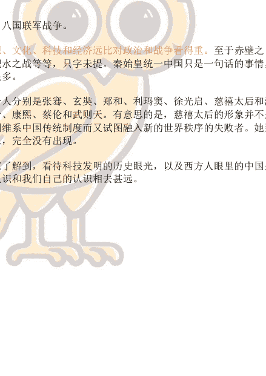

## 26 | 工业革命（一）：工业革命的本质

为什么说这是人类历史上最伟大的事件呢？为什么不是秦始皇统一中国、罗马帝国的建立、哥伦布发现新大陆，或者十月革命，抑或是联合国的诞生呢？为了回答这个问题，我们不妨先看一张图片。

这是美国奥兰多迪士尼的过山车，从图片你可以看出，它的轨道线路非常复杂，上上下下的。如果我给你关于这个过山车轨道的各种信息——第一个下坡的坡度、拐弯的半径，接下来上升的角度，让你计算过山车滑到最底下时候的速度是多少，你可能会觉得有点困难，因为要考虑的因素太多了，每一段上下的角度和长度都会对最后的速度产生影响，有些时候角度还是变化的。因此，当你把每一段的速度慢慢计算一遍后，得到最终的速度时，会发现因为中间的过程太复杂，根本就无法准确算出来。

历史，也如此，有时候向上发展，有时候出现衰退，上上下下，最后一起决定了历史的发展水平，由于各种因素的作用太复杂，我们有时候讲不清历史的来龙去脉，也看不懂一个历史事件真正的影响。

其实，解决上面两个问题并不复杂。还记得中学物理能量守恒的人应该明白，决定过山车最终速度的，主要只有一个需要考虑的因素就可以了，那就是过山车轨道的绝对高度。根据动量变能量公式，最后的速度是两倍自由落体加速度和高度乘积的平方根。当然，如果想要计算得更准确一些，考虑一下轮子和钢轨摩擦系数以及钢轨的总长度即可，至于中间钢轨复杂多样的形状，其实无关紧要。

类似地，对历史也是如此。我始终认为，要看清一个历史事件真正长久的影响，而不是短期的影响，主要也是一个要素，那就是：人民生活的变化是否因为这个事件而大不相同。我们不妨采用这个标准看工业革命的影响。

根据英国著名学者麦迪森（Angus Maddison）的研究，欧洲在古罗马时代（公元元年）的人均 GDP 就达到了 600 美元左右，但是到了 18 世纪英国工业革命之前，人均 GDP 基本上还是这么多，只涨到 800 美元。与此同时，中国正处于西汉末年进入公元前后的交替时期，人均 GDP 大约为 450 美元，和古罗马在同一水平。

中国在历史上经历了很多太平盛世，比如两宋时期，明朝中叶以及我们今天常常说的康乾盛世，在那些时期，中国的人均 GDP 最高能达到 600 美元左右（康乾盛世其实远不如电视剧里描绘得那样美好）。

但是到了 20 世纪 50 年代初，又退回到 450 美元左右，就在 1978 年改革开放前，中国的人均 GDP 也不过 800 多美元。这还是按照购买力计算的，如果按当时美元和人民币的比价折算，则只有 200 多美元而已。当时小平同志说，如果我们再不努力，就会除开除球籍，就是在那个背景下所说的。

人类文明进步，最重要的目的是改善人们的生活，从上面的数据中可以看出，历史上很多所谓伟大的事件，其实对历史很难产生长久正面的影响。

但是，工业革命则不同。在欧洲进入工业革命后，人均 GDP 持续增长，今天英国的人均 GDP 已经达到了 4 万美元，比工业革命前增长了近 50 倍，而在此之前的 1800 年，只涨了 1/3。

工业革命对中国意义更大，从 1979 年中国全面开始工业化以来，在短短 40 年里，人均 GDP 涨了十多倍（1979 年人均 GDP 按购买力计算），而在此之前的 2000 年里，人均 GDP 不过是翻一番而已。

马克思和恩格斯在《共产党宣言》中讲，"资产阶级在它不到一百年阶级统治中所创造的生产力，比过去一切时代创造的全部生产力还要多，还要大。" 这么说一点也没有夸张。

工业革命带来的不仅是财富，也是大大延长了人类的寿命。在工业革命之前，无论是欧洲、东亚还是印尼，人均寿命都各在 30～40 岁之间徘徊，因此古人也才会有 "人生七十古来稀" 之叹。而在 1800 年之后，世界各国一旦进入工业革命，人均寿命都会差不多翻一番。因此，我们说工业革命是人类历史上最伟大的事件，一点不为过。相比工业革命，任何王侯将相所謂的丰功伟绩都显得微不足道。

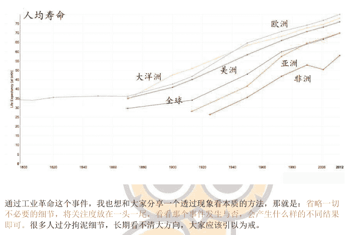

通过工业革命这个事件，我也想和大家分享一个透过现象看本质的方法，那就是：省略一切不必要的细节，将关注度放在在一头一尾，看着那个事件发生与否，会产生什么样的不同结果即可。很多人过分拘泥细节，长期看不清大方向，大家应该引以为戒。

## 既然工业革命意义如此重大，那么它是怎么样开始的呢？

过去大家从历史课本上学过这些知识，这次，我们从能量的角度来分析一下。我先告诉你结论：工业革命的诞生是能量富余的结果。你可能会觉得奇怪，难道不是能量或者动力不够用了才发生了工业革命吗？

要解决你这个困惑，首先我们来看看工业革命的本质是什么？工业革命的本质是动力革命，因为工业革命之后相比较之前，人类使用能量的水直接得到了飞跃。其中的核心是蒸汽动力取代畜力和水力，机械代替人工。然后我们再来看为什么是多余的能量造就了工业革命。

我们都知道历史书上说，英国在工业革命前，羊毛变得很贵，出现了“羊吃人”的圈地运动，很多农田被改成牧场，都用来养羊纺毛线了，以致很多农民破产。过去我们认为这是资本主义的罪恶，但是如果我们用能量这个指标考量一下，就会发现这个说法里面的逻辑漏洞。

当时很多农民破产不假，但那不是说大家都去饿着肚子种草养羊，无论你种地还是养羊，吃起粮食大家都是一口不少的，而且人口还不断增加，对粮食的需求也是越来越大的，大家不可能不吃不喝养羊。所以，农民破产的真正原因不是被羊挤走了，而是耕地不再需要那么多农民了。

也就是说，此时的英国，作为人工的能量，出现了富余。我在前面的课里讲过，任何文明都以养活更多的人口为首要目的，但是当这个目的达到后，就会产生分工，大家就会想到从事更挣钱的工业。中国的两宋和明末都是如此。农民离开耕地是迟早的事。

为什么偏偏是在 17 世纪，土地不再需要那么多劳动力了呢？因为当时英国开始了以改进工具和耕种方法为核心的农业革命。工具和耕种方法有了长足的进步，他们当时已经开始使用播种机，懂得差 Liên 种植和轮耕（农作物和肥料作物首轮流播种），其结果就是农业生产效率大大提高，而且超过了同时期的中国和印度。

所以，这就产生了大量农业剩余劳动力，他们就投入到了手工业的发展中。同时，农业生产效率的提高，还使得粮食产量也随之提高，结果就是英国南部的人口翻了将近一番，对手工业来说，这意味着更广阔的需求和市场。

英国当时除了出口羊毛，在农业技术提升的前提下，还大量地种植了麻和棉这些纺织材料。

把羊毛、麻和棉大量加工成各种布料就需要更多的劳动力了，而英国当时的口数量并不足以支撑一个规模庞大的纺织业。这里有一个问题，就是之前富余的能量，在被卷入新的产业后，又不够用了。因为当能量积累到一定量，就会进入到下一个循环中，开启新的能量阶级 的起点。

有人可能会问，为什么英国不直接出口棉麻羊毛，让其它国家自己生产？因为那样获得的利润太低，因此英国国王明令禁止这种短视行为。因此，围绕纺织业各种工具的改进就层出不穷。

英国人最初从荷兰工匠那里获得了纺织技术，但是很快英国的工匠做出了很多发明，最初是飞梭和珍妮纺织机这类高效率的纺织机械，但是很快工厂主就发现动力不够用了，于是水能、畜力，各种能想到的动力来源都用上了。

到此你可以看到，英国产业的发展到这时，动力成为了瓶颈，一次从人力到机械力的质的飞跃势在必行。当时，英国发展起来的产业还不止纺织业，采矿、冶金、制盐、造纸、玻璃和啤酒等很多手工业也跟着发展起来。那时的英国有点像今天的温州，不从事农业生产的人，都成了小工厂主。

当然，所有产业都缺乏劳动力和动力，怎么把英国当地的煤炭，也就是能量，转化成更高效的动力，成为当时最大的需求。瓦特和他之前的纽卡门等人发明蒸汽机，就是在这个背景下开始的。

好，这就是我说的，工业革命起于能量的剩余，而当剩余能量卷入新产业后，又启动了新一轮对能量更大的需求。人们不得不实现一次从人工到机械的质的飞跃，于是新的动力呼之欲出。最后，你可以再次感受到，工业革命的本质是人类使用能量的水平的飞跃。

## 要点总结

- 1. 我们通过讲解工业革命开始的原因，再次凸显能量作为理解科技进步主线的作用。
- 2. 我们也说明了任何历史重大事件的发生都不是突然的，而是πους它的前因后果的。
- 3. 最重要的是，我们介绍了一种透过现象看本质的方法，就是通过排除那些繁杂的，影响力随时间变化而递减的因素，直奔目标而去，只要看一个事件开始之前的状况，再看它完成之后的结果即可。

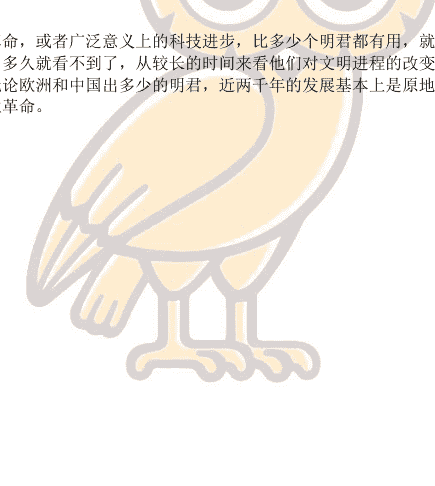

我们说工业革命，或者广义意义上的科技进步，比多少个明君都有用。就是这个原因。明君的作用用不了多久就看不到了，从较长的时间来看他们对文明进程的改变很有限。正是这个原因，无论欧洲和中国出多少的明君，近两千年的发展基本上是原地踏步。真正改变世界的，是工业革命。

## 27 | 工业革命（二）：为什么是瓦特？

上一讲我们讲了工业革命的本质、起因以及为什么它伟大。工业革命把人类进程的速度提高了一个数量级，那为什么那么多的发明创造能在短时间里涌现，而在过去却做不到？搞懂了这个问题，我们自己成功的概率也能提高一个数量级，就从过去农耕时代几百年碰不上一次进步，上升到能够周期性地获得成功。

而第一次把握了其中规律的人就是瓦特，这一讲我们透过分析瓦特的成功来学习这个规律。

通常在各种励志读物中，瓦特被描写出身贫苦，没有上过大学的业余发明家，甚至宣扬他受到开水锅开盖蒸汽的启发，发明了蒸汽机，那些不过是告诉大家努力必有回报的心灵鸡汤而已。其实瓦特出生在一个中产家庭，小时候日子过得很好，因此他的教育基础很好，只是后来父亲破产家道中落，不得不中断学业当了工匠。

瓦特从 20 出头，就在格拉斯哥大学工作，那所大学在苏格兰仅次于爱丁堡大学，在历史上还出过一位名人，就是经济学家亚当·斯密。在那所高水平大学里，瓦特利用工作之便，听了很多力学、数学和物理学的课程，并与教授们讨论理论和技术问题。在当时，像瓦特那样系统地学习过大学物理的课程和高等数学的人并不多。

好，刚才我是为你还原了瓦特真实的出身和背景，接下来，我们再看他与蒸汽机的关系到底是什么。

如果我问你，瓦特最大的贡献是什么呢？你可能说是发明了蒸汽机，也可能会说是改进了蒸汽机，这两种说法其实都有道理，后一种更准确些，因为蒸汽机在瓦特之前就有了，而瓦特的贡献在于发明了一种之前蒸汽机不同的新的蒸汽机，他的蒸汽机不仅效率高，而且能够通用。这才让蒸汽机成为了工业革命动力的来源。因此，比较准确的说法是瓦特发明了万用蒸汽机。

我们上一讲说到，英国在工业革命之前，一些产业已经开始发展，其中就包括采矿。直到今天在矿井下采矿都需要解决一个问题，就是把矿井里的地下水抽掉，这种事在过去只能由人或者牲畜来完成，效率很低。

## 科技史纲 60 讲

瓦特当时负责修理工学院各样仪器，精通机械，虽然没有碰过蒸汽机，但是他在机械方面的造诣大家都认可。最后，瓦特不仅修好了那台蒸汽机，而且在修理时，瓦特仔细分析了它效率低下的原因。

瓦特发现这种蒸汽机的活塞每推动一次，气缸里的蒸汽都要先冷凝，然后再加热的过程，使得 80% 的热量都耗费在维持气缸的温度上面。此外，这种蒸汽机只能做直线运动，不能做圆周运动。瓦特于是决定改进蒸汽机。

在瓦特之前，工匠们往往是靠经验的积累来改进一种产品或者一个技术，而瓦特是直接通过科学原理找到了现有产品的技术缺陷，然后又通过科学分析找到了解决问题的答案。这就让科学和技术紧密地结合在了一起。

在之前，也有一些天才将科学成果直接应用到发明上，但是，非常少见。比如伽利略知道光折射的道理，他能够在没看到过实物物情况下，就造出望远镜；牛顿懂得不同的光折射率不同，因此白光很难以聚焦，便利用凹面镜反射的原理发明了反射式天文望远镜（即牛顿式望远镜），解决了大倍数折射望远镜（也称为伽利略望远镜）图像模糊的问题。

这些人在发明时确实主动使用了科学，但是大部分时候科学和技术是分家的，工匠们并不懂得科学，而科学家又懒得去做工匠们的事情。“科技”作为一个词，是现在的事情，过去它们是完全分开的两个词。

瓦特的过人之处在于，他虽然是工匠，但是他解决问题的思维方式是牛顿和伽利略那种科学家式的。他从原理出发，重新设计蒸汽机，在他的设计中，将冷凝器与气缸分离开来，这样就避免了蒸汽机在重复使用时，要加热一冷凝一再加热一再冷凝，重复低效率工作。

瓦特从开始研究蒸汽机，到建造出一个可以运转的模型，只花了两年的时间。然后他就离开了大学，专职研制新的蒸汽机了。当然造出模型和造出可商用的设备还是两回事，这一我们下一讲再说。

## 接下来，我们总结一下瓦特的两个了不起的地方。

首先，他是第一个自觉应用牛顿力学原理做重大发明的发明家。牛顿、伽利略以及古希腊的阿基米德都曾经直接应用科学指导发明，但是他们发明的东西的重要性远比不上蒸汽机。

其次，瓦特是通过发明一种通用的机器解决很多问题。在瓦特之前，几乎所有的发明都是针对解决具体问题的。比如纽卡门蒸汽机，就是为特定的设计和制造的，很难从一个工厂拆下来用在其它地方：瓦特在发明蒸汽机时，就考虑了它的通用性，他的目的就是将蒸汽机卖到不同的工厂。

这也是机械思维的重要特征——所有问题有一个通用的解决方法。瓦特的合伙人博尔顿对通用性的重要性有着先见之明，他明确指出，他和瓦特所做的事情，是为工业提供动力，而不简简单单是一种机器。

因此，瓦特对工业革命的贡献，不仅仅仅是发明了一种机械，甚至不仅仅是发明了一种动力源，而在于彻底改变了那一代发明家们的思维方式，这才让人类似从 18 世纪末到 20 世纪初的重大的发明，像井喷一样不断涌现。在瓦特之后，机械思维在欧洲开始普及，工匠们发明了解决各种问题的机械。

比如，19 世纪初，英国技师史蒂芬逊利用机械发明了火车，并且在 1825 年实现了英国斯托克顿和达灵顿之间的火车交通，从此人类的距离开始大大地缩短。

1830 年，史蒂芬逊在儿子小史蒂芬逊的帮助下，建成了利物浦到曼彻斯特的铁路，这是人类第一次将两个大城市用铁路连接起来，也是第一条只跑蒸汽机车的铁路。在那条铁路修建的过程中，大学毕业且有着扎实理论功底的小史蒂芬逊发挥了巨大的作用。如果没有他的理论计算，那条铁路是不可能在短时间、可控的成本下建成的。

1807 年，美国发明家富尔顿发明了第一艘成功投入商业运营的蒸汽船，从此开启了全球航运的新篇章，并将大帆船挤出了历史舞台。早在 20 年前，只有 22 岁的富尔顿前往英国学画，有幸在瓦特五十大寿上为这位伟大的发明家画像。富尔顿受到瓦特的鼓舞，从此开始学习工程并且成为了一位伟大的发明家。

和富尔顿同年的美国发明家惠特尼，通过干农活、当老师攒学费进了耶鲁大学，他原本毫无工程方面的经验，但是精通物理知识和机械原理。大学毕业后，惠特尼本打算继续学习法律，因家中深落，只能够往南方去当家庭教师，留意到当地工人摘棉籽很辛苦，就发明轧棉机，把要用手工才能完成的工作，交给机器来完成了。轧棉机使得摘棉籽的效果提高了 50 倍以上，并因此而彻底改变了美国南方种植园经济，后来的美国南北战争也可以说是惠特尼的轧棉机带来的间接结果。

这样类似于瓦特改进蒸汽机的伟大发明在瓦特之后不久还有很多，我们就不再列举了。它们都有一个共同的特点，就是主动使用科学知识指导发明。这样，重大的发明不再是人类历史上偶然事件，而是科学发展的必然结果。因此，我们说瓦特的成功不仅仅是技术的胜利，更重要的是他在思维方式的胜利。

西方人通常说，牛顿找到了工业革命的钥匙，瓦特拿着那把钥匙开启了工业革命的大门。牛顿的钥匙，既包括他的物理学和数学理论，也包括机械思维。而瓦特，除了自己的贡献外，还教会了当时一代人如何有效地进行发明创造。这才使得在他之后，各种发明后浪推前浪不断涌现，最终形成了工业革命。

## 要点总结

人只有从工匠那种不断试错，长时间经验积累的进步的方式，上升为瓦特那种主动用最新的思想和理论指导自己成功的方式，才能获得比常人高得多的成就。这也是我们非常不主张大学生退学，而不断强调人要有高起点的认知。

## 思考题

爱尔兰历史学家威廉·莱基曾说过这样一句话：“但凡一条铁路铺成，必将同时带去知识的飓风，很可能瓦特和史蒂芬逊最终会像路德或伏尔泰那样深刻改变人类的许多看法。”请谈谈对这句话的理解。期待你的留言。

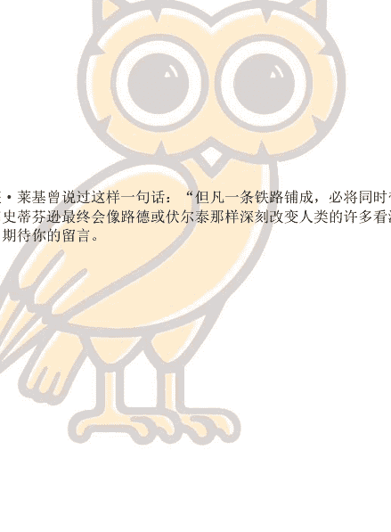

## 28 | 工业革命（三）：月光社和工业革命

上一讲，我们说了瓦特能开启工业革命，是因为他是把科学和技术紧密结合的第一人。这一讲，我要告诉你的是，对于开启工业革命这件事，其实相比瓦特的个人特质，他所处的那个大环境更关键。同时，听完这节课，我希望你可以从信息有效流动的角度去再次理解工业革命。

我在《见识》一书中讲，人最大的幸运在于处于一个适合自己的时代、瓦特就是如此。瓦特的幸运之处在于，他生对了国家，生对了时代，而且恰好周围有一大批人帮助他完成上述工作。

瓦特的幸运是从结果，从宏观来看的。如果退回到历史的细节里看，瓦特其实在中年的一段时间里是走背运的。他在格拉斯哥大学完成了改进蒸汽机的部分理论工作之后，就离开了大学，用今天的话说，他丢掉了铁饭碗，开始创业了。

要创业就需要资金。于是瓦特就和今天很多创业者一样，将发明专利折成股份，获得了一位铁厂主约翰·罗巴克（John Roebuck）的资助，但是资金依然不够，更不要说给瓦特发工资了。而瓦特家里孩子又特别多，于是他只好兼职土木工程师的工作，挣钱养家糊口。

1773 年，也就是瓦特已经设计出蒸汽机的八年之后，罗巴克破产了。那几年，瓦特的运气特别糟，妻子也因难产而死，留下了几个未成年的孩子，瓦特的生活跌入了最低谷。这时，恰巧俄罗斯当时正值叶卡捷琳娜二世统治时期，这位很有作为的女沙皇从欧洲各地网罗人才，于是就有人建议瓦特去俄国，瓦特也心动了。

不过崇尚科技的英国还是把瓦特这位即将带来技术革命的发明家留了下来。因为当时在世界上，只有英国建立了一整套将发明转化为生产力的机制，并且能够让发明家个人获得巨大的经济利益。

当时英国有一个繁荣科学技术的社会大环境，它是最早实行专利法的国家。这个传统从 16 世纪就开始了。虽然最初的制度很薄弱，每年也就几件，但是到了 18 世纪瓦特的年代，专利保护得到了英国全国上下的普遍认同，每年申请的专利越来越多。当时，在英国全社会，大家对新发明和发明家热烈地崇拜，这就如同今天中国很多人是乔布斯和马斯克的粉丝一样。

听到月光社这个名字，你可能会觉得它有点像是一个神秘组织。其实月光社做的事情并不神秘，那只是一小群人在月圆的晚上聚会，讨论学术问题特别是科学和工程问题。之所以选择月圆时，并非是出于什么宗教仪式的考虑，而仅仅是因为当时没有路灯而已，这个组织因此取名月光社（Lunar Society）。

但是，另外一方面，这个组织因为严格审核每一个成员的资质，对外封闭，因此外界对它还是有神秘感的。

月光社最初只有两人，工厂主博尔顿和他们家的世交老达尔文，就是后来提出进化论的那个达尔文的爷爷。老达尔文是科学家兼医生，因此两个人经常一同探讨科技问题。不久之后，他们又将到英国办公事的美国科学家（和政治家）富兰克林吸引进来了。

后来月光社的影响力越来越大，当时的矿业学家也是后来的瓷器大王韦奇伍德，发现氢气助燃原理的著名化学家普利斯特里，也加入了进来，甚至美国后来的国父杰斐逊（他也是科学家）以及现代化学之父拉瓦锡，都是这个月光社的通信会员。

但是月光社的规模也不是不断扩大，最多的时候它也不过有三十人左右。但是这三十个人不仅仅开启了工业革命，而且对美国后来的政治和科学发展都有很大的影响力。1767年，在合作伙伴罗巴克的推荐下，瓦特拜访伯明翰，并由斯雷尔和沃尔文本着参观了博尔顿的工厂，不巧当博尔顿刚好不在，从此，瓦特定期参与月光社的活动、成为其中一员。后来也就逐渐认识了博尔顿。

就在瓦特最困难的时候，一直看好他和他的技术的博尔顿，变卖了自己现有的产业——一家五金工厂，并给了瓦特一些钱，支持他辞掉在外面土木工程师的兼职工作，全职从事蒸汽机的研制工作。博尔顿虽然做了一个非常富有远见但也是颇为冒险的决定。这里面除了了解瓦特这个人之外，他自己独特的眼光也是无法阻挡支持瓦特的原因。博尔顿是一位很成功的企业家，看到当时动力已经成了工业快速发展的瓶颈，才决定放弃五金业，转而与瓦特合作。

博尔顿在写给瓦特的信中表明了自己的决心：“我将为蒸汽机的诞生创造一切条件，我们将向全世界提供各种规格的发动机，您需要一位助手来减轻负担，并且把您的产品介绍给全世界。” 从此，他和瓦特就成了改变世界的“天作之合”。

瓦特和博尔顿两个人性格非常互补，瓦特才华横溢、心思缜密、逻辑性非常好，但是有时缺乏耐心，容易着急。而博尔顿则相反，他天性乐观，善于为人和处，有激情也有毅力，每次在瓦特快要放弃时，他总是鼓励瓦特说，可能再来一次我们就成功了。

3 年之后，也就是 1776 年，瓦特制造了自己的蒸汽机，有趣的是，就在这一年另外两个月光社成员在美国《独立宣言》上签了字。1781 年，瓦特又发明了从两边推动活塞的双动蒸汽机，又称万能蒸汽机，这种原理的蒸汽机一直用到了今天。

1785 年，瓦特被选为英国皇家学会会员。后来博尔顿和瓦特合办的公司将蒸汽机卖到了全世界，加上专利转让的收入，瓦特晚年非常富庶。

在月光社里，还有两个人对蒸汽机的研制和推广起了巨大的作用。其中一个是普利斯特里，他的一个侄子参与了蒸汽机的研制，并且是打造那些样机的铁匠，另一个就是后来的瓷器大王韦奇伍德，他将瓷器制造业变成第一个采用蒸汽机动力的行业。有了这个成功的案例，从此蒸汽机在工业界开始普及。

通过这个例子，你可以看到学术团体，或者我们说的圈子，对工业革命这样重大事件的重要性。到后来，这种科学团体直接影响了科学和技术的发展速度。月光社因为是纯粹的民间团体，它到了小哥特和小博尔顿那一代影响力就不如从前了。但是，当时已经出现由王室（和政府）支持的学术团体了，它也就薪尽火传了。

如果说月光社是地方性的科学协会，在当时的欧洲，最高级别的科学团体就是英国的皇家学会（成立于 1660 年）和法国的法兰西科学院（成立于 1666 年，不过 1699 年路易十四正式给科学机构制定章程）。

前者在 17 世纪末，18 世纪初，活跃着牛顿、胡克、哈雷、波义耳、惠更斯等一大批科学家；后者在 18 世纪中期，有拉瓦锡、孔多塞、达朗贝尔、伏尔泰等一大批杰出的科学家和学者。那些学者们不仅经常一起讨论问题，而且还经常在经济上相互帮助，比如哈雷就帮助牛顿从编辑到出资出版了不朽的科学巨著《自然哲学的数学原理》一书。

正是这些科学协会和学术团体的出现，才让商人、科学家、发明家、工匠有机会聚在一起，相互交流信息，取长补短，也让科学成果在那个时代大量涌现。如果我们从信息的角度来看待这些科学团体的作用，就能发现它们至少在三个维度对科技发展的促进作用是巨大的。

- 1. 信息的传播和流动，放大了学术交流的意义。
- 2. 通过科学团体中的同行评议，可以去伪存真。
- 3. 缩短从科学到技术应用的鸿沟。

今天一个人如果不在学术圈子里，做出科学成果的可能性近乎为零。而学术团体从一开始就是很排他的，无论是月光社还是皇家学会，直到今天都是如此。但是，一个人一旦有了科技成就，被吸引进这个团体，他就将受益终身。

在历史上，无论是瓦特还是后来证实能量守恒的大科学家焦耳，一开始都被排斥在皇家学会之外，但是，一旦他们做出了成绩，就被吸纳其中。

如果你回溯那个改变了历史走势的时代就会发现，就是那么一小撮掌握了核心技术的人，创造出种种重大发明，也造就了历史，而这种幸运，可以说是脱身核心学术圈子的结果。对此，今天可能有些年轻人觉得 ceci 不公平。其实学术团体从来就不是为了公平而设立的，它们是为了维护学术的权威性，方便同行之间交流，以及构建大家对学术的认同而设立的。

## 要点总结

- 1. 我们讲了大环境的重要性，制度比人更重要。
- 2. 学术团体对科技进步的作用是巨大的，瓦特的成功在很大程度上受益于月光社。

## 思考题

很多圈子都具有学术团体的这个性质——对外排他性，对内相互照顾，通过限制会员人数，维持权威性和特权。那么怎样理解这样的圈子？欢迎你写下自己的思考。

## 29 | 工业革命（四）：工业革命中谁受益？

这一讲，我们通过分析是哪些人站在了工业革命的浪潮之巅，成为工业革命的受益者，来总结所有技术革命的本质规律。这样就可以帮助你在面对当下以及未来的技术变革时，找到方向，不至于手足无措。

我们前面两讲分析了瓦特，并且将他的工作放在了更大的时间和空间中去考察。

在时间上，他处在从农耕文明到工业文明的转折点，同时也处在科学知识已经积累了百年，但尚未用于技术革命之时。在空间上，他处在当时尊重发明家、保护发明，又对动力迫切需要的英国，英国从1623年就开始设立专利权，保护新发明的权利了。因此瓦特非常幸运，靠着自己的发明过上了非常富庶的生活，因此他无疑是工业革命的受益者。

在工业革命中，还有很多类似瓦特的人站在了当时的浪潮之巅，包括我们前面讲到过的下面这些发明家：

- 1. 富尔顿，他从一个想当画家的年轻人转变成为英、美国都爱尊敬的发明家，发明了蒸汽船、水雷和潜水艇等等。之后又因此成为了解放美国和政治家。当时社会对发明家都很敬重，美国的政治家、老家族的代表文学家和科学家也对他青睐有加，还把侄女嫁给了他，他无论是在法国、英国，还是回到美国，都如鱼得水。
- 2. 史蒂芬逊父子，特别是老史蒂芬逊。我们说瓦特绝不是草根出身，但是老史蒂芬逊还真的是，他起于贫困，靠着自己重大的发明成为了受人尊敬的火车之父。情况和他们类似的还有发明节车罗列・莫兹利等人，莫兹利也起于贫困，靠着机械上的发明，26岁便成为成功的工厂主。
- 3. 以惠特尼为代表的美国发明家。惠特尼除了发明轧棉机，还发明了纱(xī)床。此外后来美国发明家约瑟夫・布朗发明了万能统机。由于篇幅的原因，我们就不多介绍了。

总之，19世纪是机械的时代，也是“煤和铁”的时代，一个环环相扣的工业体系席卷了整个世界。比如，钢铁业需要煤炭作为能量，而煤炭开采又需要蒸汽机源源不断地从矿场往外抽水，蒸汽机的改进又催生了新的交通工具火车的诞生，火车和铁轨又反过来加速了煤炭的运输，煤炭对钢铁的保证。

这就形成了一个不断放大的循环体系，越来越多的能量被不断地卷入，而且一旦参与到这场社会和经济方式的变革中，就再也退不回去了，谁都难以置身事外，在这场让人类走上持续增长之路的动力革命中，任何参与到这个体系中，进行发明创造，又多少有点商业头脑的人，都获得了过去上千年 never有的机会。

当然，他们个人受益的多少，除了自己的商业头脑外，还在于当时所在国保护发明与否。英国发明家就比美国发明家在这方面幸运很多，像惠特尼等人，根本无法从自己的专利上获利，只能陷入和竞争对手在产品上的竞争，只是因为他更具有竞争力，才把生意做起来了。

我还要特别指出的是，工业革命的受益者远不止瓦特和富尔顿等人。我们在前面专门讲了博尔顿和希奇伍德，他们是另外一批受益者，代表两类在工业革命中受益的群体。

首先我们来看博尔顿。博尔顿既代表工厂主，也代表投资人，他和后来 J.P. 摩根这样的投资人还不同，他自己就非常了解产业。如果你回顾一下中国改革开放之初第一代企业家，比如鲁冠球、刘永好等人，他们和奇迹伍德就有相似之处。当然，如果博尔顿坚守自己的小五金厂，没有和瓦特合作，今天就没有人知道他了。

我在《硅谷之谜》一书中讲，今天重要的不是开一个百年老店，因为技术革命会让你的产业守不住的，最重要的是确保自己能够站在浪潮之巅。

至于瓷器大王韦奇伍德，他则代表了掌握新技术改造旧产业的企业家，他的成功的要诀，也是我这一讲最想与你分享的技术革命中的秘诀。

我在第 25 讲提到欧洲人再次发明瓷器，结果就是在工业革命之后，欧洲逐渐打败了瓷器的发源地中国，不仅在中国市场大举占领市场，而且在世界范围呢也把中国瓷器挤到了边缘的境地，在今天，欧洲瓷器依然占据着世界高端瓷器市场 90% 的份额。

如果你到高端瓷器市场上买瓷器，随地可以看到韦奇伍德的名字，但是在他生活的年代，反而没有多少人知道他。因为他当时的本职工作是探勘矿产，而他后来创业所选择的行也是一非常古老的行业——瓷器制造，这在中国已经有近千年的历史了，欧洲人在大陆也已经烧制了近百年了。

韦奇伍德与众不同之处在于，他将以蒸汽机为核心的新技术，和那个上千年历史的古老行业相结合，通过改变动力，使得制瓷业焕然一新，成了新的产业。由于蒸汽动力的引入，瓷器从过去一直供不应求变成了供大于求，这种一度被誉为“白色的黄金”的商品，瞬间掉到了自卖价。因此也就让“洋瓷”瞬间攻破了中国市场。

你可能会想，瓷器便宜了，不就没有利润可图了吗？韦奇伍德了不起的地方在于，他没有陷入和中国瓷器和欧洲廉价瓷器的价格战，当其他瓷器商人厚利的好日子一去不复返时，韦奇伍德在伦敦开办了瓷器展示店，这成为后来高端产品专卖店（体验店）的前身。

更有意义的是，作为矿业学家，韦奇伍德发现在瓷器中加入牛骨可以让瓷器变得又白又结实，便发明了今天大家使用的骨质瓷器。直到今天，韦奇伍德的瓷器不仅卖到全世界，而且其高端瓷器的价格和等量白银依然等价。

在当时的英国，像韦奇伍德这样的企业家很多，特别是在纺织业和机械加工业方面。

世界上纺织业历史比瓷器还要长得多，几千年来这个行业一直是一家一户的小手工业。英国的纺织业在蒸汽机出来之前已经有了很大的发展，靠水力驱动的各种纺织机在 18 世纪之前是高科技产品，它们的生产效率比东方纯粹手工的纺织机要高很多。

但是，由于水轮机的运转并不均匀，那样织出来的布也不可能均匀。因此英国那种工业制造的纺织品并没有能马上卖到全世界。在中国鸦片战争之前，英国棉尼料子的洋布在中国是没有市场的，因为中国人看不上那些东西。

但是到了18世纪中叶，鸦片战争后，用机器织绊的雅布再进入中国市场后，就把中国自己的纺织业挤垮了，因为在蒸汽机用于纺织业后，情况就不一样了。那些亚布可以说是价廉物美，到中国和印度之后，当地几千年来的传统家庭纺织业在短短的几十年间就消失了。

从此全世界的纺织业就被重新定义，各个迈向工业化的国家开始建纱厂、织布厂，一时间纺织业成为工业化过程中的全新的产业。同样，中欧生产机械产品的手工作坊在工业革命之后也被英国用蒸汽机重新定义的产业挤垮了。

通过瓷器和纺织这两个例子，我们可以分析出一大批受益于工业革命的产业，它们毫无例外地都遵循了下面这个公式：

## 原有的产业＋蒸汽机=新的产业

在工业革命那个时代，那些有意或者无意接受了这个规律的企业家，在新的时代又站到了浪潮之巅。从数量上来说，这一批量盈者，人数量比较掌握核心技术的发明家们数量多得多。大家成为瓦特这样的机械师，但也不是为奇事，也不是为希奇的。当然，如果要站在韦奇伍德的对立面，再努力，当下的优势再大，也会被历史淘汰。

韦奇伍德等人的成功的原因，首先是他们比别人更早地了解了新技术，这就是我们上一讲说到的月光社的作用了。正是他直接接触到瓦特，才成为完成产业改造的第一人。

其次，在第一次工业革命之后，机械上的进步不断出现，韦奇伍德对传统产业的改造，就像是在这样频繁积累的树上接果子，任何一个新的技术发明都能让他们尝到甜头，但是那些科技成果，对中国、印度的手工生产为主的传统产业几乎是毫无帮助的。可以讲，是整个时代在帮助韦奇伍德等人打败了传统的制造者。

那么，有成功者就有失败者。在世界范围内，失败者首先是被各种使用机器产业挤垮的小企业，包括家庭作坊。这方面不仅在英国，而且在全世界范围内，都有大量的受害者。这些人绝大多数都过分相信自己以前所积累的行业经验。但是由于生产同样的产品的产业变成新产业，他们的经验就失效了。

## 30 | 工业革命（五）: 机械时代的管理特点

这一讲，我会告诉你工业革命带给人们最大的思维上的转变，以及它又是如何通过生产管理手段影响到我们今天的生活的。

工业革命带来的最大的思维变化，就是在瓦特之后，机械思维在欧洲开始普及。工匠们发明了能解决各种问题的机械，大家好像一下子找到了这个世界的所有答案，从此世界进入真正意义上的机械时代，这也是我们这一模块的标题。这时候，人们发明了替代手写的打字机，发明了可以自动演奏的复杂的八音盒，瑞士的能工巧匠甚至发明了会演奏音乐的钟表。

在理论上，数学家巴贝奇证实了人类已知的所有确定性计算，都能通过机械实现，他因此还发明了能够微积分的机械计算机。那时，人们相信机械能够解决世界上所有的问题，就如同今天很多人相信计算机能解决所有问题一样。人们越来越自信，甚至有机械论者写出了名为《人是机器》这样的著作。

人们能有这样空前的自信，都归处于牛顿、波义耳等人倡导的机械思维。这种思维有三个显著的特点，分别是：确定性、可拆解和标准化。

确定性是什么意思？用爱因斯坦的话就是“上帝不掷骰子”，任何宇宙的规律都应该是确定性的，虽然爱因斯坦是 20 世纪的科学家，而且在物理学上超越了牛顿，但是他在本质上认可牛顿的方法论，也就是：所有理论都可以用明确的公式表达出来。这就是确定性，人们一旦有了确定性的世界观，就看运用规律预测未来的可能性。

其次，在机械思维指导下，人们认为任何一个复杂的问题都可以分解成若干个简单的问题，解决了这些简单的问题之后，原先的复杂问题就必定有解。通过这种方法，人类不仅解决了 一个又一个科学难题，而且制造出一个又一个复杂的产品。这就是第二个特点可拆解。

而标准化则是人们在大概规模生产中体现出来的机械思维。机器帮忙做事，产量自然增加，于是人们加大投入，发明了各种替代人工的机器。使用机器取代人从事劳动生产之后，产品的标准化就替代了个性化，而追求效率也成为工业企业提高竞争力的唯一手段。

说到这里，三个机械思维的特点你都清楚了。那么机械思维又是如何通过生产管理进而影响社会的呢？以及对我们现在的管理和工作，有哪些启示呢？

泰勒是美国科学管理的创始人，被誉为“科学管理之父”。他的管理经验完全是从实践中一点一滴悟出来的，而这种经验主要来自于直接针对工业时代企业管理的特点，不断优化流程和生产关系，以提高效率。泰勒后来将他一生的体会写成了《科学管理原理》一书，这本书成为工业时代企业科学管理的经典之作。

泰勒的管理学理论很庞杂，我们介绍三个主要方面，我希望通过这三点，帮助理解自己手上的工作和眼前的事业，以及当下的时代：

## 1. 效率优先，这是泰勒管理学理论的核心

在泰勒看来，劳动生产率是区分文明国家和未进入文明社会国家的标准。因为生产效率的提升将会将奢侈品变成必需品，让全社会都能享受文明的成果，这其实在一定程度上解释了为什么工业革命之后全世界人均 GDP 能快速提升。

比如在 20 世纪七八十年代，中国老百姓们想都不敢想的私家车，但随着中国工业化和改革开放，居然在短短的 20 年后汽车就在城市里普及了。

那么怎样才能够提高生产效率呢？泰勒最看重的是优化流程和标准化管理。

优化流程的概念，在工业时代最大的成功就是生产线流水线的出现，它最终成为了现代大工业的标配。

生产线流水线是机械思维在生产和管理上最具代表性的产物，带来了人类历史上从未有过的高效率。生产线流水线背后有着它的科学基础。

首先，复杂

讲到这里，你可能会发现我们今天很多企业在管理上依然有泰勒管理的影子。甚至在一些 IT 企业中，软件开发依旧采用很传统的方式，即由个别架构师先做设计，然后一级级向下做详细设计，最后由程序员编写程序，还有专门的测试人员进行测试。

除了那些做上层整体设计的人对产品整体有一定的了解外，其他人只负责写功能定义得非常清晰的程序模块。因此，IT 行业把写这种程序模块的工程师称为“码农”，虽不大好听，却也是很形象的比喻。

## 2. 同构的树状组织结构

泰勒管理方式的第二个特点，就是企业组织结构的树状设计，这完全是为了适应这种自上而下将产品分解为大小任务的做法。具体来讲，就是企业组织采用十分严格的树状结构，且大小组织结构。

这种同构的树状结构在工业时代其实是很高效率的，它保证了各个部门之间职责分明，而且不需要底层员工具有太全面的技能，因此成本很低。在管理上，由于各个级机构是同构的，小组长当好了可以当工段长，工段长当好了可以当车间主任，然后是分厂长、厂长等等。

比如国内不少大型 IT 公司，会根据产品或构建若干个独立轻松的事业部或事业群，每个事业部由一位执行副总裁负责，事业部内又根据产品模块细分出下一级组织，每个组织由一位总裁或总经理负责，然后再根据细化的产品功能，相应地继续往下分。

不同产品之间，即使有共同的技术模块，也是各做各的。每个产品都有单独的用户界面，各产品团队配备有单独的美工设计人员和运维人员，因为树状的管理结构是没有交叉的。

但是实际上，这样的组织结构不仅造成了很大的浪费，而且各个部门之间交流少，专业人员（如产品设计人员、系统运维人员）平时只能和自己部门里的一个两个同行沟通，专业水平提高缓慢。

那么为什么 IT 企业会采用这样并不适合时代特点的管理方式？其根源其实来自于机械思维和泰勒管理，它们在工业时代是最普遍的，至今在很多人心里依然是根深蒂固的。

尤其是在今天，这种管理方式并不适合快速变化的时代要求，这一点我们后面会讲到。

## 3. 可预测性

机械思维的一个重要特点，是在发现了普遍规律后只要求将其应用到具体场景便一定能够预知结果。比如，蒸汽机车挂掉若干吨煤，一定能够跑出 100 公里；把汽车零部件放到生产线的各个起始点，几天后一定能够在生产线的终点造出一辆汽车。这些事实与运用牛顿力学原理预测一千年后的日月星辰运动没有本质的区别。

苏联政府把这种可预测性发展到了极致，他们不仅让工厂里的所有生产计划都是可预测的，甚至试图预测市场。苏联政府拥有规模庞大的各级计划部门来作预测，但是效果如何，不同的学者有着不同的看法。

对这种可预测性的依赖，也体现在了资本市场的规范上。在 19 世纪后期之前，各个上市公司是不给投资者做未来营收预测的，因为预测未来营收是做不到的。

但是到了 19 世纪末 20 世纪初，随着美国政府对资本市场的监管越来越严格，上公司在投资者和监管部门的双重压力下，不得不披露越来越多的经营和商业信息，包括对未来营收的预测。令人吃惊的是，从较长时间来看，公司的经营情况与预测的结果相差不大。

好，我总结了机械思维的三个特点，以及泰勒管理学理论的三个要点，希望你知道，任何一个时代的技术特点，都会慢慢影响到生产管理上。

客观地讲，泰勒的管理学理论是工业革命之后最有影响力、最有效的管理学理论，它积极意义不容置疑。但是，由于这种理论成熟于第二次工业革命时期，离我们现在已经有段时间了，因此到了信息社会，它在企业管理和协调劳资关系上的局限性就越来越突出了。在信息时代需要用何种管理方式，这是我们以后会讲的内容。

## 要点总结

- 1. 我用 5 讲篇幅以工业革命为例，分析了科学、发明和科学思维的关系，以及这三者通过生产管理带来的社会变化。
- 2. 机械思维的确定性、预测性、可拆解和能微化整为零等特点，带来了管理上效率优先、强调预测和组织构的特点。
- 3. 泰勒的管理学理论已经不太适合今天的世界了，但是它的影响力巨大，因此我们在许多公司可能还会看到它的影子。对于那些你认为不合理的现象，通过今天的分析，希望你能够理解它们的原因。

## 思考题

请你找出泰勒管理学在当今的具体影响。

## 31 | 为什么是焦耳证实了能量守恒定律？

我在前面介绍了以机械革命为核心的第一次工业革命，通过那次革命，很多从前需要由人来完成的事情，都可以由机器自己做了。但是，要利用机器，就要给机器提供能量。

早在工业革命之前，就有人开始探索能否少用能量，甚至不用能量就能让机器跑起来。从文艺复兴开始，很多 人就前赴后继地投入到制造永动机的队伍中，其中包括天才的达·芬奇。

当然，事实证明，所有的永动机发明人只有两种。第一种是有意的骗子，比如1714年，有个德国人声称发明了水动机，最后被揭露出来，原来是里面藏了人在驱动它运行。第二种是无意的骗子，他们因为缺乏知识，自己被骗了，然后又去骗同样缺乏知识的人。大多数痴迷于永动机的人间科学家里就属于后者。

在当时，各地科学学院的成员要不厌其烦地验证各地申报的水动机，却发现无一例外全是骗子，于是1775年，法国科学院正式通过决议，宣布永不接受永动机的专利。随后，欧洲很多国家的学术界都作出了类似的决议。

要知道，当时人们反对永动机，是因为在实践上从来没有人成功过。但是，没想到这反而激发了更多的人去挑战这个无解难题。这些人觉得过去没有成功过，不等于将来不能成功，别 人没有做成，不等于我也做不成。因此，要彻底证明造不出永动机，就要从理论上搞清楚动力是怎样产生的，以及能量和动力之间的关系。

真正把能量守恒这件事说得很清楚，并且定量地给出热能和动能之间关系的的是英国的科学家焦耳，从他以后，大家对提高能量效率这件事的研究才算是有一个方向，不至于误入歧途白白做那些没有意义的事。

也就是说，人类第一次搞懂了能量是怎么来的，焦耳告诉大家，能量（和动力）是不可能凭空产生的，它只能从一种形式转换成为另一种形式。

我给你打个比方，人们在和蒸汽机车打交道的时候发现，好像煤炭燃烧不仅推动了蒸汽机的活塞运动，也释放了光和热，而且机车的轨道也在前进中变热了。

焦耳就告诉大家，这些各种形式的能力，都不是凭空来的，而是转化来的，这就是能量守恒定律，也是热力学第一定律。不只如此，焦耳还精确地测出了这些量，通过实验告诉大家，能量是从高处流下来。这是热力学第二定律。

从此以后，人类终于通过热力学，改变了对世界的看法，原来相互独立的热学、力学和电磁学都可以统一起来了。可以说，这个新的世界观就是焦耳带起来的。

焦耳的成功并非偶然，我们这一讲就来破解为什么偏偏是焦耳证实了能量守恒定律。

在焦耳生活的年代，他在人们心目中首先是啤酒商，而不是科学家，也就是说，焦耳起先也只是个“民间科学家”。

焦耳出生在一个英国富有的家庭。在 16 岁那年，焦耳和他的哥哥在著名科学家道尔顿（原子论的提出者）的门下学习数学，后来道尔顿因为年老多病无力继续授课，便推荐焦耳进入了曼彻斯特大学。毕业后，焦耳开始参与自家啤酒厂的经营，并且经营得很不错。

有意思的是，“民间科”焦耳最初也是永动机研究的狂热分子。他对电学非常着迷，经常和哥哥相互电击做实验。他毕业后就在家里搭建了实验室，着迷于永动机的研发，但是搞了多年，毫无成果，最后终于醒悟，走上了研究能量守恒的正路上。

1840—1843 年，焦耳对电流转换热量的进行了大量的实验和研究，总结出电学上焦耳定律的公式。这个公式是我们今天电学的基础，焦耳发现它之后兴奋不已。

不过，当焦耳把自己的研究成果投给了英国皇家学会时，皇家学会并没有意识到这是人类历史上最重要的发现之一，而是对这位“乡下业余爱好者”的发现表示怀疑。皇家学会当时拒绝焦耳论文的一个重要原因，是因为焦耳并非他们圈子里的人。我在前面介绍学术圈子特点和重要性时介绍过这一点。

焦耳的过人之处在于，他被皇家学会拒绝后并不气馁，而是继续他的科学研究。

1840 年以后，焦耳的研究扩展到机械能和热能的转换。由于机械能（当时也称为功）相对热能的转换比率较低，因此，这项研究成功的关键在于能够精确地测量出细微的温度变化，焦耳声称可以将温度的测量精确到 1/200 华氏度，这在当时是无法想象的，因此，伦敦的主流科学家们对此普遍持怀疑态度，于是英国皇家学会再次拒绝了焦耳的论文。

不过，伦敦的主流科学家们 seamless 记焦耳是啤酒商出身，焦耳能做到这样的测量精度，恰恰跟他啤酒商的身份有关，为什么？我会告诉你。几年之后，焦耳在英国学术界的名气是越来越大，才逐渐开始受到主流学界的关注。

1845 年，焦耳在剑桥大学宣读了他最重要的一篇论文《关于热功当量》，在这次报告中，他介绍了物理学历史上最著名的功能转换实验，同时还给出了对热功当量常数的估计。1850 年，焦耳发表了一个修正的测量值，已经非常接近今天的精确计算出来的常数值了。

此后，科学界逐渐接受了焦耳的功能转换定律。同年，焦耳当选为英国皇家学会会员，两年后，他又获得了英国、也是当时世界最高的科学奖——皇家奖章。之后，焦耳得以和英国很多著名的科学家合作，包括大名鼎鼎的威廉·汤姆森（也就是后来的开尔文勋爵），他们共同研究热学，终于，焦耳这个“民间科学家”打进了科学的内部圈子里面。

焦耳后来获得了许多荣誉，全社会都给予他最高的赞誉。恩格斯曾经这样评价焦耳的成就：“他向我们表明了一个……自然界中的一切运动都可以归结为一种形式向另一种形式不断转化的过程。”

焦耳代表了人类对能量认识的转折。在焦耳之后，脑子里像永动机那样怪想法的 人虽然没有完全消失，但是是少了很多，人类从而将精力放到了提高能量转换的效率上了，焦耳给大家划定了一条边界，同时也指明了方向。

为什么是焦耳，而非那些皇家学院的主流科学家，证实了能量守恒定律呢？这里面有四个主要的原因：

## 首先，我虽常说他是“民间科学家”，只不过是说他的履历并没有和其它科学家一样按部就班地考学做研究，以至于没有混入学术界工作，但是事实上，他可比学界科学家更专业。

判定专业科学家和民间业余科学家的办法，不在于他们所得出的个别结论，不在于他们工作的地点和学历，而在于他们的工作方法，他的科研方法完全是科学的，这才让和皇家学会里那些所谓主流的学者有共同交流的基础。

其次，虽然焦耳是个外行，但他从事的是酿造啤酒的行业，这不仅使得他对于温度有很高超的把握程度，而且他手里的测量仪器，远比那些学术科学家们的仪器精准得多。不仅如此，出于税收和记账需要，他对数字的敏感度也更高，因此焦耳对能量特别是热能，才有了更高的敏感度。

大部分时候，发现问题、提出问题比解决问题更重要，这可以说是时代给焦耳的机会，也是他的特殊经历给他的机会。

## 再次，焦耳有他人没有的测量温度的设备。在科学史上，先进工具对科学发明是非常重要的。这也是今天世界上各个大学在计算机系统以及人工智能领域，研究比不过大公司研究所的原因——前者不具备后者的设备条件。

很多人问吴恩达、李飞飞等人为什么学术休假时要去 Google 等公司工作，那是因为即使是斯坦福大学，今天的计算机设备条件和数据条件也远不如 Google 这样的公司。其实，这两个 人只是因为华裔的身份在中国备受关注，在学术界还只是小字辈。

在计算机领域真正的泰斗是帕特森（David Patterson，伯克利大学教授）和亨尼斯（John Hennessy）。他们是今天全世界计算机系统结构和处理器设计最权威的专家，美国大学计算 机原理和计算机系统结构这两门课的教科书也是他们写的，也是所有手机芯片 ARM 处理器的 理论提出者，后者还担任过斯坦福大学的校长。即便是这样的人，他们今天也都到了 Google 公司，原因就是为了获得更好的科研的条件。

今天的科研，除了数学之外，其实非常烧钱，光靠脑瓜子聪明已经很难做出成绩了。大家根 据这一点，其实可以判断媒体上哪些关于科技的报道是真实的，哪些只是忽悠了。

## 最后，也是很重要的，就是焦耳做研究完全没有功利心，他不靠科研拿工资养活自己，他的科研动机很纯粹。今天，很多学者搞研究的目的是为了多拿科研经费，动机并没有那么纯粹。

关于焦耳的工作，我还想再强调两点，因为这对你个人成长很重要。

其一， 圈子和环境很重要。在他被皇家学会接纳之后，他的合作者水平都很高，这让他后半生做出了很多高水平的研究成果。我们在过去两年的课程里不断强调好大学、好单位、好水平圈子以及优秀朋友的重要性，就是这个道理。

其二，焦耳的成功在某种意义上是时代使然， 饶看到时代的需求，取得的成就就会被时代所放大。在他那个年代，能量这件事变得特别重要，因为各备受整个学术界的关注。事实上，1842年荷兰科学家亥姆霍兹也提出能量只能相互转化的理论，但是因为他没有焦耳的条件，无法证实这一点。我要借此说明的是：当时证实能量守恒这件事备受瞩目，迫在眉睫，是时代造就了焦耳。

能量守恒定律证明了能量转换效率大于1的水动机是不存在的。在焦耳之后，发明家的注意力都集中在提高能量转换效率上了。这就是理论的意义。

1889年，焦耳去世后，人们用了《圣经·约翰福音》中的一句话，概括焦耳勤勉工作，不愿妥协的一生。

我必须趁着白天，赶快完成那差差我来的工作，因为时间不多，天一黑就不能工作了。（I must work the works of him that sent me, while it is day: the night cometh, when no man can work.）

类似地，中国有句古诗，“生年不满百，常怀千岁忧，昼短苦夜长，何不秉烛游”，与你共勉。

## 思考题

联系焦耳和拉瓦锡的经历和成就，写下对你的启示。

## 32 | 发现电的本质

蒸汽机让人类走出了以人力和畜力为动力来源的时代，但是随着工业化进程的加速，蒸汽机效率低下的局限性逐渐显露。于是，以电力为工业主要动力的第二次工业革命开始了，这个既是能量又是信息的发明彻底改变了人类的历史。

**从能量的角度看，**电力是第二次工业革命的新动力，你会发现，其实质历次工业革命的本质，都是能源转换的革命；**从信息的角度看，**电的普及带来了通信革命，电信业的发展加速了人类发展的进程，电的使用仅仅是最近200多年的事，这也恰恰是世界经济飞速发展的200多年。可以说，直到现在，电都是整个现代生活的核心。

那么在科技史上，人是如何发现并利用电的呢？从这个漫长而曲折的历程中，我们又能够得到哪些启示呢？这一讲，我们来拆解四个电学史的伟大瞬间，了解人们是如何认识和改造电这个能量的。

## 世界上第一个揭示了电的本质的人是本杰明·富兰克林。

提到富兰克林，更多的人首先会想到他是美国的国父之一、政治家，但其实他还是一个伟大的科学家，有人甚至认为他是电学领域的牛顿，但也有人说他不过是因为披上了国父的光环，被后世美化成了科学家。

> 他从苍天处取得闪电，从墓穴取得民权。

事实上，与他同时代的法国经济学家杜尔哥是这样评价富兰克林的：

因此，作为科学家的富兰克林，在电学上的成就，一点也不比建立美国这个贡献小。

今天大家谈到富兰克林在科学上的贡献时，都会想到他冒着生命危险使用风筝，在雷雨天进行雷电实验的故事，因为这个实验证实了天上的雷电和我们生活中已知的静电本质上是一回事。

但是，大部分人却忽略了富兰克林证实这件事情的方法，他不是感受到自己被电了，有一阵恐怖的麻木感，就轻易下结论说“雷电就是电”，而是随手将雷电引入莱顿瓶带回到家（莱顿瓶其实就是玻璃罐做的简易电容器）用收集到的雷电做了各种电学实验，证明了天上的雷电与人工摩擦产生的电性质完全相同，才得出闪电和静电是一回事的结论，也就找到了电的本质。因为他有很严密的论证过程，后来英国皇家学会认可了他的发现，并且接纳他为皇家学会会员。

当然，富兰克林被认为是近代第一个对电学做出巨大贡献的人，并非只是靠一个实验，而是一系列在电学理论上的贡献，包括这样一些成就：

- 1. 确定了电的单向流动（而不是先前认为的双向流动）特性，并且提出了电流的概念；
- 2. 合理地解释了摩擦生电的现象；
- 3. 提出电量守恒定律；
- 4. 定义了我们今天所说的正电和负电。

从上面的成就你可以看到，富兰克林作为科学家可不是浪得虚名，也不是大名出于他对美国政治的贡献。后世给予他的头衔。在富兰克林生活的年代，他已经获得学术界的认可，除了当选英国皇家学会会员，他还获得了哈佛大学和耶鲁大学的名誉博士。

我们通常对富兰克林的另一个印象是，他早年是一个印刷匠，没受过什么正规教育，因此是这个民间科学家。必须指出的是，这种看法也是错的，虽然富兰克林没上过大学，但是他在从事印刷业的过程中，大量阅读和学习，建立起了自己的知识体系，更关键的是，他做科学研究可不是业余的，而是遵循一套系统、科学的方法。

他的成就不仅在于发现了电的本质，开启了一个电学的新时代，更重要的是他的科学的做事方法和勇敢的科学精神一直鼓舞着后人。

了解了电的本质，下一步，人们就想要进一步研究电的性质并且学会创造和使用它。要研究电，就需要把电创造出来，并储存起来，这就有电池的发明，这是电学历史上第二个伟大的瞬间。

早在古希腊，人们其实已经意识到静电的存在了，那时候人们发现用毛皮摩擦玻璃后，玻璃会吸引细小的东西，就如同磁石能吸引铁块一样。但是直到 18 世纪，人们对电的了解还是停留在静电这个层面。

18 世纪 80 年代，意大利科学家伽尔瓦尼在解剖青蛙时，发现两种不同的金属接触到青蛙会产生微弱的电流。这是人类第一次发现了流动的电，这种流动电为制造电池创造了可能。但是，伽伐尼以为这是来自青蛙体内的生物电。而意大利物理学家伏特知道这件事情后，意识到这可能就是因为两种不同的金属有电势差，因此产生了流动，而青蛙的作用相当于今天我们的电解液。

于是，在 1800 年，伏特用盐水代替青蛙，将铜和锌两种不同的金属放到盐水中，就产生了电流。当然铜和锌之间的电势差只有 0.7 伏左右，非常弱，于是伏特将 6 个这样的单元串联在一起，就获得了超过 4 伏电压的电池。有了电池，电学的 research 就得以不断取得重大的突破。

当时的意大利正在拿破仑的控制之下，这位喜爱科学的将军在得知伏特的发明后，专门在巴黎接见了他，册封他为伯爵，而且给予他一大笔奖金。后来人们用他的名字作为电压的单位，而 Volta 这一意大利语的名字在英语里被写成 Volt，因此在电学中被翻译成“伏特”。其实伏特和伏打是一回事。

电池的发明除了在科研和生活中实际的用途，其实还证实了一件事，就是能量是可以相互转化的，当然在伏特的年代大家还不知道这个道理。

有了电池后，科学家们得以将电学的原理搞得很清楚了，接下来就是如何利用电能的问题了。这是电学史上第三个伟大瞬间，人们要真正动手改造和利用电了。

利用电能涉及到两大发明：发电机和电动机——发电机将其他能源转变成电能，电动机将电能转变成机械能推动机器。而这两种机器工作的基本原理，都是建立在电磁学理论之上的。因此，发电机和电动机都是在搞清楚了电磁原理之后发明的。

电和磁的关系，是被丹麦物理学家汉斯·奥斯特偶然发现的，1820 年，他在给学生上完课收拾仪器时，无意间发现了通电导线旁边的磁针会改变方向，并且因此发现了电流的磁效应，这成为了后来电动机的第一工作原理。

把电磁关系的研究推向高潮的是法拉第，他的科研成果是发现了磁生电现象，这就为发电机的出现提供了可能。但遗憾的是，天才的法拉第没有受过高等教育，数学很差，没办法把自己的理论继续推进。他的实验成果后来被麦克斯韦应用，从而建立起了现代的电磁学理论。

在电学方面，理论的大厦最终是由英国著名科学家麦克斯韦完成的。如果要问英国在牛顿之后第二个伟大的科学家是谁，恐怕要数麦克斯韦了。

麦克斯韦用数学公理化的方法将安培、法拉第和亨利等人的电磁学理论系统化，把电、磁和光用一组方程式，即麦克斯韦方程组统一起来。这项成就被称为继牛顿力学之后，物理学的第二次大统一。爱因斯坦称赞麦克斯韦是对 20 世纪最有影响力的 19 世纪物理学家。

电学史的第四个高光时刻，就是它的普及和应用。这个工作，其实是由德国和美国一批真正来自工业界，并且能够看到电的应用前景的发明家完成的。这些人认识到电是一种能量，并将它和产业革命联系起来了。

世界上第一台真正能做工作的交流发电机是由德国的发明家、商人巨子西门子设计的。和之前的发明家不同，西门子本身就是一个企业家，他推动发明更多地是为了应用。

1866 年，他受到法拉第研究工作的启发，发明了交流发电机，随后就由他自己的公司制造了。从此人类又能够利用一种新的能量——电能，并且由此进入了电力时代。

1891 年，美国著名发明家尼古拉·特斯拉（Nikola Tesla, 1856—1943）所在的西屋电气公司利用他所发明的多相交流发电机开始为全美国提供照明和动力用电。

关于特斯拉的故事，我们下—讲再说好。从发现电的本质到普及电的相关发明，四个重要节点你是否记住在呢？

## 要点总结

- 1. 我们谈到了科学的做事方法，富兰克林被认可为科学家，不在于他一次偶然的发现，而在于他做事的方法得到学术界的认同。另外他和定义物理学概念的牛顿，定义化学物质名称的拉瓦锡一样，定义了电学的电学基本概念，有了这些基本概念，才能搭建起科学的大厦。
- 2. 能够从理论上正确解释现象，比发现现象有时更重要。我们今天知道伏特，很多人却不知道伽尔瓦尼，因为伏特正确地解释了现象，这才找到了发明电池的方向。麦克斯韦在科学史上的地位极为崇高，在于他将各种实验发现总结成理论。

我们工作中，偶尔做成一件事并不难，难的是讲成功的原因上升到理论的高度，以后可以重复成功。实际上，后世的人对理论家的崇敬要远高于偶然发现现象的人。
- 3. 从奥斯特发现电磁感应现象，到西门子发明直流发电机，前后相隔 46 年，如果再算到特斯拉和西屋完成多相交流供电，电真的开始普及，则长达 71 年。今天很多人质疑那些科学研究到底有什么用途，从电的理论到电的应用所经历的这个漫长过程，其实给出了这个问题的答案，即几乎所有的科学研究成功最后都能够找到实用的地方。

## 33 | 如果可以选择，你想成为爱迪生还是特斯拉？

这一讲，我们谈一个和个人发展相关的话题：如果给你一次选择的

机会，应该选择做特斯拉，还是爱迪生？

这个问题如果放在30年前问大家，可能99% 以上的人都会选择做爱迪生。但是今天让大家选，可能结果就不一样了。创办了特斯拉公司的马斯克，成为了很多年轻人心目中的偶像，因此马斯克的偶像特斯拉也得以被人们所熟知，并逐渐被神化。

反而是爱迪生被不断地拉下神坛，更何况他发明电灯的故事大家听得已经耳朵起茧子了，因此成为特斯拉可能是一个很酷的选择。

但是，我希望你听完这一讲，能从商业的角度去剖析两人的不同的人生道路，并理解在一个技术变革的时代，如何提高自己的竞争能力。

好，我们先来说爱迪生。可以说，整个电气时代就是爱迪生和他的实验室开启的。如果说尼亚特是把科学和技术结合的第一人，那么首创立了企业研究实验室的爱迪生就是把科技和商业紧密结合的第一人。

他把以电力为核心的第二次工业革命推向了一个新阶段，从此以后，资本更加频繁地介入到科技研发中，而结果就是科技发明的全面商业化。这就使得科技发明的成果能快速惠及我们的生活，这都要感谢爱迪生。

爱迪生能成功，和他的勤奋脱不开关系，但是光有勤奋还不够。我们都听过爱迪生发明电灯的故事，并且在故事的结尾常常要附上一句爱迪生的名言：“天才是1%的灵感加上99%的汗水。”

反观特斯拉，他更像是一个科学家，他所研究的课题要么太超前，当时的人理解不了，要么后来证明难以实现，比如长距离无线输电，今天证明是无法实现的，今天只能实现极短距离小功率的无线输电。

说完了两人的做事方法，我们再从商业的角度分析一下他们当年改变世界的“直流电和交流电之争”，看看真相到底是什么。

我们常常会给爱迪生贴这样一个标签：“老年保守”。因为他老是拒绝使用交流电，而且还发表了很多贬低交流电的不安之词，于是大家说爱迪生晚年固执，不能接受新东西了，真的 是这样吗？

首先，爱迪生和特斯拉就电力方式争论时刚 40 岁，还没有到“晚年”，这位长寿的发明家活了 84 岁，在 40 岁之后他的新发明还不断地涌现。即便在 1930 年，83 岁高龄的爱迪生还发明了实用的电动车，因此，可以说他的思想一辈子都不保守。

再来看看“交流电和直流电之争”。交流输电的好处是显而易见的，它可以让输电电压变得非常高，以至于在输电的过程中电量的消耗可以忽略不计。这带来的另一个好处是电厂不再需要建设在居民区旁边了。

相比之下，早期直流输电因为电压不能很高，相当大一部分电能都损耗在输电线上了，输电效率要低很多，为了减少输电损失，电厂就不能修得太远，也正是因为这个缺陷，在后来的芝加哥博览会上，爱迪生的公司无法中标，因为它需要把电厂建在世博园的旁边。

那么为什么爱迪生还要坚持使用直流输电呢？他难道看不出两种技术的技术高下吗？事情并没有这么简单。爱迪生确实激烈地批评过交流电的副作用，但是如果考虑到交流电、直流电之争本身不只是技术方案之争，而是商业竞争，你就不难理解爱迪生的言论和行为 了。

具体来说，当时特斯拉的交流输电、发电和交流发电机技术是受到专利保护的。比如，西屋电气公司采用了特斯拉的技术，为此支付了高额的专利费，每度电高达 2.5 美元，并差点因此而破产。而爱迪生在过去就特斯拉老板时赶过后者，两个 人从此一生结怨，因此特斯拉是根本不可能让爱迪生低价使用专利的。

从商业的角度讲，爱迪生即使因为输电损失掉一大半电能，也比支付高额的专利费省钱。对直流电的坚持，不仅是爱迪生在技术上对特斯拉的打压，而且更是一种商业竞争的手段。

事实证明，在金融界 J.P. 摩根的帮助下，早期采用直流输电并没有让爱迪生公司倒闭，倒是出高价使用特斯拉专利的西屋电气公司后来有点不堪支付专利费了，最后经过与特斯拉等人的协商，以一个合理的价钱买断了他们的专利，西屋电气才算是活了过来。这才使得交流电在全世界得以普及和推广。

爱迪生不采用交流电只是利益使然。当我们看到爱迪生作为企业家的一面，而不仅仅是发明家，这一 切都解释得通了。其实爱迪生的务实早在发明白炽灯时就表现出来了，他知道如果不把发电站建好，把电线铺好，人们是不会放弃更便宜的煤气灯的。

于是他求助于资本，在金融家的投资下，电灯才得以一个街区一个街区地普及。因此，他是借助资本，把富兰克林、法拉第、麦克斯韦等人的电学理论真正商业化的第一人。

相比于研究实际的爱迪生，特斯拉则是一个充满幻想，超越时代的人。特斯拉一生有无数的发明，他靠转专利也确实赚了很多钱，但是他后来将所有的钱投入研究那些至今无法实现的技术上，他满脑子的理念发明，致使他最后无法按照约定完成投资者要的产品，失去了资金支持，发明也就难以继续了，最终一无所获。

他的一生却非常坎坷。在今天的很多传记中，特斯拉被描绘成运气不好，而且总是受到资本家欺负甚至欺骗的人。

比如，在无线电的专利发明中，从时间上来说，特斯拉无疑是最早的。然而，1904 年，美国专利局又将其专利权撤销，转而授予了意大利裔的美国科学家里可尼。5 年后，里可尼和布劳恩因“发明无线电报的贡献”分享了诺贝尔物理学奖。

1915 年，特斯拉向法院提出了专利侵权诉讼，然而当时他甚至无力支付诉讼费。为什么美国专利局会撤销特斯拉的专利申请呢？背后的原因可能是里可尼获得了爱迪生以及一些大资本家的支持。虽然 1943 年，美国最高法院重新认定特斯拉的专利有效，但这时特斯拉已经去世了。

事实上，在特斯拉去世前，已经没有人关注这位伟大的发明家了，直到今天，人们才重新给予了他对电的普及所应得的荣誉。

接下来，我们回到个人，如果你可以选择，你应该选择爱迪生的道路，还是该学特斯拉呢？从结果来看，爱迪生可谓是各取权利，我想大部分人会考虑争取当前者。事实上，就连特斯拉创始人马斯克也是在学习爱迪生，而不是特斯拉。

但是，我想说的是，对于大多数人来讲，还真当不了爱迪生，因为成为那样的人，要求太高。对于有一技之长的人，成为特斯拉反而实现一梦。

有人觉得特斯拉之所以不得志，是因为缺乏商业头脑。坦率地讲，从我做投资人的经验来看，世界上像爱迪生那样具有商业头脑的人更稀少，很多在自己领域获得成功的人，过高地估计了自己的商业能力，导致了在商业上的失败。实际上，某些商业上的敏感度并非后天能培养出来的。

那么怎么办呢？我 想告诉你的是：清楚自己专长与弱项的人就会划定一个做事的边界，不去做越界的事情。比如瓦特，他是工业革命的受益者，晚年过得很富庶，他在商业上也比较成功，但是他更多的收入来自于专利授权而非制造蒸汽机的利润。如果特斯拉走瓦特的路，成就就要大得多，个人生活也会好很多。

所以，这一条原则带给我们的启示是：一旦选择了做纯粹的专业人士，就不要抱怨，不要看到别人 在商业上的成功而去攀比，更不要嫉妒，要心平气和地接受所有的结果。毕竟，对大多数人来讲，做好一个专业人士要容易得多。

跳出这个历史事件，对于对爱迪生和特斯拉不同评价的这两张人，我们还可以得到一点启示：不要为了标新立异而故意唱反调，事实永远是我们发表评论的基础。

今天大家“喷”爱迪生的人要远比“赞”他的人多，这并非因为爱迪生有多大的不是。当然了，尽管他玩过特斯拉，有他贪婪的一面，有不少凡人的弱点，但是他的功绩，以及他对后生晚辈的帮助要远比那些毛病突出得多。

那么为什么大家喜欢“喷”他呢？这就如同我之前在《Google方法论》中讲的，凡是公开发表自己看法的人，常常喜欢标新立异，别人都在赞扬某人，他们知道如果自己也发表同样的观点，那就不大会引起注意，只有极出所闻的新观念，才能引起大家的关注，在大众传媒非常发达的今天，故意唱反调或很人不同意的做法。

我在买书的时候，常常先看了一下大家的评论。我发现对于一本好书，永远有很少数量的人故意给一个最低的评分，以表示自己有见解。实际上那些评论除了反映出评论者的浅薄，没有任何价值。今天很多人对爱迪生，便是这个态度，而对站在爱迪生对立面的特斯拉，则从不吝啬赞誉。

## 思考题

为什么说马斯克其实在学习爱迪生而非特斯拉，请写下你的思考。

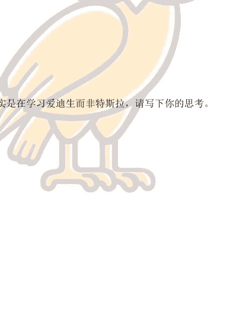

## 34 | 什么人受益于第二次工业革命？

我们在前面谈到了以瓦特为代表的发明家，以博尔顿为代表的工厂主，还有以瓷器大王韦奇伍德为代表的新产业开创者，他们是第一次工业革命的受益人。那么又有哪些人受益于第二次工业革命呢？

这一讲，我会通过讲解第二次工业革命的三大受益人，帮助你理解第二次工业革命的本质，以及它和相关产业、社会的关系。希望你从中能感受到历史的趋势和走向。

和第一次工业革命一样，掌握核心技术的人，最初利用工业革命成果的人，都是受益者。无论是爱迪生、西门子还是马可尼都属于这一类人，甚至特斯拉也是如此。

虽然特斯拉晚年生活有些凄惨，一些传记说他交不起房钱，但要知道那是在纽约最豪华的华尔道夫饭店的一间套房。因此，特斯拉只不过是过豪华生活失败了，并非生活不下去。特斯拉活到86岁，在那个年代是非常高寿的，虽然他失环不再，以至于死后两天才被人发现。但要是，如果没有第二次工业革命，他一定生活得更差。

除了核心技术的发明人，接下来受益的就是企业家。我在讲第一次工业革命的受益者时介绍了产业革命的公式，这个公式在第二次工业革命也适用：现有产业+电=新的产业。也就是说，在第二次工业革命中，不需要每一个人都去发电，任何掌握了电力这个新技术的传统企业家，都可以成就一番新事业。

但是，和第一次工业革命有所不同，这次革命之所以能够就一大批并不从事电力产业的企业家，是因为工业革命的核心——电，它本身具有和之前煤炭所不同的特殊属性，因此在更新原有产业的同时也催生了更多的新产业。

要知道，今天的产业中，80%多在第二次工业革命之前就存在了，比如农业、冶金、交通、通信、城市建设、医疗等等。但是，电的使用改变了世界。我们先来看看电是如何重塑新产业的。

到 1857 年，全世界铝的年产量仅有 750 公斤，并且只有法国可以生产。但是电出现之后，这个情况很快得到了改善。1886 年，在德国柏林大学读书的美国学生查尔发明了电解铝的方法。一个多月后，法国人也发明了相似的方法，通过电解可以得到纯度高达 98% 的铝。从此，铝的价格大幅下降，产量大幅上升，成为今天最重要的金属材料。

电还是现代化化学工业的催化剂。在 19 世纪，化学有了突飞猛进的发展，但是几乎所有的成就都是在实验室里，人类还无法大规模地生产化工产品。电的使用，让化学从实验室走向产业化。从化肥，到农药，从人造纤维，到各种生活用品，从建筑和装修材料，再到油漆涂料，没有电，今天我们使用的大部分化工产品，就制造不出来。

电的使用创造出今天一个价值高达 3 万亿美元的化工产业。在第二次工业革命中，杜邦靠着电成为有名的化工工业的一家，他的金业务从军火生意转变成了民用的化工。从此，杜邦公司也成为了世界化工企业的代名词。在电出现之后，化肥和农药产业出现了，人类整体上吃饱肚子是在机械化和化肥出现之后的事情。

在第二次工业革命中，在美国和德国像杜邦这样的企业家非常多，他们最先采用新技术，成就了一时的佳话。所以，从中你可以再次看到我总结的产业公式的意义，只要利用得当，总能在技术变革中获得优势。

那么电对于新产业的塑造又是怎么做到的呢？除了作为一种更为方便使用的能源，取代了蒸汽机，甚至内燃机、驱动我们的世界，更重要的是，电代表了一种新的生产和生活方式，因此它催生了很多新的，或者看似新的产业。这时，随着工业革命影响的扩散，受益的就是不仅仅是新产业的开创者了。

首先，从宏观的角度看，电的使用导致了人口高密度的大都市的出现，因为电梯的出现可以把楼盖得高，公共交通（有轨和无轨电车、地铁）的出现可以把城市拓宽。西方各国的大都市都是在 19 世纪末 20 世纪初形成的。那个时期进入到城市里的人，大部分都是第二次工业革命的受益者，这是电对世界产生的宏观影响。

同时，电对人们生活的巨大影响还在于各种电器的发明，它们导致了新产业的出现。比如，以电报和电话为核心的通信产业就是在那个时期奠定的基础，今天它也是全球最大的产业之一。留声机、电影和后来收音机的发明，导致了大众娱乐产业的出现。至于电灯、电动机器、电炉等等都是电工作电器的出现。可以说到说到。

你可以感受到，这次工业革命影响更深远，可以说，受益人不仅只是新产业的开创者，这些新产业所创造的工作机会、提供的服务产品让我们每一个现代人都能够从中受益。有了它们，人们的生活方式改变了。因此，电不仅改变的是经济，还改变国家的政治形态、生活方式和社会结构。

我还要格外强调的是第三类受益人：金融资本家，这是和第一次工业革命最大的不同。

比如像 J.P. 摩根这样的企业家，以及当时和他齐名的爱德华哈里曼等人。后者从华尔街的小职员开始做起，后来娶了一位银行家的女儿为妻，通过资本运作玩转了许多濒临破产的铁路，成为美国实业界和金融界的巨子，他是美国今天很多铁路公司，以及最大的银行富国银

## 科技史纲 60 讲

行，著名的信用卡公司运通公司的当时的控制人。因此他也成为了人类历史上最富有的人之一。

哈里曼等通过工业革命仅仅花了一个代人的时间就合法地（非掠夺地）积累了过去需要几代人甚至一个王朝才能积累起来的财富。J.P. 摩根和哈里曼等能够做到这一点，是因为技术革命是一个天然的放大器，可以说，他们投入到新技术、新产业中很少的钱不断地被放大。

当时虽然还没有风险投资一说，但是 J.P. 摩根等扮演了这个角色。他和范德比尔特家族在爱迪生还没有发明电灯之前就投资了他，并且在随后将爱迪生电气公司转变为 GE 公司时开始控股。

1889年 GE 公司诞生时还是只有 1000 名员工的中型公司，但是在 J.P. 摩根的帮助下它很快上市，并且在 1896 年就成为了当时道琼斯指数 12 家公司之一。J.P. 摩根通过 GE 获得了巨大的财富。

J.P. 摩根在投资爱迪生的同时，还投资了他的对手特斯拉。J.P. 摩根对特斯拉的兴趣不在于交流输电，而在于利用无线电进行通信。在这方面，两人存在着巨大的分歧。

当 J.P. 摩根发现特斯拉将他的投资用到了看不到希望的无线输电后，停止了对他的支持，并且开始支持特斯拉的另一个对手马可尼。这使得马可尼有足够的资金实现无线电广播。此后，GE 公司将马可尼的实验室收购并且发展成当时美国最大的广播公司 RCA。

从 J.P. 摩根投资和做事的方法可以看出，他提供的不仅仅是资本，还包括对未来商业的前瞻。当然，投资有成功的就有失败的。19 世纪的美国人充满了冒险精神，他们不仅在开拓西部边疆上如此，在投资上也是—样。

你可能想不到，当时著名的作家马克·吐温也是一个“风险投资人”，他从税务中挣钱无数，他投资了很多新公司、新产业，但是全部都失败了。其原因在于他投资的公司大多是技术已经过时，比如竞争激烈的纸印印刷业，而当别人向他推荐贝尔的电话技术时，他觉得那完全是天方夜谭，错过了最有可能成功的一次。

## 要点总结

- 1. 电的一些特殊性质，使得它重塑了原有产业，催生出近代化工等新产业。它带动了农业巨大的发展，人类终于可以不愁温饱了。
- 2. 电是一种新的能量来源，它改变了人们的生活方式，让大家过上之前不同的生活，可以说我们每个人都是受益人。
- 3. 第二次工业革命之后，金融资本对科技发展的作用变得越来越大。

## 思考题

为什么 J.P. 摩根能够成功投资，看人很准，马克·吐温就差了一些，这是今天留给大家的思考题。

## 35 | 信息的获取和细胞学说

这一讲，我们来介绍 19 世纪最重要的发现之一——细胞学说的确立。我们今天用一个新的方法来介绍这项科学成就。

一些读者朋友问我，怎样理解大数据思维？大数据思维从本质上讲，就是善用信息的思维方式。这一点在 19 世纪三个最重要的科学发现中体现得淋漓尽致。

根据恩格斯的总结，这三大发现分别是我们前面讲过的焦耳等人证实的“能量守恒原理”，今天要讲的“细胞理论”和以后会讲的“进化论”。

我们在介绍焦耳的工作时，特别提到焦耳拥有别人没有的温度测量方法和仪器，因此能够发现别人难以发现的现象，这一方面说明了在科学中仪器的的重要性，另一方面说明了焦耳掌握别人所没有的数据和信息。

细胞学说的提出，其实也只是仪器的进步，得到了前人得不到的信息后，通过逻辑自然演绎出的结果。这个重要的仪器，就是显微镜。

在科学研究中测量数据信息，通常有两个办法。一个是直接测量和观测，比如古希腊时喜帕恰斯观测星星，亚里士多德到各地收集动植物，就是基于这种方法。到了近代，伽利略等人发明了望远镜，直接观测的范围就扩大了，他们就能突破前人对世界的认识。

但是很多时候，我们无法进行直接观测，而是通过一些等价的信息进行间接观测，比如几年前面证实引力波的 LIGO 实验装置，就是间接探测宇宙中的信息。此外，核磁共振仪器 MRI 也是间接“透视”我们的身体，它和直接观测的 X 光设备不同。

今天来讲，直接观测到别人看不到的信息，这种机会已经没有了，因为人类发明的各种仪器太多了。但是，在 18、19 世纪，这种机会还是有的，那时一些人因为有了新的工具，因此可以在科学上比前人走得更远。接下来我们就说说生物学的发展历程和细胞学说。

人类对自身的好奇自古就有，人类一方面试图描绘清楚我们所生活的宇宙的奥秘，另一方面想要了解我们自身的构成和生命的本质。公平地讲，直至今天，我们对外部世界的了解反而要比对我们自身的了解更多，在过去也是如此。

最早系统地研究生物学的学者当属亚里士多德，他对植物进行了分类整理，但是这种研究仅限于对外观和简单属性的了解。有人把他的工作称作博物学，而不是今天所说的生物学。实际上，中国明朝的李时珍所做的工作，也可以被认为是博物学，他通过研究植物的药用功能，对不少植物作了分类，但是其研究也仅限于植物的某些药用特性。

至于博物学算不算严格意义上的科学，至今都有争论。一方面，它通过对外观、生物特征以及一些物理化学特性的研究，系统性地得到了一些科学结论，但是另一方面它的研究停留在表面，因此也只能得到表象的结论。我们倒是觉得，根据科学不重结论重方法的原则，早期的博物学算是一种简单的科学。

## 科技史纲 60 讲

人类对生物第二个层面的研究是探究一下生物体内部的结构，并且通过了解它内部各部分的功能，了解整个生物体的活动，乃至生命的原理。在这个层面的研究就依赖于解剖学了。

尽管从出土的文物和一些文字记载来看，早在美索不达米亚文明和古埃及文明，人类就开始了解剖学的研究，但是由于缺乏对细节的记录，我们无法判断他们了解剖学的研究水平。人类真正取得了一些解剖学的成就，是到了古希腊时期。

今天一些书中将希波克拉底作为解剖学的鼻祖，其实在他的年代古希腊的解剖学已经比较普及了，只不过希波克拉底记载了当时的解剖学成就。在希波克拉底的时代，古希腊人对人的运动系统，包括骨骼和肌肉，有了比较清晰的了解，事实上在希波克拉底前后的几十年间，古希腊的雕塑水平有一个质的飞跃，这和解剖学的进步有密切关系

不过，总的来讲，人体解剖在古希腊属于一种禁忌，大量解剖人体是不可能的。到了古罗马帝国的中期，医生盖伦通过解剖狗等动物来间接了解人的器官和它们的作用，这就延续了人体解剖的禁忌。

盖伦的这种想法很聪明，他采用的就是我们前面说间接观测的方法。但是今天我们知道狗的生理结构和人毕竟不完全一样，因此盖伦的理论有很多谬误。所幸的是，盖伦对每一次的研究和诊断都有详细记录，据说一生写了上千万字的医学文献。

在罗马帝国分裂之后，世界医学的中心转移到了阿拉伯帝国和它周围的地区，当时伊斯兰文明地区对人和动物器官功能的科研比古希腊罗马时期又近了一步。到了文艺复兴之后，生理学研究的中心又转回到了欧洲，包括达·芬奇等科学家先辈在内，很多科学家偷偷地进行解剖学的研究。

1543年，尼德兰医生安德烈·维萨里完成了解剖学经典著作《人体构造》一书，系统地介绍了人体的解剖学结构，他后来被誉为“解剖学之父”。

在《人体构造》这本书中，维萨里亲自绘制了很多的插图，为了绘制得真实，他甚至直接拿着人的骨头在纸上描。在很长的时间里，医学界都是以这本书为标准学习解剖的。今天，这本书最初的羊皮纸版本还有少量留存于世，它曾创下古书拍卖的纪录。

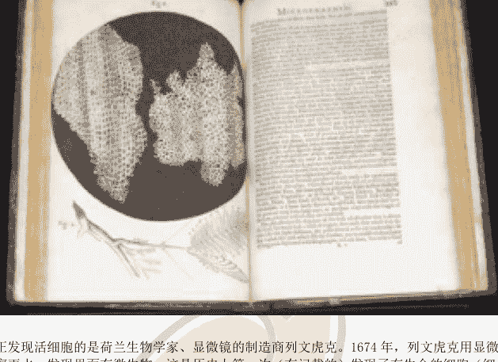

真正发现活细胞的是荷兰生物学家、显微镜的制造商列文虎克。1674 年，列文虎克用显微镜观察雨水，发现里面有微生物，这是历史上第一次（有记载的）发现了有生命的细胞（细菌）的科学家，后来，他又用显微镜看到了动物的肌肉纤维和毛细血管中流动的血液。

列文虎克虽然看到了细胞，但是并没有想到它们就是组成生物体的基本单位。直到 19 世纪初，法国博物学家（现在叫生物学家）拉马克才提出生物所有的器官都是细胞组织的一般产物这样一个假说，但是拉马克无法证实自己的假说。

如果我们回顾一下前面介绍过的笛卡尔的方法论，就知道提出假设是科学研究的第一步，从这个意义上讲，拉马克的工作对细胞学说的产生还是有意义的。而将假设变为理论的是两位德国科学家。

1838 年，德国科学家施莱登使用显微镜，通过对植物的观察，证实了细胞是构成所有植物的基本单位。第二年，和施莱登交往密切的德国科学家施旺将这个结论推广到动物界。之后他们一同创立了细胞学说。

细胞学说先在植物上得到验证是有原因的，因为植物有细胞壁，容易在显微镜下观察到。而观察动物细胞就相对难一些，直到后来施旺在高倍数的显微镜下才发现了动物细胞的细胞核和外面的细胞膜，以及两者之间的液状物质（细胞质）。

## 科技史纲 60 讲

后来由莱登的朋友耐特格里用显微镜观察了植物新细胞的形成过程和动物受精卵的分裂过程，才发现老的细胞会分裂出新的细胞。1858 年，在耐特格里工作的基础上，德国的魏尔肖总结出“细胞通过分裂产生新细胞”。这样生物的构成及其生长原理算是基本上被解决了。

对生物第四个层面的研究则是在细胞内部了，随着生物知识的积累以及显微镜的不断改进，人类能够了解到构成细胞的那些有机物，包括它的遗传物质。

因此，在 20 世纪之后，生物学从细胞生物学进入到分子生物学的阶段。今天如果你在大学里学习生物专业，都需要在分子这个颗粒度上（而不是细胞的层次）研究生命的奥秘。

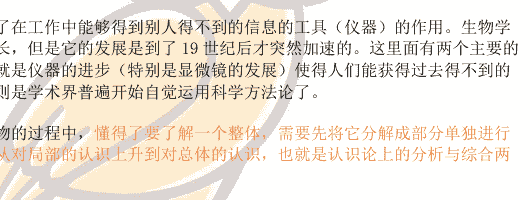

## 要点总结

- 1. 人类对事物的认识常常是有层次的，是由表及里，在生物学方面，大致经历了四个层次。
- 2. 我们特别强调了在工作中能够得到别人得不到的信息的工具（仪器）的作用。生物学的历史虽然很长，但是它的发展是到了 19 世纪后才突然加速的。这里面有两个主要的原因。第一个就是仪器设备的进步（特别是显微镜的发展）使得人们能够获得过去得不到的信息。第二个则是学术界普遍开始自觉运用科学方法论了。

人们在研究生物的过程中，懂得要了解一个整体，需要先将它分成部份单独进行研究，然后再从对局部的认识上升到对总体的认识，也就是认识论上的分析与综合两个过程。

- 3. 动物和植物，以及微生物都在细胞这一层面得到了统一。后来生物学家都认可生命具有共性这个结论。追求构造函数性，也成为很多科学家们努力的方向。

## 思考题

了解一下 19 世纪德国的历史，该谈为什么是德国（而不是当时科技领先的英国）的科学家在提出细胞学说方面贡献最大。

## 36 | 通信革命：通信如何改变世界？

我在前面介绍了以电为核心的第二次工业革命。电首先是一种能量，在电出现之后，各国就有了一个新的衡量文明程度的方式——发电量。还有一点不容忽视，电还是信息的载体。在今天，信息增加带来的生产力提高远超过能量。

这一方面是因为信息对人类太重要了，另一方面是因为直到电出现之前，人类通信发展太缓慢，最近的一百多年我们其实一直是在补课，因此每一次进步，带来的改变都很显著。这一讲，我就为你拆解通信是如何改变世界的。

人类有了语言，就摆脱了依靠基因传递信息这种低效率的形式。后面文字和书写系统的发明，写字的泥板、竹简、纸张和印刷术都是为了信息的传递。人类的进步史，从一开始就是通信革命的历史。

但是，无论是在中国还是在欧洲，长距离快速传递信息一直是一个没有被解决的问题。过去，马能跑多快，信息就能够被传递多快。

在罗马帝国时代，有类似于中国后来的驿道和驿站，从美索不达米亚将信息传递到地中海另一头的西班牙，大约花费7~10天时间。比如廷赐大帝常常已经到了某地，而他提前派出的信使却还在路上。即使到了1800年后，也就是到工业革命之前，这个速度也没有提升。

一旦遇到紧急情况，马的速度就更加捉襟见肘了。当然，你可能想到用烽火台。的确，烽火台能解决一些问题。但是从通信的角度讲，它只能传递一个比特信息而已。也就是说有敌情和没有敌情两种情况。另外，它传递的错误率还很高，因为如果谁不在小心在两座烽火台的半中间点燃了火，有可能会引起周围的误码。

如何向远距离传递多种信息呢？到了大航海时代，为了便于船队之间的通信，水手们发明了信号旗。在随后的英国荷兰战争中，英国皇家海军将信号旗语规范化，用11种不同的信号旗相互组合，传递45种信号。海上的信号旗语后来不断发展不断改进，一直沿用至今。

信号旗是在没有遮挡的大海上，在一定的范围之内一种很好的通信方法，但是在陆地上，由于有山峦森林和城市的阻挡，效果并不理想。那如何跨越地形阻碍传递信息呢？人们首先想到的是把信号塔建造得高高的。

到了18世纪末，法国工程师克劳德·夏普和他兄弟设计了一种高大的机械手臂来远程传递信息。下面就是信号臂的图片。

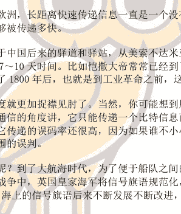

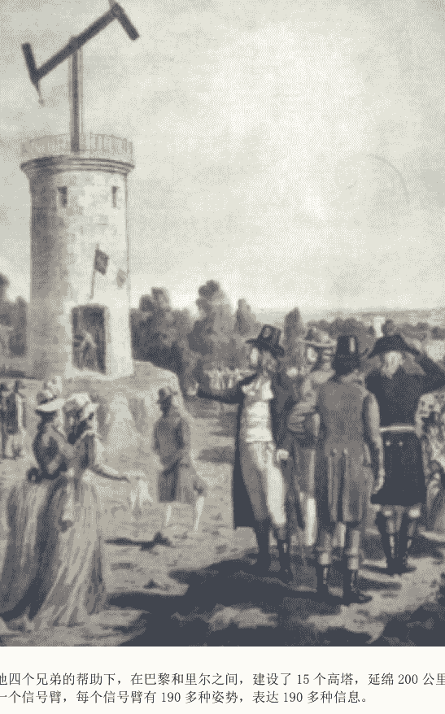

夏普在他四个兄弟的帮助下，在巴黎和里尔之间，建设了 15 个高塔，延伸 200 公里，每个高塔上有一个信号臂，每个信号臂有 190 多种姿势，表达 190 多种信息。

由于信号塔和信号臂非常高，十几公里外都能看见，因此就可以用它来传递消息。1792年，夏普兄弟展示了这种通信系统，他们在九分钟内将情报从巴黎传递到里尔，在过去做到这件事需要大约一天的时间。

这种信号塔很有效，但造价比较高，不过当时法国正在和奥地利等反法同盟国家开战，急需这种系统传递信息，还是一口气建了 556 个，形成了一个庞大的通信网，整个网络线路长达 4800 公里，这可能是近代最早的通信网络了。

由于信号塔在通信中的有效性，后来西班牙和英国也纷纷建立起自己的系统，信号塔主导的通信系统一度主导了世界。但是，信号塔的衰落比它的兴起还要快，因为电报出现了。

不过，你不要因此就忽视了信号旗和信号塔的意义，如果你留意我们刚才讲的内容，就会发现，它们之所以能在长距离有效地传递多种信息，是因为它们各自完整、准确的编码和解码规则。这样就可以把抽象的信息翻译成具体的信号传出去。电报就是一套可以对信息进行更简单编码并且进行更有效传输的通信系统。

电报是通信史上的一重要里程碑，它意味着时间和空间控制人类时代一去不复返了。电报的发展过程也是这一讲通信变革的重点。

电报的发明要感谢美国一个精通数学和电学的画家塞缪尔·莫尔斯。对，你没有听错，莫尔斯是一个画家。虽然我们今天说到莫尔斯电报码时，总是先入为主地认为他应该是一个科学家，但是在他的年代大家还是把他当成画家，事实上他是在美国历史上能够留下 一笔的优秀画家，给很多名人画过肖像，即使在他发明了电报之后，他还是继续以画画为主要业。

莫尔斯发明电报纯属一个偶然事件。1825 年，莫尔斯接了个大合同，要去当时离家五百公里的华盛顿作画。在旅盛期间，莫尔斯收到父亲的一封来信，说他的妻子病了，莫尔斯马上放下手上的工作连回国。但是妻子到家时，他的妻子已经下葬了。这件事对他的打击非常大，他从此开始致力于发明一种能远距离快速通信的方法。

莫尔斯的电学和数学基础扎实，他解决了电报的两个最关键的问题——一是如何将信息或文字变成电信号，二是如何将电信号传到远处。1836 年，莫尔斯解决了用电信号对英语字母编码的问题，这也形成了最终的莫尔斯码。

我们在课片段中经常看到发报员“嗒嗒嘀嗒”地发报，嗒嗒声的不同其实是继电器接触的时间长短不同造成的，“嗒”就是开关的短暂接触，可以理解成二进制的 0，“嗒”（就是开关的长时间（要求至少三倍以上）接触，可以理解成 1。

0 和 1 的组合，就可以表示出所有的英语字母。当时虽然还没有信息理论，但是还是根据常识对经常出现的字母采用较短的编码，对不常见的字母用较长的编码，这样就可以降低编码的整体长度。下面这张图片，是莫尔斯电码的编码方法，你可以看看它的编码规则，我今天给你留的思考就是和它有关。

# MORSE CODE

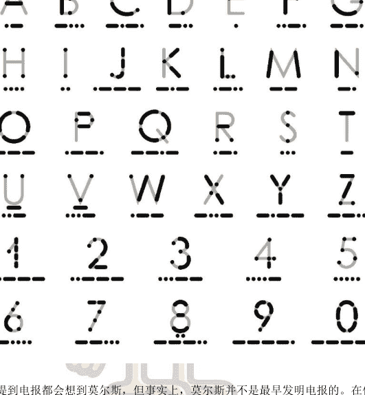

我们今天提到电报都会想到莫尔斯，但事实上、莫尔斯并不是最早发明电报的。在他的同时甚至更早一点时间，欧洲的发明家韦伯和数学家高斯合作，也发明了类似的装置，并且建立了哥廷根大学和当地天文台的通信。

遗憾的是，韦伯后来被当地政府驱逐出境，相应的研究便不了了之。与此同时，英国发明家库克和惠斯通也发明了电报并且最早实现了商业运营，但是他们的发明并不方便使用，因此没有普及并很快被莫尔斯的发明所取代。

今天大家都知道莫尔斯而不知道其他做出类似发明的发明家们，就是因为他是真正让电报实用和普及的人。不过，很多不同国家的人在几乎同一年代彼此独立地发明了类似的装置，也说明当时的技术积累使得电报的发明成为历史的必然。

从信号旗，到信号臂，再到莫尔斯电码，虽然形式不同，通信的效率不同，但是有两个根本之处是相同的。首先，编码是通信的核心，语言本身就是一种编码。信号旗语，信号臂的姿势，莫尔斯电码，都是将信息进行编码。

其次，通信的设施和编码的设计是相匹配的，其功能是将编码了的信息传递出去。莫尔斯设计电报系统采用长短结合的方式传递信息，是因为各种信息能够使用“嗒、嗒”两种信号编码。

今天我们基于计算机的数字通信采用“0、1”编码，是因为我们使用的电路很容易实现高电压（对应0或者1）和低电压（对应另外一个数值）。

未来通信的发展也是如此，比如今天非常热门的量子通信，利用量子的叠加状态进行编码，相应的通信设备就需要能够检测这种叠加状态。关于量子通信，我会在后面的课程里为你详细拆解。

电报最初只是帮助警察抓到更多逃犯，为新闻记者提供及时通讯，后来电报很快被用于了军队。德国军事家老毛奇提出了整套全新的战略战术，帮助普鲁士和后来的德国称霸欧洲。同时，电报也开始为商业、金融的实时交易提供宝贵信息，人们越来越地意识到信息的重要性，为此研发了各种各样的加密技术。

电报让各地的人类文明，第一次无时差地连接到一个整体，这不仅仅是通信史上划时代的变革，甚至可以认为，这是人类文明的里程碑。我们可以把电报出现之前的人类文明称为能量文明，而电报发明之后，人类社会就迈入了信息文明的大门。

当然了，对老百姓来讲，也电报更实用的远程通信是电话。普通家庭是不可自己装电报机的，一般人也不会去学习收发电报的，但是电话拿起来就可以用，要方便许多。我们今天一般认为亚历山大·贝尔发明了电话。需要指出的是，他对人类的贡献不仅在于发明了实用的电话这样一个设备，而且在于靠着他精明的商业头脑，推广和普及了电话，开创了以他为核心的现代通信产业。19世纪后，全世界文化及各种金融系统的紧密联系，离不开现代通信。直到今天，电讯产业依然是全世界最大的产业之一，2016年它的产值高达3.5万亿美元，相比之下，我们今天热议的互联网产业则要小得多，它同期的市场规模只有3800亿美元，几乎相差一个数量级。

## 要点总结

- 1. 通信的本质有两个，第一是将信息编码，第二是有效进行传输。直到今天，在通信领域的各种技术革命，都围绕着它们进行。
- 2. 无论是电报还是电话，它们的出现有必然性，很多斗争专利，就说明了这一点。但 是，真正完成发明从 0 到 N 整个过程的是莫尔斯和贝尔。世界上永远不缺少从 0 到 1 的 发明，缺乏的是能完成整个过程的人。
- 3. 通信的革命大大缩短了人和人之间的距离，并且改变了我们的世界。今天任何一个国家在通信上的投入，其实都是很划算的事情。

## 思考题

我会给你播出一段莫尔斯电码，请你参考文中给出的对照表，试着破译一下这段信息。

## 37 | 到底是谁先发明了汽车？

我在讲第一次工业革命时说过，英国的劳动力出现了富余，但是这些人工并不能解决新产业对能量的需求，最后靠的是蒸汽机；但是经常烧煤，烧热水，把几十台蒸汽机连在一起也没法把人送上天，低效率的蒸汽机主要是通过外燃的方式把热量转化为机械能，它已经无法满足人们对能量使用更高的需求了。

整个时代都在呼唤一种更轻便、更高效的动力系统，那就是内燃机。这就是我会通过为你拆解内燃机以及应用最广的汽车，来了解伟大发明背后争端的本源。

和上一讲说的电报、电话的发明一样，很多发明家几乎在同时独立地发明了内燃机和类似的各种热机。因此，内燃机以及汽车的发明是一段很难说清的历史。在科技史上，常常有同样的发明被不同科学家同时发明出来的例子，最后就到底属于谁，就要看谁的贡献大，而不是谁想得早。

在发明内燃机的这些人中，首先值得一提的是比利时工程师艾蒂安·勒努瓦，1860 年，他以蒸汽机为蓝本，发明了一台可实用的内燃机，获得了专利并批量地生产了。但是勒努瓦内燃机的效率仅有 2%～3%，因此在商业上没有竞争力，对后世的内燃机也没有产生太大的影响。

今天我们使用的各种内燃机，它的发明者另有其人，就是在热机这个领域大家经常会提到的奥托。内燃机做功的过程被称为“奥托循环”，今天汽车用的发动机和很多其他的内燃机，都被称为“奥托式发动机”，他的名字便永远地和内燃机联系在了一起。

奥托的全名是尼古拉斯·奥托，他是 19 世纪下半叶德国的工程师和发明家。奥托设计并改进了压缩四冲程内燃机。奥托内燃机的能量转化率很高，超过了 10%，高于当时效率最高的蒸汽机（8%），因此在随后的 17 年里，他卖出了 5 万多台四冲程内燃机，而更早发明内燃机的勒努瓦一辈子只卖出 700 台。

更重要的是奥托内燃机催生了后来汽车、飞机和很多其他机械发动机。事实上，早在奥托之前，法国工程师已经提出了内燃机的四冲程循环理论，只不过没有引起人们的注意。是奥托重新研发、制造并改进了四冲程内燃机。

## 科技史纲 60 讲

此外，放宽专利也没有影响奥托在当时人们心目中和他后来在历史上的崇高地位。这也是今天把各种内燃机统称为“奥托式发动机”的一个原因。直到 1939 年第一架喷气式飞机飞上蓝天之前，所有飞机使用的都是奥托四冲程内燃机。

在奥托还活着的时候，在德国就已经备受尊敬了。今天，欧洲和美国在评选最有影响力的历史人物时，总会把奥托排在前 100 名。奥托的一个儿子古斯塔夫·奥托后来子承父业，创办了德国最早的飞机制造公司，后来又逐步转型，变成了今天的宝马汽车公司。

奥托当时发展的是固定的、大型的，在工厂里取代蒸汽机的内燃机。而他的两个同事，戴姆勒和迈巴赫，想制造适用范围更广的小型内燃机，他们于是产生了分歧并分道扬镳了。

戴姆勒和迈巴赫随后创办了自己的公司，开始了发明汽车的事业。二人在 1883 年发明了直接燃烧汽油的小型内燃机，并获得了专利。两年后也就是 1885 年，他们发明了被称为“老爷钟”的实用内燃机（因为它形似大摆钟）并且装到了一辆自行车上，证明了采用内燃机驱动交通工具的可能性。

下面这张图就是最早的由内燃机驱动的交通工具。

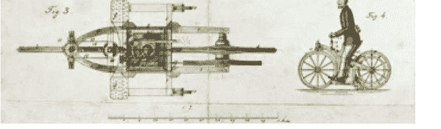

当然这种内燃机由于功率太小（只有0.5马力），还不足以驱动汽车，不过一年后（1886年），戴姆勒成功地制造出世界上第一辆使用汽油内燃机的四轮汽车，并且在年初获得了专利。

戴姆勒和迈巴赫当时并不知道距离他们仅有60英里的地方，一个叫卡尔·本茨的工程师也在做同样的工作——改装内燃机和发明汽车。本茨将自行车的后轮改成并行的两个轮子，将一台奥托内燃机置于后轴上，造出了全世界第一辆使用汽油内燃机的汽车。也就是说，本茨的车比戴姆勒和迈巴赫的车，多了一个轮子。

下面这张图是本茨的三轮汽车。

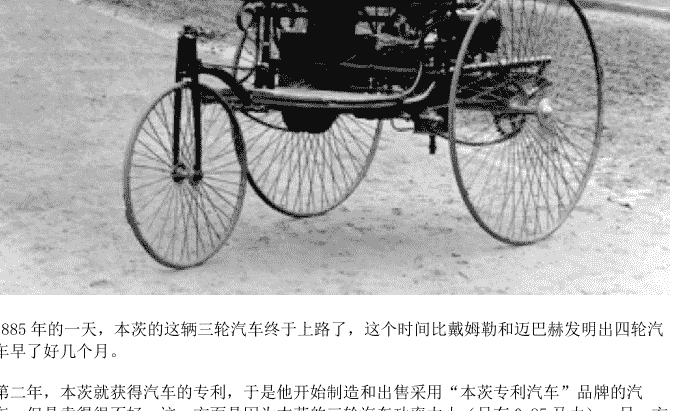

1885年的一天，本茨的这辆三轮汽车终于上路了，这个时间比戴姆勒和迈巴赫发明出四轮汽车早了好几个月。

第二年，本茨就获得了汽车的专利，于是他开始制造和出售采用“本茨专利汽车”品牌的汽车，但是卖得很难好，这一方面是因为本茨的三轮汽车功率太小（只有0.88马力），另一方面是当时的燃油质量太差。同年7月，本茨采用了戴姆勒新发明的内燃机，汽车性能于是得到了改善，但同时也引起了一场官司。

## 科技史纲 60 讲

戴姆勒是一个对专利非常看重的人，当他看到本茨采用了自己的汽油内燃机技术之后，毫不犹豫地起来捍卫自己的权利，将本茨的公司告上了法庭，并且最终赢得了官司。这样一来本茨就不得不向对方支付专利费，于是本茨公司在很长时间里生产使用煤气的汽车。

这场官司让戴姆勒和本茨结了仇，两人一直避免见面，以免尴尬。后来当中欧汽车协会（Central European Motor Car Association）成立时，两个人都被邀请参加了成立大会，不可避免地见了面，但是彼此也没有说话。在戴姆勒去世后，两家公司有很多的合作。

到了 1926 年，它们新的主人决定将这俩家竞争了 40 年的德国公司合并，成立了今天享誉全球的戴姆勒-奔驰公司。而戴姆勒的合作伙伴迈巴赫，则成为了该公司旗下的豪华汽车的品牌。

讲到这里，你觉得谁是汽车的发明人呢？其实，直到今天科技史学家对此也没有统一的看法，虽然本茨的汽车先上路，但是这种三轮车并非今天的汽车的直接祖先，而今天四轮汽车的发明人，则是戴姆勒和迈巴赫。

另外，将内燃机最初用于交通工具的也是戴姆勒和迈巴赫两个人，因为他们造出了两个轮子的机动车——如果三个轮子的算是汽车，凭什么两个轮子的不可以算？

在德国，今天人们并不关心谁是汽车发明人，毕竟戴姆勒和本茨都是德国人，但是在大洋彼岸的美国，很多人们对这两个人都认可，他们认为是福特发明了汽车，因为福特在 1896 年发明的四轮车不仅要比德国前辈们的同类产品实用得多，而且是今天几乎所有汽车的原型。

大家在汽车发明权方面看法说明了一个道理，那就是汽车的发明是水到渠成的结果。要找到第一个发明人其实是不太可能而且毫无意义的事情，因为你总能找到更早的发明，而太早的发明和后来使用的东西已经完全无关了。

在发明汽车这件事情上，在 19 世纪 80—90 年代，欧洲大陆和美国还有很多发明家先后独立地发明了汽车，比如创立了奥迪公司的奥古斯特·霍希（August Horch），创立了美国奥斯莫比（Oldsmobile）汽车公司的奥斯（Ransom E. Olds）等许多人。

值得一提的是奥斯，他实际上是流水作业制造汽车的发明人，他将汽车的售价降到了 650 美元，这让汽车从奢侈品变成了大众工业品。在此之后，福特进一步改进了装配线，从奥斯莫比那种工人围着汽车转，变成汽车围着工人转的模式，这又进一步地提高了汽车生产效率，让美国成为了“汽车王国”，自己也成了“汽车大王”。

正是因为福特的流水生产线效率更高，才有很多人误以为最初的流水化生产是福特发明的。由此你可以看到，最初的发明人往往会被影响更大的后继者的光芒掩盖住。

流水线式生产方式对现代工业影响极大，它从本质上讲是通过增加使用机械能量，节约工人的体力（能量），达到生产效率的最大化。这和后来用计算机的“脑力”节约人的脑力是一回事。

## 要点总结

- 1. 重大发明的必然性，谁是第一个发明人不重要，最早的发明其实定义很含混。同步发明出同一发明，我们应该看到背后的规律，那就是时代的必然。
- 2. 对发明来讲，更有意义的是看它们对后来的影响，而不是谁更早。从这个意义上讲，奥托、戴姆勒、本茨和福特的发明比他们同时代的人做的工作更有意义。
- 3. 生产线的本质是以机械能量替代人身体的能量，这和用计算机处理信息取代脑处理信息相似。

## 思考题

找一项今天被很多人同时发明出的技术，评估一下哪一个人的真正贡献更大。

## 38 | 人类是如何进入飞行时代的？

像鸟类一样飞行是人类很早就有的梦想。从中国古代的风筝，到古希腊制造的机械鸽。但是，没有科学基础的尝试是难以成功的。因此，搞清楚飞行的原理是人类实现飞行的第一个“预先要求”。这一讲，我们通过讲飞机的发明，再次理解“预先要求”和“必然结果”之间的关系。

人类对飞行认识的第一个阶段是仿生，模仿鸟类。而对鸟类飞行系统性的研究是在文艺复兴时期，因为那时解剖学得到了很大的发展，人们才能够理性研究飞行。因此，你可以认为解剖学的发展是实现飞行更早的“预先要求”。

最早详细论述鸟类飞行原理的人是文艺复兴的巨匠达·芬奇。他系统地研究了鸟类的飞行之后，写了《论鸟的飞行》一文，这被看成是航空科学的开山之作。

达·芬奇还仿造鸟设计了一种飞行器，今天一些人说达·芬奇是最早设计飞机模型的人，其实这种说法是为神化达·芬奇，他的那个振翅翱翔根本不可能上天，和今天的飞机没有什么关系。

事实上，要让比重量远远大于空气的飞行器在天上持续飞行，难度远比人们想象得大。假如现在让你来设计一个飞行器，你要解决的是哪几个问题呢？你可能会想到材料要轻，动力要强，还得能够操纵方向。

其实，归结起来，就是解决这三大难题：升力的来源、动力的来源和可操纵性。这三大飞行难题，就是满足人类飞行赖的“预先要求”，而这三个难题并不是哪个发明家一次就能解决的，而是经过了三代发明家共同努力才逐步解决。

## 第一代发明家解决了“升力的”问题”，代表人物是被誉为“空气动力学之父”的英国人乔治·凯利爵士，他曾试图模仿鸟类设计振翼的飞机，也就是让机翼像鸟的翅膀一样上下扇动，但是很快意识到那样完全不可能，于是他回到了原点，重新审视鸟类翅膀的功能，发现它不只是提供动力，还提供升力，这个发现很重要。

凯利于飞行奠定的这个科学基础叫做空气动力学，或者你可以认为是更广义上的流体力学应用到空气上的理论。直到今日，他提出的飞行原理依然是行之有效的。

但是，凯利的运气不太好，因为那个时代能提供动力的只有蒸汽机，它显然太重了，质量较轻的内燃机还没有发明出来。此外，当时也没有能量密度很高的燃料（燃油）。因此凯利当时无法实现自带动力的飞行的梦想。

所幸的是，凯利于自己的研究工作都有详细的记述，特别是留下了《论空中航行》一书。在书中，凯利明确指出升力的机理与推力机理应该分开，人类飞行器不应该单靠模仿鸟类的飞行动作为飞行，而应该用不同装置分别实现升力和动力，这为飞机的发明指出了正确的道路，并给予了后来的莱特兄弟理论指导。

## 在凯利之后，第二代飞行器发明家以德国的奥托·李林塔尔为代表。

相比凯利而言，李林塔尔更像是冒险家而不是飞行理论家，他是世界上最早实现自带动力滑翔飞行的人，也是最早实现重复成功地进行滑翔试验的人。

我们前面讲过，能否重复实验结果是区分科学和非科学的重要标志，也就是说李林塔尔研究和实验的方法是科学的。但是李林塔尔过于重视升力，忽视了飞行的控制问题，他当时一直模仿鸟类通过自己平衡身体来控制，这条路其实走不通。

李林塔尔更大的不幸是在工作方法上，他的理论研究和地面上的准备工作总是做得不充分，过分依赖飞行试验。1893 年到 1896 年，他进行了 2000 多次的滑翔飞行试验。最终，李林塔尔在一次试验中不幸丧生了。他留给世人的最后一句话是： “总得有人为此牺牲。” 他的事故也激励着莱特兄弟这两位美国年轻人的工作。

## 莱特兄弟是第三代发明家，与凯利和李林塔尔相比，他们要幸运得多。

他们出生得足够晚，以至于凯利的理论和奥托的内燃机都已经为他们准备好了；他们出生得又足够早，以至于飞机还没有被发明出来。当然，光靠运气也是制造不出第一架飞机的，莱特兄弟在理论积累上和工作方法上不仅全面超越了他们前辈，也是超越了同代的人。

首先，莱特兄弟非常注重飞机设计在理论上的正确性。他们二人虽然是自学成才，但是系统学习了空气动力学。有着扎实的理论基础，而且做事情非常严谨。这兄弟二人后来发现了李林塔尔在计算升力时有误，多算了 60% 的升力，并且进行了修正，之后又通过实验进行了验证。

这里说一句题外话，一直有很多励志的读物宣称很多自学成才的发明家和科学家，但是这种比例极低，而那极少数成功的其实是通过更多的努力，系统性地补充了过去知识的缺陷，而不是靠经验做事情。

从瓦特、富兰克林、到爱迪生，再到莱特兄弟都是如此。更重要的是，这些人无一不是遵循科学方法做事情。下图是莱特兄弟留下的工作笔记，你可以看出他们兄弟二人做事是极为认真的。

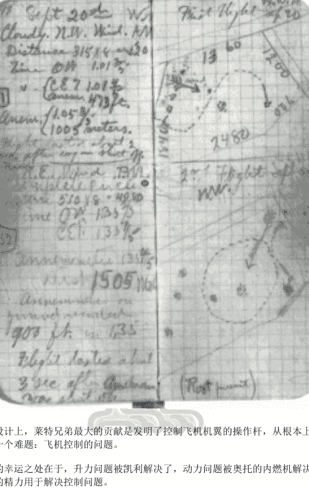

在飞机的设计上，莱特兄弟最大的贡献是发明了控制飞机机翼的操作杆，从根本上解决了飞行的最后一个难题：飞机控制的问题。

莱特兄弟的幸运之处在于，升力问题被凯利解决了，动力问题被奥托的内燃机解决了，他们就把主要的精力用于解决控制问题。

更重要的是，莱特兄弟还超越了与他同时代的其他发明家，一是因为他们很清楚地知道飞行的三个“预先要求”，关键还在于，他们能成功，可以说是他们的工作方法比同时代的人要高明。

莱特兄弟为了试验飞机的升力和控制系统，专门打造了一个风洞，在里面进行了大量的试验。莱特兄弟为了改进机翼就尝试了200多种不同的翼形，进行了上千次的测试。他们用滑轮将砝码和飞机的机翼连接起来，准确地计算各种条件下的升力。因此当他们设计的第一架飞机升空时，就已经有把握这个飞机一定能飞起来，而且很地找到了保持横侧稳定的方法。

莱特兄弟性情谨慎，他们不做足试验是不肯试飞的，而且即使试飞，也要先进行无人驾驶的试验。为了试验飞机的转向控制，莱特兄弟在1902年进行了700~1000次的滑翔试验。他们制作的滑翔机在安装了可控尾舵后，进行了上百次表现出良好的，结果可重复的试验。

这一年的10月8日，莱特兄弟实现了真正的飞行转向控制，这是飞行史上一个重要的里程碑。在这一切都成熟之后，他们才将精力集中到制作自带动力的飞机上。又经过了一年多的努力，1903年12月17日，莱特兄弟在美国西海岸小鹰镇成功试飞了自行研制的“飞行者一号”，从此人类进入了飞机的时代。

从凯利提出空气动力学理论，到莱特兄弟实现他的遗愿——自带动力的载人飞行，经历了近一个世纪的时间，这是从理论到发明经常需要的时间。

在莱特兄弟发明飞机的前后，世界各国的发明家们都在加速研制飞机，但是成功者并不多，很多发明家甚至在莱特兄弟的飞机上天之后，依然付出了生命的代价，其主要的原因是，工作方法落后于这两兄弟。

我在过去两季的专栏里，反复强调做事情要规范化，要有理论依据，不要过分信赖自己有限的经验和直觉，结合莱特兄弟的话，希望大家对此能有深刻的体会。

## 要点总结

- 1. 实现飞行需要三个“预先要求”——空气动力学理论，特别是关于升力的理论，轻质量大功率的发动机和高能量密度的燃料，控制系统。凯利、奥托和莱特兄弟分别解决了这三个问题。
- 2. 科学的工作方法很重要。我们今天不需要设计飞机，但是需要学莱特兄弟的工作方法。
- 3. 结合人工智能这个话题，在这个领域也有“鸟类派”和“空气动力学派”的分别。所谓鸟类派，就是指从经验出发，让计算机模仿人的思维方式，试图获得智能的做法，这个做法证明行不通。所谓空气动力学派，就是指搞清楚智能问题的本质，让计算机通过数据和数学模型解决智能问题。今天人工智能全部的进步，都是走后一条道路的结果。

## 思考题

请你列举第二次工业革命各个重要发明之间的依赖关系，谁是谁的“预先要求”，谁是谁的“必然结果”。

## 科技史纲 60 讲

## 39 | 机关枪：杀伤力的跃进

两次工业革命的科技发明，为人类创造了丰富的物质财富，带来了人口的爆发式、持续性的增长。但同时，人类把技术也用在了武器研发上，杀伤力越来越大的武器也同样高效地夺走人们的生命，战场甚至成为人们展示最新科技发明的场所。

这一讲，我们从能量的角度，以机关枪为切入点，看看跃进的杀伤力背后有哪些历史规律值得我们学习。

什么是武器？在冷兵器时代，武器是一种特殊的工具，它能够让人们用较少的能量打死对方。再往后，人类发明了远程攻击的武器，比如弓箭和标枪，它们可以将能量传递到远处。人类祖先智人在同尼安德特人的竞争中就受益于这类武器。而要想比弓箭更快更地将能量传递到远方，就需要使用火器了。

可以说，人类进入热兵器时代，本质其实是对能量远距离传递的需求。

在唐朝，中国人就发明了火药。根据李约瑟的说法，火药在五代时首次用于战争。今天发现的最早的金属大炮也是元朝制造的。到明朝，中国出现了大量装备了火炮、鸟铳（chōng）和火铳（手枪）的军队。但是明朝制造的战技并不高，以至于明末对外战争时，明军使用的大体统一、口径大的大炮都要从葡萄牙进口。

听到这里，你可能会想，明明是中国首先发明了火药，后来经由阿拉伯人传入的欧洲，作为“学生”，欧洲人起码应该是比我们晚的。但在近代的历次战争中，中国却被自己的模仿者打得命悬一线。这是为什么？当然，这里面的原因很复杂，到现在也没有人给出定论。

但我想给你提供一个科技史的视角去尝试解读一下，那就是中国没有西方的科学传统，因此就无法像西方的科学家一样，一代一代地用公式、理论完成对科学的继承和叠加。而武器常常就是科技成果的结晶。

因此，当科技在工业革命中开花结果时，中国不仅没有享受到文明的成果，反而被掌握先进技术的西方列强制服了。其实不光是火药，指南针、帆船等都不是西方人先发明的，但最终都在西方人手里进化成了反制东方的大家伙。

好，我们继续从能量角度来看武器的进化，我希望你听到最后，能对东西方科学发展不同路径所造成的差距有更深刻的认识。

火器在历史上第一个里程碑式的发明是火绳枪（Musket），从 15 世纪到 16 世纪，欧洲和中亚地区都自发明了这种武器。火绳枪的意义在于更多的人可以投入战争，因为它比弓箭的优势在于，练习起来相对容易，而且不需要太多的体力，这从本质上说就是使用火药的能量替代了人身体能量的结果。

但是，虽然叫“火绳枪”，其实它就是一个后部堵死的铁管。火绳枪操作的大致次序是这样的，先从枪管前面装火药，再上铅弹，随后用一根长针从前面伸到枪管里压紧，至此弹药的填充才算完成。到了这里你可能好奇这个火绳枪后面堵死，那怎么点火呢？所以这种枪最关键的是火绳，因为只能通过它来引燃铁管里的火药。

除了省体力、训练快之外，火枪比弓箭还有两个明显的优势。一个是火枪在发射时所造成的心理震撼的效果远远超过弓箭，因此当西方殖民者与还是用冷兵器的亚洲或非洲军队交锋时，后者看到一片火光烟雾，听到巨大的爆炸声，首先就被吓破了胆。

在战场上，火绳枪在后期射速已经能达到每秒 400～550 米，子弹产生的动能能够穿透 3～4 毫米的钢板，武士的铠甲已经挡不住它的子弹了，这是弓箭做不到的。因此，火器巨大杀伤力的本质在于能够将更大的能量送达远方，形成巨大的破坏力。

另一个，也是更重要的优势，就是火枪进步的速度非常快，而弓箭在大约 2000 年前就基本定型了，以后也没什么可以进一步改进的余地。更可笑的是，在中国，随着满清的入关，人们又发明回了弓箭，而火枪的科技却一直在线进步。从这里你是否体会到我在课程中常提到的科技发展可常加重要性。如科技一旦有了某种体系，科技进步就更进步，原有技术也很难受益于时代进步的成果。

接下来，我就为你介绍火枪是怎么在科技的改造下进化成机关枪的。如果说火绳枪是第一代火枪，那么今天的步枪则是第五代，在这之间，火枪经过了四次重大的改进，每一次都受益于科技革命的大环境。

## 第一次改进 是从火绳枪到燧发枪（flintlock）。

燧发枪的原理是使用转轮打火机（燧发机），击打燧石产生火星，点燃火药，这样枪手就不需要携带火绳了，这次改进受益于机械技术的进步。

## 第二次改进 是 18 世纪末可燃弹壳枪弹的发明。

火枪的每一次改进，都是它的使用便利性、射击的准确性以及杀伤力有所飞跃，特别是最后一次从前膛枪到后膛枪的改进。不过，相比后来机关枪的杀伤力还是有限得多。

说到机关枪大家可能会想到马克沁机关枪，这是世界上第一款普遍装备部队的全自动机枪，也是工业革命的机械成果在战场上得以应用的典型。

马克沁机关枪名天下是在1893年，当时一支只有50名英军和几百当地人组成的殖民军队在非洲与马塔比黑人的战斗中，用5挺机关枪击败了一支5000人的当地军队，当场击毙伤了1500多人。一周后双方再次交战，一小队英军面对由2000来复枪手和4000勇士组成的军队，靠马克沁机关枪击毙了对方2500人。

在这之后，马克沁机枪才受到欧洲各国军队的注意。在1916年的索姆河战役中，当英法联军数十万人冲向德军阵地时，遭到德军机枪和炮兵火力的严重杀伤，仅仅一天就伤亡近6万人，举世震惊。当时人们认为机枪的出现是人类前所未有的灾难，因为在此之前人类根本做不到如此高效率的杀戮手段。

抛开机枪对人类的屠杀不说，从物理学原理解讲马克沁机枪的设计非常漂亮。在它之前，枪在射击时子弹壳里火药产生的能量相当大一部分变成了射击时的后坐力，不仅在能量上是浪费，而且还影响枪的稳定性，等到射击下一发子弹时，还需要人使用额外外力拉枪栓。因此在能量的利用上极为不合算。由于人拉枪栓的频率不可能太高，过去步枪其输出的功率不可能太大，因此杀伤力有限。

1883年，马克沁改进出的新机关枪，可以利用子弹壳里的火药爆炸时喷出的气体，自动完成步枪的开锁、退壳、送弹、重新闭锁等一系列动作，实现了子弹的连续射击。马克沁机枪不仅射速快，而且后坐力小，射击准确。又过了一年，也就是1884年，马克沁在自动步枪的基础上，采用一根6米长的帆布袋做子弹链，制造出世界上第一支能够自动连续射击的机枪，并且获得了机枪专利。

马克沁机枪让火药产生的能量，除了变成子弹的动能，剩下的用于子弹上膛，没有浪费掉，而且还节省了人力。最重要的是，由于机械做功的效率比人高，因此它输出的功率比步枪大得多，杀伤威力巨大。说到底，这项发明的核心是把一些手工作业问题变成机械问题，然后巧妙利用能量来驱动机械。

可以看到，武器的历次进步都是能量的跃升结果，这背后其实还是技术发展的结果。尤其是机枪的这四次变革都是与技术变革同步的。到了19世纪，一小撮武装起来的欧洲探险队常常能够横跨一整个亚非国家。随后，他们完善的铁路系统和先进的通信技术，更是让他们在征服世界的历程中无往不胜。

## 要点总结

- 1. 攻击性武器的本质是在最短的时间内将能量都放到敌方，因此很多武器的改进都围绕这个目的进行。当然，今天这样最有效的武器就是核武器。
- 2. 如果我们考虑一下火枪取代弓箭的过程，就会发现这是一个自然的过程所产生的必然结果。弓箭不仅在能量使用上效率不高，而且它无法受益于远优的机械和化学方面的科技进步，而那些进步却很容易让火枪受益。这一点和蒸汽船取代大帆船是如出一辙的。因此，我们在选择做一件事情时，一定要选择那些能够受益于时代进步的事情做。
- 3. 东西方的科学发展路径不同，因此最终的科技成果也大相径庭，很多历史事件其实都可以从科技史中看到新解读。

## 思考题

使用能量的线索，分析一下防御性武器的进步。

## 40 | 进化论：我们从哪里来？

19世纪诞生了三大科学成就，分别是能量守恒定律、细胞学说以及进化论。前两个我们已经讲过了，这一讲，我来讲说第三个——进化论。

进化论带给世人的冲击太大了，直到今天，它还剧烈地震荡着我们的社会。进化论和神创论的官司打了一百年，直到21世纪，美国最后几个保守的州才明确规定中学教学中要讲授进化论，2014年，教皇方济各公开承认进化论和《圣经》并不矛盾，进化论才算是取得了决定性的胜利，这时离达尔文去世已经过去了130多年了。

说到进化论，我们每个人都不陌生，“自然选择、适者生存”的道理我们早已知晓。但是，我要告诉你的是，你知道的这些，可能并不是真正的进化论。这一讲，我会告诉你，达尔文的进化论到底说了什么，以及进化论对人类的两大贡献。

在科学史上，大多数理论和科技成就是在不断完善和巩固自身学科的，比如，新化学元素不断被发现，机械动力系统的效率不断被提高，从分子到原子到夸克等等……

但是，有些理论，一旦出现，它就是对原有学科学框架的破坏甚至是毁灭。因为它开辟出了另一个新天地，这种科学史上天崩地裂的时刻，我们称之为科学革命。伽利略的日心说，牛顿的机械世界，以及今天我们要说的进化论，都是科学史上开天辟地的重大时刻。

如果说细胞学说的贡献在于找到了各种生命层次的共性，那么进化论的贡献就是首先找到了生物之间的联系，其次，也是更重要的贡献，是帮助人们打开了双天眼，人们第一次开始采用动态的眼光看待生命的发展。

## 我先来说，在进化论之前人们是如何去找生物之间的联系的。

在生物学中，始终有一个根本问题没有得到解决，那就是为什么一些物种之间存在高度的相似性，所有的物种又是从何而来？为了解决这个问题，科学家首先想到的是分类。这就要根据物种相似性来分类，当时人们还不知道细胞学说，因此这个任务通常就由博物学家们来完成，他们会通过物种外形、生理特征、解剖结构等外在的特性理解它们之间的相似性。

人类第一次对地球上所有的生物进行“大盘点”是在1758—1759年间，由瑞典科学家林奈完成的。今天我们所说的域、界、门、纲、目、科、属、种分类方法，就是林奈在他《自然系统（第十版）》中完善的。之后，达尔文等人都采用林奈的分类法。

在林奈的分类中，动物、植物和矿物是三个平行的界，也就是说，他没有意识到，动物和植物同样属于生物，应该探寻生物统一的来源。早期意识到这个问题的是博物学家伊拉兹莫斯·达尔文，也就是达尔文的父亲。

这位老达尔文觉得生物是从最简单的微生物发展到人类社会的，同时提出了生存竞争的说法。但是老达尔文的想法只是猜想，甚至连证据都举不上。但这毕竟给了生物的相似性一个很好的解释。

到这里，人们隐约找到了生物相似性的原因，开始猜测，也许生命是一个渐进的过程，不是一成不变的，一个物种经过长期缓慢的变化最终会产生新物种，所以才有了地球上形形色色的生命。但是论证这一观点的任务最后就交给了达尔文去完成了，这就是进化论的第一个贡献。

达尔文从小就对博物学感兴趣，大学毕业后他和一些同学一起前往热带群岛研究博物学。达尔文发现那些与世隔绝的海岛上，昆虫的形态和大陆上的昆虫有巨大的差异，他经过分析得出的结论是，存活下来的昆虫，它们的进化只是让自己产生出新的特征，来更适应海岛特定的生存环境而已，这个发现非常重要，导致了他后来进化论中“自然选择”理论的提出。

1831年12月，达尔文以博物学家的身份参加了“贝格尔”号的环球考察。军舰每到一处，达尔文都会认真的进行研究，他在途中采集了大量的矿物和植物标本，挖掘了很多生物化石，做了大量的笔记，达尔文这次还发现了很多从未有记载的新物种。通过对比各种植物标本和化石，达尔文发现从古代到今天，很多旧的物种消失了，很多新的物种产生了，并且随着地域的不同而不断变化。在考察中，达尔文积累了大量的第一手资料，可以说没有这些第一手资料，达尔文后来不可能提出进化论。

回国之后，达尔文又花了几年时间整理这些资料，然后从资料出发，去寻找理论根据。六年后，也就是1842年，达尔文写出《物种起源》的提纲。但是在接下来的十年里，达尔文却只字未写，这又是为什么呢？因为达尔文深知他的理论一旦发表，将颠覆整个基督教立足的根基。直到1858年，一件事让达尔文不得不立即完成和发表《物种起源》一书。

这一年，英国一个年轻博物学家华莱士在马来群岛各地考察研究，也发现了进化论，他写了篇论文寄给达尔文。达尔文在收到论文后，发现世界上还有提出和他类似的理论，非常震惊，不知所措。他于是咨询了在皇家学会的朋友们，那些朋友建议他将自己的想法也写成一篇论文，和华莱士的论文同时在皇家学会的刊物上发表。

达尔文将这个建议和自己的论文也寄给了华莱士征求意见，华莱士不仅欣然同意达尔文的建议，而且表示非常荣幸能与达尔文的论文一同发表。达尔文和华莱士的交往也成为了科学史上的一段佳话。

1859年，达尔文出版了人类历史上最震撼的科学巨著《物种起源》。达尔文的理论一发表，就在全世界引起了轰动。进化论对基督教产生了从未有过的冲击，这比哥白尼的日心说所带来的冲击要大得多。

为什么会比日心说冲击还大呢？要知道哥白尼的那个模型在当时的计算结果还不如地心说精确呢，而且他还面临很多反对者轻而易举的证伪，比如有人说，你说地球自转，那为什么从塔上扔石头下来，石头还是不偏不倚地垂直落下没有位移呢？等等诸如此类的问题，随随便便就足以令当时的日心说“不攻自破”。因此，哥白尼的理论更像是单纯的假说，当时并没有什么数据支持，大家对它是将信将疑，甚至漠不关心。

但是，进化论不一样，它有大量数据和证据的支持，结论又合乎逻辑，因此他的理论足以说服很多人。当时的教会，无论是罗马教廷还是新教，都对达尔文群起攻之，但是在这狂怒的背后则是恐慌，恐慌的原因说到底是它看起来那般无懈可击，教会也意识到一个新世界可能要被重塑。由此可以看出进化论在科学史上的革命性。

为什么这么个观点给社会那么大的冲击呢？因为达尔文告诉大家，我们人类和其他动物一样，都是从更低级的动物演化而来的。这其实就否定了人是自然界高高在上的统治者这种长期固有的看法。而过去《圣经》的话说，上帝要人类“生养众多，遍满地面，治理地上的万物，也要管理海里的鱼、空中的鸟和地上各种活物”。

## 进化论的第二个贡献在于，采用了动态眼光看待生命的发展。

我们在前面讲到，牛顿和莱布尼茨发明微积分后，人类开始动态地研究数的变化，机械思维诞生之后，人类开始用运动的观点看待自然界。而达尔文则告诉大家，对于生命，也是从简单到复杂不断进化的过程。

那么生命是如何通过动态的优化得到发展的呢？达尔文用非常简洁的观点解释了这个过程，也就是：“过度繁殖、生存竞争、自然选择、适者生存”。

过度繁殖的必要性很大，我们今天知道如果想通过试错获得进步，那么试验的次数越多越好，过度繁殖就保证了一个物种作为整体有足够多的试错机会。

过度繁殖会带来一个问题，就是如果后代的数量呈指数增长，很快资源就不够了，于是，只有最简单，消耗能量最少的物种才能生存，这样就进化不出高等生物了。于是，生存竞争的必要性就体现出来，通过生存竞争，一个物种只能保留少数的后代。

那么谁能保留下来，并且继续繁殖后代呢？达尔文讲是自然选择，不是物种自己选择。在达尔文的进化论之前，法国博物学家拉马克提出了一种“用进废退”的假设，他认为生物的特征可以在后天被不断地优化，然后再一代代传下去。比如为什么长颈鹿长着长脖子，因为它们为了吃到树上的树叶，就不断伸长脖子，于是脖子就越用越长了。

直到今天，还有很多人以为这就是进化论。其实，拉马克的理论有很多的破绽，很容易被证伪，比如将老鼠的尾巴切掉，它们的后代依然长着尾巴。这说明后天的获得性特征是无法遗传的。

达尔文认为大自然特定的环境，会自然而然地让容易适应环境的物种和个体生存下来。比如气候变冷会让原来的一些动物不适应而被淘汰，而哺乳动物的一些变异让它们长出了绒毛，这些物种和个体，在温度较低的环境下生存了下来。

因此，进化论所强调的动态演化，并不能说明生下来的就比过去的高等，只是说它们更适应环境。事实上如果从基因的复杂程度看，我们的基因并不比老鼠的复杂。进化论只会告诉我们从哪里来，但却不会告诉我们会往哪里去。

达尔文的进化论对世界的影响，不仅仅在于它在生物上回答了物种的起源和进化的问题，而且在哲学的高度向人类证明世界万物都是可以演变和进化来的，牛顿给人以自信，让人不再依赖于神的脚下，而达尔文告诉人们我们从哪里来。因此，他的《物种起源》一书成为了继牛顿的《自然哲学的数学原理》之后，对世界影响最大的一本书。

能量守恒定律、细胞学说和进化论被恩格斯称为“19世纪的三大科学发现”，它们不仅对物理学、生物学和医学本身有重大的意义，而且确立了唯物论的科学基础。

## 问答｜历次技术革命的规律怎么用到当下？

这一讲，我会通过回答大家的提问，来帮你梳理我们第四模块“精准的机械时代”的认知，以启发你对当下和未来的思考。我回答了7个问题，主要集中在产业公式的应用和商业投资能力上，好，我们开始。

> 罗怀昭：吴军老师，您给出的公式“原有的产业+新技术=新的产业”给我很大启发。但同时我在自己的行业深耕多年，我也很想学习大数据和人工智能，掌握新技术，应该从何学起呢？同时那些有机会学习最新技术的人，可能对传统行业并不了解，那么如何成为一个能在当下利用好产业公式的人呢？

对于这个问题，我想从两个层次来回答。

第一个层次是合作，也就是说，你可以自己了解一些大数据和人工智能的基本常识，然后找人来做，而不是自己揠苗助长。正如你所说，已经在自己的行业里深耕多年了，这些行业经验很有价值，但是如果自己从头学，其实在大数据和人工智能领域只能算是個新手，而且即使假以时日，非常努力，能做到什么高度，没有人能保证。

我除了强调过技术革命的范式、还在《Google方法论》中多次强调了在商业文明时代，合作的重要性必然性，如果不认同这一点，觉得合作太困难，那是因为思维还停留在农耕文明时期。

在农耕文明时期，个人越超同时代人的标准是：我知道得更多，我能做得更多，我能做得更好，而在商业文明时代，个人越超他人的表现是，我更擅长利用外部资源，我能够促成看似艰难的合作。这是达成目标的第一个层次、合作。

第二个层次是，寻找自己所处行业里那些能够改进和进步的地方，然后结合最近出现的技术，看看能否把那些过去的老问题改掉。

我们家一位认识20年的老朋友穆勒先生，他是乔布斯第一次当苹果CEO时的副总裁（那还是上个世纪八十年代的事情），主管苹果电脑的外设。据他回忆，乔布斯从来不喜欢键盘这个东西，他只喜欢显示器和鼠标，因此总想着用别的技术代替键盘。

事实上2001年乔布斯设计出iPod时不使用任何按键，只使用一个旋转的圆盘，就是出于对键盘的厌恶。但是，取代键盘这件事在过去总是做不到，因此在乔布斯看来，这是一个行业的顽疾，他尝试通过语音控制，但是效果不好，也尝试过在触屏上书写，效果也不好。

直到90年代末，触屏技术的改进使得他有可能设计出没有键盘的电脑，就是iPad。乔布斯其实很少自己研究新技术，而是不断地观察世界出现了哪些新技术，可以拿来将现有产品的问题解决掉。

好，总结我的回答。正如你所说，很多人对现有产业不了解，这其实是一个可以利用的优势，关键是你要求清楚，我们利用新技术，是为了解决现有产业问题，而不是为了使用而使用。因此，利用自身对行业的了解发现现有行业存在的问题，利用对新技术的了解找到解决问题的方法，这才是高层次的做法，至于具体操作的问题，倒是不那么难实现，不妨寻找合适的人去合作解决。

Mr. H: 吴老师，您说，“实际上，某些商业上的敏感度并非后天能够培养出来的”。结合马克·吐温投资失败的例子，想咨询吴老师：怎么判断一个人是否具备商业投资能力呢？

一个人是否适合称为职业的投资人，前提是看人性，他必须具有这样五个最基本的素养。

## 1. 不贪、不赌。

因为投资这种事情，错一次就可能把过去全部所得亏光。前一阵子看到一个著名的媒体人，为某个投资人鸣不平，在外界报道那个投资人把钱亏光了时，这个媒体人以朋友的身份说，那位投资人早年投资某家公司，挣了 5000%等等。

这位媒体人的说法非常外行，因为一个人即使遇上了十次挣 5000%的投资，只要来一次亏 100%的投资就输光了。美国首富中从百亿身家开始，经过一次失败的投资直接清零的大有人在。但凡那些提倡 All in，或者听从了这种建议的人，都不适合做投资，因为他们是赌徒。

## 2. 不错失机会，不后悔。

很多人喜欢说，我要是很当初买了比特币，现在就有多少多少钱。凡是讲这种话的人都不适合做投资。很多讲这种话的人要么永远停留在嘴上（这还不算太差），要么后来买了一些一钱不值的山寨币。

投资的机会有的是，错过一次不值得惋惜，生怕错过机会，陷入骗局，那才是万劫不复呢。很多老人上当，就是觉得现在遇到了一个好赚钱机会，机不可失，时不再来，结果把一辈子积蓄骗进去。

## 3. 诚信。

人只有忠实于他人，才能忠实于自己，这是莎士比亚说的。

投资是一件长期的事情，不是中彩那样一锤子买卖。长期投资要想获得好的回报，就要忠实于自己的本心，不在任何时候做出违背原则和纪律的事情。珍惜属于自己的利润，对不属于自己的东西不动心。而要做到这一点，就要从忠实于他人做起。不欺诈，不沾婚，始终如一，杜绝损友，坚持原则。做不到这些，人就难免在利益面前投机取巧。

## 4. 看淡钱，看淡盈亏。

我有时讲，如果你今天亏了 20% 的资产，照样能吃得好，睡得香，反之，如果挣的钱翻番了，还能谦逊为人，不张扬，就有做投资人的潜力。大部分人挣点小钱，就觉得自己是股神，亏点钱，就魂不守舍。这种人，趁早远离资本市场。

## 5. 永远给别人打差评的人不适合投资。

这样的人不是自己水平高、有见识，而是自以为是。自以为是的人，常常输都不知道是怎么输的。

至于怎样判断一个人具有投资的人品，我常讲“剩者为王”，也就是说，如果一个人投资 20 年，他还能在这个领域混，说明他人品没有太问题，否则早被淘汰了。在高盛和摩根士丹利，一半新入职的年轻人，坚持不了 5 年，剩下来的，有一半是坚持不到第 10 年的。

> 兰：老师，我是一个 IT 公司的测试人员，学了《机械时代的管理特点》这一讲，我发现我们公司的组织架构已经不适合这个高速发展的信息时代了，那么什么样的组织架构更适应信息时代呢？

这个问题问得很好，不过改变组织架构这件事，可能不是你目前需要大费心思考的。适合信息时代的企业组织架构有很多种，我在《硅谷之谜》一书中作了比较多的介绍，比如 Google 的和 Facebook 的都比较好的。

事实上微软从一开始就是使用类似 Google 的管理方式，事实证明它的发展还是比较顺畅的，在激发员工创造力上都不错。一个好的公司负责人，应该考虑这些事情，而对你个人来讲，应该寻找一个管理水平先进的企业，而不是去提意见。

> 一点儿：老师好，听了您对瓷器的 3 篇讲解，我产生了一个疑问：在中国宋元时期，政治、经济、军事各方面都处于世界的最顶端，可为什么在明代时期反而走下了坡路，没有继续发展到工商文明呢？如何去从信息和能量的角度解读？

这是一个很有趣的问题，答案也不是一两句话能说清楚的，简单地讲有这样几个根本的原因。

宋元和明清完全是不同性质的王朝，虽然我们都把它称作君主专制的大一统帝国。在宋朝，虽然也有士、农、工、商这种对社会阶层的划分，但是“工”和“商”的地位不是那么低。

在宋朝，虽然朝廷收入极高，也主要来自于工商业，而不是农业。另外在宋朝，人口是可以自由流动的，水许中的武大郎就从老家清河县跑到了阳谷县，这在明朝是做不到的。

## 科技史纲 60 讲

蒙古军队即使是在攻城略地大肆屠杀的崛起时期，也会对工匠网开一面，至于商业，主要掌管在所留的色目人手里，也就是阿拉伯人和波斯人手里，他们是元朝主要的税收提供者。

到了明朝，不仅仅工、商两个阶层的社会地位低微，而且人口根据地域和行业是固定死了的，职业是世代相传的，完全没有灵活性。朱元璋自己是农民《佃农》出身，因此重农抑商，甚至实行闭关锁海。他不知道的是，仅仅依靠农业所能创造出的能量是非常有限的。

因此明朝的经济水平反而如宋朝，甚至不如马可·波罗笔下的元朝，当然马可·波罗说话爱吹牛，也不能全信他的描述。但有一点是肯定的，就是明朝远没有宋朝富庶，这点你对比一下《东京梦华录》和《金瓶梅》里的描写就可以看出了。

今天中国农业《包括林牧副渔》只占到 GDP 的 7.9%，比例是非常低的，而在明清，则占到了一多半。就能来讲，当今中国一年收获 6 亿吨的粮食，但是原煤产量是 35 亿吨，也就是说大部分能量也来自工业。而在明清，几乎全部的能量来自于农业，因此经济很快就遇到了发展的天花板。

希望通过这些事例，能让大家进一步理解商业的重要性。

Li Xia：老师好，了解了牛顿那个机械思维蓬勃的时代，有机论论者写出《人是机器》这样的著作。我想到尤瓦尔·赫拉利的《未来简史》写到：未来可能是一个算法的世界。还有人认为：人也是一个生化算法，感觉和情感只是生化数据处理算法。这个算不算你认为当下人工智能革命蓬勃，人们对算法的迷信呢？

赫拉利是一个很不错的科普作家，不是未来学家。公允来讲，他的《未来简史》值得一看，但是提供的信息量远远没有第一本书《人类简史》多，因此对我来讲，《未来简史》这一类的书是参考书，是我们需要了解的多种观点之一。不过《未来简史》里的观点和你所说的相比更谨慎一些，作者只是表达了他的担忧，而非一种确定性的描述。

关于计算的本质，我在《Google 方法论》中已经讲过了，这里再为你简单阐述一下。

- 1. 世界所有的的问题，我们不妨认为都在一个集合 Q1 中，其中绝大多数问题，我们无法判断是否存在答案：
- 2. 对于有答案的问题，我们不妨认为它们构成集合 Q2，只有少量的问题能够在有限的时间内找到答案，后者我们不妨称之为集合 Q3；
- 3. 对于 Q3 里的问题，只有很少的一部分能够通过算法解决，这些问题的总集我们不妨称之为 Q4；
- 4. 今天在和计算《或者智能》相关的领域所取得的成就，不过是将 Q4 这个集合稍微扩大一些而已。它的大小和最初的 Q1 还相差十万八千里呢

上个世纪 40 年代，贝塔朗菲等人创立系统论，就是因为发现了一个复杂的系统，其功能不是将它每一个部分的功能简单拼凑起来的，不能用一些简单粗暴的模型来描述。今天你说的那些理论，比 70 年前贝塔朗菲对世界的认识似乎还浅显了许多，离真理也更远了。

不过，读了你说的那一类观点，看一看也无妨，我们对待信息最好的态度是：各类观点都看看，比较一下，不要轻易信一种。

海上擎天：听了特斯拉的发明幻想，我想问一下吴老师，电的无线传输的关键问题到底是什么呢？

简单地讲，无线电的传播就是电磁场不断转换，变化的电场产生变化的磁场，变化的磁场又产生变化的电流，电磁波便传播出去了，在接收方有一个封闭的线圈，就能产生电流了。事实上变压器就是根据这个原理做成的。

不过，像变压器还有个线圈将磁场限定在一定范围内，那么转换的效率就高，电就从一个线圈转移到另一个，效率为 90%以上。如果没有这个限定，电磁场就向四周辐射掉了，能量衰减得很快。因此，你今天看到的无线充电，都是像电动牙刷、手机这样小功率，挨得很近的无线输电。

事实上，不仅传输电时，电磁场的损失必须考虑，而且传递信息时也不能忽略。如果我们用普通电话线传递信息，速率有限，因为电磁波从表面辐射掉了，如果我们用同轴电缆，传输率就高得多，因为它外层的金属网防止了电磁波的辐射损失。

李坤鹏：吴老师好，我读了科技史后，感觉对学科的理解更加清晰、有条理，但是我更加关注学科教育的方向，为什么像笛卡尔的方法论，咱们国家不在高中就教会给学生呢？在美国，学生会学习科学史和科学思维吗？

在国内一些大学，会讲述类似的内容，比如钱颖一教授在清华就推动开设了一些科学方法论的课程，但是在中学还没有。在美国中学也没有这一类专门的课程，但是数理化生物的老师会在授课内容中加上去科学史和方法论的内容。

好 以上就是给大家的回答，欢迎你继续提问问题。我们下一讲正式开启“量子时代”这个新模块。

## 41 | 危机就是机会：物理学危机之后

这一讲，我们正式开启“量子时代”这个新模块。我会给你介绍包括相对论、量子力学等 20 世纪最重要的科学理论，以及这些理论的发明应用。这些理论的名称显得高深，但内容其实并不复杂，有时候人们惧怕这些理论，原因在于它们所描绘的现象，超出了我们直观能够观察到的现象。

比如说，根据爱因斯坦的相对论、运动的物体在速度非常快的时候，质量会增加。而我们平时根据亲身体验得到的认知是，质量是物质固有的属性，是不变的。其实我们在运动时，自身的质量也在改变，当你跑百米时大概会增加一亿分之一的质量，只是它太小了，于是我们把它忽略了。

但是当我们接近光速运动时，这个变化就非常明显了。可是生活中，谁又有可能接近光速运动呢？于是，以我们日常的经验，这种现象就超出了我们的认知。

其实，只要回到原点，搞清楚世界本原的规律，然后经过并不复杂的逻辑推理，就能得到近代物理学那些看似高深的理论。我经常讲逻辑的重要性就是这个道理，因为掌握了逻辑，就能理解出现生活现象的道理，当大多数人只能理解生活 creatures 能够看到的那些现象时，掌握了逻辑的人就在认知上比别人走得远了。

好，接下来我就正式带你从逻辑推理上来学习这些理论，这一讲的主题是：危机就是机会——物理学危机之后。

直到 19 世纪之前，人类对世界主要地了解依然停留在宏观层面，也就是可以通过肉眼直接看到的周围世界。由于我们每天都接触到它，因此我们对它的了解最直观，对它所显现出的规律也最容易理解。

从这一讲开始，我们进入到 20 世纪科技史的学习。到了 20 世纪，科学的发展使得科学家们观察到一些和我们宏观世界的经验完全不同的现象，这些现象是过去牛顿、焦耳和麦克斯韦的经典物理学无法解释的，于是人们在过去的两百年里坚信不疑的经典物理学大厦也开始动摇了。

一开始，物理学家们试图用旧理论对新现象进行牵强地解释，还设计了各种实验，但是怎么也解释不通。最后，物理学家们不得不承认，建立物理学大厦的一些最基本假设可能就是错误的，比如说，大家觉得理所当然的伽利略变换，本 exercise 就会要打上一个大问号。

那什么是伽利略变换呢？其实就是我们在中学物理一开始学的参照系和相对速度的内容，我用这样一个例子来说明一下：

比如坐火车，假如火车前进的速度是 100 公里 / 小时。如果我们从火车的后部以每小时 5 公里的速度往前走，我们相对铁路旁静止的电线杆的速度则是 100+5=105 公里 / 小时，当然当我们以每小时 5 公里的速度往火车后面的车厢走时，我们前进的速度就是 100-5=95 公里 / 小时。

也就是说，我们前进的速度是我们自行行进的速度，叠加上火车这个参照系的移动速度。

这种速度直接叠加的坐标变化就是伽利略变换。伽利略变换符合我们生活的常识，牛顿的所有物理学理论和其它经典的力学理论都是建立在伽利略变换基础上的。

伽利略变换对不对呢？根据我们的直觉，它当然是对的。但伽利略变换成立其实有一个前提条件，那就是空间和时间都必须是独立的、绝对的，与物体的运动无关。

也就是说，如果我们在地面上看到的两个电线杆距离是 50 米，在火车上看也是这么长，长度本身和运动无关；同样，在地面上静止的钟和火车上运动的钟，计时是一样的，也与运动无关。当然，我们对这样的假设从未有疑问，因为你坐飞机从中国到美国，并没有感觉手表变快或者变慢了。也就是说牛顿力学给出的结论，不论使用什么参照系，都是一样的。

但是等到麦克斯韦在研究电磁学时，就发现伽利略变换好像有问题了。麦克斯韦总结出一组电磁学方程组，也被称为麦克斯韦方程组，其正确性被大量实验所证实，是不容置疑的。

但是，麦克斯韦方程组在数学上是有漏洞的，因为它居然不能像经典力学的公式那样，把参照系的影响直接叠加上去。说得直白点，麦克斯韦方程组中没有时空参照系，我们日常使用的参照系的概念，在电磁学理论那里不适用了。那么到底是麦克斯韦的理论错了，还是我们的常识，也就是伽利略变换错了呢？

一开始，物理学家们试图凑出一个兼顾两头的解释。他们假设宇宙中存在一种无所不在的物质叫做“以太”，它是绝对静止的参照系，所有的物体，包括麦克斯韦研究的电磁波，大家相对运动速度速度都和它相比，这样就硬往麦克斯韦方程中塞进一个参照系，看起来就有了矛盾。

为了证实这个假设，美国科学家迈克耳孙与莫雷设计了一个实验来证实以太这个虚构的参照系的存在。这个实验的细节大家不用管，总之结果很遗憾。实验得到了相反的结论，以太这种绝对的参照系并不存在，而且发现，光速不论在什么样的参照系里都是恒定的。

最初这两个人还怕是自己的实验做坏了，于是反复做，但是结论始终是一致的。这等于说，你如果在行驶的火车上往前用探照灯打一束光，和往后打一束光，不会因为前面的一束有速度的叠加就变得更快，而后面的有光速和火车速度相抵消，就变得更慢。

这个结论显然不符合我们的常识，因此，本来大家是想用实验解决一个物理学上的矛盾之处，结果发现了更大的矛盾之处。这就是所谓的近代物理学危机。

为了解决这场危机，就需要解释光速不变这个和常识相违背的现象，但是谁都没有给出合理的答案。荷兰物理学家洛伦兹作出了一个假设——就设定光速是不变的，时间是可以随着运动变长变短的。然后他就用这种方法把经典物理学的公式和麦克斯韦方程组，重新整理了一遍，最后发现电动力学和经典物理学的矛盾居然就消失了。

洛伦兹的这一堆建立在光速恒定基础上的公式，被称为“洛伦兹变换”。但是，这个数学模型，它背后是否有物理学的道理，洛伦兹自己也不清楚。

当时除了洛伦兹，还有很多科学家都在思考洛伦兹变换的物理学意义，但是大家都在现代物理学大厦的门口徘徊，谁也没有走进去，因为大家都不敢打破自己的时空观。全世界的物理学家都在等待一个真正带领大家走进现代物理学的人。

最早走进这扇门的是当时只有 26 岁，还在瑞士专利局当专利员的爱因斯坦。爱因斯坦意识到，是伽利略变换本身出了问题，而洛伦兹变换是对的。那为什么我们日常的经验都觉得伽利略变换没有问题呢，他说那是因为我们生活在一个速度很慢的空间里，在低速的情况下，上述两种变换没什么区别。

其实，即使你坐飞机出行，在飞机上和飞机下面时间差异大概只有一万亿分之一。而在高速运动的情况下，伽利略变换就不对了。

于是，爱因斯坦在洛伦兹变换的基础上，建立起一种新的时空观，这后来被称为“相对论时空观”。在爱因斯坦新的时空观里，原有的力学定律都要被修正，而牛顿定律不过是低速度空间里的特例。

第二年，也就是 1905 年，爱因斯坦发表了一篇叫做《论动体的电动力学》的论文，建立了狭义相对论。从此，经典的物理学，以后来的电磁学就都统一起来了。

关于爱因斯坦的贡献我们下一次再说，这一讲我想就着这个故事，和你谈几个和认知与方法论相关的问题。

## 第一个就是我们标题所说的，危机就是机会。

事实上从牛顿的时代到 19 世纪末，经典力学很少有进步，因为过去的理论已经很好了，没有危机。到了 19 世纪末，人类接触到解释不了的物理现象，经典的理论就出现了危机。

危机出现了，大部分人觉得是坏事，但是总有一些人会在危机中看到机会。可以讲，正是因为有上一次的物理学危机，才造就了爱因斯坦和我们下一次要聊的玻尔这一批物理学家。

2008 年金融危机发生时，距离高调宣布退休幕后不足半年的郭台铭先生突然兴奋起来，决定再度延迟退休，因为在他看来，机会来了。

事实上在 2009 年之前，富士康虽然已经是全球最大的代工厂，但是生产的电子产品比较低端，而且它在全球的优势不是很明显。10 年后的今天，全世界最高端的 IT 产品都由它生产，它在世界制造业中的地位无人能撼动，其实现就是抓住了 2008—2009 年因为危机产生的机会。

我在《硅谷来信》中讲过很多次，人要有主动性，如何对待危机，其实就是一个试金石。

## 第二个是当事情做不下去时，不妨回到原点，明确前提，重新再来。

近代物理学危机的根源在于，最基本的伽利略变换就错了。因此，要解决那场危机，就需要回到原点重新建立基础，这就有了洛伦兹变换。很多时候，我们事情做不下去，是因为一开始的假设条件就错了，因此需要回到原点。

根据我的经验，一般人数学题做不出来，除了解题本领不够之外，最常见的情况就是题都看错了，或者没看懂。我们在生活和工作中遇到解决不了的问题，其实首先要问问自己，那些问题是否自己一开始的理解就错了。这就是回到原点。

## 第三个是如何看待我们的直觉。

我们的直觉在我们生活的小圈子里，常常是准确的，但是如果超出了我们生活的环境，常常就不准确了，它甚至会欺骗我们。由于我们生活在慢速的世界里，因此我们的直觉理解不了光速世界的物理学定理。

类似地，由于我们生活在地球上，理解地球围绕太阳转这件事就很困难。但是如果我们能够跳出太阳系，就很容易看到行星都在围绕着太阳转。如果我们正在做亚光速旅行，就很容易理解相对论。

我在《具体生活》一书中讲了许多万里路的必要性，因为人只有跳出了自己生活的圈子，才能理解世界上的很多其他事情。

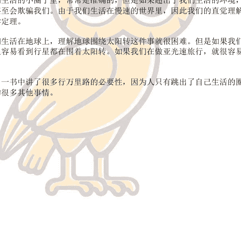

## 42 | 上帝掷骰子吗？

上一讲，我们讲到了爱因斯坦提出的狭义相对论，在一定程度上解决了近代的物理学危机。

好，我先说爱因斯坦解决了哪些问题。爱因斯坦提出狭义相对论的那一年是 1905 年，那一年他发表了四篇划时代的论文，因此 1905 年也被称 为“爱因斯坦的奇迹年（Annus Mirabilis）”。他的四篇论文在四个不同的领域重建了物理学大厦，这四项成就包括：

- 1. 通过数学模型解释了布朗运动，从此让物质的分子说得到确立;
- 2. 提出光量子假说，解释了光电效应，并且提出了光的波粒二象性，使得争论了两百多年的光的波动说和粒子说得到统一;
- 3. 提出了质能方程，即著名的 E=MC²，它将质量和能量统一起来了；（第 216 封信：世界为什么是能量）
- 4. 提出时空关系新理论，也就是狭义相对论。

如果诺贝尔奖的发放真的是按照绝对水平和在科学史上的影响力来的，那么爱因斯坦光在 1905 年的成就就可以获得四个诺贝尔奖。而在那之后，他至少还能再获得三个：广义相对论、引力波、玻色-爱因斯坦凝聚态。

从认识论的角度说，爱因斯坦将人类的认知范围提升到了看不见、摸不着却客观存在的另一个范围，但是，正如开篇所说，爱因斯坦只是在一定程度上解决了近代的物理学危机。尽管爱因斯坦的成就斐然，但他在认识论上仍然没有完全摆脱机械论的思维方式，这可能不能怪他，因为当时人们对于物理学这件事还不够确定性之外，利用不确定的成果解释世界的很多现象，要归功于普朗克、玻尔等人。他和爱因斯坦在很多基本的物理学观点上产生了分歧，而这也成了物理学历史上一段佳话。这—讲，我就为你介绍构建了现代物理学基石的两个重要概念——非连续和测不准。

我先问大家一个问题：你觉得我们生活的世界是连续的，还是不连续的或者说是离散的？我们的生活常识也告诉我们，世界当然是连续的，气温从 30 度到 40 度，必然要经过中间每一个一度，要从家走到公司，中间的路程一定也是要一步一步经过的，不可能凭空越过。

直到 19 世纪末，物理学家们一方而沿袭过去牛顿的思想，直觉地认为世界是连续的，觉得任何物质、时间和空间都可以用连续分割下去，但是另一方面他们看到新的物理学现象和这种基于直觉的认知又是矛盾的。

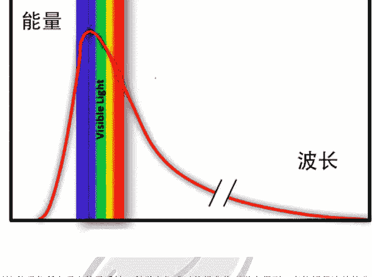

面对这种现象所表现出的矛盾性，科学家们难以从经典物理学中得到一套能解释清楚的公式。

由于各种经典物理学的结论都是建立在严密的逻辑推理之上的，而逻辑本身不会有问题，那么很可能就是这个理论的前提假设出了问题了。因此，要想解决这个矛盾，根本途径就是颠覆前提假设，这也就是我们上一讲说的：回到问题的原点。

在电磁波频率与能量密度的关系实验中，有个重要前提是：能量是连续的。如果推翻这个前提，也就是承认能量的不连续性，是就可以解释这些矛盾的物理现象呢？

1900年，现代物理学祖师爷马克斯·普朗克（Max Planck）提出一个大胆的设想，即能量是一份一份的，而不是连续分布的，只不过我们过去是从宏观的层面看到的能量，看到的份数很多，感觉它们是连续的。

普朗克进一步假设每一份能量的大小和电磁波（包括光）的频率都有关，但是不出现半份能量，这一点很重要。这就等于说，我们对能量的理解从连续变成了离散的。在这样的假设基础上，普朗克就推导出一个新的关于电磁波能量和频率关系的公式。

在普朗克的公式中，当电磁波的频率不断上升直可达到可见光的频率时，能量都是增加的，再往后频率超过紫光时，它就慢慢下降了。这样就和所有的实验现象都符合。普朗克将这种“份”的概念称为“量子”。也就是今天我们所说的量子物理中“量子”这个词的概念来源。普朗克这个想法颠覆了我们的认知，非常具有革命性，因此他被视为 20 世纪物理学的奠基人。

从普朗克的这种想法出发，爱因斯坦进一步提出了“光量子”的概念，很好地解释了困扰了人们十多年的光电效应现象。所谓光电效应是指当光照射在一些金属表面之后，会使金属发射出电子形成电流，这也是今天太阳电池的原理。

但是光电效应有一个现象大家无法解释，那就是光的频率要足够高才行，否则的话，即使光照时再长也激发不出电子。按照经典物理学能量转换的想法，即使入射光的能量密度不高，只要积累足够长的时间也应该能将电子激发出来。但事实并非如此。

1905 年，爱因斯坦在论文《关于光的产生和转变的一个启发性观点》里提出，光波并不是连续的，它是由一个一个离散的光量子构成，只有当一个光子的能量超过从金属中激发出电子所需要的最低能量时，电子才会被激发出来，否则，再多的光量子照射上去都是徒劳的。

爱因斯坦所说的光量子后来被定义为光子，他的理论很好地解释了自牛顿和惠更斯以来对光到底是粒子还是波的争论。牛顿的粒子说和惠更斯的波动说各有道理，却又互相矛盾。因此大家争议了 250 年，也没人能够给出一个合理的解释。爱因斯坦用波粒二象性，也就是光既是粒子又是波，给这个长达 250 年的争论画上了句号。

除了光电效应，20 世纪初物理学家们看到的很多现象都可以用非连续性来解释了。此后，不连续的量子特性，逐渐成为了物理学界对微观世界的共识。1924 年，德国物理学家马克·玻恩创造了“量子力学”一词。1925 年，海森堡、薛定谔等人建立起了完整的量子力学理论。

到此为止，物理学大厦似乎在承认了不连续性的基础上解决了危机。但是仅仅过了两年危机又出现了。1927 年，海森堡在测量粒子动量和位置的时候发现，这两个物理量，如果其中一个的测量误差变小，另一个则要变大，总之测量误差的乘积会永远大于或等于一个常数，这就是著名的测不准原理。

我们过去认为，你测量不准要么是本事不够、手段不行，要么是仪器的误差。但是测不准原理告诉我们的还真不是这么一回事，这种不精确不来自我们自身，也不来自于测量，而是说明了我们世界本来就有很多不确定性。因此，准确定到一定的精度，就到此为止了。测不准原理其实进一步说明了我们的宇宙是不连续的，无论是时间、长度、物质质量，都存在最小的单位。

对于这个和我们的本能思想相矛盾的现象，当时的物理学界分成了两派。一派以玻尔和海森堡等人为代表，他们认为，“上帝在创造宇宙时有很大的随意性”。当你观测一个粒子的时候，就以粒子的形式存在，不观测时就以波的形式存在。这听起来有点匪夷所思，因为物质的存在与否居然取决于人们是否观测它。

由于玻尔来自于哥本哈根，因此他们被秘密为哥本哈根学派。另一派以爱因斯坦为代表，他们对此提出了质疑。爱因斯坦说道：“玻尔，上帝从不掷骰子！”玻尔反击道：“爱因斯坦，不要告诉上帝应该怎么做！”这次对话便是科学史上赫赫有名的“上帝是否也掷骰子”的争论。

当时玻尔和爱因斯坦讨论这个问题是在第五届索尔维会议期间，全世界主要的物理学家都住在一起开会。每天开完会回去后，爱因斯坦就想出一个驳倒玻尔想法的例子，而玻尔第二天又针对爱因斯坦的质疑，找出维护自己想法的解释，最后谁也没能说服谁。这段历史已经作为一段人尽皆知的佳话。不过，后来整个物理学界越来越多的人开始接受玻尔等人的量子理论，也就是说，上帝居然也在掷骰子。

关于索尔维会议，罗老师在“罗辑思维”第125期专门讲到它，你可以搜索学习一下。

下面这张照片是参会者的合影，你所知道的很多大名鼎鼎的物理学家都在其中了。

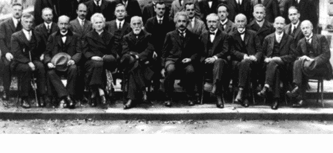

## 要点总结

- 1. 我们的宇宙是不连续的，而且存在着很大的不确定性，这和我们的常识相悖。这和机械论所认定的一切都可以预测的想法是矛盾的。在当时，即便像爱因斯坦这样伟大的科学家，也很难接受这个不可以预测的世界。今天我们了解世界的不连续性、不确定性，就要使用新的思维方式解决问题。这个我们在后面讲到信息论时再展开来说。
- 2. 人由于所处的位置，通常只能看到事物的一侧面，但我们会以为看到了全貌。光的粒子性和波动性，就是一个事物的两个不同维度。比如一个圆柱体，从上往下看是圆，水平看过去就是长方形。只有站在更高的认识维度，才能看清全貌。

## 思考题

举一个生活中的例子，说明它从一个维度看上去，和另一个维度的影像完全不同。

## 43 | 科技助产士：战争所带来的科技奇迹

我在上一讲解释光电效应时说到，如果照射金属的光子能量密度不够高，不论照射多长时间，也产生不了电流，光的能量只能白白浪费掉。在科技发展的过程中，很多时候情况和光电效应类似，即使有了非常多的量变积累，还必须集中财力和智力，完成最后临门一脚的突破。那么什么时候最容易实现这样的突破呢？这就要依靠战争了。

今天让全世界受益的很多技术，都得益于二战和随后的冷战。没有它们，很多技术会被拖延很长时间才被发明，因此战争是重大科技成就的助产士。今天我们就来谈谈战争带来的科技奇迹。

讲到二战最大的科研成果，大家会想到原子弹、电子计算机和青霉素，这些我们后面要单独讲。这一讲，我们根据信息这条线索，介绍一个二战期间对战局有重大影响的发明——雷达。

人类从古代开始，就幻想着有千里眼能够“看到”交战对方的军事部署和调动情况，这从本质上来讲就是为了获取信息。

当然，千里眼是没有的，因此双方只能靠哨所、侦察兵和间谍获取情报，这个效率非常低，而且因为信息传递需要较长的时间，很难获取实时的信息，更何况人眼能够看到的范围有限。后来随着望远镜的出现，人的视力得到了延伸，但是并没有根本解决上述问题，因为用望远镜所能看到的地方也是有限的。

再后来侦察机的出现让人的目光可以看得更远了，但是依然是靠人眼的视力获取信息，很多重要的信息会漏掉。更何况7天24小时不间断的侦察机巡逻的成本也是很高的。因此，人们一直在考虑能否有一种装置，自动扫描和发现天上地下的敌情，到了20世纪初，一项技术让这件事变得有可能，那项技术就是无线电。

早在1917年，尼古拉·特斯拉就提出了使用无线电波侦测远处目标的概念，并且后来被马可尼一步一步完善为发射无线电波，并接收“回声”（即反射波）探测船只。在随后的十多年左右的时间里，英国、美国、德国和法国的科学家逐步掌握了这项技术，并且建立起实用的无线电探测站，也就是今天所说的雷达站的前身。

1939年，英国著名的物理学家布特和蓝道尔发明了多腔磁控管。这是一种大功率的真空管，能产生超高频率的微电磁波，它后来成为了实用的雷达中最重要的部件，让雷达能够探测的距离一下子增加了很多。这项发明使得英国的雷达技术在二战中领先于世界。当然，雷达的迅速发展和普及在很大程度上是由二次战期间当时英国和德国之间空战的需求。

1940年，纳粹德国对英国发动了代号为“海狮行动”的入侵英国本土的计划，但是由于雷达所发挥的预警作用，使得飞机数量远不如德国多的英国得以在空战中占了上风，并且最终让“海狮行动”破产。

早期的雷达体积很大，非常笨重，只能安装在基地上，起到被动侦察的作用。如果想让它能够主动侦察敌情，最好能把它送到天上，因此在二战期间，美国和英国花了很大的力气，终于实现了小型化，把雷达装在了飞机上。这件事情意义非常大，它使得美国空军和德国空军在获取信息上完全不打等了，前者在二战后期占尽了便宜。

不仅在雷达方面，在所有和信息有关的领域，美国都比德国和日本重视得多，美国大量的科学家都从事信息的收集、破译和处理工作，以至于在很多战役中美国和盟国都如同明眼人打瞎子。

不过具体到雷达技术，德国在这方面还是可圈可点的，他们发明了控制火炮的火控雷达，这就让火炮的瞄准控制从依赖于人的经验，到了自动化的水平。从能量使用的效率来讲，这种火炮无论可以更有效地将摧毁对方目标的能量投放到远方。

世界上很多重要的科技成就，都经历了从非常受限制的军用到民间的过程，雷达也是如此。在二战中，雷达技术是各国最高的机密，而在战后，它很快速普及并得到了广泛的应用。到了20世纪60年代，雷达广泛用于了气象探测、遥感、测速、测距、登陆及外太空探索等多方面。

科学家们还利用雷达接收无线电波的特性，发明了只接收信号不发射信号的射电望远镜，它也可以被看成是雷达技术的一个应用。2016年9月在贵州落成的、被誉为“中国天眼”的500米口径球面射电望远镜FAST，利用的就是雷达的原理。从上个世纪50年代开始，雷达就成为电子工程的一个重要学科。

早期的雷达使用的都是固定频率或者有规律变化的频率，这样的雷达一旦开启，很容易被对方发现并成为对方攻击的目标。因此在二战期间，具有良好音乐基础的演员玛格（Hedy Lamarr）与作曲家安太尔（George Antheil）合作，发明了一种不断变化频率的通信技术，这项技术很快被用于改进雷达上，使得对方无法侦察到雷达的频率。这项技术就是今天移动通信CDMA的前身，并且成为了今天通信中调频编码的基础。

二战中和雷达有关的重要发明还不止这些。对军事感兴趣的朋友不知道是否产生过这样一个疑问，二战中美军在和德日军队作战时，双方地面防空的成效是不对称的。日本或者德国在地面和舰艇上用高射炮打美国的飞机没打下很多架，以至于无论是地面的军事设施，还是舰船都被美军的轰炸机摧毁了。

反过来，日本在二战后期袭击美国的军舰时，甚至派了飞行员直接往目标体积不小的美国军舰上撞，却接近不了美国的军舰。老远就给打下来了。如果说用只有筷子长的高射炮弹打天空几千米高度正在高速飞行的飞机有难度的話，应该双方都有难度，为什么美国人运气那么好？

这秘密就在于美军的一项秘密武器，高射炮弹头上的近炸引信（proximity fuze），它能够侦测出炮弹是否接近飞机了。如果挨近了，就直接引爆炸弹，而不需要炮弹真正的命中飞机，这样一来，炮弹的命中率就提高了好几个数量级。

近炸引信的核心技术是一个非常小型化的特殊雷达——多普勒雷达，它可以测定运动物体的距离和速度，在二战的中期由约翰·霍普金斯的应用物理实验室（APL）发明出来，并很快装备了美军。此后，美军和德、日军队看起来都高射炮，但是一方打出去的相当于几百年前的心实铁球炮弹，另一方打出去的是能大面积爆炸的开花弹，威力就差远了。

如果说在几百年间人类在发明开花炮弹时是能量利用的进步，那么发明装有近炸引信的炮弹则是信息利用的进步。早在1842年多普勒效应已经被发现了，但一直没有太重要的应用，是二战发现了这个理论的价值。

到了和平年代，雷达技术被用于民用产品，种类非常多。比如从倒车雷达，手持测速仪器，到无人驾驶汽车上的激光雷达，监测气象和大气污染的气象雷达，甚至有测绘海岸线和农田植物生长情况的测绘雷达。此外，雷达中最关键的部件多腔磁控管，经过改进，就变成了我们今天几乎每个家庭都有的家电设备微波炉。而发明多腔磁控管的蓝道尔，后来在发现DNA双螺旋结构的工作中起到了很大的作用。

雷达的本质是什么？有人说是“千里眼”，它能够“看到”远处的目标，甚至能穿越云层。不过“千里眼”的说法局限了人们对雷达的认识。从更广泛的意义上讲，雷达的本质是信息的检测，而不仅仅是千里眼。比如自动驾驶汽车上的激光雷达就不需要看得远，而要能够迅速准确地“照见”一周，是了解到周围全方位的信息。至于多普勒雷达，它更关注的是运动物体的速度，而非目标是什么。

在今天，大学里雷达专业的正式名称通常是“信息检测”或者“信号检测”，也反映了科技界对雷达本质的认识。通过今天对雷达的介绍，希望大家能够对信息处理有具体的了解——它不仅仅是今天互联网企业做的事情，而且早已深入到社会和经济的方方面面了。

## 要点总结

- 1. 我们首先讲到了信息技术对战争的重要性。通常人们想到信息和战争这两个概念时，就会想到情报，然后想到密码和破译。其实情报只是和战争相关的信息中很小的一部分。
- 2. 战争是技术的助产士，而用于战争的技术，几乎无一例外地后用来于了民用。明天我们还要讲一项技术，如果不是战争，不可能很快完成从理论到产品的过程。

## 思考题

在没有战争的情况下，什么事情会帮助技术实现最临门一脚的助产士？

## 44 | 原子弹：德国为什么没有成功？

我们上一讲以信息为线索，介绍了二战带来的重大科技进步。这讲，我们讲讲能量方面的突破，毫无疑问，就是原子弹的发明了。关于美国人造原子弹的故事，大家都很熟悉了，因此，这里里面的一些细节我们就省略了，有兴趣的读者可以参看我的《文明之光》。

这讲，我们重点分析一下，为什么美国人成功了，而更早开始行动的德国人却失败了。从中你就能体会能量总量和能量密度的重要性了。

我们先来看看原子弹从理论到武器（产品）的几个关键节点，尤其是到了后期，你可以把它看成是一场法西斯和反法西斯科学家惊心动魄的赛跑。

- 1. 第一个时间点，当然是1905年，爱因斯坦提出了著名的质能方程E=MC²，他实际上告诉了人类宇宙中最多的能量在哪里。但是在接下来的30年里，物理学界对这件事没有怎么反应，就连爱因斯坦自己也觉得要将物质质量中的能量利用起来，简直是天方夜谭。
- 2. 1938年底，德国放射化学家哈恩和团队在无意中发现了核裂变，在清理核裂变的生成物时，发现生成物的质量比最初少了一点点。哈恩将这个结果以信件方式告诉德国科学家迈特纳。
1939年，迈特纳等人对这损失掉的一点质量给出了理论解释，认为它们确实像爱因斯坦预言的那样，转化成了能量。于是，德国的科学家就开始考虑能否利用核裂变做炸弹。比赛正式开始，可以说德国科学家已经领先了。
- 3. 1939年初，丹麦物理学家玻尔去美国访问，在美国的首都会盛顿做了一个学术报告，介绍了核裂变产生的消息。当时参加报告会的有大约50名科学家，他们很多来自于离华盛顿不远的约翰·霍普金斯大学。听到这个消息后，大家下主场到霍普金斯的实验室，连夜做了核裂变的实验，并且获得了成功，证实了核裂变有可能产生巨大的能量。

另外，来自纽约哥伦比亚大学的科学家也连夜赶了回去，告诉了当时正在那里工作的著名物理学家费米，费米也马上做了核裂变的实验。至此，美国的科学家和德国的科学家处在了同一起跑线上。
- 4. 接下来，来自欧洲的物理学家西拉德意识到如果德国人先造出原子武器，结果将是灾难的，于是他起草了给罗斯福总统的密信，告诉总统美国必须抢在德国人之前拥有这种武器。西拉德觉得自己的分量还不够，于是说服他的老师爱因斯坦在他起草的信件上签名，那就是著名的爱因斯坦-西拉德致罗斯福的信件。

很多书中渲染这件事是美国造原子弹的开始，其实现在美国仅仅开始了小规模的学术研究，因为总统批准的科研经费只有6000美元，为德国同期经费的1/20。
- 5. 美国真正下决心研制原子弹是在1941年12月7日珍珠港事件爆发后。11天后，美国原子能委员会就召开了第一次会议。除了前面提到的那几位著名的物理学家，美国当时几乎所有重量级的物理学家和科学界领袖都参加了。

6. 随后的事情很有趣，罗斯福任命了非常会搞工程建设的工程师负责人格罗夫斯担任项目的负责人，他最初的办公室在纽约曼哈顿，“曼哈顿计划”因此得名。而格罗夫斯在康普顿等人的推荐下，任命了在政治上颇有争议的奥本海默担任技术总负责人。这两项任命成为了后来曼哈顿计划成功的关键。其原因我们后面再讲。
7. 1942年12月2日，距珍珠港事件过去不到一周年的时间，费米就领导建成了人类第一个核反应堆，他亲自操控反应堆，这个功率不到一瓦的反应堆成为了今天所有核电站反应堆的鼻祖。另外顺便说一句，费米等人当时并不知道放射性对人体巨大的危害，那一批物理学家（包括费米）后来都在年纪不大时死于了癌症。
8. 在与德国的竞赛中，时间过得很快，美国科学家的进展也是飞速的。仅仅过了两年零八个月，第一颗原子弹试验爆炸成功。不到一个月后，另外两颗原子弹“胖子”和“小男孩”被用于了对日本作战。

当美国已经开始生产原子弹这种武器时，德国人的进展如何呢？这也是当时美国曼哈顿计划的负责人格罗夫斯最想知道的。

1944年，随着美军攻入到德国本土并且找到了一些德国核物理学家，看到了非常简陋的核设施，才知道德国的核研究离实用还差得很远。但是美国人还不放心，他们坚持要找到德国核计划的负责人之一的海森堡，因为害怕他的研究非常有威胁。

最后美军如愿以偿了，不仅找到了海森堡，而且看到了他的核设施，就是下面这张图。我估计你看完会惊讶不已——这个破罐子就是海森堡的核设施？

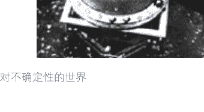

事实就是如此，海森堡的核装置就这么简陋，当时美军看到后也是惊讶不已。但是让他们更惊讶的是，海森堡居然还以为德国的工作远远领先于美国。

接下来就请我们今天的重点内容了，德国人为什么没有造出原子弹，而且研制水平相比美国那儿落后？

首先要说明的是，从某种意义上讲，不是德国人太慢，而是美国人太快。从发现核裂变到原子弹的使用，不过是六年零八个月的时间，这在从科学到产品的转换历史上太过迅速了。即使是在今天，一项应用科学研究成果变成产品，通常还需要20年时间呢。如果给德国科学家20年时间，他们也应该也能造出原子弹，他们的进度属于正常，但是在战争期间需要创造奇迹。

事实上在曼哈顿计划开始之前，包括玻尔在内的人都觉得美国造不出原子弹。玻尔说，“这（指原子弹）绝不能实现，除非将美国变成一个巨型工厂”。但是玻尔忘了，二战时美国还真就是一个大工厂。当时连IBM都能制造机枪，还有什么不能做的。

我在课程中已经多次讲过，科技成就很多时候取决于能够调动的总能量。德国和美国相比，首先输在了掌控的能量和物质方面。双方煤炭的产量差不多，但是美国的石油产量是德国的20倍，运输车辆和轮船比德国多出一个数量级。

我们在前面第12节讲过了法老造金字塔的故事，讲述了高度集权的政府能够集中力量完成大工程。制造原子弹，虽然有很多科学研究在其中，但也是一个大工程，因此它所需的物质条件还不是纯粹的科研可比。我们不妨用两件事说明一下。

第一个是关于劳伦斯为了绕磁轴（和杯）建造的超级回旋加速器。它的体积巨大，需要近万吨铜导线，但是当时美国已经把几乎所有的铜用在了战争，拿不出这一万吨铜。最后劳伦斯说服了政府拿出库房中的一万吨铍取代铜做导线。

另一个是关于核反应要用 的减速剂。当时德国是用重水做减速剂，产量就是几百公斤，最多的时候不过够存了一吨，还被英军炸毁了。美国是用纯石墨，它和重水效果相当，制造成本也极高。在美国，仅费米建造那个小试验反应堆，就用了400吨纯石墨。1吨和400吨，这是没法儿比的。

其次，是把物质资源积攒起来，人员都安排到岗、原子就能自动产生的，能够组织起这么大工程是另一件事。这就该说说格罗夫斯了。格罗夫斯今天为人所知是因为曼哈顿计划，但是在二战之外的他最大的成就是建造了当时人类历史上最大的单体建筑五角大楼，这个纪录直到几年后才被都新世环球中心打破。因此，你可以把格罗夫斯理解为当代造金字塔的人，而罗斯福看上他的就是这一点。

事实证明，格罗夫斯从找轴原料开始，就显示出非寻常的工程组织和管理能力。当然，曼哈顿计划里面有很多科研工作要做，从核爆炸的临界体积计算到核材料的浓缩等等，因此需要一个科学和工程的负责人。这个人需要有足够高的理论水平同时知识广博，让当时众多诺贝尔奖获得者服务，还需要有领导能力，对武器还有所了解，因此很难找。

格罗夫斯很幸运地找到了奥本海默。奥本海默精通物理学几乎每一个领域，而且是他完成了原子弹的理论计算。同时他对化学、金属学、武器和工程制造有全面的了解。更重要的是，虽然军方一直怀疑他的忠诚，但是格罗夫斯对他非常信任，言听计从。

## 要点总结

- 1. 我们通常认为工程建设比的是调动能量的能力，其实重大的科研比的也是调动能量的水平。单纯从物理学家的水平看，德国有包括海森堡、哈恩、博特等诺贝尔奖获得者在内的一大批一流科学家，他们更早地发现了核裂变，更早地启动了核计划，但是，德国能调动的物质和人力资源都无法和美国相比。

今天的科研，常常不是谁有一个更聪明的头脑就能做出成绩的，一流的物质条件是必不可少的。
- 2. 做事情的目的一定要明确。美国的曼哈顿计划从一开始就是照着制造武器去的，因此它从领导的任务，到人员的组织都是围绕这个目标进行的。为了造武器，光有科学家和工程师是不够的，而需要有大量的军人和工人。实际上当时美国都已经没有足够的男劳力参与曼哈顿计划了，大量的妇女参加了这项工作。

下面的图片，是当时三大研究中心之一的橡树岭研究中心下班时的场景，你可以看出当地的员工有大量的妇女。

相比之下，德国人到最后都没搞清楚他们是在做研究，还是造武器。
- 3. 原子弹告诉了人类宇宙中最多的能量在哪里，从此人类利用能量的水平有了一个质的飞跃。

## 思考题

在曼哈顿计划之后，你觉得世界上哪项大的科学研究和探索计划可以和它相比较？

> （延伸阅读：奥本海默的管理和沟通艺术；第252封信 / 什么是好老板）

## 45 | 阿司匹林：制药业的革命

我们前两讲讲了战争对科技的推动作用，其实在二战中还有一项重要的发明诞生，那就是青霉素。但我要给你介绍的是另一种风靡全球的经典药品，它比青霉素还要早，而且标志着药物研制进入现代科学时代，那就是阿司匹林。

阿司匹林的有效成分是水杨酸，在柳树皮中就有。早在古希腊，希波克拉底就记载了利用柳树皮煮水可以退烧镇痛。但是用柳树皮煮水喝，药效不明显，而且副作用很大。我们这一讲看看从柳树皮到阿司匹林，人类是如何从大自然中提取本 σχε信息造福自身的。

其实，东西方各种文明在很长的时间里在制药学上没有太多的差异，大家都是利用天然矿物物质或者动植物中某种未知的成分混合生成新的药物，然而那些药物的疗效其实很难验证，有时候即使有效，原因也并不清楚。

比如，中国古代就记载了用青蒿等草药的水浴治疗疟疾，但是并非所有的青蒿都管用，是哪一种管用，什么成分管用，过去没有人说得清。

人们不仅搞不到底是哪一个成分在起作用，可能就连是不是同一种原材料也保证不了，比如橘子皮泡入药成为陈皮，但是不同种类的橘子，放不同时间，得到的陈皮可能差别巨大。至于天然矿物，纯度就更没有保障了。

比如作为泻药的芒硝，里面不知道混有多少杂质，有可能无害，有可能有害，用药后有副作用，到底是芒硝用错了，还是它本身的不纯杂质引起的，就无法分析了。因此，常常是张三吃了有效，李四吃了可能就死了。

只有到了化学诞生之后，药物学家们才开始从天然物中提取纯粹的药物，希望能找到治病的有效成分，制药业的革命由此开始。

世界上最早通过提炼药物有效成分获得的药品是吗啡和奎宁。它们都是19世纪初，化学家们从单一植物中直接提取出来。但在随后几十年里，全世界在药物提取上都没有什么进展。

为什么会这样呢？因为研制一款药有两个难点，第一一个是我们前面说的找到有效成分，在化学得到发展之前，这件事办不到。

制药还有一个难点，那就是，并非存在有效成分的物质就可以直接吃，特别是那些从植物中提取出来的物质，吃不好要死人的。真正副作用小的药，常常和科学家们最初拿来分析有效成分的物质不是一种东西，因此变得看起来就难了。

吗啡和奎宁不过是恰好能够直接从植物中提取而已，其它药的研制，就没那么幸运了。到了19世纪末，人类终于掌握了药物研制的系统方法，此后各种新药才不断被发明出来，而第一款在全球范围内普遍使用的有效药物则是大家所熟知的阿司匹林。

因此从 18 世纪开始，大家就试图从柳树皮中提取出一种效果好，副作用小的止疼药。这种思路和当时提取吗啡或者萃取宁很相似，但是进展极为艰难。

1763 年，牛津大学的沃德姆学院的牧师爱德华·斯通首次从柳树皮中发现了有效的药物成分水杨酸，这种物质可以退烧止痛，于是他就向当时的英国皇家学会主席提交了他的发现。但是当时的化学不发达，他无法用水杨酸制造出药品。

又过了将近一个世纪，法国化学家格哈特才于 1853 年在实验室里合成了出了（乙酰）水杨酸。但是格哈特不了解这种化合物的成分，几年后他在做实验时不幸中毒去世。在之后的近 50 年里，终于在其他化学家的努力下，找出了它的化学结构，并提出了一些更有效的制造方法。

但更大的问题产生了，顾名思义，水杨酸是一种酸，它虽然有疗效，但是如果直接服用，太刺激胃了，副作用比疗效更大。

19 世纪末，德国拜耳公司的化学家霍夫曼，他的父亲患了风湿病，当时饱受病痛，而各种含有水杨酸的止疼药物，虽然能缓解他父亲的风湿痛，却给他父亲带来了新的痛苦，因为那些药物酸性太强，对胃的伤害极大，以至于他父亲服药后就胃痛不已，还经常呕吐。因此，霍夫曼在发明阿司匹林时，就把研究重点放在降低副作用上。

1897 年，霍夫曼经过多年研究，合成出来一种物质（主要成分是水杨苷），它不是水杨酸，但是这种物质在分子结构上和水杨酸有极大的相似性，它对胃刺激相对较小，而且有水杨酸的镇痛效果。霍夫曼为它起名为阿司匹林（Aspirin）。

为什么水杨酸不能吃，而阿司匹林能吃呢？这就要讲到现代的药品和早期从动植物、天然物中提取成分之间一个关键不同之处了。简单地讲，它们在化学意义上是不同的物质，但是有一部分相似的分子结构和化学性质，因此从医药的角度讲有类似的功能。而正因为它们是不同的物质，它们对人会产生不同的副作用，有的副作用大，有的副作用小。

下面三张图，分别是柳树皮中熬出来的水杨酸（左上那个），实验室里合成出的（乙酰）水杨酸（右上那个），和最后阿司匹林的分子结构，用圆圈画出来的是它们分子结构中共同的部分，也就是它们的有效药物成分。

但是大家可以看出它们是不同的物质。从天然的水杨酸到合成的（乙酰）水杨酸，差异还不是很大，但是到阿司匹林差异就很大了（多出一个糖苷）。

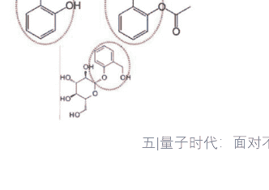

现代制药的过程，就是在了解了有效成分之后，发明一种物质（常常是原来自然界中没有的新物质），包含有效成分，却又没有太多的副作用。这种新物质，被称为药物。因此含有有效成分的天然物和今天大家吃的药物常常是两回事。

1897年，霍夫曼成功制得化学上纯净、稳定的乙酰水杨酸。负责检验相关结果的药学家一开始持怀疑态度，好在当时很多诊所的医生试用后发现它效果良好。于是拜耳公司开始研究成本可控的量产过程，才在两年后推向市场。

虽然当时这种药物享有专利保护，但是由于阿司匹林普遍受到欢迎，因此挡不住世界各药厂的仿制，特别是1917年拜耳公司的专利到期之后，全世界药厂之间为了争夺阿司匹林的世界市场，展开了激烈的竞争，这让阿司匹林成为了第一款在全世界热销的药品。

1918年，欧洲爆发了大瘟疫（西班牙流性感冒），阿司匹林被广泛用于止痛退烧，当时它发挥了巨大的作用。

阿司匹林最大的副作用依然是对胃的刺激，为了解决这个问题，今天大部分阿司匹林都是肠溶药片，大大降低了它的副作用。此外，今天还发现阿司匹林对血小板聚集有抑制作用，可以降低急性心肌梗死等心血管疾病的发病率。

从阿司匹林被发明后的一个多世纪里，它依然是全世界上应用最广泛的药物之一，目前每年的消耗量估计有 4.4 万吨。

非常遗憾的是，发明了阿司匹林的霍夫曼在他生前并没有得到应有的尊重，因为他独立合成了另一种药——海洛因。霍夫曼本希望发明一种终止痛药剂，取代吗啡，作为药效显著而成瘾性都较小的镇痛止咳药物，却是没有想到这个发明后来给人类带来了巨大的灾难。

他背负了太多本不应该由他背负的道义上的责任，一生未婚也没有留下子嗣，1946 年孤独地死去了。

作为阿司匹林的发明人，他拯救了人类无数患者的病痛。霍夫曼对人类的贡献是巨大的，他不仅发明了一种至今普遍使用的药物，而且和那个时代的化学家们一道，找到了从天然物到合成物，再到药物的常规的研制方法，通过这种方法，人类在药物的发明中取得了巨大的进步。

到今天为止，全世界一共研制出一万多种药，其中大约 5000 多种已经被批准，另外还有 5000 种在试验阶段。而在 20 世纪开始之前，人类一共只发明了十几种现代意义上的药品。

## 要点总结

- 1. 药物和天然物（包括天然提取物）其实是两回事。这就如同虽然柳树皮里和阿司匹林中都含有退烧镇痛的有效成分，但它们不是一回事。事实上，天然的提取物常常不能直接入药。这就如同我们不能直接服用水杨酸止痛一样。

像柳树皮这种包含很多物质、性质完全搞不清楚的原材料，直接食用是很危险的。

- 2. 药物和天然物，除了成分不同，副作用也不同。中国古代有一句话，“是药三分毒”，这句话至今依然成立。今天，美国食品药品监督管理局（FDA）批准新药的原则首先是无害（Ⅰ期临床试验的目标），然后才是有效（Ⅱ期及之后的临床试验的目标）。

- 3. 即使天然物能直接服用，但是它们和真正的药在药效上差距巨大。一种植物中或者几种植物中即使有一些有效的药物成分，通常含量很低，直接服用药效有限。今天没有人会去喝有霉菌的水来消炎，因为它虽然还有青霉素，但每一升水里面只有两个单位的青霉素。此外，由于药效不明，即使有效，也很难验证疗效是药物的效果，还是心理作用。

只有把药物的机理搞清楚，找到有效成分，利用它制造出副作用小的药品，才有实际意义。这里面一个很好的例子就是弗莱明发现青霉素的过程。虽然青霉素这种药有“青霉”二字，其实真正的青霉里面并不含青霉素，提取青霉素使用的是和它相似的植物黄花苜蓿，这一点弗莱明自己写文章作了说明。

从水杨酸到阿司匹林的过程，体现出制药科学进步的过程，这背后是以准确把握信息为前提条件的，首先是对物质结构信息以及它们的化学性质的把握，其次是对大量应用结果的分析，通过结果保留对我们益处大害处小的药品，这是一个不断迭代验证的过程。

## 46 | 青霉素：发明不是从 0 到 1

上以讲我给你介绍了制药业的革命，这一讲，我就以人类制药历史上最伟大的发明——青霉素为例，来学习发明的青霉素机理。具体到青霉素，我首先要讲的就是，发明不是从 0 到 1，而是从 0 到 N。

2016 年中国图书市场上有非常畅销的书——《从 0 到 1》，该书作者是彼得·蒂尔（Peter Thiel）。在中国，科技界和企业界很多人都知道这道这本书，因为从 0 到 1 这个概念太好了，说出了很多中国人的心里话。但是，大家对蒂尔并不太了解。

在美国则正相反，这本书并不像在中国那么畅销，因为他说得道理大家并不很认可。但是对蒂尔这个人大家却不陌生，因为他不仅是 PayPal 的创始 CEO，还是大名鼎鼎的埃隆·马斯克的第一任老板。加上他持独立独行，坚决支持特朗普，就受得家喻户晓了。

为什么会出现这种极为矛盾的现象？因为“从 0 到 1”这个观点触动了中国人热衷创新的那根神经。蒂尔讲，这个世界上有着两种创新，一种是从无到有（也就是从 0 到 1），另一种是从少到多（即从 1 到 N），硅谷人是第一种，中国人是第二种。

这听起来很有道理。但真实的情况却是，硅谷很少有从 0 到 1 的发明，有兴趣的同学可以去看《硅谷来信》的第 56 封信：在硅谷没有发明什么。这里介绍了很多人被外界误以为是硅谷完成的从 0 到 1 的发明，但其实硅谷完成的是它们从 1 到 N 的过程。

今天我就能以青霉素发明的全过程，来谈谈到底什么是从 0 到 1，为什么从 0 到 1 通常都不足以导致重大的发明，以及要想取得超过常人的成就，我们应该怎么做。

青霉素以及随后的各种抗生素对人类的意义就不用多说了，它们不仅让人类平均寿命增加了 15 岁，更是在很大程度上消除了人类对疾病的恐惧。在抗生素被发明和使用之前，人们得了病就会想起死。在这之后，人们得了病，就相信医生肯定能治好自己。这便是抗生素给人类带来的最大的意义。

如果现在问你，谁发现了青霉素？大部分人会说是英国的医生弗莱明。如果我再问，他是如何发现青霉素的？大部分人会说，那是一个偶然的发现。有一次弗莱明发现他培养细菌（葡萄球菌）的培养皿里长着霉，霉菌周围的细菌似乎被杀死了，然后他使用显微镜观察，证实了这一点，从此他发现了青霉素。

为什么大家会有这样一致的看法呢？因为我们的教科书里就是这么讲的。当然教科书在最后还要教育大家，灵机一动的发明或发现需要有准备的头脑。然后我们大部分人就喝下这碗鸡汤了。接下来两个问题就随之而来了。

首先，是谁给了弗莱明有准备的头脑，或者说，他是受了谁的启发？这一点教科书里没有写。

事实上，弗莱明的想法来自于德国着名的医生科赫，科赫被称为“细菌之父”，他认定感染的病源是细菌，要治疗感染引起的疾病，就要寻找能够从根本上将细菌杀死的药物。

因此，如果我们认定完成从 0 到 1 发现的人是弗莱明，科赫要是还活着的话，他可以去争辩说，弗莱明是受了我的理论的启发。

当然，有人会争辩，科赫没有发现青霉可以杀死细菌这件事，因此不算数。那我告诉你的是，其实弗莱明也不是第一个发现青霉可以杀菌这个现象的人。早在中国唐朝的时候，裁缝们就知道如果划破了手，把长了绿毛的糙米涂在伤口上，能够帮助伤口愈合。

这其实就是绿毛上青霉素起了杀菌的作用。只不过，唐朝的裁缝们不懂科赫一大堆的理论，他们解释不了其中的原因，因此这种方法也没有得到推广。更关键的是，光靠绿毛上那点青霉素其实也治不了大的伤病，因为按照我们上讲对药品的定义，那种能杀菌的天然物根本算不上药。

因此，我在很多文章中都讲，寻找第一个发明人常常没有意义，因为根本找不清，永远能够往前追溯。在人类的技术发展历史上，有无数次的从 0 到 1 的发明，但是绝大部分走不完到 N 的过程，因此都没有产生什么效果，最后就被大家遗忘了。

不仅唐朝裁缝没有发明青霉素这种药，实际上弗莱明也没有。那第二个问题就是，为什么弗莱明没有完成从 0 到 N 的全过程呢？利用我们前面介绍的“发明的预先要求”这个工具，就很容易分析出其中的原因了。

首先，弗莱明的知识结构不完整，他是一个着名的医生，但是他不懂化学，也不懂制药学，因此他无法搞清青霉素的有效成分，也无法从带有青霉菌的果汁中提取出药物。

此外，还有两个客观原因。

第一，当时药物纯净水平很差。弗莱明培养的青霉菌，每一升培养液只能产生两个单位的青霉素，按照今天门诊肌肉注射青霉素一天 60 万~80 万单位的用量估算，这需要将一个 25 米的短道游泳池的水都灌到人体中。此外，因为浓度太低，用青霉素做实验时时灵时不灵，这是今天科学研究的难题。

和弗莱明不同的是，弗洛里精通药理，更重要的是，他有非凡的组织才能，而且他手下还有一批聪明的科学家，除了钱恩，还有后来对抗生素做出巨大贡献的亚伯拉罕和希特利，是他们联合美国的科学家，将青霉素从天然物变成了药。他们前后来解决了八大难题。

## 1. 钱恩和亚伯拉罕首先从青霉菌中分离和浓缩出了它的有效成分——青霉素

## 2. 为了得到足够的青霉素做实验
弗洛里以超低薪水雇用了很多当地的女孩，将牛津大学里能找到的各种瓶瓶罐罐都用上了，培养青霉素。大家说他把牛津大学变成了霉菌工厂。

## 3. 希特利研制出一种青霉素的水溶液
并且调整了药液的酸碱度，这才使得青霉素能够用于动物和人体。

## 4. 1940 年夏天
弗洛里和钱恩用 50 只被细菌感染的小白鼠完成了药物的对比实验，25 只注射了青霉素的小白鼠都活了，25 只没有注射的死了，证明了青霉素的疗效，而且显示出它的毒性不大。

但是，用这种常规方法获得的青霉素很少，甚至不够救治一个细菌感染的病人。于是弗洛里开始寻求工业界，即药厂的帮助。他先联系了英国的药厂，但所有的力量合在一起也不足以解决问题。

于是，弗洛里和希特利去美国寻求帮助，钱恩和亚伯拉罕留在英国继续研究。这次合作的经费，是洛克菲勒基金会出的。弗洛里等人和美国人一道，又解决了剩下的四个难题：

## 5. 改进培养液
用玉米浆代替原来的蔗糖液做培养液，可以将产量提高 20 倍。

## 6. 寻找新的菌种
世界上的霉菌有很多种，有的容易产生青霉素，有的则根本没有。为了寻找新的菌种，希特利将实验室的人都派了出去。结果一位叫玛丽·亨特的实验员在水果堆上找到了一种长了毛的哈密瓜，发现上面的黄绿色霉菌已经长到了深层，于是就把它带了回来。

弗洛里检查了哈密瓜上的绿毛，发现这是能够提纯萃取青霉素的黄绿霉菌。采用了新的菌种，再加上后来的射线照射处理，使得青霉素的产量又提高了 1000 倍。

今天人们通常讲在发明青霉素的过程中有两次偶然的运气，第一次是弗莱明的哪一次，第二就这个玛丽带回的绿毛哈密瓜。

## 7. 让青霉素从实验室到量产
能够从实验室得到青霉素，不等于从工厂里能批量生产出来，这件事需要很多制药公司共同努力。这时候，弗洛里的组织才能再一次显现出来。长话短说，最终他克服了很多困难，说服了默克（Merck）、辉瑞、施贵宝和礼来（Lilly）四家著名制药公司共同研制和生产青霉素。

## 8. 实现青霉素大规模的量产
即便在工厂能生产青霉素后，产量依然很少。于是美国几十家药厂上千名工程师通力合作，使得青霉菌的浓度又增长了近百倍，才使得工厂能够大量生产这种药品。青霉素项目是美国在二战期间仅次于曼哈顿计划的第二重要的项目，得到了从政府到企业界巨大的支持。

到了诺曼底登陆时，每一位伤员前都能使用上青霉素。由于有了青霉素，英军虽然在第二次世界大战中参战的人数和第一次世界大战相当，但是死亡人数下降了很多。至此青霉素的研制告一段落，但是依然没有结束。

二战时留在英国的亚伯拉罕在 1943 年发现了青霉素中的有效成分青霉烷，这就约药用的青霉素可以保留有效的成分而滤除各种可能有害的无用杂质。

1945 年，英国著名女科学家多萝西·霍奇金通过 X 射线衍射得到了青霉烷的分子结构，并因此获得了诺贝尔奖，这使得美国麻省理工学院的希恩得以在 1957 年成功地合成了青霉素，从此生产青霉素不再需要培养青霉菌了。同年，弗洛里、钱恩和弗莱明因青霉素相关工作获得诺贝尔生理学或医学奖。

讲完青霉素发明的整个过程，你是否还觉得那只是有头脑的弗莱明从 0 到 1 偶然的发现呢？

## 要点总结

- 1. 发明是从 0 到 N 的全过程，从 0 到 1 当然了不起，但是能走到 N 的才是英雄。这就如同在马拉松比赛的起点挤满了人，到终点的人却寥寥无几一样。
- 2. 我们再次看到药物和含有药物成分的天然物是不同的。这也算是一个科普，大家以后不要总是觉得纯天然就是好的。
- 3. 调动资源的的对重大发明至关重要。

## 思考题

请你用能量或者信息作为工具，分析一下第三个要点。

## 47 | 信息时代的科学基础和方法论

我在前面讲到，工业时代的科学基础是强调确定性和可预测性的机械论。但是从 20 世纪初开始，物理学家们意识到不连续性、不确定性是我们这个世界的本真，如果依然使用机械论的方法解决问题，不仅把我们自己限制死了，而且可能会出现认知偏差。

认知偏差的危害很大，即使是爱因斯坦这样聪明的人，他一旦认定了世界是确定的，也会在量子力学领域犯错误，何况我们常人呢。

这一讲，我就为你拆解信息时代新的科学基础和方法论，也就是：控制论、信息论和系统论。通过学习这三大理论，以获取信息时代三种先进的做事方法。

我在前面讲了海森堡的测不准原理，他其实告诉了我们世界的不确定性。这个结论在第二次世界大战的战场上就非常明显。当时盟军的主要作战武器是各种火炮，要想威力大、射程远，就要牺牲命中率。

比如，在使用了近炸引信之前，高射炮命中率是很难的，它们平均要发射 3000 发炮弹才能击中一架飞机。当然，打击地面目标的运气没有那么差，不过长程火炮的命中率也不高。

如果采用过去机械思维的做事方法，要增加结果的确定性，军方就会要求制造火炮的工厂提高每一个零件和整个火炮的精度，但这其实很难做到。而且，在二战时，除美国之外主要参战国就是那么做的，但效果并非理想。

那怎么解决这个问题呢？以天才科学家诺伯特·维纳为首的一批科学家觉得自己也该为战争做点什么，他们就开始用新的思路改造武器。维纳等人想到，我们在驾驶汽车的时候，可不是一开始就瞄好了一个方向一头扎过去，而是不断作微调。那么发射出去的炮弹能不能也自己作微调呢？

但事实上，德国发射了数千枚的飞弹，都没有能够对英国的军事和工业设施构成严重威胁，因为它飞行的精度不佳落点完全是随机的。

是冯·布劳恩不想做精确吗？显然不是，他所遇到的问题是，V-2 火箭在飞行过程中任何一个很小的因素所导致的微小误差，在最后都会放大。那些因素很多是不可预知的，比如空气的湿度、细微温度差，更不用说风速的变化了。

但是，同样是冯·布劳恩，他在 20 年后设计了“土星五号”运载火箭，就准确地将宇航员送到了月球上事先设定的位置。要知道“土星五号”的飞行距离可是 V-2 的一千倍。

那么这次冯·布劳恩等人是怎么做到的呢？简单地说就是用了数学家卡尔曼在维纳控制论基础上提出的卡尔曼滤波，它可以让火箭在飞行过程中不断调整方向，就如同我们在开车时不断调整方向一样。

因此，简单地说，控制论研究的是在一个动态系统中，如何在有许多内在和外在不确定因素下，保持平衡状态的方法。它思想的核心是利用对各种输入信号的反馈来控制系统的问题。

在今天，依然有很多入试图预测股市，这种行为不断被证明是徒劳的。但很多人认为别人预测不准是因为本事不够大，考虑的因素不够多。事实上，那些专业的基金经理和经济学家，对股市和经济走势的研究可比普通人精深多了，照样预测不准，因为类似于微小的温度和湿度变化的随机因素特别多。

在美国，光是政府和各个民间机构公布出来的经济数据就有两万多个，但依然没有人能够研究清楚。因此，好的基金经理都是在根据市场作出反应。即便是美联储，每次涨息或者降息的决定，也是对经济形势的反应，也不是预测。

这就是控制论带给人们的思维变化，在 19 世纪时，人们受机械论影响，相信世界是可预测的，但到了二战之后，控制论成为新的科学基础，越来越明白考虑的都是如何根据反馈，作出调整，适应现状，而不是预测未来。

也是在 1948 年，另一位科学天才克劳德·香农发表了论文《通信的数学原理》，标志着信息论的诞生，从此通信进入了具有理论指导的时代。这也是我这一讲要给你介绍的第二大理论。

信息论就是通信的理论，也是一种方法论。我们今天常见的大数据思维，其科学基础就是信息论，我们知道，对于一个你一无所知的黑盒子，要想了解里面的状态，就需要信息，这是信息论最基本思想。用比较专业一点的话讲，叫做消除不确定性。

今天人工智能是一个热门话题，其实现就是在利用更多信息，消除不确定性。计算机的智能是如何产生的？它在机理上其实和人类的智能没有半点关系。事实上，今天的计算机只是在那些能够利用数据消除不确定性的问题上，比人类聪明。

## 科技史纲 60 讲

比如围棋，对计算机来说，就是在最多 361 个点位选择一个地方落子，是一个 361 选 1 的问题。而对于语音识别，不过是在几十个发音相似的单词（词组）中选一个匹配，人脸识别呢，则是在几百万人中选一个匹配。至于今日头条的推荐，也是从若干篇新闻中匹配一些你感觉感兴趣的。

这些难题的答案其实都是从信息论中来的。上个世纪 70-80 年代，作为信息论专家（当时美国大学里信息论课程教科书的作者），贾里尼克和他的同事们提出了数据驱动的解决人工智能问题的方法，并且在识别语音、翻译语言等领域取得了成功。

到了互联网普及之后，出现了数据的爆炸，而且原来各个不同领域的数据可以关联起来了，这就产生了我们所说的大数据。

大数据加上摩尔定律，引发了今天人工智能的突破，也导致了大家思维方式的改变。在此之前，人类曾经试图让计算机模拟人的逻辑思维方式解决智能问题，但事实证明这完全是走错了路。

今天，我们利用大数据，解决了很多新的智能问题，从无人驾驶汽车到自动回答问题等等。关于这一点，我在《智能时代》一书中，已经讲过这了，这就不再赘述了。

所以说，大数据思维改变了传统的做法方法，而这一切都归要感谢信息论。

在今天，Facebook 就敢于将不成熟的想法上线让大家使用，特斯拉公司敢于在汽车这种对安全性要求极高的产品中采用不成熟的技术，背后的原因在于它们能够较快地收集到数据，测试产品的不好坏，然后在用户尚未受到很多负面影响之前，决定是否保留或者是关闭所提供的功能。这种做法看似冒险，但其实，大量的数据比个别设计的经验更保障。

与控制论和信息论同期诞生的还有贝塔朗菲等人提出的系统论，这对后工业时代产生了巨大的影响。

今天复杂产品和大系统的开发，都或多或少地要利用到系统论的原则，因为它们的复杂度比工业时代的产品要高出几个数量级。在工业时代，一辆汽车上面有大大小小 3 万多个零件，这和今天计算机处理器中几十亿个晶体管在数量上可是天壤之别。更要命的是，汽车里每个零件的作用至少都能说得清，而处理器中每个晶体管的作用单独拿出来谁也说不清。

因此，过去想让机械产品的性能达到最优，就得把每一个部分都做到最优，然后组装起来，整体必然达到最佳状态。这种思维方式符合逻辑，有道理，以至于今天不少企业依然奉为经典。不信的话大家不妨看看，很多厂商是否仍在不断宣传自家手机的配置（Specs）有多高，功能多么全，因为按照机械思维，高指标、功能全就意味着好手机。

但是系统论的观点却认为，整体的性能未必能通过局部性能的优化而实现。很多人喜欢使用苹果的 iPhone 手机，不是因为它的配置高，而是因为当初在将技术和艺术相结合上，没有人能在境界上超越乔布斯，以至于苹果手机整体的体验好。大家如果有兴趣，不妨留意一下 iPhone 的广告，就会发现它从不跟竞争对手比性能和配置，只是从整体让它有什么特点。

事实上，苹果的每一款掌上手机和个人电脑的各种绝对指标并不比竞争对手高，甚至还低不少，但是整体上给用户的体验做到了最优化。一些人把其中的原因归结为其它厂家境界不够高。其实境界这东西是虚的，它背后的体现还是机械思维和系统论思维的差异。

系统论体现的管理思想，与机械时代泰勒的现代科学管理思想有明显不同。在二战期间，曼哈顿计划的负责人格罗夫斯和奥本海默，在负责研制原子弹的过程中主动地采用了系统论进行项目管理，大大缩短了原子弹的研究进程。

这让当时连爱尔达这样的天才科学家都觉得不可能完成的任务，能够在短短的三年时间里完成。再往后，管理上百万人参与的“阿波罗计划”，没有系统论更是不可办到。

今天，人们将系统论和控制论、信息论一道称为“三论”，也就是说信息时代的科学基础。从此以后，人们对世界认知的方式都发生了改变，从相信世界是确定的、可预测的机械思维走了出来。我希望你能在了解这些理论后，在此基础上制定出自己的行动指南。

## 思考题

试举几个整体不等于部分之和的例子，并用系统论来分析其中的原因。

## 科技史纲 60 讲

## 48 | 计算机的本质：重新理解摩尔定律和信息时代

我们上一讲说完了信息时代的方法论，那么如果问你信息时代最大的科技成绩是什么，你一定会说就是计算机。不管我们今天离不开计算机，而且它的应用之广远远超过人们的想象。对于计算机我们再熟悉不过了，因此我们在课程中将其发明过程以及关于计算机大家熟知的部分简化，而采用能量和信息这两个主线分析计算机的本质和发展的过程。

要分析计算机的本质，就要先说说什么是计算机。我们在前面的课程中已经讲过，一种发明找到最初的发明人是很艰难的，因为人永远可以往前回溯，不过回溯到太早阶段其实已经没有意义了，因为那些原型和后来的东西在本质上完全是两回事。

关于计算机，人们通常回溯到中国的算盘，关于为什么中国的算盘能够算是计算机，我在《Google方法论》中已经专门介绍过了（延伸阅读：为什么算盘是计算机？）。如果用一句话概括的话，它不仅有计算机的硬件，还有能够控制计算的指令集，也就是珠算口诀，相当于就是计算机程序的基础。

那么算盘这种计算机的本质是什么呢？就是利用人的能量，在珠算口诀这种信息集合的控制下，完成信息的处理。也就是说，计算机需要有能量才能工作，需要信息的控制才能工作。

接下来出现的计算机就是帕斯卡的手动计算机。

简单地说，帕斯卡发明这种能够做加减法的计算机，使用起来不用动脑筋，只要把数字铅钮拨到合适的位置，然后转换手柄就可以了。帕斯卡计算机并不比算盘更快，但是使用起来不需要学习。从能量的角度讲，它不如算盘有效，但所需要的控制信息少，也就是用能量换信息。

在此之后，又出现了莱布尼茨的计算机，他通过改进机械，能够做复杂计算，因为他通过机械实现了一些本来需要指令才能实现的控制。到了 19 世纪机械论盛行的年代，巴贝奇相信任何运算都可转换为机械运动，于是他发明了能够做微积分的计算机。

巴贝奇使用非常复杂的机械结构，实现了复杂运算。他设计的那个庞然大物包括了上万个齿轮和 1.5 万个其它的零件，重达好几吨，其实人直接操作起来是很费力气的。如果从能量的角度讲，要完成复杂运算就需要更多的能量。

世界上第一个发明可编程计算机的是德国工程师楚泽。楚泽发现很多运算道理都是一样的，只是改变其中的数字，这种事情应该让机器完成。在此之前巴贝奇等人的计算机一次只能做一种运算，而楚泽则希望机器能够按照流程完成一系列的运算。这件事自然就需要用程序控制。

楚泽发明的第一台计算机，即 Z1，也是纯机械的。它非常复杂，也非常大，因此需要用马达驱动了。由于是纯机械的，一秒钟只能计算一次。也就是说，楚泽的计算机是利用更多的能量、更复杂的信息，完成更复杂的运算。

到目前为止，计算机虽然能完成越来越多的运算，但是消耗的能量也越来越高。打算盘进行一次计算可能只需要一粒芝麻的能量，而冯·诺依曼和莱布尼茨的计算机就需要一颗绿豆的能量了，而巴贝奇的计算机需要一粒花生米的能量，楚泽的可能要一个橙子的能量。如果按照这个趋势发展下去，人类是无法实现大量的数据计算的。

因此，楚泽在它第二个计算机中就使用了继电器取代机械设备，这样不仅消耗的能量低，而且速度快。为什么继电器的计算机比机械的快呢？因为机械运动有惯性，齿轮不可能正着转完了马上反转转。继电器虽然也有惯性，但是接通和断开的时间间隔可以非常短。如果我们把机械计算机看成是纽扣蒸汽机，每次工作一下都得等汽缸冷却，那么继电器的计算机就如同瓦特改进后的蒸汽机，不再需要冷却这个过程，可以连续工作。

但是继电器开关的频率有限，如果能用电子设备取代继电器，那么计算机的速度可以大幅度提升，这就是美国研制电子计算机的初衷。1946 年，世界上第一台通用电子计算机埃尼亚克诞生了，它的速度在当时来讲是飞快的，一秒钟能进行 5000 次运算。

不过它的耗能也是巨大的，因为它里面有近 18000 个电子管，每个电子管相当于一个小灯泡，它的耗电量大约是 15 万瓦，当时它一启动，周围居民家的灯都会变暗。埃尼亚克消耗一度电大约能完成 2.5 万次运算，我们记住这个数字，以便于后面和今天的计算机作比较。

第一台通用电子计算机埃尼亚克用到了图灵在 1936 年提出的图灵机的理论。所谓的图灵机，是一种数学模型，它告诉人们，如何利用信息控制机械，实现计算。也就是说，计算的本质是一种机械运动，但它需要信息（指令）控制。计算机的这个本质直到今天都没有改变。至于计算是如何通过机械运动实现的，这就涉及到香农的一项发明——开关电路了。今天所有的集成电路里面其实都是各种各样的开关电路。

自 1946 年以来，计算机 70 多年的发展，从本质上讲就是提高能量利用率的过程。这 70 多年里有三个里程碑你是必须知道的。

## 第一个里程碑是晶体管的诞生。它将计算的能耗降低了两个数量级。这是上个世纪 50 年代的事情。

## 第二个里程碑是集成电路的发明，它将计算的能耗又降低了大约两个数量级。这是 60 年代初的事情。那时消耗一度电量可以完成 1 亿次的运算了。

## 第三个里程碑则是 1965 年摩尔提出摩尔定律，即集成电路的性能每 12 个月翻一番，1975 年摩尔对摩尔定律有所修正，认为 1980 年起集成电路的性能每两年就会翻一番。

摩尔和他的同事诺伊斯当时预见到，将很多小集成电路芯片集成到一个大的芯片中，将是未来半导体行业发展的方向。而当时他们所在的仙童公司董事会却意识不到这一点。于是二人离开了仙童创办了英特尔公司。

在随后的半个多世纪里，全世界半导体产业还真按照摩尔当年预见的速度在发展。从英特尔在1971年推出第一款处理器4004到2005年摩尔定律40周年之际，集成电路的性能还真提高了1000万倍，完全符合摩尔定律的要求。

在2005年之后的十余年里，虽然集成电路的进步速度有所放缓，但是基本上还能做到每两年翻一番，这样累积起来又提高了百倍。这样翻番进步叠加的结果是惊人的，以至于我们今天最差的智能手机，性能都比当年控制阿波罗登月的巨型计算机系统强很多。

如果我们用单位能耗提供的计算能力来衡量，这个进步也是相当快的。到2018年，世界上最快的曦光超级计算机一秒钟最多能完成20亿亿次浮点运算，耗电2.7度，相当于一度电完成了7.5亿亿次的运算。比上世纪60年代最早的集成电路计算机进步了7亿倍左右。

在经历了50年的翻番进步后，基于半导体材料的集成电路面器件的集成度已经接近了物理的极限。因此有人认为摩尔定律不再适用了。但是，集成电路依然有发展的空间，那便是继续提高单位能耗的计算能力，而不是一个芯片中绝对的计算能力。

如果我们以单位能耗的计算能力来衡量过去70多年计算机的进步，大约是每两年半翻一番，比摩尔定律进步的速度略慢，这中间的差距是源于半导体芯片在变得复杂之后，大量的能量被用在发热而非计算本身上面。实际上从十多年前开始，整个半导体产业的努力方向已经从单纯提高性能，转变为提高单位能耗性能了，并且在沿着这个方向取得了不小的进步。

那么科学家和工程师们是怎么做到这一点呢？简单地说就是用信息置换能量。我们不妨用两个大家经常听说的例子来说明。

第一个就是英伟达公司所的人工智能芯片。它的其实是一种特殊的图形处理器，并且对很多人工智能的应用作了专门的优化。相比英特尔的通用处理器，它单位能耗的计算能力能提高两个数量级（百倍左右）。

那么英伟达是怎么做到的呢？它其实并没有在处理器里面塞更多的晶体管，而是根据人工智能计算的特点，将计算的精度从64位降低到8位，这样就可以用同样数量的晶体管搭建几十倍的内核了，于是每一个内核的能量就降低了。而这么做的前提是，需要对人工智能算法的信息处理过程有深刻的了解。

第二个例子是Google的人工智能芯片TPU。Google自己讲，它比英伟达的人工智能芯片单位能耗的计算能力又提高了两个数量级（当然英伟达不承认）。Google是怎么做到的呢？其实这种TPU只适合进行和深度学习有关的计算，不适合其他的信息处理，Google是将深度学习算法的特点设计到了处理器中。

从这两个例子可以看出，如果我们在处理器中将信息处理的算法集成进去，就能大幅度提高单位能耗的计算能力，当然，这样一来相应处理器的应用场景也就受到限制了。不过当某一类计算使用的人非常多以后，这么做还是值得的。

今天我们使用了能量和信息这两根主线，将人类几十年来，特别是最近几十年在计算机领域的成就，概括成了十来分钟的内容。这样你就能够清楚当今计算机领域的发展方向了，它一直沿着提高单位能耗的计算能力在进步，在过去，这体现在摩尔定律，今天，它更多地体现在利用信息置换能量。而计算的本质，就是在信息的控制下，利用能量实现运算。

## 科技史纲 60 讲

## 49 | 遗传学：如何把生物问题变成信息问题？

2000 年，美国总统克林顿和英国首相布莱尔联合宣布：人类有史以来的第一个基因组草图已经完成。克林顿说：“人类将世世代代记住这一天。”布莱尔也说，这便是“二十一世纪第一项伟大的科技成就”。

那么为什么基因组为什么那么重要呢？因为对这个问题回答，可以让我们能够知道人类究竟是如何把自身特性的信息传下去的。

我在第 40 讲《进化论：我们哪里来？》说到，达尔文的进化论让我们知道生命是怎么来的，但是他的理论却无法解释为什么我们和父母长得很相似，而在人类之外，为什么“种瓜得瓜，种豆得豆”，动物是“龙生龙，凤生凤”？遗传似乎是一件充满了不确定性的事，从信息论的角度来说，信息就是为了消除不确定性。

这一讲，我会告诉你，人类是如何掌握信息，把遗传这样一个充满不确定的生物问题解决掉的。

首先，是 19 世纪奥地利的牧师孟德尔解决了达尔文的难题，人们第一次知道了显性和隐性性状的遗传机制，找到了遗传的规律。而解密遗传的难题，从一开始就变成了一个信息处理问题。我们来先看看孟德尔是怎么运用“人体大数据”处理这个信息难题的。

孟德尔坚信上帝创造了我们这个丰富多彩的世界，他怀着一颗无比虔诚的心，在奥地利的最高学府维也纳大学全面地学习了数学、物理、化学、动物学和植物学。

他从维也纳大学毕业后返回了修道院，在此期间，孟德尔通过豌豆杂交进行了著名的植物遗传学实验。为什么孟德尔会选用豌豆做实验呢？

先驱的工作。我在前面多次讲了信息记录和知识传承对科学进步的意义，从这件事大家也能再次看到。

在孟德尔逝世近 20 年后，科学家们才意识到他研究的重要意义，并将孟德尔发现的保留了遗传性状的单元——“遗传因子”，重新命名为“基因”。并且，也是在量化思维的指导下，大家尽可能多地收集数据，反复实验，都试图在动物身上也验证孟德尔的理论，但是大部分人都失败了。

最主要的原因是他们的实验对象没有选好。因为大家知道数据量的重要性，于是就选择了繁殖快的动物——老鼠来做实验。但是，当时的人没有认识到老鼠是基因和人一样复杂的哺乳动物。因此，用老鼠做杂交实验得到的后代五花八门，大家也搞不清楚到底是孟德尔错了，还是自己的实验没做好。

## 真正证实动物也符合遗传规律，并且将遗传学变成一门科学的，是美国著名生物学家摩尔根。

摩尔根改用果蝇进行遗传实验，因为果蝇只有四对染色体，这就能减少信息上噪声的干扰。而且这种小飞虫两个星期就能繁殖一代，容易很快速获取大量靠谱的实验数据。直到今天，果蝇都是做实验的好材料。

摩尔根通过实验，得到了继孟德尔两大定律之后的遗传学第三大定律：基因的连锁与互换规律。通过这套理论，他成功地解释了孟德尔也无法解释的很多遗传学现象。除此之外，他还建立起基于实验的、完善的现代遗传学，也从理论上解释了生物多样性的原因。1933 年，摩尔根被授予诺贝尔奖。

我们在第 47 讲《信息时代的科学基础和方法论》，说了大数据思维的本质，其实在有大数据思维之前，人类早已经有了数据的思维，其典型的代表就是开普勒，他能够发现行星运动的三定律，主要是受益于来自他老师第谷的数据。

用数据验证模型的思维方式，在科学史上很重要。在没有大数据和计算机的年代，这项工作只能手工进行，数据的收集在往往就要花费一辈子时间，所以叫“人肉大数据”。像孟德尔和摩尔根等人对遗传规律的总结，就是这么取得的。

摩尔根在开创现代遗传学的同时，也给后世留下了一个谜团——虽然在 40 年代，人们已经知道 DNA 是遗传物质了，但是 DNA 的结构是什么样的，是什么力量让它们能够连接在一起，在遗传时又为什么会断开，基因又是如何复制的，人们还不清楚。

而这个秘密的破解有着极其重要的生物学和哲学意义。在生物学上，它可以让我们了解生命的本质和生命的起源；从哲学上讲，它有望回答“我从哪里来，我们是谁”这一难题。

直到第二次世界大战结束后，这个难题才实现了突破，人们终于发现了 DNA 的双螺旋结构，人类遗传信息自我复制的秘密才被揭示出来。战后的十年，也成为生命科学和医学发展最快的时期，为什么很多重大成果能够在极短的时间里取得呢？

## 科技史纲 60 讲

这主要有两个原因。首先是仪器的突破，特别是电子显微镜，包括 X 光衍射仪器的出现，使得生物学的研究从细胞级别进入到分子级别。人们通过更先进的工具，得到更多精确的信息。其次，也是更重要的原因，就是大量顶级的物理学家、化学家以及年轻学者都转行到了生物领域。

1946 年，伦敦大学国王学院的女化学家富兰克林与物理学家威尔金斯首先通过 X 光衍射仪器得到了最早的 DNA 三维结构照片，但是他们还没有提出关于 DNA 的模型结构。

与此同时，在剑桥大学著名的卡文迪许实验室里，克里克和前来做博士后的美国年轻学者沃森则从理论上开始考虑 DNA 的结构。他们两个是以外行身份闯入 DNA 结构研究的，资历最浅，年纪也最轻。

此外，美国著名化学家，也是诺贝尔奖获得者的鲍林也开展了相关研究，鲍林在当时被视为天神级别的科学家，大家都觉得只要是他想研究的问题，没有找不到答案的。

当时，各家研究机构都以各自的方式去破解 DNA 结构这个谜团了，大家为了率先取得这个重大的科研成果，都彼此保密。

富兰克林等人有了 DNA 模糊的照片，但是想不出它们的结构，沃森虽然年轻，但是生物学和遗传学基础非常好，他和物理学、数学非常优秀的克里克一起，构想出很多 DNA 的结构模型，但是苦于没有数据验证。

不过，克里克的导师佩鲁茨当时负责英国的医学研究委员会，于是，克里克和沃森通过导师佩鲁茨了解到了富兰克林等人申请科研经费时所提供的数据。有了数据后，他们二人马上验证了几种构想中的双螺旋模型符合 DNA 的真实结构。

接下来贡献该给谁就成了问题。1953 年 4 月，在兰德尔和沃森等人所在的卡文迪许实验室的负责人的协调下，在《自然》杂志上同时发表了上述五位主要科学家的三篇关于 DNA 的重要论文。

1962 年，沃森、克里克和威尔金斯因为提出了 DNA 双螺旋结构模型而获得诺贝尔生理学或医学奖。这时沃森年仅 34 岁。遗憾的是，富兰克林因为 1958 年早逝，与诺奖失之交臂。至于鲍林，因为他当时忙于反核反应，错过了这次机会，不过他反而获得了诺贝尔和平奖，成为极少数获得两个不同类别诺贝尔奖的人。

在 20 世纪所有的生理学或医学奖中，DNA 结构的发现被认为是最有价值的一个诺贝尔奖。至于谁的贡献最大，直至今天也还有争议，客观来说，富兰克林等人先看到了 DNA 的三维结构，但是沃森和克里克首先提出了双螺旋的理论模型。

为什么富兰克林等人掌握了数据，却没有更早地想出 DNA 的空间结构呢？因为总的来说，富兰克林是实验科学家，虽然她看到了双螺旋结构，但是 X 光衍射的图像其实远不像教科书上画的那些双螺旋结构那么清晰，要从实验结果上升到理论其实是很难的。

而沃森他们是理论家，跟富兰克林正好相反，他们是从理论出发，推测 DNA 应该是双螺旋结构，事实上，准确来说，他们也没有“发现”DNA 的双螺旋结构。

直到 20 世纪 70 年代后期，有了专业的仪器，科学家们才画出了一幅真正的 DNA 结构图。按照笛卡尔的方法论，今天的科学研究常常是先有假设，再验证，这样效率比较高。

## 要点总结

- 1. 人类自身信息遗传复制的难题，看起来是个生物学问题，但其本质还是一个信息问题。如何消除不确定性？最关键的就是利用更多的数据和先进的工具掌握更多的信息。从孟德尔、摩尔根到富兰克林、沃森、鲍林等人都是如此。克里克和沃森相比鲍林，是赢在了数据上，没有富兰克林的数据，他们二人就无法验证自己的模型。 2. 在科学实验中，找什么样的对象做实验很重要。孟德尔和摩尔根都取得了成功。做其他工作也是这样，不能蛮干，找好对象，找好突破口很重要。 3. 与其从观察结果去抽象出理论，不如从假设出发，寻找证据论证。

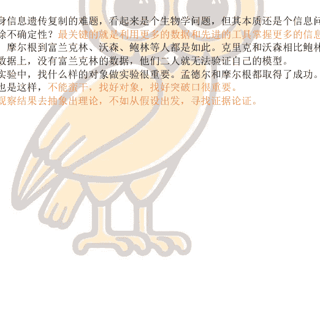

## 50 | 基因工程：人工合成胰岛素和转基因

我们上一讲说了解开了 DNA 双螺旋结构的过程。人类完成了对自我遗传信息的解码，那么我们能否利用这些信息对生命进行再次编码呢？当我们了解了 DNA 的奥秘之后，是否就能更好地掌握甚至改变我们自己的命运呢？

我们经常听到媒体上讨论生物医药和转基因食品，这一讲，我就从基因工程的两个科技应用，也就是医疗和农业上的转基因技术来为你拆解基因工程到底是如何影响我们生活的。从中你能感受到信息的重要性。

我们不妨先通过一个生物制药改善人类健康的例子，来看看基因技术是如何改变我们命运的。人类伟大的基因工程也随着这个技术的成熟而开始了。

1976 年，加州大学旧金山分校的教授赫伯特·博耶成功地将细菌的基因和真核生物的基因拼接在一起（我们人类就是真核生物），这实际上是一种转基因技术。同年，博耶在风险投资基金凯鹏华盈的帮助下，成立了基因泰克公司（Genentech）。

两年后，也就是 1978 年，博耶和他的同事利用这种技术成功地将大肠杆菌的基因和人类胰岛素基因合成在一起，然后送回到了大肠杆菌中，这样大肠杆菌就生产出了人的胰岛素。

接着，基因泰克利用人工合成的胰岛素进行了治疗糖尿病的临床试验。1982 年，FDA 正式批准了这种合成的胰岛素作为治疗糖尿病药物，从此极大地改善了数百万糖尿病患者的生存质量，并延长了他们的寿命。这不仅意味着一种新药和新效果，更重要的是，从人工合成胰岛素开始，他们开启了掌握甚至改变我们自己的命运的历程。

这个从基因提取到改造，再到最终制造药物的过程是怎么完成的呢？根据第一位加入博耶人工合成胰岛素团队的科学家戴维·戈德尔（David Goodel）的介绍，在找到了生产胰岛素的基因后，要完成上述人工合成胰岛素的过程，大约需要 13 个步骤，你不用全知道，我把其中最关键的技术给你总结出来：

首先，要将染色体（也就是基因的载体）从细胞核中取出，这在今天并不是一件难事，我们就不介绍了。

其次，要从染色体中找到控制合成胰岛素的那一小段基因。这项工作非常复杂，我们稍后专门介绍。

然后，要将人的胰岛素的基因从人体细胞的 DNA 长链中准确地剪切下来，这显然不可能用一般的剪刀或手术刀来做，需要使用的是分子级别的剪刀。

再接下来，要将人体内产生胰岛素的基因加到一个被称为质粒（Plasmid）的载体上，然后通过一些转化方法，将质粒转到大肠杆菌细胞中。

剩下涉及到工艺的过程，我就省略了。接下来我就讲讲这几步里的一些细节，这个步骤其实都是围绕剪切 DNA 这一关键环节展开的。知道这个原理，你就了解了基因技术的核心。

在切割基因之前，首先需要知道一个基因从染色体的什么位置开始，到什么位置结束，这个过程叫做“寻找基因的位置”。找到位置后，要找到一把小小的分子级别的“剪刀”来剪剪基因。

1968 年，约翰·霍普金斯大学和日内瓦大学的科学家发现了限制性核酸内切酶（简称“限制酶”），它能将 DNA 长链从人们所需要的地方切开。这把“剪刀”的发现后来在 1978 年获得了诺贝尔奖。

那么最关键性的问题就来了，如何得知哪一段基因正是控制产生胰岛素的？或者更广义地说，如何找到控制生物某一个功能或者特征的基因？这个过程被称为“找对应”。

找对应是一件非常有意义的事情，但是也是极难的事情。因为每找到一个功能（或表象）的对应，就意味着有望治愈很多疾病，比如找到和色盲对应的基因，就有可能通过修复该基因治好色盲。但是，这首先是一个非常难的题目，其次、也是更重要的，这是一个非常危险的题目。

## 先说它为什么难。

这是因为在发现了 DNA 结构之后的半个多世纪里，科学家们花了很大的工夫，很多的科研经费去寻找对应，也只找到了一点点，比如我们在前面课程中提到的牛津大学发现语言基因 FOXP2。

对于一些常见的疾病，比如老年痴呆，全世界无数科学家和医生态明知这种疾病与基因有关，但就是找不到对应的基因。每一年在这个领域，都会有些看似突破性的成就，然后国内的媒体就开始炒作，但很快大家就会发现那离找到答案还差十万八千里呢。

怎样才能发现决定某一个功能的基因对应呢？用我的朋友，约翰·霍普金斯大学萨尔兹伯格（Steven Salzberg）教授的话来说，大部分基因对应的发现都是靠运气。

人类基因碱基的数量是如此之多，有 30 多亿对（你可以把碱基理解为构成 DNA 的小单元），以至于想要找到某一个功能的基础无异于大海捞针。运气好的人，找到一个对应，从此成了学术权威，甚至获得诺贝尔奖；运气不好，做了很多年科研，最后走进了死胡同，可能在大学里连终身教职都提不上，只能走人。

具体到合成胰岛素的基因，是由加州大学旧金山分校的几位科学家在上个世纪 70 年代末发现的，可以说，他们的运气特别特别好。

## 除了困难，为什么我还说找不到对应件事很危险呢？

这倒不是说科学家搞科研有危险，而是说，如果没有找到，按照错误的理解去治疗，会治死人。我们过去在学校里都学过，某段基因的缺失会导致色盲、血友病。其实，这两种病都是单一基因缺陷造成的，这种对应只要找到就可以治了。

但是实际上，大部分疾病，包括心脏病、癌症和前面说到的老年痴呆，都是很多基因共同作用控制的，找不对，找不全，贸然治疗，危险都很大。在历史上，就有过采用基因疗法治疗儿童先天消化不了的疾病，结果让很多人得了白血病的例子。

讲回到人合合成胰岛素这件事，基因泰克公司运气特别好，它不仅成功合成了胰岛素，而且因此成为了全世界最大的生物制药公司。

今天，基因泰克主要的产品已经不是胰岛素了，而是抗癌药。那抗癌药又和基因技术有什么关系呢？我们知道癌细胞是我们正常细胞 DNA 变异后的产物，因此，癌细胞有着和正常细胞不一样的基因。

当然，不同人，同一肿瘤，变异的基因可能各不相同。但是目前了解到的所有的癌症基因变化加起来，大约有 5000 种，是一个有限的数目。如果我们发明一种药物，把带有某些癌症基因的细胞杀死，不就能治疗癌症了吗？

基因泰克就是沿着这个思路不断开发抗癌药的。因此它也被称作生物技术公司，而不是简单的制药厂。

基因泰克的成功，引发了很多人用同样的思路改造生物，治疗疾病，从此便诞生了基因工程。总结一下，所谓基因工程，就是通过基因技术直接操纵机体基因组、用于改变细胞的遗传物质。

今天它的应用很广泛，除了人合合成胰岛素等物质，还可以改良物种，这就是我们今天说的第二个应用：转基因。这种技术的核心是，使用克隆技术分离和复制需要的遗传物质，以产生具有特定功能的 DNA 序列（也可以通过合成 DNA），然后再将这段 DNA 插入宿主生物体中。

比如跨国农业公司孟山都（Monsanto）把抵抗杀草剂草甘膦的基因导入大豆基因组中，这样培育的大豆就天然地能够抵抗除草剂草甘膦。这样，种植这种大豆之后，在使用除草剂的时候，只会杀死草，而不会伤害到大豆植株本身了。

转基因技术给农业带来的结果，就是对这个古老产业的改造升级。今天的农业，其实只有一半还是过去的种植业，而另一半已经和信息息息相关的生物技术产业了。自从一万多年前有了农业以来，农民们在收获时都要留下部分种子第二年使用。

但是在今天，农民则是直接从种子公司购买了。这方面是因为像孟山都这样的公司，种子都是有专利技术的，禁止农户留种，而且在美国和加拿大控制得很严。另一方面，如果在培育种子的过程中使用了杂交技术，种子几代之后就会退化得厉害，农户留了也没用，因此大家都需要购买新的种子。

最近几年（2015—2017 年），孟山都每年营业额都维持在 150 亿美元左右，这是什么概念呢？同期美国 GDP 中农业不到 2000 亿美元。

在今天，购买包括种子在内的技术产品，已经占到了农业成本的很大一部分。如果说过去中国农民是靠善用能量取得农业的好收成，今天则要依赖信息技术了，因为培育良种靠的就是对基因信息作用的了解。

## 要点总结

- 1. 我们介绍了人类在破译了生命的密码 DNA 后，如何利用基因技术再次编码治疗疾病，改造物种。人类伟大的基因工程就此开启。
2. 到目前为止，人类对基因的了解还非常非常少，特别是还没有了解基因和生物机能、特征的对应。很多和基因相关的成就，都有运气的成分在里面，包括成功合成胰岛素。因此在这方面的研究需要格外谨慎，因为一旦犯下任何错误都将是灾难性的。
3. 基因技术出现之后，不仅制药等行业发生了变化，很多产业，包括古老的农业也都在无形中发生了变化。今天农业的增产，在很大程度上是破解植物 DNA 信息的结果。
4. 从长远看，随着我们对自身基因，对其他生物基因的不断了解，我们能生活得更好，也能够让环境变得更好。在这方面，人类还有很长的路可以走。

## 思考题

在基因技术方面，你觉得人类有哪些是不应该做的？

## 51 | 太空竞赛：为什么苏联无法完成登月任务？

从我们的远古祖先第一次尝试拖着漂浮的树干，漂过一条湍急的河流，人类的远足就开始了，到今天，我们能够乘坐航天飞机，抵达月球，不得不感谢科技进步的力量。

这一讲，我就为你拆解 20 世纪最能体现人类能量利用和信息利用水平的航天技术，它的开展是从一场航天竞赛开始的，而竞赛的结果极大地促进了科技的进步，产生了许多今天广泛使用的新技术、新材料。我们今天使用的很多东西，比如数码相机使用的 CMOS 传感器、尿不湿、记忆海绵等，最初都是为太空探索的需要而发明的。

航天事业的发展最初源于火箭技术，而发展火箭最初的目的也是为了战争。在军事上，能用火炮进行远程攻击的一方通常会占有优势。

在第二次世界大战之前，人们在远程打击方面能做的，只能是把火炮的炮管长度加长、让炮弹在出... 

德国在第一次世界大战中制造出炮管超过 30 米的超级大炮。这种火炮虽然射程超过 100 公里（最远的记录为 122 公里），但是实在是太笨重，而且发射不了几轮，炮管就会变形，无法准确射击了。

到二战期间，德国人开始研制射程更远、更有威力、打击更精准的秘密武器。由于它的保密工作做得很好，盟军对此所知甚少，直到 1944 年秋天的一天，一个庞然大物从天而降，落在伦敦西南部的奇茨克（Chiwick）地区，并引起了大爆炸，炸死 3 人，炸伤 22 人，这时盟国才体会到德国这种新武器的厉害。

和过去靠惯性打击的火炮所不同的是，这种当时被称为“飞弹”的武器在发射的过程中可以不断加速。这就是我在前面介绍过的“V-2 飞弹”。

冯·布劳恩在美国几乎赖了五年，因为二战后美国一直在裁军。1950年朝鲜战争爆发，才给了他重新研制火箭的机会。而在冷战的另一边，身为囚徒的科罗廖夫则带领苏联人走在了前面。

科罗廖夫是苏联最杰出的航天科学家，他年仅25岁的时候就成为了苏联火箭研制小组的负责人，但是在斯大林的大清洗中，他因为莫须有的阴谋颠覆罪遭到逮捕，先是在劳改营里做苦工，后来在没有人身自由的情况下，被安排从事火箭的研究。

二战后，苏联加紧了对火箭的研究，而仍然在蒙受屈辱的科罗廖夫，本着对苏联的忠心耿耿，开始领导起苏联的火箭研制工作。在冷战期间，美苏双方的太空竞赛在很大程度上则对冯·布劳恩和科罗廖夫两个人的竞赛。双方的竞赛经历了三个回合。

- - 第一个回合是看谁先将人造卫星送入地球轨道。

这一回合，科罗廖夫领导的苏联获胜。获胜的主要原因是他们的火箭的推力大得多。1953年，苏联在科罗廖夫的领导下，成功发射了R-5弹道导弹，射程可达1200公里，射程和运载能力都比德国当年的V-2提高了很多。随后，科罗廖夫研制出著名的R-7火箭，运载能力和射程都有巨大的提高。

1957年10月4日，苏联使用R-7火箭成功地发射了世界上第一颗人造地球卫星“史泼尼克一号”（Sputnik-1），这标志着人类从此进入了利用航天器探索外层空间的新时代。“史泼尼克一号”被赋予了太多的话题，“第一”，《纽约时报》当时发表的评论说，该卫星的发射不亚于原始人第一次学会直立行走，这是 一个极高的赞誉。

- - 第二回合是看谁先把人送入太空。

这一回合也是以科罗廖夫为首的苏联再次获胜。他们在经历了数次失败后，终于在1961年4月12日这一天，迎来了全人类历史性的时刻。

那天上午，苏联宇航员尤里·加加林登上了矗立在拜科努尔航天发射场的“东方一号”宇宙飞船。9点零7分，火箭点火发射，飞船奔向预定的地球轨道，加加林在完成了环绕地球一周的飞行后，成功跳伞着陆。

虽然加加林的整个太空旅行只持续了108分钟，中间还遇到不少小问题，但是这次飞行的意义非凡，它标志着人类第一次进入外太空。

- - 第三回合是看谁先把人送上月球。

这一回合，冯·布劳恩不仅完胜，也从此奠定了他在航天史上第一人的地位。他为阿波罗登月所设计的“土星五号”火箭，1967年首次发射，至今依然是历史上推力最强大，运载能力最强，而且没有发射失败过的火箭。

那么苏联何以在赢了前两个回合之后，第三回合完全败呢？这其实并非他个人能力不行，而是苏联输在了能量的总量上，这就如同纳粹德国在核竞赛上输给美国，也是能量总量不足所致。其次，苏联在信息技术和系统工程上水平和美国相去甚远。最后，苏联还输在人才总量上。

接下来我们就一一展开分析。

## 首先，美国在实施“阿波罗计划”的过程中，显示出强大的国力。最多时，有两万家公司、研究机构和大学，40万人直接和间接地参与了这项航天计划。

为了加快研究速度，美国在“阿波罗计划”中采用了高密度的流水线式的研发方式，也就是当第一号火箭发射时，第二号在测试，第三号在组装，第四号在制造，第五号在设计研制……每一枚火箭发射的间隔只有半年甚至更短。

当然，这里也存在一个问题，如果在中间某个环节发现了问题，已经在流水线上的所有火箭都要全部报废，所有工作推倒重来，这样的成本非常高。事实上，在“阿波罗计划”和之前的“双子星座计划”中，就有三枚火箭因此而报废。毫无疑问，美国这是在用能量和钱来换时间，以便抢在苏联人的前面。

## 其次，登月远比载人进入地球轨道难得多，需要火箭技术和信息技术的革命，而后者常常被忽视。

登月首先要保证在月球上着陆的地点准确，而且要保证返回火箭和飞船能够在月球轨道上准确对接，这就要用到控制论了，这一点我们在前面介绍控制论时介绍过了。对于阿波罗登月控制方面贡献最大的科学家是数学家卡尔曼，他在维纳控制论的基础上提出了卡尔曼滤波，这从理论上保证了火箭能够准确无误地抵达登月的地点。

不过，在实现卡尔曼滤波的过程中又遇到了麻烦，当时控制阿波罗登月的大型计算机还没有今天一台智能手机快，因此完成了卡尔曼滤波的计算，于是许多控制专家和计算机专家经过努力，在误差允许的范围内简化了数学模型，这才实现了登月的控制。

在信息技术方面另一个关键问题是远程无线通讯。为了确保相距38万公里的地、月之间通信畅通，美国发射了很多环月球的航天器，专门测试地月之间的通信情况。

## 最后，由摩托罗拉公司提供了月球和地球之间的对讲设备，保证了登月计划通信的畅通。

为了在月球上拍摄清晰的影像，瑞典的哈苏公司研制出特殊的黑白相机，记录了阿波罗登月宝贵的科学和历史资料。

相比之下，苏联在综合国力上，在除了火箭设计的其他技术上，特别是信息技术上，和美国都相去甚远，远没达到能够登上月球的水平。即便是在火箭制造上，苏联和美国也有较大差距，这体现在火箭发动机的材料，到燃料，到加工各方面。由于制造水平不够，苏联尝试发射了几次登月火箭N-1，都失败了。

最后讲述双方在人才上的差距。美国在苏联人率先成功地发射了第一颗人造卫星“史泼尼克一号”后，陷入了所谓的“史泼尼克危机”，因为美国人担心苏联能将发射卫星的火箭装上核弹头打到美国。

作为回应，美国采取了一系列措施以夺回技术优势，当年就通过了《国防教育法案》，该法案对美国接下来 20 年的科技人才的培养产生重大的影响，同时美国向世界各国的人才敞开大门，其中包括很多华裔科学家和工程师。而包括冯·布劳恩在内的一批德国和欧洲的科学家起到了关键的作用。

反观苏联，虽然在二战时也把一批德国火箭专家带回苏联。但是因为不能够信任他们，又将他们送回到了东德。因此登月的竞赛实际上是苏联和整个西方世界在智力上的比拼。

最后，虽然美、苏两国最初是出于国家安全考虑进行太空竞赛的，但是很快人类开始在航天领域开展了相互合作，并且让这个领域成为了全世界合作最密切的科研领域，今天的国际太空站，就是这种合作的产物。

## 要点总结

- 1. 直到今天，像登月这样的大型项目，依然是在比拼一个国家能够调动的总能量。 2. 登月这种项目，是一个极为复杂的系统工程，人们通常能够看到的只有火箭部分，但是在它的背后，信息系统、控制系统同样重要。从方法论上讲，阿波罗登月的成功是控制论新方法的成功。 3. 登月能够在 60 年代技术条件和今天相比不算成熟的时间点完成，在很大程度上靠工程师们优化方案的能力。 4. 最后，任何大型项目的比拼，都都是人才的比拼。

希望这四点结论对大家有启发。

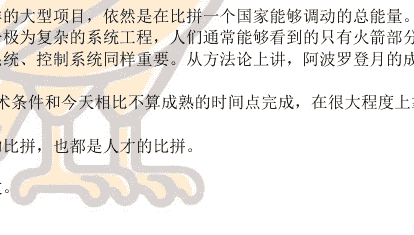

## 52 | 互联网诞生：互联网的本质是什么？

自二战以来，人类历史上再也没有出现像牛顿和爱因斯坦这样全能型、创造奇迹的科学家，但是科学和技术进步的速度都远超以前。我在构思这门课的大纲时就发现，课程一开始的内容是以十万年为颗粒度展开的，然后就是以千年的最高成就为中心展开的，接下来是世纪也就百年，等到进入了 20 世纪之后，就是以 10 年为单位了。科技进步的速度是越来越快，这就是我在课程开篇告诉你的，科技的正循环一旦开启，就是一个不断放大的过程，人类获得的收益也是不断叠加的。

二战后的科技成就非常多，即使是挑那些最要讲，也很可能讲不完。因此接下来的内容，我们重点讲解着重科技进步的线索，这样大家能够更好地理解当前技术革命的主线，把握住以后的趋势。

对 21 世纪以及未来产生最大影响的发明，恐怕就是互联网了。互联网你再熟悉不过了，但如果问你，互联网的本质是什么？恐怕一千个人会给出一个千个答案，有人可能会想到网络连接，愿意往更基础的层次思考的人，会想到通信。这里我给出一个最为根本的理解，那就是：以信息换能量。

这一讲，我就从互联网的诞生和对当下影响最大的电商产业，一头一尾来分析一下信息换能量的本质，希望可以帮助你构建领地把捉住当今的科技趋势。

互联网的诞生其实就是人们通过信息节省能量的结果。为什么这么说？这就要回到上个世纪 60 年代，看看最初人们倡导建设它的目的了。

1962 年，美国国防部高级研究计划署（简称 ARPA）的一位负责人利克里德（J. C. R. Licklider）决定在学术界搞一项便民措施，他没有想到这个便民措施后来变成了改变世界的互联网。

这个网络被称为“阿帕网”（ARPANET），就是高级研究计划署的缩写和网络这个词放在一起的合成词，这就是互联网的前身。因此，从互联网的诞生来看，它的目的很明确，就是用信息手段节省能量。

转眼到了上个世纪 80 年代，美国国家科学基金会（National Science Foundation，简称 NSF）在阿帕网原有基础上进行大规模的扩充，形成了 NSFNET，这就形成了大规模广泛连接的互联网。

美国国家科学基金会的性质和我国的同名称组织差不多，是完全没有军事背景，支持基础研究的政府基金部门。它建立这个网络的直接目的是为了方便研究人员（主要在大学里）开展学术交流活动和东西部合作。

在此之前，大家进行学术交流和远程合作，依然要靠出差。由于是为了科研，美国国家科学基金会提供了网络运营的费用，让大学教授和学生们免费使用，这个免费的决定定下了今天互联网免费的传统。

至于为什么自然科学基金会愿意掏钱让学校里的人免费使用，其实如果单从经济账，它并不亏，因为大学的科研经费很大一部分来自于它，与其让教授和学生们把经费中很大一部分用于差旅，还不如一劳永逸地建设网络，因此自然科学基金会其实也是在做信息换能量的事情。

到了 20 世纪 80 年代末，一些公司看到了互联网带来的便利，也希望接入互联网，当然自然科学基金会没有义务为它们买单，于是出现了商业的互联网服务提供商。不过，由于互联网最初的规定不允许在上面从事商业活动，比如做广告卖东西，因此这又导致互联网的发展并不快。

互联网从上个世纪 90 年代开始快速发展，得益于美国政府退出对互联网的管理。1990 年，美国国防部高级研究计划署首先退出了对互联网的管理，五年后自然科学基金会也退出了。从这时起，整个互联网适逢开始商业化，大量资金的涌入，使得互联网开始爆炸式增长。

互联网的发展说明，政府需要在技术发展的初期阶段，出资扶植那些一時难以产生的新技术，而当技术成熟，可以靠市场机制发展时，政府就不再应该继续扶持了。

为了方便双方每天及时汇报实验结果，经科学家们建议，有关部门特别批准，高能物理研究所正式开通了一条64KB/s的专线，直接美国斯坦福大学直线加速器中心（SLAC），这样中国就和互联网开始联系起来。

1994年初，高能物理研究所允许该研究所之外的少数知识分子在审批合格之后使用该网络，于是中国社会就第一次接触了互联网。

当时的我的同事、清华校园网的负责人李星教授得知这个消息，就在第一时间告诉了我。我当然资质不够，就用我父亲的资质申请了一个互联网账号，成为了中国第一批网民。

当时给我的注册邮箱依然是斯坦福直线加速器中心的，因此很多人好奇怪为什么我的邮件都是从斯坦福发出的。而当时的网速是每秒钟1.2KB（150字节），因此查看一封邮件需要先花大约十分钟下载到本地再慢慢看。但是，即便这样，也比和国外同行通过信件进行学术交流方便了很多。

1998年，我在约翰·霍普金斯大学获得硕士学位，毕业典礼的主讲嘉宾是联邦快递的总裁，他回顾了1968年史密斯（Frederick W. Smith）想要创立该公司（公司直到1971年才成立）的初衷——24小时内将任何文件送抵世界每一个角落。

当时波音707已经能完成横跨太平洋的飞行，因此当时他们觉得利用飞机传递信息是最有效的。而30年后，互联网做了同样的事情，不到一秒钟，这就是信息换能量带来的便利。

互联网的后续发展大家都很熟悉，我就不多讲了，我们只讨论一下，在互联网技术的帮助下，产生了诸多对我们今天生活影响巨大的新产业，比如发展最为迅速的电商，电商为什么发展迅速？这从本质上来说，也是信息换能量的结果。

大家买东西有两个办法：第一个是到商店里去买，这要消耗能量，当然也要花费时间精力，第二个是网购，这样从自身来讲消耗的能量和精力要少很多。从商家来讲，信息推广的成本要低很多，因此即使给你送货上门，在经济上也是合算的。最后综合算下来，由于统一配送还节省了很多能源。

有了互联网后，世界就诞生了一大批宅男宅女。虽然这种人过去也有，但是数量远远无法和今天相比，为什么会产生这样的结果呢？我们有很多这样生活习惯的人，他们给我的答案中的一致之处是，因为足不出户可以全知天下事，而且可以和网上的朋友沟通，并不孤独，因此“懒得”出门。

这从本质上，是通过信息节省了能量。坦率地讲，人多少都有点懒癌，懒得努力或许根于我们的基因。

## 要点总结

+   1. 我们通过用信息换能量，讲述了互联网的本质，分析了为什么电商受到了广泛的欢迎。
2. 互联网的诞生，最初始于计算资源的缺乏，使得大家不得不集中使用少量的超级计算中心的资源。因此，互联网其实是源于遇到困难解决困难的做法方法。
3. 从今天的内容我们作一个延伸，为什么在互联网发达后云计算兴起了？因为它提供了一个让个人得以利用大公司巨大计算能力和存储空间的可能性。这和当年远在美国各个大学和研究机构的科学家们得以利用超级计算中心的资源是如出一辙的。
4. 商业化对技术推广的作用，很多技术，在它被完全无法盈利时，要靠政府扶持，但是一旦可以盈利之后，政府就应该退出，让市场机制发挥作用。美国政府对科研经费的发放有一个明确的原则，就是不和企业界竞争，只支持那些短期无法见效的科研。

## 思考题

如果 10000 年后我们发现在距离地球 1000 光年的地方有另一个和地球一样宜居的星球，人类移居到那个星球最便捷的方式是什么？

## 53 | 移动互联网： 前赴后继的移动通信之路

上一讲我从互联网的诞生为你分析了互联网的本质，那就是互联网发展的第一阶段。这一讲，我会通过发明的预先要求和自然结果，讲述互联网发展的第二个阶段——移动互联网。也就是说基于移动通信的互联网，从设备上来说就是手机互联网，你可能会说，不就是在“互联网”前面加上了“移动”两个字吗？

但是要实现“移动互联网”，是需要满足四个预先要求的：

+   1. 移动通信技术
2. 低功耗半导体技术
3. 互联网技术
4. 操作系统

我们不妨对它们一一分析一下。

## 先看移动通信技术是如何被解决的。

在二战之前，世界上单点对单点的通信大都是有线的，因为有线通信很容易实现，莫尔斯最早的电报也是有线传输的。这时你可能误解了，要想实现“移动通信”，就必须摆脱有线，实现“无线”。

其实无线电技术早已发明出来，但是由于没有技术实现长距离的无线电通信，因此无线电通信只能在固定的基站之间进行，或者从基站向四周进行广播，比如收音机就是这样工作的。这种通信方式虽然是无线，但却还是单向传播，而且传输距离也非常有限。

所以，如果要进行点对点的双向远距离通信，关键在于提高单位功率的信息传输率。我们今天说的移动通信，第一代、第二代即 2G，第三、四代，即 3G、4G，一直5G，从本质上讲，就是提高了单位能量的信息传输率，这和摩尔定律提高单位能量的信息处理能力非常类似。

那么如何提高单位能量的信息传输率呢？第一个历史性的突破可以追溯到二战期间，那主要是出于战争的需求。

当时美国军方已经认识到无线电通信的重要性，因此在战争尚未开始，就研制起便携式无线通信工具来了。要提高无线通信的传输功率，人们很自然地就会把设备做得又大又重，再加上长长的天线，最初的无线电设备都是如此。

美军研制出一款报话机(Walki-Talkie)SCR-194，1938 年开始装备，在二战期间广泛使用。当时做汽车收音机起家的摩托罗拉公司有一些工程师参与了这项研究。

他们继续开展研究，1940 年，摩托罗拉接到军方合同，开始研制报话机 SCR-300，它既是一个无线电接收机，也是发射机，可以进行双向通信，这让战场上的指挥和通讯变得实时有效了。

1942年春，SCR-300最终通过了用户验收。从下面的图片可以看出，它又大又重，根本无法民用。

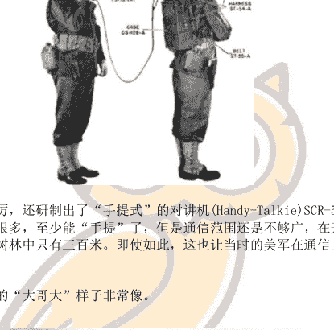

摩托罗拉公司再接再厉，还研制出了“手提式”的对讲机(Handy-Talkie)SCR-536，这比报话机SCR-300已经小了很多，至少能“手提”了，但是通信范围还是不够广，在开阔地带通信范围是一公里半，在树林中只有三百米。即使如此，这也让当时的美军在通信上高出其它军队一大截。

你可以看出它和早期的“大哥大”样子非常像。

到了上个世纪 60 年代，摩托罗拉深度参与了阿波罗登月计划，并且提供了登月所需的通信设备，这时它的移动通信技术遥遥领先于世界。

1967 年在纽约的全球消费电子展上（也就是今天拉斯维加斯的 CES 展）上，它展出了民用的移动通信设备，但是当时的价格和性能其实还达到实用的水平。

到了 20 世纪 80 年代，移动电话才真正开始民用。当然，要接入已有的电话网络，并且能够拨打任何号码，就不可能像对讲机那样只考虑点对点的通信，而需要建立很多基站，让无线信号能够覆盖人们生活的区域，实现多点对多点的无线通信。

工程师们从数学上很容易推算出来，把无线通信的网络修建得像蜂窝那样呈六角形分布，相互重叠，是最经济有效的。因此，民用的移动通信又被称为蜂窝式移动通信，今天我们说的“手机 cellphone”，就是“蜂窝 cellular”和“电话 telephone”两个词的组合。

移动电话刚出来时，在这个领域，民用通信之争集中在 AT&T 公司和摩托罗拉之间，AT&T 公司的主营业务是固定电话，因此它认为家庭内的无绳电话是未来发展的方向，而以移动通信见长的摩托罗拉则看准了移动电话。

当时 AT&T 认为，即便发展 20 年，到 2000 年，全球使用移动电话的人数也不会超过一百万，结果它少估计了一百倍。这样，AT&T 就将全球第一代移动电话的主导权拱手让给了摩托罗拉。

不过，摩托罗拉的辉煌没有持续太久，因为很快第二代移动电话（又称为 2G）开始起步了。

第二代移动电话一方面采用了新的通信标准，另一方面将很多过去通用的芯片重新设计，做成一个专集集成电路，使得手机的体积和功率都大大降低，这都得益于半导体技术的发展，也就实现了移动互联网的第二个预先要求。

好，我先说说的通信标准为什么让摩托罗拉失败，这也是美国在第二代移动通信标准上最终没有竞争得过欧洲的原因。

当时欧洲为了和美国竞争，运营商和设备制造商最终达成了一致，形成了一个统一的 2G 移动通信标准 GSM，而美国一个国家却隔出了三个标准。因此，欧洲的诺基亚就成为了 2G 通信最大的赢家，它一度占据近一半的全球手机市场。

从这里也可以看出在通信领域标准的重要性。这也是今天美国和西方很多国家联起来围剿华为的动机。

虽然通信标准基本是统一或者彼此兼容了，但是由于当时的半导体技术做不出功率比 PC 机处理器小一个数量级，而功能相当的处理器，因此不可能在手机上完成过去由 PC 机才能完成的任务。

随着半导体工艺制程的提升，移动处理器性能越来越强大，越来越支持多媒体，因此也就逐步替代了很多 PC 的使用场景，这才为迈向移动互联网提供了硬件基础。

但是半导体技术的成熟，造成的结果却是摩托罗拉连在硬件上的先发优势也丢了。从能耗上讲，第二代移动通信电话比第一代降低了一个数量级，而通信的速率却提高了半个到一个数量级。你可以将它们理解成单位能量传输的信息量增加了 50 倍 100 倍。

2G 的普及给诺基亚和三星这样进入行业的公司机会，得以后来居上，而固守原有技术和市场的摩托罗拉则开始落伍了。

然而，随着 3G 时代的到来，在 2G 时代辉煌一时的诺基亚，其发展也戛然而止了。因为 2007 年，苹果的 iPhone 诞生了，第二年，数量更多、更便宜的各种安卓手机出现了。

作为计算机公司的苹果和 Google，进入移动通信市场后，与其说是做了一部功能更强的移动电话给用户，不如说是提供了一台微型计算机。

更关键的是，3G 是以互联网和云计算为核心的新时代，接入互联网的高性能手机真正实现了 “移动互联网”，所以互联网技术是第三个预先要求。

在此之前，手机作为通信工具在 2G 的时代已经开始普及，但，那时的移动通信和互联网没什么关系，人们只是用手机打电话、发短信而已，要想实现用手机上网，完成多媒体数据的传输，就需要传统通信业和 IT 产业的结合，最终它们形成一个巨大的移动互联网产业，当然，这都是在 3G 之后的事情。

很多人觉得 2G 时代网速不够，无法形成移动互联网，事实并非如此。实际上在 2000 年之前高通公司基于 CDMA 的标准就是足以让无线上网的速度达到了除了看视频之外全部移动互联网的要求。

世界上绝大多数移动运营商并没有采用这种标准，是因为当时不可能有移动互联网的应用需求，超前提高无线网速率完全是浪费。也就是说，是人们在实现了通信基本需求之后，才产生了对移动互联网更多元的需求。

移动互联网的第四个预先要求是通用的操作系统，这件事在 2008 年前后已经完成了。

虽然在一开始有五种操作系统，除了今天的安卓和 iOS，还有诺基亚的塞班、微软的视窗、和黑莓自己的系统，彼此各不兼容，但是随着安卓一统天下，这个问题也就解决了。如果有五个操作系统，那么 App 的开发者开发的成本极高，移动互联网是发展不起来的。

在上面四个条件具备之后，移动互联网的便利性使得它以比传统互联网更快的速度发展，并且在用户规模上超过了传统的互联网。这时，手机的语音通话功能反而变得不重要，重要的是无线上网。

到了接下来的 4G 时代，通过移动设备上网的通信量（总的数据量）甚至超过了同时期通过 PC 上网的通信量。

2007 年当苹果推出智能手机时，全世界互联网上信息传播的速率是每秒钟 2TB，而到了 2016 年，增长到 27TB（数据来源：思科公司年度网络指数报告），这里面大部分增量都是移动互联网贡献的。

科技史纲 60 讲

而这个变化，也撬起了全球巨大的电信市场。2016 年，全世界互联网的产值（包括 Google、Facebook、亚马逊、中国的 BAT 等公司）是 3800 亿美元，而电信市场（包括移动设备、电信设备，以及运营商收入）的产值高达 3.5 万亿美元。

那么移动互联网的本质是什么？从某种角度上讲也是信息换能量，而且是以一种更有效的方式。

高效在哪里呢？移动互联网比互联网可以帮助我们少做很多无用功，比如你想在网上订一辆出租车，却无法定位，你只好走到一个双方都熟知的地点等待，这就要耗费能量。现在有了移动互联网，你就可以随时随地叫车了。

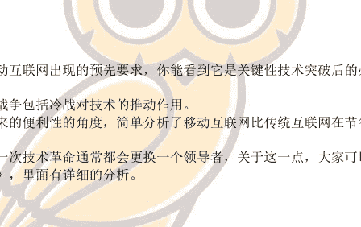

## 要点总结

+   1. 我们分析了移动互联网出现的预先要求，你能看到它是关键性技术突破后的必然结果。
2. 我们再次看到战争包括冷战对技术的推动作用。
3. 我们从信息带来的便利性的角度，简单分析了移动互联网比传统互联网在节省能量方面的优势。
4. 我们展示出每一次技术革命通常都会更换一个领导者，关于这一点，大家可以参考拙作《浪潮之巅》，里面有详细的分析。

## 思考题

今天留给大家的作业就是进一步找出一些移动互联网起步必需的基本技术，完善移动互联网发展的技术依赖图。除了上面我提到的技术，我再给大家几个提示，锂电池技术、射频技术、Wi-Fi 技术、触屏技术等等。

## 54 | IoT：万物互联到底是什么意思？

我在前面谈到了使用 PC 机的互联网和移动互联网的发展，它们可以被看成第一代和第二代的互联网。那么如果要问接下来的互联网是什么，那就是万物互联，即 IoT。一些媒体把它翻译成“物联网”，这个翻译其实不准确，因为它不只是物和物的联网，而是所有东西的联网。

万物互联和前两代互联网有什么差别呢？我们还是从联网对象的本质着手分析。

第一代互联网从本质上讲是计算机和计算机的联网。

从一开始，它就是远程终端和超级计算中心大型机之间的联网，后来演化成个人电脑通过服务器彼此相连。每一个使用互联网的人，身价只有通过账号加上 IP 地址来确认，或者说人是通过互联网间接相连的。

20 年前，你上班登录邮箱查看邮件，或者登录 QQ 聊天。下班离开了计算机，开车回家或者坐地铁回家，就离开了互联网。直到你吃完晚饭，做完家务事，再坐回到计算机旁边，才算是回到互联网上。

第二代互联网的本质是人和人的相连。

虽然从形式上讲，联网的设备由过去的 PC 变成了智能手机，但是，每个要找的不是对方某个手机，而是要找对方那个人。当你见到一个新的朋友，提出要扫一下微信二维码时，不是为了让你的手机能够延续上对方那台手机，而是要随时找那个人。

这样除了带来便利性，还带来两个结果。其一是网络上的人和真实的人基本上是一致的，而不至于像在 PC 互联网时代，QQ 背后的人很多都是虚假的。这种一致性使得移动支付成为了可能，因此这种支付方式必须确认真实身份，而移动互联网绑定的都是真实的人。

类似地，特斯拉汽车里面有几百个传感器监控汽车运行的情况，并进行行车记录，包括司机有没有好好扶把，是不是在打手机等细节。特斯拉汽车一旦出现问题，厂家可以马上定位问题的原因，而不需要像其他汽车维修中心那样先花一两个小时找原因，甚至半天找不到原因。

从上面三个例子可以看出，万物互联远不是简单地用某个智能设备控制一下家里智能家电，或者通过手环等可穿戴式设备把心跳、睡眠情况等信息输入到手机中那么简单，甚至要超出带有机器学习功能的智能空调、智能照明等 IoT 的应用。它具有全时段跟踪每一个细节的特点，因此会导致跟踪经济的产生。

关于跟踪经济，大家可以参考《看见》一书。目前为止，万物互联对人身状况的监控、跟踪才刚刚开始。2012 年，Google 推出一款能够监控血糖的隐形眼镜，其实就是对人身体的简单监控。今天的心脏起搏器，也一直在监控人心跳的搏动以及导致搏动变化的身体变化。

但是，到目前为止，这些都是针对少数特定人群的，对于大部分人，我们身体中没有任何监控，以至于身体出现异常，比如疾病，我们有时很难诊断。

今天，我们一方面对汽车、飞机、甚至家电有深入到细节的监控和跟踪，以便及时发现问题和修理，但是对我们自身的新陈代谢却没有，以至于对生病的“先兆”并不敏感，许多人得了癌症，等发现的时候往往已经晚期了。

万物互联在很大程度上要解决的就是这个问题。我在《硅谷来信》中介绍过从事早期癌症检测的 Grail 公司所做的事情，就是通过测量血液中的基因，监控身体内是否有癌症病变。这其实也是万物互联的一部分——通过某种技术方式，将我们的身体连接到监控系统中。

那么，万物互联什么时候能够像今天移动互联网一样普及呢？我们还是从预先要求开始入手分析。今天，移动通信的技术和网速对它来说都不是问题。今天的 5G 完全可以解决万物互联的通信问题。但是接下来有三个瓶颈问题需要解决。

首先是能耗足够低的处理器。今天的手机比 PC 的单位能耗性能提升了一个数量级左右，如果按照这个要求设计 IoT 的芯片，需要把能耗降低十倍左右。

目前比较流行的方法有两个，一个是设法降低芯片的工作电压，比如如果能从现在手机的 3V（伏）降低到 1V。就能节省 90%左右的电量。另一个方法是使用更专用的芯片取代目前较为通用的芯片。在这两方面，现在都有不错的进展。但是这只是必要条件之一。

其次是需要有一个合适的操作系统，将这么多设备管理好，这个目前还没有。

第三则是要有合适的商业模式，目前也没有找到。没有从商业上获得利润谁就投入这个产业，它就很难快速发展。

由于现在很多条件还不具备，因此万物互联的时代不会一天到来。

如果万物互联真的来了，将是下一个微软或者 Google、英特尔或者 ARM 公司吗？目前还看不出苗头，不过从目前的技术准备来看，华为在通信标准和设备上有一定的优势。而在处理器方面，反而是开发安卓系统的 Google 准备得最充分。

在控制了移动互联网的操作系统之后，Google 就在布局 IoT。它请来了 RISC 系统结构（今天手机使用的 ARM 芯片，用的就是 RISC 系统结构，关于它，大家可以阅读《Google 方法论》的发明人、著名的计算机科学家帕特森（David Patterson），负责了开源（芯片）设计项目（Open Source Design）。

它相当于开源版的 ARM，在此基础上，各家厂家可以设计自己的专用芯片。帕特森讲，现在谁加入到新一代芯片的设计上，谁就有可能获得图灵奖。目前已经有很多小的芯片设计公司在 Google 开源设计的基础上，在开发 IoT 的芯片。

## 要点总结

+   1. 互联网经历了两代，现在正在开启第三代，也就是万物互联。
2. 每一代互联网比上一代，从设备的数量和市场的规模，都会有巨大的增长，这是未来机会所在。
3. 每一代互联网都有掌握产业链的龙头公司，从 PC 时代的英特尔和微软，到今天的 ARM 和 Google，以及未来掌握核心芯片和操作系统的公司。
4. 从能量的角度讲，每一代互联网都是以更少的能量传输和处理更多的信息，这一点是未来发展的方向。

对于这样的问题，我们可以拭目以待。

## 55 | 大复盘：用科学方法论指导我们的行动

我们科技史的课程，关于历史的部分已经结束了。在讲述对未来科技发展的展望之前，我们先对前面几个单元的内容作一个复盘。

首先，我们在科学史中强调了科学是一种对世界的态度，是理解世界的观点，和日常做事的方法，而不代表正确，也不局限于某些特定的知识和结论。

科学是一种求真的过程，但它不等于真。科学的常识、科学的结论，都会随着时间的推移和科技的进步成为过时的东西，因此没有什么是放之四海而皆准的真理，真理都是有局限性的，它们是在一定范围内解决我们的困惑、我们的问题。科学的结论总会过时，成为过去，但是信念永存，方法永存。

那么什么是科学的方法呢？或者说在日常工作中如何主动采用科学的态度、科学的方法做事情呢？

我不妨给你举一个最简单的例子。比如你学习打篮球，有两个教练，第一个教练先教你对大部分人都适用的投篮要领，然后观察你的投篮，根据你姿势中一些不好的动作，告诉你一套可以遵从的方式。

比如提高出手的角度，端正投篮前手扶球的位置，增加腰弯的深度等等，修正你的动作，最后逐渐提高投篮的准确率。虽然不能保证 100% 进球，但是知道按照要求来做，10 个总能进 7、8 个，悟性差一点，也能进 5、6 个。

第二个教练教你一个所谓的最准的投篮绝招，手这么一勾就进去了，你学习这个动作，总时长不到家，他会说，勾太多头了，或者勾得不到位。最后你能投中全凭运气，投进了他会说你手感不错，投不进去他会说你悟性差。当然，你还从他身上学到一些迷信的动作，比如投篮前用左手摸两下屁股。

这两个教练当然都没有在搞科学研究，但是无意中，第一个人做事是遵循了科学方法的，另外一个还是在蛮直觉和迷信。遵循科学方法，不等于每次都能够投进球，但是你上一次用某个姿势，做某些动作，控制最大的力量和角度投进去了，这次这么做，也能再次成功。

不遵循科学方法，上次摸了两下屁股投进去了，这次就难说了。采用不同的态度做事情，就会导致不同的结果，每次在结果上微小的差别，久而久之的积累，就 会产生本质的差别。

我们在课程中介绍了，逻辑对科学发展的重要性，从事实出发，讲求逻辑，得到合理的结论，这就是我们应该遵从的做事方法。

有一次吃饭，一个巨无霸上市公司的女老板挑战我说道，我做事就不讲逻辑，只讲原则，讲奉献，讲忠诚，二十多年前接手企业至今，销售额增加了近百倍。

我说，你的成功不可复制，不信你问周围的人谁可以按你的班。人成功一次并不难，就如同投篮进去一样，闭着眼睛一勾手，或许也能进球。但是难的是获得可重复性的成功。

世界发展到近代以前也有伟大的科学成就和了不起的发明出现。但那些具有很大的偶然性，一次成功之后，下一次不知道什么时候才能够再来。

但是到了近代之后，情况就不同了，各种科学成就不断涌现，各种发明接踵而至，这是因为有了一整套的科学研究方法，而科学家们自觉地使用这种方法论。到了工业革命之后，发明家们也自觉地用理论指导发明。

关于这一点，大家可以回顾课程的《第27讲：为什么瓦特？》、《第31讲：能量守恒定律：为什么是焦耳？》和《第32讲：发电电的本质》。

这是在我课程结束前要强调的第一点。

其次，我想告诉你的第二点，是关于当下和未来的一個重要趋势：世界进入近代以来，能量增加的速率在放缓，信息增加的速率在放大。

能量增加放缓的原因，并非人类没有能力产生更多的能量，而是不需要，在人类还不能控制核聚变、不能低成本地获取可再生能源之前，那些便于使用、但是污染和温室效应严重的能量要省着用。

与此同时，信息在科技和经济中权重增加则是毋庸置疑的事实。这里面根本的原因在于在进入到信息社会之后，人类有能力通过计算机处理更多信息，用磁媒介和半导体存储更多信息，用光纤更快地传递信息。

在过去的半个多世纪里，人类处理和存储信息的能力每18个月翻一番，这是摩尔定律。在这半个多世纪里，经济增长的主要动力都来自于此，如果我们将摩尔定律对各行各业的改进所带来的GDP扣除，世界的GDP不是增长而是倒退。

在未来的十几年里，尽管半导体集成电路的集成度（密度）不会再像过去那样迅猛增加，但是，芯片处理信息的能力还会快速增加。

同时，今天全世界每三年数据总量就将翻一番，也就是说，近三年里产生的数据总量，超过了三年前到有文字记载以来数据量的总和，因此信息在科技和经济中的地位还将进一步增加。而我们无论从事什么行业，想获得进步都需要用好信息。

我们在课程中还从信息和能量结合的角度，分析了摩尔定律的本质，即单位耗能处理信息能力的增加，这其实是在过去的几十年里，IT 行业缓慢进步最核心的主线。没有这个方向的进步，今天即使把全世界的能源都用上，也不能支持 AlphaGo 和李世石下棋的用电量。这条主线，给行业的从业者指明了一生应该努力的方向。

但是一个现实问题是：为什么同样是从事 IT 行业的人，有的人十多年甚至更长的时间，都能做得顺风顺水、有的人天天忙活，却如同无头苍蝇乱撞，或者像是在森林里走路转一圈又回到原点，他们之间的区别在哪里呢？

## 第三，我希望通过这些课程，能够让我们更全面客观地看待一些事情。

IT 行业中从事软件工作的，要把握好最关键的一条主线，就是安迪-比尔定律。据软件开发的，一定要注意通过提供给用户更多的功能，将硬件提升的性能抵消掉，否则大家就不会买新的硬件了，也就不会再装新的软件了，大家就都吃不到饭了。我在《见识》一书中讲，商业的本质是让大家多花钱，而不是省钱，也是同样的道理。

同样，在其它行业的发展中也有这样的主线，把握主线的能力是最根本的生存之道。

我们在课程中多次讲了战争对科技进步的帮助。我们都知道战争不是什么好东西，但是因为战争涉及到生死存亡，参战的一方或双方才能把能量集中到一点，实现很多技术临门一脚的突破。我们在课程中举了很多例子，从原子能到计算机，从青霉素到航天，都是如此。

通过这些事情，我们能得到什么启发呢？当然不是去发动战争，而是在做事情的时候，要把能量集中到一点上，形成局部很高的能量密度，实现突破。我经常讲做减法，少做事，就是这个道理。

## 最后，我们在课程中讲了进入 20 世纪后，人类对不确定性这些事情的认识。

我们从物理学危机开始讲起，讲述了爱因斯坦和玻尔等人对超出我们生活经验的世界 的认识过程，特别阐述了不确定性是世界固有的本质，以及对于不确定性这件事，人类接受的过程。

在二战后，出现了所谓的“三论”，即控制论、信息论和系统论，它们是新时代的科学基础和方法论。我们今天所说的大数据思维、互联网思维，不仅只是炒作概念，而是有科学基础的。在新的时代，需要掌握新的方法论。

虽然在历史上人类曾经不断追求可预测性和确定性，虽然我们都喜欢确定性而不喜欢不确定性，但是面对真实的、充满不确定性的世界，我们需要积极地应对。新时代的方法论，就给了我们行动指南。

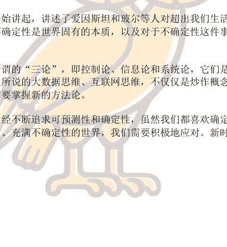

## 56 | 为什么不存在治疗癌症的万灵药？

从这一讲开始，我们来谈谈未来科技。当然，未来是建立在今天基础之上的，因此未来的重大科技发现和发明在今天我们都能够看到一些端倪。而且，最重要的是，我们能找到一些尺度来衡量那些科技未来的发展方向，而不是天马行空地想象。

所以接下来几讲，我会通过拆解相关科技发明，给出一些规律总结，这样，即使课程结束了，大家也能够获得判定未来科技大势的思维方式。

## 首先说说判定未来科技发展方向的几个标准。

前两个标准就是我们这门课使用的两条主线——能量和信息。几年前，马斯克有一次在Google谈他那些看似业务交集不大的企业内在的联系，以及他选择研发课题的考虑。

他讲，今时其实最有意义的科技应该在信息产业，但是那个产业实在太挤了，因此他退而求其次，关注和能源相关的产业。

他搞的电动车、太阳能发电、可重复使用的航天器，以及投了很少资金参与的超级高铁Hyperloop，都可以用新能源将它们串联起来。因此，在信息和能量上去寻求突破，将是未来科技的方向。

第三个标准就是：是否有经济价值。可能有人会觉得，面向未来的科技就应该强调先进性、超前性，不应考虑经济价值。其实，越是这种所谓先进的、超前的研究，周期越长、投入越大。如果没有经济价值，不会有任何人持续投入资金进行研究的，有了这几个标准，我们就容易看清一些未来科技的发展动态了。

## 我要讲的第一个未来科技是癌症的治疗技术。

当然对于不同的细菌，不同的抗生素效果不同，比如治愈肺结核就要用到链霉素。但是癌症不同，癌细胞不是外来的，而是我们自己细胞基因突变的结果。

今天我们所知道的能够导致癌症的基因突变大约有 5000 种，对应于 100 多种肿瘤。因此，同一 种癌症，不同患者的成因可能是不相同的。反过来，同一一种基因变化，在不同的患者身上原 发肿瘤的位置可能不一样。

斯坦福医学院的一位教授给我们打了一个比喻，同一种植物在不同土壤里会结出不同的 果。这和结核病都是由结核杆菌引起的是不一样的。由于这个原因，一种抗癌药，可能对某 些病人特别灵验，但是对另一些病人就不了，因为在他们看似相同的癌症背后，成因是不 同的。

如果你回顾一下我们前面关于确定性和不确定性的描述，抗生素杀死细菌是确定性的事情， 这时用机械时代的思维就能解决问题了。但是癌症的治疗是带有不确定性的问题，需要采用 信息时代的思维。

人类对于癌症的这个认识，也是最近的几十年才有的。实际上，生物学家和医生们已经不再 试图找到一种万灵药了，因为甚至对哪一种特定的癌症，这种努力也是白费劲。

那么，今天研制抗癌药的医学家和生物学家是怎样做的呢？由于癌细胞的基因和正常细胞略 有不同，他们研制出专门能够杀死带有变异基因的细胞的药物，这是今天生物制药的基础。但 是，癌症还有一个更可怕的地方，那就是癌细胞本身的基因也会变化。

这个道理也很好理解，既然癌细胞是在复制的时候基因出了错，就有可能有第二次、第三次 出错，因此，对一个患者，即便一开始为他找到了一种有效的抗癌药，但是如果癌细胞基因 再发生突变，曾经管用的药物会变得不管用。

今天我们经常会听到这样的故事，有的人得了癌症后，一直控制得很好，病情稳定，一些人 甚至看上去已经痊愈了，但是总有一天，他的病复发了，然后病情就无法控制，很快就过 世了。这其实是因为癌细胞本身变化所造成的。

2018 年去世的微软共同创始人保罗·艾伦，就是这种情况。他患癌已经 30 多年了，癌细胞 一直被控制得很好，但是去年突然复发，很快就去世了。

听到这里，你可能会问，既然保罗·艾伦的病已经找到了原因和治疗方法，为什么不用大剂量 的药物将癌细胞都杀死？过去有的医生会这么做，但是今天不会，因为那样癌细胞还没 杀光，人倒先给杀死了。

今天所有的抗癌药物毒性都很大，对免疫系统的伤害极大，很多癌症患者最后是因为免疫系统 太弱，被一些原本不是很致命的感染要了命。比如李光耀在得了几十年癌症后没有事情，最 后被肺部感染要了命。因此今天的医生都是要尽可能地少用药，还要用得精准。

那么怎么才能解决细胞基因的第二、第三次变化呢？这就要说到信息时代的方法论、轻预测、重反馈了。今天无人能预测人体内基因可能的突变，只能在它发生后迅速采用有效的治疗措施，这是今天全世界对治疗癌症的共识。

基因泰克前 CEO，今天 Alphabet 旗下的 Calico 公司的 CEO 李文森博士说，如果能有一个团队专门为这个患者根据他特定的基因研制一款新药，那么是可以维持他的生命的。但是这样做的成本今天高达 10 亿美元以上。

你今天会听到一些名人得癌症之后还能活几十年，那是因为他们的身体随时得到监控，万一有点什么情况就马上使用新的药物和治疗方案，但是普通老百姓显然没有那么多的医疗资源，因此做不到。

那么有没有办法解决成本的问题呢？如果仅仅靠增加医疗资源，加大研发投入，肯定是不行的，这是一条死路，需要换一个思路来考虑这个问题。

2013 年成立的大数据医疗公司 Calico，其实目的就是采用信息技术来解决与衰老有关的疾病问题。

按照李文森的想法，目前在人和动物身上发现的可能导致肿瘤的基因错误只有几千种，所有的癌症不过上百种，即使考虑到导致癌变的基因复制错误和各种癌症的全部组合，不过在百百万这个数量级，它对于 IT 领域来说是非常小的，但在医学领域则近乎无穷大。

利用大数据技术，在这上百万种组合中找到各种真正导致癌变的组合，并且对这每一种组合都找到相应的药物（这个工作量又大到必须依靠机器智能），那么对于所有人可能的病变都能治疗。这样算下来，每个患者每换一次药，成本只有 5000 美元，这是完全负担得起的。

李文森给大家描绘了一种在未来治疗癌症的方法：针对不同人、不同的基因病变，只要从药品库中选一种药即可，比如对某一患者，医生给他开了第 1203 号抗癌药品，如果发生新的病变，经过检查确认后，改用 256 号药品……这样并不需要每一次重新研制药品。

虽然开发出这样多种抗癌药的总成本不低，但是如果摊到全世界每一个癌症患者身上不会很高。如此一来，癌症就变成了像感冒式的普通疾病，不再会对生命产生威胁。

当然，治愈癌症除了找到病变的信息对应药物（包括抑制药品和使用药品），另一个关键在于及早发现，癌症筛查就是这个目的。

但是，今天的癌症筛查技术既不准确，成本又高，而且副作用大，因为有放射性，不能经常做。大家可以点击文稿中的超链接，阅读《硅谷来信》的第 292 对贴《个性化医疗不仅是未来的方向，而且是必须的》，其中介绍了关于乳腺癌筛查技术并没有那么精准。因此如果能有低成本，无副作用，还能经常做的筛查办法，就可以在第一时间发现身体的病变了。

2016 年成立的圣杯公司（Grail）就是利用监测血液中 DNA 的变化，及早发现癌症。它的原理简单来说，就是身体一旦出现肿瘤细胞后，代谢掉的细胞（包括被免疫系统杀死的细胞）会进入血液，通过检查血液中异常的 DNA 及早发现疾病。关于圣杯公司技术的细节，大家可回顾《硅谷来信》第 216 封信《有没有更好的办法？》。

当然，从长远来讲，对人类最大的威胁还不是癌症，而是阿尔茨海默症，即老年痴呆，因为得癌症的人在人群中的比例并不算太高，而年龄超过 85 岁的人，有大约一半会得老年痴呆。而且一旦得了，很少能活过 5 年。当初 Google 成立 Calico 公司，目的就是解决和衰老有关的疾病问题，而不限于癌症的治疗。

## 要点总结

- 1. 未来的医疗在思维方式上比过去会有很大的不同，主要是从机械思维进化到信息时代的思维方式，特别注重对变化的反应。
- 2. 未来医疗将是个性化简，因 此对个人身体信息变化的跟踪就十分重要，它从某种程度上讲，是今天信息技术和医学进步的集合。
- 3. 此外，我们还分析了洞察未来科技是否靠谱的三条原则。

## 57 | 基因编辑和修复离我们还有多远？

2018 年年底一则科技新闻引起轩然大波。中国南方科技大学的一位副教授通过基因编辑技术，对一对双胞胎婴儿的胚胎细胞进行了基因改造，从而使婴儿获得可遗传的对部份艾滋病的免疫力。

这件事情不仅在学术界，也在全社会引起了争议。“得到”专栏《生命科学 50 讲》的主理人王立铭教授已经在“得到”上明确表明了他的观点，那些观点代表了学术界比较一致的态度，也就是反对和谨慎。

有兴趣的读者可以回顾一下王教授的那篇文章，写得很好。我本人也基本上同意王教授的意见，因为这种打开潘多拉盒子的事情做起来要慎之又慎。

不过，学术界其实知道，当内森斯、史密斯和阿尔伯发现了能够使用限制性核酸内切酶（也称为“限制酶”），将 DNA 长链切开；当博耶等人利用转基因技术人工合成出胰岛素；当 1983 年孟山都培育出第一株转基因植物；当上个世纪 90 年代中国开始种植转基因植物（棉草）时，编辑人类的事情迟早会发生。

只是，这件事发生得太快，太仓促，以至于这种风险都没有进行评估，各种伦理上的问题都还没有想清楚。

我们知道，人的很多疾病和先天或者后天的基因缺陷有关，那么能否通过编辑甚或改造基因，为人类治疗疾病，甚至优化我们的基因呢？答案是肯定的，但是它的效果可能不会像我们想象的那样神奇，而且未知的风险要比我们想象的大。也正是因为这个原因，学术界才在这个问题上特别谨慎。

今天，大家基本上有两个共识，第一是所谓的“14 天规则”。也就是只能在不满 14 天的胚胎上进行试验，因为超过 14 天那就是一个人了，而不是几个细胞了。

第二，可以改造不能往下遗传的基因，比如某个新生儿因为基因的缺陷先天无法消化蛋白质，可以把他的基因改造好，因为他经改造过的基因不会进入生殖细胞传下去。

南方科技大学的那位副教授通过直接编辑受精卵改造出两个婴儿，就同时违背了上述两个原则。因此不仅中国学术界在调查，美国的学术界也在调查事先可能知道这件事情但没有披露的学者，包括他先前所在单位的同事。

## 科技史纲 60 讲

再具体一点讲，它 的原理来自于，从细菌（和古菌）身上发现的一种免疫系统修复机制。当病毒入侵到细菌体内，并将自己的 DNA 嫁接 到细菌的染色体后，这个系统就会启动，找到病毒的 DNA，不动声色地把它 们从自己的染色体上切除掉。而 Cas9 就是免疫系统用来切掉目标 DNA 的工具——也就是一种酶。

从 2010 年开始，詹姆斯·杜德纳、埃玛纽埃尔·卡彭蒂和美籍华裔科学家张锋各自独立地探索利用 CRISPR-Cas9 进行基因编辑。其中杜德纳和卡彭蒂获得了 2015 年生命科学突破奖，而张锋的工作在 2013 年被《科学》杂志评为当年十大科技突破之首。

同年，张锋等人成立了 Editas 医药公司（Edit as Medicine Inc），这个公司既不销售产品，也不研制药品和治疗方法，只是提供技术服务，居然在 2017 年上市了，而且市值高达 20 亿美元（2017 年底）。这说明全世界对这项技术的未来前景非常看好。

那么有了基因编辑技术，是否就能将人体内复制错的基因修改回来呢？其实人类早在上个世纪 70 年代就有这种想法，虽然当时的基因编辑技术还不是很成熟，但是科学家们还是开始付诸实践了。

当然，最早期的试验是在 fruit 和动物身上进行的，研究了二十年之后，FDA 才批准了临床试验。接下来 10 年（1990—2000 年）是基因治疗研究的第一个黄金时期。全世界陆续有少量的临床试验取得成功。

比如 1993 年美国加州大学洛杉矶分校的科恩（Donald Kohn）教授利用基因修复技术治疗了一起先天没有免疫功能的婴儿。这个小孩因为基因缺陷无法产生免疫系统所需要的一种酶，如果不救治很快就会死亡。

科恩的办法是用一种病毒将一段正常的基因替代掉他干细胞中错误的基因，然后得到正常的干细胞，再将这种干细胞注入回小孩的体内。这个小孩从此就有了免疫力，但是，4 年后他这样通过后天获得的免疫力又消失了，因此需要再来一遍。

了。把对的地方改错了带来的危害，通常要比把错的改对了带来的好处大得多。这是基因编辑的第一个风险。

今天的 CRISPR-Cas9，能够在一定程度上避免上述错误，这主要是因为 CRISPR-Cas9 技术要求匹配 39～42 个核苷酸，在基因中，有那么长的核苷酸序列都相同，这种巧合很难碰到。

这就好比说在上面的英语替换中，如果我们限定要匹配到 10 个字母才允许替换，那我们就可以规定把 “more than” 替换成 “more than”，而不允许简单地在 “then” 和 “than” 之间替换，这样就能避免很多误替换。

但是，CRISPR-Cas9 本身依然有很多问题，比它的成功率还远不到足够实用的阶段，另外切割 DNA 远不如替换字符串那么简单，DNA 的断裂处是要进行修复的，这方面 CRISPR-Cas9 也不完美。

基因修复除了编辑的工具有很多不足之处外，还有第二个大风险，就是目前人类并没有完全搞清楚 DNA 经过 RNA 然后合成蛋白质的机制。绝大多数和基因相关的病变，都是和多个基因错误有关。

我们可以应用标准考试中的选择题来说明它。我们知道有两种选择考试，一种是每题只有一个答案，ABCDE 五个选项，正确的答案必在其中而且是唯一的，这样我们只要找到正确答案的选项，就获得得分了。

但是，还有一种多项选择，ABCDE 中，可能有两个是答案，也可能有三个、四个，只有全部选对，才能得分，如果三个正确答案只找到两个，不仅仅不能得分，可能还会倒扣分。

后一种情况，便是今天基因修复所遇到的问题。绝大多数情况下，仅一种核苷酸的替换并不能解决问题。

## 要点总结

+   1. 基因编辑技术给人类治疗和遗传以及后天基因突变产生的疾病（后者包括心血管疾病、癌症和老年痴呆）带来了希望。
+   2. 今天的基因编辑技术尚在非常早期的阶段，还有非常长的路要走。
+   3. 目前人类对于基因编辑的底线是，不能能够通过遗传下去的基因，以免对人类和自然界带来不确定的变化。但是，从长远来讲，改变人类基因这件事可能拦不住，其结果会有太多的不确定性，不可预知。
+   4. 修复基因是一个非常很有商业前途的事情，因此才有人不断投入资源研究这个技术。但这技术本身也是一个陷阱，因为会有人为了商业目的，去突破底线。

此外，我还想告诉大家。即使将来能够通过基因编辑治疗我们的很多疾病了，我们依然要注意身体。这就好比，我们不能因为今天汽车几乎所有的故障都能够修，开车就不小心，出门总是磕磕碰碰，该做保养、该维修不去做。毕竟那样修修补补出来的汽车不好使。对任何人来说，预防疾病永远比看病更重要，也更有效。

## 58 | 可控核聚变为什么那么难？

2019 年春节期间的贺岁片《流浪地球》火了，它讲诉了太阳在爆炸毁灭前，人类要让地球实现星际航行，飞到 4 光年之外的另一个恒星这样一个故事。影片上映后，很多科学爱好者就开始计算这需要多少能量。

南京大学的周礼勇教授做了一个计算，需要 2.65x10 的 33 次方焦耳的能量，才能推动地球离开太阳系。如果和 2017 年全球的发电量（2.6 万太瓦时，约 10 的 20 次方焦耳）做一个对比，相差 26 万亿倍，也就是说如果按照当下人类所掌握的能量水平完成这件事，需要万亿年的时间，而宇宙的年龄才 138 亿年。

当然科幻重要的是具有想象力，而非物理上的合理性。但是周教授这个估算提醒我们，人类其实利用能量的水平还相当低。这让我们再次想起在课程一开始说的卡尔达肖夫划分宇宙中文明等级的方法，即以掌握不同能量等级为标准。

按照卡尔达肖夫的标准，人类现在连Ⅰ型文明还没有达到呢！有人说目前或许可以算是 0.7～0.8 型的文明水平，那么怎么样算是达到了Ⅰ型文明？至少要能够利用地球上所有的能量，而做到这一点，人类要能控制地球上能够产生的最大的能量，即核聚变。

很多人搞不清核裂变和核聚变的差别，这里我们简单地说一下。

## 所谓核裂变，是铀或者钚这种特别大的原子在一分为二时损失质量，释放能量；而核聚变，是氢或者氦这种极小的原子在合并成大原子时损失质量，释放能量，后者释放的能量要比前者多很多，而且没有核污染。因此，当 1905 年爱因斯坦提出质能方程，即 E=MC2 之后，人们就在想是否有核聚变的可能性。

早期提出核聚变的一大批科学家，包括著名的美籍苏联物理学家乔治·伽莫夫（George Gamow，1904—1968），他是《从一到无穷大》这本书的作者。1928 年，伽莫夫就提出当两个原子核足够接近时，原子核的强作用力可以克服静电力结合到一起。

一年后，英国和德国物理学家根据伽莫夫的这个理论，预见了当两个轻原子核在中高速度下碰撞时，可能会形成一个更重的原子核并且释放出大量的能量。

1933 年英国科学家马克·奥利芬特使用粒子加速器轰击氢的同位素重氢（卢瑟福称之为氘），产生超重氢（氚），成为世界上的第一次核聚变实验。这个时候，人类还没有发现核裂变呢。也就是说，人类对核聚变的研究一点都不比核裂变晚。

不过在第二次世界大战之前，伽莫夫和美籍匈牙利科学家爱德华·泰勒推导出进行核聚变反应所必需的条件，即极高的温度，这在当时根本无法达到，因此核聚变在当时等同于科幻。

在人类制造出原子弹之前，根本无法达到核聚变所必需的高温，因此这项研究一直没有进展。我们在前面学习了科技发展的预先要求这个原则，就很容易理解为什么要造氢弹，必须先造原子弹，因为后者是前者的预先要求。等到原子弹被制出来后不久，泰勒就利用原子弹爆炸形成的高温，实现了核聚变。

1952年第一颗氢弹试爆成功，其原理就是核聚变。人们发现氢弹释放的能量是同样质量的原子弹的几十倍。事实上美国第一颗氢弹所释放的能量是1000万吨TNT，相当于第一颗原子弹的几千倍。

## 从能量利用的角度来讲，核聚变比核裂变实在是有太多的优势。

首先在同等质量下，核聚变所产生的能量比核裂变高出上百倍，这也是为什么氢弹的当量要比原子弹高出上百倍的原因。

其次，核聚变所需的材料氢和氚在海水中大量存在，一升水中的氢和氚如果完全发生核聚变反应，释放的能量等于三百升汽油的能量，这种能量可以说是取之不尽，用之不竭。而用于核裂变的放射性元素在地球上的含量有很限制。

最后，核聚变反应没有放射性，这让人类感觉很安全。目前人类对核电站最大的担心则是万一出现故障而导致的核辐射。

但遗憾的是，氢弹里的核聚变反应是不可控的，释放的能量无法利用。因此，人类虽然在发明氢弹之后就开始研究可控核聚变的技术，但至今六十多年依然没有成功。人类一方面知道地球上最多的能量所在，另一方面却无法利用，确实是一件非常令人遗憾的事情。

人类在可控核聚变的道路上遇到的第一个拦路虎是当参加聚变反应的物质被加热到几百万度的高温后，没有任何容器可以“盛”这么热的物质。任何物质在温度达到上述温度后，既不是固体、液体，也不是气体，那时原子的电子已经和原子核分开了，它们处于等离子状态。

于是英国的物理学家（诺贝尔奖得主）汤姆逊和苏联著名的物理学家塔姆与萨哈罗夫就先后提出一种设想，在环形等离子体中通以巨大的电流，所产生的强大的极向磁场和环向磁场在一起就形成一个虚拟的容器，可以将炽热的等离子体约束在磁场内部。

根据这个原理，物理学家发明了一种称为托卡马克（Tokamak）的可控核聚变装置。Tokamak一词是几个俄文单词，环形（тороидальная）、真空室（камера）、磁（магнитными）和线圈（катушками）四个词的缩写，因为它最初是由前苏联的阿齐莫维奇等人发明的。

托卡马克装置确实可以通过核聚变获得能量，但是它又带来一个问题，那就是维持强大的磁场要消耗大量的能量，因此从产生能量的效率来讲，目前所有的托卡马克装置都是得不偿失的。

物理学家们采用产生能量和消耗能量的比值来衡量托卡马克装置的效率，这个比值在行业里被称为Q值。

很显然，Q值必须大于1才有意义。当然，Q值仅仅大于1还远远不够，因为核聚变产生的热量大部分利用不了，估计只有1/5能够被利用，也就是说，Q值必须大于5，消耗的能量和获得的能量才平衡。

## 科技史纲 60 讲

如果再考虑到热能转换成电能，电能再转换成磁场有损失，国际上公认的能量收支平衡点 Q 值必须做到 10 以上，而要使核聚变发电具有商业竞争力，则 Q 值需要达到 30。

目前中国、日本等很多国家，都报道自己的可控核聚变研究已经做到产生的能量大于消耗的了，很多媒体时不时出来欢呼一下，很多人觉得可控核聚变离我们很近了，其实很多时候科技界也喜欢夸张。

他们常常生产了多少能量，而不说耗费掉的，更不提能量转换效率等等，而且即使是产生能量，也只能维持极短暂的一瞬间，因此不可能实用。而媒体记者不懂科技，做了不少误导自己也误导读者的报道。而读者们一次次被骗，对这类报道已经不相信了。

实际上，科学家们还是在可控核聚变的研究中慢慢往前走，目前大家比较确认的能够持续产生核聚变能量的托卡马克装置是建立在英国的 JET 设备，Q 值为 2/3。而欧洲在法国建设的下一代核聚变研究设备，设计目标是做到 Q=10，这就又往前迈了一大步，但是试验阶段的核聚变和实用相去甚远，乐观的估计还需要 30 到 40 年的时间。

除了使用托卡马克装置，美国人还想另 一种实现可控核聚变的方法，就是采用极强的激光照射非常小的固态氢原子球，让它们发生聚变反应，不过产生极强的激光本身也需要巨大的能量。

2014 年 2 月，美国劳伦斯-利弗莫尔（Lawrence Livermore）国家实验室的科学家们宣布，经过数十年的研究，他们在激光可控核聚变方面取得了重大突破，聚变产生的能量第一次超过了激发聚变所需的能量。

当然这项技术距离实用也还有非常大的距离。比如目前的成本高得难以接受，除了设备造价高昂之外，原材料的成本也很高，就拿固态重氢或者超重氢来讲，因为要绝对真空，一个直径两毫米的靶球的造价就高达近百万元，不过劳伦斯-利弗莫尔实验室的成功至少让人们看到了利用可控核聚变获得能量的希望。

为什么对可控核聚变的研究经历了那么多的挫折，人类依然还在无怨无悔地投入大量的人力和财力进行研究呢？一方面科学界觉得这个方向是正确的，实现它只是早晚的问题。另一方面可控核聚变的经济意义重大，它可以从根本上解决人类的能源消耗问题，而且提供的能量还是清洁的。

欧洲最乐观的估计，到 2050 年，人类可以在能源使用上，做到二氧化碳的零排放，也就是说化石能源完全退出历史舞台。当然我觉得这个目标有点乐观了。要做到那个要求，可控核聚变是必须的。

此外，可控核聚变还标志着人类文明水平将达到一个全新的高度。目前采用化石能量推进的火箭最多把人送到火星或者金星附近的距离，是不可能完成飞出太阳系的使命的。如果人类能够像控制火一样自由地控制核聚变，至少在能量方面可以满足在太阳系内自由地航行。

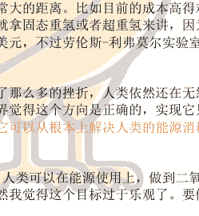

## 59 | 量子通信到底是怎么回事？

这一讲，向大家介绍一项可能改变人类未来信息传输方式的发明——量子通信，这也是中国数量不多的领先于世界的未来技术。

2019 年 1 月 31 日，美国科学促进会（AAAS）宣布，将 2018 年度 法利夫兰奖授予中国科学技术大学潘建伟教授领导的“墨子号”量子通信科研团队，以表彰该团队通过实现千公里级星地双向量子通信实验，对这个领域的研究所做出的贡献。

我先介绍一下这个克利夫兰奖，这个奖可以被看成是美国科学促进会会刊，也就是著名的《科学》杂志的年度奖。

该协会是美国最大的科学协会，它每年会评选一个在过去的一年里刊登在《科学》杂志上最重大的研究成果，然后授予该奖。这个奖设立了 90 多年，中国科学家在本土完成的研究成果获奖还是第一次。

量子通信这些年在研究领域非常热门，其中很重要的一个原因在于大家对信息安全的担心。这一特点符合我们前面几讲所说的标准：经济价值和市场巨大。

虽然信息安全的问题古已有之，但是过去这个问题并不大受到我们的重视。随着信息量的增加，通信的频繁，以及我们对信息依赖程度的增加，我们逐渐意识到问题的严重性。

特别是近年来，不法分子疯狂窃取个人信息，给大家带来了不少麻烦，于是人们对信息安全的需求就感觉到越来越重要，什么信息都希望加密。

今天，其实基于公开密钥的加密方式，基本上满足了大家保密的需求，但是它远非完美。因为当计算机速度足够快时，还是可以被译的。

## 科技史纲 60 讲

量子纠缠这件事本身虽然在实验中被证实了，但是离应用其实还相差很远。而今天所说的量子通信实际上是另一回事，它只是为了便于大家理解，借用了量子纠缠这个概念。

今天所说的量子通信，实际上是一种特殊的激光通信。在这种通信中，首先是要利用光子的一些量子特性（光子就是组成光的粒子），具体讲是偏振的特性，来传递一次加密的密码。那么这件事是怎么完成的呢？我们先从光的偏振这件事说起。

我们知道光其实是一种电磁波，一束光实际上就是一个和传播方向垂直的波，比如光是从东向西前进，光波在前进时，会做上下振动，或者左右振动，总之振动的方向和前进的方向垂直。

如果你用一块有很多小缝隙的板栏住这束光，一旦这个缝隙正好和光波振动的方向一致，那么它就通过了，如果缝隙和光波振动的方向垂直，那么它就被挡住了，这就是光的偏振特性。

你可以从这张图看出，纵向振动的光穿过了光栅，横着的就给挡住了。你可以把这个光栅想象成一面栅栏。

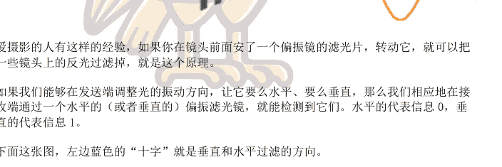

爱摄影的人有这样的经验，如果你在镜头前面安了一个偏振镜的滤光片，转动它，就可以把一些镜头上的反光过滤掉，就是这个原理。

如果我们能够在发送端调整光的振动方向，让它要么水平、要么垂直，那么我们相应地在接收端通过一个水平（或者垂直）的偏振滤光镜，就能检测到它们。水平的代表信息 0，垂直的代表信息 1。

下面这张图，左边蓝色的“十字符”就是垂直和水平过滤的方向。

但是，如果我们把接收端的滤镜倾斜 45 度，也就是如图右边中红色的交叉十字那样 45 度角斜着，会发生什么呢？也就是说，光线的振动方向和最后的光栅（就是那个起过滤作用的栅栏）既不垂直，也不水平，怎么办呢？光还能通过吗？

事实是，光还是能通过的，只不过有的是按照 45 度，有的是按照 135 度通过的，检测出来的信号就很随机。此时，如果我们定义 45 度倾斜的光是 1，135 度倾斜的光是 0，那么斜着的光栅就可以检测出这组信号了。

关键是，作为信号源，量子通信卫星每次发出的光子，都有 0 度和 90 度，或者 45 度和 135 度两组情况，而作为信号接收端，通过光栅，也就是你的滤镜如果摆放和信号源一致的方向，就会接收到正确的信号，或者说接收方得到的信息正确率为 100%。

如果摆放方向不一样，就<|start|>会收到随机的信号，它有一半的情况会得到正确的信息，另一半则猜错了。这样平均算下来，如果接收端不知道发送端发送的光子是按照哪一个角度振动的，接收方只能通过 3/4 的正确信号。也就是说接收端的错误率是 1/4，也就是 25%，这是怎么算的呢？50%×50%=25%。第一个 50%是选错接收光栅方向的概率，第二個 50%是因为结果非 0 即 1，所以是 50%的错误率。

好，这是双方一发一收的正确率，如果接收方接收一次后再按照接收的信息原封不动地发送给第三方，也就是经过两次接收，那么就只有 3/4 × 3/4≈55%左右的信号和原先的一致了。转发次数越多，和原先信息的一致性越差。因此，要是有第三个人，窃听后再发出去，那么错误率就会提升。

利用这个特性，就可以分步骤完成密钥的分发，这个过程也被称为 “量子密钥分发”（quantum key distribution, QKD）。它的原理可能有点难以理解，我用下面这个例子帮你完整地再解释一下。

## 科技史纲 60 讲

我们规定张三要给李四寄一个密码本，李四收到后要根据约束拍一个快照送给张三。但是按照相机的设定是只能保证 3/4 的内容和原来照片的一致，1/4 的内容是错的。如果密码本安全寄到，张三对照一下发现大约有 3/4 的内容和自己发送的一致，就知道密码本没有问题了。

当然，由于错了 1/4，而张三知道是怎么错的，因为他有原文件，因此他可以告诉李四哪些信息是对的，哪些错了，错了就丢弃，留下对的那串字符，这就形成了两个人约定的密码。双方使用这个密码进行一次通信，通信后密码就不再使用了。因此即使将来别人能够破译这个密码，也没有用。

如果张三在寄密码本的过程中中间被王麻子截获了，这时王麻子得到密码本只有 3 / 4 和原来的是一致的。王麻子把截获的只有 3 / 4 正确内容的密码本又发给了李四，李四再照张相，这下子只有大约一半和原来一致了。当李四把他照的相发给张三确认时，张三发现怎么错了那么多，说明中间被截获了。于是他们就中断通信。

当然，张三给李四寄的不是信，而是有携带信息的光子。光子是一个不可再分的基本粒子，一旦接收三次，原来的状态就消失了。因此，偷听者不可能把监听到的内容复制一份发给接收者，这也是为什么必须将这种基于偏振光特性的通信方式建立在（光）量子基础上的原因。

上面这种想法，最初是由本内特（Charles Bennett）和波拉萨德（Gilles Brassard）在 1984 年提出的，因此也被称为“BB84 协议”。“BB”是他们姓氏的首字母。这个协议并不复杂，但是通过光通信把它实现了，并不容易。

光子在空气中游走时，偏振方向很容易受到干扰，所以各国科学家都在努力打造通过卫星来运行的量子密码系统。从 2001 年开始，美国、欧盟、瑞士、日本和中国先后开始了量子通信的研究。通信的距离也从早期的 10 公里左右发展到今天的 1000 多公里。

不过，要想进行长距离高速度的通信，还有很长的路要走。此外，目前这种光通信完全没有考虑传输率，因此它至少还要有 10 年甚至更长的时间。

需要指出的是，即使采用了量子通信，也不能说完全解决了通信中的信息安全问题。

比如，如果通信卫星真的被“掇客”了，或者通信的光纤在半途被破坏了，虽然通信的双方知道有人在偷听，能够中断通信，不丢失保密信息。但是，它并不能保证正常的信息永远能送出去，就好像情报机关虽然抓不到对方的信使，却能把对方困在家里，不让消息发出。

但不管怎样，量子通信还是给加密通信带来了一种新的选择。

还要强调一点，今天所说的量子通信和量子计算在原理上完全不同，虽然很多人都通过量子纠缠这个名词，将它们混为一谈了。

## 要点总结

+   1. 量子通信能够成功，原因在于量子足够小，它不能一分为二，一旦接收，状态就改变了，就不是原来的东西了。
+   2. 你是否看到不确定性在量子通信技术中的应用？量子通信的关键是将一次性的密码（密钥）发给对方，而且能够确保它不被窃窃。
由于每看一次密码，它就会错一些。根据错的比例，发送信息的人就知道是否有人在偷听了。如果每次接收不是错据 1/4，发送方反而不知道接收方得到的是自己的信息，还是监听者复制的信息了。

通过最后这四讲，我希望大家能够掌握一个判定未来科技大势的思维方式。你需要记住最重要的两点：一是要以能量和信息为主要判断一项技术是否有生命力，二是要以市场前景判断它是否会吸引无数人为之努力，是否会有足够的资源被投入到它的研究过程中。

## 60 | 结束语：

## 信息从哪里来，它和能量怎样互换？

这是我们这门课的最后一讲，我先从回答几个读者具有代表性的问题开始，讲述一些关于信息和能量本源的问题。接下来则概括一下我们下一门课的内容。

我在第 51 讲后留了一道思考题：

如果 10000 年后，我们发现债务在距离地球 1000 光年的地方有另一個和地球一样宜居的星球，人类移居到那个星球最便捷的方式是什么？

对于这个问题，同学们都各自开了脑洞，给出了精彩的回答。下面我给出我的思考，它可能和不少读者的想法或者部分想法有一致之处。

经过我们课程的学习，大家可能都明确了这五种概念：

- 1. 能量的量级，包括总量的量级。
- 2. 科技到了近代之后，能量和信息各自发展的速度，后者比前者要快很多。
- 3. 能量和信息的关系：它们在某些场合可以互换。
- 4. 相对论中的质能方程，即 E=mc²。
- 5. 生命的本质是基因的传承。

有了这些准备，我们就来思考上述问题。

首先，让地球漂移到太阳系之外的其它恒星系，从能量的角度讲是很难办到的，更不要说到 1000 光年之外了。因此可行的方法是降低旅行者的质量，按照旅行者自身质量的高低次序往下排序，可以是个人、人类胚胎、人类基因、人类基因信息 等等。

首先明确一点，人如果进行近光速旅行，几乎不会变老。但遗憾的是，人是不可能进行近光速飞行的，要想加速到那个速度，能量的消耗会近乎无穷大。

如果人按照 1/10 的光速运动，这或许可行，但是飞到 1000 光年之外的地方需要 1 万年。这就不会将人类胚胎送去更现实。

人首先活不了 1 万岁，因此即使你今天开始登上宇宙飞船出发，到那里的也是自己不知多少代的子孙。既然到 1000 光年以外地区都是自己的子孙，不如直接送胚胎过去，而 1 万年后，科技早就能发展到机器人可以培育和照顾人类的胚胎长大成人了。

比送胚胎更便捷的方式，就是直接将基因送过去。那时候的人类早就可以通过基因中的 DNA 自主复制出 RNA，再通过 RNA 制造出蛋白质，然后启动新陈代谢。

当然，由于两个人的基因所不同其实只是碱基对的构成次序，即 A、G、C、T 四种核苷酸的排列次序，那么只要记录下这个信息，1 万年后的人类是知道如何利用基本的原子合成 DNA 的。

因此，那时的人类其实不需要把自己送过去，只需要把自己的信息送过去，在 1000 光年以外的地 方 3D 打印 DNA 就可以了，然后就可以复制出来自己。

至于人的意识如何传递过去，相信 1 万年后这个问题可以解决。我们现在就不操心了。

概括一下，未来进行这样星际旅行最好的办法，就是用 1/10 甚至 9/10 的光速将纳米机器人送到几千光年之外的地方，让它们为人类建设“殖民地”，然后将人的信息送去繁殖，而不是肉身送过去。

我举这个例子不仅仅是为了帮助大家回顾课程的内容，还想告诉大家一个思考问题、做事情的方法，就是站在未来的角度回顾今天。

我在《Google 方法论》中讲，马克思做了一大堆事情都是围拢能量这个主题，但是他解决问题的方 式不是大部分人局限于今天的技术、用今天的视角看问题。而是假设如果 20 年后某件事一定会发生，那他就回看，在这 20 年的过程中，需要先具备哪些预先要求。如果在当下还没有具备，他就致力于让那些条件具备起来。

比如我们说 20 年后，人类会在火星殖民，那么这件事情发生的条件就是要有机器人先去修建好殖民地，而后一件事件发生的预先要求就是能够不断地运送机器人和物资到火星。

如果用“土星五号”这样一次性的运载火箭运输物资，虽然在技术上没有问题，但是成本太高，因此必须先研制能够多次重复使用的火箭。这就是马斯克 SpaceX 做的。

同样的道理，1 万年后远行到 1000 光年之外，我们是解决未来的问题，就不要让当下的技术条件限制我们的思维。关于这个问题，最后还要说一句，它没有最好的答案，任何合理的，逻辑上能自洽的答案都是好答案。

在上面这个问题中，我们实际上是利用信息换能量。

那么另一个问题就来了，是“束字同学”提出的。他问：吴老师好。您的两季课程我都听了，《科技史纲》我一直在跟着学习，但是有一个问题不明白，您说世界的本质是能量的，世界是旋转的能量，那么信息又是从哪里来的呢？它能像能量一样被衡量吗？

其实，信息在我们这个宇宙诞生的时候就客观存在了。我们知道根据宇宙大爆炸理论，宇宙始于一个温度近乎无穷大、没有体积的质点。在大约 138 亿年前，前后误差 3700 万年，发生了大爆炸，从此诞生了我们的宇宙。

在大爆炸发生后的极短时间里，也就是大约一个普朗克的时间，这是能够度量的最小时间单位，这个普朗克时间有多短呢？一秒钟内包括的普朗克的数量，比宇宙从开始形成到现在所流逝的秒数还大得多。

好，从大爆炸后的这一瞬间开始，重力场开始形成。我们在物理课学过牛顿的万有引力定律，万有引力就是重力。为什么物体之间的引力和距离的平方成反比，和两个物体的质量成正比？这就是宇宙固有的信息，没有它宇宙就无法构成。

除了重力，宇宙中还有三种力——电磁力、强核力和弱核力，它们是在大约 10 个普朗克的时间里形成的。正是这四种力之间物理学参数的平衡，让我们的宇宙能够有日月星辰，能够形成生命。

如果那些参数稍微差一点点，宇宙都不会是现在这样，要么灭飞烟灭了，要么缩成一团了，也就不会产生高等生命了。也就是说，宇宙在诞生之初，就自带了很多信息。

信息的第二个来源是时间对抗物变化的记录。

如果我们的宇宙是完全不变的、静止的，也就是说如果时间不存在，就不会产生信息。有时间的变化，某个粒子的位置今天和昨天就不一样了，这种差异就是信息。

一个人每天呆在家里吃了睡、睡了吃，关于他的信息就非常少。因为时间对他来讲基本上是静止的。一个很忙，每天每分每秒都在做很多事情，关于他的信息就非常多。你把他的位置变化记录下来，就是信息，你把他做的事情记录下来，也是信息。

信息的第三个来源是利用现有信息和知识推出的新知

这些新知可能本来就是客观存在，只是后来被发现而已，比如牛顿发现万有引力定律。

今天，和信息论有关的另一个话题就是即将到来的 5G 时代。5G 和 4G 有什么不同，它为什么信息传输的速率会高？很多人关心 5G 会对我们有什么影响。

比如课程中“天道酬勤”同学就问：老师好，我感到了信息越来越重要，那么作为普通人，在将来，如何利用和适应新的 5G 时代的到来呢？

要回答他的问题，就需要搞清楚目前 4G 有哪些事情做不了，比如说 IoT 设备的上网还很困难。这件事在 5G 时代就不是问题了。

今天虽然我们不少人家有了 IoT 设备，但它们本身不能直接连接，而是通过你的手机或者家里的 Wi-Fi 路由器连接的。这就如同你在移动互联网时代打电话，却要通过办公室里的 PC 机先和手机通信，然后再用 PC 机之间的网络实现手机的通信，这显然是一件很荒唐的事情。5G 时代就可以解决 IoT 设备联网的问题。

此外，“M O K” 同学问：万物互联之后的互联网怎么发展？他说，万物互联会颠覆现有的世界，会产生许多的问题与机遇。我觉得它不会一到来，但也不会让我们等太久。对于企业或者个人来说，应该如何抓住万物互联（IoT）的机遇呢？

“打不死的小强”还问了关于数据隐私的问题：

万物互联以一种势不可挡的趋势正在前进。随着万物互联的到来，数据的隐私问题显得越来越突出，老师认为怎样对待数据隐私问题？

这些问题，大家听完我关于信息论的下一门课，就会有答案了。

最后，我的《科技史纲 60 讲》就结束了，如果你还想了解科技史的更多细节，可以关注我的纸质书《全球科技通史》，这本书会在 2019 年 4 月初面市。感谢大家的支持，祝大家天天进步。
