# 和菜头·成年人修炼手册(完整版)-公众号懒人找资源.md

# 前言

本文档由*公众号-懒人找资源*根据网络上公开信息爬取制作而成。

仅在*懒人专属群*内分享共读，如果有侵犯到您的利益，请致电删除。

# 发刊词：像个叔叔那样

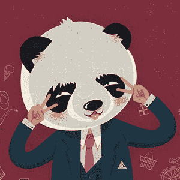

和菜头

2022-04-08

## 发刊词：像个叔叔那样

发刊词：像个叔叔那样

| 转述师：余昊威 |

懒人专属群的群友,你好

你最近还好吗？

我是和菜头，也是这个专栏的作者。五年前，我开过第一期。当时刚好罗振宇迎来一对双胞胎女儿，一个叫罗思思，一个叫罗维维，于是，我把发刊词写给这两位小朋友，欢迎她们来到人间。

点击链接可查看：《代罗振宇：致女儿书》

一转眼，两位小朋友到了快要上学的年纪。罗振宇又来找我，说：“娃都要上学了，你这个叔是不是得做点什么？”我又能做什么？记得我家当地的风俗，孩子要上学之前，叔叔们应该上山寻找一种特别的藤条，砍回来放在冷水里浸泡一星期，捞出来阴干之后作为礼物送上门去祝贺。这种藤条的优点是抽起来特别疼，但是绝对不伤皮肤，而且经久耐用。

不过，那是 1981 年的叔叔们应该干的事情，2021 年的叔叔如果还那么做，估计最后会搞到没朋友。那么，我真的能做什么？于是我把我的整个记忆倒带重播，又看了一遍自己的童年。

在所有叔父辈的人里，印象最深的只有两位。一位经常给我买吃的，让我骑着他的脖子一起去爬山，还允许我摆弄他的海鸥牌照相机。这种叔叔很受欢迎，但是太费钱费体力，我想想还是算了。毕竟罗振宇家是双胞胎，什么都得加倍，我哪里能吃得消？

另一位是我妈妈的姐姐的丈夫的妹妹的丈夫，到今天我都不知道该怎么称呼，就算是姑父吧。小时候我们两家因为孩子年龄相近，大家又都在一个城区，所以经常相互走动。我姑父年轻时一表人才，下班之后做饭做菜，还找了块小黑板给他们家两个孩子补习功课，是个耐心温和又细致的人。我和他比较聊得来，喜欢他说话的语调和口气。

有一次，我买了一本《小学生数学手册》，大约《新华字典》大小，里面有所有小学六年的数学知识点，还有所有题型。买完就带去他们家臭显摆，觉得自己一次就把数学给全买回来了。我姑父拿过去仔细翻了一遍目录，又翻阅了其中几章，把书还给我说：“宁可少而精，不要大而全，这种大而全的东西不好，因为其中每一点都会讲得很浅。”

这句话我到今天都还清清楚楚记得。因为之前和大人们聊天，他们从来没有和我说过类似的话。

首先是我姑父说这话的态度，感觉是在和我父亲对话一样，像是两个成年人在聊天。然后是他说话的内容，是在明确表达自己的一个观点，而且还加上了一点论证，讨论的是某样东西的本质。最后是他根本不在乎我的态度，我听完会不会沮丧，会不会生气，他一点都不在意，但是他在意他是不是对我说了实话，而不肯说几句好听的话来哄我。

我当时就有点僵住，一方面觉得不是很高兴，但是另一方面又觉得他讲得有道理，  
**最关键的是，他用这种语气和方式和我说话，又让我觉得跃跃欲试，想和他再多讨论几句，因为这种感觉非常棒。**

很多年过去之后，我买书的时候还不时会想起他的话来。我姑父的观点未必是正确的，因为博和精本来就是平行的两条个人发展路线。但是，当他在我面前把世界掀起一角，分享他所认为的事物本质时，那一幕让我终生难忘，它打断了我的沾沾自喜，直接给我某种成人对生活的领悟，迫使我停下来去思考。

**这让我在今后的成长过程中，时不时也忍不住去掀起生活的地毯，在下面找寻我认为的事物本质，同样也不去管生活高兴不高兴。**

我觉得，我倒是有可能可以做个我姑父那样的叔叔。

开始第一期专栏五年后，罗思思和罗维维也到了要上学的年纪。学校生活是她们接触坚硬人生的开始，这个过程会变得越来越艰难，越来越有挑战。我希望自己作为和菜头叔叔，能够通过文字，在她们的成长道路上陪伴她们一小段。无论是一年时光，还是三五七年。我是这么认为的：

在孩子的成长过程中除了父母和教师，总是需要一个类似叔叔或者舅舅那样的角色，身为成人但是作为平等的朋友，和孩子们聊聊。讨论一点学习和生活之外的话题，尤其是未来成人世界里的模样，为孩子们未来的人生路做一点预先准备。

**在成人和孩子之间，除了教育和听从，命令与服从之外，应该还存在着另外一种较为轻松的相处方式。其中除了关切和诚恳，还应该有平等和尊重。**

我希望他们因此能理解成人如何思考，这样将来他们能明白为何自己被如此对待。我更希望他们因此能理解成人世界如何运转，这样将来他们能避开内心和外界的致命打击。如果我能做得到，  
**我更希望他们能用更加宽容的视角来观察世界，而不是一早就吸收了各种成见和定见，把自己局限在一个很小的世界里，还因此觉得可以过完安稳的一生。**

如此，在这一段人生旅程挥手道别之际，我可以放心地看着他们投入自己的人生，知道他们能够在未来找寻到自己，体会到更多快乐和趣味，抵达我所不能抵达的地方。

当然，现在要让两个五岁的小女孩来看这些文字，的确可能还太早了一点。不过我相信她们会慢慢长大，在这一天到来之前，我作为叔叔最好提前把礼物准备好。这样，比她们大的小朋友，甚至大朋友可以先睹为快。也许需要叔叔的并不只是她们两小只，  
**也许人人身边都需要一位像个叔叔那样的人，也许对于成人世界有些人需要预习，而有些人则需要复习。**  
所以，此刻我有一种酿酒师的心情，甚至时光流逝也不那么令我畏惧了。

等到那一天到来，这些文字穿过漫长的时光，加上读者的评论和讨论，终于抵达她们的面前，这将会成为她们生命中最特别的礼物。因为曾经有那么多人，那么多头脑，以及那么多心灵，彼此紧密联系，共同创造出一份通向成人世界的指引，并且如此耐心地等待着两个小朋友长大成人，为她们修直道路。而在这条道路上，能看到曾经有许多双脚掌留下的印记，那些印记指向远方，就像是我们当初沿着前人的足迹走入新世界一样。

这要远比我之前任何一次创作都要艰难，不过在这么多年的人生经历中我也学会了一点：

**不妨先制定宏远的目标，最后即便无法抵达，也能多走出去很远的一段。** 后来的人因为这多出来的一段距离，最终可能真的抵达目的地。

那么，现在就让我们一起出发吧！这是一个叔叔应该干的事情。

  

公众号懒人找资源

发布留言

0/ *500*

确定

# 罗胖推荐：拜托了，和菜头叔叔

和菜头

2022-04-08

## 罗胖推荐：拜托了，和菜头叔叔

罗胖推荐：拜托了，和菜头叔叔

| 罗振宇 亲述 |

你好，我是罗胖，罗振宇。

这是我第一次为得到的课程写发刊词，也是得到课程第一次有了两份发刊词。这门课程，叫做《成年人修炼手册》，主持它的老师叫“和菜头”。

坦白地说，在电脑上敲出刚才这行字的时候，我心里是有一点得意的。我认识的人不算多，但是时不时地能从兜里掏出一个自己都佩服的厉害家伙，邀请他为得到用户服务，这还是一件值得吹牛的事。

自从有了互联网写作，江湖上就有了和菜头的传说。有人问过我，在你心目中，和菜头是一个什么样的作家？我闭上眼想了一下说：我脑子里有一个意象，那就是“孙悟空”。不管找到什么目标，他兴之所至地一棒打下来，都必然有咔咔碎裂的音效。对，我看和菜头的文字，很多时候都是为了看他的笔力——一种纯粹的文字力量带来的美感。

**文字为什么会有力量？因为这个世界充满了坚硬的概念。不奋起一棒把它们打碎，到头来我们对这个世界还是一无所知。**  
我是因为这几年做了父亲，才慢慢地体会到这一点的。

五年前，我家迎来了一对双胞胎女儿，罗思思、罗维维。我经常在办公室和同事开玩笑说，近距离观察人类幼崽的发育过程，其实也是自己重新成长一遍机会。但是，过去这一年，我渐渐地觉得这个过程没有那么轻松愉快。我应付起来有点吃力了。

比如，每天我都会遭遇这样的问题：

*   爸爸，孙悟空是真的还是假的？
    
*   为什么是假的啊？假的为什么你还要说啊？
    
*   真的，那孙悟空现在住在哪里啊？
    
*   为什么我没有见过妖怪啊？
    
*   妖怪都被孙悟空打死了吗？
    
*   什么叫神仙啊？
    
*   你将来会死吗？你死了会上天吗？
    
*   上天了你也是神仙了吗？
    

这些问题，可不是一个个地丢过来的，而是一连串地砸过来的。砸完之后，通常的情况就是，她们发现我应付不了，或者是态度上有点敷衍，然后就慈悲为怀地放过了。而我呢，偶尔会陷入反思。

我反思的第一点是： **我们这些大人，天天在用的那些概念，其实根本架不住刨根究底的追问。**

什么“死亡”“神仙”“真假”“礼貌”“规矩”“好人”“坏人”等等这些概念，我们自己也不甚了了，就胡乱地把它们塞给了孩子。方法很粗暴，态度很敷衍。说到底，能力很差劲。因为孩子没有权力给我们打分数，所以，这肯定是我们这辈子准备度最差的一场考试。

我反思的第二点是：谁当年还不是个孩子？ **我们一路长大，这个过程也真是非常潦草。**

什么“道德”“文化”“权利”“正义”“忠诚”“政治”“奋斗”……我们从大人手里接过这些坚硬的概念，没来得及嗑开仔细看看，就糊里糊涂地抱着它们行走江湖了。因为坚硬嘛，所以，我们有时候拿着它敲打别人，有时候又在午夜梦回的时候硌着自己。

只有很少的一部分人，在很少的一些机缘里面，能对这些概念进行反思：

*   **哦，打开一看，原来是这么个事；**
    
*   **哦，原来世上没有绝对的坏人；**
    
*   **哦，原来神仙虽然是假的，但是无比重要；**
    
*   **哦，原来一个真理的反面也可能是另外一个真理；**
    
*   **哦，原来在外人看起来的错误，在他自己那里没准已经是最聪明的选择了；**
    
*   ……
    

但遗憾的是，很多人一辈子也没有这样反思的机会。

我们经常说成长，但是，“成长”这个意象其实是有问题的。

**成长不是向上，一路向空无一物的天空伸展自己的过程。成长是向下，向脚下看，把自己坚信不疑的那些道理和概念从泥土里拔出来看看，看到它的底座的过程。**

地板下还有地板，玄机下面还有玄机。这个往下追问的进程，是终其一生也没法穷尽的。

所以有一次，我们和和菜头聊天，我就问他：

“你能不能替天下的父母把这个活儿干了？写一个大系列的文章，在孩子长大之前，用你文字的力量，把那些坚硬的概念和道理挨个敲开，让他们有机会看看里面的样子？不求解释到位，但是至少让他们知道，每一颗表面看起来清晰明了、光滑浑圆的概念坚果，里面都藏着另一个有趣的、值得探索的世界。”

我知道，以和菜头的文字力量，他能做到，而且我还一时想不出来，谁比他更能做到。我还打了个比方，说，“你的这组文章，应该就像一盘摆上桌的开心果。虽然还带着果壳，但是毕竟嗑开了一个小口子。让想吃的人，既能看到希望，又不至于自己不付出努力。”

这话说得轻飘飘的，但是，当时在场的所有人都听出来了，这是一个巨大的“坑”。说小了，我是邀请和菜头写一组给孩子看的读物。说大了，  
**这是要为整个人类文明的底层概念系统编一本百科辞典。虽然是一本私家著述的百科辞典，但是整体工程量确实庞大到无法想象。**

和菜头沉吟了一会儿，说：“你这是想让我做这个时代的房龙啊。”房龙这个名字，从他的嘴里说出来的那个刹那，我还记得，当时一桌人全都兴奋了。

简单介绍一下房龙：

房龙，是生活在一百年前的人，祖籍荷兰，后来移民美国。他一辈子写了很多书，题材很有特色：往往都是用他自己的方式把人类文明的某个侧面重写一遍。比如《人类的故事》《艺术的故事》《圣经的故事》《发明的故事》《房龙地理》《宽容》等等。你听听这些书名，就知道房龙的野心和格局有多大。

可能是无心插柳吧，大家突然发现，这些书写得才华横溢又通俗易懂，既有细节的趣味，又有开阔的视野，所以，房龙系列就成了西方青少年的必读书。我自己读房龙，是从大学时代开始的，那种开天眼的感觉，至今难忘。

顺便说一句，房龙的才华不只在写作。他还是一个不错的画家，出版的书的插图都是他自己画的。房龙的音乐修养也高得吓人。据说，他经常一个人到阁楼里拿出一部交响乐的总谱来看，说看乐谱和现场听音乐得到的享受是一样的。这就是一个常人无法企及的境界了。

所以，当和菜头说到“房龙”这个名字的时候，我们的那种兴奋，你可想而知。

用这一代人的方式，尤其是用这一代的少年人喜欢的方式，对整个人类文化做再整理，不管你是否喜欢，是否觉得有必要，这件事都一定会发生。一百年前在美国，是由房龙来承担这个任务。那一百年后的中国呢？

如果它一定会发生，那我希望做这件事的人是我佩服的人。更进一步，我希望他是我的朋友。再进一步，我希望他刚开始是专门为你——得到 App 的用户做的。

所以，今天我为你请来了和菜头。

这不仅是因为我喜欢和菜头文字的力量感，还因为他和房龙一样，是一个深不可测的宝藏男孩。他对电影、戏剧、美食、音乐，都有非常棒的趣味。闲谈中偶然露出来的一句两句，都让我经常忍不住要问：这个你怎么也精通？

还有一点，和菜头成名这么多年，但是居然你在网上都很难找到他的一张照片。 **这也就意味着，他不用表演什么，他只愿意对这个世界保持不被绑架的观察。**

我请他来做的这个年度订阅课程，正式名字叫：《成年人修炼手册》，副标题是：“作为成年人的 300 个基本”。

你听出来了：这门课程的对象是两类人。

一类是青少年。

如果你家里有十几岁的、对世界一脸好奇的孩子，你也有和他们平等对话的习惯，那这个课程的任务，就是不断地给你提供话题，和话题的切入思路。你完全可以不告诉他们，你的背后有一位叫“和菜头”的叔叔在当参谋。

当然，你也不妨大大方方地把链接甩出来，相当于邀请一位孩子喜欢的叔叔，参与到家庭的日常谈话里。在听完这位叔叔的见解之后，也加上你自己的那部分。

还有一类人，也是这门课程的服务对象：那就是觉得自己身体里住着一个宝宝的成年人。

几年前有一本书，叫《奈飞文化手册》，其中提出了一个说法：“我们公司只招成年人”。  
**成年人，本来是一个普通的词汇，但在这个语境下，突然就变成了一组非常复杂的概念和一个可望而不及的高标准。**  
很多人开始扪心自问：我的心智和举止，真的符合一个成年人的标准吗？不知道你哈，反正我是有这个疑问的。

没关系，这门课，就算是和菜头陪着你一起穿越回少年时代，把没有捋明白的道理，再从头捋一遍。 **反正成长是一辈子的事，什么时候都不迟。**

最后，我还要替我家思思、维维，谢谢他菜头叔。五年前，她们出生，我在产房门口心绪大乱，哭得像条狗。和菜头当时就替我给她们写了一封信，叫《代罗振宇：致女儿书》。点击链接，可以查看这篇奇文。

五年后，我又来了。

**一事不烦二主，和菜头叔叔，你做的这件事，既是一个房龙级别的大工程，也算是一坛为我家思思、维维提前酿造的思想女儿红。**

闺女，你们现在还小，可能还听不懂和菜头叔叔在说什么，但是我会看着和菜头叔叔好好写，好好酿造，等合适的时候，我陪着你们一起，开坛畅饮。

拜托啦，和菜头叔叔。

《成年人修炼手册》这个工程今天就起步了。我希望和菜头可以经年累月地做下去。

**他一支笔纵横江湖这么多年，凭的就是一种在不经意处，对人当头棒喝的力量感。**

当年，无论是提一根哨棒踏上景阳冈的武松，还是提一根金箍棒组队西行的孙行者，他们都不知道将会遇到什么。但是，有力者，无畏。

**那种力量，可以在世界的坚硬处砸出一道缝隙。那是光照进来的地方。**

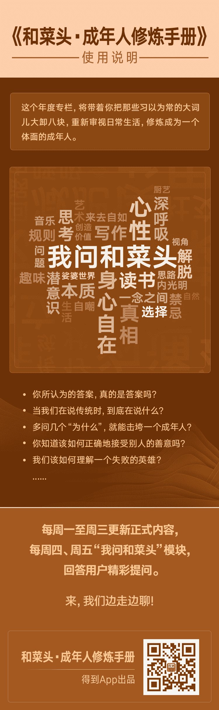  

公众号懒人找资源

发布留言

0/ *500*

确定

# 答案：我能多问你几个“为什么”吗？

和菜头

2022-04-08

## 01 答案：我能多问你几个“为什么”吗？

答案：我能多问你几个“为什么”吗？

| 转述师：余昊威 |

**答案，名词，指追寻真知途中的临时停靠站。**

\*

知道怎么样把一个成年人逼疯吗？无论你是个孩子，还是个成人，你都可以很轻易地做到这一点。不相信的话，我先问你一个问题，只要你上过小学，就应该能够回答：

天空为什么是蓝色的？

你一定相信自己知道答案。但事实上，这个问题可以轻易地问垮一个成年人，只是你不知道方法而已。当然你现在根本不会相信，因为你很确定，答案在课本上写得清清楚楚：太阳光通过大气层时，会发生散射，由于蓝光波长较长，更容易被散射，因此天空看起来是蓝色的。在更为简略的版本中，会直接说是由于大气散射。

好的，让我们正式开始：

天空是蓝色的，是因为大气散射。这就是你的答案么？那为什么会散射？为什么专门散射蓝色？我们见过彩虹，也见过三棱镜，它们证明太阳光其实是由七种颜色构成。为什么会发生散射？为什么偏偏是蓝色？其实问到这里，90%以上的成年人就已经无法回答。当然，还可以查书，可以用搜索引擎，继续硬着头皮解释说：

散射就是光遇见空气中的灰尘等介质，发生方向改变的现象。又因为蓝色光的波长较长，遇见颗粒非常小的空气分子时更容易发生散射。

停！我们在这里可以先停一下，毕竟我们要讨论的不是科普话题，我也不打算真的讨论天空为什么是蓝色的。从一开始到现在，你有没有发现一个问题？那就是  
**所谓的回答，其实是用一个概念去替换另一个概念。**

本来我们是在讨论天空的颜色，答案告诉我们一个概念叫“散射”。关于散射的答案，又告诉我们“介质”“波长”一类的概念。如果你要认真分析这里面的因果关系，天空的蓝色和蓝光的波长有关。然而这就是最终答案么？想必你也能猜到，后面还可以引入更多的概念，一步一步深入下去。

那么，现在请你告诉我，之前你认为的答案真的是答案么？

不要对此感到难过，因为 95%以上的成年人没有办法告诉你蓝色天空和瑞利散射有关，99%的成年人没有办法告诉你人类能看见蓝色其实和生物进化有关。能够继续向下和你探讨的成年人，大概一千个人里也没有几个。

**大家都是从问题出发，止步在某个概念，认为那个概念就是答案，区别只是程度有多深。至于说那个概念之下的原因，很少有人能够持续深入下去，因为他的知识和经验不足以支撑这样的探索。**

如果你像我今天这样一步步追问下去，对方很快就会发火，认为你是在故意让他丢丑。发火背后的原因，其实是他不愿意面对自己无知这个事实，不愿意接受他的答案其实远远没有回答问题，更不愿意承认自己在这个问题上想得不够深入。

所以，针对一个问题刨根问底地追问“为什么”，足以把一个成年人逼疯。但我不建议你那么去做。

重点并不在如何把一个成年人逼疯，而是通过不断追问，你会发现自己的答案并不像你想象中那么牢靠。你以为你懂了，你知道了，你得到答案了，于是世界就像是一张在你面前摊开的地图。但通过不断追问，这张地图就会跌入无知的深渊。

无论是你还是我，都趴在答案结成的网上，而在我们身下则是黑暗无边的茫茫无知。凭借着这张网，我们可以完成学业，可以进行工作，也足可以在这个世界上过活，达成自己的人生目的。

但是，距离清晰肯定地说出“我知道”三个字，还有很远的距离。  
**说出这三个字，并不意味着我们真的做到了，它更可能只能引发无知深渊里的一串空荡荡的回音，听起来就像是个嘲笑。**

所以，你也应该打破一个幻想：我知道答案。无论你我，也无论成人还是儿童， **我们手里拿着的答案并非终极回答，它们只是在不同思考深度上的临时结果。**

倒也不必对此失望，失望是觉得没有人给你提供终极答案，失望是觉得并不存在全知全能的人。但我恰恰相反，觉得这正是这个世界美好的地方，也正是我们人生拥有价值的地方。

我们可以反过来想一下：如果的确存在终极答案，而且终极答案在你大学毕业那一天就一定可以得到，那么，这个答案会有多少价值？如果的确存在全知全能的人，可以完美地回答你的一切问题，帮你解决一切困难，那么唯一的问题就是找到他。

但是当你找到他的一瞬间，所有的问题得到了解答，所有的困难烟消云散，那你接下来干什么呢？你还需要在这个世间做什么呢？

数万年前，也同样有人类和我们一样凝视天空，好奇为什么它是蓝色的。他们认为地坚实稳固，承载世间的万事万物，是黄色；火焚尽一切，带来毁灭随后的新生，是红色；水是柔顺且包容的，能改变自身的形状，是白色；风在林间吹拂，一切生命都有气息，是绿色的；而在这一切之外，则是无尽的虚空，虚空充斥世界之外的一切地方，它是蓝色的。

今天你可能对这个解释不以为然，认为它没有说出任何真正的知识。但你要仔细去看，会发现他们观察身边的万事万物，把它们归入四种不同的基本元素：风地水火。这的确不是正确答案，但却是知识的起点。认为世界由四大元素构成的人，就要比分别观察一百万种事物的人前进了一步。

风地水火当然是很粗疏的分类，不过依旧可以细分。可以把大地分为泥土和岩石，把大地承载的生命划分为人类、动物和植物；可以把风分为冷风和暖风，分为东南西北四个方向，可以分为自然的呼吸和体内的气息。

随着这样的细分，人们可以回答一些问题：为什么冬天的风冰冷刺骨？因为冬天的风从寒冷的北地吹来。于是，这多少算是一个答案，可以解释这个世界上的一些现象。而至于北地为什么寒冷？那可以想象是有一只黑色的乌龟趴在那里睡觉，鼻孔里吹出冰寒的风。或者是北地没有太阳，一年里有很长一段时间太阳落下就不再升起，所以整个地方都堕入无边的寒意……

这是答案么？有一部分可以算做是，而更大的部分则是猜测。但是相比风地水火，人们起码知道越向北走，需要穿的衣服就要越多。更可以验证自己的猜测：越往南走，天气也就越热。

再然后是人们看到光透过烟雾形成的漂亮光带，于是猜想空气中有无数悬浮的小颗粒，光就是更小更细微的小球，撞击在这些小颗粒上，改变了方向，显现出蓝色来。很快这个说法又被推翻，因为海拔更高的地方空气更加洁净，天空也依然呈现蓝色。接着连光本身是什么也产生了不同的理解，有些人认为光就是一颗颗小球一样的光子，而有些人认为光是一种如同浪涛一样的波。

究竟是光子打在空气中的小颗粒上转向，还是波和空气粒子发生相互作用激发出某种电磁辐射，不同的人有不同的看法。通过实验和分析，人们逐步弄清楚什么是光，什么是散射，以及如何散射。这时候，相比于风地水火的时代，人类已经大大地前进了一步。

**我们此刻不是站在终点回顾过程，而是站在中途回望过去。每一个时代里人类都在试图找寻答案，在找寻答案的过程里产生知识。**  
正因为人类并不知道终极答案，也不存在全知全能的人，所以一路这么探索到了现在。

天空为什么是蓝色的？从虚空的颜色到瑞利散射，中间走过了上千年的路途，累积了无数的知识，创造了一个又一个的概念。虽然看起来依旧是以概念解释概念，但是人类对世界的认知也因此变得更加深入。每一个概念的提出，意味着理解又深入了一层。而每深入一层，则会对我们的生活造成巨大的改变，使得人类从一个弱小的族群最终成为了移山填海、穿梭太空的星际霸主。

所以， **尽管每一个答案都是临时的，但是每一个答案也都意味着我们向前进了一步，是我们追求真知路途中的新记录。**

那么，你是打算在临时停靠站就那么待着，还是继续奔向下一站？

读者 “我问和菜头”:

> "每周四、周五，和菜头会从一周用户留言中选取精彩提问，专门撰文回答。欢迎将你的好问题写在下方留言区，说不定就被选中了呢？"

1.无论你我，也无论成人还是儿童，我们手里拿着的答案并非终极回答，它们只是在不同思考深度上的临时结果。  
2.每一个时代里人类都在试图找寻答案，在找寻答案的过程里产生知识。  
3.尽管每一个答案都是临时的，但是每一个答案也都意味着我们向前进了一步，是我们追求真知路途中的新记录。

公众号懒人找资源

发布留言

0/ *500*

确定

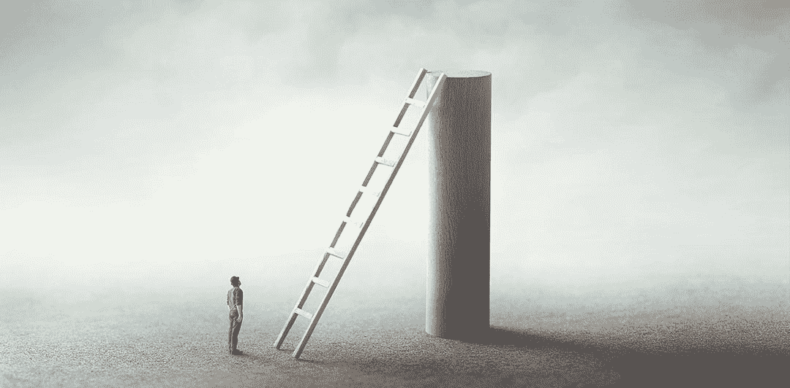

# 自律：一个美好的假象

和菜头

2022-04-08

## 02 自律：一个美好的假象

自律：一个美好的假象

| 转述师：余昊威 |

**自律，名词，常用于指责他人和自我表扬；用于表扬他人和自我批评时，往往又和自律无关。**

\*

我认为我可以讨论一下自律，因为我亲身经历过一次完整的转变，从一个别人嘴下不自律的人转变为一个自律的人。作为浪子回头的代表，我想告诉你一点自己关于自律的思考，免得你继续自我折磨。

事情是这样的：我从小学三年级开始就是个胖子，事情很突然，之前我一直“瘦得像条豺狗”，我母亲的原话，但是自从我搬回城里，过上稳定的生活，我感觉就是两顿饭之间，自己就从竹竿状变成了球状。而且，一球就是 30 多年。

唯一的幸运是我虽然胖，但是在视觉上比较可爱，所以这 30 多年来和我稍微熟悉一点的朋友，没有一个不曾揉过我的肚子，无论性别年龄。但是我也知道，人们对于其它胖子就没有那么客气了。

有一个很经典的说法：如果一个人连自己的身材都没有办法管理好，那么他还能做什么？这句话是在说所有的胖子都缺乏自律，是因为自我放纵才“沦落”到今天如此失败的样子。同时，也暗中带着一种自我夸耀：我身材之所以那么好，我之所以那么成功，是因为我自律。

2020 年 10 月 13 日那天，我的体重达到 106.2 公斤。也就是从那天开始，我决定要控制一下体重。在质疑和嘲讽之中，我研究了市面上各种减肥方法，分析总结之后发表了十篇《减重研究》。通过这一系列的研究，我找到了适合自己的减肥方式。三个月零两周之后，我的体重是 88.4 公斤。就这样，我仅用 16 周就赢得了自律的美名，一洗前 30 多年的耻辱。

请你先不忙着鼓掌，我的话还没说完——而在这 16 周里，我没有一天产生过什么自律。相反的，我认为如果我真的有什么自律，那么我可能很早就已经放弃了。

为什么这么说？ **因为自律天然就蕴含着和自我对抗的意味。**  
但如果一个人在减肥，他的自我会想多吃一口，会想多睡一会儿。甚至是他那数十万年进化而来的身体，也在本能地抵抗体重降低，认为那是威胁生存的一种状态。能够和这些强大的存在对抗，这得是什么强度的自律？而要维持那么大强度的自律又得靠什么？强大的意志力？那么强大的意志力需不需要肉体的支持？我觉得每顿起码要加三碗饭十块红烧肉才行。

简单说，我没有选择和自己的身体和自我做对抗。既然我爱吃，那么我就修改自己的食谱，去找那些我爱吃，但是又不会增加脂肪的食品。既然我吃得多，那么我就压缩每日的餐数，这样不用每顿数着卡路里吃，但是总体上也不会超过以前的热量。所以，整个 16 周内我都是开开心心地吃，自然而然地减。等到初见成效，我为了减得快一点，就自觉主动地加上了运动。其实不加也没什么关系，无非是时间快慢而已。

那么，请你告诉我，哪里有自律？我勉强自己顿顿吃草了吗？我勉强自己每天锻炼了吗？我勉强自己饿着肚子喝温开水了吗？实话告诉你，过去这些事情我全都做过，最长的做到过一年时间以上，但没有一样能坚持下来的。

整个过程下来，我觉得最荒谬的一点，是我在毫无自律的时候，大家一致赞扬我自律；而在我非常自律但是减不下体重的时候，人们却认为我在自我放纵。所以，这让我对自律产生了极大的怀疑，觉得人们其实是在以成败论英雄。

**没成效的时候，无论你再怎么自律，人们并不会承认。有成效的时候，无论你是不是真自律，人们都硬要说你自律。**  
那这样看起来，其实人们根本无法判断自律与否，当他们谈论自律的时候，他们在谈一件自己根本不懂的事情。

但这一点都不妨碍他们用自律两个字来判断你，让你产生愧疚感和负罪感，真心相信应该把问题归结于自己的不自律。那句话怎么说来着？如果一个人连自己的身材都没有办法管理好，那么他还能做什么？那我是不是应该在过去 30 多年间一直自我忏悔？觉得当初每天从昆明机场走 7.5 公里回市中心的家，一天一顿只喝皮蛋瘦肉粥、吃一碟豆豉鲮鱼油麦菜还不够努力？

什么是自律？ **自律不是自我约束和自我压抑，自律并不真实存在，自律只是一个人因为内心得到自由，对外显现出来的样子。**  
是的，我的意思是说所谓自律，只是大家看起来像是自律，符合大家对自律的想象罢了。

为什么一个人可以做到别人眼中的自律？原因是他内心自由。

我决定要去减重，不是迫于社会压力，不是迫于外界评论，不是迫于亲人朋友的恳求，而是我自己想要那么去做，并不是非那么去做不可，这是 **意志上的自由** 。

为此我去做了研究，分析各种减肥方法，学习人体的能量代谢过程，最终找到了适合自己身体特点的方法。我不是凭冲动和蛮勇去行动，在行动之前我有知识储备，对于可能发生的各种变化都心中有数，只是去执行验证理论而已，不会迷惑怀疑，这是在  
**识智上的自由** 。

在减肥过程中，我可以随时选择放弃或者继续，并不会因为这个选择而产生任何压力，我选择继续只是因为验证理论有效，肉眼可见体重在下降，腰围在缩小，这是在  
**行动上的自由** 。

因此，我在意志、识智和行动上都是自由的，在每一步都有选择的自由，那么事情就变得很简单： **我之所以会那么做，只是因为我可以那么做。**  
我不需要一个外在的压力，一种社会评价，一种自我谴责，去产生所谓的自律。用这种所谓的自律，去回应它们。当一个人内心自由的时候，只需要他有一个目标，那么他的内在力量就足够驱使他去达成。

就像是我减肥的过程一样，我知道我要什么，我也知道我如何才能做得到，那么它就全然是我自己的事情，我在其中能感觉到纯粹的快乐，我自然就会沉浸其中。于是在外人看来，这就是自律的表现，这就是自律下的坚持。

所有需要坚持的事情最后都会失败，这是我从小就有的经验。所有需要自律的事情最后都会放弃，这是我减肥得来的教训。

中学时代，我曾经自己编写物理学教案，这不是靠坚持或者自律能够做到的事情。只是因为我已经复习完了，在继续做一套习题和编写一份教案之间，我觉得后者更有趣。

因此从一页纸变成了一个小册子，小册子从力学册开始，慢慢多了光学册，电学册，运动学册……同样的，这看起来是我学习很自律，但我自己知道这和自律无关，只不过是因为那时候我天真地想着：如果想要拿高分，那么对于教材的掌握应该超过老师才对。到了最后，虽然还是没有超过老师，但是已经足够超过之前的好几个我自己。

如果你还在为自律这个概念而自我折磨，那么是时候放下它了。  
**比自律更重要的，是去找到你内心的自由。你的任何决定，由此而产生的任何行为，都应该源自你的个人意志，而不是外界或者他人。**  
这样在心中全无，在别人眼里全是的自律，才是真正的自律。于是才能以不坚持而坚持，以不追求成果而拥有成果。在达成目标的时候，也才有发自内心真正的快乐，而不是觉得终于偿还完欠人的债。

最后，我希望你能找到自己内心的自由，尽早知道自己真正想要什么，才会有真正的人生改变和真正坚实的行动。  
**如果你想不明白，那么迟早别人就会强塞给你一个，以自律或者别的什么名义。**

读者 “我问和菜头”:

> "每周四、周五，和菜头会从一周用户留言中选取精彩提问，专门撰文回答。欢迎将你的好问题写在下方留言区，说不定就被选中了呢？"

> " "

1.没成效的时候，无论你再怎么自律，人们并不会承认。有成效的时候，无论你是不是真自律，人们都硬要说你自律。  
2.自律并不真实存在，自律只是一个人因为内心得到自由，对外显现出来的样子。  
3.你的任何决定，由此而产生的任何行为，都应该源自你的个人意志，而不是外界或者他人。

公众号懒人找资源

发布留言

0/ *500*

确定

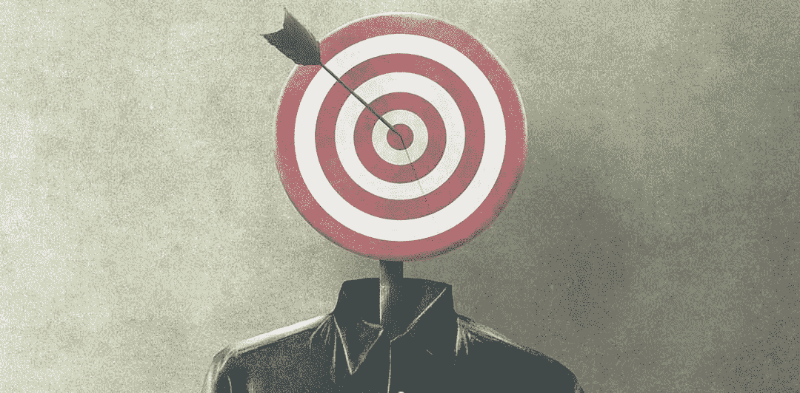

# 默杀：面对恶意时的最强进攻

和菜头

2022-04-08

## 03 默杀：面对恶意时的最强进攻

默杀：面对恶意时的最强进攻

| 转述师：余昊威 |

**默杀，名词，指一种针对他人恶意的最强进攻手段。**

\*

从小到大，只要你身在人群之中，就总是能感觉到来自他人的恶意。

我不会说你内心过于敏感，因为我不是你，体会不了你的感受。我也不会给你灌心灵鸡汤，讲如何转变内心一类的话，因为要是真的有用，心灵鸡汤就不会那么好卖。总之，我选择相信你，相信你可以凭借你的头脑判断，别人究竟是一时无心，还是蓄意如此。

恶意可以是言辞上的攻击，也可以是行为上的骚扰，还可以是营造恶意的氛围。最后这一种听起来复杂，其实也很常见。无论在学校，在工作单位，还是在网络世界，经常会出现一群人针对一个人的冷落、排挤以及羞辱，甚至会制造关于他的谣言，败坏他的名誉，让他觉得周围的一切都对他有敌意。这个人身在其中，不会觉得放松和愉快，反而时时刻刻觉得不安和焦虑。

感受到恶意存在是容易的，但是如何反击却要困难得多。因为我在网上经常用犀利的言辞反击他人，所以许多年来总是不断有人来找我，说自己气得快要爆炸，但是嘴笨却一句话都说不出口，根本没有办法成功反制对方，只能任由对方兴风作浪，希望我提供一些刀法学习参考。他们也想像我那样一刀出手，立即还世界一个清净。

其实，问题并不在于嘴笨，而是对方占据了心理和场面上的主动，让你忙于防御，根本没有时间反击。

所以，我推荐默杀。

**默杀源自日文，意思是不予理会。**  
关于这个字眼还有一个历史传闻：1945 年，英、美、中三国首脑联合发布《波兹坦通告》，要求日本帝国所有军队停止抵抗，立即无条件投降。日本帝国首相铃木贯太郎随后在记者招待会上说，对这个通告采取“默杀”的态度，日本帝国将继续作战。

传闻“默杀”在日文里有两个意思，一个是不予理会，一个是不予置评，铃木的意思是后者。很不幸，盟国的翻译不约而同把它翻译成了“不予理会”。看到日本帝国的态度如此轻慢，于是美国决定在日本扔两枚原子弹。

因为翻译错误，毁灭了日本的两座城市，这多少有些杜撰的成分。事实上，铃木代表日本帝国政府的意志，公开明确表示要继续作战，那么后续的一切事情就无法避免。至于说默杀翻译为哪一个意思，可能真的不是那么重要。不过默杀这个概念随着这段历史传闻进入中国，倒是真的形象生动，完全可以拿来借用一下。

为什么要借用这个词？为什么不直接说“不理睬”“不理会”？ **因为它们都是一种被动防御，缺乏默杀那种主动进攻的味道。**

他人针对自己的恶意，本身就是一种侵害，目的就是要你觉得不适，感到威胁。不理睬，不理会不单是被动防御的意思，而且更像是逆来顺受，寄希望于自己消除所有威胁，对方好放你一马。这样的话，你的处境和命运都操弄在别人手上，又如何能摆脱得掉心头阴影呢？

默杀分为几个层次， **最低一个层次是语言上的断绝，就是不对他人的恶意做出任何言语上的回应。**

释放恶意就像是狩猎，以此攻击猎物。对于猎手而言，最愉快的事情莫过于观察命中之后猎物的反应。猎物越是反应激烈，猎手就越是觉得有成就，越是觉得快乐。

在所有的反应中，言语是最直接的，可以通过它轻易地判断你的伤势。你用言辞反击得越是凶猛，就证明你越是疼痛。因此，语言上的断绝是最基本的要求。因为你不做出回应，对方就会因为无从判断而陷入自我怀疑，猜想自己的攻击是不是无效。最多再试一两次，见到你依然没有反应，那就换做是他自己陷入紧张焦虑之中去了。

**第二个层次是接触上的断绝，就是不单没有语言交流，甚至连目光的接触都不复存在。**

不要把断绝接触理解为逃避，尤其不要变成一旦目光接触就像是碰到了火一样立即转开。不是这样的，接触上的断绝是说当你看到对方的时候，目光不要停留，不要变速，而是如同你看到的是一片虚空，对方并不存在那样，缓缓扫过。

这种目光的杀伤性非常强，而且对方一定能感受得到你的无视。因为你的目光中没有任何情感波动，看到他就像看到桌椅板凳一样，那么他就会感到自己在你眼中是桌椅板凳。

对于一个自以为可以用恶意占据主动地位的人来说，当他自信满满地望向你，却发现你眼中完全不把他当做是一种存在，还有什么能比这种感受更让他感觉到挫败和恼怒的呢？一旦对方感受到这一点，他就再也不能操控你的情绪，反而是你可以让他非常难受，因为他的所有手段在你身上均告失效。

**第三个层次是思维上的断绝，也就是把关于这个人的所有念头都抹掉。**

虽然有了语言上的断绝和接触上的断绝，但是你的内心还是会止不住去想这个人，想他的恶意，想他到来的伤害。那么你的念头也就难以摆脱这一切，随时还在焦虑、忧郁、愤怒，即便你可以用不言语困惑他，用不接触反制他，但你的内心依然还在对方的恶意里，那么现在每想一遍，你就又伤害你自己一次。

所以，你应该把你的思维从这件事情上转移开，投入到让你快乐，或者让你投入的人和事上。  
**身上有一道伤口，并不会妨碍你去做你想做的事情。如果你时时刻刻都关注着伤口，那么即便你痊愈之后你都还会感觉到疼痛。**  
这样的话，伤口会长久地控制着你，比它原本的伤害更为持久。最糟糕的是你因为遭受伤害而心怀愤怒，最终也会转化为恶意，那么到了最后，你也会变得和对方没有什么不同。

在我上网的漫长岁月里，经历过无数次来自他人的恶意。他们就像是章鱼一样张开自己所有的触手，试探着对我的内心下手，试图用种种方法激怒我，找到我反应最强烈的某个点，然后加大力度从这一点上展开进攻。对于这些人来说，做这一切只是因为他们闲，或者觉得有趣，或者觉得有操控他人的快感。

而我在大多数时间里都采用了默杀的方式，不会做出任何正面或者侧面的回应，简直就是没回应。在行为上我并不因为他们攻击或者赞美我什么，我就要特地去写或者不写什么文章，总之看上去我依旧写我想写的东西，而且完全按照我的喜好和节奏，没有受到丝毫的影响，否则，对于他们来说就是看到了攻击奏效的信号。

我的内心也并不愤怒，不会记得他们中的任何一个。愤怒并不能让我连续写二十年文章，即便我能够做到，那样的文章大概也不会有多少人会看。

我时常感念的是那些跑来留言表示感谢我的读者，那些帮我找资料、找资讯的读者，那些用观点和论证给与我启发的读者。每次想到他们，就让我觉得写作是一件快乐的事情。尤其如果因为我的文章能够帮助到他们，就像我现在写这篇关于“默杀”的文字一样，就会让我深信自己的写作本身是有价值的。

也正因为这样，二十年下来我依然是我，而且几乎每一年都会有曾经想伤害我的人专门过来留言致歉，表示自己当初误解了我，如今自己的想法已经发生了改变诸如此类的话——看起来是我改变了他们，默杀对他们起到了效果。

你或许可以换一个角度想一下我的事：如果我在意那些心怀恶意的人，我对他们做出回应，那么他们就总是能找到我一定会回应的话题，并且一再把伤口撕得更大。于是，我会更激烈地反击，甚至用上他们对付我的办法。那么写作就会被我放在一边，网上战斗就变成了我上网的主题。

同样是二十年下来，我可能在言辞上战胜了他们，但是此时按下暂停键，看看镜子里的自己，那将是一个什么人？这个人是怎么来的？我多半会变成一个心怀恶意，满身戾气，战力无双的狠角色，这是他们塑造的结果，我是他们最成功的作品。

默杀避免了这样的结局，此刻我还在写文章给你，说明这个方法是有效的。他们没有改变我，而我却能改变他们中的一些，说明默杀不是防御而是进攻。  
**我希望这个方法即便不能解除你内心的痛苦，也起码能给你提供一点勇气。**

生活在这个世界上从来都不是容易的事情，即便到了今天，我也还要面对形形色色的恶意。  
**最困难的部分其实并非是直面恶意，而是妥善地保护好自己的心，使其免受扭曲和沾染。**

到了最后你会明白，默杀中的“杀”并非对外，而是对准自己内心中魔化的那一部分，因此它才能被称之为是最强进攻手段。

读者 “我问和菜头”:

> "每周四、周五，和菜头会从一周用户留言中选取精彩提问，专门撰文回答。欢迎将你的好问题写在下方留言区，说不定就被选中了呢？"

1.“不理睬”、“不理会”都是一种被动防御，缺乏默杀那种主动进攻的味道。  
2.语言上的断绝、接触上的断绝、思维上的断绝，默杀即便不能解除你内心的痛苦，也起码能给你提供一点勇气。  
3.生活在这个世界上从来都不是容易的事情，最困难的部分其实并非是直面恶意，而是妥善地保护好自己的心，使其免受扭曲和沾染。

公众号懒人找资源

发布留言

0/ *500*

确定

# 李广：你想做英雄，还是做将军

和菜头

2022-04-08

## 04 李广：你想做英雄，还是做将军

李广：你想做英雄，还是做将军

| 转述师：余昊威 |

**李广，西汉著名的军事将领，善骑射，在与匈奴人的战争中以勇猛而闻名，匈奴人尊称为“飞将军”，是中国历史上著名的悲剧英雄。**

\*

我个人很喜欢李广将军，也为他感到惋惜。我最喜欢他的地方，是他能用敌人最擅长的作战方式击败敌人。匈奴人善于骑马，精于箭术，在边境地区不断渗透侵扰，来去如风。李广将军马对马，弓对弓，打得匈奴人远远地避开他驻守的郡城，还尊称他一声“飞将军”。

**真正的英雄都是如此，单单战胜敌人是不够的，还得赢得敌人的敬意才成。**

我为他惋惜的地方并不是他的结局，而是他在两重身份之间陷入了死结。作为英雄的李广，和作为将军的李广，如果李广只是拥有其中任何一个身份，而且专心扮演好这个身份，那么他的人生可能不会让后人如此感伤。

在我看来，李广的悲剧在于身为英雄，却想做一个封侯的将军，这两件事情硬生生把他的人生一撕两半。英雄李广有多么成功，将军李广就有多么失败。

最让人伤感的是， **李广将军的人生并没有随着他的逝去一并结束，反而变成了一种人生模式在后世不断重复。**

在学校里我们经常可以看到一种不平：为什么我的学习成绩那么好，却做不了班长？

在职场上我们也经常看到一种幽怨：为什么我的能力和业绩那么强，却做不了主管？

这样看过去，生活里都是大大小小的李广，因为李广就曾经问过相同的问题：自汉朝和匈奴开战以来，我没有一场战役没有参加，而各部队里校尉以下的军官，才能还不如中等人，却有几十人因为军功而封侯，我一点都不比别人差，为什么我却没有封侯呢？

关于李广将军的这个问题，后人有不同的解答。

有人从玄学的角度解释，认为他的命不好，所谓“数奇”；

也有人从因果的角度分析，认为他曾经杀降虏，所谓“不吉”；

还有人从权谋的角度分析，认为皇帝刻意地打压李广，为了给自己的亲戚让路；

此外还有人从性格角度分析，从治军方法分析，甚至有人从数据的角度分析，认为李广胜率其实不高，他的胜仗大多发生在和匈奴人的小规模冲突中，而在汉朝和匈奴的大战中他大多以失败收场，结论是他是名猛将，但是绝非帅才。

我却认为，如果我们围绕着李广将军为何不能封侯来进行讨论，那么，我们其实是按照李广将军的思路去思考。他自己到死都没有想明白这件事情，我们又能好到哪里去？这应该不是他一个人的问题，而是一类人的共同问题，你总不能都用运气、因果、性格这些东西来解释。

有没有一种可能，我们跳出封侯这个视角，从其他角度重新来看李广将军的人生呢？

在李广的军旅生涯中，曾经发生过这样一件事情：汉景帝时期，皇帝派了一名亲近的宦官跟随李广一起训练士兵。这位宦官带上十几名骑兵外出，遇见三名匈奴人。匈奴人非常凶悍，射伤了宦官，还把十几名骑兵几乎射杀殆尽。

官宦跑回去找李广求援，李广认为对方是匈奴的射雕人，于是带了一百多骑兵前去追杀。三个匈奴人在战斗中失去了马，正在徒步返回。李广发箭射杀其中两人，俘虏一人。这时候，李广他们发现面前突然出现了数千匈奴骑兵。

双方都很吃惊，匈奴人立即列阵，汉朝骑兵就想立即调转马头逃跑。李广劝阻士兵，说如果现在回头，根本来不及跑到驻地匈奴人在途中就会把大家追上围杀。如果我们按兵不动，那么匈奴人会以为我们是在诱敌，反而不敢来袭击我们。

于是他命令骑兵继续前进，逼近匈奴人 2 里的地方才停下。不单停下，又命令骑兵下马解鞍，做出一副根本不想走的样子。匈奴人就越发怀疑他们是诱饵。

中间李广暴起，杀死了一个前来监军的匈奴骑白马的将军，然后又回去下马解鞍，让大家躺下休息。匈奴人于是更加惊疑，最后竟然在夜里悄悄撤退了。李广他们得以安全返回，而大军因为不知道他们在那里，也就没有去接应。

这是李广将军非常经典的一战，有几个细节值得注意。

一个是面对数千匈奴骑兵，李广命令士兵不退反进，逼近大军 2 里处下马休息。而他的士兵们没有因为惊慌而逃跑，也没有因为这个自杀式的命令而违抗命令。这说明李广在士兵中有极高的威望，他们相信李广，愿意把自己的性命托付给他。他们相信李广什么？  
**相信李广能够创造奇迹，在将军做不到的情况下，只有英雄才可以。**

另一个是在面对大军，以寡敌众的情况下，李广依然上马突击，强杀了一名敌方将领。一方面这是他弓马娴熟，另一方面是他勇气无双。在面对死局的情况下故布疑阵，用暴起杀敌的方法迷惑敌人，让对方以为汉朝骑兵很有底气。  
**这同样不是将军能做的事情，而是传奇英雄独有的剧本。**

最后一点，当李广他们返回大营了，大军才知道这一夜的经历，之前因为不知道他们的位置，并没有派出大军接应。所以，李广并没有沿途派出骑兵和大营保持联络，而是孤军直入，没有后援。这恐怕是李广个人的做法，而不是将军的做法。

所有人看到这一仗，都会感慨打得精彩，把李广视若神明。他对敌人心理的把握，对出击机会的决断，都要远超其他汉朝将军。他所做的一切，都是英雄的行为，体现了无双的战力和勇气，成功带领一百骑兵逃离绝境。

如果你是统帅，你又会怎么看待这件事呢？

一名将军轻敌冒进，遭遇大军，和后方又没有联络方式，音讯断绝。他所依仗的是自身的勇武和士兵的忠诚，而根本没有用到大军的力量。一旦弄险失败，这一百多人绝无生还的道理，换来的仅只是两名匈奴射雕人。你是会称许他的这种行为，还是会因此大为恼火？

或者你是否会这么考虑：李广这么作战，100 次里他有 99 次可以靠勇气和战力全身而退，那剩下的一次呢？ **只需要一次，就可以把前面 99 次的成绩全部归零。**

做英雄和做将军完全是两回事。英雄的天命是展示勇气，逆境求生，变不可能为可能，不断创造奇迹和传奇，目的是为了争取荣誉；将军的司职是保全战力，争取胜利，为整体战略服务，利用整个军队的力量协同行动，扮演好自己所在那个位置上的角色。

从这个意义上来说，  
**一个将军应该尽可能不要把自己弄到需要展示勇气的地步，尽可能不要陷入绝境，跟创造奇迹和传奇相比，更应该保持有生力量，不断削弱敌人，稳扎稳打，直到胜利的天平倒向自己这一边。**  
英雄依靠的是自己，将军依靠的是整个军团。

所以，英雄和将军这两个身份之间是有冲突的。

在我看来， **李广的悲剧就在于身为英雄，用英雄的方式去做将军，并且还希望以此获得荣誉。**  
结果他一辈子都没有得到他想要的荣誉，最后只能像个英雄那样死去，用自己的死来捍卫英雄的尊严。

如果他选择只是做一个英雄，在边境上不断制造传奇，彻底不去想封侯这件事情，满足于活在民众的传说和敬仰之中，那么他不会有那么多痛苦，反而有无数荣誉。

如果他选择只是做一名将军，按照操典训练士兵，按照规章一板一眼管理军营，规划战役，只是在关键时刻一逞勇武，提振士气，那他多半也会是个优秀的将军，封侯就是时间和运气的问题，只是不会被当做是英雄而已。

归根到底， **英雄在系统外，而将军在系统内。**

英雄对自己负责，只有一个角色，将军却对整个系统负责，从皇帝到统帅，从统帅到同僚，从同僚到士兵，他要同时扮演多个角色。个人能力和勇气足够让一个人成为英雄，但将军需要的并不止于个人能力和勇气，还需要找到自己在整个系统内部不可或缺的位置，更需要各方对自己在这个位置上的工作表示认可。

换句话来说， **人人都觉得从你这里得到了支持和贡献，而不是人人都觉得望尘莫及，心中充满敬仰。**

同样是作战，你作为将军可能更希望自己的侧翼是个能和你协同作战，必要时出手援助的战友。而不是一位伟大的英雄，他每战全军出击，获得全胜也和你没有任何关系，反而会让你的侧翼彻底暴露出来，变成敌人可以攻击的弱点。

有些人天生就适合当英雄，而有些人天生就适合当将军。  
**英雄非要去当将军，最后往往是个悲剧，因为无论如何他也无法被系统所接纳；将军非要去当英雄，最后经常就是个笑话，因为缺乏无畏和战力就总是显得装腔作势。**

我们在情感上更加同情英雄，是因为我们自身总是带有一点对浪漫的追求，英雄主义就是一种很古典的浪漫。同时，我们心底的最隐秘处也总是渴望能够张扬个性，为万众所敬仰，拥有自己的传奇因而接近不朽。因为知道自己做不到，反而增加了对英雄的仰慕。

但是换做自己的人生，那最好一早想清楚，是去个做英雄，还是做个将军？两条路都不好走，却也没有高下之分。

如果决定做英雄，那就努力去成为传奇，但不要奢望还有封侯的一天，因为封侯在另外一条人生路上；如果决定做将军，那就努力去成为统帅，但不要奢望还有万众仰慕的一天，因为你不曾押上自己的性命去创造传奇。

千万不要在这两个身份之间横跳，那样唯一的结果就是会成为一个永远不快乐的人。

古人说：冯唐易老，李广难封。那么，今天人们还记得历史上的几个侯爷呢？ **英雄和将军，本来就是一个指向永恒的未来，一个指向当下的现世。**

读者 “我问和菜头”:

> "每周四、周五，和菜头会从一周用户留言中选取精彩提问，专门撰文回答。欢迎将你的好问题写在下方留言区，说不定就被选中了呢？"

1.真正的英雄都是如此，单单战胜敌人是不够的，还得赢得敌人的敬意才成。  
2.英雄在系统外，而将军在系统内。英雄对自己负责，只有一个角色，将军却对整个系统负责，要同时扮演多个角色。  
3.英雄非要去当将军，最后往往是个悲剧，因为无论如何他也无法被系统所接纳；将军非要去当英雄，最后经常就是个笑话，因为缺乏无畏和战力就总是显得装腔作势。  
4.英雄和将军，一个指向永恒的未来，一个指向当下的现世。

公众号懒人找资源

发布留言

0/ *500*

确定

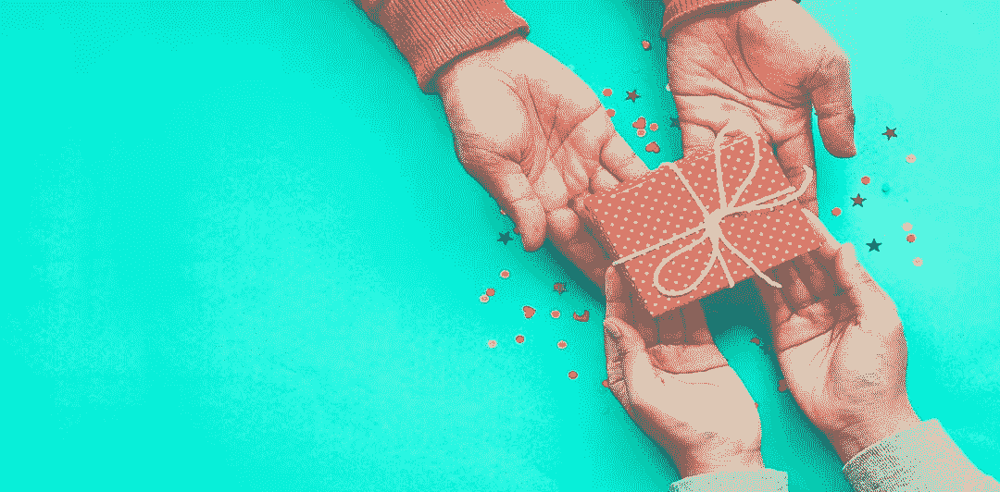

# 05 回礼：如何正确地接受善意

和菜头

2022-04-08

## 05 回礼：如何正确地接受善意

回礼：如何正确地接受善意

| 转述师：余昊威 |

**回礼，是名词也是动词。做名词时，指的是回赠对方的礼物；做动词时，是一种许多人都头疼的复杂计算。**

\*

我们都知道，从小到大，人们都用互相赠送礼品的方式表达善意。我们也发现，礼物会带来两重痛苦，第一重是不知道该送什么，痛苦程度轻微；第二重是不知道应该回赠什么，痛苦程度中等到剧烈，因为每次都需要做大量运算，会导致脑细胞严重过载，出现心慌、焦虑、血压上升等不同症状。

从痛苦程度来分析，我们就可以得出第一个结论：给予比接受要好，赠礼要比还礼轻松，做一个愿意给予和分享的人要快乐很多。那么回礼呢？回礼为什么给人感觉压力很大？这是因为人们从来没有仔细分析过这件事情，也没有发现其中的诀窍所在。

关于赠礼和回礼这件事，法国大思想家皮埃尔·布尔迪厄曾经给出过非常清晰的解答：

一方赠礼，一方回礼，这就是一次礼物交换。礼物交换和两个因素有关，一个是交换礼物的价值，另一个是交换礼物的时间。这样就会产生四种不同的情况：

1.  **交换的礼物等值，交换的时间分前后，这就是借贷；**
    
2.  **交换的礼物不等值，交换行为同时发生，这就是贸易；**
    
3.  **交换的礼物等值，交换行为同时发生，这就是拒绝；**
    
4.  **交换的礼物不等值，交换时间分前后，这是赠礼和回礼。**
    

第一种情况在婚礼上最为常见，中国人在参加婚礼的时候都要随礼，赠送一个大红包。有些地方还要专门请人来做账，一笔笔记录下每个客人的礼金数额。为什么要那么做呢？因为将来别人结婚的时候，是要把这份随礼还回去的。别人当初给了多少，将来只能多不能少。

那为什么要随礼呢？因为新婚夫妇刚刚开始自己的婚后人生，有那么一笔钱，可以让新婚生活变得容易一些。换句话来说，是大家一起帮助新婚夫妇展开新的生活。

那么，大家为什么愿意帮忙呢？因为人人为我，我为人人，现在给出去的礼金，将来还能收回来。这就相当于亲戚朋友之间的一笔小额贷款，每次结婚的人都可以先拿去用。所以，这种情况下的赠礼和回礼本质是一种借贷。

像我这样在四处漂泊不定，去许多座城市参加过婚礼并且不断随礼的人，就不算是借贷，而是一种对社会负责任的表现。

**第二种情况也很常见，有些时候会让人很生气，而有些时候则是皆大欢喜。**

比如说你看到朋友的新手链，觉得非常喜欢，于是你请他送给你，北京话的术语叫“切”，切朋友一条手链。而你朋友刚好很喜欢你的钥匙链，于是你说：不如我们换吧，我送你钥匙链，你送我手链。这两样东西可能是不等值的，但是双方经过交换，每个人都得到了心爱的东西，都觉得在这次交换中自己赚了，这不就是贸易么？

商人做贸易，最早不就是以物易物，而且双方都觉得自己赚了，否则这桩生意就根本做不起来。当然，如果对方拿走的是你的新手机，而且立即回赠你一根雪糕，表示大家这就算是扯平了，那就会让人相当恼火。

在藏区或者西南部地区，许多少数民族有一种共同的习俗：如果朋友或者客人对自己家里的什么物件大加赞美或者是流露出喜爱之情，主人就应该直接送给对方，但不可以求回报。我希望北京上海地区也能流行这样的风俗，那我就可以去挨家挨户赞美朋友家的豪宅了。

**第三种常见于求人办事，或者追求对方。**

你送上一瓶茅台，对方立即还你两瓶五粮液。你送对方一束玫瑰花，别人立即送你一个游戏卡。算下来彼此的价格都差不多，那么对方其实就是在用这个方式拒绝你。赠送礼物是一种善意，你在这个善意上附着了个人的要求。  
**那么对方就可以用立即回赠等值礼物的方法，把这份善意不多不少退还给你，同时也就把附着的个人要求退给了你。**

这个方法含蓄而不伤人，算是社交生活中比较温和的拒绝方式。只有情商低的人才会欣喜若狂，觉得别人回赠自己酒是表示一起预祝成功，别人回赠自己游戏卡是表示对自己的关心在意。记得：同一时间，别人立即回赠等值礼物，意思是拒绝。

我希望你看到这条的时候，不要恍然大悟，这样许多往事重新泛起，有了新的理解，可能会让人觉得十分感伤。

**所以，真正的表达善意，真正合格的给予者和接受者，是第四种情况。**

别人赠送你礼物，你第一不要回赠等值的礼物。因为等值礼物的意思，要么是把你们之间的关系视为借贷，是一借一还的关系；要么是你表示拒绝对方的善意，坚决不肯占对方便宜。无论是哪一种，对方拿到回礼的时候心里都不会舒服。那些性格刚直的人，坚持要在礼物上对等，其实是一件很伤人的事情。

第二不要立即回赠。等一段时间的意思，是表示你确实接受到了对方的善意，你承对方这个情。对方赠送你礼物，其实就是想让你接受善意，体会一下给予者的那种快乐。如果你破坏了这个默契，立即回礼，那就会让对方感觉你不承认这是善意，而是像接到了一个正在燃烧的火球，烫得厉害，你要立即把这个火球扔还给对方。

所以，如果你的确承对方的情，也心怀感激，那么你应该过些时候再回礼，而且最好回礼的价值略低于赠礼的价值，否则，会让人觉得你有些傲慢，把一件好事变成了斗气斗富。

这里我要赞美一下皮埃尔·布尔迪厄，他用如此简洁清晰的方式，就说清楚了赠礼和回礼之间的关系。几乎是一劳永逸地解除了我们回礼的痛苦，让我们可以通过选择恰当的方式，向对方表达出不同的心意。

同时，我还想说一点：用这四种情况去和你的回礼方式做一下对比，也许，你会发现自己在给予和接受这件事情上存在着误解。  
**你所以为的礼貌和得体，其实让表达善意变了味道，要么显得过于功利，要么显得不近人情，要么显得距离感过强，唯独没有坦然的给予和坦然的接受，就像是躲在一个坚固的壳里。**  
这样的话，怎么可能有真朋友呢？

许多年来，我以和朋友吃饭不买单而闻名。有的人曾经讥讽地说过：你见过和菜头每次来吃饭买过哪怕一次单么？你知道我是怎么想的？每次朋友请吃饭，我都吃得很开心。因为我觉得吃得开心，就是彻底接受了他们的善意。而我对他们的回礼，并不体现在饭上，否则友情就是放贷还贷，大家的关系是饭费互助组。

所以，我的真朋友从来没有因此埋怨我哪怕一次。可见他们是真的喜欢我，真的想让我吃得开心，也知道我是真的开心。

这一讲就到这里，记得要请我吃饭。

读者 “我问和菜头”:

> "每周四、周五，和菜头会从一周用户留言中选取精彩提问，专门撰文回答。欢迎将你的好问题写在下方留言区，说不定就被选中了呢？"

1.回礼，是名词也是动词，做动词时，是指一种许多人都头疼的复杂计算。 2.同一时间，对方立即回赠等值礼物，意思是拒绝。  
3.如果你的确承对方的情，也心怀感激，那么你应该过些时候再回礼，而且最好回礼的价值略低于赠礼的价值，否则会让人觉得你有些傲慢，把一件好事变成了斗气斗富。

公众号懒人找资源

发布留言

0/ *500*

确定

# “我问和菜头”： 我们该去了解什么程度的答案？

和菜头

2022-04-08

## “我问和菜头”： 我们该去了解什么程度的答案？

“我问和菜头”： 我们该去了解什么程度的答案？

| 转述师：余昊威 |

读者 用户申磊：:

> "菜头老师，我是一名建筑工人。大气与光创造了蔚蓝天空，我们确实还可以再继续深究，可吾生有涯而知无涯，我们真的要把有限的生命放到这样的学习中去吗？还是说把时间放到我更加用得上的框架结构钢筋混凝土中去？同样的学习，用在更加实用的工具是理智还是功利？"

大气和光并没有创造蔚蓝天空，是我们作为观察者，因为视神经细胞对不同颜色的敏感程度不同，所以能看见蓝色。而之所以敏感程度不同，是因为我们作为碳基生命，从生存的角度看，需要对光线中能量较为集中的可见光部分，更加敏感一些。

当然，我们并不需要对每一个问题都穷究到底，因为人生太过短暂而有限。  
**我之所以强调答案只是一个中途停靠站，是因为人类的认知总在持续深入，千万别把目前的已知当作是终极答案。**

一个人在自己的已知上，已经足够应付目前的工作和生活。但我的文字，并不是单纯地写给今天的你，同时也是写给未来的你，他未必还可以用你今天的所知道的，继续支持生活和工作。

读者 用户🍳：:

> "老师，与孩子交流的状态和与大人交流的状态有点区别，我有些想不让旁边的其他大人看到我和孩子的交流状态。您能分析一下我的心理或者给些建议吗？"

所以，你真正在意的是，和孩子交流这件事情本身，还是你在别人眼中如何与孩子交流的形象呢？如果是后者，需要你自己去找寻答案，为什么他人的眼光和评价对你如此重要？你得对自己释怀，这和如何与孩子交流的状态，和成人间交流有什么不同，完全没有任何关系。

读者 用户 Latter：:

> "如果说一个一个不同深度的“临时答案”，组成了探索深渊的阶梯，但我们没有停在某个足够好的解释里沉睡。我很好奇，那个探索的源动力是什么？偶发于群体，还是根植于每个个体？"

我认为和许多年前，人类从树上来到地下的源动力是一致的。

在这个过程中，自然所带来的束缚越来越少，人获得了越来越多的自由，最终成为行星的霸主。

从另外一方面来说，从认识自然，到以为地球是宇宙的中心，再到发现地球只是银河里的一颗行星，围绕太阳旋转，人对自身的认知也随着改变。

如果没有这种探索和发现，那么我们称之为现代生活的一切都会失去基础。也许，今天我们还生活在神学统治下的世界。

读者 用户醉清风：:

> "想起费曼说他小时候问他爸爸车子为什么会动，他爸爸通过一连串的问答最后说是人提供了动力。这个答案当然并不正确，但费曼说这启发了他的好奇心。好的答案或许就是这样，让你有往下探索的念头。"

> "想问菜头叔：既然无法找到终极答案，我们也无法对所有事物精通，那面对事物，该了解到什么程度的答案呢？我们又要如何面对别人给出的关于未知事物的答案呢？"

如果简要回答你的问题，我可以这么说： **达到能够指导你的生活的程度。**

举例来说，现在全世界都在接种新冠疫苗。那么，你凭借什么去判定应该去接种灭活疫苗、腺病毒载体疫苗还是 mRNA 疫苗呢？你看，这时候对知识的要求就超越了你在学校里当年所得到的疫苗知识。

再举例来说，假若你现在要减肥，那么你是应该减少糖类还是脂肪类的摄取？同样的，如果你不更新营养学的知识，你的行动将不会产生成效。

但我个人还是希望你继续往前走一步，即便是把穷究答案作为一种日常的头脑体操，在这个过程中你也能不断练习自己的思考能力。也许终极答案是不可知的，但这种能力使得你能够分辨和判断，而不是被动地接受。

最糟糕的是你不单被动接受，而且还奉为圭臬，甚至为此四处征战，就像网上现在的情况一样。

读者 用户奇问小顽童：:

> "关于答案，问问题是必要的，听有些老师说过，问几次之后就出现了元问题，把元问题解决是不是就可以有好的答案出现了。怎么判断当下这个问题是需要找的那个元问题呢？会不会也是一个概念？"

恕我直言，你把两件事情给弄混了。追问而得到元问题，其实是厘清问题本身。因为在很多时候，问出来的问题是不恰当的，遮蔽了真实的问题。通过不断追问，去掉那些遮蔽和扭曲的部分，显露出真正的问题是什么，如此才能着手去回答。

比如说：有人问你，为什么灯光看起来总有一圈彩虹在周围？如果你是医生的话，你可能会怀疑他得了青光眼，或者由于其他原因造成了眼压过高。但如果你和他讨论彩虹的有无，这就没有什么意义。相对而言，更重要的是不断追问什么时候出现的彩虹，双眼都有还是只有一只，最近有什么身体异状等等。

而我的文章讨论的是既有的问题答案， **通过追问的方式，去理解我们所知的边界和限度，以此自我警醒，不要躺在答案上以为自己真的懂了。**

读者 用户 chaos：:

> "答案，追求真理的临时停靠站。每个人的经历不同、认知不同，就会得到不同的参考答案，而问出一个好问题，决定了得到答案的质量，我们该如何提出一个好问题呢？"

**所谓的好问题就是经过自己的思考，而打到的一个关键点，对方必须要调动大脑进行思考才能回答和解释。**

比如说那个古代的笑话，茶馆的说书人讲《水浒》，鲁智深倒拔垂杨柳那一段。说鲁智深相了一相，伸手抱住柳树，连树带根，还有方圆几丈的泥土都拔了起来。于是一个天真的儿童问道：那他的脚当时站在哪里呢？

读者 用户黄健楸：:

> "什么答案才是更进一步的？要更简洁、包容或是有生长力？"

健楸你好，又见面了。我觉得这里不大适合用形容词去描述，如果要我说的话，更进一步的答案可能是这样的：

**它比之前的答案能够连接和解释更多我们已知的事实，能够包含我们之前寻获的答案，使之变成一个特例。**

你可以参考一下光的波粒二象性，或者相对论的运动学理论和牛顿的运动学理论。爱因斯坦并没有推翻或者废除牛顿的理论，但在他的理论框架下，牛顿的理论适用于低速运动。

读者 用户何学强：:

> "这个世界有真理么？如果有，那它能不能叫答案？"

这个问题太深了，我回答不了。要我说， **追寻真理就是个下金蛋的鹅，找到真理，那么就相当于杀掉了那头鹅，有点不大划算。**

读者 用户赵德强：:

> "请问老师，如何优雅的打破砂锅问到底，不让对方翻脸呢？"

赵德强你好，一种方式就是你的名字，德强，道德很强，很有感召力，基本上德艺双馨，那对方就不好意思翻脸了；另一种方式就是健身，浑身都是肌肉的时候，和谁聊对方都会和风细雨，轻言慢语。

读者 用户付婧：:

> "和菜头，你是从什么时候看透了自律的本质呢？是通过什么方式呢？是从小养成的思维习惯吗？是不是有那么一瞬间顿悟了？"

我不认为我看透了什么本质。对于同一个事物，或同一个概念，大家的看法彼此并不相同。也许它们之间未必是互相排斥的，因为真正的本质是我们人人都在盲人摸象。

如果我们在盲人摸象的过程中高呼：大象的本质就是四根柱子！或者：大象的本质就是两把蒲扇！这种宣称本身，只是徒然增加了大家的对立和争论，对于提升认知并没有任何帮助。

对于我而言，我只是提供了另外一个思路去考虑自律。而是不是接受我的看法，这取决你自己的判断。至于说用什么方法认识到自律另外的可能，那当然是先做个胖子，忍受来自人世的欺凌和误解，然后自己找到解决之道，那么就可以对所谓自律进行质疑了。

我的意思是说， **尊重你个人的实践，不要因为在事件中发现和流行理论不符合就沮丧，应该大喜过望才对，因为你可能发现了什么了不得的东西。**

读者 用户钟林月晓：:

> "自由带来了自律，叔，那咱谈谈自由好不好？自由到底算一个绝对概念还是相对概念啊？"

说实话，我一点都不关心。自由究竟是绝对概念，还是相对概念，我认为一点都不重要。这更像是在讨论一种信仰，会产生无边的纷争。

我更关心你自身，在你试图和我讨论这些概念和名词的时候，我倒想问问你：你是否感受到身心上的不自由？这种不自由是否给你带来了痛苦？这种痛苦多大程度上影响了你的心情和生活？那么，你知道自由是个相对概念，是不是就能立即感觉好了起来？

读者 用户 Paola：:

> "怎么让孩子在家每天主动练会儿吉他呢？不催他不会记得要去弹的……"

Paola 你好，对不起，这个问题我不知道如何回答。我没孩子，只有两只猫。从它们 2 个月大到现在，我不能勉强它们去做任何一件事情。比如说不要用爪子玩水，用完猫砂出来擦干净手。总之，他们都自顾自地那么玩着。

那我最后只能那么想：和它们陪伴我的短暂时日相比，我希望它们做到的事情都太过微不足道，既不能丰富它们的猫生，也不会改变我的人生。

所以，我决定在这些小事情上就不用太在意了。反而是它们玩火玩水开窗子，或者突然提不起精神来的时候，我会特别在意。

1.通过追问的方式，去理解我们所知的边界和限度，以此自我警醒，不要躺在答案上以为自己真的懂了。  
2.更进一步的答案比之前的答案能够连接和解释更多我们已知的事实，能够包含我们之前寻获的答案，使之变成一个特例。  
3.尊重你个人的实践，不要因为在事件中发现和流行理论不符合就沮丧，应该大喜过望才对，因为你可能发现了什么了不得的东西。

公众号懒人找资源

发布留言

0/ *500*

确定

# “我问和菜头”：默杀的反义词是什么？

和菜头

2022-04-08

## “我问和菜头”：默杀的反义词是什么？

“我问和菜头”：默杀的反义词是什么？

| 转述师：余昊威 |

读者 用户陈江华：:

> "“你做任何决定，由此产生的任何行为，都应该源自你的个人意志，而不是外界或他人。”菜头叔，我理解这句话说的可能是一种理想状态，并且并不是所有人都会认同。"

> "我有一个疑惑：您是怎么让自己更靠近这种状态的呢？或者说，在“真正找到内心的自由”这个过程里，甭管找没找到，你有什么特别想和我们说的吗？"

我的回答是两个字：受苦。

有个成语叫缘木求鱼，另有一个叫南辕北辙。无论是哪一个，都意味着要白费许多功夫，浪费许多时间，最终一无所得。

你在许多树上找过鱼，你朝着反方向奔出去很远，在吃尽苦头之后，你终于会对你深信不疑的事情产生怀疑：也许树上就根本不会有鱼，也许朝着这个方向走下去永远到不了目的地。在苦头没有吃尽之前，人就总是会有幻想，幻想下一棵树，幻想下一公里。

我想说的是，我没有奢望通过一篇文章就能撼动“自律”的伟大地位，就能让读者转变思考定势。我所做的事情，无非是小声说出另外一种可能，等待某人精疲力竭地找鱼未遂，抵达不能之后，不至于太过绝望，因为还有另外一种选择，记得一个叫菜什么的人曾经说过。

读者 用户绿骏马：:

> "是不是想要达成某方面的自由都有最优解，如果你还不自由，是因为你没有找到正确的方法，加以运用和实践？那么找到正确方法就变得非常重要，从哪里找更靠谱？"

最优解的说法我个人不提倡，也不是最先考虑的问题。因为追求它意味着消耗大量的时间，所以大多数时候我们追求有效就够了。

很明显，自律往往变成他律，他律往往变成自我折磨，那么，我自然要怀疑它是否真的有效？进而去讨论，所谓自律究竟是个什么？很快，你就会发现自律关系到一个很重要的问题：顺着人性和逆着人性来，究竟哪一个更可能实现？从长远来看，哪一个可能维持得更久？许多人就自律提出了自己的意见，认为自律的确存在。我也认为那种字面上的自律的确存在，不过能做到的人应该很少。那么，剩下来的人怎么办？  
永远卡在做不到的境地里么？

读者 用户安然：:

> "和叔叔，我们可以怎样更好的找到自己内心的自由呢？有没有关于自我成长的方法论？"

这两个问题大概一本书都写不下。我只能用现在这种笨办法，说各种是，也说各种不是。你会赞同，也可能会反对，于是得到了一堆你认为的是和不是。在所有这些是和不是之间——如果它们足够多的话——也许会逐渐显露出一条羊肠小径，等你走在上面的时候，你会知道的。

记得古希腊有一条神谕： **认识你自己，切勿过分。**  
寻找不到内心的自由，可能大部分人的原因是没有认识自己，老要反着来，给自己安排不可能做到的事，小部分人认识得有点过分，光顾着打坐思考了。

读者 用户 Dacy：:

> "提一点点不同看法：有人能够找到内心的自由，从而自然而然地自律，这是一种禀赋；而可能很多人都不一定能拥有内心的自由，但却渴望用自律来塑造自己，这是志向。"

> "很显然，老师属于禀赋很高的那类人，能很轻松地获得自律，然而用禀赋优势来对于志向做出一些指导性的建议，会不会有些不妥呢？"

我很早就预料到会有这样的批驳，所以并不意外。如果是在我的公众号，我可能把这条回答变成文章，标题就叫《等的就是你》。首先声明一点，我和你之间的关系不是争输赢，请你要相信。

接下来，我的回答可能会超出你的预期：在我看来，和你的疑问相比，更大的问题是你的思考模式。

你的思考模式是什么呢？就是在支持自律的时候，你强调所有人的共性，否认差异性，认为自律是普适的；在反驳我的时候，即便我有实例的支持，你强调我的特异性，否认这可能是个共性，认为我的实践是个特例。

按照这种思考模式，一切讨论都变得没有必要，因为任何反例都可以用特例和例外进行排除。但在实际上，我在 45 岁高龄才找到了身材管理的自律，如果说这叫做天赋异禀的话，都算是优势的话，那么人人起码都是“天赋二筒”。

最后， **我认为我的责任不在于指导，而在于引发思考。**

读者 用户春子：:

> "叔，“默杀”的反义词是什么？"

默杀的反义词应该是“追尾“。

不知道你看见过小狗追逐自己的尾巴没有？永远追不上，永远乐在其中。你可能会很奇怪我为什么那么说，这是因为我知道你询问反义词的意思，是想看看和默杀相反的方式又是什么。

我在正文有限的篇幅里无法展开讨论那么细致的内容，所以只能在这里以问答的形式回答你——

人性是千奇百怪的，但可以归结于有限的几个因素，对自我的贪恋就是一种。它的变体很多，比如说，有的人如果没有个“敌人”就睡不着。所有因为“敌人”所苦的人里，真不好说有多少是真的想要摆脱这种痛苦，又有多少其实是在享受这种痛苦，由此感受到自己很重要，重要到一定会被人针对的程度。

读者 用户漫享时光：:

> "我是一个刚上学的孩子的爸爸，想替孩子请教您一个问题，如果言语上的欺凌，行为上的群体孤立有一天不巧而发生在孩子的身上，那小孩子应该如何来应对呢？"

我想，你大概是在长大之后遗忘了童年的往事。那么这里我试着帮你恢复一下记忆：

1.  孩子的小世界也是社会，也有内在的社会法则；
    
2.  孩子再小，他们也会和成人一样角逐小社会里的地位；
    
3.  和成人一样，小社会里的地位取决于个人能力、个人资源和社会关系网。
    

学习能力、体育能力乃至武力值，都属于个人能力；知识储备、游戏资源、阅读资源、消费资源都属于个人资源；同学关系、朋友圈子以及师生关系都属于社会关系网。

在这三项中，如果有一项能够占优，都很难被孤立。  
**你与其去考虑坏事发生之后应该如何应对，不如一早多考虑能帮孩子配置或者建立怎样的小社会资源，在孩子的世界里站稳脚跟。**

读者 用户梦游的箱子：:

> "请问老师，对于校园暴力这种情况，侵害者与被侵害者之间没有距离。如果用“默杀”来处理，会不会短暂的激怒侵害者，冲动做出无可挽回的暴力行为呢？如果有，又应该如何处理呢？"

校园暴力已经超出了一般人际矛盾的极限。完全借助孩子自己的力量是无法解决的，当然，如果孩子能够自行解决，那么相信未来的生存能力会很强，但这种时候一般都需要外部力量的介入，强行终止暴力进程，让孩子知道自己处于保护之下，而不是在校园里煎熬。

读者 用户培风：:

> "若是对方采取一些措施，比如说在桌子上写字，把你的笔丢了，甚至在角落里动手，这样已经影响到了你的生活，应该怎么办呢？ "

> "对方言语上的攻击可以默杀，若是对方传播谣言等等，无疑会对你的声誉造成影响，甚至旁观者也会错判，这样如何挽回呢？"

> "在老师讲到的情况下，怎么理解事不关己高高挂起，也有说树枝的折断没有一片雪花是无辜的，若是见到这种事，应该怎么帮助那个人呢，还是漠视？"

培风你好，提问就提问，不带搞批发的。回答完你的所有问题，我等于又写了一篇文章。这里，我想回答你的第二个问题，因为之前我已经在网上讨论过了：

有人问，如果“变态”反复骚扰你的朋友、家人、同事怎么办？很好办，而且我已经办过了：

他们不问，我不会主动提，因为这不是我的过失引发他们的麻烦，需要我挨个道歉。如果我那么做了，别人也认同是我的责任，那么，我的道歉不是别人真正需要的，别人真正需要的是我去解决这个麻烦。那我怎么解决？从此不上网了？  
他们要问，那我解释一次：我不认识这个人，和这人没有打过任何交道，他说的事情会和我无关。如果你觉得骚扰，建议你和我一样，直接拉黑。

他们听了不相信，那就是他们做出了选择。在我，他们的朋友、家人、同事，和一个网上陌生人之间，他们选择相信陌生人。那么，他们怎么能继续宣称是我的朋友、家人、同事呢？你们才是自己人，那么，你们都应该从我的世界里切割出去，你们接着在背后聊就好了，但不要再说和我有什么关系。

对于朋友、家人、同事而言，他们要想明白一个道理：发生在我身上的事情，有天同样可能会落到自己头上。那么，自己人采取一致行动，主动摈默对方，对于每个人而言都是有效的方法。想不明白这一点，其实也就没有必要呆在任何小共同体里。因为你不参加联合防御，不肯分担军费，那你就是个搭便车的，搭便车的就应该下车。

读者 用户陌上花开：:

> "如果对你施放恶意的是你的亲人怎么办呢？我根本无法判断何时何地他会对我无心的话无心的动作做出恶意的判断和评价的？"

我时常说：做亲戚是件不容易的事情。越是亲密，越是熟悉，也就越是难以客观评判一个人。所以，在亲戚之中受到的误解可能是最多的。然而，你又不能完全无视，这就会造成很大的痛苦。

我只能这么对你说：人生中有些事情是无法选择的，比如说自己的出生，自己的亲戚；人生中有些事情是可以选择的，比如说自己的职业，自己的朋友。与其花很大气力去改变一些无法选择的人对自己持有的看法，不如花一点气力去找寻自己可以选择的人。

人们经常说“自己的人生”，那么它究竟是什么意思呢？在我看来， **那就是尽可能让人生由自己可以选择的部分构成，在其中找到价值和乐趣。**

1.校园暴力一般都需要外部力量的介入，强行终止暴力进程，让孩子知道自己处于保护之下，而不是在校园里煎熬。  
2.与其花很大气力去改变一些无法选择的人对自己持有的看法，不如花一点气力去找寻自己可以选择的人。  
3.“自己的人生”，就是尽可能让人生由自己可以选择的部分构成，在其中找到价值和乐趣。

公众号懒人找资源

发布留言

0/ *500*

确定

# 春节特辑 1-万维钢：什么时候该拿别人当孩子看？

和菜头

2022-04-08

## 春节特辑 1-万维钢：什么时候该拿别人当孩子看？

问答特辑 1-万维钢：什么时候该拿别人当孩子看？

| 转述师：余昊威 |

这里是本专栏的「问答特辑」，五个问题，来自五位日更专栏的老师。好问题往往比答案更重要，谢谢五位老师精彩的提问。

\*

## 万维钢：

人到中年有两个孩子的我，突然意识到“他还是个孩子啊”是个有意思的视角。这个人做错了事情，考虑到他还是个孩子，我们就会谅解他、同情他，帮助他，甚至惯着他，至少放过他，不跟孩子一般见识。可我也是个孩子啊！我觉得当孩子真挺好。我看网上很少有人会用看孩子的心态对待别人，但是在生活中很常见。  
我想问菜头兄，你在什么情况下当别人是孩子，什么情况下不当别人是孩子呢？

我个人是希望万维钢老师的问题再长一些，再复杂一些。这样我抄录完他的问题之后，只需要写上“是的”，就可以结束全文，那简直太让人愉快了。

在生活中，我极少把别人当做是孩子，尤其对方是个成人的时候。当你把别人当做是孩子的时候，意味着你要谅解他、同情他、帮助他、纵容他、宽恕他……那我想问一个问题：你这么做的时候，究竟是为了你自己还是为了对方？对此，我的看法是为了自己。

人和人之间并不平等，总有些人处于强势地位，也总有些人处于弱势地位。什么人更容易容忍和原谅他人？当然是强者。所以，  
**当一个人把另外一个人当做是孩子来对待，他其实就是用这种方式宣布了自己的相对强势，也因此获得了自己心理上的相对优势。**

既然如此，我想问第二个问题：对方是知道还是不知道呢？

如果对方并不能感知这一点，那么这一切都是无用功，他并不知道自己正处在某种保护状态之下，正在被容忍，正在被原谅。

如果对方知道这一点，那么他仿佛就得到了一根人生中的保险绳，知道自己的行为不会招致想象中的惩罚。但是他却并不明白，这根保险绳正在燃烧，是有时效的，以为保险绳无论何时何地都会永远保护自己。于是，等到保险绳忍无可忍终于断裂的那一天，除了笔直下落之外他没有了任何别的选择。

这样的事情屡见不鲜，多少职场上的新鲜人，因为造型可爱，年幼无知，得到了和其他同龄人完全不一样的宽容。等到年华逝去，无论如何都不能再当做一个孩子来对待的时候，他们的处境就变得空前艰难，周围的人们体现出了之前所没有的极度不宽容。

到了这个时候，我想问第三个问题：这一切多少是由他们自己造成的，又有多少是由那些把他们当成是孩子的人造成的？

如果承认把他人当做是孩子来对待，其实暗中是指向自己——目的是为了自己做个好人，那么我就要重复一遍我经常说的那句话： **仅仅做个好人是不够的。**

只要在这个世界上过活得足够长，一个人迟早都会领悟到一点：所谓的“好”未必等同于言辞上的和悦，行动上的温柔。相反的，有时候严厉的言辞，粗暴的态度和强硬的行动，能够促进一个人的成长。

当然，如果能够起到相同的效果，人人都希望获得前一种对待。但问题在于：你自己值当别人花费那么多时间精力么？因为呵护和关照，启发和引导是一件极耗精力的事情，如果不是至亲谁愿意做这样的事情？没有人拥有无限的时间。而且，即便是父母子女这样的关系，也不能完全免除那种粗暴的“为了你好”。

事实上，许多父母在劳累一天之后回到家，最终选择的还是简单粗暴的方法，至于说孩子是否能够理解，那就留待将来再说，起码目前看起来是有效的。同样的，这也是指向自己——目的是为了做个好的父母，所谓尽到父母的责任。

如果能达成全然的忘我，那么就不会纠结于好人不好人，也不会纠结于是不是应该像对待孩子一样宽容。这时候对于他人的关照，更像是一种慈悲。而慈悲是是没有偏好的，抚摸头顶是慈悲，当头棒喝同样是慈悲。区别在于某些问题可以和颜悦色地开解，因为它并非紧急而凶险；而有些问题必须予以严厉地惩戒，因为它一旦泛滥就不可收拾。

无论是采取哪一种方法都是慈悲的体现，因为在行动中一个人并不去考虑自己的行为在别人眼中是好是坏，只会考虑应不应该，合不合适。这种不偏不倚的态度很难在家庭中实现，却常见于职场。所以常见有人埋怨自己的父母当初过于纵容或者过于严厉，也常见时隔多年之后有人感谢当年严格要求自己的上司，认为自己因此有所成长。

我想，万维钢老师的问题可能并不在于教育和成长，而是自己应该如何被对待，或者说是自己如何被理解。

也许，他人对他的认知和他的自我认知之间存在着偏差，于是才有了“可我也是个孩子啊”的感喟。这样的话，就引出了另外一个话题：  
**仅仅希望他人是个好人也是不够的。**

为什么他们不包容我，为什么他们不原谅我，为什么他们不同情我，为什么他们不帮助我……因为你在他人眼中已经是个强者。而所谓强者的意思是身披炮火，也能依旧向前。既然你已经身披炮火，且看起来毫发无伤，那么别人就会忍不住掏出弹弓来，也射上一颗试试。

然而人心是柔软而脆弱的，弹弓的确不能伤人，其后附着的轻慢和恶意却很容易伤心。这种情况很难避免，人们容易在线下体现出高贵的宽容和理解，但是却在线上随时流出出恶意和敌视，原因是线下他们面对的是活生生的人，而在网上他们看到的是抽象的人，一个 ID 或者几篇文字，那样就很难如同对待活人一样对对待网友，更不用说像是对待孩子那样温柔可亲。

所以， **不能寄望于他人是好人，同时，也应该打消所有人都喜欢自己的妄想。**

在这个世界上，非常喜欢自己的人很少，非常讨厌自己的人也很少，大部分人要么对自己全无感觉，要么根本不知道自己的存在。那么，无论自己在这个世界上做什么事情，著书立说也好，成就事业也罢，又或者是简简单单做一件自己想做的事情，赞美和毁谤都不是最重要的，最重要的是争取中间的大多数。

**如果有人非常喜欢你，那么，你需要更多考虑的是如何放大和拓展这种喜欢，让更多人接受你。这样，时间会站在你的一边。**  
至于说讨厌你的人，那就由他们去好了。反正我的做法是把所有赞美都照单全收，有些时候还因为嫌弃夸赞得不到位，自己亲自上手做修改，或者干脆自己表扬自己。

我认为我一早就发现了这个世界的真相： **绝大部分评论都是毫无价值的，尤其是针对自己的评论。这些评论既没有多少真知灼见，也没有多少真正为你做考虑。**

因为真正的评论其实难度很高，需要相当程度的理解力，同时又要有自己的想法，大多数人并不能做到这一点。人们之所以热爱评论，热爱评论人，是因为针对他人，他人才有可能注意得到自己。

那么，他是值得关注，还是不值得关注呢？所以，一切都是泡沫幻影，都是自我的幻像在显现。既然如此，为什么不高高兴兴接受赞美，根本无视毁谤呢？这本来就是个言辞上的游戏，那就开开心心玩这个游戏好了，谁会在过家家的游戏里真的去吃那些塑料小碗里沙子做的饭呢？

**如果说有什么例外，我会把人当做是孩子，那就只有一种情况：对方拥有赤子之心。**

如果这个人在成年之后，依然保持着纯真，依然拥有不管不顾的好奇心，愿意为他所热爱的事情毫无保留地投入，远离复杂的人心算计，那么他在我眼中就依然是个孩子。无论他有多少缺点和毛病，也无论他在生活的其他方面如何糊里糊涂，莫名其妙，我依然选择包容他，支持他，理解他。

这样的人世间罕有，即便是目睹他如此过活，都会让人从中汲取到无限的力量。至于说其他人，其实都当不起“孩子“这个名号，他们的颈骨可能承担不起这两个字的重量。

归根到底，我们最多只是像个孩子，想的是别人像是对待个孩子那样对待我们。 **在想要做个好人，和想要别人做个好人之间，其实只有燃烧的地狱。**

1.如果有人非常喜欢你，你需要更多考虑的是如何放大和拓展这种喜欢，让更多人接受你。这样，时间会站在你的一边。  
2.不能寄望于他人是好人，也应该打消所有人都喜欢自己的妄想。  
3.绝大部分评论都是毫无价值的，尤其是针对自己的评论。这些评论既没有多少真知灼见，也没有多少真正为你做考虑。

公众号懒人找资源

发布留言

0/ *500*

确定

# 春节特辑 2-贾行家：该不该跟孩子说实话？

和菜头

2022-04-08

## 春节特辑 2-贾行家：该不该跟孩子说实话？

问答特辑 2-贾行家：该不该跟孩子说实话？

| 转述师：余昊威 |

这里是本专栏的「问答特辑」，五个问题，来自五位日更专栏的老师。好问题往往比答案更重要，谢谢五位老师精彩的提问。

\*

## 贾行家：

菜头老师，我的一个苦恼是勉强能和成年人说话，但不会和孩子说话，因为我不知道该不该说实话。  
你知道，孩子会直接问起这个世界上最大、最难回答的那些问题——比如，善恶和生死，比如，我究竟怎样看待世界上的不幸和不公平——我本来就无力回答，更没有能力骗她（他），而且他们看得出来。起初，我是实话实说，结果让有的孩子从此做噩梦，还被他们的家长仇恨和诅咒。  
在和我自己的孩子说话时，还有些私心，怕她彻底了解了自己的权利变得更不服管，我不是丘吉尔，未必会以在未来被她驳倒和丧失一些特权而欣慰。我是该学外国先贤的“更爱真理”，还是该袭我国先贤“不可使知之”的故智，还是以板起面孔来说“不知道”才好呢？

贾老师，我看过你的作品。感觉不大像是书生写书，倒是像武林高手用大力金刚指在石板上刻字。所以，我猜你是个方正刚直的人，这样的人内心难免纠结，对外部世界有很多抵触，不知不觉之间就变成一个悲观的人。

如果是自己这样想倒也还好，但是在面对孩子的时候，一旦觉察自己的回答其实是一种重负，把世界的重量毫无预兆地压在孩子幼小的肩头，就会本能地觉得于心不忍。可是，如果不对孩子说实话，又觉得这是在撒谎，违背了自己的本心，而且不见得是对孩子好。于是，这种纠结也就越来越沉重。

我没有孩子，只有两只猫。按理来说，不应该是我这种人来给出解答。不能为人父母，又凭什么告诉别人怎么做父母呢？

我想，可能是因为我有个优点，一个各家父母所不具备的优点：我和孩子们的关系没有亲密到会彼此伤害的程度，因此，我的心神始终能保持清明，不会因为关心过甚而患得患失。做个叔叔是好的，他大可以直截了当和孩子们有什么说什么，回家之后，如何头疼那是孩子父母的事情。这样看起来，也算是一种对父母过度关切的矫枉过正。

贾老师，让我们先退后一步再来看看你的问题。你有没有想过一点，许多人在学校的时候要补考重修，工作之后会出错返工，为什么他们在成为别人父母的一瞬间，他们就会觉得自己应该而且教给孩子最“正确”的答案？这是哪里来的自信呢？

作为和菜头叔叔，我反正是没有这种自信。这些年来，如果说我走过一些地方，认识一些人物，经历了一些事情，那么所有这一切都和我有没有正确地想，正确地做没有任何关系。我不是因为对了，不是因为正确了，才能走到今天，才能走到你面前。

对于你而言，同样也是如此，无论你对世界的认知和观点如何，你同样走到了今天，这都是因为你的认识正确，掌握真相吗？

其实， **关于这个世界我们手头既没有掌握真理，也没有认识全部真相。**

如果我们还算诚实的话，应该告诉孩子： **我所知道的有限，其中有一部分还是错的。**  
这样，我们也就解除了身上最沉重的负担——做一个全知、全能、全对的成年人，负责提供所有的正确答案。

至于说我们的功用，它有点像古代禅宗的观点： **我们是指示月亮的手臂和手指，但不要把我们的手当做了月亮本身。**  
无论是孩子或者是我们自己，都不应该那么认为。当孩子问我们生死善恶，不公不幸之类问题的时候，我们的回答是“我认为”，而不是“它就是”。

所以， **如果你我觉得自己的答案过于负面沉重，那么我们在道德上有义务提供其他的视角，让孩子有比较和选择。否则，启发和灌输之间就没有任何区别了。**

另外，我也发现人们错误地理解了孩子。把他们当做是非常脆弱的透明水晶，仿佛不小心在上面留下一个指纹都是罪过，都意味着破坏了什么纯洁性，都意味着影响了小孩子的未来。我们真没有那么重要，生命也远没有那么脆弱。

**小孩子虽然弱小，也是一种柔韧强劲的存在。**  
在他们小小的身躯里，蕴藏的生命力将来要供养出一整个成人来。反而是我们这些成年人，气血开始衰微，人生里的每一步都要很小心地维护好内心，免得失手把自己打得粉碎。想一想那些人到中年突然变得不堪的人，相信你知道我在说什么。

所以，我支持对孩子说实话。说完实话再看孩子的反应，因为每一个人的心性彼此都不相同。

有些小朋友天生颖悟，内心平衡，无论什么话对他们的冲击都不会太大；而有的小朋友天生多虑，容易担惊受怕，需要依靠，于是在心灵上就容易受到冲击，需要好一阵子才能缓过来。还有些孩子反应迟钝，能够提问都让人大为欢喜，但这样的人很可能最后是理解力最深的那一种。

**无论是哪一种孩子，我认为说实话都是前提，无非是每次说实话的剂量是大还是小，每次听实话之间的间隔是多久。**

至于说这样是不是会带来家庭管理上的麻烦，我有另外的考虑：  
**家庭是一个人最后的堡垒，如果在这个最后的堡垒里不能放心说实话，家庭生活长久以来也没有说实话的传统，那么在人生中的关键时刻，这个人就会陷入完全孤立无援的境地。**

和孩子说实话，的确会造成父母丧失特权，有时候还会因为反驳而哑口无言，尴尬异常，但这都是家庭生活中正常的小摩擦不是么？小摩擦几乎天天有，尤其到了青春期更是如此。小摩擦只是烦恼而已，最多伤头发。

但是，在人生的某几个关键时刻，孩子能否回家说敞开心扉说实话，那却是个生死问题。 **丧失权威，不等于丧失倾诉对象的身份，孰轻孰重应该很容易判断。**

最后，也是我强烈建议的： **作为父母，不要把自己的问题投射到孩子身上去。**

我们经常会嘲笑那种父母，自己天天打麻将玩手机，不读书不学习，但是却希望自己的孩子发愤图强，考上名牌大学，把自己无法实现的梦想寄托在孩子身上。可如果我们对世界和生活心存疑虑，纠结难解，就把问题扔给孩子，希望他们能找到答案，这不也是一种反向的望子成龙吗？

我认为，我们成人对世界的观感其实不重要。我们觉得世界一片灰暗也好，大放光明也罢，这是我们自己的感受。和世界究竟怎么样没什么关系，和我们的心灵有多敏感有关。

孩子不是我们，面对相同的世界，他们有自己的感受，也许别人一辈子都不会和你有相同的感受呢？既然如此，我们为什么要告诉他们，你要感觉痛苦就对了，你要感觉无解就对了。这本就是我们自己的问题，为什么要给孩子呢？

梁漱溟的父亲梁济在出门赴死之前问了他最后一个问题：这个世界会好么？当时如果梁漱溟不是 25 岁，而是 5 岁的话，这个问题就太残忍了，也许会给梁漱溟带来一辈子的伤害。父亲把自己的问题抛给他，而且用行动告诉他自己根本不认为世界会变好。

而梁漱溟却根本就不在父亲的情绪里，和父亲对世界的感受完全不同，当时他的回答是：“我相信世界是一天一天往好里去的。”梁济终年 60 岁，梁漱溟此后又在这个父亲不看好的世界上度过了充实的 70 年。

贾老师，我们又哪里知道生命和时间呢？

1.如果你我觉得自己的答案过于负面沉重，那么我们在道德上有义务提供其他的视角，让孩子有比较和选择。否则，启发和灌输之间就没有任何区别了。  
2.小孩子虽然弱小，也是一种柔韧强劲的存在。  
3.家庭是一个人最后的堡垒，如果在这个最后的堡垒里不能放心说实话，那么在人生中的关键时刻，这个人就会陷入完全孤立无援的境地。  
4.作为父母，不要把自己的问题投射到孩子身上去。

公众号懒人找资源

发布留言

0/ *500*

确定

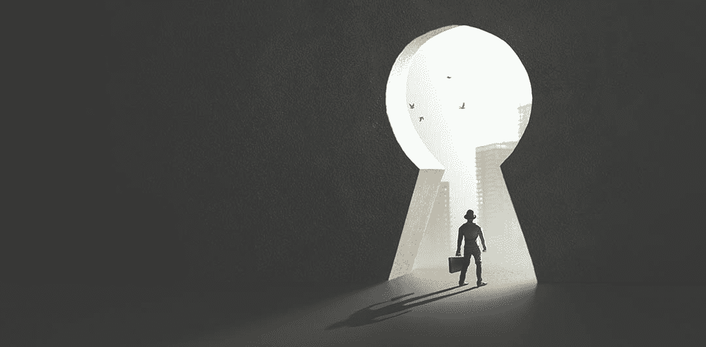

# 春节特辑 3-蔡钰：没有大家族，是孩子生命中的缺憾吗？

和菜头

2022-04-08

## 春节特辑 3-蔡钰：没有大家族，是孩子生命中的缺憾吗？

问答特辑 3-蔡钰：没有大家族，是孩子生命中的缺憾吗？

| 转述师：余昊威 |

这里是本专栏的「问答特辑」，五个问题，来自五位日更专栏的老师。好问题往往比答案更重要，谢谢五位老师精彩的提问。

\*

## 蔡钰：

菜头叔，你作为孩子会喜欢拥有一个大家族吗？你作为叔父会喜欢拥有一个大家族吗？越年轻的孩子生命里越没有舅舅姑姑了，这会是一个严重的缺憾吗？

当我还是个孩子的时候，和父亲的家族并不亲近。我叔父家的一支，除了叔父本人其余的成员不能说汉话，因此交流起来非常困难。我伯父家的一支，因为伯父只是因为开会才会来省城，所以接触的机会也少。

我和母亲的家族更亲近一些，她们家这一代有八个孩子，加上过继来的一个儿子，一共是九人。最终存活下来的，只有四人，两个姨妈两个舅舅，在当地算是中等规模的家族。姨妈们对我都很好，但是我最亲近的是我小舅舅。可能是我母亲带大他的缘故，我们之间的关系从一开始就非常亲近。

当时我经常去母亲娘家过暑假，姨妈们住在市里，家庭环境和条件都很好；小舅舅家在乡下，住在外公外婆的祖屋，条件比较差，到处都是土，晚上我还从床上掉下地来，但我还是更愿意去舅舅家。

他们家的狗很凶，第一次见到我的时候，绕着我不断地嗅，流露出困惑的表情。然后不断跑回我小舅舅身边嗅一下他的味道，再跑回来嗅我，仿佛要验证什么东西似的。最终，它终于下定决心，做出了什么确认，在我面前摇起了尾巴。这是我对家族最早的概念——狗能觉察出血缘关系。

其实，我并不大喜欢大家族。本家的亲戚还好，但是加上姻亲就变得很麻烦。尤其是过年的时候，亲戚之间要相互走动。从早到晚一家家去拜访，要遵守很长时间的礼仪之后才能吃得上饭，吃饭又非常漫长，大人们仿佛有说不完的话，非常耽误我放烟花、放鞭炮。虽然能得到一个红包，但是那红包最后也落不到我手里，我只是礼节性和名义上的拥有。

而那些远亲就更加令人尴尬，平常大家极少走动，因为家族支脉分散的缘故，大家其实只是拥有共同的某位祖先，并没有多少共同生活，所以要让我努力对一个陌生人表示出亲近来，始终都是一件令人为难的事情。说到底，我对他们的熟悉程度，还不如对我家邻居和门口小卖部老板的熟悉程度，他们原本就不在我的生活之中。在这种时候，家族的强制绑定作用让人觉得反感。

至于说我作为叔父，是否喜欢拥有一个大家族，蔡钰老师倒是问出了一个大问题。

我们这样的平民在今天大概可以分为两个群体。 **一种叫做浪人，另一种叫做族人。**

所谓浪人，就是脱离了先祖的宅基地，远离亲族，在极为遥远的外地生活。在外地身边也没有族人，所有的社会关系不是围绕血缘组成，可以从一个地方飘到另外一个地方，如同蒲公英的种子。

这样的人与其说是乡土的，不如说是城市的，他们在大城市里所从事的事情，大多无法在故土找到对应的职业。从这个意义上来说，他们更像是城市生活的一部分，巨大工业机器里的齿轮或者螺丝钉。

所谓族人，就是生于斯，长于斯的本地土著，甚至还拥有家族祖坟和祠堂。他们居住在祖先的土地上，身边都是密密麻麻、形形色色的亲族。亲族们形成了巨大的社会关系网，如同树木的根须，深深扎入本地生活，而族人自己则是这张网上的某一个节点。他的个人价值，他的社会地位，体现在他作为一个节点能联系多少人，能够为这张网带去多少东西。

和浪人相比，族人更加乡土，更加本地，也有更多来自家族的羁绊。他们拥有更少的个人自由，却要背负更多的责任和义务，不过也正因为如此，他们始终可以得到来自家族的支持，因为在这张网上的人，理论上都有义务帮助其他亲族。

浪人和族人的区别，体现在有根无根，是否和土地相连。

浪人和族人拥有完全不同的生活形态。所有飘在北京、上海、广州、深圳、武汉、成都、杭州这些大城市人，都可以算作是浪人。而所有留在本地、本乡、本镇、本市、本省的人，都应该算作是族人。

在今天的中国，应该是族人占据了人口中的大比例，浪人的规模则要小得多。浪人其实不会喜欢大家族的感觉，这种经验是他日常生活所无。纵然他也会参加规模巨大的社交活动，拥有巨大的社会关系网，但那些社交活动并非经年累月地持续，参与者也并非常年不变，而社会关系网则完全基于利益交换和个人阶级地位，这样他就不大需要计算复杂的人情，只需要关注大家的相对位置变化就足够了。

一定程度而言，浪人生活在陌生人之中。无非是这些陌生人经过了他自己的拣选，一起经历过些事情，于是从陌生人变成熟人，从熟人变成朋友。于是，大家会有一些共同话题，也有类似的思路和方法，这一点在由亲族组成的关系网中是很少见的。

亲族的情况完全不同。他们包裹在一张由熟人组成的关系网中，由血缘关系决定了远近亲疏，又因为社会能力而决定了自身的价值。因此，族人可能会更喜欢大家族。家族规模越大，意味着他们对本地生活的掌控能力越强，自己所得到的支持和保护越大。

在一个典型的本地大家族中，成员会覆盖政府、医疗、教育等等行业，小到医院挂专家号，大到晋升提职，办理专营证照，都可以找到家族成员帮忙。在本地，个人竞争力并不取决于自身能力，而在于家族的规模和力量。在这个意义上来说，一个大家族当然比一个小家族要好。虽然每个人都要对家族承担一定的义务，苦于复杂的人情往来，但每个人同时也得到了庇护和帮助。

如果我是一名族人，作为叔父，我当然乐于见到人丁兴旺的一大家子人，所有这些人加在一起，决定了我此刻能在本地过上怎样的生活。所有哭闹不休，追逐打闹的小孩子不会让我觉得厌烦，反而让我看到的是未来的生活希望。

因此，是否喜欢大家族我很难单纯从情感的角度去衡量。不同的人有不同的生活形态，浪人和族人对于大家族的态度是完全不一样的，这种态度差异并非全然来自情感，而是有相当程度的实用主义色彩。

**这也不是先进和落后之间的区分，而是生存竞争的自然演化结果。**

在本地结成大家族彼此关照对于个人是有利的，在外地保持高度机动性和高度人际连接对于个人是有利的。当然，也有浪人不喜欢都市生活的疏离和孤清，也有族人不喜欢大家族的压力和义务，但这是个能力和选择的问题，每个人都要承受自己生活形态所对应的结果。

**永远有本地人向往着远方，但他们可能并不清楚远方的寒冷；也永远有浪人渴望着故乡，但他们也知道自己多年的缺席已经让自己失去了在家族的地位。**

现在再来讨论孩子们失去了叔伯姑舅姨妈的问题其实就很清楚了。孩子们哪里会有这样的恐慌？他们生下来世界是怎样的，他们就怎样完整地接受下来，并且觉得世界就是如此。

真正忧虑和恐慌的，是我们这些成人。而且，是我们这些成人站在族人的角度，去考虑小孩子的未来。  
**与其说是担忧他们未来的亲情，倒不如说担忧家族的萎缩对他们未来的影响。**

这就默认了他们未来还是族人，不大可能成为浪人，可是谁又知道呢？也许小孩子最后直接漂泊到了海外也未可知。即便未来他们还是族人，但是城市化的浪潮不可阻遏，现代社会把人从家族和家庭中剥离出来，变成原子化的人，这一趋势也同样不可阻遏。

**但人和人之间必须建立某种纽带，这一点是不会变的。大家族是一种古老而有效的方式，未来会出现什么新的方式我们并不知道。**  
正如人们多年前深深担忧独生子女无法相互协作一样，今天来看，社会也并没有因此而分崩离析。当然，这样的视角是全然站在浪人的角度去看待，带着某种冷静和超然，甚至因此缺少了温暖和亲切。

那么我这么说好了：一个人不能选择自己的出生，也就不能选择自己的叔父和舅舅是谁。在叔父和舅舅日渐凋零的今天，我愿意去做一个网络上的公共叔父，或者公共舅舅。

事实上，开设这个专栏，也更像是一名叔父或者舅舅所做的事情。

1.浪人和族人的区别，体现在有根无根，是否和土地相连。这不是先进和落后之间的区分，而是生存竞争的自然演化结果。  
2.永远有本地人向往着远方，但他们可能并不清楚远方的寒冷；也永远有浪人渴望着故乡，但他们也知道自己多年的缺席已经让自己失去了在家族的地位。  
3.人和人之间必须建立某种纽带，这一点是不会变的。大家族是一种古老而有效的方式，未来会出现什么新的方式我们并不知道。

公众号懒人找资源

发布留言

0/ *500*

确定

# 春节特辑 4-熊逸：舍人而救猫狗，该被谴责吗？

和菜头

2022-04-08

## 春节特辑 4-熊逸：舍人而救猫狗，该被谴责吗？

问答特辑 4-熊逸：舍人而救猫狗，该被谴责吗？

| 转述师：余昊威 |

这里是本专栏的「问答特辑」，五个问题，来自五位日更专栏的老师。好问题往往比答案更重要，谢谢五位老师精彩的提问。

\*

## 熊逸：

如果自家养了多年的猫，或者狗，和一个陌生人同时遇险，你只有机会救一个的话，情感上肯定向着自家的猫狗，尤其当那个陌生人面目可憎的时候。那么，舍人而救猫狗，一定就该受到道德谴责吗？和菜头老师会怎么选择呢？

其实我已经看出来了，熊逸老师明显想要救猫。所以他强调了猫是自家猫，人是“陌生人”，又说那人“面目可憎”，最后生怕我感觉迟钝，专门用了一个反问句提醒：一定就该受到道德谴责吗？那我应该怎么回答呢？我一定不道德谴责熊老师？还是说我不一定道德谴责熊逸老师？

在这里，熊逸老师提出的是一个思想实验。思想实验就是他所说的情形并没有真实发生，我们用这个假设的情形来进行思考，检查一下我们的思想上还有什么问题或者漏洞，是一种惯常的思维训练，相当于大脑的广播体操。

那么，让我们运动起来吧：

首先，熊逸老师如果选择救猫，那么有很大可能会遭到道德谴责。问到的人越多，道德谴责的可能就越高。为什么会这样？因为他的选择抵触了大多数人的一条道德标准：人永远高于动物。

这种想法由来已久，人类自认为是万物之灵。注意一点，没有说是万物之王，万物之首，而是说万物之灵。什么意思？就是说，人类并不认为自己和动物、植物算是同一类。兽王还是野兽，而灵就不同了，  
**灵意味着本质上人是另外一种高级生命，有智慧，有语言，能使用工具，在更为古老的时代里还认为只有人才有灵魂。**

因此，大家认为在人和动物之间有一条巨大的鸿沟，而且人类位置尊崇，动植物身居低下。

这种共同的认知最后甚至体现在法律之中。我们都知道，有许多动物是濒危物种，受到国家法律的保护。如果有谁去捕捉甚至猎杀它们，可能要被判极重的刑罚。

但是，如果一个人身处绝境，无法得到救援，因为缺乏食物面临死亡。这时候他遇见一头大熊猫，或者一只朱鹮，为了活下去，他杀死珍稀野生动物吃掉，那么他的确违法了法律，但是却不会受到追究。因为在一个人的性命和一个动物的性命之间，法律永远站在人的这一边。哪怕那个人平常道德败坏，他吃掉的是世界上最后一只恐龙。

所以我说熊逸老师选择救猫而不选择救人，会遭到严厉的道德谴责，原因就在于他破坏了人永远高于动物的普遍道德标准。

那么，是不是熊逸老师就没有办法了呢？倒也不是，他还是可以为自己辩护一下的。这是因为同样是道德标准，人们有不同的方法去衡量。

不可以撒谎算是一条道德标准，那么是不是就没有人撒谎了？不可以在背后说人坏话，那么是不是大家都不那么做了？显然不是这样的。在这个世界上，有许多人把道德当做是一种信条，不计一切代价地去维护和遵守，认为在无论任何情况下都不能打破。但是，也有许多人从另外一个角度去看到道德，他们会分析其中的利弊，总是选择有利的那个方向，道德在他们眼中就变得灵活而富于弹性。

妈妈问你今天她学做的新菜好不好吃？其实她放了太多的盐，咸得难以下口，那么你应该怎么回答？如果你把道德当做是信条，那么你就会直截了当地回答她说：很难吃，咸得要命。如果你考虑说实话会让她觉得很受伤，你说出来菜也不会变淡，那么你可能会选择撒谎，告诉她说：好吃极了。

这只是考虑说实话伤心的可能，而有些时候说实话可能要命，比如说“你觉得我今天漂亮吗？”这种问题，回答不好最起码是个重伤。

如果人人都把道德当做是信条，那么熊逸老师就没什么话说，只能默默承受。但还有那么多人从利弊的角度分析道德，选择要不要遵循，那么熊逸老师就有了很大的机会。

首先，人高于动物的想法来自非常久远的过去。在那个时候，人和大自然是敌对关系，人和动物是征服和被征服的关系。

对于人而言，动物的存在是因为它们有用，肉可以作为食物，皮毛可以用于御寒，力量可以充当劳力。直到今天在一些偏远贫困的地区情况依然如此，一只狗，一只鸡，一只兔子，平常是孩子的宠物，过年的时候就是桌上的一道菜，原因是获得肉食很困难。

因此，人高于动物其实有两重含义：

一重是为人类杀戮、征服、奴役动物找到一个合理的说法，否则同类相残是一件很难让人接受的事情；

另外一重比较隐秘，那就是人有人性的那一面，有文明的那一面，但是也有兽性的那一面，有野蛮的那一面，所以要把人和动物区分开，强调人不同于动物，要高于动物，为的是约束人类自身。

但是今天的情况已经发生了很大的改变。大部分动物人类已经不再食用，填饱肚子也不是大多数人的生活首要目标。在数十个世纪中，人类探索完整个世界，从自然界的对手变成傲慢的征服者，又从傲慢的征服者变成谦卑的共生者，人类不再谋求征服自然，而是在考虑如何和自然和谐相处，共同生活。

在这个过程中，人类对待动物的态度也发生了很大的变化。比如说建立野生动物保护基地而不是吃掉它们，比如说创立法律保护珍稀动物反对虐待，再比如说猫狗，人们饲养它们不再是为了实用性。养狗不是为了看家护院，养猫也不是为了捕捉老鼠。相反的，如果猫狗还去做这种事情，前者会让主人赔很多医药费，后者则会让主人大惊失色。

它们有了新的名称，叫做伴侣动物，甚至因此脱离了动物界，在人类的家庭里拥有了一席之地。人们养猫养狗，是因为它们可以陪伴自己，给自己带来快乐和安慰，因此几乎把它们当做是自己的家庭成员来看待。

那么这里可以问一句：相对于过去吃猫吃狗，现在把猫狗当做是家庭成员，这是不是更加人性化？这是不是更加文明？如果你也承认这一点，同样你也应该承认——许多人是把猫狗当做是自己的家人，这一点即便你不能赞同，但是你也能够理解。

好了，熊逸老师的问题现在就变成这样：在一个给你带来快乐和安慰，始终陪伴在你左右，每天和你在一起生活，你视为家人的猫咪，和一个你根本不认识的人之间，你会选择救谁？

我们再换一个角度： **在失去生活中带来这一切给你的猫咪，和面对汹涌而来的道德谴责之间，你更能承受哪一个？**

选择道德作为信条的人是不会考虑这个问题的，他会选择救人，认为人永远高于动物，他要用牺牲自己心爱的猫咪来维护他内心的信条。

也许在救完人之后，他会有很长的时间生活在痛苦里，而且这一次并没有猫咪前来陪伴，但他还是愿意承受这个结果。因为如果打破了心中的信条，他也就失去了生活的方向。为了这个方向，他要牺牲自己的所爱。

选择衡量利弊，从功利角度出发的人，他可能选择救猫。因为他不能冒着失去自己生活一部分的风险，去救一个全然不相关的人。同时，他也不认为那是一种自私，因为在他看来，  
**如果一个人不能保护自己所爱，反倒是要主动去牺牲掉以成全他人，这样的做法可能未必是社会之福，因为所谓的爱最终会落在哪里呢？**

最后，也是最为关键的一点：在救猫咪和救人之间，选择前者可能会面临着极大的道德压力。因此，很可能的情形是一个人本心是想去救自己的猫，但是一想到之后排山倒海的道德谴责，他极为不情愿地选择了救人，以此避免自己未来身处困境。

这是所有可能中最糟糕的一种，它看似在行动上维护了道德，但这种行为并不发自本心，甚至也不是自愿，而是迫于外界的压力。人们说  
**道德指向善，而这种善如果并非自愿，并非是自己主动选择，那么，当一个人不得不行善的时候，就连一丁点善都不剩下了。**

所以说，无论是救人还是救猫，在事情发生的那一瞬间，一定要顺从自己的本心。

在那一瞬间之前，你有选择。你做出怎样的选择，你本身也就是怎样的人。这样，在那一瞬间之后你才不会后悔。并没有一种说法，是要你一定要做怎样的人。  
**如果心念不能通达，那么一辈子都不会快乐。甚至不需要外界的压力，你自己都能把自己绊倒。**

对于熊逸老师的问题，我想说：如果一个人真的在乎心中的道德信条，他不会考虑失去猫；如果一个人真的在乎他的猫，他也不会去考虑道德谴责。做出任何一种选择，都要得到一些背负，世间哪里有那么多两全的法子呢？

1.最糟糕的是，看似在行动上维护了道德，但这种行为并不发自本心，甚至也不是自愿，而是迫于外界的压力。  
2.道德指向善，而这种善如果并非自愿，并非是自己主动选择，那么，当一个人不得不行善的时候，就连一丁点善都不剩下了。  
3.如果心念不能通达，那么一辈子都不会快乐。甚至不需要外界的压力，你自己都能把自己绊倒。

公众号懒人找资源

发布留言

0/ *500*

确定

# 春节特辑 5-卓克：除了基因，一个人从祖先那里继承了什么？

和菜头

2022-04-08

## 春节特辑 5-卓克：除了基因，一个人从祖先那里继承了什么？

问答特辑 5-卓克：除了基因，一个人从祖先那里继承了什么？

| 转述师：余昊威 |

这里是本专栏的「问答特辑」，五个问题，来自五位日更专栏的老师。好问题往往比答案更重要，谢谢五位老师精彩的提问。

\*

## 卓克：

菜头哥，我们绝大多数人可能勉强能说出爷爷、奶奶、姥姥、姥爷的名字，但再往前就不行了，更别提具体事情了。所以我想问，除了基因外，一个人从他三代以上的祖先那里还继承了什么呢？

卓克老师问了个挺有趣的问题，稍不留神，很可能就被他的说法给绕进去。我想，我们可以从两个方面来进行讨论。

的确，在今天看，卓克老师的说法是正确的。中国有十几亿人口，上亿个家庭，但是能说清楚三代以上先祖名字的人家，恐怕没有多少。能说清楚这些先祖生平事迹的人家，恐怕还要更少。

但过去也是这样吗？将来也会如此吗？在过去，还存在着家谱、族谱，上面记录的不单有血缘传承关系，家族迁徙历程，也记录着先祖的个人事迹，说起来那就是一本家族史。

我有一位朋友曾经留学澳洲，在当地发现一座早期华工修建的关帝庙。当年的华工早就已经消失在了时间长河里，但是他们修的关帝庙一直都在。当他去参拜的时候，连关帝庙的庙祝都变成了本地金发碧眼的白人，而且，他们还自己发明创造出了一套祭拜关公的仪式。

在关帝庙里，我朋友发现了供奉了一批灵位，都是客死他乡的华工。当年华工撤离的时候，如果不知道亡者国内的亲属，同行的人里也没有亲人同乡，那么就会把灵位留下来。结果上百年时间过去，灵位就那么一直放在澳大利亚的关帝庙里。

那位朋友动了恻隐之心，总觉得中国人讲落叶归根，就想着联系国内，把华工的灵位送回家乡。其中有一位亡者没有多少资料，看起来很难联系到家人。我朋友就根据灵位上写的村子名字，还有亡者姓名，一点点查到广东一个很小的县。那个县里居然还保存着上百年的家谱，在上面果然找到了亡者，而且顺着也找到了他还健在的后人。于是，在他的名字后面终于可以加上一行小字讲述他人生的终点：亡于澳大利亚。

如果不是因为一百多年来的战乱和社会动荡，中国人能够始终生活在一个安定有序的社会环境里，那么家世的传承也会清晰而稳定。通过家谱一类的文字，可以看到家族的过往历史，知道家族的兴衰变迁，以及家族何以历代相传。

这种家族历史本身，就是先祖留下的宝贵遗产。无论是失败的教训，还是兴旺的秘密，又或者是关键点的选择，都隐藏其中。  
**后人知道自己如何来到这里，才会知道将来前往何方。**

现在的问题，无非是这种家族传承中断了，但中国社会也安定了那么多年，我认为未来得到恢复完全是有可能的。尤其是在网络时代，家谱或者家族志的撰写、保存和流传都会变得更加简单。

就卓克老师来说，完全可以从他自己这一代开始恢复记录，而且还能附上他的课程链接，社交账号内容，连图片带视频，比传统的家谱详尽真实得多。实在不行，把家族群的聊天内容导出，那就是一本连载的家族日志啊，这一点连古代的名门望族都做不到。

当然，卓克老师还可以坚持问下去：别跟我打马虎眼，你说说具体有什么东西可以继承？

那我可以从另外一个角度继续回答这个问题：一个人，从不知道姓名，不知道生平的祖先那里，究竟能继承到什么？简单说，那就是你现在个人处境的一大部分。

卓克老师的问题，其实隐藏了一个想法，那就是自己现在过怎样的生活，完全都是靠自己的努力奋斗，和祖先的关系不大，和他们是谁，和他们做了什么，关系不大。但我不那么认为，以我为例，我家三代以上都是云南土著。不过，我母亲那边的家族并非是云南原住民。云南的初祖据说是一名官员，在更为久远的过去，不清楚是因为屯垦还是发配，举家从湖南迁徙到了云南。

无论是屯垦还是发配，必然和我那位远祖的个人选择，或者个人行为有关系。如果他老人家当年没有做某些事情，那么我就根本不会出生，也不会出生在云南，皮肤就不会那么黑，考大学也就不会那么难，现在回家过年也就不用买那么贵的机票……

所以，我和任何一任不知其名的先祖，都在一条看不见的因果线上。他们做了许多事情，做了许多选择，所有这些加在一起，决定了我的出生，决定了我的成长环境。因此，当我生下来的时候，其实就已经继承了他们的遗产。

如果卓老师不承认这是遗产，我还可以把话说得更加直白一些： **先祖是种田人，后辈是吃米人。** 先祖是吃米人，后辈就没饭吃。

**所谓的种田，就是采取主动选择，承担风险，积极进取的态势，去过自己的人生。这样的先祖，就是为后人种福田。**

就像现在北京、上海、广州、深圳的一代移民，两手空空来到大城市，过着非常辛苦的生活，到退休才能缴清房贷。但是他们的孙辈生下来就是大城市的居民，拥有最好的教育资源，最好的医疗资源，还有最少一套房，不用再为了还贷而喘不过气。如此经历十代，如果这个家族都是按照这样的态势生活，那么他们的孩子生下来就在祖先种的福田里，拥有来自祖先最丰厚的馈赠。

同样的，如果身为先祖，不思进取，随时逃避，维持现状，讲求安逸，那就是在吃米，而且吃的是子孙饭，提前就把子孙福田里的稻子收割下来吃光。于是，子孙后代届时就没饭可以吃，只能全靠自己去种。

换句话来说，如果先祖自身不能达到一个社会阶层的高点，那么后世子孙因为缺乏必要的资源，向上攀爬的难度就会变得很大。相反的，却可以跌得更深，因为起点本来就没有多高。别人种的福田可以吃五代十代，最终才会耗尽。中间只要出现一个杰出的后人，就还可以把这个过程延续下去。而吃米的祖先甚至没有福田留给儿子，更不用说孙子，于是没饭吃甚至可以变成家族遗传。

所以， **一个人并不是真的光溜溜来到这个世上，在他降生的那一刻，就已经继承了先祖的遗产。**  
这种遗产并非只是土地金银这样的实物，还包括家族历史和传承这样的宿命。

时间并非从我们这里才正式开始，我们继承历史，同时也开创历史。 **一切的未来，在遥远的过去都包含着种子。我们发芽的时候，绝非出于一种偶然。**

最后，我想卓克老师的这个问题，将来的人可能最容易回答：当然是社交软件账号啊。

1.后人知道自己如何来到这里，才会知道将来前往何方。  
2.先祖是种田人，后辈是吃米人。先祖是吃米人，后辈就没饭吃。所谓的种田，就是采取主动选择，承担风险，积极进取的态势，去过自己的人生。  
3.一切的未来，在遥远的过去都包含着种子。我们发芽的时候，绝非出于一种偶然。

公众号懒人找资源

发布留言

0/ *500*

确定

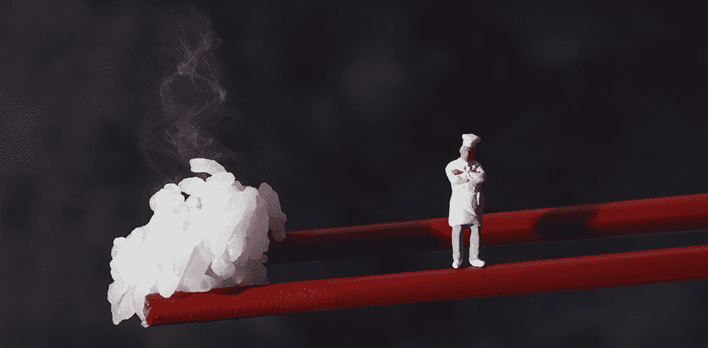

# 06 厨艺：那些厨房没有说出口的话

和菜头

2022-04-08

## 06 厨艺：那些厨房没有说出口的话

厨艺：那些厨房没有说出口的话

| 转述师：余昊威 |

**厨艺，名词，一种人生的修行法门，经常被误认为是技巧。**

\*

人们总是有一种误解，自己经常享用什么事情，就以为自己拥有丰富的经验，甚至觉得自己是做这件事的高手。

经常看电影，于是就觉得自己可以指导编剧导演；经常用网络产品，于是就觉得自己可以做产品经理；至于说经常吃饭就认为自己是美食家，认为自己精通厨艺的人，那就更是数不胜数。

想要反驳也很简单：一个人天天睡觉，拥有几十年丰富的睡觉经验，那他为什么会失眠呢？为什么他自己解决不了呢？

我们可以试着用厨艺为例子分析一下。太多人因为天天吃饭，就认为做饭是一件很简单的事情，所谓“看都看会了”。偶尔下厨房尝试，结果却和想象的大相径庭。其中一些人心中发狠，去找来菜谱研究，实在不行就看视频学习，最后实操出来的东西依然是惨不忍睹的事故现场。

不要以为这是傲慢的恶果，许多人怀着谦虚好学的精神去看菜谱，照猫画虎，做出来的东西同样是一塌糊涂。类似的情形我见过不知道多少次，人们去厨房做东西，做出来的东西有无限多种可能，唯独不是菜。

为什么会是这样？ **我的看法是他们弄错了次第。次第，指顺序，佛教里经常用这个词来描述修行的不同阶段，以及阶段之间的顺序。我在这里的用法偏向后面一种。**

回顾我的厨房岁月，第一课并不在厨房，而是在野外，内容是生火。

那时候火柴还是资源，并没有那么容易得到。在野外能够找到的燃料也非常有限，一旦被大人发现在玩火肯定逃不掉一顿痛打。综上所述，当时我的日常练习内容非常严格：在三根火柴之内，利用非常有限的燃烧物，尽可能快地生起火来。

要做到这一点并不容易，需要足够了解火的特性，知道什么情况下它才能快速燃烧，什么情况下可以作为火种长时间保存，什么情况下可以挽救起奄奄一息的火苗，什么情况下可以判断火已经彻底熄灭。

**这看起来和做菜没有任何关系，但是当你把锅架在灶眼上，点燃煤气的时候，你就知道缺了这一课会有什么影响。**

第二课不是做菜，也不是做饭，而是热剩饭剩菜。

自己用一张报纸和劈柴把火生起来，引燃蜂窝煤。然后在锅里放水，放上笼屉，用蒸汽热剩饭剩菜。这一课主要的学习内容是水分变成水蒸气之后，会产生多么大的热量，以及食材在高温水蒸气下会发生什么变化。如果不慎被缝隙出泄露的蒸汽烫到一下，那就印象更为深刻了。

第三课才是做饭，研究水和米的配比，以及要配合怎样的火力，才能得到软硬适中的米饭。在这个过程里，可能要失败很多次，才能做出一份家人赞许的好米饭。为了这一声赞许，很容易发现如何通过控制火力来挽回水多水少的局面，这就是第一次接触到所谓的火候。

修到这个程度，我才获得了进入厨房的资格，允许跟着处理一下食材。此时依然不允许我直接炒菜，哪怕我天天在边上看着做。主要原因是那个时代人们普遍清贫，让一个孩子用一锅菜练手，其中的风险大到让人承受不起。

处理食材包括清洗、拣选、腌制、水发等等，通过这个过程才能知道食材的软硬干湿老嫩，以及粗加工带来的物性变化。这一课也很好学，自己处理的白萝卜，自己吃的时候要吐网状的渣时，印象比什么都深刻。感受到嚼不动，咬不断，对一个人的提高是最快的。

过了这一关之后，我在第五课终于可以参加一点真正的实践。父母炒菜的时候可以站在一边看，最后要出锅之前那几下，让给我练习一下翻炒、收汁、勾芡等等手法，最重要是让我反复感受最后大功告成的那一瞬，  
**一次次从成功走向成功，建立起积极乐观的心态。**

此外，就是逐步感受手、眼、锅、火、菜之间的配合。最早的要求只是别把菜给炒出锅边，最后的要求则是保持菜的型和色，眼要准，手要稳，不要惧怕任何意外情况，敢于用锅盖和湿抹布解决一切。  
**到了这个阶段，基本上在内心祛除了对火的恐惧，开始对操控火有了兴趣。**

第六课是让我做一点复杂的小菜，西红柿炒鸡蛋，青椒炒肉丝，干煸苦瓜一类的菜式。但是蒸水蛋、烤锅巴一类看起来极为简单，但是极考究手法的菜还是不行。

在这一课里，解决的问题是如何区分做熟和做菜。做菜要讲流程次序，要讲调味时机，要讲火候调节，要讲味道的相互激发或掩盖，目的是让最终的出品好吃，而不仅只是做熟而已。到了这里其实也不难，只要掌握不要火太大把菜烧焦，以及学会使用酱油、味精和糖，问题都不大。

第七课以后基本是自修，见缝插针学习一些零散的知识点。比如说煮绿叶菜不要盖锅盖，这样菜叶就不会变黄；炖肉时最后再放盐，这样瘦肉就不容易变得很硬。诸如此类，都是一些零散的心得体会。记得当时我自己选修了腌青菜，用个广口瓶放进去一两青菜碎尝试，还算成功，于是得以免修泡菜，因为原理和要点其实差不多。

第七课授课结束是在我的高一，以后家长以专心学业为由，不准我再进厨房。但是等到结业完成，可能又花了十多二十年时间。在这段时间里，我因为兴趣爱好的缘故，经常下厨房尝试，最后形成了几道品质稳定的菜品。

在这个阶段的末期，我达到了看菜谱做菜的水准。相比之下，那些直接看菜谱然后就下厨房的人，属于跳级生。他们一举越过了前面所有环节，认为自己会阅读中文，能看懂菜谱，就可以烧出菜来。的确有这样生而知之的天才，可惜绝大部分人都不是。

**这就是次第错误，没有多少前行准备，就直接跨越到后续的阶段，那就只能用黑暗料理来作为自嘲。**

对于根本不尊重次第的人来说，他们以为自己知道了如何做菜，就能够如此做菜。而对于我这种按照次第，一阶一阶修上来的人来说，并没有什么做菜，有的只是控火，控火才是一切的核心。

在控火的基础上，是了解食材的物性，知道应该如何去正确地处理它们，才能达到最好的效果。在了解食材物性之上，才是烹饪和调味，用来增益或者掩盖某种味道。所以，我们现在回过头来看，我并不是一开始就从读菜谱开始，而是从野地里生火烤土豆开始。

学习点火，认识火力。从最简单的火配合水开始，做简单的蒸，这里甚至都不需要考虑火候。然后才稍微复杂一点，解决水、火、大米三者的配合，  
**用唯一的食材，唯一的一种加工方式，得到一份成品。**

经过大米之后，立即横向展开了解其他的食材，以及预处理食材的方法。接下来是实践出锅前的一刻，强化对完成一道菜的认知，学习如何操作厨具。最后才是完整地做完一道菜，用不断重复和优化的方式来完善自己的技能。

这就是次第的威能。人人都会说厨艺是火的艺术，这不过是个比喻而已。 **次第不会去管厨艺是艺术还是技巧，它会告诉你这件事情的核心是什么，厨艺的核心是控火。**  
至于说如何认识火，如何操控火，每个人都有自己的路。

然后会告诉你，这件事的要素有哪几样，厨艺的要素是食材处理和烹饪方法。那么你自然也就要去认识食材，学习处理方法，在这个基础上才能尝试各种烹饪方法，在循序渐进的过程中增加各种技巧。

在完成这个次第之后，你自然就会做菜了。而且，当你看别人写的菜谱，同样的中文字，你能看出对方厨子的心思和思路，也能理解他为什么要那么做，为什么要按照那个次序做。甚至你还没有做出这道菜之前，你就已经知道它的味道和口感。

因此，我认为厨艺就是一种修行法门。

**会做菜是多么微小的一种人生成就，但就是这么一点点成就，依然有那么多人无法获得。**  
而有那么多人无法获得的同时，他们却认为这是一件很简单很容易的事情，也许下次换一本更好的菜谱就能做到。

在他们那么认为的时候，丝毫没有觉察他们的厨房正在保持缄默。如果换了一位会做菜的人进去，菜板上的当当声，油锅的滋滋声，砂锅的噗噗声，锅铲的刷刷声，火焰的呼呼声，流水的哗哗声和油烟机的嗡嗡声合在一起，厨房正在演奏交响乐，这就是他的修行结果——  
**基于充分认知和循序渐进，从而达到的高度和谐一致，他因此可以和厨房对话，甚至可以让厨房放声歌唱。**

那么，除了厨艺之外的那些事呢？你找到了正确的次第没有？

读者 “我问和菜头”:

> "每周四、周五，和菜头会从一周用户留言中选取精彩提问，专门撰文回答。欢迎将你的好问题写在下方留言区。"

1.没有多少前行准备，就直接跨越到后续的阶段，那就只能用黑暗料理来作为自嘲。  
2.会做菜是多么微小的一种人生成就，但就是这么一点点成就，依然有那么多人无法获得。  
3.基于充分认知和循序渐进，从而达到的高度和谐一致，他因此可以和厨房对话，甚至可以让厨房放声歌唱。

公众号懒人找资源

发布留言

0/ *500*

确定

# 07 焦虑：你需要学会如何相处的好朋友

和菜头

2022-04-08

## 07 焦虑：你需要学会如何相处的好朋友

焦虑：你需要学会如何相处的好朋友

| 转述师：余昊威 |

**焦虑，名词，很多人以为是一种心理状态，但是它更像是一个人，而且这个人就是你自己。**

\*

说出来你可能不信，在我写作二十多年，写出数百万字之后的今天，每次新写一篇文章之前我依然会感觉焦虑。这种焦虑和我写第一篇文章时相比，无论是强度、形式还是感受上，其实都没有很大的差别。

你可能觉得我那么说是为了宽你的心，劝你相信焦虑并不是什么重要的事情。那我这么跟你说好了：在我看来，首先谁也宽不了你的心，其次焦虑对于你我来说都极其重要，最后关于焦虑存在着许多误解。

人们总喜欢说“克服焦虑”，或者“解决焦虑”，但是它总是一再出现，说明我们既不能克服，也不能解决，最多能做到暂时抑制罢了。那么，如果我们真的能够克服焦虑，彻底没有了焦虑这种情绪，又会怎样呢？

我不知道你的情况，不过对于我而言，如果我有一天当真失去了焦虑，那么我肯定一个字都不会去写。你知道写作对于我而言，在什么时候最让我愉悦吗？敲下最后一个字，全文结束的那一刻。我的焦虑得到了全然的释放，在那一刻我得到了空前的放松，然后才是成就感缓缓升起。

**为了那一刻，我总是欢迎焦虑的到来，因为它的出现会为我带来完成一件事的动力。**

我赌你从来没有尝试过完全放松的写作，在那样的状态下并不会如传说一般写出什么神作。反而会因为放松，彻底失去了警觉和冲动，甚至因此彻底失去了表达欲。因为这一刻刚刚好，为什么要额外去做写的动作呢？就这么停在这里不好么？

焦虑就不一样了，它看起来像是因为自己还没开始行动而感到的紧张和不安，但它其实总是指向结果。

**真正让你觉得不舒服的，是对于不能达成结果，对于结果不让人满意而产生的担忧。因此，结果可以“治愈”焦虑，那么焦虑的出现其实就是把你推向行动，推向结果。**

既然如此，为什么人们还是会如此讨厌焦虑呢？因为过度的焦虑并不好，它反而会限制一个人的行动，把他卡在原地动弹不得。为什么焦虑会过度？这里我想尽量简单地解释给你听，可能并不符合科学原理，你当做是个比方就好：

首先，我要问你一个问题：谁焦虑？如果你的答案是“我”的话，那么请你立即回答我的第二个问题：哪一个“我”？你可能觉得这是什么问题？就一个“我”，还能有几个不成？

那你再仔细想想，当你被学习或者工作中的一个难题卡住时，你的那个“我”是不是正在原地打转，忙着非常辛苦地思考？这时候突然灵光一闪，破碎的线索突然连了起来，隐约出现了一种新的可能，你是不是叫那个正在原地打转的“我”立即停住，过来这边仔细看看，有没有可能真的行得通。

那么我再问你：那个灵光一闪，看出隐藏线索之间联系的人是谁？肯定不是外人吧？因为念头是直接从你心里蹦出来的。肯定也不是“我”吧，那个“我”还在苦思冥想找不到出路呢。

**当然有很多个“我”，或者说所谓的“我”有很多个侧面。**

为了简单起见，可以把“我”先分成两个小人。一个小人是感性的你，喜欢直觉，喜欢情感，喜欢冲动行事；另一个小人是理性的你，喜欢推理，喜欢逻辑，喜欢谋定而后动。

这两个小人明显不是平分秋色的关系，为了应付日常的生活，完成学业和工作，肯定是理性的小人占据绝对优势。

你在菜市场和小贩凶狠地砍价，为了几毛钱寸土必争，不会讨价还价到一半，突然一把抱住小贩哭着说：“大叔你真不容易，头发都全白了，我不讲了，钱你都拿去！”事实上，你会抑制感性小人的冲动，让他尽可能地处于休眠状态，免得惹出麻烦和笑话来。

前面说到灵光一闪的例子，其实就是理性小人忙于解决问题，没有功夫看管感性小人，于是感性小人自行采取了行动，利用直觉找寻到一条线索。最后，理性小人一把抢过线索，验证了可能是个办法，就勒令感性小人回去接着休眠，自己贪天功为己有。

焦虑也是同样道理。事情来了，感性小人一看，立即挽起袖子就准备上，他喜欢事情完成的感觉。但是理性小人伸手一拦，说“等等”，且让我先算过，这件事要怎么开始才好，怎么做才对，要得到怎样的结果，如果得到会怎么样，如果得不到又会怎么样，别人会如何看我，是否会因此怀疑我的能力，如果做砸了会有怎样的负面影响，这些影响届时又要怎么消除……

理性小人的这些问题和算计，很多时候是根本没有解的。因为缺乏的条件太多，事情的变数太多，凭借他的算力根本无法计算出所有的可能，找到最合适的方法，得到最佳的结果。但是他占据着主导位置，于是他就在那个位置上不断空转，浪费了大量的算力，感觉存在一大堆问题解决不了，根本不会采取任何行动。

这时候对于你而言，你就感觉到了焦虑，而且是过度焦虑，你在考虑一大堆根本还没有出现的“如果”。  
**所谓过度焦虑，就是你被近乎于无限的“如果”给压倒了，你没有办法给每个“如果”一个答案，于是就感觉到无间断的恐慌。**

所以，我们常常见到一个人在焦虑中白白耗费时间，一直耗费到截止时间来临。这时候理性小人终于崩溃，双手一摊，说这次算是全完了；于是感性小人跳起身来接管，管他三七二十一，先做了再说。

最后事情还是得以完成，有些时候回过头去看，做得其实也并不差，所有先前担忧的“如果”，一个都没有真实出现。在感性小人的主导下，即便出了什么问题，理性小人及时补位也大多能应付过去。

那么，你现在肯定又要问我：怎样才能让理性小人去休眠，换感性小人上场？其实并没有什么感性小人，也没有什么理性小人，我那么说只是为了让你认识到自己的心是一种精细而复杂的存在。无论是感性的小人，还是理性的小人，他们都是你自己，代表了你自己的两种不同的倾向。

感性的小人倾向于行动和执行，带着冲动和激情，这是你的一面；理性的小人倾向于判断和评价，经常站在第三方的角度审视你自己，这是你的另一面。你之所以感觉到焦虑，这个焦虑其实就是你理性的那一面，他在对你做自我审视。

**这种自我审视和时间密切相关。**

一头指向过去：你是个什么人，你曾经做出过什么成就，你能够达到什么水准等等；一头指向未来：这件事做成怎样，做不成怎样，别人怎么看你，你对自己如何交代等等。  
**唯独缺了一环，那就是现在。因为现在还没有成为过去，于是就无法加以评价；现在也不是未来，于是也就无法加以判断。**

所以，最重要的是现在就产生行动。为了达到这一点，你要把思虑从过去未来中收回来，努力集中在现在。不要去做评价，也不要去做判断，而是考虑完成事情本身。甚至不应该考虑结果的好坏成败，心系一念就是要个结果。

**如果你仅只是要个结果，仅只是要个完成，那么焦虑就不再是的阻碍，而是变成了你的助力。**  
因为这时候的焦虑无关过去和未来，无关他人的评价和你所有的承受，你的目标就变得简单得不能再简单，明确得不能再明确，焦虑可以顺势推下去，无论是怎么个推法，都只会让你朝着目标前进。

那现在你肯定又要问：如何心系一念？我如何才能停止那些纷纷扰扰回想过去、担忧未来的念头？

我的回答是：过去你因为焦虑而受苦，是因为你以为焦虑来自外界，来自压力。如今你已经知道焦虑其实就是你本人，是你本人的某一面，它被不恰当的放大了。同时，你也已经知道你自身有主动承担、主动行动、主动完成的另一面，只是以前你忽略了这一面的存在而已。

既然你已经知道了自己的这两面，又知道了焦虑究竟是什么，那么曾经困扰和阻碍你的焦虑，如今就可能成为你的助力。

无非是这里我需要再给你加上一条：不要去幻想什么内心喜乐安宁的状态，认为抵达这种状态之后做事就不会有焦虑，一切都会变得非常顺利。那样的状态绝大多数人达到不了，包括你我，而且抵达之后还愿不愿意做事，做事对于自己还有没有意义都得两说。

**所幸天无绝人之路，你我还可以用焦虑作为燃料，那就不妨大烧而特烧，能跑多远算多远。**

即便你现在做不到，无法心系一念，也无法专注于当下，也不用太过在意。如果你先前并没有仔细考虑过焦虑是什么，那么现在你可能有了新的理解，或者仅只是新的启发。有这么一点点想法其实就已经够了，种子已经种下，你迟早也会停下来考虑一下焦虑对于自己究竟意味着什么。一旦细究开始，它原有的概念就会很快分崩离析。

这就像是停电时身处一间陌生的漆黑屋子，你不敢有任何举动；但哪怕是有一瞬间的光亮闪过，照见房间里的一切，但你会立即产生走动的勇气。而只要你成功尝试过一次行动，利用你的焦虑完成了某件事情，那颗种子就会自行发芽生长，届时即便你想要去除它都会变得非常困难。

如果你一定还要坚持问我要建议的话，最后我想对你说：  
**去找一件你能够从中得到乐趣和价值的事情，从它开始体验焦虑所带来的动力，去体会你自己另一面的强大力量。**

从这里出发，最终你有可能在你喜欢的事情和不喜欢的事情之间实现平等，不过那要留待另外的章节我们再去继续讨论。至于说回到焦虑，但凡需要你去克服，去解决的问题，首先应该考虑一下自己是否已经了解清楚问题是什么。

人生中的许多问题，能够控制就算不错了，哪里有那么多的克服和解决？

读者 “我问和菜头”:

> "每周四、周五，和菜头会从一周用户留言中选取精彩提问，专门撰文回答。欢迎将你的好问题写在下方留言区。"

1.结果可以“治愈”焦虑，那么焦虑的出现其实就是把你推向行动，推向结果。  
2.最重要的是现在就产生行动。为了达到这一点，你要把思虑从过去未来中收回来，努力集中在现在。不要去做评价，也不要去做判断，而是考虑完成事情本身。  
3.所幸天无绝人之路，你我还可以用焦虑作为燃料，那就不妨大烧而特烧，能跑多远算多远。

公众号懒人找资源

发布留言

0/ *500*

确定

# 08 冥想：放松心情，可是然后呢？

和菜头

2022-04-08

## 08 冥想：放松心情，可是然后呢？

08 冥想：放松心情，可是然后呢？

| 转述师：余昊威 |

**冥想，名词，一种流行生活方式。**

\*

关于冥想，我有一些亲身体验，也有一些不同的看法。

我初中时候是个暴躁的小胖子，但是我想成仙。那时候市面上有各种各样的书籍，教人站桩、打坐、吐纳，我逐一试过，最后选择了道家内丹派的静坐吐纳法，准备打通任督二脉，实现真气运转小周天，然后打通大周天，完成三花聚顶，五气朝元，最后抵达元神出窍的境界。

为此，每晚我都要打坐。从最早的一炷香都很艰难，到后来可以轻松打坐一个多钟头。在这个过程中，我努力让自己的精神进入安宁内守的状态，心中杂念不生，呼吸微不可察。就这样持续了一两年时间，却依然没有产生真气，我依旧是个暴躁的小胖子。

所以现在当我看到市面上各种冥想的方法时，内心的感觉很是古怪。

一方面它们给我的感觉是过于简单，没有系统性。坐在那里数呼吸，或者是观察自己的念头，就想让自己心绪平静，精神放松，世界上哪里有那么容易的事情？当年我看过的各种书籍，没有哪一本不会强调打坐之前的准备工作。无论是放松关节，还是调整身姿，又或者是自我暗示松弛肌肉，前前后后加起来不少于十五分钟，都是先把身体调节好之后，才去调心。

另一方面我看很多冥想课有头无尾，只是教人或坐或卧，安静五分钟、十分钟，接下来就没有以后了。进入冥想状态，然后呢？然后退出，明天再来一遍。我那时候起码有个明确的目标，书里告诉我前后有那些步骤，依次有哪些境界，不同的境界对应怎样的生理和心理状态，最后说明了是为了成仙。后来成仙太难，人们练习打坐是为了健康。

但我真的没有想到，如今连健康这个目标都没有了，过程简略到只是坐坐，甚至都没有任何后续，好像唯一的目的就是进入冥想状态，冥想本身同时是目的也是手段。

**凡事最怕问一句“然后呢”。** 看完这样的冥想方法，然后我内心中沉睡的暴躁小胖子就苏醒了。

现在我们先假设市面上各种冥想方法是有用的，的确可以让人进入一种深沉的安定，然后精神得以放松，内心得以平复。那就是说，一个人的内心是由身体姿势和呼吸方式所决定的。

那我就要问一句了：既然如此，岂不是说只要改变了身体姿势和呼吸方式，一个人就会失去了内心平和安宁的状态？那一个人每天 99%的时间里，都处在既不平和也不安宁的状态？有什么办法可以维持这个状态？想一下，总不能我和人吵架吵得正无比投入，怒火万丈，此时我突然飞身而起，就地双膝一盘，立即开始冥想，以此恢复平静的内心吧？

我们继续假设市面上各种冥想方法是有用的，那么，随着时间流逝，人会渐渐进入更为深层的冥想状态，然后身心出现种种变化。最简单的例子，是身体变得柔软，盘膝的时间越长，关节会变得越发柔韧。

**但是心的这一部分，情况要复杂得多。**  
当一个人进入深沉的冥想中去，会逐渐丧失关于时间和空间的概念，这时候他的内心世界会悄然打开，让他可以窥视里面的景象。这里根本不像是有些冥想方法宣称的那样，冥想会让人感觉到快乐幸福。

人的内心深处可能隐藏着根本不愿意面对的过往，压抑着不想释放出来的强烈情感。谁告诉你一个人的内心里只有光明美好的一面？当黑暗的那一面从心底升起，并且显现出来的时候，一个人的心神很可能受到极大的冲击，是一种非常凶险的状况，搞不好会造成很严重的后果。

这就是我对当今的冥想方法心存忧虑的地方。  
**人们在生活中随时感觉到压力和烦恼，想要从心灵这个层面寻找方法加以解决。生活中的烦恼不会停歇，因此有关于心灵的生意就永远兴旺。**

在好时节，人们担心错过；在坏时节，人们渴望得到；在不好不坏的时节，人们又会对眼前的一切感觉到厌倦。你也不会例外，在年轻时追逐外物，追求金钱、名誉、地位，以此证明自我。然后又感到迷失和疲惫，觉察向外追求的虚妄，转而追求内心的安宁。当你追逐外物时，人世间有许多种选择，鼓励你去获取，从香水、鞋子、汽车、房子到舞台不一而足。同样的，当你追求内在时，关于心灵的一切也是一门很大的生意，市场上也有让人眼花缭乱的选择。

所以，这里我想预先提醒你： **心灵是极为复杂而精巧的存在，如果有人手里连工具箱都没有，提着一把螺丝刀进门就要对你的心灵下手，那你最好要小心一点。**

最后，你仅仅去追求每天让心灵休息十分钟是不够的，你选择冥想，那么就要清楚地知道自己冥想是为了什么。在我看来，就是四个字： **为了解绑。**

外界的人和事让你产生无穷无尽的念头，你的心紧紧绑缚在这些念头上，随着它们高低起伏，横冲直撞，于是你就感觉到压力或者是烦恼。这些念头奔腾不休，你的心一路跟随着彼此纠缠，就永远得不到休息，那么就会感觉到痛苦。

无论是数呼吸，还是观察念头，都是让心暂时和念头解绑。念头的归念头，该怎么跑还怎么跑；内心的归内心，原本是清净的还保持清净。做到这样的解绑和分离，人就多多少少会认识到念头和情绪都是暂时的，都是易变的，相对而言，心就是恒久的，本性是透明的，清净的。  
**无非是人把念头和情绪太当真，紧紧抓住不放，透明的心也就跟着折射出不同的颜色，在你眼前变幻不停。**

**重点不是让你感受到舒服或者快乐，而是透过对念头和情绪的观察，体验到它们的虚无。**

从我个人的经验上来看，如果你认定念头和情绪的本质是虚无，只要有这个观念存在，那么会比较容易地进入旁观者的状态。也就是说，当你愤怒、悲伤、欢乐的时候，你有能力从这些情绪里抽身而出，站在一边用第三者的视角很冷静地去观察那个愤怒的你，那个悲伤的你，那个欢乐的你。这种能力会随着练习而变成习惯，这样你就可以控制自己的情绪，不至于被强烈的情绪带着走。

同样的，你也能用这种第三者的视角随时去观察你的念头，在它引发你的焦虑、恐惧、烦躁、压力之前，你就可以觉察出它的来源，判断它和你的哪些欲念有关，于是你就可以很自然地去消除这些没有必要的念头，专注在你手头的事情上。

简单总结一下，就是 **压力和烦恼只是症状，不是问题本身。如果你想要解决它们的话，直接把它们当做问题来处理，是得不到结果的。**  
你得去找到症状的源头，冥想也好，打坐也罢，都是寻找源头的工具，而不是它们本身能生出什么快乐和宁静来。

就像是我内心的暴躁小胖子，想让他安静下来，那就要去找到让他如此愤怒的原因。比如说是因为他自己的身材，那么劝说他接受自己，因为根本没有几个人在意他是谁，何况是身材。那么他也就会慢慢平复下来，努力去做个能写一手好文章的小胖子，他对身材的执念也就从此解绑。

至于说成仙？我是这么看的， **在一开始的时候，有个目标总比没有要好，哪怕是个错误的目标也要比没有目标要好。**  
这个世界上少了一个暴躁小胖子神仙，多了一个暴躁小胖子凡人，他在人世间不断历练，并且把过程写出来，可能这才是上天最好的安排。

读者 “我问和菜头”:

> "每周四、周五，和菜头会从一周用户留言中选取精彩提问，专门撰文回答。欢迎将你的好问题写在下方留言区。"

1\. 人们在生活中随时感觉到压力和烦恼，想要从心灵这个层面寻找方法加以解决。生活中的烦恼不会停歇，因此有关于心灵的生意就永远兴旺。  
2.心灵是极为复杂而精巧的存在，如果有人手里连工具箱都没有，提着一把螺丝刀进门就要对你的心灵下手，那你最好要小心一点。  
3.压力和烦恼只是症状，不是问题本身。如果你想要解决它们的话，得去找到症状的源头，冥想、打坐，都是寻找源头的工具。

公众号懒人找资源

发布留言

0/ *500*

确定

# “我问和菜头”： 所有技能，都有次第吗？

和菜头

2022-04-08

## “我问和菜头”： 所有技能，都有次第吗？

“我问和菜头”： 所有技能，都有次第吗？

| 转述师：余昊威 |

读者 用户蓝色星空：:

> "决定一个人辞职的因素是什么？我总是想，却下不了决心，这样活的也不快乐，看到您写的心念通达，我反复看了两遍，不知道自己到底如何才能下定决心辞职，是不是体制内辞职本来就很难下定决心？"

我有过类似的经历，你面前的路我已经先走过了一遍。

首先，希望你要理解清楚，从体制内到体制外这是两个不同的职业环境。中间的跨越很大，不是简单的职场转换，基本上算是转换人生。所以，你得考虑好自己的承受能力。

其次， **意愿和能力并不是一回事。**  
你要追求快乐的人生，追求心念通达，那么你是否有对应的能力？最低限度上，你有没有一门手艺可以让你在江湖里谋生？我当年敢于辞职，是因为当时我凭写专栏已经能够养活自己，也没有什么家庭负担，更有一帮朋友的支持。后来，能够拿到互联网公司的工作邀约，那则是意外之喜。

最后，你最好直面自己，问清楚自己的不快乐究竟是为了什么？我知道有一些人总是不快乐，总是觉得存在某个快乐彼岸，然后永远也抵达不了。那样的人，无论怎样变换处境，都不会改变心情。最多短暂地开心几天，然后又陷入到抱怨中去。

我有一个不是那么政治正确的想法：人们把快乐的价值过高估计了，但很少去考虑什么自己的快乐究竟建立在怎样的基础之上。

如果一定要我给出一个辞职的标准的话，那我认为如果你在原先的职位上，可以运用自身的能力有所建树，甚至成为不可或缺的人选，那么辞职是个可选项。简单说，因为你的存在能创造价值，因为你的离去会造成损失，那么你就可以走。而如果你的去留都波澜不惊，那么倒是应该放下关于快乐不快乐的念头，认真花点时间思考一下自己做了什么，能做什么。

读者 用户要努力的彬：:

> "找不到热爱的事情是因为积累不够还是没找到呢？恳请菜头叔回答。"

很难啦，这从来就不是件容易的事情。很多人寻寻觅觅一辈子，到最后都没有找到自己热爱的事情，对付着就过了一生。讲起来其实也没有那么复杂，只是在这里解答给你，我相当于就少了一篇专栏内容，感觉有些亏。

但既然你问到了，名字又起得那么用力，那就简略回答你： **没有什么热爱的事情，有的是你对自己的认知。**

每个人都想做这个，想做哪个，等真正去做的时候又发现自己的兴趣并不在此，好像也并没有启发起激情和热爱。问题并不是出在事情上，不是找没找到，累积够不够，而是不能正确认识自己。

对外寻找热爱之事的过程，说穿了其实是向内发现自我的过程。当你弄清楚自己是个什么人，那么你自然知道你能做什么事，做什么事能最大发挥自己的特长，从中获得人生的价值感。你觉得找不到自己热爱的事情，那是因为你的热爱对象本来就是一些妄念啊。你之所以会热爱一些幻影，追逐一些泡沫，是因为你不知道自己是谁啊。

你去看看那些 **真正找到自己热爱之事的人们，他们并不是张牙舞爪，也不会眉飞色舞，而大都沉静专注，原因是他们认清了自己，就不会心神散乱，随风起舞。**

读者 用户 Vincent：:

> "一般讲到成年人是指做事有章法的人，次第是不是就是做菜的章法呢？记得小时候有部动画片，叫《中华小当家》，诠释了什么是料理，什么是厨艺。凭着热血自己上手，就发现完全不是那么回事。如老师所说，次第并不是简单的顺序，否则按着菜谱做就能确保万无一失。而如果是指各阶段之间的顺序，那前提是首先要精通各个阶段，谈顺序才有意义。"

> "但有个问题想问您，比如肯德基这样的快餐，所有的配料和步骤都是标准化程序化的，做这种快餐能算做厨艺么？"

先说一点题外话，现在网上的人们很流行用电影和剧作为讨论依据，我个人非常不赞同这种做法。我自己也写过一些剧本，因此我知道剧情服务的是戏剧性，而不是真实，所以并不合适拿来作为严肃讨论的依据。剧中人这样做或者那样做，目的不是为了求真，而是为了吸引观众看下去，让观众产生兴奋、期待、好奇的心理。

戏剧化给人以强烈的心理冲击，相比之下，生活就显得淡而无味，这并非是什么好事。因为我们就在生活之中，需要对不那么戏剧化，不那么夸张，不那么热血的日常生活保持足够多的兴趣。

你问的肯德基，其实是一类问题。我不认为肯德基、麦当劳以及各种火锅需要什么厨艺。事实上，它们在商业上的成功恰恰在于摈弃了厨艺，采用标准流程和标准食材，去掉了厨师厨艺的人为因素，保证了出品的稳定持续。

也就是说，即便很难吃，也能做到全世界各个门店同样的难吃，不会难吃得横看成岭竖成峰。对于大规模连锁餐饮店来说，保持出品的稳定和同一，是最为核心的需求，厨艺反而是它们避之不及的麻烦。

读者 用户 Nicholas：:

> "评论区有位朋友提到编程，恰好我最近在自学日语，于是想到一个问题：无论是编程语言还是自然语言，我在面对他们时看到的都是一个浑然天成的整体，比如输出一句“hello  
> world”或是“おやすみなさい”，背后都复杂的语法逻辑或文法关系，而我在学习的时候很难一下子意识到全貌，只能先通过全盘接受和模仿，然后再逐渐纠正过往的错误概念。  
> "

> "我的意思是说，是不是存在某些技能很难分割出一种由简入深的次第，只能先像雾里看花一样让自己陷进去盲人摸象？还是说所有技能都能可以在专业的指导下分为几种必要的次第，能够让人沿着这种顺序实现可复制的速成？"

你问了一个非常好的问题，这一点限于篇幅因素，我在原文里没有展开写。

这里，我们单纯就学习语言进行讨论。学习语言有没有次第？当然有。我自己也对学习语言很有兴趣，所以花了许多时间在网上搜集了不同的学习方法。你所说的盲人摸象，本就是其中一种学习方法，它要求学习者如同婴儿学习母语一样学习第二外国语。

因此，一开始根本不允许学习什么语法，什么句法。而是从“这是什么”“那叫什么”开始学常用的单词和表达法。甚至在这个阶段，都不允许做翻译，把外国语一一翻译为母语。相反的，要求学习者整体地把表达法拿来用，变成一种舌头和眼睛的肌肉记忆。

接下来的次第是从童书读起，这样不需要字典也能够猜测文字和句子的意思。然后慢慢进阶到比较复杂的阅读材料，用字典配合阅读新闻或者是小说。同时，花大量时间和使用这种语言作为母语的人交谈，交谈时除了紧急情况，双方都不允许使用其他语言，也不允许对方开口纠正自己的语法错误。

最后，是去这种语言的环境里生活一段时间，在生活里实际运用，达到和人沟通复杂概念和话题的能力。根据实测，即便是阿拉伯语、中文、日文这样极为困难的语言，也可以在不到一年时间里达到自如听说阅读的水平。

所以，的确存在着次第，而且是由浅入深，由易而难。你所提出的问题，是误以为在修行次第的每一步，都要达到极为精准正确的程度。那是学语法应付考试的做法，不是学语言的做法。

学习语言的核心是为了交流，在这个基础上衍生出了不同的方法和流派。如果你花一点时间去了解一下，会发现它们都有自己的次第，也都有明确的核心。学校教育那种发教科书，大家学习语法的学习方式，只不过是因为它适合学校这种机构进行集体授课，有利于考核测试，但未必是学习语言的最好方法。如果语言就是语法，就是结构，那么婴儿永远也学不会说话。

在学习的过程中， **一种是随手可得的共同知识，一种是不共的默会知识。**

默会知识就包括教授者的经验、心得、感悟以及总结整理出来的学习次第。学校教育和学徒教育的区别就在这里，念完三年技校还是不会电焊，但是给师傅端茶送水的学徒可能半年就出师了，原因就是书传和心传是两回事。

对于你自己而言，第一次找到默会知识，按照次第完成某项技能训练之后，其实是可以外推的。起码，在类似的技能学习中，次第是共通的。如果我现在去学做西餐，那么学习速度肯定会远远快于当初我学中餐的速度。

1.意愿和能力并不是一回事。你要追求快乐的人生，追求心念通达，那么你是否有对应的能力？  
2.那些真正找到自己热爱之事的人们，他们并不是张牙舞爪，也不会眉飞色舞，而大都沉静专注，原因是他们认清了自己，就不会心神散乱，随风起舞。  
3.在学习的过程中，一种是随手可得的共同知识，一种是不共的默会知识。默会知识就包括教授者的经验、心得、感悟以及总结整理出来的学习次第。

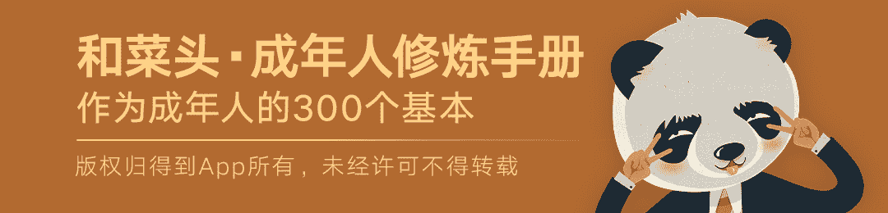

公众号懒人找资源

发布留言

0/ *500*

确定

# “我问和菜头”： 恐惧也能作为燃料吗？

和菜头

2022-04-08

## “我问和菜头”： 恐惧也能作为燃料吗？

“我问和菜头”： 恐惧也能作为燃料吗？

| 转述师：余昊威 |

读者 用户 yluo：:

> "菜头叔，你好。你今天关于“做饭”的精彩论述勾起了我头脑中关于“刻意练习”的问题。我对“刻意练习”的理解是——找到“职业级水平”的导师；诚实地并且恰如其分地评估出自己的水平；分级别地划分出不同阶段“精进”的目标；按照万 sir 说的“高度专注、反复练习、寻求及时反馈”的原则来练习。  
> "

> "请问如果我们普通人想到要“顶尖的职业水平”，可以通过“刻意练习”来实现吗？以及我的这种关于“刻意练习”的理解是否有误？如果可以的话，我更想听听你对“刻意练习”的看法?"

就我的记忆和理解，刻意练习怕是不能让普通人达到顶尖的职业水平，大概率是达到职业水平，而不能和顶尖选手一较高下。

你可以反过来考虑：世界排名前 100 位的马拉松选手，别人的训练强度，别人的训练方法，别人的营养供应，别人的恢复治疗，别人的设备设施，是一个怎样的水平？你我作为普通人，每天在公园里跑个 15 公里，虽然也找了教练，也找了每个阶段的目标，但凭什么我们能胜过顶尖职业选手？如果这个事情成立的话，他们岂不是变成了笑话？

简单说， **刻意练习可以让我们在无需比拼天赋运气的这个层次胜出，但是真正顶级的选手，绝对不是靠单纯的刻意练习可以达成的。**

读者 用户胡振强：:

> "菜头叔，您的厨艺主要是靠自己“摸”出来的，“次第”分明。但是如果我有高明的师傅呢？或者我有 AI 这样的高级工具呢？我的进步是不是快一点？是不是可能跳过某些“次第”？  
> "

很有趣的问题。当然，我认为有个高明的师傅效果也是一样，甚至要更好一些，不需要自己去摸索那么长的时间。

不过胡先生，我想问问你：你怎么知道对方是个高明的师傅呢？或者我问得细致一点：你如何知道他高明的同时，也是个高明的师傅？最终还是落回到你个人的判断上来，所以，你的个人判断依据是什么？

这样看起来， **即便存在着高明的师傅，也需要你先做一些前行的准备工作。** 用大白话来说，别人看到你手上那两下，如果有模有样，别人也才有兴趣去教。

至于说到跳过次第的问题，我个人倒是没有那么乐观。

如果一个次第有许多可以跳过的层级，那要么说明制作这个次第的人心怀慈悲，为学生考虑了很多，最后拿出了一个通用版本；要么说明这个次第本身太疏松，存在着太多可有可无的层级，并不都在关键节点上。

而且，我也不认同我们之间讨论的重点应该放在如何跳过层级上，这件事情并不重要。讨论这个话题，更像是在讨论我们个人有多么特殊，有多么特别。但重点不应该是去找到次第么？上学的重点不应该是找到学习方法，完成学业么？跳级与否，的确不是大多数人应该关心的问题。

读者 用户春子：:

> "对我而言，焦虑是一种抗争，一种对当下状态的不认同，一种“其实我可以比此刻的自己更好一点”的不甘心。时不时会看到焦虑和害怕两个词成对出现，好像这两种状态同时都养着“一个想要”和“一个不想要”。"

> "我好奇的是：叔说焦虑可以做燃料，那么害怕可不可以做燃料？焦虑和害怕分别做燃料时，会导向本质不同的结果吗？"

当然可以。 **一切负面的情绪理论上都可以作为燃料，通过燃烧而产生出正面的价值。**

只是从操作的角度上来说，害怕或者是恐惧的情绪过于强烈，作为燃料而言不大好控制，往往更容易被害怕压倒。

我们看历史书就能经常发现，战场上的士兵往往一开始是被恐惧所控制，但在那种压倒性的恐惧中，因为羞耻或者悲愤的原因，恐惧竟然会转变为强大的勇气，变得舍生忘死、奋不顾身。日常生活中也有类似的例子，在暗夜里孤身赶路，恐惧到极处暴喝一声，竟然也就冲过了心魔，获得了内心的某种轻安和自信。

既然讨论到燃料，那我们自然是希望那种细水长流的燃烧方式，而害怕的燃烧方式过于猛烈。大家在炉灶里烧煤烧柴，但没有人会倒一桶汽油进去，或者直接烧手榴弹。

读者 用户子木华火：:

> "菜头叔，控制焦虑是要掌握当下？像曾国藩那样“既往不恋，当下不杂，未来不迎？”"

曾国藩老师说得很好听，但也有兵败就要跳河，就要抹脖子的时刻。所以，这些话可以当作是心向往之的境界，或者用来当作是签名档，随时提醒自己。

我的看法和你有些微的差别，掌握当下我觉得作为梦想都实在是太高了。如果我们真能掌握住什么东西，那我们的日常生活就不会有那么吃力。实际上我们的大多数问题是自己能掌握的东西太少，以至于身不由己。所以，我的想法是能够专注当下就好。  
**能把心安住在当下，哪怕只 2 分钟，我也认为是了不起的成就。**

读者 用户 A 苏丽：:

> "职场 10 多年，每次即将上台演讲时，脑子一块空白，请问菜老师怎么克服或减缓？"

我做过一些公众演讲，大概数百人规模不等，也经历过头脑空白，甚至是痉挛呕吐之类的事情。我的诀窍只有六个字：不要脸，不是人。

上场之前，自己会担心忘词，会担心观众嘘声，会担心自己看上去傻里傻气的，这就是要脸的副作用。但是，当你上台真忘了词，真丢了丑，你才会意识到事情根本没有你想的那么严重。尤其是在一些小规模的密切人际圈里，观众多半是持鼓励和期待态度的。

然后，你要多想想为什么是你而不是别人上台演讲？那肯定还是因为你有这个价值，有这个地位，有这个号召力，这么一路不要脸地想下去，最终会觉得演讲没什么大不了，是件非常普通的事情，自己上去讲什么别人最后都会鼓掌。怀着这样不要脸的觉悟走上台去，最终的结果多半还是鼓掌结束。

站在台上的时候，不要把台下的观众看成是人，逐一去分析他们的表情动作，那样心理压力就会天大。起码在早期，应该把观众当作桌椅板凳，不是真实的存在。你上台去，只是像在家里对着家具一样背稿。如果背稿顺利，那么你可以试着转头，东看西看，你会发现观众会随着你的动作也跟着转来转去。这时候，你发现自己有控场能力，内心的压力就会减少很多，而且喜欢上这种感觉。

一旦你喜欢上这种感觉，就会试着和观众互动，那么现场气氛也会变得更好，更亲切。类似这样做成一次，之后的演讲就会好办得多。

不要脸，不是人，这六个字送给你，希望对你有所帮助。

另外，类似哈佛商学院之类的商科研究机构，它们也做了关于公开演讲或者公开演示的公开课，传授一些专门的技巧。演讲术在西方很早就是专门的学科，网上也有相关的免费教学课程。我能分享的只是一些个人经验，建议你也向专业人士学习。

读者 用户 36 度 8：:

> "焦虑需要用结果来解决，关注现在而非未来无解的如果。让你焦虑的问题有没有搞清楚问题是什么。我想起那本书《我是个妈妈我需要铂金包》，书中那些名校毕业、有钱有闲的妈妈们充满焦虑，其中最重要的原因在于她们害怕失去，但钱又是丈夫给的，自己丝毫不能掌控。"

> "像这种想要的结果不是自己能力之内又不能失去产生的焦虑，虽然我一个朋友情况不同，但问题根本一样，我该如何帮助她？"

我觉得这个问题是无解的。

每个人的人生选择不一样，处境也就不一样。选择进入金屋藏娇的状态，对于一些人而言，叫做找到了“好归宿”。归宿是个终点，既然都已经抵达人生终点了，焦虑一点似乎也没有什么关系吧？人生提前抵达了归宿，还要心情爽朗，无忧无虑，那让我们这些每天搬砖的人怎么活呢？人生中做了选择不需要承受任何代价么？落了一样好，还要处处都好？

我劝你一句，如果你和我一样都还在搬砖，选择不等、不靠，自己走人生路，那么你最好还是多关心你自己一点。别人已经躺下了，你还在爬，那你就不要关心别人躺得舒服不舒服的问题，想着怎么去给自己弄个厚点的护膝和手套吧。

最后，来得到 App 订阅我专栏的人，订阅这个行为说明他们真的需要读。而你的朋友是真的需求帮助，还是感情抒发，可能都还要两说呢，因为这是她的家事，明显不是你可以解决的事情。

1.即便存在着高明的师傅，也需要你先做一些前行的准备工作。 2.一切负面的情绪理论上都可以作为燃料，通过燃烧而产生出正面的价值。  
3.我们自然是希望那种细水长流的燃烧方式，而害怕的燃烧方式过于猛烈。 4.能够专注当下就好。能把心安住在当下，哪怕只 2 分钟，我也认为是了不起的成就。

公众号懒人找资源

发布留言

0/ *500*

确定

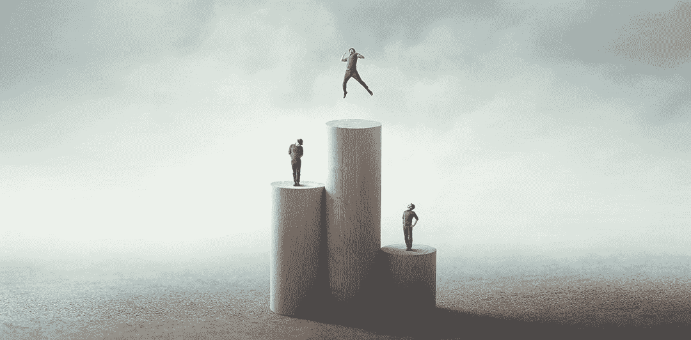

# 09 黎锦扬：第二名的人生

和菜头

2022-04-08

## 09 黎锦扬：第二名的人生

黎锦扬：第二名的人生

| 转述师：余昊威 |

**黎锦扬，作家，自林语堂之后，登上《纽约时报》畅销书榜的第二位华人作家。**

\*

我想，我可能是和你聊黎锦扬先生最合适的人选。因为除了我，大概没有其他人会和你聊这样一位历史人物，让你得以看到如此精彩纷呈的人生。  
**在这里我并不是讲述一个人的传奇故事，更重要的是，通过他的人生让你看到另外一种中国人，和另外一种活法。**  
人们只会记住各种第一名，现在就让我来为你讲述一位第二名的人生吧：

黎锦扬，湖南湘潭人，生于 1915 年。此时辛亥革命刚刚过去四年，大时代已经悄然拉开帷幕。黎家是湘潭县的望族，黎锦扬这一代有八兄弟，每一位都大有成就，因此被称为“黎氏八骏”。他刚好排行第八，从小被称为“八老爷”。

6 岁时，他被大哥带到北京。两人年纪相差很大，大哥把他和自己的子女一起抚养，后来送去北京汇文中学念书。住校期间，“八老爷”也不消停。一次晚上和朋友外出，回来守门人拒绝开门。他直接翻进柜台，找出钥匙，给朋友开门。第二天，汇文中学宣布把他开除。从此，黎锦扬的人生奇遇就接踵而来，让人目瞪口呆。

开除以后，大哥给他换了学校留级一年，然后又通过关系帮他免试会考，直接送去了山东大学。没想到，这一下子就落到了山东省主席韩复渠的手里。韩复渠是民国名人，因为对日作战中不战而逃，被蒋介石枪毙。民间有许多关于他不学无术的段子，最著名的有两个，一个是他说行人靠右走，那左边留给谁；另一个是说他问为什么中国在北京东交民巷没有自己的大使馆？我之前一直以为这些是杜撰的，直到看见黎锦扬的亲身经历。

当时战争阴云密布，日本人步步进逼。韩复渠认为战争难以避免，要打仗就得强兵，要强兵就要锻炼年轻人。怎么锻炼呢？锻炼他们的胃口，胃口好，身体就好。怎么锻炼胃口呢？韩复渠想出了一个“天才”点子：往青年学生的饭里掺沙子。结果，很多学生因此得了胃病。韩复渠大手一挥，把患病的学生送到山上的寺庙里静养。黎锦扬于是上山呆了几个月，等下山的时候，发现自己的女朋友被人撬走了。

战争终于还是爆发，黎锦扬随着学校一路南迁，在西南联大继续学业。1940 年，黎锦扬终于毕业，随即也就失业，在昆明晃荡找不到事情做，又不想北上重庆找大哥。有一天，他在报纸上看到一条招聘广告，从此改变了自己的人生。

云南边境有座小城叫芒市，芒市当地的土司登报想要招聘一名英文秘书。黎锦扬看了就大为心动，但周围的人都劝他别去。因为那里非常偏远，居民都是少数民族，而且当地流行疟疾，搞不好就会死掉。黎锦扬找了个非常奇特的解决办法：他认为疟疾是因为蚊子传染，那么他自己只要注意别让蚊子叮要就好了。就这样，黎锦扬奔赴芒市，成为土司的秘书。

没想到，他在芒市度过了很快乐的一段时间。土司有官邸，有汽车，每年会收到三四封英文信，黎锦扬的工作就是翻译一下信件。另外，就是陪土司太太，一位说英文的英缅混血儿聊天、打羽毛球，介绍一点关于中国的事情。黎锦扬和土司相处得非常愉快，随着东南亚战事爆发，日军入侵缅甸，土司劝黎锦扬撤离，临走时还送了他许多礼物，西装、吉他、打字机、银元装了一车。

黎锦扬一溜烟跑到重庆找自家大哥，大哥看到小弟这一车礼物，就拿去黑市上卖掉，换来一笔美金。时局太乱，大哥想送黎锦扬出国留学。算了一下，这笔美金刚好够黎锦扬在美国四年大学的费用。于是，黎锦扬又一次启程，直接乘船跨越太平洋，去到美国哥伦比亚大学主修比较文学。

“八老爷”的英文应付土司老爷还成，但是应付比较文学系的课程就比较痛苦了。这时候，黎锦扬的侄女婿来美国考察，那人的身份是中国制片厂的厂长。听说“八老爷”的近况，侄女婿就拍胸脯表示：您不如去学写戏，这样将来学成，不正好给我们写剧本吗？黎锦扬一听，觉得大有道理。环顾四周，美国最好的戏剧专业在耶鲁大学，那就去耶鲁好了。

但耶鲁大学的学费很贵，并不是一个芒市土司所能负担的。不过这对于黎锦扬也并不是问题，大哥的好朋友赵元任当时在《China  
News》当主任，帮他申请了一笔奖学金，每月 200 美金。于是，黎锦扬从哥大转学耶鲁学戏剧，并且和当年在山东撬走自己女友的同学重逢。

转学也解决不了英文问题，黎锦扬痛苦非常，就又动了转学的念头。这时系主任找到他，说了一句他终身受用的话：  
**“你来我这里，不是来学英文的，而是来学写剧本的。”**  
黎锦扬顿悟，开始全力创作剧本，把他在芒市的奇遇改编为舞台剧，因此获得了在校内公演的机会。公演时许多经纪人都会前来挑选新人，一位来自纽约的女经纪人留下名片，希望和他聊一聊。

黎锦扬兴冲冲跑去纽约会面，进门就是迎面一盆冷水。女经纪人告诉他说，在美国，没有什么地方可以上演中国故事，因为美国人民没兴趣。不过，她建议说，可以考虑去写小说，她会想办法出版，帮着把小说卖掉。就这样，黎锦扬戏剧梦碎，准备转行写小说。

1947 年黎锦扬大学毕业，手里拿着硕士文凭，依然没有工作。然而战争结束，签证到期，他又没钱买票回国。这时候有人跑来对他说：为什么要回国呢？为什么要自己花钱买机票呢？你就等着移民局来抓你，抓了你就要遣返，那时候就是移民局出钱。黎锦扬觉得很有道理，就真的坐吃山空等着移民局上门。

移民局的人没等到，但是等到了邮局的一通电话，让他去领支票。原来，他早先向《作家文摘》投稿参加小说比赛，现在他的作品得了一等奖，奖金 1500 美金。他带着获奖证书去找移民局，作为专门人才获得了永居资格，开始了新生活。

1957 年，女经纪人在十年间已经尝试过几乎所有的知名出版社，但是没有任何一家对黎锦扬的小说《花鼓歌》感兴趣。最后，女经纪人对黎锦扬说，她准备找一家精英出版社发动最终一击。成就成，不成的话，这件事大家就彻底算了。

这家 Farrar  
Straus 出版社的工作习惯是先把书稿送给审稿人。审阅《花鼓歌》的审稿人是一位八十岁的老先生，他重病在床，读完书稿之后，在页头写下了两个字：Read  
this.  
让出版社的人员一定要看看这本小说，这也是老先生最后审阅的一部书稿，他随后就与世长辞。起初出版社的管理层对这本书的意见不统一，最后以打包签下第二本小说的方式，终于签约出版。

**1958 年，《花鼓歌》登上《纽约时报》畅销书榜，黎锦扬成为林语堂之后第二人。**

我相信你听完黎锦扬先生的人生故事之后会有很多想法，可能是《论大哥的重要性》，也可能是《听人劝，吃饱饭》，这由得你去发挥。在我看来，无论我们持有什么观点，都不应该忽视他当时的大时代背景。疾病、战争、逃亡、失业，黎锦扬先生人生中的每一步，都伴随着不断的挫败。但  
**他始终算是个乐观旷达的人，我们甚至还可以说他有点不靠谱，活得随性，更活得随机。在那样一种艰险的环境下，他还能拥有这样的人生，这让我对世界对生活的看法没有那么悲观。**

从前往芒市当土司秘书那里开始，我觉得是黎锦扬先生的神来之笔。从此以后，他的人生基本都控制在自己手里。亲族虽然也提供了帮助，但是  
**他自己选择了人生，并且在自己选择的人生中得到了命运的回馈。**  
谁能想到芒市的经历会前后三次帮助到他呢？工作、学费、学业，冥冥之中都和芒市之行有关。当然，你可以把这一切归结为运气。不过换个角度来说，是不是也说明了他的冒险精神呢？

人们经常讨论中国人的所谓国民性，给出许多结论来。我没有结论，我向你介绍黎锦扬先生，只是为了告诉你：也有黎锦扬先生这样的中国人，  
**身逢乱世，命运起伏，但是依然保持着天真和勇气，主动承担风险，看似幸运地成功战胜各种挑战，在无数不可能中创造出了可能，最终度过了精彩的一生。**  
我希望你也能从中看到人生的可能，在做第一名之外看到更多的选择。

\*

**附录：**

\*\*  
\*\*

**\-大哥黎锦颐，国学大师，汉语拼音注音方案参与者，投身新文化运动，办报教学，曾经是毛泽东的历史老师，国歌词作者田汉的报馆老板；**

\*\*  
\*\*

\*\* -二哥黎锦晖，中国流行歌曲之父，中国儿童音乐鼻祖，国歌作曲者聂耳和著名女影星周璇都曾经是他的门下弟子； \*\*

\*\*  
\*\*

\*\* -三哥黎锦曜，中国矿业专家，《中华矿学杂志主编》，湖南省工业厅高级工程师，1953 年赴海南探矿病故； \*\*

\*\*  
\*\*

\*\* -四哥黎锦纾，中国教育学家，历任湖南省教育厅厅长，中国教育出版社副社长。曾经留学德国，和邓小平是同学。参加过北伐，任武汉大学教授； \*\*

\*\*  
\*\*

\*\* -五哥黎锦炯，中国桥梁专家，曾经参与设计制造中国北方第一座大型铁路桥滦河铁桥，也是中国最早的西藏铁路规划者；\*\*

\*\*  
\*\*

\*\* -六哥黎锦明，作家，被鲁迅称之为“湘中作家”。第一次大革命时，前往广东海丰从事文教宣传工作； \*\*

\*\*  
\*\*

\*\* -七哥黎锦光，流行音乐家，有“上海歌王”之称。今天我们还能听到他的作品《夜来香》《采槟榔》在人间传唱；\*\*

\*\*  
\*\*

**\-黎锦扬，作家，著有小说《花鼓歌》。后改编为音乐剧之后大获成功，前后演出 600 余场。1961 年更被环球影业改编为电影，同年获得 5 项奥斯卡提名。**

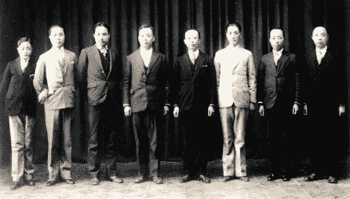

**↑ 黎氏八骏在父母亲 60 岁生日时在北京合影。从左至右：黎锦扬、黎锦光、黎锦明、黎锦炯、黎锦纾、黎锦耀、黎锦辉、黎锦熙**

1.黎锦扬先生人生中的每一步，都伴随着不断的挫败。但他始终算是个乐观旷达的人，活得随性，更活得随机。 2.  
在那样一种艰险的环境下，他还能拥有这样的人生，这让我对世界对生活的看法没有那么悲观。  
3.身逢乱世，命运起伏，但是依然保持着天真和勇气，主动承担风险，看似幸运地成功战胜各种挑战，在无数不可能中创造出了可能，最终度过了精彩的一生。

公众号懒人找资源

发布留言

0/ *500*

确定

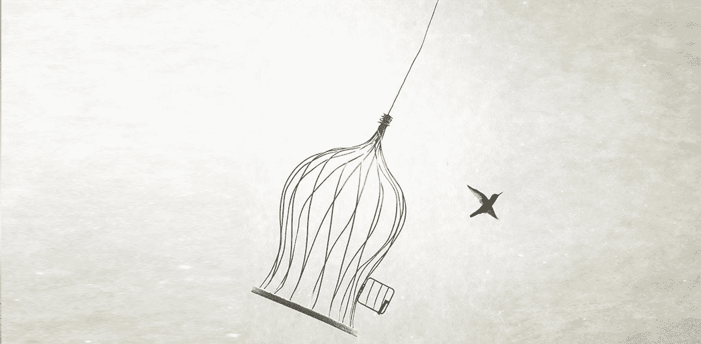

# 10 原生家庭：你选择，你承担，你得到

和菜头

2022-04-08

## 10 原生家庭：你选择，你承担，你得到

原生家庭：你选择，你承担，你得到

| 转述师：余昊威 |

* * *

**原生家庭，社会学术语，指子女尚未婚配时，和父母共同组成的家庭。在中文互联网上，出现时常常带有负面的意味，和不幸的童年或者家庭生活密切相关。**

\*

在写了几百万字后，我也极少谈论我年少时的家庭生活。倒不是为了隐私考虑，而是我认为过得实在不怎么样，可以称之为幸福的时光很少。关于那段时光，我印象最为深刻的一件事情，是参加中学文艺汇演，表演项目是对口相声。当时的情况是家里面父母吵得一塌糊涂，满屋子物件乱飞，而我转身出门之后，紧接着却要去和同伴排练相声，努力研究如何讲笑话把人逗乐。

你可以想象一下，我会是怎样的心情，又是怎样去完成的排练？顺便说一句，演出非常成功，我想可能因为是自己太早就领悟到了喜剧的内核是悲剧。

从这件事情上，你也应该能看出我的一点性格特点。所以一点不奇怪，我对中文互联网上关于原生家庭那一整套说法都不太感兴趣。我承认，原生家庭中的所有失败和不幸，未来都有可能落到自己组建的新生家庭中去。一个人在童年看到父母如何相处，未来就有可能用相同的方式和自己的伴侣相处，对待孩子也是相同道理。有人说，不幸的家庭生活是一种遗传，大概说的就是这种情况。

而我在那样的年纪，面对那样的情况，还要坚持排练相声，最后成功演出，可见我对遗传学的抵抗是何等的坚决，对于我要做的事情又是何等的坚持。

我年少时有个朋友，刚好是我的反例。他时常抱怨自己学习成绩差，头脑反应慢，原因是父母小时候带他去打庆大霉素，不小心伤到了脑子。对此他非常坚持，以至于大家根本没有什么讨论的余地。

不过，我也在暗中观察，发现他对自己喜欢的事物，学起来飞快，也没有什么反应迟缓的症状。后来到了青春期，他用自己受伤的大脑做出了非常正确的判断——想要找到女朋友，就应该学会弹吉他。然后他也就真的飞快地学会了吉他，这一次他倒是没有论证庆大霉素和弹吉他之间的关系，等再次讨论那要等他失恋以后了。

大学毕业之后，我们共同认识的一位阿姨热心地帮他介绍对象。很快他就结了婚，婚礼那天我发现他太太非常漂亮娴雅，就向阿姨抱怨，有这等好事为什么不先考虑我？阿姨对我说，你也要体谅一下，毕竟他小时候打针……

就差一点，就差那么一点点，我也要变成原生家庭造就个人不幸理论的信徒，回家质问父母为什么当年不给我也来上几针？

我现在也会时常去想，自己的人生算是幸福么？我的原生家庭对我的人生幸福造成了怎样的影响？答案大体上是肯定的，我认为我的人生虽然有些坎坷和挫折，但还算比较顺利。我的人生幸福受到原生家庭的影响很小，无论是幸福的部分，还是不幸的部分，绝大部分原因都在我自己。

话说到这里，你可能又要说：你怎么知道今天的你，不是过去原生家庭塑造出来的呢？那还不是和原生家庭有关？如果这么算的话，那我的原生家庭的确塑造了我。因为我在其中生活的时候，所有我不喜欢的事情，都成为我成年之后坚决拒绝的个人原则。

我在感情生活中几乎不吵架，不抱怨，不嘲讽，根本不会使用暴力。如果对方离开我，我可以保证那只是因为单纯地讨厌我这个人，而不是因为我身上带着所谓原生家庭的阴影。也就是说，我是完全靠自己的本事活得让人讨厌，所以我不会也没理由怪罪我的父母。

当然，我同样也不是彻底反对那套原生家庭的理论。因为就我所见，也的确有人因为童年的心灵阴影，在成年之后过着既不快乐，也不幸福的生活，重复着自己曾经的家庭生活，用自己父母曾经吵架时的口吻和自己的伴侣吵架，用自己父母曾经挖苦自己的言辞讽刺自己的孩子，一点点活成了自己父母的模样。

还有一些人所受的伤害可能极为深重，以至于自己的原生家庭成为噩梦一般的存在，根本不愿意回想，时时刻刻都在逃避和努力遗忘。如果我说原生家庭对孩子毫无影响，那么对这些受苦的人未免也太不公平，几乎都要变成一种对他们的指责了。

但我认为，极度不幸和极度幸福的家庭都很罕见，大多数人曾经的家庭生活应该是还算过得去，相对幸福，或者相对不幸。极度幸福和极度不幸都超出我的认知，所以我只能对相对幸福或者相对不幸的大多数谈一点个人看法：

我相信对家庭生活很满意的人应该数量不多，大多数人总是有这样或者那样的抱怨，尤其是针对父母，因为他们应该做而没有做，可以做而没能做的那些事情。我的建议很简单，那就是设想一下你自己如果去到你父母的年代，拥有和他们同样的社会资源和认识水平，拥有和他们同样的社会大环境和教育水平，你能不能比他们做得更好？

**抱怨总是容易的，归罪他人也是容易的，但所有人都是在有限条件下去做父母，不可能拉着自己的头发，把自己从历史和生活的大背景里给提出来，成为所谓理想中的父母。**

举一个极端一点的例子，假设一个人身上有很多疤痕，原因是小时候生病，父母请巫医来作法，用柳条蘸着符水抽打身体而留下的伤痕。在我看来，如果那是一个偏僻的山村，距离卫生所都有一天山路要赶，父母是目不识丁的山民，杀了家里唯一的一只鸡去请巫医，那么即便这个治疗方法在今天看起来非常荒诞不经，但这个人也没有任何值得抱怨的地方。因为他的父母，在他们有限的条件和资源之下，已经为子女做到了最好。

另外， **如果不幸都可以归因为原生家庭，对个人努力和个人选择避而不谈，那就是另外一种变相的血统论：国王的儿子是国王，小偷的儿子是小偷。**

人没有办法选择出生，也没有办法改变过去，甚至还没有办法改变父母。但他自己可以做出选择，做出改变。我经常说，  
**那些从不幸家庭里出来的小孩子，无论过去多么痛苦和悲惨，都应该尝试着去做到及身而止**  
——过去的不幸和错误到自己这里就停下，不要再带给自己的伴侣，带给下一代，让它无穷无尽地延续下去。

这是需要勇气的事情，一方面要求自己背负起所有的过往，并且默默承受，不去把压力转移到他人身上，努力实现及身而止的禁断之法；一方面要求自己能够有勇气去承担起自己的幸福，以及这种幸福所对应的沉重责任，  
**能够有勇气对自己的未来人生负责，尤其是失败和挫折负责，而不是随时准备把责任推回给父母，仿佛这样问题就已经解决了一样。**

我一度很怕成年之后变成我父亲那样的人，也曾经暗下决心一定要活得幸福，好让他看看另一种可能。随着他在几年前辞世，这些念头，这些想法，这些情绪逐渐随风而逝，变得微不可察。因为它们已经毫无意义，一定要成为父亲的反面，那么依然还是被曾经的父亲所束缚，而我只需要成为我自己就够了，不需要找个坐标往反方向跑。  
**幸福也不是一种用来展示、比较或者证明自己的东西，如果真的有幸福的话，只需要感恩就够了，它说明了自己的幸运，自己的努力已经受到赐福，和其他人没有关系。**

如果一个人自己能够有所选择，也能够对选择的结果负责，无论好坏，那么他就彻底地脱离了自己的所谓原生家庭，也就有可能去找寻到自己的幸福，不再活在过去的阴影之中。

祝你幸福。

1.如果不幸都可以归因为原生家庭，对个人努力和个人选择避而不谈，那就是另外一种变相的血统论。  
2.无论过去多么痛苦和悲惨，都应该尝试着去做到及身而止——过去的不幸和错误到自己这里就停下，不要再带给自己的伴侣，带给下一代，让它无穷无尽地延续下去。  
3.幸福不是一种用来展示、比较或者证明自己的东西，如果真的有幸福的话，只需要感恩就够了，它说明了自己的幸运，自己的努力已经受到赐福，和其他人没有关系。

公众号懒人找资源

发布留言

0/ *500*

确定

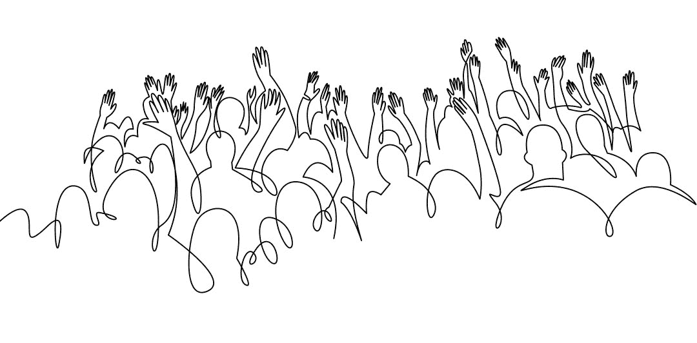

# 11 社交：从批发到零售

和菜头

2022-04-08

## 11 社交：从批发到零售

社交：从批发到零售

| 转述师：余昊威 |

**社交，名词，它是人类社会的盐。**

\*

我十多二十岁的时候是个社交狂魔，学校里同年级的人我认识上百。去食堂吃个饭，进去出来不断点头打招呼，回到宿舍的时候颈椎已经接近脱臼。工作以后依然如此，曾经做过一次统计，最高的一个月有 23 个晚上都是外出和人饮酒作乐。当时我以结交新朋友为荣，经常半夜散场出来吃宵夜，却能隔着一圈人头和另外一桌陌生人聊起来，最后大家干脆拼桌一起喝酒聊天。

三十三岁的时候去北京，也经常出现在各种饭局上。去面见各路社会贤达，也让人观赏“边疆菜头”。在这个过程中，遇见过各式各样的人，其中最奇特的有两位。

一位是自称“摇滚师”的左小祖咒，进门之后和每一个人热情握手，直言不讳地寒暄说：我今天是来和大家社交一下——那是我第一次知道“社交“这个词还有这种用法。

另一位是在家里开免费流水席的黄珂，来的人彼此都不认识，大家低头吃饭，抬头聊天。一拨人走了，又有下一拨人进来再开一桌。

我在三十五岁之后变得越来越不愿意出门，差不多是从那个时候起，我不再批发式的社交，而是改为零售式的社交。出门的频率很低，每次见三五个人。只要听说是十人以上的聚会，我一般能免则免，想尽办法推脱婉拒。这样一来，邀约我的人也就越来越少，最后基本从社交生活中隔离出来，只和不到十个人保持联系，而且我还觉得这样就已经足够。

不同的人对社交生活的看法完全不同，有些人宁愿待在家里吃泡面也不愿意出门和一群人吃大餐，一想到要出门见人就会压力上升，心烦意乱；而有些人只要天一黑就坐不住，仿佛沙发上长出了钉子，必须出门见见人，就好像不那么做，自己就会被空虚一口口吞噬掉一样。

这两种极端我都经历过，  
**无论哪一种都会给人带来困扰，但人却很容易像个钟摆一样在这两头之间晃荡。只有等到年龄增长到一定程度之后，才会逐渐靠近中间位置稳定下来。**  
如果你也在钟摆上，并且因此而感到苦恼，那么不妨听听我的看法。

有些人说，外出社交一次回来要精疲力竭一星期。这应该是真的，我经历过这种社交场合。

有次朋友介绍我加入一个高端社交圈子，里面不是学者就是企业家，说是这些人“都是资源”。去了之后，一整个晚上都在端着红酒杯绕着桌子走，相互交换名片，道一声久仰，努力回忆对方的事迹作为谈资，就跟参加历史考试一样。走了一万多步之后我就觉得脑子嗡嗡作响，自己正在被海浪不断拍打，而我面前的 30 多个人才寒暄了一半。这种批发式的社交让人非常疲惫，回来我和朋友说再也不去了，以后我自己努力成为资源就好。

也有些人说，一星期不出去一趟，见见各色人等，晚上根本睡不踏实。这也应该是真的，我也经历过类似的情形。

社交变成日常生活的一部分，天一擦黑就开始打电话约人，非得去个什么地方大家一起做点什么不行，反正是不能一个人待在家里。逐渐我们就变成了一团人，有时候自己也并不想出门，但是架不住其他人反复邀约，最后还是维持了出勤率。如今回想起来，大家一起出去玩并不是因为快乐，而是一旦形成习惯之后，一个人独自在家发呆，感觉上好像不如一群人围着个茶几发呆，因为前者会变得让人难以忍受。

这样说起来岂不是自相矛盾了吗？其实倒也没有。 **以前有一种很流行的说法，叫作“避免无效社交”。**  
它劝说人们，不要往所谓的高端社交圈里扎，不要想着透过社交圈去结识大人物，那只是纯粹浪费时间。

起初我也支持这样的看法，但后来我也能够理解为什么人会热衷于无效社交。除了强烈的企图心之外，其实还是因为好奇心，新鲜感。一想到可以去参加高朋满座的聚会，见到传说中的人物，人就难免觉得兴奋。最后人们离开无效社交，可能并不是因为一无所获。怎么可能一无所获呢？进去本身就是收获，能够交流几句就更是喜出望外。

**真正的原因可能还是因为熟悉而产生的厌倦，无论怎样的人物都经不起近距离反复观摩，因为看下来的观感最终会回归普通人。**  
他们的言谈，表情，乃至彼此之间的交流方式，看久了之后都会进入固定模式，这也就意味着重复，而重复会带来厌倦。你看，这就是同一个人，对同一类社交，前后完全不同的态度。

如果把社交当作是一种瘾，那么就很好理解了。一开始，社交是可以带来快乐的。随着社交的进行，达到相同快乐的难度越来越高，但是社交本身不可能没有天花板。更何况，都不用接近天花板，人就会发现其中相同的套路，因而变得厌倦。无非是有些人的敏感程度高，观察能力强，太早就感到厌倦。而有些人可能要多花一点时间，很晚才抽身而去。

但人还是需要社交，因为我们在演化过程中被设计成如此。你可能也经常听到一种说法：人是一种社会化动物。

什么是社会化动物？人必须要群居，必须要彼此分工合作，才能生存下去。那为什么一定要这样？我看到一些基于生理学的解释说，人类作为一个物种过于弱小，从进化的策略上来看，最有利的生存方式是抱团生活。为此，人类拥有了空前规模的大脑，以至于不能像其他动物一样一旦出生就可以立即独立活动，能跑会跳自行觅食，必须要让父母照顾到两三岁，中途不断发育大脑，才拥有行动的能力。

这样，和其他动物相比，人类幼崽在出生之后很长一段时间里，必须依赖他人才能生存，躺在爸爸妈妈的怀抱里，就会觉得安全舒适，离开爸爸妈妈就会感到孤独恐惧。于是，人类天生就渴望和他人建立起密切的联系，这就是社交的基础。

**亚里士多德因此说过，脱离城邦孤独生活的人，不是神灵便是野兽。**

但是，当一个人在社交生活中无法获取乐趣、新知、惊奇和意外之后，社交生活就会转而变成一种沉重的负担，因为大脑的能耗实在是太高了。社交的人群越大，所要消耗的心神就越多。你就想一想看吧，为什么每年春节都会有拜年群发信息？为什么群发信息做得越来越细致，还会加上你的头衔或者称呼？当然是因为与其消耗人脑，不如消耗电脑啊！像我这种既不愿消耗人脑，又不愿消耗电脑的人，春节就只能装作不在线，心中祈祷对方的大脑的功率太小，信息太多，根本没有注意到我回没回。

**完全离群索居的生活又如何呢？我认为如果时间很长，一个人很难避免心灵的枯竭。**

在 2020 年，因为新冠疫情的缘故，我把自己关在家里好几个月时间。说句实话，一开始的确很清净安宁，但是到了后期感觉和坐牢差不多，下楼去小区门口拿个快递，和门卫打个招呼都觉得是一天一次的放风。

连我的两只猫都对我烦得不得了，因为我整天对他们说个不停，像个年迈而嘴碎的老父亲。所以我后来跑出去约朋友见面，双方的家都不敢进，也进不去，街上也没有什么店还敢继续开着，我们就站在街边哆里哆嗦聊上半个小时，然后各自散去。虽然大家的近况都差不多，但是彼此交换一下情况，竟然也能奇迹般地稳定情绪，带着满心莫名其妙的充实感回家。

我想， **一个人要能长期离群索居，从阅读、音乐甚至是劈柴中得到内心的满足，那的确是要更近神灵一些。**

那么，我的意思是不是先投入社交生活中去，熬到瘾头随时间流逝消耗殆尽，自然恢复正常呢？我倒没有那么悲观，在我看来，比这种电池放电方式更好的方式，是从一开始就不断筛选自己的社交圈。

每次都去大圈子里打一圈，然后发现几个值得进一步交往的对象。再在这些人里，选择出那些彼此能够理解，值得信任，每次能带来新想法新故事新行动的人。也就是说，  
**努力把一大群的那种批发式社交，变成一小群人的零售式社交，**  
确保每次见面的时候，每个人都能和每个人聊上半小时，最后形成一个非常小但是异常紧密的社交圈子。

在这个圈子里，每个人都懂得聆听对方，每次见面都交换信息，遇见事情总是以理解和鼓励为主，整体的氛围积极乐观，大家都相信个人奋斗，相互支持，共同成长，彼此见证共同的个人发展历程。那么，这样的社交生活就不会很累，也可以尽情倾吐心声，甚至也只有这里才有真正的剖析和批评。因为即便是最好的朋友，内心也会对你觉得不以为然的时候。  
**但所谓朋友，不正是那些知道在什么时机，以什么方式，对你进行批评和劝告的人么？**

说到底， **社交就是人类社会的盐。没有盐，就会痉挛抽搐，危及生命；太多盐，就会无法忍受，无福消受。  
你得找到最合适你的咸度，不再为了加盐还是加水而烦恼，这样你就可以专心生长，和最值得的人建立牢固的纽带，你的社交也将变成你人生的安全网。**

1.亚里士多德说过，脱离城邦孤独生活的人，不是神灵便是野兽。 2.完全离群索居的生活又如何呢？我认为如果时间很长，一个人很难避免心灵的枯竭。  
3.所谓朋友，不正是那些知道在什么时机，以什么方式，对你进行批评和劝告的人么？  
4.你得找到最合适你的咸度，不再为了加盐还是加水而烦恼，这样你就可以专心生长，和最值得的人建立牢固的纽带，你的社交也将变成你人生的安全网。

公众号懒人找资源

发布留言

0/ *500*

确定

# “我问和菜头”：为什么会出现黎氏八骏？

和菜头

2022-04-08

## “我问和菜头”：为什么会出现黎氏八骏？

“我问和菜头”：为什么会出现黎氏八骏？

| 转述师：余昊威 |

读者 用户 Never 仰之：:

> "今天这讲说到了我服兵役的驻地-芒市。没想到，这对于黎八爷来说是一个重要的人生地点，八爷看似随和的人生态度与听从他人意见，给他带来了传奇的人生！"

> "我想问一下和菜头叔，一个年轻人与父母长辈有许多的未来发展分歧，我有我的认为，他们有他们的道理。那我是否应该对于未来发展也讲究随缘，听从长辈的，还是固执地拼一下？"

我不知道。因为我不知道你是谁，也不知道你家长辈的想法。所以，也就无法判断你是不是因为这些年在人世中的历练，有了自己的想法。或者是你家长辈是智慧通达的人，知道人间冷暖，拥有比你更好的判断。人们总喜欢来问这种二选一的问题，但很少说自己的真实想法，长辈的具体看法，只是来问应该选哪一个。似乎从外人这里得到了某种肯定，就有了选择的底气似的。

我打赌，如果我说要听长辈的话，你会认为问错了人，这个和菜头徒有虚名。如果我说听从自己内心的选择，你会觉得这个和菜头是真的有智慧。  
**很多时候，人们心里举棋不定，只是想从别人嘴里听到自己想要听的话而已。**

我认为，类似的情况下长辈提出的建议往往更加现实，更多考虑收入和生活的安稳。你会觉得犹豫，那就是说你的追求和长辈提出的现实诱惑可以放在天平上不分上下。但  
**如果你真的有自己的路，也真想去走的话，这个天平根本就不可能水平，两个选择也根本不可以等量齐观。**

读者 用户春子：:

> "一直想听叔的版本：您觉得决定命运的是运气更多一些，还是性格更多一些呢？"

那么，你是能让自己的运气变好一些呢，还是能让你的性格改变一些呢？我觉得怕是都很困难。

那么，你知道了运气和性格哪一个对命运的决定权更大，对你又有什么意义呢？之所以专门写这篇关于黎锦扬的文章，是因为他的人生对于我们每一个人来说，都有借鉴的意义。意义从何而来，从他的选择和行动而来。如果我们不去分析他的选择和行动，而是去讨论虚玄的运气、性格、命运，那不过是个餐桌上的话题引子罢了。

同样的问题，我宁可是你来问我运气和努力之间哪一个对命运的贡献更大。因为其中起码还有一个你可以控制的选项，而不是两个你都无法左右的选项。如果选项都是你无能为力的，那你其实就是个命定论支持者。既然一切都有定数，那就耐心等待着它们按照时序发生不就好了？

读者 用户什么都不懂的猫：:

> "我有一个疑问想问菜头叔（我的关注点不知道歪哪里了）：这一家八兄弟，看起来都挺有成就，是因为他们家教育特别好，远超同代人呢，还是因为在那个时代，受教育的人本来就少，又适逢社会变迁大时代，有这种家境和教育程度的人都差不多能干出一番事业？"

很多人都对黎氏家族很有兴趣，对他们如何能培养出如此之多的杰出子弟而感到好奇。其实，如果大家去查一下资料，会发现许多有趣的东西。

首先，黎家的地址是在湖南省湘潭县中路铺镇南岳衡山支脉晓霞山石潭坝乡菱角村长塘组。看到了没有？并不在湘潭县城，而是在菱角村。和大家想象中的名门望族不一样，黎家并不在省府或者县城，而是在乡村一隅。这是因为湘潭的地位非常特殊，从清朝开始，就是中国中部的稻米集散地。在经济地位上，远远高于省府长沙。这和黎家又什么关系，后面我会详细分析。

从远处说，黎姓在湘潭是大族，据称可以一直向上追溯到长沙马王堆汉墓女主人的丈夫黎朱芲。湘潭黎姓分三支，晓霞山、茶园铺、观湘门，认为都是源自湘潭老城泗州庵。也就是说，黎氏家族在湘潭开枝散叶，根深叶茂，这是基础。

那么，黎家又如何能从一条小村中走出来呢？其实只要看到是近代的名人，不妨可以去考虑一下和曾国藩的关系。查资料就可以发现，  
**黎氏八骏的祖父黎葆堂是清朝举人，曾经在曾国藩的幕府担任军机幕僚。**

曾国藩当年以文人的身份，举兵攻打太平天国。手头并没有兵马，也没有可以信赖的人。于是只能从家乡子弟中选人，组成了以湖南子弟为主干的湘军。因为同宗同乡，在战争中相互支援，死战不退，因此战力要比当时糜烂的八旗军强很多。在辗转各地的战争中，这些湖湘子弟得以看到外面的世界，眼界为之一宽。最简单的例子就是槟榔，湖南人爱吃槟榔，但是本省不产一枚，需要从海南购入，据说就是在打仗过程中学会的吃槟榔解乏。

平定太平天国之后，湘军的将领回到故乡，很快就和当地士绅结合起来，在地方上想要继续有所作为。前面说到，湘潭这个地方是中部的稻米集散地，又多水患，因此稻米的仓储就变得非常重要。退役将领和当地士绅合流，就在湘潭县城开设积谷局，按田地产出向地主收取一定比例的积谷，放入积谷局的粮仓中。

这样遇见灾年的时候，可以开仓赈灾，平抑米价。又可以借出谷物，收取利息，维持积谷局运转。总是，这是一个外出开过眼界的湖湘子弟，和当地士绅用市场经济手段设计的地方组织，用来维护当地经济和民生的稳定，也是他们经世致用思想的体现。

**在史料不起眼的角落可以发现黎葆堂这个名字，他出现在湘潭积谷局司事的名单里。**  
也就是说，黎葆堂不单跟随曾国藩南征北战，回到家乡之后，又深入地参与地方经济和管理，直接切入了湘潭的经济命脉。

现在，你对所谓的世家是不是有点感受了？书香门第，耕读世家，人们看到的往往是这一面，黎葆堂也以大藏书家的身份而为世人所知。但他的另一面是沙场征伐，管理地方，是军事和政治上的胜利者。有了黎葆堂打下的基础，他的儿子黎松庵才能在家隐居，和齐白石组成罗山诗社，开设自家的长塘山溪学校，引入新学，培养家中子弟。再然后，就有了黎氏八骏。

大家看到的是黎氏八骏，认为是大时代变动，当时读过书的人少，因此各种世家子弟拥有了更多机会，这也是一种相当流行的说法。但是通过刚刚的分析，黎氏八骏其实是三代人累积的结果，甚至是更多代人的努力结果。

如果黎氏不是本地大族，黎葆堂不是举人，那么未必能进入湘军，进入湘军也未必能够进入曾国藩幕府。如果不是进入幕府，离开湘潭看过天下，回乡之后也就是个普通乡绅，不会参与到什么积谷局这样的新机构里。如果不是看过天下，参与过市场经济下运作的积谷局，知道大变局将至，思想也就不会那么开明，家族子弟除了四书五经之外，还鼓励学习算数、物理这样的新学。如果家里没有这样开明的风气，没有新学的基础，黎氏八骏在湖南湘潭的乡下自家学堂出来之后，又哪里可能去到北京上海，为自己打下一片天空？

**当你看到伟大孙辈的时候，我建议你先去看看他们的爷爷当年做过什么。**

1.如果你真的有自己的路，也真想去走的话，这个天平根本就不可能水平，两个选择也根本不可以等量齐观。  
2.黎锦扬的人生对于我们每一个人来说，都有借鉴的意义。意义从何而来，从他的选择和行动而来。  
3.当你看到伟大孙辈的时候，我建议你先去看看他们的爷爷当年做过什么。

公众号懒人找资源

发布留言

0/ *500*

确定

# “我问和菜头”：怎么理解灵魂伴侣？

和菜头

2022-04-08

## “我问和菜头”：怎么理解灵魂伴侣？

“我问和菜头”：怎么理解灵魂伴侣？

| 转述师：余昊威 |

读者 用户啦啦啦：:

> "正在为人父母的，要怎么做才能让孩子少承担些原生家庭带来的伤害？或者说怎么让孩子更加快乐的成长呢？以及如何让孩子成为一个独立思考的人呢？"

这是个非常好的问题，而且是真问题。看来你已经接受了及身而止的观点，也认同对自己人生负责的态度，那么，你也就在一定程度上理解了许多年前你父母的处境。这是一个非常好的开端，接下来才有了你很自然的发问：如果我当初能看到父母身上存在的问题，现在我自己为人父母，是否也会如同自己的父母一样，对自己身上的问题视而不见，全无知觉呢？最后能把问题指向自身，真的是非常聪明的问法。

对于这个问题我是这么看的：你肯定不会是十全十美的父母，假定你避开了自己父母当年的所有问题，也无法保证在你自己身上不会出现其他问题，想必你已经想到了这一点，才有如此一问。

但是，你和你的父母如今有了一个很大的区别，那就是他们要么没有觉察，要么回避去查看自身的问题，而  
**你是有觉知的，你知道家长会有问题。不要小看这一点点区别，当你有了警醒，有了反思，那么你就有机会去觉察，不至于把事情弄得太过糟糕。**  
而且，你不再是那种非常“自信”的家长，那么在你自己的小家内部，就有讨论、检讨的可能，就有修正弥补的机会。

我以前在得到的文章后面都附有一句话：我所说的每一句话，都是错的。而我每次在写完文章之后，都会很仔细地重温一遍这句话，考虑一下自己所写的这篇文章是不是还可能存在着什么问题。我想，这就是我建议你应有的态度：  
**随时提醒自己有所不足，但也要勇敢地去做，同时也做好改正的准备。**

读者 用户张慧：:

> "想听菜头老师说说怎么理解 Soulmate（灵魂伴侣）。"

可能你会比较失望，因为我早已经放弃了关于所谓 Soulmate 的念想。当然，你要把它当作是一种追求，我并不反对。对于我而言，问题的关键是几率太低，同时对他人的压力太大。假设你真的找到了所谓 Soulmate，我相信对方也不是点点都符合你的要求。对此，你又怎么办呢？视而不见？降低 Soulmate 的标准？

再假设对方知道你认定自己是 Soulmate，对方是否会担心有什么事情、有什么时候不符合你的期待，让你失望呢？要知道，Soulmate 对一个人而言，算是一种极高的赞赏和肯定。

从几率的角度来看，如果我把自己对所谓 Soulmate 的期待加以拆分，变成具体的几个特质，比如说 5 个。那么，我在人群里找到 5 个人，每个人身上带有其中一个特质，这是完全有可能的，而且难度不会太大。那么，我和这五个人保持社交联系，是不是大体上就能满足我对 Soulmate 的要求了？不止于此，因为他们身上还有别的特质，因此能拓宽我对人的认识，对人性的认知，反而是件好事。

**追求 Soulmate 今天在我看来，依然是一种自我贪恋的表现。**  
因为自己最特别，所以值得拥有最好最合适的灵魂伴侣。其实我们每个人基本上都是通配款，并不是自己想象中的定制款。总是能和什么人在某几点上达到契合，和什么人在另外几点上达到契合，要求在所有点上都能严丝合缝地契合，我觉得是在给老天爷出难题。其他人只需要每个人做得足够独特就行了，偏生你这里不单独特，还要一早给你造个副本同时发往人间。我觉得，这种属于投胎上的区别对待，有不公平的嫌疑。

读者 用户子木华火：:

> "菜头叔，我觉得我和大学舍友悲欢不同，认为他们挺吵闹的。我其实有点明白，为什么我会觉得他们挺吵闹的？可能是他们身上有曾经的我，那个曾经以为自己什么都懂的我。  
> 所以我该怎么处理我和大学室友的关系? "

我记得我在上大学的时候，曾经把一个舍友按在地上捶了一顿。在我们之间是这种沟通方式，而不是我对他说我们之间的悲欢不同。我的意思当然不是说采用暴力的手段是正确的，或者是值得骄傲的。我只是想说明，宿舍生活并不是那么令人感到愉快。

尤其是现代家庭里成长起来的小孩，进大学之前大概就没有经历过和那么多人挤在一个房间度过四年这种事情。从我上网以来，关于宿舍生活的投诉就没有中断过，无论是在学校还是工厂，可见它对许多人而言的确构成了一种困扰。

从好的一方面想，无论你是讨厌还是喜欢，他们只能和你共度四年的时间，从此以后就天各一方。即便你认为那是一种刑罚，它也是有期徒刑。所以不用看得很重，大家都是彼此生命中的过客而已，无非是机缘巧合，你们在这个时间，这个地点，成为同寝室的同学。

既然如此，你想过另外一个问题没有：

此前你的人生中，你的出生，你的家人，你的同学，你的老师，绝大部分你身边的人，你自己都没有选择权。因为你是个孩子，给你安排的一切你都必须接受。但是你现在已经上大学了，你其实手头是有选择权的。我在读书的时候，晚上经常不在自己宿舍，而是在整栋男生宿舍楼里面打游击。其他寝室，其他系别有和我玩得来、聊得来的朋友，喝晚了，聊晚了，就在别人的宿舍找个空铺睡一觉。当时，也总有人因为关系走得近一些，就抱着行李卷搬宿舍。我记得最杂的一个宿舍，大概挤进去了 5 个不同系的男生。

我知道你想问的可能不是这个，你是希望我教给你一些大学宿舍的人际关系技巧。但我认为这可能并不是技巧的问题，而是个生存哲学的问题。在你这个阶段，去找寻自己喜欢的人，喜欢的环境，所要付出的代价是极小的。在如此之小的代价之下，你都不能为自己创造一个更好的生活环境，没有养成“树挪死人挪活”的习惯，那么，你将来走上社会又怎么办呢？今天是你同寝室的同学，未来可能是你的同事，届时你还是幽幽看着他们叹息“人的悲欢本不相同，我只觉得他们吵闹”？

读者 用户敲出哈姆雷特的猴子：:

> "人说，外向的人在人群中获取能量，内向的人在独处中获取能量，是这样的吗？"

我不是很清楚外向和内向的定义，也不知道一个人是真外向假外向，真内向假内向。在人群中，每个人都撒谎，每个人都演戏，人心的复杂程度总是超出我们的想象。所以你问能量问题，又把它和性格特征关联起来，这就让我很难回答，因为它就不是我考虑问题的模式。我极少把人分为大类，更喜欢把人视为一个个特别的个体，而每个个体都有自己不同的性格脾气以及相处的方式。

**如果承认每个人的独特性，那么，你会发现他们汲取能量的方式并不相同。**  
有些人单是靠虚荣，就能完成自己的心理建设，自我感觉好得不得了，完全无视他人的评价和判断。而有些人可能独自呆在房间里的时间越久，他对现实的控制力反而会变得更强，同样很有信心。

两分法，四象限，三乘三矩阵，固然可以把问题加以简化，可人生又哪里是按图索骥的事情？  
**你模式化地理解他人，那么你就容易掉入模式的陷阱，有些时候甚至面对事实也拒绝承认，只因为模式看起来更美。**  
相比之下，你知道某个具体的人喜欢什么，厌恶什么，最好知道背后的原因又是什么，要比这些模式总结更为适合日常生活。

1.随时提醒自己有所不足，但也要勇敢地去做，同时也做好改正的准备。 2.追求 Soulmate 今天在我看来，依然是一种自我贪恋的表现。  
3.如果承认每个人的独特性，你会发现他们汲取能量的方式并不相同。

公众号懒人找资源

发布留言

0/ *500*

确定

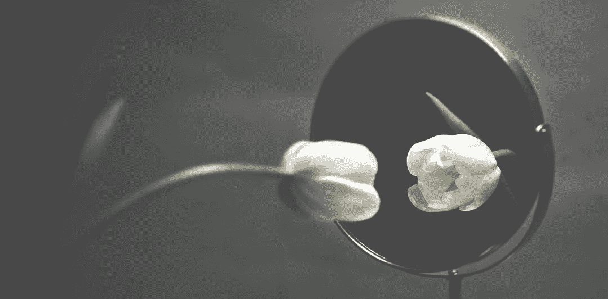

# 12 品位：不要自寻烦恼

和菜头

2022-04-08

## 12 品位：不要自寻烦恼

12 品位：不要自寻烦恼

| 转述师：余昊威 |

**品位，名词，一种烦恼的别称。**

\*

我很喜欢一位美国小说家保罗·奥斯特，把他在大陆出版过的所有作品都找来通读。就这样还觉得不够，又跑去专门写文章介绍他的作品。一般来说，我介绍作家和书籍反响都还不错，因为历史上人品值攒得够多。

但奇怪的是，介绍保罗·奥斯特之后反应寥寥。过了段时间才有人小声告诉我：别再说保罗·奥斯特啦，他在文艺青年那里被认为是品位低下，格调不高。我听完回去又翻了翻他的书，觉得品位没问题啊，哪里低下了？

但是，这些话让我瞬间感到自己被孤立，那我是不是应该放弃保罗·奥斯特的书，转去读大家都认同的高品位作家作品？或者自我检讨一番，是不是自己的品位出了问题？我会在文章结尾回答这些问题。现在，我们先回到关于品位的讨论上来。

这就是品位的第一课： **当你没有品位时，你自己不会觉察。**

很多人都很怕“没品位”这个评价，认为它带来的伤害极大，直接否定掉了自己的审美，并且归入粗人一类。所以，要去找寻提升品位的方法，探究品位究竟是什么，它简直变成了一种现代生活病。以前，人们只需要追求拥有就够了，因为有和无之间的差别很大。等人人都有了，又要求你挑选着拥有，拥有不算什么，挑选的眼光才是关键。拥有这种眼光，才能把你和其他人区分开来，归入有品位的一类。

这就是品位的第二课： **品位用于表征身份，划分人群。**

只要你加入品位的大战，很快你就会发现许多自己人，同时也会发现许多“敌人”。自己人相互之间会反复赞美对方，认同对方的选择，认为大家处在品位较高的位置。相对的，也需要不断批评“敌人”，宣称他们的品位低下，反复论证他们是怎样的缺乏眼光，毫无审美，如此不断强化自身的地位。当然，对方也会同样那么做。这样做的最大便利，是在人群中快速找到自己的同伙。  
**因为有品位是先把一个人从大众中区隔出来，然后相同品位则是把自己人和非自己人区分出来。**

这就是品位的第三课： **品位用于同类相互认同，寻找彼此。**

没有凭空而来的品位，品位必须依附在具体的事物上，也就是说要购买东西。无论这个东西是一本书，一张 CD，一张话剧演出票，又或者是一张绘画作品。既然是依附在具体的物品上，那么我们就不得不去探讨用途和价格。很明显，品位极大地拉升了物品的价格，但是从实用性角度来看，它和它的同类型商品并没有多大区分。有些时候，你额外付出的钱甚至只是为了购买那些提升品位的无用功能，比如说呼吸灯。电子产品增加了呼吸灯之后，因为模拟为一种生命体，远比工业制品有品位，那么就可以堂而皇之地多收一笔钱。

这就是品位的第四课： **尽管大家嘴上都不说，品位其实关乎于物质占有和金钱多寡，审美是它的表象，财富才是它的密码。**

为了品位可以多支付钱，那么它所隐含的表达其实是在说：我并不在乎钱。换句话来说，就是我在金钱上获得了自由。但是仅有钱是不够的，有时候品位还意味着不在乎时间。比如说飞行 2000 公里去看一个展览，等待一个夏天让花园的花朵开出图案，或者像是旧时贵族一样，耗费数年时间让画师一笔笔为自己画一张肖像画。当那张画挂在那里，它并非是在证明主人的古典品位，而是在用这种方式告诉访客，我的时间不需要用来工作，照顾家庭，因此我可以随意地大把挥霍。

这就是品位的第五课： **品位的高低，很大程度上和一个人浪费金钱和浪费时间的能力相关。**

在讨论品位时，我们也能发现它随着时间会不断变化。张若虚的《春江花月夜》在唐代算不上神品，但是到了明朝中后期，它就开始被士人推举得越来越高。唐代人会认为这首诗有景无情，读了半天不知道想要表达什么。而明朝人则对其中美的虚幻和短暂大有共鸣。那么，唐朝人和明朝人谁的品位更高一些呢？

近晚一些，日本商人用浮世绘作为商品包装运输到欧洲，可以想见当时日本人对浮世绘的态度。而当欧洲的画家如获至宝一样学习临摹浮世绘，从中找寻创作的灵感之后，涌现出一批画作，其中不乏一些名作。于是，浮世绘在日本的地位也随着时间流逝缓缓抬升，现在已经有梵高的作品和浮世绘在上野美术馆并列展出的例子。那么，浮世绘的品位究竟如何呢？

最新的例子是小说《斯通纳》，50 多年前第一次出版销售量只有 2000 册。50 多年后，欧洲人突然发现了这本书，各个译本几乎是横扫欧洲，一个月卖出 15 万册。单是在荷兰，就卖出了 50 万册。那么，50 年前的读者和现在的读者品位上有什么变化么？

这就是品位的第六课： **品位随着时间会发生变化，人始终是一种易变的物种。**

这个课程清单我可以继续写下去，但我现在打算停下来。

如果你对上面的六课都表示赞同的话，那你很可能正在为品位所苦。因为我们既不知道自己有没有，也很难把握品位的变化，更没有足够的时间和金钱去培养品位，如果还是坚持想要拥有自己的品位，这不是自寻烦恼么？  
**它的作用，至多是方便大家找到自己人，但是相应的代价和压力也非常大。** 所以我想，是不是哪里出了问题？因为追求品位，一开始的初衷应该是好的。

回到开始，我在一系列小说中得到了阅读的快乐和美好。但是，如果因为有人说它们品位不高，我就因此而郁郁不乐，想要去找一点证明我阅读品位高的作品来读，那么问题并不在别人身上，而在于我自己。

真正需要自己回答的问题其实是：你怎么看待你的喜欢？它是发自你的内心，还是需要服从他人的判断？它是为了满足你，还是为了满足别人的期待？你是否尊重自己的喜欢？

如果我如此轻易地就被别人的评价触动，说明我并不是真的在乎阅读，并不是真的有乐趣，我更关心的是他人的评价。这样说起来，我阅读并不是为了自己，而是读给别人看的。同时，  
**我对自己的选择也全无自信，看轻了自己的喜欢——我认为这才是一种真实的伤害。**

如果一个人拥有足够的余暇和财力，我并不反对他沿着追求品位的道路前进，因为这也是提升审美的一种方式。但如果把品位当作是一种自我表征，用来展示自己的身份地位，那么大可不必如此。因为这更像是饲养自我，而不是完善自我。

品位指向的是审美，应该算作是一种精神追求。但如果是指向自我，那我们已经有太多东西可以饲养自我了，让它变得更加专断，更加贪婪，也更加自私，就算是用整个世界来挂在身上作为装饰，它也永远没有满足的时候。

我倒宁可自己品位低一些，避免去听自己其实听不下去的音乐，看不下去的电影，读不下去的书籍，穿不出去的衣服，只是为了在人前显示我有品位。生活在人群中，他人的批评和评价永远都会存在，因此带来的伤害也会存在。  
**如果不是发自内心地喜欢什么，如果不是真正在乎自己的喜欢，那么自己就会很难抵御这些评价。**  
在不知不觉中，很可能会为了讨好他人就让自己的意志屈从于他人的意志之下。

要知道，品位的品和九品中正制度的品都是一个字，它本身就带着级差和压迫。只要你参与这个游戏，就会产生挤压。九品中正制度把士人分为九品，于是每个人都想挤入上上品。品位也是同样的道理，打破头想拥有好品位的时候，可能已经把对审美的追求彻底给丢掉了，那怎么可能有真正的快乐和美好呢？

如果我们还承认每一个生命都是独特的，每一个生命的体验也都是独特的，我们就不会接受把人划分为三六九等的做法。既然如此，就应该相信你自己的审美，无论是高或者低，那都是一种外界评价，  
**对于你而言，再怎么低也是你自己努力得来的结果，也是你心中所喜。别人的审美再怎么高，也没有谁能够拿来做个替代，或者让你完全复制对方的体验和情感。**

你所能倚仗的只有自己，也只能自己不断向前摸索。因此，我还在看保罗·奥斯特的书，而且一点都不会为了品位的事情而烦恼。

1.对自己的选择也全无自信，看轻了自己的喜欢——我认为这才是一种真实的伤害。  
2.如果把品位当作是一种自我表征，用来展示自己的身份地位，那么大可不必如此。因为这更像是饲养自我，而不是完善自我。  
3.应该相信你自己的审美，无论是高或者低，那都是一种外界评价，对于你而言，再怎么低也是你自己努力得来的结果，也是你心中所喜。

公众号懒人找资源

发布留言

0/ *500*

确定

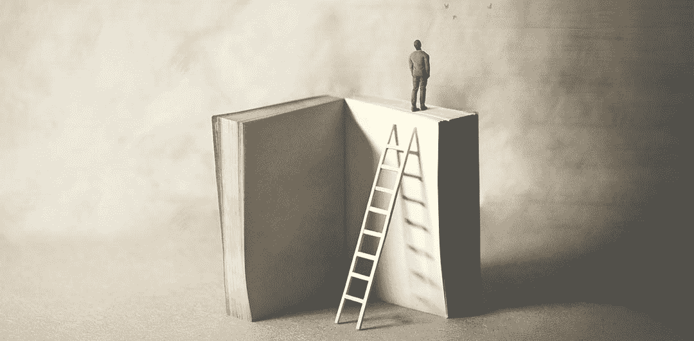

# 13 速读基础：两种提升阅读速度的法门

和菜头

2022-04-08

## 13 速读基础：两种提升阅读速度的法门

速读基础：两种提升阅读速度的法门

| 转述师：余昊威 |

**速读，名词，被视为一种学习能力的体现，但真实情况要复杂得多。**

\*

我读书很快，于是就经常有人问我，如何提高阅读速度？每次我都劝对方打消这个念头，快有快的读法，慢有慢的好处，读书又不是跑步，为什么不去追求理解，反而去追求速度呢？如今我年纪渐长，也开始能够体谅别人的苦处。因为大多数人把阅读速度视为一种个人能力，读得快，自然也就读得多。读得多，那么相对来说自己掌握的知识也就多，自己在社会竞争中也就能占优。

这一讲我提供两个办法，一个慢一些，但是切实有效；一个快一些，不过只是技巧。希望你耐着性子，把两种方法都看完，然后自己考虑采用哪一种。

如果你认为自己读书速度很慢，麻烦你先回答我一个问题：当你看娱乐八卦新闻的时候，速度也很慢么？也需要一字一句去读么？

如果你根本不看八卦新闻的话，那么我换个问题：你在微信聊天群里，每天的内容那么多，形式那么复杂，有图片有文字有视频有语音，你翻看聊天内容的时候，速度也很慢么？也需要用手指指着每个字每张图仔细分辨么？我猜，答案应该都是否定的，不然的话，那可能是真的有阅读障碍症。

你可能不知道，其实我看娱乐八卦新闻的时候，阅读速度只是中等偏下水平，不时还要回过头去读。你读得快，我读得慢，原因其实都是一样的：你对娱乐明星的过往历史要比我熟。所以你随便扫一眼，看到几个人名，几个关键词，你就立即知道这一大段话是在说什么。

更何况娱乐八卦新闻经常炒冷饭，你抄我，我抄你，你之前不知道已经看过多少遍了。对于你而言，你阅读的时候都是在跳过你已知的部分，努力挑出你不知道的新八卦认真读一下。而对于我来说，因为关注少，了解的也少，所以通篇看下来往往都是我不知道的名字和不知道的往事，必须逐字逐句认真阅读，弄清楚人物关系和恩怨情仇，这样速度自然也就掉了下来。

现在你已经明白我要说什么了吧？ **读书也是同理，它同样服从马太效应，富者越富，贫者越贫——一个人阅读量越大，他读书的速度也就越快，反之同理。**

这和人聪明不聪明，有没有阅读技巧关系不大，纯粹是因为阅读量大。  
**任何一本书绝对原创的部分其实都很少，所有作者都站在前人的肩膀上，真正横空出世，提出一个全新观点或者全新理论的作者并不多。**  
因此，如果你阅读量足够大，意味着你在一本新书里看到的旧相识一定不会少，你也很自然不会特意花时间去重温，完全可以快速浏览，甚至是直接跳过，这就和你看娱乐八卦时候的情形是一样的。

我所谓的“慢方法”，就是培养自己的阅读习惯，累积自己的阅读量。不要怕慢，每天都读上一点，三年五年累积下来也就很可观了。如果你不相信，觉得我这么说是为了宽慰你，那么，麻烦你回想一下这些年的流行书。

比如说《异类》，在这本书里作者提出了著名的“一万小时定律”。随后市场上又出了多少本书谈一万小时的？如果你以极慢的速度读完了《异类》，那么你去看其他同主题书籍的时候，还会是一样慢么？

这里需要注意一个小问题，我用《异类》举例其实是刻意的。书和书其实并不平等，有些书的出现，开启了一整个新领域，后续有许多作家跟进，在这个领域内继续耕耘，同主题创作更多书籍。那么，因为你的阅读速度慢，你就得多花时间去挑选书单，选择类似《异类》这样的书籍，读一本相当于读了一类，这样才能帮你大量节省时间。相反的，如果你是在由一本书开启的一组书籍里翻来翻去，那只是在浪费时间。

无论你对什么领域感兴趣，第一件事情不是立即买一本书来读，我建议你先对这个领域有所了解，然后选择其中最重要的基本书来读。也就是说，  
**同领域的书如果构成一张网的话，那么就一定存在几本书位于关键节点上，其他书都通过这些节点发散开去，继续深化。**  
你最好先强忍头痛，把这几本最关键的书啃下来，接下来去读其他书的时候就会轻松许多。

如果你对多个领域感兴趣的话，那么你可能需要一张“最小必要书清单”。也就是说，最低限度上你要先读完这个清单上的书，你才对接下来要面对的内容有所把握，也才能把速度提升起来。

当然你又可能会反驳说：我哪里有那么多时间慢慢提升阅读量？我此时此刻就在面对一本必读书，而且要在规定时间内读完，你给的方法远水不解近渴。那么，我这里还有一个不是办法的办法，虽然我并不推崇，但是它应该有点效果。

这个方法的核心，就是在没有提升阅读量的前提下，怎么强行制造熟悉感。你读得慢，是因为内容陌生，你无法猜到下一章要说什么，下一段要讲什么。那么，的确有办法可以制造出熟悉感。你可以这么做：

拿到书之后，先不要直接读，因为你的速度上不去，很快就会气馁。你应该先把书的序言，作者前言和跋多读几遍。然后就是目录，现在的书有一点好，喜欢把目录做得很细致，每一个章节前还会出一小段摘要。等你多读几遍之后，虽然可能对内容还是不了解，但是你已经大概知道这本书要说什么，每一部分具体谈哪几点。

然后，你可以直接去找一下书评或者读后感，看看别人的总结。网上喜欢记笔记、写总结的人很多，他们会用千把字的篇幅，把原书的精华加以浓缩，以此加深自己的记忆，同时也表示他们的确是认真读过。对于你而言，这些分享者的文章就是你熟悉全书内容的好帮手，多读几篇的话，你可能对核心内容已经产生了了解，有时候甚至是你的问题别人已经替你预先解决了。

最后，你要试着找一找这本书和你已经读过的书之间，是否存在某个连接点。比如我当年先读了丹.布朗的《达芬奇的密码》，然后读了翁贝托.艾科的《傅科摆》，前者是流行小说，后者难度要高很多。但是当我发现它们都是在讨论符号学知识，以此作为情节的关键时，我就自动把它们归为一类，因此有了勇气去攻克《傅科摆》。由于后者更加学术而全面，我专心读完全书，此后无论是找圣杯还是躲避骑士团，阅读这一类型的书我都不用花太多时间。

当然，如果找不到也没关系，无非是意味着你必须自己去摸索而已。这一次摸完，下一次就不需要那么认真摸了。

完成这三项准备工作，你就可以正式开始读书，并且试着提速。你之前的工作越是认真，对内容越是熟悉，这时候你的阅读速度也就越快。我个人不大喜欢这个方法的原因，是因为它只是权宜之计，而且为了这点变通，你在没有阅读正文之前，在脑子里就已经塞满了一堆别人的看法和观点，这其实削弱了原著对你思维的锤炼。

除了这个方法，市面上还有形形色色的速读法。这里，我帮你求个交集，省点你的学习时间，因为大家都认同的方法说明是真的有效。

大多数速读法的共同理论就一条： **阅读的时候不要读出来，最好连大脑也静音，不要一边看，脑子里有个声音一边读。**  
视觉的阅读速度要远比听觉分析声音快，大脑里一旦开始播放，阅读速度就没办法提上去。不过实践中，大脑静音对于许多人而言是个挑战，需要耐心一点。

最后，还是请尽量提升你的基础阅读量，这比什么速读法都有用。小时候我听过一句话：书越读越少。当时不是很理解，后来才明白它的意思是说：  
**如果读得足够多，这世上就没有多少新鲜的书。**

1.读书也是同理，它同样服从马太效应，富者越富，贫者越贫——一个人阅读量越大，他读书的速度也就越快，反之同理。  
2.任何一本书绝对原创的部分其实都很少，所有作者都站在前人的肩膀上，真正横空出世，提出一个全新观点或者全新理论的作者并不多。  
3.尽量提升你的基础阅读量，这比什么速读法都有用。如果读得足够多，这世上就没有多少新鲜的书。

公众号懒人找资源

发布留言

0/ *500*

确定

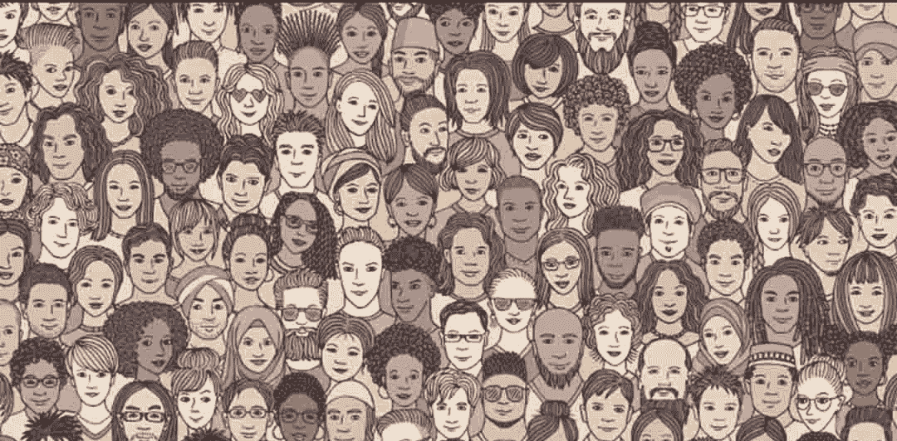

# 14 普通人：没有普通人，只有不平凡的生活

和菜头

2022-04-08

## 14 普通人：没有普通人，只有不平凡的生活

普通人：没有普通人，只有不平凡的生活

| 转述师：余昊威 |

**普通人，名词，许多人以为自己可以轻易达到的人生境界，却不曾认真检视过它的意义。**

\*

一次我在网上看到一位小朋友愤愤不平地写道：难道我这一辈子就要注定做个普通人，只能上学、工作、加班、吃饭、看剧、睡觉、结婚、还贷、生孩子、退休，然后死掉吗？我看完之后叹道：那你还想怎样呢，难道你觉得这样的人生很容易么？

我真没有说反话，是真的那么认为。 **像个普通人那样度过一生，其实难度一点都不低。**  
只要在任何环节上出现一丁点问题，人生马上就是另外一副模样。你试着把上学这个选项去掉，看看后面的事情能否还成立？为了还能够成立，又要花费多大的代价？这些年里，我目睹过很多种人生，探访过很多家庭，绝大多数都属于所谓普通人的普通家庭。正因为看得多了，我从来不敢轻视，因为那种重量如果转移到我自己身上，我未必能够站着承受下来。

在这些人家里，有一户让我印象最为深刻。他们是我好朋友的姨妈和姨夫，因为在家里排行最小，我也跟着叫小姨妈、小姨爹。他们两人是知青，在插队下乡时相识相爱。小姨妈的姐姐，也就是我好朋友的母亲，像个恶婆婆一样坚决反对这件事情。反对的理由是两个人社会地位悬殊太大，小姨妈家是黑五类子女，而小姨爹家是根正苗红的贫农出身。这样的两个人在当时，无论怎么看也不可能有什么将来。但是，当年的一对小情侣拒绝分手。

后来知青回城，小姨妈只能去工厂做工，但是小姨爹可以进电视台当干部。如果两个人要结婚，因为小姨妈的出身问题，小姨爹就不可能留在电视台那样的单位。考验他们两个的时候到了，朋友的妈妈也认为这段恋情就到此为止。没有想到，小姨爹转身就放弃了电视台的工作，申请重新分配到同一家工厂去当工人。这下子姐姐也没话说了，木已成舟，只能转而支持他们结婚。

他们家是一套工厂分配的宿舍，非常小，但是我第一次去的时候被震住了。那是上世纪九十年代，他们家虽然面积很小，但是整洁美观，是我第一次在别人家里见到油漆地板，四面墙有贴脚线，餐桌上有蓝色印花的桌布，桌角还有鲜花。

在那个家里，每个人都很快活，哪怕厨房小到两个人要进出的时候需要侧身高举盘子，因为热气无法散开而闷得满头大汗，但还是有说有笑，日子过得有滋有味。

是因为工厂有钱么？当然不是。当时他们所在的地方小厂早就效益下滑，很快就开始下岗分流。他们家的收入主要来自三个方面：小姨爹会开车，就跑去帮旅行社开车，赚一份司机钱；小姨妈当初自学英文，她就在家里开中学英文补习班，在客厅里架起一块黑板就是教室，赚一份补习钱；然后他们家还养了许多优质波斯猫，可以赚一份育种钱。

每天每个人都很忙碌，可小家支撑了下来，父母各自有班上，女儿每天有书念。后来，他们用节省下的钱，甚至刚好够送女儿去海外留学。

十多年之后，旅游业竞争变得很激烈，英文补习也有了专业老师，小姨爹放弃了开车，小姨妈也放弃了补习。你以为他们就这样被困住了吗？还是没有。他们又盘下了一间铺面，开始做保健品。因为人缘好，可信任，很快有了许多熟客，每天只需要去店里坐着，反而比以前轻松很多。与此同时，女儿也归国恋爱、结婚，他们有了孙辈。我去看他们的时候，依然是乐呵呵的，日子不算富裕，但也不贫寒，始终是个普通人家的样子。

你要回顾他们的人生轨迹，无非也是上学、插队、工作、结婚、生孩子、下岗、再就业、吃饭、看电视、睡觉、再下岗、再就业、女儿结婚、抱外孙。和一开始我说的网友写的那条人生轨迹相比，可能下岗的次数多了一点，到现在都还没有退休一说。而且，在经历了这一切之后，他们也依然是一户普通人家。

但在我看来，他们能做这样的普通人，过这样的普通日子，建成这样的普通人家，本身就是一件极为不凡的事情。因为他们要付出很多辛劳，应对许多时代变化，反复找寻生存之道，而且每一次都还找到了——才能拥有这种看上去很普通的生活。

在别人眼里，我可能在过着某种精彩的人生，拥有某种不平凡的际遇。而每次当我和小姨妈、小姨爹重逢的时候，我都会问我自己：在经历了所有这一切之后，如果和他们易地而处，我能否如同他们一样克服种种艰辛，拥有他们此刻的生活？我并不确信自己在连续两次下岗之后，还有第三次创业的勇气和本钱。

还有一个问题我连想都不敢去想：在经历了所有这一切之后，如果和他们易地而处，我能否和他们一样依旧保持乐观，家里还是欢声笑语？

**觉得普通人、普通生活真的普通，那只是因为观察距离太远，目光总是投向远方。个人有高远的追求固然可喜，可是如果不曾低头看过脚下的泥土，这种追求怕也和空中楼阁没有什么区别。**

**如果愿意近距离仔细观察一下，在那些生活的琐碎之外，还可以看到强大的意志、坚韧的精神，以及无可计量的付出。  
正因为有了它们，才能支撑起一个家里的一砖一瓦、一草一木。**

我在北京有一位固定上门的保洁阿姨，安徽人，话少，干活细致。她偶尔会偷偷用我的电子体重秤，因为它会自动同步体重信息到我的手机，但是阿姨并不知道。我们相互加了微信，上面的对话都非常简短：您明天能来吗？几点？谢谢！剩下的就是转账记录。不知道为什么，她每次收到工钱，都会回复三个抱拳的表情符号，有种江湖儿女的感觉。

她非常勤力，有时候 5 点以后临时请她来打扫，她也一定赶到，无非是要求我能让她给电瓶充电，否则电量不足以支撑她回到远郊的出租房。再用一下微波炉，让她热一下晚饭，先吃点补充下体力。她说她们几个老乡住在一起，一个月分摊 500 块钱房租。

今年过了十五之后，我想着她也该回来了，就发微信问她，没想到这一次她破天荒地写了一整句话回给我：“家里有事，上半年我不回来了，今年我要陪儿子备考，我儿子高考。”字句中的骄傲之情溢于言表，这也是我第一次听说她的家事。

再过几个月，安徽的某个考场里会坐着一位年轻人，他所做的事情落在纸面上，无非也就是简简单单的五个字：高考，上大学。和任何一段普通人的普通人生没有多少不同，接下去估计还是工作、加班、吃饭、看剧、睡觉……但我认识他的母亲，见过他母亲风里来雪里去。所以，我认为那场考试一点都不普通，需要母亲经过数百台微波炉，抱拳数千次，电瓶车跑过数万里路，才能把他送到那张桌子面前。

你要问我对普通人的普通人生怎么看，那我没有什么看法可以分享，也没有什么道理可以讲述，我只能告诉你这两个故事。  
**如果一个人对普通生活不屑一顾，认为自己应该拥有更加精彩的人生，那么我会建议他/她好好再看一遍这两个故事。否则，可能根本就不存在什么两种生活之间的选择，因为无论其中哪一种他/她都根本做不到。**

1.个人有高远的追求固然可喜，可是如果不曾低头看过脚下的泥土，这种追求怕也和空中楼阁没有什么区别。  
2.如果愿意近距离仔细观察一下，在那些生活的琐碎之外，还可以看到强大的意志，坚韧的精神，以及无可计量的付出。  
3.如果一个人对普通生活不屑一顾，认为自己应该拥有更加精彩的人生，那么可能根本就不存在什么两种生活之间的选择，因为无论其中哪一种他/她都根本做不到。

公众号懒人找资源

发布留言

0/ *500*

确定

# “我问和菜头”：是否存在雅俗共赏？

和菜头

2022-04-08

## “我问和菜头”：是否存在雅俗共赏？

“我问和菜头”：是否存在雅俗共赏？

| 转述师：余昊威 |

读者 用户蔡沁宇：:

> "在日常生活中，当然没有必要因为别人的好恶而自惭形秽。但好像不同作品中确实有优劣之分，应该如何去区分是我的品位能力不足，还是他人好恶品位呢？"

我认为审美就像是光谱，可能宽一点是好的。如果你足够宽，那么你会知道你自己为什么会欣赏其中的一段，同时也能理解别人为什么会欣赏其中的另外一段。如果你足够窄，那么你就会觉得除了你喜欢的那一段之外，别的光谱都不如自己这一段，甚至根本没有必要存在。

无论你是宽还是窄，都可以不赞同别人的品位，但中间的区别很大：前者是基于理解而不赞同，后者是基于不了解而不赞同。很多人混淆了这一点，认为无限包容才对，又或者是坚持自我才对。而我的看法是，  
**在理解的基础上，再来谈赞同不赞同。**

这就有点像是古代的骈文，首先你得理解得了它的好，也能欣赏其中的名篇，然后你整体上评价不高，原因是你觉得这种形式太过呆板，缺乏变化和创新，不如其他形式自由，无法达到更高的文学水准。但是，如果你根本没有读过骈文，也懒得去了解，那么你得出什么结论我都不会奇怪，也不会在意。

读者 用户喵咡哚：:

> "由品位二字引发出的课题，实际上是对自我的接纳。可是人在社会上，总是逃离不出被他人评价和被他人评价的影响。想问菜头叔，找寻并接纳真实的自己，有什么好的方法吗？"

**的确无法逃离被人评价，但的确可以不受他人评价的影响。** 这本身是两件事情，一件事情你控制不了，另一件事情你控制得了。

我常说，一方面人们需要摆脱对自我的执着，从而获得内心的解脱；可另一方面还有很多人连完整的自我都没有形成，还活在别人的眼光下，把别人的看法看得远比自我重要。你要找寻真实的自我，那么，你的自我是什么？哪些是真属于你自己的想法，经过了你思考、锤炼、萃取，变得坚不可摧？哪些想法是你从别人那里借来的，觉得自己应该这样想，应该那样做，又随时会被别人新的评价所改变？

简单说，如果你真有自我，那么会很难被别人的评价所影响，因为你为了找寻自我花费过许多苦功，别人对你的评价相比之下太过于轻飘，根本不值得为此而移动分毫。我建议你先把借来的东西还给人家，看看还剩下什么。哪怕是剩下一摊水，它也是你的自我，值得你去珍视。

读者 用户 Za：:

> "我很喜欢看漫画，没有觉得不好意思或没品位；但是不知道为什么就是觉得这不怎么高级！看漫画可以废寝忘食，可是看书就不会，最近在看万维钢老师解读的 The  
> Art of Impossible。看 30 分钟就累了！这是为什么呢？"

首先，不要滥用感叹号，给人的感觉是怒气冲冲的。其次，所谓的高级到底指什么？如果是指艺术性，漫画这种形式未必不高级，但是你看的漫画书肯定不高级。

第一你看到的是大量的复制品，并没有任何的稀缺性；

第二漫画书是一种商品，而且是具有实用性和功能性的商品，画家在故事之外，没有赋予它任何其他的意义。因此，即便是画工很好的漫画，也不过是工艺品，和艺术品相比当然不那么高级；

第三漫画书的表达很单一，也很好解读。我们也可以反过来说，如果可以解读的角度很多，表现的思考和情感很复杂，那么这种漫画书多半也卖不动。既然表达单一，功能明确，当然就不高级。

**你喜欢的东西，未必就是高级的，如果你能习惯这一点，生活可能会愉悦很多。**

读者 用户方祖胜 John：:

> "有一天，跟一个酷爱书法的朋友聊天，他写了 40 多年了，目前是一个自由职业的医生，看病之余就沉浸在书法中，他的诊室四壁全是他的书法作品，他的桌上永远摆着笔墨纸砚。"

> "聊天中，我提到“雅俗共赏”，比如丰子恺的作品，陈丹青的作品，一般人都能看得懂，但是梵高是那么伟大的画家，有那么多伟大的作品，可是我真看不明白他好在哪？那些画它伟大在何处？"

> "而他直接是持否定态度的，根本就没有雅俗共赏。请问和老师，对于这个问题你是怎么看的？"

我很好奇一点，其实你已经提出了很好的问题，但你为什么迟迟不肯出发去寻找答案呢？当初我和你问过一样的问题，梵高的画好在哪里？伟大在哪里？顺着这个问题出发，我找到了答案。

我看过梵高各个时期的作品，确认他是个进步飞快的画家。他能够画出我认为“好”的那种画作，但是后来他就不那么画了，仿佛走上了另外一条道路。然后我的问题转化为他为什么要这么画？事情就变得越来越清楚。但是直到现在为止，我都感觉到你对梵高持有某种强烈的反对，这种反对影响了你进一步探究。而这种反对，只不过是因为他的画作不像是丰子恺、陈丹青一样所谓“看得懂”。

可是如果要深究起来，所谓的“看得懂”又是在哪一个层面上呢？是说绘画的题材，人物的造型，还是说看得懂画家的创作意图，看得懂画家真正想表现什么？我觉得这里是要打一个问号的。

不用说艺术，就以大家都熟悉的佛像为例，寺庙基本上人人都去过，估计也赞叹过佛像的身量和造型，声称看到了慈悲或者是智慧。但是，你能说出佛像不同的手势是什么意思么？它身后的光焰代表着什么？为什么要坐在莲台之上？所有这些东西都是某种表达，而且塑造佛像的人也知道肯定有人能够从这些形式里解码，明白后面隐藏的意义。甚至有些寺庙，你只要进入山门，就可以立即知道这里是否允许云游僧挂单。然而，你很可能对这一切视而不见，却依然觉得自己“看得懂”。

所以，雅俗共赏需要明确是指哪一种层面。如果说不同的人都可以欣赏，获得某种关于美的体悟，那么这样的雅俗共赏是存在的。但是，  
**如果说不同的人都可以同样欣赏，而且欣赏到同一种美，那么这样的雅俗共赏是不存在的，因为大家其实并没有相同的理解基础。**

读者 用户潘小妮：:

> "阅读对我来说最大的困扰倒不是速度，而是遗忘。读很多书，读的时候觉得写得真好，也能看下去，同时佩服作者的观点和洞察，但是过一段时间回头竟然不记得了，有些甚至忘得一干二净，完全没有印象自己曾经看过，想想这不是白读了吗，有点懊恼。"

> "想问问老师这是哪里出了问题，怎么解决？"

遗忘是必然的，因为你的大脑并不是复印机，理解也并非是背诵。所以，首先你大可不必对此感到烦恼，如果没有遗忘的话，我们的回忆早就不堪重负了，这是第一层。

有些书读起来的时候感到很震撼，但是做到震撼读者这一点其实并不困难，马戏团的杂耍也能做到这一点，但它可能不如一场话剧让人印象深刻，原因是它没有在人的心智里增添新的结构，也没有建立起新的感情连接，所以震撼完毕也就结束了，这是第二层。

所有你觉得已经遗忘的事情，大多还是被默默储存在大脑的某个地方。你一时间想不起来，无非是没有找到和记忆之间的纽带，所以经常会有猛然间想起的现象，无非是偶然间重建了这条纽带，顺着纽带走过去，发现一切都还好好地放在仓库里。这种情况，很可能是书籍的内容距离你的日常生活太遥远，又或者是建立起的记忆连接太过特别，这是第三层。

1.审美就像是光谱，如果你足够宽，那么你会知道你自己为什么会欣赏其中的一段，同时也能理解别人为什么会欣赏其中的另外一段。  
2.的确无法逃离被人评价，但的确可以不受他人评价的影响。这本身是两件事情，一件事情你控制不了，另一件事情你控制得了。  
3.如果说不同的人都可以同样欣赏，而且欣赏到同一种美，那么这样的雅俗共赏是不存在的，因为大家其实并没有相同的理解基础。

公众号懒人找资源

发布留言

0/ *500*

确定

# “我问和菜头”：如何让孩子拥有“过好普通人一生”的能力？

和菜头

2022-04-08

## “我问和菜头”：如何让孩子拥有“过好普通人一生”的能力？

“我问和菜头”：如何让孩子拥有“过好普通人一生”的能力？

| 转述师：余昊威 |

读者 用户螺闹耳朵：:

> "读书和学习总习惯往新的进度条迈进，而没有勇气温故而知新，没能反复品味好书中的营养，也因为急于阅读新出的、吸引性较大的内容，导致很多理论没有实践的时间，而最终导致一本好书浅尝则止，如此一来，更不愿意重新花费时间去重读，一本好书就这样被我的“速读”给荒废了。"

> "想请教老师一些能让我们在浮躁的环境诱惑下，愿意静下心来“慢读”的法门。"

我的看法可能和你不同，环境从来就不浮躁，也不曾诱惑你。 **浮躁的是你，产生诱惑的还是你。**  
否则，你无法解释为什么还有那么多人在安安静静做事、生活。你认为更新鲜的就是好的，你认为更多数量的就是好的，那是你自己内心的问题，你从未认真质疑过这些观念是否正确。也许你觉察到其中有不对的地方，但也没有继续深究下去。最后，你拿着症状来问如何解决，可是你真正需要解决的仅只是这些症状么？

读者 用户陈橙：:

> "我现在习惯边读书边勾画和记笔记，不然好多书读完了没多久就忘记了，最近还买了一本书读完一章才隐约记得读过，后来在书柜找到很多年前买的那个版本，我想问下菜头老师你读书做不做笔记？"

我不做笔记，但会写读后感。而写过这么多读后感之后，回过头去看，读后感对我自己也没有多大用处。人们普遍有一种误解，自己买了书就是掌握了书里的内容，其实这只是拯救出版行业的慈善行为；人们普遍还有一种误解，自己画了线，记了笔记，摘抄了内文，就是掌握了书里的内容，其实这也是拯救制笔业的一种慈善行为。

在日常生活里我们有一种经验，别人说了我们什么好话，或者是赞同我们的观点，我们很快就会忘记。除非是在自己处于很困苦的状态下，这些好话帮助到我们，或者纾解过我们的压力。读书也是一样，内文再怎么精彩，我们都会遗忘，因为那种精彩和我们自身无关。

但是，如果内文涉及到我们苦苦思索的问题，给予我们线索和答案，那么我们肯定就能记住。甚至，一本书的说法强烈地和自己笃信的观点相抵触，也能让我们想起其中的论述，就像是我们总是能记住谁曾经在何时何地怎么骂过我们自己。

读者 用户 H-LINJIE：:

> "这段时间很迷茫，自己工作 2 年了，原本的工作蛮喜欢但总觉得差了点什么，然后出来跨专业考研了，考研时挺有奔头，但现在考研后却不知道未来方向会怎样，能不能找到自己钟意的事业，能不能做到生活盈余。我想我就是那个一直想要“不普通”生活的人，可能有时候确实是眼看得太远，心却不知道安在何处。  
> "

> "菜头叔，有啥建议可以分享吗？ "

所以，你放弃了你喜欢的工作，选择了研究生这个身份？甚至也并不喜欢做学问？那我就有点怀疑，你“既要又要”的人生目标究竟能否实现。而且，我发现你的语法不大对头，比如说“找到事业”这种组合。在我的想法里，事业可能是干出来的，不大像是找出来的。

人生里，下注 10000 块，年底收入 300 块，这是非常稳定的收益，大部分人都能做到，做一次就可以得到，方法是存银行；下注 2 块钱，博 500 万，这是非常小概率的事情，极少数人能做到，做很多次都没戏，方法是买彩票。

总是下小注，却想着赢大钱，世间没有这样的道理嘛。

读者 用户李若谦：:

> "菜头叔，请问像文中故事里说的那样，费尽全力过普通生活的人，和父母直接就能给自己的孩子提供普通生活条件的人，这两类人值得不一样的尊重程度吗？或者说，我们应该更关注谁的生活吗？"

我不是很理解这个问题。为什么一定要比较一个高低呢？你所谓的更尊重，或者更关注具体指的是什么呢？或者我这么问你，为什么有人赞美某一种生活，你就会立即认为是在贬低另一种呢？

**我们很难把不同的生活放在天平上称量，看哪一种更重一些。因为各种甘苦，只有当事人自己知道。**  
现在，我们讨论所谓普通人的普通生活，是因为这种生活被误解、被看轻，仿佛唾手可得，以至于没有看到其中的艰难。这样人就容易失重，活得轻飘飘的，漂浮在生活之上，永远都在抱怨，永远觉得得不到。

读者 用户刘鲁鹏：:

> "《斯通纳》讲的也是不平凡的普通人吗？这本书之前一直觉得看不太懂。"

你可以那么认为。其实，你不用那么谨慎， **对于一本书的解读，本来就是读者自己的事情。**  
别人的见解，无非是一种参考，你用来比照自己的想法，看看差别在哪里，问一问自己为什么没有读出某一层意思。这是自己没有注意到，还是别人想太多，替作者发挥？

回到《斯通纳》这本书，主人公本来是个农家子弟，在大学课堂上因为莎士比亚的一首十四行诗，获得了某种关于美的领悟，因此决意在大学校园里守护和传承这种美。然而，他自己所面对的却是险恶的人世，他经历了两次世界大战，一次破碎的婚姻，以及并不愉悦的教学生涯。

对于他而言，最大的痛苦并非是这些事情，而是当他守护着一种人类创造出来的美好时，他却同时目睹人类的愚妄和盲目，一次又一次狂热地走向战场，毁灭自己，毁灭自己所爱的人。在经历过这一切之后，他没有改变自己的初衷，完成了自己的一生，因此他看起来是个人生的失败者，但却令人肃然起敬。

最后， **阅读文学作品是为了欣赏，并不需要追求懂。**  
即便是父母子女、夫妻之间也不能说完全懂得对方的心意，我们又怎么可能借着一些纸张上印刷的铅字，宣称自己懂了作者，懂了作品，这难道不是一种傲慢么？我们只能说，  
**通过作者的作品打开的那一扇窗口，自己看到了什么风景，激发出自己内心的什么感受。**

这就如同你去旅游一样，看到高山深谷、大江大洋，你会发出由衷的感叹。可是，你懂得山，懂得海么？听得懂松涛云海、沙滩浪潮么？它们在讲述什么？你会因为自己不懂而苦闷么？且放开自己一些，读文学作品不是考试，没有什么标准答案，也没有人给你打分数。

读者 用户富小牛：:

> "如何让孩子从小就能有过好普通人一生的基本能力？比如，如何拥有面对困境依然能够乐观笑呵呵的能力？在生命的起始阶段，这个如果可以给到孩子，自家这个普通的孩子再过普通人的人生时，收获小姨家那样的幸福的概率就会变大吧？"

这个问题我是这么考虑的：家长不要给自己背负太多的东西，似乎你真的可以给予孩子什么能力似的，似乎你一定可以找寻到这种给予或者培养的密法。这种想法，忽略了孩子是个独立的个体，他有他自己的路。家长的确可以施以一些影响，但是这些影响其实是有限度的。

梁漱溟的父亲因为对这个世界失望而自杀，但是梁漱溟自己却活到了很高的寿数，经历了比他父亲更多、更剧烈的社会变迁。在《普通人》这篇文章里，我并没有提到一些细节。比如说小姨妈的母亲因为出身不好，后来被打回原籍。所谓的原籍，就是一个非常偏僻贫穷的村落。为了让两个女儿留在省城，她选择了非常激烈的方式结束了自己的生命。于是，小姐妹俩就只能相依为命，彼此依靠。

从这两个例子来看，父母给到了孩子什么？面对困境的能力？那看看他们自己的选择。但是，他们的选择影响了孩子的人生态度么？好像也并没有，  
**子女们走出了另外一条人生道路，甚至要比父母更远更稳。**

为人父母，未必拥有比孩子更好的承受力。 **父母和子女的关系，也不是高级生命带领低级生命前进，或者是智慧的给予者和接受者之间的心传。**  
如果能够这么做当然很好，不过我怀疑大部分家庭都做不到这一点，甚至是父母的身教都做不到乐观和豁达。

但是，我以为父母为孩子创造一个比较稳定和宽松的成长环境，这是有可能的。父母引导孩子避免一些致命性错误，也是有可能的。父母更多的是做好一个花盆，然后等着种子慢慢发芽成长。总想着自己亲自上手，教会种子怎么长叶片才对，可能并非是双方之福，而且可能会很耽误睡眠。

1.我们很难把不同的生活放在天平上称量，看哪一种更重一些。因为各种甘苦，只有当事人自己知道。  
2.阅读文学作品是为了欣赏，并不需要追求懂。我们只能说，通过作者的作品打开的那一扇窗口，自己看到了什么风景，激发出自己内心的什么感受。  
3.为人父母，未必拥有比孩子更好的承受力。父母和子女的关系，也不是高级生命带领低级生命前进，或者是智慧的给予者和接受者之间的心传。

公众号懒人找资源

发布留言

0/ *500*

确定

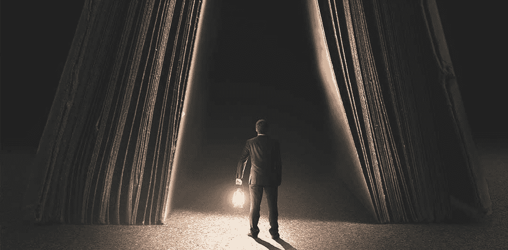

# 15 最小阅读清单：为你学习新知找到一条最小路径

和菜头

2022-04-08

## 15 最小阅读清单：为你学习新知找到一条最小路径

15 最小阅读清单：为你学习新知找到一条最小路径

| 转述师：余昊威 |

**最小阅读清单，名词，指学习新知时需要的最低书目清单，但它其实应该是一种自学方法。**

\*

最小阅读清单或者最小阅读书目，不知道是从什么时候开始进入我的脑海。我不记得这是从别人那里得来的概念，还是我自己的创造。如果是后者的话，很明显这是我受了之前从事航空业的影响，它来自 MEL，也就是最低设备清单，指飞机起飞时允许使用的最低限度的设备列表。

一般人会以为，一架飞机起飞前地勤人员反复做检查，是为了确保每一个零件都能正常工作。只有确认之后，飞机才能起飞。但实际情况并非如此，飞机的零部件太多，如果要求每一个零件都能正常工作，那么飞机大部分时间只能停在地上等维修。

事实上，机务人员有一本手册，上面是一个清单，飞机的正常设备只要能够达到清单要求，那么飞机就可以在部分零件不工作的情况下起飞。比如说机舱某个厕所的门坏了，那么可以封闭这个厕所，飞机继续起飞。

你可以把这个最低设备清单理解为飞机起飞时所需要的最少设备列表，正如你在儿童时期认为一辆车就是方向盘加四个轱辘，外带一个平板，这种朴素的认知其实并没有错。

读书的情况也类似，尤其是进入一个新领域的时候。理想情况下，我们会认为通读这个领域内的所有书籍，可以帮助我们全面了解。  
**但生活就是在不理想的条件下，依然要把事情完成。**  
从现实的角度考虑，我们并没有那么多时间和精力，去逐一阅读某一领域内的书籍。我们又往往的确需要在短时间内入门，或者有所了解。

**这时候最小阅读清单就显得尤为必要，你只需要阅读这个清单上的有限几本书籍，就可以大概了解相对应的领域，不再是个门外汉。**  
那么，现在的问题就变成：如何寻找最小阅读清单？

有些人因此心生幻想，觉得应该有个什么人，一早就写好了这样的清单，只需要自己找到，然后就能根据清单选书。我认为这样的人未必有，即便有，他的书单也未必适合你。因为每个人的知识层次和结构并不相同，统一的最小阅读清单要么会太深，要么会太浅。所以，这个工作其实是每个人自己的，你得自己亲手去创建。

最简单粗暴的方法是上阅读网站，比如说豆瓣。先找到一本这个领域内的经典著作，然后在这个条目下会有系统的相关书籍推荐，还会有网友建立的各种主题书单，它们都能构成一个阅读清单。

你可以根据书名和简介挑选出你认为适合自己阅读的基本，这就构成了一个最简单的最小阅读清单。又或者是你翻到这部经典著作的结尾部分，那里会有一篇文献索引目录，作者差不多会把同领域内的相关书籍全都开列出来，证明自己是在透彻研究各家学说之后才写的这本专著。同样的，你可以从中挑选一部分出来，尤其是作者反复多次引用的那些书籍，证明它们在整张知识图谱上的位置非常重要。

但我知道这样很难，而且偏学术化。那么，有没有更简单一点的方法呢？我认为是有的，只是路径可能会稍微曲折一些。

如今的人已经很少提到百科全书了， **我认为一套百科全书可能是所有最小阅读清单的基础。**  
类似我小时候看过的《十万个为什么》，虽然它是一套童书，但是它却对各种知识作出了全面的梳理，读者因此对整个人类知识体系有了一个大概的了解。  
**有了这种基本了解，你才可能知道自己即将前往的领域在整张知识图谱上处于怎样的位置，而不是真的一无所知地裸奔前往。**

如果这部分基础的认知是有的，也可以直接跳过，采取另外两条路径，其中一条是直接啃经典。找到这个领域内的开山之作，或者集大成之作，不管三七二十一就开始啃。

当然，这么做会让人很痛苦，不懂的部分总是会超过已知的部分，问题总是会比解答多。但也有好处，第一是你知道了大师的出发点是什么，想要解决什么问题。第二是你获得了一系列宝贵的问题，为你接下去的阅读提供了动力，指明了方向，你不再是泛泛阅读，而是带着问题去寻求解答。

另外一条路径会比较平缓一些，你要先找到两本书。一本是所谓该领域的通俗读物，就是有人用浅显易懂的方式，介绍这个领域是讨论什么问题，有什么流派，迄今为止取得过哪些进展，有什么关键性人物和关键性论点。

这种书往往都写得很通俗易懂，有时候可能会过于通俗，插入了太多趣闻和轶事，容易让人走神。毕竟，  
**这种书很难写，最好是大家写小文，但是大家未必写得出深入浅出的小文，能写也未必愿意花这个时间。**  
所以，只能指望那些热情但水平有限的人，多少也比你自己从零开始摸索要好。

所谓大家写小文，其实也不是很少见。如果你对古诗词感兴趣，可以去找王力教授的《诗词格律》来看看，写得简短明了，即便是一般文化程度的人也能学习格律的基本知识。如果你对相对论感兴趣，可以看看爱因斯坦亲自写的《狭义与广义相对论浅说》，里面只有电梯和火车，高中以上文化程度的人都能够从中获益。如果你对中国历史感兴趣，钱穆的小册子《中国历代政治得失》是一把很好的钥匙，有了它再去看《史记》《资治通鉴》可能会有完全不一样的感悟。

第二本是梳理该领域历史的书籍，任何一个领域无论发展到什么程度，总是有它自己的思想源流。于是，也就总是有人会去写回顾性或者荟萃性的书籍，介绍整个领域发展的历史沿革。它强调时间上的前后顺序，观点上的前后对照。你可以通过这种书籍，了解存在哪些重要人物，存在哪些重点书籍，以及哪些书籍的观点已经衰落，而哪些书籍的观点正在前沿。然后，你可能因此知道自己的兴趣所在，选择其中的某一段历史时期进行深入研读。

比如说，如果你喜欢哲学，那么杜兰特的《哲学的故事》值得花时间看一遍；如果喜欢物理学，爱因斯坦和英费尔德的《物理学的进化》算是很好的一个大纲。当然，所有这些例子可能对我，尤其是当年的我最为合适，相信你也能找到合适你的版本，去开启你阅读的第一站。

**有了这两本书打底，你就可以参考它们的说法，找到自己最需要阅读的几本书，或者说是基本书也可以，构建你私人的最小阅读清单。**  
如果不出预料的话，其中一定有某一类观点会吸引你，让人心生共鸣，而且想要深入研读下去。

也就是说，你个人会倾向于其中的一个派别。那么，这时候你应该在最小阅读清单里勉强一下自己，加入一本其他派别强力反驳或者相互争论的一本书。因为在这种短兵相接里，双方可能会暴露出最真实的想法，攻击对方最脆弱的一环。  
**看人打架不单纯是看热闹，这种时候最能看清楚招式和问题。这样，用三到五本书就可以构成自己的最小阅读清单。**

关于这种喜欢写驳论的作家，如果你喜欢文学，那么应该看看哈罗德·布鲁姆的《西方正典》《如何读，为什么读》等一系列书籍。很少看到火气那么大的文学批评家，看他的书，主要收获不单是他的立论，更有他火力全开，灭尽一切新潮文艺理论的狂暴。你可能未必会赞同他的观点，但是他的枪口却很少瞄错目标。

最后，还有一种很偏门的方法，我知道许多人在现实生活中就是那么做的。这类人知道自己时间少，缺乏耐性，所以他们的最小阅读清单上只会有一本书。选取这本书也只有一个标准，那就是能够吸引自己津津有味地读下去。他们会在一个大的书单里翻寻，看看前言和第一章，很快就决定放弃还是继续。如此反复多次之后，如同相亲一样找到一本合乎眼缘的书，然后根本不管它是入门通俗读物，还是进阶精读书籍，重点是小心地呵护自己的兴趣，让兴趣帮助自己完成第一本书的阅读。

接下去的事情就不用再劳烦别人开书单，他们已经大概知道自己要往哪儿走，去找什么看。许多人的文学阅读之路，大概就是这么开始的。  
**它最大的缺陷是容易让人停留在特定的一类书籍里，在那里安全又舒适，都懒得往外多看一眼。**

总之， **最小阅读清单并非是一张清单，它应该有无数张。同时，它也是一种学习新知的方法。**  
如果有一次成功的建立清单的经历，那么一个人也就等于是发现了一条自我学习的路径。它可以复用到下一次面对新领域的时候，而且也会因为不断重复使用而优化。不过，从本质上来说，是因为你发现了所有领域都有基本的模板和范式。

再一次，我为了我没有开列一个具体的书单而表示歉意，还是那句话， **我不能代替你自己的探索和努力，因为那是你自己的事情。**

1.对整个人类知识体系有一个大概的了解，你才可能知道自己即将前往的领域在整张知识图谱上处于怎样的位置，而不是真的一无所知地裸奔前往。  
2.别人的书单未必适合你。因为每个人的知识层次和结构并不相同，统一的最小阅读清单要么会太深，要么会太浅。所以，这个工作其实是每个人自己的，你得自己亲手去创建。  
3.最小阅读清单并非是一张清单，它应该有无数张，它是一种学习新知的方法。

公众号懒人找资源

发布留言

0/ *500*

确定

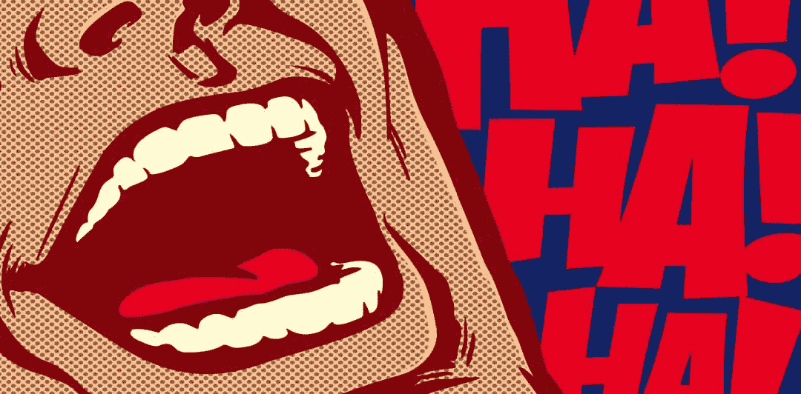

# 16 有趣：揭示关于有趣的奥秘

和菜头

2022-04-08

## 16 有趣：揭示关于有趣的奥秘

16 有趣：揭示关于有趣的奥秘

| 转述师：余昊威 |

**有趣，形容词，目前指一种值得追求的个人特色，而关于如何变得有趣，人们却知之甚少。**

\*

经常有人问我：怎样才能做一个有趣的人？仿佛有趣是一种可以学习的技能，或者是可以养成的习惯，甚至是一种可以表演的演技。的确有许多人通过我在网上的文章和言论，认定我是个有趣的人。

那么，在回答如何变得有趣之前，作为一个所谓“有趣的人”，我想从我的角度来开诚布公地谈谈我怎么看有趣，可能在这之前你从未有过这样的机会，说不定看完之后会完全改变自己的想法。

首先，虽然有那么多人说我有趣，但我自己并不觉得。而且，并不是我一个人那么认为，许多喜剧演员说过一样的话。你当然可以把这种说法当作是一种自谦，或者是隐隐的抱怨，抱怨自己活在众人的误解之中。

但我不是演员，也不是名人，我那么说，你完全可以就字面意思去理解，不用考虑什么隐藏含义。你我之间的关系就那么简单直白，先明确这一点，接下去就好办了。

我觉得日本演员北野武就很有趣，他靠演艺事业发达之后，终于得偿所愿买了一辆豪车。坐上车之后却觉得少了点滋味，于是让司机接着开车前进，他跑去打了一辆出租车，让出租车司机跟在自己的豪车后面，他好指着自己的车对司机说：看，那是我的车。

很多人都可能听过这段轶事，我也觉得有趣。但我觉得它有趣的地方是狡猾，这个故事用自嘲的方式来讽刺所有爱慕虚荣的人，所以让人发笑的同时又不觉得受到了冒犯。反而因为北野武讲了个关于自己的段子，有了一种亲近感：对啊，富贵不还乡，如锦衣夜行，北野武和我的想法一样嘛，但我怎么想不到这样的法子？他真是个有趣的人。

但我自己觉得最有趣的地方，是这件事情很可能是真的， **那么北野武就是个人戏不分的家伙，整个人间都是他的剧场，永远没有上场和下场的概念，他总是在场。**

北野武是演员，在漫长的演艺生涯里，他都一直在锤炼自己逗乐观众的能力。可能有趣的人都是如此，我从很小的时候就开始给同学们讲故事，讲笑话。其实，并不能说是讲，准确说是模仿。从别人那里听来，然后照猫画虎讲给别人听。

一开始完全不知道为什么要这么讲，为什么某处要停顿一下，为什么某处要装模作样向听众提个问题，但通过模仿我知道某些特定的技巧、特定的节奏控制是必须的，只有那么做了，听众才会紧跟故事，或者爆发出大笑。至于说是什么原理，其实我并不懂得。

这些手段或者方法，有些时候有用，有些时候不灵，于是，我又发现不同的听众对于相同的故事，反应不会一样。所以，凡是你能听到的故事和笑话，都是硕果仅存，而且已经被讲述过无数次。你能听到，只不过是因为它们通过了一次次的检验，证明的确有效。

同一个笑话，我换着方法在不同人面前讲过十几次、几十次，那你觉得我还会感到有趣么？把笑话当作是日常锻炼，那你还觉得我这个人有趣么？你猜想一下，当我讲完看到大家哈哈大笑的时候，我是觉得是“这个笑话真有趣”，是“我这个人真有趣”，还是说“谢天谢地，这次没有演砸”？

接下来你觉着我应该开始讲有趣这件事情应该如何微小改进，快速迭代了吧？应该给你一些具体的方法论了吧？没有的事，还请保持冷静。我不需要登台演出，不用走专业路线，所以并没有什么方法论给你，我只能给你讲一个笑话的诞生：

我办过卡，去过健身房，在跑步机上挥汗如雨。顺带说一句，这是个很痛苦、很无聊的过程，不要轻易办卡，误以为有了金钱上的投入自己就能坚持下去。不会的，每次看到卡的时候，我就觉得自己已经在锻炼这件事情上做出了足够投入，所以观赏完健身卡可以很安心地入睡，和许多人买完书就觉得自己已经获得了知识是同一种科学原理。

当然我还是真的去过很多次健身房，身边也有很多胖子披着毛巾在跑步。刚开始看到他们的时候，我也激发起了减肥的信心，毕竟我跑起来的时候身上不会一阵阵肉浪翻滚，大腿内侧不会噼啪有声。别人尚且狂奔不已，我又有什么理由做不到？

对，我就是做不到，因为我眼睁睁看着旧胖子一去不复返，新胖子不断涌入。身边永远不变的，是教练和那些好身材的人。在经历了这一切之后，我得出结论：只有身材好的人才需要去健身房。

这句话听起来是很有趣，笑完咂摸咂摸味道，觉得好像还有点道理。问题是我说这话的时候非常严肃，为了得到这个结论，我像一条疯狗一样在跑步机上狂奔，同时不断拒绝贴上来想要卖课的教练，忍受身边跑步机上的人把速度调到最高，用我一半的时间跑出一倍多的路程之后，下机前那种微妙的轻轻一瞥。

我觉得我是在巨大的痛苦和鄙视之中得出了生活的真相，我也知道这样说出来别人听了会觉得很好笑，但我自己真的想哭。尤其想到那张卡里剩下的钱，就伤心得更厉害了。因为这时候我终于醒悟，身材好的人之所以愿意去健身房，是因为看到我们这些胖子，以及我们这些胖子前仆后继、锲而不舍地不断失败，可以收获到双倍乃至三倍的快乐和自信。商业社会竟然如此残酷，我们胖子居然要交钱办卡才能成为别人的道具。

听到这里，你笑了吗？觉得有趣吗？你为什么不能讲述一个这样的亲身经历？ **因为我在我的故事里在场，而你在你的故事里不在场。**

还记得我一开始说的那个北野武的段子么？我说他永远在场，这是什么意思？当他买了一辆豪车，如果坐在豪车里让司机开车兜风，那么他本身就已经迷失在了他的虚荣里，根本不知道自己正在做什么，这其实是不在场。

他找了个出租车司机，在豪车后面跟着，其实是用一个路人的眼光来观察自己的车，以及车里满载的虚荣。因此，  
**他对发生的一切保持着觉知，包括自己的虚荣、自己的夸耀，他跳出情绪之外，站在一边观察，这就是在场。**

我的做法也是同理。我去健身房的时候真的是一个胖子，一个真正的胖子走进健身房，会很担忧别人的眼光，会怀疑自己是否坚持得下去，会犹豫要不要找专业教练买课，会忍不住想要和身边好身材的妹子搭讪，会担心再这么跑下去会不会暴毙在跑步机上……但他唯一不会想的事情是：我正在锻炼。所以，他也并不在场。

而我在场，我观察到自己身上的这些情绪和想法在起伏，和周围人的关系在前后变化，像个冷静的观察者那样描述基本事实：这是一个胖子在跑步机上很难看地减肥。基于这个事实，我才可以把事情记录下来，用一种当事人不具备的视角和情绪，去表达其中的苦难和困扰。然后，我才可以把这段经历变成故事告诉别人，而且其中有看似非常有道理的推论。

如果我不在场，那么我就无法摆脱我个人的主观感受，我会向你抱怨，我会痛骂跑步无效，健身房诈骗。你并不会因此感觉到有趣，而是觉得我可能需要安慰，同时觉得这个胖子负面情绪太多，得离他远一点。

但是现在因为我在场的缘故，我们可以乐呵呵地一起讨论一下健身房的奥秘，仿佛故事里的主人公并不是我一样，仿佛我根本没有感到挫败、懊恼、后悔一样。这其中的区别在哪里？

**区别在于不在场的人，他所给出的情绪和反应都是大家所熟知的，没有任何意外，没有任何惊喜，也没有任何观察深度。在场的人给出的情绪和反应，是人们在熟悉的生活场景里忽略的、轻视的、不曾想过的，为人们带来了关于生活的新视角和新理解。**

这时候，他们会说：啊，你这人可真有趣。

1.对发生的一切保持着觉知，包括自己的虚荣、自己的夸耀，跳出情绪之外，站在一边观察，这就是在场。  
2.不在场的人，他所给出的情绪和反应都是大家所熟知的，没有任何意外，没有任何惊喜，也没有任何观察深度。在场的人给出的情绪和反应，是人们在熟悉的生活场景里忽略的、轻视的、不曾想过的，为人们带来了关于生活的新视角和新理解。

公众号懒人找资源

发布留言

0/ *500*

确定

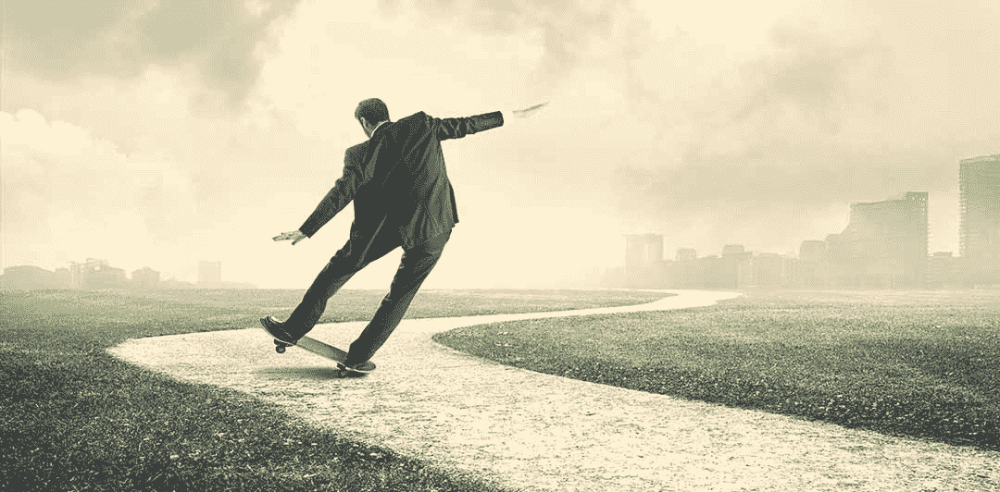

# 17 得心应手：保持一点生涩，其实更好

和菜头

2022-04-08

## 17 得心应手：保持一点生涩，其实更好

17 得心应手：保持一点生涩，其实更好

| 转述师：余昊威 |

**得心应手，成语，指因为熟练而带来的自如状态，但在今天，我们可能需要重新理解这个词的含义。**

\*

我记得我母亲在我现在的年纪，有天下班回来突然对我们说：“我现在终于知道得心应手是什么感觉了。”后来她解释说，她从事自己的这份工作已经超过二十年，所有的流程，所有的规则，包括所有的意外情形，该如何处理她全都了然于胸，甚至都不用再去调卷宗查条文。因此她工作起来如同行云流水，不费多少气力。她之前听说过得关于工作上得心应手的说法，而在她感慨的那一刻，她认为自己终于体会到了那种感觉。

遗憾的是，我到现在也没能体会到我母亲所说的那种感觉。我和她之间最大的区别，可能是我从来没有像她那样连续二十多年做相同的一份工作。她们那一代人，从走上社会到退休，很可能都没有换过工作。而我们这一代人，可能在同一个单位或者公司内部，十年间也要转职多次。尤其是处于上升期的行业里，这种岗位转换更是家常便饭。既然都是摸着石头过河，如果你愿意多摸的话，把一整条河都让给你也没什么问题。

我也曾经焦虑过，觉得大概很难达到我母亲的境界，手头的任何一份工作都需要我分外小心，都需要我继续学习，这样的日子看起来好像没有尽头。我什么时候才能闭着眼睛做事，不用那么劳心费力呢？

后来我偶然听到一种说法，几乎是在一瞬间就化解了我的焦虑。在这里不妨也分享给你，万一哪天你也用得上呢？早一点知道，也许还能保住一头浓密的头发。

这种说法认为， **人的大脑是一张地图，所谓做事就是在这张地图上找到从某地前往目的地的线路。地图里存在那么一条线路，那就是会做事。没有，那就是不会。**  
你做得越熟练，这条路线就越短，道路也就越宽。短无可短，宽无可宽的时候，就是我母亲所说的得心应手，基本在两点之间就是直连，怎么做也不至于偏离轨道。

那么这张地图是怎么来的呢？简单说，它就是现实世界在大脑里的映射。映射这个字眼可能比较陌生，姑且就理解为复印好了。假设你在现实生活里每天要做 50 件事，用 100 样东西，和 150 个人打交道，走 300 个不同的流程。那么，你的大脑里就会复印出一张地图，上面有 50 条线路，这些线路要经过 100 样东西，连接 150 个人，通过 300 个流程。

可以想见，如果你面对的世界越复杂，每天要做的事，要见的人越多，那么这张地图就越复杂，线路也就越多。

很明显，小朋友的线路很少，一开始只有吃饭、睡觉、走路这些简单的事情。随着他的成长，见到的世界越来越复杂，每天需要他做的事情越来越复杂，那么他大脑里的地图也就越来越大，线路越来越多，这就是长大成人。

那么，我们也可以反过来推断， **成长就是增加更多的线路，可以做更多的事情，不断扩展地图来应对更加复杂的情况。**  
我们还可以猜测，地图大到一定程度，再增加线路就很困难了，因为一张白纸容易画，而一张很复杂的地图要新增一条线上去就会有相当的难度。

我母亲的得心应手，说明她的那张地图已经画满了，上面有的线路已经固定。而我的胆战心惊，则说明我的地图还在扩张，还在不断往上面增添新线路。此时，我已经不再年轻，不再是个孩子，没有办法轻轻一笔就能画下一条线，只能小心翼翼地尝试重复勾勒，尽快让新线路在地图上固定下来。  
**虽然痛苦，但这意味着我还在学习，还在发育。**

最早我的专业是气象预报，学习了一堆预报方法。接下来，我一刀斩掉气象预报，从头开始去做航空公司的运行控制。再一刀斩掉运行控制，从零开始学习航空公司分基地的运营。继续一刀斩掉运营，转去做人力资源。

这时候来了一斧头，彻底斩断了我和航空业的联系，以新丁的身份去互联网公司……后来还有一系列钢锯、电锯、柴油锯，总之我那张地图上画得乱七八糟，七种颜色全部都用上还不够。

你问我什么感觉？我只能说，在斧头之前感觉还不错。毕竟都在同一个体系下，感觉自己迟早可以学完，因为事情的总量是有限的。但是在斧头挥下去之后，进入了一个没有边界的世界，感觉自己抱着个乒乓球飘在大海中央，往哪边看都是无边无际的水，拍到脸上的都是浪。最痛苦的是那片海还在不断扩大，又开始担心自己的位置上突然间没有了浪。

在互联网行业内，我见过两个活生生的例子，都是关于不换地图的下场。

一个是做短信服务的，设计几个吸引人订阅的短信产品，谈谈推广渠道和费用，让一堆人开通，最好是按月自动扣费，然后就有了十多年好日子可以过。在他们的地图上，这条路笔直又宽敞，而且还有钱。

转眼之间移动互联网时代到来，人人都开始用上了智能手机，新地图开启。按理说，这些人是最懂手机用户的，他们在新时代里应该最有优势。于是，他们把以前的服务搬到 App，觉得无非是把线路上的车换一下的事情，结果很快就消失在历史的大潮里。在新崛起的 App 制造商里，没有几个人曾经是短信服务玩家。

另外一个例子是门户网站，从用户每天都去网站获取新闻，到新闻推送到自家手机上，再到用户在手机上读完一条新闻，App 立即再推送十条相关的新闻，让他永远看不完，前后大约十五年时间。

门户网站在移动互联网时代刚到来的时候，还可以用新闻客户端跟上时代大潮，继续传统的新闻操作模式，头条专题加滚动更新。等到推荐算法时代到来的时候，新闻产品是由根本不懂新闻的技术人员设计制造，这时候门户网站就再也跟不上了。如果你有时间的话，可以去各大门户网站去看看，有多少个分类频道还在坚持每天更新全部内容？

对此，我的感慨是： **还是暂时不要得心应手的好。**

我母亲那一代人可以一辈子做同一份工作，但我们这一代人以及之后的世代大概很少有这样的机会。  
**新领域、新行业、新事物还在不断涌现，在旧世界里生长出新地图。而新地图一旦出现，可能悄无声息地就把附近的旧地图抹除。甚至都没有发生任何攻击，它们只是自然生长而已。**

所以，宁可手下永远保持一点生涩，身上永远都有学习压力，也不要得心应手，整天画固定路线。总是感觉有一点点吃力是好的，保持一点点陌生感也是好的，每天多画几条新线路也是好的。

反而是感觉所有的事情都很顺滑，都可以用下意识处理是危险的。  
**得心应手意味着你的地图边缘已经封闭，和这个不断变化的世界隔绝开来，顺着你地图上的既定线路，无法连通到新地图中去。**

对了，在这个关于脑内地图的说法里，其实原本说的是脑回路。大脑内建立的每一条新的脑回路，对应着世界上的一件新事情。人们喜欢说“逃离舒适区”，听起来好像是在说一种想法，一种心理状态。不，它更是一种生理变化，你得真的在大脑里建立起新的回路来，以此回应新刺激。

有人曾经说过，所谓创造性，就是在不同的回路之间建立起新的联系。我想，按照惯性走有限几个回路的人，可能不在这个范畴之内。

1.新领域、新行业、新事物还在不断涌现，在旧世界里生长出新地图。而新地图一旦出现，可能悄无声息地就把附近的旧地图抹除。甚至都没有发生任何攻击，它们只是自然生长而已。  
2.宁可手下永远保持一点生涩，身上永远都有学习压力，也不要得心应手，整天画固定路线。  
3.得心应手意味着你的地图边缘已经封闭，和这个不断变化的世界隔绝开来，顺着你地图上的既定线路，无法连通到新地图中去。

公众号懒人找资源

发布留言

0/ *500*

确定

# “我问和菜头”：做一个有趣的人，要付出什么代价？

和菜头

2022-04-08

## “我问和菜头”：做一个有趣的人，要付出什么代价？

“我问和菜头”：做一个有趣的人，要付出什么代价？

| 转述师：余昊威 |

读者 用户我是运营：:

> "和菜头老师您好，最近读了一本名师名书，其实大部分内容我都是似懂非懂。但是其中有些总结或者段落我一读就拍大腿，写得太好了。因为事情我经历了，并且大致的解决方法也是如书所述。"

> "问题来了，这本书我没读懂的部分呢？没领悟的部分呢？怎么把这些没领悟、没读懂，最大化帮助我的工作生活？"

首先，我的建议是你要珍惜自己的大腿，不要没事就大力拍它。在一生中，会有机会遇见许多位聊起来相互忍不住拍对方大腿的人，但是这些人最后往往不能成为朋友。而你的朋友和你之间，却不会相互拍大腿。吸引你们成为朋友的东西，很可能是你们之间的差异，而不是你们的共性。你们之间如果存在共性，应该不是那种需要彼此拍大腿的共鸣，它要更为深沉。

看名师名书，你忍不住拍大腿，无非是你看到书里的思路和你一致，算是得到了某种来自权威的肯定。既然肯定了，那么事情也就过去了，除了给你增加了一点信心之外，并没有别的收获。

反而是你没读懂，没领悟，没做到的部分，对你仍然具有价值。 **它们的存在，证明你的认知还有空白地带，需要努力填补。**  
这可能不是朝夕之间能够完成的事情，但是你可以带着疑问继续工作、生活、学习。随着你的阅历增加，会有一天触类旁通，心头火光一闪，把过去和现在联系在一起，突然若有所悟，那是读书过程中最大的幸福。

最后，没有什么是可以“最大化”帮助你的学习和生活。阅读书籍，增广见闻，独立思考，并不保证任何最大化的帮助，甚至也不保证提供成功的必要条件。  
**自我学习并不是一笔交易，可以算计出利润最大化的部分，它只是持续地提供思考的养分罢了。**  
不是说非常功利地读书不好，而是说如此去做，如此去衡量，你可能会错失那些能够滋养你灵魂的营养，变成一个平面的人。

读者 用户 Sun Xiao：:

> "最小阅读清单在一定程度上是否可以理解为快速入门一个领域的方法？用相对较少的的时间去快速进入一个领域，让自己的资源收益最大化。一个认知系统的大纲构建的方法呢？相对于输入而言，认知后应该如何输出才能让我们更快迭代？望菜头老师解答。"

关于这个问题，费曼教授有一个很好的方法，那就是你能够把你刚学到的东西，对一个对这个领域毫无认知的人讲清楚，让对方弄明白。如果对方文化程度较低的话，可能会更好。

还有一种理论认为，如果你有一群同好，都是某个领域内的初学者，你能够输出什么内容，帮助他们理解和掌握新知识，那么对于你的学习也会有很强的促进作用。

这背后的理论是人类作为一种社会化动物，如果他做出的行为能够对群体产生价值，他就会获得极大的满足，并且因为这种满足而获得极大的学习动力。

无论是哪一个过程，对于你而言，都会是一种查缺补漏，那些看似你已经掌握和理解的部分都要面临考验。于是，你才会花时间去弄清楚，也因此知道了下一步应该前进的方向。

读者 用户赵恩：:

> "前几天看了关于有趣的书，随便翻翻的那种。也有一种说法，就是用心体会，你真正代入角色，和随便讲讲，别人是能够听出来的。"

> "“对发生的一切保持着觉知，包括自己的虚荣、自己的夸耀，他跳出情绪之外，站在一边观察，这就是在场。”能做到时刻在场的人应该是少数吧，这个是否有练习的方法？请菜头叔叔分享。在场这个理论，是否和正念的活在当下有相通之处？"

许多人问了类似的问题，他们的问法更直接一点：如何才能做到在场？你的提问其实提出了一个解决办法，那就是正念。但是，这对于一般读者还是太复杂了，用一个概念去解释另外一个概念，这样显得太不友善，更何况两者其实差别很大。

**之所以能够跳出情绪之外，是因为一个人有基本的共情能力。他在别人的哀伤上看到自己的哀伤，在别人的尴尬中看到自己的尴尬。**  
于是，通过这种对于生活的观察，他产生了一种自省——每一个人都活在某种限制之中，但是并未觉察。每一个人作出诸多努力，但可能是白用功。在笑别人之前，想一想自己是否也一样？在这种自省的基础上，他能够体察到人们的共同处境，并从中看出大家集体卡在某种处境里的滑稽和荒谬。于是，他能用讲笑话的方式，揭示出这种真实，这后面的本质其实是对他人的悲悯。

今天有不少人抄“喜剧的内核是悲剧”这句话，宣称自己终于理解了它的含义。对此我有些怀疑，他们很可能是把个人受苦、倒霉理解为笑料的来源。问题是，  
**喜剧演员内心的那一颗泪并非是为了自己，而是为了他人，所以才有那种所谓有趣的力量啊。**

读者 用户子木：:

> "探寻有趣的来源，我有个假设：“好看的皮囊千篇一律，有趣的灵魂万里挑一。”是什么让人对有趣如此痴迷？"

> "尤瓦尓·赫拉利在《人类简史》中假设：智人能够生存下来是因为讲故事，而且很多人也接受，但究竟为什么只有智人会讲故事，那就是众说纷纭了，各有各的看法。  
> 如果接受由于智人会讲故事，所以生存下去了的故事，之后便是要开始竞争，在长期演化的过程中，那些故事讲得具体、生动的人便更容易获得优势，毕竟那时候权力最大的是那些把神讲得惟妙惟肖的神职人员，现在也如此。  
> "

> "菜头叔，看到您写有趣的奥秘时，我最先关注的竟然不是怎么变得有趣，我还能抢救一下吗？"

事实上，通过我多年的写作，我发现人和人之间的交流，直接可以讲道理、讲逻辑的人是极少数，因为这需要抽象思考的能力，大部分人并不具备，只能讲故事。但是，人类之所以存在那么多年，说明不需要这些能力也可以生存。那么靠什么呢？靠对具体的情景作出具体的反应。  
**而所谓故事，就是构造出一个具体的情景，让人物在其中作选择，把道理隐藏在其后。**

因此，通过讲述故事，传播故事，也就传播了附着在后面的想法和道理。童话《小红帽》的故事今天都还在传播，那是因为家长需要，这个故事的核心是小孩子不听大人的话就会被狼吃掉。而这个道理能够传播，是因为这个故事的形态很离奇，富于想象力。

人们听得进去故事，但是不喜欢听人讲道理。原因是他们能够很容易地想象一个戴着小红帽的小姑娘走在幽暗的森林里，周围杀机四伏。但是，你要换成说个人的行为选择对应着不同的风险概率，在决策的时候需要明智，听从那些经验丰富之士给的建议，那么人们就会开始打瞌睡了。对于他们而言，小红帽如何对付狼的威胁可能更具体，也更重要。从故事中可以学到经验，而道理却做不到这一点。

读者 用户胡振强：:

> "菜头叔，你也曾经说过，喜剧的内核是悲剧。根据我的经验，所谓有趣，其实不过就是你用你的窘迫换来别人的笑声，当然大部分时候是善意的笑声。吴孟达就多次强调，自己是个悲剧演员。只是我们这些“不在场”的旁人看着他好笑而已。"

> "做一个有趣的人，一定要付出这么大的代价吗？"

我没有，我不是，你别乱说。这句话不是我说的，我也从来没有把这句话据为己有。对于你的理解，我并不能赞同。你把有趣和卖惨、博同情混为一谈，是因为观察和思考不够深入的缘故。

在生活中，你的确可以观察到一种现象：你在朋友圈里刷了 100 项个人成就，没有一个人点赞；你发了一条动态，说网购了一双鞋，两只都是左脚，瞬间点赞回帖过百。但是，根据这样的现象，并不能得出人们喜欢看他人倒霉的结论，也推论不出你所谓用窘迫换笑声的理论。

你可能现在并不能理解：

1.之所以会笑着点赞回帖，是因为你帮助他们释放了关于网购的不愉快回忆和内心的担忧，他们的欢笑是因为他们内心的解脱；

2.喜剧演员去构造一个类似的故事，并不是为了卖惨，而是他知道这是一大批人共同要面对的问题，他在台上表演这种忧虑、这种失败经历，是为了缓释这一批人的内心，通过大笑消解了他们内心的压力；

3.会有笑喜剧演员倒霉的人，但是多数人会笑着说：其实我也一样。他们心里是明白的，知道台上的疯子在笑台下的傻子，这是演员和观众之间起码的默契。

**做一个有趣的人，代价很大，但代价并不在于自身的窘迫。**

1.喜剧演员内心的那一颗泪并非是为了自己，而是为了他人，所以才有那种所谓有趣的力量啊。  
2.人类之所以存在那么多年，靠的是对具体的情景作出具体的反应。而所谓故事，就是构造出一个具体的情景，让人物在其中作选择，把道理隐藏在其后。  
3.喜剧演员去构造一个类似的故事，并不是为了卖惨，而是缓释一批人的内心，通过大笑消解了他们内心的压力。

公众号懒人找资源

发布留言

0/ *500*

确定

# “我问和菜头”：瞎折腾，还是真探索？

和菜头

2022-04-08

## “我问和菜头”：瞎折腾，还是真探索？

“我问和菜头”：瞎折腾，还是真探索？

| 转述师：余昊威 |

读者 用户陈澍：:

> "菜头叔，避免得心应手的最直接办法就是不断拓展地图边界，但地图要画错了不是得不偿失，如何才能识别哪些尝试是瞎折腾，哪些是真探索呢？"

看到这个问题，让我想起中学时期经常听到的一句话：如果复习了这章，考试结果没考呢？今年我写的系列文章，都是针对成年人。所以，我认为不需要提醒读者注意，成年人中的终身学习者和在校学生之间的差异。不过从目前的各种问题上来看，我觉得有必要做一点阐释。

**成人和学生在学习上的不同，并不是在阅历或者智力水平上。**  
学生学习的目的很简单，通过考试，拿到毕业文凭，并不会考虑太多关于应用层面上的事情。然而，成人往往是带着明确的目的进入新领域，要么是为了解决一个问题，要么是为了达成某个具体的目标。因此，  
**成人的侧重点放在实际运用的一边，反而学习效能要比学生高。**

如果你也赞同这个观点，那么你的问题就不再是一个真问题。 **拓展地图边界的成人，一定对应着某个具体目标，也一定通过摊开地图的方式去尝试解决某个具体问题。**  
无非是成功与否的问题，但这里并不涉及到得失。除非你认为尝试必须成功，否则就算是亏损。

读者 用户 Flying Leo：:

> "菜头叔，听完今天的分享，我有一个问题，你在不停地挥舞着各种工具拓展自身地图的时候，是怎么处理自身发展和实际需要之间的关系的？说白了就是怎么处理想要折腾一下人生，但是身后却有孩子要养，房子车子要还的矛盾的？"

你想过一个问题没有？你可以每天专心学习，一年两个假期，不需要为衣食住行操心的时代已经永久过去了，不是么？你现在是在有限时间，有限经历，有限资源的情况下，想要过上更好的生活，不是么？所以，你问我的问题是不增加投入，不增加自己负担的情况下，像个学生一样悠然自得地在知识的海洋里遨游，在无限的可能性里随意挑选吗？我也想有这样的好事啊，但是最终我只能在我的时间表里不断插入项目，压缩我的娱乐时间，休息时间。

而且我想说， **如果你真的想要去做，那么你总能创造条件去做。知道压力非常大，知道非常痛苦，但是你还是会选择去做。**  
反过来，也就是说说而已，并没有必须忍受痛苦也要去做的冲动。

读者 用户子木：:

> "菜头叔，找有个疑惑，对外我们确实要拥抱不确定性，不断迭代，但对内呢？"

> "我记得岳飞有句话：运用之妙，存乎一心。战场上风云莫测，但运用起“心”来确是要得心应手。"

对内就是剥洋葱啊，你的认识是一层层深入的，无论对外部世界还是对于自己，都是如此。每个人都处于持续的变化当中，10 年前后同一个人的变化可能很惊人，哪怕是同一天内，对同一件事情，一个人的看法也可能会发生转变。

同样的， **每个人对自己的认知也并不全面，所以才有压力当前爆发潜力的说法，那个爆发出潜力的人自己平常可能认为他根本不存在。**  
所以才有一叶障目不见泰山的说法，那个认为自己全懂的人只不过是因为看得太过近切。

从你的问法上看，你认为会有一个稳定的自我存在，甚至认为找寻到这个稳定的自我是一种必须。但是，你是否想过也许他并不存在呢？或者，他以你想象不到的方式存在着？如果我们一层层剥开洋葱，最后会发现其中空无一物，但是一颗洋葱的确存在体积，占据一定的空间。你所认为的坚固的自我，会不会也是一颗洋葱呢？

最后，我想问你一个问题：如果你发现自我其实是易变的，是流动的，是没有永恒核心的，你是否会愿意接受这个现实？

读者 用户酥三岁：:

> "菜头大叔，平时接受到的最多的就是要精而不是贪多，这样才能有一个硬实力专长，网上也经常提到知识焦虑，认为得到在贩卖知识焦虑，知识焦虑而贪多与“逃离舒适区”去建立新的脑回路有何区别呢？这样会不会造成想样样得，结果啥也没有得到，就像被老年人当反面例子来教育有些不踏实经常换工作的人，到老还是一事无成的人，来以此说还是稳定工作最好，要知足常乐？很怕自己也陷入这样的局面，怎么在“逃离舒适区”和稳定的生活中保持一个合理的度呢？"

说句刻薄的话，是不是贩卖知识焦虑取决于是谁在卖。如果是别人卖，那就是贩卖焦虑；如果是自己卖，那就是百年树人——许多人的真实想法就是如此。在我看来，工作之后去自己报名上课的人，要比学生时代的自己刻苦多了。这是因为人性就是如此，不会尊重免费得来的知识。为了知识付出越多，也就越发珍惜。可以找出一百条理由反对知识经济，贩卖焦虑只是其中之一，但是，只需要能让人们珍惜知识，主动学习这一点成立就足够了。

至于说具体的个人，是不是狗熊掰苞米，要看他是想做什么。如果是为了一个具体的目标，比如说理财、减肥、心理健康，或者是为了解决一个具体的问题，那么他大概率不会迷失。如果只是为了学习而学习，为了新知而新知，那就是把知识当做盔甲穿在身上，当作 LV 包包挂在身上，那的确可能最后一事无成。

通过这一段时间的反馈，我也发现了一点：许多人的得失心非常重，蚯蚓都还没有挖一条，就开始担忧鱼钓多了冰箱里味道大。我觉得这些都是没有必要的思虑，毫无行动的思虑只是在浪费大脑的能量。说白了，你浪费人生中的一年时间去了解一个新领域，你又能损失到哪里去？但是，许多人却是在原地思考了十年，寸步不移。

读者 用户不稳定化合物：:

> "菜叔，我们应该如何应对他有意无意的试探呢？每次遇到别人的询问，我清楚对方的目的是什么，自身很愤怒但理智告诉我不能发火，但又不知道如何反击？"

**我觉得在人际关系上，保持一点钝感可能是好事。**  
对人过于敏感，心态可能会因此失衡。当你注意到一次试探的时候，你会发现无数次，然后你就没有别的事情可以做的。在你周围的人，绝大多数和你的生活无关。同样的，你的存在也对他们无足轻重。他们对你没有那么重要，你对他们也是同样。

你让我告诉你如何殴打坏人的方法，但是从你的描述上看，我认为更大的可能是你过于敏感，过于敏感的原因是过于自我为中心。站在地球的角度上看，感觉太阳在死皮赖脸地围绕自己旋转，但是从第三方的角度上来看，可能并不会有相同的结论。

如果可能的话，我倒是想建议你检查一下，你的怒火从何而来。根据我的经验，别人的试探只是你自我欺骗的一个理由，一定存在更为深层的原因，但是你却在极力回避。

我的确可以直接针对你的问题给个参考答案，比如说遇见别人的刺探，反问对方“知道猫是怎么死的吗？”

但是如果你依然是这样的心态，新的麻烦很快又会找上身来。本质上，你需要找个什么人来倾泻怒火，是谁可能并不重要，随便给个理由就好。所以，真正的问题不在对方，而是你为什么会愤怒。我不了解你的情况，这个问题只有你自己才能回答。

1.成人往往是带着明确的目的进入新领域，要么是为了解决一个问题，要么是为了达成某个具体的目标。因此，成人的侧重点放在实际运用的一边，反而学习效能要比学生高。  
2.每个人对自己的认知也并不全面，所以才有压力当前爆发潜力的说法，那个爆发出潜力的人自己平常可能认为他根本不存在。  
3.在人际关系上，保持一点钝感可能是好事。对人过于敏感，心态可能会因此失衡。

公众号懒人找资源

发布留言

0/ *500*

确定

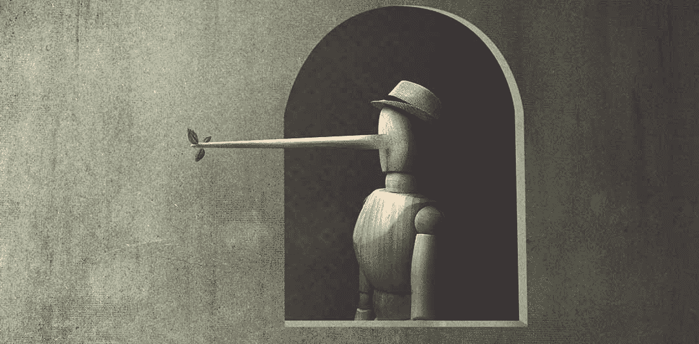

# 18 撒谎：别跟底层代码作对

和菜头

2022-04-08

## 18 撒谎：别跟底层代码作对

18 撒谎：别跟底层代码作对

| 转述师：余昊威 |

**撒谎，动词，一般认为是违背道德的行为，但它也可以从其他角度理解。**

\*

有人问我：“当撒谎对自己有利的时候，为什么要说实话？”其实通过提出的问题本身，我们可以看出更多东西来。问这话的人，是站在功利的角度去看撒谎。如果一个人以功利作为判断事物的最高标准，的确可能在处理问题的时候快刀斩乱麻，看起来干脆爽利。但是现实生活要复杂很多，快刀不是想挥舞就能挥舞的。

我来分享一个发生在我身上的真实案例：

高二那年，我去昆明陆军总医院动一个外科小手术。在住院部外科病房，认识了一位很年轻的士官，算起来是我父亲他们学校的学生。他已经动完手术，正处于恢复休养阶段。那是个精力非常旺盛的四川小伙子，自称是部队专门培训的特种兵，经常参加军事大比武。

他给我绘声绘色地形容，比赛时他要怎么跑过一段障碍赛，然后腾身而起，在空中解开扣好的子弹带，大拇指一顶，弹出弹夹，顺手插上弹夹，在落地的瞬间开出第一枪。他又教我真男人要练习俯卧撑，连续做到 1000 个以上身材自然好。说到高兴处，拉着我在病房地板上练习用五指做俯卧撑，我练了一下还是决定放弃，否则可能又得去骨科。

我们相处很融洽，他给我讲真男人如何锻炼，随时展示一身腱子肉。我则带着他跑去住院部后面的护士宿舍，他面皮薄，而那时候我还是个孩子，由我出面帮他要漂亮护士姐姐的电话号码。

有一天我们经过住院部护士站门口，那里有扇玻璃窗，上面贴着我们的床位和个人资料。当时只要是需要开刀的都收入外科，病因也都直言不讳，骨折就写骨折，痔疮就写痔疮。我看了一眼他的资料，上面写着胃 Ca。当时我心里就猛地一跳，以我高二的英文水平，也能猜出 Ca 就是 cancer，看他生龙活虎的样子，怎么会是胃癌患者？他指着资料问我，这个 Ca 是什么意思？我反问他：医生是怎么说的？

他说医生告诉他，他有严重的胃溃疡，所以不得不把胃部切除了很大一块。知道医院没有告诉他实情，我也决定撒谎。我说那就是了，这就是胃溃疡的意思。接着，他又感叹说自己的胃是因为吃了太多方便面给弄坏了，面条太软，对胃不好。我表面上很平静，但是内心翻江倒海。晚上我父亲来探视，我拉他到一边说了这件事，他告诉我不要声张，等出院回家他再告诉我详情。

接下来的日子很煎熬，士官依然每天拉着我聊天，抱怨他刀口早已经长好，但是医院却不肯放他回部队，只能在病房坚持锻炼，免得生疏了一身的本事。

等我出院之后，我父亲告诉我说，医生打开了那位士官的腹腔，发现已经没有多少手术治疗的必要，摘除了胃部的病变区域之后，让他留院休养，算是一种照顾。又过了两三个月后，我父亲有天回家告诉我说，那个士官刚刚病逝。

这件事情在很多年里都横在我的心头。毫无疑问，我对那位年轻的士官撒了谎，没有告诉他关于病情的实情。但我的谎言又的确出自一种善意，因为他当时毫无觉察，一门心思准备返回部队，继续他的军校生涯。如果我告诉他实话，他的所有希望破灭，谁也不知道他会发生什么，也许整个人的精神气都会垮掉，缩短他所剩无多的时间，未免有些残忍。

按照一开始的利己原则，好像撒谎也没有什么问题。因为院方和我都在撒谎，可以看作是一种为他人考虑的利他行为，但是，这同样可以解释为利己。起码在我这里，我不希望因为说了实话而破坏我们之间的关系，更不希望他被真相打击变了个人，这会让我的内心遭受谴责，所以好处最后都落在我的身上。

既然如此，为什么在后来的那么多年里，哪怕我努力从纯功利的角度去看，但我还是放不下这件事呢？

现在，我有了另外一种解释。

为什么撒谎之后人会不舒服？因为我们知道真相是什么，谎言强烈地提醒着我们真相的存在。  
**面对真相，编造出另外一套说辞来，我们永远都不可能用这套说辞真正替换掉真相，也不可能说服自己真去相信这套说辞。**

**当一句谎言说出口，它就牢牢绑定了一个真相，无论我们走到哪里，都会感受到真相的重量，犹如背负了一笔永远的债务。**  
这不是心理建设所能解决的，也不是奉行某种价值观所能解决的，因为对真相的渴求是写进我们 DNA 里的基础模块，如果不是追求真实的话，那么人类早就因此而灭绝了。

**因为谎言是一笔债务，为了维持这笔债务，不至于让自己说出极力隐瞒的真相，那就总是要额外消耗一些心力。**  
如果这样的债务太多，那么可能让人心力憔悴。有太多真相要去隐瞒，有太多说辞需要去背诵，相当于要自己去生编一个世界，然后小心翼翼地生活在其中，不要打破脆弱的墙壁，显露出里面埋藏着的无数个真相。

这样的生活让人不堪重负，如果真是从利己的角度去衡量，完全必要去这样难为自己。这就是为什么说出真相，说出实话会让人有种如释重负的感觉。

除此之外，利己这种想法中关于自我的部分，是不是牢靠也需要打一个问号。什么是对自己有利？听起来这根本不是个问题，每个人都拥有自我意识，自我意识当然可以判定什么对自己有利。但人类是一种社会化动物，每个人生下来就在人群之中，否则就是野兽，不能具备正常人类的情感和理性。

那么，所谓的自我意识，多大程度上是自己生长出来的？多大程度上又是外界输入和塑造的？那个说“给我苹果”的小朋友，他关于“你我”的区别，给予和接受的区别，不都是母亲拿着一个苹果来来去去构建出来的么？当一个人说“撒谎对自己有利”的时候，那个所谓的“自己”，是真正的自己，还是被周围的人构建出来的那个自己？

所以，根本都不需要到道德层面去讨论撒谎，只是从生物进化的角度来考虑，就可以知道：人是群居的社会化动物，群体早就把共同生活的规则植入了每一个人的大脑，并且伪装成是每个人自我意识的一部分，让人觉得“这是我自己想要那么做”，从而使得个人选择和个人行为，在所谓的利己思想的指导下，暗中有益于群体利益，人类种群因而发展和壮大。

**不撒谎，说实话，这是写入了人类大脑中的底层代码，因为这么做有利于群体。而如果你非要反着来，自我厌恶和自我否定会是一种生理层面的痛苦。**

回到今天一开始我和士官的往事，类似的撒谎行为可以解释为说出“善意的谎言”，是一种利他的体现。所以，这种谎言受到内心的抵触较少，每个人对善意的谎言也有更高的包容度。但即便如此，在极为特殊的情况下，比如说我的谎言和士官最后的时日有关，和生死这样的大事有关，那么连这种善意的谎言在多年后也依然要受到内心的反复检视，还是会产生内在的冲突。

在这种两难处境中，会让底层代码出现故障，于是才会让人意识到它的存在。认为只要对自己有利，撒谎也没有关系，这太小看了人类的生物特性。甚至不用他人的眼光，只需要在自己面前放一面镜子，能够看到自己的镜像，一个人的行为也会产生自我约束和自我规范。洗手间和电梯里总是会安装镜子，那真的只是为了美观吗？银行商店的摄像头完全可以隐蔽安装，但是如此醒目地挂在外面，真的只是因为经费问题吗？

**认为撒谎没有关系的人，最好不要有独自面对自己的机会，因为那时候任何主义、任何思想大概都不会起作用。**

1.谎言是一笔债务，为了维持这笔债务，不至于让自己说出极力隐瞒的真相，那就总是要额外消耗一些心力。  
2.不撒谎，说实话，这是写入了人类大脑中的底层代码，因为这么做有利于群体。  
3.认为撒谎没有关系的人，最好不要有独自面对自己的机会，因为那时候任何主义、任何思想大概都不会起作用。

公众号懒人找资源

发布留言

0/ *500*

确定

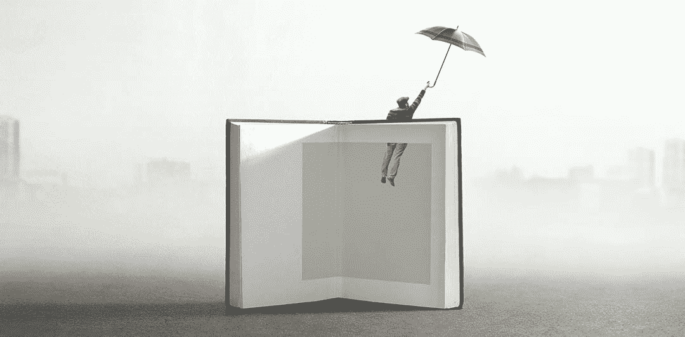

# 19 讲故事：解析一次和小朋友讲故事的全程

和菜头

2022-04-08

## 19 讲故事：解析一次和小朋友讲故事的全程

19 讲故事：解析一次和小朋友讲故事的全程

| 转述师：余昊威 |

**讲故事，动词，人类最古老的沟通方式，人们很容易忘记其中的基本技巧。**

\*

我不是那种喜欢孩子的人，也很少羡慕别人家有孩子。不过，我和小孩子相处得不错，不同朋友家的孩子都挺喜欢我这个和叔叔。

于是有朋友解释说，主要原因是我心智发育不全，所以喜欢和智力水准相近的孩子待在一起，并且相互能够理解。也有朋友认为可能是我的生长发育有问题，始终没有从男孩变成男人，而小朋友可以敏锐地觉察到这一点。从我和他们抢玩具这一点上看，他的看法有很大可能是对的。

还有朋友属于批评家，他们直言不讳地说，我作为一个外来人口，带着礼物和时间，一年到头也来不了几次，孩子当然喜欢这种远方的叔叔，而受苦受难受累的，还是他们这些日复一日陪着孩子的家长，付出那么多反而不能像我一样在孩子那里落个好脸。这种说法我同样无法反驳，否则那就几乎是在批评朋友不是合格的家长。

但是，我和小朋友相处融洽是个事实。人世间的事情就是这样没有道理可说，不怎么喜欢孩子的人，偏偏受到了孩子的欢迎。而追着孩子屁股跑的人，孩子却不屑一顾。

鉴于这种落差带来的苦恼，也为了避免继续被视为心智发育不全，这里我打算慷慨地分享一下自己和孩子相处的经验，作为一种家庭生活的参考：

我认为，我个人最大的优势是会讲故事。赶在大家向我索要故事之前，我要先声明：我没有故事书，也没有私人童话，我的故事大多都是现编。而且，在面对儿童的时候，我对于信口胡编一个故事毫无心理负担。事实上，信口胡编正是我的创作方法。这样的话，因为情节过于离奇，或者是前后不连贯，孩子就会很焦急地打断我，认为故事讲得不对。

这时候，我就可以顺理成章地来一句：那你认为应该是怎样的？孩子往往能说出一番自己的见解来，那么，编故事的重任就跑到了他自己身上。我只需要补充或者润色，让故事能够继续下去就足够了。  
**根据我的观察，这种共同创作故事的过程，要远比我讲孩子听更受欢迎，谁会反对自己编出来的故事？那不等于是自己反对自己？**

关于讲故事，我还有一大优点，那就是由于故事都是我临时现编，所以不存在尊重原版故事这种事情，孩子可以随时打断我，随时提问。有些时候问题和故事有关，有些时候是纯粹的思维发散，我的做法是停下来，先回答问题，再回去讲故事。有时候讲故事讲到一半，就变成了问答专场，对此我也没有任何意见。对于我来说，反正都是和小朋友聊天，最怕的是小朋友不愿意说话，大家都陷入比谁更礼貌，谁更沉默的竞赛中去。  
**只要小朋友愿意和我聊天，我并不在乎是不是一定要说完我的故事。**

对于什么是故事，我也有属于我自己的见解。

我认为， **对于小朋友而言存在两种故事，一种是可以听的，一种是可以演的，两者并没有什么区别。**

几年前，我去一对朋友家玩，第一次见到小朋友。他们家儿子很骄傲地向我展示了他的玩具车队。我一一赞美了他的轿车、卡车、大吊车，然后就和他玩起了卡车大战。那时候小朋友还小，不会说什么完整的句子，所以我跟他都是“嘟嘟嘟”用嘴配音，然后拿着汽车玩具撞来撞去，相互喷了一脸口水。撞了一会儿，他突然站了起来，伸开双臂，从客厅一头跑到另外一头，然后扭头看我。

几乎在一瞬间，我就明白了他的心意。他用自己的动作告诉我，我们别玩汽车了，换一个玩法，他现在是一架飞机。一旦明白这一点，我就起身过去，双手托住他的身体，让他在空中展开双臂，变成一架飞机。然后我举着他在家里“飞行”，教他起飞、着陆和盘旋，弄得我满头大汗，他玩得开心极了。

飞行中途等加油的时候，我说带他下楼去买糖果，他一声不吭跟着我进了电梯。一开始还很冷静，和我并排站着。等出了单元门，来到街上，他下意识地一把抓住我的手，要我牵着他走——这就是我们讲故事的人的特别待遇。

欢乐的儿童乐园时间到这里暂且打住，免得让这一场分享变成了某种自吹自擂，惹人不快。这里我不想讨论什么童心，也不想讨论什么天真，或者是什么同理心。我想讨论一些刚才故事里你可能忽略了的东西：

不知道你注意到了没有，无论是讲故事，还是演故事，我都没有看手机的时间和可能。作为叔叔，因为来得少，所以讲故事的时候很认真，不大可能一边刷手机一边讲故事。虽然是很小的事情，但是孩子能够注意到，你究竟是全心全意地和他讲，还是三心二意地在敷衍他。

**当你全心全意地和他讲，那么他就有可能全心全意地回应你，这是交流的基础。** 之前，我说过要和孩子平等交流，可以想一想，大家对这四个字的理解是否一致？

然后，我没有所谓讲述“正确故事”的执念，我也没有讲故事时不允许打断的禁忌。所以，孩子在听故事的时候，故事只占他们听的理由里很小的一部分，更多的可能是可以和我随时停下来互动。

我觉得，这就是我比一台播放机强的地方。播放机只能播放、暂停、回放、快进，但是不能即时回答问题。讲故事并非是单纯的说和听的关系，也不是单纯的输出和接收的关系。所有民间故事的基础，都是这样一问一答之间形成的，不断丰富和补充，讲者和听者共同创作出一个故事。

**对于孩子来说，快乐在于可以参与故事的讲述，也在于有人在意他的反馈，而不是被反复警告不要插嘴。**  
之前，我说过要和孩子平等交流，可以再想一想，大家对这四个字的理解是否一致？

最后，我从不拘泥于故事的形式。把孩子抱起来，放在膝头，翻开一本童书，在温馨的暖色灯光下，用深沉悦耳的声音讲故事，那是奶粉或者油漆广告，不是真实的生活。在真实的生活中，我不在乎小红帽的故事最后是否一定要结尾在奶奶和孙女重逢，让孩子知道要听话的道理。如果可以的话，孩子希望彼得·潘把小红帽接走，飞往永无岛，我也没有任何意见。

同时，我也不在乎是不是一定要有一本童书，我脑子是一定要有一本童话，必要时，我也可以是塔台指挥，顺便告诉孩子标准的飞机五边进近程序，也许很多年后的一天他遇见这个概念的时候会觉得很亲切，在电视、电影里看到机长和地面的通讯时觉得很熟悉，想起那个遥远的午后飞行以及头顶熠熠生辉的和叔叔。

**对于他想讲述的故事，我的态度比他还当真，是个认真投入游戏的大人。** 之前，我说过要和孩子平等交流，可以回头想一想，大家对这四个字的理解是否一致？

**念书不是讲故事，复述童书也不是讲故事，没有互动的讲述更不是讲故事。**  
人类在山洞点起篝火，围坐在一起的时候，就有故事存在。重点不是故事本身，而是在于围坐在一起，还有故事讲述过程中的七嘴八舌，说故事的人面对的挑战和诘责，以及和听众一起比比划划创作故事的过程。

今天我的故事就讲到这里，你还喜欢么？

1.我没有所谓讲述“正确故事”的执念，我也没有讲故事时不允许打断的禁忌。  
2.对于孩子来说，快乐在于可以参与故事的讲述，也在于有人在意他的反馈，而不是被反复警告不要插嘴。  
3.念书不是讲故事，复述童书也不是讲故事，没有互动的讲述更不是讲故事。

公众号懒人找资源

发布留言

0/ *500*

确定

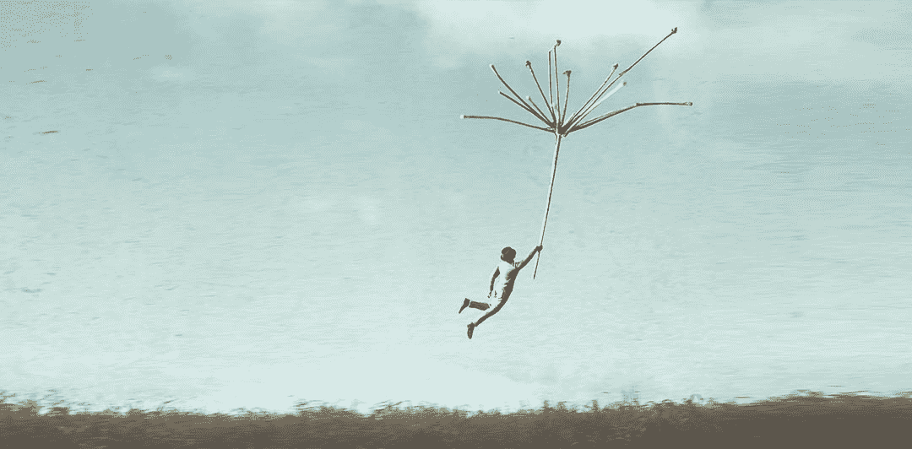

# 20 小毛病：也有它的独特作用

和菜头

2022-04-08

## 20 小毛病：也有它的独特作用

20 小毛病：也有它的独特作用

| 转述师：余昊威 |

**小毛病，名词，指身上微不足道的缺陷，然而它是上天给一个人的礼物，帮助你更好地理解他人。**

\*

我一直都有个小毛病，无法正确记忆词序，尤其是外来词。比如说：芭堤雅和芭雅堤，石黑一雄和黑石一雄。在别人那里这是泾渭分明的两个字眼，但在我的大脑里它们根本没有什么差别。而且，今天我这么示范一次之后，好容易记下来的芭堤雅很可能又会和芭雅堤搞混。

因为有这个小毛病，进而会造成我口吃。在和别人说起这样的字眼时，我会情不自禁地暂停一下，去想一想正确的词序是什么。外来词还好，别人会以为我是幽默。但是中文单词我有时候也会出现相同的症状，不熟悉的人就会很愕然，觉得是个文盲在冒充和菜头。

这是个困扰么？当然是。我在乎么？曾经在乎。想过去治疗么？并没有。因为，每当有人找我诉说自己的小毛病时，无论是见人就脸红，或者是人多就口吃，我就可以拿这件事情来举例。然后，就会变成对方来安慰我。因为相比之下，被认作是文盲对于我的伤害要更为严重一些。在我们“毛病界”，以伤害度高为尊。

包括当年的我在内，人们普遍有一种误解，认为自己应该是完美无瑕的。但事实上每个人身上都有瑕疵，都有些小毛病。  
**一旦认为自己应该是完美的，就会把过多的时间精力耗费在这些小毛病上。**

在这方面我吃过亏，那还是在我初中时代，刚刚学会照镜子。不知道为什么，那时候突然很在意自己的球鞋白不白，皮鞋亮不亮，脸上有没有痘。有一天我突然注意到，我的鼻头有一颗痣。

关键它是颗黑痣，非常显眼。更糟糕的是它并不是在鼻头正中，而是偏向一边。因为人体是左右对称的，这就让它显得尤为突兀。自从发现了它的存在，我随时心心念念都在想着这颗黑痣。我觉得人们早已经注意到了它的存在，但是一直强忍着没有问我。怎么可能没发现呢？它就在我的脸上，而且是在脸部最凸出的位置。然后又想到它的位置没有位于人体中轴线上，就越发感到烦恼，认为破坏了平衡，一侧身体仿佛都变得更加沉重了起来。我试过针挑、火烧，都没有效果，反而因为鼻头红肿让它变得更加醒目。

最后还是有好心人知道这件事情，及时劝慰了我：你就是一个普通的胖子，扔到人堆里根本就没有人会认出你来。亏了有这颗痣，才让你变得和其他人有这么一丁点不同。也许，很多年之后，人们得凭着这颗痣才能想起你来。我觉得这话说得很难听，不过又很有道理的样子。

不过谨慎如我，又怎么可能凭别人的一句话就扭转自己的看法呢？于是我找朋友们，以玩游戏的名义，让大家分别背转身去，逐一回忆每个人的面部特征，有没有疤痕，有没有坑洼，有没有雀斑，有没有痣。实验结果证明，的确没有人在意我长什么样子。

不要说我鼻头上有黑痣这件事情，他们连我正在戴着的眼镜具体是什么形状都描述不出来。我只是想安心，没想到最后的结果是伤心。在我成年之后回想，我认为青少年都应该去玩一下这个游戏，以此树立正确的自我认知，免得要到很多年后不得不相亲的时候，通过相亲对象才知道自己在大家心目中是个什么形象和水准，那时候受伤会严重许多，而且通常可能难以治愈。

这段奇怪的往事肯定和青春期发育有关，人在那个阶段会非常在意自己的外表。但同时它也是自我认知偏见的一次大发作，真正的深层原因是我不肯接受自己并非完美无瑕这一点。当然，最后我误打误撞地解决了这个问题，用的是一个替代法，并没有让我认识和接受“人身有瑕”这个观念，而是越过了这个阶段，直接告诉自己即便我人身圆满无瑕，也并没有人在意这一点。

这就像是果树上有个枝条生虫害，结果自己不小心把树给连根铲了。人在年轻的时候，认识几个讲话和开挖掘机一样的朋友其实也挺不错的。

不过，我关心的问题不止于相貌。像我这样经常需要写作表达观点的人，往往不自觉地会生出一种傲慢来，认为自己说的都对，自己的所知远超于常人，基本上不会出错。最终，这就会形成一种知见上的障碍。所以，我一直没有去搜集关于自己词序颠倒的资料，找出改善和治疗的方法，主要目的就是为了打破这种障碍。

一方面，在写字或者说话的时候，我已经预先知道自己可能会写错、说错词序，那么我就不会太过自信，随时都会保持警惕。  
**也正因为这种警醒，我也可以在别的方面保持清醒，对于自己所说的任何结论没有一种斩钉截铁的肯定。**  
虽然会因此而损失一部分读者，但是从长远来看，无论对于我本人还是对于读者都是一件好事。我不是全知，读者也没必要全信，那么大家彼此都做到了理性。

在另外一方面，因为有这样的小毛病，对我造成了真正的困扰，也就帮助我形成了同理心。

因为想要说出一个单词，但是话出口之前极度不确信词序，是一件痛苦的事情。我能感觉到自己努力，但是努力并没有成效的那种痛苦。尤其是因此而造成了口吃，更是增加了心理压力，说话也就越发用力。

这样一来，我就少了许多那种聪明人的轻率，也不会带着一种“这有何难”的口吻去讨论别人面对的困局。那样不但无法真正帮助到他人，反而会激发起很强的厌憎之情，因为听起来更像是一种炫耀而不是帮助。  
**当别人说自己很难时，如果自己也有类似的经历，起码会知道如何聆听。**

很遗憾，我没有办法告诉你一个即刻消除小毛病的方法，很多人大概认为一定存在这样的方法吧？但是，我的确给了另外一条思路，也就是如何把困扰自己的小毛病转化为正向的价值。

虽然这个方法并不一定每次都有效，也不是任何小毛病都可以转化，不过如果你能够尝试一次，也许会理解：发生在我们身上的任何事情，都有它自己的理由。  
**也许，正是因为形形色色的小毛病，帮我们认识自己的不完美，从而减少了对他人的苛责。又或者每个人都有自己的小毛病这一点，让我们建立起一种可以彼此理解的情感纽带，变得宽容而富于同情心。**

最后，至于说到我鼻头的那颗黑痣，你应该注意到我先前提及它的时候，只是含糊其辞地说它“偏向一边”，却没有说是左边或者是右边。为什么会这样呢？因为我在打字的时候，实在是懒得起身去照镜子。

是这样的，最开始是你长什么样别人不关心。等你确信没几个人关心之后，渐渐的，连你自己也会变得不关心。也许有人会问，怎么知道是真的不关心？  
**就是你可以把它当作笑话讲出来的时候，那么你的心里既没有忧伤，也没有烦恼，只是一段往事而已。在这个时候，你也就清楚地知道，你已经放过了自己。**

1.当别人说自己很难时，如果自己也有类似的经历，起码会知道如何聆听。  
2.也许，正是因为形形色色的小毛病，帮我们认识自己的不完美，从而减少了对他人的苛责，让我们建立起一种可以彼此理解的情感纽带，变得宽容而富于同情心。  
3.你可以把它当作笑话讲出来的时候，那么你的心里既没有忧伤，也没有烦恼，只是一段往事而已。在这个时候，你也就清楚地知道，你已经放过了自己。

公众号懒人找资源

发布留言

0/ *500*

确定

# “我问和菜头”：用哄骗的方式管教孩子，可以吗？

和菜头

2022-04-08

## “我问和菜头”：用哄骗的方式管教孩子，可以吗？

“我问和菜头”：用哄骗的方式管教孩子，可以吗？

| 转述师：余昊威 |

读者 用户洋哥正意：:

> "请教和菜头老师，做出超出自己能力范围内的承诺是否是一种谎言？以自己为例，27 年前见过父亲最后一面，答应父亲要照顾好兄妹。多年以后却发现自己根本做不好这件事。这件事深深地折磨自己多年，直到现在。这算是一种谎言吗？"

有没有可能是你听错了？把照顾兄妹听成了照顾好兄妹。如果你认为是照顾好，所谓好的标准具体是什么呢？月收入一万以上，有车有房？有所谓好，就一定有相对的不好，那么是拿谁来做比较？我猜你资源和时间都有限，但对自己的要求却很高，所以这种折磨可能源头在你自己。在你心中，你有一个理想兄长的形象，但你做不到他那个样子。

其实，我想问你几个比较细的问题：你觉得所谓的照顾具体指的是什么？金钱上的支持，还是精神上的抚慰，还是人生路上的开导，又或者是机会的给予？无论你的选项是哪一个，你认为接受照顾的人，可以利用好这些资源，对自己的人生和生活有所改善么？你认为重点是在外部的资源，还是在于他们的内心想法？

令尊过世的时候，给予你一份兄长的责任，但这个责任并非无限延伸，覆盖一切。你没有这个能力，也没有这样的义务。  
**毕竟，每个人都有自己的人生，也有自己的选择，你不可能帮人包打天下，直接给予一种更好的生活，你都没问过别人要不要呢。**

读者 用户 GONDOA：:

> "底层的代码怎么影响高层的组织？谎言是一种债务，每次自我评判时就需要支付利息。我很赞同菜头叔的这个观点。善意的谎言背后总能找到利己的线索，也许隐藏真相的愧疚和损失不是关键，面对自我批判时的痛苦才是我们痛恨撒谎的主要原因。"

> "受此启发延伸思考到另外一些观点：从人类远古的自然生存条件来看，“学会隐藏”的底层代码应该更多，至少狮子没看到，人类不会站起来告诉它。不善于隐藏的基因估计很难保存下来。"

> "从人类远古语言的发展来看，人类是极少用“共同想象”来沟通的物种，想象是一种不真实的“概念”，而表达这种概念就需要语言。可能是这种“想象的概念”把人类汇集在一起，并有机会形成文明。神话、信仰、政治中许多是真实，更多是想象。我们应该怎么理解这些不真实的想象呢？"

这一整段话让我产生了很多的疑惑。不撒谎的底层代码，其对应的是人群，为的是群体生活和共同利益。在捕食者面前隐藏自己，这是求生本能，和是否撒谎没有什么关系。本身人和狮子之间大概也不存在什么沟通理解的可能，不存在欺骗狮子的说法，倒是坦然面对狮子的人最后 DNA 都被彻底抹去了。

其次，想象和真实与否关系不大，它更像是一种对客观世界的解释。我们今天当然知道并不存在所谓天狗，也不存在天狗食月这样的事情。但当人类生活在条件非常艰苦，自然之力让人畏惧的时代，大家共同接受天狗食月这个概念，起码可以解释月食这种现象。毕竟当时没有人知道地球的存在，也不知道地球的阴影落在月球这件事情。

因为共同想象，因此产生共识。因为拥有共识，可以步调一致采取行动。所以，不要取笑一村子人跑出家门，敲盆打碗驱逐所谓的天狗，  
**这件事情在我看来，重点不在愚昧与否，而是全村人会采取一致行动，增加彼此认同，共同抵御外敌。**

读者 用户湖心亭：:

> "叔讲的道理、故事，大都是自己的亲身经历，现身说法的讲述给人印象深刻，令我羡慕。那么我想问的是，这是得益于叔的阅历丰富，还是读书、思考比常人要更多？"

得益于多愁善感，四处漂泊。这样，遇见事情容易产生触动，有触动就会有思考。这样的人生其实麻烦得很，正常人的感受是三，但我的感受高达七或者八，这样带来的压力会很大，这种感受力针对自己的时候，无论是欢乐还是哀愁都被同样地放大，要维护内心的平衡会变得很不容易。

之所以我能记得那么多事情，原因是正常人经历过后内心没有多少波澜  
，自然而然地就此遗忘，然后安然入睡。而醒着的那些人会记录下来，会反复回忆，因为睡眠不足而掉头发。

读者 用户庸人不自扰：:

> "菜头叔，对小孩子撒谎，或者说哄骗，常常就没有那种负罪感，甚至觉得是“为 TA 好”，这样子的心理如何看待？比方说小孩子爱吃口香糖，就会告诉他口香糖不吐掉会“烂”肚子；比方说为了阻止他太晚出去玩，编造出夜里有“寒毛”（妖怪）的故事；比方说屋里不要打伞，不然长不高等等，这样的谎言小时候听得太多，如今自己照顾小孩时，又不自觉走了长辈的老路，这样子的“谎言传承”，合理么？"

你应该知道，我肯定不会支持你的想法。

我和小朋友相处的时候，总是实话实说。编造一个谎言，以此达到良善的目的，我是做不到。因为我的想法可能更为长远，也就是说，等到小孩子长大成人之后，回想当初的一切，会怎么看我？是否会认为我是一个可以信赖的人，是否会认为我拥有足够的理性，是否会尊重我的观点？

如果我不曾骗过他，而我说过的话在他成长中都得到各种各样的验证，那我想小孩子会一方面很感谢我，一方面又会喜欢我，  
**因为自己会意识到曾经有那么个叔叔，一早就把知识、真相、事实告诉他，让他拥有和同龄人相比更多的优势。**  
你因为要减免自己的麻烦，省心省力，采用你认为最能见效的方法去阻止他。

是这样的，你的大部分动机都是阻止他的某些行为，我不是那么赞同，因为培养理性的判断和情绪上的自控，应该从孩提时代就开始。当然，因为我并不用承担你的家庭责任，也不曾为了你的生活付出过什么努力，所以可能对你的现状估计不足，不能体会到你的辛劳，所以我的话有站着说话不腰疼的嫌疑。不过，既然你问我的想法，那么我的原则还是和你实话实说，哪怕你并不喜欢。

读者 用户敲出哈姆雷特的猴子：:

> "我问叔叔，撒谎不论善意还是恶意，若是故意而为之，撒谎者才能知道自己其实在撒谎。但现实中我们遇见的不是二元对立的两分法，有的人把幻想当成事实，把感受当成实质，他们也许脆弱而敏感，认为自己说了真话，但只是虚构出来的“谎话”。对待这样的谎，如何应对？"

你的问题让我想起一部电影《大鱼》（Big  
Fish），不知道你看过没有，建议你找来看一下。它可能最接近于你的说法，也是你所说的虚构事实中最美好的一种。我觉得这里可能需要做一点小小的分辨工作，把撒谎和想象力丰富做一下区分。  
**的确存在某种人，他们的想象力丰富，可以建构出不存在的事实、不存在的人物，我们因此可以换一个角度去理解现实世界，算是一种另类解读。**

**但想象力丰富和欺瞒、诈骗、矫饰并不是同一种概念，否则所有的童话故事都应该算是撒谎了。**  
当然，所有的骗子也都是故事大师，不过故事的目的是指向自己，并没有任何利他的成分存在。

读者 用户小而雅：:

> "菜头你好，偶然发现你和被称为“中国巴菲特”的李录同为南京大学的校友。我觉得你们至少有这样一些共同点，比如都有自己独立的思维体系和别具一格的人生经历。所以我对你们的母校南京大学很感兴趣，想听你聊一聊，在你个人思维体系发展的历程中，南京大学对于你有着什么样的影响？或者说南京大学在培养学生独立思维的方面，有没有区别于其他高校的特别之处？"

考入母校的主要原因是我的分数在 1993 年只能排到我们省的一百三十多名，而北大清华只要前十名，是母校慷慨地收留了我，让我有四年时间进出图书馆和教室，勉强成为一个具备初级学术研究能力的人，毕业时有能力选择继续深造或者是适合一份工作。

如果说母校有什么特别之处，我认为是让我这样的二流学生对自己具备一点信心，相信自己也能做成一点什么事。然后让我们不会把母校经常挂在嘴边，因为挂了好像也没什么用。也没有非常紧密的同学会，学长学弟彼此扶持帮衬，而是习惯于自己做自己的事。最后，即便自己什么都不成，好像也没有那么大的心理压力，仿佛出自母校，就一定应该取得怎样的成就才对得起她的名字。

1.毕竟，每个人都有自己的人生，也有自己的选择，你不可能帮人包打天下，直接给予一种更好的生活，你都没问过别人要不要呢。  
2.培养理性的判断和情绪上的自控，应该从孩提时代就开始。 3.想象力丰富和欺瞒、诈骗、矫饰并不是同一种概念，否则所有的童话故事都应该算是撒谎了。

公众号懒人找资源

发布留言

0/ *500*

确定

# “我问和菜头”：不想生孩子，有问题吗？

和菜头

2022-04-08

## “我问和菜头”：不想生孩子，有问题吗？

“我问和菜头”：不想生孩子，有问题吗？

| 转述师：余昊威 |

读者 用户黄礼贤：:

> "在儿子小时候，自己经常在其枕边讲述睡前故事，儿子当时听得津津有味，我也乐此不疲。这种复述故事，因为缺少互动和交流，似乎并不是真正意义上的讲故事，也许更多是难得的亲子陪伴时光吧。"

> "偶尔，我也会自己编造一些离奇的故事，因为里面有不少意外和转折，儿子的兴致会更浓，听得也更入迷。只是，在我讲述故事的过程中，仍然没有太多的互动性，最多就是儿子在情节精彩之时，会蹦出“请继续”，“好想知道结尾”之类的话语。"

> "不知这种简单的互动，是否也可以算是和老师所说的讲故事呢？"

要我说的话，这是个纯讲述技巧上的问题，就是作为“气口太紧“。无论是写文章，还是写小说，又或者是讲故事、拍电影，一定要给读者、听众、观众留一点“气口”。不能把情节做得太紧太满，太连贯，让人没有办法在中途休息一下，想一想，回味一番，提出几个问题。

我和小说家南派三叔讨论过这个话题，他就认为当初他作为写作初学者，把《盗墓笔记》一、二册写得过紧，让读者看起来很累。读起来固然很精彩，但是会迫使他们看到最后一页才能停下，这还是会让读者感觉到压力。

所以，我建议你要人为地留出气口，在一段精彩离奇的情节之后，需要一段舒缓放松的时间。甚至可以询问孩子，他认为后续的情节会是什么走向，这样也就非常自然地有了互动。你现在的方法我其实并不反对，我只是担忧一点，那就是你逐渐培养起孩子对强情节的需求，那有天你想不出曲折离奇的情节时，你又该怎么办呢？  
**有创造力是好事，但也不要弄到自己无路可走。**

读者 用户葱哥在此：:

> "话说菜头小哥哥怎么看待生孩子这件事，我结婚七年了，到现在也没想要孩子，可能以后也不想要，我看到朋友孩子也不排斥，看到很小的宝宝也很喜欢，觉得像天使，大孩子能说话、能行动的，都自然地当朋友相处，也很愉快。你觉得不生孩子有问题吗？"

我的看法二十年没有变过：这是你的人生选择，这是你的个人决定，轮不到我来对你指手画脚，评判这个选择的对错得失。

任何夫妻选择成为丁克，背后都有自己的出发点和考虑，我自己的朋友里也有丁克，但我们从来不会讨论“为什么不生孩子”，或者“生个孩子现在生活会不会更美好”一类的问题。或者可以这么说，我们不会觉得没孩子是个问题。

只是从纯技术的角度来考虑，可能需要安排好自己的生活，因为和其他夫妻相比多出了很大一块时间，和其他夫妇少了一大块共同语言。用这些时间去做什么，如何生活得更有质量，是件值得考虑的事。至于说其他人怎么看，我觉得倒不用放在心上。有看法也可以，先帮你们擦干净地板，熨平衣服，清理好橱柜再发表意见也不迟。

读者 用户金戈铁马：:

> "学习了今天的课程，有一个问题想要请教菜头叔。这种让小朋友参与其中的讲故事方式，肯定会让孩子们非常喜欢，那么在成年人的世界里，或者说在职场上是否也同样适用呢？比如说，在上下级之间，或者是同事之间，用这种讲故事的方式来交流对某件事情的看法，进而增进彼此间的理解，是否可行呢？想听听菜头叔的解答。"

在职场上不是好像有个专门的术语，叫做“画饼”吗？开个玩笑，不过画饼也的确算讲故事，无非是有好坏之分。听得出是画饼，那就是烂故事。听不出是画饼，反而觉得打了鸡血，那就是好故事。

故事在职场上的应用很多，比如说“双十一”不叫促销，要说是“大战”。既然是大战，大家就是战士，既然是战士就要奋战好几天，工位就是战壕。我见过许多通过讲故事激励士气的做法，最经典的是一个团队领导向属下念了一封用户来信，那封信是一位盲人托人写来的，感谢他们的产品帮助了自己，如何一点点改变了他的生活和命运。我不是说这封信是编造的，而是说这是一个故事，所有人都可以想象在遥远的某个地方，自己的工作对一名盲人的生活产生的正面影响，因此会对自己的工作有新的认识，在所谓搬砖中发现意义。

读者 用户雾满杨溪：:

> "受教了。真心佩服菜头老师讲故事的方法。不拘泥于故事的形式，注重互动，让孩子投入其中，引导孩子的想象力是讲故事的目的。家里小朋友在上幼儿园，正好可以实践一下菜头老师的讲故事的方法。"

> "请问菜头老师，让 4 周岁左右的小孩子背诵一些故事会有助于他更好地听讲故事吗？"

别！我的文章经常被用去当做学生中文考试阅读理解的题目，这已经让我非常不落忍，反复公开道歉过多次了。别搞得你们家孩子才 4 岁就恨上我，觉得是因为我的缘故，才让他的童年变得如此辛苦，别人是听故事，他还得背故事。

按照我们家的传统，小孩子看书父母永远都支持，但是，要零花钱买新书之前，都会有一个特别的过程，那就是小孩子要复述一遍他刚看完的那个故事讲了什么。能讲清楚，说明是真看了，也真看进去了，可以买下一本。我觉得你可以参考一下这个方法，没事考考孩子，耐心听他复述一遍故事，而不是去背诵。谁爱背诵呢？我连自己的手机号都记不全，每次还得相互拨打看号码。

读者 用户半支烟：:

> "“道理来了又去，故事长留人心。”我想问一下和老师，一个能吸引人的好故事有什么特点呢？应该富含寓意么？"

这个问题太复杂了，不是一次问答所能涵盖的。大概所有的作家和编剧都在找寻好故事的秘密，也在不同时代里提出不同的观点。

如果硬要我总结的话，我想一个好故事有几个要素是必须的：

1.  **强而有力的悬念，可以把读者一直留到最后，让他们对进展和结局充满期待；**
    
2.  **生动而鲜明的人物，足以让人物和其他人区分开来，并且让读者关切他的命运；**
    
3.  **丰富的阐释和解读空间，好故事能让不同的人产生不同的理解，看出故事不同的侧面。**
    

所谓“富含寓意”不是说只有一种解读可能，那是标语、警示牌，不是故事。正因为解读上不同，读者才会不断分析，不断辩论，使得故事不断传播，拥有比作者本人更为长远的生命力。

读者 用户瑋瑋：:

> "今天社会有越来越多人愿意花钱整形让自己更好看，这是一种不自信的展现？还是人在寻求自我的过程中，可以透过外在的改变，去接纳自己，更爱自己呢？"

这个问题很有趣。越来越多的人采用整形手术，或者微整形手术，这是一个事实。相比较而言，一个人去锻炼自己的内心，接纳不完美的自己，感觉耗时漫长，效率低下，不如医生的手术刀来得快。另一方面，许多人在手术之后的确提升了自信心，认为自己更受瞩目和关心，和之前在社交场合的待遇有了很大区别。

但是，我也了解到在这个领域内，存在一部分人动了第一刀之后就再也停不下来，一次次用手术精修自己。所以，好像旧的问题依然没有得到解决。要做到怎样的程度才能让一个人对自己满意呢？从这个角度去看，也许老土的方法虽然不那么理想，但确实有可能从根源上解决问题。  
**心如果不得到止歇，人怎么会安定得下来呢？**

1.所谓“富含寓意”不是说只有一种解读可能，那是标语、警示牌，不是故事。正因为解读上不同，读者才会不断分析，不断辩论，使得故事不断传播，拥有比作者本人更为长远的生命力。  
2.心如果不得到止歇，人怎么会安定得下来呢？

公众号懒人找资源

发布留言

0/ *500*

确定

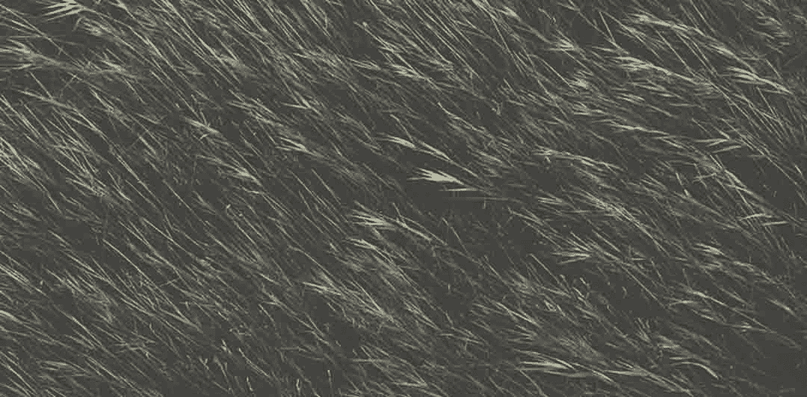

# 21 芜杂：你需要从乱七八糟里看出生机

和菜头

2022-04-08

## 21 芜杂：你需要从乱七八糟里看出生机

21 芜杂：你需要从乱七八糟里看出生机

| 转述师：余昊威 |

**芜杂，形容词，杂乱而无条理。然而，秩序蕴藏于混乱，生机萌生于芜杂。在芜杂中往往隐藏着人们忽略了的机会。**

\*

小时候我家门口有条很热闹的老街，到了周末水泄不通，人声鼎沸，满街都是人和自行车。街上见缝插针挤满了各种小商小贩，街道两边都是饭馆。在那些饭馆里，我生平第一次见到那种场景：伙计高高举起木托盘，托盘里都是滚烫的一碗碗热汤热菜，从一堆人头上经过，否则他没办法通过人群。

也是在那里，我吃过最美味的牛肉：它用三种不同部位的牛肉，各自用不同的工艺处理过，然后三层叠成一条，再裹了粉下锅煎成一体。这样吃的时候一口咬下去，层层叠叠有不同的滋味，也有不同的口感，直到今天我都难以忘怀。

可能你早已经猜到，这条街的确已经消失在历史的长河里。理由也很简单，当时整条街都是木质结构的三层老楼，整天又那么乱哄哄人潮汹涌，一旦发生火灾就是个灾难，连疏通的可能都没有。很快，整条老街被拆迁、平整、拓宽，换上了漂亮的人行道和宽阔的马路，路边也有整齐划一的街灯。

但是，昔日那种熙熙攘攘的景象从此一去不复返，整条街都变得冷冷清清。如今那里高楼林立，都是银行电信一类企业的办公大楼，丝毫看不到一点昔日人间烟火的痕迹。

我想，大概很多人都和我一样有着极为矛盾的心理。 **一方面认为这种干净整洁是好的，看着心安；一方面又怀念那种乱糟糟的热闹，觉得快乐。**  
不过，今天我们要讨论的并不是地方美食或者市政规划，而是你为什么会怀念那种杂乱而没有秩序的热闹。

杂乱无序，没有条理，在中文里就叫“芜杂”。和芜杂相对应的，是整洁。有些时候，芜杂又指粗糙、低劣、冗余，和精华相对，于是也有“去芜存菁”的说法。

**很显然，大多数人都会赞同整洁，喜欢精华，事实上人们在追求这些东西。**  
无论是在学习还是工作中都是如此，就连护肤品起名叫精华液也要好卖很多。但是，整洁和精华其实都是个结果，意味着事物发展告一段落。那么如果是在一开始呢？一开始，整洁和精华在哪里呢？

一开始大概只会有芜杂，让人灰心失望的芜杂。如果你面前是芜杂的一条街，那么你可能会内心充满期待；但是如果你面前是芜杂的一堆事，那么你的感觉就可能截然不同。但是在我看来，两者之间的区别其实很小。

因为除去那些令人不快的因素，其实 **芜杂中蕴藏着最珍贵的生机，也埋藏着通往未来的种子。**

两年前，我养的一只幼猫罹患猫传腹。在那个时候，猫传腹是一种写入兽医医典的绝症，死亡率在 95%以上。医生基本上不推荐治疗，而是建议送猫咪去安乐死，否则每活一小时都是一种折磨。但我没有放弃，而是去查找资料，因为之前我隐约记得有一种试验性疗法。结果，一扇通往新世界的大门向我打开，让我接触到了一个完全不同的世界。

的确有试验性疗法，但那只是两篇论文，来自美国的一所大学。研究团队在分析治疗 SARS 的药物时，想到 SARS 和猫传腹都是由冠状病毒引起，于是就前后用两种特殊的药物对猫进行治疗，收到了非常好的效果。

但是，那只是处于研究阶段的论文，而且样本只有 20 个，距离真正制造出药物来还有很长的路要走，而我的猫已经走不了多远了。此时，勤劳勇敢的中国人民却开动脑筋，从美国进口药剂原料，在国内私自进行调配，然后卖给我们这些心存一线希望的猫家长，跳过试验和验证，大家直接开始使用。

知道当时我什么感觉么？那就是一个字：乱。首先市场上有两种药，一种简称 376，一种简称 441。376 出来的时间早一些，441 据说效果更好但太新。无论是其中哪一个，其实都算是新药。

新到什么程度呢？就是当我询问能否“治愈”猫时，对方只能回答我说：目前经过注射治疗的猫咪，最长的一只已经存活了一年。我问为什么存活了一年，而不是更久？对方解释说：因为一年前这个药才刚出来。面对这两种药，你让我怎么选呢？

知道有什么药没用，还要自己联系药商。因为无论在美国还是中国，这两种药都还没有经过批准，都是私下自行合成。不同的药商工艺不同，做出来的针水浓度和效果也不一致。而且，由于早期针水非常昂贵，利润空间也比较大，各家药商和药商的粉丝们彼此攻击，论证对方的药物有问题。后来更是相互举报，搞到药商公开售卖的是猫护身符，一千多块钱一个。商品介绍页下面用很小的字写着：买护身符赠送猫营养液一瓶，那才是他们真正售卖的药品。

站在我的角度看，面对这种乱七八糟的市场，乱七八糟的药商战争，当然很头疼。不过最后还是通过查论文，翻资料，以及查看各种猫家长的日记，我选定了 441，也选定了一家药商。当时我的判断是，虽然市场处于这样的无序竞争之中，但是无序竞争也是竞争。但凡哪一家的药真没用，根本连开战的资格都没有，会被愤怒的猫家长们直接逐出市场。既然都还在，而且还在开战，说明各家的药物都有效，无非是找一家供应稳定，口碑相对较好，价格别太黑的就行。

我的猫很顺利地救了回来，如今已经平安过去两年时间。两年之后，我因为朋友求助的原因，再次去看了一下猫传腹特效药市场，发现有了许多变化。

一个变化是合规性，药商努力和药厂合作，试图通过审核，拿到合规性文件；另一个变化是价格下跌，惊人的利润让更多药商进入这个市场，通过竞争使得药物的质量上升，价格下降；第三个变化是品类变多，之前无论是哪一种针水都会给猫带去很大的痛苦，毒性大，又是油性液体，注射都很困难。而现在却有了片剂，可以直接喂给猫口服，片剂的价格也大大低于针剂，即便经济条件不大好的猫家长也能承担。如今，猫传腹起码在中国境内，已经不算是绝症，情况要比之前 95%的死亡率好上太多。

所以， **在事物发展的早期，芜杂一点都不可怕，它甚至是必要的。**  
如果当初以合规性来一刀切，以整顿市场来限制药商，那么后续的这一切变化可能都没有了。猫传腹依然还是绝症，没有高纯度的 376 和 441，即便有也价格高企，更不会有什么片剂出现。在这个过程中，药商生生死死，进进出出，大战就没有停歇过。

但到了最后，结果是猫传腹在中国得到了很好的治疗，今天的猫家长可以获得非常明确的资讯，充满信心而不是满怀疑虑地去治疗自家的猫咪。而在一开始的时候，甚至连我自己都没有预见到会有这么一天。

这就是为什么我会说芜杂中蕴藏着生机，也埋藏着通往未来的种子。

在事物刚开始的时候，所有因素都在相互竞争，所有可能性都还没有验证消除，因此局势如同杂草丛生，让人看不清前路。  
**但也正因为这样，事物本身也才充满了勃勃生机，会自行运转变化，朝着它应有的轨道走去。**

为什么人会喜欢乱糟糟的老街？不单是因为那种乱糟糟是人间烟火气，更重要的是它还在发展变化，满街挤满了心怀希望，想要改变生活的人们，因此也让整条街充满了生气。所以我认为，  
**当一切刚刚开始的时候，与其规整不如杂乱，与其追求精华不如追求芜杂。如此，才会从无中生出有来，从无序中生出有序来。**

至于说到那家美味的牛肉，后来我再也没有遇见过。也许，在那条喧闹的老街上，恰恰是它的发展顶点。又或者，那样的滋味只能在那样的老街上才能品尝得出来。

1.芜杂中蕴藏着最珍贵的生机，也埋藏着通往未来的种子。  
2.在事物刚开始的时候，所有因素都在相互竞争，所有可能性都还没有验证消除，因此局势如同杂草丛生，让人看不清前路。但也正因为这样，事物本身也才充满了勃勃生机，会自行运转变化，朝着它应有的轨道走去。

公众号懒人找资源

发布留言

0/ *500*

确定

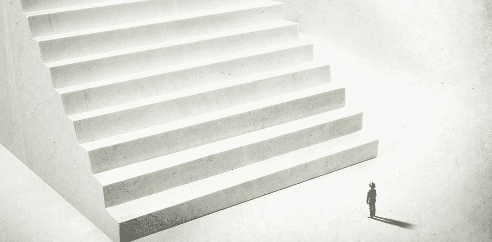

# 22 审美：攀登阶梯，你必见辽阔之地

和菜头

2022-04-08

## 22 审美：攀登阶梯，你必见辽阔之地

22 审美：攀登阶梯，你必见辽阔之地

| 转述师：余昊威 |

**审美，名词，一种阶梯，指一个人对美的认知水平，和品位相反，它更多关乎个人的内心。**

\*

审美的最大优点是不用说出口，一个人在缄默中也能获得很大的满足。我把审美比喻为阶梯，那么你自然知道我在审美上是不赞同相对主义的。我承认每个人的审美都不同，但我并不会跟着说一句“所以没有高下之分”。审美有高下之分，虽然这也是相对而言，虽然并没有必要那么明确地说出来。

我小时候去同龄人家玩，当时很流行画国画。经常在不同的家庭里看到满墙的虾，都是学齐白石。于是我知道了两件事情：

1.  **齐白石的艺术水准很高，因为他非常有名；**
    
2.  **之所以高是因为他老人家的虾画得活灵活现，跟真的一样。**
    

那时候我还并不知道什么是审美，但是通过对生活的观察，我已经得出了两条审美的标准：

一是要有足够的名气，也就是人们的认可；二是像，在形态上和实物越接近则说明水平越高，也就是要模拟自然。

如果我就此停在那里，其实对我的生活并不会有影响。偶尔和人聊起绘画，我说齐白石是大艺术家，这话没错。我说他的作品非常真实，这话也没错。我说齐白石说过“学我者生，似我者死”，这话依然没错。

然而，等我去美术馆、画廊，或者是看艺术品拍卖的新闻，我的审美标准就会受到挑战。因为那里有许多我熟悉的名字，但是他们的作品我看不懂，也不能拿来和现实生活中的任何东西做比拟，中间实在相差得太远。那么，我能不能说我认为这些作品很差劲？我怕是不大敢说。

但真实的情况是我没有停留，看过很多水墨虾之后，我也到了青春期。这时候我发现人体素描比水墨、水果、菜蔬、虾蟹、鸡鸭有意思多了，于是翻了许多画册。起先是很震惊，觉得这种技巧也未免太好了吧，只是用线条就能画出实体的质地形状，看上去甚至有弹性。接下来自然觉得黑白素描不如彩色画册好看，上面的人物甚至能看出来在呼吸。

但很快我又觉得厌倦，因为都很好，都很像活人，但是本质上都是一种东西，实话实说不如写真集。很快，我就遇见了毕加索大师，感觉非常难以接受。人物造型非常丑陋，而且很难看出是一个人来。但是他是大师，这就让我感到痛苦，觉得会不会是一帮人联合起来骗我？我就是《皇帝的新衣》里的那个没穿衣服的皇帝？

虽然很是难以接受，不过我还是得承认，起码毕加索的作品很独特，和之前我看过的画册都不一样。丑归丑，但是丑得有特点，丑到一眼就能分辨出是毕加索的画。后来我就总结，自印象派之后的画作我都看不懂，不懂他们为什么要这么画，也逐渐不懂他们在画什么。

比如说波洛克的作品，第一次看到的时候，感觉被人迎面打了一拳，拿着一堆凌乱潦草的线和点，逼迫我承认这是一张画，不承认就不让走。就这样，我从太熟悉一下走到了看不懂，由此还生出了一个理论：当代艺术就是看不懂，看不懂就对了，看得懂那就不是艺术。

真正的改变出现在一次画展，当时中国美术馆举办英国印象派画家透纳的画展。据说热闹非凡，一票难求，我很幸运地得到了票，就跟着去凑热闹。

之前我看过一些关于印象派的介绍，认真背了许多概念，但是面对作品的时候依然不明所以，哪里就有什么光影变化了，哪里就有什么瞬间了？

等我真正面对面地站在透纳那张著名的蒸汽船前面时，突然间心有所感，知道他那么画是为了表现他感受到的暴风雪和暴风雪中挣扎的蒸汽船，在狂风卷着雪花和海水旋转而来，把蒸汽船高高抛起又深深砸下时，那样的画法才符合他的心意。就像是《神奈川冲浪里》一样，人们根本就不应该纠结人和巨浪的比例关系，说世界上就没有那么大的浪，浪花也不是那样的爪子形状。

透纳用了一种不同的画法，让人看不出物体的轮廓，也很难分辨出船只和海浪。只有狂暴的笔触和鲜明的颜色，让人感受到头晕目眩的狂风巨浪。这让我立即能把他的画作和古典大师们安宁祥和的画面分开，知道他做到了老大师们没有做到的事情。这是绘画技巧上的革新么？或许是，但透纳带给我最大的震撼是观念：原来画还可以这么画。

想明白这一点之后，再去看印象派的画作，我就再也不用怀疑那些画家罹患严重散光了。再去看毕加索的人物肖像，我就再也不用怀疑毕加索有反社会人格了。前代大师都找到了属于自己的绘画表现手法，像不像只是其中一个阶段。

当人人都可以画得很像时，就有人去研究画什么的问题。  
**当画家的观念发生改变时——准确的应该这么说——当社会的观念即将要发生改变时，敏感的艺术家会先于大众感受到变化的到来，他们于是用自己的作品表现出这种观念变化在审美上引发的新局面。**

比如说，画家并不是从来就画酒吧的男子，种地的农民，弯腰拾麦穗的农妇，舞蹈教室休憩的学员。一定是观念上发生了某些改变，人们才会把目光从神话传说和王公贵族那里移到普通生活中去，觉得这些人和这些生活本身具有意义。  
**这种观念在当初肯定也是一种石破天惊。**

所以，当我从透纳的画中看出运动，看出光影的变化，看出对观察者主观感受的强调，自然会想到审美怕也不是静态的，它不是由一张张静态的画构成的坚实整体，而是一系列观念的流变。新的观念从旧的观念中突破出来，找寻新的表现形式。因为它透彻地研究过旧观念并且深深理解，所以它能够欣赏过去。然而反过来却未必成立，持有旧观念的人会认为创新是个无聊的把戏，就像当初人们对印象派的嘲讽一样。

那么我当然认为审美有高下之分，用一个不恰当的比喻来说，学过微积分的人能够理解微积分，同时也能够理解四则运算，而只学过四则运算的人就只能理解四则运算，他不知道为什么要做微积分，也不知道微积分是在干什么，可能还会指责对方是在搞骗术，不肯踏踏实实做加减乘除。

一个人上来就说达·芬奇的作品才是绘画，波洛克这种甩颜料的画家就是骗子；雨果的小说才是文学，詹姆斯·乔伊斯\[1\]  
是个文句都不通顺的骗子。这些说法都很常见，它本身就暴露了审美上的偏狭。

而肯定波洛克的人不会否定达·芬奇，肯定乔伊斯的人也不会否定雨果，他们知道在创作观念的河流上，创作者拥有各自的位置。认为在河流上的某一站就是巅峰，空前绝后，对于后续的发展视而不见，那当然就是一种审美低下的体现。

**因为审美从来就不是选冠军，而是不断向前探索未知之地。**  
这块未知之地曾经是神秘自然，曾经是天堂地狱，曾经是宫廷生活，曾经是普罗大众，曾经是工业成品……  
**每一次探索都会拓宽审美的广度，重新定义艺术和艺术品，甚至连美本身也被重新审视。**  
因为美是一个褒义词，它的反面其实也依然是一种美，美不必然包括感官上的愉悦——郑板桥的字很丑，达利的画充满怪诞，但它们不具有审美上的价值么？

**审美对于每个人而言，都是一次探险过程，需要的不仅仅是感性上的触动，更需要理性下的思考。**  
如果没有这种艰难的发现过程，那么，估计我现在还认为齐白石的虾才是最好的画，对虾是最好的虾。这样的坚持，对得起红虾、蓝虾、龙虾、牡丹虾、红魔虾、黑虎虾它们吗？

\[1\] 詹姆斯·乔伊斯（James  
Joyce,1882-1941），爱尔兰作家、诗人，二十世纪最伟大的作家之一，后现代文学的奠基者之一，意识流文学代表作家。代表作有《都柏林人》《尤利西斯》等。

1.当社会的观念即将要发生改变时，敏感的艺术家会先于大众感受到变化的到来，他们于是用自己的作品表现出这种观念变化在审美上引发的新局面。  
2.审美从来就不是选冠军，而是不断向前探索未知之地。 3.审美对于每个人而言，都是一次探险过程，需要的不仅仅是感性上的触动，更需要理性下的思考。

公众号懒人找资源

发布留言

0/ *500*

确定

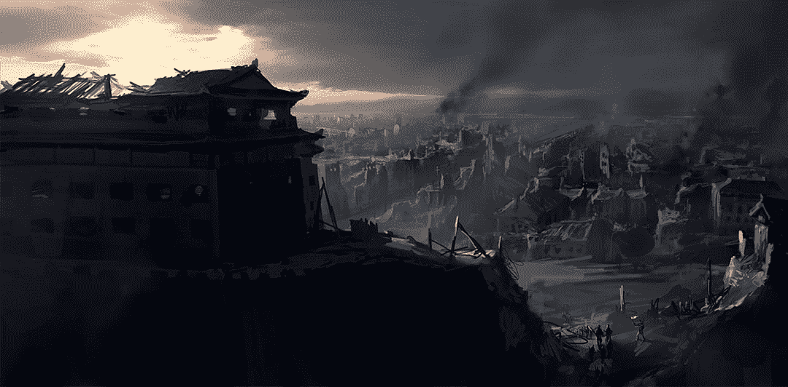

# 23 耿恭：你应该知道的孤城铁血悍将

和菜头

2022-04-08

## 23 耿恭：你应该知道的孤城铁血悍将

23 耿恭：你应该知道的孤城铁血悍将

| 转述师：余昊威 |

**耿恭，汉代名将，率领数百军卒死守孤城于万里之外，是传奇英雄。**

\*

耿恭的故事不管写多少遍我都不会感到厌倦，如果不得不参加一场战争，我最想在他麾下作战，这个人值得以性命托付。

公元 75 年，戊己校尉耿恭和他的数百名士兵，在西域金蒲城陷入 2 万匈奴大军的包围。在此前一年，汉朝的军团攻入西域，击溃匈奴，重新设立西域都护府，宣布对这个地区的控制权。次年，西征大军退去，留下西域都护府，耿恭和关宠任戊己校尉，各自率领数百士兵，分别驻扎在车师后国的金蒲城和车师前国的柳中城，互为掎角，扼守北匈奴入侵西域北道的战略要冲。

当时在西域维持一支大军非常困难，战争胜利之后，戊己校尉只是带领数百兵马，作为汉朝在西域统治的象征。其实就是两支孤军，距离中土万里之遥，周围都是心怀各异的西域小国，以及虎视眈眈的北匈奴。

西征大军退去之后，北匈奴立即集结大军，于当年 3 月开始攻击车师。耿恭派出 300 兵马支援关宠，途中遇见分兵而来的匈奴大军，300 人一战而殁，北匈奴势如破竹，2 万大军四面合围，要把这座金蒲城彻底抹去。

面对军力上的极端悬殊，耿恭知道匈奴人信奉鬼神，就用毒药涂抹在箭头上，用强弓射击，同时让所有士兵高呼：汉家神箭，中之必异！匈奴人中箭之后，果然发现伤口如同被开水烫过，疼痛难忍，不由得不敬畏鬼神，于是不敢强行攻城。

入夜之后，天降大雨，耿恭不守反攻，又命令全军出动，夜袭匈奴大营。在漆黑的雨夜中，惊魂未定的匈奴人遭遇突袭，一时无法分辨虚实，只能选择撤离。  
**就这样，第一次包围战以匈奴退却结束。**

耿恭深知金蒲城无险可守，在匈奴大军退兵后，于当年 5 月带领士兵转移到天山山麓的山南山北之间，一座叫做疏勒的小城。这是汉军修筑的军事要塞。疏勒易守难攻，又在天山咽喉要冲。山里有河流出，穿城而过，因此疏勒拥有足够的水源，可以长期据守。

6 月，西域的焉耆和龟兹反叛，攻打西域都护府，都护陈睦兵败身死。北匈奴的军队包围了柳中城，关宠发出紧急军情文书，要求派军救援。

7 月，匈奴大军再次前来，耿恭第二次陷入包围。这一次匈奴人不愿意正面进攻，而是派遣人进入天山，从上游挖断河道，想用干渴迫使耿恭投降。疏勒城很快就没有了饮水，耿恭甚至要让士兵榨出马粪中的汁液来解渴。同时，又在城中挖井，想要打出泉水，谁知道打到十五丈深，都没有一滴水出现。疏勒城危在旦夕，汉军败亡在即。

这时候耿恭穿起全套盔甲，召集所有士兵来到井边，对天祈祷说：老天啊，如果您的意志就是要让我们灭亡，那么我们唯有一死；如果您并不是这么想，那么请您赐给我们饮水。话音刚落，泉水喷涌而出，士兵山呼万岁，陷入狂喜。

耿恭止住众人，让他们立即运水上城墙，当着匈奴人的面痛快洗澡，用水和泥修补城墙，让匈奴人知道断水的计策失败，汉军并不缺水。匈奴人看到这一幕，万分沮丧，大军开拔前去逐一歼灭西域各个小国。只留下部分军队在疏勒城外围放牧，遥遥看守。  
**就这样，第二次包围战以匈奴放弃结束。**

匈奴军队攻克各个小国，疏勒周围的国家纷纷投降。8 月，匈奴再次回师疏勒，耿恭第三次陷入包围。这一次的情况和之前完全不同，因为长期作战，支持汉朝的小国又都被消灭，耿恭他们得不到任何给养。士兵因为伤病，几个月后也只剩下几十人。不得已，他们只能脱下皮革制成的铠甲，切碎煮着吃，又把弓弩拆开，把上面的皮条和作为弓弦的兽筋拿来煮着吃。

匈奴人知道城内弹尽粮绝，但是又很欣赏耿恭，就派遣使者前来招降。说是只要投降，耿恭可以封王，而且可以让单于的女儿嫁给他。耿恭杀死了来使，并且将尸体砍成块，让士兵在城墙上当着匈奴人的面烤着吃。匈奴人勃然大怒，但依然无法攻克疏勒城。因为此时，汉军已经逼近。

经过了激烈的辩论，在司徒鲍昱的坚持恳求下，汉章帝终于同意敦煌、酒泉太守发兵救援六个月之前就已经失去联络的关宠和耿恭。合兵 7000 人，驰援柳中城。公元 76 年正月，汉军出塞，击破北匈奴，斩首三千八百余，成功抵达柳中城。此时，汉军将领们才知道校尉关宠已经阵亡。由于已经是正月，西域苦寒，汉军认为军事救援任务已经完成，就想即刻班师。

就在这个时候，耿恭手下有个叫做范羌的人出现，坚持要求去救耿恭。范羌之前为了置办冬装，前往敦煌。匈奴人作乱之后，他滞留在敦煌，这一次他跟着救援部队一起西进。在范羌的一再坚持下，几位将军最终决定给他 2000 兵马，途径天山北路，在一丈深的积雪中艰难靠近疏勒城。

耿恭和残余的士兵在雪夜里听见有兵马靠近的声音，大为震惊，以为北匈奴再次发起了进攻，这一次再也不能幸免，拿起手中的弓箭准备做最后一搏。范羌听见城头的动静，急忙大喊：我是范羌啊！我来接耿校尉，接大家回国！疏勒城中欢声大作，城门打开，双方紧紧相拥，涕泪交流。

在范羌面前的，是一群衣衫褴褛、形容枯槁的士兵，一共只剩下二十六人，但是他们守住了疏勒。第二天，范羌带着他们向玉门关进发，沿途匈奴人不断袭击，汉军且战且走。抵达玉门关的时候，二十六人里只有十三人存活。  
**就这样，耿恭第三次突围而出，成功归国。**

驻守玉门关的中郎将郑众看到这十三人，大为感动，亲自为他们沐浴更衣，并且向章帝上书说：

恭以单兵守孤城，当匈奴数万之众，连月逾年，心力困尽，凿山为井，煮弩为粮，出于万死，无一生之望。前后杀伤丑虏数百千计，卒全忠勇，不为大汉耻，恭之节义，古今未有。宜蒙显爵，以厉将帅。

**耿恭三次置于死地，而三次得以生还。除了他的战力和头脑之外，还应该归功于他的斡旋能力。**

二次被围的时候，他可以招募数千人做先锋，逆袭匈奴；三次被围的时候，他有办法让车师后国的王后提供情报和给养。所以，他才能最终以数百人守住一座孤城。同时，通过范羌的举动，也可以看出耿恭的治军能力，赢得了下属怎样的忠诚，这也同样解释了那么一支孤军，长期处于包围之中，为什么没有溃散投降，怕也不单纯是运气的结果。  
**如果说命运之神垂青耿恭，倒不如说这样的人物因为身上不屈的意志最终感动了上天。**

我总是不厌其烦地讲述耿恭的故事，就是因为我想让人们知道，  
**在历史上曾经有过耿恭校尉这样的中国人，曾经如此战斗，曾经如此面对绝境，又曾经如何一次次挣脱厄运，一次次创造奇迹。于艰难困苦之中，如何坚持下来，绝不放弃希望，最终在坦然拥抱死亡的时候终于得到了援助。**

耿恭从未有一刻放弃过希望，恪尽职守，带着部下最终归国，所以我说我愿意在这样的将领麾下作战，因为他总是能创造出奇迹。

在岳飞将军的《满江红》里，有一句“壮志饥餐胡虏肉”，说的就是耿恭校尉的往事。

1.如果不得不参加一场战争，我最想在他麾下作战，这个人值得以性命托付。 2.如果说命运之神垂青耿恭，倒不如说这样的人物因为身上不屈的意志最终感动了上天。  
3.历史上曾经有过耿恭校尉这样的中国人，曾经如此战斗，曾经如此面对绝境，又曾经如何一次次挣脱厄运，一次次创造奇迹。

公众号懒人找资源

发布留言

0/ *500*

确定

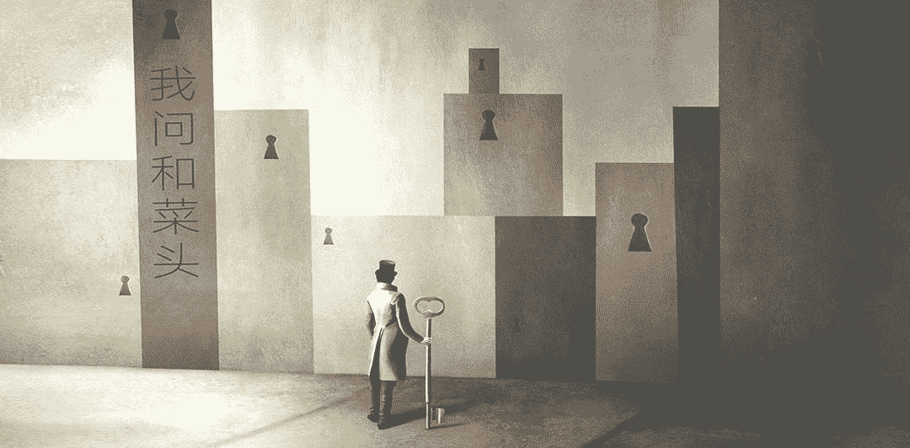

# “我问和菜头”： 个人物品“芜杂”，也有好处？

和菜头

2022-04-08

## “我问和菜头”： 个人物品芜杂，也有好处？

“我问和菜头”： 个人物品芜杂，也有好处？

| 转述师：余昊威 |

读者 用户静则铭：:

> "菜头叔，对于一个在昆明生活 5 年来的北方人来讲，昆明这座城市给人印象就是这种杂乱的感觉，本地人、外地人都会吐槽昆明的城市规划，难道这种乱中也有它存在的意义吗？"

你来昆明的时候，带着一堆关于城市的概念而来，用来作为评判标准；而我从小在昆明长大，我一点点看到昆明如何变成今天的这个样子。我有一个你可能永远都玩不了的游戏，那就是当我离开昆明十多年之后，偶尔看到一条发生在昆明的社会新闻。只要新闻里提到双方的家庭住址，我能立即判断对方是什么人，家庭是什么出身，父母是什么职业，大概什么时候迁入，由此，我可以分析新闻背后的故事。

所以，我和你对昆明的视角完全不同，你今天所面对的高楼大厦，也许是我童年时滚铁环经过的深巷，在你所见到的混乱无序中，我能看到层层叠叠的历史，看到时代的变迁，看到每一条街道后面的用意。你问我是否满意，我当然也不满意。  
**但是你若问我这种杂乱之后是否也有生机，那么你的经历已经给出了答案。** 如果这里没有生机，没有机会，那么你何以来到这里，要忍受如此之多的不便呢？

读者 用户长袜子皮皮：:

> "记得《舌尖上的中国》火了之后，人们一下子对“苍蝇馆子”充满了兴趣，也是留恋这种繁乱中的所谓“烟火气”吧。我有点欣赏不了这种风格。有个疑问：整洁、秩序的环境跟烟火气天然冲突吗？"

我们更像是一夜之间就提升了几十年时间，从一个农业国家进入一个现代化国家。按照传统的中国社会惯例，按照传统的中国人的生活习惯，形成的市镇、城市大多会缺乏整齐划一的结构，也不大可能有秩序井然的环境。楼宇总是参差不齐，每户人家总是会按照自己的想法进行营建，餐厅里总是吵闹喧哗，街道总是水泄不通，一切都是对付着能过就成。这就是中国人所说的人间烟火气。

其实人间烟火并不在于这种形式，而是在这种形式里存在着传统的中国人，能让人感受到熟悉的乡土中国，大家可以装作自己并没有来到大而无当、无边无际的城市，依然还在亲切熟悉的家乡老街上。

其实，这种景象并不需要你去欣赏，这种景象只对有乡土经验的人，只对有家乡、有根的人有意义。而你所谓整洁、秩序的环境，其实都是一种外来物。江南小镇的房屋要比丽江大理更漂亮一些，街道也要更为整洁一些，但是它们和窗明净几的麦当劳、沃尔夫冈牛排馆永远是两种不同的存在，它们之间的血缘要更近一些，能让中国人感到同样的亲切。

读者 用户黄礼贤：:

> "请问和老师，如何面对孩子的芜杂局面？作为家长，我们还是希望能够给孩子创造一个干净和整洁的环境，而且，我们作为大人，看到一个混乱无序的局面，总是本能的想要进行整理，否则，我们自己心里都会很难受。而从孩子的角度看，一个芜杂的状况，似乎更有利于其创造力的发挥，可以从混乱中发现新意和乐趣。家长到底是应该干预还是放任？如何把握这个度呢？  
> "

我过了四十岁之后，才开始想着要一个整洁的家。从小我就经常被家人教育，用别人家的孩子来和我做对比，带我去参观别人家孩子整洁有序的书房。等我的成就超过那些别人家的孩子之后，就再也没有这种比较的话了。我不是说我是对的，我也不认同把房间的整洁与否和创造力的高低联系在一起。

今天看起来，我乱七八糟的房间似乎可以解释我后来的创造力。可我自己就是当事人，我并不认为这两者之间有什么必然联系。站在当事人的角度来看，我只能说，  
**要维系某种秩序是相当耗费心神的事情，与其耗费在整理物品上，我不如去做点我高兴做的事情，哪怕只是去读一本书，解一道题。**

而我在四十岁之后，突然出现了对秩序的追求，在我看来，无非是我的欲求降低了，对外的探索兴趣也减弱了，开始收拢回来，追求内心的安定和秩序。这样的追求对外投射出来，就是我每天会做整理，希望每一样东西都在我能找到的地方。换句话来说，我终于开始意识到完全控制自己生活的重要性，不过这距离我父母的要求已经延迟了三十多年时间。

读者 用户胡振强：:

> "从小啊，我妈妈就批评我不爱收拾，书桌总是乱糟糟。直到今天，我的办公桌也还是如此。但是，只要别人不动我的东西，桌上哪怕看起来再乱，我也总能准确地找到我需要的东西。"

> "菜头叔，这是不是因为，我那乱七八糟的桌上其实是隐藏着秩序的呢？只不过不是我自己有意设计出来的秩序，以至于连我自己都觉察不到？"

当然，在他人看起来凌乱的环境里，同样隐藏着你我认定的秩序。只不过是你我都认为，和维护一个整洁有序的环境相比，等同的精力耗费在自己喜欢的事情上成效要更大。

换句话来说，那就是整理桌面带来的只是视觉效果上的提升，对于自己的内心并没有带来多大的成就感，因此让人觉得厌烦。遗憾的是，在别处取得的成就感会随着年华流逝而衰减，总有一天，人会转回来学着去收拾桌子。所以，  
**有时候我很羡慕那些到老死都拥有一间乱七八糟书房的人，那说明他们在别处始终都有所得。**

读者 用户龙潭星跃—唐山：:

> "您说“而肯定波洛克的人不会否定达·芬奇，肯定乔伊斯的人也不会否定雨果”，但是在现实生活中我们的经验却正好相反，自认为楼层高的人经常会俯视甚至鄙视他们认为楼层低的人，要不也不会出现“鄙视链”这个概念。  
> "

> "或者，他们不是真的“肯定”？那真的“肯定”的定义是什么呢？ "

> "或者更深入一点，认同一个东西是艺术的标准是什么呢？难道是共识？但哪些人的共识才是共识呢？如果共识的圈子足够小，那这样的共识，实际意义又在哪里？难道到了最后，真的只能“存在即合理”？  
> "

问题是，当人们需要做比较的时候，往往一方提出的不是蒙娜丽莎，也不是雨果，而是马到成功图和丹·布朗。这时候，要掩饰真实情绪可能对大多数人而言会非常困难。其实我倒是不大反对这种鄙视链，因为人不受到刺激的话，大概不会激发出好胜心，也就不会主动去学习和了解。

有时候，羞辱其实是一件好事。别人可能出于虚荣心而羞辱你，别人可能不懂装懂而羞辱你，但是，这又有什么关系呢？事实上，你的确是不懂，以至于无法有效进行反击。  
**重点不是别人装，或者别人假，又或者是别人居高临下，你不懂就是不懂，这才是重点。**

至于说标准是什么，谁来定义，等你进去之后就会知道了。如果想从这里下手，从根上扳倒整个审美的框架，艺术的框架，以此打脸，我觉得那就算了，你不是第一个那么想的，有人甚至走得比你更远，但是，似乎迄今为止都没有什么有效的结果。

读者 用户永远：:

> "孩子起初画画时不太注重像不像，但画出的画也能变现出一种说不出的美感，是不是孩子的审美标准可能高于一般的成年人？我们父母常用像不像这个审美标准评价孩子的画，对孩子是不是一种误导，会把孩子的审美降低？"

这个问题略微有些复杂。你有太多关于审美高低的想法，无助于判断事物。你认为孩子的作品有一种说不出的美感，一种可能是父母对孩子的偏见，认为自己家孩子是天才乃是所有父母的毛病；另一种可能是父母的确拥有敏锐的感知，但那其实不是美感，而是因为孩童内心没有束缚，自由表达而带来的感性触动。

但是，  
**这样的表达没有经过技巧上的训练，也不曾经过思想上的纠结，有的只是一种本能的、本真的、原始的美。和艺术家经过经年累月的训练和思考之后，所拥有的笨拙的表达完全是两回事。**  
毕加索说自己花了几十年时间，才能像个孩子那样作画。他说的是像个孩子，而没有说是个孩子。

至于说父母以像不像作为标准来评价孩子的画，也没有你想象的那么严重，真正的天才是父母摧残不了的，何况是还没有经过现实和社会残酷验证过的孩子。

1.要维系某种秩序是相当耗费心神的事情，与其耗费在整理物品上，我不如去做点我高兴做的事情，哪怕只是去读一本书，解一道题。  
2.有时候我很羡慕那些到老死都拥有一间乱七八糟书房的人，那说明他们在别处始终都有所得。  
3.孩子的表达没有经过技巧上的训练，也不曾经过思想上的纠结，有的只是一种本能的、本真的、原始的美。和艺术家经过经年累月的训练和思考之后，所拥有的笨拙的表达完全是两回事。

公众号懒人找资源

发布留言

0/ *500*

确定

# “我问和菜头”：行为艺术是猎奇吗？

和菜头

2022-04-08

## “我问和菜头”：行为艺术是猎奇吗？

“我问和菜头”：行为艺术是猎奇吗？

| 转述师：余昊威 |

读者 用户子木：:

> "菜头叔，对于行为艺术，我是有点不敢苟同，玛丽娜·阿布拉莫维奇的行为艺术是在测试人性的底线，这我还能理解，毕竟能传递一些东西，可有些奇怪的，什么在艺术廊睡觉的，用水枪画画的等等，我觉得这种不就是猎奇？  
> 不知道菜头叔怎么看？ "

其实从你的问法上看，就知道你对行为艺术基本一无所知。当然，未必见得我就强到哪里去，也许和你相比，无非是五十步和百步之间的区别。不过我还是可以说一点，那就是你总在用一个瞬间、一个片段、一个事例就去作出判断。我们可以做个非常简单的实验，请听一下这句话：

“潮湿的路极其分明，仰看太空，浓云已经散去，挂着一轮圆月，散出冷静的光辉。”

然后告诉我，这个人的中文水平如何？思想深度如何？在你知道的中国作家里，你认为能排到什么位置？请先写下你的答案。

现在我告诉你，他是鲁迅，这句话来自《彷徨》中的《孤独者》，请问你的答案正确吗？如果你不能凭借一句话、一篇文章来判别某位作家的水准，为什么你会认为凭借一次展览、一件展品，你就能知道这位艺术家在做什么，知道他一贯想要表达的是什么，知道他的水准高低？

同样的，你也可以拿着毕加索的陶罐来问我，这是不是猎奇。从单一一件作品看，的确可能是猎奇。但是，如果你也从他的蓝色时期开始，了解他的玫瑰时期、立体主义时期、超现实主义时期，一直到田园时期，那么你很大可能不会问出这样的问题来。  
**当你对一个艺术家的脉络一无所知的时候，就难免会揣测对方的动机。**  
而这里也有一种天真的自信，那就是觉得根本没有必要了解一名艺术家的过往，凭借单一作品就可以进行评判，而艺术家似乎又有某种义务，在单一作品里就让人看到他思考的全部。

读者 用户重庆 Franklin：:

> "之前一直以为，审美没有高低，只有差异。菜头老师又让我动摇了。感觉像“认清了世界的真相，依然热爱生活”。毕加索能画主流的“画得像”的画，也能画“涂鸦”，而小孩子只会“涂鸦”，所以毕加索更“高级”；而且，重点是画面背后的理念，理念尚未普及，所以艺术是先锋。  
> "

> "请问菜头老师，很多画家都是死后成名是“观念尚未普及”这个原因么？如何理解杜尚的小便池呢？画面背后的理念之争，会不会有过度或错误解读？"

重点不在于能和也能，而是为什么能却不继续做了？真正需要考虑的问题，是当年画家在面对照相机时一样的问题：既然照相机已经能够拍出这样逼真的相片，那么画家的任务是什么？是和照相机竞争么？绘画的意义究竟是什么？  
**这不是高级和低级之争，而是追求像不像这种理念遭遇照相机挑战的时候，艺术家作出了怎样的回应。**

读者 用户贝壳月岛：:

> "菜头叔，顾衡老师说当代艺术已经成为布林顿森林体系瓦解后资本保值的一种途径，跟美已经不是那么相关了，想知道您是怎么看待这个说法的呢？"

站在我的角度上看，我并不那么认为。当然可以说艺术并不纯粹，总有这样那样的现实利益和考量掺杂在其中。艺术品除了欣赏和陶冶之外，也存在着实际的经济价值，可以作为资产的一种。甚至我们还可以说，当代艺术发展到今天，可能在观念上走得太远，也许有必要回归一下古典。

但所有这一切都不能说明艺术家们已经停止对美追求和探索。无非是这时候的美，和早先对美的定义有了很大不同。从感性上的美，逐步偏向到理性上的美，因此对形态上的悦目或者震撼没有了那么多追求。

读者 用户 Cleveland：:

> "请问耿恭和吴起的区别在哪里？我觉得有差别，但是没有想清楚。"

> "吴起为魏将而攻中山，军人有病疽者，吴起跪而自吮其脓，伤者之母泣。人问曰：“将军于若子如是，尚何为而泣？”对曰：“吴起吮其父之创而父死，今是子又将死也，吾是以泣。”  
> （选自《说苑·复恩》）"

吴起对士兵的照顾，是为了让他们去冲锋陷阵，为了自己的军事目标而去效死，但他本人承担的风险相对要小很多，所谓一将功成万骨枯。

耿恭的不同之处在于，他和他的士兵深陷重围，又是在远离故土的陌生国度，周围是各种反复无常的小国，他自己和士兵面临同样的危境。他需要的不是士兵为他效死，因为死也没有意义，他要的是军心不至于崩坏，在极端恶劣的情况下大家争取一线生机。难的不是让士兵效忠他，而是让士兵不至于丧失希望。

读者 用户卓大小姐：:

> "感叹下自己的见识短浅，我咋就从来不知道这个人？我想是不是自己学习成绩太差劲，年少时不爱学习钻研导致的结果？ "

> "反思完再看耿恭的故事，我能对应的影视作品是《vikings》（维京传奇）里的故事。我现在不得不反思，大部分我了解这个世界是通过影视作品，但影视作品是有许多美化和修改的，我是活在楚门的世界里吗？  
> "

每个人所知所见都是有限的，所以才有彼此学习交流的必要。可能你从未对军事或者历史感兴趣，那么错过了这样的人物和故事也属正常。每个人不可能让自己在每一个领域内达到精专，其实也没有这个必要。当然，从影视作品里接触到一些新知也是个办法，不过自己感兴趣的话，最好还是找一些书来读，深入了解下去。通过一本书，进入一类书；通过一个人，认识一类人。

所谓眼界的拓宽，一开始都很可能是因为极为细小的缘由。所以， **我的建议是不要放弃好奇心，不要失去行动力。**

读者 用户酥三岁：:

> "见众生，见天地，见百态。菜头大叔经常提到一些我不知道的人，就像发现了一个新大陆。今天的内容感觉有点鸡汤，现实中我们“不撞南墙不回头”也不一定结局好吧？"

你认为是鸡汤也没有问题，这是你的自由。不过，我倒是好奇一点，耿恭不撞南墙的话还有别的什么选择？投降匈奴么？李陵做过，全家老小全部被斩首。出逃回国么？以匈奴骑兵的射术和骑术，你觉得他们有多大可能活着逃脱追击？接应他们的军团有 2000 多人，护送区区 26 人，依然在路途中死去了一半。请问，那个更好的结局在哪里？

讲述耿恭的故事，不是为了宣扬他的军功，也不是为了赞美他的勇气，而是借着他的故事告诉那些在生活中感觉自己陷入绝境的人，  
**历史上曾经有过一个叫耿恭的人，在绝境之中成功逃脱，并未放弃希望，改变了自己的人生。有这样的人存在过，因此我们也应该抱有希望。**

读者 用户一辆蚂蚁：:

> "菜头叔，耿恭是因为什么才那样坚韧不屈的？如果自己很容易放弃，还有些悲观，是不是只能从中汲取些让内心澎湃几下的力量？"

> " 我是那种内耗有些严重的人。碰到事情，我常常不是勇敢面对，而是先在面前给自己刨个坑，人为提升解决问题的难度。待在坑里的时候是种巨大的内耗。  
> 我不确定自己知不知道，我缺乏男子气概的原因。虽然喜欢用自我揭露来剖析自己，有时候还觉得挺对，但就是找不到那个让自己豁然开朗的点，所以总是会一次次陷入似乎是命运的轮回。  
> "

> "我自认为比一些很勇敢的人更用力去追求勇敢了啊，可为什么表现在我身上的还有那么多迟疑、忐忑、拒绝、逃避等等懦弱的东西？"

我想，耿恭身上也有许多迟疑、忐忑、拒绝、逃避，但是外部环境的压力之大，让他没有时间去拥有这些奢侈的情绪。 **环境和个人会相互伤害，但也能够相互成就。**  
我们也许可以说，西域的绝境同样造就了耿恭，使得他成为了一位传奇英雄。

回过来看你的问题，是不是因为你的环境过于宽松，过于宽容，其实并没有那么大的压力，否则以你的犹豫彷徨造成的时间浪费、机会错失，竟然没有对你造成任何打击，让你还可以悠哉乐哉地自我分析心理？我认为你可能离具体的事很远，如果你随时都在事中，可能就没那么多想法，你的想法可能也会更多一些实用性。

1.当你对一个艺术家的脉络一无所知的时候，人就难免会揣测对方的动机。  
2.所谓眼界的拓宽，一开始都很可能是因为极为细小的缘由。不要放弃好奇心，不要失去行动力。  
3.讲述耿恭的故事，不是为了宣扬他的军功，也不是为了赞美他的勇气，而是借着他的故事告诉那些在生活中感觉自己陷入绝境的人，历史上曾经有过一个叫耿恭的人，在绝境之中成功逃脱，并未放弃希望，改变了自己的人生。

公众号懒人找资源

发布留言

0/ *500*

确定

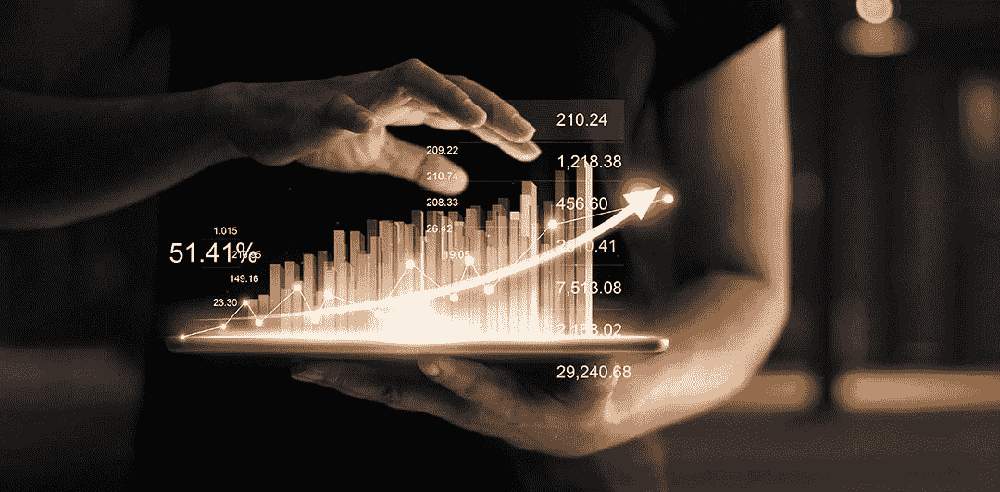

# 24 股票：那些年股市给我上过的课

和菜头

2022-04-08

## 24 股票：那些年股市给我上过的课

24 股票：那些年股市给我上过的课

| 转述师：余昊威 |

**股票，一种有价证券，假设人人都基于理性而决定买入、持有或者卖出，但人并不是这样行事的。**

\*

当沃伦·巴菲特的身家达到 1000 亿美金的时候，我在股市上的斩获依然是个负数。当然，我不是说自己此刻正在股市里追涨杀跌，盯着蜡烛线看，这一切都发生在遥远的过去，像是小时候出过的疹子，又或者是一段无疾而终的感情。  
**我认为，比分析股票更为重要的事情，是认识自己。**

我本身对股市毫无兴趣，甚至可以扩展到一切经济学领域，只要翻开书就犯困，觉得自己缺乏天分。加上我妈的缘故，更是让我对股市退避三舍。

我家最早是我母亲炒股，电脑有一半时间都是给她用。母亲是个非常强势和好学的人，她曾经带着我们兄妹两人，同时还完成了成人自学高考的全部教程，并且拿到了毕业证书。

我就看她每天看 K 线图，听股评，笔记做了几大本，比我们读书都认真，但是依然赚不到什么钱。当时我就想，以我母亲那么强横的学习能力，在股市里摸爬滚打那么多年，对于各种股票的历史如数家珍，尚且不能赚钱，我又何德何能，可以进去逐浪踏波？

而且就我的观察，她老人家赚钱的时候喜形于色，亏钱的时候夜夜失眠，炒股二十多年后一声长叹，告诉我们说： **赚的都是点数，亏进去的都是真金白银。**  
我就感觉，这件事情并没有那么简单，不比再考个研究生容易到哪里去。

虽然我是如此冷静，但是毕竟还年轻，很难抗拒来自社会的压力。经过 2002 年到 2005 年的三年慢熊，连我妈都偃旗息鼓，不在晚饭的时候讨论股市，谁能想到 2006 年来了呢？当时人人开户，处处论股。

本来和我没有任何关系，问题是我的直属领导也去炒股了。可能是人类总是会感觉到孤独，领导命令我在一周内也去开户，和他并肩作战。我说我真的弄不了这个，怕是会赔。领导说，不要怕，我有证券公司的朋友，他们会给我内线消息，我买什么你买什么，你就跟着赚钱好了。于是，我就这么稀里糊涂地进入了股市，也是第一次知道深市和沪市得分别开两个账户，不能合起来一起炒。

我当然不会相信什么所谓的内线消息，虽然人应该心存美好，但是也应该脚踏实地。那时候我想着既然来也来了，不如好好学习一番，就去买了一堆股票书籍，什么《股票作手回忆录》《日本蜡烛图技术》《股票 K 线战法》《价值投资——从格雷厄姆到巴菲特》《金融炼金术》等等。看完之后，我觉得我又回到了大学，回到了气象预报课堂。

天气很难预报，因为天气系统的运动涉及到温度、气压、湿度、陆地性质、环流形式等等因素，把所有这些因素都考虑进去，那基本上就没法预测了。股市也和天气预报类似，人人都想预测股票的涨跌，但是控制股票的涨跌因素同样很多，各家都有自己的说法，同样让我感到困惑。

那时候我很幸运地认识了一位同事，他是巴菲特多年的忠实信徒，自称是一位价值投资者。他劝我说：你不是技术炒股的材料，短时间内也不可能有任何起色，不如加入我们价值投资者的行列，菲哥才是我们上班族的指路明灯。  
**因为我们价值投资者看的是企业基本面，根本不用理会短期波动。**

说完他打开电脑，让我看了看他的收益率，红色的，三位数。又让我看了看他的持股时间，好多年，没交易。我觉得他说得很有道理，就把之前那些书都扔到书柜下层，决定做个价值投资者。要求不高，收益率是正数就行，个位数或者十位数我都可以接受。

于是我就开始思考，我自己懂什么企业呢？我熟悉什么企业呢？我在航空公司，当然知道三大航的航线开拓情况，新飞机引进计划，以及市场占有率和增长率。于是，我决定重仓三大航空之一，价值投资一把。  
**成则见菲哥，败则骑飞鸽。** 和所有江湖传说一样，新人到来，一定是可以赚一点的。

很快我的账户上就开始有了浮盈，每天看着数字往上涨，让人心旷神怡，自信爆棚，回家声音都粗了许多。这时候我母亲对我嘿嘿一笑，说：年轻人，不要狂，这才是个开始，会有你哭的时候。对此我不以为然，亲戚间的妒忌也是难免的，他们这些理念原始的老股民理解不了我们价值投资者的情怀和水准也很正常。

然后我就开始焦虑了。赚钱是好事，但是我总觉得自己选的股票涨速有点慢，涨幅有点低。看来看去，发现大家似乎对三大航没什么兴趣，都在炒另外一家民营航空公司。那我就有点不高兴了，为什么大家都看不到价值？过了一阵子，发现那家公司涨得更高了，我就有点怀疑，是不是我自己没看到价值，别人都不带着我玩？

再过了一阵子，那家公司的股票创造了新高，我终于坐不住了，开始抱着股票来回捣腾，哪家高往哪家去，我去到哪家，原先那家一定会涨。就这样，我成功地把利润变成了交易费，然后又成功地在某个波峰被套。此时，我电脑上股票软件每天运行的时间，已经远远超过办公系统的时间。心情沮丧，开始厌恶自己，后悔此前的每一次操作。

有一天下午，我从办公室失魂落魄地走出来。室外阳光明媚，小鸟在枝头鸣叫，有路人牵着狗经过，生活以一种极为缓慢的速度在流淌。我突然发现，好像没有什么人在意我此刻的心情，小鸟自顾自地歌唱，雪橇犬自顾自地玩耍，生活还在继续，只有我在不断想着 K 线图和账户上的数字，陷在其中出不来。

在那一瞬间，我突然对自己有了一个清晰的认知：  
**写作的人需要非常敏锐的感觉，非常敏感的心灵，这种人盯着 K 线图看，每一种感觉都会被放大十倍。无论是贪婪，还是恐惧，都要比其他人来得更为强烈。**  
因此，我这种人根本就不适合炒股，大盘还没有击倒我之前，我自己已经把自己给放翻在地了。于是，我决定终止所有的交易，沽清手头所有的股票。因为亏损得实在是有些伤心，我很长一段时间都没有再次打开我的账户。

从此我认定自己不适合投资，也不适合投机。所以，比特币出现的时候，我把它当做一个互联网产品研究了一番，并没有囤积。2016 年，当我知道自己的前同事辞职卖房加杠杆入市，一天赚一套房的时候，我依然非常冷静。我知道，一定有人可以通过股市赚到钱，但那个人一定不会是我。或者是像我母亲退休以后那样，用固定的一笔小钱放在股市里，赚了取出来买菜，亏了不补，也算是一种业余生活，但我同样也做不到。

我也并不仇视股市，因为花费本金的 30%就能认识到自己，这是一笔很划算的生意。 **清楚地知道自己是谁，那么总有办法在别的地方赚回来。**  
如果可能，我倒是建议所有人都去开个股票账号，越早认清自己越好，越不容易妄想。

股市的好处不止于此。2008 年我辞职北上，需要在北京落脚。虽然朋友们给了我一笔安家费，但是心里还是觉得不踏实，因为我基本上没有什么储蓄。这时候我突然想起，那个因为太过伤心而两年都没有打开的股票账户，似乎里面还有一笔钱。打开一看，果然还有几万块人民币安安静静躺在那里。

**这大概是我炒股生涯中唯一一次长期持有，坚决不肯失去头寸的价值投资。只是投资的对象不是任何一只股票，而是我自己。**  
至于说“内线消息”，从来没有过。谁会把发财的机会无偿分享给别人呢？这是我从股市中学到的另一课。

所以，我做不了理财专家，也给不出任何建议。如果可能的话，我更希望你能认识自己。不幸和我一样的话，那么就没有必要用股票去考验自己，认为可以从中找寻投资的机会，因为即便有的话，我们这样的人也把握不住。

**如果幸运地和我不同，清楚地知道自己是个什么人，又能够坚定地执行纪律，能够在面对事实的时候压制自己的感情和自我，那么股票可能的确适合你。**  
而大部分不那么感性，又没有那么理性的人，如果也不想通过提升搬砖效率的方式来增加收入，那么可以考虑一下股票之外的其他投资方式。我想，收益再怎么低，也不会惨得过我吧？

1.如果可能的话，我更希望你能认识自己。不幸和我一样的话，那么就没有必要用股票去考验自己，认为可以从中找寻投资的机会，因为即便有的话，我们这样的人也把握不住。  
2.清楚地知道自己是个什么人，又能够坚定地执行纪律，能够在面对事实的时候压制自己的感情和自我，那么股票可能的确适合你。

公众号懒人找资源

发布留言

0/ *500*

确定

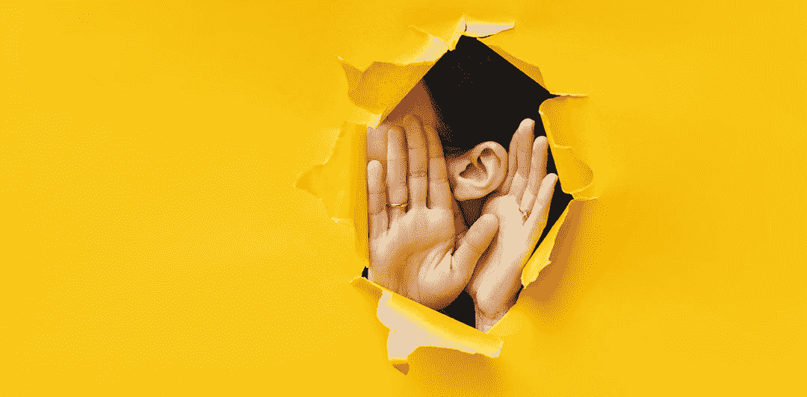

# 25 倾听：把你的刀收进鞘里

和菜头

2022-04-08

## 25 倾听：把你的刀收进鞘里

25 倾听：把你的刀收进鞘里

| 转述师：余昊威 |

**倾听，名词，一种有效的人际交往方式，唯一的缺点是很难做到。**

\*

如果说我有什么人生教训值得拿出来排在首位的话，那就应该是倾听。  
**它是如此简单，但是能做到却并不容易，因为人和人的相处实在是太过微妙的一件事，稍不留神就会错过正确的信号。**

在日常生活中，你是不是会遇见这样的事情：

朋友来找你，说是出来坐坐，想“聊一聊”。落座之后，朋友就向你倾诉苦水，讲述他所处的困境。接着又恭维你，说你是他所认识的人里“脑子最好用”的一个，因此想请你帮他“拿拿主意”。于是，你为朋友做了详细的分析，提出了七八种解决方案。朋友心悦诚服地点头不已，说“我回去再想一想”。回家时你很高兴，觉得帮了朋友一个大忙，对得起这份友情。转天过来，你却听到这位朋友对你的评价是：那是一个自大狂，自以为是，好为人师。

我遇见过这种事，花了很长时间才完成心理建设，没有让这种事变成一种困扰。简单来说，之所以最后会出现这样的悲剧结局，主要原因是我错误地理解了一系列对白。当你的朋友说“聊一聊”的时候，其实省略了主语，完整的形态其实应该是“我想聊一聊”，并不是“我和你聊一聊”，这里面本身就没你什么事。

当你的朋友赞美你是他所认识的人里“脑子最好用”的那个时，这句话并不是真的在说你聪明，意思其实是说：你不会像其他那些笨蛋一样非要说话吧？当你的朋友听完你的高见，表示“我回去想一想”的时候，也并不是表示他真的准备采纳你的意见，这句话的意思是说：没想到，在你身上白白浪费了一整个晚上。

如果我换一个做法，结果可能会截然不同。同样是这位朋友，大家落座之后，我请他一吐为快，全程只需要做两件事，说一句话就足够了。这两件事很简单，一是频频点头，二是频频点酒。无论你朋友说什么，多么恳切地要你出主意，都不要说话，只是不断点头表示你在听他的每一句话。

实在逼得急了，就举杯，大家满饮，喝完就继续要酒。朋友坚持要你说话，那么就说一句：我也觉得很难，没有什么好办法，但是，无论你作出什么决定，我都坚决站在你的这一边。说完，大家继续干杯。这样的一夜过去，虽然基本上你什么都没做，但是朋友对你的评价会很高，认为你温暖又仗义，在他最困难的时候帮了他一个大忙。

我帮了什么忙？我唯一做的事情就是倾听。 **这件事情难就难在要克服自己的本能，坚持不说话。**

为什么说是克服本能？因为人一旦听说朋友有困难，有麻烦，本能就想帮忙解决。想要解决，就会本能地询问，出主意，给建议。问题在于，当你朋友有麻烦的时候，对方其实在想法上就已经和你不在同一个频率上。身处麻烦或困境中的人，感情上很脆弱，基本上是感性在控制自己，想找人倾诉，从而释放内心的情感和压力。

但是你没有，你还是由理性控制，你还在思考而不是感受，所以你的理性会要求你去想解决方案，并且认为对方只要有了解决方案，内心的痛苦就会不药而愈。这种不同频就会造成理解上的错位，朋友需要的是情感抚慰，而你提供的是理性思考。站在朋友的角度考虑，那就是你没有丝毫考虑他的感受，给出了一堆毫不相干的建议，看起来更像是在炫耀自己的才智，对于他的切身痛苦完全无动于衷，给一个垂死挣扎的人上呼吸课。

不要相信什么“旁观者清”一类的说法。 **旁观者未必清，凡是可以说出口的话，都有所保留，只有当事人最清楚发生了什么。**  
当一个人来找你的时候，他早就已经在心中完善过他要讲的故事，你听到的只会是一面之辞。知道出主意最令人讨厌的地方是什么吗？是它可能在不经意之间，就会戳破故事，但是你自己不知道，还自顾自地继续讲着。

而找你倾诉的朋友，需要的东西，也并非是同情和理解，而是来自你的肯定。知道世间还有一个人站在他的这一边，会让他感觉好很多。而这个人竟然三言两句戳破了他的故事，揭露了真相，那等于是站在了他的对立面，这怎么不会让人讨厌呢？

选择倾听则可以避免这些问题。朋友找你倾诉，这个行为本身的含义是认为你值得信任，你不会把他说的话泄露出去，不过这仅仅是最低要求。除了守口如瓶之外，他还希望你能倾听。  
**人在困苦之中，最大的安慰莫过于有人愿意倾听自己，仿佛这种苦只要说出口，有人能听到，就能分担一半，自己就能缓释很多似的。**

也正因为这样，才有所谓倾诉欲。和五个人都倾诉一遍，自己所承受的压力就变成三十二分之一，完全可以独自承受下来。所以，倾听一晚上下来，感觉是自己什么事情都没为对方做，但是却能收到朋友的由衷感激。这件事情非常奇妙，没有经历过不会知道它的神奇。

现在我基本上戒除了给朋友出主意的习惯，如果他们要倾诉的话，我学会了安安静静倾听，忍住自己强烈的发言欲。只有一种情况下才存在例外，那就是朋友自己拿出几套方案让你来选。这时候你可以略微分析一下每一套方案的利弊，当然，无论怎么分析都要站在朋友的立场，证明如何才是对他最有利的做法。

如果朋友本身没有任何方案，那么绝对不要给建议，那只是酒还没有喝到位的表现。尤其是自尊心很强的朋友，更是不要轻易给建议。如果你给出的是正确且唯一的解决方案，那就更糟糕了，他会感觉是被你强逼着选这条路。所谓自我疗愈，永远是自己走出去，哪怕这条路是别人引导下的结果，但是当事人一定要感觉是自己想出来的，自己走出来的，才不会丧失对自己的信心。

所以，当有人对你说“你需要学会如何倾听”的时候，意思是你应该学会闭嘴。  
**而倾听之所以是一种美德，原因就在于它照顾了人性脆弱的时刻，用关怀、理解和支持，替代了逻辑和理性。**  
如果我们时时坚持逻辑和理性，如同手术刀一样锋利，那么旁人就会远离我们。也正因为这样，一群人中总是那个看起来最笨拙、最木讷的人，会得到最多信任，甚至是最多喜爱。就算是手术刀，也不会喜欢另外一把手术刀，而是更喜欢一个软木塞，那里才有它想要的无尽包容，每一个福尔摩斯身边都有一个华生，大概就是这个道理。

**聪明人最容易犯的错误，就是认为自己的聪明才智是一把瑞士军刀，任何时候都忍不住想要拿出来解决和修正问题。**  
这样也会带来一种潜在的傲慢，那就是误以为别人遇见了什么问题，都是因为不够聪明，想不明白所造成的。

一旦这种情绪流露出来，尤其是三下五除二把问题分析清楚，一二三四给出解决方案，对方会很明显地感觉到这种傲慢的存在。那样的话，其实就没有朋友可以做了。如此说来，  
**倾听就是最好的刀鞘，它把才智的锋芒收敛其中，不至于伤害了亲密的人，所以人们才会把它视为一种美德加以肯定。**

总之，学会倾听让我还有那么几个朋友，不至于一个人活在世上。我希望我自己能早一点知道，那么就不会有那么多朋友在岁月流逝中悄然转身消失。此刻，我想祝你好运。

1.倾听之所以是一种美德，原因就在于它照顾了人性脆弱的时刻，用关怀、理解和支持，替代了逻辑和理性。  
2.聪明人最容易犯的错误，就是认为自己的聪明才智是一把瑞士军刀，任何时候都忍不住想要拿出来解决和修正问题。  
3.倾听就是最好的刀鞘，它把才智的锋芒收敛其中，不至于伤害了亲密的人，所以人们才会把它视为一种美德加以肯定。

公众号懒人找资源

发布留言

0/ *500*

确定

# 26 穷开心：怎样度过走入社会的匮乏期

和菜头

2022-04-08

## 26 穷开心：怎样度过走入社会的匮乏期

26 穷开心：怎样度过走入社会的匮乏期

| 转述师：余昊威 |

**穷开心，指一种精神状态，在个人匮乏时代里为数不多的安慰之一。**

\*

要我说，从开始工作到 30 岁前这一段时间最是难熬，主要原因是财富累积的速度远远低于心理预期，但是花钱的地方又是无穷无尽，这就难免让人心生绝望，不知道这样的日子要到什么时候才算是尽头。我记得自己混得最惨的时候，身背一年工资总额的外债，每个月领到工资先还信用卡的欠债。还完欠债，又立即透支一笔钱出来，否则未来三十天就没钱用。

算起来这也应该是一种走入社会的不应期（音频：不应期是个生物学词汇，意思是在生物对某一刺激发生反应后，在一定时间内，即使再给予刺激，也不发生反应）。我觉得主要原因是教育上的匮乏。回想过去，我有两件事情百思不得其解。

念书的时候，家长老师全社会都劝自己好好读书，不要把心思花在别处。一旦出了校门，他们就突然觉得你可以管理好个人财产，实现收支平衡。同时，又突然觉得你可以出门谈个恋爱，很快找到个伴侣。要知道，为了上个大学，之前需要花十二年时间打基础。为了拿到个大学文凭，之前需要花四年修上百个学分，一门课修一学期也就两三个学分。但是，为什么大家会觉得一个人在零基础、零实践的情况下，可以很快同时掌握个人财务管理和恋爱两大世界级课题呢？

在我认识的人里，只有一位朋友是个例外。他在很小的时候就掌握了个人财务管理的技巧，实现了收支平衡，而且还略有盈余。主要原因是他的父母从事野外勘探工作，而且是双职工，经常离家一去就是半年一年。所以他才十岁出头，父母就在每次离家前把一年的生活费一次性都留给他，然后把家门钥匙，一把挂在他的脖子上，一把放在奶奶家。

父母走后，他的生活全靠自理。如果生活费消耗得太快，那么他就要祈祷父母早些回来。实在是耗尽了也没有办法，父母在深山里，没有办法可以联络得上。他从小就能把个人财务管理得井井有条，主要原因是父母放牧式的管理，让他在很小的年纪就知道量入为出，合理计划。

不过，绝大多数家庭都做不到这样，我朋友自己的家庭也是逼不得已，并非是有意识地想要培养孩子。所以大多数孩子毕业走上社会，其实都是两眼一抹黑，要饱受好几年财务匮乏的折磨。

记得我刚工作的时候，月薪是 800 元人民币，实际到手大概 700 多。当时都还是座机，人们都用传呼机相互联络。尤其是我们这种需要值班或者临时到岗的工种，传呼机基本是个标配。然而，一台汉字显示的传呼机要 3000 多块，纯英文显示的也要 1000 多块。我询问完价格，感觉和校园相比，社会可以说是相当不友善。然而那时候以人们的朴素观念，父母已经供自己念书，工作之后就不应该再向他们要钱，反而应该每个月上缴伙食住宿费。这样一来，计算一下自己的储蓄速度和传呼机的价格，就会觉得呼吸急促，血压上升。

其实后来回过头来看，个人财富的累积是需要时间累积的。我熬了五年之后，月薪也涨到了 3000 块钱，加上各种乱七八糟的补贴，以及只允许签字领钱不允许询问的三产福利，手头要宽松许多。但是，因为前五年被钱压得喘不过气来，人的欲望也就无限放大。工资涨了 4 倍多，但是欲望可能是十倍，最终依然是不够用，银行卡上并没有多少结余。

好容易从边陲来到首都，收入增长了 3 倍，但是这里的房价又是家乡的十倍。人生好像就是这样，达到任何一个收入阶层，一定对应着你现在收入水平十倍的支出。我想，这大概就是整个社会在急行军的基本动力。

这样算下来，一个人从开始工作，到生活基本安定下来，会有很长的一段日子感到没钱，饱尝穷的滋味。我二十多岁的时候，社会生活相对简单，说到赚点外快，人们想到的是开个餐厅，开个茶室，或者是几个人合资购买一个铺面。这样一旦亏起来，大概就是会亏到一个铺面转让费。如今的情况大不一样，股票、基金、期货、数字货币以及形形色色的金融产品，一个人拥有了丰富多彩的亏损方式，以及深浅不一的亏损可能。有时候我不禁想起唐代大诗人的杜甫的一句诗：夜雨剪春韭，新炊间黄粱。

我不会劝人储蓄，因为当年我自己也做不到。我也不会劝人理财，因为这远超我的所知。我唯一能做的事情，就是坦诚一个事实：我在刚工作时，也同样饱受穷的困扰，而且这件事情除了用时间来解决之外，似乎并没有其他更好的方法。这样，身在其中的人就会因为得知自己并非是全世界唯一一个不幸运的人，而多少感觉到有点宽慰。

太多的事情我做不到，不过，我确实有个建议，可以让这段大多数人不得不熬过去的时光稍微好过一点，那就是三个字：穷开心。

回想那一段日子，除了对金钱和物欲的渴求之外，同时它也是我个人成长、获取新知最快的一段时间。有人建议，在这种阶段要控制自己的欲望，学会延迟满足。如果欲望如此容易控制，僧侣和修士何必几十年如一日地在静室中独坐？而在年轻的时候，谁会认同延迟满足也是一种满足？没有足够的娱乐消遣，人就会有大量消耗不掉的时间和精力。以我的经验来看，把它们耗费在学习某一样技能或者养成某一种爱好上，其效率可能是三十岁之后的数倍，四十岁后的数十倍。

二十多岁的时候，人大多喜欢关注新事物，新领域。对于我来说，当时的新鲜事物就是网络。工作第一年，我就借贷了相当于一年的工资收入开网吧，然后因为手续问题一年后关张了事。所有能拿回来的资产，就是每位股东分到的两台电脑。我把其中一台卖掉，然后另外一台搬回家，开始上网聊天打游戏，并且从那时候开始慢慢尝试写一些文字。

两年过去之后，我在网上已经是小有名气的写手，并且因为文章和论战的缘故，认识了一些天南海北的网友。那时候在网上写作没有一分钱收入，相反每个月要为上网支付数百元的电话费。但对于我来说，那是个业余爱好。在网络上，我所获得的认可和支持，要比单位里来的更快更猛。

除了写作，我基本上是靠自己的力量，以及网络搜索引擎，学会了如何安装、维修家里的网络，从零开始学会了如何购买服务器空间，搭建独立博客，做搜索引擎优化。几年过去之后，我对电脑和网络的熟悉程度远超同龄人。背后的动力也很简单，如果我不自学的话，我就没有什么可以玩的。而因为我会调试网络，维护计算机，做一些简单的杀毒、安装系统等工作，刚好赶上了单位的第一波无纸化办公大潮，于是变成一个技术小能手，整天被呼来唤去修系统，安装打印机。同样这些工作不会给我涨一分钱工资，但我还是乐在其中，因为可以摆弄领导们的电脑，而他们的电脑普遍比我的好，还可以偷偷在上面跑游戏。

所有这些事情，都不会带来收益，但是却让我觉得快乐，因此可以把我的行为称之为“穷开心”。我觉得穷开心很好，起码让我没时间精力为了钱少这件事情而痛苦，也没有太多念头缠绕在我那些我想拥有而拥有不了的东西上。

工作 5 年之后，穷开心悄然发生作用。我在网上的文字被平面媒体发现，开始有了稿约。稿费虽然一开始很低，但是逐渐水涨船高，甚至能打平我的工资，这是我后来离职的心理保障。我在单位里也因为懂电脑、懂网络，而获得了认可，有越来越多的任务交给我，我也慢慢升职，从边缘部门一点点调动到核心业务部门。每一次调动，工资都会略微上涨一些。几次下来，其实也很可观。最后，我的穷开心让我得以进入自己梦想的互联网行业，雇主对我的履历表毫无兴趣，明确表示他们招聘我是因为我的业余爱好。

我不认为这是什么成功的个人经历，事实上，如果我早一点知道预算平衡和开源节流的道理，我的人生路可能要走得更为平顺一些，完全不需要这样曲折漫长。如果说这段经历里还有任何一点有价值的地方，我想只能是穷开心。

总结下来，穷开心有 3 点好处：

1.  **它让你关注新事物，新领域，因为新生事物大家都不关注，这就意味着可以少花钱，甚至不花钱，也能加入，别人甚至会邀请你进入；**
    
2.  **一旦新生事物发展起来，市场上会需要有经验的人。而这样的人在一开始会奇缺，这时候即便你是个玩家，因为玩得多，别人也会认为你有经验，愿意给你机会试试；**
    
3.  **即便以上的事情都没有发生，但是你愉快地度过了最难熬的几年，并没有被物欲和金钱在精神上打倒，人格变形，可以顺利展开下一段人生。**
    

现在，我可以说了：当年我是用网瘾打败了透支瘾，结束了我的卡奴生活。那种网瘾和今天的网瘾有一点区别，那就是为了创作和创造而上网有瘾，多少都会有一些成果。而那些成果在命运的拨弄下，未来会产生怎样的变化，当时忙于开心的我并无觉察。

1.穷开心能让你关注新事物，新领域。 2.一旦新生事物发展起来，即便你是个玩家，因为玩得多，别人也会愿意给你机会试试。  
3.穷开心至少能让你愉快地度过最难熬的几年，不被物欲和金钱打倒，顺利展开下一段人生。

公众号懒人找资源

发布留言

0/ *500*

确定

# “我问和菜头”：只是倾听，任由朋友撞南墙？

和菜头

2022-04-08

## “我问和菜头”：只是倾听，任由朋友撞南墙？

“我问和菜头”：只是倾听，任由朋友撞南墙？

| 转述师：余昊威 |

读者 用户呢了同学：:

> "菜头老师，学会倾听很重要，但是倾诉是个好习惯吗？会不会变成祥林嫂，这个度应该怎么把握呢？"

如果是相同的问题，如果是琐碎的烦恼，那么一再倾诉会让人觉得厌烦。成年人的世界里，不是说不可以倾诉，但是起码要证明你努力过。否则会给人过于依赖的感觉，把别人当做了负面情感的垃圾桶。

这里并不存在一个明显的度，因为不同的人有不同的忍耐力，的确存在一些人天生就有倾听欲，那么配上一个有倾诉欲的朋友，刚好双方都满意。大多数情况下，人们愿意倾听首先是因为好奇心，然后才是关切，  
**具有倾听欲的人其实并不多，所以倾听才是一种美德。**

读者 用户田螺：:

> "菜头叔，我发现自己不太懂得如何扮演好“倾听”这个角色之后，我开始观察别人倾听时的样子，他们有的会等对方说完，开始说自己或别人的相似案例；有的只是沉默地点头，给不出任何建议；有的像个相声的捧哏……"

> "请问菜头叔，在倾听时候，如果只是频频点头表达自己在听在肯定，但一言不发，对方会不会觉得我很敷衍？"

并不会，不要把自己想得很重要。当一个人对你倾诉的时候，你其实只是一个背景板，只要有目光的注视就已经足够了。许多人担忧一言不发会冷场，  
**但是对于成年人而言，沉默有时候是令人惬意的。什么都不用说，对方也都能懂，这是一种非常宝贵的默契。**

如果因为担忧冷场，而喋喋不休地讲话，或者抛出话题，其实会让人觉得聒噪且厌烦。

读者 用户 Jensen Huang：:

> "老师您好，请问如果是家人或伴侣，也一样只是倾听吗？ "

其实，在家庭内部可能更需要倾听。

因为你的家庭成员其实没有多少选择，有些话没有办法出去说，只能在家里念叨，这对于他们而言是一种缓释压力的方法。而且，有时候的确需要长时间的倾听，才能判断出对方的真实意图，往往越是亲密的人，也就越容易掩饰，不肯直接说出问题所在。

读者 用户游离于空：:

> "菜头叔，有些时候只能通过微信沟通，不方便电话或见面，正上班呢，对方又真的想要倾诉，比如家人心情特别不好，但是也没到必须请假飞奔到其身边的程度，如何在微信上表达善意进行倾听呢？求解，谢谢。  
> "

这时候对方只是要个树洞而已，你可以告诉对方自己有紧急的事情处理，让对方在微信上先说，自己随后再看，看完之后和对方联系。

其实，人很多时候只是情绪一下子涌起，无法自控。你真让他写下来，那就需要组织语言，梳理想法，等写出来之后，自己往往也就已经想清楚了。心理建议也有类似的，让人把自己面前的困境和难题写在纸上。只要能写出来，就可以自行缓解很多。

读者 用户小而雅：:

> "有位朋友找我聊天，欲言又止的样子让我预感到她即将透露一个令她难以启齿的秘密。我提前给她打“预防针”：朋友之间不是所有的事情都必须分享，有些事情你说出来之后可能会让你觉得在朋友面前不自在，所以说之前你要考虑好。她犹豫了一番之后，还是执意说了她心底的秘密。作为朋友，这时候我也没法再把她的话堵回去，那就只好倾听了。结果她一番倾诉之后，在我们各自回家前，突然来了一句：你千万不要把这件事情告诉其他的朋友哦……"

> "想问问菜头，如果你遇到类似的情况，会是怎样的心理反应，又会如何回复这位朋友呢？ "

我是不听秘密的。如果有朋友要告诉我秘密，我会第一时间回绝，告诉对方，秘密对我的压力很大，知道一个秘密就意味着有件事情我不能说。如果我知道一千个秘密，那么我开口之前就会想很久，这样会让我看起来反应很迟钝。

当然，我感谢这份信任，不过为了我自己好，我还是想很自私地请求不要给我讲述秘密。

而你所说的这种情况，其实已经变成了一种模式。对方其实根本不在意你是否会泄露，甚至有时候正希望你那么去做。因为真正互信的朋友，根本不会说什么千万不能对人说一类的话，他只需要说这件事情相当致命，大家就都明白是什么意思了。专门对你强调不要说出去，那么你要反思一下你们之间的关系，以及对方对你究竟是什么看法。

读者 用户 No One：:

> "我以前就是（现在很可能依然算是）个好为人师的人。现在我觉得：很真诚地给人出主意提建议≈吃力不讨好+很可能惹一身误解。哪怕那人是你名义上最亲密的人，也不要在 TA 面前扮演上帝。  
> "

> "那么和菜头老师，如果发现来找我们倾诉的朋友或者关系很近的人明显是误入歧途，这么走下去肯定得不偿失——该怎么做才能引导他回到正轨，或者尽可能止损呢？还是说理解成这是 TA 人生必经的一道坎，索性让 TA 撞一回南墙？"

很多人都有类似的疑惑，其实大家如果仔细想一下，就会明白外人的建议和看法很难改变一个人的心意。无论你现在多大年纪，请回想一下身边的人中，有几个人因为听人劝就直接分手的？朋友之谊，也就到提醒对方这个程度而已。等真出了事之后，你不会因为自己没有事先提醒而心怀愧疚，觉得没有尽到朋友的义务。

至于说朋友撞南墙，撞南墙这种事情是很难避免的，不撞的话人不会成长。提醒对方，是为了避免对方撞墙之后继续撞，造成难以挽回的后果，想起你说过的话能及早醒悟。也正因为这样，我不推荐反复建议，反复规劝，这样未来真发生了点什么，对方又会觉得没有脸去面对你，反而丧失了求助的机会。  
**如果真的关心朋友，心怀悲悯，就不要把这条路给堵上。**

读者 用户胖子会飞：:

> "想说说实际交流中经常遇到的一个麻烦。感觉现在人们在交流中越来越不耐烦了，没有耐心听完我仔细地将事情来龙去脉说个明白。于是平时的沟通就变成极为搞笑的一个过程，我话还没讲完，对方就已经胡乱猜测问题了，猜完问题也不和我确认一下猜测是否正确，就开始抛出自己的理解和解决方案了。这样的沟通感觉既累又无效。"

> "不知道菜头叔是否也遇到过这样的问题，面对这样的情形，您有什么好的解决办法啊？"

我不清楚你的实际状况，听起来有两种可能：

一种是你的叙述可能一贯很啰嗦，抓不住重点，让人听了觉得厌烦，所以会打断你。猜测问题的本意，其实就是催促你加快叙述进度，倒不是真的为了问你。如果是这种情况，你要想办法提升一下口头表达能力，讲话尽量精炼，切中要害。

另一种可能是对方性格非常急躁，那么这是需要训练的。只要对方打断你，你就停下来看着他，让对方知道你并不喜欢这种沟通模式，学会听完你的话再发表意见。

不过，我怀疑前者的可能性要更大一些，人都很难意识到自己本身存在的问题。

读者 用户爱学习的猫：:

> "人天生就是自恋，爱表现自己，尤其是在自己擅长的领域。不知道老师用什么方式方法克服自己的这种秉性，保持倾听或者说是闭嘴的状态？"

当然是挨现实的毒打啦，还能有什么办法？道理人人都听过，不被现实打疼了，怎么可能认真坐下来去想？如果人人都可以通过思维的方法就能醒悟，而且就能作出改变，世界怎么会是今天这个样子？包括我写那么多文章，我自己也并不奢望读者因为看了文章就能立即产生什么改变。  
**这不过是一些种子，等到时机合适的时候，也许有机会能够萌发出来，不要到时候只是手里捧着一个空花盆。**

1.大多数情况下，人们愿意倾听首先是因为好奇心，然后才是关切，具有倾听欲的人其实并不多，所以倾听才是一种美德。  
2.对于成年人而言，沉默有时候是令人惬意的。什么都不用说，对方也都能懂，这是一种非常宝贵的默契。  
3.这不过是一些种子，等到时机合适的时候，也许有机会能够萌发出来，不要到时候只是手里捧着一个空花盆。

公众号懒人找资源

发布留言

0/ *500*

确定

# “我问和菜头”：无欲无求，也算穷开心吗？

和菜头

2022-04-08

## “我问和菜头”：无欲无求，也算穷开心吗？

“我问和菜头”：无欲无求，也算穷开心吗？

| 转述师：余昊威 |

读者 用户 36 度 8：:

> "耿恭在巨大环境压力下能压制胆怯、犹豫这些情绪，与环境相互成就。为什么炒股的人越是孤注一掷，压力越大越不易执行纪律？是因为只有极少数人能在巨大压力下与环境互相成就吧？而且我想，这种能力是不是一种不能加强的能力，一次成功不代表以后也能很好地自制？"

**人是有弹性的，人也是易变的。** 有人曾经问一位已经获得了证悟的禅师，在证悟之后每天还有什么事情要做？禅师回答说：牧牛。

他这里所说的牧牛，指的是小心地看护好自己的心，不要让它失去了自己的道。你问的问题也是同理，做到一次不等于下一次同样能够做到，  
**因为心是会变的，人因为胜利而会变得自信乃至过于自信，高估了自己的能力而低估了时势的力量。**  
即便是证悟了的修行者，尚且要每天每时每刻小心看护自己的内心，避免退转的命运，那么何况是你我这样的凡夫俗子？又如何能期待我们永久地停留在某种圆满稳定的心态里不会掉落？

读者 用户孙城武：:

> "菜头叔，“宝剑锋从磨砺出，梅花香自苦寒来。”“成长离不开磨难。”就好像如果没有磨难就不能成熟长大一样。所以，有一段时间我甚至会喜迎磨难的到来（不是自讨苦吃那种）。"

> "我想问叔叔的是：您是怎么看待“成长离不开磨难”以及怎么面对“教训”和“长大”这种事情的呢？ "

说老实话，可能会得罪人，而且别人也可能不愿意听。但是在这里我还是想诚实地说出心里话：当你那么问我的时候，我就知道你的心境并没有发生任何蜕变。

的确经过现实的磨砺之后，一个人会把所谓的磨难变成某种个人前进的动力，甚至会把它当做是挑战，爱上这种直面挑战的感觉。但是，一旦人进入到那样的境界，内心就不会再有什么“磨难”的概念存在，因为这个概念已经从根源上被消除了，转化为针对个人的滋养。如果你真的做到了喜迎磨难到来的话，那么你不会问出现在的问题，因为你不能问一个根本不再存在的概念。

读者 用户囚之：:

> "不知道谁对我说过一句话：“当你身边所有人都在谈论股票时，就是割韭菜的时候了。”对此我深信不疑，因为我就在这上面吃过亏。"

> "但这似乎是个悖论，熊市没人会想去炒股，人人谈股色变，避而远之。只有牛市才会激起散户们的激情一个个投入股市中，结果可想而知。那么是不是当一件事情人人都非常看好的时候，反而要去警惕其中的风险呢？这种不随大众的逆向思维，应该如何去养成？"

很好的问题，但是同时我认为你问得过于深了，要解释起来并不容易。

我想可以简单地这么说：你现在用的这套想法，还是传统的一叶落而知秋那套思想方法。用某种特征值，来作为系统的整体判断。问题是，从人人都在讨论股票，到人人被割韭菜之间，还有很长一段时间。你的这套想法并不能克制贪婪，见好就收，也不能诱发恐惧，成功逃顶，是因为它并不能提供准确的时间节点。

但是，如果你换成另外一套想法，把大众情绪作为诸多指标中的一个，建立起自己的判断体系，那么你就不会陷入这种二元的想法中去，好像反向大众操作就一定能赢似的。人们总是说类似“大妈进场，股票就要崩盘”一类的话，那只是因为它便于理解和传播，但和如何成功地投资关系却并不大，甚至不可能构成一种方法论。

读者 用户呢了同学：:

> "菜头叔，还有一个很常见的说法，幸福不是因为得到的多，而是因为要求的少，那如果一个人很穷，但无欲无求，也不思进取，您觉得，这能算穷开心吗？ "

这个问题可能要分几层来谈。

第一层是这件事情不容易，历史上有过类似的人，比如说“一箪食，一壶饮，在陋巷，人不堪其忧，回也不改其乐”的颜回，但他是孔子最喜欢的学生，并非是一个寻常人。更想见的是又穷又愤怒，很难心平气和。

第二层是从现实的层面考虑，一个人不大可能做个自了汉，他对周围的人，对社会背负着某种责任，如果不去承担这些责任，而是追求心灵的自由，就需要非常强大的内心，这样其实也不容易做到。

第三层是所谓的无欲无求，如果深究一下的话，是哪一种无欲无求呢？如果不曾拥有，也就不曾受过诱惑和考验，那么这种无欲无求是真实的吗？是可靠的吗？当然，肯定有仅凭思维就能达到这样境界的人，可是对于大多数人来说，可能必须通过亲身经历来达到这种醒悟和解脱。  
**你曾经拥有过多，最后选择了少，这才叫选择，也才是内心的自由。**

读者 用户 Nicky：:

> "叔，因为是 IT 行业，我刚工作的时候工资就不低，每个月有不少盈余，可我依旧觉得匮乏，舍不得花，想省着，攒着，其实我并不希望自己这样，这是什么心理？"

可能是因为你幼年时经历过非常匮乏的生活，因此内心缺乏安全感吧。我认为没多大问题，何况储蓄结余也是亚洲人的优良传统。只是说，如果有可能的话，你要去花点时间考虑一下金钱究竟是什么？能给你带来什么？如果仅仅是带来安全感，那么它的用途未免太过死板僵硬，不如直接打造成一间屋子住在里面。

你得试着花费乃至浪费一些金钱，看看它的其他妙用，也许会转变原先对于它的看法。  
**当它不再是你的盔甲，你的碉堡，那么你也不用再臣服在它的脚下，而是让它变成你忠诚的仆人。**

读者 用户灯塔：:

> "菜头叔好，请问您作为过来人，现在回想起来是以前“穷”的时候开心，还是现在“富”了以后更开心呢？还是各个时期有各种不同开心的方面呢？"

这个问题隐藏了一个前提，那就是做静态对比，仿佛时间不会流逝，我不会变老，时代不会变迁。这个前提当然不存在，时间、时代乃至我自己，都在不断的变化之中。

如果你非要那么比较，我只能说年少的时候贫穷，但是世界里存在大量未知的事物，每天都会经历各种人生中的第一次，因此会让人觉得快乐振奋。而年纪大了之后，生活所带来的新鲜感会急剧减少，许多人和事一早都能猜到结局，所以就没有那么多快乐，反而觉得有些厌倦。

读者 用户任勇：:

> "“穷开心”的重点在年龄段，年轻人刚参加工作时都会面临生活的压力，这是从“学习”阶段进入“生活”阶段的必然趋势，如何适应生活，学会生活，找到生活的乐趣，享受生活，是远远比“努力工作”更重要的事情，在“穷”的阶段寻找“开心”的事情，并让“开心”的事情成为自己的工作，这不就是职业发展的高阶目标“做自己喜欢的事”并将之作为事业吗？"

许多人未必有这个幸运，可以把自己喜欢做的事情变成自己的事业。而喜欢做的事情变成事业之后，也未必有当初那么开心。只是说，年轻时有体力，有胃口，有欲望，却没有足够的财力，这经常会给人造成一种困扰。那么穷开心算是一种可能的方案，多少让人好过一点，心怀希望。

**谁在这个阶段都是摸黑走夜路，不知道还要走多远，也不知道前方哪里才有光。你当然可以心怀恐惧地走，不过也可以心怀希望吹着口哨走。**  
至于说最后能否把自己喜欢的事变成事业，反而不是重点，想多了倒有可能更容易失望。

读者 用户未央禾：:

> "我现在就正处于这个时候，刚入职不到一年，恰好初入社会的不应期，还没有找到让自己穷开心的事情。因为工作性质原因，致使自己的工作和生活时常分不开，而自己反而有一些想要考的证和学习，因为平衡不了工作、生活，展开不了，愈发陷入做不到自己想做的事而焦虑，反过来也影响了工作。"

> "这貌似无解的瓶颈期，是不是因为自己对自己想做的事还不够热爱，还感受不到穷开心的开心，做不到取舍呢？我常自问，却无果……还望叔能够帮忙解答，感激。"

是因为手生啊，同学。你在想什么呢？入职一年，你就如鱼得水，得心应手，那岂不是说明之前从事这个行当的人，几十年的辛劳不如你一年的努力？你觉得可能吗？

**世间的事情，可以降低难度，可以转换思路，但是唯独不能省的就是时间。**  
你需要用时间去打磨自己，去熟练工作，于是你才会逐步有更多的余暇，才能有财力和时间支持你的业余爱好。不要太着急，才上路要有耐心，要稳一点，眼睛先看脚下。

1.当金钱不再是你的盔甲，你的碉堡，那么你也不用再臣服在它的脚下，而是让它变成你忠诚的仆人。  
2.谁在这个阶段都是摸黑走夜路，不知道还要走多远，也不知道前方哪里才有光。你当然可以心怀恐惧地走，不过也可以心怀希望吹着口哨走。  
3.世间的事情，可以降低难度，可以转换思路，但是唯独不能省的就是时间。

公众号懒人找资源

发布留言

0/ *500*

确定

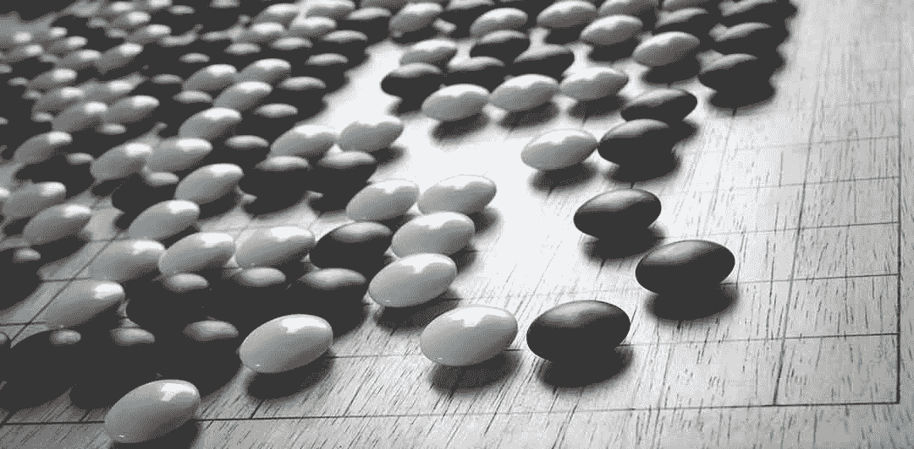

# 27 胜负师：执着于胜负的人会失去更多

和菜头

2022-04-08

## 27 胜负师：执着于胜负的人会失去更多

27 胜负师：执着于胜负的人会失去更多

| 转述师：余昊威 |

**胜负师，围棋术语，指以赢棋为最高目的的棋手，下法凶悍凌厉，不在意棋型是否优美，不在意下法是否难看，也不在意是否下出了精妙的棋路。**

**和胜负师相对的是求道派，追求的是在每一局棋中超越自我，每落一子都体现出围棋之美。**

\*

对于有能力角逐胜负的人而言，我认为应该尽量避免做个胜负师。

**争胜是人性，但是以胜利作为唯一目的，最终得到的可能不如失去多。尤其是胜利近在眼前、清晰可见的时候，它同时也会让你的视野变得狭隘。**

我来讲讲我自己的经历吧。我的第一家单位人员构成非常可怕，加起来有一百号人，但是职位只有正副科长三个位置，而且三个人都还年富力强。年富力强不可怕，可怕的是整个单位是个边缘技术部门，平调或者升职的可能性都非常小。于是，哪怕是一个副股长级的小组长，也能让人打破头。顺便说一句，并不存在股长这个行政级别，那只是个头衔而已，有一点内部待遇上的不同，俗称“内部粮票”。

所以我在那儿待了几年之后，周围本来友善亲切的气氛变得微妙起来。原因是有传言说，我也是下一次领内部粮票的人选。于是，其他认为该轮到自己领粮票的人对我的态度就变得充满敌意，在工作中合作越来越困难，仿佛只要干掉我，那张粮票才能十拿九稳。

其实他们并不知道我当时的真实想法，我一心想着赶紧调走，从边缘部门转去核心部门，哪怕是去扫地都好。按照这种人员结构和江湖地位，送我个科长我也不愿意做。不过我并没有表明态度，而是饶有兴趣地看着他们如何针对我。

过了一阵子，我终于得到了我朝思暮想的调令。调令下达那天，人们脸上的表情简直是精彩极了。有难过的，有惋惜的，有不出所料的，也有如释重负的。无论是哪一种，当场就一致决定了要为我开一场送别宴。

席间，一位曾经以为我要抢粮票的同事专门找我敬酒，说没想到，真的没想到，事情会是这样。然后为之前的事情向我道歉，连饮三杯，请我多包涵，生活真的不容易，还请你要理解。反而弄得我有些尴尬。当然，最后是他胜利了，他得到了他想要的那张内部粮票，不过事情和他想象的并不相同，其实并没有人要和他争什么，一拳挥在了空处。

我到今天都依然认为他是个好人，在我刚入职的时候，他如同一位宽厚的老大哥，对我多有照顾，教我的时候也绝不藏私。只是一张内部粮票出现的时候，他太想要了，也太想赢了，不知不觉之间就变成了另外一副模样，也许他自己都没有意识到那其实很滑稽。

在我看来，他就是个胜负师。 **专注于眼前的胜利，最终也获得了胜利，但是却没有看到更大的图景**  
——在整个公司层面，我们所属的部门并没有任何核心价值，所以也自然不需要安排多少个管理岗。一个人只要待在这里，就不会有任何发展空间，所有人都是弯着腰低着头在透明天花板下面干活。从我第一天报到上班，弄清楚单位的结构和位置之后，唯一的想法就是赶紧跑路，只有跑路才有活路。

如果要比较的话，我认为我不如他聪明，性格也没有他温厚，同事们也要更喜欢他。我所看到的事情，他应该更早就已经看到，而且比我更透彻。但是他不如我有决心，我追求跑路，他转而追求粮票。一旦开始追求粮票，所有人在他眼里都是对手，反而对自身的处境视而不见。

我并不反对胜负师，因为生活工作中的竞争很难避免。当出现利益之争的时候，人们并不会坚持温良恭俭让。能够下出胜负手，一举奠定胜局，自己的生存空间也会更宽松一些。

理解归理解，我还是建议尽量避免做个胜负师，多去考虑一下还有没有别的选择。  
**世事如果是一局棋，对于一颗棋子来说，最重要的事情是弄清楚自己在哪里，在棋盘上的重要性如何，还有没有可能挪动一下，控制更多一点局面。**  
如果不幸做了弃子，那总要想办法起死回生，或者换另外一局。

而且， **长期做胜负师会让人变得很偏狭，得失心变得非常重。**  
我平常哪怕是推荐一本小说、一部电影，也会有人问我：看了有什么好处？看了我能获得什么？这样的问题我真的无法回答。因为这就不是个得失的问题，也谈不到好处不好处。

一个人即便取得了世俗意义上的所有胜利，也依然需要处理他和家人的关系，他和朋友的关系，他和生活的关系，他和世界的关系，以及他和自己之间的关系。后者中任意一项出现问题，他依然会觉得不幸福。而所有这些关系，大概都不是可以用得失来衡量的。

**胜利的确可以产生满足，但那不过是精神世界的一个角落而已，还有大量的空间需要去填满。**  
所谓丰盈的灵魂，说的难道不是存在许多无用之物？所谓内心的满足，说的怕也不是单一来源吧？

生活中的胜负师，最根本的问题我觉得还是怯懦，害怕自己失败。怀着这样的想法，一个人很容易败坏和自己之间的关系。是否可以接受自己的失败，这是一个人是否成熟的标志。如果可以接受，那么自然可以从失败中汲取教训和力量，还有再战的能力。

同时，这样也不会把自己逼迫得太紧，除了胜利之外没有第二个选项。我以为，这样理解自己可能会比较全面，承认自己会犯错，承认自己会失败，承认自己认知不全，人生会多出许多弹性和韧劲。认为自己必须取胜，即便连续 100 胜，一次失败也会让人立即脆断。这样的例子实在是不胜枚举，为了不得罪人，我就不一一列举他们的名字了。

如果你要问我最有效、最直接、最大利益化的任何方法，我这里都没有。因为我不是胜负师，也不是求道派，算起来，我只是个跑路师。每一次跑路之前，我都会打许多免费工，为的只是得到一个让我尝试的机会。我不会计算这里面的得失，也不因为最后自己放弃而觉得是损失。

我有一个猜想，那就是人这一辈子里放出胜负手，一击必杀的机会是有限的几次。  
**如果我在处处争胜，时时出手，也许真需要我发出致胜一击的时候，额度早已经消耗完了。**  
回到我一开始说的职场往事，五年时间里我只有一次行动，那就是完成调动。那一次是决定性的，但根本谈不上胜利或者失败，因为并不存在对手。我需要克服的只是自己内心的恐惧，对卡在原地的恐惧，对新职位是泥潭的恐惧。幸运的是，这些事情都没有发生，我绕过了透明天花板，在别处看到了真实的蓝天。

我忍不住猜想，自从阿尔法狗出现之后，所有的围棋选手应该感受到了真正的快乐。无论是胜负师还是求道派，也无论之前他们如何争执不下，他们的彼此对立在 AI 出现之后，突然全都变得没有意义。他们中的任意一方都看不懂 AI 的棋路，连 AI 的设计者也不能，但是 AI 最后总是能证明它的下法是锁定胜局的关键。  
**这时候胜负已经变得毫无意义，甚至连美不美也变得无足轻重，因为有更高的存在超越个人理解能力，下棋也就由此变成了一个纯粹的乐趣。**

1.争胜是人性，但是以胜利作为唯一目的，最终得到的可能不如失去多。尤其是胜利近在眼前、清晰可见的时候，它同时也会让你的视野变得狭隘。  
2.一个人即便取得了世俗意义上的所有胜利，也依然需要处理他和家人的关系，他和朋友的关系，他和生活的关系，他和世界的关系，以及他和自己之间的关系。  
3.胜利的确可以产生满足，但那不过是精神世界的一个角落而已，还有大量的空间需要去填满。

公众号懒人找资源

发布留言

0/ *500*

确定

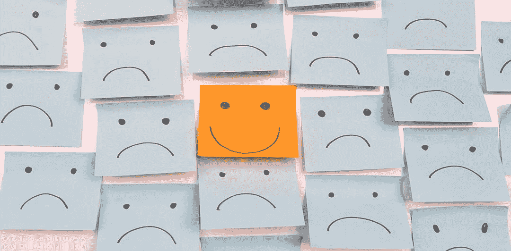

# 28 负面情绪：它比快乐更靠得住

和菜头

2022-04-08

## 28 负面情绪：它比快乐更靠得住

28 负面情绪：它比快乐更靠得住

| 转述师：余昊威 |

**负面情绪，名词，经常被视为需要避免和压制的情绪，但接受负面情绪才是勇气产生的开始。**

\*

快乐是不可靠的，而且很容易在追寻的过程中彻底迷失。所以我常说，今天的人们过高估计了快乐的价值，反而难以真正快乐起来。

这就有点像是喝酒。喝酒最美好的时刻出现在微醺，有那么一点点醉意，觉得浑身松软，世界明亮，所有人看起来都和蔼可亲。如果可以停留在这一刻，那么就再好不过。可惜我在 100 次酒局里，大约只有一到两次，可以在微醺状态下停杯，在那里多停留一会儿。剩下的九十几次都头也不回地冲过了线，从微醺进入深醉，然后整晚都不得不忍受酒精中毒的折磨。快乐也是同样，稍微不留神它就消失得无影无踪，人们接着一头撞进它的反面。

**追求快乐，逃避负面情绪，这是人之本性，所谓离苦得乐。**  
不过，如何才能离苦得乐，我认为普遍存在着许多误解。这些误解中最大的一个，就是把负面情绪看作是一种糟糕的东西，需要去压制，需要去化解，需要去转移，甚至是需要去治疗。甚至有一种流行的看法，认为人应该努力时刻保持正面情绪，尽量避免负面情绪的滋生蔓延，这样才会有积极乐观的人生态度。

我的看法恰恰相反， **我认为想要过积极乐观的人生，必须要有足够的负面情绪。** 而且我进一步认为，和快乐相比，负面情绪更加真实可信。

回顾我有生以来的每一天，极少有坐在沙发上平白无故就难过起来的时候。恐惧、焦虑、忧愁、悲伤、愤怒、担忧这些情绪，往往都和具体的事情有关，和具体的得失成败有关。

2008 年，在我辞职之前，内心中一片黑暗，完全不符合人们关于笼中鸟飞向自由的那种描述。自由很沉重，当你要得到它之前，你才会觉察到这种重量。在此之前，你会觉得自由是风，是阳光，托着你的翅膀，抚摸着你的后背。当然不是这样，笼中鸟一日有稳定的三餐，笼子坚固可靠，外面还有钢筋混凝土的房间保护，阳台窗子保证有阳光照射进来，却又没有风雨的威胁。一旦振翅飞翔，所有这一切都不复存在，我所依凭的就只剩下我自己。自己对自己负责，这是自由，可它一点都不轻松。

所以当时我有一个非常令自己困惑的问题：

为什么我就不能和那些伟大人物一样，张开双臂，满心欢喜地拥抱自由呢？为什么在这个过程中我并没有感觉到快乐？是不是我自己有什么问题呢？

就这样胆战心惊地辞职出来，横下一条心准备下海扑腾。2008 年下半年到 2009 年年初，我终于知道原来黑暗不是尽头，还有比黑暗更黑暗的存在。当时我横跨了两个完全不同的领域，从航空业进入互联网，一开始完全不能适应。我手下管理的只有网页，一架飞机都没有了。在航空业的时候，我可以用七八架飞机凑成一架虚拟的飞机，通过挪动航班时刻表，把一个延误航班造成的时间，一点点用其它飞机给补回来。

但是当我手下只有几张网页的时候，我实在不知道可以做什么，也不知道应该做什么。进入互联网行业是我的梦想，当梦想达成的那一刻，我发现自己没有飞翔在天空里，而是悬浮在黑暗的深渊上，连自己身上的一点点光亮都会被吞噬殆尽。无论做什么，没有一丝一毫反应，也没有任何提示。这个领域太新，连参考书都没有一本，更别说是操作手册。

不是说冲破阻碍，打破自我设限，就可以从此过上幸福美好的生活了吗？不是说达成梦想，就可以肆意发挥天分，尽情创造了吗？不是说此时我应该被各种正面情绪所包围，充满斗志和信心，投入到火热的战斗和生活中去吗？为什么我一点光亮都见不到？是不是我自己有什么问题呢？

现在我可以说了，当时我没有问题。之所以我觉得自己有问题，是因为大家都没有说实话。

什么是实话？ **实话就是当你要做事，当你要作出改变，当你要承担责任，当你想要追求自由的时候，你一定会产生海量的负面情绪，这一点难以避免。**

对未来不确定，你就会从希望中产生出恐惧来。对自己不确定，你就会从自信中产生出怀疑来。对选择不确定，你就会从坚决中生出犹豫来。对结果不确定，你就会从热情中生出焦虑来。

然后，你根据人们关于负面情绪的看法，认为自己不应该有这些情绪。但是又无力摆脱，每一只在你肩头拍过的手掌，每一声“振作起来”的鼓励，都让你向深渊滑得更远。没有什么正面情绪，在那样的情况下，根本也生不出正面情绪来。包括这么说你的人，当初他们也没能做到。他们之所以那么说，只不过是因为他们觉得，事情应该是这个样子，自己应该那么说，你也应该能做得到。

当然不应该了，所有这些应该，其实都是在耽误时间。当我战战兢兢去买机票，当我硬着头皮走向新办公室的时候，唯一帮助到我的，是我询问我的朋友们，请求他们告诉我实话：当初你们是一种什么心情？是一种什么精神状态？当我知道他们也紧张，也焦虑，也曾经深陷绝望的时候，我才突然醒悟了一个道理：

**负面情绪是真实的，它们正是你想要有所行动的必然代价。**

我当然希望自己能开开心心辞职，自信满满转行。但是，那个人不是我，我做不到。我是一个作出选择前会胃疼，会失眠，会紧张焦虑忧愁，会停不下想象自己悲剧下场的人。也许我并不喜欢这样的一个自己，但他的确就是我。我得承认这一点，他就是我，我就是那么个人。当我的人生，当我的生命发生转变时，我就是会产生负面情绪。承认并且接受这一点，我就直面了真实的自我。

然后我就可以去问自己那个最重要的问题：

**即便如此，即便会如此不适，即便会如此痛苦，你是否还是要去做？**

答案是肯定的，所以我才会去买机票，我才会每天走进办公室。否则，我大可以一早放弃，转身就逃，回到过去的生活中去。如果我没有想明白这个道理，选择追求快乐，选择避开所有的负面情绪，那么现在我多半还是呆在原地，还在眺望远方，还在幻想飞翔。换句话来说，  
**正是负面情绪给与了我改变的勇气和动力，前提是我承认它的存在和必要，承认自己并不是一个拥有狮子心脏的英雄人物。**

什么是离苦得乐？  
**离苦得乐不是说逃避痛苦，掩饰真我，扮演一个积极乐观、阳光向上的假人，然后就能够拥抱快乐。恰恰相反，离苦得乐要求一个人先去拥抱痛苦，而不是躲避。**  
知道痛苦的必然，才能接受不那么强大，不那么英勇，也不那么完美的自我。这是个事实，不再是想象中阳光男士/女士，那么一个人才能承受代价，作为真正的那个“我自己”去直面挑战。不完美的那个“我自己”同样可以迎接挑战，同样可以获得胜利，这时候的快乐才是真的快乐，而不是一场头痛欲裂的宿醉。此时的快乐也不是因为追求而得来的，而是因为完成自我而自然降临。

所谓的正面情绪和负面情绪并非是一种对立关系，消除了一方，就可以得到另一方，并不是这个算法。如果我们能保持诚实的态度，稍微深入下去一点，就能发现负面情绪更真实，更能代表我们自己；  
**负面情绪所带来的积极意义和创造的人生价值，要远比追求正面情绪来得多。**  
和追求一个并不存在的阳光自我相比，承认自己的怯懦、紧张、焦虑、不自信，更有可能达成和自己的谅解，寻找到真正的力量。

这种状态，就像是狄更斯的《雾都孤儿》的一幕：

矮小、瘦弱的奥利弗怯生生地站在前排，知道可能被嘲笑，知道可能被惩罚，知道自己可能承受不了这一切，但是依然高高举起他的粥碗，说出了那句至今还在我耳边回荡的话：我想再要点儿。

1.自由很沉重，当你要得到它之前，你才会觉察到这种重量。 2.负面情绪是真实的，它们正是你想要有所行动的必然代价。  
3.知道痛苦的必然，才能接受不那么强大，不那么英勇，也不那么完美的自我。  
4.负面情绪更真实，更能代表我们自己；负面情绪所带来的积极意义和创造的人生价值，要远比追求正面情绪来得多。

公众号懒人找资源

发布留言

0/ *500*

确定

# 29 守时：帮你找到自己人

和菜头

2022-04-08

## 29 守时：帮你找到自己人

29 守时：帮你找到自己人

| 转述师：余昊威 |

**守时，形容词，被视为身具某种品格，然而，它最大的功用是从人群中筛选出同类。**

\*

我算是个守时的人，但也不是一直如此。小时候因为出身军人家庭，守时不是一种道德约束，而是家庭生活的必须。说好周日几点出门去公园或者书店，到点了我没做好出发的准备，我父亲肯定会自己先走，而我只能留在家里等下周。他的道理也很简单：部队开拔的时候没有人会等你。

长大之后，我度过了很长一段散漫的日子，周围的所有人都不守时，约好的见面时间其实可以向后延伸 2 小时以上，所以即便约了晚饭，最后一个人赶到的时候往往只能参加宵夜。原因是我们这群人值班 24 小时休息 72 小时，和其他一周五天上班的人不一样，时间对于我们来说，只有上班的那天才有意义。

再后来我换了城市生活，身边有了一群新朋友。不依靠为血缘，也不是因为工作，单纯是我自己从人群里找出来的朋友。非常巧的是，他们都是极为守时的人。其中一位从我认识他那天开始，无论是出去吃饭还是约了正事见面，他永远都是提前五分钟到，不早也不晚。于是，我又恢复了守时的习惯，大家保持步调一致。

在这三段经历中，我在哪些阶段做到了守时，你不妨判断一下。

第一段经历不是守时，而是惩戒教育。我知道不守时会产生后果，这才不得不守时，根源是惧怕我的父亲，害怕一个人呆着。

当我们一群同学一起逃课的时候，这种压力就不复存在，我就没有了守时的需要。在许多年里，我反复梦见和父亲一起乘火车，他在中途站下车买东西。铃声响起，火车开动的时候他还是没回来，一次次把我从梦中急醒。我认为他教给我的守时，大概就是这种焦虑。等到我不惧怕一个人在家的时候，这种焦虑也就消失了，连同守时的习惯也一并消失。

第二段经历不能算守时，但也不能说是不守时，我的想法在这里可能略微和旁人有一点不同。有的人可能认为，第二段经历和第三段经历是对立的，在守时这件事情上完全相反。而我认为它们都是一致的，区别在于大家对时间的理解不同。当我在 24 小时值班的时候，值班要求我们的行为精确到 5 分钟，否则就是工作差错。所以在那 24 小时中，每个人都高度紧张，严格按照时间进行操作。接下来的 72 小时的休息过程中，我们其实都很难再去忍受任何时间限制。

同时，因为轮班制，我们的休息时间总是会和朋友们错开，逐渐变成了一群社会生活的边缘人。所以，同一个班次的人会在下班后聚拢在一起，因为我们之间的时间步调是完全一致的。大家一起上班，在班上相互衔接配合。下班之后，大家一起玩乐，对于等待对方这件事情不以为意。我们的生活不是 24 小时一循环，而是 96 小时一循环，完全没有周末的概念。这一点，朝九晚五的朋友们会很难理解。

在我看来， **守时的基本功用是为了和一群人保持步调一致，**  
这是我第三次用这个字眼。我父亲想要让我和他保持步调一致，这样会最大限度减少他带孩子的麻烦。但我身为一个孩子就够麻烦了，我并不想和他保持步调一致。大家关系并不对等，这里没有任何共识，所以也就不存在守时的概念。

我和我的朋友之间的关系是平等的，他们也并不会因为我晚到而抱怨，但是我还是主动调整了自己的时间表，大家好达到行动上的高度同步。  
**这种主动调节的动作，原因是我们彼此认同，自然而然地希望在行动上也保持一致。无需道德说教，或者自我约束，我只是参与了所谓“自己人”应该有的行动。  
别人如何待我，说明他们也希望我如何对待他们，这是小群体相互认同的基础。**

我和我的同事们之间的关系也类似，但是这种时间概念太过特别，完全在社会主流认知之外。对于我们而言，守时就是答应下班后出来玩，不管多晚都得来。这样的认知，可以建立起关系非常密切的人际小圈子，大家在一起的时间比陪伴家人的时间还多。不利的地方在于，这样相当于永久地把自己从社会生活中驱逐出去。外人很难加入进来，自己也会随着时间流逝，难以适应 24 小时为周期的生活中普通的社会交往。毕竟正常人很少能打 48 小时麻将，早上 9 点一群人去唱卡拉 OK。

所以， **不守时并不是个道德缺陷，它隐藏了两个人际关系上信号。** 我把它们翻译一下：

**1.你守时，但是我不守时，我的意思是我们之间的关系并不对等。**

有些时候，我是故意不守时，以此来提醒你这种不对等。在日常生活中，无论是活动还是宴请，常常会见到有人刻意晚到，以此证明自己的重要性。有些时候，甚至会发生几个人比赛谁更晚，以免落了面子。商务会谈中也经常用这一套，用迟到的方法表示自己胜券在握，不缺对方这个选择，迫使对方开出更好的条件；

**2.大家守时，但是我不守时，我的意思是我并不属于这个群体，也不打算加入这个群体。**

一个小群体里，总是有人喜欢晚到，然后编造各种理由。如果这个人对群体没有任何特殊的贡献，那么他被逐出只是个时间问题。因为同一群体内部的人，都使用同一种时间节奏，以此表示相互认同。  
**用步调一致的方式，和其他群体区分开来。**

当一个人不守时的时候，他其实对外释放了非常明确的人际关系信号。而且，这种信号一定会被对方接收，转化为对方针对这一段人际关系的预期：不会是平等关系，不可能建立信任，不要相信任何承诺，根本就没打算履约，只希望我能容忍退让。如果你本身并没有这样的意图，那么最好要守时，否则很容易造成误解。

也基于相同的原因，我从来不会规劝别人守时，或者强调守时对于成功的意义，对于他人正面评价的意义。因为，  
**人际圈子都是每个人自己选择的，其中每个人都守时，说明大家都有相同的期待，有可能采取一致的行动，而且认真对待这种人际关系。**  
这一点，在选择加入的时候每个人都应该再清楚不过。

有没有例外？有没有人可以我行我素，但是大家依然选择包容和谅解？的确存在这样的人，不过，刚巧这个人就是你或者我的概率实在是太低了。最起码，你得有一群上 24 小时班休息 72 小时的同伴，那样的工作说实话并不轻松，而且注定生活在人群之外。

1.别人如何待我，说明他们也希望我如何对待他们，这是小群体相互认同的基础。 2.当一个人不守时的时候，他其实对外释放了非常明确的人际关系信号。  
3.人际圈子都是每个人自己选择的，其中每个人都守时，说明大家都有相同的期待，有可能采取一致的行动，而且认真对待这种人际关系。

公众号懒人找资源

发布留言

0/ *500*

确定

# “我问和菜头”： 男友是个胜负师，怎么办？

和菜头

2022-04-08

## “我问和菜头”： 男友是个胜负师，怎么办？

“我问和菜头”： 男友是个胜负师，怎么办？

| 转述师：余昊威 |

读者 用户会飞的猪 62221819：:

> "跑路师、这个词也让我难受、为啥呢？因为我总觉得自己是在被温水煮的青蛙。就想请问菜头叔如果自己待的位置就是无足轻重，事情就是不多，时间可以自己把握，这种所谓的工作清闲、把时间浪费在自己喜欢的完全不产生价值的读书，娱乐上是不是太没有价值了？很多时候我都自我怀疑自己是不是胡适先生口中的“吸精神鸦片”"

我想，你在看我后续的内容之前，可以先回顾一下你提出的问题。其中请注意两点，一个是你对标点符号的运用，另一个是你的中文的表达。

尽管我很反对所谓从细节反向做推定，但我作为一名长期文字工作者，我认为你缺乏对自己的约束和训练，起码在表达上是这样的。

当你无法正确地运用文字作为你的表达工具，无法条理分明地表达你的想法，那么讨论什么精神鸦片就毫无意义。这种精神状态叫做散乱，无法集中精力思考问题，你需要先解决这个问题。

**读书可以是一种消遣，但是如果只是消遣，我怕人会变得消沉。**

读者 用户 whyhow：:

> "有了 AI 之后围棋的胜负师和求道派就少了很多纷争，是不是说其实这两派其实都只是一种价值偏见的产物呢？"

> "其实只是他们不够强而已，足够强大的话，结果是固定的，那么理念是什么，过程是怎样的，就没那么重要了吧？"

这个提问听起来更像是社会达尔文主义者的说法，隐藏着慕强的价值观，这会产生一系列的问题。

在你看来，实力强大可以碾压不同的价值观，不同的实现手段，不同的审美趣味，可是你想过没有，如果实力不足够强的话，为什么还能够形成流派？为什么不会发生相互征服？仅仅靠理念，而无需胜绩，就可以在围棋界混下去吗？

你问我的问题就像是说：如果实力足够强，怎么可能发生战争的相持状态？但的确有相持，而且历史上发生过许多次，有些时候甚至是倾全世界之力才形成了相持。请问，那时候从哪里再借来一点实力？我认为总是把自己代入强者的角色，认为一力降十会，那是根本没有做过战，没有见过血的小清新才会说出来的话。  
**理念当然极端重要，没有理念在先，就不会有感召力，也就不会有奉献和牺牲，所谓的实力也就无从构建。**

读者 用户彬：:

> "请问，菜头叔，自己的行业是设计类，不是特别喜欢，也不是特别排斥，只是难看到未来，对于以后的职业发展要继续在这个行业深耕，过完大学四年，还是要找到自己，或者说这是并联的？还是走一步算一步，因为感觉现在难的东西，比如一些技巧要学习，还有人文知识，自己好像不太行，就不能成为顶尖高手，是不是该发展多维竞争力，做到前 20%？  
> "

当然没有未来，你连门都没有进入，谈未来未免太过奢靡了。你所有的这一套说辞，在我看来都是一些幻觉和妄念。什么叫找到自己？什么叫做并联？你连一联都没有，怎么个并法？想什么顶尖高手呢？你是你们宿舍的高手么？

我现在就可以告诉你，的确有人从大学毕业之后就转行了，大学对于他们而言只是接受四年训练而已，至于说专业是什么并不重要。但是，他们可能忘了告诉你：如果转行成功的话，他们至少在之前从事自己不喜欢的专业、不喜欢的职业时，其实做得也并不差。因为他们也付出了努力，做出了成绩。

你上来第一句话就是告诉我你不喜欢你的专业，其实没人在意你喜欢不喜欢，因为这一点都不重要。类似这样的问题，如果想要获得别人的关注，我觉得第一句话应该是：虽然我做到了我这个行业的前 20%，但是我一点都不喜欢。因为，能够做得好的人，但做得不开心，这才构成一个问题。如果做不好却不开心，那么起码要说明自己做出了哪些努力和尝试。什么都没有，却要思考未来如何，你手里有通往未来的门票么？

读者 用户小岳：:

> "菜头叔你好，一直听您的栏目不敢发言，害怕发言错误或者自己理解根本不对，但是不说出来，永远不知道自己对不对。 "

> "今天的胜负师和求道师我的理解用个例子和疑问阐述一下。"

> "男友从小到大都是个学霸，他非常在意对错，可能就是讨论一个人物，我们两记的场景不同，他非要分出一个对与错；在生活上也是，我看书的时候喜欢朗诵，他说“你这样读书效果一点都不好，你要默读”我觉得在意那么多干什么，我开心，这样做让我大脑分泌许多内啡肽。我早上习惯五点半起床，他非常用心的学习了睡眠的铁律告诉我“要睡够七个半小时，你起那么早根本不够，你这样不好”我觉得我睡六个小时就够啦，反正他比较相信真理。"

> "他的观念是要正确，我觉得我对自己好，怎么开心怎么来。于是就导致——我不想听他说话了"

> "不知道我有没有理解和表达清楚，最后想问菜头老师“面对一个胜负师男友，我可以怎么做？”"

这是个情感类问题吧？其实，他是用这种方式来表示自己的关心，只是他把关心等同于教别人正确地做事，这当然会引发问题。

聪明人总是有路径依赖，他是这么变成学霸的，赢得人们的尊重的，那么一切事情都应该按照这种路径来执行，否则就会面临失败，而失败在他那里是不好的，别人失败说明别人不够聪明。

所以，在他的内心世界里，一切都是闭环的，从头到尾围绕聪明不聪明，科学不科学来进行。听我的就是聪明，就是科学，不听就会失败，就是不聪明，不科学。丝毫不会认识到人的复杂程度，也不会认识到自己对周围人造成的压力。我觉得这得看悟性了，如果他很幸运，又有智慧的种子，那么迟早会发现问题所在，知道聪明和科学只能解决生活中非常小的一部分问题。

如果想要用来解决所有问题，作为一种基础指导思想，那就相当于拿着一把刀，做菜也是它，开灯也是它，扫地也是它，这怎么可能呢？不过，聪明人总是很固执，很少反思，更少改变自己，你要有这个心理准备。

读者 用户一辆蚂蚁：:

> "前段时间我向公司提了辞职。在这之前，有些人总觉得我在意公司的职位，有些讨好领导的心思，包括大领导，我认为他把我说的话，想把事情做好看得有点滑稽。 "

> "在我提出辞职的那一刻，我觉得自己打了他们的脸。等大家都知道后，我觉得部门气氛有些“空灵”，我置身其中有点挥一挥衣袖就要远走高飞的老道人的感觉。"

> "可后来，我没有走成。并不是我没下决心，也不是用辞职抗议什么，是老板真心挽留了，我也觉得还有搞头才没走。"

> "当我又不走后，我自己首先有些尴尬，并觉得公司其他人看我又带上了利益的眼光。很多时候就是这样，除非用极端的方式很难让人确信你真实的意图。"

> "我不认为自己在职场上没有胜负心，我知道自己很看重输赢，但输得多了，我知道胜利是我强求不来的。加上我的性格有些老好人，不愿意跟人起争执，也让我在跟人竞争时会在意是不是赢得好看。  
> 可是菜头叔，我还有个问题，有没有一种情况：明明在意输赢，却因为害怕伤害到别人把自己的锋芒收敛起来，结果让自己的能力萎缩了，也没真正尊重和照顾到别人？"

你究竟是什么意思呢？是不是说你感觉自己用离职换来的升职，回来面对同事的时候有点不好意思？还是说你想用离职来打脸同事，现在拿到了更高的职位和收入舍不得放弃，所以感觉到被反抽了？

你看，我站在第三方的角度来看这件事，觉得首先你很看重实利，和绝大部分人一样，有就要抓住，绝对不肯轻易放手。这就是你，要承认。同时，你又很在意别人对你的眼光，觉得他人应该尊重你，他们对你的看法都是错的。这也是你，同样需要承认。

我个人建议你放弃其中之一，要捞好处，那么就低头专心去捞，不要理会边上的人怎么吹口哨、喝倒彩。要尊重，那就放弃好处，用实际行动去打脸，在众人惊愕的神情中飘然而去，他们忍不住流下了悔恨的泪水……别想了，后者是不会发生的。你什么都想要，未免太过有些贪心，这样很容易自寻烦恼。

读者 用户呢了同学：:

> "勇敢的跑路和怯懦的逃避，怎么区分呢？是不是又需要用跑路后的胜负评判呢？比如您，跑路后过得更好，就可以说不要拘泥之前的成败，但如果跑路后生活没有起色，会不会就变成反面案例了？"

你问来问去，还是个胜负师的心态啊。我们跑路师会有同样的担忧，但是最后自己能想清楚一点：谁的反面案例？自己的反面案例么？当然不是，是别人的反面案例，但这个和自己又有什么关系呢？我们跑路师要跑路，是知道留下来是什么结果，跑路会有什么风险，在衡量了两者之后，做出决定去跑路，意思是即便跑路有失败的风险，但是自己甘愿承受。

无风险跑路，那就不是跑路，而叫保送了。而且，一旦跑过路，就不会再有你这样的疑问。因为，  
**做出选择并且愿意接受后果的人，和没有做出选择的人，对同一个事物的看法是截然不同的。**

1.读书可以是一种消遣，但是如果只是消遣，我怕人会变得消沉。 2.没有理念在先，就不会有感召力，也就不会有奉献和牺牲，所谓的实力也就无从构建。  
3.做出选择并且愿意接受后果的人，和没有做出选择的人，对同一个事物的看法是截然不同的。

公众号懒人找资源

发布留言

0/ *500*

确定

# “我问和菜头”：怎样看待早到的人？

和菜头

2022-04-08

## “我问和菜头”：怎样看待早到的人？

“我问和菜头”：怎样看待早到的人？

| 转述师：余昊威 |

读者 用户纳博：:

> "菜头兄，我儿子现在初一，情况正好相反，说什么都不想争了，要把成绩跌到谷底，自嘲一番。他是一个热爱写作、十分敏感的男孩子，经常一天不动的写，疫情在家写了 30 多万字的小说，但其他方面，比如数学，体育等方面，多年来一遇到困难，就放弃，现在甚至不想面对数学了。想请教菜头兄，我可以怎么做，怎样去鼓励他，重建面对困难的勇气呢？"

这个问题，你不应该去找自己的社会资源，求教于资深教师么？对于我来说，我经历过多次成绩的上上下下，靠的不是勇气，而是努力找寻最小的成就感。因为我能做对一点，比昨天前进一点，那么累积下来，就有可能扭转某个学科上的颓势。

回想起来，我唯一做对的事情，就是如果一科成绩还行，我不会把时间花在从 90 分提升到 95 分上，而是努力去把另一门功课从 45 分提升到 60 分，因为这 15 分比那 5 分好赚。并且，我对前一门的 90 分和后一门的 60 分同样得意。最重要的一点是，我不会因为有一门功课可以让我轻易获得成就感，就反复投入其中，反复只去获得那一点成就感。

读者 用户姚涛：:

> "几年前，我想要改变现在的处境，换一个行业。当时，犹豫、彷徨、痛苦、不知所措，好像站在悬崖边上，想要奋力一跃，跳到对岸，但又怕自己掉下去，摔得粉身碎骨。几经挣扎后，我还是停留在了现在的行业，谋求向上的发展。"

> "虽然这几年发展的还可以，但总在想：“我当时奋然一跃，会怎么样？”请问菜头叔如果理性上知道自己该勇于尝试，但缺乏一点勇气，试一试的话，有什么办法可以为自己增加一点勇气吗？"

如果是我来猜的话，无论你跳不跳，可能差别不会太大。因为你拥有适应能力，在适应之后才能做出点什么来。而那些要跳的人，早就因为适应不了，纵身跳了下去。

现在无非是你觉得不甘心，认为现在你都能做那么好，当初换一条路走，岂不是走得更好？这也是妄念的一种，既然你做出了选择，那么不妨天真地相信自己的选择就是最好的。至于说其他的可能，其实距离你很遥远，  
**不存在差一点就怎样怎样的说法，差一点其实就是人生里的十万光年。**

读者 用户王志文：:

> "菜头老师，负面情绪既然是精神层面滋生出来的产物，那产生的痛苦也是精神层面的痛苦吗？可是每当负面情绪来袭时，那种胸闷发慌的感觉又不像精神层面的痛苦，就像一块大石头压在胸口，以至于分不清这到底是精神层面的痛苦，还是身体层面的痛苦，望菜头老师解惑一下。"

精神层面的痛苦当然会带来肉体的痛苦，这是个常识了。精神过度紧张，会有肠应激症，人就会忍不住想要跑厕所。压力过高过强，会有恶心反胃的感觉，人有时候会去反射式地呕吐。受到惊吓刺激，人可能心跳过速，血压上升，有些人甚至因此而晕厥。他们都有任何器质性的损害么？没有，都是因为心理变化影响到了生理。

所以，感觉胸口有大石，心慌气闷也很正常，说明情绪上的刺激过于强烈，达到了身体承受的极限。这时候深呼吸，增加身体供氧量，适当起身运动一下，分散自己的注意力，可能会有所帮助。

好消息是人的适应力很强，类似的状况会逐渐减弱，直到你慢慢习惯。

读者 用户 x x：:

> "既然不守时表明你不愿意融入这个圈子，通过不守时的方式来高调体现自己的不同。那么又为什么要用不守时这种方式来保持与这个圈子若即若离的感觉呢？不去不就好了吗？难道是在等自己被这个圈子先抛弃吗？"

人际关系并没有那么简单，固然有意气相投的人际圈子，也有更多相互利用，互利互惠的人际圈子。既然存在人际圈，就会存在身份差异和地位差异。不同的人会选择不同的处理方式，而不守时的人依然还在，说明这个圈子里的人对他的需求很高，所以能够忍耐，同时也变相承认了他拥有某种特权。

所以，抛弃是不可能抛弃的，除非维系圈子的核心价值遭到了破坏，或者相互之间的地位发生了转变，否则大家还是会忍耐下去，一直到彻底接受下来变成一种习惯。人也是可以驯化的，对此请不要感到太过惊奇。

读者 用户禾子：:

> "如果以后有朋友不守时，从这个角度反思一下，其实会让自己变得难过起来：TA 觉得我们的关系并不对等，是我给她压力还是她在给我压力？见面反而自己心里有了一种膈应。这可怎么办？  
> "

其实有个办法测试一下，但是风险也很大。那就是坦率地和对方谈一次，不要批评，不要指责，只是说清楚自己的感受：我每次都要等你，这让我非常不愉快，我觉得我没有得到应有的尊重，我希望大家以后约见面能够准点到。

如果对方的确把你当朋友，而且尊重你的感受，那么应该会道歉，而且今后注意到这一点。如果对方认为这么小的事情也值得拿出来说，那么多半认为你这么小的人物也敢要求什么尊重，说明你们其实并不是朋友。

所以，这个方法可以快速测试，不过有可能会造成大家一拍两散。这时候问题就回到你那里去了：你怕不怕一拍两散？现在换你去衡量一下对方在你心目中的地位和价值。

读者 用户肖小北：:

> "菜头叔，关于守时，我们通常都指的是“迟到”。但是生活中还有一种情况就是总有人过分“早到”，经常也会给人带来困扰。这也应该算是不守时吧？我们应该怎么看待，或者怎么对待这类人群呢？"

早到的人不会是坏人，我相信是这样的。一般来说，我和我的朋友们总是会提前 5 分钟赶到约定地点。如果时间更早一些，我们会在周围散步，转几圈，以免到太早给人带去压力或者困扰。

为什么说早到的人不会是坏人？因为传统上中国人认为到太早，尤其是在吃饭的时候，是一件失仪的事情，表示自己太过热切地想吃这顿饭，说明馋或者穷。如果连这个礼仪都不知道，或者知道了并不在乎，那么这样的人能坏到哪里去呢？朋友圈子里，总得有几个不谙世事，天真烂漫的人吧？至于说那些小毛病，我看不妨大而化之。

读者 用户竹君：:

> "曾经有段时间非常的不守时，想来就是菜头师所说的，那时非但不认同自己也不认同周遭吧……"

> "好在，抑郁的边缘徘徊的不算太久，走出来了。那么现在应该是很守时了，周遭也大多是守时的人。所以说，并不能说“不守时间就是没有道德”，有时候可能是代表了一种态度，是吗？"

只能说守时可能对一类人而言，是非常重要的一件事情，他们会非常在意守时与否。因此，同类聚集在一起，彼此步调一致，就会少很多抱怨和摩擦，这就形成了某种共同价值。

而不守时的人能否形成一个自己的小群落？当然能，因为这个群落里也存在其他的共同价值，守时刚好不在其中罢了。  
**我反对从道德的层面上来讨论守时与否，因为这样的话会增加人们之间的对立，而不是相互理解。**

而你的问题可能更为特殊一些，当精神处于非常困苦的状态里面，自然无心关注守时这样的细节，也不大会关注别人的感受和反应。你的提问很好，这也从一个层面说明，  
**守时并非是人性中非常基本的属性，并没有看重它的人想象得那么重要。**

读者 用户核桃：:

> "时间是一种节奏，守时就是与对方保持同频。我喜欢守时，遇到别人对我不守时，我就不舒服。以前经常劝自己，太多人没有时间观念了，这是普遍现象，我在意这件事不对，是我的心理问题。但今天才认识到，那些不愿意和你守时的人，多半是不愿意和你同频。  
> 不知道我这么理解，是不是有点矫枉过正了？ "

你问愿意不愿意，那就是要进行主观上的判断了。但我并不认识你周围的人，我只能保守一点说，他们在行为上无法和你同步，同时，也不在意这种异步。这是个事实，至于说后面的心理活动，只能你自己去猜测或者询问了。

从对方的角度上来说，守时会带来心理压力，有个守时的朋友会为自己带来心理压力。但是，这种压力又不足以让自己产生行为上的改变，那么就说明他们给你带来的压力，大于你给他们带去的压力。那么我可以反过来说，这可能折射了你在这个人际圈子里的重要性高低，而你更应该思考的应该是这一点。

1.不存在差一点就怎样怎样的说法，差一点其实就是人生里的十万光年。  
2.我反对从道德的层面上来讨论守时与否，因为这样的话会增加人们之间的对立，而不是相互理解。  
3.守时并非是人性中非常基本的属性，并没有看重它的人想象得那么重要。

公众号懒人找资源

发布留言

0/ *500*

确定

# 30 写作三章：如何保持写作时的内心平衡

和菜头

2022-04-08

## 30 写作三章：如何保持写作时的内心平衡

30 写作三章：如何保持写作时的内心平衡

| 转述师：余昊威 |

**写作三章，名词，写作者对自己的约法三章，有助于持久创作。**

\*

微信刚开始推出公众号的时候，我兴冲冲地介绍给朋友看。朋友看完说不好，不如博客，不如论坛。我问为什么，他回答说因为没有留言区，没有互动。当时，公众号还是早期版本，一切都很简陋，并不提供留言功能。朋友虽然不是专业的互联网产品经理，但是他的直觉很好，一下子抓住了这个时代写作的核心：即时反馈。

如果一个人只是写作，但是并不发表，那么自然也就无法收到读者的反馈。没有反馈，他就不知道读者的真实想法，也就无从提升自己的写作水平。如果一个人写作，虽然发表但是要等半年、一年后才能收到读者来信，那么他因为反馈来得太迟太慢，可能早已经放弃写作。  
**反馈，而且是即时反馈，是互联网时代写作最大的优点。**

与此相伴而来的问题是评论带来的困扰。许多人写作的时候心情很矛盾，一方面希望有读者来看，另一方面却又害怕恶评。如果你也有同样的困扰，那么我现在有一个好消息，同时还有一个坏消息要告诉你。

我们先来说坏消息吧：

**无论你怎么写，怎么修改，怎么小心，都会收到恶评。**

所以请勉强适应一下，如果把网络世界比喻为大自然的话，恶评就是刮风下雨。遇见的机会不算太多，但是难以避免。

然后还有个好消息，那就是我在这样的环境下锻炼了 20 多年，拥有丰富的经验，可以分享一点我的心得给你。说心得也许不大确切，应该说是写作者和自己的约法三章：

**一、 写文章是出于良善的目的**

人人都讨厌恶评，除非是长期零评论，那样的话即便是一条恶评也让人感动。大部分情况下，人们还是想免除不必要的口舌之争。但是，读者千差万别，对于文字的理解也千差万别。想要找的话，别人总是能找到理由攻击你，而且你都想象不到别人攻击你的理由。

比如说很早之前，我在文章中谈到小婴儿，用了单人旁的“他”，立即就有读者留言说，为什么不是女字旁的“她”，是不是表示我潜意识里对女性有什么歧视？我说在中文里，单人旁的“他”同时包括了男性和女性。对方说不行，单人旁的“他”人人都默认是男性。我问，那怎么办？对方回答说，你得写成汉语拼音“TA”，这样才公平。

我没有中计，只要我听信了这种说法，下次他还可以披件“马甲”再来，责问我身为中国人，而且是用母语写作，为什么要在汉语里夹杂拉丁文字母，母语还不够我表达的吗？类似的事情经常发生，  
**为了避免你莫名其妙地背上各种罪名，也为了你在面对恶评时保持良好的心态，请确保写文章是出于良善的目的。**

如果你不试图用文章误导读者，用文章欺骗读者，用文章制造噱头，而是为了表达思想和感情，尽量保持诚实，并且希望读者因此而有所收获，那么你就是出于良善的目的而写作。本着这样的出发点，文章不会差到哪里去，也能因此减少许多口舌之争。

有时候即便你的观点尖锐一些，言辞激烈一些，也不至于引发很大的冲突。尤其是当你遭遇到恶评的时候，你会觉得心安，因为那些指责你的理由很难构成真正的打击。讽刺挖苦没关系，承认水平有限，但自己是在水平有限的情况下完成良善的目的。故意曲解没关系，这和自己无关，因为这就根本不是自己的本意，对方是自己在树个稻草人当靶子。

**出于良善的目的而写作，最大的功效是让人觉得心安。只要你心安，别人说什么都很难撼动你的心神。**

**二、 有硬伤要承认并且修正**

爱面子，人所难免。虚荣心，人所难免。不过，当别人指出了你文章中的硬伤时，最好第一时间承认，并且做出相应的修正。千万不要在这样的问题上缠夹不清，试图辩论取胜，那样只会浪费时间，而且后患无穷。

经过这些年，我发现读者对错别字都相当敏感。在我的任何一篇文章中，只要出现错别字，每一篇的留言里都很快有人发现并且指正。如果你不修改又会怎样呢？中国人有一种特别的认识事物的方式，叫做一叶落而知秋。通过很小的细节，就可以判断事物的全貌，在这一点上存在非常广泛的共识。

如果你不承认，不修改，很快就会看到别人到处发截图，并且配上这样的文字：和菜头连某字都会写错，其人的水准可想而知。鲁迅先生也写错别字，但是他写就是通假字，你我不行，你我写了就是水准不足，而且大家都认同这一点。很少有人会说：这只是一个错别字，也许他的其他说法是好的。

**错别字只是小事，所谓硬伤是指自己在事实上，在常识上，甚至是知识结构上犯的错。**

比如说每次我想举例说明香港演员曾志伟的演技时，都会说他曾经在《秋天的故事》里有上佳表现，触动了无数我这样相貌平凡的男子。问题是，那部电影的名字应该是《双城故事》。此外，还有一部电影叫《秋天的童话》，但是根本就没有《秋天的故事》。至于说我为什么每次都把两部电影扭结在一起，不假思索地写下《秋天的故事》，那可能是个历史之谜了。

每次当我那么写的时候，都会很尴尬地被人指出，而我也不得不每次致歉然后更正。因为这是没有办法的事情，当我讨论曾志伟演技的时候，用的是一部他根本没有出现的电影，无论如何也说不过去，这相当于论证的基础坍塌了。

如果文章出现了硬伤，能够第一时间承认并且修正，最少能减少一小半恶评。而且，修正的过程也会让你加深印象，相当于一次有效的学习。当然，《双城故事》这种问题大概就只好一次次道歉，直到未来某天我终于能打开大脑里的结。

**三、 像拒绝恶评一样拒绝恭维**

恶评不好，那么好评呢？好评也同样不要放在心上，尤其是读者的恭维。有些读者留言，看到开头我就会直接划过。这些开头类似：我已经追你的文章 XX 年了，以您文章的影响力，您是我最信任的作家，本来我一直觉得您是中国最……等等，直接划过，不用看后续的文字，因为后面一般没有什么好话。

要么是说他现在对我多么多么失望，要么是说他对我写出这样的文章多么多么吃惊，要么是要教我如何正确地写文章，要么强调我对文字有多大的责任……总之，在一通恭维之后，就准备对我下手。要我说的话，写出这些对我的恭维之词，说明他们对我不如对一头驴。因为要骗一头驴拉磨的话，起码还会在它脑袋前面挂一个真的胡萝卜。但是他们连一根胡萝卜都舍不得，就想凭两句空话，骗我就范，按照他们的路数乖乖跟上。

如果你要拒绝恶评，那么也要同时拒绝各种恭维，因为它们两者在我看来没有什么区分。

什么叫恶评？ **不针对文章，不针对观点，而是针对你个人的负面评判，这叫做恶评。恭维是什么呢？恭维不也是针对你个人的评判么？无非看起来是正面的罢了。**  
如果你要相信，那就得全信。如果你拒绝，那么就得全拒。

我选择全拒，因为值得讨论的是我的文章，我在其中表达了什么情感，表达了什么观点，这样的讨论无论激烈与否，语气好坏，都没什么紧要。但是，讨论我本人，那就是另外一个概念了。大家又不熟，我没必要知道读者对我的观感。更何况，所有这些观感后面都隐藏了某些个人目的，为的就是让他们的意志凌驾于我的意志之上，那我又何必听呢？

反馈很重要，但是比反馈更重要的是反馈的目标。人和文章要分开，分不开的人本不应该参与讨论。

如果你能够和自己约定这三章，可以免疫很大一部分恶评，也可以维持一个稳定的情绪。这样一来，你才能从读者反馈中源源不断地汲取有益的部分，在新文章中也不断地做调整和尝试，在自我表达和他人理解之间达到一个平衡。既不因为太过注重自我表达而失去大部分读者，也不因为试图满足读者而失去真实的自我。

在写作的全程中，我认为保持这样的平衡至关重要。 **在真诚和技巧之间一定存在那么一个点，它也刚好位于你的自负和自卑之间，使得你能同时维系内心的平衡。**

1.反馈，而且是即时反馈，是互联网时代写作最大的优点。  
2.为了避免你莫名其妙地背上各种罪名，也为了你在面对恶评时保持良好的心态，请确保写文章是出于良善的目的。  
3.在真诚和技巧之间一定存在那么一个点，它也刚好位于你的自负和自卑之间，使得你能同时维系内心的平衡。

公众号懒人找资源

发布留言

0/ *500*

确定

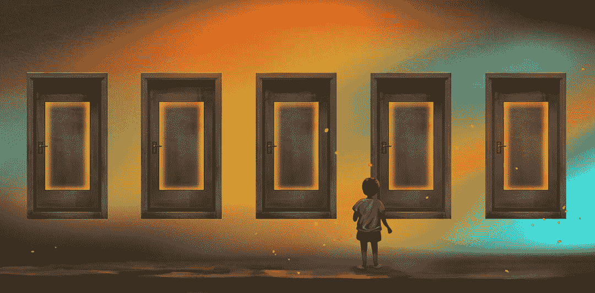

# 31 选择：如何选出合适的人生选项

和菜头

2022-04-08

## 31 选择：如何选出合适的人生选项

31 选择：如何选出合适的人生选项

| 转述师：余昊威 |

**选择，名词，人们通常会认为它应该是正确的，但更重要的可能是让人心安。**

\*

总是有人来询问我关于人生中的选择问题，其实我并不是适合回答这个问题的人选。我人生中第一次辞职，前后耗费了十一年时间。即便从临门一脚开始计算，也有接近两年。当然，第二次、第三次就变得容易了许多。不过从第一次的经历来看，我并不是那种可以立即做出决断的人。

做出人生选择很困难，对谁来说都不容易，我想我只能用我的经历提供一点参考，或许能对你有所帮助。

第一个故事是关于选择困难的原因。那还是我 12 岁的时候，就在生日那天我摔断了左手。送去医院复位，上夹板。过了一阵子去医院照 X 光复查，骨痂长出来了，但断口没有对齐。当时医生给出的选择是要么敲断重接，要么就这么继续长，未来左手功能可能会受到一定的影响。当然，他们的建议是重接。

如果当时我能选择的话，我肯定选择继续长，因为我不想再受一次骨折的痛苦。但是我父母并不赞同，他们帮我做了选择，毕竟我当时只是一个 12 岁的孩子，他们支持医生重接的方案。重接也有两个选择，一种是上麻药，一种是不上麻药。

医生倾向于不上，可能是从风险角度考虑，也可能是在医学上没有这个必要。如果当时我能选择的话，我肯定选上麻药，最好是上麻醉。但是我父母并不赞同，觉得麻药可能伤脑，他们帮我做了选择，采用了让医生生生敲断的方案。

总之，连续两个选择都很痛苦，不过今天我自己来评估的话，我认为他们做出了非常正确的选择，保证了我的双手到今天都非常灵活，每天可以在键盘上敲出上万字。

**选择的困难就在这里，我作为当事人，很难排除自己的情绪，站在一个客观冷静的立场上做判断。**  
如果依照我的情绪来，我肯定选择避免一切痛苦，那么当初的选择可能会有一系列的后果，我的人生轨迹可能都会因此而发生改变。

因为选择而产生痛苦有时候是必须的，也是必要的，但是自己并不会那么看。  
**正确的选择往往不那么令人愉悦，所以需要一点无我之境，把自己的情感、偏好、习惯排除在外，考虑自己的选择时，像是在给朋友出主意。**

我 33 岁第一次辞职之前，犹豫挣扎了很长一段时间。感觉脑子里有一层雾，怎么也看不清楚前方，怎么也想不清楚。一方面我想去大城市看看，尤其想进入当时的互联网行业，我的家乡还没有这个行当。一方面我又很担心自己志大才疏，其实大城市并不需要我，互联网行业也并不需要我，而届时我也没有了退路，如何才能生存下去？还有隐秘的一方面，是我在原先的行当里做得还不错，前途一片光明，而且我投入了十一年时间，拥有了非常丰富的经验，一刀斩去实在是太可惜了。

朋友们给了我很多建议，我们反复磋商过很多轮，但是我发现自己听不懂他们在说什么。因为他们太早就出来闯荡江湖，我所关心的问题在他们那里完全不成问题。

比如：没饭吃了怎么办？他们会好奇地反问：为什么会没饭吃？再比如：干了几年发现自己不适合怎么办？他们会直截了当地回答：那就换一个工作好了。我自然再问：找不到新工作怎么办？他们又开始反问：为什么会找不到？等出来之后，我发现他们说的都是对的。但在当时，我们身处两个世界，我完全理解不了他们凭什么会如此确定，完全就是毫无根据地瞎拍胸脯。

但我还是选择相信他们，因为我盘算了一圈，发现关于辞职北上这个选择题，他们是我认识的所有人里，我所能找到的最适合回答的人。世界上或许还有更合适的人存在，能够给我正确答案，但是我不认识他，也不知道如何去找。即便我能找到这个人，我未必能够相信他，而且，他的看法多半和我的朋友们一样，所以他的理由我同样听不懂。

最后，我想明白了一件事： **我不可能在了解所有情况，在最充分的准备下做选择，那样就不是选择，而是作弊。**  
我所能做的，是在选择前做到自己最大的努力，比如说找到最适合提供建议的人选。尽到最大努力之后，无论选择是什么，也就不用后悔了，否则只是空耗时间。

但既然做选择，肯定就会心有不甘。人总是习惯把两个选项放在天平上，试图找出重量更重的那一个，好做出更有价值的选择。但这其实也很困难，当你要去掉一个选择的时候，就会忍不住凑近去看，这时候这个选择突然就会变重。

比如说，我辞职的时候突然发现要放弃前十一年的努力，这时候它的分量一下子就重了起来。但是，当我考虑留下的时候，去大城市进入互联网行业这个选项好像又变得分外诱人，在日常生活的上空熠熠生辉。如何判断这两个选择哪一个更重要？

我记得当时还有一种流行的思考方法：取一张白纸，中间竖直画一条线。一边写一个选项，然后把支持这个选项的所有个人理由都罗列出来，最后计算两边的得分。我试过了，不大管用。因为我总有办法让两边保持平衡，左边新增添一条理由，右边也就一定会有一条新理由。这时候我才醒悟，选择困难说明自己喜欢保持均势，这种毛病几乎是天生的。需要别的方法，拷问自己的真实想法。

等我把朋友问崩溃好几轮之后，其中一个带着最后试一次的口吻问我：为什么你有生以来就没有暗恋过谁呢？为什么每次都要直说呢？我回答说：因为我怕自己不说的话，将来会后悔。朋友又接着问：那你就不会因为说出来被拒绝，后悔自己为什么要开口吗？我想了一下，回答他说：两种后悔不一样，后面那种后悔好忍，很快就会过去。但是前面那种后悔难忍，也许会折磨自己一辈子。

他拍了下手高兴地说：那好，你觉得你将来会为哪一种情况后悔多一点呢？是为了想走没走成，还是因为走出去后觉得不如当初设想？在那一瞬间，我确定我始终是要走的，我的性格里还隐藏着另一面，甚至我自己都没有意识到我对风险的偏好。

关于人生选择，以上就是我从个人经历里想到的三点：

**1.最理想的情况下，是能够做到屏蔽个人情感、偏好、成见的影响，完全站在客观冷静的角度去做判断。**  
当然，这非常难，不过我们可以换一个角度考虑：如果是给朋友出主意，我会怎么说，又会怎么选择；

**2.在次一等的情况下，我们承认选择的前提条件不足，难以做出非常准确的判断。**  
不过，有一套判断标准，那就是依照目前有限的条件和资源，自己有没有尽到最大努力去寻求判断依据？无论是具体的人，还是具体的事，只要尽到努力，那不妨就去做；

**3.在最糟糕的情况下，可能不得不尝试很多轮，试过不同的方法，最终认清自己究竟是个什么人。**  
是什么样的人，就应该去做什么样的事，这样才不会在将来懊悔。或者说，懊悔总是难免的，但可以找到一个相对不那么懊悔的选项，自己可以承受下来。

人生中的许多选择，会涉及到十几年、几十年后的结果，我想除非是神仙，任谁都很难一早看清楚，想明白。不过，在所有的变数当中，自己是最大的那个。因为自己可能会干扰选择，也会放弃选择，还会想方设法保持选项间的平衡。所以，最终所有无非也就是一个心安，对自己有个交代。

**于是我们选择的可能不是更好的那个选项，也不是让自己更舒服的那个选项，只是选择一个令自己心安的选项。** 至于说心安的理由，我所能想到的就只有上面三种。

1.选择的困难就在这里，我作为当事人，很难排除自己的情绪，站在一个客观冷静的立场上做判断。  
2.正确的选择往往不那么令人愉悦，所以需要一点无我之境，把自己的情感、偏好、习惯排除在外，考虑自己的选择时，像是在给朋友出主意。  
3.我们选择的可能不是更好的那个选项，也不是让自己更舒服的那个选项，只是选择一个令自己心安的选项。

公众号懒人找资源

发布留言

0/ *500*

确定

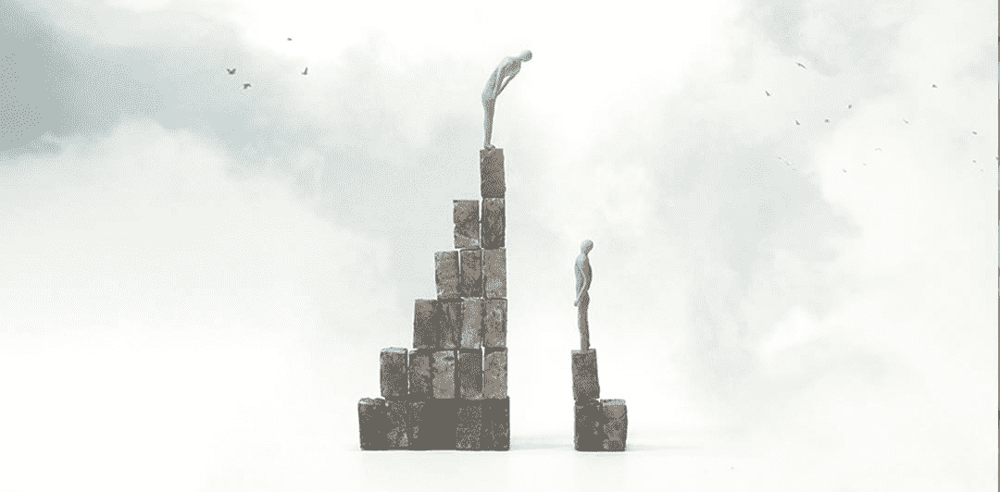

# 32 叠桌子：你可以这样理解人世间

和菜头

2022-04-08

## 32 叠桌子：你可以这样理解人世间

32 叠桌子：你可以这样理解人世间

| 转述师：余昊威 |

**叠桌子，它是一种杂技表演形式，也可以用来作为人世的模型。**

\*

我好像从来没有和你说过我对人世的理解，不知道你心目中的人世是一副什么样子，但是在我这里会比较简单，它就是叠桌子。不知道你看过杂技没有，他们在大桌上叠放小桌子，这样一层层叠上去，最后他们爬到最上层，站在最小的那个桌子甚至是板凳上做倒立。我经常在看这种杂技的时候走神，感觉它就是人世的一个隐喻。

在我眼中， **世界就是一层层叠起来的桌子，人们围着不同层级的桌子吃饭。**  
最下一层的桌子很大，可以容纳数亿人吃饭。最上一层的桌子很小，围坐着百十个人在喝酒。每一层桌子要比下一层小一圈，能容纳更少的人。于是，人们有几种选择：

一种选择是安心坐在这一层，但是要提防有上几层的人掉落下来，把自己挤下去，同时，也要防备下一层桌子有人爬上来，把自己拽下去，抢占自己的座位，拿过碗继续吃；

另一种选择是往上爬，爬上去之后把人挤开，给自己找个座位。在这个过程中，可能被这一桌的人群起而攻之，掉落到更下层的桌子上去，也可能成功挤出一个空座，端起碗来吃饭；

还有一种选择是下降一层，那里会宽敞很多，看到你来了，也许大家会让开一个位置给你，不过吃的食物没有过去好。而且，一旦下去之后，再想爬回去可能就很困难了。

我知道，这个比喻可能会比较粗糙，而且比较粗鄙。人生不止于吃饭，那你就把饭理解为资源就好。关键是这个叠桌子的模型能够比较方便地解释许多事情，不妨作为一种理解人世的参考。

为什么人们会有认同感？因为大家坐在同一张桌子边，而且大多是一层层爬上来的，拥有共同的经历，所以彼此多了一层理解。又因为同一张桌子意味着大家能力差不多，彼此争斗不是一件划算的事情，并没有必胜的把握，所以彼此还有一层尊重。

不过， **这种理解和尊重是一种脆弱的平衡。** 一旦有人表示想要爬向上一层桌子，而且要踩着这一层的桌子或者是人头爬上去，就会立即引发冲突。

这在职场里很常见，同级之间意识到对方还有野心，大家的关系就不会很融洽。有一种叫作 360 度测评的职场测评系统，用于公司内部中低层管理人员工作业绩评估。所谓 360 度的意思是评估人包括了测评人的上级、同级和下级。从统计上来看，无论个人业绩好坏，同级之间的评分往往是三项中最低的。

为什么向上突破很困难？因为每一层桌子的座位其实都是有限的，多一个人，意味着大家就会少分一点。所以，往上爬一层桌子的人是最困难的。下一层的人在拉他的腿，上一层的人在踹他的脸。他想要爬上去坐下来，就得证明自己有实力同时应对两股力量，最后才能一脸是血，浑身是土，气喘吁吁地坐下来。在这个过程中会损失很多，需要自己判定是不是值得。

相对而言，越往上桌子越小，风越大，想要坐稳就越是困难。正因为这样，人们对自己的限度会有一个大概判断，到了一定程度就不想继续攀爬了。因为届时收益和损失不成正比，为了一层而下跌十层，乃至跌落至最下一层，就有点得不偿失。

为什么那么困难，还是有那么多人前仆后继往上爬？当然，可以理解为上一层的饭菜更好，供应更足。但其实还是个选择问题，在最下一张桌子上，怎么坐，吃什么，大概没有什么选择，人和人之间的区别并不大。但是越往上，自由度越大，选择越多。如果用座位数来衡量的话，叠桌子模式的确越往上每张桌子越小。但是，如果从每个人拥有的空间和选择来看，这个模型恰好倒过来，每个人拥有的桌面越往上越大，甚至可以起身散步、起舞、放风筝。

**当一个人拥有的空间和选择越多，他就会觉得自己对现实越有控制力，也就感觉拥有更大的自由，更少为现实条件所束缚。**  
与此同时，和自己选择一样食物的人也就越少，反而减少了同桌之间的许多争斗，所以体现出一种彬彬有礼的温情。

“绝怜高处多风雨，莫到琼楼最上层。”这是袁克文写给父亲袁世凯的诗作，劝父亲不要迈出帝制的最后一步。袁世凯当然没有听，其实无论往上走风雨会有多大，都不能阻挡人们的脚步。

**人们对名望、财富很难说有够了的时候，只要参加了叠桌子的游戏，就会着了魔一样继续下去。**  
全球的财富榜单年年都在变化，一旦上榜，就会被无数人给盯上，税务、慈善、法律上的麻烦接踵而至，但是，你见过几个人真的愿意花钱让自己不出现在这个榜单上？几个人真的收手不干，努力让自己达不到上榜的标准？

当然，从古至今都有人想着另开一桌，直接往上越过好几桌，插入这座桌子山。问题是，这么做的风险很高。首先你得离开自己的座位，一旦离开想要回去就会大费周折。然后你未必能找到足够多的人，凑齐一整桌。

在创业领域内经常会看到这一幕，选择红海领域固然让人觉得痛苦，但痛苦不过无人问津的领域。全领域只有一名，而且就是第一名，往往证明这个领域没有什么价值，桌子根本搭不起来。

最后，也是最严酷的，你得证明你的这张新桌子比旧桌子更强，更好，更有效率。而且无论是对上一层还是下一层都得如此，才能占据这个位置。在许多案例中，现实残酷地回答：对不起，并不需要你额外造这张桌子。于是，无数时间、精力、金钱就会转瞬间化为泡影。

自然也有人想要从桌子边起身离开，宣称拒绝玩这种无聊的游戏。的确有人做到了，在桌子边盘膝打坐，让抢饭吃的人看了心生羡慕，觉得那就是游戏人间的神仙。要解释这种现象其实也很简单，神仙人物并不是悬浮在空中，他还是在这一层。

为什么他没有掉落下去？一个理由是他的行动等于是放弃了和同桌人的竞争，因此变得无害。另一个理由是因为这一层有足够多的资源，这些资源溢出了，可以不在乎多他一个人，反正他要的也不多。有时候，甚至是上几层的资源溢出了，流到这一层，可以让他分到一点。然而，只要时节不好，资源变得奇缺，没有了溢出的资源，就不会再有这种好事了。在战乱或者动荡时期，这一幕最为清晰，神仙纷纷下坠。

如果能够接受这个模型，那么就能理解念书和终身学习的意义所在。 **念书其实是成本最低的爬桌子方式，**  
可以一开始就把一个人送到中间偏下的桌子上，让他的起点变得很高； **而终身学习则是最温和的爬桌子方式，**  
不需要面对太多面对面的争斗，有时候甚至可以实现跳桌，因为他自行发展到一定程度，这一层自然束缚不了他。连想法和做法都不一样，同桌的人又如何阻拦他呢？

每天我听到的各种抱怨，大部分都可以归为桌子的层数、座位位置以及谁是同桌的问题。所以，这个模型并非是我的发明创造，而是听完这些问题眼前自然浮现出来的场景。

**我的建议是，无论身在哪一层，都不要忘记转身背离桌面，去看看周围的风景。**  
如果爬了那么多层上来，都不曾转身看看风景，那就把吃饭当作了人生的全部意义了。而且，我猜测为了看风景的人，也许登高会更有气力。

1.世界就是一层层叠起来的桌子，人们围着不同层级的桌子吃饭。  
2.当一个人拥有的空间和选择越多，他就会觉得自己对现实越有控制力，也就感觉拥有更大的自由，更少为现实条件所束缚。  
3.人们对名望、财富很难说有够了的时候，只要参加了叠桌子的游戏，就会着了魔一样继续下去。

公众号懒人找资源

发布留言

0/ *500*

确定

# “我问和菜头”：真诚和技巧如何平衡？

和菜头

2022-04-08

## “我问和菜头”：真诚和技巧如何平衡？

“我问和菜头”：真诚和技巧如何平衡？

| 转述师：余昊威 |

读者 用户深海：:

> "菜头老师好，对于评论，有点尖锐的提问算不算恶评呢？"

这大概就是共识问题，你站在评论人的角度，认为是尖锐。如果站在写作者的角度，可能感受会完全不一样。类似“有点尖锐”这样的表述，在我看来就是恶评。因为反对就是反对，支持就是支持，质疑就是质疑，“有点尖锐”不在这些类型里，这样的说法本身就不够坦荡。

当我作为评论者的时候，我最关心的是：

1.  **我是否正确理解了对方的原意？**
    
2.  **我的疑问或者质疑是否击中了要害？**
    
3.  **对方在哪一个层面上回应我？**
    

至于说我的提问是否尖锐，是否可以和恶评区分开来，我并不在意。我有问题就问了，重点是我提出的问题是不是真问题。如果我提出的是真问题，对方没有给出正面回应，损失的又不是我。同样，站在写作者的角度上来看，除非我要掩饰什么，否则遇见真问题我只会感到高兴，而不是愤怒或者不安。

读者 得到用户：:

> "叔，你在上网发文之前有练过笔吗？我也很想能通过文字帮助别人，但是我怕自己局限的眼界会误导别人，也因为目前写得不好，观点浅显而不敢发到网上去。写作水平的提高是不是和心智的成熟安定，世界观的系统稳定，还有你说的“牧牛”有很大的关系？技巧是不是只是锦上添花而已？"

我的笔就是在网上练出来的。其实，你自己可以想一想，哪里还有比网络练笔成本更低的地方？报纸？杂志？还是小区黑板报？对文字有敬畏之心是好的，随时提醒自己的认知有限也是好的，但这并不妨碍你在网上发表自己的看法。

根据我个人这些年来的经验，你现在之所以会问这些问题，是因为你还没有真正发表过什么东西。否则，你现在会问我的问题应该是：菜头，没人看我写的文章怎么办？真正困难的还不是写出来，而是写出来没人看，这才是初学写作者最大的痛苦。

你问我一个人是否要心智成熟安定了才能写作，那么，你不写，不接收反馈，你又怎么能快速成熟起来呢？  
**你对世界的理解，你对生活的理解，如果没有和别人碰撞，你怎么知道自己的想法有什么问题呢？**

我看你最大的问题还是怕，把太多时间花在空想困难上了。你手里只有一个鸡蛋，你却要问我养鸡场的自动喂养系统应该如何安装，有何潜在风险。在我看来，你应该先把这颗蛋孵出来才是。

读者 得到用户：:

> "虽然要把文章和作者做一些区分，但如果不是长期对作者有关注，了解其思想成长过程，又如何能理解其文章背后所要表达的内容呢？正如有的人文章写得不错，高举道德大旗，然而自己却做不到，这种文章值得看吗？"

我也看过一种说法，它讲：正人说邪法，人正法亦正；邪人说正法，人邪法亦邪。不过我到不了那么高深的境界，按照我粗浅的境界来看，首先人是可以和文章分开的，就是做人归做人，文章归文章。不能说因为对方是个死囚，所以他说地球绕着太阳转我就要反对。

其次要求文章和生活合一，这本身就是很古典的看法，柏拉图以身殉道，那是古代，现在教授知识，传授道理的人，他们如何生活和他们如何讲授，本来就是两回事。

最后，道德文章不是文章，本来这一类的文字就不用看。如果道德观点和你一致，说明你不需要去读；如果不一致，难道你因为一篇文章就要放弃你的道德观？

读者 用户一辆蚂蚁：:

> "菜头叔，为什么很多时候写作一开始觉得是发自肺腑的，可过不了几个小时候就开始有些羞愧、怀疑和难自洽，再等有人称赞，心中的天平又会向自信那头倾斜，好像刚开始的情绪都是假的？"

> "是因为掌握和历练不够，人总会不自觉欺骗自己吗？还是我的自卑就是比较大，能片刻隐藏，很难长时间忽视？或者根本就是没真本事的正常反应？"

这样的情况很常见，尤其是在情绪冲动之下写作，就会有这种爱恨交织的感受。因为情绪是真诚的，但是你的理性悄悄提醒你，也许在立论上可能存在缺陷，逻辑上可能存在漏洞。听到别人的赞美，你的感性重又占据上风，轻易让自己沉浸在欣喜和骄傲里。

这本身就是一件很纠结的事情，文章中说理的部分太多，人们不愿意看，也很难产生共鸣；感情的烈度太强，人们喜欢读，但难免存在偏颇。有经验的作者，会习惯这种纠结，并且在这种纠结的过程中艰难取得平衡，于是，读者才会从文字中感受到力量。

**平顺地说理，读者感觉到的就是寡淡；浓烈地抒情，读者激情过后觉得一片空白。唯有感性和理性纠结在一起，难解难分，才会有感染人心的力量和令人明悟的光芒。**  
所以，你的困境并不是非常特别的事情，写作者都会遇见。

这时候退下来是不对的，让自己感觉舒服一点也是不对的，你要体会纠结带来的力量。  
**正是因为有正反不同的力道相互纠结，文章才能自始至终维持张力，而读者可以感受到这种张力，需要看到结尾去释放掉它。**

读者 用户杨培雯：:

> "真诚和技巧、自卑和自负之间，我们如何找到平衡？"

这样的问题，可能请刘天池老师来回答更为合适。因为一定程度上，当我们要对外做出表述的时候，你我他都是演员，表述都带有某种表演的成分。作为一名演员，如果我们完全是在表演我们自己，这算得上是真诚了，但我们所有的角色都会变成同一种味道，扮演谁都是在扮演我们自己。如果我们完全使用技巧，用技巧撑起每一个人物，那么又容易只是有角色的样貌，却缺乏角色的内心。

在写作上，完全为自己写作是一种自恋，那么也就没有必要发表。完全为读者写作那是一种商业，技巧难以阻拦油滑的趋势。所以，  
**你的平衡点在于找到那个几乎失控的点，无论偏向哪一边更多一点都可以，但是再过一点就会失控，那么这个点就是合适的。**  
因为你在那一个点上最不舒服，最需要照顾到两方，那么它就是平衡的。

读者 用户胡振强：:

> "人和文章要分开。这是种应然状态，而实然呢？实际上是分不开的。一个人选择写文章，端出来的不仅仅是文章，也包括自己这个人。读者在读文章的时候，就算理智上知道要把人和文章分开，但基本上做不到，因为那会很无趣，就像“象与骑象人”，骑象人怎么拗得过胯下那头好奇的大象呢？  
> "

> "好比我们读《史记》《资治通鉴》，总是会把司马迁、司马光一起拿出来点评，在了解了作者之后，哪怕是那些八卦、传闻，总是对理解作品有所帮助的吧？"

> "所以，菜头叔，我在读了你的文章之后，也会忍不住去搜集你的个人信息，比如你长什么样，还有你所处的环境，比如老家的菌子。对于读者的这些关注，你在意吗？"

只要不打搅到我的现实生活，我一点都不在意。因为选择发表文字，这就是必然的结果。在这里，真正值得讨论的问题是《史记》和《资治通鉴》，你把两本书相提并论，认为都需要了解作者来帮助自己理解作品，我刚好不那么看。

《史记》文气酣畅，了解司马迁的生平，了解他和李陵的关系，那么的确对理解他写李广的传记会有所帮助，明白为什么写出来的文字在千年之后还那么有力量。但《资治通鉴》是另外一种书，它的目的是让人懂得为政之道，如果你本身不是带着上位者的视角去看，而是当做文学书来读，那么无论你对作者有多少了解，这本书你都相当于根本没有读过。

1.你对世界的理解，你对生活的理解，如果没有和别人碰撞，你怎么知道自己的想法有什么问题呢？  
2.正是因为有正反不同的力道相互纠结，文章才能自始至终维持张力，而读者可以感受到这种张力，需要看到结尾去释放掉它。  
3.你的平衡点在于找到那个几乎失控的点，无论偏向哪一边更多一点都可以，但是再过一点就会失控，那么这个点就是合适的。

公众号懒人找资源

发布留言

0/ *500*

确定

# “我问和菜头”：怎样在竞争中保持平和心态？

和菜头

2022-04-08

## “我问和菜头”：怎样在竞争中保持平和心态？

“我问和菜头”：怎样在竞争中保持平和心态？

| 转述师：余昊威 |

读者 用户主动：:

> "出于善良美好的目的写作，心就会安宁。出于生存而写作，压力就会大，作品有可能水准低。生活无忧，真正热爱写作，喜欢用文章表达自己，会更自由。请问老师，是否同意这样说？  
> "

我不能同意。 **为了生存而写作，并不意味着就和心存美好相对立。** 巴尔扎克疯狂写小说解决经济问题，他的作品水准低么？

有一种很古怪的看法，认为思想纯净，单纯热爱，就等于是写出好作品的保障。但是我们看一下古今中外的著名作家，其中的混蛋大有人在。即便不是混蛋，为名为利写作的人也不在少数。所以，并不存在这种古怪的等式。

作家写作，相当于读者用作家的眼睛去看世界。这么说起来，作家的作品相当于某种透镜。假设作家的内心漆黑一片，那么是给了读者一副墨镜。但是，有墨镜才可以白日里观察太阳，它也有它独特的用处。

至于说我强调处于良善的目的而写作，那是给大多数人的建议。大家并不能超越自身，超越善恶等对立的概念，全心全意扑向文学本身，那么良善的目的可以保护自己的内心不受外界的打击，仅此而已。业余爱好者的兴趣写作，怎么能和职业作家献祭自己的生命投入创作相比？

读者 用户纪程~图南：:

> "爱而不得，弃而不舍。这个世界最难选择的怕就是情。这个选项的结果，总是会以另一个选项的受伤害而终结。和菜头老师，有没有什么两全其美的方法？"

只有领导，只有在工作中，才可以提出要求说：“既要……又要……还要……更要……同时要……”而在感情生活里没有什么领导，大概是没有办法做出这样两全其美的要求。当然，我很同情你正所处的感情困境。

不过坦白说，一方面这种困境迟早会过去，无数人都验证过这一点。另一方面是这种困境只能是你自己来背负，别人给出的建议和意见都没有任何价值。没有人能替你活，也就没有人能替你承担。

之所以我要回答你的问题，只是想提醒你一点：两全其美是不存在的答案，如同想要抓住长着角的兔子，无论再怎么努力也只会是徒劳无功。而如果你能越早面对现实，越早接受现实，那么你也就能越早从困局中解脱。

读者 用户 J：:

> "菜头叔，你说作为当事人是很难作出正确选择的，会受情绪的影响又需要对自己足够了解。那作为家长我们是应该更尊重孩子的选择呢？还是让他听从我们的比较客观的选择呢？  
> "

请先定义尊重、听从和客观三个单词。如果这三个单词你都仔细想过，定义清楚，大概不会有此一问吧？如果你把尊重等同于听从，那么这两个词留一个就好了，为什么还要在字典里占据两个位置呢？如果你认为自己的想法就是客观，那么你也就不需要自省自查了，因为你天然正确。

我想和你在这里讨论一点所谓家长权威的话题，家长的权威从哪里来？你可以选择简单一点的办法，不听话就抓过来锤一顿，因为你拥有暴力，所以你的权威建立在你的暴力之上。

你也可以选择复杂一点的办法，你们希望孩子选择 A，孩子要选择 B，那么你们向孩子陈说利害，做出分析，给出你们的建议。孩子一定要坚持选 B，那么就让他去选，然后让他承受选 B 的结果。如果在类似的事情上，你们总是对的，那么你们也就有了权威。

我的看法是，家长不让孩子这么做那么做，是为了怕孩子吃亏。那么，他不吃亏又怎么知道家长是对的呢？如果孩子做了居然没有吃亏，证明他自己是对的，那这也不正是家族兴旺发达的征兆么？

读者 用户潘小妮：:

> "以前非常赞同一句关于选择的说法，说“任何选择，只要愿意承担相对应的责任和代价，就都是理性的选择。”我觉得这句话说出了选择和责任的关系，可是回到现实，一想到代价和责任就迈不开前进的脚步，不知道菜头叔怎么看待这句话？"

我也支持这句话，那么多年来也是如此去做的。而你其实并不赞同这句话，你认为不要背负责任和代价才是对的，这才是你的真实想法吧？因为如果你真的赞同的话，多少都会试着去承担一点责任，支付一点代价，哪怕是很小的事情上开始，你都会因为迈出这一小步而欣喜不已。包括你的提问都可以看出这一点，你在最后非常突兀地转向问我，问我对这句话的看法，落在话本身，而不肯落在你自己身上，拒绝问出“为什么我会这样”的问题。

所以，在我看来，你的天性就是排除责任和代价，自己不愿意背负分毫，那么这句话好不好，正确与否，其实和你没有任何关系。不过也不用太过在意，因为不同的人选择不同的人生观，都能过完自己的一生，谁也不是靠想得正确而安然老去的。

读者 用户禾子：:

> "叔，结合你《选择》那一讲的课程，你怎么看待“选择大于努力”？"

我不反对努力，但是我认为目前对于努力的神化太严重，对生活的简化太严重，反而给所有人都带来了压力。如果简单把成功等同于努力的结果，那么失败必然导出不努力。而努力与否，都是个人的事情，也就变成了个人承担所有的责任，压力由此而来。  
**在承认人生需要努力的同时，也能坦诚地接受努力未必产生结果这个事实，可以让大家的心态变得平和一些。**

而选择和努力哪一个更重要之类的话题，我觉得不是在讨论事实，而是在讨论信仰。相信选择的力量，或者相信努力的力量，是不是有些逾越了人的本分呢？即便是历史的伟大人物，他们的人生也依然受到命运的随机摆布，并不是真的完全由自己做主。

因此，无论是对于选择还是对于努力，我内心都存在着很大的怀疑，也许它们争到最后，也只是在争夺对人生贡献度的 10%那点份额，也许我们原本不需要那么在意。说到底，选择的责任在自己，努力的责任也在自己，既然一切都是归因于自己，那么又何必在意谁大于谁？

读者 用户河蜥：:

> "老师怎么看待那些吃相很难看，但又有一定实力的人？就是能抗住上下层，就在本层做大哥无所顾忌地侵占本层资源，对待这种人有啥好办法吗？ "

没有什么好办法。我认为，按照你的描述，这是一种道德判断，你自己不喜欢罢了。在我看来，如果这个结构里如果出现了那么大的空洞，却没有填补的趋势，就说明结构本身需要这个空洞。而这一层，你可能并没有看到。

难看，无所顾忌，这些字眼无助于理解现实。结构如此，换谁来大概都是这样的做法。也许，从你的角度上去看，这是一个空洞。但是从别的角度去看，这可能是最经济最有效率的支撑结构。而你所拥有的，只有道德感召力，那就没有什么好办法，道德解决不了结构问题。

读者 用户刘鲁鹏：:

> "想问菜头叔，在这种人与人的竞争环境中，如何才能获得一种相对平和的心态呢？"

**保持内心的平衡是一项终生事业，不因为外部是不是竞争环境，就要做特别的调整。**  
不妨把这种竞争视为一种游戏，就像是体育比赛一样。所谓内心平衡就是不要太当真，像麦克·泰森那样直接咬对手的耳朵，那就太过当真了，拳击是比赛，不是古时候角斗士相互杀戮。

同时，也不要太不在意，在一场比赛中扮高人隐士，用完全退避的方式避免任何正面冲突，那样你失去的不单是比赛，可能连人生一并失去。所谓在竞争环境中的内心平衡，就像是大国之间的核威慑。你要让人相信你有足够的力量可以动员，然后你并不会主动使用这种力量，于是这就形成了动态的平衡，各方都在默默调整自己的力量，维持一个合理的相对位置，于是心态上才会有真正的平和。

1.为了生存而写作，并不意味着就和心存美好相对立。 2.在承认人生需要努力的同时，也能坦诚地接受努力未必产生结果这个事实，可以让大家的心态变得平和一些。  
3.保持内心的平衡是一项终生事业，不因为外部是不是竞争环境，就要做特别的调整。

公众号懒人找资源

发布留言

0/ *500*

确定

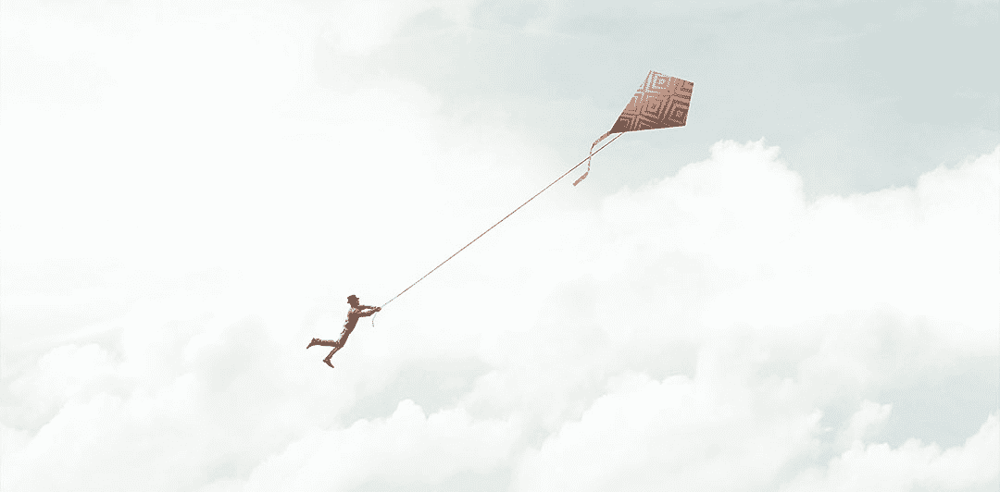

# 33 人生目标：驴子脑门前需要挂一根萝卜

和菜头

2022-04-08

## 33 人生目标：驴子脑门前需要挂一根萝卜

33 人生目标：驴子脑门前需要挂一根萝卜

| 转述师：余昊威｜

**人生目标，名词，有时候指代自己喜欢做的事，但两者并不相同，人生目标更像是拉磨的驴头顶吊着的胡萝卜。**

\*

从小到大，最让我胃疼的问题就是：你的人生目标是什么？如果让我说实话，我会告诉对方我是个观光党，认为人生就是拿了一张来地球的游览票，有效期几十年，运气好一点可能过百年，所以尽量想多看看，多试试。但是每个人对待人生目标的态度并不相同，有些人对此非常严肃，听到我的解释多半会把我划到无赖里去，觉得我这样的人毫无责任感可言。

所以许多年来，我都是用另一个说法来替换，不说人生目标，而是说找到人生中自己喜欢做的事。不要小看这个替换，  
**人生目标四个字不带任何情感色彩，但自己喜欢做的事则有明显的偏好，而且听起来很积极正向**  
。聊人生目标很容易冷场，但是聊自己喜欢做的事情会热闹得多，人们多半有那么一两样事情，最差也能说出睡觉或者吃饭。当然，更多时候人们既不知道自己的人生目标是什么，也不知道去哪里找自己喜欢做的事。所以，这两个问题最为常见。

我的人生目标听起来像是玩笑话，不过它却是经过严肃思考得到的结论。我不知道你有什么人生目标，如果你刚巧没有的话，可以把我得出人生目标的过程作为一个参考，也许这个思考过程还有点借鉴意义。

最早，我的人生目标是上大学。不要笑，我曾经就是那么单纯，全力以赴上大学，因为我基本上没有考虑过别的选项。对于当时的我而言，先上大学，然后会有时间去考虑接下去干什么。填报志愿的那天我突然就颓丧起来，那时候我已经考完，估算完分数，知道自己肯定有学上，人生目标算是已经达成。

在人生目标达成的一瞬间，我发现我从来没有考虑过上大学是为了什么，要去学什么专业。我翻来覆去看《招生报》，对任何一个专业都没有兴趣。唯一一个还算喜欢的专业是历史系，但那是文科，并不招收我。这件事情给我的刺激很深，  
**从此我再也不指定距离自己非常近、极有可能实现的目标作为人生目标，否则一旦实现之后会很茫然失落** 。

那么，是不是应该考虑长远一点？考虑不那么实在的人生目标？这么想的话，人很快又会陷入另外一种困境。这是因为自己的见识和经验，根本不足以支撑做出一个跨度为三五十年的判断。再考虑到人生和生活中的种种变数，我哪里知道自己十年二十年后是不是依然还是现在的看法，依然能坚持自己当初的目标？未来的岔路太多，可能性太多，所以往前想非常困难，只有极少数具有洞见的人能够做到这一点，他们才能在迷宫一样的分岔里找到最适合自己的那条路。

对此我的想法也很简单，多年做题训练出了一种思维：正向推导推不过去，那就从结论倒推回来，看看能不能最终续接上初始条件。望向未来无法得出人生目标，那就从人生终点回望现在。这就带来了两种想法上的改变，其中之一是不再觉得时间无限，人生拥有无限可能。这两件事其实是一回事，当我们遥望未来的时候，会错误地认为自己拥有无限的时间，因为拥有无限的时间，那么就拥有无限的人生可能。但是，  
**当自己站在人生的终点回头去看的时候，会发现人生是在有限时间内做出有限次选择，最后大家都殊途同归，走向相同的终点** 。

另外一种想法改变是开始质疑许多事情的意义。因为凡人皆有一死，这是无法逃脱的命运，那么之前存活的这一小段本身有什么意义？或者说，如何让它变得有意义？

在这里，不同的问法其实已经产生了两种不同的人生观。认为结局早已注定，之前做什么都没有意义，会让人偏向虚无的一边，甚至会认为一切道德、规矩、法律不过是障眼法；认为结局虽然早已注定，所有兴建和创造最终都会在时光里消散，但人存在本身就是意义，热爱生活就是一种顽强的抵抗，体现了日常生活中的英雄主义，这是一种积极的人生观。

最后我采取的是第二种观点，因为我不大相信生命在地球上出现会是毫无意义，我来地球一趟本身也毫无意义，就像我不大相信太阳和地球之间的距离是个偶然，刚好位于不是太热而无法维持大气，又不是太冷而无法产生生命的位置。或者可以这么说，这是基于我个人性格的选择，我更偏好有意义的那种人生，有这个前提我才有个人动力。

想到这个层面，我重新检视了自己的过往生活。

我发现，华美的衣饰，宽敞的大宅，显赫的名声，好像并不能提供更多人生的意义，最多可以改变人们对我的观感，路上遇见我的车会主动避让减速，而不是长按喇叭试图超车。当然，权力、名声和金钱能带来很多生活便利，提供更多人生选择，但意义似乎也不在那里，我对自己能控制多少人，多少事，并没有很大的兴趣。

想了一大圈下来，我觉得自己的好奇心比较重，喜欢什么都了解一点。甚至都不是真的爱阅读，只不过是因为用阅读来满足好奇心的成本最低。我总是会想着远方有什么，我更喜欢在人群里讲故事。所以，我认为我就是个地球游客，目的是来这里观光游览，不是为了胜负，也不是为了征服，单纯就是来看人，看事，看风景，而且我还认为前两样可能是最好的风景，因为它们是打开世界往深处看的钥匙。

迄今为止，我的好奇心还远远没有满足，也就无法消散。所以还得继续到处看看，也许永远也不会有彻底满足的一天，但是我也因此行了很远的路，这就是为什么我说人生目标是拉磨的驴脑袋前面挂着的胡萝卜——永远吃不到，但正因为这样才拉动了磨盘，得到了面粉或者豆粉。

于是，你也就能理解，为什么我说人生目标和找寻人生中自己喜欢做的事并不相同。它们可能会完全不一致，  
**前往人生目标的路途上什么情绪都可能会有，甚至会因此感到痛苦，承受压力。而做自己喜欢的事不会有这些问题，很容易全身心投入，根本没有别的情绪和感受。**

至于说到什么是好的人生目标，其实我也不知道。只要它别太近切，太具体，我认为就很好。那么，一直没找到会是一件糟糕的事情么？我也不那么看。因为哪怕只是有了问一下人生目标的念头，这就已经足够同数十亿人区分开来，起码开始了自主思考。人生中有了取舍的余地，就算得上是一个自由人。

最后，我想说一件事：从人生的终局回望现在，这个方法也存在着隐患。因为既然站在那里去想人生，你能回望也就可能忍不住展望。而当你展望出去，那里是一片虚无，充满了不可知，由此会产生难以驱散的寒冷和恐惧，并且在内心深处产生很大的空洞，急于找到什么东西去填补，这就很容易变成一个神秘学爱好者。神秘学没有什么不好，但那又变成了另外一个极大的话题了。

1.站在人生的终点回头去看的时候，会发现人生是在有限时间内做出有限次选择，最后大家都殊途同归，走向相同的终点。  
2.前往人生目标的路途上什么情绪都可能会有，甚至会因此感到痛苦，承受压力。而做自己喜欢的事不会有这些问题，很容易全身心投入，根本没有别的情绪和感受。  
3.人生中有了取舍的余地，就算得上是一个自由人。

公众号懒人找资源

发布留言

0/ *500*

确定

# 34 心流（上）：其实你进入过心流

和菜头

2022-04-08

## 34 心流（上）：其实你进入过心流

34 心流（上）：其实你进入过心流

｜转述师：余昊威｜

**心流，名词，指一种特定的心理状态，在这种状态下，人会全然专注于手头的事情，获得内心的宁静与喜悦。**

\*

我不是那种一定要别人去做什么的人，那不符合我的性格。估计你一早也已经看出来了，我几乎不会对人说“必须”、“一定”这类的话。不过凡事总有例外，我倒是真的希望你能够体会一下心流，哪怕就只是一次两次。

关于心流的书籍和文章有很多，我看得很少。因为我第一眼看到“心流”两个字的时候，就已经理解了它的含义。原因也并不复杂，我是一名持续写作超过 20 年的作者。在漫长的写作过程中，我经常进入心流状态。如同那些书中描述的那样，我忘记了时间，忘记了饥渴，忘记了身体，和我的文章完全合二为一，维持着一种纯粹安定的精神状态，完全投入到创作过程中去，如同神灵附体，手指头都跟不上汹涌而来的句子，感觉是暂时借这具肉身来完成一篇文章，这件事情早在我出生之前就已经定下，今天只是来到了合适的日子。

类似的描述我还可以写很多，但我觉得这种描述可能哪里有问题。有关心流的书籍和文章总是会强调，进入心流状态之后的创造力会有极大的提升，人在那种状态下的感觉是多么神异。如果总是强调这些内容，会不会对没有进入心流，又渴望进入心流的人造成压力呢？进入心流并没有那么轻易，在心流状态下高效输出的要求更为严苛，强调这些部分我担心会造成大量的挫败感，反而断灭了许多人的希望。

所以，这一讲的内容可能会比较长，我想从我个人的实际经历而不是理论来谈谈心流。如果你也对心流感兴趣的话，希望这会对你有所帮助。

首先，什么是心流？按照它的定义， **心流是一种专注于解决问题的心理状态** 。

如果我们把那些玄妙的形容词去掉，它说的是一个人沉浸在手头的事情，一点不受外界的干扰。请注意，这里我没有说个人的感受，也没有谈效率提升，只是提出一个简单版的定义，可能和你在书上读到的定义不大一样。先不用着急，简单定义自有它的用处，没有期待也就没有失望，一开始简单一点是有好处的。

根据这个简单定义，你会发现自己其实经历过心流状态。如果你想不起来的话，我可以提醒你几个可能的场景：你在手机通讯软件里和朋友非常热烈地讨论什么事情，地铁错过了站，而你之前的确听到了报站声；你在电子游戏中停下来，抬起头发现不是预期的凌晨 1 点，而是早上 7 点；你斜靠在沙发上看一本精彩的小说，拿起来就放不下，你唯一记得的事情是自己在翻页，看完你发现自己错过了一顿饭，然后才感觉到腰疼。

在我看来，这些都算是心流的一种体现。你在这些场景里，体会过全神贯注做某件事情的感觉。而且，如果你仔细回想一下，会发现这种感觉和日常感觉区别很大。你基本上不关注外部世界，你的注意力也不会从一处转到另外一处，你的内心没有平常那么多念头，不断起起伏伏，你甚至在全过程中感觉内心有一种很特别的安宁。

所以，你是可以进入心流状态的，而且很可能已经进入过多次，只是你并没有意识到这一点。简单版定义的好处就在于这里，它能够帮助你提升信心，而不是把心流当做某种虚无缥缈的神妙状态，需要用非常努力的方式去追求。

接下来，你可能会很自然地产生一种想法：如果这就是进入心流状态的话，那么我在工作或者学习中能够进入这种状态岂不是更好？这样我会非常有效率，关键是还不觉得有任何痛苦和压力。一旦有了这样的想法，肯定又会接着问：有没有办法训练自己，可以自如地进出心流状态？

到了这个阶段，心流的定义就会随之收窄。 **并非所有的精神专注都是心流状态，它特指那些创造性的活动，而且对于你有一定难度**  
，是因为进入心流的过程其实是你在解决问题，最终会产出结果，于是你的内心会感到充实、满足和喜悦。

所以，根据这个复杂版的定义，可以看出  
**人们研究心流其实有很大的功利成分在其中，想要得到的并不是心系一处的法门，而是一种理想中的创造过程，让自己成为一个高效人士。**

这样一来，其实我在写作中获得的心流体验可能对你就毫无用处了。因为我连续写作已经超过 20 年时间，远远不止一万小时的自我训练。我对写作的熟练程度也应该远远超过你，而你可能在敲击键盘的时候都还磕磕碰碰，那又怎么可能进入心流状态呢？当我大谈如何在写作中进入物我两忘的状态时，我谈得越多，你就会越沮丧，觉得心流状态是个难以企及的目标。

好在我还有一手。过去 5 年，我锻炼身体的方式和次数平均下来趋近于零，基本上没有体育锻炼的习惯。不过从去年 11 月开始，我每天用走路的方式锻炼身体。从最早的每天 5 公里，逐渐提升到现在的每天平均 12 公里。总体上来说，我对于这项有氧运动还算个新手。不过，在走路的过程中，我发现自己同样能够进入心流状态。于是我去查找关于心流的资料，发现研究者也承认在运动中会出现心流状态，最早开始研究的时候，他们的研究对象就是所谓的卓越人士，找来的是科学家和运动员。

因此，我们现在可以一起探讨运动中的心流状态，这样大家都处于新人状态，可能我的个人体验会对你更有价值。

我在走路中出现的心流状态，和写作时出现的心流状态并不相同。一个最显著的区别是时间长短，写作中我可以保持一个小时以上，但是在走路过程中则会短得多，最长不过是十几二十分钟，很容易被打断。另一个区别是生理上感受的强弱，和写作相比，走路进入的心流状态身体的感受要强烈很多，强烈到能够立即觉察到的程度。

我们都知道，走路会给身体带来压力，造成心跳上升，气息短促，肌肉紧张。但奇妙的是，心流状态从未在走路的头几公里内出现过。如果按照走 10 公里耗尽体力来计算，心流状态往往出现在 7—8 公里这个阶段。当时体力将尽未尽，自己还有一点余力，然而距离达成目标还有一段不小的距离。这时候会偶然触发心流状态，突然感觉到身上有热流涌动，腿脚轻快，关节灵活，蹬地有力，视野变得明亮起来，不再感到疲惫和痛苦，也就没有了各种想法和抱怨，人会忍不住想要在这个状态里多停留一会儿，觉得再走 10 公里也没有任何问题。

当然，这种感觉并不是真的。再过十几分钟，一切感觉都会消退，人就像是从另外一个世界跌落出来，重新回到人间，感觉肌肉有拉伤，浑身都黏满汗水，眼前的电视机突然开始大声嚷嚷，脚下的走路机正在发出响亮的噪音，一切又都恢复正常。但是，因为先前的那种感觉，你会迫不及待地想要明天早点到来，自己好再去试着经历一遍。

所以，心流其实接近于一种心理成瘾，在心流状态下，存在着一个更好的自己。

1.在心流状态里，你基本上不关注外部世界，你的注意力也不会从一处转到另外一处，你的内心没有平常那么多念头，不断起起伏伏，你甚至在全过程中感觉内心有一种很特别的安宁。  
2.人们研究心流其实有很大的功利成分在其中，想要得到的并不是心系一处的法门，而是一种理想中的创造过程，让自己成为一个高效人士。  
3.心流其实接近于一种心理成瘾，在心流状态下，存在着一个更好的自己。

公众号懒人找资源

发布留言

0/ *500*

确定

# 35 心流（下）：其实心流没有那么复杂

和菜头

2022-04-08

## 35 心流（下）：其实心流没有那么复杂

35 心流（下）：其实心流没有那么复杂

｜转述师：余昊威｜

\*\*  
\*\*

**心流，名词，指一种特定的心理状态，在这种状态下，人会全然专注于手头的事情，获得内心的宁静与喜悦。**

\*

通过这种描述，我猜你和我会有同样的想法：心流可能并非是纯粹的心理状态，它更像是脑内有什么化学物质改变了人的感受。通过写作、工作、解题来进入心流状态之所以困难，可能是因为在静态的过程中，大脑分泌有效化学物质的速度太慢，浓度太低，对人意志力和精神强度的要求太高。

而体育运动则刚好相反，在即将精疲力竭之前，很容易因为消耗太大而无暇胡思乱想，更容易把心念收束于一处。同时，因为走路的动作机械重复，带有某种类似催眠的效果，也就更容易忘记外部环境的存在，集中在自身的感受上。

经历过两种不同进入心流的方式之后，我个人更倾向于体力运动而不是脑力活动。后面的理由可能略微有点冷酷，不过相信你也能够理解。

要知道，人人都会走路，所以很早大家都达到了走路的精专程度。但是，每天一个半小时以上的快步走却不是走路。平常走路存在的姿势错误和动作变形没多大关系，因为你走得少，纵然有伤害但没多大影响。但是每天 5 公里 1 小时以上的长时间快走，只要姿势稍微有点问题，你的膝盖，你的踝骨，你的髋部，你的臀部都可能要吃苦头。

我是在走了三个月之后，去专门重新学习如何走路，否则我担心自己的膝盖可能因此受伤。有半个月时间，我像是个学步的婴儿，低头看着两只脚，不断调整它们的角度。我在跑步机上跌跌撞撞调整步姿，很多次直接掉落下来，只是为了感受所谓的膝盖放松，臀部发力。因为做了这些事情，身体很快会出现反馈，告诉你做得对不对。

当姿势调整正确之后，可以走的距离自然会加长，于是我也就能从走路中获得更大的成就感。通过“犯错—学习—调整—适应—提升”这个过程，我开始能够进入走路中的心流状态。

这个方式的冷酷之处就在于，它会先让你感觉吃力，甚至因此而受伤，于是你不得不提升技能。好在技能并不复杂，你可以在短时间内掌握，从此可以自如地走路，也就能达到享受走路的境界，那么出现心流状态的机会也就大大增加。

如果我建议你去写作，或者是解决问题，甚至是探索未知，那么你很可能太早就会放弃。而我要找一件人人能做，而且人人都是专家的事情作为开始，其实也没有那么容易，走路算是一个很难得的发现。

**从走路中我还发现，不同的进入心流的方式会彼此促进。**

当我能在走路中也进入心流状态之后，即便我对写作已经非常熟练，但依然能提升我进入写作心流的速度和频率。也就是说，我在写作过程中变得更加专注，也更有成效。在我写这一讲文稿的时候，我在得到的专栏和微信公众号维持每天双更已经超过一个月，日更新量在 4000～5000 字，即便是我年少时的巅峰状态，也很难支持这样的强力输出水平。

说到这里，你可能又会问一个问题：那在心流状态下，是不是每一篇文章都是经典？当然不是。

我个人认为，流行的心流理论中我很难接受它的一个设定，就是认为只要进入心流，等于进入某种高效的创作状态，或者解决问题的状态。人不但会效率奇高，而且成果的品质也卓越。这样的设定一方面增加了想要进入的难度，一方面有些本末倒置。

心流的学说之所以会出现，它的最初命题是找到生活中增加幸福和快乐的方法。心流被证明是有效产生满足和幸福感的方法，而不是一种创造或者创意方式。真正的创作过程，大多充满了痛苦和纠结，也正是因为这种巨大的痛苦和纠结，会让最终的出品充满了力和美的感受。

心流不是如此，心流的重点还是放在主观感受上。 **无论如何，时光都在等同地流逝。而进入心流的意义在于，会让你感觉在心流中的时间流逝变得特别有意义**  
，特别让人满足，从中可以产生出强烈的幸福感，把人们从日常的无聊和乏味中解脱出来，把情绪从麻木和冷漠中解脱出来，用一种更为宁静，同时也更为活泼的态度来面对生活。

对于我来说， **我认为人们应该体验一下心流状态，哪怕只是一次，哪怕非常短暂，它对人的意义也非常重大。**

按照“心流”这个概念的创始人契克森米哈赖所说，心流让人发现另外一种现实世界。我是这么理解这句话的：我们每个人都像是嵌入现实生活中那样，许多人甚至是卡在原地动弹不得。但我们所看到的，所感受到的，很可能不是现实生活的全貌。正常情况下，人们需要大量饮酒，高速开车，疯狂玩过山车，或者到极为遥远荒僻之地，才能揭开现实生活的一角，看到另外的可能，也看到自己的另外一面。

心流没有那么麻烦，也没有那么危险，可以通过非常安静的脑力活动方式，也可以通过非常简单的体力运动方式，发现一个完整的自我，消融了内外世界的界限，感受到自身力量或智慧所能达到的境界。

心流对于今天的人而言，拥有特别的意义。

在我们进入移动互联网时代之后，几乎每时每刻都在被手机骚扰，不断从一处跳到另外一处，变得极难专注于同一件事情。我就问一个问题：假设你的住所里有三道门，你每天出大门前，会进进出出这三道门多少次？还是说你一早就想清楚要穿什么，带什么，走一遍就拿齐所有的东西，可以直接出门？

如果你需要进进出出很多次，说明你根本没有办法专注在出门这件事情上。不断有各种临时想法跳出来打断你的思路，让你额外走一圈去处理。等你处理完之后，往往又忘记了自己一开始是想要干什么。  
**当你打开 App，不断跳转下去，忘了初衷的时候，那么在生活里，你也会同样不断开门关门，站在原地忘记了自己为什么要进出。**

这样的生活状态并不令人满意，它会带来很多的散乱、焦虑和紧张，一个人必须随时准备迎接一个弹窗、一个念头，把时间彻底变为碎片，在碎片中很勉强地拼凑生活。我不认为这样的生活值得追求，也不认为陷入其中的人能感到充实和幸福。  
**在这个意义上，心流算是一种有效的对治方式，刚好能够解决我们面临的时代病，它让人们重回专注状态，重新感受自己还有专心致志的力量，因此也会增加对自己人生的控制力，从而从各种弹窗和推送中找回自由。**

也正是基于这样的考虑，我不去强调心流的神奇，也不去强调心流的成果，不厌其烦地做出简化，目的就是让你不会感觉到进入的困难，也不会产生不切实际的期待，反而跃跃欲试想要一窥究竟。

站在我个人的角度，对于心流能对你产生的效果，其实哪怕你能进入 5 分钟我都会觉得喜出望外。就算是你通过努力，翻遍了心流的书籍，尝试完各种方法依然没能进入，我也依然为你高兴。  
**因为在这样的时代里，一个人尝试去做到专注，即便这只是个念头，也依然非常珍贵。**  
相形之下，更多人其实对自己的处境根本毫无知觉，因为手机而心浮气躁，心神不宁，但是讽刺的是，转身又打开手机去找寻心安的法门，最后结束在不知道哪一个电商网站的促销页面上。

最后我想告诉你一件事：通过进入心流，以及持续不断的写作和走路，我已经可以很自如地控制自己在社交网络上的时间，不再让手机把我每天的时间切割得七零八碎，真正做到了用碎片时间去用碎片式 App。生活未必因此而变得充实美好，但我的确感受到了自由。

1.心流的学说之所以会出现，它的最初命题是找到生活中增加幸福和快乐的方法。心流被证明是有效产生满足和幸福感的方法，而不是一种创造或者创意方式。  
2.心流算是一种有效的对治方式，刚好能够解决我们面临的时代病，它让人们重回专注状态，重新感受自己还有专心致志的力量，因此也会增加对自己人生的控制力，从而从各种弹窗和推送中找回自由。

公众号懒人找资源

发布留言

0/ *500*

确定

# “我问和菜头”：不具体的目标有意义吗？

和菜头

2022-04-08

## “我问和菜头”：不具体的目标有意义吗？

“我问和菜头”：不具体的目标有意义吗？

｜转述师：余昊威｜

读者 用户何刚：:

> "如果将拉磨的驴脑袋前面挂的胡萝卜看做是激励手段或者目标追求的话，或可粗略地将皮鞭看做是一种鞭策手段或者压力驱使。我们都知道目标的重要性，但也无法忽略身边的人给我们的鞭策和生活本身的压力的驱动作用，有一部分人的成功很大程度上是在压力下被逼出来的。"

> "想请教菜头叔，对于一个人的成就来说，目标驱动和压力驱使分别起什么样的作用呢？"

彼之蜜糖，我之砒霜。对于不同的人而言，不同的驱动模式效果并不一样。但是从常识上来看，如果一件事情需要很长的时间才能取得一点进展，那么多半还是要靠目标驱动。

你很难想象，罗振宇是靠小皮鞭才能坚持每日更新，或者靠鞭策每年才能完成一次跨年演讲。如果不是他的内心对他正在做的事情有认同，而且为了某个遥远而又恒久的目标，单靠压力驱动他无法坚持那么多年。

在我看来，压力驱动就有点像是当年的手扶拖拉机的摇柄，最好的结果不过是让拖拉机的马达发动起来，靠它本身的旋转是无法让拖拉机开走的。因此，  
**我是不大认同所谓人是逼出来的这种说法，因为躺平永远都是一个可选项，而人能够逼出来，说明他还是有所触动，愿意去采取行动。**

读者 用户 ximena：:

> "我喜欢自己的科研实验，但是得到的实验结果却是一次又一次的失败，就像之前大连理工自杀的研究生留下的遗书说的那样一直在做无用功。所以想问菜头叔的是，若拉动了磨盘，得到的只是残渣废料怎么办？  
> "

我个人建议你去看一下 mRNA 疫苗的奠基者 Katalin Karikó博士的生平事迹，此刻她和她同事们的工作正在拯救世界。

如果从实验失败这个角度去看，那么 Katalin 经历过的失败无论是次数还是时长都是你难以相比的。事实上，她一直在大学里从一个实验室到另一个实验室流浪，一次次去找寻可以挂靠的教授。

后来在一次讲演中她说，她的成功特别地仰赖于失败。如果没有那么多失败，最后的成果可能未必能落到她的手上。如果没有那么多失败，最后的成果也不会达到如此惊人的程度。

我不知道你对一件事物的时间尺度是怎么理解的，是不是也接受了一夜暴富那样的想法，认为科研也可以一夜之间取得成果。但在我的粗浅理解里，科研工作最基本的时间单位应该是十年，之前可能要耗费更多时间去选择方向。以你目前拉磨的程度，磨盘才刚刚转动，你就已经拿着杯子等着出豆浆，是不是太早了一些呢？

读者 用户多多：:

> "我也一直想去找寻自己喜欢做的事情，可是好像还没有找到。怎样才能算喜欢呢？是想到做一件事的时候就心情澎湃吗？可是好像生活中不去做这件事的时候，我也没有觉得很难受，那我应该不顾一切去追寻那个我想起来就心潮澎湃，激素暴增的事情吗？"

似乎也不是这样，按照你的说法，更像是发烧或者喝高，不像是内心笃定。我觉得你与其找什么目标，不如停下来倒回去仔细看看来路。

如果你说的是实话，先前你的确轻而易举地实现了许多人生小目标，那么你应该分析一下这些小目标都是什么，其中隐藏着什么线索，有什么共性的部分。把这些部分连接起来，向前延伸，也许会指向一个之前你根本没有预料到的方向。

如果事情只是满足于完成，而不去考虑为什么能够完成，那么事情其实根本没有结束。我认为世间的事情没有一样是凭白无故出现的，尤其是自己能够完成的事情，它一定隐藏了符合你个性，适合你天赋的部分，并且作为先导训练而出现。如果所有的先导训练你都能迅速完成，那么就应该是你去找寻你真正使命的时候了。

读者 用户杨昊山⁶⁶⁶字极艮：:

> "我特别赞同菜头老师说的“旅者”这个梦想，这是一种很舒服的自洽方式，如果把人生当成旅行，那我们就可以选自己想看的去看。那么菜头老师，如果有了责任，比如孩子、公司员工，可这时候我发现自己想当“旅者”，这种向往梦想和现实中责任的矛盾如何自洽？"

你是不是认为这个世界上只有你才是主角，而且是唯一的角色，剩下的人全是背景而已？所以，你不认为家庭也是人生风景，运营公司也是人生风景？只有你一个人摆脱一切，徜徉于天地之间，才叫做旅行？那你何必来地球呢？上天何必在地球上安排那么多人，那么多社会组织，那么多种生活形态呢？

你觉得它们是你的背负和责任，对于一个正在行路的旅人而言他的行囊的确如此。但他不可能 24 小时走下去，他的行囊让他有水可以饮用，有衣服可以御寒，有帐篷可以睡觉，这时候行囊是他的庇护。你为什么认为它是负累呢？是不是你把许多你得到的东西视为一种理所应当了？  
**没有裸奔的旅人，那样很容易被抓起来。**

读者 用户呢了同学：:

> "菜头叔，今天这讲，我觉得您是在说，目标的意义不是实现，而是追寻，那么，这不是跟庙里许愿真善美差不多了吗？目标不近切我觉得赞同，但不具体清晰的目标，还有意义吗？"

你当然可以设定一个很清晰具体的目标，比如说攒够 100 万人民币。它有可能实现，如果全心全意去追逐这个目标，那么它甚至有很大可能实现。

但是，然后呢？你已经得偿所愿了，然后呢？你当然不是为了 100 万而努力争取 100 万，一定是说你认为某种人生幸福或者自身满足需要 100 万。那么，什么是人生幸福？什么是自我满足？手拿 100 万银行卡的时候，你就立即同时获得了它们吗？两者可能毫无关系。

你看不上、觉得太过虚无的真善美或者别的什么理念，因为极为遥远的缘故，你势必要为此跋涉很长的人生路途。在这路途之上，你倒有可能找到了自己想要的人生目标。

只有走远路，你才知道自己是谁，自己能干什么，以及你在什么事情里能获得内心的喜乐和满足。而近路太直，太快，你都没有心思往周围多看一眼，如同鱼雷一样直奔目标而去。你认为那是实在的，但到手之后剩下的大概只有虚空。

读者 用户逆旅过客：:

> "上初中时，一位历史老师说，40 亿年后，地球会爆炸，会毁灭！从那以后，一思考到人生的问题，就想到地球的这个大限。人是存在于生生不息的永续链条中，人的意义和价值就是在历史的长河中流淌着、安放着，可地球总有一天也会不存在了，这不是一个巨大的虚无吗？40 亿年，还太遥远太遥远，何必想那么多呢？可是，这个终极大限就是让人隐隐哀伤。"

> "请问菜头叔，这个莫名的忧伤，需要如何想，能得到一些抚慰呢？"

你想了一半当然觉得忧伤，想全了自然不会忧伤。

地球会毁灭，宇宙会再次坍缩，这些都不假。但是以你的生命长度，在这种巨大的时间尺度之下，连一瞬间都算不上。  
**我们要承认这个事实，在认识了人生的短暂、宇宙的虚无之后，去思考一个问题：纵然如此，我们还是来到了这个世间。**

从更高的时间和空间尺度观察我们自身，如同我们低头观察地上的蚂蚁。那么，蚂蚁是不是不值得过活？蚂蚁为什么不停下来专心忧伤？既然蚁生如此，它们忙忙碌碌采集食物，在大雨到来之前搬家，究竟所为何事？

因为它是蚂蚁，它正活着，它此刻所有的活动都让它从虚无中挣脱出来，展示了生命的活力。否则的话，它也就湮灭成尘埃，变成死寂宇宙的背景音了。

你自己也是同样，意识到周围存在着巨大的虚无，在时间和空间之下个人极度渺小，那么，  
**你哪怕此刻喊一声“喂”，也是有意义的，也在抵抗虚无，也在荣耀生命，也成就了独一无二的你。**  
哪怕战役注定必然失败，但是不妨碍我们去战斗，去做个英雄。而且，最终究竟会如何，也并不是我们所能预料的。

1.如果事情只是满足于完成，而不去考虑为什么能够完成，那么事情其实根本没有结束。  
2.只有走远路，你才知道自己是谁，自己能干什么，以及你在什么事情里能获得内心的喜乐和满足。 3.哪怕战役注定必然失败，但是不妨碍我们去战斗，去做个英雄。

公众号懒人找资源

发布留言

0/ *500*

确定

# “我问和菜头”：心流有高级低级之分吗？

和菜头

2022-04-08

## “我问和菜头”：心流有高级低级之分吗？

“我问和菜头”：心流有高级低级之分吗？

| 转述师：余昊威 |

读者 用户亚嘉 cjp：:

> "是不是做越熟悉的事情，进入心流的概率就越大呢？"

也不是，因为太过熟悉的话，你就可以用下意识去完成。你很少在吃饭的时候进入心流吧？因为你不需要全神贯注，一样可以吃饭，所以你可以边看手机边吃饭，边聊天边吃饭，边胡思乱想边吃饭。

所以，重点不是熟悉与否，而是做这件事情你需要多大程度地投入其中。不能太简单太熟悉，那样的话你肯定会走神。也不能太复杂太陌生，那样的话你会因为挫败而产生杂念。理想的状态是你的投入刚好可以源源不断地产生足够成就感，成就感使得你更加专注其上，形成一个良性的循环。

读者 用户月泪繁星：:

> "菜头叔，发呆也是一种心流吗？心流是否也有高低之分，刷抖音、看小说、打游戏就比较低级，运动和写作就比较高级吗？"

发呆就是发呆，你没有产出任何东西，只是长久地停驻在茫然的状态里。刷抖音也不是心流，你的心随时在跟着内容到处跑，而你根本没法控制心的去向。读书要好很多，因为你需要不断思考，如果能保持专注力在书的内容上，会因此不觉得时光的流逝，这算是一种心流状态。

打游戏也可能进入心流，事实上，许多操作类的游戏能够打出创纪录的高分，人在那样的情况下并没有去“想”，甚至没有思考过去“操作”，而是在高度专注的情况下，放手让自己去做，就像是自动完成的过关。

算起来打游戏是有反馈的，你保持在心流状态中，可以让游戏持续进行下去，得到更长的游戏时长和更高的游戏得分，这同样是你的产出。因此，我们讨论心流应该有个前提，那就是在心流状态中自己产出了什么，获得了什么。

读者 用户呢了同学：:

> "我跟着熊逸老师学习《资治通鉴》，为了确保不是音浪每天左耳进右耳出，每一讲都用纸笔做笔记，第一季结束了，也有厚厚的一大摞。  
> 但是，今天课程复盘，编辑老师抛出一些问题回顾课程，我发现，自己能记住的，除了那些比较轻松的桥段，所剩不多。我自己觉得，这是因为自己虽然在做笔记，但只是借外力表现了形式专注，内心并没有专注形成心流。  
> "

> "于是，我想问问菜头叔，想在做事情时进入心流状态，必要的前提条件是什么？"

还是就用《资治通鉴》来讨论吧。问题不是在你杂念多，记不住，而是你根本不熟。《资治通鉴》对于你来说，还太陌生，太繁难。有熊逸老师给你的讲解，这还远远不够。

**在心的层面，你需要对《资治通鉴》感兴趣，有非得读通读懂不可的信念；在行的层面，你需要反复通读过多次，甚至自行查阅了字典和史料，熟悉到可以完全阅读原文的程度。**

这时候你再去听熊逸老师的课程，他的讲述有些符合你的理解，有些和你的理解发生冲突，有些甚至让你断然否认，这样你才会进入学习的心流。当你还在思考他在说什么，而不是为什么他会那么说的时候，你的思考就会不断被打断，不得不停下来。

读者 用户螺闹耳朵：:

> "听说冥想也能让人进入心流境界，对灵感很有帮助，关于冥想和灵感对于写作的作用，不知菜头老师您是怎么看的？灵感对写作重要吗？还是技巧和锻炼更重要？"

第 1001 次回答：没有灵感这回事。即便有，灵感也不是可以指望的事。

**灵感是一种嫌贫爱富的存在，当你需要灵感开始你的写作时，它通常是不会来的。**  
当你极为痛苦地写了 100 万字之后，它反而可能会频频造访，敲门问你：今天你想写点什么？

严格来说，这都是不应该问的问题。写作很痛苦，于是大家都想越过痛苦的阶段，找到一个叫做灵感的东西来开挂。  
**问题是为了得到灵感，你就要先付出代价，这个代价刚好就是痛苦的摸索。**

我自己写了数百万字，还没有一次是因为冥想产生出灵感，然后立即坐下开始打字。更为常见的情况是很痛苦地写了几百个字之后，突然越写越顺，越写越快，进入心流状态。

任何人都有投三分篮犹如神助的时候，那是因为先前不知道练习过几万次。你要告诉我说，冥想一个小时就可以让一个从未打过篮球的人连投 10 个空心篮，那我不如去看《吹牛大王历险记》的好。

读者 用户梦境：:

> "去年我报了一个学习班，并积极争取到了组长的位置。那段时间边上课边学习，每天都是五点半起床，当我拿起笔的那一刻我似乎忘记了时间，感觉学到的东西很简单，时间过得飞快，生怕错过上班时间，我还需要再定一个闹钟。  
> "

> "我想问一下和菜头老师，像我这样平时听音频和看书都容易走神的人，可以连续几小时地听课做笔记，是进入心流状态吗？还是当我们自愿做一件事情并且学到新东西的时候都会有这种感觉呢？"

你学习班的经历应该是处在心流状态，但是你听课做笔记我颇为怀疑。因为这件事情并不困难，相当于人肉音频转录文字，做熟了之后基本是个半自动状态，不需要你多么专注，也不需要你克服多大的阻碍。而且，你所获得的成就感也就是一些笔记罢了。

**听到新知，思考新知，获得新知，我觉得这是三个层面上的事情。如果说是进入心流状态，我认为更大的可能是获得新知**  
，在你已有的基础上，你专注一些，努力一些，就可以迅速提升自己的认知，取得内心极大的满足感，那么你的确有可能长久地停驻在这个状态里，保持某种内在的平衡。

如果自身输出有限，我认为更接近于下意识的行为，就像说骑自行车进入了心流一样，或许有，但没必要。

读者 用户田螺：:

> "和菜头叔叔，我是一个在出门前会进进出出好几次的人，去衣帽间换衣服，到化妆桌前涂防晒，再去洗手间梳头，又回到衣帽间拿包包，再回到房间把东西装进包包里，最后又去卫生间照照镜子，确认我的形象 OK，然后才到了出门的环节。算下来一共进出这三道门 6 次，耗时 20 分钟，个人觉得还挺符合女生出门的必要准备时间。"

> "您在文中提到进进出出代表不专注，可我很享受在这几道门、几个屋子里穿梭来去，一点点完成“出门”的过程。很多时候我觉得心流似乎是一种有限资源，我在这件事情上投入了大量的专注，在下一件事情上我就很难进入专注。我甚至觉得“心流”这个状态用在“准备出门”这种小事情上有点浪费，而应该用在写论文、备考之类的学习上，这样才能让效率更高，成就感更足。"

> "我不知您怎么看待我这种出门方式呢？以及在您看来，心流是否是一种有限资源呢？"

你好，出门不需要心流，需要基本的统筹，就像烧水做饭一样，想清楚步骤，尽可能有效率地完成。它不是什么复杂的事情，如果一个人要出发前想不明白需要带哪些东西，其实那些东西也就没有必要带。

当然，每个人对生活的理解并不相同，对他人的态度也并不相同。只是你的行为会有一些额外的效应，比如说让人不得不等待。如果对方并不在意的话，那么好像也没有什么关系。

**不过我最后想提醒一点：时间是公平的。**  
如果你在家里多消耗掉一些时间，就有可能在路上要赶时间。而赶时间就会带来一些风险和压力，也许是在驾车的时候，也许是在穿过马路的时候。当然，如果你或者他人也愿意承担这种风险和压力，那么好像也没有什么问题。你觉着会有问题么？

读者 用户少有人走的路：:

> "心流与正念有什么关系吗？能不能通过冥想获得心流呢？似乎感觉正念才是一种保持觉知的方法，而心流更像是一种忘记当下的工具。"

如果按照 100 分为满分来计算，正念的难度可能是 90 分，心流的难度可能是 80 分。单独做其中任何一样，都并不容易，你却要把两件事情串接起来，前后完成。那么，你是否可以轻而易举地进入其中任何一个状态呢？

如果不是的话，考虑这种嫁接怕没有多少意义。有些时候，我们的确需要从定义来认识事物。但不巧的是，无论是正念还是心流都是一种实操。如果并没有多少实操，那么所有的定义都浮在空中，剩下的只是言说而已，而且可以得出任何结论。

1.理想的状态是你的投入刚好可以源源不断地产生足够成就感，成就感使得你更加专注其上，形成一个良性的循环。  
2.灵感是一种嫌贫爱富的存在，当你需要灵感开始你的写作时，它通常是不会来的。  
3.如果并没有多少实操，那么所有的定义都浮在空中，剩下的只是言说而已，而且可以得出任何结论。

公众号懒人找资源

发布留言

0/ *500*

确定

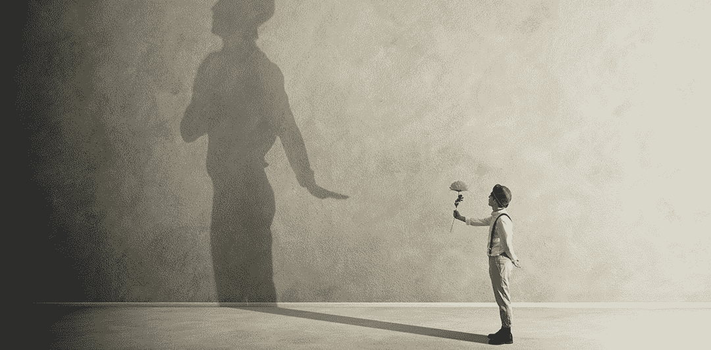

# 36 为你好：宁可冷漠，不要过分热情

和菜头

2022-04-08

## 36 为你好：宁可冷漠，不要过分热情

36 为你好：宁可冷漠，不要过分热情

｜转述师：余昊威｜

**为你好，是个惯用语，以柔和的口气，和站在对方立场的姿态，试图说服对方接受自己的想法。**

\*

“为你好”其实是一种变相对他人的控制，现在基本上是一种常识，起码在网络世界里算是一种共识。但是，这大多是站在接受者的角度来进行分析。我想，我应该有资格对人说些“为你好”的话，因为好像我人生经历比较丰富，头发看上去也不多，挺适合这个角色。不过我回忆了一下，记忆里我就没说过几次这样的话。事实上，我很早就放弃了“为你好”这种思路。

如果要用一句话来形容我和周围人的关系，那么，比较合适的描述是：那种令人愉悦的成年人之间的冷漠。  
**冷漠也会让人感到愉悦吗？在我这里答案是肯定的，成人世界里人们会维持一种得体的距离，略显疏远，没有那么亲密热烈。**  
因此，双方都没有近到可以窥探对方私隐的程度，也没有亲到可以干预对方生活的程度，同时又没有远到彻底地漠不关心，而是随时有更近一步的可能，这样的距离感就会让人感到舒适，没有任何压力。

在更早的时候，我曾经是个热情的人。之所以还有几个朋友，完全是因为朋友的宽容，相信我所说的一切都是出于真诚。大城市里的人对于热情有一种很奇特的感受，一方面想要逃避任何猝不及防的热情，觉得不习惯两人之间的距离急速缩短；但另一方面又感觉很亲切，就像是回到自己在乡下的祖屋，路上遇见一位大呼小叫飞奔前来问候的远房亲戚，亲切中带着些尴尬。

但我现在早已经没有那么热情了，这是因为我这些年里有些发现：

其一是人总是会重蹈覆辙，而我们对背后的原因知之甚少。

你是知道的，年轻的时候朋友相聚有很多时候喝闷酒，都是为其中某个人解决情感问题。那你有没有遇见过那种朋友，就是他总有情感问题，大家陪着喝到肠穿肚烂也没有任何改善，分析了几卡车可能的原因，但是他还是在相同的地方跌倒？

我遇见过，喝得人相当恼火。但是依然是这个人，后来去相亲，和对方见完第一面之后不到半年就结婚了。

我们几个老友偷偷聚会分析，结论是这么多年来他并没有情感问题。他有的只是不满意，但是又觉得不能没有女朋友。所以，过段时间就要分手，并且一再邀约我们出来喝闷酒，只是为了帮他驱散内心的负疚感。等到他遇见一个条件合适的姑娘，就立即迫不及待地去结婚了。

他看起来总是有情感问题，总是因为相似的理由情感破裂，那不过是他想破裂罢了。所以，我们当初给出的几卡车分析其实都是无用功。如果我们一早知道这个真相，应该安排他赶紧相亲，这才是真正为他好，最起码对自己的胃好。

其二是人其实都非常固执己见，听取意见只是选择性听取而已。

如果你肯回忆一下，就知道人大多是被生活打服的，很少能被人说服。我们在生活中成功说服别人，并且也取得良好效果的机会非常少，所以才总是出现一种矛盾：在我们念念不忘、过高估计自己意见建议的同时，对方却在回忆时一口咬定那是出于自己的决断，和旁人没有任何关系。因为人都是以自我为中心的，永远都是自己人生故事的主角。

**所谓听取他人意见，我可以根据我的个人经验坦白说，那无非是征询意见的人在心里有了定计，但是他又希望从别人嘴里说出来**  
，本质上他是在各种意见和建议里做选择，选择支持自己想法的那一条。也正因为是这样，最后他会毫不犹豫地认为那是出于自己的想法。的确是这样，你的建议只是恰好被他选中而已，算是一种投票支持。

其三是人只能为自己负责。

你有没有这种经历：当你做出了详尽的分析，给出了建议，对方也听了进去，最后执行失败，然后转头回来责怪你？这样的事情怕都经历过吧？老实说，这会让人感觉到相当不舒服。

分析这种不舒服的感觉， **其实是我们都认为自己关心别人，帮别人想办法，这是出于一种高尚的道德情操，所以，我们都应该豁免于追责**  
，是这样的吧？这就像是在街上看到有人昏迷倒地，如果你冲上去帮他做心肺复苏，那么他在事后就不应该起诉你手法不对，造成他的肋骨骨折。

也是基于相同的心理，有一种对父母逼婚最为行之有效的反驳，那就是说结婚可以，但是，你们是否能确保婚后的生活幸福？这时候父母往往就不说话了，因为他们不想给出承诺，承担责任。所以，我们并不能为其他人负责，这不是我们的初衷，每个人都应该为自己负责，这样他才能承受结果，而不是找个什么人去转嫁。

基于以上三点观察，我放弃了“为你好”的想法。

**如果一个人再三再四出问题，每一次都犯相同的错误，那么应该是他去找到无限循环的根由，我并不适合**  
，因为我根本不知道他内心是什么想法，如果要仔细探究的话，那会是一件极为耗时而危险的事情。纵然无法帮助到对方，我也不会因此而产生什么愧疚之情。因为他重复犯错，但依然还活蹦乱跳，说明问题并不致命，最多算是一些烦恼，完全可以那么继续下去。

同样的，我也不会主动给出建议，迫使对方面对问题和面对自我。因为我对自己的定位非常清楚，我就是一个外部参考建议。如果想要发生真正的改变，力量只能来源于对方的内心。他要愿意面对问题，他要愿意面对自我，那么他才会有勇气上前一步。无论我怎么推，怎么逼迫，都不会起到效果。

即便对方接受了我的建议，那么原因多半是刚好符合他的心思，而这样做的代价是一旦失败，那么也可以很方便地把责任推给我。这样一来，无论是亲戚、朋友还是同事，大家之间的关系就会变得很难相处，双方都会觉得不满意。

我在生活中也观察到，老师傅带徒弟是怎么一副样子。老师傅一点都不热情，而是带着冷眼旁观，只有到了非常关键的时刻，才会出手一次，解说也不多，剩下的大部分时间都是让徒弟自顾自地去做。相比之下，我觉得老师傅比父母要冷漠太多，哪怕是教一道数学题，父母说的话也可能超过老师傅一年的量。

这里的区别是什么？区别是老师傅眼中的徒弟是个完整的人，他有他的想法，他最终也会有他的招式，这一切都需要徒弟自己去摸索，最后才可能成为他自己的东西。作为师父，他的责任仅仅是在事情超出了边界的时候，拉那么一把，有那么一把也就足够了。

**而无数的“为你好”，可能并没有把对方看做是一个完整的人，而是默认自己有更好的想法，更好的方案，直接交给对方去执行，就能取得良好的效果。**  
但之前我已经分析过了，人并不是这么一种理性的生物。连乔布斯都曾经感叹过，优秀人才的自尊心不需要被呵护。

因此，我觉得宁可要那种成年人之间的冷漠，也不要太过热情，有太多“为你好”。如果我们还算诚实的话，应该承认所有的“为你好”都是我们自己的认为，我们一方面可能不知道什么是真的好，另一方面也不清楚什么是对方需要的好。而且，我进一步认为，放弃“为你好”的念头，有助于在自己身边形成一个由成熟的成年人组成的小世界。在那样一个世界里，各方都会活得比较自在。

从长远来看，每个人最后也总能找到自己的解决之道。只不过在有些时候，回想起那些毫无心机的天真热情，会让人感觉到有些怀念，也许这就是所谓成长的代价吧。

1.冷漠也会让人感到愉悦吗？在我这里答案是肯定的，成人世界里人们会维持一种得体的距离，略显疏远，没有那么亲密热烈。  
2.人其实都非常固执己见，听取意见只是选择性听取而已。  
3.如果我们还算诚实的话，应该承认所有的“为你好”都是我们自己的认为，我们一方面可能不知道什么是真的好，另一方面也不清楚什么是对方需要的好。

公众号懒人找资源

发布留言

0/ *500*

确定

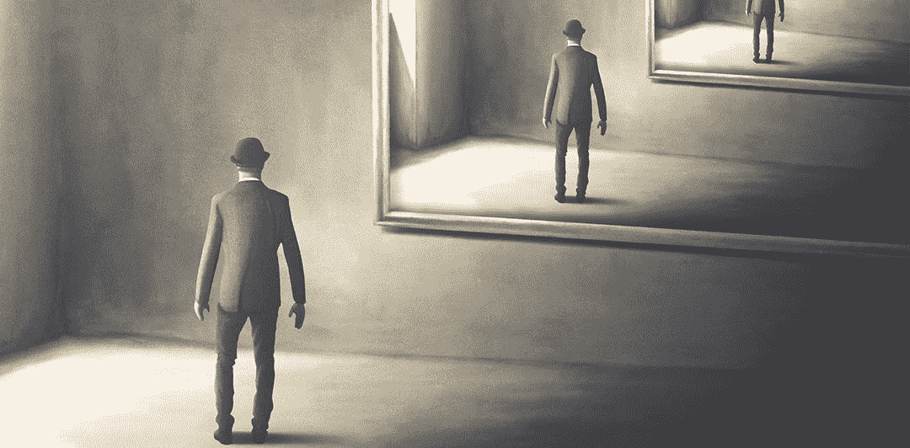

# 37 小历史：掌握你对过去的定义权

和菜头

2022-04-08

## 37 小历史：掌握你对过去的定义权

37 小历史：掌握你对过去的定义权

｜转述师：余昊威｜

**小历史，名词，并不存在这个术语。我用它来代表个人或者小群体的过往，并且认为每个人都应该努力把握小历史的主导权。**

\*

我们通常所说的历史，一般都指大历史，文明的兴衰、王朝的更迭、伟大人物的丰功伟业，以及科学、文化、艺术、经济、军事的发展变化。要我说的话，我们既不能改变历史，也极少有机会去创造大历史。  
**但我们每个人都拥有自己的小历史，它解释了过去，也定义了我们的现在。** 我认为对于个人而言，小历史要比大历史重要得多。

不如我先举个例好了：对于我的家人而言，我从小就是个顽皮的孩子，这是亲戚之间的共识。为什么会有这样的看法？有史为证。在我 3、4 岁的时候，曾经去乡下外婆家暂住了一段。据说，我舅舅回家的时候，恰好看到我蹲在地上玩泥巴，我的外婆正用拐杖打我的屁股。而我外婆是个心地善良，脾气很好的老太太，由此可见我是个顽劣的小孩。

但我自己并不那么看，因为我从小记忆力就非常好。所谓好，并不体现在背书、认人、记数字，而是我能记住很多具体的事情，最远可以追溯到 2 岁左右。

根据我个人的记忆，那天我蹲在地上，是想用一把小刀刮去外婆家石头台阶上的泥。家里人每天下田回来，鞋上的泥会留在石阶上。我外婆问我在干什么，但我没有理她，也许是回答了她听不懂。当时我只会说普通话，她只会说家乡土语。

所以，她走上前用拐杖推了推我，这一幕刚好被我舅舅看见。因为我是个孩子，而他是个成人，所以这一段历史的阐释权就到了他的手里，于是我的行为被解释为顽皮，我外婆的行为被解释为用拐棍揍我。

等我稍微大一点之后，向亲戚们解释了这件事情，但是没有人相信一个 2 岁的小孩子能有什么记忆。于是，我就回忆了同一段时间里，另外一位家族远亲老婆婆曾经背着我走了一段路的情形。告诉他们我在背上看到那位老婆婆穿着什么颜色的衣服，她的头发是怎么盘起来的，头上有几根银簪子，以及银簪子上是什么花纹，这才在惊叹声中勉强挽回了一点局面，削减了我舅舅那个版本的威力。

但是效果依然有限，对于他们来说，更喜欢连和善的外婆都忍不住起身用拐棍打我的版本，可能那样更有喜剧色彩一些。

**这就是人微言轻，无法掌握小历史阐释权的后果，让我顶着一个子虚乌有的名头过了很多年。**

顽皮这个头衔也没什么，但是另外一些小历史可能是致命的。

我不是个从小作文就很好的孩子，小学四年级之前，作文课上也属于那种不断啃铅笔头的学生，为凑够 300 字痛不欲生。在四年级的时候，有一次作文课布置的题目是《记一种动物》。我那时恰巧看了许多百科知识，还有动物画册，多少知道了一些蛇的习性。于是兴奋难耐，一举写下人生中第一篇长文，绘声绘色地写了关于蛇的种种。

语文老师是班主任，到了点评课的时候，专门把我那篇文章拿出来，念了几段，然后当着全班的面问了我一句让人从热血沸腾立即变成浑身冰凉的话：“你诚实地告诉老师，这篇作文是不是你抄的？”

后来当我开始在网上写作，聊起童年委屈的时候，发现各地都有这样的老师，这一句台词在各种学校课堂里频繁出现。

当然，老师怀疑我有她的理由。毕竟之前我是一个苦于凑字数的学生，每周上交的周记本上全都是挣扎的痕迹。突然之间，我甩出一篇长文，和之前的我判若两人，让人觉得奇怪乃至生疑也并不意外。

但我是个很倔强的小朋友，回家就把这件事情告诉了父母，并且把家里所有和动物有关的书籍、杂志和报纸都翻出来，请他们看我有没有抄袭其中的任何句子。幸亏那时候没有网络，否则这件事情就说不清楚了。

我父母看完我的作文和一堆参考资料，带着我去学校找老师专门做了解释。老师估计也没想到这一家人会如此大动干戈，居然上门专门澄清，于是就说了些鼓励的话，让我们回去了。

这件事情给了我很大的刺激，从此之后，我开始努力写作文。有了上一篇好到让老师怀疑我抄袭的作文垫底，我已经知道如何写出高分作文来。于是，很快我的作文就开始变成课堂点评的优秀作业，并且一直保持到小学毕业。

大概三五篇之后，尤其是加上课堂作文，老师心中的怀疑也终于消散，终于承认我的确存在某种天赋，只是之前不知道为什么一直处于沉睡状态。

这是个喜剧结局，但我知道许多人的人生经历不是这样的。他们告诉我，就因为老师当着全班问出那句话来，他们从此就放弃了那个学科，因为自己脑门上“抄袭犯”三个字永远都无法擦去，要跟着自己一辈子。

这就是努力扭转小历史和没有扭转成功的区别， **一旦是别人定义了你的小历史，它的后果可能会一直延续到今天。**

在成人世界里情况也是一样。 **小历史不单要记住，还必须反复重申，让各方都明确曾经发生过什么，尤其是在一个小群体内部。**

你想过没有，为什么在会议结束之后总需要有人写会议纪要，记录会议发言，而且要下发到每个与会人员的手里？因为一旦出现问题，许多人的第一反应不是聚焦在如何解决上，而是立即声明自己没说过，没做过，不应该对现在的后果负责。甚至还会有人临时重新定义历史，说些“当初我早就说过”这类的鬼话。

这时候翻出会议纪要，白纸黑字，四目相对，能避免许多无聊的冲突和无意义的争吵。每个人都会在小历史中高估自己的作用，回避自己的错误，美化自己的形象，这也是一种人性。所以，成人世界里捏造小历史的现象非常普遍。

**小历史还有另外一种用处，那就是利用小历史来控制他人。**

我作为一名持续写作者，遇见过太多类似的情形。一位不知道哪里来的读者留言说：“我十几年来读过你的每一篇文章，曾经如此信任你，但是……”这就是试图用历史来进行控诉，进而试图让我产生愧疚，最终控制我产生他想要的结果。

我想，这一幕不单存在于读者和作者之间，可能在家庭生活中还要更为常见一些吧？夫妻总有一方要利用家庭小历史来证明自己的正确和正当性，控诉另外一方的错误，以此占据心理优势。父母教训子女的时候也有类似的习惯，不单要证明孩子的行为是错误的，而且要证明他是历史性的一贯犯错，以此增强批评的力度。

所以才会有专家建议，一个家庭内部的成员要坐下来心平气和地讨论。心平气和讨论什么？大概也只能是对历史取得某种各方认同的共识，然后翻过这一篇去。

请注意一点，这里我没有说取得历史的真实。小历史里也不大可能存在所谓的真实，它和大历史一样，也是各方博弈的结果，最终呈现出怎样的共识，取决于各方的力量对比和意志力强弱。所谓共识是指各方都能勉强接受，同时也都做了部分让步，相对接近于真实的一种对过去的解释。既然如此，那么对小历史的主导权最好掌握在自己手里，否则冲突会来得随机，自己的处境会变得被动。

我认为大概大部分人都不喜欢被过去影响，也不希望被他人控制，更不想局面混乱分不清楚责任归属。那么，不想要这样的现在，你就必须控制过去。有时候你得挺身而出，捍卫自己的小历史；而有的时候你也得不惧麻烦，重申和确定小历史。

最好能做到如果谁要修改共同的小历史，之前需要取得全体成员同意。否则的话，我到现在依然是那个从小就顽劣不堪，小学四年级就开始抄袭作文的混蛋，简直可以一眼看到老。

1.我们每个人都拥有自己的小历史，它解释了过去，也定义了我们的现在。 2.一旦是别人定义了你的小历史，它的后果可能会一直延续到今天。  
3.小历史里也不大可能存在所谓的真实，它和大历史一样，也是各方博弈的结果，最终呈现出怎样的共识，取决于各方的力量对比和意志力强弱。

公众号懒人找资源

发布留言

0/ *500*

确定

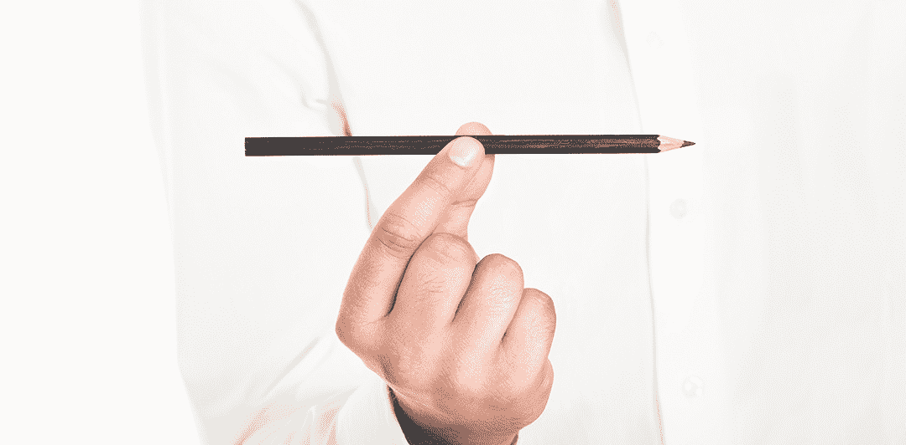

# 38 画饼：揭示画饼的奥义和方法

和菜头

2022-04-08

## 38 画饼：揭示画饼的奥义和方法

38 画饼：揭示画饼的奥义和方法

｜转述师：余昊威｜

**画饼，名词，指代用描绘远景，做出承诺来激励团队士气的方式。它本身没有问题，有问题的是讲述者讲了个好故事，或者是讲了个烂故事。**

\*

每个人都是故事爱好者，即便是那些以理性著称的人同样如此。我猜，这就是人类之所以成为人类的原因。让我们回想一下大航海时代，遥远的东方真的满地都是黄金和香料吗？这估计连故事都算不上，最多是个传说，但是并没有因此让人们停下探索的征途。

负面的例子也有，从邮寄信件时代到现在的智能手机时代，“金锁链”信件就没有中断过。什么是金锁链？“收到信息后七天之内转发给十四个人，好运就会降临。”这样的信件，当年几乎弄到邮政系统崩溃。

画饼当然也算是故事，而且是非常特殊的一种。领导者描绘光明的前景，做出种种承诺，但是听众嘲讽地说这是画饼充饥，这是因为他们对故事抱着不信任的态度，不信任是因为曾经有过许多没有兑现的大饼悬在空中。但中国的历史传说中也有曹操望梅止渴的典故，作为一种正面例子，证明统帅的聪明才智。军队行军的前方存在梅林吗？不重要。重要的是军团因此而继续前进，最终找到了水源。

望梅止渴就比画饼充饥高明么？怕也不好说，如果最后军团依然没有抵达水源，可能今天的人们对这个成语就是另外一种态度了。

这里就是我的第一个结论：无论是画饼充饥，还是望梅止渴，都是针对最终结果而言。成了，就是望梅止渴，败了，则是画饼充饥。所以，这是同一件事物的两张皮。

**为什么不放弃画饼，直接做事呢？因为集合众人之力，共同完成一件事情从来都很困难。靠讲道理，靠理性说服，效率实在是太低了。**  
即便是幼儿园的小朋友，当他们玩游戏的时候，也不是直接讲解游戏规则，而是要给一个故事背景：瞎子摸鱼、打死救活、警察抓小偷、老鹰抓小鸡，等等等等。

成人并不见得高明到哪里去，《水浒传》里挂在梁山的“替天行道”的口号，远不如头领之间私下编的故事有说服力：大碗喝酒，大块吃肉，大秤分金，岂不痛快？上了梁山的人，有几个关心所谓的“道”是什么吗？

好故事使得人们从事的活动有了意义，激发人们心底的斗志，使得人们可以步调一致采取相同行动。当然，即便如此，依然可以站在一边冷冷说一句：这是画饼。的确是画饼，但是对画饼的不同态度，把人们很容易地区分开来。

一口道破是画饼的人，应该算是人群中的智者。

道破事物本质是一种特殊的能力，能够帮助人们提升认识。但是认识提升之后呢？事情会自动完成或者自动解决么？智者可以道破恋爱的本质是荷尔蒙引发的冲动，是一种人体内的化学反应，本质是人类延续自我的本能在作祟。很好，很深刻，但是明白之后对于找到对象有帮助么？对保持独身有帮助么？

人群中还有另外一类人，他们不大关心事物的本质是什么，他们只关心如何把事情完成。

在现实中，没有几个人手下刚好都是一帮精兵强将，而且同气连枝，心意相通，大家朝着一个目标前进。

真实情况往往是花了好大的气力，才能勉强凑齐一班人，能力七长八短，态度三心二意，但是你所能有的就只有这些，马上你还需要带着他们正面顶上去。

为什么《西游记》深受许多团队领导的喜爱？因为有一种心酸的熟悉，唐僧带着三个或凶暴或懒惰或木讷的徒弟，步行万里去西天取经，会让他们有很强的共鸣。对于这样的人而言，讲故事几乎是一种本能，只要能把一群人团结在一起，朝着同一个目标出发，不管是饼子还是梅子，在他们这里并没有任何区别。

这里就是我的第二个结论：是不是饼，取决于你是谁，你站在哪里，你想要做什么事情。

汉朝的时候，有一位叫做耿恭的铁血校尉，他创造了以数百人守城，抵抗匈奴数万军队城池不失的奇迹。在我看来，他就是个讲故事的高手，所以能画出接近极品的大饼。

他最著名的故事有两个，一个是当他率领残部撤到金蒲城之后，立即被匈奴大军包围。匈奴人士气正高，就发动猛烈的攻击，想要一举拿下城池。耿恭见情势危急，就在弓箭箭头涂抹烈性毒药，发射之后让士兵齐声高呼：汉家神箭，中之必异！中箭的匈奴人果然中毒，于是匈奴人大为惊恐，后撤停止了攻击。

真有神箭么？真的每一支都是神箭吗？不重要，匈奴人买了这个故事就够了。

另一个是匈奴回撤之后，耿恭带领士兵转进疏勒城，那里有河水从山中流出穿城而过，可以得到充足的水，并且易守难攻。而匈奴依然保持对疏勒城的包围态势，随后派人进山从上游挖断了水源，想用干渴迫使汉军投降。

耿恭在城内命令士兵挖井，连挖十五丈没有一滴水出现，军队在绝望之下面临崩溃。耿恭聚集军士，自己穿上盔甲当众祷告：如果上天决定要让我们灭亡，那么我们唯有一死；如果上天垂怜，请赐予我们饮水。祝祷结束，干井中突然甘泉涌起，士兵山呼万岁，士气瞬间逆转。

耿恭的做法才是真正的故事高手，画出了一张天大的饼。河水从疏勒城穿城而过，多年来一定会因为下渗而形成地下水，所以打井出水的可能性很大。但是和直接打井出水相比，耿恭成功讲了一个故事：证明上天站在这支军队的一边，回应了军团指挥官的祈祷。

还有什么故事能比天更大？在两万匈奴军队的包围之下，安全回家，升官加爵这种饼没人会相信，但是上天站在自己这一边，这种超级大饼士兵却愿意相信，因为在这种局面下除了天命他们不可能相信还有别的什么力量能拯救自己。

这就是我的第三个结论：如果要画饼的话，不妨发挥想象力尽可能画个大一点的。饼越大，越不可能，相信的人也就越多。

也许有人看到这里会问，这不就是诈术么？对，这就是诈术。  
**如果是一群人一起去做一件非常困难的事情，做到后期的时候，维持人们前进的往往已经不是技术和经验，而是纯粹的意志力，那种近乎于信仰的愚勇才能支撑他们走到最后。**  
在那种时候，指挥官自己想退后都做不到，因为继续作战是整个团队的意志。

所以，画饼的目的并非是要说服团队里的智者，智者永远都是怀疑的，永远都是清醒的。  
**画饼的目的是筛选团队里意志最坚定、对于故事深信不疑、可以战斗到最后的人，确保在最艰难的时刻整个团队不会四分五裂。**

望梅止渴的神奇之处不在于最后找到了水，也不在于士兵相信了前方有梅林的存在，而在于他们选择相信曹操的话，哪怕在内心最深处也对此有所怀疑，凭着一句话就能继续前进。而画饼充饥被人诟病的原因，是因为指挥官根本达不到这样的信任度，手里连一把麦子都没有，却做出了那么大的承诺，因此没有人相信他最终能兑现。

这里也就是我的最后一个结论：画饼充饥的真实意义只对一起作战的人有效，因为他们明知道是假的，也愿意继续相信，于是最后饼才有可能变成真的。奇迹属于相信相信的人，这就是画饼的奥秘。

1.无论是画饼充饥，还是望梅止渴，都是针对最终结果而言。成了，就是望梅止渴，败了，则是画饼充饥。  
2.好故事使得人们从事的活动有了意义，激发人们心底的斗志，使得人们可以步调一致采取相同行动。 3.是不是饼，取决于你是谁，你站在哪里，你想要做什么事情。  
4.画饼充饥的真实意义只对一起作战的人有效，因为他们明知道是假的，也愿意继续相信，于是最后饼才有可能变成真的。

公众号懒人找资源

发布留言

0/ *500*

确定

# “我问和菜头”：怎么理解“少管闲事”？

和菜头

2022-04-08

## “我问和菜头”：怎么理解“少管闲事”？

“我问和菜头”：怎么理解“少管闲事”？

｜转述师：余昊威｜

读者 用户 YDJ：:

> "《十三邀》里有集访谈于谦，他大概意思是说，别管闲事，你也管不了，管好自己比什么都强，让自己生活得有乐趣、有质量是最重要的事。看评论都是说于老师活得通透，活得明白。我其实也岁数不小了，但对这种说法是有怀疑的——这个态度一点不新鲜，大清国的八旗子弟、遗老遗少，不就是这个态度吗？您对这种态度怎么看？"

> "还有罗胖和脱不花常说不要站队，原因是你不是当局者，你不知道真实的情况，这种情况下站队就是把自己放到火上烤。您怎么看？"

我的看法是人最好不要活成兵器，更不要活成炮灰。在二十年前，中国出现了一种新的文体，介乎于杂文和评论之间，当时人们把它称之为“时评”，读者很喜欢这种短平快的写作风格和对当下新闻事件的即时反应。包括我在内的一批人，都进入了这个新领域，并且迅速占领报纸的评论版面，成为了所谓的“著名时评家”，一时颇为风光。

二十年后，我早已经离开了这个领域，而当时我们这一批时评作家中，很多人已经锒铛入狱。他们的路径都类似：写时评—获得影响力—有人来找—付钱喂料—写付费时评—打击客户对手—名声更盛—主动写文打击—凭文章敲诈勒索—罪成入狱。

一个人能写文章，文章有影响力，这是一种个人能力，也是时代给予的机遇。但是当一个人把这种能力当做是一种武器，而且把这种武器借给他人使用，自己就变成了兵器。  
**兵器的下场要么是折损，要么就是入鞘。问题是在利益和名望面前，许多人并没有等到收刀入鞘的那一天就已经折损了。**

回到你的问题上来，当一个人随时都要表态，随时都要发表评论，随时表示出对世道人心的关怀的时候，他自己知道自己正在做什么吗？当他拿了别人的料，可以进行精准打击的时候，他是促进了社会全体的善，还是成为了别人手中的刀子？每一个人都有自己的判断力，那么这个判断力的边界在哪里？我认为一个人会在两种情况下感觉到自己有力量，一种是自己真的拥有影响力，一种是自己站在人多的一方里。  
**无论是哪一种，人都会无限放大自己判断力的边界，对于极为遥远，对于自己完全不了解的事情敢于下判断，敢于做表态。**  
于是，前者容易成为兵器，后者容易成为炮灰。

而我一早放弃了时评，是因为无法停止内心的怀疑：凭着记者的一篇报道，或者某个人的一个帖子，我就要对数千公里之外陌生的人和事进行评论，并且通过评论影响许多读者的观感和判断，这样的做法是合适的么？这样的评论是成立的么？如果我当时没有放弃，在今天这种新闻事件反转反转再反转的时代，那么我的评论怕是会被打脸打脸再打脸。虽然一个人的认识是不断变化和进步的，但也没有必要用脸去学习。

**正义感、道德观点是维系一个社会正常运转的基础纽带，我们需要在这些问题上取得共识，主动发声，反复重申，人们才能形成共同体，拥有归属感。**  
但仅有正义感和道德观是不够的，要永远记得一点：凡是能够有力量来到你面前的事情，你所看到的是冰山浮在水面上的那一小部分。真正让它来到你面前的，是它在水面下的看不见的那一部分。如果你对事情真的有兴趣，那么一定会研究水下的部分。研究多了，那么你对水面上的热闹，大概也会是于谦或者是脱不花他们的态度。

读者 用户林永良：:

> "叔叔，你好，我想问一下“为你好”之间的沟通方式是不是存在双方或者一方不诚实，不然就不会存在这么多的波折？"

我倒认为双方很可能都是真诚的，反而正是这种真诚造成了许多麻烦。相反，如果其中一方像人们说的那样“情商高”，倒有可能避免各种状况，维系双方更为长久稳定的关系。

所谓情商高，意思是清楚地知道无论自己还是对方，对自身的认知都不全面，都存在扭曲，于是对现实的认知也不会是真实的。所以并不试图去寻找正确答案，更不用说是教导对方真理。唯一能解决这个局面的，只有对方自己。需要对方先有意愿，后有能力，才能自我解脱出来。而人们所能做的，只是在对方能力不足的时候给与一点点必要的帮助。

读者 用户博博 18813280：:

> "请问菜头叔，做父母、做师父和做老师都是要教导一个初学者，那么如何把握好教导和控制“为你好”心态的边界？比如做导师教导学生写文章，学生很多措辞用句不规范，在确保没有歧义的前提下，还需要说服学生改进吗？"

我觉得这里有个边界，那就是明确区分你自己的偏好和对方的最大利益之间的关系。

按照你的例子来说，你可能是个完美主义者，这是你的偏好。学生的最大利益是他的学业，而不是他的文法，除非这个文法已经影响到了表达。那么，如果是我来把握这个边界，我会强忍住内心纠正文法的冲动，去看他文章的立意和观点是否在水准之上，是否还可以提升，尽量和他讨论这种问题。而文辞和他的最大利益之间，其实不构成矛盾冲突，无非是不够完美罢了，那大可以任由他去。作为一个有责任心的老师，大概会帮忙全面修改一次文辞作为示范，事后对方是否能够领悟，是否会在意，那依然是对方的事情。

我以前也喜欢事无巨细都要关心，现在我开始理解  
**育人和种树差不太多，成材非常不容易，能在主要方向上有一点进展就算不错了，绝大多数人没有优秀到需要连细节都要雕琢一番的程度。**

读者 用户 Yvette（伊维特）：:

> "菜头老师，您对“反哺之恩”这句话怎么反驳？很多长辈喜欢拿这句话规训后辈，这个逻辑如果是对成熟的父母来说，孩子做起来没什么不适感，但是对于有些巨婴型父母来说，孩子就惨了。因为父母从来都没成熟过，一直都是孩子在迁就他们，这时如果还讲“反哺之恩”，那什么时候是个头呢？"

当父母说出反哺之恩的时候，双方之间的关系已经足够败坏了。 **就像是一个人需要提醒对方感恩的时候，就已经没有恩义存在的空间。**

但通过你的描述，我感觉你的倾向性过于强烈了一些，几乎是赤裸裸的批判了。我想提醒你一点，如果你对自己的认知如此确定，对父母的判断如此确定，那你问我又是为了什么呢？你从我这里得到肯定或者否定，对你意味着什么呢？如果你是为了找个人抱怨，那我的回答是这和我无关，我不会涉入他人的私事。如果你是为了找个肯定，那我觉得这种不确定倒是个好事，是个人反思的开始。

读者 用户半支烟：:

> "我想问一下和老师，宁可冷漠也不要过度热情。这样会不会让自己变得不喜欢与人接触呢？有的人喜欢给人提建议是不是也是一种对于人与人的深度交往的渴望呢？"

喜欢和人接触不是一种生活必需，更多是一种个性特点，有些人喜欢热闹，有些人喜欢独处。而人的本性是很难改变的，并不会因为听到了一种看法就立即会有行为上的改变，否则老师父母何必那么苦口婆心呢？

**渴望深度交往没有问题，但一个人的欲求和手段之间经常不能统一，有时候甚至是完全背反的。**  
喜欢一个异性，渴望和对方交往，尾行可能不能达到这个目的，反而会让对方远远逃走。以提建议的方式表达关心，这怕也是一厢情愿的想法。  
**因为在我看来，控制权其实是在对方手上，是对方给你提建议的机会，而不是你给对方听建议的机会。** 你我都没有那么重要，没有人一定需要我们给出的建议。

1.凡是能够有力量来到你面前的事情，你所看到的是冰山浮在水面上的那一小部分。真正让它来到你面前的，是它在水面下的看不见的那一部分。  
2.所谓情商高，意思是清楚地知道无论自己还是对方，对自身的认知都不全面，都存在扭曲，于是对现实的认知也不会是真实的。

公众号懒人找资源

发布留言

0/ *500*

确定

# “我问和菜头”：怎么摆脱阿 Q 精神？

和菜头

2022-04-08

## “我问和菜头”：怎么摆脱阿 Q 精神？

“我问和菜头”：怎么摆脱阿 Q 精神？

| 转述师：余昊威 |

读者 用户王志文：:

> "菜头老师，如果那些小历史不堪回首，我可以按照自己的意愿去修改小历史吗，比如让它变成美好的样子，不过，这样于道德层面来讲，是不是相当于对自己说谎了呢？"

其实，人人都在修改历史。李敖就讲过一个例子，某位国民党大佬写回忆录，自己出现在各种重大历史事件中。然后李敖就去做了历史考证，拿出了文件证明当时大佬根本不在场。于是，大佬“为之愀然不乐数日”。

但是我不建议你那么做，因为主动修改乃至捏造历史，那么同一个事件就会出现两个版本，而你清楚地知道它们之间的区别。为此，你要花额外的时间和精力，随时去维护你自己的新版本，这是一件相当耗费精力的事情，就像是你每次看见猫的时候，都要提醒自己去叫它“狗”。这本质还是撒谎，你要维持一个谎言是很困难的事情。

当然我也理解，有些回忆过于惨痛而无法面对。那么， **做不到释怀的话，与其去修改和捏造，倒不如遗忘，哪怕是装作遗忘。**  
相对来说，这样可能简单一些，因为毕竟我们的习惯是向前看。

读者 用户会飞的贼飞的远：:

> "请教菜头叔，如果做不到控制过去，能不能从当下开始，一点一点积累，让新的历史覆盖旧的历史呢？"

这也是很常见的事情，《悲惨世界》里的主人公冉·阿让不就是如此么？许多作家更是如此，他们现在写作的内容和早年间完全不在一条线上。只是说，这件事情怕没有那么轻松容易，和过去说再见也不是那么简单便当。  
**过去的历史一定程度上决定了我们的当下，想要从当下凭空做出点什么来，需要能力，更需要运气。**  
无论如何，我希望你能够成功，不用再被过往纠缠。也许通过你创造的新历史，你最终能够和昨天的自己达成和解。说到底，控制个人的历史的说法是一种法术，让你心安的才是道术。

读者 用户呢了同学：:

> "作为父母，让历史为我所用，刻意为孩子制造或者编造一点历史，帮助强化或者扭转他们对自己的认知，应该不为过吧？比如，对害怕毛毛虫的孩子撒个谎，说她小时候是敢徒手抓虫子的。"

我认为这些巧善或者方便的方法，如果出于良善的目的和理性的判断，倒也无伤大雅。但是，我是比较担心你自己，担心你对这些手段上瘾。因为无论你怎么解释动机和目的，在我看来它还是一种纯粹功利主义的行为，目的是为了保证你言说的成功率。  
**如果你追求功利主义，凡事强求效率和成功率，最后怕难免会一用再用，用得停不下手来。**  
毕竟，和花上一年半年时间，一点点鼓励和培养孩子的勇气相比，骗孩子当年敢于徒手抓虫子所以现在应该也可以，这样要简单许多。但是从教育的角度上来看，其实这个高效过程去掉了孩子面对恐惧、克服恐惧的自我成长过程，因为未来的人生里，她不可能从过去无穷无尽地找寻前例。总有第一次，总有新问题，届时她如何找寻内心的力量呢？

最后，我想问问你：“因为过去我可以，所以我现在可以”，这个想法和“虽然过去我没做过，但是我相信我可以”之间，哪一种更接近于真正的自信？

读者 用户何刚：:

> "情侣或者夫妻之间的小历史是最不容易明确的，两个人经常会因为相同的事情产生分歧。每一次，双方都认为是对方的问题，最终其中一方为了避免矛盾激化，会选择妥协。当同样的问题再发生时，妥协的一方想要通过“小历史”来明确曾经发生过什么是很困难的，多半的情形是对方不认为上次是你做出的妥协，而是他做出的让步，甚至会抱怨“你就会翻旧账，能不能就事论事”。  
> "

> "面对这样的情景，菜头叔有什么好的建议吗？"

你们两个是因为辩论会选手的身份而在一起的么？不要这样，你们不是辩手，家庭生活也不是国际大专辩论赛或者奇葩说。真理最不愿意去的地方，就是家庭生活内部。长期相处的核心要素是相互理解和相互包容，不是双方找寻真理和真相。而在家庭生活中，还能争吵的话题大多都不是致命性的，都是些细小的问题。它会带来不快，会带来紧张，但是通过冲突也把这样的压力释放出来。像比尔·盖茨夫妇那样，夫妻双双从事伟大事业，为了全世界的福祉而共同努力，估计没有什么日常生活值得争吵的，但这样的夫妻不刚刚离婚么？

我的建议是做不到糊里糊涂，就不要成为一家人。不能做到撂爪就忘，也不要成为一家人。反过来说，  
**家庭生活里要么习惯翻篇，要么习惯翻脸，无论习惯哪一种，日子都可以继续下去。**

读者 用户周华卿：:

> "菜头叔，在对个人小历史进行定义的时候，如何避免陷入阿 Q 式的精神胜利法？"

其实我不是很理解，为什么人们总喜欢说阿 Q 的精神胜利法，可能是担心自己变成阿 Q 吧。可是就我对原著的理解，阿 Q 是一个一无所有的人，身处社会的极边缘处。而所有就此提问的人，都距离阿 Q 有遥远的距离。所以，我不能理解这种担忧从何而来。

人们说《阿 Q 正传》深刻，以为揭示了所谓“国民性”，我个人却以为它的深刻是说明了一个人如何在极端不利的处境下，却依然能达成内心的平衡，甚至还因此快乐起来，这的确算得上是一种对人性深刻的洞见。

说起来阿 Q 精神人人都有，当遭遇现实的挫败之后，努力在精神世界里做一个胜利者，算是一种自我麻醉。但一个人都需要精神上的自我麻醉了，说明他的处境已经极苦，如果连这一点自我麻醉也要打破，恐怕也就没有安身立命的本钱。

至于说到你自己，我不认为你会陷入阿 Q 式的精神胜利法，因为真正的阿 Q 要比你过得苦，拥有得少，同时也不会有这种自省的自觉。  
**当你问出这个问题的时候，诅咒其实就已经打破了。**

读者 用户胡振强：:

> "菜头叔，我在体制内工作，是单位的一个部门负责人。我们这个部门，干的是单位最累的活，一般人都不愿意来，来了也都想着如何尽快“脱身”。所以，尽管我每次都喊着“跟我来”，冲在最前头，但我感觉到团队并不兴奋。"

> "这可不是长久之计。我也想过画饼，但我只是一个中层干部，人事权、财权都没有，我该怎么办呢？总不能天天讲理想信念吧？"

我建议你观察一下团支部书记，没开玩笑，就是你单位里大大小小的团支部书记。里面一定有无声无息的团支部书记，也一定有风生水起有声有色的团支部书记。

为什么要观察他们？因为他们没有人事权，没有管理权，没有财权，搞活动全靠托钵化缘到各友邻部门拉赞助要资源，靠自己想出来的种种方法动员人们投入其中。

所以，你可以观察一下后者，他们是怎么做到的。一般来说，既然他们给不了钱，也给不了位置，那么他们一定通过自己的努力为他人提供了一些别的价值，  
**这种价值可以是单位福利，也可能是纯粹的归属感或者荣誉感。尤其是能提供后面的价值，那是领导力的体现。**  
人归根到底总是要找寻生活的意义的，这就是我给你的建议。

1.控制个人的历史的说法是一种法术，让你心安的才是道术。  
2.真理最不愿意去的地方，就是家庭生活内部。长期相处的核心要素是相互理解和相互包容，不是双方找寻真理和真相。  
3.说起来阿 Q 精神人人都有，当遭遇现实的挫败之后，努力在精神世界里做一个胜利者，算是一种自我麻醉。

公众号懒人找资源

发布留言

0/ *500*

确定

# 特别篇：写在母亲节

和菜头

2022-04-08

## 特别篇：写在母亲节

特别篇：写在母亲节

｜转述师：余昊威｜

\*\*  
\*\*

**她说往东，我偏要向西，我和母亲之间的战争已经延续了三十多年。**

最近的战况是她牙齿发炎，但是不肯吃消炎药，非要吃她自己买的中成药，然后造成肌酐上升。我认为她最好遵照医嘱吃药，她认为每个人的身体自己知道，而我根本不懂。这样的对话并不愉快，而且在历史上已经发生过许多次，每一次的结果都是不欢而散，没有谁能说服谁。但是，我相信下一次还是如此，她必须要坚持她所相信的，我也必须反驳我要反驳的。漫长的彼此说服工作没有尽头，这和父子关系不同，相同的事情发生在父子之间，大家可能就不再说话了。

我很小就发现世界上有两种科学，一种是学校里教的科学，另一种是我妈妈的科学。她的这套科学可能继承自我外婆，对万事万物都有一套自己的解释，唯一的缺点是和书本上说的不一样。比如说上火就要吃凉药，吃完拉肚子则是排出了火气。但是，她也赞同伤口发炎是因为感染，最好吃点抗生素。并且她不会认为这两者之间有什么联系，各归各的，评判的标准是有没有效。上火用凉药最有效，发炎吃抗生素最有效。具体到牙齿发炎这件事情，她的判断是牙疼属于上火，那么上火就应该吃凉药，没有发炎什么事。至于说为什么牙疼不算发炎，这种问题最好不要问，因为她有丰富的人生经验，每一次都证明了凉药有效。

母亲的优点是不会勉强我。她有她的一套科学，如果我表示不打算按照那一套去办，她会反复建议和劝说，但最后如果我依然坚持，那她也由得我去。无非是最后扔下几句狠话，说些什么“你就等着吧”、“有你后悔的时候”之类的咒语，然后翻个白眼走开。

这些咒语有时候应验，也有时候落空。应验的时候她就洋洋得意，专门找到我宣布她的胜利，等着我服软；落空的时候她装作没有这回事，并且飞快地强行转移话题，问我“为什么还不去洗脸刷牙”之类的话。

**她总是对的，必须是对的，这对于她而言很重要。**  
承认了这一点，听不听的其实没什么关系，她并不真的在乎。父亲那边就不是这样，父亲要的是听从和服从，因此每一次爆发冲突都可能是极度凶险的，双方都要再次确认谁是这个家的主人。

**据说从小由母亲陪伴成长起来的孩子性情会比较平和稳定，心态也要坚韧乐观得多。**  
苏东坡小时候父亲赴京赶考，他和弟弟留在家里和母亲在一起。他的母亲亲自授课，完成了苏东坡的开蒙，她甚至给苏东坡讲解《后汉书》，勉励苏东坡成为范滂那样的正直高洁之士，为了道义而勇敢牺牲。

后来苏东坡的人生一直颠沛流离，起起落落，但始终没有意志消沉，自暴自弃，反而是保存了某种天真，即便在非常恶劣的环境里，也能找寻到生活的趣味，没有停止过对人生的思索，在艺术上的造诣反而因此变得更加高深，甚至在词这种小道上也为后人开创出一片新天地。如果他是由父亲带大，估计也会写许多莺莺燕燕、哭哭啼啼的词，里面全都是闺怨离愁，香草美人吧？

我母亲没有读过《后汉书》，大略读过一些《大学》、《中庸》和《诗经》。我很清楚这件事情，是因为当时我们都在读书。我们两个孩子读中学，她在家里读成人自学考试，并且抢在我们考上大学之前完成学业，拿到了大学文凭。别人说什么我们家孩子好学，没有这回事。可以想象一下：吃过晚饭，洗完碗，自家老妈坐在书桌那头在背课文，那么孩子们还有什么选择？只能是老老实实也坐下来，各自做各自的功课。这样有晚自习的家庭，你说考试压力大都不好意思，因为老妈白天上班，周末上课，一学期要考好几门功课，一点不比我们少。

当时我们看她温书时候艰难的样子，觉得她不大可能完成十几门功课。一门功课她都要那样死记硬背，写上百页的笔记，怎么可能完成十几门功课？  
**但她真的完成了，这么多年来，她觉得自己可以，那就一定可以。**

所以，我身上的那点乐观精神基本上遗传自我母亲。她 40 岁要学电脑，也就学会了。她 50 岁要学国画，也就学会了。她 60 岁要学英文，也就学会了，只是没有电脑和水墨画的水平。因为我妈有一套自己的科学，我平常都不大相信她说的话。但是她并不说关于乐观的话，她只是去做，做成了给我们看。一次又一次证明给我们看：如果一个人相信自己能做到，那么他就能够做到。

**一般来说，人到中年就不会再有多少血勇，也不会存留多少激情。可我不时还是会动“为什么不试一试”或者“不做怎么知道呢”这样的念头，原因就是我母亲。**  
她当年那么多次不管不顾、横冲直撞地冲过去，已经为我做出了足够多的示范。《小马过河》这个故事如果换成是有我妈在其中，情节应该是我妈当着小马的面，根本不去讨论河水深浅的问题，而是在两岸之间反复走了几十个来回。

每次到了母亲节，每次谈及母亲，人们总是在赞美母亲的胸怀，母亲的奉献，母亲的牺牲。我们家不大一样，母亲和我现在年纪加起来已经过百岁了，但是还是会经常吵架，彼此翻白眼，仿佛过段时间彼此就要考验一下对方的执拗还有多少成色。在我父亲过世之后有一段时间，我妈突然很好说话，和她说什么她都愿意听。这让我们两个孩子大为惊恐，觉得她的精气神一下垮了，不再是原来的那个她。大概过去一年半之后，大家又开始吵架的时候，我们这才彻底放下心来。

现在我们依然无法说服对方。 **她有一堆事情希望我能做到，我也有一堆事情希望她能做到**  
，具体在任何一件事情上，我们双方都无法取得共识。时间紧张，那么大家就相安无事。只要时间宽裕，大家最后在电话上肯定还是会争起来。

在之前的一次争吵中，她说出了一句让我极难反驳的话：“不管你同意不同意，赞成不赞成，反正我按照我这一套活法也过到了今天，算得上是晚年幸福，你怎么知道你将来也能和我一样？”这句话我一下没接住，真不知道如何回答才是。我总不能为了证明她晚年没那么幸福，在电话里把自己破口大骂一番吧？

今天是母亲节，我相信许多人有个和善的、宽容的、温柔的母亲，但也一定有和我一样的人，有个顽固、强硬、执拗、不知道什么是放弃和让步的母亲。在祝福前一种母亲健康快乐的同时，我也祝福家里有后一种母亲的人，大家能够继续这无尽的战争，像我家一样继续吵下去，就像是生活本来的样貌。

祝所有母亲节日快乐

1.我很小就发现世界上有两种科学，一种是学校里教的科学，另一种是我妈妈的科学。  
2.一般来说，人到中年就不会再有多少血勇，也不会存留多少激情。可我不时还是会动“为什么不试一试”或者“不做怎么知道呢”这样的念头，原因就是我母亲。  
3.她并不说关于乐观的话，她只是去做，做成了给我们看。一次又一次证明给我们看：如果一个人相信自己能做到，那么他就能够做到。

公众号懒人找资源

发布留言

0/ *500*

确定

# 39 独自居住：证明你的确是个成年人

和菜头

2022-04-08

## 39 独自居住：证明你的确是个成年人

39 独自居住：证明你的确是个成年人

| 转述师：余昊威 |

\*\*  
\*\*

**独自居住，指一个人在漫长的人生中，开始学会和自己独自相处，步入成年人世界的第一步。**

\*

这是我在五年内第二次写下这个标题。我认为我的观点并没有随着时光的流逝而暗淡，反而因此而变得更加鲜明。如果可能的话，现在我想用最大的音量喊出这句话：一旦毕业离开学校，请尽量争取独自居住。

我的所谓自立并非是从毕业之日开始，因为家人其实还在为我安排工作。我的所谓自立也并非从工作之日开始，因为家人还在叫我起床以免错过早班车。直到我起身离开饭桌，准备在外面找一间房，彻底离开我父母的家，那一刻我才算是真正自立。

在此之前，所有人都相信我会屈服，我会回头，我会继续呆在同一个屋檐下。  
**而一旦等我离开，所有人都必须面对这个事实：我是个独立的成年人，需要尊重我的个人意志，哪怕这个意志看起来是个绝对的错误。**

许多年里，我收到过无数读者的留言或者来信，抱怨他们和父母之间的紧张关系，抱怨父母无法理解自己的孤独。面对这些留言或来信，我的回答永远都是相同的：麻烦你搬出去独自居住，哪怕是和父母在同一座城市里，哪怕是家里有不止一套房，也请你离开父母家在外面租住，否则，你们之间永远不会有成年人之间的平等对话。

在我的观察之中，父母和子女很难取得共识。这不是因为其中任何一方缺乏理解力，而是大家生活在一起，久而久之就会忘记了孩子在成长，生活在变化。父母以为自己向孩子提供了安全和保障，孩子却因为习惯而将家庭中自己所获得的一切视为理所当然；子女以为向父母尽到了责任和义务，觉得自己的服从应该换来父母的承认和对等地位，最后却发现只是徒然增加了指责和抱怨。

事情好像永远都在往复循环：在学校里呆上一年，那么每周家长都在电话里诉说思念之情。一旦放假回到父母家，美好的时光永远超不过一周时间，随即就会陷入无休无止的指责之中，让人想立即逃回校园，在那里，起码每天早上没有人催促自己起床上课。

人生活在双重误解之中。一重是父母如何看待自己，即便已经过了三十岁，在父母眼中自己依然是个孩子；一重是自己如何看待自己，当一个人觉得自己已经长大成人的时候，却未必真的有能力独立生活。

在这两重误解之下，很难找到内心的平衡和真正的个人成长。因此，独自居住是最好的试金石，一方面它可以向父母证明自己已经长大，另一方面也可以向自己证明，你已经能作为一个独立的成年人面对生活里的风浪。

我的第一套房子距离我家只有 5 公里之遥，是我朋友的私房。当时说是要重新装修一下，准备作为未来的婚房，因此打掉了房间里所有的隔断，拆掉了除阳台之外所有的窗户。刚进门的时候，场面让人望而生畏，因为看起来很像是个工地。但我还是迫不及待地住了进去，甚至连床架都没有买，只是把床垫扔在地上，在旁边放上一个最简单的铁皮台灯——这样我可以在晚上靠着墙看书。

无论从哪一个角度来看，这都和大学生宿舍相差无几。但这对于我而言意义重大，这是我从我朋友手中租下来的房子，每个月我要支付房租。我需要自己打扫房间，在楼下菜市场买了锅自己做饭。  
**一切都极度简陋，但是我把这种简陋的生活成功运转起来。**

母亲跑来看过我一次，见到我的地铺时她很伤感，因为这里的条件和家里相比完全是天差地别，会让任何一位母亲看了心疼。但是当她看到我厨房里的全套锅碗瓢盆时，她知道我可能再也不会回去了，哪怕大家都在同一座城市里，哪怕两处相距只有 5 公里。因为她知道，我是在相当认真地过日子，并非是对付，没有任何迹象表明我会在短时间内回家。就这样，我在开满墙洞的房间里住了半年，然后又搬到了单位的集体宿舍，在很长一段时间里独自居住。

等到我再次回到父母家的时候，一切都变得不同。并没有人来和我讨论，当初我离开家算是出走还是搬家。但是，我在外独自居住已经作为一个事实被接受下来。我证明了我可以一个人过活，并没有半道撤回，也没有紧急呼救。如同一滴水，和成千上万颗其他水滴一样，消失在这个城市的某个角落，于是我赢得了和任何一滴水同样的尊重，对成年人的那种尊重。

**以前纠缠不清的问题不再成其为问题，因为那是针对孩子的问题，而我现在是个成人，成人没有问题。**

我曾经想过，如果我半途放弃逃回父母家，我的父母应该是欢喜还是失望？从我后来的经历看，我认为他们的失望之情应该远远大于欢喜。那样的话，之前家中所有的冲突都说明他们是对的，我只是个性格倔强但是志大才疏的孩子，在现实的重击面前只能跪地投降，缺乏反手一击的能力。

而我能够独自居住，证明可以独自生活，在伤感之余他们更多的是欣慰，甚至因此原谅了当初我的不告而别，觉得那不过是时候到了，孩子已经长大。

历史无法假设。但是直到今天，我都还生活在当初独自居住的福利里。从此我的父母不再为了我而感觉到担忧，他们知道我能够应付生活。

在我决定辞职的时候，他们的反对也远比我入职的时候微弱，只是告诉我想好了就去做，未来不要后悔就好。当我离家两千公里之外，他们打来电话也只是叮嘱我注意身体，从来不担心我能不能吃饱穿暖，像我在学生时代那样嘘寒问暖。

我可以这样说，我人生中所有的选择，都是从我独自居住时开始获得了全然的自由，父母不再把我当成个孩子那样进行干涉。  
**所以，每当有人抱怨自己和父母关系紧张，抱怨父母不能理解自己的时候，我总是会问他们是否依然和父母住在一起。**  
如果答案是肯定的，那么我只会建议他们搬出来独自居住。因为在我看来，如果一个人不能独立生活，自己照顾好自己，那么他就无法在父母眼中摆脱孩子的身份，也就永远无法赢得父母对他的尊重。

同样的，一个人如果不曾搬出来独自居住，他也不会明白父母对他的厌烦究竟是因为什么。因为这时候他终于明白，要维护一个家正常运转，需要付出多少的努力和辛劳，知道为什么进门要换上一双拖鞋，知道家中并没有魔法可以让所有物件自动回到原位，可以让壶中有水、锅中有饭、冰箱常满。

**从长远来看，人生始终都是孤独的。有人陪伴的时光永远只是生命中的一小段，剩下的大量时光需要一个人独自面对。**  
不是压力，不是挫折，不是失败，自己和自己相处才是人生中最大的挑战——这大概就是独自居住的最大意义。

1.独自居住是最好的试金石，一方面它可以向父母证明自己已经长大，另一方面也可以向自己证明，你已经能作为一个独立的成年人面对生活里的风浪。  
2.一个人如果不曾搬出来独自居住，他也不会明白父母对他的厌烦究竟是因为什么。 3.自己和自己相处才是人生中最大的挑战——这大概就是独自居住的最大意义。

公众号懒人找资源

发布留言

0/ *500*

确定

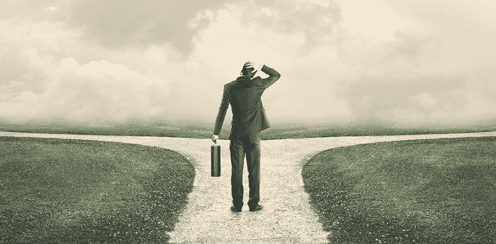

# 40 未来：掌握未来的三张网

和菜头

2022-04-08

## 40 未来：掌握未来的三张网

40 未来：掌握未来的三张网

| 转述师：余昊威 |

**未来，名词。在我的理解中，应该透过对过去的分析，才有可能把握住未来。**

\*

如果有可能的话，每个人都想拥有洞见，可以预见未来。在另一方面，曾经的未来，就是我们的现在，又或者已经成为了过去。此时此刻，我们就在某个未来里。那么，当初我们是否预见到了现在呢？我觉得这才是真正有趣的问题，如果答案是否定的，又是什么造成我们没有能预见到呢？

对于我而言，比特币是个很好的例子。我属于中文互联网上最早接触到比特币的那一批人，但是从那时候开始一直到现在，我都不曾拥有过一枚比特币。说起来我自己都觉得不可思议，因为我是一个随时注册试用互联网新产品的人，但是在比特币还不到一美金一枚的时候，我都没有收藏一枚做个纪念。

这些年下来，我和比特币不多的关系就是写过几篇观察性的文章，认识几个拥有比特币的网友。同样的问题也可以落到我自己身上：为什么在当年我没有预见到比特币会有今天？

简单说，我并没有洞察力，也没有远见。但如今说这样的话又有什么意义呢？比特币或者这个世界并不需要有谁出来认错。

整件事情里，唯一有价值的部分就是思考我当初为什么和未来擦肩而过？  
**也许，我们可以从中汲取一点经验教训，免得下一个未来已经出现在自己面前时，我们依旧懵然不觉。**

我觉得可能一开始都谈不到洞察力的问题，最主要的原因是我在心理上厌恶损失。

站在今天的角度去看过去，不到一美金一枚的比特币可以说是极度便宜。但是，站在当时当地的我，对比特币的评估是风险太高，因为我的判断是它可能随时跌到一美分都不值。一美金的确便宜，但是当一美金有 99%的机会损失掉的时候，这一美金对于我来说就变得很贵，相当于撕碎了直接扔到水里。

今天回过头来重新审视比特币价格的时候，我醒悟到一件事情：当初我没有想清楚一美金购买的究竟是什么。

如果我认为是在购买现实利益，那么一美金的价格的确太高。但如果我认为是在购买未来的可能性，那么一美金的价格就足够便宜。  
**当我立足于现在，并不去构想未来的时候，我一定会极端厌恶风险，并且，我会因此把风险和机会同时规避掉。**

第二个原因是我对于陌生的领域想要诉诸权威。

当时比特币是一种新鲜事物，不要说专家做分析，连持有它的人对于“什么是比特币”都没有统一意见。不单是当时，直到今天人们都还在争论，比特币究竟是什么？它是真的对应所谓算力，还是对应消耗的电力，又或者说是对应着真正的购买力？它究竟能不能算是一种货币？作为货币它有没有实用价值，能不能真正运用到流通领域？

所有这些问题都还在争论，都不断有人发出自己的意见。于是，我在当时看了一圈，觉得所有人都莫衷一是，说明比特币是一个连定义都无法取得共识的东西，它带来的问题要远比它能解决的问题多，并没有谁能一锤定音，所以最好还是不要去碰，因为我认为自己并没有足够的能力去理解这种新鲜事物。

站在今天回过头去看，好像这正是未来的特征。  
**如果一样事物我们可以清晰地定义，一早就能深刻理解，内心毫无任何疑问，那么它还有没有未来就是一件值得打问号的事情。**  
就在当下，人们已经能够理解并且接受，甚至能清楚地构想出它能如何运用，那么它就是一个有边界的存在。有边界的存在很难在未来产生出人意料的变化，因为人们很难突破边界去想象别的用途。当权威可以立即告诉你正确答案的时候，你所能做的事情也就只剩下答题考试了。

最后一个原因是我不相信比特币的野心。野心有大有小，一般来说小一点的野心让人觉得信服，而野心越大也就越是让人感到怀疑。

当初比特币问世的时候，感觉它的目的是为了成为一种全球货币，作为互联网的基础支付方式。这是什么概念？相当于它要成为互联网世界的水和电，成为一种基础设施。

从这个角度去看，我认为一丁点可能都没有。以比特币的门槛之高，交易之低效，大概永远都打不过银行卡和现金，不可能成为所有人的必选项。

这个判断可能是对的，但同时也忽略了另一个问题： **在极大的野心之下，哪怕实现了其中的一小部分，这一小部分在未来也可能是非常惊人的。**  
而对于许多新鲜事物而言，有这么一小部分，其实就已经足够了。一样新事物服务于全球可能很难做到，但服务于 5%哪怕 1%的人口则是有可能的。只要能够做到，那它就是未来的一部分，未来并不需要 100%全占。

这可能是一个视角问题。看待现实的时候，的确野心小一点要好些，否则更接近于吹牛或者撒谎。看待未来的时候，野心不妨有多大放多大，想象力的边界才是未来的边界。

再次重温当初自己的心态时，我也感觉到有些困惑：我自己到底是真的根本不相信呢，还是说太希望它成真，以至于怀疑那只是自己的幻想？我怀疑的究竟是什么？是比特币，还是我自己？

当然，现在一切都已经过去。都不谈政策法规是否允许，购买哪怕 0.1 枚比特币对于我来说也是一笔需要犹豫很久的开支。过去的已经过去，不如把目光投向未来。当我再次谈论未来的时候，这一次我希望自己：

**1.控制一下厌恶损失的心理，把这种厌恶转化为对未来的期待。** 不再以现在的得失作为标准，而是去考虑未来的一个可能性的合理价格是多少；

**2.接受无法定义的事物，而不是简单拒绝。** 看不懂、想不明白很正常，但如果能看懂、能想明白，那么我多半看不到未来，未来不会有它的一席之地；

**3.展望未来的时候，不要用衡量当下的标准来做判断** ，因为这种标准在无限的可能性里会失真，宁可相信自己。

这三条想法是否能够编织出一个最简单的网兜，可以捞起未来？我不敢这么说。在我刚上网的时候，并不存在什么“网络专家”，也不存在什么“业界”，每个人都可以按照自己的心意去摆弄互联网。当我自己也算是一个资深用户的时候，我不单没有参与创建未来，反而对面前的未来视而不见，我认为原因就是内心的体制化。

所谓内心的体制化，就是依赖于过去的经验来判断未来，依赖于专家学者来认识新事物，渴望得到解答而不是自己找寻答案，自行发明创造出一些条条框框，好让自己安全地呆在其中，能在其他人眼中看起来不疯不傻。于是，自己很容易变成现在的观察家、过去的历史学家，唯独和未来没有任何关系。我希望你能避免这样的命运，依然好奇，依然生猛，浑身上下没有任何束缚，朝着未来狂奔而去。

掌握未来的三张网： 1.控制一下厌恶损失的心理，把这种厌恶转化为对未来的期待。 2.接受无法定义的事物，而不是简单拒绝。  
3.展望未来的时候，不要用衡量当下的标准来做判断，因为这种标准在无限的可能性里会失真，宁可相信自己。

公众号懒人找资源

发布留言

0/ *500*

确定

# 41 忍辱：如何降伏你狂暴的内心

和菜头

2022-04-08

## 41 忍辱：如何降伏你狂暴的内心

41 忍辱：如何降伏你狂暴的内心

| 转述师：余昊威 |

**忍辱，名词，佛教中有六种日常修持，称之为六度波罗蜜，忍辱在其中排第三。**

\*

我是个路怒症患者，现在已经好多了。属于那种平常温文尔雅、柔和亲切的人，但是只要一坐在方向盘后面，就会立即长出犄角，变成一个暴躁的恶魔。  
**无论是前车占道、侧面抢道还是后车鸣笛，我都会勃然大怒，觉得这些人都在针对我，必须要全力反击回去。**  
下车仔细想想，又觉得没有什么道理，可能是因为自己觉得有了 2 吨重的钢铁盔甲，内心发生了一些变化，认为对方没有充分尊重我这一身机甲。

上网对我的帮助很大，尤其是在网上写文章，每天能看到千奇百怪的留言。一开始的时候，的确也上火，想顺着网线摸过去，把对方爆锤一顿。后来发生了两类事情，让我逐步改变了想法。

一类事情是我恶狠狠地回复，对方会非常震惊，解释说根本不知道我真的会看留言，更没有期待过我会回复，然后因为我是真人，而且做出了回复，就欢天喜地地跑了，根本不管上一分钟其实他还在留言里骂我，这样的事情发生过很多次。

一类事情是看完留言之后，我大为光火，准备劈头盖脸地来一顿，但是当我点下发送键的时候，突然发现对方已经删除了留言，有时候甚至还重发了一条表达道歉，说是刚才理解错了我的原文，这样的事情也发生过很多次。

我发火是因为我觉得受到了羞辱，又因为是针对我的文章留言，所以我更有理由认为那就是在针对我。而上面讲的两类事情经历多了之后，我不得不去面对两个事实：

**1.站在对方的角度，和站在我的角度，看到的事物完全不同。**  
在别人眼里，我没有那么重要，别人甚至不相信我是真人，有可能是个编辑团队，又或者是机器人自动回复，他们只是有感而发，发送的时候如同在面对一面墙说话，根本不期待能得到任何回应；

**2.每个人都可能出错，未必就是针对我自己，基于理解上的错误那是对方的事情，和我没有任何关系。**  
如果对方能够自行醒悟，那对双方都是一件好事。如果对方抱定了自己的想法，我其实也没有义务去纠正或者解释，因为我的事情在按下发送键的那一刻就已经完成。

通过这两点新认识，我觉得我终于修到了忍辱的门边。在此之前，我对忍辱的理解是一种纯粹的忍耐，默默承受伤害。等来到忍辱的门边时，我才终于体悟到这件事情里没有忍耐的存在。因为只要还存在忍耐的念头，那就一定有爆发的时候。无非是向外爆发，还是向内爆发，这样的事情会往复循环，无休无止，怎么可能会成为一种降伏内心的手段呢？既然存在爆发，所谓内心的宁静又体现在哪里？

羞辱就像是朝自己飞来的漫天箭雨，让人情不自禁地想要防御，想要反击。忍辱的做法并不相同，它要求一个人无论内心升起怎样的恐惧或者愤怒，都暂时不要轻举妄动，而是强迫自己睁开眼睛，盯住飞来的箭头，进行仔细的观察。

在观察之下，会出现很神奇的事情： **绝大部分飞箭并非是真的瞄准你前来，最终也落不到你身上。**  
你自己也不是如同想象中那样，拥有如此巨大的身量，即便是朝着你飞来的那一小部分箭，最终也只是会落到你身边。反而是因为自己轻易地移动，做出迎击或者反攻的动作，才让冲突猛然爆发，最后变得不可收拾。所以忍辱的“忍”，是忍住内心的恐惧和愤怒，并非是要忍耐对方的冒犯和羞辱。

回到路怒症上来，没人知道我的车里坐着的是谁，也没人在乎我是谁。别人要减速，要并道，要鸣笛，只是在对一辆车子做他们认为应该做的事情。基于这个新的理解，我想出了一种忍辱的新法门，这里不妨分享一下：

人之所以会在方向盘后面发怒，是因为认为其他司机在针对自己。那么，这时候不妨换个方式想一想，如果这辆车子里不是坐着自己，而是换任意一个什么人，那些司机的态度和做法会有所不同么？答案很显然，他们还是会该减速减速，该并道并道，该在后面狂按喇叭就毫不犹豫。所以，他们并非是针对我这个人，而是针对我车子的位置或者速度，这就不再是私人恩怨，而是不友善的开车方式。对此，我只能抱怨，但没有理由去愤恨。

由此，又会产生一个新的想法：如果我不是我的话，我会怎么看待这件事？这句话有点绕，简单说的话，我的愤怒是从何而来？之前我说过，开车的时候我感觉是在驾驶一台钢铁巨兽，认为自己外面拥有了一层机甲。而且，我在上车和下车之后完全是两个人。这么说起来的话，我的愤怒和我的车子有莫大的关系。

因为有了一台两吨重的机器，我突然变得不可冒犯了，否则这就是一种羞辱。从这个角度去想，是不是我把自己的自我放得太大了一些？把自己当成了个角色，当成了某根葱，倚仗着某种外物，于是就期待世界应该按照我希望的方式对待我，否则就是一种羞辱？想到这一点，我就像个泄了气的皮球一样，在方向盘后面缩成了一小团，不大不小，刚好就是我的身量。  
**没有人能羞辱我，羞辱我的那个人刚巧是我自己，我让我的自我大到了没边，那么就会迎接无边无际的挑衅。**

我知道许多人都有受辱的经历，有被人针对的经历。那么我希望我关于忍辱的想法能够帮助到你，忍辱不是不断地忍耐，它更像是为自我找到合适的位置，克服自我的某些惯性。如果能经常思考，自己没有那么重要，重要到对方无法忽视自己的存在；如果能够经常思考，每个人应该对他自己的行为负责，而自己并不承担启发教育的责任；如果能够经常思考，别人动怒、冒犯的对象其实是所有人，任何人在那个位置上都会有相同待遇，以此驱散自己被特别针对的恶感，那么一个人就能做到忍辱，不会时常心绪波动，陷入愤怒和不安。

最后，我想问你，也是问我自己一个问题： **当我们陷入愤怒的时候，当我们想要立即反击的时候，那样的事情是极小的事情，还是极大的事情？**  
人们打得不可开交的事情，是世界和平一类的事情，还是一些鸡毛蒜皮的事情？那么，所谓的勇气应该体现在哪里？这是关于忍辱的最后一个提问，希望你能找到你的答案。

1.忍辱要求一个人无论内心升起怎样的恐惧或者愤怒，都暂时不要轻举妄动，而是强迫自己睁开眼睛，盯住飞来的箭头，进行仔细的观察。  
2.是忍住内心的恐惧和愤怒，并非是要忍耐对方的冒犯和羞辱。 3.忍辱不是不断地忍耐，它更像是为自我找到合适的位置，克服自我的某些惯性。

公众号懒人找资源

发布留言

0/ *500*

确定

# “我问和菜头”：我该怎么证明自己是成年人？

和菜头

2022-04-08

## “我问和菜头”：我该怎么证明自己是成年人？

“我问和菜头”：我该怎么证明自己是成年人？

| 转述师：余昊威 |

读者 用户三猫ོ：:

> "作为父母，是否应该及时将成年的孩子赶出家门呢？人何时成年，是父母去判断，还是孩子自己去判断呢？"

我小时候有一部日本动漫电影《狐狸的故事》，里面的老狐狸就是这么做的，把小狐狸赶出家门。  
**当时的中国人看了之后很唏嘘，感同身受，而现在我要回答是不是应该赶出家门的问题，可见时代的变化让人心惊。**

我认为需要赶出家门，原因是人们的预期寿命已经接近 80 岁，平均结婚年龄在大城市已经超过 30 岁。这就意味着每个人可以活更长的时间，势必也就要考虑自己的生活质量问题。  
**如果不能把孩子及时地赶出去，可能他到了四十岁都未必能够成熟，能够对自己的人生负责，那么孩子后续的人生就会让人感到更加忧虑。**  
活得长，婚龄晚，但是人的性格养成和生活习惯并不会随之后推。和父母住在一起很容易变成一种生活方式。对于父母来说，要照顾孩子三四十年，这样的人生就彻底变成了苦役，谈不上什么生活质量。

至于说什么时候成年，开始工作就应该算是成年，无需父母判定，也无需自己判断，父母供养孩子求学的过程结束，走上社会的就是个成年人。

读者 用户王志文：:

> "从上初中开始，我就一直在学校寄宿，基本上没在家里住过，毕业后在家里住了一段时间，可以说是很不习惯，然后找了一份离家稍远的工作，搬出去住了。 "

> "菜头老师，倒过来看，我好像缺失了在家里居住的体验，是不是应该搬回去和家人一起住，把这种不习惯的感觉克服掉，然后再出去独自居住，就好像不入红尘，怎么看破红尘？"

大可不必如此。你的说法就好像是在讲，因为你上学的时候跳级，所以你毕业后有必要回去重修那两年。人生总体的指向是成为独立个体，这个过程可以是循序渐进，也可能是纵身一跃。既然你已经获得了独自生活的能力，那么请继续下去就好。更何况，随着你离开你父母的家庭，他们也有了自己的节奏和风格，你重新返回，大家反而都要重新适应。

说到底，你不是说回“家”，你是说回“父母家”。 **对于成年人而言，自己家和父母家是两个概念。**  
你所谓的居家体验，麻烦在你自己家里寻找和建立，没必要再去打搅你父母的生活。  
**没有什么“先入红尘”的说法，你就在红尘里，是你自己有分别的念头，把自己的家看得太轻，太临时，把家的概念全部投射到你父母家。**  
所以，你究竟在逃避什么呢？

读者 用户喋喋不休：:

> "看到题目我的重点不是“独自居住”，而是如何证明我是个成年人。"

> "多年以来我都一直被这个问题困扰，不知道是不是因为长相原因，始终自带未成年人“光环”。因为家住农村，毕业后选择留在城市，早早开始了租房独居的生活。如今已在城市安家，孩子一天天长大，可我始终没有明白从什么时候开始我已经是一个成年人了。"

不需要你证明什么。 **你承担了你的社会责任，你承担了你的家庭责任，你完成你的工作，你照顾你的家庭，那你就是个成年人。**  
如果你能在你的条件许可之下选择房子，选择结婚对象，选择孩子的医院和幼儿园，而不是屈从于别人的意志，对自己的行为负全责，那么你就是个成年人。

也许，你对自己有不同的看法，对生活有不同的看法，觉得成为成年人要意味着更多，而自己好像和求学时代相比并没有任何变化，  
**那不过是你关于未来、关于成年的想象太多，太理想，忽略了自己在现实中的脚步。**  
成为成年人不会有盛大的庆祝典礼，也不会有神圣的开光仪式，你选择，你承担，你就是个成人。在这个意义上来说，许多不得不自食其力的小孩子，可能在十二三岁就已经成人。

读者 用户山城沱茶：:

> "“展望未来的时候，不要以现在的标准做判断”，这点我觉得很重要，也是自己身上根深蒂固的毛病。但问题来了，毫无根据的猜测和狂想就能窥见未来吗？还是说要在以史为鉴和不受过往束缚这两者之间把握一个度，这个度又怎么把握呢？"

**来，我们一起念三遍：不要“二极管”，不要“二极管”，不要“二极管”。这种非黑即白的思维模式没有任何好处**  
，我说别吃饭，你说问题来了，难道我们去吃沙子泥巴吗？问题是，在米饭和沙子泥巴之间，还有非常广阔的选择空间。我说以现在的标准去判断未来可能会不准确，不等于说就需要毫无根据地猜测和狂想，这两者之间同样存在着非常广阔的选择空间。问题在于，为什么一旦你开始思考一个问题的时候，就自动进入了这种非黑即白的“二极管状态”呢？

接下来，是所谓“度”的问题。这种思考模式假设了事物和某种思考的外力有关，而且这种外力是连续的，所以才有度的问题。就像是给大脑安装一个旋钮，你把它转到刻度 4，就能得出正确答案，转到刻度 6 以上，那就会得到错误答案。问题是，谁告诉你它是连续变化的？谁告诉你掌握了度就掌握了事物？没有人给过这种承诺，也没有人给出过这种模式。更何况，所谓“不受过往束缚”具体是一个什么概念？谁做到过么？如果这个概念无法确定，你的“度”又从何说起呢？

你的问题让我想起了关于“画鬼”的老故事：如果能画出来，那么势必参考了某种我们见过的有形之物，那它就不是鬼，而是寻常事物的变形而已。  
**我们当然都会受到过往的束缚，或多或少，而这些束缚很多都是自己不假思索接受的结论，并未做过任何深入思考和检定。**  
幸好例外非常多，可以让我们拿来进行参考，比如说：飞机这种发明创造，和人类早先认为不可能造出比空气重的人造飞行器之间的关系。

读者 用户胡振强：:

> "菜头叔，我觉得，你虽然没抓住比特币的未来，但抓住了文字的未来啊，世界上少了一个投资家，却多了一个和菜头，不是很好吗？可能，你还是摆弄文字比较在行，比特币错过了就错过了呗，还是要做自己擅长的事情吧？"

那么，文字是否存在未来？未来的读者会喜欢看什么内容？未来的我还可以产出什么内容？问题不是一样的么。重点不在于是否抓住了比特币的未来，比特币对于当年的我而言，它是即将到来的未来。需要检讨的是，我何以错过了这个未来，对于它视而不见。如果这是一种思维上的缺陷，那么我有理由相信，不加以解决或者弥补的话，这种缺陷也会影响到我对其他事物的判断。哪怕是自己所擅长的事情，放在更长的时间维度上，依然存在关于未来的问题。

现在换我问你：那你觉得未来的文字工作者，是在传统的小说、散文、随笔、评论领域存在更多机会，还是电影电视剧剧本领域？还是说正在崛起的剧本杀领域？又或者是同人文创作领域进行 IP 扩张？你觉得未来的读者群，在上述哪一个领域内规模会不断扩大，引发出新的文学创作模式和新的文学消费习惯？所有人在所有领域都面临类似的问题，一句“做自己擅长的事情”，只是个思考上偷懒的理由。

1.人生总体的指向是成为独立个体，这个过程可以是循序渐进，也可能是纵身一跃。  
2.成为成年人不会有盛大的庆祝典礼，也不会有神圣的开光仪式，你选择，你承担，你就是个成人。  
3.我们当然都会受到过往的束缚，或多或少，而这些束缚很多都是自己不假思索接受的结论，并未做过任何深入思考和检定。

公众号懒人找资源

发布留言

0/ *500*

确定

# “我问和菜头”：如何才能成为情绪的旁观者？

和菜头

2022-04-08

## “我问和菜头”：如何才能成为情绪的旁观者？

“我问和菜头”：如何才能成为情绪的旁观者？

| 转述师：余昊威 |

读者 用户多多：:

> "叔，我观察到在现实生活中，愤怒很多时候是一种解决问题非常有效和便利的手段。"

> "我生活的地方人民普遍火气都很大，办事时常常因为一些小问题大为光火。发火又的确可以换来办事人员的重视，使得问题得到快速解决。"

> "所以我想是不是在清楚做到忍辱后，恰当地使用愤怒也是一种很好的生活方法？但是又如何把握这个度呢？"

这是个很好的问题，我没有预料到有人能够想到这一层。你说的没错，很多时候人们内心保持冷静，但是选择主动扮演愤怒的样子，以达成自己想要的结果。这件事情在管理领域内尤为常见，为了激励或者劝诫下属，要求上司做出极度愤怒的样子，以此唤起下属的足够重视。

不过在你的例子里，愤怒更像是一种诈唬，未必每次都能起到作用，因为其实双方的地位并不对等，你的时间和金钱是有限的，而对方因为可以轮班的缘故，几乎接近于无限。更何况如果某个地方的人都喜欢用发火的方式来解决问题，那么当地人对愤怒也相应地有很高的承受度，发火也就失去应有的效用。总之，主动运用愤怒来解决问题是个很微妙的法门，只有在人际关系上天性聪颖之辈才能熟练运用。

读者 用户钟林月晓：:

> "菜头叔，以前我总会因为没能及时地回怼别人的语言冒犯而懊恼，心想如果当时能如何如何说就好了，可是下一次还是会遇到同样的问题。 "

> "但是，最近有了变化：面对类似问题的时候，我不再想着如何反击了，而是顺着对方自嘲一下，过后好像也很少懊恼了，这样不知道离忍辱还差多远？"

我觉得已经很近了，祝贺你。另外分享一点我个人的心得： **很多时候我们之所以觉得别人在言辞上冒犯了自己，很可能是我们见过的世界太小。**  
以前我在网上非常讨厌一个省的人，每次看到他们的留言，那种说话的风格就让人按捺不住心头怒火，想顺着网线爬过去暴打一顿。后来我才了解到，这个地方的人在开玩笑的时候大多是这么一种风格，算是当地风俗，在他们看来这是表示友善和幽默的方式。对于不熟悉他们的人来说，听起来就像是在骂人。仔细计较一下的话，他们留言的时候出发点并非是恶意的，哪怕我不喜欢这种风格，但也不应该理解为一种攻击，否则就是自找罪受。

读者 用户小雨轻凉：:

> "叔，我有个问题想向您请教，据我观察，现实生活中有一部分人在白天被现实消磨得很惨后，内心积累了一肚子躁动或者说愤怒吧，之后他们又转而将这种情绪通过网络发泄出来，比如说在帖子下面激烈地互怼，甚至打游戏都能开麦互喷到整把游戏结束。  
> "

> "所以，您对这种通过网络发泄自己情绪的行为怎么看呢？"

我听厌了这套逻辑，在我看来，这就像我们小时候父母经常体罚孩子，随后解释说是因为自己在单位里受了气。这根本是两回事好吗？受不受气，和打不打孩子之间没有必然逻辑关系，没有什么因为所以。  
**孬就是孬，体罚就是体罚，不存在什么因为孬，所以就只能惩罚弱小撒气的说法。**

你所说的这种人我在网上遇见过，遇见我就算是踢到了钢板，的确也有人事后解释说自己之前受了气，现实压力太大，还请谅解之类的话，这就让我更加看不起。根本没有什么借口，也没有什么歉意，就是单纯地仰慕强者，挥刀向弱者罢了。挥得动就放纵，挥不动就下跪，实在让人瞧不起。

读者 用户王丹：:

> "经常会被别人说我特别能忍，碰到一些让我有情绪的事情，一部分是我觉得不值得计较，另一部分是觉得不敢……有时我也在思考，过多的忍，是否是心理的懦弱？"

你是不是可以从另外一方面来看待一下这个问题，不忙着对自己下判断？之所以你会忍让、退避，只不过是没有触及到你最在意的东西，或者说你在这个世界上在意的东西很少？如果是这样的话，一个人的耐受力的确会变得很强。或者如同我一样，在许多人都会在意的事情上毫无感觉，在许多人觉得无需在意的事情上一碰就跳起来？别人和你对事物的判断可能并不一样，你们珍视的东西也可能不一样，所以各自的底线并不相同。除非你有生以来从未反击，否则就不应该轻易地认定自己怯懦。尤其是在别人的判断中，人们之所以那么说，有时候只是希望以此激你去顶雷，好看个笑话而已。

读者 用户打怪升级：:

> "菜头兄好，根据我的理解，您的忍辱观一个核心是要弄清楚对方产生一个行为背后的逻辑是什么，有了合理性的解释，自己就会从愤怒中走出来，像一个旁观者一样，忍辱也就达成了。"

> "之前谈论关于负面情绪、有趣等话题的时候也有类似的观点，跳出自身，以旁观者的身份审视自己，这样就会是一个“在场”的状态，一些情绪也会被我们看清楚。"

> "那么想请教菜头兄，如何才能成为一个旁观者呢？"

**一方面你需要养成观察自己的习惯**  
，在任何情绪涌起的时候，能够稍微抽身出来几秒钟，意识到“我正在生气”“我正在难过”“我正在喝醉”。这一点其实并不难做到，因为情感不总是异常迅猛，总有缓缓升起的时刻，这会给你足够的时间和空隙去进行观察；  
**另一方面你需要经历一些极端的情感**  
，去体验这种情感来袭的感受。许多人都在没有意识到自己愤怒的情况下，就已经发火了。如果你对于极端的情感有意识地进行过感受，能够回忆起那一瞬间它如何夺走了你的理性，充斥了你的身心，那么你就能够进行把握。最糟糕的情形是在情感唤起和爆发之间没有任何停顿，变成了一种条件反射，那么你就被具体的某种场景所控制，只要出现这种场景就能触发你的反应，这就是一种束缚。  
**本质上，忍辱是为了获得内心的自由，去除一切束缚，所以，你如果内心存在对自由的追求，那么你或多或少总是能达成部分自由。**  
相反，如果你只是为了制怒，那总有水坝拦不住洪水的一天。

读者 用户 Jason\_ 章：:

> "和老师，从未独自居住过的人除了和父母关系紧张之外，还会有哪些其他“缺点”吗？"

大概率上来说，父母对自己的爱是无私的，不计任何回报的。这样一来，孩子就往往觉得在父母家的生活里一切所得都是理所应当。我看过一张漫画，内容是母亲节，孩子说让母亲在这一天休息一下，所以请了人来代替母亲的日常工作。于是，门口站了一堆人，包括厨子、园丁、清洁工、医生、维修工、保姆、司机在内的各色人等。事实上，作为成年人这一切都应该是你去完成，或者是去花钱雇人完成的工作。但是因为你住在父母家，你的父母免费为你做了这些工作。这样，你就不知道什么是生活，更不知道什么是生活压力，连带你也不会体会到在生活压力之下如何和他人相处。这样一来，无论你多大年纪，你都依然是个孩子，无法一个人在社会上独立生活下去。换句话来说，你变成了你父母的负担，这是非常大的缺点。而你如果对成为负担心安理得，那么你父母就有足够理由心安理得地安排你的人生，这将是更大的缺点。

1.主动运用愤怒来解决问题是个很微妙的法门，只有在人际关系上天性聪颖之辈才能熟练运用。  
2.别人和你对事物的判断可能并不一样，你们珍视的东西也可能不一样，所以各自的底线并不相同。  
3.本质上，忍辱是为了获得内心的自由，去除一切束缚，所以，你如果内心存在对自由的追求，那么你或多或少总是能达成部分自由。

\*本文中出现的“怼”字，正音为四声“duì”，为便于听辨和理解，音频中读为惯用音三声“duǐ”。

公众号懒人找资源

发布留言

0/ *500*

确定

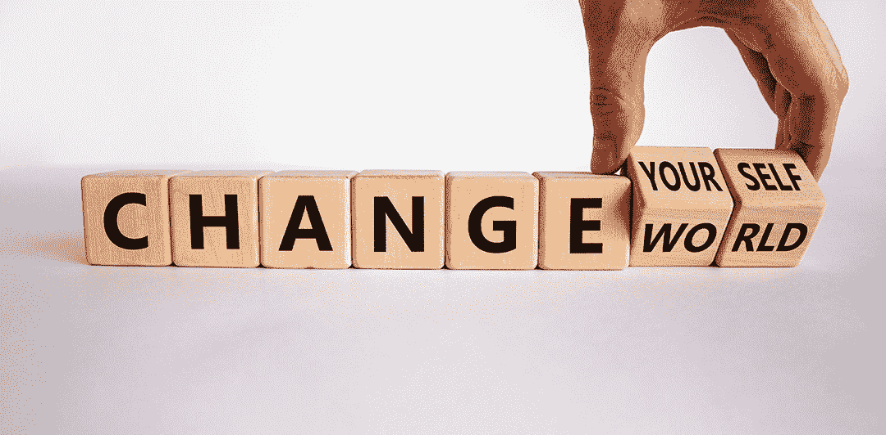

# 42 改变自己：重要的是先认识你自己

和菜头

2022-04-08

## 42 改变自己：重要的是先认识你自己

42 改变自己：重要的是先认识你自己

| 转述师：余昊威 |

**改变自己，指一种虚妄的想象，以及通往责备自己的快速路。**

\*

我不赞同“改变自己”的说法，尽管它非常流行。  
**我认为人是很难改变的，而且，等真正发生改变的时候，可能和“改变自己”这个念头或者相应的做法根本没有多大关系。**  
在过去的岁月中，我也曾经受过“改变自己”的折磨，如今我已经从这个念头中解脱出来，可以试着和你讲讲它究竟是怎么一回事。

言辞永远都让人迷惑，因为它们会遮掩真实意图，有时候连说这话的人也会遭到蒙骗。什么是改变自己？实际上它说的是换一个更好的自我，变成理想中的自我。什么是“更好的自我”？其实这说的是更加符合社会期待、他人期待的自我，可以获得更多认可。这就像几年前曾经一度流行的说法一样：人的性格可以改变。这句话背后的意思是性格决定命运，那么改变性格就可以改变命运。当然，我同样也不赞同，我觉得改变性别都要比改变性格容易，否则所有的性情大变故事前面，就没有必要加上一段关于人生大起大落的解说。

我也曾经想过改变自己，比如说做个早起的人，每天争取看到朝阳，不再每天熬夜。或者做个会收拾家的人，起码让我的工作台看上去整整齐齐，不再经常发生书崩。但是我做不到，因为晚上到点我睡不着，因为我认为整齐的工作台反而降低了我的效率，让我在创作的时候有拘束感。但是我已经决定改变自己，当我意识到我无法改变时，我就会感觉到极度受挫，而且陷入深深的自我折磨之中。“我废了，我完了，我这辈子就是这样了”，这些想法我都亲身体验过。

现在再来看，痛苦的原因就是我动了妄念。我想要改变我自己，也就是去追求一个理想中的自我。  
**这同时也就改变了我对自己的看法，我否定了我的现在，我认为存在一个光明的彼岸，因为苦于无法抵达而陷入痛苦。**  
问题是，在想着改变自己之前，难道不应该先问一句“我是谁”么？

我是谁，我猜大部分人都不能第一时间直接给出肯定的答案。因为对于这个问题我们想得很少，  
**我们宁可花费许多时间去想“我有多么糟糕”，也不愿意花一点点时间去思考“我是谁”**  
。发现这里隐藏的巨大风险了没有？在我们还没有对自己拥有清晰的认知之前，我们就认为需要改变。这就像一个拆弹专家，根本没有研究线路的情况下，就准备直接下剪刀剪断一根导线，而且相信一定能够成功。

针对我自己，我做过一些简单分析。这件事一点都不复杂，保持诚实直率的态度就可以了，反正是自问自答，并没有第二个人知道发生了什么。我问自己是觉得晚上创造力更高么？回答是肯定的。我又问自己每个晚上都创造么？回答是否定的。我再问自己不创造的晚上都在干什么？回答是，是在玩。我最后又问为什么宁可玩都不去睡？回答是玩起来注意不到时间。那么，第一个结论就出来了，我是一个贪玩并且缺乏自控力的人，这就是我。

重复这个过程，继续一路问下去，我大概想明白了问题出在哪里：因为白天没有什么值得我全力以赴去做的事情，也激发不起我的兴趣，所以我对白天没有多少期待。相比之下，晚上可以专心致志地玩，由此产生的快乐和兴奋远远超过白天。这样的一个人并不让人满意，但是没办法，这就是我。承认这个人就是我，自然也就明白改变自己是句空话。因为我每天早上 7 点半强迫自己起床，刷牙洗脸吃早餐，然后我就对白天充满期待了？就有什么事值得我全力以赴去投入了？并没有。既然没有，我早起的理由就依然缺失，我就还是每天晚上玩到很晚。但是的确有一点不同，和过去相比，此时的我会一边玩一边责备自己了，学会了带着负疚感和自我鄙视去玩。

现在我起得很早，每天大约 6 点多 7 点就能起床，我的工作台也很整齐简单。是因为我决定改变自己么？并没有。只是因为我每天要做的事情变多了，而且很重要的一点，这些事情都是我想要去做的。所以，我突然感觉到时间不够用，尤其是白天的时间不够用。因此，我得重新安排我的作息时间，好把每天固定要做的事情放进固定的时间段里去，这是现实要求的结果。我的工作台那就更简单了，因为我需要提升工作效率，提升工作效率要求我专注在同一件事情上，原先堆放的文件、书籍、资料就可以全部扔掉，因为它们和我手头的事情完全无关，并不是我突然爱上了整洁有序。

至于说我为什么每天要做的事情变多了，那是因为我又找到了一点生活目标，为工作找到了一点意义。目标不大，意义不多，但是比之前要强一点，刚好够用，足够我能每天早起。这也是我对自己的认识——虽然我贪玩又缺乏自控力，但我把所有的作战都理解为一种游戏，我热爱作战，喜欢完成那些看起来相当艰巨的任务。所以，找到几个任务开战，我就又可以全功率运转起来。是我想要改变自己么？看起来我的确是发生了改变，但那的确不是我自己主动去改变的。

我认为和改变自己相比，认识自己更为重要，而且更为实际。与其努力达成自己理想中的那个自我，不如清点一下自己，看看自己喜欢什么，厌恶什么，擅长什么，内心真正需要什么。想明白了这些问题，努力为自己创造一个有利于发挥天性和特长的环境，那么改变会自然到来。我也想清隽儒雅，身材瘦削，一袭青衫随风飘扬，吹乱了满头乌发。但我是个胖子，而且是个秃子，大概这辈子都做不到人们想象中的那个样子。所以我就不去动这样的妄念，在购物网站翻一通宵的新款青衫。但我可以运笔如风，一挥而就，而且擅长抚慰人心，道出他人心中所想，那我就去做这样的人好了，努力争取做得更好一些。

过去让我为难的地方，是我始终想把写作当做是一种业余爱好，不要把爱好变成职业，担心这样会彻底毁掉自己的爱好。但是后来我也想明白了，起码写作的时候，人们还需要我，我对社会还有些价值，多多少少能改变几个读者的心态。这么看下来，一定不能专职写作，怕也是我自己画出来的一个框，也是我对自己的某种幻想，认为自己可以在别的领域做出更大的成就，也是为了理想中的自我而活着，于是这个框把我一套二十年，始终不得自由。

但我真的就是个擅长写字的人，远比其他能力突出。想通了这一点，接受了这个事实，剩下的事情都变得异常通畅。我希望你不需要走这样的弯路，更希望你能一早面对自己。无论是好的，还是坏的，都能够诚实面对，坦然承认。  
**知道自己是谁，就不容易陷入想象，也不容易遭受诱惑，全部心力也可以投入到对自己真正有效的方向上去。**  
而所谓的改变自己，那大概是前进路上顺便发生的事情，这种事情是没有办法扮演出来的，也没有办法通过努力而得来。因为那就根本不是你，不是你的东西，你永远保管不了。

1.我想要改变我自己，也就是去追求一个理想中的自我。这同时也就改变了我对自己的看法，我否定了我的现在，我认为存在一个光明的彼岸，因为苦于无法抵达而陷入痛苦。  
2.与其努力达成自己理想中的那个自我，不如清点一下自己，看看自己喜欢什么，厌恶什么，擅长什么，内心真正需要什么。  
3.知道自己是谁，就不容易陷入想象，也不容易遭受诱惑，全部心力也可以投入到对自己真正有效的方向上去。

公众号懒人找资源

发布留言

0/ *500*

确定

# 43 开玩笑：小心拿捏这根红线

和菜头

2022-04-08

## 43 开玩笑：小心拿捏这根红线

43 开玩笑：小心拿捏这根红线

｜转述师：余昊威｜

**开玩笑，一种社交方式，本意是活跃气氛，拉近距离，但同时又是一种非常危险的人际沟通方式。**

\*

其实应该在学校里专开一门课程，教学生如何开玩笑。因为开玩笑很危险，弄不好就会引火烧身。我在初高中的时候，自我感觉口才很好，经常在人前逞能，随口说笑，肆无忌惮。后来从老师到同学都来找过我，专门和我谈开玩笑这件事情，告诫我说：“你可能在无心之间就伤害到了别人，虽然在你看来只是开了个玩笑。”

此后的三十年间，我不断练习——你可能不大理解这一点，因为我喜欢看到别人笑出声，我会从笑声中获得成就感，所以在老师和同学乃至后来的领导告诫之后，我还是继续开玩笑，并且把它当做是一门技艺来进行锤炼。不过在经过了那么多年之后，我依然不确信我能开对玩笑。

有句不知道是哪里的谚语说过， **棍子能打伤皮肉，舌头却能打断筋骨，笔墨能够杀人无形。**  
这说明人们对言辞和文字的深深戒惧，把它们归入兵器一类，杀伤力还在棍棒之上。玩笑属于口舌是非的一种，也属于兵器。当然，它的目的本身并不是为了伤害别人，只是想用这个方式表示亲昵，拉近彼此距离。

微妙的地方就在这里，人在笑的时候浑身酥软，没有什么抵抗力，需要对非常信任的人才能笑出声来。而开玩笑本身依然是件兵器，所以让人笑不是个能力，对方能让你用狼牙棒挠胳肢窝，这才是超凡的能力。这是我很晚才想明白的道理，能开玩笑不是自己讲笑话的能力强，而是对方能容忍你。

容忍什么？需要容忍的东西实在是太多了。两个人面对面坐下，他们之间看起来只有空气和虚空，最多还有一些飘浮的尘埃。这不过是用肉眼看到的景象，如果换上真实之眼去观察，每个人身上都密密麻麻飘满了不可触碰的红线。为什么人们会成为好朋友？  
**成为好朋友的底线其实就是用肉眼观察对方，凭借着敏锐或者是运气，成功避开对方的红线，于是大家可以在很长一段时间内相安无事。**  
因为这种彼此相安无事的人特别少，所以朋友才会显得非常珍贵。

一个人在意自己的相貌，在意自己的收入，在意自己的社会阶级，在意自己的生理缺陷，在意自己的妆容，在意自己的语调，在意自己的品位，在意许多你根本想象不到的东西。看起来每个人都差别不大，而且都用相同的方式言谈行事，但是我们谁也无法深入对方的内心，知道其中的所思所想所感。所有那些飘浮的红线，一方面可以视为是一种禁忌，但另一方面也可以视为自我的体现。因为在意，所以才成为禁忌。为什么在意，因为那就是自己，起码是自己的一部分，而且是需要小心保护的那一部分。

在我高中时代，和一个女生开了一句玩笑，对方就立即痛哭失声。当时我们有一支班级排球队，差不多可以横扫整个年级。不过在校内联赛的时候，遇到一支劲旅，被打得溃不成军。我在场边观赛，发觉那天的女队长好像起跳有问题，最多能蹦起来二十厘米，完全失去了弹跳力。我注意到她穿了一条踏脚裤，一种当年很古怪的流行服装，裤脚有一根带子，穿裤子的时候要把带子踩在脚下踏进鞋里，估计这样会显得腿比较直。

于是，在叫暂停的时候我对她说：“怎么今天弹跳突然不行了？难道是因为踏脚裤的缘故？”结果她听完蹲在地上开始嚎啕大哭，把我吓得不轻。到今天我都不知道为什么，她是因为比赛艰难却没得到理解，还是单纯为了我说她的裤子而感到委屈？总之，我一定是触碰到了什么她非常在意的东西，但是我并没有意识到这一点。

这就是我后来才明白的事情：玩笑总在两个人之间，玩笑的对象也只有自己和对方，不会落到第三方头上，否则也就失去了开玩笑的意义。然而，落在对方头上的时候，你并不知道会触碰到什么红线，也并不知道对方是否真的在意，其中的分寸非常难以拿捏。  
**有些时候，误触红线，会是一件非常危险的事情，你认为是在开玩笑，对方则会视作一种针对自我的攻击。**

那么，什么又是拿捏分寸？分寸如何体现？我觉得这就跟炒菜的火候一样，如果不想当成是玄学的话，那么就只能靠练习来掌握。但这毕竟跟炒菜不一样，菜火候不对还是可以吃，但是开玩笑易学难精，也许还没等到自己练到大成，周围已经根本没朋友了。所以，我一步步推演，又得出了个结论：开玩笑首先要追求的是无害。不要追求效果，先追求无害，没有人在这个玩笑里会受到伤害。怎么样做到无害？就我所知，大概有两个选项：

1.尽量说废话。废话是什么？就是没有意义的话语。没有意义难道也有优点？当然有，一句话如果拥有意义，那么就一定存在解读意义。  
**一旦开始解读意义，就很可能发生误解。在所有的误解当中，人们会偏向于那些对自己不利的解释。**  
这也不能怪别人，人类就是靠这样的思考逻辑进化而来，躲避了各种各样的灾难，利用忧患意识不断变强。开玩笑时候说的话如果有意义，那就永远会在对方那里撞上一堵墙：他说这些话，是不是在针对我？废话不针对谁，废话甚至不屑于掩饰自己是废话，明确地让对方知道，这是为了大家好。

2.尽量自嘲。自嘲不是示弱，而是表示亲善。既然大家都明白，在对方身边有无数看不见的红线飘飞，那么自嘲一方面显示了哪些话题处于安全区域，大家可以放心开玩笑，完成了破冰；另一方面也表示自己是个宽容的人，相处的时候不用太过紧张，不用担心说错话。所以有一种说法称“成熟的人才能学会自嘲”，我估计是因为再学不会自嘲的话，周围已经没有亲戚朋友了。通过自嘲的方式开玩笑，比说废话类型的玩笑要好一些，因为起码人听完之后不用笑得那么勉强。

以说废话和自嘲的方式开玩笑就安全了吗？怎么可能。我也只能说相对安全一些，人的心思哪里有那么好猜度的？说废话也会让人觉得对自己不尊重，或者根本不愿意和自己聊天；自嘲也会让人认为是一种讽刺，毕竟喜剧演员在舞台上就是那么干的。是不是感觉很绝望？觉得开个玩笑的难度都那么大，做人实在是太艰难了？不用紧张，且让我分享一点我目前的最新心得：

无论如何，还是要开玩笑。 **开玩笑可能会伤害人，但是，一个不开玩笑的聚会大概也谈不上什么聚会，就像是从来不辩论争执的朋友不算朋友一样。**  
只要自己玩笑的出发点是良善的，那么不适当的笑话多半也能获得谅解，一直开这种玩笑就会变成一种个人风格。同时，开玩笑也是一种筛选朋友的方式。能够容忍你，你也能容忍对方，双方都开得起玩笑，说明你们之间有默契，不需要小心翼翼地相处，这样人世间才能让人呆得下去。

1.能开玩笑不是自己讲笑话的能力强，而是对方能容忍你。 2.开玩笑首先要追求的是无害。不要追求效果，先追求无害，没有人在这个玩笑里会受到伤害。  
3.开玩笑可能会伤害人，但是，一个不开玩笑的聚会大概也谈不上什么聚会，就像是从来不辩论争执的朋友不算朋友一样。

公众号懒人找资源

发布留言

0/ *500*

确定

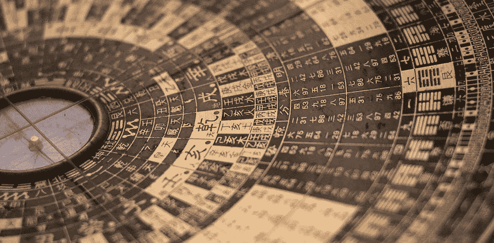

# 44 算命：怎么看待命运这件事

和菜头

2022-04-08

## 44 算命：怎么看待命运这件事

44 算命：怎么看待命运这件事

| 转述师：余昊威 |

**算命，名词，指解读揭示个人命运轨迹的能力，在带给人心理抚慰的同时，期待也同样增多了。**

\*

许多人都问过我关于算命的事情，每到这种时候我就反复检讨自己，是不是说话做事给人一种无所不知的感受？那最好要收敛一点，免得挨雷劈。我自己对算命没有多少兴趣，但是我碰巧认识一些从事这一行的人。说老实话，我更喜欢观察他们，而不是很在意他们的铁口直断。  
**总体上来说，算命的人比算命这件事更有趣。**

我很小就从我父亲那里听说过，他幼年时曾经请人专门来算过命。回想起来，那应该是个神婆，类似寨子里的巫医一类的角色。原话是说他“将来会离开祖先的宅基地很远”，我奶奶听了就很着急，不想儿子离开身边太远，就请求神婆解释一下什么意思。神婆估计是看出了她的担忧，就说可能是去省城做工一类的事情。后来，果然我父亲从云南去了新疆，从中国的西南角跑到了中国的西北角，春节假期回来一趟，有一半时间都浪费在了路途上。

按照我父亲的看法，那个神婆算命算得很准。 **不过我有我的看法，我觉得他一早就想跑很远，但是内心估计还是放不下家乡，所以就用算命来平复心中纠结。**  
他支持神婆的预言，那是因为神婆越准，他需要为自己当日的选择背负的重量越少。背井离乡那是命运的决定，并非是自我的选择，这样他在自己的人生里可以当一个安稳的旁观者，不用去问那种人人都觉得痛苦的问题：如果当初我选择了……

对于我来说，我听完这段往事，第一句话是问，还能不能找到那个神婆？我的想法和大多数人一样，既然存在那么一位神人，那不如请她也为我算一回命。那时候我还是个孩子，对人生和命运还有很多好奇，等不了时间一页页翻开，呈现出结果，迫不及待地想要翻一翻答案。回答当然是没有，这一类的故事永远都是如此，神人隐退在时间的迷雾深处，想要再找的时候早已经不知所踪。我觉得未必是找不到，只是说这种故事需要这样的神秘色彩，命运才有如烟似雾、难以琢磨的效果。

我知道的第二位命师是位专业人士，自称“受过箓”，是有证有照的火工道士。我非常喜欢这位大师，他的性格里有一种让人难以抗拒的命运感。大家比较熟悉之后，我就诚心诚意地请教他，说您老人家行走江湖，为什么不见身上带着法器？他反问我说，你觉得我应该要带什么法器？我说，您都没有个罗盘什么的，也没有笔墨纸砚排命盘。他老人家听完呵呵一笑，从兜里掏出一台 iPad，非常熟练地打开一个 App，立即在屏幕上显示出一个电子罗盘。他很得意地说：“看到了吧？谁还背什么罗盘？一个 App 就搞定了，方向还准。”又打开一个 App，是个电子命盘，继续说道：“算什么算？用这个点几下就给你排好了，为什么每次还要我亲自动手？笨！”我看了心悦诚服，觉得是不是高人另论，但起码是个通达之士。

朋友介绍他和我认识，并且坚持要了我的生辰八字送了过去，请他给我算一次命。应该说还是挺准的，后来的事情应验的很多。说我几岁转运，几岁开始赚钱，基本上都很准，前后不超过半年。我内心其实有些惊奇，因为在我身上有件很奇特的事情，那就是我没有出生证，问我母亲，我母亲居然也不记得我是几点出生，是上午还是下午。所以，算命的时候我只能编一个时间，但他还是算得很准。我和大师说了这件事，大师让人喜欢就在于这种时刻，他浑不在意地一挥手，说没关系，他也要看算出来的结果是不是和我相符合，如果对不上的话，他自己也会去调整。我当时大为钦佩，觉得命师术士也遵循科学的实证精神，实在是难能可贵。

但我那时候已经接近四十岁，对于算命的态度有了很大的转变。对于他给我算的命数，并不那么在意。更喜欢拉着他聊天，请他和我说说各种神异之事，因为他有另一套世界观，和另外一套世界运转的规律，也能自圆其说，于是让生活变得丰富多彩。大师也给自己算过命，而且根据结果做了许多手布置，包括给家人改名甚至改姓。但是大师也没有逃过自己命中注定的劫难，最后一次听到消息是他被人追捕，不得不跑路，从此消失在茫茫人海中。

为什么我对算命的态度有了那么大的转变？因为就我的观察，无论是观察朋友，还是观察我自己，发现算命都避免不了第二步，而第二步是个麻烦。无论是怎样的命，算出来总有好的部分，也总有坏的部分。人性又从来贪图圆满，好的部分会欣然领受，觉得理所应当。但是对于坏的部分却根本放不下，非要去做第二步，那就是请求命师想办法转运或者是改命。

无论是哪一种，结局只会有两个，一种是有效，一种是无效。如果是有效，那就会发展到第三步，要求长期化，固定化。如果是无效，那就更糟糕了，  
**人心会认为算得准，但是解法不灵，因此要去别处求取解法。**  
于是，都会有第三步、第四步，没完没了。本来没什么事，对付着也都能活。但是一旦动心起念，那就会在这条路上越走越远。我有些朋友，到处找大师算命，感觉是一定要算出满意的一命来才能停止，但这又怎么可能有停止的时候？所以，为了防止自己的心不安宁，不断向外求取，我后来直接拒绝算命，把命运当做是抽盲盒就好。

有一本小书对我的转变帮助很大，它是一本小册子，读起来很轻松，叫做《了凡四训》。内容讲述了凡这个人遇见了一位命师，算定了人生中的所有重大事项，而且每一次都得到了应验。于是，他知道自己能活多久，安安静静地等待那一天来临，对于人生再无期待。但是，他最终还是从定数中逃离出来，得到了命中本来没有的孩子，而且活过了预言中的寿数很久。如果你对算命非常有兴趣，不妨找这本书来翻一翻。虽然主题是劝人向善，多做好事，以此改变命运，但是，其中认为命运可以改变的观点倒是非常刚健乐观，让我非常喜欢。事在人为，总比一切注定要好些。  
**即便从梦幻、从游戏的角度来理解人生，自己手里多少能控制一点，也要比被动接受来得强。**

我知道询问算命事项的人都遇见了生活中的挫折、人生中的苦楚，觉得是命运的缘故，自己才会被反复戏弄。不过关于这件事情我是这么看的：命运给与我们慷慨的馈赠时，我们好像也并没有做什么特别的事情，它也就自然而然发生了。如果命运要降临惩罚时，我们好像也做不了什么特别的事情，该来的总是会来。从另外一个方面来说，如果命运慷慨赠与时，我们可以坦然接受，觉得理所应当，那么当命运降下惩罚时，不也是一种理所应当么？我们又有什么特别，会认为自己为天地所钟爱，除了好命就只有好命呢？

1.即便从梦幻、从游戏的角度来理解人生，自己手里多少能控制一点，也要比被动接受来得强。  
2.如果命运慷慨赠与时，我们可以坦然接受，觉得理所应当，那么当命运降下惩罚时，不也是一种理所应当么？

公众号懒人找资源

发布留言

0/ *500*

确定

# “我问和菜头”：好笑有客观标准吗？

和菜头

2022-04-08

## “我问和菜头”：好笑有客观标准吗？

“我问和菜头”：好笑有客观标准吗？

| 转述师：余昊威 |

读者 用户 eaTong：:

> "都说性格难改变，但是我确实存在因为自己意愿从而改变性格的经历。比如高中的时候觉得自己太闷，一个星期可能不会说超过十句话，后来变成在几百个人面前说话都不怯场，也能很容易跟陌生人搭讪交谈。再后来转行做程序员，话又少起来，而最近又因为做管理，以及跟客户沟通的次数多，说话又多了起来。  
> "

> "所以想问的问题是：是不是所谓的容不容易改变，只是因为意愿够不够强烈？"

我也同样如此，我可以对着数百人讲演，但也可以一整天不说一句话。不过在这两个场景下，体现出来的自我并不相同。做讲演的时候，那是社会化的我，作为成人我有需要承担的责任和义务，无论是讲演，还是聚会，又或者是谈客户，起作用的是社会化的我，它是纯功能性的，我能做到而已。但是，回到家安安静静待着，整天不发一言的，那是真实的我，也是真实的性格。我能做到并不等于我喜欢，也不等于我就是那样，无非是成人应付社会的能力而已。如果去掉外力，去掉约束，可以让自己回归到自然的状态，那么你还是你，你的性格还是原先的性格，并没有改变什么。

读者 用户周华卿：:

> "菜头叔，你说改变自己首先要认清自己，我觉得这也是对自己的小历史进行定义的过程。你通过自己的实际经历得出自己就是“一个贪玩并且缺乏自控力的人”的结论，这样的结论固然是认清自己的结果，但与此同时这样的结论是不是给了自己一种限定和束缚，把自己装进了一个套子，从而不敢去尝试人生的更多可能？"

你不能说一个体重 300 斤的大胖子选择不去跑马拉松，那就是他对自己自我设限，因为真的会死掉的。但是，他的确可以从慢走开始，一点点加量，慢慢减掉体重，最后真的去参加马拉松，这样的例子在日常生活里是有的。  
**认清自己，知道自己的弱点和毛病，这是自我修正和提升的开始。**  
如果你一开始以自我设限作为理由，拒绝直面自己，那已经是讳疾忌医了。你都不承认自己有弱点，那你朝哪里突破呢？只需要你想，你就能做到？那是美国白人中产阶级家庭里男孩子的想法，作为梦的一部分出现，现在这个梦也已经破灭大半了。

读者 用户李姗：:

> "我并没有一个非常非常坚定的目标，能够充分调动我的兴趣和长处，唤醒我坚定改变的意识。在这种情况下，我只能勉强自己去做一些“改变自己”的举动，靠意志支撑起前进的行动。比如早起早睡、坚持锻炼等，这些所谓有复利效应的事情。"

> "难道坚持做这些事情改变自己，是一种妄念吗？人最终还是会被现实和内心的压力所击溃吗？"

如果你也读过我先前的文章，应该知道我不大赞同“坚持”“自律”这些概念。我反复说过，一件事情只要是需要去坚持，那么结果多半就是放弃。世间当然有心志坚毅之辈，可以坚持到底，但这样的人太过罕有，大部分人做不到这个程度。所以我才会一再强调，首先是内心的觉醒。

在编剧理论中，经常会谈到人物角色的 Need 和 Want，Need 是说人物内心真实所需，Want 是说人物对外欲望所求，人物塑造的核心是让角色的 Need 和 Want 方向截然相反，那么就会产生出真正的戏来。

按照你的描述，你现在也处于某种戏剧化的冲突之中——你认为可以通过坚持，通过意志力去满足你的 Want，但是它可能和你真正的 Need 没有任何关系，所以你会感到非常吃力，觉得难以为继。对于每一个人来说，认识自己，找到内心的 Need，才会拥有真正的人生动力，也才会有真实的改变。  
**说到底，也并不存在改变，而是你尘封已久的真正自我终于显露出来，之前它可能被你遮蔽、扭曲、变形了太长时间。**

读者 用户马昌钦：:

> "看完文章后，我尝试对自我进行重新认知。可每当我想到自己的缺点，心里就会产生焦虑，然后极度否认，并试着告诉自己可以采用一些行动去掩盖它。我这是对自己的成长太没有耐心了吗？  
> "

当然会焦虑，当然会不安，人在这时候就像是一只猫，一定要用猫砂把自己的缺点埋起来。这不是耐心与否的问题，而是你内心对自己的期待过高，认为自己应该是个锃光瓦亮的不锈钢人，通身无眼，于是你对缺点就难以接受，认为存在缺点说明自己不够完美。但你我迟早都会认识到自己只是凡人，凡人就一定有缺点和缺陷，遮掩只会让问题越变越大，追求完美的自己只会让人越来越累。

总有一天，你实在背负不动你心目中那个完美的自我，那时候你就可以停下来，面对你自己了。你现在提问，说明你还背得动，搞不好还能背着跑，那你就对于掩盖、转移这些花招依然具有很强的信心，那且背着跑吧，等背不动的那一天到来。

读者 用户浑球儿：:

> "菜头叔好，如果说有的人天天打游戏，自己也喜欢，他突然想改变，但是改变的目标都是自己不喜欢却有益的事，这叫改变吗？"

就游戏而言，这里的喜欢是存疑的。因为游戏的设计机制，就是为了让人成瘾，这样游戏厂商才有钱赚。他们会设计一些关卡，调整难度梯度，放置不同的道具和角色，让人持续玩下去，并且每玩一段时间就给与一定的奖励，刺激大脑的多巴胺分泌。所以，你很难说清楚喜欢和成瘾之间的区别，也许兼而有之，但你非说是喜欢，那我只能说也许你喜欢一切可以成瘾的东西，你有成瘾体质。这样说起来，有天去做所谓自己不喜欢但是有益的事情，那就是戒断。戒断是不是改变自我？我觉得那应该算是恢复自我。

读者 用户胡振强：:

> "菜头叔，“好笑”这个东西也是有客观标准的吗？就像西方美术里面的“黄金分割”，有没有一类笑话，是大多数人公认为好笑的呢？"

> "之前有对博士夫妻讲“公式相声”，号称笑点是可测量的，可我就是笑不出来，这说明笑点是不可测量的吗？还是因为他们并没有测准？或者，纯粹是因为我自己的理解问题？"

我不认为好笑存在什么客观标准，因人因时因地都会有不同的反应。如果你去看单口喜剧表演的视频，你会发现观众的笑声有时候会分成两三波。反应最快的观众最先笑出声，而反应慢一点的观众要想一会儿，琢磨过味来才笑得出来。而这种延迟，又可能引发第三波笑声。这样推论下去的话，一定存在一些观众到最后都没有笑出声来，这都是可能的事情。  
**我们可以分析笑话的类型，分析笑点的构成，分析讲笑话的节奏，但这依然不是定量科学，可以得出什么万能的配方或者公式。**  
哪怕是喜剧的撰稿人，很多时候都无法预估一个笑点最终的效果，他们也只是猜想，某一个设计可能有效，某一个设计可能要加强，但对于最后观众的反应，没有人在一开始就能完全确定。毕竟，笑话算是一种创作，更是一种表演，不是一种科学。

读者 用户呢了同学：:

> "我今天想请教菜头叔的是，面对身边一些开玩笑很没分寸的人，你生气吧，他说玩笑而已何必那么小气，你不理吧，他反过头说你假清高真无趣，对这种情况，该如何让被开玩笑的一方变被动为主动呢？"

这个问题倒是很简单。 **人际交往中有一个很传统的方式，那就是画线。**  
找一个正式一点的场合，非常认真严肃地告诉对方：我不喜欢你的笑话，这些笑话让我感觉受到伤害，如果大家还要继续相处下去的话，我希望类似的事情不要再发生。这就是画线，画一根双方都不要触碰的底线，你需要明确说出你的态度：不喜欢。你需要明确说出你的感受：受伤害。你需要明确说出你的期待：不要再发生。画完这根线之后，如果对方继续突破，那就意味着对方在明知道你底线的情况下蓄意冒犯，大家就不再是朋友，而是转为敌对关系。所以，你得惩罚一下处于敌对关系的人，让所有人都看到，那么你的底线也就为大家所尊重。

1.你我迟早都会认识到自己只是凡人，凡人就一定有缺点和缺陷，遮掩只会让问题越变越大，追求完美的自己只会让人越来越累。  
2.戒断是不是改变自我？我觉得那应该算是恢复自我。 3.笑话算是一种创作，更是一种表演，不是一种科学。

公众号懒人找资源

发布留言

0/ *500*

确定

# “我问和菜头”：出门前总想看黄历，怎么办？

和菜头

2022-04-08

## “我问和菜头”：出门前总想看黄历，怎么办？

“我问和菜头”：出门前总想看黄历，怎么办？

｜转述师：余昊威｜

读者 用户 Js：:

> "开玩笑可以定义关系吗？会不会有人通过开玩笑来自觉获得社交中某种优势地位？"

如果从权力的角度来说，开玩笑的确是宣布了自己在社交中处于优势地位。你拿一个人打趣、开玩笑、做话头，意思是你和他之间的关系中，你处于优势和主动的位置，对方处于劣势和被动的位置。如果对方对此没有做出反击，没有用更厉害的笑话回应，那么大家的相对位置就由此确定。

**从这个角度分析，你就可以理解为什么在社交场合中领导总是会说不好笑的笑话，然后大家要凑趣地哈哈大笑。**  
他知道自己的笑话不好笑么？应该是知道的，但是他需要通过这个方法确认自己的地位。

读者 用户刘志坤：:

> "我一直是个不太会开玩笑的人，跟人独处时经常会冷场。别人跟我开玩笑，我也不知道怎么回应，只能一笑而过。"

> "请问菜头叔，有没有办法训练开玩笑的技能呢？"

你的问题不是训练技能吧？是你和人相处经常冷场，说明你是个被动甚至内向的人。这样的一个人在社交场合，处于从属地位，大家也可以通过观察迅速确认这一点。讲笑话的人在社交场合里是主动的人，是控场的人，和你就不是同类。那么，你身为一个被动的人，突然跳起来主动出击，积极控场，这给人的感觉就会很古怪，即便是相同的笑话，由你来说也可能让大家陷入尴尬。所以，你能一笑而过我觉得很好。如果你一定想要提升所谓开玩笑的技巧，那么你要找到和你性格相匹配的方式，建议你不要做逗哏，多向于谦这样的人学习捧哏技巧。你不需要去讲笑话，更适合你的方式可能是在别人讲完之后，你冷不丁来那么一句。

读者 用户愿读服书：:

> "叔，自嘲怎么能既让自己有余地，又让对方觉得不刻意呢？"

你要自嘲留余地，那就说明你在意自嘲的那个点。因为你在意，所以你担心自己受到伤害。那么，其实这里是构不成自嘲的。人们总是说内心强大的人才能自嘲，什么叫内心强大？内心强大就是说别人认为你会很在意，而你其实根本不在意的事情，你能够坦然拿出来当做笑话来说。你现在的问题是你其实很在意，对方也觉得你在意，这就不是自嘲，而是自我剖析，变得血淋淋的，当然会让人觉得很刻意。  
**如果你还是想要自嘲的话，麻烦找一个你自己其实不在意，大家觉得你很在意的东西去讲。** 比如说我天天讲自己头发的笑话，你觉得我真的在意自己是个秃子么？

读者 用户张溢 Evelyn：:

> "菜头叔，您把开玩笑当作一门技艺锤炼了 30 多年，那请问您是用什么方法进行练习的呢？"

靠得罪人啊，还能是什么？最早总是有人批评说，你开玩笑归开玩笑，但是伤人就不好了。于是我要去查，究竟是哪里出了问题，为什么我觉得是在讲笑，别人却觉得受伤？在这个过程中，翻脸是常有的事情，不知道自己得罪人也是常见的情形。  
**意识到讲笑不是单纯地让人笑，那就开始分析为什么有些人讲笑就受欢迎，有些人讲笑就要受抵制。**

到了这个阶段，很快就能发现其实开玩笑有一些不成文的规则，比如不要针对在座的任何一个人，尤其是不要针对别人的缺点和尴尬；再比如说尽量多制造言辞上的前后反差形成笑点，不要把开玩笑变成尖锐的讽刺甚至批评。

熟悉了这些规则之后，讲笑话的效果会立即下降一大截，因为早先冒犯性的笑话是最容易学的，也是最有效果的，加上规则之后，许多笑话其实不能讲了，能讲的对技巧的要求也变得很高。于是，又要去学习别人如何控制笑话的节奏，讲述的方式，等到学会了利用停顿、沉默甚至是迟钝，那基本上就可以比较自如地开玩笑了，因为你知道如何让自己看起来无害。不过这时候开玩笑也就变得没有多大意思，因为它更像是精巧设计过的废话，无害且安全，却也因此少了趣味和深度。尤其是大家都期待你开个玩笑的时候，安全笑话没有多少麻辣味。

读者 用户老邱：:

> "菜头叔，我妈妈就是一个特别信命的人，去年父亲病逝，妈妈就拿出她那一套命定理论来说事，在我看来这是一种无奈，也是对自己在某些事情上无能为力的解释。在妈妈的影响下，我现在也有点神神叨叨，虽然我知道根本原因是父亲的离开让我没有了安全感，但做事之前还是会翻翻黄历，总想着避开所谓不好的事情。请问叔这个问题该怎么破？"

如果对你的生活没有造成什么困扰，那就没有必要去破。 **我们总说一个人要想好好生活，首先需要心安。心安有许多办法，翻黄历也算是其中之一。**  
内心不安定，需要找一个外物来依仗，我倒是完全能够理解。非要叫你扔开一切，勇敢面对生活，我觉得这不是一种人道的做法，况且现阶段你也做不到。从你的描述上看，你已经在自我批评，说明你知道这个方法可能并不靠谱，那我又何必再责备你，给你增加更多的心理负担？你要翻黄历就去翻好了，每天都要选择好时辰、好方位，心里才觉得踏实，也由得你去。只要你清楚，这些东西都是你目前的拐杖，最终你还是要靠自己的双脚去走路，那就已经足够了。恢复自信，恢复对生活的掌控感，总是需要一点时间的，请你对自己耐心一点，不要老想着去破。

读者 用户欢喜我就好：:

> "菜头叔，算命会不会有某种安慰剂效应呢，尤其在不确定性陡增的今天。"

我是这么看这个问题的：安慰剂效应倒在其次，人往往会去附会算命的结果，把预言变成现实。在强烈的心理暗示下，人明明有许多种选择，但是不知不觉奔着预言的方向去了。这样一来，其实是取消了人的自由意志，我不觉得这是什么好事。不过，当一个人信命的时候，倒也有一点好，那就是他学会了谦卑，不再是目空一切，觉得自己可以翻手为云覆手为雨，凭借自己的头脑和能力可以得到任何自己想要得到的东西。有命这种东西存在，他自己就不再是天地间最重要的，在自己之上还有更大更深沉的存在值得去敬畏。有敬畏之心，是做个好人的开始。

读者 用户 ske2004：:

> "我认为心理咨询师更像一位朋友，算命更像在骗人，而我妈妈和我姐姐有她们自己的不同看法，她们一直认为我太骄傲了，在算命这件事上一直想要说服我。2014 年我妈妈得了癌症，当时她心情很绝望，医生建议手术。而我姐姐想不做手术，请大师作法为我妈妈化解。我也拧不过她们，不过后来还是选择手术，直到现在我妈还活得好好的。不过她们始终认为这是大师保佑着，现在每年还是要请大师作法保佑大家平安。"

> "我的问题是，我该如何和我的妈妈和姐姐来讨论是应该相信科学，还是相信命运呢？"

家人就不需要在这样的问题上争论了。对于你而言，母亲做了手术，这就是你需要达成的目标。至于说事后归因，她们认为是大师作法，还是医学进步，她们高兴就好。你也要能做到易地而处，去想一个问题：你的母亲是畏惧看得见的疾病，还是畏惧她所看不见的命运？医生可以治疗前者，但是医学和科学解决不了后者。假设你真的说服了她接受科学，那么她活在这个世界上，就已经无所依靠了，只剩下自己。而所谓大师的存在，给了她一种被看顾、被保护的感觉，这种感觉会让在生死之间走过一遭的人觉得安心。你仔细去想一想，妈妈在意的究竟是癌症本身，还是疾病竟然降临到她自己身上这件事？做亲戚不是一件容易的事情，因为彼此理解从来不是一件容易的事情。

读者 用户呢了同学：:

> "算命这事儿，相对可证伪，毕竟命就这么长，几十年下来，发生没发生，能见分晓。但风水，怎么说怎么有理，更有厉害的风水师，宣讲一套科学风水论，引经据典说古论今，显得很是高级。"

> "菜头老师啊，您说算命和风水，有本质区别么？风水这事儿，到底该信么？"

你知道关于“戈耳狄俄斯之结”的故事么？传说中神谕预言解开戈耳狄俄斯之结的人会成为亚细亚之主，但是这个绳结很复杂，并没有绳头，所以从来没有人能够解开。当亚历山大大帝面对这个绳结的时候，他抽出剑来直接斩开，用这种非常的方法解开了绳结。我怎么看这个传说？我认为亚历山大大帝无视神谕，也无视绳结的解法，依仗的是他的军队和他的军事能力。如果当时他正在节节败退呢？如果当时他的所有军事行动都受挫呢？如果当时他身边只剩下亲卫，正在跑路呢？他还有勇气拔剑一挥而断么？

所以，你问我应该信什么，我要问你对现实的掌控能力如何，是不是出了什么问题？如果你失去了控制感，那么什么都可能去信一下。反过来的话，那么你可能什么都不相信，只信你手中的剑。

1.内心强大就是说别人认为你会很在意，而你其实根本不在意的事情，你能够坦然拿出来当做笑话来说。  
2.做亲戚不是一件容易的事情，因为彼此理解从来不是一件容易的事情。 3.如果你失去了控制感，那么什么都可能去信一下。

公众号懒人找资源

发布留言

0/ *500*

确定

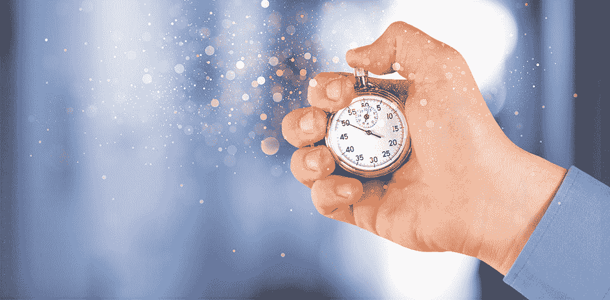

# 45 启动时间：拖延症的一种解决方案

和菜头

2022-04-08

## 45 启动时间：拖延症的一种解决方案

45 启动时间：拖延症的一种解决方案

| 转述师：余昊威 |

**启动时间，名词，指一个人从懒散状态进入工作状态的最小时间。**

\*

我不是很喜欢拖延症这个概念，因为有了它之后，就很容易把自己不在状态的原因归结于外在。拖延症，一种病，得病的人是无辜的，讨论结束。但也不要误会，我同时也不认为需要谴责或者施压，把它归结为个人的惰性。谁都有拖延症，无非是严重程度上的差别。所以，我们先不谈症状不症状，也不去讨论内心不内心，就是单纯地就事论事：  
**任何一个人都有不愿意动的时候，面对这种状况，我们可以怎么做？**

根据我有限的经验，也许你需要给自己一点启动时间。以我这种日更作家为例，每天更新两篇以上的文章，而且还要做到言之有物，想一想都会让人感到痛苦。但是类似的事情我已经做过多次，计算一下时日还颇为漫长。我有没有打开电脑一个字都写不出来的时候？肯定有。有没有写到一半突然头脑一片空白的时候？绝对有。有没有一想到还要更新 5 个月这一年才结束，因此深感绝望的时候？经常有。但你看不出来，你看到的是每天都有新文章出现，仿佛我手上安装了永动机，不会感到疲惫，也不会灵感枯竭一样。

怎么做到的呢？

在心理层面上要做一点简单的工作， **先说服自己相信：如果一件事情你每天都在做，意味着你现在就一定能做到。**  
这听起来像是一句废话，但是管用。一旦你开始怀疑你能否做到，那么很快你就会真的做不到。因为怀疑和犹豫非常消耗一个人的精神气，消耗到一定程度，人就失去了继续前进的勇气。所以，要相信自己能够做到，这种心理暗示的力量很强大，算是最好的一种自欺。你可以在别的领域内也试试，具体方法就是把结果和原因颠倒过来，把你想要的结果变成原因，然后你会发现自己居然也就信了，最后也就那么做到了，就有那么奇妙。

然后在行动层面上给自己一点启动时间。一方面不管自己内心如何抗拒，如何怀疑，还是要进入行动状态。对于我来说，那就是打开电脑，启动 Word，随手开始敲字。另一方面也不要管自己具体做了什么，先动起来。在我这里，那就是先写上一段，想到哪里写到哪里，不要修改，不要考虑好坏，大不了一会儿再删除。然后你会发现，过了一阵子，你真的可以展开行动了，就像身体和大脑从沉睡中苏醒过来一样，丝毫没有之前停滞不前、怀疑抗拒的感觉。

从开始行动，到正式进入行动状态，人需要一个类似预热的过程，对于不同的人，这段时间的长短不同，可能从 5 分钟到半小时不等，可以把它称之为“启动时间”。

我很早就发现，一个人能持续做一件事情，需要身心都处于某种工作状态。但是我们都是人，不可能长久地停驻在某种状态之中，时常会因为生活或者情感上的波动掉落出来，沉浸在别的状态中。比如说头一晚和朋友欢聚，开怀畅饮，那么第二天早上那种兴奋感可能还没有过去，忍不住去回想，那么人就很难在手头的事情上兴奋起来，迟迟进入不了状态。你的大脑正在调动回忆区块，做影音重放，根本就没有额外的能量供给创作的区块。这时候你就会焦虑，会自我怀疑，认为自己做不到。

但其实你是可以做到的，只是你的脑子转换工作模式没有那么快，需要你去提醒一下。启动时间就是起这个作用，装作已经进入之前的工作模式，装得久一点，你的大脑就会真的认为现在已经进入了工作模式，随即就会切换状态。之前你已经做过很多次的话，那么这种切换会很流畅，因为大脑熟悉这种固有的工作模式。哪怕是创作这种需要高度集中精力，发挥个人创意的工作，也会服从相同的规律。

在编剧界流行一个笑话，叫做“打开 Word 就是干”。听起来是个非常蛮横的创作方式，但是它的确有效。 **和等待灵感到来相比，打开 Word 就是干要靠谱得多。**  
编剧，尤其是电视剧编剧，动辄要写三四十集剧本，手头只有一个粗略的大纲，提供大概的情节走向。但是，每一集里都需要用对话、行动、情节填补血肉，让大纲一点点变得丰满起来，落实到每一场戏上。成熟的编剧不会坐等灵感来临，而是连续数月时间每天准时起床，打开电脑开始继续往下写，写到每天自己规定的字数，然后才考虑如何修改。有时候，可能会把前几天写好的内容全部推翻重来，因为今天写到一半的时候突然想通了剧情，或者是人物关系变化，前后终于一气贯通。因此，也可以说前几天是“装作在创作”，只是为了这一刻的领悟做准备。如果不是采用这种创作方法，无论是才华，还是灵感，都无法完成马拉松一样的连续创作过程。

启动时间针对拖延症很有效。拖延症的症结不在于拖延，而在于因为逃避而拒绝采取行动，由于拒绝行动而更加缺乏心理动力。启动时间非常精准地切断了这种恶性循环，根本不让人找“我只是想做得更好”这个借口。  
**无论如何，你先动起来，而且对结果并没有任何要求。**  
只需要你先给自己一个心理暗示，“因为之前做到过，所以现在也就应该能做到”；然后就可以去假装工作，假装到一定的时间，自然就会开始起效。

当然，启动时间只针对那些你已经做过多次，而且已经取得过结果的事情有效。如果是新工作、新挑战，那么可能无论你启动多长时间，也不会有多大的改善，因为你大脑中根本没有对应的流程和方法。同时，启动时间也要求你拥有相对安定的身心状态，如果扰动很大，那么无论是做什么都很难进入状态。不过，那就是另外一个话题了。

说到底，一个人每天能够熟练维持的状态只有有限的几个。而人性天然喜欢新鲜刺激，对于重复性的工作心存抵触。  
**重点永远是你如何从中找到热情和价值，而不是寄希望于某种特定的方法。**  
启动时间可以从技巧上给与帮助，但是对于你的心可能帮助不大。如果心念可以转换，人甚至可以不觉得苦的存在。最后，如果你确信你要做的事情不单对自己有益，而且关乎到更多人的利益和幸福，可以使你和人们更紧密地联系在一起，那么也许你就不会再受拖延症的困扰。如果是这样的话，启动时间可以帮助你度过那些短暂的颓丧、消沉和低迷时期，确保你始终待在自己的人生轨道上。

1.一旦你开始怀疑你能否做到，那么很快你就会真的做不到，因为怀疑和犹豫非常消耗一个人的精神气。  
2.装作已经进入之前的工作模式，装得久一点，你的大脑就会真的认为现在已经进入了工作模式。  
3.如果你确信你要做的事情不单对自己有益，而且关乎到更多人的利益和幸福，可以使你和人们更紧密地联系在一起，那么也许你就不会再受拖延症的困扰。

公众号懒人找资源

发布留言

0/ *500*

确定

# 46 输出：给学习“脱水”，从记笔记开始

和菜头

2022-04-09

## 46 输出：给学习“脱水”，从记笔记开始

46 输出：给学习“脱水”，从记笔记开始

｜转述师：余昊威｜

**输出，动词，如果把人脑比喻为一台电脑，那么学习和认知就是输入，把学习和认知外化就是输出。**

\*

长久以来我总是在建议人们试着写一点东西，收效并不是很明显。可能是因为大家觉得自己没有必要成为一名作家，也就没有必要练习写作。那我现在换一个方式再来聊聊写作，可能会带来不一样的理解。

遇见情感或者生活上的困难，心理医生会建议找张纸，找管笔，把自己内心的感受写出来，以此纾解内心的压力。然后，再把整个事情的前因后果一五一十写下来，在写作的过程中，许多困难也就自然找到了解决方法，甚至不再成为一个纠结的问题。这里面的机制其实是自己审视一遍自己的情感和想法，然后有条理地整理好，输出在纸上。你认为前后有什么差别？写之前你其实是在不断产生情绪和感受，相当于自我输入，最后被过于强烈的情绪所压倒。写之后你其实是对外做出了输出，而且为了输出，你整理了思路，分析了事实，这样才能形成一篇有条理有逻辑的文字。  
**这样一来，你的情绪也就有了归处，不再是一团乱麻，你也就能透过情绪看到问题所在，找到解决办法。**

所以，我真的没有打算让任何人成为作家，而是建议把写作当做是一种生活习惯，便于整理自己的思路和心情。不过我也能理解，即便我这么说，许多人依然存在抗拒心理，认为如果自己需要写点什么来改换心情，清醒头脑，那么无异于是在说自己性情软弱，头脑愚笨，所以不写就证明自己没问题。这么想也没有问题，那么，我还可以再换一个方式来说明。

这次你内心平和，头脑敏锐，没问题了吧？那你是否需要学习？我是说，长大成人步入社会之后的学习，你总归是需要的吧？这应该是大家的共识，否则也不会在这篇文章里相遇了。那么，你怎么知道自己学懂了，学会了，学通了呢？你不能说你感觉如此，你也不能说你记忆力强，因为这些说法都没有任何说服力。  
**当年你说你学会了自行车，最有力的证明是骑车去闹市中心转一圈；当年你说你学会了游泳，最有力的证明是跳进游泳池一口气游一个来回。**  
现在，你的证明是什么呢？

学习是外界向大脑进行输入，验证学习结果就需要你向外输出，这就构成了一个学习的完整闭环。那么，迄今为止，你的输出是什么？如果你认识写作者，你会发现他们都经历过模仿名家的过程。能阅读名家作品，能欣赏名家作品，这对于致力于写作的人而言并不足够，他们还要模仿名家的风格和技巧，构建一篇类似的文章，以此验证自己是不是真的吃透了对方的文字。同样的，如果你认识 App 开发者，会发现许多人在一开始会做一个日历或者闹钟的小软件，作为判定自己是否入门的检验，而不会是去背诵教程内容，或者去刷题库。原理都是一样的，用输出来检验自己是否真的已经学会了、掌握了。

所以，我建议大家在学习完毕之后，写一点文字，作为输出结果。 **当然，并不是只有文字才能检验，只是相对来说，文字算是成本最低的检验方法之一。**  
假若你今天学习了和人沟通的技巧，就找人立即吵一架，并且在吵架过程中运用到所学的知识，安抚对方的情绪，转变对方的态度，我想，这当然是很好的输出，不过未免代价太高。万一你运用得不好，伤人害己不说，也许会永久地失去和对方进行任何沟通的可能。但文字并不会，你所要付出的无非是一点时间和一点电费。而且，即便你写一万篇文字，你的手机或者电脑也不会因此而增加 0.1 克重量。

另外我想问一个问题，当我们谈到学习的时候，一个人究竟向大脑输入了什么？如果是看视频，那我认为大概会有许多的颜色，许多的动作，许多的形象，对讲述者的外貌和语气的熟悉程度远远高于他所讲述的内容。同样的道理，如果是听音频，那么大部分是嗓音；如果是读书，那么大部分是感性的段落让人印象深刻。而所有的学习过程中，我们需要的是理解抽象的内容，它并不在声音、颜色、形状、气味和情感上。所有这一切，只不过是方便我们在回想的时候更容易地唤醒记忆。所以，学习之后一定存在一个“脱水”的过程，把理性的内容从感性的形式中脱出来，就得到了所谓的“干货”。

问题是，你能在大脑中做到自动脱水么？经验丰富的学习者可以做到这一点，但是对于大多数人来说，大概很难清楚地做出区分。也正因为这样，哪怕是针对成人的讲授，也要依靠许多的小故事、小例子、小笑话，在上面绑定需要传授的知识，这样大众更好接受一些。讲授者努力做到生动有趣，这是讲述者的体贴慈悲，  
**但是对于学习的人来说，自身有责任去完成脱水工作，自行打捞出话语、图片、例证之下的干货。**

哪怕是最简单的笔记，也比什么都不做要强。记笔记就是一个脱水过程，同时也是最简单的输出过程。它并不复杂，也不需要多少思考，需要的仅仅只是分辨力，把内容的框架、原理和重点记录下来。如果可能的话，根据所学的内容，写下自己的所思，这样就比记笔记向前了更大一步。如果还能做到把所学内容变成问题，把一堂课变成一系列相关的问题，以及相关问题的答案，那么这已经是在模拟整个思考过程了。如果还有能力更进一步，加上自己的反驳和挑战，构成一篇多角度论述的文字，那么基本上可以判定已经掌握了新知，只是欠缺实践罢了。

回想我念书的时候，喜欢按照教科书自行编撰教案。因为我准备得非常细致，对知识点都做出了详尽的讨论，所以有些教案直接被老师借走作为参考。当时我的身份是学生，并没有一间教室可以供我教课。但是，这种写给我一个人的私人教案，却成为了我最好的复习资料。在那些我可以强力输出的学科上，我甚至不需要花费过多时间去做复习，翻一遍教案就足够了，因为上面连考试中老师偏爱的考点都列得清清楚楚。相反，那些一本教科书看完，我只能写下两三页纸的科目，最后必须花费大量时间复习，因为我其实并没有学到位。

是的，生活压力很大，个人时间很紧张，能在业余时间学一点就已经很不容易了，我完全承认这个现实。不过，既然你已经专门花了时间来学习，为什么不肯多花一点点时间精进呢？如果只是通过眼睛和耳朵来学习，退转和遗忘的可能会非常大。但只要稍微动动手，做出一点点输出，都会让印象加深许多。我在业余时间里，经常在朋友圈帮助朋友们的孩子解答家庭作业。是因为我记忆力超强吗，是因为我解题能力超强吗？不，只是因为当年我输出过，所以那就是我的东西，无论是时间、年纪还是生活，都无法从我手中夺走。

在你心满意足地关闭手机，关闭电脑，高高兴兴对自己说“今天又学到了新东西”时，麻烦问自己一句：那么，我的输出又在哪里呢？

1.学习是外界向大脑进行输入，验证学习结果就需要你向外输出，这就构成了一个学习的完整闭环。  
2.学习之后一定存在一个“脱水”的过程，把理性的内容从感性的形式中脱出来，就得到了所谓的“干货”。  
3.如果只是通过眼睛和耳朵来学习，退转和遗忘的可能会非常大。但只要稍微动动手，做出一点点输出，都会让印象加深许多。

公众号懒人找资源

发布留言

0/ *500*

确定

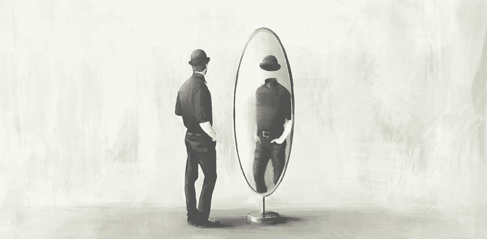

# 47 自我：你总还有机会完善它

和菜头

2022-04-09

## 47 自我：你总还有机会完善它

47 自我：你总还有机会完善它

| 转述师：余昊威 |

**自我，名词。人们在根本不认识它的时候，会把欲望当做是自我本身。认识它的时候，又太急于想要破除自我。**

\*

我时常说一句话：“不要饲养你的自我，应该努力去完善它。”许多人对这句话感到疑惑，问我“饲养”和“完善”之间的区别究竟是什么？

假设我们此刻正在某个海滨沙滩晒太阳喝冰啤酒，突然，对面走来了一位非常美丽的比基尼女郎，你注意到我立即坐直身体，并且深吸一口气把大肚腩给藏起来，同时脸上做出一副很深沉的表情，那么我所做的就是在饲养自我。那个腹部坚实平坦，表情若有所思的人根本就不是我，我那么做是因为我相信那样可以让自己显得更有魅力，于是我要装出另外一个人来。

如果我已经挺着个大肚腩三十多年，一度觉得自己这辈子就这样了，安心做个胖子就好，但是有天我突然有所触动，觉得自己从来就没有把肥胖当做一件真正的事情研究过，就径直接受了这个结果，实在是太遗憾了。随后，我认真地去做了研究，分析了肥胖的成因和各种减肥方式。最终，我明白肥胖可能是因为我对营养学一无所知，也可能是我长期维持了某种不健康的生活方式。于是我通过锻炼和改变生活方式，消除了大肚腩，也消除了先前我对自己“一辈子就是个胖子”的认知，这就是完善自我。

海滨的例子是假的，但减肥的例子是真的。什么是自我，自我就是一大团欲望和错误的混合物。欲望本身没有错，未经审视的欲望才是个大麻烦。如果不加任何审视，那么每个人的欲望都会告诉自己，明早没有必要上班，晚饭可以再添一碗，想要得到什么直接开口去要。这样的一个人，那就是一头饕餮。同样的，我们还会从外界不假思索地拿回来很多东西，比如说三十岁的时候要有车有房，五十岁之前要财务自由环游世界，或者每年应该安排一次海外旅行。问题是，你真的需要么，你又真的做得到么？这时候的自我要努力活成别人眼中的成功者，那同样是一种对自己的饲养。无论是哪一种，都是让欲望占据了主导，陷入了无穷无尽的比较中去。这样的一个人看起来的确活得很有动力，但未必快乐充实，倒是有可能长期陷入焦虑和紧张之中，快乐总是转瞬即逝，而欲望却始终饥肠辘辘。

一个人对自我的认识、对生活的认识、对世界的认识，可能有许多错误。  
**这些错误从未被认真严肃地对待过，人就会误以为“我就是这个样子”“生活就是这个样子”“世界就是这个样子”，然后就大规模地放弃和逃避。**  
后面两样相对好解决，总是可以通过学习、交流以及亲身经历，多少改变一点想法。但是对于自我的错误认知却不一样，随着年岁增长，对自我的坚持会变成一种顽固，认定了自己是一个怎样的人，就再也不愿意改变。可事实上，自我是有弹性的，也是会发生改变的。就像我在多年前反复强调，我不可能养任何宠物。如今我每天在家里两只猫身上花的时间，要比照顾我自己的时间都多。其实通过养猫，我发现自己居然是个对动物有爱心的人，这让我感到高兴又释然，现在的这个我总比原先铁石心肠的那一个要好，而且人生也会变得更加丰富。  
**所以，甚至都不应该说是改变自我，只不过是修正错误的自我认知，也就是我所谓的完善自我。**

说到这里就很清楚了，所谓“饲养自我”就是满足未经审视的各种欲望，将错就错，坚持各种来自外界的、对人对己的错误认知而拒绝改正；而所谓“完善自我”就是坐下来，认真面对自己的欲望，分析哪些是毫无必要的欲望，即便满足了也不会让自己多快乐三天，更不会让自己的内心感到充实和满足。同时，也能鼓起勇气面对自我，正视其中的缺陷和柔弱，但是又能鼓励自己去认真尝试，看看自我究竟是否符合自己的认知。所有那些做不到的事情、不愿意做的事情，究竟是因为自我的理性判断，还是感性放纵？究竟是因为能力不足，还是因为逃避、隐藏、伪装和自我欺骗？由此，对自己的错误认知做出修正，采取不同的行动，认识到自己隐藏的另外一面。有时候这种向内挖掘并不会让人感觉到舒服，但是你认识自己越深越真，你和这个世界之间的裂痕就会变得越小。

当初我坚持不养猫狗，编造出了许多借口和理由。夜静更深的时候，我坐下来问自己究竟是为了什么？答案是我不愿意承认的，那就是我的自我很敏感脆弱。在我的童年时代养过许多小动物，我在它们身上倾注了相当大的热情和关切，但是它们最终的结局不是死亡就是逃走。每当那样的时刻到来，我的内心都会极度不舒服，觉得承担不起失去它们的结局，又或者是陷入深深的自我怀疑，认为如果我不养它们的话，也许它们正自由自在地活在世间别的角落。我拒绝养猫养狗，就可以成功避开这种敏感脆弱的时刻，也就不会感觉到受伤。那么，什么才是真正的自我？当然是那个整天抱着小动物蹭头的童年的我，在那一刻我的内心里都是幸福和喜悦，不去想过去，更不会去想将来。所以，把小猫小狗从我的生活里删除掉并没有解决任何问题，我的自我真正需要学习的是如何面对失去和分离，以及用什么方式接受这个结果。当我面对真正的问题，能够妥善处理和解决，那么我当然可以说这是一种自我完善。

人是非常奇妙的一种存在，纵然背着一身其实并不需要的欲望，纵然装满一脑袋错误的认知，依然可以在人世里过活，而且看起来也都活得不错。但是自我真正的感受如何，那可能就只有当事人自己才知道了。在我看来，这里存在一个标准，那就是  
**一个人如果总是要向外求取，用外在来证明自己的话，这个人的自我就一定存在问题**  
，有很大可能饲养过度，在身体里养了一头饕餮。而如果一个人可以内省自查，把目光转向内，无论是对自己的偏爱还是厌恶，都冷静客观地做出一番分析，那么他就有可能认识到真正的自我，于是有可能进行真正的完善，消除和自己、和他人以及和世界之间的裂缝。这样一个人有欲望，但是不会被欲望压垮；有错误，但是总有自我检查和修正的可能。当他获得满足的时候，这种满足感也能维持很长一段时间，因此可以从生活中找寻到真正的乐趣。

你总会听到有人劝，要放下，要去除我执，要停止欲望。但在我看来，那是第二步的事情。如果一个人都不曾认识到自己的本来面目，也不曾尊重和承认自己的自我，那么你让他放下什么呢？去掉对哪一个自我的执着？如何才可能去掉？如果他错误地认为欲望就是他的自我，你又让他怎么去停止？所以我坚持认为，在破除对自我的迷恋之前，需要先认识自我，找到那个你已经忘记了的自我。找到时如果残缺不全，那么还得先修修补补，让他获得平衡和完善。是因为有了正确认识，有了平衡和完善，才有可能去放下，去破除我执，去熄灭炽热的欲望之火。只有正确的人，才可能做得到正确的事情。

从终极意义上来说，自我本身都不应该存在，不过那已经不适合拿出来和大多数人讨论了。

1.自我就是一大团欲望和错误的混合物。欲望本身没有错，未经审视的欲望才是个大麻烦。  
2.有时候这种向内挖掘并不会让人感觉到舒服，但是你认识自己越深越真，你和这个世界之间的裂痕就会变得越小。  
3.一个人如果总是要向外求取，用外在来证明自己的话，这个人的自我就一定存在问题。

公众号懒人找资源

发布留言

0/ *500*

确定

# “我问和菜头”：求知是做加法吗？

和菜头

2022-04-09

## “我问和菜头”：求知是做加法吗？

“我问和菜头”：求知是做加法吗？

｜转述师：余昊威｜

读者 用户胡振强：:

> "菜头叔，我看人在决定玩手机游戏的时候，从来都没有什么“启动时间”，根本就不需要催、骗、哄，每次都是很自觉地拿起手机就玩。那么，我们的工作有没有可能设计得像游戏那样，让人欲罢不能呢？如果真有这一天，人的坚持和努力还有意义吗？"

哈哈哈哈哈哈，很有趣的想法！这里我可能要说几句关于游戏的坏话了，如果有做游戏的朋友看了还请你不要生气。如果认真讨论这个问题，游戏其实也是别人的工作结果，而这项工作的核心就是研究如何让你上瘾，无论是用合理的难度梯度，还是用社交网络的人际竞争，目的都是让你尽可能地留在游戏里。可惜大多数工作都没有这样的特点，要么像是泡菜游戏，就是指早年间的韩国网游，玩家必须重复劳动刷经验刷金币，和做工差不了多少。因为是韩国制造，所以被中国玩家蔑称为泡菜游戏。要么像是解密类游戏，给出的线索很少，存在着大量的未知，玩家只能不断尝试，不断感受挫败。  
**很少存在那种恰到好处的工作，每一步都有点难度，但是又都可以让你克服，让你接连不断地得到成就感，从而沉迷其中，根本不想下班。**

换一个角度来看，即便真的存在这样的工作，它迟早也会让你感觉到自己受到了严格的控制，一切都是精巧的设计，大大降低了你拿工资时的快感。因为你不会觉得自己有什么贡献，有什么突破，只不过是走迷宫的小白鼠，最后得到一点饲料作为奖励。你所说的那种人人以游戏为生的未来，有一本书系统地支持了你的想法。如果有时间有体力的话，可以找来读一下，它的名字是《蚱蜢：游戏、生命与乌托邦》，在这本书里可能有你想要的完整答案。

读者 用户付青健：:

> "叔，如果说启动是对大脑的驯化，那么启动时间多长算启动成功呢？如果一次不行，两次三次还不行，是否就应该换个事情来尝试呢？"

因为我从未询问过别人，只是在自己身上做过测试，所以只能说根据我的经验，快一点的话 5 分钟左右，慢一点的话大概要半小时。超过这个时间，那就的确是心烦意乱，无论如何也进入不了状态，这时候可能最好还是放一放，做点别的事情换换脑子，缓一缓心情。

**这也是个习惯问题，每次都用同样的方式发动起来，那么最后就会成为一个习惯。**  
每天早上我起身，喝杯水，定定神，就开始写每天第一篇文章。按理说，这个时候刚刚从睡梦中苏醒过来，人并不在最好的状态。反而是等到下午或者晚上，在一天之中遇见了人，遇见了事，有所触动才更容易有感而发，写起来也更为顺畅一些。但我还是坚持早上起来就写，因为我担心让自己过于依赖白天的人和事，如果有一天没见到人，无事发生，那么我的处境就会变得更加困难。与其这样，还不如抓住早上起身后的第一个念头，直接开始写。这样的话，剩下的一整天都是我的备份。

读者 用户月愚：:

> "想问叔的问题是，对于新的挑战，可以用假装熟悉的方式来启动吗？毕竟事物的关联性是普遍的，虽然随之而来的压力会超出预期，但行动本身不是通常也会萌生斗志和内在动机么？"

关于面对新挑战时的做法，我是这么考虑的：首先，新挑战的“新”是什么意思？我认为其实说的是学习，你需要学习才能面对新挑战。然后是学什么？当然不可能学出一个答案来。大多数时候，我们都是围绕着新问题打转，想办法把它拆解开来，从我们最熟悉的那一部分入手，培养一点信心。有了一点点基础之后，继续切分新挑战对应的新问题，  
**在无法降低问题难度的情况下，我们总是有办法把问题做分解，由易而难变成一系列小问题，然后逐一解决。**  
最后，在这种拆分法开始之后，其实也就不需要用假装熟悉的方法来启动，因为你的确可以解决最开始的几个简单问题。这时候也许你需要做的是假装后续的高难度问题不存在，先集中精力在手头的问题，解决完之后再逐步爬升难度。

关于行动这件事，我的一位朋友曾经对我说过一段很好的话：“知识分子或是依仗自己聪明才智的人，往往问题出在想太多，质疑太多，浪费时间探寻本质太多，就是不肯去着手做，总以为可以单凭自己的思维，就能把问题想透彻。他们却不知道，唯有在行动中，成就事业的诸多元素才会被发现，才会被聚合，单靠想是做不到这一点的。”

读者 用户逆旅过客：:

> "请问和菜头老师：生有涯而知无涯，求知是做加法，不可穷尽，追求智慧是做减法，损之又损，这加减之间如何更好地运算呢？"

求知是加法吗？我有点怀疑。我小时候发生月食，大人告诉我说那是天狗食月。等到我上小学自然课的时候，课本说月食是因为地球挡住了太阳，月食是地球的影子笼罩在月亮上。这是两种知识，彼此并不能兼容。要么天空中的确存在一只狗，要么是地球挡住了太阳，不大可能同时有狗，又有地球的影子。这样说起来，知识好像不是加法。有了天文学的知识，民间的知识就退入传说和文学中去了。民间的知识如果占据上风，那么天文学就可能被打成异端邪说。

当然，这可能算是一种非常极端的例子。我的意思是 **知识也在更新换代，知识也存在相互竞争，因此总有扬弃的过程。**  
如今的一个中学生，谁需要去学习关于燃素或者以太的知识呢？我想，你可能弄混淆了“知道”和“知识”，我们知道的事情的确是越来越多，需要靠遗忘来拯救。而当我们说到知识的时候，从比较窄的定义上看，如果知识并不能帮助你解决问题，那就不是知识，而是“知道”而已。从这个定义上看，  
**我们掌握的知识其实并没有那么多，因为我们面对的问题并非无穷无尽。即便真的无穷无尽，也并非都需要我们加以解决。**

读者 用户 Jin：:

> "输出分不分等级呢？比如说，写的比说的或画的更好？"

你想太多了，当务之急是试着输出一下看看，而不是考虑什么形式、什么载体。如果你觉得文字叙述最能够帮助你整理思路，那么你就用文字输出好了。如果你觉得画思维导图最能够帮助你结构化指示，那么你就用思维导图。如果你觉得画漫画加对话框的方式最好，那么我建议别那么做，因为它只是好看而已，但是要浪费太多时间去做设计。

无论是写，还是画，只算是完成了输出的一半，还有一半是拿去对人讲解，对一个完全不了解相关问题的人进行讲解，并且能够让对方理解，回答对方的提问，不要被问倒。输出本身也有一堆事情要做，我们暂时就不要太过关心什么等级一类的问题，大多数人的问题是根本不做输出，而不是不知道如何选择不同等级的输出方式。

读者 用户林间月：:

> "想问一下老师：我如果只是想了解一下某些知识，也需要记笔记吗？因为记笔记增加了学习的阻力，会不会让自己了解知识、拓展知识圈的目的都做不到呢？"

我想，记笔记的目的并不是为了记录你自己读过的每一本书，学到的每一个知识点。而是说，当你有所领会，有所启发的时候，不要在脑海里过一遍，觉得想得很爽然后翻身拉起被子就睡觉，最好趁热打铁，翻出笔记本写下来。一边写，一边整理，这个过程可以深化你的记忆，更可以检查你的理解。  
**因为想是很快的，感受也是很快的，记笔记的时候人可以慢下来，给自己一点沉淀时间。**  
同时，过一段时间之后，当你重新翻看笔记，也许会发现自己的理解力又上了一个台阶，对同一个问题的看法又深入了许多。但如果没有笔记的话，都是脑海里做戏，过了就忘。我自己也会经常翻过去的文章来看，去了解当时我停在了哪里，现在又走到了哪里，这时候去看当初思考的缺陷和盲点，就会变得非常清晰。

1.唯有在行动中，成就事业的诸多元素才会被发现，才会被聚合，单靠想是做不到这一点的。 2.如果知识并不能帮助你解决问题，那就不是知识，而是“知道”而已。  
3.想是很快的，感受也是很快的，记笔记的时候人可以慢下来，给自己一点沉淀时间。

公众号懒人找资源

发布留言

0/ *500*

确定

# “我问和菜头”：为什么说自我不应该存在？

和菜头

2022-04-09

## “我问和菜头”：为什么说自我本不应该存在？

“我问和菜头”：为什么说自我不应该存在？

｜转述师：余昊威｜

读者 得到用户：:

> "菜头叔好，关于文科教材的学习，我总是对重点内容复读十几遍，直到能默写出来为止。目前可能因为语言功底不行，我自己总结出的话语总没有教材上优美，但是这样又觉得学得太死板，我也并不想只是为了应付考试而学习。我目前的疑惑是，我是应该继续通过背诵这种笨办法来应付考试，学习作者的用词造句和思路呢，还是应该熟悉内容后试着用自己的思路来做总结呢？"

那我说句大实话吧，考试是考试，学习是学习，这两件事情之间并不是严格的等号。考试说起来是技巧，背重点、猜题目、骗得分点、优先拿保底分，这都是纯技巧。而学习是让你对某一学科有所认知，最好能学到解决某些具体问题的方法。所以，如果你有方法可以帮助你通过考试，那么就接着用。而你在学习过程中，总是要把书本上的知识转化为自己的理解和自己的语言，背诵并不是学习。至于说你的文辞是不是优美，这根本就不重要。因为不优美会随着理解力的提升和写作技巧的熟练而变得优美起来。如果你读完李白的诗，写出一篇和原诗一样美的散文或者解析文章，那才是很古怪的事情，这意味着你的中文水平可能和他差不多一样，这怎么可能呢？

读者 用户朱煜：:

> "以前尝试过把自己的想法写出来，写出来后发现和原以为的想法已不完全相同。有个问题，我写的时候脑子里总是在想：这些话是说给谁听呢，我的诉说对象是谁，是一个有名字的笔记本，还是一个假想的朋友？望菜头叔解惑，试着从现在开始学习输出。"

有两个对象，看你喜欢哪一个。一个对象是未来的你自己，设想有一天你要回来翻阅现在的感想和体会，那么你现在就要为他做好准备；另一个对象是你不特定的某位朋友，某个熟人，他对你输出的内容一无所知，你要通过这些文字让他弄懂。无论是哪一种，都会发生你说的那种情况，就是写出来之后和你原先的想法并不相同。这并不是什么坏事，因为你脑海中的感受没有经过整理，当这些感受和想法落在纸面上的时候，它们变得有逻辑了，有条理了，这也就意味着经过了新一轮的理解，从原料经过了加工，变成了初级产品，达到了可用级别。

读者 用户半支烟：:

> "我现在似乎处于一种“自动脱水”的状态。身边的朋友对跟我说话或者是看我写的东西都有过类似的评价，有些时候会被人认为是不解风情，甚至是故作高深。而我其实只是想分享自己的一些心得，跟大家分享其中的乐趣。"

> "我想问一下和老师，如何让自己的表达更容易让人接受呢？"

那就得问你自己了，自己面对自己的时候可以保持诚实：你究竟有没有存了那样的心，写出一些东西来只是为了炫耀自己读过、看过、想过，而不是觉得自己知道了一点有价值的东西，想要分享给朋友，希望他们从中获益？这个问题只有你自己能够回答。以我自己为例，如果我偶然有感，想迅速记录下来，那么我会写个让人看到就没有丝毫阅读欲望的标题，快速行文，中间大量省略步骤，使用术语，不打比方。  
**但如果是我想让人看懂，从中有所得，那么从标题开始我就要设计，第一段如何抛出问题，如何设计钩子，如何让后续内容展开保持连续，如何避免使用术语，大量举例和打比方，尽可能降低理解难度。**  
你是哪一种呢？

读者 用户薛弘毅：:

> "菜头叔，我有一个问题想请教。我是一个老师，也是一位妈妈。我每周写一篇公众号文章，记录自己这一周对某个教育问题的反思。我的读者基本都是身边的亲友，大家给的反馈也都是鼓励为主。我写了一段时间后，觉得自己写作和思考的能力确有提高。但我不知道是否需要寻求更多的反馈意见，让自己的水平提升得快一些。还是就这样踏踏实实写下去，让水平自然缓慢地提升。"

> "您当年训练写作能力的时候，更多的是靠别人的反馈提升呢，还是自己不懈的积累提升呢？"

我想我理解你的问题问的是什么。你是不是觉得自己写了一段时间之后，进入了一个瓶颈期，自我感觉水平提升不够快，对于熟人的反馈已经脱敏，赞美和肯定已经不能让你感到振奋，所以你问我要不要获取流量，看到更多反馈——是这个样子吧？写作能力这种事情呢，不像是养猫，或者是种花，不会是一天一个样，你不可能看到自己的写作功力每天半米一米地增长。我只能这么对你说，当你保持练习但是又觉得毫无进展的情况下，通常都是在突破的前夜。种子要破土而出的时候，受到的阻力才是最大的。所以，请你且耐心些，再写一段时日看看。即便是亲友，对于你文章的提升，也会有很明显的反馈。如果是纯客气，也维持不了那么多时日，一直看下去。

读者 用户好奇的 ayakla：:

> "《自我》这一讲的最后说：“从终极意义上来说，自我本身都不应该存在，不过那已经不适合拿出来和大多数人讨论了。”"

> "老师，可以再深入讲解一下这句话吗？"

这句话相对来说还算好理解。从生理的角度上看，你每一刻的感受和想法都是某种神经系统的电脉冲，你并不能保证每次的回路都是一致的，那么哪一条回路上的那个你是真正的你？从心理的角度上看，你所认为的那个自我，很难区分哪些部分是你自己生长出来的，哪些是为了回应外界刺激和他人期待而生长出来的，那么哪一部分才能说是真正的你？既然如此，你的自我就像是一团果冻，时时刻刻都处在变动之中，但你坚持存在一个固定的、不变的自我，认为自己需要这样，自己需要那样，岂不是永远都难以满足？你满足的又是自我的哪一个部分，或者哪一个面向？如此这般追逐，它的价值又是什么？一旦你坚持有自我的存在，相信它是坚实的，就不得不面临一系列这样的问题，而这些问题都会导向各种各样的痛苦。

读者 用户一辆蚂蚁：:

> "“好看的皮囊千篇一律”这句话，是不是可以理解为，他们因为过于饲养自我而活成了同一个模样？一个人不遗余力地饲养自我，好看是一个很大的前提。那些有趣的灵魂不一定没有好看的皮囊，而是能够更深刻地认识自我，不太把自我当回事。"

> "菜头叔，有意识地跟人群保持距离，是不是不饲养自我的有利条件？"

说的是求同吧，求同以至于消弭了个性差异。你的问题其实可以参考得到的一本电子书，书名叫做《为什么》。虽然内容是讲人工智能，但其中的观点可以解决你的思路：皮囊和趣味，本来是不相关的两个独立因素。但是，  
**这两个独立因素分别进行过一次正向选择，也就是说人们更倾向于皮囊好看的人，和更有趣味的人，这就形成了四象限。**  
其中，第三象限是既不好看，也很无趣的人，人们自动就把他们给排除了，根本不去考虑。第一象限是既好看又有趣的人，非常稀少，基本上很难遇见。所以，剩下的第二和第四象限就变成了某种相关性，好看的皮囊往往灵魂毫无趣味，有趣的灵魂往往皮囊惨不忍睹。其实没有这种相关性，你所说的一定或者不一定，是在去掉第三象限之后进行的讨论。  
**补全第三象限之后，样本变成全体样本，相关性和先前的判断可能就完全不一样了。**

读者 用户呢了同学：:

> "菜头叔，心理学上说自我、本我、超我，我理解您课程中说的饲养自我应该就是第一个层级“本我”，完善自我应该就是第二个层级“自我”，那么第三层“超我”，又是怎样一种状态呢，现实中，您觉得有必要追求吗？"

你在得到不就是为了成就超我么？去完成那个你心目中更为理想的自己，努力学习，热爱新知，勤于思考，保持理性，这不就是你现在正在做的事情么？不过，我说的饲养自我应该算是你说的第二层级，也就是自我，而不是本我。完善本我相当于更改一个人的底层代码，我认为那是很困难的事情。我们能够做到的，也就是给自我消消水肿，让它恢复到正常身材，维持正常工作罢了。还能多奢望一点点，那就是它能朝着超我前进。

1.如果是我想让人看懂，从中有所得，那么从标题开始我就要设计，第一段如何抛出问题，如何设计钩子，大量举例和打比方……尽可能降低理解难度。  
2.当你保持练习但是又觉得毫无进展的情况下，通常都是在突破的前夜。  
3.你所认为的那个自我，很难区分哪些部分是你自己生长出来的，哪些是为了回应外界刺激和他人期待而生长出来的。

公众号懒人找资源

发布留言

0/ *500*

确定

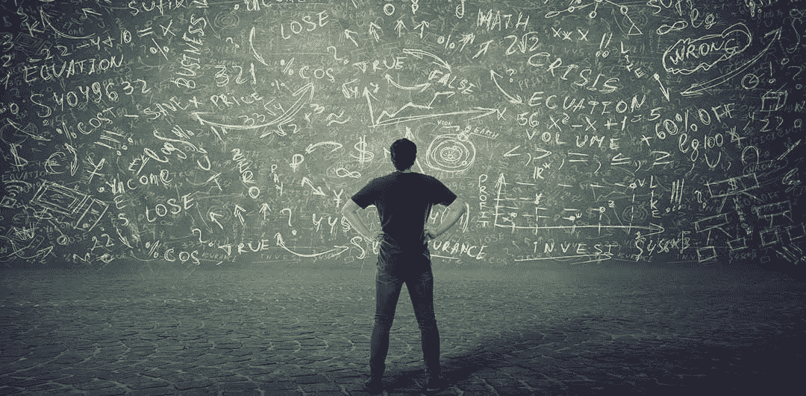

# 48 做题家：没有嘲笑做题家的理由

和菜头

2022-04-09

## 48 做题家：没有嘲笑做题家的理由

48 做题家：没有嘲笑做题家的理由

| 转述师：余昊威 |

**做题家，名词，一种带有嘲讽意味的蔑称，用于形容那些只知道应付考试而没有实践能力的人，但这个说法本身就很可疑。**

\*

因为受过教育而遭人嘲讽，这是很常见的事情。过去有，未来也不可能断绝。如果让我放开了列举，我可以写出一堆类似的字眼来：书呆子、死读书、两脚书橱、四眼田鸡、蛋头呆瓜（Egghead）  
。做题家，或者说小镇做题家，只是这一长串名单里最新的一个。但是根据我的生活经验，  
**我觉得做题家并没有那么不堪，我甚至认为应该鼓励人们试着当一下做题家。**

这里面的道理稍微想一下就能想通：做题家无论在绝对数量上还是相对数量上，都是人群中的极少数。要知道，大学生占中国总人口的比率也不到 5%。这其中还有很多人根本不是做题家，虽然拿到了大学文凭，但是没有办法辅导自己初高中的孩子——当年在学校里学到的那点东西，全部都还给老师了。要这么算的话，做题家并不是一个蔑称，倒更像是一种荣誉头衔。用这个蔑称试图羞辱别人的人，倒是有点迎风吐痰的感觉。

我在网上测试过很多次，如果我提问一篇小说、一部电影的情节或者人物，能够给出正确答案的人会很多。但是我提问一道初中物理或者数学题，留言区的答案往往就惨不忍睹。这不仅仅是在中国的互联网上如此，在世界范围内同样如此。隔三差五就有坏人出来提问：10 个人 5 小时做出 20 个零件，100 个人做 100 个零件要几小时？然后你就去看吧，留言区里能打得人肝脑涂地。

都是很复杂的问题么？不见得。为什么答不对？因为大多数人连做题家的水平都够不上。有件很奇妙的事情，当一个人拿到文凭的时候，无论成绩如何，修行如何，拿到文凭的那一刻他就会认为自己已经掌握了所学的所有知识。而且，时间过去越久，这种自信心就变得越发坚定。直到有那么一天，孩子拿着中学生作业来问他，这时候突然觉得自己踢在了铁板上，重新感受到在学校里面对考卷时的胃疼。奇怪么？一点不奇怪。因为在学习中有一条非常朴素的真理：  
**当年你做不出来的题，并不因为你毕业长大成人就自动会做了。相反，当初你能够解答的问题，倒有可能随着时光流逝而逐渐淡忘。**

做题家起码有一点好，他们当年的确认认真真解答过许多题目，而且取得了很高的分数。不然的话，也就没法在今天遭人嘲笑了。当然我们可以说，取得高分并不意味着掌握知识，也许当时只是背下来题型和答案呢？非常有可能，但即便是背下来的，这世界上也存在数量更为惊人的人群，连背答案都没有背过。  
**于是等到需要用的时候，都不知道去翻哪一本书，做题家起码知道。**

即便在成年之后很久，我也不时动手试试初高中的题目。这种行为看起来很可笑，像是大人非要跑去儿童游乐园玩滑梯。可我自己并不那么看，也并不觉得这些题目是小儿科。的确，它们的难度并不高，但是难度不高并不意味着它们没有思考深度。毕竟，教科书上的那点东西，是千百年来人类不断累积下来的结果。一个 21 世纪的幼童，他所学到的知识可能要比 10 个世纪前一位学富五车的学者还要深入，对世界的认知还要更为深刻。你就想想吧，一个公元 1021 年的学者，知道为什么要饭前洗手么？会相信物体不受外力作用保持运动状态不变么？简单说，他能想象一个不受外力作用的小球，会一直那么滚下去么？

一直到今天，一根辅助线、一个小球，都可以轻而易举地难倒一个成年人。 **不是因为出题人的机巧，而是这些数学模型和物理模型背后所需要的思想有缺失。**  
当年没有很好地建立起来，现在也就无法自如地运用。做题家还有点机会，因为他们记住了题目，也记住了解答。如果他们有更多的时间去思考，那么也会从中获得领悟，因为他们之前已经做好了准备，哪怕这种准备当初只是为了分数，是一种纯功利性的学习。

当然，我们可以说通过实践学习是最快的，通过书本和做题可能会造成局限。而且，考试得高分并不能确保一个人有成功的人生，无论是从世俗意义上，还是从精神意义上来说的成功，都是如此。这种想法没什么毛病，任何一个人身边都有活生生的例证。你赚钱最多的那位朋友，家庭生活最幸福的那位朋友，拥有一技之长的那位朋友，估计都不是当年学校里成绩最好的那一位，也不是同学朋友中学历最高的一位。这也是做题家被人诟病最厉害的地方，考那么高分数，解那么多题又有什么用？社会上哪里有考卷给你去做？

但做题家如果当真做题很强的话，这道题其实是有解的。大家不妨来算一下概率，做题家里达到社会中位数收入的人比率有多高，非做题家里这个比率又有多高？再算算所谓成功人士的比率呢？通过社会大学进修，通过实践进行学习，当然非常好，只是毕业率并不高。换句话来说，这个领域内的成功经验，对于大部分人来说没有多少借鉴意义，因为根本就做不到。

如果把人群分为两极的话，真正的底层人士是不存在的，不会被讨论，不会被分析，甚至都不会被嘲笑。真正的顶层人士又活在评论之外，无论做怎样的讨论和分析，他们大多听不到，听到了也没有那么在意。  
**做题家这个称呼之所以刺耳，原因是做题家位于人群的两极之间，人们首先看得见，然后人们知道嘲讽会起到效果。**  
至于说做题家是不是真的有那么不堪，真的那么可笑，完全是另外一回事情。

除了做题家，我相信还会有源源不断的人选被挑出来加以嘲讽。对于嘲讽，可以换一个角度来理解：如果你一无所有，那么人们连嘲讽你的兴趣都没有。你之所以被嘲讽，那是因为你还拥有一点他们不曾拥有的东西。人生里总是会有这样的时刻，你所珍视的价值，你所看重的成就，你所坚持的行为，会遭到许多人的嘲笑和轻视。重要吗？舆论就像是风一样，不断换着方向吹，不断寻找下一个受害者，只是因为这样可以安全地获得自我满足，就像是婴儿渴望一个塑胶奶嘴。  
**而如果一个人喜欢追着风，顺着风向走，可能距离真实只会越来越远，自我感觉倒是越来越良好。**

我个人不会嘲笑做题家，相反，我倒建议有可能的话，在成人之后试着回去做一下做题家。因为复杂的事物、变幻的现象，都发端于最简单的结构。从知识的层次上来看，简单的部分同样蕴藏着深刻的思想。这一次没有了考试，没有了老师，一个人可以纯为自己学习，因此可以获得更多启发和领悟。这些启发和领悟有可能重新运用到现实生活中去，如果上下贯穿，如同水银泻地，毫无窒碍之处，那么或许我可以说，你得到了通达。

1.当年你做不出来的题，并不因为你毕业长大成人就自动会做了。相反，当初你能够解答的问题，倒有可能随着时光流逝而逐渐淡忘。  
2.从知识的层次上来看，简单的部分同样蕴藏着深刻的思想。 3.如果你一无所有，那么人们连嘲讽你的兴趣都没有。

公众号懒人找资源

发布留言

0/ *500*

确定

# 儿童节特别篇：写给得到的小朋友

和菜头

2022-04-09

## 儿童节特别篇：写给得到的小朋友

儿童节特别篇：写给得到的小朋友

| 转述师：余昊威 |

小朋友，你好。

我是和菜头叔叔，这个熊猫头的卡通人就是我。也许你会觉得我傻里傻气的，连个真实头像都没有，但是海绵宝宝和派大星他们不也是这样？我常年呆在网上，觉得自己更接近一个卡通人物，这也是很正常的事情。好了，现在你知道我叫和菜头，我们就算是成了熟人。

今天是六一儿童节，编辑姐姐要我给你们写点什么。哦，对了，无论是我，还是编辑姐姐，我们都在一个叫得到的 App 里。可能你的父亲或者母亲，又或者是哥哥姐姐经常跑来刷这个 App，或者播放课程录音，他们说自己正在学习，或者听课。也许你也感到好奇，大家在这个 App 里究竟整天在做些什么呢？为什么他们看起来还挺投入的？

其实他们真的在学习。请你先不要叹气，我知道你可能会很失望，觉得等到有天毕业之后就不需要再学习了。  
**没想到，那么多人都毕业变成了大人，还得继续学习，这件事情怎么就没完没了呢？**  
我想，你可以暗中观察一下你们家大人，他们在刷得到或者听课程录音的时候，脸上有没有痛苦的表情？大概是没有吧，这是因为他们是大人么？这是因为大人和孩子不一样么？倒也不是这样，他们和你最大的区别有两点，第一是他们知道自己在干什么，第二是他们知道自己真的需要。

这就像是你买雪糕或者玩具，你知道你在买美味或者乐趣，你也知道你可以得到甜美的滋味或者是快乐的时光。那为什么你不能把学习当成是一种乐趣？为什么想起学习的时候你会觉得头疼？仅只因为你是个孩子？

你们家大人在你的年纪时，想法可能和你一样。当然，有些时候他们会吹牛，说自己当年如何如何热爱学习。这也许是真的，但更有可能是他们就像是现在的你，却非要把过去说成是神话，好用来激励你。如果要我说的话，  
**真正的原因是上学、学习和考试，它们分别属于三件不同的事情。**  
上学就是说你每天都要去一个叫做学校的地方，去那里干什么呢？是去学习。那么，什么是学习呢？学习其实是在学校里上课、朗读、背诵、写作、计算、分组讨论和考试。怎么知道你学会了没有呢？当然就是考试看分数了。

我们仔细看一下这些事情，其实每天要早起去一个叫学校的地方，这是件很辛苦的事情，迟到了还要挨批评受处罚，并不会让人觉得快乐；上课、背诵、写作、考试这些事情，每一样也都很辛苦，也不会让人觉得很快乐。尤其是考试，一旦成绩不好的话，压力可以说是非常之大。即便考得好，回家想小得意一下，家里大人又会问一句“班上有没有人比你考得更好”，这样一来，那一点点小快乐也没有了。

连着上很多年学，不断地上课、考试，最后很容易让人感觉去学校就是为了上课，上课就是为了通过考试。通过考试拿高分就什么都好说，没通过或者拿低分那就是一脑门子官司，直接影响到自己在家和班级里的社会地位。  
**你看，问题就出在这里，学习在不知不觉中消失了，只剩下考试一件事情。**  
为了完成考试，谁都会感到有压力，谁都会感到痛苦，你也不会例外。但我们现在暂停一下，你去想一想：你家大人在得到有考试么？有作业么？会有批评和惩罚么？能成为小红花少年么？好像并没有，他们是自觉主动去的得到。那请你现在告诉我，没有点名，没有作业，没有背诵、写作、计算和考试，连分数都没有一个，他们这样还算是学习么？

我顶着熊猫头向你郑重地说：当然算，而且这才是学习本应有的样子。我们都说要好好学习，那么我们是去学习什么？学习知识。那么，什么叫学习知识？能记住，能背下来，能默在考卷上，是不是就算学习了？当然不是，那只是记住了，会做题了。学习知识是知道事物的“为什么”，而不是背课文，背答案。知道了为什么也只是第一步，重要的是知道了为什么之后，能不能用来解决别的问题。如果可以，那么才能说是你学到了知识，才能说你是真的学习过。否则，你只是看过、记过、背过，未必见得真知道如何运用。

你们家大人在每天的生活里有自己的问题， **他们来得到学习，目的是为了解决各种各样的问题**  
，有金融方面的，有历史方面的，有健康方面的，等等等等。而你只有一个问题，那就是如何通过考试。只要考过，管它知识不知识、学问不学问，都可以扔到一边去。所以，你们对于学习的目的并不相同，于是态度也大不一样。可是，你总有一天也会毕业，也会成人，也会走进社会。那时候没有了学校，没有了老师，没有人给你考卷，也没有人给你打分，更没有人因为你分数高就给你肯定和表扬。到了那个时候，人们对你的尊敬、对你的认可，大部分来自于你解决问题的能力，或者是你的创造能力。换句话来说，就是你的学习能力和你运用知识的能力，你家大人目前就处在这样的情况下。

所以，他们成为了自己最严厉的老师，他们成为了自己最严格的考官，他们不需要督促和威胁，自己就主动自觉地去学习。而且，他们还认为  
**学习是一件终身都需要继续的事情，不存在毕业的那一天，因为每一天生活在这个世界上，都会面对新问题** 。现在，你有点理解他们来得到干什么了吧？

今天是你的节日，按理来说我们应该聊点轻松的话题。但我毕竟是得到里唯一的熊猫头，所以我最后还是跟你聊了聊什么是得到，什么是学习。我想对你说的是，上学是上学，考试是考试，学习是学习，这是完全不同的三件事，你最好要把它们区分清楚。让你头疼的可能是上学，也可能是考试，但学习它本身能给你带来快乐。前提是你能做好区分，并且在生活中加以运用，真正解决点什么问题。大人们说学习使人快乐，倒真的不是撒谎。如果你只是盯着考试和测验，那么你可能很难感受到这一点。说起来它们只是一种检查，并不是学习的目的。如果可以的话，希望你真正去学习，从探索未知和解决问题中获得乐趣，并且把学习培养成为一种终身习惯。我觉得你要是真的能做到的话，这就是我最想送给你的儿童节礼物。

祝所有爱学习的大小朋友节日快乐！

1.上学是上学，考试是考试，学习是学习，这是完全不同的三件事。 2.学习知识是知道事物的“为什么”，而不是背课文，背答案。  
3.你总有一天也会毕业，成人，走进社会，那时候没有人因为你分数高就给你肯定和表扬，人们对你的尊敬、对你的认可，大部分来自于你解决问题的能力，或者是你的创造能力。

公众号懒人找资源

发布留言

0/ *500*

确定

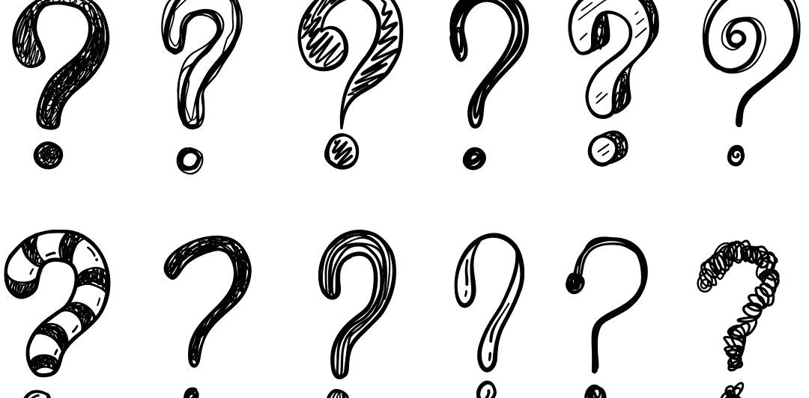

# 49 真问题：什么才可以称得上是一个真问题

和菜头

2022-04-09

## 49 真问题：什么才可以称得上是一个真问题

49 真问题：什么才可以称得上是一个真问题

｜转述师：余昊威｜

\*\*  
\*\*

**真问题，名词，指真正触及到事物真实层面的提问，而不是在名词和概念上打转，装作是在思考的样子。**

\*

作为一名连续多年网上写作的人，经常会遇见人们向我提问。其实他们并不知道，通过不断地观摩提问，我一眼就能看出提问背后的动机，知道这是一个真问题还是假问题。

问题也有真假之分么？当然有，而且中间的区别非常明显。 **什么是假问题？假问题为什么假？** 可能有以下几种原因：

1.  最常见的，也是最多的问题，就是把你的观点用他自己的话复述一遍，最后加一个问号，或者是附上一个根本不相关的提问，这是想和你聊天；
    
2.  写了很长的一段话，用来大谈特谈自己的观点，自己的感悟，自己的人生，最后莫名其妙加一个提问，这是想要通过提问表现自己；
    
3.  明显可以看出，提问人根本没有理解问题，但是急忙抛出一个提问，甚至这个提问之前就已经很清楚地回答过，这是有举手的瘾头；
    
4.  在概念上提问概念，就观念上提问观念，把不同种类的概念、不同范畴的观念强拉到一起，然后捏造出一个问题，这是为了表现自己在思考；
    
5.  提出两三个选项，询问应该选择其中的哪一个，但是仔细分辨之后会发现，根本不存在选的必要，因为所有的选项其实只是“我想要”，和“我能选择”完全是两回事，这是在问卦算命。
    

提问人总是以为问题可以牵引我的注意力，但这就跟考场里的监考老师和学生之间的关系一样，学生以为老师看不到自己的各种隐蔽动作，其实站在讲台前看过去，所有人的一举一动都一目了然。更何况提问的人不明白一点：提问的问题本身，会透露出大量他们自己没有觉察的信息。假问题之所以假，是因为其实没问题，也没有真疑惑，只有一个硕大无朋的自我顶天立地，还以为别人看不出来。

**什么是真问题？** 真问题通过提问可以看出以下几点：

1.  对问题所对应的相关知识有基本的了解，提问本身体现了这种认知；
    
2.  对问题做过一些思考，提问的时候在叙述上存在逻辑关联：因为所以，那么问题来了；
    
3.  真问题往往会涉及到事物本质的理解，要求回答者加以廓清或者梳理，帮助提问者看得更清楚；
    
4.  真问题也会涉及不同领域的类比，因为提问者想要把一类知识和另一类做连接，融会贯通，但要求帮助确认是否扩大或者扭曲了前提；
    
5.  真问题不谈自己，只谈问题本身。真问题不谈感受，只谈理解本身；
    
6.  真问题不讨论概念，但在提问时会先做约定；
    
7.  真问题有时候会难倒回答者；
    
8.  真问题在搜索引擎上难以找到。
    

同样的，回答提问的时候，遇见真问题也能让人看得清清楚楚，而且，会让人发自内心地觉得欢喜。 **因为能问出真问题，代表对方也是同道中人。**  
有些时候，甚至连思路上卡阻的地方都和自己当年一样。与此同时，因为真问题体现了自己的理解，有些甚至提供了自己的思路，这样回答起来就很容易做到有的放矢。

这就像是我当年在电话上回答别人的电脑故障问题，类似“我电脑启动不了”这种问题让人头大。但从这句话就能听出来，对方对电脑完全没有任何概念。“启动不了”后面有很多种可能，这样的提问，只会让人冷汗直流。说到底，“我的电脑启动不了”这是个状态描述，根本都无法构成一个问题。如果换一种方式，哪怕加一句“开机的时候没有滴滴声”，或者“屏幕花了一下就黑屏了”，也能很快缩小可能的故障范围，让人可以立即给出一些测试的建议，从而锁定故障。而且，对方能注意到这些细节，起码未来的沟通会顺畅得多，对方更有可能能够按照指令准确操作。

提问和回答其实就是一种人际关系互动，并不是回答者单方面给予。  
**好的提问对回答者也有很大的帮助，帮助他重新思考自己已知的部分，并且为了回答问题而去探索未知的部分。**  
因此，回答者对真问题尤为看重，认为可以利用这样的输出机会重新梳理自己的知识和想法，由此可以获得更多乐趣。一次，我的猫咪罹患危及生命的猫传腹，当我在文章中向读者解释什么是猫传腹，以及这种疾病的原因和治疗方法时，有读者提问：你说猫传腹是由冠状病毒引起，那是不是治疗新冠病毒的药物也能起效？我之前从未想过这种问题，也没有把猫的冠状病毒和人类的冠状病毒联系在一起。于是我去查找了资料，发现治疗猫传腹的特效药竟然真的是研究新冠病毒药物过程中的副产品。于是，所有的问题豁然贯通，连带自己对药物治疗的信心也增强了。

我自己本身对艺术一窍不通，但是我有一位精通艺术史和艺术理论的朋友。多年来我一直向他反复求教，因此对艺术产生了兴趣，并且取得了些许进步。在我和他的相处模式中，就是我不断就艺术和艺术品的问题向他提问。但是我也非常清楚，许多时候我的提问并不真的构成一个问题，对于他来说可能会觉得驴唇不对马嘴。于是，我们之间就多了一个提问环节，每次我向他提出一个问题之后，会再加一个问句：这是个真问题还是假问题？如果是假问题，那么纵然我并不理解，也就先行跳过。如果朋友确认这是一个真问题，那么我就专心听他阐述。这样经年累月下来，我得到的都是真问题的答案，甚至比直接读书收获都要大。同时，他也在不断的回答过程中完善了自己的知识，不止一次表示他要回家查查资料再告诉我。通过这样的相互锤炼，双方都取得了各自的进展。

如今，我不会问他“当代艺术是不是一场骗局”这种问题，因为当我问出“是否存在纯艺术”的时候，我就已经知道艺术品也有商品属性，艺术家在今天拥有越来越高的传媒地位。所以，骗局永远都有，但不是当代艺术本身。我也不会问他“谁是最伟大的印象派画家”这种问题，因为当我问出“印象派算不算拥有统一风格的流派”的时候，我就已经知道即便在印象派内部，画家和画家之间的风格也相差很大，并不能算成是同一类，“最伟大”这种问题毫无意义。即便有，也不是针对印象派本身，而是指后续的持久影响力。

从这几组提问上可以看出明显的区别。当代艺术是不是骗局，谁是最伟大的印象派画家，这都是以一个局外人、旁观者的角度发问。而是否存在纯艺术，印象派是不是一个真正的流派，这样的问题明显是对相关领域有了一些了解，才能够发出的提问。从问题可以看出，提问人的确发现了现实生活中人们对艺术的不同理解，或者是印象派画家作品彼此间的巨大差异。这样的问题是真问题，无论是提问者还是回答者，都能够从中获益。

所以我的建议是多问真问题，尽量不要随口问假问题。真问题是严肃探讨，假问题只是日常寒暄。并且我要提醒一点， **当你提问的时候，对方也在通过问题审视着你。**  
只要你提出问题，你就再也无法掩藏自己。

1.假问题之所以假，是因为其实没问题，也没有真疑惑，只有一个硕大无朋的自我顶天立地，还以为别人看不出来。  
2.提问和回答其实就是一种人际关系互动，并不是回答者单方面给予。 3.当你提问的时候，对方也在通过问题审视着你。

公众号懒人找资源

发布留言

0/ *500*

确定

# “我问和菜头”：为什么大人喜欢不停催促？

和菜头

2022-04-09

## “我问和菜头”：为什么大人喜欢不停催促？

“我问和菜头”：为什么大人喜欢不停催促？

| 转述师：余昊威 |

读者 用户啊坤：:

> "我自己在刚毕业那会儿也有被人看做是做题家的嫌疑，最好的证明就是，懂得各种法律条例，在遭遇一起小型车祸之后却不知道拿出一条保护自己，知识道理都在肚子里却拿不出来运用。"

> "菜头叔，你有没有什么好的办法可以让自己能把自己所学尽量运用出来呢？"

在我的成长过程中，诺贝尔奖获得者，美国物理学教授费曼给与我极大的启示。当美国挑战者号航天飞机失事之后，他负责向美国公众讲解究竟发生了什么故障。在电视直播中，他用一杯冰水和一个橡胶圈就完成了这项工作。如果你有时间的话，我建议你去看一下他的自传。他是那种相当罕见的天才，既能够在生活中颖悟地觉察出物理学现象，又能够用所学的知识解决现实问题，还能够持续不断地从中获得乐趣。建议你看这本书的原因，并不在于让你认识一个如此有趣而神奇的人，而是我认为他的人生态度、他对知识的心态，可能对你也有所启发。根据你的描述，我认为问题并不在于知识具体的应用上，而是在于  
**你的心态也许不够开放，在生活和学习之间、在知识和运用之间划了一条界限。**  
费曼的故事有助于你打破这种迷思，关键是它可能让你找到知识的乐趣，我认为这是具体运用的开始。

读者 用户陈成：:

> "和老师，作为被嘲讽者，除了自勉自励以外，如何更好地反击呢？"

为什么要反击呢？如果你反击失败，那么就坐实了做题家的名头，反而使得你陷入窘境。如果你反击成功，那不过是一种针对个人的羞辱，对于摘去做题家的名头没有任何帮助，同时还可能因此而深深结怨，在未来的某个时刻引发后果。针对个人而言，类似的争辩没有多少意义。有一些标签天生就非常地黏，只要触碰到了，无论你怎么处理，都会让这个标签成为焦点，更加难以撕下来。处理它的方法就像是处理玻璃器皿上的不干胶价格标签一样，放进冰箱冷却，彻底冻透之后反而会变得更容易处理。你需要的不是赢，  
**如果你非常在意这个标签的话，那么你应该冷处理，不应该让它变成大家讨论的焦点**  
，这才是类似事情的正解。去找一个更好的标签，证明它是你最显著的特点，这样人们会忘记之前的其他标签，因为对于大多数人而言，别人每次最多能记住他们身上的一个标签。

读者 用户呢了同学：:

> "其实，对做题家的诟病，主要是针对“高分低能”吧，作为家长，没人希望自己孩子成为做题家，谁不想自家孩子德智体美劳全面发展呢？但现实是孩子的时间、家长的财力都有限。"

> "我想问问菜头叔，在这种现状之下，您认为，对孩子而言，最应该培养的能力，首当其冲是什么呢？"

首先，我们不能这样用“首当其冲”，除非你认为能力本身不是什么好事。

其次，我并不清楚你家孩子是什么情况。如果他是天才的话，那么祝贺你省下了许多时间，因为天才总能找到出路，你只需要在他们成长完全之前小心地保护好他们的内心世界，不要过早被世界摧残就好。如果他是个笨蛋的话，那么也祝贺你省下了许多时间，因为无论你做什么可能都收效甚微，上天在别的方向上为他安排好了道路。你的孩子很可能是人数众多的中人，中人最需要培养的能力是坚毅，  
**因为对于中人而言，人生中大部分的事情都需要磨出来，必须耗费足够的时间和精力，才可能产生出结果**  
。因此，最重要的事情就是保持耐心，保持点滴前进，不要太早放弃，习惯了挫折和失败。

我在得到开第一门课的时候，距离我开始写作已经过去了十六年之久。做个中人不容易，唯一可以依靠的就只有时间本身。

读者 用户瑋瑋：:

> "菜头叔你好：最近有些朋友鼓吹“躺平主义”，认为我们再怎么努力也是被资本家剥削，不如躺平，还可以养身体，省下以后的生病医药费。这是一种不合作运动吗？还是只是一种心理不平衡想找的安慰剂，想听听叔您的看法？"

说实话，这样的网络流行概念只有传播上的价值，能够引发讨论和关注，和真实的生活无关。二十年前，我刚上网的那会儿，人们还在讨论应不应该嘲讽“小资”。今天再来看，这样的问题已经变得毫无任何意义，因为人们已经进化到讨论素食主义、身体黑客、断舍离这样的概念去了，讲求一点生活情趣，讲求一点生活质量，这种所谓小资追求早已经变成了日常生活的一部分。

我不知道整日在讨论躺平的都是什么人， **我只知道这个世界上每天都有许多人为了生活需要付出艰辛的努力，这些人没时间上网，没时间发明新概念**  
，也没有多少自己的声音。也许躺平用的垫子，还是他们制造的。

读者 用户 shzhang：:

> "菜头叔叔，我的困惑是：为什么大人总是喜欢不停催促？早上催着我快点儿吃饭出门，放学回家催着我快点儿写作业，玩游戏要计时催着快点儿结束，晚上还会催着洗漱睡觉？"

shzhang 小朋友你好，很高兴看到你能写那么长的一段留言来，我想未来你在作文课上应该不会为字数而发愁了。关于你提出的问题，我想，可能是因为你和大人关于时间的理解并不一样。

从你写的这一长段话来看，你谈到时间的时候，最多谈到“上午”“下午”这样的概念，从头到尾没有出现几点几分这样的字。所以，  
**我猜想时间对于你来说，大概就像是一大团果冻，它是有弹性的，模糊的，前后几个小时没有多大区别**  
，下午一点和下午三点都差不多，反正就是下午。但是你的父母不同，所有的大人也都和你不同。他们对时间的看法要更精确，  
**准确地来说，时间对于他们的意思是填空。**  
不知道你们家有没有时钟？你可以去看一下时钟的表盘，上面有 12 个刻度，把一整天时间分成两个 12 小时。又把每个小时分成 60 分钟，表盘上的每一小格是 5 分钟。大人每天都要把自己做的事情填入那些小格子里，给这些事情分配好时间，这样他们才能按照时间顺序把事情一件件完成。

你的时间是果冻，他们的时间是填空。果冻有弹性，前后几个小时对你来说没有关系。但是对于填空的人来说，每件事情占用的格子是确定的，如果一件事情用完了自己的格子，还要占用后面的格子，那么留给后面事情的时间就不够了。所以大人会不停地催促你，因为他们正在数格子，怕你太慢影响到后面的事情，他们就没时间去填空，会变得非常赶，急着做事是他们非常不喜欢的局面。

你的父母很爱你，他们恨不得把所有时间都给你。可惜他们做不到，他们还需要时间去工作，需要时间去通勤。所以，他们除了把自己的时间格子分给你一部分之外，还要剩余一些留着去上班，去通勤。如果你吃早饭的时间占用了他们太多的时间格子，那么留给他们通勤的时间可能就不够了。为了准点赶去工作，他们可能要奔跑，可能要开快车，这样会让他们处在危险之中。同样的，如果你要晚睡，他们就不得不陪着你，占用了他们本来可以用于睡觉的时间，第二天就会感到疲惫。

你的时间是上午下午上午下午，果冻一样一团一团过去的。大人的时间是 5 分钟一格 5 分钟一格这样过去的。未来，你的时间会是一节课一节课这样过去，再往后你也会变成 5 分钟一格 5 分钟一格地过去。有天你也会变得很急，有天你也会催促别人，因为你的果冻变成了小格子。所以，趁着你现在还有果冻，过好你的每一天。

1.如果你非常在意这个标签的话，那么你应该冷处理，不应该让它变成大家讨论的焦点。  
2.中人最需要培养的能力是坚毅，因为对于中人而言，人生中大部分的事情都需要磨出来，必须耗费足够的时间和精力，才可能产生出结果。  
3.大人每天都要把自己做的事情填入那些小格子里，给这些事情分配好时间，这样他们才能按照时间顺序把事情一件件完成。

公众号懒人找资源

发布留言

0/ *500*

确定

# “我问和菜头”：一天不学习就心慌，怎么办？

和菜头

2022-04-09

## “我问和菜头”：一天不学习就心慌，怎么办？

“我问和菜头”：一天不学习就心慌，怎么办？

| 转述师：余昊威 |

读者 用户 Lily：:

> "你好，菜头叔，我有个上初二的女儿，想请教一个关于孩子学习的问题：如何激发孩子对学习这件事的内驱力，产生主动学习的能动性？"

你自己的情况如何呢？我是说，你自己当年在求学的时候，知道读书是自己的事情么？如果是的，那么你自己就是孩子最好的榜样，你需要做的事情就是和她分享你的过往，讲述你曾经面对的困难，以及你如何克服的过程。如果事情并非如此，那么就是你当年所思所做和你今时今日的所思所说并不一致，走上社会之后的经历让你有了这样的转变，而你女儿却没有经历这一段，现在需要直接越过。那么，在你的家庭里，是不是所有成员都把学习视作是极为重要的事情？是不是所有成员在学习问题上都不吝于付出？是不是所有成员都能看到其他成员身上任何点滴进步并且给与鼓励？如果在这三个问题上的答案都是肯定的，那么你大可不必那么担心，因为在你的家庭里已经有了合适的土壤和水源，小树会自然成长起来。如果在这三个问题上你犹豫不决，那么我想你在家里还有许多工作需要完成。  
**一说到主动性和自觉性，人们总喜欢说启发，说激发，好像那天然是孩子自己的事情，父母只需要找到某个开关按下去就好。**  
我想，事情不是这样的。古语说：十年树木，百年树人。在问树为什么不赶快长之前，首先得挖个好坑，填上好土，必要的时候还要给小树苗先安装好围栏和支架。

读者 用户若水西西猫：:

> "我现在的情况是如果一天不学习心中就会有点慌，即使离开校园已多年，但依然保持着在校园里的节奏，比如工作一小时就会有“课间休息”，每天晚上复盘当天的工作，周末复盘一周的学习内容。唯独有个问题就是很难进入心流状态，自己思索的结论是可能输入＞输出，而且没有什么标准衡量我一段时间的学习效果，又不能像读书时代那样有周测、月考。对此有没有比较好的检测方法？"

首先我可以确定你已经很努力了，事实上，我觉得你应该给自己松一口气。从你的描述上来看，你对自己太过苛刻，给自己的压力也太大了一些。你随时处在紧绷的状态下，很少得到放松。你每天学那么多，把时间安排得那么满，你在什么时候才能休息呢？你已经做了那么多事情，还不断要求自己进入心流，要求自己增加输出，寻求检测办法，有没有想过，你其实不是一部机器，和所有人一样你也是血肉之躯？即便你认为那是一种自律，或者坚持认为那就是你的行事方式，我也请你考虑一个事实：  
**那就是我们都需要一点闲暇时间，需要一点放空时刻，让我们的心灵在无压力的情况下自由运转，灵感、启发、感悟大多是从这种时间里迸发而来。**  
也就是说，在输入和输出之间，需要一段沉淀、消化、酿造的时间。这不是自我放纵，也不是懒散放逸，而是人生中必要的幕间休息。我赞同人生需要走中道的观点，毫无自我约束的放逸是不对的，但是毫无休止的苦行同样是不对的，它们都是一种偏执。

如果把人生当做是一场马拉松的话，你需要保持适当的节奏，在快慢之间不断转换。像你现在这样的节奏，更像是把马拉松当做是短跑来进行冲刺，这样怎么可能持续维持下去呢？和一颗坚硬如花岗岩一般的心相比，我们更需要一颗柔软而富有弹性的心灵，这样的心灵才能带我们走到更远的地方。你给我的感觉是非常怕自己停下来，哪怕只是一小会儿，那么，你能告诉我你在怕什么吗？

读者 用户阳光笑脸：:

> "上学、学习、考试是三件不同的事情。菜头叔叔，从这个角度来看职场是否可行，工作是工作，升职加薪是升职加薪，能力提升是能力提升？"

我之前没有想过这个问题，看到你的提问，想了一下还真是这样。我毕业工作的时候，人们劝告我说，第一份工作选平台最重要，不要太看重收入。现在我理解这句话是在说好平台给人更多的机会，对能力有更大提升，可以给未来打好基础。当我在单位里过得不那么开心的时候，同事们也劝我说“工作就是工作”，那他们的意思是让我区分工作和事业之间的差别，工作是为了领薪水养家糊口还按揭，事业才需要一个人全身心投入。而升职加薪涉及到许多人际关系技巧，也涉及到对权力的微妙平衡能力。这些大概率上和工作、技能无关，是技能之外的另一种能力，和沟通、统御和赢得信任的能力强弱有关。

工作、升职加薪、能力提升，三者有重合的部分，但的确是三件不同的事情。如果想清楚自己要什么，大概也会在职场上少了许多迷惘和愤怒吧。

读者 用户小新：:

> "和菜头老师，假如遇到一些高人或者前辈，也许根本没时间思考自己的问题是真是假，难道怕别人看出自己能力欠缺，就干脆不要问了吗？"

你这个说法让我感觉有点哭笑不得，就好像告诉我说，因为今天婚纱店打三折，所以你得赶紧找个人结婚拍照一样。不能说因为你遇见了前辈高人，不把他们拿来用一下，那就是多大的损失。如果你心中并没有问题，你的问题之前也没有经过反复思考，但是要提出来问人，那你并不是为了求知，只不过是为了能和前辈高人说两句话。这是社交，而不是提问，只是把“你好”包装成提问的样子。无论是对于前辈高人，还是对于你自己，这里面都没有尊重可言。当你有提问的冲动时，问一下自己，这种冲动究竟是为了求真求知，还是为了别的什么？

读者 用户呢了同学：:

> "想请教菜头叔，作为回答者，是不是更青睐好问题，而并非真问题呢？还是说在您看来，问题只有真假之分，并无高下之别？"

所谓好问题，是让回答者觉得自己有发挥的余地，甚至有思考的必要。如此说来，好问题可遇而不可求，实在是不应该抱有这样的奢望。在好问题之下，更多需要考虑的是真问题。真问题和水平无关，一个人在某个问题上做出了多少努力，是可以通过问题感知到的。有些时候，通过提问能够清楚地看到提问人是想错了，把自己弄进了死胡同，这同样是个真问题，因为可能不止有他一个人走进了死胡同，也许是一批人都如此，因此这个问题本身就值得研究。

类似的，还有孩子的提问。当然我们可以说这些问题大多都很幼稚，因为孩子的眼界、学识、阅历放在那里，但是我还是很乐意回答孩子的问题，因为他们心思单纯，如果要提问的话，往往是他们真感觉到困惑的问题，自己之前也真的想过但是想不明白。努力过，但是努力不通，这都算是真问题。没努力，甚至根本就没有问题，强行捏造出一个问题，或者是利用提问的机会变成自我表演，这种现象都非常常见，也让人觉得非常讨厌。因为即便我的青春不多了，那也还是青春啊。

读者 用户阿利波波：:

> "对于一个外行来说，假问题是否也是一种探索过程？在初期判断不出自己的问题是真是假，一段时间之后回头看，才发觉自己当初的问题幼稚可笑。"

没问题，一点问题都没有。你说得很好，这是一个探索过程。但是你没有定义清楚，谁的探索过程？  
**这是每个人自己的探索过程，不是说这个过程一旦开始，就可以立即麻烦他人，把自己的事情变成别人的事情。**  
比如说我有位朋友，是艺术品收藏界的一号人物。当我也想买几张当代艺术作品时，我不会去找他问：买谁的作品一定会赚？这是一个假问题，问这种问题不如直接问对方要钱算了。但是如果我去问他，你们艺术品市场是个什么规矩？新手进场应该注意哪些事情？有什么资料可以参考？这是真问题，因为我在问游戏规则和新人指导手册。当然，我的出发点之一肯定有赚钱的部分。但这个问题在我这里才提起，我就能立即转换为另外一个问题：在什么市场里投资稳赚不赔？那么我就会忍住不去发问，因为我知道那不是求知，而是单纯的贪婪。求知，别人可以给与答案，但是贪婪任谁也解决不了，那就不是个问题。如果要通过提问才知道自己的问题幼稚可笑，那也太幼稚可笑了。我相信一点：当你提问的时候，你清楚地知道你内心的真实想法。

1.我赞同人生需要走中道的观点，毫无自我约束的放逸是不对的，但是毫无休止的苦行同样是不对的，它们都是一种偏执。  
2.真问题和水平无关，一个人在某个问题上做出了多少努力，是可以通过问题感知到的。 3.我相信一点：当你提问的时候，你清楚地知道你内心的真实想法。

公众号懒人找资源

发布留言

0/ *500*

确定

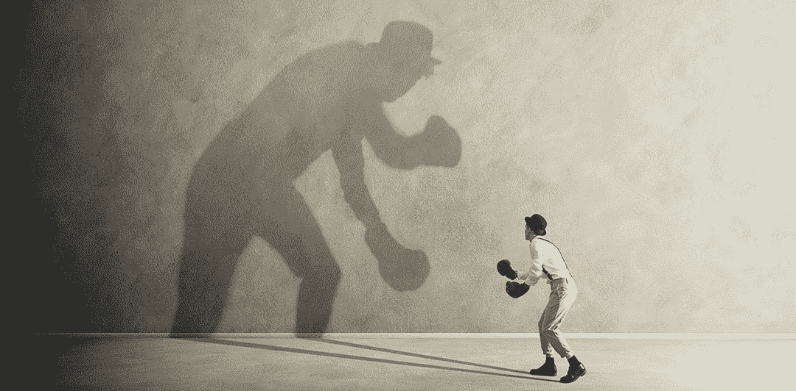

# 50 敌人：你应当小心选择你的敌手

和菜头

2022-04-09

## 50 敌人：你应当小心选择你的敌手

50 敌人：你应当小心选择你的敌手

| 转述师：余昊威 |

**敌人，名词，一种荣誉称号，只能给与那些对于自己成长刺激最大的人，所以颁发这个称号的时候要极为谨慎。**

\*

谁还没有个敌人呢？即便是宣称自己内心风光月霁的那些人，也总有个潜在的敌手。敌对未必是因为仇恨，也许只是一场简单的竞争就足够了。你我都清楚这一点，有个敌手会让所有竞争都变得有趣起来。可以走上前去直接拿走的锦标，反而无法让人感到任何乐趣。

不过，敌人或者敌的意思要远比你想象的复杂。它最起码有三层不同的含义：第一层是一般意义上的仇敌，也有对抗、敌对的意思；第二层是彼此相当的意思，在同一水平上；第三层是彼此相对着，如同面对面。从字的源头上分析，我们会发现敌人并不只是找个人来恨那么简单。

有些人很早就敏锐地发现了这其中微妙的含义，所以不肯轻易地树立敌人。不是因为怯懦，也不是因为逃避，而是因为你选择怎样的敌人，意味着你和他彼此相当。如果选择了一个非常弱的敌人，那么即便你最终轻松地战胜对方，你也并没有多强，敌人的上限就是你的上限。如果选择了一个非常强的敌人，那么这更像是一种自我恭维，对方很可能根本不承认这一点，因为击败了你对于他来说毫无荣誉可言，你并不够格成为敌手。

日常生活中，总有人会对寝室里的某个人，单位里的某个人恨之入骨，念念不忘。以为那就是自己的敌人，非得找机会狠狠教训对方一顿不可。类似的抱怨或者倾诉，二十多年来我不知道听过多少次。可是，那些人并不是敌人，最多只能算得上恼人罢了。而你之所以念念不忘，原因是你们之间的纷争都是极为细小的事情，所以才能引起对立，却又愤愤不平。如果你们之间的纷争涉及极大，那么不会有抱怨，不会有怨恨，你们早就已经动手，全力去击败对方了。  
**假的敌人激发愤怒，真的敌人激发勇气，我一直是这么看的。**

我经常对人说：要小心地选择你的敌人。原因是一旦确立敌人，你和他之间就是镜像关系。你有多强，对方也就有多强，反过来也是一样。而且，斗争到最后，很可能会发现大家是殊途同归，就像是硬币的两面在相互打架。可如果去掉任何一面，这枚硬币就变得毫无价值了。所以才一直有这样的说法：  
**用你的敌人来磨砺自己。聪明人选择合适的敌人，并不是为了战胜对方，而是为了提升和完善自我。**

大约在二十年前，我认识了一位年轻导演，有才华，有朝气，而且有创造力。我们一度是很要好的朋友，我也一直在支持他的工作。直到有一天，他拍摄了一部新片，上映之后票房非常不理想。那片子我也看了，看完觉得并不好，起码不是他应有的水平。但是，他找到我非常愤怒地表示，这是因为有“敌人”在组织评论，蓄意抹黑自己的作品。我问他这个敌人具体是谁呢？他说肯定是其他竞争对手，也许是同档期的其他电影，也许是其他导演。从此，我和他之间就渐行渐远，逐渐不再联络了。因为在我看来，他选错了敌人，这证明他对于自己，对于行业，对于创作都没有正确的认识，那么年轻的时候就把自己局限在一个非常狭隘的框架里，在里面随意选取敌人，以此回避真正的问题——作品究竟好还是不好？究竟应该瞄准谁作为敌手？

相反的例子也有，具体的名字就不提了，反正是两位很有些江湖名望的企业家。他们的业务有重叠的部分，于是在边境线上经常爆发冲突，大家也就经常可以看看热闹。因为经常火拼的缘故，人们都以为他们是死对头。但是他们下来却有很好的私交，还经常就业务和行业交换看法和意见，甚至彼此都相当坦诚，有种相互教学的味道在。我知道以后非常感佩，觉得这才是最好的敌对状态。因为无论怎么相互进攻，他们都没有办法击溃对方，仗总有得打。而且无论怎么打，短时间内谁也无法吃下所有的市场，拥有全国乃至全世界的用户。作为企业家，他们有义务为了股东，为了员工，为了用户开战。但作为敌手，他们也都是同一条路上的求道者，彼此都可以给对方合适的答案。恰恰因为彼此敌对，这些答案才会一针见血，比朋友都更加直言不讳。说到底，只有合适的敌人才能给出合适的意见，因为彼此才是世界上最了解对方的人。所谓的敌对行动，换一个角度去想，无非是对方帮自己测试了另外一种想法是否可行，成本是一个人的，但是收获却是双方的。

在希腊神话中，特洛伊远征军的统帅阿伽门农和英雄阿喀琉斯之间因为战利品分配爆发矛盾冲突，阿喀琉斯愤而拒绝出战。他和阿伽门农是敌人么？当然不是，战利品是极小的事情，阿伽门农自私自利，但是他是站在联军统帅的位置上，因此他要做统帅做的事；阿喀琉斯在意那点战利品么？但是他是站在英雄的位置上，因此他要做英雄该做的事。双方各不让步，相互仇视，但是并没有因此引发战争。阿喀琉斯最终成为伟大英雄，是因为他起身公开反对阿伽门农么？如果是的话，他的成就不会超过一个联军统帅，依然是尘世之中的一名将领而已。阿喀琉斯的敌人是太阳神阿波罗，他拒绝神谕的警告，坚持要跨越特洛伊的城垣。这是双方都绝对不肯让步的大事，它决定了特洛伊的存亡，于是他迎来了命中注定的死亡。阿喀琉斯以半人半神之身，挑战一位强大的神祇，而不是阿伽门农，所以他是伟大的英雄。

我当然不希望你拥有和阿喀琉斯一样的命运，他的敌手过于强大，其实没有任何战胜的可能。好在你多半也不会是一名伟大的英雄，也就不用去面对这样的命运。不过，这段希腊神话给我们的启示是：你选取多么伟大的敌人，那么你也会成就自己怎样的伟大。我希望你拥有像那两位企业家一样的“敌人”，棋逢对手又惺惺相惜。如果你能在你的敌人那里获得友谊，那么我会认为你选择了正确的敌人，因此可以丰富和完善你的自我。如果这样的敌人依然可遇而不可求，那么我希望你尽可能避免像那位导演一样选取敌人。迄今为止，他的成就没有超越当初他所认定的任何一位敌人，在人群中只剩下落寞的背影。

总之， **请小心地选择你的敌人。你们如同在镜中看着自己的影像，但是彼此相反。在这个意义上，也要小心轻易得来的胜利，因为敌人并非是用来战胜的。**

1.假的敌人激发愤怒，真的敌人激发勇气，我一直是这么看的。 2.用你的敌人来磨砺自己。聪明人选择合适的敌人，并不是为了战胜对方，而是为了提升和完善自我。  
3.请小心地选择你的敌人。你们如同在镜中看着自己的影像，但是彼此相反。在这个意义上，也要小心轻易得来的胜利，因为敌人并非是用来战胜的。

公众号懒人找资源

发布留言

0/ *500*

确定

# 51 内向：你得有力量才能活得内向

和菜头

2022-04-09

## 51 内向：你得有力量才能活得内向

51 内向：你得有力量才能活得内向

| 转述师：余昊威 |

**内向，形容词，原本是中性的概念，如今偏贬义，被认为不合群，缺乏竞争力和上进心，需要把它转变为外向。其实在我看来大可不必如此，不过在今天的社会里要做个内向的人并不容易。**

\*

社会的思潮会变，社会的共识也会变，人活在其中就会无所适从。在我小的时候，人们对性格外向或者内向根本无所谓，隐隐约约对内向的性格还更为认同一些，有个专门用来赞美的字眼叫“内秀”；同时人们也认为和外向的人相比，内向的人更有可能安稳地度过一生。今天的情况完全不一样了，突然之间内向仿佛是某种病症，需要治疗或者纠正，否则就无法适应今天这个社会似的。按照目前流行的看法，外向的人果敢勇猛，面对竞争和挑战无所畏惧，敢于表现自己，这是成功者通常具备的性格特征。

我认为这种观念的改变和内向外向毫无关系，纯粹是社会转型带来的新问题。在一个传统农业社会里，内向的人让众人觉得踏实可靠，反而是外向的人让众人觉得是夸夸其谈之徒，因为口舌而取祸只在顷刻之间。这也很好理解，因为在那样的一种社会结构里，人与人之间的联系非常紧密，共同生活在所有人认识所有人的小地方，相互都知根知底。一个人怎么说并不重要，人们会看他怎么做。

转型为现代社会之后，随着商业和工业的崛起，需要把大量陌生人组织起来协同工作，原先判别一个人价值的方式不好用了，老板、厂长、经理没时间去了解一个人是不是内秀，能说会道可以拍胸脯的人看起来积极性更高。同时，大规模生产意味着市场和销售工作变得空前重要，需要大量外向的人满世界跑，和陌生人拉近距离，把单子签掉，把货物卖掉，把款收回来。

关于这一点，有一个著名的互联网笑话。它说所有互联网公司都吹嘘自己是技术型公司，是产品型公司，但是只要敢亮出工资表来，会发现其实都是销售公司，帮着卖产品的人收入最高，而不是技术人员或者产品人员。这个笑话很大程度上可能是真的，依照我和互联网巨头公司打交道的经验，客服电话总是很难打进去，但是对方的销售经常会打过来给我，不断地向我推销他们的产品，从投广告、云服务到付费搜索，总有一款适合我。哪怕是伟大如乔布斯，你如果仔细想一下的话，他对公众的主要工作是开产品发布会。什么是产品发布会？那就是他个人的销售大会，通知果粉们可以掏钱了。

所以， **不是内向的人突然出了什么问题，而是社会发生了改变，对外向的人需求增多了。**  
更糟糕的是，随着网络世界的不断升级，把所有人都弄上了网，而且每人都发了一个小喇叭。于是演变成了一个新局面：如果你在网上没有声音，那么你就不存在。你可以内向，你可以内秀，但是小喇叭在你手里，如果你不用小喇叭在社交媒体上广播，不在朋友圈自我宣传，那么你就等于是不存在。在朋友圈里夜夜发帖叫嚷“加班真快乐”的人，真的在加班吗？真的很快乐吗？他们这是让老板加班，起身给自己点个赞，那才是真的快乐。老板信吗？不重要，重要的是夜夜刷屏，刷得多了，也就给老板刷出了勤奋的印象。老板向下管理，画大饼灌鸡汤。下属向上管理，刷朋友圈表演加班热情，反向洗脑老板。如此一来，大家就平衡了。

而你作为一个内向的人，默默承担工作重任，干脆漂亮地完成了工作，朋友圈一片空白，邮件组里不发一言，工作群里绝不冒泡，等你晚上 7 点半终于走出办公室回家，迎面遇见了老板，他说：“怎么那么早就下班了？整天都不知道你做了点什么。”说完，一脸不高兴地走进电梯，留下你站在原地一口血憋在胸口吐不出来。这样的事情经常发生吧？是不是也因此想过要改变一下性格，成为一个外向的人？想要学会在完成工作的同时也能做到表演工作？想要学会把表扬和自我表扬相结合？

我认为倒也不用那么悲观，更不用去勉强自己。如果问题是因为社会变化带来的，那么，最好还是从社会本身去找解决方案。社会对人的需求改变了，那么什么是不变的呢？社会对力量的尊重没有改变过。所以，我的第一个建议是越是内向的人，越要去参战。你不用去改变性格，也不用去增强社交，你专心打仗，而且能打赢就最好了。即便没能打赢，你是最强的伤害输出也成。  
**在战争爆发的时候，内向外向根本不重要，能不能打是任何人都无法忽视的。证明自己能打，也就证明自己有力量。力量在任何时代里都会受到尊重，内向而又有力量，受到的尊重甚至要更多一些，因为根本猜不透你的想法。**  
这些年来，我就是在战争中找到那些话少手黑的人的。

第二个建议是和对的人在一起。这个社会上有很多人认为能说就是能打，没声音就是不存在。作为一名内向的人，最好远离这样的人，因为他们没有识人的能力。但好在这样的人并没有占据整个社会，只存在于社会中最喧闹的地方。  
**在远离人群，远离热闹的地方，还存在着另外一批人，他们看人看事要更为深入一些，不喜欢根据表象就下结论。**  
他们更像是从旧时光里一路走过来的人，喜欢看手下的活，喜欢看手上的茧，能够对人做出比较公平的判断。努力去找寻这样的人，并且想办法获得他们的认同，和他们在一起工作。一开始的确会很难，但是只要你找到了第一个，剩下的就会如同雨后春笋一般出现。这些年来，我就是这么一个一个地找到自己的合作伙伴的。

第三个建议是不要急。经验和力量的累积需要时间，起码比做 PPT 要慢很多。打个比方，外向的人是霰弹枪，讲究速射，讲求伤害面积，不求精准；内向的人是狙击步枪，强调精准，强调忍耐，不求速度。如果内向而又没有耐心，听到身边霰弹枪砰砰声不绝于耳，自己也就跟着用狙击步枪打连发，那么多半没有机会命中目标。  
**外向的人勇于尝试，对每一次的成败并不放在心上；而内向的人则需要耐心，积蓄力量，最好做到一击必杀。**  
话说回来，既然内向这种性格今天都属于前现代社会的特点了，那你又急什么呢？慢一点，反而会准很多，内向的人追求成功率就好，古今中外，这从来都是他们的优点。这些年来，是内向的人一次次地按住我冲动的手，才让我多少体会到一点成功的滋味。

最后，我想说的是，人大多活在中间，但是有所偏向。有些人偏外向多一些，有些人偏内向多一些。其实，另外一边的行事风格自己也能做得到，只是不想那么累而已，勉强自己总是不如顺从本心来得愉快。只是说，在今天这样的时代里，想要坚持做个内向的人，追求宁静的生活要比先前困难许多。因为这并不是个人的事情，一个内向的人要面对来自社会的压力，生活的压力，以及周围人的压力。共同的观念已经形成，他就会试图改造自我。所以，  
**想要顺着自己的心意活着，意味着要付出更多的努力，变得更加强大，才能与外界的压力相抗衡。**  
我是希望内向的人都强大一些，拥有更多的力量，那么或许有一天这种力量能再次扭转社会思潮，回到一个平衡点上，让内向和外向的人都各安其位，不用总想着跑到对方那边去。

1.在战争爆发的时候，内向外向根本不重要，能不能打是任何人都无法忽视的。证明自己能打，也就证明自己有力量。力量在任何时代里都会受到尊重，内向而又有力量，受到的尊重甚至要更多一些，因为根本猜不透你的想法。  
2.外向的人勇于尝试，对每一次的成败并不放在心上；而内向的人则需要耐心，积蓄力量，最好做到一击必杀。  
3.想要顺着自己的心意活着，意味着要付出更多的努力，变得更加强大，才能与外界的压力相抗衡。

公众号懒人找资源

发布留言

0/ *500*

确定

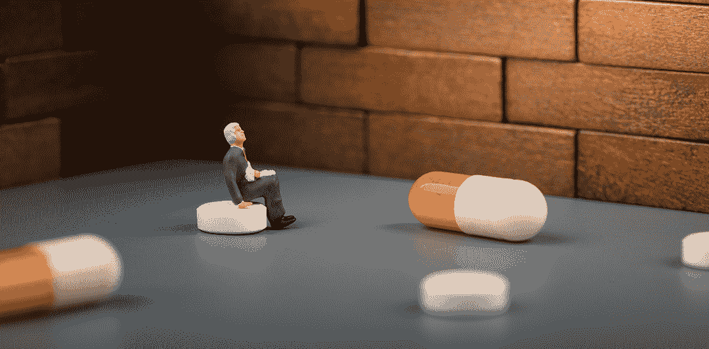

# 52 身心病苦：身体的病可能来自你的内心

和菜头

2022-04-09

## 52 身心病苦：身体的病可能来自你的内心

52 身心病苦：身体的病可能来自你的内心

| 转述师：余昊威 |

**身心病苦，词组，源自佛教，意思是身体和心灵都受到疾病的折磨而感到痛苦，值得注意的是，这里并没有做出区分，认为都是同样的苦。**

\*

记得我在小学三年级的时候，是个体弱多病的孩子。在课堂上经常会呕吐，然后一头冷汗、小脸苍白地回家躺下休息。那时候的学区很小，从学校到我家走路也就需要 5 分钟。当然去过医院，也做过检查，但是始终没有查出任何毛病，医生只是建议要细嚼慢咽。再后来，身体也就慢慢好了，我变成了一个强壮的小胖子。

我是很后来才觉察到当时究竟发生了什么事情。在我小学三年级的时候，我从父亲军事基地的子弟小学转学到城里的学校。基地里是另外一种生活，人们可以走在马路中央，因为没有那么多人，也没有那么多车。回到城里之后，我要学习的第一件事情就是如何过马路，城市里有太多的人，太多的房子，太多的车子以及太多的颜色和声音。转学去到一个全然陌生的环境里，给我带来了极大的压力。但是我和我的父母都没有意识到这一点，所以，我会不时地发生呕吐，这样就可以因为生病而回家，回到让我感觉心安的家里去。

**心病会引发身病，这应该算作是一个常识，但是知道这一点的人并不算多。即便知道了，也未必能把身心联系在一起，在身体出问题的时候有意识地查看一下内心。**

说起来非常好笑，人们在看到健康科普文章的时候，就会忍不住按照其中描述的症状，试图给自己做出诊断。进而去用搜索引擎查找，最后惊恐地发现自己可能得了一系列的病。与此同时，身体在明确发出警讯之后，人们却听之任之，觉得没有多大关系，过两天自然就会好转。当然有可能会好，因为一方面许多疾病都是自愈性的，比如说感冒，吃药与否只能减轻症状，但压缩不了患病时间，全靠身体自己克服。另一方面如果疾病是因为心病引起，内心改变之后，身病也就会消失，就像是我适应了城市生活之后，就不再每周从学校回家休息一次。

不过我还是认为，  
**与其被动地等着自愈，不如主动去发现身心疾病的联系，这样也好随时关照自己的内心，保持心灵内部的平衡。更何况有一些身体的状况，并不会随着时间的流逝自行好转。比如说压力和焦虑，如果不对它们的源头进行查找，事情可能会愈演愈烈，并不会自行打开这个结。**

要证明心会影响身其实很简单，正常人试着在学校、单位里做一次演出、一次报告就能够感受到心的强大力量。在上台面对观众之前，会有焦虑、紧张的情绪大量产生出来，于是人会感到手脚冰凉、胃部疼痛、呼吸急促等等生理变化，严重的时候还会有冒冷汗、胃痉挛甚至呕吐的现象发生。这时候身体本身存在任何疾病么？并没有。产生这一系列生理变化的原因，是内心感到了压力，在这种压力无法释放的时候，就会在身体上表现出来。这时候吃药去控制这些症状能够解决问题么？还是说，要去想办法解决自己内心的压力，免得下一次还是如此？

怯场因为太过剧烈、太过快速，所以人们很容易觉察。也正因为这样，也存在大量的方法，让人上场前放松心情，转移注意力，提升身体的耐受能力。但是如果一个人是面对缓慢而持久的压力，那么情况可能就完全不一样了。人人都会有心理上的低潮期，区别在于时间长短和强度高低。一般人们解释为心情不好，但是持续心情不好，有些人就会感到胸口憋闷，觉得压了重物；有些人就会感到肢体僵硬，运动起来变得更加吃力；而有些人则会彻夜失眠，体重下降。

其实，出现这样的身体状况时人就应该警惕了，主动去做点什么，积极寻求外部干预。出门走一走，参加什么运动，找朋友聊天倾诉，甚至是求助于医生，都是主动转换心境的方法。如果对身体状况听之任之，那么有可能情况会变得更糟糕。等自己发现对周围一切失去兴趣，只想待在家里哪里都不想去时，想要从这种状态里挣脱出来就会变得极为困难，因为内心已经锁死，靠自己的力量已经难以解脱了。

我在第二次创业的时候，每天睁开眼睛的第一件事情，就是计算剩余资金还能支撑多久。然后就要迎接每天的第一次打击，看报表里昨天的数据统计。那种感觉相当恐怖，不知道明天在哪里，同时确确实实地知道今天不怎么样，只有时间和金钱在不断地燃烧。这时候不是承受压力的问题，而是压力从四面八方涌过来，把自己包裹在其中，呼吸的都不是空气，而是压力本身。有天我去做按摩，按摩师捏了一下我的肩膀就叫了起来，说：“先生，你的肩膀怎么那么硬？”问我是不是最近压力太大了。他随后解释说，人如果面对的压力太大，身体就会不由自主地处于备战状态，双肩会收缩耸起。长时间不能得到松弛的话，肌肉就会变得铁硬。

这让我一下非常警觉，意识到我的压力和焦虑已经达到了怎样的程度，直接影响到了自己的身体。它让我立即停下来，想一想，我都干了些什么？我究竟想要得到什么？目前所有的苦苦坚持又是为了什么？然后我发现，从最早的“我之所以去做是因为我喜欢”，变成了后来的“我之所以做是为了做成”，再到最后的“我之所以做是因为不能失败”。我的内心有了一系列变化，自然也就从一个欢天喜地全身心投入的人，变成了一个患得患失，用持续工作避免思考是不是已经失败的人。如果不是因为我的身体发生了变化，大概我还需要很久才会意识到自己内心的变化，知道自己已经走偏。

小朋友饿了拿起碗就吃，累了倒头就睡，这可以从生理上解释为大脑尚未发育完毕，需要补充营养和休息。但也可以从心理上解释为没有那么多分别，没有那么多执念，因为心思单纯的缘故，该吃的时候吃得下，该睡的时候睡得着。进入成人世界之后，整天思虑纠结，念头此起彼伏，心也就随之转动，陷入到当下的情绪中去。同时，人又不断地向外求取，很少有机会反照自己的内心，于是在不知不觉中失去了平衡。

**出现身病是一个很好的契机，让我们得以暂时停下脚步，观察自己的心，看看身病是否是由心病引发的。**  
有时候消除了心病，身病也就不药而愈了。即便不能消除，意识到问题出在哪里，也有可以着手的地方。有一句话我很赞同，它说不是因为有了病于是有了医生，而是因为人意识到自己有了病，有了治病的需求，于是才有了医生。对于心灵来说也是同样的道理，最大的问题是我们不承认有心病，也不想面对自己的内心。这样的话，怎么可能有治愈的一天呢？

1.心病会引发身病，这应该算作是一个常识，但是知道这一点的人并不算多。即便知道了，也未必能把身心联系在一起，在身体出问题的时候有意识地查看一下内心。  
2.与其被动地等着自愈，不如主动去发现身心疾病的联系，这样也好随时关照自己的内心，保持心灵内部的平衡。  
3.出现身病是一个很好的契机，让我们得以暂时停下脚步，观察自己的心，看看身病是否是由心病引发的。

公众号懒人找资源

发布留言

0/ *500*

确定

# “我问和菜头”：选择敌人会给自己设限吗？

和菜头

2022-04-09

## “我问和菜头”：选择敌人会给自己设限吗？

“我问和菜头”：选择敌人会给自己设限吗？

| 转述师：余昊威 |

读者 用户月愚：:

> "想问叔的是，敌人该如何确定和发现呢？是在不断精进的过程中，对标每一个阶段内旗鼓相当的对手，把他作为敌人，直至超越呢？还是一开始就树立一个远大目标，不断地向之靠近呢？或者说这两种想法都是一种空想，更应该把注意力放在做事上，直到敌人自然涌现呢？"

如果一个人在做你想做的事情，而且还做得不错，但是你并不认同他的做法，认为你可以比他做得更好。那么，即便你现在还是无人认识的路人甲，你也可以把这样的人视为自己的敌人，努力做到有一天可以和他正面相遇，证明你自己的想法是正确的。我个人不是很赞同找旗鼓相当的敌手，因为你可以通过他获得的借鉴和参考大概不会太多，你解决不了的问题，多半他也解决不了，那么你又能够从中获得什么教益呢？说到这里可能你也已经看出来了，找个敌人是自己和自己玩的游戏。因为有的人的确需要某个敌人，才能让自己变得更加坚定，更有斗志，同时也避免自己迷失方向。如果自己能在前进的过程中找到乐趣，又没有非常急迫的需要，那么倒也不需要找到一个敌人，反而是找到自己想要成就的事情更为重要。  
**和最终的胜负相比，更多人的问题是无法找到值得为此付出全部的目标，始终在这个世界上不断找寻。**

读者 用户史东帅：:

> "菜头叔，以前听过一个说法，选择自己作为自己的敌手，这样的选择感觉玄之又玄，是自视甚高还是恐惧选择别人作为敌手呢？没有选择敌手是不是一种出于安全，却又很容易陷入孤独的想象呢？选择了敌手是不是更容易与世界建立深度的关系呢？"

选择自己作为敌手并不是什么玄远的说法，只不过是换了一种方式来谈认识自我。人为什么要挑战自我？首先是你能够认识自我，坦率地、诚实地面对自己，无论是自己的正面还是负面。然后是你对自我有所期许，认为可以通过自我锻炼和自我约束，成为一个更好的自我。这当然建立在认识自我的基础上，否则无法对自我进行正确的判断。最后是你有那样的决心，有那样的毅力，不断挑战自我，和自己的习气和惯性做斗争，硬着头皮也要做自己一直在回避的事情，希望以此让自己变得强大起来。在这个过程里，你会不断地检视自我，逐一考察自己的看法和观点，看看哪些是莫名其妙的固执，哪些是根深蒂固的偏见，哪些是未经审视的成见，哪些是必须放手的执着。  
**所有这一切，都有自我攀附其上，变成了自我的附属物。摧毁它们，也就是摧毁了对自我的过度执着。但这件事情很难，无形的自我难以对付，不如选个有形的敌人那么简单。**

读者 用户小横道：:

> "菜头叔，如何看待情敌？和看待敌人的模式一样吗？我和一个同事都喜欢办公室的一位女同事，这位女同事对我俩，我估计都不喜欢，姑且叫那个男同事为情敌吧。他身上很多特点比如油腻、大嘴巴，以及尬聊我都很反感，我个人认为他算不上我的情敌，同时我对他的了解多半来自于我自身也有我反感他的那部分，那么我要如何看待这个“情敌”呢？"

如果你真不在意的话，估计都懒得提及，但是你却写了那么多字，专门列举了对方的缺点。如果这个人真的有那些缺点，其实你很喜欢对方。因为正是有这样的人在，衬托出了你的不一样。虽然你们在那位女同事眼里都不及格，但你认为他是 10 分，你是 55 分，有他在的话，你看上去要好很多。不过就你的叙述来看，我猜想你也没有什么恋爱经验。固然姑娘们不喜欢油腻、多嘴、言辞不当的男性，但不等于说你没有这些特质，或者是拥有截然相反的特质，你就更有希望一些。所以我建议你对你的所谓“情敌”好一点，因为也许哪天你那位女同事结婚了，你们俩还得找个小酒馆抱头痛哭一场，全天下只有你们两个完全理解对方的内心。

读者 用户胡振强：:

> "菜头叔，得到上面很流行一句话叫做：竞争意识损害竞争力。这似乎和今天的主题有点矛盾啊，如果我们只盯着敌人，哪怕是个配得上自己的敌人，那是不是在给自己设限呢？我能不能不管敌人，安安静静地做自己呢？"

如果你决定安安静静做自己的话，为什么会有此一问呢？因为就我的理解，想要做自己的人往往是世界上心志最坚强的那种人，他们不会在意别人怎么说，也不会在意别人的赞同或者反对，他们做自己选择的事。所以，你在问一件你做不到的事情，只是和我讨论一种纯粹的可能性。那我的回答是  
**人人都有安安静静做自己的潜质，能否做到则是另外一件事情。**

在另外一方面，人们也的确在自我设限。要我说的话，人们热爱自我设限，但是口头上拒不承认。人们妒忌，人们羡慕，人们渴望着成为某个人，就在他们身边，但是人们说自己根本不在意，说自己看不上那个人，说那个人怎么可能和自己比。不是这样么？这不是经常发生的事情么？而这种敌意的实现，无非是买咖啡的时候杯子比对方大一号，买汽车的时候选择更大更闪亮的轮毂，也就做到这个程度而已。因此，我们说自我设限的时候，就是在说把自己限制在了大杯，限制在了镀金轮毂，失去了更大的可能。也正因为如此，我专门写长文说要小心地选择你的敌人，如果人性就是喜欢要个敌人，那么不妨选个大的，这样自己也能走得更远一些。假若大多数人真的可以安安静静做自己，如果大多数人真的不会自我设限，问题也就不复存在了。可是，事情是这样的吗？

读者 用户吴文鹏：:

> "会做不会说和会说不会做都是不可取的，特别忌讳完成工作 100 分，表达出来 70 分，正确地完成工作到准确地表达工作这件事，想请教一下菜头叔怎么看？这跟个人的内向和外向有直接关系吗？还有其他什么好的思路去应对这样的难题？"

如果你是专指工作的话，我认为这里并不涉及内向外向的问题，也不涉及到表达的问题。人们经常会出现一种误解，认为自己工作完成得非常出色，但是苦于自己无法很好地表达，吃了口才的亏，于是才让那些只会说不会做的人占了便宜去。那我想说一点：你所说的工作 100 分，这是谁给的评价呢？是你还是别人？当然是你自己。但你其实是在人群中工作，这 100 分需要你的上级、你的同级、你的下级来评定，其中你上级的评定最为重要。那么，你上级评定的标准是什么呢？他有具体的工作意图和工作目标，然后他把工作目标分解为任务，分发给你一部分，让你去完成。这样说起来，你最终得多少分，不是你自己来评定的，而是你的任务在多大程度上符合他的工作意图和工作目标，多大程度上做出了贡献和支持来决定的。如果你也同意这一点，那么答案现在已经昭然若揭了：这和内向外向无关，而在于你开动之前是否和对方进行了足够的沟通，清楚地知道对方要什么，对方对于你的期待又是什么；在于你开动之后是否和对方进行了复核，确定自己在对方需要的方向上，确定对方认可你的工作方式。如果你最终能够按照对方的期待完成工作，甚至超期待完成，那么你就算是临时失声无法说话也无损于对你的评价。  
**工作不是赌博，事前的沟通和准备更为重要，不是最后揭开骰盅一翻两瞪眼，然后你宣称不公平，游戏规则不利于你。对结果不满意的时候，最好一路反查，找到一开始出了什么问题。**

读者 用户咚咚咚：:

> "对我而言，我认为我的内向在于我不愿跟别人说我的真实想法，说出的话偏不得罪人或自认为不得罪人，这样下来我就不诚恳了，那么，有没有突破和完善自己性格的法子？"

你可以去试试，做个诚恳的人，看看会发生什么事情。如果不想惹出事的话，你也可以观察一下周围的人，看看那些大家认为诚恳的人是不是都说出了自己真实的想法。我觉得这是一件非常有趣的事情，大家会默认把诚恳和真实，同得罪人划等号。当然，基于生活经验这很可能是正确的。不过，在这里我们可以继续往前再推一步：为什么诚恳或者真实意味着冒犯？因为大家所说的诚恳和真实不是真的，其实它们是评判，而且是基于自己主观想法的评判。评判别人，当然是一种冒犯，人们只是用“诚恳”或者“真实”这样的好词，来替换掉“评判”这种负面的词。因为所谓“我说了实话”，其实等同于我要批评对方。我所说的再推一步，意思是  
**如果我们能认识到所谓的诚恳，就是评判，就是批评，所谓的真实只是我们主观认为的真实，只是我们的个人偏见，那么我们就可以放弃自我为中心的想法，放弃自己永远正确的想法，去反思一下自己的判断是不是有问题，有没有站在对方的立场上进行过思考。**  
如果有了这种反思，有了这种思考，不再把自己放在宇宙的中心，那么你的确是个诚恳的人，届时你可以说你想说的话，却不会因此得罪人，因为你说出来的话已经完全不一样了，不再是拿你的自我和对方的自我进行对撞。我希望我说清楚了我的观点。

1.和最终的胜负相比，更多人的问题是无法找到值得为此付出全部的目标，始终在这个世界上不断找寻。 2.人人都有安安静静做自己的潜质，能否做到则是另外一件事情。  
3.工作不是赌博，事前的沟通和准备更为重要，不是最后揭开骰盅一翻两瞪眼，然后你宣称不公平，游戏规则不利于你。对结果不满意的时候，最好一路反查，找到一开始出了什么问题。

公众号懒人找资源

发布留言

0/ *500*

确定

# “我问和菜头”：压力应该及时释放还是来一次大释放？

和菜头

2022-04-09

## “我问和菜头”：压力应该及时释放还是来一次大释放？

“我问和菜头”：压力应该及时释放还是来一次大释放？

| 转述师：余昊威 |

读者 用户孙敏：:

> "内向这个问题，曾经深深困扰过少年时代的我，因为内向而自卑、自我否定，长期为此痛苦。因为自身的经历，作为教师，我会更多地关注那些内向的孩子，发现并不是所有内向的孩子都会因为内向而困惑，真正需要我们关注的是那些因为内向而内耗着的孩子。想请问和菜头老师：这种来自于教师的关注，是否会打破孩子自身发展的生态系统？"

我明白你要问的意思。我们可以从两个层面来探讨你这个问题。一个是，所谓孩子的“原装系统”是否存在？我认为是不存在的，因为在成长的过程中一个人会受到外界的许多影响，不大可能完全依照自己的想法，独立地成长起来。教师的影响，只是这诸多影响中的一项，并没有那么特殊。只不过很多人长大之后，喜欢为自己当下的人生境遇归因，所以父母也好，教师也罢，都是一个顺手的对象。  
**一个人在成长中遇见什么人，这大概是不可控的。但是他如何面对这些人的影响，他是有所选择的。**

从另外一个层面看，你可能需要考虑一下自己的角色。类似医生、律师、教师这样的职业人士，往往会有上帝情结，认为自己的所作所为关乎人的生死成败。这种想法作为自我警惕，提升职业素养是有帮助的。但是同样也有负面的影响，那就是把自己看得过高过重，默认自己是在俯视着对方。这种影响被掩藏起来了，表现出来的是要对别人的人生负责。我觉得大可不必如此，做事就已经够艰难的了，就不要再给自己套上更多的枷锁。如果我也如同你一样去想，那这些文章就没有办法写了。我必须写出万全的文字，免得因为改变了他人的人生而背负因果，而万全的文字大概没有人想要去看。

我想，你作为教师，我作为作者，我们分别从学生和读者那里领受过许多失望，更多时候不是我们的影响力过大，而是我们的话别人不听、不想、不理会。所以孙老师，  
**我们能做的是本着善良的用意，依从着自己的本心，在职业道德和职业规范之内做事，影响之类的事情，不是我们所能计算和谋划的，没有必要为此而烦恼。**

读者 用户小时候很乖的益达：:

> "和菜头老师，外向的人不断努力尝试，内向的人不断深耕。但是失败更可能是人生常态，终于有一天等到了致命一击，但是很遗憾，内向的人没有击中，外向的也没有。因为外向的人不断尝试过，心态会不会比内向的人要更好呢？内向的人面对没有一击必杀，那以后怎么才可以肯定自己的内向呢？是不是也要学着做外向的事？"

尽管人们嘴上承认内向外向这样的概念并不重要，每个人都有自己的存在之道。但在内心深处，还是默默羡慕着另外一方，觉得对方拥有自己所不曾拥有的“好”。说到底，这还是对自己的现状不满意，需要给自己找个理由，于是性格内向导致心态不好就那么出笼了。你可以考虑一下，有没有这么一种可能：幸福感和幸福感的获得，和一个人内向外向没有关系，和一个人的内心世界有关。如果你的内心世界是充实而自信的，那么你因为不用向外他求，因而会感觉幸福呢？

我认为你的一系列问题都是从这里开始的，你把自己的问题外化为性格特征，你认为在别处存在更好的性格，你认为需要遭受某种打击，你认为你不能接受自己的内向，总而言之你对自己并不满意，你想着的还是扭转性格一类的事情，认为如果自己变得外向一些，生活会变得更加容易一点。那么尽管不应该这样做，但我还是想直截了当地回答你：不会的，  
**若你心不安，无论变成什么人，无论去到哪里，都不会找到你想要的东西。因为你拒绝接受的是你自己，一个人怎么可能逃避自己的影子呢？**

读者 用户薛弘毅：:

> "我是一个高中老师，工作很努力。我发现每次寒暑假到来时，我都会生病，胸闷气短、关节疼痛、全身乏力。就好像身体知道马上就放假了，于是兢兢业业地支撑到放假的前一天，然后强行关机，逼着我休息。生病的这些天是很痛苦的，但让我庆幸的是，这种状态一般在一周后就会恢复。我往往在假期里读书、规划，等开学后再次踌躇满志地出发。"

> "这样的循环已经出现很多次了，我不确定这样是否健康，需不需要我有意识地去打破这种循环。不知道您有没有类似的经历？您的工作压力是有一点就及时释放呢，还是像我一样积累到身体报警了，再来一次大释放？"

首先，我想向您表示我的敬意：薛老师，您辛苦了！我自己不是医生，也没有相关的医疗经验，可能无法给出任何健康方面的建议。不过从你的描述上看，我认为你自己已经想清楚了这个问题，只是无法下定决心真正着手去解决。也许你是不喜欢身体检查，也许你是不喜欢锻炼身体，也许你是习惯了目前的生活节奏，不想改变或者打破。总之，你的想法和行动之间缺乏一个契机。

那关于这一点我可以回答，  
**我认为累积压力一次性释放这种做法在年轻的时候可能有用，但是随着年龄的增长，不存在补觉的说法，不存在补休的说法。损害就是损害，压力就是压力，应该尽可能地在它们还没有累积起来之前释放掉。**  
一个人二十岁的时候通宵熬夜，第二天睡一下就能恢复。但是到了四十岁的时候，可能需要一到两周的时间，这是因为肉体和精神的弹性已经没有那么好了。看得出来，你很热爱自己的工作，不过为了长久地从事你喜欢的教学工作，你可能现在就要开始调整，找寻适合自己的放松方式。最重要的，可能是在心态上需要转变，许多人都是在中年重病一场之后才大彻大悟，懂得慢下来的道理，我认为你不需要如此。

读者 用户半支烟：:

> "中国的经济快速发展，物质生活也越来越富足，与之相对的是心理问题也越来越多了。但是，经历过匮乏年代的人会认为自己当年也面临了无数的困难依然挺过来了，而且无数人也是这么过来的。这也让这些奋斗者无法理解为什么现代人尤其是年轻人会有心理问题。有些人就会认为有心理问题的人就是“吃饱了撑的”。还有些人会认为忙起来就不会有心理问题。我想问一下和菜头老师，如何跟这些人解释这种状况呢？"

如果他们还存在着理性，或者你有办法让他们坐下来平等地倾听，那么事情其实没有那么复杂。因为我们可以很简单地推断：许多疾病在古代同样存在，但是因为科技和医疗水平有限的缘故，人们可能没有意识到这是疾病，病人就已经死去了。  
**过去没有心理疾病这种想法，更大的可能是过去没有把心理疾病当做一回事，因为求生艰难，都轮不到讨论心理因素，人们更关心肢体和脏器损伤。**

二战时，巴顿将军因为打了罹患战争应激综合征的士兵一耳光，惹上了极大的麻烦。并不是因为士兵和一战相比变得脆弱了，也不是因为一战时的士兵就没有类似的心理问题，问题从来都在，只不过一战时美国不是世界战场上的主导者，文明程度也远没有二战时高，士兵的地位也截然不同。如果艰难求生，人就是求生的工具，工具能有什么心理疾病呢？但现在是一个富足的年代，人就不再是工具，而是一个个非常具体而独特的存在。疾病当然也是存在方式之一，所以才有那么多医院和疗养院，而不是像中世纪一样弄个山洞然后点火一烧了事。

他们说的没错，的确，人们是吃饱了，这是个现实，但我们没办法回到吃不饱的情况去。的确，忙起来会好，用体力劳动缓解心理压力是有用的，但这只是在有限的情况下如此，并不是灵丹妙药。既然如此，说少吃点或者多干活就是没有油盐味的废话，和现实情况完全不相符合，倒不如老老实实承认这是疾病，也的确需要认真对待和耐心治疗。

读者 用户敲出哈姆雷特的猴子：:

> "现在总是看到报道：年轻人晚上不愿意睡，早上不愿意起。其实我就是其中一员，我知道这是个问题，因为身体陷入了恶性循环，一到晚上该睡觉的时候就精神，但这是心病吗？可是我总是尝试追问，是怎样的“心病”？当然如果这是病，病症还算轻微，并没有引起很大的身体反应，只是胖了些。我想问的是，菜头叔是否有经历过这样一段时期，又是如何找到“治心病的解药”的？"

这算是心病的一种，我也经历过。在很长一段时间里，我凌晨三四点睡，中午十一二点起，每天是从中午开始的。有理论认为，不同的人有不同的生物钟，有些人喜欢白天，有些人喜欢黑夜。对此，我的看法是，重点不在于你是百灵鸟型还是夜猫子型，而在于你在你清醒的那段时间里干了什么。同样是熬夜，我认识的许多人熬夜做出了成绩，也有许多人熬夜是为了好玩。前者我认为不存在心病，那就是个作息上的习惯。但后者我认为是有心病，因为一到晚上就精神其实是不想面对白天。因此，可以去想一下在逃避白天的什么，为什么要逃避？如果白天值得投入，值得过活，自然能一早起来。大年初一烧头香的人，我看就没有几个睡过头的，在庙门口排长队，一个个都精神抖擞。

1.一个人在成长中遇见什么人，这大概是不可控的。但是他如何面对这些人的影响，他是有所选择的。  
2.我认为累积压力一次性释放这种做法在年轻的时候可能有用，但是随着年龄的增长，不存在补觉的说法，不存在补休的说法。损害就是损害，压力就是压力，应该尽可能地在它们还没有累积起来之前释放掉。

公众号懒人找资源

发布留言

0/ *500*

确定

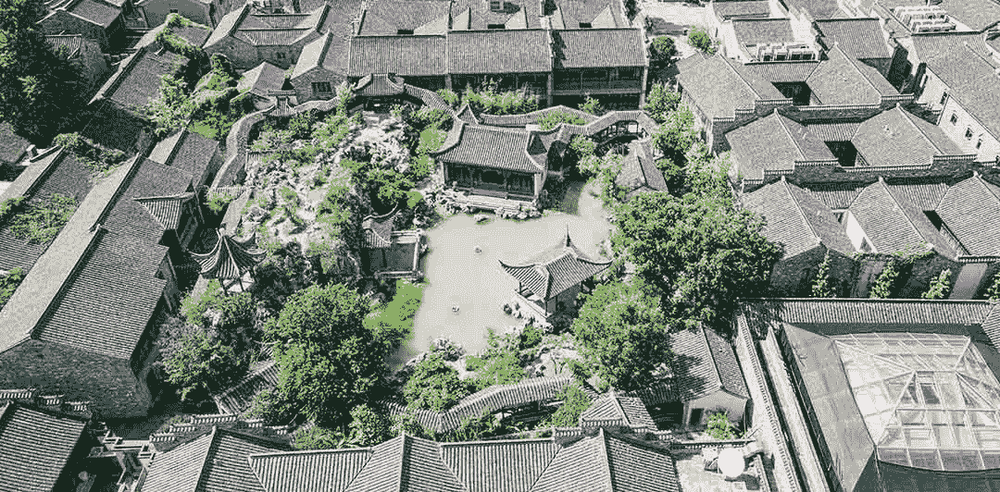

# 53 李渔：古今第一闲人

和菜头

2022-04-09

## 53 李渔：古今第一闲人

53 李渔：古今第一闲人

| 转述师：余昊威 |

**李渔，明末清初文艺大家，对生活美学极其倡导，素有才子美誉，世称“李十郎”。**

\*

如果一个中国人想要追求一点雅致传统的私人生活，那就一定绕不过李渔。早在三百多年前，他就是中国当时最著名的小说家、戏剧家、美食家、出版家、园林设计师，这个头衔可以继续写下去，总之，除了出仕这条古代知识分子的传统出路之外，他几乎探索了明末清初所有的生活可能，而且还把这些可能上升为美学。所以，我把他称为古今第一闲人。在做闲人这件事情上，李渔先生不单是空前，而且很可能是绝后，大概未来也找不到任何一个人可以闲出他的水准。

李渔生于明朝万历三十九年，即公元 1611 年。祖籍浙江兰溪，家族因为从事药材生意，家境非常优越。兰溪这个地方的人大多以从事中医药为生，其中以诸葛家最为著名，他们自称是诸葛亮的后裔，从事中医药生意是为了遵循祖训“不为良相，便为良医”。兰溪人从明代开始就不断地向外扩张生意网络，李渔的祖父因此跟随“兰溪药帮”去到江苏如皋。商人在封建社会的地位很低，童年时期李渔就显示出了良好的悟性，因此家人对他给予厚望，希望他能够走上科举之路，不惜花重金请来如皋最好的私塾先生，对他进行严格的八股文和诗文训练。

在科举这条路上，李渔一开始非常顺利，在 25 岁那年考中秀才。但是 28 岁回老家考举人失败，复习一年之后去杭州再次参加乡试，依然名落孙山。这一次失利给了他极大的刺激，一种刺激来自考中的朋友和熟人，他们高中之后马上装作不认识李渔；另一种刺激来自回乡路上，李渔遭遇强盗，凡是拿不出钱买命的同行人，都被强盗当场乱刀砍死。一次乡试，让李渔见识到了人生中的两面，每一面都很冷血凉薄。

到了 32 岁时，李渔已经是个中年人，再次去参加考试。此时大明王朝已经步入余晖，满人的铁骑正在横扫天下。天下动荡，风雨飘摇，通过科考取得功名已经变得毫无意义，李渔从此彻底断绝了通过科考出仕的念头，开始做一个闲人。王朝更迭，兵火连天，李渔的家族也受到了很大的冲击，于是他在兰溪老家隐居起来，在伊山修建了自己人生中的第一处庭园，称之为“伊山别业”，一隐居就是三年。从举子变成隐士，可以说是李渔人生中的一大步，彻底放弃功名走上了另外一条人生道路。但是李渔的步伐没有停留在小隐隐于野，1648 年他做了一件在今天看来都让人难以想象的事情：卖掉伊山别业，拿着这笔钱举家搬往杭州，他准备在杭州租房以卖文字为生，开始大隐隐于市的新生活。

这种类似赌博一样的人生变轨居然也成了。李渔去到杭州，发现当时的人们热衷于看戏剧和读话本小说，民间的戏剧和出版行业非常活跃，于是李渔果断拥抱市场，拥抱市民，开始创作话本小说和戏剧。他的才情很好，下笔又快，小说和剧本完全贴合读者、观众的需求。很快他就在杭州站稳了脚跟，只要他出手，作品立即就被一抢而空。他快的时候十几天就能写一出剧，转手就拿去上演，有的时候甚至会边写边演，李渔成为了清初中国的“巴尔扎克”或者“莎士比亚”那样的人物。靠着他的一管笔，真的养活了一大家子人，而且为他赢得了相当的声誉。

到了 1662 年（一说是 1658 年），李渔再度全家搬迁，从杭州跑到了金陵（也就是今天的南京）。如果说当年李渔从兰溪搬到杭州，算是一次和命运的赌博，想要做一个站着把钱赚了的文人，那么他从杭州搬迁到南京，则是完全沉浸到了他的新角色，从文人彻底转变为一名商人。为什么他要搬去南京呢？原因也同样让人感到匪夷所思：当时南京是出版印刷业的重镇，李渔名满江南，大量出版商在南京盗印他的作品，让他蒙受了经济损失。因此，他举家搬迁到南京，在南京开设自己的书坊，提供正版书。同时不断向官府告举，要求为他主持公道。

除了开设自己的书坊，他还在南京创建了自己的家庭戏班。李渔好色，娶了许多的姬妾，他让自己的小妾们充当演员，自己任戏班班头，上演自己写的剧目。李家班不单在南京前往名士权贵家演出，而且还举办全国巡演。按照李渔自己的话来说，就是“全国九州，历其六七”，李家班跑遍了大半个中国。也正因为这样，李渔被士人阶层批评，说他带着老婆到处要钱是“打秋风”。也因为他身为文人却操持戏剧这种当时所谓的贱业，让许多人对李渔直翻白眼，说他是名教罪人。

但李渔自己也没办法，他去到金陵之后，又设计并兴建了新的一处“芥子园”。虽然芥子园占地不大，但却是李渔一生中投资最大，耗时最长的一项园林工程。除了修建芥子园，他还有一大家子人要养活，毕竟他娶了一堆姨太太，让她们演出也算是补贴家用。最关键的一点，是李渔从小出生在富贵人家，对生活品质要求很高。虽然遭受兵祸，家道中落，但是对生活的要求可一点都没有降低。说到底，享受生活才是他人生的最大主题。他甚至在每一年螃蟹上市之前，要专门筹一笔款项，专作买蟹之用，好让他天天有螃蟹吃，李渔称之为“买命钱”。这样一个终日以追求生活品质为能事的闲人，显然不会太在意世人怎么看待自己。

李家班巡演七八年之后，由于两位年轻的台柱子先后病逝，戏班也就解散了。这对于李渔的打击很大，1677 年，心灰意冷的李渔从金陵再次搬家，回到了杭州。在当地官员的帮助下，于吴山开始修建“层园”。此时，他因为老病，逐渐入不敷出，开始债务缠身。1680 年，李渔在贫病交加中去世，死时据说自己的女婿正在下山为他借钱的路上。

如果你喜欢传统绘画，那么你应该知道传授绘画技巧的《芥子园画谱》是由李渔主编并出版的；如果你喜欢明清话本小说，那么你应该知道《肉蒲团》是李渔一时高兴写出来的作品；如果你对明清文艺创作和生活美学理论有兴趣，那么你也应该读过李渔的《闲情偶寄》，在里面李渔教人怎么创作，又怎么生活。

在中国历史上，李渔有着非常独特的地位。他不是一个人，而是一类人。在正统的生活和价值观被摧毁之后，他选择拥抱生活本身。他没有利用自己的艺术进行社会批判，也没有在大明遗民和新朝新贵之间做身份选择，在大明和大清之间做立场选择，  
**他直接放下了知识分子的身份，彻底地走进人群之中，在明末清初就做到了彻底的市场化，把文人和商人的身份结合起来，追求大众的认可，追求世俗的快乐，也因此体现了他对个人自由的坚持。**

因此，你可以在李渔身上看到彻底的俗，俗到到处要钱，到处演出交际，不断娶妾，沉迷于享乐，在明朝就做到了面对观众写作，是个纯粹生活化的文人；但同时你又可以在李渔身上看到彻底的雅，虽然是开戏班，但是唱的是昆曲；虽然写流行小说，但是也出了《芥子园画谱》一类的工具书；虽然追求世俗享乐，但是又使用营建园林的方式，是商人中的文化大家。在他身后，李渔的声名褒贬不一。但是谁都不能否认，他在历史的大变局中为自己找到了一条非常独特的立身之道，并且度过了非常快乐的一生。  
**无论是赞美还是批评，都是因为李渔做了他自己，仅凭这一点就让人感到极为难得。**

**闲本身就要比忙困难，而闲到李渔这个水平的，大概中国历史上只有他一个人而已。因此我要说，李渔不是文人，也不是商人，他的底色是一名艺术家。**  
而且如果要仔细论起来的话，他应该是一名波普艺术家，上至名士公卿，下至贩夫走卒，都在他的艺术生涯里得到了不同的共鸣，也在面对他的人生时得出了不同的思考。

1.李渔直接放下了知识分子的身份，彻底地走进人群之中，在明末清初就做到了彻底的市场化，把文人和商人的身份结合起来，追求大众的认可，追求世俗的快乐，也因此体现了他对个人自由的坚持。  
2.闲本身就要比忙困难，而闲到李渔这个水平的，大概中国历史上只有他一个人而已。因此我要说，李渔不是文人，也不是商人，他的底色是一名艺术家。

公众号懒人找资源

发布留言

0/ *500*

确定

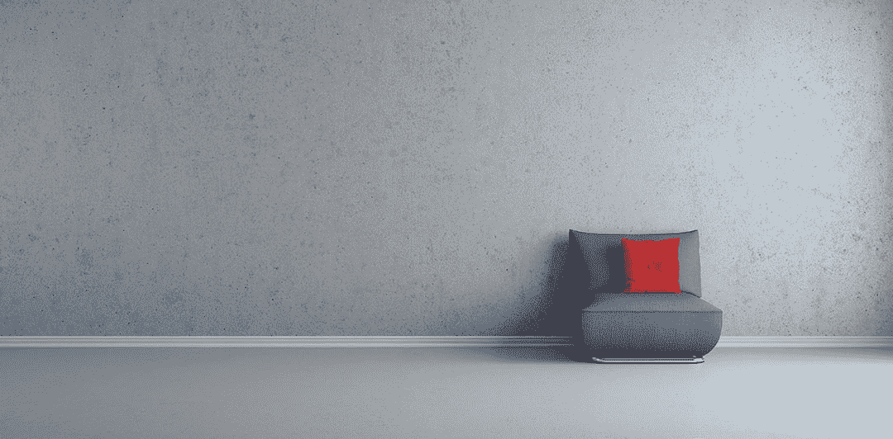

# 54 极简主义：任何一种生活背后都有代价

和菜头

2022-04-09

## 54 极简主义：任何一种生活背后都有代价

54 极简主义：任何一种生活背后都有代价

｜ 转述师：余昊威 ｜

**极简主义，名词，一种艺术或者生活风格，本意在于极力追求简约。在艺术上作为抽象表现主义的反对者在审美上进行挑战，在生活中作为消费主义的反对者而盛行。**

\*

我一直没有想明白一件事情：如果人们当真那么喜欢过极简主义的生活，为什么卡佛的小说没有流行起来呢？卡佛是极简主义作家，他的作品大多都是短篇小说。据说他过着贫寒辛劳的生活，只有在做家务的间隙，可以跳到打字机前抓紧那几分钟写上一点字。因此，他的小说极度精炼，只有筋骨，形成了非常独特的表达方式。

小说和生活方式有什么关系？在我看来，一个人不会是无缘无故地过着某种生活，他的内心一定存在着某种偏好，称许某一种价值，反对另一类价值。很难想象，一个暴发户坐在自己金碧辉煌如同夜店包间一样的家里，坦然对来客说“我最欣赏卡佛”，这种景象让他的说法缺乏说服力。如果一个人认为生活要讲求简约和精致，强调物的质感而不是数量，那么这个人肯定有某种美学上的偏好，他就很可能会喜欢同样风格的卡佛小说。如此，这个人的生活是和谐一致的，不存在暴发户那样的割裂。

但迄今为止，我没有看到过这样的相关性。人们说自己喜欢极简风格的生活，谈断舍离的生活，这和真正去做是两回事。关于我们的日常生活，除了极简主义之外，还有各种各样的主义，它们也存在一模一样的问题——看起来很美，实际上没有多少人会执行。依照我的想法，这些看起来很美好的主义，都避而不谈背后所需要支付的代价。因此，当有人真的想要去尝试一下的时候，遇见代价就飞快地缩了回来。

那这个代价是什么呢？我慢慢告诉你。

生活中的极简主义看起来很简单，无非就是舍弃大部分物质，留下少而精的一小部分，争取做到一个手提箱就可以容纳所有的家当。困难的部分不在于手提箱，而在于前面扔东西的那一部分。扔什么，为什么扔，其中的判断标准从何而来？假设你有一百本书，现在只允许你留下两本，你的选取标准是什么？大部分人在这种情况下会非常难以抉择，甚至会因为这种选择而产生痛苦。按照书中的思想价值来排序么？按照书的情感连接强度来排序么？还是按照书的单价和珍稀程度来排序？

这时候总是会有人跳出来说：无所谓的，随便选择一个标准就可以，重点是去掉 98 本，而不是选择那 2 本的理由。真的是这样么？  
**每一种选择标准的背后其实都对应了一种价值观，不同的价值观对应着不同的生活方式。**  
如果一个人是按照书的单价和珍稀程度来排序，那么这种人即便当时抛弃了 98 本书，但是很快他家的书架又会重新排满，因为他的价值观本身就指向了不断拥有，尽可能占有价值。对于他来说，一个满满当当的书架，放满了珍版书，那就是一种幸福。

因此，极简主义的生活以及它的宣传，很容易把人引导到外在。也就是说，一种生活方式基本上以视觉的形式体现出来，宽敞的房间，疏疏落落的家具，一尘不染的地板，让人以为这种生活方式只是改变生活的外在形式就足够了，把量降低，把质提升，也就自然而然达成。可是，回到那个老问题上来，人为什么要那么做呢？

在把一房间东西都扔出去之前，最先需要发生转变的是人，特别是人的内心。他不单要对凌乱逼仄的家感到厌倦，而且要发自内心地知道自己想要怎样的生活，更重要的是，他知道过去自己的想法和做法是有问题的，有强烈的意愿改变自己。于是，他审视自己的内心，重新评价自己的生活，给房间里的每一样东西做评估，分析它们存在的价值究竟体现在哪里。因为内心发生了这样的改变，决意要和过去的自己做切割，认定简单整洁的生活是自己所需，而且愿意为此支付代价，努力去适应生活变化后带来的诸多不便，这样他才可能拥有极简主义风格的生活。

**也就是说，在生活发生极简主义改变之前，首先是他的内心世界先做了整理和清洁。当人们看到他焕然一新的家时，那不是收拾和摆放的结果，而是他内心对外的投射。**  
这一点并不难理解，如果一个人疲于奔命，认为奋斗才是人生本色。那么他下班回来，打开大门边脱衣服边奔向自己的床，倒头就睡。那么他一定有许多衣服，因为他没有那么多时间换洗。他也一定拥有许多物件，因为他需要给自己的辛劳一点犒赏。他肯定也会以占有作为个人成就，因为不是如此的话，他的奋斗就会失去焦点。很自然的，他的家就会杂乱无章，即便发自内心想要过极简主义的生活，他也始终无法做到。

这就是我先前所说的代价，从一种生活方式切换到另外一种生活方式，肯定需要支付代价。  
**这种代价还不仅只是物质上的代价，一个人还需要花时间和自己相处，弄明白自己是个什么人，自己究竟需要什么。**  
当我刚刚开始北漂的时候，我的房间就是个工地，一切本着方便的原则，可以让我在最短的时间内饱餐一顿，或者是让我在最短的时间内拎包出门。当然我也尝试过整理归纳，但是却无法维持，很快一切就恢复旧观。回想起来，我还因此创造了一个小小的奇迹，那就是一个人如何用如此之少的东西，把一个房间弄得那么乱，而且看起来不剩什么空间。

如今我终于学会了收拾房间，习惯于每天做一点额外的事情，让东西回归原位。这不是我相信了什么主义，也不是因为我的精神世界得到了某种提升，纯粹是因为随着年纪的增长，内心逐渐平静下来了。终于有时间可以坐下来，坐在沙发上和自己面对面。不再去妄想将来生活环境会变好，因为我已经抵达了将来。不再去妄想等有更多收入可以请人来整理，因为任何人都不能阻止我弄成一团糟。我能做到东西用完放回原位，废弃物立即扔进垃圾箱，衣服和碗筷用完就立即清洗，其实问题就已经解决了大半。二三十岁的时候自己还有几乎无尽的明天，因此可以寄希望于未来的变化。等到四十多岁时自己已经身处当年的那个明天，你能仰仗的只有自己，只有现在。于是，过去是代价的东西不再是代价，而是内化成为一种个人日常。

关于生活的所有主义我认为都可以那么看，当你愿意支付代价的时候，一切皆有可能。问题的关键在于，很多时候人们并不能意识到有这样的代价存在。乔布斯和扎克伯格总是穿着同样的衣服，一种款式一口气买几十件，成为了某种专注事业，简化生活的典范。所以，当程序员得知乔布斯的黑色套头毛衣其实是三宅一生的产品，扎克伯格的灰色 T 恤是 700 美金一件的 Brunello  
Cucinelli 时，整个人都崩溃了。是的，他们可以那么过，首先是因为在他们内心世界里自己是个国王，然后他们有能力像个国王那样生活，只是他们选择了穿同款衣服而已。

1.每一种选择标准的背后其实都对应了一种价值观，不同的价值观对应着不同的生活方式。  
2.这种代价还不仅只是物质上的代价，一个人还需要花时间和自己相处，弄明白自己是个什么人，自己究竟需要什么。  
3.关于生活的所有主义我认为都可以那么看，当你愿意支付代价的时候，一切皆有可能。问题的关键在于，很多时候人们并不能意识到有这样的代价存在。

公众号懒人找资源

发布留言

0/ *500*

确定

# 55 自省：控制“分寸感”的旋钮

和菜头

2022-04-09

## 55 自省：控制“分寸感”的旋钮

55 自省：控制“分寸感”的旋钮

｜ 转述师：余昊威 ｜

**自省，动词，最好不要当做是名词，指随时随地进行自我观察，监测自己的言谈举止以及所处位置，因为你不做的话，会有人帮你做这件事。**

\*

当你自我感觉良好，觉得一切都过得很平顺的时候，往往意味着周围有些人在忍耐你。这是从我的亲身经验得来的，所以也可以算作是一种个人教训。曾经有段时间我的个人社交很少，我误以为这是一件好事，因为人生苦短，我把社交时间都留给了亲密的朋友，而不是花费在不相关的人身上。可人际关系其实是一种同心圆结构，自己在中心，根据远近亲疏一层层扩散出去，根据不同的人有不同的相处之道。基本上，我把本应该是同心圆的人际关系变成了一个圆。在朋友面前就显得太过随意，在朋友之外的人面前又显得太过冷漠。

我觉得这样正好，没有什么人和事来麻烦我，我也只需要处理好和有限几个人的关系，就可以支撑起我的整个生活，简单且有序，这样的生活可以称得上是称心如意。但是我并没有意识到，其实朋友并不喜欢那个随意的我，觉得我的自我漫无边际，把别人都逼迫到了角落里。当我意识到在很长的一段时间里，朋友们都是在忍受我而一言不发的时候，我感到非常难过。一方面是觉得对不起他们，另一方面是为自己难过，不知道自己是怎么变成了现在这个样子。其实原因也很简单，如果一个人过得太过平顺，那么他就会失去自省的能力，觉得一切理所应当，觉得自己一切都刚刚好。

当然没有什么刚刚好，当我觉得刚刚好的时候，一定是自我溢出了边界，侵占了他人的领地，因此我才会觉得称心快意。通常情况下，人很难意识到这一点，意识不到自我究竟是什么模样。山本耀司曾经说过，自我一定要和外界发生猛烈碰撞的时候，一个人才能发现自我的存在。意识到朋友们其实是在忍耐我，这是相当猛烈的碰撞。我并不是我以为的那样好，我在别人心目中也不是我以为的样子，于是我才认识到我的自我对于他人而言是一种多么讨厌的存在。这固然令我沮丧失望，但是激发起我自省的勇气。

在我看来，自省并不是找到自己的错处那么简单。既然谈到了自我，那就会存在他人，自省更多的是检查自我和他人之间的关系，确定边界在哪里。  
**人们形容亲友之间的关系紧密，会说“亲密无间”四个字。而我得到的教训却告诉我，永远是亲密有间，人和人之间永远存在着距离，控制好这个距离就是所谓的“分寸感”。分寸感太强让人感觉拒人千里之外，毫无分寸感则会让人感觉到窒息，自我受到全面压制。自省是控制这个距离的旋钮。**  
我的问题就是长期让旋钮失效，几乎坠毁在人际关系上。

人总是有可亲可爱的一面，也有令人厌憎的一面。人们之所以还能够愉快地相处，应该是彼此都用可亲可爱的一面相对；人们之所以还能更近一步，是因为觉察到对方令人厌憎的一面，但是依然选择把对方当作一个整体接受下来。而在另外一方面，更重要的事情是通过自省，控制自己流露出令人厌憎的那一面，控制在他人可以接受的范围之内。当自我开始膨胀的时候，就会天真而自信地认为自己只有一面，人人都爱自己，自己可亲可爱的一面总是能够奏效。当然，这只是一种幻想，我们通常达不到那个程度，做到不让人讨厌就已经很不容易了。

在自省过程中，我发现自己犯下的最大错误是误解了自我的状态。因为我是写作者，因为我需要经年累月地表达，对外输出观点面对挑战，久而久之我会以为自我是一种固体。我需要自我如同金刚石一样坚硬才成，谁都无法撼动我，那么我才可以持久地发出自己的声音。但我检查十年前的文章，二十年前的文章，却找不到那个所谓坚固的自我。我的想法，我的观念，其实都在悄然改变，随着阅历和经验的增长，我对世界，对社会，对自己的看法并不是一成不变的，只是我需要让自己笃定一点，尤其是看起来笃定一点。

自我其实是一种流体，有点像铁板烧案台上的油。厨师必须飞快地挥舞两把铁铲，才能让油不至于四下流淌，而是集中在一起好去煎炸食材。只要没有约束，它就一定会扩张到无法继续的程度才会停止。自省就是那两把铁铲，需要一刻不停地把自我约束在有限的空间之内，约束在别人可以容忍的边界之内。为什么喝醉的人往往会让周围清醒的人讨厌？只不过是因为酒精麻痹了理性，自我喷涌而出，平常可以被控制住的那一面自然流露了出来，而那一面往往不会让人喜欢。

人找到一个让自己舒服，也让周围人舒服的位置并不容易。一旦找到之后，很容易忘记那个位置只是个暂时的状态，像我就曾经以为什么都不需要做，可以永远那么保持下去。现实非常残酷，很快我就撞到了坚硬的墙壁上，变成了一个令人厌烦的家伙。还好，我在大学的流体力学成绩还不错，于是我给自己找了几条自省的方法：

1.  在每一次谈话中，我倾听别人说话的时间是否占到 50%以上？
    
2.  我和别人说的每一句话，是不是在听懂别人意图的基础之上？
    
3.  我和别人说的每一句话，是为了提供真实价值还是为了表现自己的聪明才智？
    
4.  我有没有用打断、嘲讽、反问的方式和他人对话？
    
5.  我是不是越过了边界，对我不懂，或者并不关心的事情发表了看法？
    
6.  我在每一句话出口之前，是否先想过一遍，说出来会不会后悔？
    
7.  我此刻的状态究竟是单纯地感知，还是想要表达自己的某种欲望？
    
8.  我此刻是否想从别人那里得到什么？
    
9.  此刻别人眼里的我可能是什么样子？
    

**在这所有九条方法里，我个人觉得第九条尤为重要。这是因为我们并非天然地成为我们自己，那个所谓的“自我”其实是在人群中慢慢形成的，他人对自己的观感和期待塑造了自我。**  
也许是父母的期许，也许是老师的肯定，又或者是朋友的赞美，让我们努力发展自我受到肯定的那一面。同样的，也正因为他们的否定、排斥和批评，让我们竭力控制自我受到否定的那一面。于是，自我才可能在人群之中找到合适的容身之地。我们每一个人生下来就像是一个圆，彼此拿着刀子在对方身上砍出一些缺口，最后我们都变成了齿轮，也正因为我们都是齿轮，才有相对合适的位置，并且彼此紧紧啮合在一起共同转动，于是社会就可以正常运转。

因此，最重要的自省方式其实就是随时思考此刻别人眼中的自己，切换到他人的视角进行自我观察。这种观察方式甚至要比他人真正的视角还要严厉，因为他人并不能如同自己一般清晰地认识自我，知道自我的所有掩饰、伪装与小花招。如果能够持有这种诚恳的态度，那么就不容易沾沾自喜，或者像我一样自我感觉良好，觉得一切平顺，无需关注自己究竟是什么模样。

最后， **自省是一件每天都需要进行，终生都不可以懈怠的事。**  
因为就我的经验而言，一段时间之后只要稍不注意，人就又会回到老路上去，自我又开始泛滥成灾。于是，在他人眼中的自己就在可爱和可憎之间坐过山车。如果可能的话，尽量让自我的轨道平滑一些，免得让人心惊肉跳，觉得无论远近都难以把握。

1.如果一个人过得太过平顺，那么他就会失去自省的能力，觉得一切理所应当，觉得自己一切都刚刚好。  
2.人和人之间永远存在着距离，控制好这个距离就是所谓的“分寸感”。分寸感太强让人感觉拒人千里之外，毫无分寸感则会让人感觉到窒息，自我受到全面压制。自省是控制这个距离的旋钮。  
3.我们并非天然地成为我们自己，那个所谓的“自我”其实是在人群中慢慢形成的，他人对自己的观感和期待塑造了自我。

公众号懒人找资源

发布留言

0/ *500*

确定

# “我问和菜头”：忙碌者应该怎样度过闲暇？

和菜头

2022-04-09

## “我问和菜头”：忙碌者应该怎样度过闲暇？

“我问和菜头”：忙碌者应该怎样度过闲暇？

｜ 转述师：余昊威 ｜

读者 用户 Li na:

> "请问老师，李渔所具备的这些特质，除了本身天赋异禀外，在他一路走来，是受到了哪些人和环境的影响吗？"

每隔一段时间，社会上就会激起一阵研究李渔的热潮。目前研究李渔生平的专著并不少，你有兴趣的话，可以找来读一下，或许其中有你需要的答案。仅仅从李渔的生平来看，他在中年之前就失去了父母，经历过家道中落的落差，然后是目睹王朝更迭。在满清建立政权之后，他可能也得知了金圣叹的悲剧。对于一个古人而言，他在太短的时间内经历了太剧烈的变化，难免有无所适从的感觉。在他的前半生，是一个逐渐失去的过程，失去父母，失去家族，失去仕途，失去国家。换一个角度来说，那就是在他的面前，没有一条路可以走得通，没有任何人可以依仗，他自己面临着从社会的中间阶级堕入底层的危险。也正是因为面对着这样的外部环境，李渔走出了一条原本不存在的路。他本来很容易把一切都视为虚空梦幻，但是他竟然选择了拥抱世俗生活，在其中重新找寻到了生命的意义。如果他的家族依旧是富裕的药商，如果他成功考取了功名，如果明朝继续延续了 100 年，那么李渔未必会是后来那个样子，也许他的戏剧会变得毫无动人之处。也许，正是因为不断地失去和破灭，最终成就了李渔。即便不是李渔，在那样的一个时代里，一切都做好了准备，也一定会有另外的什么人登上历史的舞台。

读者 用户马昌钦:

> "想请菜头叔给个指导，带有深度文学色彩的艳书，我们应该以什么态度去看待它们？又或者，我们这些普通人压根就不用在意这些，是当作闲书或文学完全看自己的水平？"

关于这个问题，我也感觉很矛盾。在我不加选择地读了那么多年之后，觉得自己读得并不聪明。如果手头有一张线路图，知道应该先读什么后读什么，也许我会从阅读中获得更多，很早在头脑中形成自己的体系。但是在另一方面，我也深深怀疑，如果我手头有那么一张线路图，那么我多半是读不下去的，因为这么多年来是兴趣支撑我一直保持阅读习惯的。我可以坦率地告诉你，这其中的根本原因在于我自己。因为我是个傲慢的人，本能地不会相信别人的书单，别人的知识图谱。觉得按照别人的线路图前进没有任何意思，宁可自己跌跌撞撞地去摸索。如今我没有那么傲慢之后，心态变得比较平和，也开始刷别人开出的书单。所以，  
**问题的关键在于你自己是个怎样的人。无论你是普通人还是个天才，如果你同我当年一样傲慢，那么别人说什么都没有用，很大可能你还是顺着自己的心意去读。因为阅读其实对你不重要，重要的是你想做个特别的人。**  
如果你是个谦和谨慎的人，那么，你会找到你的阅读线路图，不需要在大量阅读的基础上去领悟，因为你肯定能找到提升自己理解力深度的书籍，直截了当地告诉你在文学性后面的原理究竟是什么。这样两相对照，你的个人进度会变得很快。

读者 用户黄礼贤:

> "请问菜头老师，您在工作之余，会用什么业余活动来丰富自己的闲暇生活？对于忙碌的现代人，您有何闲暇的建议？"

我的业余活动目前只有三项：读书、写作和养猫。我不清楚别人是怎样的，对于我而言，我认为闲暇时间从事的活动最好能满足以下这几个要求：

1.  它是可以持续的，也就是说它的过程比结果重要，甚至不会有什么结果；
    
2.  它是可以独立完成的，因为如果它需要他人协助的话，因为等待的缘故，人就容易放弃；
    
3.  它是能够带来一定成就感的，如果做和不做没有任何区别，那么人多半会放弃。如果能够从中得到一点成就感，人就容易进入有益的沉迷状态，因此而感觉到放松和充实。在面对压力的时候，也就有了一个避难所。
    

读者 用户胡振强:

> "菜头叔，今天我们又面临一个“百年未有之大变局”，我辈中人该何去何从？能力与时代需求完美契合是小概率事件，更多的人是应该坚持自我还是向时代妥协呢？"

问这种问题的人，我是担心既没有自我可以坚持，也没有向时代妥协的本钱。这样的话虽然很难听，但却是我心中所想的大实话。真正找到自我的人，大概不会去想要不要坚持，放弃之后能换取什么好处，坚持下来要付出什么代价。因为  
**自我就是自我，大多数人根本都找不到，自己能找到自我已经是很幸运的事情，怎么会去考虑废存的问题？而所谓向时代妥协，你总得有点本钱，否则你妥协与否没有任何意义，时代多一个你不多，少一个你不少，反而破坏了你在别人眼中的观感。**  
我们身处的时代，总体上肯定会比前人的时代变化更快更剧烈，因此，这些年来才会反复强调拥抱不确定性。不确定性是这个时代的特点，它对人的勇气和信念提出了更高的要求。  
**很多时候，并非是因为能力强而获得成就，而是因为蛮勇和相信的力量，在不确定性中捕获了属于自己的确定性。放弃最多的人，最终获得最大，好像这样的事情更为常见。**

读者 用户何刚:

> "菜头叔，这一讲里关于书架放满珍版书就是一种幸福的内容，真的是戳中我的软肋了。我就是这样一个人，不知道从什么时候起，爱上了买书，我也承认好多书买回来都没有完整看完过，并且很多书在得到都有电子书，但就是忍不住想买，总觉得能把喜欢的书买回来整整齐齐码在书架上，就是一种满足，一种幸福。想问菜头叔，有没有办法让自己这样的心理和行为停下来？"

我猜想你一定也在某种幸福之中，如果不是遇见我的文章，大概还可以那么幸福下去。既然如此，我对你倒挺抱歉的。  
**人的本质是贪爱，无论是爱书，还是爱读书，都是贪爱。不同的地方在于，爱书的人是爱上了拥有书的感觉，爱读书的人是爱上了了解书中内容的感觉。**  
大多数时候，这两种感觉是重叠的，一个人爱书，同时也爱读书，原因是他的贪爱非常强烈，仅仅是拥有书籍不足以让他感到满足，他还要弄懂这些书里写的是什么。但也存在你的情况，那就是拥有书籍就已经让你非常满足了，所以你缺乏继续前进一步的欲望。因此，我认为你倒大可不必难为自己，仿佛自己有了某种病症或者是怪癖，需要治疗或者纠正。假若按照你所说的那样，你有能力搜集珍版书，又有很大的书架整整齐齐地摆放，那么  
**我认为你在生活中所读到的，已经超越了书本所能给与你的，你应该继续去读生活，偶尔有余暇去翻翻你的书架，和你在生活中的所学所知对照一下。**  
如果有那么一天，某本书在你的面前开启了一扇大门，那么不需要求取任何方法，你自己会去阅读。如果始终没有那么一天，这样度过一生也没有多大关系，你起码对作者和出版业有所贡献，而且那些书也还会在世间继续流转。

读者 用户金戈铁马:

> "有一个问题想要请教菜头叔。极简主义和精致生活，这二者之间是截然对立的吗，又或者是存在一些共通之处呢？"

我不大理解这个问题是想要问什么。它们截然对立或者有共通之处，会带来什么认知上的改变么？会对生活造成什么改变么？当我们把玩这些概念的时候，为的是得到什么？当然，我可以简单地回答你说，很穷的精致生活是极简主义生活，因为每样东西都很精致，却由于穷而无法拥有太多，那么自然就是极简的。但是，它的意义在哪里呢？我们当然可以把极简理解为每样东西能用就行，那么的确不需要精致。我们当然也可以把极简理解为东西少且每一样都是精品，那么生活简单而精致。正因为有不同的理解，所以社会不同阶层的人都在极简主义里找到了自己的所需，所以它才会成为一种流行。如果极简主义是能被理解成为都市生活里的“新苦行”，那么恐怕它连流行所需要的最基本受众都凑不齐。

读者 用户萦似时光:

> "菜头叔，所谓标榜极简主义风格的家具和装修风格，还算得上是极简主义吗？如果我做不到内心的断舍离，但是确实很喜欢极简主义风格的东西呢，比如装修、书的封面，等等。这是我表里不一的表现吗？还是说我没有真正理解极简主义的内涵，所以我喜欢的其实不是真正的极简主义，只是一种单纯的审美取向呢？"

如果你打开你极简主义风格的衣柜，衣服和袜子如同山崩一样垮塌下来，你觉得算是一种极简主义生活么？如果你的极简主义装修的家里，有 2 平方米的地面上放着超过 150 样粉、霜、膏、液、刷、夹、钳、梳，谁看了会相信你是极简主义的忠实拥趸呢？我忍不住猜想，你的房间里应该有许多柜子，有许多抽屉，有许多收纳箱，估计还有许多毛绒玩具。总之，那不会是一个进去喊一嗓子有回音的房间。德国包豪斯的设计理念是：形式追随功能。在你这里，功能明显是和形式相割裂的，那么形式就是个装饰而已。不过，也没有必要太过苛责自己。在我看来，形形色色的主义都是生意。能做到功能和形式相匹配的人的确有，但也的确没那么多。

我认为闲暇时间从事的活动最好能满足以下这几个要求： 1.它是可以持续的，也就是说它的过程比结果重要，甚至不会有什么结果；  
2.它是可以独立完成的，因为如果它需要他人协助的话，因为等待的缘故，人就容易放弃；  
3.它是能够带来一定成就感的，如果做和不做没有任何区别，那么人多半会放弃。如果能够从中得到一点成就感，人就容易进入有益的沉迷状态，因此而感觉到放松和充实。在面对压力的时候，也就有了一个避难所。

公众号懒人找资源

发布留言

0/ *500*

确定

# “我问和菜头”：外部评价体系有好坏之分吗？

和菜头

2022-04-09

## “我问和菜头”：外部评价体系有好坏之分吗？

“我问和菜头”：外部评价体系有好坏之分吗？

｜ 转述师：余昊威 ｜

读者 用户呢了同学：:

> "菜头叔，我有两个疑惑向您请教： "

> "1.“Less is  
> more”现在成了一句口号，但本田直之，作为一个提倡少即是多的畅销书作者，为了劝大家少，居然给出非常多的标准和建议，多到我根本记不全，这真是倡导少的正确姿势吗？我反正是凌乱了。"

> "2.智能手机，一机汇总了多种功能，电脑、电视、指南针、地图全都不需要了，这对我们的生活而言，到底是精简了，还是复杂了？追求极简生活，应该远离手机还是拥抱手机呀？"

第一个问题，我的想法和你相反。在我看来，这算是慈悲的体现方式。不妨把“少即是多”作为最高纲领，但如何接近乃至达到呢？纵然你的内心认同某种理念，距离你真正去执行依然有相当的距离。这是因为你的身心早已经习惯了多就是好，你认同少即是多只是理性上的判断，你的感性和惯性依然在另外一边，并没有受到任何约束，也不曾主动发生任何收敛。因此，为了你可以执行，你需要点滴接近最高纲领，一些书籍向你颁发了一系列的标准和建议，以此束缚你的行为。当你的行为受到束缚，行动上没有了那么多造作，心也才有可能安静下来，真正体会并且认同少即是多的好处。最终，外在的行动内化为内心的准则，这时候你就不需要时时遵守许多条规则，但也不会逾越了边界。我说这是慈悲，所以才会唠唠叨叨反复叮嘱。他（本田直之）大可以卖给你一本书，上面就写一个金句，你看了欢喜赞叹，觉得击中灵魂，但是，这和你最后能做成什么样子一点关系都没有。一般来说，聪明人想要嘲笑点什么都很容易，所以这个世界上大部分的事情，聪明人就始终是个看客。

第二个问题，我曾经认识一位火工道人，他用 App 占卜算卦，用 App 定方位看风水。这样的话，他出门只需要背一个很小的帆布香火袋，里面放一个水杯，一个 iPad 就足够了。对于他而言，现代科技让他无需背着龟壳、铜钱、蓍草、罗盘出门，算是极大的精简。但是我想，如果道长出门在外，还需要刷视频，赞朋友圈，刷网络小说，追逐明星动态，那么他可能还需要背上充电器，随时担心没有 Wi-  
Fi 信号，每时每刻忙得不可开交。这样看起来，  
**如果一个人知道自己每天要做什么，知道是人用工具而非相反，那么他总能够找到简单。袋子太沉，背不动了，自然就会去想办法精简。事情太多，做不过来，自然就会想办法去做简化。**  
你问出这样的问题，说明你体力精力都还好，那就且背着再走一段吧。

读者 用户王丹：:

> "我有个困扰，就是家里东西太多，找东西很麻烦，很多都没用，但是每扔一个东西，家里老人就不舍得，有没有什么好办法劝老人断舍离一些呢？"

那就给钱好了。知识分子或者类知识分子有个毛病，就是总觉得别人有什么问题，是因为道理或者理念上没有弄通。如果自己去“启蒙”一下对方，给对方一个道理，给对方一个新理念，于是问题就迎刃而解。当然不会迎刃而解，讲道理有用的话，家家孩子都是 100 分，监狱里一个人都没有。因为人在惯性做什么事情的时候，起作用的不是头脑，而是心识。头脑知道吃糖会发胖，对健康不利，但是心识却想要吃糖，以此获得那短暂的放松和幸福感。人到老年之后，经常会体现出收藏癖的症状。问他们为什么，说是必须有所储备，必须有所盈余，拥有的时候要想着匮乏的时候。这是一种什么情感？还是恐惧的一种。觉得生活缺乏安全感，要用收集储存来加以缓解。所以，  
**重点不是用道理去劝说，什么道理能让人无惧无畏呢？重点在于如何解除这种心理上的不安全感。**  
所以我一开头像是开玩笑一样说，给钱就好，其实并不是玩笑。给钱算是增加安全感的一种方式，其他的方法可以类推。

读者 用户陶子姐姐：:

> "心理学上有一组概念叫“外部评价体系”和“内部评价体系”，我是外部评价体系的人，曾经因为太注意别人的感受活得小心又疲惫，所以认为外部评价体系是不好的。菜头老师给出的九条自省方法里，每一条都是从外部视觉看自己，这是不是外部评价体系呢？如果不是，边界在哪里呢？菜头老师可不可以加个餐，说说这个度应该怎么掌握呢？"

其实我已经说得很清楚了，如果你的自我已经大到溢出，那么这个时候需要自省。但像你的情况，自我已经被压缩到一角，那倒是应该稍稍舒展一下。我不是很赞同你的这种二元判断，动不动就是好的坏的，对的错的，黑的白的。  
**外部评价体系并没有什么好坏之分，只有是否适合你的问题。此时此刻，它不适合你，那就可以暂时放在一边。但你的自我又不是金刚石，永远恒定不变。过一段时间，你的自我舒展开来，施展手脚，如果一切顺利的话，又会变得过于神气活现。**  
如果你认为外部评价体系是坏的，届时你会坚持认为没有必要听取他人的意见，以至于自我过度膨胀。你的提问里，是假设了自我恒定不变，所以只取一边就够了。问题是这个假设并不成立，人在万事顺遂的时候都会归功于自己，在诸事不顺的时候又会贬低自己，哪里会有停下来的时候？这和度不度的没关系，而是说要随时观察自己，承认外部评价体系和内部评价体系都是有效的。如果能够准确地观察自己，拥有清醒的觉知，那么就会知道在不同的时期应该侧重听取哪一方的反馈。

读者 用户玖：:

> "如果每一次自省都要陷入自我矛盾、自我怀疑、自我否定的局面，应该怎么办呢？每一次都有自我反思，心里好多个小人在打架，到最后谁也没赢，反倒是自己精疲力尽，陷入死循环。"

那就是还没有打够，你就吹哨宣布终场结束了。你问的问题其实是：自省会带来痛苦怎么办？你的处理方式是觉得难以忍耐就撤退。那么，自然也不会有什么结果。要都按着你自我感觉舒服那么来，自省多少次也不会起到任何效果。  
**自我矛盾、自我怀疑、自我否定都只是自省的开始，是早期必然引发的症状，再往前前进一点，这些吓人的症状就会消失。**  
因为自我否定和自我贬低到了极处，真实就会发生作用，你知道自己还是个好人，你知道自己还是做了些事情，你知道自己身上还是有优点，你知道起码世上还有一两个人是真心对你，这些都是事实。如果答案全部是否定的，那么你也早就分崩离析了，根本没有自省的机会和可能。事实可能是 3 或者 4，在你志得意满的时候会以为是 8 或者 9，当你刚开始反省的时候，一旦自我怀疑升起，很可能变成了负 10 或者负 11。但这些数值都不是真的，那你放到负 100 好了，连你自己都不相信。这时候自然会回归，自我的认知和评价回到 0 附近，不好不坏，不高不低，于是你可以比较客观地看待自己，最后找到 3 或者 4，于是你会因为你所拥有的而感到心安，也清楚地知道还应该往哪里提升一点。我想，如果在自省中保持着对自己诚实的态度，不回避，不退让，直面问题，同时，内心始终保留一点对自己的信任，那么你的小人打架会很快结束的。

读者 用户 Li 茜希惜昔 Cecilia：:

> "我的问题就是想请教和菜头老师，您是通过什么样的契机，发现了别人对自己的真实看法？以及如何才能正确地认识到别人眼中的自己是什么样子呢？"

很简单，如果 A 和 B 都是我的好朋友，他们相互之间对我的评价就是他们的真实看法。如果他们两人的看法一致，却和我对自己的评价差异极大，那么他们会在我面前保持缄默；如果他们两人的看法不一致，其中一人对我的看法和我对自己的看法差异极大，那么他们中的一个会忍不住找我来求证；如果我们三人看法都一致，那么他们两人都会毫无顾忌地在我面前引述对方对我的看法。所以，通过他们不同的态度和行为，就可以判断他们的真实看法。

读者 用户头发末梢的遗憾：:

> "我应该怎样才能让朋友直言不讳呢？我又应该在多大程度上包容对方，怎样技巧性地指出对方的问题呢？有种现象是朋友间一味忍耐，直到有一天友谊的小船突然倾翻，对双方打击都很大，请问菜头老师又是怎样理解这样的行为呢？"

我想，这取决于你过去对朋友的直言是什么态度，这决定了他们是否会和你说实话。同时，也取决于你们之间是否有默契和理解，清楚地知道对方的底线在哪里，知道哪些话可以说，哪些话只能提醒，哪些话根本不能提。这样思考的话，最关键的问题在一开始，你们因为什么而结识，因为什么而结交？换句话来说，那就是你交朋友的标准究竟是什么，成为你朋友的人有什么特质？  
**如果说你选择结交的人值得信任，是个正直善良的人，那么你就会知道他无论说什么，都是出于良善的目的，纵然有表达上的不当，纵然你当时很难接受，回去想一想他是个什么人，也能够在事后释然。**  
反之，你在你朋友那里也是一样。如果你们双方都秉持类似的价值观，拥有相同的信任度，因为良好的缘起而结交，那么友谊的小船会很难倾覆。而如果真的倾覆了，可能在一早就已经埋下了祸患，但是你们都没有及时清除，而是任由它放在那里，双方只是去做了一些掩饰的工作。那么，总有一天问题会暴露出来，当初就没能解决，现在也就更无法解决了。

外部评价体系并没有什么好坏之分，只有是否适合你的问题。此时此刻，它不适合你，那就可以暂时放在一边。但你的自我又不是金刚石，永远恒定不变。过一段时间，你的自我舒展开来，施展手脚，如果一切顺利的话，又会变得过于神气活现。

公众号懒人找资源

发布留言

0/ *500*

确定

# 父亲节特别篇：做个好父亲

和菜头

2022-04-09

## 父亲节特别篇：做个好父亲

父亲节特别篇：做个好父亲

｜ 转述师：余昊威 ｜

**爹都会说：当爹不容易。儿子并不认同。等到儿子也当爹的时候，沉默半晌，也就说了一句：当爹不容易。这不是容易与否的问题，而是角色扮演的问题。扮演儿子的时候觉得儿子不容易，但还有很多话说。扮演爹的时候觉得爹更不容易，但是已经没有话可以说了。**

理想的母亲常见常有，任谁都能举出好几个例子来。理想的父亲是什么模样？一想到这个问题大家就都没了底气。慈爱的母亲，勤劳的母亲，智慧的母亲，严厉的母亲，每一种母亲都非常具体，但是说到父亲就比较抽象，比较陌生，比较遥远，很难定义出一个理想的父亲形象可以比照着学习。即便有那么一个人物，人们又会忍不住去猜想，看起来虽好，他是不是还有不为人知的那一面？是不是还没到暴露出来的时候？我认为这种区别在于角色的属性不同，母亲的角色是包容的，而每一个父亲迟早都是孩子想要逃离的对象。  
**越是伟大的父亲，孩子就越是想逃出父亲的身影；越是平凡的父亲，孩子就越是想逃离父亲的人生。**

没有理想的父亲，那么是否存在成为一名好父亲的可能？大概没有人想成为糟糕的父亲，可是什么才是一名好父亲呢？按照电视广告和好莱坞电影的标准，我认为一名好父亲首先得有一件套头毛衣。毛衣非常重要，它可以掩饰成年男性的锋利棱角，让人看起来像一只大型毛绒玩具，感觉到温暖而包容。然后他要时常带着微笑，略露出一线洁白的牙齿。因为爹给人的感觉是沉重的，是严肃的，也是无趣的，需要用微笑来稀释这些感觉。更重要的是，会微笑的父亲意味着比较宽容，而且有幽默感。我们小时候都是在同学和邻居家里才能见到这种爹，自己家没有，所以就彼此羡慕，进而增进了友情。

好父亲还应该有很多时间。很多时间的意思是经常陪伴孩子，一起看书，一起做游戏，一起外出游玩。即便是最严肃的好莱坞电影里，好父亲也是要陪着孩子练习棒球的，更好的父亲则带着孩子去溪流里钓鲑鱼，爬到树上建树屋。因为人和人的相处是艰难的，为了让亲子时光熠熠生辉，好父亲还应该学识丰富，在聊天中不经意就深入浅出地讲出一番人生道理。这样孩子在多年之后的人生路途中，偶然陷入绝望的境地，就可以打开记忆回放这一段，从中撷取智慧的果实，要么是完成了工作突破，要么是解决了情感困境。回忆中的父亲就那么站在夕阳里，身穿套头毛衣，面带微笑，露出整齐雪白的 24 颗牙齿，浑身上下散发着金光，讲出那句充满了人生智慧的话语：“孩子，无论生活如何艰难，你都要记住爸爸跟你说过的话——香蕉皮比香蕉要大，爸爸相信你！”

这样的父亲很好，就是有一个问题：他几时上班呢？还是上面这位父亲，如果我们加入上班这个因素，整个场景可能立即就变得不一样了。他没有了毛衣，因为毛衣要送去干洗很麻烦，所以他其实穿的是一件冲锋衣，而且是深色的。这样无论刮风下雨都可以抵御，清洗和晾晒都很方便，挤地铁和公交的时候也会减少很多摩擦力。然后他突然笑不出来了，因为每天下班之后他都感到身躯沉重，到了小区也不想上楼，只想坐在花坛边抽根烟发一会呆。有些时候，即便抽掉了半包烟，又在风里散了半小时烟味，仔细搓过手指，等他回到家的时候想要挤出一丝笑容也依然非常勉强。

他的时间没有那么多，手机二十四小时开着，工作群随时在叮当作响。有些号码他还设置了特别的铃声，任何时候铃声响起他就像触电一样猛然跳起，一把抓起电话回答：是是是，好的好的，收到，马上。有时候他抓起衣服冲出门外，有时候他颓然倒在沙发上，有时候他深夜归来抱着马桶吐到天亮。有一起看书的时候，有一起游戏的时候，也有一起外出游玩的时候，但都不是那么多。所以才会显得很特别，所以在多年以后才能清晰地回忆起来。更多的时候不是这样的，他辅导不了孩子的中学作业，生硬地说一句“不会去问你同学”；他也给不了什么关于人生智慧的金句，他说：“老子天天累死累活上班，供你吃，供你住，供你上学，供你旅行，供你一年一部新手机，你就是这样回报我的？”偶尔他也会道出某些人生真相：“你除了打游戏还会干什么？”

这样孩子在多年之后的人生路途中，偶然陷入绝望的境地，就可以打开记忆回放这一段，从中撷取智慧的果实，要么是完成了工作突破，要么是解决了情感困境。回忆中的父亲就那么站在夕阳里，身穿冲锋衣，面无表情，秃顶反射着日光，用夹着香烟的两根手指戳着你说：“笨蛋，给老子站起来！记住了，香蕉皮比香蕉要大，你得认！”

我想，这大概就是理想和现实之间的区别。许多父亲也曾经不止一次地想过，要去做一个理想的父亲。然后发现很难，只能想办法去做一个好父亲。依然还是很难，最后只能变成穿冲锋衣秃了顶的父亲，忙忙碌碌的父亲，脸上没有微笑的父亲。于是他会有很多后悔，也会有很多遗憾，不时还会自责。但他不会轻易说出口，临到嘴边他说出来的却是那句：当爹不容易。听起来像是给自己找借口，等儿子当了爹的时候才知道那里面满是歉疚和遗憾。

**人生不是电影，人生不是广告，人生也不是家庭喜剧。人生更多的时候是拼尽所能，却也只是做到勉强；竭力给出，却也并非给到最好。但我以为，如果一个父亲能做到拼尽所能，竭力给出，那么他就是一名好父亲。虽然他不是理想中的父亲，但我们也并不是理想中的子女。**

祝各位好父亲节日快乐！

1.越是伟大的父亲，孩子就越是想逃出父亲的身影；越是平凡的父亲，孩子就越是想逃离父亲的人生。  
2.人生不是电影，人生不是广告，人生也不是家庭喜剧。人生更多的时候是拼尽所能，却也只是做到勉强；竭力给出，却也并非给到最好。但我以为，如果一个父亲能做到拼尽所能，竭力给出，那么他就是一名好父亲。虽然他不是理想中的父亲，但我们也并不是理想中的子女。

公众号懒人找资源

发布留言

0/ *500*

确定

# 56 定见：做个不断翻越认知围墙的人

和菜头

2022-04-09

## 56 定见：做个不断翻越认知围墙的人

56 定见：做个不断翻越认知围墙的人

｜ 转述师：余昊威 ｜

**定见，名词，意思是确定的见解或主张，在我看来，它是需要不断翻越的认知围墙。**

\*

**大多数人没有定见，连成见都未必见得有。说定见，人总得先定得住，才能见得到。见得到，才能有见地。**  
第一步都很难，根本定不下来，人们只是随波逐流，人云亦云而已，内心并没有一把标尺。所以会经常出现所谓的“双标”现象，双标就是双重标准，指一个人在同样的两件事情上根据远近亲疏给出了不同的判断标准。说起来这还真是冤枉，人们在双标的时候根本意识不到自己是在双标，它就不是个主动行为。其实是因为没有定见，所以没有标准，因为没有标准，所以才会跳来跳去，看起来每一次的判断都不相同。

我曾经观察到一个很有趣的现象，动物保护组织在网上发布可爱小狗的视频，表现它们的忠诚、可爱、对人无条件的信任，然后引导人们去讨论捕杀流浪犬，于是大家都表示反对，认为狗那么忠诚可爱，理应得到更好的对待；过一段时间，视频媒体又发布社会新闻，内容是几条流浪犬攻击老人或者孩子，场面惨不忍睹，伤者血肉模糊，于是大家立即开始尖叫，为什么不捕杀这些恶犬，任由它们在街头游荡呢？这是双标吗？我认为这是没有定见。如果拥有定见，看到可爱的流浪犬的时候，人会想起它们动物性的那一面；看到恶犬行凶的时候，人也会想起它们可爱的那一面。并不因为一时一地的表现，就轻易地改变自己对流浪犬的观点，即便现状并不利于自己的观点，也能够找到支撑点坚持下去，比如说判断一下这是特例还是通例，或者成本和获益之间的关系等等。

对于有定见的少部分人来说，有了定见也不是万事大吉，反而处境要比没定见的人更麻烦一些。  
**因为拥有定见，我认为并不是拥有了认知的地基，倒更像是拥有了认知的围墙。定见把自己围在中间，只要在自己的定见之内，人就是安全的。**  
比如说“科学”两个字，在日常生活中经常听到，但是运用这两个字的时候往往和科学没多大关系。你可以说“刷牙才科学”，“不吃腌制食品才科学”，科学在这里的意思是符合理性判断，或者干脆就是正确的代名词。当你频频使用“科学”二字的时候，你的围墙是“理性”，或者说是“正确”。但你其实根本没有论证过，你不是牙医，也不是营养学专家，因为你需要理性，需要正确答案，所以你从你认为的理性权威那里拿来了一些概念，而其他人不大敢去挑战这些概念，于是你就安全了。

再比如说环保，它的威力比科学还要大一些。对于很多产品或者企业，你只需要说“包装不够环保”，“生产不够环保”，诸如此类的话语，对方就会很紧张，要努力解释甚至是道歉。因为环保是一种安全的定见，保护地球，保护大自然母亲，这是每个人应该做的事情，而且人们对此也存在相当广泛的共识。你把环保当做是自己的定见，基本上是无往而不利的，没有人会挑战你，你在环保的围墙里安全极了，你站在了正确的一边，甚至还会拥有某些道德上的优势。你判断事物的标准也变得简单极了，只要有利于环保就应该支持和肯定，只要有损于环保就要反对和批评。同样的，你的这种判断也不会受到多少挑战，你的定见坚固极了，可靠极了。

但是，围墙外面是什么呢？你有没有想过这个问题？

如果我们翻过围墙，往外面继续前进一段路程，回过头来再看，可能我们见到的景象又不一样了。咱们还是拿环保举例，人人都可以不假思索地说：保护地球，保护大自然母亲。有没有可能地球不需要人类的保护呢？有没有可能大自然不是慈爱的母亲，而是一位严厉的爹呢？当我们接受环保这个概念并且作为自己的定见的时候，我们未必仔细思考过这个概念的前因后果。环保作为一种定见，背后有一套对于地球，对于大自然的理解，这种理解是理想化的，也是拟人化的。

有所谓保护地球的说法，那就势必有伤害地球的行为。说到伤害地球，那就要谈到打破自然平衡。谈到打破平衡，那么就意味着人们对地球的理解非常古典，认为地球应该是个和谐的、平衡的，而且意图滋养万物的星球。因为它慷慨地给予，所以我们要有所回报，尽力帮助它维系这种平衡。砍掉一棵树，就要补上一棵。烧掉一公斤煤，那就要从太阳和风力里补回一公斤煤燃烧的能量。可是，如果这种理解根本不成立呢？如果地球没有意识，也不特别地关照任何生物，该地震的时候地震，该海啸的时候海啸，该冰川期的时候灭杀一切，人类的存在和发展壮大只是因为幸运而已呢？恐龙存在的时间比人类长，但是说灭绝也就灭绝了。事实上，地球上已经有过多次的生与灭，我们使用的煤炭和石油都是远古时代的尸骸。为什么偏巧是我们人类得到了特别的照顾，拥有了一个特别慈爱的大自然母亲呢？

如果从大道无情的角度上来看，一颗存在了数十亿年的星球并不会在意自己身上那点小爬虫，更不用说需要小爬虫的保护，需要听它们肉麻地喊“妈妈”，这些小爬虫的兴亡它根本就不关心。那么，所谓的保护地球，保护大自然母亲就不成立了，环保是人类保护自己，具体说起来就是保护人类这个物种可以在地球这个星球上持续发展下去，不至于因为耗尽资源而陷入灭绝的境地。想到这里，环保的“围墙”可能就要被松松土了，因为环保的目的已经分叉，保护地球和可持续发展是两件不同的事情，针对两个不同的对象。

接下来的事情会变得更加有趣，可持续发展肯定需要一定的手段，一定的手段对应一定的技术，一定的技术对应一定的科技能力。不同的国别，不同的地区，在科技能力上并不相同。那么，是不是有这么一种可能：一个第三世界国家要买净化烟囱的设备，设备的费用可能比工厂生产一年的产值还要大呢？不要说这是胡思乱想，一杯星巴克美式咖啡 26 元，除了房租、水电、人工、咖啡豆成本，剩下的是所谓品牌溢价。而品牌溢价的这部分钱里，有多少其实是因为星巴克宣称的那些保护环境的手段而额外支出的呢？或者我们换句话来说，星巴克如果不宣传它的环保策略，是否还能卖现在的价格？也许答案还是可以，不过会更难，因为想要绑定另外一个和环保等同量级的观念并不容易。所以，环保到了落地阶段又可能转化为一个经济问题，并非是单纯的道德选择。

我们先在这里停下，因为再讨论下去很多人该感到不高兴了。我本身的目的也不是讨论环保，而是证明  
**一个我们都认为很坚固的定见，其实是可以摇撼一下地基的，也是可以翻墙出去多走一段路的。**  
当然，出去看了一圈之后，最终的结论可能还是要支持环保，但这时候你就不会觉得那么理所应当，脱口而出保护地球这一类的话了，因为你知道现实要比喊口号复杂得多，其中会有许多的成败利弊算计，人们最后做出的选择往往不是所谓的最佳方案，只是一个相对不那么差的方案而已。

因此，  
**心存定见固然是一件好事，但是也要理解定见就是认知的围墙。我们应该尽可能地经常巡视这道围墙，看看有没有修补或者向外延展的可能。如此我们的认知得以扩展，人也变得较为谦卑和理性，明白自己的局限所在。**  
和毫无定见的人相比，这当然是一种更高的要求，原因是有定见的人更具有行动力，也就意味着可以带来更多的破坏和伤害。围墙越小，里面的人也就越自信笃定，越是盛气凌人，认为真理在握。这样的人，其实我们都已经见识过太多，也因此才有那句话：  
**通往地狱之路都是由善意铺就的。**

1.大多数人没有定见，连成见都未必见得有。说定见，人总得先定得住，才能见得到。见得到，才能有见地。  
2.拥有定见，我认为并不是拥有了认知的地基，倒更像是拥有了认知的围墙。定见把自己围在中间，只要在自己的定见之内，人就是安全的。  
3.心存定见固然是一件好事，但是也要理解定见就是认知的围墙。我们应该尽可能地经常巡视这道围墙，看看有没有修补或者向外延展的可能。

公众号懒人找资源

发布留言

0/ *500*

确定

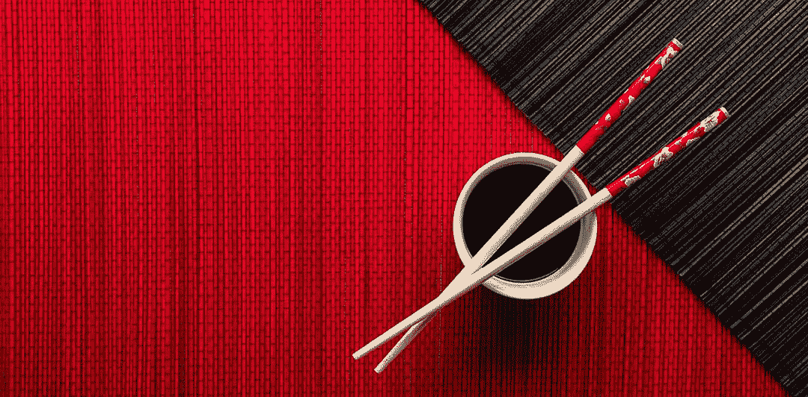

# 57 请客：怎样请客才能落在实处

和菜头

2022-04-09

## 57 请客：怎样请客才能落在实处

57 请客：怎样请客才能落在实处

｜ 转述师：余昊威 ｜

**请客，动词，词典解释为宴请客人。基本的社交活动之一，也是最麻烦的社交活动之一，有许多需要注意的细节，这里我们只讨论私人宴请。**

\*

什么是请客？请客就是拿出食物来分享给客人。为什么要分享？因为这是增进人和人之间感情的一种有效方式。为什么请客可以增进感情？因为在人类的社会生活中，有两个动作专门用来表示信任。其中一个是允许对方用手接触自己的头部，因为手是人体最具威胁的部分，头面是人身体最为脆弱的部分。允许对方用最具威胁的部分接触自己身体最为脆弱的部分，这种行为本身代表了无条件的信任。

另外一个动作就是请吃饭，因为在吃饭的时候人并不设防，放松的程度仅次于睡觉的时候，同时，在远古时代，食物是非常宝贵的资源，对一个人不设防，并且邀请他来分享自己的宝贵资源，人们就是用这样的行为来表示善意和信任的。所以一直到今天，如果艰难的谈判无法继续取得任何进展的话，人们会在美餐一顿之后继续，往往在饭后紧张对立的情绪就能得到很大的缓解。

因此， **请客吃饭就是释放善意，交流感情，赢得信任的过程，核心是在“信任”两个字上。** 围绕这两个字，有许多的细节需要做到位，否则请客可能适得其反。  
**首先，请客要做邀约，尤其忌讳当天请客，当天邀约，必须要提前发出正式提议。**  
临时邀约会让人很反感，尤其是对于都市人群来说更是如此。因为都市人群每天都很忙碌，日程表安排得相当紧凑。临时邀约很可能给对方带来麻烦，而且让人感觉不尊重自己，临时邀约差不多等于是说自己可以让对方随叫随到，饭还没吃就已经把人给得罪了。除非你和对方的关系非常熟悉亲昵，否则永远都不应该临时邀约。

**请客一般提前三到四天发出邀约，不能太近，免得别人安排不开；也不宜提前超过一周以上，免得别人忘记。**  
邀约的时候，表达上要和客气有明显的区别。类似“下周找个时间我们吃个饭”，或者“本周有时间大家聚一聚”，这种表达是纯粹的客气，表示自己关心对方，但并不打算真的见面，对方也不会当真。标准的话术要求锁定目的、时间、地点、人物，比如说：大家好久不见，本周三或者周四不知道你在时间上是否方便，我想和你两个人找家火锅小聚一下，你意下如何？这一句话里，非常清楚地说明了目的：联络感情；说明了时间：周三或者周四；说明了地点：火锅店；说明了人物：你和我。这就构成了一个完整而严肃的邀约，对方看到之后立即明白这不是寒暄客气，而是真的要见面吃饭，不至于产生任何误解。我年少的时候就不知道死活，遇见别人跟我客气一下，我经常装傻反过去问一句：“什么时候，都有谁？”这就弄得对方非常尴尬，不请客都不行了。也遇见过心理素质特别好的人，直接顶回一句：“其实我只是跟你客气一下。”那我就只好说一句：“哈哈，我猜就是。”来化解尴尬。

**因为请客的核心是信任，所以接下来需要把决定权移交给受邀的一方。**  
时间、地点，乃至参加的人选都最好让对方先提出要求。当然，这样会带来许多个回合的推让，让事情变得很麻烦，但这是人生中必要的麻烦，人们用这种麻烦来表示自己更在意对方，希望对方能够信任自己。在比较极端的情况下，事情会演化出很复杂的局面。从“我猜他想吃”，变成“我猜他猜我想吃”，再到“我猜他猜我猜他想吃”……变成无限循环的嵌套。因此，双方彼此最好有一些基本的了解，用选项的方式替代互猜想法，比如：火锅和日料，你想试试哪一个？无论对方选择哪一个，标准的回答模板是：“我刚好也是那么想的。”于是，讨论结束。

**在宴请之日或者前一天，记得要提醒对方一次。**  
一方面是为了再次确认，免得临时出差错；另一方面是为了让对方知道你的确非常重视自己，做事靠谱，并不是说过就忘。

**信任的环境要求有信任的人，所以拣选客人就很重要。**  
人们最讨厌的事情，就是一晚欢宴过后，第二天江湖上多了关于自己的传言，甚至是在社交网络上出现了自己酒后狂言的视频。当这样的情况发生时，所有的信任都会崩坏瓦解，所有的责任都会归于请客的发起人。因为大家都会默认这是他的责任，他本应该选择一桌可以信任的人，每个人都是他用自己人格做的背书。

**人们其次讨厌的事情，就是客人没有主次。无论多大的宴请，总是有一位到两位主客，一切都围绕他们展开。**  
这样，主客会感到非常愉快，因为自己得到了重视和尊重。但是，如果客人不分主次，那就变成了一群人陪主人吃饭，最大的平等变成了最大的不尊重，请客也就变成了自己花钱去买来怨恨，这时候连一丁点信任都不复存在了。如果客人中有人跳出来喧宾夺主，把所有话题焦点都往自己身上引，这同样也是非常糟糕的事情。因为在一次宴请中，每个人的角色都是事先分配好的。配角突然变成主角，没有人会责备这个人的唐突，但是都会归咎于主人，因为他本不该请来这样一个活宝搅局，把一顿饭变得乱哄哄全无滋味。

**请客人选问题上，最微妙也最危险的举动，莫过于介绍自己的朋友相互认识。**  
很多人包括当年的我自己在内，都有一种天真的想法：某甲是我的朋友，某乙也是我的朋友，他们彼此并不认识，我介绍他们相互结识，岂不是一桩美事？对于这种想法，我只能说这得看运气。有些时候，的确一经介绍双方就一拍即合，大家把酒言欢，如同多年老友。但更多的时候，双方可能都并不领情，因为人都有许多面，自我也存在割裂的现象，不同的朋友可能因为你不同的一面而来，但是两面之间其实没有多少共通之处，甚至可能冰炭不容。我在这件事情上受到过教训，当时我只是离席去上个洗手间，回来的时候双方已经快打起来了，而且事后都表示今后希望永远不要再见到对方，一次本该是欢聚的晚宴变成了不欢而散。

**关于请客这件事情还有一个要求，并不是硬性规定，更类似于希望，那就是请客吃饭总是需要一个故事。这是因为今天人们的物质生活极度丰富，吃饭本身变得不那么重要，于是为什么请客吃饭就变得很重要，请客的理由会让平淡的生活增添许多色彩。**  
理由之一是吃饭的主题，比如说纪念入学 15 周年就要比好久不见好，它让一顿饭变得有了特别的意义。理由之二是吃什么，这家餐厅有什么特别，这里的厨子有什么特别，这里的菜式这里的酒有什么特别，总之，目的是让大家在将来还能回想起这一晚，于是会有许多共同回忆和话题。同时，就吃饭而吃饭本身没什么意思，谁还缺那一顿饭不成？你请客这件事本身，也可以成为别人生活中值得期待的事情。当然，它的难度也很高，所以只能说是希望而非规定。

**最后，也是许多人最容易忽略的一点，那就是请客要请在明处。暗中买单不可取，终局 AA 不可取，因为这种行为都意味着退避，在他人的理解中都是一种刻意的疏远，更接近于散伙饭。**

1.首先，请客要做邀约，尤其忌讳当天请客，当天邀约，必须要提前发出正式提议。  
2.人们其次讨厌的事情，就是客人没有主次。无论多大的宴请，总是有一位到两位主客，一切都围绕他们展开。  
3.最后，也是许多人最容易忽略的一点，那就是请客要请在明处。暗中买单不可取，终局 AA 不可取，因为这种行为都意味着退避，在他人的理解中都是一种刻意的疏远，更接近于散伙饭。

公众号懒人找资源

发布留言

0/ *500*

确定

# 58 人言：为什么大多偏负面

和菜头

2022-04-09

## 58 人言：为什么大多偏负面

58 人言：为什么大多偏负面

｜ 转述师：余昊威 ｜

**人言，名词，他人的言论，通常带有判断的意味，而真实的意图却往往隐藏其下，所以它是判断一个人的好工具。**

\*

人们通常会对别人的看法很在意，尤其是针对自己的看法。如果你和什么人聊天的过程中陷入了冷场，有一招可以立即挽回局面，只需要你说一句：“那天某某和我谈到了你，对你大加赞美/批评。”无论当时你们的场面有多冷，对方都极有可能打破沉默，故作平静地问你：“他是怎么说的？”这一招屡试不爽，比找寻共同话题容易多了，因为说到底人类最关心的还是自己。

但在另外一方面，我们也不断地受到告诫：坚持做自己，不要在乎别人说什么。对此，人人都点头称是，但基本上做不到。不在乎别人说什么，这就跟别难过、别迟到、别放弃一样，都是说得到做不到的事情，哪里会有那么容易，在一种顽固的天性前面加一个“不”字就能解决吗？要承认这个事实，身为人类，我们最关心自己，也就总是会在乎人言。不承认这个事实，那就永远无解。

在我看来，人言大致不外乎三种。

第一种人言很直接，就是某种负面的评价。我在小学时就被老师和同学评价了两个成语，一个是“哗众取宠”，一个是“害群之马”。对此我当然很在意，而且相当不愉快。于是有很长一段时间不愿意课堂回答，并且发奋读书力争上游，要证明给大家看我不是那种人。今天看起来这样的行为实在是太过孩子气了，因为在成人的世界里谁都明白，当年的我是落入了人言的陷阱。  
**无论别人给你贴了什么标签，最好不要直接对着标签做对抗，这样只会固化别人对这个标签的印象。**  
上课积极发言是哗众取宠，上课一言不发同样是另类的哗众取宠，重点不是你做了什么，而是别人怎么看你。因此，  
**标签不用撕，标签需要自己换个大的贴上去，原先那个小的自然就没人看得见了。**

今天的我再来看“哗众取宠”和“害群之马”，肯定不会从成语的定义去理解这两个评价。无论我心里是高兴还是厌恶，我都会把这种情绪放在一边，转而去问另外一个问题：他们这么说究竟是什么意思？那我很快就能从这两个成语里找到共同点，哗众取宠的重点在于“众”，害群之马的重点在于“群”，所以他们的意思其实是在说我和大家在行为上形成了对立，简单讲，那就是我和大家不一样。这样一下就都讲通了，人们说这话其实是为了规训我，希望我和他们保持一致。那我的确在当年就想和大家不一样，觉得那样活才有意思。既然如此，那么有这样的人言就是代价，自己也就必须加以承受，于是内心的不平也就随之消失了。

迫使你从众，这是人言最常见的应用。相对来说，解法也最为简单：  
**只要你知道自己要什么，就可以把人言当做是前进路途上正常的代价，选了不一样的路，那就要付出更多。**

第二种人言要隐蔽很多，它不是负面的批评，而是看起来很像是建议，一般以“你应该”开头。要知道，语言文字都是法术的一种，别人说“你应该”，并不等于“我应该”，这完全是两回事。这句话的奥妙在于，当别人对你说出“你应该”的时候，或多或少都把自己代入到你的位置，所以，说的其实是他自己。简单一点来讲，当有人对你说“你应该上进一点”的时候，你得弄清楚究竟是说你真的应该上进，还是他觉得自己不够上进，借着你的话头，说的其实是他自己。

人对自己往往都不满意，但是人又善于自我欺骗和回避问题，于是就会自我压抑。有压抑的地方，就需要有释放的出口。于是，担心自己不够上进的人，回答谁的问题都会扯到上进去；担心自己不够努力的人，见了谁都大谈努力的好处。在日常生活中，中产阶级最喜欢指责别人不愿意读书，指责别人不肯努力工作，最喜欢大谈特谈个人选择和个人奋斗，原因就是在他们内心的深处压抑着最深刻的恐惧，觉得自己手头拥有的一切并不牢靠，反复自我催眠说这是自己应得的报偿，因为自己当年努力读书，因为自己一直努力奋斗。于是很自然地感到焦虑，未来自己还能不能过这样的生活，自己是不是读得还不够，自己是不是奋斗得还不足？这种被压抑在心底的情感在给出建议的时候，会很自然地释放出来。所以，你说这种人言是在给你建议呢？还是在自我纾解？

借别人的酒杯，浇自己胸中块垒，这是人言的复杂之处。  
**如果你要听信人言，那么你最好对他人有一定的了解，这样你才能确定自己要不要听，对方说的是你还是他自己。**  
千万不要弄成这样的局面：两个人自说自话，听起来还严丝合缝，各自都以为对方是在为自己出主意，完了还觉得聊得很深入。

第三种人言是传言，既然是江湖传言，那么就一定会有传话人。重点不在于传言的内容，而是谁来传这个话。老话说“来说是非者，必是是非人”，这句话不说是颠扑不破，起码也是经得起考验。作为亲人和朋友，基本的做人原则是不参与和亲友有关的传言。  
**在不传之上，还有一层要求，那就是主动帮助隔离这种传言，不要去转告。原因也很简单，你没有转告就相当于你并不知道，你既然不知道，对方就有向你倾诉求助的余地。**  
一旦你转告了，相当于断了对方这条后路。传言之所以是传言，那就是不敢面对面讲。既然不敢面对面讲，传话的人就是被利用的枪。作为亲友，没必要去做别人的枪。

站在自己的角度，谁来传话，谁就可以被打入另册，不再值得信任。这是因为  
**传言本身没有多大危害，有危害的是传话的人。是他们的努力，使得传言不断扩散传播，拥有了影响力。**  
如果你身边的亲戚或者朋友喜欢传话，这就等于他们已经选了边，然后又装作站在你这一方，很大可能只是为了看热闹，并不真正关心你。即便是没有这样的用心，那也说明他的智力不足，无法理解自己行为的意义。为了避免更大的麻烦，大家还是不要打交道的好。

以上我们分析了来自众人的批评，来自他人的建议，以及来自江湖的传言，一共三种人言，总体上都偏负面。那我为什么不说一下他人关于自己正面的表扬和赞美呢？因为你不会在意。人就是这样，无论别人怎样地肯定和褒扬自己，很快就会觉得无感，认为这是天经地义的事情。但是，别人稍微说一点不利于自己的话，两只耳朵就会立即竖起来，并且随后会郁郁不乐很久。其实，别人怎样赞美你，也就会怎样批评你，这样的事情我经历过太多次。因为无论是批评还是赞美，很少有真正站在对方角度上的时候，他们绝大多数都站在自身的本位上，就是一种自我表达。有些时候赞美你会让自己显得有眼光，有些时候批评你会让自己显得有深度，全看具体场景里的需求是什么。

所以，关于人言我最终的建议是：  
**只要是在别人的嘴里，你就不是你，你只是别人表达自己的一个道具。而真正关心你的人，在乎你的人，一般都不说，他们直接会做了。想明白这两点，的确是可以做到不在乎别人说什么。**

1.只要你知道自己要什么，就可以把人言当做是前进路途上正常的代价，选了不一样的路，那就要付出更多。  
2.传言本身没有多大危害，有危害的是传话的人。是他们的努力，使得传言不断扩散传播，拥有了影响力。  
3.只要是在别人的嘴里，你就不是你，你只是别人表达自己的一个道具。而真正关心你的人，在乎你的人，一般都不说，他们直接会做了。想明白这两点，的确是可以做到不在乎别人说什么。

公众号懒人找资源

发布留言

0/ *500*

确定

# “我问和菜头”：翻越认知的围墙有终点吗？

和菜头

2022-04-09

## “我问和菜头”：翻越认知的围墙有终点吗？

“我问和菜头”：翻越认知的围墙有终点吗？

｜ 转述师：余昊威 ｜

读者 用户孙城武：:

> "有一个问题想请教菜头叔：我的个人理念是对不确定的事件不发表看法，或者说是“不站队”。但如果是这样，是不是属于没有定见呢？或者说，认知的教条变成了我们的围墙，会把我们的思维禁锢起来。那么在面对一件事情时，我们还能否确定自己到底有没有定见呢？该如何去确定呢？"

你是不是混淆了观点表达和定见？对特定事件发表个人看法，表达个人观点，这件事情本身是有成本的。因为你不可能对空言说，发表看法就一定会涉及到听众，涉及到表达的空间。不可避免的，还会涉及到误解和误读。关于这一点，在《黑客与画家》这本书的第三章曾经给出过很好的阐释和建议，如果有时间的话建议你去读一下。虽然它的作者是一名程序员，但是他在表达这件事情上思考得非常深入。

至于说到你的定见，定见属于你个人，不需要公开表达出来。也就是许多人说的：我不说话，并不表示我没有看法。只不过，在沉默和发声之间做了衡量取舍，最终人们选择了不说话。  
**沉默无损于个人定见，恰恰相反，因为有了定见存在，才可能保持可贵的沉默。**  
可以对人言说的才是定见，我认为这种想法是你的误解。比如说我作为一名中年人，时常会有年轻朋友找过来分享自己的创业计划，希望得到建议和帮助。对此，我有自己非常清楚的定见：99%的创业计划注定失败，他们也不例外。但我不会对他们说这话，相反的，我依然乐于分享我的看法，提出建议，帮忙介绍相关人等。不是因为我虚伪，而是因为他们在搏 1%的机会，估计他们自己也清楚这一点，但是他们还是选择要上。既然如此，我去表达我的定见又有什么意义呢？我的胜率是 99%，但那又如何？他们要的是那 1%，而不是我有多正确，那我们就去讨论达成那 1%需要些什么。至于说 99%的创业计划注定失败的定见是否会变成教条，我的想法也很简单，现实说了算。如果现实告诉我，现在是创业的好时机，10%的创业公司能够存活，那我当然接受这个变化，并不会必须死守 1%，当做是某种信条。

读者 用户韩赓：:

> "第一次听到“定见”这个词，想按照今天所讲述的做个自我判断，突然感觉到一丝迷茫和疑惑。一个人始终保持有定见还是很困难的吧，请问我们需要翻越的究竟是现有概念的一层围墙还是不停翻越呢？如果不停翻越围墙，请问什么时候才是终点呢？谢谢。"

其实我说的就是四个字： **切勿停歇。**  
的确，一个人需要经过非常艰苦的过程，甚至是经历许多生活的摔打，最后才能形成自己的某种定见。但如何去理解这种千辛万苦之后的所得呢？我认为它就像是在汪洋大海里游泳，好容易抓到的一根浮木，你可以倚在上面稍作休憩。但最终目的肯定不是这根浮木，你还得继续向前游，直到遇见岛屿或者大陆为止。  
**随着你的认知一步步深入，你会抛弃过往的一些定见，重新建立新的定见。每经历一次这样的取舍，新的定见肯定要比旧的牢靠一些。但不要就此停下，无论此刻感觉多么牢靠，要相信还有继续前进的可能。**  
我二十岁的时候对社会，对人生，对生活，对自己的想法，和我四十岁时完全不同。但如果我认为四十岁的自己已经成熟，可以抱定这些想法活下去，那么我的人生在四十岁其实就已经结束了，后面无非是重复而已。  
**与其考虑终点在哪里，不如考虑不存在终点的活法，这样可能会有积极乐观的一生，并且在有限的一生中活出好几生的精彩。**

读者 用户爱丽娜：:

> "菜头叔好，请问定见和成见，以及固执己见的区别是什么？这几个定义的边界是什么呢？如何确保自己的定见远离固执己见这种大坑呢？如果经过反复思考，变得左右为难，原有的定见反而摇摆起来，怎样依然坚持作为一个有主张有定见的人呢？谢谢菜头叔为大家答疑解惑。"

这要看你是否尊重事实。 **我们每个人不是不知道，而是装作不知道。**  
我们当然很清楚地知道，什么时候我们的定见遭到了现实的挑战。如果乐于接受现实的挑战，尊重事实，勇于接受，并且随之做出改变，那么你会得到一个更加牢靠和完备的定见。但很多时候人们并非如此，他们清楚地知道自己不对，事实已经否定了自己的定见，但是为了虚荣心，或者为了安全感，他们想尽办法掩盖和逃避，让自己的定见能多苟延残喘一会儿，这就是固执己见。从另外一个角度来说，那就是一个人把自己的自我置于怎样的位置上。  
**如果自我高于事实，甚至不惜扭曲事实，那就是固执己见。如果自我低于事实，相信自己的认知只是逐次抵近真理的过程，那么在每一步上得到的结论，可以称之为定见。**  
在事实没有做出反对之前，就选择坚守。在事实做出反证之后，就要勇敢放弃。这个道理人人都懂，并不是什么人世间的大秘密，只不过人们不愿意去做罢了。

读者 用户子木：:

> "菜头叔，我在学习的过程中，内心有个见解越来越清晰：我觉得人都是自私的。而当我有了这个见解之后，我发现我能解释很多的东西，然后渐渐地这个世界在我看来就没那么美好了，每个人都是利己主义者，只不过精致程度不同。如果说这个见解是围墙的话，那以我现在的水平，实在爬不出去，也看不到墙外还有什么怎么办？"

人都是自私的，这是一个很大很强壮的见解。甚至因此而成为资本主义的基础——每个人都在尽力追求私利，反而因此促进了社会的发展，为他人创造出了更好的生活。相关的论述和书籍并不少，你并非是第一个发现的人，也并不是第一个从中获益的人。但是你又说世界没有那么美好了，说明你早先对世界有另外一种定见，接近更古典的解释，认为存在某种共同的善，认为美德值得推崇之类的观点。但是，你仔细考虑一下，你自己想法的转变难道是完全靠你自己的力量完成的吗？一定有外界的影响。而外界的影响从何而来？一定是某些人对现实进行了挖掘，于是产生了与之相适应的认知。那么，我也可以告诉你说，基于针对人脑的研究，出现了一种新的说法：  
**在进化过程中，人的神经系统把利他行为包装为利己行为，让人误以为自己是在做利己的事情，其实是在为了人类群体而做出贡献。**  
比如说一个学生向他的同学们公布解题步骤和答案，他感觉是满足了自己的虚荣，向人群证明了自己的卓尔不群。但事实上，同学们却因为他的行为从中获益，提升了群体的解题能力。当然，大脑没有做那么细致的工作，它只是让那个学生感觉到自己需要在人群里证明自己的价值，需要做某些事情让自己和其他人之间的关系变得更加密切，这就足够驱使一个人做出事实上的利他行为了。我知道这件事情而你不知道，区别在于我们获取信息的管道不同。你把围墙修起来之后，大概就没兴趣再往外面多看一眼了，而我总是忍不住想要翻出去看看还有什么新东西。

读者 用户何刚：:

> "在请客这方面，我有一个较大的困惑就是：请谁吃饭。在生活中请好几个人吃饭的时候，就会遇到这样的逻辑推理题： “谁谁谁去吗？他要去我就不去了。”  
> “谁谁谁去吗？她要不去我就不去了。” “谁谁谁在哪条路住？他能先过来把我捎着吗？” 菜头叔，遇到这样的人该怎么办？ "

这是一个很常见的问题，尤其是在比较复杂而松散的人际圈子里，比如说北京、上海的社会贤达圈。那就是个江湖，里面的人彼此都认识，彼此都有某种江湖头衔，在过去的岁月里也就有了许多复杂的江湖恩怨。因此，如果要组织一次饭局，就存在你所说的这种复杂逻辑，非常艰难才能排出一个方方面面比较满意的出席人员列表。你提出的三个问题，其实并不是一种问题。第一个问题是真想去，但是也真不想见到某人，出发点还是想去，而且想开心地去。第二个问题其实是不想去，所以额外提出了要求，要求你额外付出代价，这相当于是敲诈。第三个问题是吝啬，和之前两个问题都不同，可能是单纯地为了省钱，也可能是用这种方法婉转地告诉你自己的重要程度。  
**在这三个问题里，只有第一个提问人表达了他和你是平等关系，后面两个人都用提问表达了他们高你一等的内心想法。**  
如果是换做我的话，后面两位我是不会再邀请的，除非是为了利益或者合作的关系。而且，为了邀请他们，下次我会找位阶高于他们的人作为主要宴请对象，届时他们就没那么多废话了。在真实的生活中，我的处理方法要更为简单粗暴一些：  
**我只见特定的人，每次也只见特定的两三个人，而且大家彼此之间关系很密切，此外拒绝一切大型聚会。因为说白了，也只有这种宴请，事后大家还能记起一起吃过饭。**

读者 用户囚之：:

> "有这么一类朋友，平常关系跟自己非常好，无话不谈，但可能是因为性格的关系，每次说好我请客但结果都要抢着买单，发现抢不过我就非得马上在别的什么地方请回来，看起来像是不想欠别人的，有点太过计较的感觉，这种情况应该任由他去买单吗？"

哈哈哈哈哈哈，那你应该推荐他去看看我写的那篇关于送礼和回礼的文章。你的这类朋友，要么是因为家教，要么是因为出身，无法坦然地接受别人的善意，无法坦然地接受别人的礼物，认为善意和礼物都有金钱作为代价，朋友因为自己花费金钱就是一种损失，所以要立即找补回来，认为这才是所谓不占朋友便宜。我可以理解这种想法，不过我还是认为他们需要打破自己给自己做的这个壳子，试着去理解接受别人的善意之后，立即回报对等的善意，这种行为的意思其实是拒绝。  
**不占别人便宜，意思就是拒绝。因为它还有后半句：别人也别占我便宜。两头都不占，这不是拒绝和划清界限还能是什么？他们什么时候能坦然吃饭了，什么时候人生也就能松弛下来，真正体会友情和生活。**

1.沉默无损于个人定见，恰恰相反，因为有了定见存在，才可能保持可贵的沉默。  
2.与其考虑终点在哪里，不如考虑不存在终点的活法，这样可能会有积极乐观的一生，并且在有限的一生中活出好几生的精彩。  
3.我只见特定的人，每次也只见特定的两三个人，而且大家彼此之间关系很密切，此外拒绝一切大型聚会。因为说白了，也只有这种宴请，事后大家还能记起一起吃过饭。

公众号懒人找资源

发布留言

0/ *500*

确定

# “我问和菜头”：该不该附和朋友对共同好友的吐槽？

和菜头

2022-04-09

## “我问和菜头”：该不该附和朋友对共同好友的吐槽？

“我问和菜头”：该不该附和朋友对共同好友的吐槽？

｜ 转述师：余昊威 ｜

读者 用户倾城：:

> "请问菜头叔，“请在明处”怎么理解呢？是需要当着对方的面埋单吗？这样会不会让对方感觉是在婉转地告诉他花了多少钱？相比而言，暗中埋单就不存在这样的问题，那么暗中埋单为什么又是不可取的呢？谢谢。"

请客的时候经常会发生两种意外，一种是你最后出钱，但是看起来是别人做东，那你这场客就算是白请了；另外一种意外是客人抢先买了单，当然这么做可能是一种善意，但同时也意味着一种拒绝。请客请在明处，意思是请客是你自己的善意表达，那么你就应该是这种善意的主体，不要半途变成了别人，并不是让你去亮账单的意思，那样反而是一种很失礼的行为。

读者 用户胡振强：:

> "我快四十岁了，还在事业的上升期，可是我越来越不喜欢出去吃饭了，不管是请客还是被请。我觉得吃饭太浪费时间，但又会有些担心自己的社交圈萎缩得太厉害。菜头叔，你有没有过这样的阶段呢？怎么办？"

不知道怎么说你才好，你也是快四十岁的人了，那么多年、那么多事情之后，你还认为社交是靠吃饭吃出来的吗？我还是认为是靠自己打出来的。  
**因为你能打，所以别人才想认识你。你要不能打，你的饭再好也没人来。因为你的打法特别，所以相同打法的人才会来找你，觉得自己人可以坐一桌子吃饭，大家都能聊得起来。**  
你要是打法不特别，别人是因为你生得好看，还是因为你言辞有趣来找你吃饭呢？再说了，年轻的时候拼死拼活认识人，喝大酒，认识一堆人，不就是为了慢慢筛么？筛出自己真正喜欢的人，自己真正需要的人。你都已经快四十岁了，人都差不多应该筛选完毕了，为什么又要再来一遍呢？难道是过去都筛错了？这个世界上几十亿人口，对你的工作，你的生活，你的情感，真正能说得上话的又有几个？真正有所帮助的又有几个？数量如果那么重要的话，而请客又能够解决数量问题的话，说句开玩笑的话，那不如在家开流水席好了。

读者 用户何刚：:

> "菜头叔在这一讲里讲到，如果你身边的亲戚或者朋友喜欢传话，就是已经选了边，然后又装作站在你这一方，很大可能只是为了看热闹，并不真正关心你。即便是没有这样的用心，那也说明他的智力不足，无法理解自己行为的意义。"

> "我更愿意相信是第二种情况，也就是他智力不足，无法理解自己行为的意义。因为我们还是要相信，自己身边还是存在一些真正关心自己的人，相信他们传话的初衷是为了让你知道别人对你的负面传言，想要跟你站在一起。"

> "想问菜头叔，这样的人也要不打交道吗？万一身边没有人能够意识到传言这个行为的意义怎么办，会不会没朋友啊？"

那你应该认真考虑一下，为什么你身边的人都喜欢传话？你又是如何凑齐这么一班人的？不传话又不是什么深奥的人生道理，需要面壁或者打坐才能领悟。  
**如果你觉得直接断绝联系不礼貌，那么你可以试着告诉对方自己不想听，不需要来传话，看看对方的反应。**  
不过我猜想，他们多半还是要继续传话的，因为对于他们而言，感觉到自己在关心朋友这件事，要远比朋友的感受或者意愿更为重要。既然如此，就不存在什么站在一起。而且，他们秉承这样的人生原则，在未来可能会对你造成更多的麻烦和更大的伤害。与其到了那样的时候大家不欢而散，不如现在渐行渐远，大家相忘于江湖，各自安好。

读者 用户李德江：:

> "这让我想到您公众号 6 月 20 日的那篇《改作文之夜》，人们对朱教授的各种言论，就属于典型的流言。想问菜头叔，应该怎样练就像您这样的一双火眼金睛，能从众多的言论中准确地判断出流言呢？"

我不认为有什么流言。朱教授的确在朋友圈用古文做了悼文，依照我个人的标准，我认为那样的古文质量确实不高，而且容易引发理解上的混乱。只不过我是出于个人的好奇心，想去了解一下著名大学中文系系主任的学术水平。于是，在古文写作之外，我看到了朱教授在学术上的水准，和他的古文写作水平大相径庭。到了这个时候，人就会面临一个选择：究竟是无视刚刚得到的新事实，以此维护自己的旧观感，还是说尊重刚刚得到的新事实，换个角度去认识朱教授？我个人选择了后者。对于我而言，通过这个事件我获得了一个新的认知：  
**在当今的学术体系里，学科划分得非常细致，即便是知名教授也不可能通晓自己专业外同领域的所有事情。**  
所以，一个教授的中国文学史水平很高，但也许他的古文写作水平一般，这是很正常的事情。我们无法由他的古文写作水平，推知他的学术水平，但太多人是那么去做的。当然，我们希望一个中文教授精通所有和中文有关的事项，精通不同文体，精通不同书法，精通文学史，精通音韵等等。不过那只是希望，不是事实。事实可能不会如自己所愿，但也必须接受。

读者 用户林媛媛：:

> "我们大多数情况下选择不听不看，眼不见为净，人言控制不了，也很难说自己会做到听到依旧和没事人一样。但是我可以选择远离这样的情境吗？这种情况是逃避吗？"

是逃避，但有用。想要做到无惧人言，需要有两个前提。一个是对自己有清晰的认知，并且对此抱有相当的信心，那么别人对你的评价也就没有那么重要，你不需要通过别人的嘴来认识自己；另一个是自己内心强大，对于别人好的评价不真去相信，对于别人坏的评价不真去在意，都只不过当成是个参考。但是人们并不是现在就能做到，也不是已经成长到了这个地步，所以有时候需要给自己一点时间，远离人群，安安静静地待着，慢慢想清楚自己是谁，自己和他人之间究竟是什么关系。否则，这个进程如果一再被外部的扰动中断，就很难完成自我发育和自我完善。  
**我个人是不相信什么迎难而上，或者是越挫越勇的，许多人经过一次打击就可能彻底倒下，很难恢复元气。因此，逃避并不都是可耻的，如果知道自己的限度所在，那么有时候逃避不单是明智的，也是有效的。**

读者 用户 Lois：:

> "菜头老师，有个问题想请教你：和朋友在一起的时候难免会涉及到其他的共同好友。这个时候如果一方吐槽了那个不在场的共同朋友，此时我应该做什么反应呢？尤其是当自己也很赞同这个吐槽内容的时候，如果跟着一起吐槽会损害自己在吐槽方心里的形象吗？他会不会觉得我平时也会跟别人吐槽他呢？如果不附和又会不会显得没有真心呢？"

就我的个人观点，我们应该尽量避免说别人的背后话。你可以把这种背后话视为一种两人之间的盟约，你们之间拥有了一个共同秘密，用说第三人坏话的方法形成了攻守同盟，因为担忧对方会出卖自己而交纳了投名状。这样的话，你们哪怕只有三个人，也会两两形成三对关系，凭空多出来许多秘密。在未来的相处过程中，会让大家之间的关系变得空前复杂。一旦有一天爆发，会发现一地鸡毛，彼此都相当失望。而且，一旦你那么做了，请你相信对方一定也会想着你在他不在场的情况下，如何说关于他的背后话，于是你们之间的信任基础也就动摇了。这样的事情最好不要开头，一旦开头大家都会变成各自心怀鬼胎的人，形成一种不健康的人际关系。

当我面对类似的情况时，我有另外一种想法，如果我们此刻对某人有相当程度的不满，那么：

1.我们当初为什么会结交？目前的不满是否动摇了当初结交的理由？

2.为什么我们此刻的不满，不可以当面告诉对方，非要在背后议论？是不是我们之间的信任出现了问题，或者说我们之间已经不存在开诚布公的谈话氛围了？

如果答案都是否定的  
，那我会劝说对方多念一点别人的好，重提当年大家相识相知的理由，建议多从别人的角度去考虑一下，尽量不要从恶意的角度去分析别人的动机，相信大家的目的都是良善的，大家也都是良善的。

如果答案都是肯定的，那么说背后话就不是当务之急，而是需要立即考虑大家之间的关系，以及分析为什么会走到了今天，彼此之间的关系是否还有维系下去的必要。

总之，  
**尽量不要去说别人的背后话，也尽量远离诱惑你说朋友背后话的人。当两个人聊天的时候，永远当做第三人也在场，事实上他也的确在场，最终你们说的话都会传到他耳朵里去。**

1.因为你的打法特别，所以相同打法的人才会来找你，觉得自己人可以坐一桌子吃饭，大家都能聊得起来。  
2.许多人经过一次打击就可能彻底倒下，很难恢复元气。因此，逃避并不都是可耻的，如果知道自己的限度所在，那么有时候逃避不单是明智的也是有效的。  
3.尽量不要去说别人的背后话，也尽量远离诱惑你说朋友背后话的人。当两个人聊天的时候，永远当做第三人也在场，事实上他也的确在场，最终你们说的话都会传到他耳朵里去。

公众号懒人找资源

发布留言

0/ *500*

确定

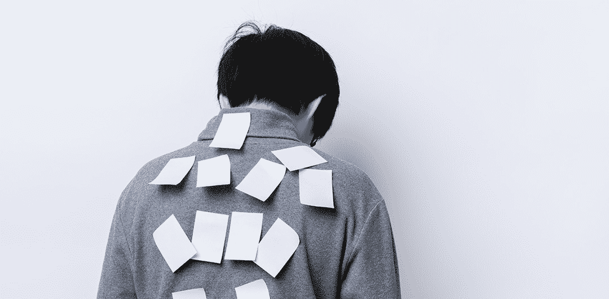

# 59 自卑：你是世间独一无二的存在

和菜头

2022-04-09

## 59 自卑：你是世间独一无二的存在

59 自卑：你是世间独一无二的存在

｜ 转述师：余昊威 ｜

**自卑，形容词，被视为一种性格缺陷，指自己和别人比较时总是觉得自己处于劣势。但在我看来，它和自我评价处于优势、均势并没有本质不同。**

\*

谁或多或少没有一点自卑呢？我想不出任何一个名字。人们在网上反复问我如何解决自卑的问题，但迄今为止还没有任何人当面问过我。所以我猜想人们对自卑普遍持有负面的态度，就像是面对自身的疾病一样。人们觉得人应该自信，挺起胸膛，双眼发光，脸上带着露出 24 颗牙齿的微笑。可惜这样的时刻也很少，我们大多处在自负和自卑之间的某个位置，随着境遇的转变来回摇摆。

关于自卑已经发展出了一套积极的理论，这种理论如同当年反转贪婪一样，反转了自卑的意义。人性中的贪婪可以换一种角度理解为，人类永不熄灭的进取心，那么自卑也很自然地可以理解为人类永不停歇的挑战精神。也就是说，为了克服自卑，人就不得不面对挑战，赢取更大的成功，于是个人因此得以向前迈进，向上攀登。

对此我并不赞同， **我认为自卑和自卑的情绪是一种折磨。**  
去想自卑积极的一面是一回事，当事人自己的感受是另外一回事。而且，也不存在什么代偿一类的事情。在我过去二十多年的人生里，没有一次因为我的文字创作能力消减了我对自己身材的自卑。这根本就是两回事，人们对文字的赞美和肯定是一回事，但是只要早上起来站在穿衣镜面前，我就知道之前的感受根本无法帮到我的这一刻。当你每次凑近镜子观察自己的脸，同时就能感到肚皮上传来镜子的冰凉时，没有什么事情能够让自己感觉好一点。  
**别处的骄傲只在别处，面前的自卑依然还是自卑。**

于是又有一种开解的手段，说是自负和自卑是一体两面，有多自卑就一定有多自负。对此，我也曾经深信不疑，总是想去试图找到自己自负的地方。觉得自己如果能打消多少自负，那就会等量地削减多少自卑，于是我就可以稳定地停在中间，成为一个成熟而冷静的中年人，对自己的评价不偏不倚。可惜做下来没什么用，消除自负带来了更多的自卑，这种行为本身就带着否定的意味。  
**否定自负并不会自动让自卑同样消失，我只不过努力证明了在另外一个领域内自己同样不行。**  
怎么证明的呢？要做到这一点很简单，只需要用自己最强的部分去和其他人比就可以了，总有人比你更强，而且肉眼可见地强过你太多，中间的差距大到令人绝望。

所以，把自卑转化为正面价值不可行，自卑、自负“消消乐”也不见得有效。关于自卑的理论，我曾经学习过一种特别的解释，它认为：

自卑的产生最重要的因素是比较，拿自己和他人比较。比较下来只会有三种结果：认为自己比别人强，认为自己比别人弱，以及认为自己和别人势均力敌。如果你认为自己比别人强，会助长内心的傲慢，无法向别人学习；如果你认为自己比别人弱，则会很容易产生悲观的念头，更容易放弃努力；如果你认为自己和别人打个平手，这往往是个误会，过高地估计了自己的能力，错误地把不在同一水平上的两个人强行拉到了一起，有些时候结局会让人相当吃惊，打脸这种事情也就在所难免。

无论是哪一种比较结果，我认为都算是一种误判，给自己找了一个错误的位置。为什么说是错误呢？因为  
**比较的本意是为了认识自我，但是比较这种方法是利用和别人的相对位置来做判断，这样就可能永远也找不到自己真正的位置在哪里。**  
比如说有人评价我比王小波差了 10 个冯唐，那我离王小波究竟是远还是近？这取决于怎么看冯唐的位置。如果我很自负的话，会认为其实相差无几；如果我很自卑的话，我会认为天差地别；如果非要坚持说大家一样的话，我会认为这道题无解，我和冯唐的水准都无限趋近于零。

那么人有没有真实的位置呢？又如何判定这个位置在哪里？我认为是有的。所谓真实位置，就是不随衡量标准变化而变化的绝对位置。用他人和自己比，这相当于是用变化的标尺来测量，换不同的对比对象，得出来的结论就彼此不同。如果我们想要让自己感觉好一点，那么我们就去找一个弱一点的对比对象；如果我们想要让自己难受，或者为了放弃找一个合理的理由，那么我们就去找一个强大的对比对象。无论怎么选择，这都不是一种诚实的做法。  
**在做自我评价的时候，如果是用和他人做对比的方法，那我们其实就是在作弊，我们在暗中控制对比结果。**  
从另外一个角度来说，喜欢和人对比说明我们并不真的爱自己，因为我们自己不值得单独存在于世间，不曾拥有自身独特的价值，必须和别的什么人比较一下才行。与此相反，许多父母都认为自己的子女是世间独一无二的，邻居家当然存在比自己家孩子聪明、漂亮、好学、健康的孩子，反过来也有许多负面的例子。但是父母并不会在意邻居家的孩子，在他们心底里自家的孩子才是最好的，天上地下唯有那么一个，孩子做什么事他们都能理解，都能包容，这才是真爱的体现。

**如果你也认为自己是世间独一无二的存在，那么无需跟任何外人加以比较，你依然拥有存在的价值，那么你就可以超越自卑、自负和均势的概念。**  
如果你在承认这个前提的基础上，还能够进一步诚实地面对自己，告诉自己说：我做不好这个，我做那个还行，我再努力一下在另外几样上还有提升的空间，那么你就得到了自己的真实位置。  
**这个位置不是源自和他人相比，而是和你自己相比。**  
你知道自己的最强领域，以此为标准，你知道自己在哪些领域能同样达到很高的水准，哪些领域花再多时间也只能做到勉强。于是，你不会因为你强的部分而感觉到多少自负，也不因为你弱的部分而感觉到多少自卑，因为无论强弱那都是你自己。就像我不能喜欢我的大脑，同时就要讨厌我的肚子一样。如果没有我的肚子进食消化，我的大脑再快也转不起来。相对而言，它们之间是相匹配的。

于是，通过这种方法可以逐渐把心由外转向内。不是说去想自卑如何增强自信，自负如何降低自信，自信又不是盐，你自己也不是汤，可以加加减减就得到合适的味道。自卑是比较的结果，比较就是一根刺，自卑相当于被刺中之后红肿的指头。想要解决疼痛，正确的做法是先拔掉刺，否则在红肿处涂抹再多的药膏都无济于事。所以，让我们再来推论一遍：  
**用自己和他人做比较只会有三种结果，而这三种结果都不是真实的，都会造成自我评价的偏差；我们不能用比较的方式，用相对位置来确定自己的真实位置；想要确定自己的真实位置，就应该放弃对外比较，保持诚实，直面自我，用最直接的方式来认识自我，也就是进行自我比较，确定自己究竟在哪些领域较强，在哪些领域较弱；最后，无论孰强孰弱都是自己，努力改变可以改变的部分，努力接受不能改变的部分，那就是你，世间独一无二的你。**

简单来说，那就是我认为我的写作算是我自己最强的能力，可以打 90 分。但是我的艺术鉴赏力大约只有 60 分，非常努力的话能达到 70 分。那当我的写作能力提升到 92 分的时候，我没什么值得骄傲的；但是，如果我的艺术鉴赏能力上升到了 62 分，我就已经很满意了，不行 60 分我也可以接受。世界上有许多写作能力不到 60 分的人，但和我没关系；世界上也有许多艺术鉴赏力高于 90 分的人，但同样和我没关系。因为这就是我，一脚踩在 90 分，一脚踩在 60 分，也许不那么令人满意，但既不自卑，也不自负，更不认为自己和别人一样，我就是我自己。

用自己和他人做比较只会有三种结果，而这三种结果都不是真实的，都会造成自我评价的偏差；我们不能用比较的方式，用相对位置来确定自己的真实位置；想要确定自己的真实位置，就应该放弃对外比较，保持诚实，直面自我，用最直接的方式来认识自我，也就是进行自我比较，确定自己究竟在哪些领域较强，在哪些领域较弱；最后，无论孰强孰弱都是自己，努力改变可以改变的部分，努力接受不能改变的部分，那就是你，世间独一无二的你。

公众号懒人找资源

发布留言

0/ *500*

确定

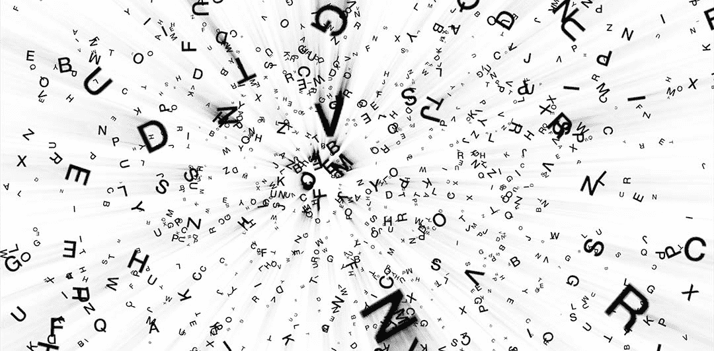

# 60 信源：如何打造自己的信源白名单

和菜头

2022-04-09

## 60 信源：如何打造自己的信源白名单

60 信源：如何打造自己的信源白名单

｜ 转述师：余昊威 ｜

**信源，名词，在信息学上指信息的来源。这里我们把它的范围缩小，专指可靠的信息来源。在这个时代乃至未来，个人核查信源是一项基本操作。**

\*

我母亲是前信息时代的人，他们那一辈人更多依靠广播、电视、报纸来获取资讯。在移动互联网时代，她和所有的老人一样迷恋手机。也和所有的老人一样，每天热衷于向子女转发各种文章和消息。而当我面对她分享的网页和链接时，往往只是看一眼网址，就决定不去打开。因为在网络世界里，我就像是一名资深出租车司机，网址就像是客人提供的地址。地址和地址对于我的意义并不相同，我知道哪些地方是可以接生意的，而哪些地方去了可能就要被痛宰一顿。

在我母亲那里，所有的信息都是平等的。无论是来自群里的转发，还是来自朋友圈的分享。她当年如何看待报纸杂志，她如今就如何看待网上的帖子，她认为只要是文字形态，那么都是一回事。但是对于我而言，这样的帖子有的刚出现网址，我脑海中的红灯就已经开始告警，根本等不到我展开网页去看内文。其中的原因是我在网上受过很长时间的训练，对于信源的追求已经成为了一种本能。

今天乃至未来，我们都处在一个大众文化占据主流的时代。这个时代的特征是所有人都可以发声，所有人都可以发布信息。  
**信息洪流裹挟着各种虚假消息席卷而来，而且信息背后都有精巧的设计或者是明确的用意，试图让接收到的人产生特定的情绪或者是行为，因此，我们不得不面对前代人所没有经历的困境  
\---甄别信息的真伪，自行对信息的质量负责。**

我母亲他们那一辈人可以很简单地说一句“这是报纸上说的”，或者“这是电视上说的”，就可以轻而易举地相信自己听到看到的资讯。她的这种底气来源于新闻的专业主义，的确存在着那么一帮人，他们拥有某种职业操守，维护着职业水准，为大众充当新闻事实的守夜人。因此，从他们手下发布出来的资讯要可靠许多，他们多少要为资讯的真实性负责，为此押上自己的奖金和声誉。但是，这样的时代早已经过去了。在二十年前，我这样的人需要告诉父母，哪怕是电视台的节目，比如养生类和电视直销类的节目也已经作为一个产品被售卖出去了。因此，那样的资讯内容其实是广告，并不是新闻，你需要小心地把这两者区分开来。

二十年后，我们需要仔细区分的资讯越来越多，简直变成了日常生活的一部分。 **任何严肃一点的内容，我们遇见之后的第一件事情就是查证信源，而不是投入感情。**  
面对信息洪流，不加任何区分地全盘接受，这是对自己不负责任的行为。然而传统媒体已经式微，人们更多地是通过社交网络获取信息，这时候每个人都迫切需要一个过滤器，从信息的汪洋大海里打捞出那些真实的资讯，避开那些虚假的，充满误导的，以及胡编乱造的资讯。因此，每个人都有责任自行打造一张信源白名单，上面都是自己可以信任的信息源。

如何打造这样的白名单呢？那就是从现在开始，对自己所有感兴趣的资讯多做一个动作：查看信息源头。为了获得有价值的信息，就一定需要投入，传统媒体就是那么干的，它们要养记者，要养编辑，记者要去一线采访，编辑要核查事实。因此，新闻机构是许多高价值资讯的源头，各种小媒体、机构和个人拿到这样的资讯之后，自行包装组合，再次上网分发。因此，  
**通过养成查看信息源头的方式，可以在很短时间内弄清楚一件事：在网络世界中，谁是资讯的上游批发商，谁是资讯的下游零售商。越是重要的资讯，越应该去找上游批发商，一方面是因为它们准确，另一方面是因为它们快速。**  
如果你仅仅只是跟随下游批发商，那么你拿到手的是经过层层转包变形后的四手、五手消息，甚至比什么都不知道还要糟糕。

**查看信息源头可以先形成一个可信的媒体列表，接下来是筛选可信人群。**  
每个人关注的资讯都不同，各自对应着不同的领域。在大众文化时代里，各行各业都会涌现出一批行业内的专家。他们不像是明星或者网红，拥有极高的知名度。这些人往往在自己的专业领域内发言，代表了行业内的一般性看法，同时也有很高的机会发布行业内的动态。这样的人有很多，每个人都能流利地讲出一套完整的说辞，因此你需要花一段比较长的时间，反复用事实去验证他们言论的真假。他们播报的动态有没有发生，他们的观点是否应验，以及  
**最重要的一点：当他们的看法和事实相抵触时，他们是什么态度？坦然承认并且做出修正，还是狡辩加上掩饰，这决定了你要不要把他们加入你的可信任名单。**

这样，你手头就有了一张可信任机构列表，然后又有了一张可信任专家列表，两张表加在一起可以基本保证你的信源可靠。但是，这还远远不够，因为你是一个人，而不是一台机器。更何况这两张表加起来，也无法覆盖你每天看到的所有资讯。那你应该怎么办呢？

*   第一， 前面已经讲过，当你看到一条资讯的时候，首先要做出一个判定：它是在告知你一个事实，还是想激发起你的某种情绪？如果是前者，那么它的可信度要高很多。事实没有什么戏剧性，事实也不会带来强烈的情感冲击。如果你在看完之后，情绪产生了极大的波动，而且波动是源自资讯的讲述方式，那么可以暂时放在一边，因为它要么不是事实，要么是部分事实，随时可能会发生反转。
    
*   第二， 一条严肃的资讯里，所有的时间、地点、人物、机构都是明确的，不会出现“据美国科学家研究”，“根据最新调查报告显示”这样的修辞方法。你要相信一点，真正掌握事实的人，不会愿意模糊一丁点他所知道的事实。如果他知道事情发生在某条街，那就一定会有街道名称；如果他知道事情发生在某栋大楼，那就一定会有门牌号。资讯的资讯越模糊，它想要欺骗和误导你的可能就越大。
    
*   第三， 可靠的资讯会自我证明，证明的方法是在正文中添加链接，指向可以侧面证明自己的网站、网页、书籍、论文。在更加严肃认真的场合下，链接甚至会指向相反的事实描述，为的是让读者能看到不同的说法，综合形成比较全面的观点。简单说起来，链接和注释越多，那么资讯的内容也就越可信。
    
*   第四， 想清楚自己在整个信息网络上的相对位置。这一点非常重要，可以帮助你避免许多不必要的麻烦。如果你确定自己靠近信息网络上非常关键的几个点，那么当你得到最新消息的时候，可以稍微放心一点；如果你确定自己位于信息网络的边缘，平常都是事情发生过很长一段时间之后，你才知道前因后果，那么你就要特别小心自己获得的所谓“最新消息”、“天大秘密”。因为信息从网络中心向外传播才是常态，从边缘向中心传播，而且刚好经过你，这是小概率事件。
    
*   第五， 如果你无法把握住以上四点，那么当你看到一条非常感兴趣的资讯时，请善用搜索引擎。在你决定点赞、转发、评论之前，先用搜索引擎搜索一下这条资讯的源头。如果它自称是来自著名媒体，那么就去著名媒体的网站上搜索；如果它自称是来自某位名人、某位专家，那么就去他的社交网络账号里搜索。确认的确存在之后，再做出具体的分享和评论动作。否则，完全可以当做假消息放弃。请像我一样去思考这种资讯的可信度：如果连我都知道了，怎么可能源头上却根本没有呢？
    

在众声喧哗的时代里，每个人都可以发言，那么每个人也都需要自己对资讯的可信度负责。这件事情不能指望别人，只能靠你自己。  
**你在多大程度上能查证信源，决定了你究竟是有自己的判断，还是等待着被别人收割。** 毕竟，在网络上如今要制造一点热闹实在是太过容易了。

1.任何严肃一点的内容，我们遇见之后的第一件事情就是查证信源，而不是投入感情。  
2.当他们的看法和事实相抵触时，他们是什么态度？坦然承认并且做出修正，还是狡辩加上掩饰，这决定了你要不要把他们加入你的可信任名单。  
3.你在多大程度上能查证信源，决定了你究竟是有自己的判断，还是等待着被别人收割。

公众号懒人找资源

发布留言

0/ *500*

确定

# 61 投射：在谈话中最容易落入的陷阱

和菜头

2022-04-09

## 61 投射：在谈话中最容易落入的陷阱

61 投射：在谈话中最容易落入的陷阱

｜ 转述师：余昊威 ｜

**投射，动词，指个体依据其需要、情绪的主观指向，将自己的特征转移到他人身上的现象。因此，需要在谈话中弄清楚对方的真实意图，他滔滔不绝到底是在说谁？**

\*

在第 58 讲我们谈及“人言”的时候，我提到了“投射”这个概念。这个字眼听起来高深莫测，其实很容易理解。什么是投射？望子成龙就是一种投射。希望自己的孩子成材，这是表面上的望子成龙。其实在许多父母的内心深处，是在孩子身上投射了自己的欲望——当年自己没有考上大学，那就盼望孩子考上大学；当年自己没有考上重点大学，那就希望孩子考上“985”、“211”大学。这时候讨论成材与否，其实并没有切中问题的核心。如果真的是为了孩子成材，那么孩子若是在音乐或者绘画上体现了极高的天赋，也有强烈的求学意愿，那些望子成龙的父母会同意孩子放弃考重点大学，跑去美术学院或者音乐学院深造么？怕是不能，  
**因为他们要的是他们指定的那条龙，别的东西一概不予考虑。**

在人际关系中，投射也是一件相当麻烦的事情。我们经常需要向朋友或者熟人征询关于自己的建议，有时候还会诚心诚意地请对方说出对自己的看法。可是因为有了投射的存在，我们经常会弄不清楚他们给出的到底是真正的意见建议，还是他们对自己的期望？他们给出的到底是真正的批评，还是他们对自己的失望？如果是前者，那么对我们自然是有所帮助的，值得认真聆听。但如果是后者，那么整场谈话就是无效的，因为本来需要讨论的是你自己，但是在谈话中主角却不知不觉地换成了对方。而这种给建议、提批评的谈话态度又很具有迷惑性，也许你要过很久才能意识到整场谈话其实和你自己完全没有关系。

在都市生活中这种现象尤为明显，因为每个人都面临着工作和生活上的压力，和朋友聊天谈话时很容易觉得心情放松，感觉找到了释放压力的出口。所以，这个时候每个人究竟说的是什么，言说的对象是谁，就需要仔细进行考量。

关于如何判断自我投射，最简单的方法就是看看对方的建议和批评，是不是对所有人都一样。因为每个人的问题不同，困境不同，自我认知的缺陷也并不相同。  
**如果你去求教的那位朋友或者熟人，对每个人都是同一套说辞，这就足以拉响警报。对于大多数人来说，值得反复言说的只有他自己。如果是心里真的放着别人，真的为别人设身处地着想，一定会对不同的人给出不同的建议，针对不同的缺陷给出不同的批评。**  
能用同一套说辞应付所有人，他要么是心灵鸡汤大师，要么就是在说自己。在这样的谈话里，对方并没有给出你应该怎么办的答案，而是在反复地自己说服自己，他说的那些话也许正是他自己想做而做不到的事情。

我曾经有过一位朋友，也是一个文学爱好者，每次见面聊天他都会敦促我在文学上取得更大的进展。然后我就信了，回去之后努力提升自己的写作水平，探讨更加深奥的话题。但是下一次见面，他不问我的进展，依然在敦促我继续前进。那时候我还年轻，没有琢磨过味儿来，还以为自己得到了一位诤友，随时鞭策我、激励我。后来我发现他对每个人都那么说，我才意识到，这些话是说给他自己听的。因为当时他自己陷入了创作上的困境，于是他觉得所有人都一样，都需要取得突破和进展。  
**想明白这件事情之后，我突然如释重负，觉得终于可以不为了个人进步而写作，这是一种难得的幸福，如同心头移开了一块巨石。**

另一个相对简单的判定标准，是这次谈话有没有尾声。假定对方是真的关心你，  
**真把你的问题当回事，那么过段时间之后，他会主动询问你的进展，局势有没有什么变化。而且，真正关心你的人，甚至不在意你是否采纳了他的意见和建议，他最在意的是你是否解决了问题，其次在意的是你用了什么方法。**  
但如果他是自我投射，就很可能出现另外两种情况。一种是不闻不问，就像是你当初的求助根本没有发生过一样；另一种是恼怒，你能明显感觉到他因为你没有按照他的建议和意见去做而生气，都不是失望，而是赤裸裸地生气。如果有这两种情况出现，那么基本上可以判定他当初和你说的那番话就是自我投射。

不闻不问是因为他把你当做了倾诉对象，当初既然已经倾诉完毕，现在自然没有重新过问的理由。生气是因为他希望你帮他去探索答案，但是你竟然拒绝了他，也就让他的希望落空了，问题又回到了他自己身上，那他当然会非常生气。正常来说，如果你的问题解决了，他作为朋友为你高兴还来不及，又怎么会生气呢？

最后一种自我投射最为隐蔽，因为它和关心混杂在一起，并不容易分辨。  
**我们都知道，人之所以能成为朋友，并非因为两个人脾气性格一模一样。性情相投说明存在有共性的部分，但是人们彼此吸引还是因为相异的部分。**  
所以一定程度上来说，两个极为要好的朋友之间往往会从对方身上窥见自己人生的其他可能性，忍不住去想：如果我稍微改变一点点，变成了他的话，那么我的人生又会是怎样？面对他面对的选择时，我会做出怎样的决定？

这是一种很正常的想法，但是如果继续往前推一点，事情可能就会因此变了味道，那就是变成了“望友成龙”。因为觉得自己今生今世也就只能做到这个程度了，因此把自己的遗憾投射到朋友身上，觉得他应该如何如何。换句话来说，就是希望朋友帮自己去实践自己想要的精彩人生。一旦有了这种想法，就会生出许多“你应该”，觉得朋友应该这样做，应该那么选。所有的建议，所有的批评，这个时候并不是真的为朋友好，而是希望朋友按照自己的想法去活。

你说他不关心你么？显然是关心的。但是，这种关心真正指向你的利益么？真的在意你的意志么？怕并不见得。在这种关心背后，是他对人生的期盼，他对人生的渴望，他希望你去帮他完成，因为自己做不到，看见朋友做到也是好的。这种想法是一种爱的体现，但在另外一面也极为冷酷。让他人按照自己的期待活着，大家就不再是平等的关系，两个人中间总有一种个人意志要遭到压制，并且还要说服自己相信那就是应该追求的人生理想。那么，追求的代价谁来背呢？

这个问题就是分辨第三种自我投射的方法。无论是自我投射，还是真诚建议，都会劝说你相信存在某种更值得追求的人生，某种更值得做出的选择。它们之间的区别在于，如果他给出的是自我投射，那么你就是他意志的执行者，他自然也不需要去考虑失败的代价，相反的，失败之后他还可能要指责你，因为你破坏了他的美好愿望，把事情搞砸了；而如果他给出的是真诚建议，那么肯定会考虑到你所要承担的风险以及可能的损失，站在朋友的立场，多少要做出支持的相关表态，让你不用太过担心。这时候，一定会说三个神奇的字眼：大不了……

**“你应该”和“大不了”暗示了不同的站位，说“你应该”是站在对面，用手指着、推着你；说“大不了”是站在并排，搂着你的肩膀。**

每个人都有生命中很亲近的人，也都有生命中很重要的人，我们是如此信赖和重视他们，以至于他们可以轻易地伤害到我们。即便没有伤害那么严重的事情发生，他们的建议和批评也可能会带来相当程度的困扰。如果可能的话，我们应该尽可能地去观察对方的行动。但不幸的是，大多数时候我们只能得到对方的言辞。而在所有的这些言辞里，我们需要去谨慎地分辨，究竟有多少是针对于我们自身，又有多少是情不自禁的自我投射。  
**亲密的人际关系存在着这种危险，没有恶意，但是会造成伤害。无论是父母子女还是情侣朋友之间，或多或少，自觉不自觉都会出现自我投射。两个人之中，总需要有一个能认清自我投射的存在，以此避免不必要的误解和伤害，这大概是维系长久人际关系的基础。**

参考文献：

58 人言：为什么大多偏负面

1.如果你去求教的那位朋友或者熟人，对每个人都是同一套说辞，这就足以拉响警报。  
2.“你应该”和“大不了”暗示了不同的站位，说“你应该”是站在对面，用手指着、推着你；说“大不了”是站在并排，搂着你的肩膀。  
3.无论是父母子女还是情侣朋友之间，或多或少，自觉不自觉都会出现自我投射。两个人之中，总需要有一个能认清自我投射的存在，以此避免不必要的误解和伤害，这大概是维系长久人际关系的基础。

公众号懒人找资源

发布留言

0/ *500*

确定

# “我问和菜头”：怎样面对人际关系里的自卑？

和菜头

2022-04-09

## “我问和菜头”：怎样面对人际关系里的自卑？

“我问和菜头”：怎样面对人际关系里的自卑？

｜ 转述师：余昊威 ｜

读者 用户 Just：:

> "请问菜头叔：自卑、自负与处于均势，都是与别人比较的结果。本质上没有什么不同。想要更好地了解自己，应该做诚实的事——与自己比较。可是很多时候，我们保持一个方向的持续精进，就或多或少会建立在“我在这方面就是比别人强”的感觉之上。有时候这种优越感会是很重要的动力来源。请问这样起到积极作用的优越感，有什么副作用吗？它应该被消除吗？如果不应该被消除，我们又该以什么样的态度与之共处呢？"

如你所说，拥有一种“我比别人强”的优越感的确能够提供动力，但我认为这种优越感并不是优质的燃料，时间久了可能还会损坏发动机。这里最好分为两部分来看待：第一部分是认识事实，如果你在某个领域内的确比他人强，那么这就是个事实，知道并且承认这个事实就好。第二部分是对待这个事实的态度，如果对此念念不忘，甚至让它成为你优越感的来源，我恐怕不是很赞成，也许要问一句：“你要这个优越感来干吗？”如果是为了自信，那么你认识到事实的时候就已经取得了自信。如果是为了动力，那么你就不能离开这种优越感，需要想尽一切办法去维护它。而一旦说到维护，可以选择的选项就很多，继续前进是其中最为吃力的一个，我恐怕它不会出现在你的首选项上。但如果换一个想法，比如，  
**天下的人那么多，事情也那么多，我自己刚好遇见一件自己擅长且能够取得成就的事情，这是一件多么幸运的事情。为了不辜负这一份幸运，我愿意持续精进，提升技能到前所未有的境地——这同样也能提供动力，而且可能这种动力要强大而持久，甚至无需和他人比较，你就可以继续前进。**  
一定程度上来说，拥有这样的想法和对应的行动，你就是在响应命运对于你的召唤，你并非是为了获胜而努力，而是为了完成自己肩负的使命。这样未必最终会成为英雄，但是有可能比所有人都走得更远一些。

读者 用户半支烟：:

> "作为一个成年人，我觉得还是可以让自己找到属于自己的位置，摆脱这种比较带来的各种负面情绪。但是，很多孩子在学校学习的过程中面对着各种比较，尤其是直观的分数所代表的成绩上的比较。这种比较不仅仅是因为结果会影响孩子的未来，也因为这种比较无时无刻的存在让比较的意识深刻地影响了孩子。我想问一下和菜头老师，如何能够帮助孩子避免这种比较意识的影响？"

这是孩子必须要面对的问题，  
**我并不赞同人人有奖拿的想法，也不赞同完全抹除竞争。你即便可以在学校里为孩子撑起一把心灵的保护伞，但你不可能为他撑一生一世，在他未来的生活里也同样避开人和人之间的比较。**  
在承认现实的前提条件下，我倒是认为可以去培养一点其他的想法。1990 年，我从本校初中部升入高中部。在初中部时，我是本班前 5 名。但是到了高中部，我的新班级由初中各班前 10 名组成。第一次期末考试，我记得我的全班排名大概是在 39 还是 47 位，当时全班不到 60 人。可以想见这个排位给我带来的刺激和压力，坦率地说，在拿到成绩单之前，我还从未拿过那么低的名次。身处在这样一帮强悍的对手中间，我感觉到窒息。但是事已至此，我也没有别的办法，只能努力拼搏一下。到了下半学期，我的排名上升到了全班第 19 位，这让我感觉到深深地绝望，因为我认为自己已经不可能再努力再勤奋了，即便如此我也依然没有进入第一集团。这个时候我的物理学教师王晓明老师找我谈话——这么多年过去了，我还是能清楚地记得他的名字——王老师对我说了一番让人永生难忘的话。他说：没有进入前十名固然让人沮丧，不过这件事情在他眼里有另外一种算法。在他看来，我用了一年时间从全班三四十名爬升到十九名，证明我是个有学习潜力的学生。如果按照这个提升速率，再过一个学年或者两个学年，我就有可能去角逐班级前五。关于这一点，他认为自己有证据，因为他是看着我的物理成绩一点点涨上来的，从一个中游学生变成了班上的前几名。王晓明老师给我上的这一课，让我知道要把注意力聚焦在自己身上，每次都和自己比，只要比过去的自己强，那就算是达成了目标。事实上，后来我比他预计的时间更早闯入前十名。因为仅仅考虑自己的问题，要远比考虑自己和诸多同学的相对位置要容易得多。现在，我把这段往事也分享给你，希望你的孩子也能够同样理解：  
**比较难以避免，但我们要清楚地知道自己需要去做什么，应该和谁比，比什么。**

读者 用户雾满杨溪：:

> "请教菜头老师，您怎么看一个人在人际关系能力方面的自卑？人际关系又是人本能就会和别人比较的地方，请问这方面的自卑应该怎么面对和解决？"

我建议在生活里多做观察。绳索束缚在你自己身上，你很难觉察，觉察到了也难以解脱。所以，一个方便的方法是去观察别人，尤其是去看一个人从自卑变成自信的全过程。如果不出意外的话，你不单可以看到从自卑变自信，还可以观察到从自信变成自大。如果时间足够长，而且你也足够幸运的话，甚至还能看到从自大到崩坏，最终回归于自卑，完成一次漫长的循环。通过对于这种循环的观察，你会意识到自卑的依据是错误的，因为错误的依据，所以做出了错误的追求，觉得追求外物就可以解决自卑，就可以从自卑变成自信。于是当一个人拥有足够多外物的时候，他又因为外物的缘故从自信变成自大，一直到崩坏。总之，整体上这个追寻的过程都是错误的。  
**因为不曾拥有什么，因为缺乏什么而感到自卑，这本身就是误解；同样的，觉得拥有和获得了什么就能获得自信，这同样还是误解。**  
那么与其这样自己也去兜一个大圈子，最后证明一开始的想法是错误的，那么不如现在就在源头上解决——审视你自卑的理由，哪些是实际存在的，哪些是你未经核实就自行捏造的，以及哪些可以改善提升，哪些你一筹莫展。  
**依照我的经验，总归是捏造的多，真实的少，对自己的认知有偏差，对别人的认知偏差更大。总在幻想别人会怎样看待自己，但事实上绝大多数人根本不关心绝大多数人，连看都看不见。**  
如果理解了这一点，把自己的幻想放在一边，把假想出来的他人看法放在一边，那么你的心有足够的空间，供你用自我完善的方式去填补。当你开始思考你是谁，而非你感觉如何的时候，绳索就很难再束缚着你了。

读者 用户雪花轻舞：:

> "想问菜头老师，如果不和别人比较，自己会不会满足于微小的进步呢？怎么才能做到既不被别人影响，又督促自己成为优秀的独一无二呢？要是没有比较，是不是就没有“优秀”这个词了？是不是说我们每个人内心都有一个自我准则存在，静下来，我们就能找到它，那时候他人就不会对我们有影响了？"

你的提问已经包含了你要的答案。如果你不知道你自己要去往哪里，那么你怎么知道你的进步是微小还是巨大呢？如果你已经知道自己的目标，也看到自己的进步微小，那么你为什么会满足呢？所以，严格说起来你的问题根本就不存在。之所以你会提起，还是因为你惯于和他人比较，已经变成了一种根深蒂固的习气。微小、优秀、独一无二，这都是比较产生的结果，但在你这里，不是自己和自己比较，而是和他人做比较。每个人生下来就是独一无二的，还需要怎样才能独一无二呢？每个人出生活到现在，还有余暇上网，还可以自我提升，还需要怎样才能做到优秀呢？归根结底，这种独一无二，这种优秀不能满足你的内心，你一定需要个什么人来比较，战而胜之，你才会觉得心里踏实。那么我建议你想一想：在无人可以比较的地方，你站在哪里？

读者 用户一辆蚂蚁：:

> "我认为在打造自己的信源白名单时，最大的障碍是容易受他人影响。而且，如果那个人是自己崇拜的，查证的方法几乎会失效。不知道这点该怎么破？"

说实话，我不大理解为什么你崇拜一个人，就无法查证他言论的真假？我喜欢读书，记得看到过一句话，让我大受震撼，它说：一本大书就是一个大灾难。  
**这句话的意思是说，因为一本书很严肃，很厚重，很有深度，就会让人产生崇敬之心。也恰恰是因为让人产生了崇敬之心，如果其中有什么错误的话，人们就会不假思索地全盘接受，根本不会去质疑和反驳，于是谬种流传，反而比一本烂书造成的问题还要大。**  
如果有什么人让你感到崇敬，那么正常来说你就要越发小心谨慎才对。他的 100 句话里有 99 句都很正确和精彩，但是你不假思索接受的唯一一句错误的话，可能对你来说是致命的。  
**崇拜或者说崇敬，和可信是两回事。**  
无非是说，因为崇拜或者崇敬，会让这个人拥有更多信用点，所以偶然说错几句也没有关系。而如果换成是其他人，可能一次两次就足以直接把他从白名单里剔除出去。即便如此，崇拜或者崇敬的人所说的话也需要做小心的限定，爱因斯坦谈物理学我肯定竖起耳朵来听，但是他参加电视访谈，大谈育儿经验，那我可能就要打很多个问号。如果是他来谈美发心得，那我无论多么尊崇他，我也会直接关机不听，因为他的伟大覆盖不到这样的领域，他的说法不足以采信。

1.天下的人那么多，事情也那么多，我自己刚好遇见一件自己擅长且能够取得成就的事情，这是一件多么幸运的事情。  
2.因为不曾拥有什么，因为缺乏什么而感到自卑，这本身就是误解；同样的，觉得拥有和获得了什么就能获得自信，这同样还是误解。  
3.崇拜或者说崇敬，和可信是两回事。

公众号懒人找资源

发布留言

0/ *500*

确定

# “我问和菜头”：怎样觉察和避免自己的自我投射？

和菜头

2022-04-09

## “我问和菜头”：怎样觉察和避免自己的自我投射？

“我问和菜头”：怎样觉察和避免自己的自我投射？

｜ 转述师：余昊威 ｜

读者 用户呢了同学：:

> "信息大爆炸的时代，作为一名普通大众，在各种媒介信息的助推之下，我们可能不但没有变聪明，反而变愚蠢了。不过菜头叔，我觉得白名单是在对信息做事前筛选，对于不信任不喜欢的，压根不接触，可这难免偏听偏信吧？更好的方式，是不是应该来者不拒，事后做批判的思考吸收呢？"

有一个词叫做“浸没”。你先假设自己很强大，然后你认为自己可以做批判性思考。但今天的你其实每一分钟都浸没在信息的洪流之中，你哪里来得及做那么多批判性思考，在每一条消息到来的时候，都按照厘定事实，廓清边界进行判断？  
**媒介发布的种种信息，本身就算计到了你的微弱抵抗，要的就是让你不停看，然后用数量和触点对你实施控制，你的看法总能被扭转过来。**  
我们转去看另外一个例子：为什么父母老了就喜欢整天在微信转养生文、营销文呢？大家的父母都学历不高么？大家的父母都生活经历有限吗？当然不是了。原因是他们浸没在信息洪流之中，他们的群，他们的朋友圈，他们的私人聊天，全部都充斥着这些内容，其中不乏来自他们信任和相信的所谓权威媒体和权威老友。如果他们是单独地存在于信息洪流之外，偶尔看上一两条，那我相信他们有足够的判别力去甄别真伪。但是当他们身处洪流之中，很快就失去了判断力，行为上变得从众。你可能要比父母辈强一点，但是你觉得自己可以来者不拒，这话也未免太过托大。  
**想要变成中流砥柱，你也得克服三人成虎的心理才成。** 相对而言，逐条分辨真伪很困难，随大流简单又轻松，你觉得你更可能出现在哪一方呢？

读者 用户李明亮：:

> "菜头叔，如果对方说，你应该怎么怎么样，然后怎么怎么样，如果出了问题，就大不了怎么怎么样。这种情况是不是表明现实中的事，并非这种非黑即白的，是不是经常也有两者夹杂在一块的？应该怎么加以区分和处理呢？"

如果对方说到这个程度，明显是自己聊兴奋了，这时候已经和你没多大关系。对方是满足于自己思考和叙述的逻辑，而且认为自己的思考已经相当完备，为你提供了一整套方案，没有任何遗漏。其实，这只是他自我满足于想象，把自己代入其中的结果。而真正需要去执行和面对的其实是你，你面临的现实情况要复杂得多。如果对方是真正为你着想，可能提问的时间要远比给建议的时间多。而且，在谈话的最终不大会给出一二三四这样的方案，因为他知道自己的才智有限，最多告诉你站在他的角度上，你应该尽量避免某一种情形，争取某一种有利形势。  
**所有事情都想得清清爽爽，所有的步骤和变化都如掌观纹，这是得了“诸葛亮病”。**  
你可以回顾一下此生中经历的事情，有几件是从头到尾顺滑爽利就能完成的？又有几件是磕磕绊绊，需要不断尝试，不断碰运气，撞出一条生路来的？何以你的朋友如此幸运，他就刚好掌握了顺滑爽利，简单直接的方法，而且还算无遗策呢？

读者 用户 Nina 酱：:

> "菜头叔，今天文章教如何去分辨对方的言辞是不是在投射自己。那如何去觉察自己的言行是不是在投射愿景？我想到可能有用的方式是自省，比如看看如果对方做出和我建议相反的事时，自己的反应。那还有其他注意的点吗？"

其实我在文章里已经回答了这个问题，你也意识到了这一点。那在这里我把话说明白一些： **投射自我，本质上还是在满足和饲养自我。**  
因此，如果你的朋友不接受你的建议时，你需要观察你会产生什么情绪和想法。如果你会愤怒和失望，甚至产生“那么清楚简单的事情，为什么你就想不明白呢，照着做都不会吗”这样的想法，那你毫无疑问就是在投射。  
**这种恨不能替别人动手的想法，就是自我投射的体现。**  
如果你的自我安居于一个合适的位置，那么你对你朋友的任何选择都只会感觉到好奇。如果他不听你的建议，用自己的方法完成，你应该感觉到的是欣喜，还会立即升起求教的心。  
**如果他不听你的建议，而你又不幸言中，你也不会升起“活该”的想法，觉得解恨，你知道人都有自己的局限，发生在你朋友身上的事情，同样可能发生在你自己身上。**  
所以，我建议大家多观察自己的情绪和想法，多问一句：我为什么这么想？

读者 用户梓涵：:

> "菜头叔好，看到这篇文章让我突然意识到了一些问题的根源所在，开始反思我有没有将自我过多地投射到他人身上，或者受到他人投射的影响。菜头叔，你觉得现在特别火的“鸡娃”“鸡妈”是不是一种投射呢？"

我不愿意公开讨论所谓“鸡娃”或者“鸡妈”的话题，主要是担心说实话会很伤人，别人听了之后会很不高兴，反而不会产生任何现实的益处。但如果大家能坐下来，冷静地去想一下的话，不免会提出这样一个问题：所谓“鸡爸”“鸡妈”目前所拥有的这点人生成就，所拥有的这点生活水准，究竟有多大程度是源自他们自身的努力和奋斗，又有多大程度是源自时代的大潮所带来的机会？我觉得一旦问出这种问题，大家都会感觉到相当尴尬。因为在培养“鸡娃”之前，的确应该考虑一下我们自身。  
**如果今天的社会地位和生活水平只是随着大时代的浪潮而来，那么努力和奋斗相对作用较小，而且孩子们有孩子们的浪潮，如何站上去是他们自己的事情。**  
相反的，如果孩子们听信了父母的话，做出了相当的努力和奋斗，但是浪潮已过，届时父母又如何向失落的孩子解释呢？  
**我认为，父母拥有今天的条件，把拥有的一切都归因于自身的努力，起码不算是一种理性的判断。**  
投射到孩子身上，认为孩子也可以同样复制自己的成功人生，怕就更是舍本逐末了，那现在所拥有的这一切到底起了什么作用呢？只是给了孩子上补习班的机会么？

读者 用户杨荣辉：:

> "我和老婆相处的过程中，都在尽量避免给她投射，而是保持尊重，我给她说观点或者事情的时候都强调“以下只是我自己的建议”或者“我的想法是”。我老婆大部分时候也是这么对我的，偶尔说一下“你应该如何如何”，不过火的时候我也能接受。所以，我们夫妻关系算是很好的。但最近有一次她向我说她原生家庭的一些事，我就说道：“我建议你可以如何如何。”她给我的回答是：“我们是夫妻，我不是要你告诉我可以如何如何，而是要你去做些事帮我渡过难关。”那个事我认为是她的课题，不是我的，但也觉得她说的有道理，所以也适度做了点事，但和我的意愿是相违背的。菜头叔，这种情况有更好的解法么？"

我想我大概能体会你的心情。就是说你认为你太太应该转变心态，然后转变想法，但是你太太对此毫无任何兴趣，她只要短平快地解决问题。而她所要的东西你虽然可以给与，可你却认为这只是临时应付，或者是乏术手段，不是解决问题的根本之道，甚至可以说因为那么去做了，反而距离真正解决问题越来越遥远了。我认为你应该耐心些，因为这么多年过来就我所见，人们如果不是遇见重大挫折或者重大打击，是很难主动改变自己想法的。而你又身处在婚姻关系之中，从道义和责任上来讲，你都需要回应你太太的请求，否则就是一个冷漠无用的丈夫。所以，  
**做还是要做，响应还是要响应。不过做完之后，你还是得讲你的道理。这样的好处在于，你作为丈夫，已经提供了你应该给与的支持和帮助，那么她就没有可以指责你的地方。**  
在履行了你的责任和义务之后，你当然还是可以谈你的观点，这时候她没有别的理由可以推脱，不得不认真听一下。你做了你应该做的事情，那么现在就轮到她做她应该做的事情。最后，  
**无论你对自己的想法多么笃定，最好也不要忘了一点，那就是你和她相比，毕竟你不在事中，因此你的判断也未必就是正确的。**  
从你的描述上来看，你太太并不想和你深入讨论，也许是之前就已经对你的想法失望了，我觉得这才是你需要注意的地方。

1.媒介发布的种种信息，本身就算计到了你的微弱抵抗，要的就是让你不停看，然后用数量和触点对你实施控制，你的看法总能被扭转过来。  
2.所有事情都想得清清爽爽，所有的步骤和变化都如掌观纹，这是得了“诸葛亮病”。  
3.如果你的朋友不听你的建议，而你又不幸言中，你也不会升起“活该”的想法，觉得解恨，你知道人都有自己的局限，发生在你朋友身上的事情，同样可能发生在你自己身上。

公众号懒人找资源

发布留言

0/ *500*

确定

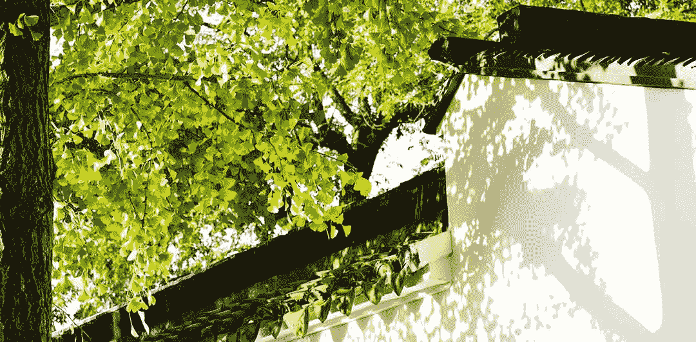

# 62 苏东坡：中国人最想不期而遇的人

和菜头

2022-04-09

## 62 苏东坡：中国人最想不期而遇的人

62 苏东坡：中国人最想不期而遇的人

｜ 转述师：余昊威 ｜

**苏东坡，本名苏轼，号东坡居士、铁冠道人，世称苏东坡。北宋时期著名的政治家、文学家、美食家、艺术家，是中国文学艺术史上少有的通才。**

\*

在我看来，苏轼和苏东坡是两个人。苏轼是一个忠诚而倒霉的官员，人们不大真的关心他为什么有那么多遭遇，而苏东坡则是一个极有趣的妙人，极好的文学家，人们很难不喜欢。有些时候我也忍不住去想，如果苏轼没有那些宦海风波、颠沛流离，人们对苏东坡的热情是否会稍微衰减一点呢？因为那样一来，他的人生简直完美到让人妒忌。

我和大家一样，也非常喜欢苏东坡。如果有一个“最喜欢的历史人物”评选，那么苏东坡肯定毫无疑问地位于我真人榜的首位，文学人物榜榜首可能是孙悟空，但我并不是很确定。然而在我内心深处的某个地方，也同样对苏轼存了一份畏惧。

苏轼还是个孩子的时候，父亲因为参加科举的缘故离开了四川眉山，苏轼和弟弟苏辙由母亲抚养教育。母亲给他们讲《后汉书》——以教学内容而论，她已经远远超越了“知书达理”这四个字。在教授《后汉书》的过程中，苏轼立志要成为范滂那样为了理念而牺牲自己的人，而他的母亲则表示，如果苏轼能成为范滂的话，她也能做范滂母亲那样的人，愿意自己的儿子杀身成仁。苏东坡给人的印象是个随遇而安的文士，而苏轼在儿童时代就是一个非常刚直的人，也许他后来的命运在读《后汉书·范滂传》的时候就已经埋下了。

人们喜欢说苏东坡有才华，这里的才华不单指文学成就而言。苏轼的父亲参加科举，名落孙山。而他的两个儿子，苏轼和苏辙第一次参加考试就双双中举，当时苏轼 22 岁，苏辙 19 岁。如果我在北宋嘉佑二年遇见二苏，估计大气都不敢出，因为他们的确是天才人物，头角峥嵘。中举之后，苏轼母亲病逝，两兄弟回乡守孝三年。复出之后，就去参加了北宋最高等级的考试——制科。制科是封建王朝用来拔举“非常之士”的考试，相当于天子挑选全国精英中的精英。考试结果一共分五等，一等和二等是虚设，不会真正授予，五等不合格。苏轼和苏辙第一次去考制科，苏轼名列三等，苏辙名列四等。而在整个宋代，通过制科考试的人加起来不到五十个，苏家兄弟占了两个名额。到了嘉佑六年，如果我和二苏重逢，这个时候估计连汗都不敢出。

当然，我可能还有一点点宽慰，那就是苏轼、苏辙兄弟读书厉害，考试厉害，未必做事也厉害。说到底，他们不过是两个书生，未必有什么很好的行政能力。何况他们还有一层文人的身份，整天吟诗作赋，交游酬答，哪里有什么时间去处理政务？但是看了苏轼的传记又让我再次震惊，事实上，苏轼的行政能力一流。杭州人民到今天都还在缅怀苏轼，并且把杭州视为他的第二故乡，并不是因为他留下了许多吟咏当地风物的诗词，而是他在任是切切实实地改善了民生，兴修水利，疏浚西湖，因此让当地人始终感念不已。在书中我还读到一个细节：苏轼在某地离任之后，发生了叛乱。当时他的政敌们如获至宝，觉得可以利用失察的罪名来打击苏轼。可是，当他们认真开始罗织罪名的时候，却发现苏轼很早就在奏章里做过报告，提醒上司当地有叛乱的隐患。作为读者，读到这个细节肯定会为苏轼感到庆幸。  
**但是站在管理者的角度去看，苏轼则完全是个做事滴水不漏，明察秋毫的官员。如果同朝为官，大概会把他当成是极为强劲的对手。事实也是如此，当时一度有很高的呼声希望苏轼出任宰相。**

这就是为什么我会说苏轼令人畏惧，作为官员的苏轼是有能力得到相权的人。而这样的一个人物，屡遭贬谪，一再流放。一生在政治上起起落落，最初既不被王安石的新党待见，后来又不被司马光的旧党待见，一辈子不合时宜，两头排挤，空有一身才华和能力，始终没有在治国上得到施展的机会，可以说苏轼在政治上是一个悲剧人物。假设苏东坡没有这么一层背景，大概中国人也不会如此倾心于他。我怀疑中国人对苏东坡的强烈喜爱，下面隐隐有理解和同情的成分在。因此苏东坡以诗文趣事一直闻名至今日，人们未尝不是用他的人生来作为自我激励的动力。

苏轼的另外一面是作为文人的苏东坡。喜欢苏东坡的读者很幸福，因为他们有大量的苏东坡作品和史料可以供自己学习、欣赏、研究。人们一提到苏东坡就想到他的词，《念奴娇》、《江城子》、《定风波》、《蝶恋花》等等。  
**但其实苏东坡是一个诗人，他写了四千多首诗，他的词不到诗的十分之一。**  
那为什么苏东坡的词给人的印象那么深刻呢？当然不仅仅是因为写得好。词在苏东坡的时代只是小道，相当于今天的流行歌曲。文人雅士聚会，大家随手填词，拿去给歌女演唱，并没有多么在意，远不如对诗那么严肃。而且，词写出来之后是让歌女去唱，所以作者经常要以歌女的角度来写。这件事情想起来就让人感到古怪，一群大汉写一些莺莺燕燕的词，装作自己是怀春少女，或者是深闺怨妇，唱完就扔也能让人理解。

苏东坡不同，苏东坡在生活中做什么事情都很细致投入。当时的猪肉是低贱的肉食，但是他非要很细致地做成东坡肉，还要写诗来赞美推广。苏东坡对于词的做法也一样，虽然词是小道，但是他用词来抒发自己的情感，非常认真地用词来创作。因此，苏东坡的词里出现了作者本人，而不是反复假托歌女，会有“多情应笑我”这样的句子出现，也有和自己的亡妻梦中相见的场景。而且，  
**苏东坡在词上的造诣也随着他的境遇变化而变化，每当他遭到更大的人生打击的时候，他的词作水准反而会更上一层楼，给读者带去更为深挚的情感，和更为深刻的思考。**  
如果说苏东坡以一己之力，提升了整个宋代的词作水准略显夸大，但是说苏东坡拓宽了宋词的表现力和创作可能，我认为是恰当的。

因为在小处细作，并且拔升了词的境界，词又是当年的流行歌曲，所以苏东坡的词一直在人间传唱。对比他的人生际遇，和这种他在苦难之下写出来的词，会让人对苏东坡倾心不已。人总有顺遂的时候，人也总有倒霉的时候，但无论什么人，身处什么境遇，感觉遇见苏东坡都是美好的，都会由衷地感到快乐，也由衷地感到释然。如果苏东坡只有苏轼的那一面，他早就作为一名失败的官员消失在了历史深处。而苏轼有了苏东坡那一面，他的系狱，他的贬谪，他的流放，他所有的苦难才有了特别的意义，因为那是生活和命运对一个伟大文学家的锤炼。  
**人们热爱苏东坡，一定有敬仰苏轼的那一面，否则他不过是另外一个秦观或者柳永。但更多的是因为苏东坡的那一面，因为他体现了对生活无厌倦的热爱，和对人生足够的旷达乐观。**

如果你仔细去读苏东坡的诗词，会发现真实的苏东坡也并不符合自己的印象。他的一生中沉郁、消极、悲观的时候并不少，甚至可以说是多于快乐的时刻。只不过他有本事写出脍炙人口的词作，而在那些词作里他更多地表现出了自己的乐观和坚韧，以至于大家都接受了他的这个形象，完全忽略了他内心痛苦的那一面。  
**也许我们可以这么说，苏东坡把最好的作品给了读者，因此读者也塑造出了最好的苏东坡作为回报。**  
知道这一点无损于苏东坡的伟大，正因为有这样的用心，人们还是最想和他不期而遇。

1.站在管理者的角度去看，苏轼则完全是个做事滴水不漏，明察秋毫的官员。如果同朝为官，大概会把他当成是极为强劲的对手。  
2.苏东坡在词上的造诣也随着他的境遇变化而变化，每当他遭到更大的人生打击的时候，他的词作水准反而会更上一层楼，给读者带去更为深挚的情感，和更为深刻的思考。  
3.人们热爱苏东坡更多的是因为他体现了对生活无厌倦的热爱，和对人生足够的旷达乐观。

公众号懒人找资源

发布留言

0/ *500*

确定

# 63 友谊：为什么比爱情更难维系

和菜头

2022-04-09

## 63 友谊：为什么比爱情更难维系

63 友谊：为什么比爱情更难维系

｜ 转述师：余昊威 ｜

**友谊，名词，朋友之间的交情。拥有什么样的友谊，取决于你需要什么样的朋友，以及你需要什么样的人生。**

\*

要我说的话，维系一份友谊比一段爱情要困难得多。许多传记里，都会用专门的章节来介绍主人公的朋友。在那一章节的结束，通常会有相同的一句话：他们维持了终身的友谊。我得承认，无论在多少本书里看过多少遍，这句朴实无华的话每次依然都能深深地打动我，为世间存在着这样恒久稳固的情感而深受触动。他们维持了终身的友谊，以这句话作为结束，给人的感觉是这份友谊就那么一直延续下去，再也没有什么改变，仿佛大家已经抵达了某个永恒的彼岸，活在一片无边无际的光明之中。

我知道有的人会说，友谊哪里有那么复杂？无非是找到个投缘的人罢了，大家能聊到一起就好。在这一整句话里，我认为“投缘”两个字最为重要。因为无论个人观点彼此之间有什么差异，但“投缘”两个字说出了各种友谊之间的共性，那就是恰好出现的缘分。既然如此，我就可以多问一句：那究竟是怎样的缘分呢？

许多人可能从未想过这个问题，你选择一个人而不是另外一个人作为朋友，理由到底是什么？我自己在许多城市之间漂流过，念过大学，在国企上过班，在私企打过工，业余时间曾经还有过许多社会活动。因此，我见过许多人，一时大家的关系很亲密，一时大家又渐行渐远。有些人一别经年还会回来，重逢时一如当日。而有些人一去不回，彻底变成了江湖不见的陌生人。在这个过程中，  
**我发现许多友谊之所以不牢固，是因为当初建立的时候受到外界环境的影响。**

举个例子来说，就算是一个人去坐牢，他在牢里也会找到朋友。但是，他在选择朋友的时候并没有什么余地，因为狱方不会为了他，专门挑选一批适合的囚犯关在一起，让他们彼此培养起深厚的感情。所以，监狱是一个非常受限的环境，大家成为朋友更多是因为不得不如此。一旦离开这个环境，大家重新有了选择的机会，甚至彼此踏上不同的人生道路，那么这种友谊的基础也就不复存在了。对于那些喜欢用“缘分”两个字来形容友谊的人来说，这就是缘分尽了。监狱当然是一个非常极端的例子，但同一个小区，同一所学校，同一家单位，同一间酒吧，也依然是某种受到限制的环境。人们会彼此选择，相互结交，很大的原因不是源自内心的自由，而是因为受困在相同的时间、相同的空间之内，大家主动或者被动地去做相同的事情。一旦外部环境的限制条件解除，友谊的基础也就随之瓦解，再也没有所谓共同经历的存在了。  
**为什么前邻居、前同学、前同事、前玩伴会渐行渐远？不是缘分尽了，而是大家从未有过真实深厚的情感纽带。**

什么是真实深厚的情感纽带？我的看法是大家都曾经承受不同的人生压力，然后彼此替对方分担一部分，最终相互扶持着向前迈进了一大步。面对同一场残酷的考试，面对同一个苛刻的老板，会建立类似战友一般的情感，但是它的强度远远不够。因为考试总是会结束，人总是会辞职，共同的外部压力始终会消失。重点是大家都在经历相似的人生阶段，各自都受到不同的压力，于是相互帮助，相互支持，鼓励对方走出去。这样虽然没有共同的压力，但是有共同的问题，人们彼此之间才会真正需要，也真正感激。也就是说，生活是多变的，压力来自四面八方，  
**友谊的价值不是可以共同抵御同一种压力，大家彼此感同身受，而是有了友谊之后，不管什么压力大家都比之前更能承受。这中间的区别，是难友和朋友之间的区别。**

如果要细究下去，为什么朋友之间能够相互理解，相互扶持？我认为是因为大家拥有共同的价值观，和类似的人生态度。在这个基础上，个性可以有很大的差异，行为方式可以有很大的差异，甚至彼此之间在具体事物的观点上存在激烈的争执——我认为朋友之间是可以吵架甚至大打出手的，但是共同的价值观会让你和朋友构成的小团体保持某个共同的底线，彼此就不容易真正触怒对方。类似的人生态度会让小团体成员彼此理解对方，最重要的是，在小团体内部承认每个成员自身努力的价值，因此让每一个成员感觉到自己被肯定，被承认。这种情感很难在小团体之外找寻得到，要么是存在价值观上的尖锐对立，使得沟通无法进行；要么是自己珍视的人生态度和人生成就在别人那里变成笑话，从根本上否定一切价值。

如果一个小团体内信奉天道酬勤，那么其中的任何一个成员无论是去参加培训，还是加班，又或者是加入终身学习，都能够从小团体内获得肯定和支持。但在另外一群奉行及时行乐的人眼里，可能会认为这样的人生过于痛苦紧张，毫无乐趣可言，全部都是毫无意义的挣扎。同样的，前者也认为后者花一整个晚上鉴赏二十种红酒，区分其中的细微差别，完全是在浪费时间和生命，没有内心的进展就没有快乐可言，这样的人生毫无任何价值。但是，无论他们各自秉承怎样的人生信条，如果他们各自在自己努力的方向上取得进展，而且每个成员都认为自己在这条路上有了进步，那么这种友谊就可以长久地维系下去。  
**一定程度上来说，每个成员都更需要这个团体，因为在追求人生目标的途中总是会遇见挫败，而小团体里不单有鼓励和认同，还可以提供具体的帮助和指引。因此，真实深厚的情感纽带不单是可以用来抵御人生压力，更重要的用途是帮助一个人完成自我实现。**

这就是为什么我会说维系友谊非常困难。因为大部分友谊都因时因地而生，外部环境稍微改变一点，共同基础就崩塌了。而在剩下的那部分友谊里，未必见得人人都想清楚了自己的人生，明确地知道自己究竟需要什么，因此过一段时间之后随着内心发生改变，人也就会随之离开。  
**在那些极为罕见的保持多年友谊的人群里，每个成员对生活和世界的认知也会随着年岁的增长而发生缓慢的变化，最终可能演化到大家不在同一条路上，那么也会彼此挥手道别。**  
只有非常非常幸运的少数人，大家不单拥有共同的价值观和人生态度，并且愿意共同践行而不是停留在口头，还能够刚好彼此步调一致，相互之间不至于把差距拉得太大，始终保持着前进的态势，这样的人最终才能当得起那句：他们维持了终身的友谊。  
**不是因为投缘，也不是因为共同经历，而是因为他们的自我有一部分是通过朋友实现的。**  
只有和朋友在一起的时候，他们才能找到完整的自我。对于他们的朋友而言，同样如此。于是他们之间深深绑定，无论是生活还是时光都不能将他们改变。

当一个人宣称自己有朋友，宣称自己拥有一份友谊的时候，我认为需要认真地想一想，自己和朋友之间是否存在着真实而深厚的情感纽带？如果答案是否定的，倒也不需要难过，那不如珍惜现在的快乐时光，在抵达岔路口前再饮一杯，准备好潇洒的背影。如果答案是肯定的，那么祝贺你，因为在充满不确定的世界上，你拥有了一艘小小的航船，船上刚好是你信赖的水手。至于说为什么友谊比爱情难以维系，你可以试着这么去想：虽然数量不多，但是这个世界上还是有许多金婚、钻石婚的合影，那你见过多少黄金友情、钻石情谊的合影呢？

1.我发现许多友谊之所以不牢固，是因为当初建立的时候受到外界环境的影响。  
2.友谊的价值不是可以共同抵御同一种压力，大家彼此感同身受，而是有了友谊之后，不管什么压力大家都比之前更能承受。这中间的区别，是难友和朋友之间的区别。  
3.在那些极为罕见的保持多年友谊的人群里，每个成员对生活和世界的认知也会随着年岁的增长而发生缓慢的变化，最终可能演化到大家不在同一条路上，那么也会彼此挥手道别。

公众号懒人找资源

发布留言

0/ *500*

确定

# 64 依赖：不打算偿还的债务

和菜头

2022-04-09

## 64 依赖：不打算偿还的债务

64 依赖：不打算偿还的债务

｜ 转述师：余昊威 ｜

**依赖，动词，依靠某种人或事物而不能自立或自给。其实它更像是一种双方之间的债务关系，双方同时是放贷人和借贷人，没有一方打算偿还债务。**

\*

站在我个人的角度去看，依赖就是一种债务关系。我想，大部分人都会赞同一个观点：这个世界上并没有多少真正免费的东西。大部分人也都会赞同另一个观点：对自己的依赖会带来压力。那么依赖某个人，就是让对方帮自己分担了部分人生重量。让人帮自己分担重量，这是需要支付代价的，但依赖并没有这一层含义，所以依赖就是一笔债务，因为依赖的人平白占了对方的好处，当你获得的同时，就开始了欠债。

这笔债什么时候还？依赖他人的人大概从来没有想过这个问题。因为如果当真思考过，就会采用另外一套人生哲学：活在这个世界上尽量不要给别人添麻烦。许多人的确是那么做的，因此人变得非常坚强。但有些人从给人添麻烦中得到了甜头，仿佛打开了糖果机的开关，甜蜜瞬间倾泻而下。这其中的原理也并不复杂，如果一个人曾经帮助过你，那么你再次开口时，他再次帮助你的可能性要比别人大得多。美国总统竞选的时候就是按照这个原则操作的，候选人在第二轮募款时会特别针对第一轮掏过钱的捐献者，因为从他们的口袋里掏钱要容易得多。帮助他人是一件很不容易的事情，一旦打破了这层坚冰，给与帮助的人就会觉得对接受帮助的人具有某种道义上的责任，会不断地提供帮助，响应要求。

看起来这是一个平衡的关系，一方面是有人的确需要，一方面是有人的确愿意帮忙，这是你情我愿的事情。但如果是只针对一个人反复提出要求，对方也每次都给与响应，这就是依赖。和人生中所有的选项相比，去找到那个人开口索要是最简单的方法，可以称得上是人生捷径。问题在于，等到收债日到来的时候，依赖他人的人可能会一下子变得一无所有。  
**无论是在感情、金钱还是智力上依赖他人，你都放弃了真实经历人生的机会，所有轻而易举得来的东西并非是因为自身的努力。之所以自己可以得到，是因为别人愿意给与。**  
自己能得到什么，取决于对方给与什么。因此，在这个意义上来说，还债其实在每一天里都在暗自进行，  
**依赖他人意味着不断支付自我，按照对方的意图活着，活在对方给与的范围之内，多一分一毫都没有。等到失去依赖的对象，不单会失去生活，连带自我也一并失去了。**

对于那些喜欢有人依赖自己的人来说，他们罹患的是另外一种疾病：要么他们喜欢控制他人的人生，要么他们渴望被人需要的感觉。无论是哪一种，都会让他们内心感到自信，感到力量。  
**所以双方其实是同病相怜，都需要他人，自己才能存在。**  
当然，这种病症会有一层伪装，看上去像是无私的爱或者无尽的关怀。至于说究竟是什么，我们只需要问一个问题：除了父母对子女，世间有多少人愿意付出无需回报的爱？可能连子女对父母都做不到这一点，变成父母晚年唯一可以依赖的人。但为什么生活里会有那么多彼此依赖的人？的确有那么多无私的爱，还是说存在某些不为人知的交换？

所以很难说是谁更需要谁。一个人想要走一点人生捷径，去找到一个可以依赖的人，反倒是简单直白的。而愿意提供这种依赖的人，可能心思要更加深沉复杂。看起来他是给与者，他是强力者，但如果考虑一下他的内心世界，也许正是这种被需要的感觉才能让他感到自身的价值，也才能让他找到生活的自信。从这个意义上来说，他其实也是个借贷者，他需要不断借来勇气和自信，单靠他自己无法完成这件事情。这种关系中最为有趣的一点，是双方都并不打算偿还债务，双方都唯恐对方偿还债务，如果有一方想要偿还的话，那么整件事情反而难以为继了。最糟糕的对白莫过于：“谢谢你，我已经找到了人生的方向。”这就意味着对方再也不需要自己了。

依赖关系难以善终，不单是因为它是债务且双方都没有偿还的意愿，还因为从依赖关系中，双方所能收获的东西会越来越少。依赖他人的人往往都是不会感恩的人，得到得越多，得到得越久，就越是会把一切当做是理所应当。不过似乎也不应该责备他们，这是共同的人性。  
**人们乐于在小恩小惠上有来有往，展现出优雅文明的一面，但是面对大恩大德的时候却认为是一笔难以承受的巨额债务，甚至因此而反目成仇。**  
在另一方面，人性中也总是有容易厌倦的一面，始终被同一个人需要，总归是不如被不同的人需要，被许多人需要，反复从一个人身上收割自信和勇气，难免会让人觉得效率太低。更何况随着时间流逝，对方的感激之情也渐渐淡薄，让人感到自己需要对方的真相存在泄露的危险。

过去人们不大会讨论依赖这种事情，原因是生活的压力没有那么大，变化也没有那么快。人和人之间有足够长的时间，一点一滴地建立起深厚的关系。但是现代生活的节奏很快，人人都喜欢捷径，人人都想证明自己，所以快速地结识人，快速地建立起关系，也就成为一种必然。在社会上感到无依无靠是一种内心恐慌，感觉自己无足轻重、无人需要也是一种内心恐慌。两种内心恐慌的人相遇，的确可以通过对方找到自身的解决方案，而且都是最直接、最快速的一种。快速建立的情感，快速建立的关系可能不那么牢靠，最终双方彼此怨憎也就没有什么奇怪的了。因为双方一开始都是借贷人，但是到了最后都觉得自己才是债主，拒绝承认自己需要负担任何债务，唯一的结局就是不欢而散。

**我的建议是尽量不要去依赖谁，也不要让谁依赖。正如我反复说过的那样，我认为成年人之间的关系应该是一种冷漠疏远的舒适。**  
相比之下，依赖太甜腻，太近切，把太多自我都依托在他人身上，既不健康，也不强壮。  
**成年人应该努力做到自足、自给、自立、自强，于是会有自信和自尊。但凡是需要从别人那里借来什么东西充门面，最终总是要还回去的。两个强大而自信的成年人之间，没有多少彼此依赖的感情，只有相互之间默默的尊重和理解。**  
我之前曾经用过一个比喻：就像是在非洲大草原上，狮子和大象隔着同一条河水，彼此默默相对不发一言。我想，现在我可以再加一个新的比喻：即便是对幼崽又亲又舔的狮子妈妈，在孩子成年之后的第一件事情依然是毫不留情地把它逐出领地，让它学会仅仅依靠自己活着。

当然，并不是所有人都要去做大象和狮子，我也并没有那么严苛的要求，只是想说明一点：  
**人生中存在许多选择，无论你做出任何选择，在一开始最好知道它的代价和它可能的结局。依赖有个很甜蜜很安全的开头，但未必会有一个同样的结尾。不过，任何人只要愿意支付对应的代价，那么他就可以做出任何人生选择。在这个意义上来说，实在是很难讲对或者错，只能说谁选择，谁承受。**

1.依赖他人意味着不断支付自我，按照对方的意图活着，活在对方给与的范围之内，多一分一毫都没有。等到失去依赖的对象，不单会失去生活，连带自我也一并失去了。  
2.我的建议是尽量不要去依赖谁，也不要让谁依赖。正如我反复说过的那样，我认为成年人之间的关系应该是一种冷漠疏远的舒适。成年人应该努力做到自足、自给、自立、自强，于是会有自信和自尊。但凡是需要从别人那里借来什么东西充门面，最终总是要还回去的。

公众号懒人找资源

发布留言

0/ *500*

确定

# “我问和菜头”： 现代人应该学苏东坡的什么品质？

和菜头

2022-04-09

## “我问和菜头”： 现代人应该学苏东坡的什么品质？

“我问和菜头”：现代人应该学苏东坡的什么品质？

｜ 转述师：余昊威 ｜

读者 用户呢了同学：:

> "既能吟诗作赋，又能酿酒做饭，既能从政为官，还有多才多艺，这样的苏东坡，务虚头头是道，务实井井有条，在跌宕的人生里，从容应对。我们喜欢他，佩服他，景仰他。不过菜头叔，您觉得，作为现代人，我们最可能，或者说最应该向他学的是什么呢？"

如果你是问比较实用的人生技巧，那就是苏东坡几乎没有什么敌人。哪怕是和他政见不合的对手，大部分也都是观点上的争议，对他这个人本身没有什么敌视。我觉得这一点从个人生存上来说，是至为重要的关键。如果苏东坡当真八面树敌，而且敌人恨不能生食其肉、死寝其皮，那么他不大可能安然活到老年。纵然有他那样的才华，也无法拯救这种败亡的命运。我们再仔细分析苏东坡的事迹，你会发现他在生活中始终带着一种开玩笑的态度，也善于自嘲，所以他这个人无论如何大家都讨厌不起来，反而会觉得他有趣，于是不会深深嫉恨。苏东坡爱开玩笑，命运也开他的玩笑，让他的一生都受尽了捉弄。  
**人们时常说苏东坡是个乐观的人，在我看来他拥有的是开玩笑的态度，因此可以看轻松许多事情，包括自己的遭遇，因此他不曾追求人生的韧性，却活得很坚韧乐观。**  
如果你一定要学习的话，我认为你可以学习他的这一点，对于任何时代的人而言，都有借鉴意义。

读者 用户瞧瞧：:

> "菜头叔你好！每当我看到一些影视场面表现人类阴暗面，一方设计陷害另一方的时候，心里就非常压抑，很伤感，非常难受。比如宫斗剧《甄嬛传》，或者看球赛欧洲杯输球一方的表情时，也会感觉很压抑。还有，当身边的长辈、朋友跟我说了一些身边的人发生了不好的事情时，心里也会有难以言表的压迫感。我已经 27 岁了，成年了。请问这种情绪反应正常、普遍吗？抑或是有没有其他改进措施？"

一方面我可以安慰你说，你是个敏感而多情的人。但这么说只会让你感觉好上一点，并不能解决任何实际问题，未来你该难过还是会难过，该压抑还是会压抑。所以，在另外一方面我建议略微花一点时间，去研究一下戏剧理论。倒不是要你当编剧导演，而是让你了解戏剧或者故事的构成方式，以及编剧们如何触动观众的内心。如果你知道了自己移情和沉溺背后的原理，把戏剧的归于戏剧，故事的归于故事，游戏的归于游戏，那么你就有可能抽身而出，站在一边做个冷静的旁观者，甚至是自己情绪的冷静旁观者。  
**我认为问题的本质不是你是否正常，是否需要改进，而是你的情绪和你贴合得太紧，你从未能够拉开一点距离，站在一个观察者的角度冷静观察。**  
所以，无论是戏剧、故事、游戏还是别的什么事情，你都会全身心地进入其中。其实，你的身体，你的意识和你的感情可能是三件不同的事情。你无法做出区分，也就无从很好地控制。我不知道这样对你来说好不好，一定程度上能够沉浸其中是一件幸福的事情，而一旦成为一名冷静的旁观者，想要再次沉浸就会变得很困难，人生之中也少了很多乐趣。你确信你想要这样的变化吗？

读者 用户雾满杨溪：:

> "请教菜头老师，作为官员，苏东坡做事滴水不漏、明察秋毫，可为什么却一直受排挤，始终没有像司马光等人那样，到大宋中央政府的权力核心呢？"

这是一个很好的问题。老实说，我也没有答案。一个可能是因为“高考”，苏轼来自蜀地，远离繁华的中原，高考成绩很好，但其他核心地区提供的人才更多，历年来累积下来的举人也更多，于是在文官集团中的地方势力也就很大。相比之下，蜀地的势力很小，能集结的政治力量也小，不足以把他送入内阁。另一个可能是他交游广阔，文字一流，又经历了乌台诗案，无形之中就成为了旧党之中的代表人物，道义资本。皇帝并不想党争无限期地延续下去，依然期待双方和解共事，虽然苏轼的资历和威望足够，但皇帝不会启用任何一方的代表人物，免得最后自己只有一个跛脚的朝廷。最后的一个可能，是苏轼始终是个君子，他坚持心中的信念，他认为是正确的事情，哪怕是政敌的做法他也支持，结果就是两头不讨好。所以，他是个好的宋朝官吏，但不是一个合格的政治家。在北宋的政治漩涡之下，他能活到老年已经很不容易了，更何况后来他已经彻底看开，不再把政治生命当做是首要追求，这样的人怎么可能进入权力核心呢？

读者 用户 Nina 酱：:

> "菜头叔提到苏东坡的词作水平会随着遭遇更大人生打击而更上一层楼。突然很好奇，是不是人生的不顺对于艺术创作来说是件“好事”？好像很多艺术家的人生都很坎坷曲折，而这些悲惨经历触发他们创作出了自己最好的作品。"

这是一个很古老的问题了，答案是肯定的。如果一个人和外部世界没有角力，自己的内心世界里没有纠结，拥有无限的时间和无限的精力，可以不受任何约束地进行创作，那他多半会躺平享受，完全没有必要去搞什么文学。  
**所有的创造，都是在有限时间，有限资源，受限的外部条件下完成的，如果这些东西没有成功杀死创造物，那么产生出来的创造物就会很强大，很有生命力。**  
你可以去看一下伊朗导演拍摄的电影，比如说《小鞋子》《一次别离》，看看极度受限条件下艺术家的创造是什么样的，是否就因此失去了光泽？回到苏轼这里来，如果他不是身受打击，经历挫败，他就不会有那么多的情绪和感怀，也不会需要通过数千首诗歌、上百首词来排遣情绪。正因为打击和挫败没有杀死他，他才在文学上一次次突破，进入到更高的境界。假设他做了一辈子太平宰相，每日在京城忙于政务，和文士名流相互酬答，他又哪里来的时间去创作，哪里来的精力去打磨呢？古人说“文章憎命达”。意思就是说，如果生活过于平顺，心中也就很难有什么感触，自然也就无法自然流露出一流的文字。

读者 用户 Jensen Huang：:

> "老师您好。听完课感觉好像是创业或工作中才能产生真正的友谊，因为一般生活中的朋友很少会有共同的压力或目标。对吗？"

我倒觉得你没必要把自己当成是一名战士，每个人对人生的期待并不相同，对于自己的期待也并不相同。你打算做个战士么？对于大部分人来说，人生中存在着无限量的无聊和空虚，总是需要找寻点什么人和事来进行填补。所以，能和你一起打发时光而又不让你觉得厌倦，在关键时刻能够劝慰你和告诫你又不让你觉得反感，这样的朋友就已经足够好了。  
**并非是每个人、每段友情都需要经过生活的淬炼和命运的考验，打铁能打成钢，打木头则会打成渣，可是木头没有被打击的话，其实也很漂亮，也很实用。**  
我们中的大多数都是凡人，一生小有起伏，偶有波澜，实在是不需要一群猛士或者英雄坐在一起饮酒，彼此细数身上的伤疤。更何况对于许多人而言，朋友也有很详细的区分，有些朋友是专用来饮酒作乐的，有些朋友是专用来合作共事的，也有些朋友是专用来充当自己的良知和理性的。你很难说其中哪些是敷衍的友情，哪些是真正的友情。

读者 用户星阳：:

> "菜头叔！没有黄金友谊的原因，会不会是因为疏远一个朋友的成本比失去一个爱人的成本低呢？或者还有其他原因？"

没有你想象的那么复杂。这是因为我们在社会中的存在方式，大多以家庭而不是伙伴作为基本单元。在一个人的一生之中，两头的时间都是和家人相处占据大多数，中间的时间留给了朋友和同事。当一个人开始衰老，友情并不会褪色，但是他未必还有体力和时间和朋友相聚，此时他和朋友之间也没有多少新鲜事，剩下的只是回忆和缅怀过去。而与此同时，是他的家人在照顾他，是他的家人和他终日生活在一起，彼此扶持，共同度过。因此，总是会有金婚出现，总是会有钻石婚出现，此时友谊隐藏到了次要的位置。  
**而且说句实话，女性结婚之后生活重心就完全转移到了家庭，男性最大的问题则是年长以后朋友死得过快过多，很难一批人整整齐齐地活到“成为好友四十周年纪念日”。**

1.人们时常说苏东坡是个乐观的人，在我看来他拥有的是开玩笑的态度，因此可以看轻松许多事情，包括自己的遭遇，因此他不曾追求人生的韧性，却活得很坚韧乐观。  
2.所有的创造，都是在有限时间，有限资源，受限的外部条件下完成的，如果这些东西没有成功杀死创造物，那么产生出来的创造物就会很强大，很有生命力。  
3.并非是每个人、每段友情都需要经过生活的淬炼和命运的考验，打铁能打成钢，打木头则会打成渣。

公众号懒人找资源

发布留言

0/ *500*

确定

# “我问和菜头”：亲密关系里的依赖能长久吗？

和菜头

2022-04-09

## “我问和菜头”：亲密关系里的依赖能长久吗？

“我问和菜头”：亲密关系里的依赖能长久吗？

｜ 转述师：余昊威 ｜

读者 用户太阳能：:

> "请问菜头叔，友谊受年龄和性别的限制么？不同年龄段的人建立忘年交的友谊，这现实么？男女之间纯真的友情又是否真实存在呢？"

我的回答是不知道。类似的问题最好是从未动念去想，那么该有的自然有。一旦动了念头，思考有还是没有，现实与否，能否存在，那么它就会真的变成一个问题。针对你个人的提问，我只能回答说有限制，不现实，不存在。但是对于世界上更多的人，我的看法则完全相反，他们中的很多人此刻正在拥有你在怀疑的这些友情。原因是他们在意友情本身，没来得及考虑年龄和性别就已经成为了朋友，同时他们又非常幸运地遇见了，克服了因为年岁和阅历带来的巨大压力，抑制了彼此之间的性吸引力，刚好达成了友谊，并且小心地维护，不至于让这些差异破坏了彼此之间宝贵的信任和理解。我想，他们内心也非常清楚地知道那些你担忧的事情。而你们之间的差异就像是骑自行车，你是站在车子边上考虑能否平衡，如何平衡，而他们则是骑在车子上，随时在努力保持平衡。

读者 用户田螺：:

> "我有一位闺蜜，我们最初是因为小时候拥有相同的爱好而走到了一起，而后逐渐地走上了完全不同的学习和生活轨迹。我们经常两三年没有见面，或是很久没有联系，但我们都非常相信，我们是彼此最好的朋友。而且只要一见面，我们就回到了小时候那种无忧无虑的时光。不瞒您说，我对我们之间的终身友谊是非常自信的。不知道您怎么看待这种步调不一致的友谊？这是不是和您说的，我和我闺蜜的自我，有一部分在对方身上才能实现？"

我不清楚你们具体的状况，也不知道所谓“回到了小时候那种无忧无虑的时光”具体是指什么。我想，你们是否能维持终身的友谊要看你们相见的时候具体是在聊什么。  
**如果只是聊过去的往事，而不是彼此的现状和未来，那么你们相互之间只是对方回忆的坐标，也许会一直维系亲密的情感，但算不上是真正的朋友。**  
另外一种情况是你们怎么聊。如果你们彼此相对的时候能够脱下面具，说一些绝对不可能对第三人讲出口的话，那么你们之间拥有最珍贵的信任，这种信任可以维持终身，不会因为相互之间的差异而发生改变，那么你们就有可能做一辈子的朋友。

读者 用户海伦黄：:

> "菜头叔，我有时候会遇到一些有趣的人，我非常喜欢他们，很想和他们成为朋友。但我和他们的人生并没有太多交集，我们没有共同的目标，从事不同的行业，甚至行事风格也大相径庭。我想约他们出来，听听他们讲自己的人生。但现在的生活节奏太快了，大家好像很少会没有什么原因就坐下来闲扯。所以这样的友情是不是难以维系？或者需要花很长的时间去慢慢积累友谊，通过不断坚持去制造交集？或者，还有其他的答案？"

我经常遇见读者留言，邀请我出来吃饭，一起喝一杯。那你猜我去过没有？一次都没有。不单纯是因为大家彼此是陌生人，也不单纯是因为我没时间，而是因为我对他们一无所知。回到全民写博客的时代，如果万维钢老师归国探亲，刚好路过我的城市，那么我很有可能邀请他一见。如果是他邀请我一见，那么我估计想都不想就会答应。为什么？因为我看过他的博客，读过他的文章，我对他有所了解，仰慕他的才华。所以，  
**关键问题不是大家忙不忙，见面的主题是什么，而是你拥有什么特质。这里说的特质不是指才华或者技能，哪怕你是一个很好的倾听者，也会有人愿意出来聊聊天。**  
友谊是双方的事情，彼此之间必须要存在某个吸引对方的点，大家才有深入交往的可能。如果只是你单方面需要别人，而你没有或者不打算提供任何东西给别人，那么对方为什么要应邀呢？

读者 用户文心雕龙：:

> "可否利用自己愿意被依赖的心态呢？比如：热衷在知乎上回答问题帮助他人，也能让自己的写作精进。同样还有微信公众号写作，还有乐于帮助朋友了解电子产品，自愿做朋友买手机的工具人呢？"

这个问题怕是今天最轻松的一个。简单说：沉溺于被需要，就会被塑造。知乎为什么会被人吐槽是“讲出你刚编的故事”？因为那里的用户喜欢听故事，喜欢听亲身经历，于是就有人忍不住去编造。对于你而言，如果你其实并不知道答案，但是你如何克制自己搜索一番然后去回答的冲动呢？公众号写作也是一样，读者总是喜欢故事，不喜欢说理；喜欢悬念，不喜欢逻辑。如果你是面向用户写作，你觉得你最终是精进了呢，还是被读者驯化了呢？你写的东西是你真正想写的，还是读者喜欢的？  
**依赖和被依赖，它是一个相互驯化的过程。在这个过程中，双方都很容易迷失自我。**  
我想，你的自我还没有那么强大，或者说，你的自我还没有经历过足够多的诱惑，所以丢失的可能性远远高于精进的可能性。

读者 用户郭弘羽：:

> "和菜头叔叔，你好，请问依赖的对象只能是“人”吗？有些不好意思开口，我一个一米八的猛男，实际上特别依赖于从小陪伴我的一个布偶熊，如果睡觉时不搂着它，我就会难以入眠。这种“依赖”属于“依赖”吗？"

猛男抱小熊，我觉得算是迷恋，算不上是依赖。你的布偶熊能给你带来安全感，也能给你带来内心的宁静，对此我完全不反对，也完全能够理解。只是说，仰仗于外物大多不能长久，布偶熊总是会破损老化，不可能几十年如一日地陪伴着你。当它消失的那一天到来，你又情归何处呢？  
**一定要抱着布偶熊才能入睡，可能是你心里缺了点什么，你把这种缺损投射出来，刚好落在了布偶熊身上。如果你能填补上这一块，那么布偶熊就只是一种亲切的存在而不是生活的必须。**  
至于说具体缺损了什么，为什么你迟迟不补，也只有你自己才知道。

读者 用户 Miss 孙：:

> "菜头叔，我有个疑问，现在，很多的心理学家或者家庭治疗师会提出一个观点：在亲密关系中，被需要（依赖）是维持亲密关系长久的法宝。我观察了身边的很多情侣，还真是这样，包括我自己！这样的关系是健康的吗？真的能长久吗？亲密关系中有没有更好的相处方式呢？"

就我个人的观察，感觉利益绑定和厌恶损失才是维持亲密关系长久的法宝。当然，你可以说我的看法过于悲观了一点。在我看来，如今的情感轻而薄，快而脆，对于所得视为理所应当，人和人之间很少怀有感激之情。在这种情况下，依赖很可能转变为一种负担，双方都认为情感上的收支不平衡，自己是吃亏的那一方，而外面还存在着大量的选项。你有这样的问题，说明你对这种理论也有疑惑，或者是你已经感受到了负重。  
**要我说的话，我倾向于双方都是独立个体，都有自己的事情要忙，大家的共同部分是情感连接，对方是自己可以建立起来的情感连接里最不坏的那一个。**  
认识到对方是最不坏的那一个，意味着对他人和亲密关系已经有了清醒的认知，没有那么多幻想，这样或许能够长久安稳一些。

读者 用户 Za：:

> "和我一起创业的合伙人，一开始我很依赖他，总感觉他见多识广，想法新奇。慢慢地，我就有种深深地被控制的感觉，以至于现在很想跳脱出来，但是千丝万缕的工作上的事情也让我没办法完全跳出，一起工作十几年了，想转行也很难。怎么办呢？"

依赖就是从对方那里拿资源，为自己减少麻烦，走捷径。那我要问你一句：你拿了十几年的资源之后，你建立起了什么呢？你们之间的模式可能是别人提供了见识和想法，你负责实施和运作。那么，你在你负责耕耘的这一块做得怎么样？十几年下来，是谁需要谁更多？为什么？我觉得这是你首先需要回答的问题。  
**如果你们双方都不能忍受失去对方，另换他人，那么你们之间的关系就是彼此依赖，双方都创造了价值。但如果不是这样，那就是单方面的依赖，十几年不变，那已经算是情分，其中一方应该感恩才对。**  
当然，合伙人永远存在控制权的问题，这一点很难避免，人人都想证明自己是对的，自己才是最重要的那一个。这时候，无法抽身离去的那个人，也许才是真正的问题所在。

1.如果你们彼此相对的时候能够脱下面具，说一些绝对不可能对第三人讲出口的话，那么你们之间拥有最珍贵的信任，这种信任可以维持终身，不会因为相互之间的差异而发生改变，那么你们就有可能做一辈子的朋友。  
2.友谊是双方的事情，彼此之间必须要存在某个吸引对方的点，大家才有深入交往的可能。如果只是你单方面需要别人，而你没有或者不打算提供任何东西给别人，那么对方为什么要应邀呢？

公众号懒人找资源

发布留言

0/ *500*

确定

# 65 同事：可能和亲戚朋友同样重要的人

和菜头

2022-04-09

## 65 同事：可能和亲戚朋友同样重要的人

65 同事：可能和亲戚朋友同样重要的人

| 转述师：余昊威 |

**同事，名词，指在同一个单位工作的人。在实际工作中，它要远比字面意思复杂得多。**

\*

我曾经在私企中工作过一段时间，其中有一种考评方法给我留下了深刻的印象，它叫做 360 测评。所谓 360 测评的意思是说，对一个员工进行 360 度全方位的测评。当然不可能有 360 度，事实上它只有三个维度：上级测评、同级测评和下级测评。三个维度的分数比重并不一致，当然你可能已经猜到了，最重要的是上级测评分数，然后是同级，下级放在最后。非常有意思的是，上级测评的分数很稳定，下级测评的分数有高有低，每个人都不尽相同，但是一般来说，同级测评分数往往是三者中最低的一项。

其中的原理其实也很简单，上级就是上级，下级就是下级，只有同级才是你的同事，而所有的同级彼此之间都是直接竞争对手，所以他们的打分一定不会高，没有什么人愿意给竞争对手送分。于是，这个分数值的高低变成了衡量一名员工合作度的参考。如果一个员工在此项得分颇高，说明他和同事的关系非常融洽，而且在工作中给与了他们相当程度的支持，以至于大家都要给他打高分，生怕他跑掉。

由此可见，所谓同事并不是在同一个单位工作那么简单。经常听到有人告诫说“不要和同事做朋友”，这就是针对同级竞争这一点来说的。但是类似的职场箴言都存在相同的问题，那就是不分前提、不分场合地进行了简化，因此总会有人用自身的例子来反驳这句话，证明职场上也可能存在着友谊。那么，怎么理解同事，怎么理解同事关系才比较合适呢？这里我想分享一点自己的看法。

**首先我们要承认一个事实，那就是我们和同事相处的时间远远超过家人，建立起来的情感羁绊有时候也强于家人。**  
我们一天中精力最旺盛、头脑最清楚的时间，都是和同事分享的。等我们回到家，往往已经精疲力竭，和家人说不了几句话就要入寝了。所以，我们的能力，我们的成绩，我们的野心，包括我们的个人价值和成就感，真正的见证者是同事而非家人。这样同事就在我们的人生里赢得了一个很古怪的位置，他们不是家人，也不是朋友，但是对于我们却很重要，这三者可以说是构成了一个人生三角。

其次，同事关系的底色当然是竞争，但是单纯说竞争却又并不全面。任何公司都有内部层级，每上一层都意味着更少的位置，竞争的激烈程度取决于层级数量和名额。那么，又是什么决定了层级数量和名额呢？仔细想一下的话，就会知道这取决于单位或者公司的状态。如果它们处在急速扩张发展的过程中，在短时间内就会快速释放出许多新部门、新职位，因此竞争就不会过于激烈，更多的可能是到处缺人，能用就上，于是大家之间的关系就比较友善，有更高的合作意愿。如果它们处于稳定维持的过程中，自然竞争就会变得常态化，每个人都能看清楚规则和位置，知道必须拼掉竞争对手才能前进一步，彼此之间还算客气，但是都防着一手。最糟糕的情况是它们处于下降或者边缘化的过程中，上到行业，下到单位公司都在萎缩，这时候不是求发展求稳定，而是求生。大船正在下沉，人们就会为了救生艇而大打出手，人和人之间是纯粹的竞争关系，人性中最丑陋的一面都会体现出来。

最后，大家成为同事并非偶然，这是一系列相互选择的结果。包括你和单位、公司之间的相互选择，你和部门之间的相互选择，以及你和同事之间的相互选择。其中，同事之间的相互选择最为重要。我想，我们可以坦白一点承认：  
**虽然同事彼此之间存在着竞争，但是和这个小团体完全格格不入的人往往会被大家联合起来排挤走。**  
排挤的标准是什么？那就是是否承认和尊重大家的共同利益，是否愿意服从和尊重大家的行事方式。  
**一群人能够成为同事，一定存在着某种共同的利益作为基础，在基础之上也一定存在某种风格或者格调。**  
所谓的同事竞争关系，就有点像中世纪的骑士小说。首先，双方要承认对方是骑士，才会有竞争。如果不然，只有排挤和驱逐。所以，当人们谈到同事的竞争关系时，最好是先弄清楚究竟是竞争还是排挤，这从根本上决定了打得赢打不赢。

基于上述考虑，选行业、选单位之下，就是选同事。选同事不是选友善或者团结，也不是选择亲切或者温柔，毕竟你是来单位做事，而不是成家交友。选同事需要了解这是一群怎样的人，以及他们是怎样的行事方式。了解这两点，才能得出一个最基本的判断——他们能不能打，自己愿不愿意用这种打法。  
**能不能打决定了这个小团体能活多久，以及你在其中能否学到东西；愿不愿意用这种打法，决定了你在其中能否和同事愉快合作，以及你能在其中待多长时间。**  
大部分人在一开始并没有选择的余地，但是个人的职场生涯其实就是一个不断移动、靠近自己人的过程。  
**在理想情况下，好的同事关系我认为就一个标准：你不用担心在工作中犯错。**

不用担心的意思不是说你不会因此而受到批评和惩罚，而是说犯错只是被单纯当做是一件事情来处理，而且不管是谁都一视同仁。更重要的是，你之所以不担心是因为知道会有人立即帮你弥补，不会等着事情彻底烂掉，眼睁睁看着在你手上变成一个大窟窿。如果发生这种情况，说明这里并非是工作场所，大家也不是同事关系。  
**同事关系要求彼此照看对方的背后，及时上前一步补台。眼睁睁看着事情爆发，不仅意味着出事无人自动补台，没出事也需要提防他人拆台。这样的地方越早离开越好，因为它不适合用于工作，也没有未来可言。**

如果有良好的同事关系，那么不要和同事交朋友就是一句废话。因为基于相同的价值观，拥有相同的行事风格，大家步调一致，彼此配合，算起来比朋友还要好些。而朋友只是分享你的人生，分享你的经历和情感，却不曾像好的同事一样跟你并肩战斗，不曾共同创建一点什么东西出来。反倒是你和同事在一起，因为一起参加作战，共同拥有了一些无法对外人言传的人生经历。在这些经历里，你们彼此见证了对方的勇敢、勤奋、斗志、创造力和牺牲精神。虽然你们依然存在着竞争的一面，但是无关输赢，无论结果如何都不会失去彼此之间的敬意，称得上是一种体面的君子之争。即便败落而心灰意冷，决定转身离去，也依然可能维持许多年的友谊，或许为了未来的重逢埋下种子。

只是这样的同事和这样的同事关系也很难寻觅，因为从根源上来说，这不是同事之间可以决定的事情，而是主管或者 CEO 能够营造出怎样一种工作氛围的问题。就像我经常听到公司高层叫嚷着说的那样：“你们要保持创业精神！”可是，当他们坐着保姆车到自己的独立办公室上班，每天只是和高管开会讨论的时候，创业精神早就已经死在了路上，哪里见过什么作战指挥官从未出现在火线上的？因此，  
**去找寻合适的同事就尤为重要，起码你能拥有一个良好的微环境，不管外面状况如何，起码自己身边有一群自己人，而这一群人可能在未来的岁月里也始终是你的依仗。**  
就我所知，许多创业公司，许多新业务、新部门就是这么起来的。他们说选择合伙人如同选择爱人，那么，选择同事又何尝不是在选择良友？

1.同事关系要求彼此照看对方的背后，及时上前一步补台。眼睁睁看着事情爆发，不仅意味着出事无人自动补台，没出事也需要提防他人拆台。这样的地方越早离开越好，因为它不适合用于工作，也没有未来可言。  
2.去找寻合适的同事就尤为重要，起码你能拥有一个良好的微环境，不管外面状况如何，起码自己身边有一群自己人，而这一群人可能在未来的岁月里也始终是你的依仗。

公众号懒人找资源

发布留言

0/ *500*

确定

# 66 专注：一种让你胜过很多人的能力

和菜头

2022-04-09

## 66 专注：一种让你胜过很多人的能力

66 专注：一种让你胜过很多人的能力

| 转述师：余昊威 |

**专注，形容词，字典给出的解释是“专心注意，精神贯注”。我认为它是现代社会中一个人最重要的个人基础能力之一，应该理解为一个名词。**

\*

请随便找一些简单的文字，最好内容是教你做什么事情，长度大约一两千字就足够了，比如说一份较为详细的烹饪教程。接下来请你专心看完，确认自己已经看懂并记住。最后，用软件播放或者请人朗读一遍这篇文字，听听其中有什么内容你感觉是第一次听到的。这个实验很有趣，它可以证明古人所说的“过目不忘”真的算是一种个人能力。对于许多人来说，眼睛觉得已经看完的文字，用耳朵重听会发现其实错过了许多。当然你可以说这是五感之间自然的差异，但是它同样说明了你的专注程度不够，起码没有你想象的那么高。

如果是在极强的压力下，专注力还会继续下降。比如说给你一个 5 分钟的限制，比如说打一千块钱的赌，你的注意力有很大一部分要挪去关心自己的体感，思考失败的可能和代价，那么留给阅读和记忆的时间也就更少了，最后的成绩可能会更加糟糕。类似飞行员这样在高压力环境下工作的人，用了两个方法来解决这个问题：一个方法是平常经常反复训练特定的科目，尤其是应急情况下的操作；另一个方法是在真实飞行中出现状况的时候，使用特定的操作检查单，不需要思考，只需要按照检查单上的次序逐项完成操作并确认。

对于刚才那个测试它也同样有效，我们可以通过反复阅读的方法加深印象，以此弥补专注力不足造成的记忆损失；我们也可以通过记笔记，整理流程的方法，把内容按照逻辑和时间顺序串接起来，便于自己未来回想。但是，这些方法都是补救，并非直接针对提升专注力。问题依然放在那里：如何专注地做一件事，确保自己投入的时间是有效的？

我个人有一些经验，可以从侧面说明专注的特点。在我读小说或者看电影的时候，如果我完全沉浸在情节之中，非常顺畅地看到最后，中途甚至没有起身喝水，这算不算是专注？按照一般理解来说，这就是专注。还有另外一种情况，就是我跟随情节走得很不顺畅，作者或者导演的想法和我不一样，有些时候我简直想停下来找他们大吵一架，这算不算是专注？很多人此时可能就拿不大准了。

那我换一个问题再来提问：你认为在半年一年之后，我更能记住哪种情况下读过的小说和看过的电影呢？根据我的个人经验，是后者，不顺畅的阅读和观影过程，会让我更能记住内容。这里我可以简单粗暴地做一点解释：前面一种情况其实不算是专注，而应该叫沉迷；后面一种情况才是真正的专注，因为我的自我和理性还在活动。因此，我不赞同字典上关于专注的定义——专心注意，精神贯注，这更像是刷短视频上瘾，而不是真正的专注。  
**心系一处，凝神其中，这只是专注的表象，看起来非常安静，但是专注在我看来是个非常激烈的内心活动，否则它就不会起到任何效果。**

解数学题、解物理题的时候专心注意，精神贯注，这叫做专注。因为这时候人看起来很安静，但是脑浆都已经快要沸腾了，人的心思正在和问题进行搏杀。看通俗小说、看特效电影的时候同样专心注意，精神贯注，这不是专注。因为这时候人只有情绪起伏，不会提问，不会质疑，也没有任何吃力的地方，只有源源不断的快感，这叫做不受外界打搅的放松过程。

读到这里，你会很快地得出结论：所谓专心，就是全神贯注地迎接挑战，克服困难。那么一开始的那篇菜谱算什么挑战，又有什么困难？即便加上了时限，加上了赌约，造成的也只是走神，并不算是真正的挑战和困难。在日常生活里，需要你非常专注地解决问题的机会不多。更常见的问题是你在没有多少压力、没有什么难度的情况，如何保持专注呢？或者我这么说吧，你如何在日常和无聊的问题上保持专注？这可能是你真正需要解决的问题，因为更常见的问题是下一秒你可能就忘记了上一秒想要做什么事，或者忙忙碌碌一整天下来发现自己其实什么都没做。

我认为这是因为我们没有认真地训练过我们的专注力，因为这些日常和无聊小事不需要专注力也能做好，所以我们在它们上面慷慨地倾洒了无限的时间，任由自己的心从一处飘到另外一处。菜谱你就不会认为需要什么专注力去阅读，即便是我要求做个测试，那也不过是教人如何做菜而已，能难到哪里去？结果就是记不住，存在大量的错漏。  
**无论有没有专注力，许多事情都可以完成，但是完成的质量彼此差别很大，只是不会有什么严重后果，于是我们不会去注意罢了。**

所以，不需要抱怨手机和软件改变了生活，抱怨它们把时间切成碎片，抱怨它们让人习惯于并行处理多件事物，抱怨它们毁坏了大众的专注力。专注力的缺失很早就存在，无非是手机和软件让问题变得更加明显，触屏和下拉刷新就能取得新内容，让获取新信息的难度空前降低，于是加剧了专注力的涣散——你专注与否并不会改变结果，那为什么不让大脑轻松一点呢？

对此我给出的建议也很简单，那就是重新训练自己的专注力。 **不用想着专注一小时，专注每件事，我们可以从更短的时间、更小的事情开始。**  
比如说洗一个碗，比较干净的话前后用不了 10 秒钟。这 10 秒钟已经足够你完成一次日常训练，你可以在这个过程之中考虑自己有没有走神，这 10 秒是否全都花在洗碗这件事情上了？还是说连 10 秒钟你都有其他念头闯入？你可以在结束之后检查成果，碗究竟洗得干净不干净，有没有洗涤液和食物的残留，有没有水渍的残留，碗表面是否处处光滑、水珠不会挂住？如果答案是否定的，那么请你再从头来一次，还是 10 秒。

**专注训练一开始不讲求量，但是强调质。10 秒钟全心全意洗干净一个碗，它的价值要远远高于 4 个小时勉勉强强读完一本书。**  
确确实实保持 10 秒钟专注，那么你就拥有了 10 秒钟的专注力，你也真真切切地体验了 10 秒钟的专注。如此渐渐增加时间，如此每日保持训练，那么你的专注力也会相应得到提升，进入 1 分钟，进入 5 分钟，进入半小时。与此同时，你的抗打扰能力也会增强，你会发现自己逐渐不那么容易分心，注意力不会像过去那样不断跳跃。如果你每天可以保持专注一小时，那么相应的，你对手机的需求也会随之下降，你完成手头事务性工作的效率也会得到提升。相对而言，每天你都有高质量思考的时间，能够承受更高强度的激烈思考。

一次一件小事，一次几秒钟，每次都追求专注质量，尽量不走神，尽量做到位，不妨像这样开始训练自己的专注力。  
**每多一秒钟，你对自己和生活的控制力就会增强一分，你也会因此而自信一点。最终，你也能从如同无限循环一般的生活中解脱出来，知道自己在做什么，知道自己为什么要做。单凭这一点，就足以胜过许多人，更不用说在专注力之上可以培养起来的其他能力。**

1.专注训练一开始不讲求量，但是强调质。10 秒钟全心全意洗干净一个碗，它的价值要远远高于 4 个小时勉勉强强读完一本书。  
2.一次一件小事，一次几秒钟，每次都追求专注质量，尽量不走神，尽量做到位，不妨像这样开始训练自己的专注力。每多一秒钟，你对自己和生活的控制力就会增强一分，你也会因此而自信一点。

公众号懒人找资源

发布留言

0/ *500*

确定

# 67 宠物：超越伴侣和精神寄托的存在

和菜头

2022-04-09

## 67 宠物：超越伴侣和精神寄托的存在

67 宠物：超越伴侣和精神寄托的存在

｜ 转述师：余昊威 ｜

**宠物，名词，指人们为了精神目的，而不是为了经济目的而豢养的生物。历史上人类饲养宠物都有其实用目的，如今宠物的存在只是为了人类自身。**

\*

哪怕是在五年前，我也不认为自己会养任何宠物，哪怕是乌龟。现在我养了猫，而且是两只。这件事情告诉我们，人是会变的。同时也告诉我们，人并不真正认识自己。在我养猫之后，好像一夜之间我就能够理解所有养宠物的人了，无论这个宠物是猫，是狗，是蜥蜴，是鹦鹉还是蜘蛛，我甚至完全接受了植物也是宠物的概念。在我故乡的家里，花木繁茂，四季花开。但是在我北京的家里，绿植都活得很随机。我通过电话询问家人有什么家传秘方，我妹妹回答我说：“你得像老妈一样，每天陪着植物聊天、唱歌，对长势良好的不吝表扬赞美，对萎靡不振的及时批评鼓励，这样家里的绿植自然会繁盛起来。”那是在养猫之后发生的对话，我破天荒地没有做任何反驳。

也无从反驳，电影《这个杀手不太冷》里，杀手莱昂就是个随时带着一盆植物到处漂泊的沉默中年，那盆绿植对于他而言是百分之百的宠物。那部电影最深刻也是最为动人的部分也就在这里，它暗示了现代人精神世界无所依归的处境，以及对找到土地根植其中的渴望。没有养宠物之前，你可以理解和想象这一点。养宠物之后，则是真真切切的体验。  
**暮色四合的时候我会加紧步伐赶回家，因为我知道两只猫正在门口听着脚步等我，于是房子就不再是房子，而是一个可以被称之为家的地方。**

我并不建议人人都去养宠物，哪怕是多肉植物也不推荐。但同时我又认为，现代生活里应该有宠物存在。  
**古代是人类收养野兽作为宠物，而现在则恰好相反，应该是宠物收养我们，把我们从一种非人的状态拉回人类。**  
当我还是个孩子的时候，城市里还有马匹。没有开玩笑，在马路上跑着橡胶轮胎的马车，马屁股后面还挂着一个马粪兜，看起来就像是今天的嘻哈歌手。许多家庭会在阳台上养鸡，养鸭，养兔子，养鹌鹑，它们同时充当孩子的宠物和未来的肉食。那个时候的人类还和许多动物住在一起，感觉是一大群村民刚刚迁移到了楼房，在钢筋混凝土的小盒子里固执地要带上原先自己熟悉的大自然，他们并非是如今意义上的都市人。对于他们而言，住在城里无非是山林田地变成了楼宇，火塘土灶变成了煤气灶，生活种种的变化都是过去的延续。

今天完全不是这个样子。生活在都市中，除了宠物和偶尔的飞鸟老鼠之外，基本见不到什么动物，更不用说是共同生活了。人们生活在一个叫城市的地方，而动物则生活在一个叫野外的地方，或者是要花钱专门去看动物的动物园。在日常生活中，人们周围只有同一种动物，那就是人。你仔细想一下的话就能意识到，这是非常不自然的现象，自然界中不存在任何一个物种单独占据一块区域，除了自己之外没有任何别的生物。更不自然的是，虽然在你身边有那么多同类，但是你非常清楚地知道你们之间没有任何关系，你不属于他们，他们也不属于你。每天二十四小时，你们彼此经过对方，是同类但是如同经过空气。因此，  
**都市生活其实是一种相互隔绝的状态，人和动物隔绝开，人和自然隔绝开，人和人也隔绝开。**

有了宠物之后一切都不一样了。在你身边，终于出现了不是人的生物。它们有毛发，有鳞甲，有爪牙，有些还可以发声，并不是人，但是也会呼吸，也会眨眼，也会自行移动。但最关键的是，人和宠物之间有关系，对于你的呼唤它们会做出回应。以我家的猫为例，它们有一系列肢体动作，表示需要我去挠它们身体的某一特定部位。它们也会在食盆空了的时候大声抱怨，见我依然没有反应甚至会去拍碗。甚至它们能听懂我的部分语言，比如，当我说出“小罐头”三个字的时候，我家的猫就会立即起身，走到存放罐头的地点呼唤我赶快过去开一个给它们；而当我说“摸摸头”的时候，如果它们心情好，就会立即趴平，努力伸长脖子，等着我去挠挠头皮。

这里我并不是在讨论动物通人性之类的话题，而是说，大家都生活在都市里，每个人的生活差别都不大，无非是项目的多寡和品质的高低，是喝啤酒还是喝威士忌的区别，住地下室和住大平层的区别。过类似的生活，在类似的生活里做类似的事。  
**宠物不一样，宠物给这种都市生活里凭空增添了许多事情，而且这些事情还都有自己的意义。**  
迄今为止，我还没有见过任何两只拥有同样性格脾气，拥有同样行为方式的宠物。即便养了三年的猫，从两个月大养到现在，每天我的猫们都还在给我出新问题。比如说它们总能找到新鲜的隐匿地点，比如说它们总有办法让我起身和它们玩伏击和追击的游戏。相比之下，它们比我更加顽固，坚持把我的住处当做是它们的野外，千百年前它们怎么爬高上低，现在依旧如此。

说出口我并不觉得羞耻，因为我的确是经常蹲在床脚，手脚并用地摸过去，为的是伏击我的猫咪。大多数时候并不成功，因为它们行走跳跃时悄无声息，等我好不容易爬过去却发现它们并不在原处，扭过脸来却看见它们一脸鄙夷地就站在我身边。我觉得这种生活很不城市，更接近于乡村，接近于荒野，但是给了我莫大的快乐，就像是回到了童年时赤脚走在田地里的时日。  
**每当这种时候到来，我就觉得我往作为生物的人类那边回归了一点，距离作为高科技异形生物的那边又远了一些。这给了我许多喜乐，也给了我许多平和。与其说是我驯养了两只猫，不如说是它们驯养了我，帮助我回归最原初的人类。**

过去我拒绝一切宠物，连带植物都一并拒之门外，那是基于都市人的算计。算计时间，算计成本，算计维护的麻烦，这和算计买一台新电脑、一辆新车没有任何区别。但是这种努力终归是要失败的，人类可以把自己异化成为在野外无法独立存活 72 小时以上的特殊物种，必须生活在人群和科技的包围之中，把一切外部存在都异化为生产线上的人造产品。但是人没有办法异化宠物，它们就是不听你的，它们就是无法完全融入现代生活，永远不在你的算计之内。  
**相反的，宠物会拉着你跑出这种算计，跑出这种现代生活，提醒你作为一个人还有其他的选择，还有其他的生活方式，还有其他的物种存在，而且在你们之间还可以建立起联系，和人与人之间的联系完全不同。**

我不赞同宠物是伴侣动物的说法，也不认同宠物是精神寄托的观点，这么说是在强调宠物的功用。宠物完全可以毫无任何用处，只需要存在于你的生活就好。只要它们存在一分钟，就能提醒你自身的处境一分钟。  
**人之所以成为人，并非是为了工作，为了任务，为了事业，为了家庭，为了工期，为了执行，为了成功，为了贡献，为了任何人类社会发明出来的概念。人可以为了自身而存在着，你的宠物就在你的面前，它们还在喘气就已经给出了证明。**  
它们在你面前喘息，那么你就可以在现代生活里喘息。对于它们而言，你是和它们同样受困在这钢筋水泥丛林里的双足兽，它们向你演示了该如何生活，并且慷慨地接纳了你，允许你待在它们身边。

1.古代是人类收养野兽作为宠物，而现在则恰好相反，应该是宠物收养我们，把我们从一种非人的状态拉回人类。  
2.人之所以成为人，并非是为了工作，为了任务，为了事业，为了家庭，为了工期，为了执行，为了成功，为了贡献，为了任何人类社会发明出来的概念。人可以为了自身而存在着，你的宠物就在你的面前，它们还在喘气就已经给出了证明。

公众号懒人找资源

发布留言

0/ *500*

确定

# “我问和菜头”：遇到不喜欢的同事怎么办？

和菜头

2022-04-09

## “我问和菜头”：遇到不喜欢的同事怎么办？

“我问和菜头”：遇到不喜欢的同事怎么办

｜ 转述师：余昊威 ｜

读者 用户 Za：:

> "菜头老师，想跟您请教，我自己创业，没有同事，但是我有一个老员工，跟了我很多年。他总是以企业的利益为先，工作也不怕苦不怕累，可就是和同事处不好关系，尤其是对新同事，他各种看不惯，真的很头疼。咋办呢？"

所以才会有企业文化办公室、企业慈善中心、企业内部培训学校、企业内部监察员的存在啊。因为忠诚度难得，以企业为先难得，这样的人就很合适放在这样的位置上。企业发展到一定程度，老员工可能会跟不上企业的发展，企业此时也要容许存在不那么同心同德但是有能力的员工，也要容忍那些暂时还无法融入企业文化的“刺头”。所以，这样的老员工要给与荣誉和权限，但是从业务线和决策层剥离出去，让他们在维护企业核心价值和文化的岗位上继续发挥作用，搞不好团结和发展，还搞不好继承和维护么？互联网公司有一个著名的笑话：如果一个员工编程不行，产品设计不行，文案不行，运营不行，而且他自己也知道这一点，那么他就是充当项目经理的最佳人选。因为他除了把项目看牢，督促所有人按照时间表推进之外，没有别的地方可以凸显自己的价值，所以他会尽心尽力，尽职尽责。

读者 用户玑衡：:

> "叔，我调到体制内安监部门后，与一个大我两岁，比我早工作五年的人做同事。我觉得他为人油腻，做事毛躁，一开始我俩相处得还好，后来我越来越忍受不了他对工作的态度和为人了，包括对我说话不尊重，理直气壮地说一些低级错误的话，等于我认真听他讲废话。总之，就是我反感且不认同他。我和他都是编外岗，在公务员难考、调到别的部门几乎不可能的情况下，有没有什么转机？"

你的重点难道不是争取编制么？什么时候变成选同事和调教同事了？你去到这个部门，给了你最好的电脑么？给了你最好的工位么？给了你最好用的公车么？没有吧。那你为什么觉得应该给你配一个好的搭档？或者说，你为什么觉得你的搭档应该满足你的心意？这就是你所能拥有的现实条件，就像是打牌，绝大多数时候你手里不会有什么好牌，能让你上牌桌就不错了。而你要做的事情，就是拿着满手的烂牌也坚持完成牌局，而且尽量能打好，不要犯错。现在你在抱怨你的对家，你抱怨完了之后会有什么改变么？不会啊。反而因为抱怨会让你脸上有一种倒霉的神情，人人看了就想躲。  
**你的转机在你能打赢牌，无论是什么牌面都还经常能赢，必要的时候你得一个人把两家牌都打了。因为你能赢，因为你一个顶两个，顶三个，所以你才会得到转机。职场不是家庭，不是朋友聚会，同事之间彼此喜欢不喜欢、顺眼不顺眼，没那么重要。**

读者 用户一辆蚂蚁：:

> "菜头叔，上级跟领导说下属的问题算不算打小报告呢？跟同事相处，不满和愤怒又该如何表达和消化？"

上级和领导之间，谁层级更高？我是觉得，如果你没有办法清晰地向别人表述你的问题，那么你多半也没有认真思考过。假设现在是你的上级，向他自己的上级说自己下属的问题，这个不叫打小报告，这个对于他来说叫做汇报工作。你的同事向你们共同的上级说你的问题，事先不和你沟通，这叫打小报告。当然，站在你的角度来看，你的上级在更高层级的领导那里败坏你的形象，就是打小报告，哪怕他是在履行工作职责。所以，这取决于你所处的位置，和对自身利益的判断。不过我个人认为，无论双方站位如何，如果因此你的升迁受阻或者是遭到辞退，那就不是打小报告。因为在成人的世界里，这说明起码你没能证明自己的价值。如果反过来，你什么事情都没有，那的确很像是在打小报告，因为你的上级和他的上级之间，对你的判断并不一致。如果你对这个答案感到满意的话，我想稍微提醒你一句：  
**职场上虽然有勾心斗角、尔虞我诈的现象，但个人最好尽量保持简单，自己职业化地解决问题，也去找职业化解决问题的同事，尽量不要去用道德解决问题，接近使用同样方式处理问题的人。那样只会活得越来越累，眼界也会变得越来越窄。**

读者 用户呢了同学：:

> "我大学毕业至今，从事了四份工作。目前这份是第四份，不得不承认这是个退而求其次的无奈之选，所以我在人际交往上也挺消极，入职大半年，打过交道的同事仅限于本部门和其他部门个别有业务交集的，反而喜欢把更多时间精力用在自我学习和充实上，比如在得到上花时间，懒得和人拉扯。"

> "今天有两个问题想问菜头老师： "

> "1.我目前这种消极的与同事相处的态度，您认为是不是职场发展的壁垒呢？"

> "2.关于办公室恋情，大部分公司都是反对的，您觉得这对吗？有必要吗？"

我认为你这是在自我惩罚，虽然依着你的说法叫做消极相处。看起来像是你在冷处理你和同事之间的关系，其实你是在努力让自己难受，拒绝和别人交流，把自己封闭起来，就像是打发自己去一家不喜欢的单位坐牢。我认为这都谈不上什么职业发展壁垒，因为没有任何地方和你的职业有关，只和你自己的心有关。如果你能对自己有个交代，能够对自己释怀，那么你自然也就能和人说说笑笑。问题的关键是你在内心排斥自己的现状，觉得自己不应该到这里，这就比较麻烦。  
**所谓的自我学习和充实，其实也是一种抗拒现实的借口，世间哪里有能比边打仗边学习成长更快的地方呢？** 我想问问你，你“懒得和人拉扯”的基础是什么呢？

关于办公室恋情，我认为它涉及职场上的公平议题，人都很难避免感情的影响。同样是一份提案，大概很少有人能对自己的情人和同事一碗水端平，完全从公司的利益角度去做判断。只不过从人道的角度出发，太多人除了在职场上根本没有什么和异性接触的机会，即便接触也未必能展现自己的能力和风采，所以办公室恋情总是会出现，干涉也显得太过没有人情。因此，我认为如果公司大到一定程度，相互间无关业务关系的部门，彼此的员工谈恋爱是可以允许的。如果公司小到避不开，或者存在潜在的利益冲突，那么最好还是能只留下一方。有些公司鼓励员工恋爱，认为这是建立一种良性的工作环境，我个人并不赞同。因为恋情有许多种，CEO 支持一种，将来就要同样为另外一种担负责任。

读者 用户陈 C：:

> "菜头叔，我有两个问题想请教： "

> "一个问题是训练内容，做什么事都可以吗？有没有什么条件，比如一定要动手做点什么？刷短视频总归不行吧，那什么样的事情才算是底限？ "

> "另一个问题是，像这样训练专注，是否可以和训练进入心流状态一起进行？如果可以的话，又需要注意什么？"

阅读原文是一项很重要的能力。如果我没记错的话，我在文章开头第一段就已经说过，需要你选择什么样的训练内容。还记得吗？为什么是菜谱？因为需要你去学，因为其中有许多要点要你去记忆。现在的情况是，你认为自己已经读过了全文，理解了全部内容，但是你的提问却说明你并没有做到这一点，这就是《专注》这一篇文章想要说的问题。至于说是否要进入心流，我真的不关心。因为你如果认真读过这篇文章，应该知道我鼓励从五秒十秒的专注开始。那么，五秒十秒的心流如果存在，我并不知道有什么意义。你有改变的意愿，估计也有尝试的兴趣，然而依照你提出的问题，我认为你还是从五秒钟的专注训练开始吧，先这么五秒一次，能把我的原文读完一遍，那也是很大的进步。

读者 用户 who am i：:

> "菜头叔你好！作为班上的学生干部，我被同学们看作标杆加万事通，大家有什么事情都喜欢问我。更有甚者，曾经有同学因为不认识校园里的路打电话给我，当然，这种情况现在我已经基本杜绝了，但是手机上的消息总是源源不断，我不及时回复还会被同学们在背后议论，但每天回复消息确实挺让我烦躁的，也让我比较分心。我想请问菜头叔，应该如何处理呢？"

我建议从两个层面来考虑这件事情，第一个层面比较简单，就是个纯粹的技术解决方案。大家的各种提问很多时候是重复性的，又或者是周期性的，那么你可以花一点时间，做一个历史问题汇总，或者是本日答疑汇总，扔在群里置顶，这是第一步。第二步是编入其他热心同学给出的答案，不断订正和修改这个问题汇总。有趣的事情就会出现了：因为被你纳入的同学对此做过贡献，那么他们会热情主动地帮你回答问题，建议提问的同学去参考他们给出的答案。第三步是重复这个过程，让你的班级成员每个人都成为某一方面的专家，那么你就可以从中解脱出来，你需要做的是维护这个平台，而不是维护平台上的内容。

第二个层面要复杂一些，那就是你要问问自己，你怎么理解自己和同学之间的关系，怎么理解你的职位？你是否认为因为自己担任了学生干部，因此你就负担了回答问题的义务？那么你应该继续问问自己，回答问题具体算是什么？算是证明个人能力，还是偿还人际债务，又或者是服务同学？如果你也认为是服务同学，请参考第一个层面的解答，  
**服务有很多种方式，自己全知全能、大包大揽并不是一种好的服务，它更接近于一种恐慌。**  
有时间你可以翻一翻《三国演义》，试着回答一个问题：为什么诸葛亮看起来要比曹操、司马懿累得多，管得多，但是好像最后也没有多大成效？

1.你的转机在你能打赢牌，无论是什么牌面都还经常能赢，必要的时候你得一个人把两家牌都打了。因为你能赢，因为你一个顶两个，顶三个，所以你才会得到转机。职场不是家庭，不是朋友聚会，同事之间彼此喜欢不喜欢、顺眼不顺眼没那么重要。  
2.职场上虽然有勾心斗角、尔虞我诈的现象，但个人最好尽量保持简单，自己职业化地解决问题，也去找职业化解决问题的同事，尽量不要去用道德解决问题，接近使用同样方式处理问题的人。

公众号懒人找资源

发布留言

0/ *500*

确定

# “我问和菜头”：我们能向宠物学到什么？

和菜头

2022-04-09

## “我问和菜头”：我们能向宠物学到什么？

“我问和菜头”：我们能向宠物学到什么？

｜ 转述师：余昊威 ｜

读者 用户头发末梢的遗憾：:

> "请问菜头叔：今天讲到的专注，和保持正念有啥异同呢？在平时如何区分两者，并更好地选择呢？"

那你能不能告诉我什么是正念？我观察到许多人都喜欢纠缠在概念和名相上，但是对于概念本身又不甚了了，最后却要问应该选择哪一个。尤其是关于正念这个概念，那么多人都挂在嘴边，让我感觉自己仿佛是坐在一群僧侣之中。如果你愿意花一点时间，就会知道正念是一个佛教概念，要比坊间流传的说法拥有更多的内涵。它属于修行佛法的八正道之一，具体是指四念处，意思是随念于身、受、心、法四种所缘，也就是心识所攀缘的境界，依照这四个阶段进行修行。正念的概念被心理学借用做认知行为疗法，完全去除掉了本身修行的意涵，非要把觉察身心说成是正念，用于纾解情绪，缓释压力。所以，我不用正念来指代觉察，因为这本来就是两件完全不同的事情。如果你能够弄清楚什么是正念，自然不会问它和专注有什么区别。  
**正念有完整的次第，专注只是其中的一个基础环节** 。而我认为，包括我自己在内的大多数人，  
**能先做到 5 秒钟的专注已经算是难能可贵，并且已经可以从中获益。就不用奢望什么保持正念了，先打好基础再说。这里也不存在什么选择，没有专注力，一切都是空中楼阁。**

读者 用户将军：:

> "请问和老师，我怎么感觉灵感总是在做一件不相干的事儿时蹦出来？这感觉上是一件好事，但我又担心专注力不够，怎么办呢？"

是这样的，的确是这样的。  
**灵感对应的是创造力，创造力不是单凭努力就能达成的。当你非常专注在一件事情上时，往往用心过甚，这时候的心并不适合创造，只适合执行。**  
关于创造力有许多论述，但都谈到了灵感乍现，把原先不相干的事物联系在一起，找到新的思路。如此说来，所谓灵感其实要内心自由和松弛一些，不能约束得太紧。有一种说法宣称，我们的大脑分为前台和后台，前台属于我们有意识控制的那一部分，包括主动学习，主动思考。而后台则由大脑自动运行，负责自由联想，自动加工，甚至在睡梦中也依然在运转。  
**灵感来自后台，而非前台，所以会在做不相关的事情时蹦出来，原因是它趁着你专注于前台的事物，悄悄在后台运算完毕。**  
尽管我们并不清楚其中的原理，但是许多人都曾经有过类似的经历，说明灵感就是这样的运行规律，那么我们接受这一点就好，没有必要因此而感到困扰。如果你认为只要专注地去思考，就一定会有灵感出现，那么灵感就变成了一种苦功，世人也就没有必要去追求了，努力谁还不会呢？事情显然不是这样。

读者 用户 River：:

> "养猫也是一种修行，它让我暴戾的一面袒露无遗。当猫不“听话”，不给摸不给抱，还把我抓流血然后躲到床底的时候，我心里的愤怒就抑制不住了，最后猫面临的就是我的一顿毒打。我心里知道猫是无辜的，可我就是忍不住。每当这时候，我都觉得自己有心理问题，真怕自己以后有了小孩，也会这样，想问菜头叔是怎么控制住自己的愤怒的呢？"

首先声明，我不是心理学专业。所以接下来的话你当做是闲聊就好，并不构成一种指导或者建议。我自己也经历过愤怒青年的时代，如今想来，当初的愤怒有一大半是因为自己对现实的无能为力。  
**越是感觉到自己对现实无能为力，对自己也就越是愤怒；对自己越是愤怒，就越是想控制自己周围的一切。**  
我认为你的状态和我当初类似，与其说是你对猫不满，不如说是你对自己不满。但是你又拿自己没办法，所以就要发泄在猫身上。我不知道如何劝慰你才好，只能告诉你说，经过一些时日，当我接受了世事总是不如我预料，接受了人和事不会按照我的意愿而行动和发生，于是内心就逐渐平静下来，开始思考自己有什么问题，自己对世界的看法或者期待有什么问题。或者我可以这么说，迟早我们都会意识到自己并不在宇宙的中心，明白这一点的时候会有伤心和失落，但是随之而来的也会有解脱。我希望你早日从愤怒中摆脱出来，早日接受世界的真实，但也希望你不要因此而彻底变成另外一种人，依然留存着一点纯真。就像是现在，即便在你的愤怒之中，也依然有这种纯真在。

读者 用户禾子：:

> "今年年初，因为经历了一些重创，老公提议给我买一只猫咪，定金都交了，最终我还是没能把它带回来。因为我觉得养宠物很麻烦，会牺牲我的时间、我的金钱、我的精力，自己就一直在算计。可是，我内心也很想有一只可爱的宠物陪伴我，想想它在我脚边溜达也会觉得很幸福，可一想到外在的那些限制，就打了退堂鼓。菜头叔，是什么让你发生了改变，让你从觉得自己什么都不养到养两只猫？"

我认识一位网友，他对此有一种精彩的解释。他说： **如果我们把压力和麻烦看做是一个整体，当做是瞬间达到最大值，那么我们多半就会放弃。**  
但事实上，压力是一点点增加的，麻烦也是一点点发生的，我们每次都可以承受一点，每次也都可以解决一点，所以无论是结婚，还是按揭，又或者是养孩子，最后也都做成了。而如果我们一开始就去想所有可能的压力和所有可能的麻烦，那么我们大概这辈子都不会去结婚，不会去买房，不会去生孩子。你现在的问题也一样，你还没有猫，但是你开始思考养猫带来的所有麻烦，想象那些麻烦同时降临到自己头上。我也经常在文章里说，  
**幸福就像微小的尘埃，纷纷扬扬，因为人们目光过于深邃的缘故，以至于对这些细小的幸福视而不见。**  
养猫的麻烦在于每一天，而养猫的快乐同样也在于每一天，这要看你如何理解了。

读者 用户 AlphaTo：:

> "我本来是一个特别害怕各种小动物的人，结婚后不久，因为老公喜欢，养了一只西施犬，叫圆圆。从一个月的小奶狗到它十五岁多去世，我们的故事普通而圆满。几年后，我又养了一只比熊犬，叫毛球。它跟我很亲，但是对别人攻击性很强，先是咬了我一个同事，我给它做了阉割手术，希望它平和点。但后来它又咬了送酸奶的师傅，再后来又咬了我老公，于是我狠心地弃养了。现在有时想想它一个人无助地在某个陌生的地方，感觉自己汗毛都炸起来了。我想问菜头老师，这种情况您会怎么处理呢？"

这是个很让人头疼的问题啊。之前我也目睹过类似的事情，一般的处理方法是先把狗送去宠物学校，进行行为矫正。与此同时，作为宠物主人也参加相关的培训，重新建立和狗之间的关系。如果这个过程顺利，那么万事好说。然而的确也有很多不成功的例子，这时候考虑到狗的攻击性，大多送去了果园、鱼塘这样的地方，充当守卫，让它们的攻击性能发挥作用。作为一种自我开解，也许它们在更为广阔的空间里，在野外的自然环境里，获得了更多自由。

读者 用户依吖：:

> "老师，您文章的最后说，宠物向我们演示了被困在钢筋混凝土中该如何生活，我想到了生活中必不可少的社交。我感觉人和人之间打交道，跟动物和人之间打交道还是不一样的。我和我家的猫咪相处时很轻松，想做啥就做啥，想说啥就说啥，但是一和人接触就很紧张。请问老师，宠物向我们演示的生活，是什么样子的呢？我们能向它们学到什么呢？"

猫和狗都做它们自己，并没有因为身居城市，就会有一种特别的品种叫做城市猫或者城市狗。人际交往当然会带来压力，尤其是要考虑到那么多注意事项的时候。但是你想过没有，猫和狗在城市里做自己，也就那么生存了下来。千百年过去了，它们依然维持着自己的习性，狗就是要下楼去跑，猫就是要在家里练习捕猎。我认为它们带来的启示就在这里，你也可以做你自己，后果并没有你想象的那么可怕。  
**如果你对这个社会有价值，那么就总有你的一个位置。人们或者喜欢你，或者厌恶你，或者无视你，无论你怎么做，改变的也只是比例而已。那么，做你自己，并且和喜欢你的人待在一起，似乎永远都是一个选项。**

1.灵感对应的是创造力，创造力不是单凭努力就能达成的。当你非常专注在一件事情上时，往往用心过甚，这时候的心并不适合创造，只适合执行。  
2.如果你对这个社会有价值，那么就总有你的一个位置。人们或者喜欢你，或者厌恶你，或者无视你，无论你怎么做，改变的也只是比例而已。那么，做你自己，并且和喜欢你的人待在一起，似乎永远都是一个选项。

公众号懒人找资源

发布留言

0/ *500*

确定

# 68 出发点：值得你多花时间来研究一下

和菜头

2022-04-09

## 68 出发点：值得你多花时间来研究一下

68 出发点：值得你多花时间来研究一下

| 转述师：余昊威 |

**出发点，名词，意思是最主要的动机或着眼点。可以把它视为一个人做事的起始，出发点决定了事情未来的走向和成败。**

\*

事情的成败个人很难左右，在这个世间活得越久，你对此的感触会越深。我听说过一种解释，觉得很有说服力。它说，  
**事物也好，人物也罢，都有自己的特性。所谓特性，就是 TA 们拥有一种成为 TA 们自己的趋向。**  
对此，你只有四种可能：一种是你根本不知道你所面对的人或事具体是什么特性，也就由得它去；第二种是你虽然根本不知道 TA 们具体是什么特性，但是希望能服从自己的意愿；第三种是你知道 TA 们具体是什么特性，却依然希望能服从自己的意愿；第四种是你知道 TA 们具体是什么特性，因此顺从这种特性去成就事业。

在这四种可能里，第一种是撞大运；第二、第三种其实都是妄想，想用自己的意志和特性相对抗；只有第四种成功概率最高，因为清楚地认识到人和事不会按照自己的意愿行为，所以顺水推舟顺便达成自己的目的。如此说来，成败的比率其实是 1:3，失败的可能性居多。对此，我个人的建议是在真正动手之前，多花一点时间研究一下你的出发点。

如果你的出发点是让孩子听话，让事情按照自己的心意发生，那么在出发点上可能就有问题。你想要孩子听话，目的并不是为了听话本身，而是诸如听话去专心学习一类的事情。而你想让事情按照自己的心意发生，也很容易忽略了结果，纠结于过程。哪怕事情的确是朝着你想要的结果而去，但是如果过程不符合你的心意，你也很可能做出许多错误的决策和举动，甚至因此而毁了结果。

我可以举几个现实生活中的例子。一个是我减肥的历程，在过去二十多年间我经历过许多次减肥然后又复胖的循环。直到我快四十五岁的时候，终于在最新的一次减肥过程中取得了一点成效，体重维持时间也打破了历史记录。这其中的区别在哪里呢？我认为最主要的差异是在出发点。当我的出发点是为了减肥，是为了苗条，是为了好看时，没有一次能够成功。纵然短期内取得了一点进展，但是很快就又恢复到老样子，人也彻底放弃。唯有我的出发点是为了健康时，感觉终于找对了路，可以顺着这个方向持续前进，而减肥只是这条路上的副产品。

注意，我一开始用的字眼是“减肥”，它本身就有问题，无法构成一个正确的出发点。为什么？因为身体的特性就是想要维持体重，脂肪的特性就是拒绝燃烧。我当然可以无视这一点，用短期节食、冲刺式锻炼，以及各种奇奇怪怪的方法，认为可以让身体按照我的意愿交出脂肪，让脂肪按照我的意愿首先燃烧，结果就是短期内我大量失去水分和肌肉。看起来体重的确是在下降，看起来人的确变得瘦削，但是时间稍微拉长一点，没有一种方法我可以坚持下去，水分还是会补充回来，更糟糕的是失去的肌肉这一次换成了脂肪填补回来。

当我把出发点改换为健康，本质上是尊重了身体和脂肪的特性。在这个前提之下，我才会放弃短期突击的幻想，认真花时间去研究营养学和健身基础知识，给自己制定的目标是可以胖，但是要胖得健康。于是体重增长我并不难过，只要增长的是肌肉就行；体重下降我也并不狂喜，因为可能失去的是水分或者脂肪，意味着我失去的是健康。为了保持健康，我需要建立身体内部的营养平衡和能量平衡。为了达到这个目的，我需要学习很多知识，做很多尝试。当我尝试成功时，首先提升的是我的健康水平和精神状态。因为健康水平提升了，精神压力下降了，体重也就自然跟着下降了。

这个过程简略来说，就是先去建立正确的出发点， **正确的出发点把人引向正确的目标，正确的目标指引人找到正确的方法，执行正确的方法得到预期的目的。**  
在这个过程中，我并没有跟身体或者脂肪较劲，幻想它们会服从我的意志。事实上我很尊重它们的特性，而且最终利用了它们的特性，顺势减去了部分脂肪。

另外一个例子是学习英文。经常有人问我，看什么书才能提升英文水平？在我看来，这个问题本身就说明出发点有问题。如果想通过看书来提升英文水平，那么两者都可能毫无寸进，书也没看进去，英文也没有提高。为什么会是这样呢？因为如果我们静下心来思考出发点，会发现学语言本身就不可能单独成立。我们学习语言，总是要为了点什么，不大可能只是为了掌握这种语言。语言最基本的功能是沟通，高一级的功能是学习新知，再往上一级是了解使用这种语言的人所创建的文明。考古学家学习已经死去了的古代文字，是为了了解失落的文明。留学生学习第二外语是为了应付留学地的生活，理解教材，完成学业。

**我看一本英文书不是因为想着去提升英文水平，而是我的确对那本书的内容感兴趣，但是又没有中译本。我看一部纯英文的影视剧也不是为了提升英文水平，而是因为剧情本身强烈吸引着我，但是又没有字幕。**  
所以，我的出发点可能非常简单，就是为了看懂一本书，就是为了追一部剧，最后我做到了，顺带也提升了英文水平。同样的，我们也可以分析一下：学语言是我们大脑的特性么？除非是人处在儿童时期，否则还真不是。主动学习是我们的特性么？不经训练那就根本不是。但是好奇是，渴求新知是，渴求了解未知是。我们顺着这种特性前进，就可以克服很多困难，连猜带蒙也要弄懂一本书，看懂一部剧，比硬生生学语言要省力得多。也正是通过这样的过程，英文水平在不知不觉中也得到了提升。

除了针对个人，在社会领域内也有很多例子，结果要更为残酷。微软是最早开始做智能手机操作系统的公司，我自己在当年也用过他们的 Windows  
Mobile。但为什么如今我们只听说过安卓和苹果系统？如果你用过微软的手机操作系统就知道，他们的出发点是根本不考虑手机的特性，而是想要把个人电脑上的 Windows 系统平移到智能手机上来。你试着想一想我当年面对的局面：想要在手机上运行一个程序，要从手机背面取下一支触屏笔，在屏幕左下角点击“开始”按钮，然后再在弹出菜单里选择应用程序。你可以想象一下，自己会去用这样的手机么？微软在智能手机时代出局也就没有什么奇怪的了。

通过以上几个例子，我想我已经说明了出发点的重要性，也说明了你考虑出发点时要注意的地方。在你的出发点和目的地之间，你需要面对人，需要处理事。在你匆匆忙忙设定一个出发点，直指目标之前，你需要花一点时间思考这些人和这些事的特性是什么。对于人而言，要分析他们的欲求是什么，他们的欲求和你的目标是否重合，不重合的话有什么办法相互成就。对于事而言，要分析事物的特性是什么，比如身体的特性是厌恶损失体重，但是竭力保持健康。你在体重上无法和身体取得共识，但是你可以在健康上达成一致。比如说大脑的特性是讨厌学习枯燥的内容和规则，但是喜欢新鲜刺激。你在学习语言上无法和大脑达成共识，但是你可以在娱乐上取得一致。

这样你可以反过来思考你的出发点是否设置得正确，是否有可能实现，是否非要和事物的特性对着来，还是利用它想要成为自己的趋势，顺着它的路数走，然后悄然实现自己的目的。  
**重置出发点未必每次都有效，但它的确是个方法。当人难以合作、事情难以为继的时候，不妨退回来思考一下你的出发点。有些时候，如果你从当下的局面脱身而出，回到最初的最初，去思考你的出发点究竟是什么，也许问题会豁然开朗。**

1.正确的出发点把人引向正确的目标，正确的目标指引人找到正确的方法，执行正确的方法得到预期的目的。  
2.重置出发点未必每次都有效，但它的确是个方法。当人难以合作、事情难以为继的时候，不妨退回来思考一下你的出发点。有些时候，如果你从当下的局面脱身而出，回到最初的最初，去思考你的出发点究竟是什么，也许问题会豁然开朗。

公众号懒人找资源

发布留言

0/ *500*

确定

# 69 同情：人应该避免活在各自的气泡里

和菜头

2022-04-09

## 69 同情：人应该避免活在各自的气泡里

69 同情：人应该避免活在各自的气泡里

｜ 转述师：余昊威 ｜

**同情，动词，指在感情上对别人的遭遇产生共鸣。在今天，有许多人对它避之不及，却不知道这样反而会使自己处于危境。**

\*

一般来说，我们不会去讨论当下的热点和趋势，这样文字的生命力会久远许多，在未来也值得重新翻阅。但是当话题涉及到同情和同情心的时候，很难回避现实趋势。因为人们的同情心的确变得更少了，心肠也变得更加坚硬，尤其是体现在对失败者和受害者的苛责上。“你穷你有理”这句话流行了大约十年时间，不断在人群中激发出共鸣，用厌弃和拒绝来替代同情，把失败者归结为恬不知耻的索取者，为自己换来一段心理上的安全距离。

我当然也可以讲故事，讲不知感恩的亲戚，讲索求无度的朋友，讲他们是如何理所应当地提出要求，讲他们如何把自己的失败视为勒索情感的工具，然后利用厌恶和恐惧的心理激发出海量的共鸣，收割无数来自陌生人的赞同乃至感谢。但我不会做这样的事情，因为我知道那既不真实也不道德。而且我可以很坦率地说，这就是个法术，在人类社会的历史上并不新鲜。当一个人想要谋求大众支持的时候，最便当的方法就是帮助他们捏造出一个共同的敌人，次一点可以捏造一个厌恶的对象，然后就可以看着他们基于恐惧和厌恶达成共识，全部都变成所谓的“自己人”，在这人山人海的“自己人”之上，那个制造敌人的家伙就成为了他们的导师或者偶像。

新鲜吗？一点都不。中世纪欧洲的女巫和麻风病人，两次世界大战前后的犹太人，都充当过这样的牺牲品。相比之下，“你穷你有理”只是个拙劣的微型仿造品，但是效用却是同样。在今天，人们很少讨论同情，讨论同情心，因为稍不留神就很可能迎来一顶“圣母”的帽子，比当年的东郭先生更加羞辱，也更加沉重。  
**同情的消退并没有什么明显的征兆，看起来也没有什么人因此受到伤害，它只是渐渐消失，从人们的话语里一点点后退。既然如此，我觉得有必要放大声量讨论一番。**

在一个社会里，人们通常会在羡慕成功者的同时同情失败者。反之则不能成立，人们并不会羡慕失败者，觉得失败值得追求。正常情况下，人们也不会同情成功者，因为根本同情不起来，怎么可能会对成功者感同身受呢？如果真的可以感同身受，那么大家又何必去追求成功呢？但奇怪的是，在今天的社会上不单存在着对成功者的羡慕，还存在着对他们的同情。即便说不上是同情，起码也是体谅，体谅成功者是一种流行。名人富豪出了点什么事，你可能听到最多的话是“他们也不容易”“原来他们也那么难”“换了是你未必能做得那么好”，等等。

与此同时，当人们面对失败者时，会说一些很冷酷的话，诸如“可怜之人必有可恨之处”，“当年要是好好读书怎么会这样”“别人能做到你做不到只能说明努力不够”。两种态度结合起来看，传统意义上的同情消失了，不再是针对弱者和失败者，人们在情感上完全站在强者和成功者一边，他们不但获得了艳羡的目光，而且还收获了真心实意的共情。为什么会变成这样？我只能说是  
**因为太多人在心理上把自己视为强者，视为成功者，即便现在还没有实现，也坚定地认为自己是未来潜在的强者和成功人士。**  
所以，他们无法和弱者共情，无法对现实遭遇和困境共情，而是产生出一种古怪的情感，一方面主动地排斥、贬低这些人，另一方面则暗自担忧自己落入同样的境地。因此，他们用冷酷和绝情为自己寻找安全感，仿佛这样做就可以避免失败，就可以和失败者保持安全距离，自己永远不会落入其中。

但是他们可能不知道一件事： **同情是美德的基础。把这个基础去掉了，自己在社会中也就失去了立足之地。**  
同情弱者，同情失败者，并不是一种单纯的美德，它本身也有着现实意义。你可以设想一个慕强者，在心理上认同强者，在行动上跟随强者，除了成功之外没有任何其他的想法。这样的一个人因为命运的捉弄，有一天竟然掉入了失败的深谷，成为了他曾经冷酷对待，毫不同情的对象，他又将如何自处呢？他怎么理解自己的处境，他又如何接纳此刻的自己呢？此时他连开口呼救都做不到，处于自我毁灭的边缘。而这一切，有他曾经贡献的一份力量，于是也就显得格外讽刺。

如果传统的同情还在，情况可能会完全不同。一个人在成功时不大会得意忘形，因为他的同情心在随时提醒他自己，不要忘记那些在命运深渊里的人们，他们此刻还在苦苦挣扎，自己和他们的区别更多在于运气。同样的，一个人失败时也不会极度痛苦，因为他知道有同情心的存在，人们会对自己施以援手，帮助自己渡过难关。知道在任何时候自己都不是孤零零的一个人，无人理解，无人倾诉。知道即便在物质上得不到足够的帮助，但在精神上起码自己绝不会孤苦无依。这样看起来，同情抑制了强者和成功者的倨傲，同时也给予了弱者和失败者以希望。所谓同情，并非是居高临下的共情，很大程度上同情别人也是为了给自己留一条生路。  
**同情他人，意味着同情未来无数命运可能中那个不幸的自己。**

所以才有同情是美德的基础的说法。我们能够和弱者共情，和失败者共情，其实是保护了我们自己。一个广泛存在同情心的社会，人们对命运的承受力也就会更强。人和人之间，也才有可能建立深厚稳定的纽带，于是形成了下落时的安全网。有了同情作为基础，其上才会有慷慨、仁慈、奉献、宽容等等美德出现，一个社会里也才会有善的存在。而如果一个社会里强者拿走一切，人们还要给予他们更多，甚至连同情都一并奉上，那么对于大多数人而言生活大概会很不容易，只能一个人孤零零地活着，除了成功之外不存在任何其他的人生选项。

认为同情使得自己软弱，冷酷使得自己坚强，这样的人其实是在断送自己的活路，同时也是在断送他人的活路。这不单是个道德问题，也是个现实问题，更是个智力问题。  
**如果一个社会里的所有成员都被拆分成独立的原子，每个人都独自求活，无需付出同情也不期待获得同情，那么其实就没有社会，有的只是一个个彼此隔绝的人，各自生活在自己的气泡里，努力往上浮。只要气泡破裂，那么就会永坠不停。**  
我不希望自己生活在这样的社会里，同样的，我也不希望别人生活在这样的社会里。

有可能在一个时期里社会可能存在着特定的趋势，同情在消失，同情心在消退。  
**对于个人而言，保持同情的能力，保护自己的同情心就变得尤为重要。这样可以把合适的人聚拢在自己身边，和所有慕强者保持距离，大家可以守望相助，同气连枝，成为对方的安全气垫。**  
这样安然渡过人生风浪的可能性也会大大增强，也才有可能去追求真正意义上的个人幸福和自我实现。

无论在任何时候，希望你都能记住陀思妥耶夫斯基在《卡拉马佐夫兄弟》里说过的那句话：“最要紧的是，我们首先应该善良，其次要诚实，再次是以后永远不要相互遗忘。”

1.同情他人，意味着同情未来无数命运可能中那个不幸的自己。  
2.如果一个社会里的所有成员都被拆分成独立的原子，每个人都独自求活，无需付出同情也不期待获得同情，那么其实就没有社会，有的只是一个个彼此隔绝的人，各自生活在自己的气泡里，努力往上浮。  
3.保持同情的能力，保护自己的同情心就变得尤为重要。这样可以把合适的人聚拢在自己身边，和所有慕强者保持距离，大家可以守望相助，同气连枝，成为对方的安全气垫。

公众号懒人找资源

发布留言

0/ *500*

确定

# 70 应然：首先是面对现实

和菜头

2022-04-09

## 70 应然：首先是面对现实

70 应然：首先是面对现实

｜ 转述师：余昊威 ｜

**应然，名词，法学概念，指事物应该的样子，应该存在的状态，和实然相对，也就是事物的实际状态。一个人很容易在这两个概念之间反复碰撞，因此我们需要找到一条出路。**

\*

即便是和我的朋友们闲谈，我们也经常陷入应然和实然的陷阱。一方嚷嚷着事情应该是怎么样才对，另一方则坚称事实就是如此，我们要尊重现实。跟街头吵架和网上对掐相比，双方还是能维持起码的体面，不会沦落到最后相互质问“你以为你是谁”的境地。这里我可以举一个很简单的例子：到底要不要支持“996 工作制”？

我的一个朋友说，996 就不应该存在，一家好的公司应该是想办法激发员工的创造力和潜力，鼓励他们去做有价值的工作，而不是盯着那点工作时间反复压榨，这样的公司和这样的工作方式没有任何实际意义。而另一位朋友说，大部分公司根本招聘不到这样的员工，只能招聘一批普通人。普通人没有什么能动性，也没有什么积极性，别人来你公司是为了赚钱养家，不是为了陪你完成理想。因此，996 都知道不好，但是它的确有用。你不能对每一个员工进行管理，但是你可以管理工作量和工作时长。

他们不能相互指责对方“你以为你是谁”，也不能揶揄对方“幸好你不需要真正管理一家公司”。不单因为他们是朋友关系，更重要的是，他们都是 CEO，他们按照自己的方法管理自己的公司，也都取得了各自的成效。如果一定要分出高下的话，大家只能比产值和市值，以此反向论证自己是对的，但那样就会真的很伤人，搞不好连朋友都没得做了。

这种争论就是典型的应然和实然之争，当然你也可以换一下名词，说成是价值判断和事实判断之争，这样可能更好理解。但实际情况要复杂得多，坚持 996 的朋友也可以转化为价值判断，大可以宣称实施 996，让公司得以续存，让员工解决就业，养家糊口，这也是一种对社会负责的态度，总好过公司倒闭。反对 996 的朋友同样如此，他可以列举一批所谓小而美的公司，用它们的成功论证这是一种社会现实，区别只是 CEO 们愿意不愿意去做而已。所以，我认为还是回到应然和实然上来，事情反而变得更加简单。应然是说公司应该给职工赋能，实然是说大多数公司其实是靠 996 运行。

当然你很大可能不是一位 CEO，你也不需要对一家公司负责。那么，应然和实然之争对于你又有什么现实意义呢？最低限度上，我认为可以帮你减少一些不必要的争吵。  
**当你发现自己和对方在辩论中陷入应然和实然之争，那么就可以停下来，没有必要再继续下去了，因为谁也说服不了谁，大家并不在同一个基础上讨论问题。应不应该和是不是之间，很难达成共识。**  
不过还有更重要的一点，是可以借助这两个概念，帮助你解除许多心头的疑惑甚至是痛苦。

回顾我们的成长过程，应然和实然居然是同时用来教育我们的。一方面父母老师教育你说：“孩子，要做个正直的人。”但在另外一方面，他们又会非常诚恳地告诉你说：“没办法，社会就是这个样子。”不知道你考虑过没有，在这其中有多么大的撕裂。前一秒无论他们如何谆谆教导你做人的准则和行事的规则，后一秒他们就用现实作为理由，公然在这些准则和规则上打补丁，搞例外。许多人学了一堆应然，怀抱应然走上社会，却发现寸步难行，自己惨遭“毒打”。而另外一些人学了一堆实然，尊重现实低头上路，却发现并不能赢得尊重和认可，反而背负了许多的骂名。  
**更多人则是在实然和应然里横跳，任何时候哪一种有利于自己，就高举双手表示赞成，最后忘记了自己到底要的是什么，应该遵从哪一种原则。等到押错宝的那一天到来，就被应然和实然“混合双打”。**

我认为这里存在一个次第的问题，就是说我们应该先学习实然，了解实然，接受实然，在这个基础之上，知道了现实的两面，再去学习应然，看看哪里还有变革的可能。如果这个次第弄反了，就是我们日常生活里最常见的理想主义者的陨落。先学了一堆应然，觉得世界应该怎样怎样，社会应该怎样怎样，人们应该怎样怎样，于是成长为一名理想主义者，满腔热血地想要去改变世界。结果被现实一次又一次按在地上摩擦，于是又“幡然醒悟”，完全投入到现实的那一边去，嘴里背诵着错误理解的口号“存在即为合理”，彻底变成一个纯功利主义的人，穷凶极恶之余还大声感叹：“我这下算是活明白了。”

**先学实然有什么好处？好处在于一个人不会因此而泯灭希望，对世界，对社会，对生活，对人类不会越来越失望，越往后越能见到光亮。**  
先学应然则恰好相反，因为先接受了一个理想中的世界，于是在进入现实世界时不断遇见破灭，不断遇见失望，很容易变成一个愤世嫉俗的人，也很容易变成一个不快乐的人。最重要的是，这样的人生无法培养起必要的韧性。

依照我的想法，我会告诉一个孩子：学校就是不自由的，校园里就是有阶层，就是有霸凌，同学之间就是存在着小圈子，就是会有冷遇与排挤，教师就是偏爱听话的孩子，就是偏袒成绩好的孩子，就是照顾有家庭背景的孩子，这就是个事实，无论你喜欢还是不喜欢，你都得接受，因为世界就是那么运转的。如果你可以接受这一切，那么你在学校里可能会找到维系终生的友谊，可能会遇见第一次心动的恋情，可能会发现一门能够发挥你天分的课程，可能会感受到学习和自我发展的快乐，可能会在教师中找到一位真正有智慧、有热忱、有爱心的老师给予你鼓励和启发。最终，你会在校园里找到属于自己的一席之地，那是靠你自己得来的，别人无法贬低、消除或者无视。即便这一切都不会发生，那么学生时代也总是会有尽头，苦难也总有解脱之日。

我也会告诉一位职员：公司的根本就是人际关系，业务和能力排在后面。因为公司的制度决定了需要聚集一群人来完成一项工作，所以人和人之间的关系最为重要。任何公司都存在办公室政治，都存在尔虞我诈，同事之间都存在着竞争，扯皮、推诿、争功、表现永远都会存在，晋升并不是完全依靠业绩来进行评判。同事们齐心合力的时候是少的，每个人都有自己的算计。不是每个人都想超额完成任务，因为那意味着下一次的任务会更重。不是所有高管都想消灭对手，因为那意味着他无法继续获得资源和权限。同样的，正因为公司基于人际关系，所以永恒的主题是平衡，无论曾经如何果敢和激进，最终都会回归保守。你可以抱怨，你可以愤恨，但这就是现实。当你把一群人聚集在一起，这些事情迟早都会发生，无非是程度高低，烈度强弱。

如果可以接受这一切，那么在这里可以找到职业生涯中的个人发展机会，能够找到可以相互信任、配合默契的同事，可以观察学习到真正的商业秘密，可以从零开始创建一个新业务、新部门、新市场，可以在所有管理者中找到可以成为自己职业导师的人，找到自己的庇护者，找到自己的引路人。  
**最终，你有可能成为一个会做事的人，会做事的意思是超越了部门，超越了公司，超越了行业，你知道如何把一件事做成，那么天下之大你哪里都能去得，这也就是自由。**

对于我而言，我不愿大谈特谈应然，轻易地站上道德高地，无视现实大肆贩卖理想和鸡汤，鼓励后辈去冲锋陷阵。但我更不愿意去教授如何解决实然的方法，变成一个阴郁、阴险的中年人，用现实来恐吓后辈，把世界涂抹成漆黑一片，好向他们贩卖各种法术和手段。我坚持同时伸出两只手，分别有一颗蓝色药丸和一颗红色药丸。如果谁要吃的话，一定要全都吃，而且要按照次序吃。罗曼·罗兰曾经说过：“世界上只有一种真正的英雄主义，就是认清了生活的真相后还依然热爱它。”  
**我认为大部分人不需要做英雄，也无需在认清真相后保持热爱。我只希望在听到“生活就是这样”的时候，你在认同之余心中还留存着一线希望，于是你的眼中就始终有光。**

1.当你发现自己和对方在辩论中陷入应然和实然之争，那么就可以停下来，没有必要再继续下去了，因为谁也说服不了谁，大家并不在同一个基础上讨论问题。应不应该和是不是之间，很难达成共识。  
2.最终，你有可能成为一个会做事的人，会做事的意思是超越了部门，超越了公司，超越了行业，你知道如何把一件事做成，那么天下之大你哪里都能去得，这也就是自由。

公众号懒人找资源

发布留言

0/ *500*

确定

# “我问和菜头”：同情的正确姿势是什么？

和菜头

2022-04-09

## “我问和菜头”：同情的正确姿势是什么？

“我问和菜头”：同情的正确姿势是什么？

｜ 转述师：余昊威 ｜

读者 用户一川：:

> "叔，是不是说，真正有意义的出发点，是站在“长期主义”之上的？"

两者并不相关。微信和手机 QQ 分属两个团队，其中有任何一个团队建立在短期主义之上么？或者说，它们都致力于为用户提供长期价值，陪伴用户成长，甚至可以在一开始忍受很长时间的零收入。但是两者的出发点是不同的，微信在最早就把自己视为纯手机 App，默认用户永远在线。手机 QQ 最早的想法是手机上的 QQ，把电脑软件的上线下线概念同样移植过去。两者基本功能类似，彼此沿着不同的出发点前进，十年后终于显现出不同的结果。这是出发点差异造成结果差异的一个例子，但是和长期主义无关。我认为你愿意思考是很好的事情，但是不妨自己先找一下有没有反例，自己先自我辩驳一番。

读者 用户月泪繁星：:

> "我们在工作的时候，出发点都不是为了工作，做的也不是自己内心想做的事情，时间久了我们就会对工作感觉到倦怠。菜头叔，在遇到这种情况的时候，我应该怎样反思自己的出发点呢？"

那你究竟是什么出发点呢？为了钱？为了社会地位？为了生活安稳？你当初总有一个出发点，就像我的第一份工作一样，我可以选择去气象局、环保局，或者是民航。我选择民航，单纯是因为收入高，从我自身的兴趣来说，我对航空并没有多大的热情，到今天都无法完整地记住主流客机的机型。这样当然会有倦怠，当然会感到厌烦。当时我选择两条出路，一种是在行业内部做一点新鲜的事情，一些苦活累活，从而让自己始终保持成长，这可以驱散许多倦怠。能够做事是一种个人能力，在哪里都需要。另一种是在自己的业余时间做一点新鲜事儿，在当时就是上网发帖，折腾网站。然后看兴趣是否能转化为收入，或者其他个人成就感。这个时候，你就会感觉到有工作支持爱好是一种幸运。我当时也做过反思，  
**为了收入而从事某项工作肯定是不对的，但是，也不至于说是浪费了生命，这取决于你得到了金钱之后拿去做了什么。如果你能够在有了保障之后，比较从容地找寻到自己真正喜爱的事情，然后重新锚定出发点，那么这一次你可以谨慎一些。**

读者 用户小时候很乖的益达：:

> "菜头叔你好，我有个疑惑，在菜头叔眼中出发点有功利性可言吗？学英语就单纯为了通过英语四六级或考研成功；减肥为了吸引别人的眼球，受到别人的赞美，遇到未来的那个 TA；辛勤工作是为了养孩子和年老的爸妈……这些出发点好像全都是外界给的，似乎全是他律，这样的出发点需要重置吗？"

我在文章中谈的，就是这样的出发点不能持久，人也不容易坚持下去，需要重新考虑。例如你所说的减肥是为了吸引别人的眼球，那么，很快你就会意识到问题可能不在体重上，即便你减成了一身肌肉，可能还是无法吸引眼球，这是出发点本身设置得就有问题。然后无论是你获得了眼球，还是没有，都构成了一个放弃减肥的理由，它太容易得到验证，太容易证明和你的目标无关。当然，  
**你道出了部分真相，那就是有些出发点如果是为了别人眼中的自己，那么多半会出问题。然而，即便是为了自己，指向自身，在确定出发点之前，也要先直面自身的问题。**  
体重超标是个事实，它会影响身体健康也是个事实，如果只考虑真实的问题，面对事实本身，那么无论如何也不会把出发点设置为吸引他人的眼球，得到赞美或者是找寻伴侣。

读者 用户旦暮花汝：:

> "我想要赚钱，可我想到的赚钱目的其实是想多出去走走，看看世界，买得起高档包包和化妆品，获得光鲜靓丽，让人羡慕，为了孩子能过上稳定富足的生活……但是，这样一来，在赚钱的过程中势必要加班、辛苦、纠结，也与最初的目的背道而驰，不快乐，没成就感，没时间陪小孩，内心焦虑。"

> "我的初心是为了美好的生活，增加掌控感，而最终却本末倒置。这是否是一个困局，除了让自己不断实现个人价值提升而赚得多一些，还有什么能破此局吗？"

这个问题我在很多年之前就已经在别处回答过读者了，这里且让我再重述一遍：我见过两类贫苦的人家，他们的收入水平都差不多，社会地位也类似，房子也差不多大小。但是其中一类人家走进门去，就像是走进了垃圾场，一切都堆放得满满当当，一切都在破败腐朽；而另外一类人家走进门去，哪怕是破旧的木餐桌上也铺着粗布桌布，哪怕是水泥地板也被反复拖得光可鉴人。说句不中听的话，你的情况很像是第一类人，他们把家弄成那个样子，是因为相信只要有一天有钱了，一切都会自然好的，自然会变整洁的，自然会变漂亮优雅的。然而现实是不会的。我去过一些包工头家的别墅，客厅正中的楼梯下面，就是一排泡菜坛子，博古架下面停放着满是泥浆的电动车。  
**你的问题是把一切都扔给未来，把一切都归结为钱。然而，对于生活的兴趣，对生活品质的追求，和钱的关系并不大。**  
就像第二类人，在他们的餐桌上，有个用极少的钱买来的残次品小白瓷瓶，里面会插着一枝路上摘来的野花。你可以多考虑考虑第二类人的想法和生活方式。

读者 用户 Dice：:

> "同情心太强是否会成为被他人控制的对象呢，比如那些扶了老人却被讹诈的？如何区分一个人到底值不值得同情呢？"

你扶过老人么？如果我们要讨论的话，我们应该先讨论这个问题。你扶过老人么？还是你看到别人扶过，还是你看到新闻说扶起老人却遭到讹诈？这是全然的两种概念。如果是在别处，我会装傻，假装和对方很严肃地讨论一个话题。但是在得到，我没有必要和你一起演戏。那我就要问你：你扶过么？如果你扶过但是现在回想起来后怕，那我的确是有答案。我会建议你在一开始的时候就打开手机摄像头，拍摄你帮扶老人的全过程。但是，如果你从未做过这样的事情，那么我认为你的担忧毫无必要。因为你从未因为恻隐之心发作，就产生了具体的行为，你只是坐在安全的角落里幻想而已。基于这种幻想，你要求我给你某种技巧，可以让你有智慧去区分什么是演戏，什么是真实。恕我直言，按照你的这种要求，大概街头倒地的 1000 个人里，未必有一个能满足你的需求。99.99%的可能，是你没有采取任何行动，因为你认为可能是讹诈，可能是陷阱。  
**你要求有明确的绿灯信号，于是你可以采取某种善行，那么我认为你其实要的是豁免，面对他人处于危境时采取救援行动的豁免。那我认为没有谁能够帮助到你，因为你只是需要一个停止行动的理由。**

读者 用户呢了同学：:

> "请教菜头叔，您说同情不是居高临下的共情，但有时候，同情会与施舍划上等号，给人居高临下的感觉，反而引发反感。那么，同情的正确姿势应该是什么？"

我曾经写过一个故事，在中文互联网上广为流传。故事里谈及一个山村，讲到一场在冬天里突如其来的葬礼。当事人是一个女孩子，她是亡者的至亲。在那一晚，在所有的纷纷扰扰之后，她独自一人坐在后院，望着眼前的柿子树发呆。这时候有个男孩出现，和她并排坐在一起，没有谈死亡，没有谈坚强，没有谈人生，只是和那个女孩子谈柿子，谈来年春天会结出多少颗柿子，谈那些柿子将会是什么味道。如果你想区分居高临下的同情，和感同身受的共情之间有什么区别，什么才是正确的姿势，那么我会建议你去思考一下在那个冬夜里，那位男孩做了些什么。

1.为了收入而从事某项工作肯定是不对的，但是，也不至于说是浪费了生命，这取决于你得到了金钱之后拿去做了什么。如果你能够在有了保障之后，比较从容地找寻到自己真正喜爱的事情，然后重新锚定出发点，那么这一次你可以谨慎一些。  
2.出发点如果是为了别人眼中的自己，那么多半会出问题。  
3.你的问题是把一切都扔给未来，把一切都归结为钱。然而，对于生活的兴趣，对生活品质的追求，和钱的关系并不大。

公众号懒人找资源

发布留言

0/ *500*

确定

# “我问和菜头”：人过中年之后会有跟现实叫板的能力吗？

和菜头

2022-04-09

## “我问和菜头”：人过中年之后会有跟现实叫板的能力吗？

“我问和菜头”：人过中年之后会有跟现实叫板的能力吗？

｜ 转述师：余昊威 ｜

读者 用户酒保：:

> "和老师好，如果我们喜欢的人遭逢苦难，那么，我们同情他们会比较容易。但是如果我们讨厌的人遭逢苦难，那么我们还要同情他们吗？如果要，那应该如何同情？那些安慰、鼓励的话似乎不容易说出口呀。"

那你就不同情呗，还能怎么样呢？这又不是说你必须如此，有个考核或者是测试一类的东西等着你。不过，这里我可以提供另外一个我学过的说法给你，那就是世界上总是存在我们讨厌的人，也存在我们认定的敌人。一般情况下，人们并不会希望他们过得好。当他们遭受命运打击的时候，也不肯给予任何同情和支持。但是，如果从更为宽广的角度上来理解，我们之所以厌恶什么人，和什么人为敌，要么是我们自己的眼光或者心灵被遮蔽了，要么就是对方被遮蔽了，有时候两者可能会同时发生。  
**不考虑自省自查的那部分，单纯考虑对方眼光和心灵被遮蔽的情况，那么他们就不是恶，只是无知却又无法觉察罢了。**  
而你不同，你能够看到这一点，因此你能够觉察，你本身并没有处在蒙昧的状态里。因此，你的确可以从这个角度升起同情心来，甚至也会愿意去祝福他们，希望他们能够从无知的状态中解脱出来，觉察自身被蒙蔽的状态。如此一来，你讨厌或者是你仇视他们的那些东西，也就有可能随之一并消失。对于你而言，你不需要再在这个世界上长期和某个人保持紧张对立的关系了，这同样也是一种解脱。我不强求你能够接受或者理解这种想法，只是告诉你有这么一种可能的存在，一切都在于你。无论你做出怎样的选择，我个人都没有任何意见。

读者 用户结硬寨、打呆仗：:

> "有的人情商高，就是因为有同情心，能够感受别人之感受，体验别人之体验。我自己在这方面做得不是很好，需要改进的地方还有很多。保持同情的能力，保护自己的同情心，就可以把合适的人聚拢在自己身边，和所有慕强者保持距离，大家可以守望相助，同气连枝，成为对方的安全气垫。这是自己努力修炼的目标。但是，不知道具体怎么做才能具备这样的能力呢？菜头叔有什么建议吗？"

我的建议是观察、倾听和理解。  
**观察是不带任何偏见地观察人们的真实行为，人们在行为上是诚实的，比口头表达要可信。倾听是不加打断地倾听人们对于自己行为的解释，这里存在符合和不符合的情况，重点是不符合。不符合带领你前往理解，就是说理解这种背离之下的原因，于是你就可以理解他人的真实想法，以及真实想法带来的行动表现是什么。**  
有了这种理解力作为基础，才能谈得上感受别人之感受，体验别人之体验。否则，当你看到一个妈妈在说自己的孩子顽皮，每次考试前才突击复习一周，最后只能考到十几名的言语时，你会回答说“小孩子就是不听话，不行还是得打”时，你就没有理解她的真实意图是为了表现她的孩子聪明，只需要复习一周就能进入全班前二十。所以，正确的回答是：“多么聪明的孩子啊！”因为你做出了正确的回答，这位妈妈就会认为和你取得了共识，于是也就会觉得你很亲近，值得信任。

读者 用户 37°兮：:

> "以前上学的时候，学校是“封闭式”管理的，当然不自由。但当时自己在学校学习的时候，可能是忙着学习，所以并没有在感受体验层面感觉到“学校的不自由是一种苦差”。"

> "如果孩子在上学的时候，明明没有感觉体验到“学校是不自由的”这种情况，作为家长如果告诉了他，那会不会因为家长的身份，让本来没有体验到这些实然的他开始去体验，去感受这些实然，感受学校的不自由，感受自己活在牢笼之中？这样是不是还不如不告诉他呢？实然是不是应该通过自己去“感受”呢？"

的确是没有这个必要。对方在没有问题，或者没有出现问题的时候，你没有必要去为他制造问题。尤其是一些纯粹个人的体验和感悟，在对方并没有向你求教的时候，的确没有必要直接给予，否则反而增加了许多困惑。我在文章中的例子，是假设孩子回家抱怨，说学校不自由——许多孩子的确有这样的感受，你可能是个特例——那么，这时候他出现了问题，想要得到一个应然的学校，整天可以玩乐，不受约束，那么我当然应该告诉他学校的实然，不用再浪费时间去想象应然的学校里有多么快乐。

读者 用户我是谁，我要去何方：:

> "像菜头叔所讲，其实所有的职场都存在一些“阴暗面”，这就是现实世界。当我们无法改变它们时，就只能接受，在有限的条件下，一步步接近自己的目标。菜头叔，在我们认清真相后，应该以怎样的态度看待不好的一面呢？是接受它，把它当成一种正常状态？还是远离它，寻找纯净的圈子，“出淤泥而不染”，奋发图强呢？"

我个人认为，是选择正面面对。有些工作环境可能大体上还不错，小有缺陷。有些工作环境可能整体上都已经烂掉，只有一点微光。无论是什么，都需要你去不偏不倚地直接面对。如此，你才能做出正确的决定，看是留下还是离开另择他处。  
**人们经常出现的问题是不肯面对现实，只是因为现实不如自己的意愿，随即就陷入幻想，认为存在另外一个美好的地方，存在另外一群美好的人，只要找到 TA 们，面前的这些问题就自然而然地消失了。**  
这样一来，把不切实际的期待投射到远方，那么也就同时会用扭曲的视线来评判当下。这就需要你去接受所有的事实部分，人就是有缺陷的，职场就是有缺陷的，因此你可以理解人们为什么要那么做，而不用浪费时间去分析他们是好人还是坏人，你是感觉恶心还是愤怒。当你可以直面这一切，那么你就可以判断，这些缺陷是否可以通过离开得以解决，还是说到了别处依然存在相同的问题。如果所有的苹果都有虫，那你得选一个虫少一点、洞浅一点、好吃一点的苹果，而不是忙着去找一个没有虫的苹果。毕竟，你的目的是为了吃苹果，而不是和虫子打一辈子交道。

读者 用户摇摇晃晃：:

> "我觉得“应然”和“实然”也存在于人对自己的看法里。就比如，我一直认为自己应该积极构建社交圈，应该自信成功，但是实际上每次我社交都要用很长时间的独处来恢复，而且距离“应然的成功自我”有很大差距，然后就会对自己进行批判。我认清了“实然”的自己，知道应该接纳但是却做不到，菜头叔，这种矛盾该怎么处理呢？"

非常古怪的问题，感觉和实然、应然关系不大。这应该是你对自己的判断，和对自己的期待之间的裂痕问题。也就是说，你拧着自己的本性，希望在他人面前塑造一个你感觉满意的自我。这样的话其实很难成立，一方面是你把演技这件事情看得太轻，另一方面是你对自己的期待不合乎实际。我不知道应不应该这么说，但我怀疑你对自己并不了解，而且在并不了解的前提下有了许多价值判断，这个不好，那个不对，这些那些都得改。那我认为你对自己很愤怒，很不满，这个想法本身倒值得深挖一下，为什么你会有这样的想法，你想要摆脱什么，你想要塑造什么？

读者 用户大象：:

> "我们的一生是从上学时接受的“应然”开始的，被教育应该怎么去做。进入社会后，遇见了更多的“实然”，看见了现实社会真实的样子，同时接受了社会规则里新的“应然”，我们每天都在应然与实然的平衡中前行。但是，人会不会到了一定年龄，比如四十不惑、五十知天命以后，又会回归本源，内心再次回到人生朴素的“应然”状态呢？"

哈哈哈哈哈哈，我看你想问的是一个人到了四五十岁之后，是不是有了和现实叫板的能力，一切都可以按照自己的心意来？这个问题我真的无法回答你，人和人的差异可能是巨大的。但是，我可以分享一点我的个人感受给你：  
**年轻的时候，人因为遭到了现实的毒打，可能会很快地接受了各种实然。但是，这些实然中有相当一部分是建立在恐惧的基础上，而不是了解的基础上。**  
最简单的例子就是离职，绝大多数人第一次离职的时候都会很害怕，觉得离职是一件很严重的事情，要患得患失很久，不敢轻易动身，因为有许多负面的例子，用人单位不会喜欢频繁跳槽的人。但是当一个人第三次离职的时候，可能对于职业转换的想法就发生了根本性的改变，觉得重点根本不是应不应该害怕，担不担心会饿死，而是想清楚为什么要离职，离职之后去干什么，以及为什么要干。毫无疑问，在后一种心态下，人要显得更自由一些，更自如一些，看起来进入了追求应然的状态。但我还是认为那是对实然有了深一层的理解，除去了那些毫无必要的恐惧，也就去掉了那些原本可以束缚自己的条条框框。

1.人们经常出现的问题是不肯面对现实，只是因为现实不如自己的意愿，随即就陷入幻想，认为存在另外一个美好的地方，存在另外一群美好的人，只要找到他们，面前的这些问题就自然而然地消失了。这样一来，把不切实际的期待投射到远方，那么也就同时会用扭曲的视线来评判当下。  
2.年轻的时候，人因为遭到了现实的毒打，可能会很快地接受了各种实然。但是，这些实然中有相当一部分是建立在恐惧的基础上，而不是了解的基础上。

公众号懒人找资源

发布留言

0/ *500*

确定

# 71 看画展：审美的提升是个永恒的过程

和菜头

2022-04-09

## 71 看画展：审美的提升是个永恒的过程

71 看画展：审美的提升是个永恒的过程

｜ 转述师：余昊威 ｜

**看画展，一种都市生活方式，有利于培养个人审美能力，但往往会变成自拍大赛。**

\*

审美是一种持续实践，不大可能通过一本书、一堂课就有很大的提升。所以我个人强烈推荐看画展，眼见为实，亲眼见到画作比一切图册、一切图片都要强。当然，我也知道会因此引发许多问题，不妨在这里提前做一番解答。

肯定会有人问：看不懂怎么办？我自己去过许多画展，也见过许多艺术家，甚至倾听过他们诠释自己的作品，但是我依然不懂。不过我一点都不在意，因为懂根本就不是欣赏艺术品的重点。不懂有可能欣赏么？很久以前，当你还是个孩子的时候，夏夜凝望漫天星斗，大概内心也会觉得宁静美好。请问当时你懂什么是星星么？懂它们为什么闪烁么？懂它们的光抵达你双眼的时候，它们的本体也许已经毁灭已久么？但这影响到你深吸一口气，凝视星空么？

看画展的时候，最好先把理性放在一边，让它去休个假，把你的感性叫出来上岗。当你面对一幅画作的时候，一定会在内心升起某些情感，或惊奇，或喜悦，或厌恶，或恐惧，或迷惑。抓住这种感情，因为它是你的真实个人反应，可以避免你随后去撒谎。  
**成年人总是要想尽办法避免表达情绪，用理性进行分析和归纳，其实这么做是毁掉了看画展的乐趣。你得尊重自己的情绪，然后才有可能去找寻这种情绪的来由，最后把你引向理解作品。**

在我看来，绝大多数人很容易避开这个环节，选择更加容易的撒谎。说一些空洞的大词，玩弄一些虚幻的概念，以此表明自己看懂了。或者是去背书，背资料，大声说出一张画是什么风格、什么流派，运用了什么技法，以此表明自己很懂。但是越是如此，一个人越是不敢说出真心话，连喜欢不喜欢都不敢说出口，而是躲避在词语的背后。这是印象派，这是抽象派，这是抽象表现主义，这是波普艺术……就像是去到一家餐厅，说这是川菜，这是鲁菜，这是淮扬菜，目的只是为了防止露怯，但去餐厅最重要的目的不是感受一下菜的滋味么？最应该说的不应该是好吃不好吃么？

接下来又会有人问：这样看完画展岂不是没有什么收获？我觉得这样的问题很可爱，有一种用画展门票换知识的感觉。如果是抱着这样的想法，其实画展门口一般都会有免费的宣传册，完全可以拿一份宣传册，根本不用买门票进入展厅，看一下小册子里的文字说明和图片就好，你想要的知识或者所得都在里面。这其实是一个由学校教育带来的误解，学校把知识切分为课程，把课程按照难易切分为章节，在每一堂课上都向学生交付一点知识，于是人们就天然地认为，只要自己去参观了一个画展，那么就相当于上了一堂课。既然上了一堂课，那么就要问一句，这一次画展我得到了什么？

这种想法本身就很可爱。世间有许多事情，大概都不是这样一份份交付的。古人说，读万卷书，行万里路。那每一卷书都给了你点什么？每一里路都给了你点什么？还是说，读完了万卷书之后，或者是在读万卷书的过程之中，一个人就能触类旁通，因此而有所领悟吗？那万里路呢？每一里地结束的地方都埋了一个锦囊吗？还是说见过人间百态、山川岁月之后，一个人因此有了启发？画展也是类似的，  
**我认为不应该把画展理解为一个一个单独的展，而是要把你参与的所有画展当做是一个整体。在其中你有许多情绪，你有许多感触，你有许多疑问，你也有许多对照。**  
当这个整体的画展在你生命中延续多年，包含了许多次，那么迟早有一天你会有所感触，意识到不同的画家各自都在做什么，以及他们为什么要那么去做。这是书本和知识所无法给与你的东西，而且也没有任何人能够夺走。其实这就是通过你个人的体验，上升为个人审美的过程。

到这里肯定又会有一个新问题：那我怎么知道我的审美是对的？对此我完全能够理解，并且我还可以把这个问题换一个问法，这样可能更加贴近它的本质：要是我和其他人的看法不一致怎么办？我想，  
**看画展不是去参加考试，没有标准化试题，也没有标准化答案。从伟大作品本身来讨论，越是伟大的作品，可以理解的可能性也就越多。**  
《蒙娜丽莎》究竟表达了什么？给人什么感受？可以想象所有人的答案都一致么？都一致的话，那是讽刺漫画，只有讽刺漫画才会有单一的解读。所以，你的审美不可能和其他人一样，其他人彼此也不相同。

当然，这个世界上还存在着艺术评论家，还存在着艺术史专家。他们负责总结和解读各种作品，给出人们想要的答案，告诉他们一幅画究竟是要表达什么，体现了某种艺术界的共识。既然如此，你当然可以去背解读文章，可以去背艺术史，以此站在“正确”的一方。不过这样也带来一个问题：当你面对一名新锐画家的时候，他的作品还没有进入艺术史，甚至都没有引发评论圈的注意，那么这时候你能背什么结论呢？你要的正确答案在哪里呢？你又如何欣赏呢？没有了拐杖，你将如何行走？所以，  
**不要看轻你自己，不要看轻你自己的理解，更不要惧怕你和其他人的想法不同，要去找寻非标准答案。所有的非标准答案加在一起，彼此竞争，最后才形成了最主流的几派解释，那也不过是有限的几种解读方式而已。**

最后，我想分量最重的一个反问应该要出现了：那你的意思是不是不需要任何艺术知识、任何艺术史？那我说说我的看法，就当做是一种参考吧：当然需要了解和学习，因为我们此时在审美上做的事情，前人已经做过了，我们没有必要重复发明轮子。但无论怎样学习，那始终是第二位的。回到一开始星空的那个例子，如果一个人一出生就生活在地下堡垒里，从未见过大地和天空，但是可以随意翻阅书籍和资料，学习关于星空的一切知识，那么，他在地堡里学习到的一切，和他走出地堡第一次目睹星空时的理解是否一致？前者是否可以替代后者？前者又能在多大程度上帮助他理解星空？

每个人对此可能都会有自己的答案。对于我而言，我把画展视为一种贯穿一生的经历。在任意某次画展中，我不会奢望我能看懂，或者理解了画家的用意。但是我会着重观察我的反应，由此产生了什么感触，并且，对此保持诚实，如实地用自己的话来说出自己的理解，不去背诵，也不去引用。我会带着所有这些感受继续前进，并且坚信某一天我会在其中建立起某些联系，在某一个点，或者某一个侧面升起属于自己的理解。我并不惧怕这种理解和书本不一致，和他人不一致。因为如果在感悟上强求一致，那么就不是真正的感悟。  
**审美是为了提升生命的丰饶，而丰饶与否的判断应该来自于自身。**  
所以，如今我也并不反感在画展上不断自拍的人们。因为并没有谁规定了丰饶只有一种方式，而且在这个过程中不允许使用手机，它只是单纯和我无关而已。

1.成年人总是要想尽办法避免表达情绪，用理性进行分析和归纳，其实这么做是毁掉了看画展的乐趣。你得尊重自己的情绪，然后才有可能去找寻这种情绪的来由，最后把你引向理解作品。  
2.不要看轻你自己，不要看轻你自己的理解，更不要惧怕你和其他人的想法不同，要去找寻非标准答案。所有的非标准答案加在一起，彼此竞争，最后才形成了最主流的几派解释，那也不过是有限的几种解读方式而已。

公众号懒人找资源

发布留言

0/ *500*

确定

# 72 情商：绝对不是一种人际关系技巧

和菜头

2022-04-09

## 72 情商：绝对不是一种人际关系技巧

72 情商：绝对不是一种人际关系技巧

｜ 转述师：余昊威 ｜

**情商，心理学名词，指一个人自我情绪管理以及管理他人情绪的能力指数。**

\*

我是一个低情商的人，多年来过着坏脾气但是快乐的人生。有时候我都忍不住去想，如果我情商稍微高一点的话，是不是会减少许多快乐？当然，我给外界的印象是情商符合一般标准，有时候还比大多数人略高一些，那不过是因为距离我太远，接触机会太少的缘故。除此而外，还有一个很重要的原因，就是人们误以为情商高就是在社交场合表现得体，处理人际关系妥帖。人们往往把那些世故圆滑、说话好听、不容易得罪人、长袖善舞的人视为情商高。

其实并非如此，  
**在衡量情商高低的诸多标准里，多一半都是关于自我情绪管理，包括正确的自我认知，控制情绪的能力以及自我激励的水平等等，剩下的才是处理人际关系、管理他人情绪的能力。**  
但是绝大多数人都默认自身没有任何问题，问题只是出在如何与他人相处的技巧上。人们也会承认自己情商低，但是对于什么是低，标准和我完全不一样。可能是做不到察言观色，也可能是做不到听出弦外之音，还可能是狠不下心跪下吹捧奉承，总之一句话，就是把情商当做是某种能力，承认自己在能力上、技巧上存在不足，但是自身是没有任何缺陷的。

而我认为自己情商低，理由是我的情绪管理很差。以我为中心，人们按照和我的远近亲疏，分布在远远近近的同心圆上。距离我越远也就越安全，感觉我就越和善。反之，则处境越发凶险，感觉我就越发地暴躁。情商低也可以制造情商高的假象，原因也并不复杂，因为我认为距离我比较遥远的人无论说什么，做什么，都无需太过在意；但是我在意自己身边的人，距离越近，我的要求就越高，这样稍不如意就很容易触怒我，而且我丝毫不愿意掩饰自己的情绪，一定会全部释放出来，此时我流露出来的情绪才是最真实的。类似我这样的人并不少，远看彬彬有礼，近看青面獠牙，这就是标准的低情商。

在我的人生低谷中，大多数时候我也是无所作为，并不存在什么自我激励。相反的，我采取了一种放任自流的态度，绝对不肯想个什么法子让自己振作起来，高兴起来，兴奋起来。说实话，我从人生低谷中爬出来一多半应该归功于运气。一方面是因为我的人生低谷并没有特别低，相对好爬一些；另外一方面是因为在低谷里没多长时间，就会有人给我安排事情，硬着头皮都得去完成，于是一边努力一边也就爬出了坑外。一小半应该归功于我的个人习惯，我习惯去做一些枯燥重复的事情，比如每天早起拍一张天空照片，或者走路的时候默数自己的步数。  
**习惯可以和低谷抗衡，让一个人不会顺着往下滑，而是每天依然有固定的事情要做。**

所有这些都指向了情商的核心：自我认知。我的自我认知存在问题，脾气暴躁是因为我很傲慢，所以我把我的信任和亲近视为一种特权，于是就会对身边的人非常苛刻挑剔，一点都不宽容。在低谷期随波逐流是因为我对自己的看法一贯悲观，觉得对于我而言，事与愿违是人生常态，挣扎或者努力都是无用功，在哪里跌倒只要想爬起来就会跌得更深。对于我而言，不存在什么在哪里跌倒就在哪里爬起来，更多的是在哪里爬起来就在哪里跌倒。所以，我是一个有自我认知障碍的人，这也就意味着我的情商实在是高不到哪里去。

但我有一点好，那就是承认我自身有问题，并不把问题归结为外部，或者是归结为社交能力不足，又或者是性格天生内向。同时，我也能较为妥善地处理社交场合，表现得跟其他人都一样，甚至还要显得热情一些。但我自己很清楚地知道，其实我并不喜欢社交，更不喜欢为了表现得体说的那些话、做的那些事，因为这样我需要把大脑功率开到最大才能正确应对。而真正高情商的人只需要启动本能就好，相比之下能耗非常之低，应对从容。作为一种补偿，我是个暴躁的人，当我的怒火倾泻而出的时候，内心会非常快乐，有一种无拘无束的感觉。

每当有人问我应该如何提升自己情商的时候，我根本无法回答。根据我自身的经历，我首先并不赞同提升情商的说法，尤其是把“提升”理解为学习某些技巧，可以通过学习技巧的方式去练习实践。应该先问问自己，是不是自身存在问题，像我一样存在自我认知障碍？当我认识到自己心存傲慢的时候，自然就会去找对治傲慢的方法。当我知道我对自己的看法太过悲观的时候，自然会去找比较中立客观的看法。如果因此得到改善，比如说我变得谦和一些，那么我对他人的态度也就随之改变，我和他人的关系也会相应改善。看起来是提升了情商，但并没有用到任何人际关系技巧，或者是巧妙的言说方式，只是因为正视自己的缺陷，并且做了一点弥补工作。

有些人的问题和我一样，但是解决问题的时候却刻意回避问题的核心。我可以壮着胆子说一句：  
**凡是问提升情商技巧的人，都是不愿意面对自己，或者固执地认为自己没有任何问题的人。如果是这样的话，那么任何技巧都不会起到期待中的效果，甚至可能根本就不存在这样的技巧。**

关于情商，我还认为不要把低情商视为一件很糟糕的事情。以我自己为例，在我认识到自身存在问题之前，还是顺利地生活了很多年，其中不乏幸福和高光时刻。  
**低情商没有那么糟糕，我怀疑许多人哀叹自己情商低，只不过是需要给自己的挫败和沮丧安排一个原因。**  
如果原生家庭不好用的话，那么就可以用低情商这个说法。因为抱怨原生家庭是诿过他人，显得没有担当，但是又不肯真正归因于自身；低情商刚好，它安全地和自己的问题隔离开来，听上去就像是说自己因为感冒听不清楚别人说什么，或者腿短跑不了马拉松等等。相比之下，承认自己就是个混蛋要困难得多。我认为不承认也没关系，承认低情商也能过好自己的人生就够了。这样一个人总是能发现自己人生里美好的时刻，而且很有可能你在当时情商依然很低，这样就解除了低情商和不幸之间的纠缠，可以正视低情商这个事实。

最后，我也要说一句实话： **低情商的时候活得比较快乐是真的。**  
你不用考虑那么多人，只用考虑你自己就好。你也不需要顾虑那么多事，只要自己开心就好。而且，低情商省心省事，因为你凶名在外，人们见了你都会绕道走，如果你性格内向又喜欢独处，最好是做个低情商的人，我也分不清楚这两件事情究竟谁是因谁是果。相对而言，高情商就不那么快乐，甚至只是情商提升了一点点，人就变得不那么快乐起来。还是以我为例，  
**当我的情商因为自省自查而有了些许提升的时候，我就立即意识到了一个问题：这些年来我的快乐，一定有什么人因此而承受了许多，付出了许多，甚至是牺牲了很多。**

1.在衡量情商高低的诸多标准里，多一半都是关于自我情绪管理，包括正确的自我认知，控制情绪的能力以及自我激励的水平等等，剩下的才是处理人际关系、管理他人情绪的能力。  
2.习惯可以和低谷抗衡，让一个人不会顺着往下滑，而是每天依然有固定的事情要做。  
3.低情商没有那么糟糕，我怀疑许多人哀叹自己情商低，只不过是需要给自己的挫败和沮丧安排一个原因。 4.低情商的时候活得比较快乐是真的。

公众号懒人找资源

发布留言

0/ *500*

确定

# 73 烦恼：迎上前去你能获得更多

和菜头

2022-04-09

## 73 烦恼：迎上前去你能获得更多

73 烦恼：迎上前去你能获得更多

｜ 转述师：余昊威 ｜

**烦恼，名词，指令人不顺心或不畅快的人或事。一般都可以暂时忍受，然后等待时间的化解。但也可能因此积少成多，由烦恼变成麻烦。**

\*

烦恼可以拆开来看，有一种说法宣称烦是对心的打扰，恼则是对心的扰乱。周末早上想补个觉，快递员一直坚持按门铃就是不肯放弃，这算是烦；孩子老师打电话来，要求你现在就去学校一趟，具体情况等到了再和你说，这算是恼。一般情况下我们不做那么详细的区分，都称之为烦恼。

早年间《读者》还叫做《读者文摘》那会儿，我读到过一个小故事，感觉深受启发。故事的主人公是个小孩子，一整天都郁郁不乐。从学校回家，父母问他发生了什么，他自己也说不出究竟是哪里让他不愉快。最后，父亲发现他的鞋带散了，弯腰下去给他系了起来，于是他的心情突然好转。这时候他才发现，自己之所以一直郁闷，是因为鞋带散开了一整天，但是他不会系，加上下雨，他一路都把鞋带踩在脏水里。这个小烦恼始终伴随着他，最后毁掉了自己一天的好心情。

所以在后来很多年里，我都坚持买套鞋，一定不要鞋带的那种——其实不是这样，买套鞋是因为我太胖，系鞋带的时候蹲不下去。但我的确从这个故事中受到了启发，那就是  
**小烦恼需要及时处理，免得累积起来变成麻烦或者祸患。**  
道理归道理，执行起来却并不容易。我想，很多人都和我拥有相同的人生经验，遇见烦恼时我们会采取三种策略：

1.  首先是等待，因为绝大部分的烦恼并不会永久存在，往往会随着时间的推移自行消失或者得到解决，比如说临时停电；
    
2.  如果无法等待，那么我们多半选择带着烦恼继续前进，因为烦恼达不到痛苦的程度，很少直接带来伤害，有影响但不致命，比如说“拍打法”修电器；
    
3.  只有等待和同行都做不到的时候，或者烦恼已经开始转化为危害，我们才会选择正面面对，真正着手尝试解决，比如说看牙医。
    

烦恼令人不悦，所以我们的本能反应就是去回避，去拖延，去适应，去忍受，立即着手解决从来都不是首要选项，因为这会在烦恼上面增加辛苦和麻烦，反而不如再对付一会儿。不过在生活中，我也观察到有另外一类人，他们活得朝气蓬勃，只是看到他们的脸就让人觉得振奋。这一类人有个很小的特征，不注意就很容易错过，那就是他们对烦恼持有一种完全相反的态度，不说是遇见烦恼就欣喜若狂，起码也应该说是对烦恼张开双臂。他们遇见烦恼不会皱眉叹气，而是会高高兴兴地说：“太好了，又有事做了！”

我在生活中认识一位小朋友，刚认识的时候他正在装修店铺，准备开一家米粉店。装修是一件很麻烦的事情，一会儿左邻右舍投诉，一会儿消防过来检查合规，一会儿包工头兼差跑到另外一个工地去，一会儿发现不能按照图纸施工。总之，他的事就没有断过，电话就没有停过。但是，我从来没有见过他有愁眉苦脸的时候，对电话说一句“你别管了，我来弄”，放下电话就绝尘而去。我看他不是在装修，而是把装修当成了游戏来打通关，他负责通过所有的关卡。  
**按照他的说法，他是真的没有烦恼，而是把这些烦恼当做是学习的机会，因为将来只要开分店，所有这些解决的方法和经验都能用得上。因此，宁可现在多遇见一些，总比将来遇见新问题要强。**  
人们总说智慧，我就认为在这位小朋友身上我看见了不为情绪左右的智慧。

相比之下，我自己都做不到这个程度，能够欢欢喜喜地迎接烦恼，并且顺着烦恼一路找下去，找到事物的真实一面。为数不多的反例是上网，在我刚开始上网的时候，连入网络需要一堆外设，彼此之间都是勉勉强强连接在一起。一旦出现故障，要从室外的电话线开始检查，一路检查到电脑网卡的驱动程序。并且，故障的现象即便一致，上一次的有用的方法这一次也未必能成功。那时候的手机还不能上网，没有办法边用手机查资料，边在电脑上做尝试。有些时候，不得不跑回单位，在单位上网搜索相关故障的文章，抄录下来，再跑回家去一条条试过。

家里网络故障是烦恼么？当然是，尤其是对我这种上网成瘾的人来说。但其实当时我也很快乐充实，并不觉得麻烦和辛苦。因为我知道自己在做一件当时大多数人不会做的事情，进入了一个他们所不了解的全新领域，所有这些烦恼，都是随之而来的代价。而我每解决一点，每解决一次，意味着我在互联网这个领域比其他人更前进了一步，知道了更多他人所不知道的事情。所以，是烦恼不假，但也是快乐的烦恼。这一切取决于你对烦恼的认知，究竟是把它看做是个麻烦，还是个机会，于是你的感受和行动将会完全不同。

遗憾的是，迄今为止我也就在维修网络这件事情上体现出善加利用烦恼的那一面，在更多的事情上我依然做不到。但我认为米粉店小朋友的做法是正确的，起码是个值得努力的方向。如果你也和我一样，努力也达不到那样的智慧境界，可以透过麻烦窥见真实世界，那么这里我还有另外一个替代的方法——

那就是随着年龄增长，我逐渐接受了烦恼。就是说，我不再幻想自己精神境界陡然提升，或者是解决手段突然增多，可以轻而易举地消除烦恼，这在我看来都是妄想。我接受烦恼永存这个现实，认为只要自己活在这个世界上，每一天都会有新的烦恼产生，同时旧的烦恼也并不会消失。但是，如今我不去等待，也不和烦恼同行，而是认为，  
**在每一天里，解决烦恼就像是刷牙、洗脸、睡觉一样，算是日常生活的一部分，只要你还活着，解决烦恼就是你需要承担的责任。**  
是的，我做不到面对烦恼时如同面对挑战，但我可以做到不那么焦躁不安。有烦恼出现，说明人或者事情出现了问题。有问题就去解决，自己就像是个小区里的电工，24 小时背着工具箱，随时准备出手。如果做不到欢欢喜喜，也最好不要悲悲切切，拉长着一张马脸，最起码还是可以做到一件事：那就是尽量不要让小烦恼累积起来，尽可能今日烦恼今日毕，减少自己身上同时背负着的烦恼总量。

即便这样，依然还是会有许多烦恼无法消除。我的解决办法是问一问自己：我努力尝试了吗？我尽到努力了吗？目前是我所能解决的吗？如果我的确尽力了但是又无法解决，如今我学会了放在一边。因为人生就是如此，烦恼总是会出现，其中有一些就是无法短期内解决。我背着嫌重，提着嫌累，而我还得继续前进，唯一的选择就是暂且放在一边，转身去解决那些容易处理的烦恼。兴许，我在解决的过程中又有了新的想法，或者触发了新的机缘也不一定。  
**通常来讲，麻烦最常见的消失模式是逐渐变得不再那么重要。而在你放下的那一瞬间，其实它就已经变得不重要起来。**

回到一开始系鞋带的故事，我在童年时也有过类似的烦恼。但它并没有维持多久，因为我父亲过来教了我三种系鞋带的方法，这对于我来说算是一件新鲜事，于是我蹲在那里练习了很久。三种方法我当时忘记了其中一种，但是还记得剩余两种，一直到今天都是如此。至于说具体忘记的是哪一种，我很早就已经不关心了，因为很快我就只能穿套鞋了。

1.小烦恼需要及时处理，免得累积起来变成麻烦或者祸患。  
2.在每一天里，解决烦恼就像是刷牙、洗脸、睡觉一样，算是日常生活的一部分，只要你还活着，解决烦恼就是你需要承担的责任。  
3.通常来讲，麻烦最常见的消失模式是逐渐变得不再那么重要。而在你放下的那一瞬间，其实它就已经变得不重要起来。

公众号懒人找资源

发布留言

0/ *500*

确定

# “我问和菜头”：坚持做一件事真的能提高情商吗？

和菜头

2022-04-09

## “我问和菜头”：坚持做一件事真的能提高情商吗？

“我问和菜头”：坚持做一件事真的能提高情商吗？

｜ 转述师：余昊威 ｜

读者 用户胡振强：:

> "我把范围稍微扩大一些，从绘画到艺术。我的艺术欣赏“进修”之路，有两种截然不同的方式。对于古典音乐，我一开始纯粹就是觉得好听，听得多了才开始接触理论；而对于绘画，尤其是中国画，刚开始我是完全无感的，但跟着老师上了一些课之后才琢磨出一些门道，看出点意思来，这才走进美术馆打开另一个世界。这两种方式，哪一种更好呢？  
> "

我认为这两种方式之间本身没有什么高下之分，依照个人性格，我更喜欢第一种方式。这里可以稍微解释一下：  
**我们说去看画展，听音乐，欣赏话剧，都是在拓展眼界，了解艺术，可是在另外一方面这未尝不是在了解我们自己。**  
在日常生活中，我们被自己的理性所牢牢束缚，很少可以观察到自己的感性起作用。那么看画展也好，听音乐也罢，自然会有我们喜欢或者不喜欢的存在，发现自己本能地喜欢什么，不喜欢什么，并且回过头去找寻一下这种好恶背后的原因，我们于是深入地了解了自我，也可能因此而可以和自我更好地相处。这样说起来，如果我们先行接受了一些概念和知识，那么其实是用理性武装起头脑，努力去回答“是什么”的问题。于是，我们的感性就再一次受到抑制，没有产生“我是什么感觉”这种问题，转而追求正确理解和正确答案去了。当然我也承认，许多人可能不会受到知识和理性的束缚，不过对于我而言，我更喜欢在一开始漫无目的地漫游，直到找到我喜欢的事物，从那里着手开始深入探索，给我的感性找到理性上的理由。它的缺点是旷日持久，难以在短期内感觉到提升，也许这就是许多人不喜欢的原因吧。

读者 用户半支烟：:

> "对于绘画的欣赏更多地来源于感受。但是大多数人的“孩子仰望星空的感受”都被生活磨灭了。而绘画艺术的其中一个作用就是试图唤醒我们对于感受的记忆。我很想去追求绘画艺术带给我的感受，但是我又担心这份被唤醒的感受可能会让我远离现在的生活，甚至可能会对现在的生活不满。我想问一下和菜头老师，我的这种担忧存在吗？"

我认识许多出纳和会计，其中有些人是非常狂暴的重金属摇滚爱好者。在工作场所遇见他们，在那种死一般沉寂和刻板的环境里，你很难觉察到他们有这样的喜好。如何理解这件事情呢？我没有答案，我只知道存在这种现象。但我的确认为他们在自己的喜好和工作中取得了某种平衡，使得他们可以全神贯注在日常工作之中，同时也可以让他们在日常生活中松弛下来。你的问题在我看来就像是要把这种平衡拆分开来，让人必须选一边，要么永恒地呆在美好的艺术世界里，要么低头深深埋藏在日常生活之中。但没有人强迫你选边，它们也并非是非此即彼的关系。我完全可以这样说，  
**艺术也蕴藏在日常生活之中，你的工作使得你有钱财去满足你对艺术的追求，让你在平常的生活之外看到艺术的光芒，于是生活本身也变得可亲可爱起来。**  
因此，我只能说你可能是个爱担忧的人，或者你本身对生活心存不满，就像是我们那个时代的父母痛打孩子，原因很可能不在孩子身上，无非是他们只敢对孩子下手罢了。

读者 用户雾满杨溪：:

> "请教菜头老师，学完这讲，我想到了梵高、顾城等艺术上有巨大成就的人。他们作为创作者，我认为审美能力是很高的，但是他们的生活却可以用一团糟来形容。请问菜头老师，您怎么看艺术创作能力高超但生活中却做不到德艺双馨的艺术家？"

要区分你的期待和现实之间的差异。你可以做出任何期待，艺术家要德艺双馨，在艺术、道德、人文精神上都达到相当的水准。但是，在现实世界中他们能否做到就是两回事了。而当你看到现实世界并不如你所料时，你也要有勇气接受这个事实，而不是纠结于艺术家们为什么做不到。当你看到大量离谱的艺术家时，也许你会理解一个人的创造力、一个人的艺术成就，完全可以和他的品格和私德区分开来。  
**从来也没有一种定律说过，艺术创造是道德水准的盈余，或者呈现出正相关的关系。**  
这是你的期待，而这个期待不是事实。而说到我，我完全没有这种期待，如果德艺双馨的艺术家并不可得，那么有才无德的艺术家是我的优先选择。毕竟我只是个吃鸡蛋的人，我对母鸡的道德水平并不关心。而且即便从社会价值导向上来看，艺术家尤其是优秀的艺术家，只是人群里极少极少的一群人，对社会大众不至于造成多大的不良影响，更大的问题是公众如何得知和理解他们。

读者 用户韩明：:

> "菜头叔，看画展，是不是也就是根据目前自己掌握的知识水平形成自己的认知和审美？但是认知提升需要有反馈，您觉得最好的反馈方式是什么呢？是上网搜索学习，或是与志同道合的朋友探讨，还是咨询相关领域的专家呢？谢谢！"

最好的反馈方式是自己给自己做测验啊。你自己会去看画，看完会回家自己做功课。从一张画开始，你会认识一个艺术家；从一个艺术家开始，你会知道一个画派；从一个画派开始，你会知道一段艺术史。由此，你会深入风格、主题、表现形式等等细节。那么，有天当你看到一幅画的时候，你就可以给自己做测验，问问自己能否分辨出是什么时期，什么风格，什么流派，甚至具体是哪一位画家的画作。哪怕是你看到一张特别的广告，电影里特别的镜头，你也可以反向查证是否和你想的一样，它的灵感源自某种风格，某个画派。我觉得这种自己和自己玩的小测验是一种很好的反馈方式，它公平合理，也绝无任何压力，同时还可以清晰地感受到自己的进度。

读者 用户 stella：:

> "和菜头老师，想问一下，到现在，想起以前因自己的低情商行为发生过的事情，我都还觉得脸红懊悔。当然现在看来，即使重来一遍我还是会那样做，因为把不满发泄出来很爽。只是，这些事情给以后的人生留下了很多不好的影响，比如大家就会给你贴标签，冲动、做事不计后果、固执、不定性，等等。听到这些时，还是不想被这样定义。在这种情况下，我的内心该如何自洽呢？"

在自我成长和他人认可之间，的确会有很长一段时间的路要走。事情你已经做下了，错误你也已经犯下了，你就得背负相应的结果。你觉得你自己有所改变，但是大家并没有意识到这一点，没有改变对你的观感，于是你感觉到不公平。可是，你当初的所作所为对别人公平么？同样的，你自我感觉到改变，是否已经明显到了别人可以感知的程度呢？我不知道你的答案是什么。但是从你的问题上看，你还是在说“你不想被定义”之类的话，你的自我还是如此庞大，如此坚固，那我并不相信你真的有所触动，有所改观。如果说反思也算是一种修行的话，你很可能现在还在门口，你都没有认真反思你给他人带去了什么，只是在反思“给别人不好的印象”可能对自己有什么伤害，那你又如何能够解脱得了呢？

读者 用户呢了同学：:

> "今天内容里有一点不明白的地方：“习惯可以和低谷抗衡，让一个人不会顺着往下滑，而是每天依然有固定的事情要做”，老师说这指向了情商的核心：自我认知。这其中的逻辑，我怎么不太能理解呢？坚持每天运动，坚持让身边环境保持整洁有序，难道就会离高情商近一点吗？"

是这样的。因为人处于低谷之中，往往会过于放大逆境，过于放大自我的缺陷，以至于无法采取任何实质性的行动，也就是我们通常说的“躺平”。一旦进入这种状态，自我认知出现偏差，就很容易长期陷于其中，难以靠自己的力量改换轨道。假设你天天坚持运动，那么  
**你每天都有一定要做的事情，这样就能够避免你直接沉沦下去。又因为你可以一直做下去，那么你多少会对自己有一点信心，觉得自己其实并没有那么不堪，的确可以做到某些事情。这样一来，你对自我的认识就会重新回归正常，你和他人的关系也可能因此而得到改善，那当然是提升了你的个人情商。**

1.我们说去看画展，听音乐，欣赏话剧，都是在拓展眼界，了解艺术，可是在另外一方面这未尝不是在了解我们自己。  
2.每天都有一定要做的事情，这样就能够避免你直接沉沦下去。又因为你可以一直做下去，那么你多少会对自己有一点信心，觉得自己其实并没有那么不堪，的确可以做到某些事情。这样一来，你对自我的认识就会重新回归正常，你和他人的关系也可能因此而得到改善，那当然是提升了你的个人情商。

公众号懒人找资源

发布留言

0/ *500*

确定

# “我问和菜头”：人过三十对待烦恼开始麻木怎么办？

和菜头

2022-04-09

## “我问和菜头”：人过三十对待烦恼开始麻木怎么办？

“我问和菜头”：人过三十对待烦恼开始麻木怎么办？

｜ 转述师：余昊威 ｜

读者 用户田旭：:

> "菜头叔您好，您上一次笑到肚子疼是什么时候？我感觉自己进入社会后，就再也没有这样笑过了，是情商增加的原因吗？是否有办法找回这种止不住的快乐呢？"

我真不记得是什么时候了，也许是几周前，几个月前，但是我没有任何印象。回想起来，觉得这种大笑的时候大多发生在三十岁之前，好像那时候更开心一些。关于这个问题我也想过，不过结论和情商高低关系不大。对我个人而言，会笑到抽搐往往是因为看到现实中极为荒谬的事情，对当时人的怪异处境感到好笑。随着年岁增长，我逐渐发现其实并没有那么荒谬，所谓的荒谬可能是生活的常态，而且，自己往往也处在相同的处境之下，因此，笑着笑着就很容易哭出来。  
**让人放声大笑需要相当程度的意外和荒谬，当自己对生活和世界熟悉到一定程度，深入到一定程度，可能会少了很多意外，感觉到太阳底下无新事；也可能少了很多荒谬感，觉得荒谬就是生活的本色。**  
我想，不能狂笑可能是一种损失，但是还能微笑就好。你看看每天路上的行人，他们脸上有微笑的迹象么？

读者 用户华逸：:

> "在职场上，我很讨厌没有太大本事，还整天抱怨，脾气特别大，满满负能量的人。可偏偏我们办公室就有这么一位。她经常会说出冒犯别人的话却完全不自知。平时一起工作，说话也算客气，但有时候会因为听到她说话直接影响自己的心情，进而影响工作，但却又不知道如何把自己给解脱出来。"

> "我想解决自己的问题，但不知道问题点在哪儿。职场上，这样的人不就应该让人讨厌吗？菜头叔，求解。"

我可以简单地说，她并不针对你，你对她的烦恶可能另有原因。不过，我想在这里给你另外一种思路，也许会给你一点启发：在职场或者任何小团体内部，总是会有一个人人都讨厌的角色，而且人人都知道这一点，但是这个人看起来却拥有很稳固的地位。原因是大家都需要那么一个人，可以把矛头都指向他，于是大家就彼此相安无事。这样的人其实没有任何危害，人人都不喜欢他，人人都知道这一点，于是人人都提防着他，即便他想要为恶连个同伴都找不到。但是如果去掉这样一个角色，只剩下所谓的“我们这些好人”，那么“好人们”之间就开始挑对方的毛病，因为此时已经没有一个特别的角色可以来分担各种矛盾冲突。  
**没有所谓的“恶人”之后，人人都是恶人。**  
我总说天生万物都有它的作用，世间每样东西都有自己的存活之道。搞不好等你的这位同事消失之后，你又会怀念过去同仇敌忾的日子。

读者 用户一樽小佛：:

> "菜头叔，我现在的烦恼就是对自己的现状极度自卑，甚至自卑到连自己喜欢的女孩都不敢去追，我要怎么克服这种自卑，勇敢地去追求自己想要的生活呢？"

你需要克服的是你自己吧？你对自己有一套看法，而且不打算改变想法。那么，在现实中总是会有充足的案例不断强化这些看法。  
**你认定自己是个自卑的人，那么一定能找到足够多让你失去信心的事情，足够多的拒绝和失败。**  
有没有一种可能是你从自卑中得到了什么好处，比如说避免了承担压力，避免了直面挑战，诸如此类的事情？我不清楚你的具体状况是什么，像我从自己的肥胖里得到过许多好处，都不忍心去减肥。因为大家更喜欢一个胖子，也免除了胖子的许多体力活，更容易原谅一个胖子的偷懒。如果不是威胁到健康，我想我大概一直都不肯正视自己的体重问题，装作它并不存在，根本不会有锻炼的动力。所以，我不想给你一二三几条建议，便于你快速地回答说自己做不到。如果你承认你需要克服你自己，如实面对你自己，无论好坏，那么你自己会找到路的。但如果你的自我认知认为没有问题，只是存在一种叫做自卑的缺陷，可以用某种工具或者方法加以解决，那你总有得挑，总有得选。

读者 用户林媛媛：:

> "我的很多烦恼都是来源于别人的看法，那这种烦恼是不是自找的？虽然我知道解决的办法就是不去想，但总是忍不住。面对这种情况，菜头叔有什么小技巧吗？"

我们是不是可以换一种说法？不是别人的看法，而是你想象中别人会产生的看法？这样说起来的话，你的烦恼的确是你自找的；不单是自找的，而且是你自己设计制造的。既然如此，不去想就不是解决的办法。你现在就像是一条自动生产线，源源不断地生产别人怎么看自己的各种想法，然后你说你要按下停止按钮。如果真的有的话，你一早就已经按下去了，你说自己忍不住，那就是说其实根本就不存在那个按钮。我想，你可以把你的自我看作是一间房子，你总是想着要用什么撑起这间房子的房梁。你认为别人的看法是支撑，这本身没有任何问题。不过，我建议你先检查检查你的这间房子。如果是一间草房的话，其实不需要多么强大的支撑。  
**需要用别人的看法作为柱子和墙的，那得是很大很沉重的建筑，比如说明星名人、社会贤达，他们有巨大的社会影响力，就有对应的巨大背负，于是他们的自我需要用他人的看法支撑住。如果是一间小房子，那就没有这个必要。**  
所以，我希望你多想想你的自我究竟是一间多大的房子，一间平房的话就没有必要用摩天楼的建筑标准，否则也太累了一点。

读者 用户义达：:

> "菜头叔，面对日常的烦恼，我之前就像您说的米粉店的老板一样，会把烦恼当成学习的机会，处理起来很开心很积极。但这几年，不知道是不是因为自己年过三十了还没成家，也不清楚以后要做什么，再遇见烦恼的人和事时就会很消极，即使处理起来也是很麻木或带着怨气，不知道为什么要去做。菜头叔，您怎么看待我对烦恼的这种态度转变呢？有什么建议吗？"

是因为太熟悉了吧？就像是一匹马，如果是在 100 米周长的赛道里跑圈，很快就会觉得厌倦而烦躁。放到 400 米会好一些，然后又会厌倦。再放到 800 米，又能好一阵子。我想，  
**我们也可以把人视为一种野生动物，同样需要一定的领地范围，如果领地面积太小，就容易感到厌倦；如果领地面积过大，又容易感到恐慌。所以，总是得找到合适的面积，让自我有舒展的机会，但又不至于茫然无措。**  
你是哪一种情况？过大还是过小？不过人到三十很容易自己给自己压力，觉得一定要成家，或者一定要立业。家没有成，业没有立，只剩下一把年纪，那是容易焦躁恐慌，这是很常见的事情。如果你觉得自己的领地面积不需要调节，那就可能是特定的年龄焦虑。其实也好办，继续闷头往前冲几年，这些焦虑会随着时间而削弱。因为这里的确会有一次转换，从一个愣头愣脑的小年轻变成人们眼中成熟的社会人，你总得打过一场，才会赢得一席之地。  
**你在小年轻和社会人之间的转换阶段，是会有在真空里奔跑的感觉。凭着惯性冲过去就好了，届时总有给你的新任务，总有给你的新责任，背负起来心态就自然稳了。**  
不过告诉你一个好消息：到四十岁的时候，焦虑就没有刚到三十岁时那么强了。回想起来，你会发现那是很美好的十年时光。

读者 用户玄德&雲長：:

> "请问，老师能谈谈后悔及如何对抗后悔带来的痛苦和烦恼吗？每次想起后悔的事（特别在一些人生关键节点上的错误选择）就好挣扎，虽然知道没法回到过去，只能靠做正确的事来消减选择错误的影响，但情绪波动依然会很大，很烦恼，对自己和身边人影响都很不好。"

你觉得我这些年没有任何后悔的时候么？没有任何追悔莫及的选择么？有，数量也并不少。比如说现在我选择继续用文字表达，也许再过十年之后回头看，现在我没有选择进入视频领域是一个极大的败招。所以，对于我而言此刻非常重要，因为我现在的选择会影响到未来，在未来如何悔恨都不能解决任何问题，这才是我们每个人每天需要花时间面对的实际处境。  
**如果你把时间浪费在追悔上，那么等于是放弃了现在，于是悔恨就会变成一种无尽的延伸和重复。**  
说到现在，每个人都是在认知不全、信息匮乏的情况下做决定，当然很可能做出错误的决策。我个人的解决办法是问清楚自己几个问题：

1.  我选择做或者不做，是否受到了个人好恶的影响，还是基于针对现实的判断？
    
2.  我做出的选择是否以躲避风险为首要出发点？是否因此影响了判断？
    
3.  依照我现在的认知和资源，我做出的是否是最优选择？
    
4.  我是否清楚地知道选择可能带来的最糟结局，我是否能够承受？
    

如果能想清楚以上几个问题，也许还是会后悔，但是烈度可能没有那么强。

1.你认定自己是个自卑的人，那么一定能找到足够多让你失去信心的事情，足够多的拒绝和失败。  
2.需要用别人的看法作为柱子和墙的，那得是很大很沉重的建筑，比如说明星名人、社会贤达，他们有巨大的社会影响力，就有对应的巨大背负，于是他们的自我需要用他人的看法支撑住。如果是一间小房子，那就没有这个必要。  
3.如果你把时间浪费在追悔上，那么等于是放弃了现在，于是悔恨就会变成了一种无尽的延伸和重复。

公众号懒人找资源

发布留言

0/ *500*

确定

# 74 大脑空转：请停止无意义的思考，行动起来！

和菜头

2022-04-09

## 74 大脑空转：请停止无意义的思考，行动起来！

74 大脑空转：请停止无意义的思考，行动起来！

｜ 转述师：余昊威 ｜

**大脑空转，字典上并没有这个词，但是对应的现象真实存在，人们看起来在努力思考，穷举一切可能，其实只是在原地空转，没有产生出任何积极结果。**

\*

我想，以下的话可能从来没有人对你说过：你想过没有，是什么人在著书立说，是什么人在办报办刊，是什么人在编剧本写故事？这些人的共性是什么？当然是知识分子。知识分子的特点是什么？是善于思考。既然知识分子善于思考，那么由他们推出的任何文艺作品、学术著作中，就一定避免不了对思考的推崇和神化，最后让人觉得思考和智力是世界上最重要的事情。

那么，一名善于耕种的老农，一名精于器物的木匠，又或者是一名深耕有成的企业主，他们会不会著书立说？他们会不会公开分享他们的经验和心得？在过去，这大概率不会发生。也许他们会把心得当做秘密传授给子女，或者是教给他们的门徒。我们看到的还是作家、记者、历史学家、传记学者对他们做的分析，从外面进行观察，从行为作出推断，去找寻他们取得成就的原因。  
**对于那些真正对做事有用，对做成事情有用的心法，只是在做事的人之间流传。**

所以我们才会发现看菜谱学不会做菜，做力学分析学不会游泳，这本身就是两类事情。我并没有贬低思考的打算，我也认同思考的重要性。但是  
**在我们的日常生活中，思考的重要性可能被过高地估计了，或者说，我们很少正确地思考，也就是基于行动的思考。更多的时候，人们拥有的思考姿势，其实是在让大脑空转，和现实完全脱开，就像是在玩一个自我满足的游戏。**  
然后，由此产生许多忧虑，许多焦虑，许多没有必要的紧张和压力。

这个游戏任何时候都可以开始，我们只需要一句话就够了：如果我……那么就会……。思考，或者准确一点说是大脑空转是会成瘾的。从一个假设出发，你可以一路补充进无数的条件，在每一个新条件下开辟一个新的可能分支。然后你逐一考虑这些分支，再去用新的构想解决这些分支里可能遇见的问题。这样的游戏没完没了，而且无需付出任何代价，只要一个人坐在那里，就可以这么想上一整天。到了一天将尽的时候，其实你一无所得，但是你却觉得精神充实而疲惫，因为你在脑海里已经空转了一整天，设想过几十种“如果”，以及上百种“就会如何”。你感觉你对这件事情已经了解得非常深入，思考得非常透彻，现在可以去洗澡上床睡觉了。

我自己写文章，也出过几本书，算得上是个小微知识分子。同时，我也开过网吧，卖过菜，现在还在经营一家农业公司。这是两种截然不同的生活方式，我在两边不断进进出出，刚好有一些自己的观察和体会。当我站在作家的位置上去思考如何卖菜的时候，其实是一件很耗神的事情，需要考虑许多事情。选择什么品类的食材，卖给谁，如何卖，能否做成一个品牌等等。端着一杯茶，一整天可以很轻松地过去，但是连一根菜叶都没有碰到，心里却有许多忧虑：卖不好怎么办？有库存怎么办？货源出问题怎么办？能不能买份保险兜个底？感觉自己在面对无数种可能性，和无数个潜在的困难。

但是，当我站在一个菜贩子的位置上时，绝大部分的可能性瞬间就坍塌了。我并没有那么多选择，天底下的菜多了，我能弄到手的没有几样。在我能弄到手的那几样菜里，我有把握能卖得动的也没有几个。我也不需要分析我的客户是谁，什么收入，什么分布，什么社会阶层。因为无论对方是什么人，总是喜欢便宜的，总是喜欢新鲜的，总是喜欢便利的，总是喜欢优质的货品。当然，我不可能同时满足那么多要素，能够满足其中一两项也就够了。想再多也没有用，世界上不存在可以同时满足所有基本需求的东西。

接下来的事情全都是解决具体问题。包装美不美我不考虑，因为包装不在几大基本需求之内。但是包装牢不牢固我要考虑，快递时效好不好我要考虑。当我卖出第一份菜之后，各种各样的反馈就会纷至沓来，其中大部分都是需要解决的真问题。这时候的思考非常明确，非常有针对性，因为解决不好就会退单，就会赔偿，不是心怀忧虑洗澡上床睡觉那么简单。在这个过程中，我看见身为作家时自己所做的诸多所谓思考，在现实环境中大部分要么是问题根本不存在，要么是解决方法不成立，其中大部分的思考都可以归结为一类，叫做与现实无关，或者叫自作聪明。

通过这种比较和验证，我认为我可以定义什么是大脑空转。那就是：

1.  存在现实问题，但是在没有采取任何试探性行动之前开始空想；
    
2.  基于一个假设，开始思考这个假设对应的所有可能性；
    
3.  相信思考就能够得到答案，得到答案就是知道正确方法；
    
4.  在思考之后没有产生任何对应的行动，但是产生了情绪。
    

包括我自己在内的许多人，都有大脑空转的习惯。在任何事情实际发生之前，自己先想了很多，然后内心又一堆负面情绪。这些年也经常有人列举自己详尽的想法，来找我要求给个建议。而我的回答往往也很简单：除了思考之外，你又做了什么？甚至我对自己也是如此处理，追问自己一句：面对这样的现实，以及这些可能发生的事情，我又做了什么？

同样是面对一场暴雨，作家会想到童年，想到村庄，想到山洪暴发，想到明天错峰出行，然后开始打字。但是菜贩子只会想到邮路是否还畅通，会不会影响运输快递？如果货物要过夜的话，仓库里有没有空调？然后拿起电话开始拨打。我并没有说行动高于一切，我只是说行动有助于思考，行动能够避免大脑空转。  
**思考，或者说大脑空转可以把一个人从现实生活里安全地隔离出来，放在一个完美的内心世界里。在那里，一个人可以体验到智力的优越性，没有任何成本地进行尝试和探索。**  
最终，他很可能难以从那个世界里挣脱出来，沉溺于头脑中的这种实验，感受到自己智力的强大。我认为一定程度上，大脑空转就是为了逃避现实，但是很美。

而与此同时，世界上还有另外一套行为方式，就是农民、木匠、企业主的那套行为方式。他们不会想得那么深远，也不试图在事物之间建立遥远的联系，更不相信想明白就等于能做对。他们更尊重现实，无论如何都会对着现实尝试一下，根据反馈不断减少自己的空想，不断锁定真正问题的所在。并且由此获得了如何做事的心得，以及如何看待事物的眼光。这些事情最大的缺点就是无趣，没有美感，也缺乏娱乐性，于是只能口耳相传，要求对方先上手才能后解释，并不适合写在纸面上，不像想法和思想那样熠熠生辉。

所以我时常建议说，  
**每个人在年轻的时候应该去做一次小生意，扎扎实实、真真切切地和现实世界接触一下，也许整个人的想法和精神面貌都会有所改观，也会对真正做事的人产生必要的理解。**  
最重要的是，由此学会在人群中如何分辨谁是讲话的人，谁是做事的人，知道在一场灵感迸发、火花四射的谈话里，自己应该在什么时候选择抽身而退。最起码，这样可以让一个人在应该忧虑的时候才忧虑，于是有余暇享受自己的人生。

1.思考，或者说大脑空转可以把一个人从现实生活里安全地隔离出来，放在一个完美的内心世界里。在那里，一个人可以体验到智力的优越性，没有任何成本地进行尝试和探索。最终，他很可能难以从那个世界里挣脱出来，沉溺于头脑中的这种实验，感受到自己智力的强大。  
2.每个人在年轻的时候应该去做一次小生意，扎扎实实地和现实世界接触一下，也许整个人的想法和精神面貌都会有所改观，也会对真正做事的人产生必要的理解。

公众号懒人找资源

发布留言

0/ *500*

确定

# 75 感动：永远在掉眼泪时保持警觉

和菜头

2022-04-09

## 75 感动：永远在掉眼泪时保持警觉

75 感动：永远在掉眼泪时保持警觉

｜ 转述师：余昊威 ｜

**感动，动词，意思是思想感情受外界事物的影响而激动，引起同情或向慕。不应该忽略，它的基本含义是动摇。**

\*

天性是很难改变的，所以我尽量少去看悲情电影，因为在电影院里流泪让人很尴尬。最悲情的情节又往往放在结尾，当影院里灯光四起，我脸上泪水纵横，那一刻就总想着自己能够缩小消失。天生敏感，容易感动，就会有这样的结果。不过我也没有想过去锤炼自己，努力弄出一副铁石心肠，让自己的情感变得迟钝麻木一些。因为我认为失去了感动的能力，也就失去了许多个人感受，人生可能会变得单调许多。

在承认自己敏感易感动的前提下，我一直对感动很警惕，总觉得感动这种情绪本身很可疑，很容易影响自己的判断。  
**感动这个词的本意是动摇，对人和事物起感应而造成心神动摇，应该算是体内的地震才对。**  
最早提醒我这一点的，是一位研究艺术史的朋友，他一直负责我们几位朋友的美学教育。我们去看画展的时候，他不止一次地警告过我们：画作如果能打动自己是好的，能产生触动也是好的，但如果让你觉得深受感动，那么要警惕这种情感，因为它很可能和审美无关。

根据他的解释，即便在欣赏艺术品的时候也需要保持足够多的理性，这样才能维系自己的判断力。一旦深受感动，泪花泛起，一切审美标准就都不存在了，一切美学理解也都放弃了，剩下的只是纯粹的情绪波动，而这种波动很可能和艺术没有多大关系，只是和一个人过往的经历和记忆有关。  
**最糟糕的是内心觉得自己需要感动一下，然后找到一张合适的作品去发泄情感，那样就把艺术降低到商业苦情电影的层次，陷入自我感动的陷阱而无法自拔。**

我把他的这套理论稍微往外推了一下，发现不独艺术如此，几乎在面对所有的事物时人都需要警惕感动。举一个非常简单的例子：为什么人们总是吵不赢自己的老妈？因为大部分老妈的战术是能讲道理讲道理，一旦她的道理岌岌可危，就立即转向讲感情，讲她老人家当年为了养育你多么辛苦，付出了多少代价。随时一个闪回，把一桩桩一件件往事回放一遍。然后你深受感动，那就还是按照她说的办，不再去纠缠道理，讨论谁是谁非。当然，这里我的意思不是一定要和老妈争输赢，只是说  
**感性总是能逼迫理性让步** 。

对老妈当然应该让步，但是在其它地方这么做怕是不大对头。最典型的例子就是电影，无论剧情上有多少问题，只要最后能感动观众，最终的风评都会不错。因为只要是观众感动了，就会迅速原谅电影的所有缺陷。但是如果我们在感动的同时还保存一点理性的话，那么我们当然应该承认感动和感动并不相同。类似《肖申克的救赎》所带来的感动就是缓慢而持久的，《辛德勒的名单》所带来的感动则是沉重而痛苦的，《罗马假日》所带来的感动则是甜美而惆怅的，你在感动的同时，还能感受到故事的精彩，情节的紧凑以及表演的传神。但也存在很多让你在电影院里泪如雨下的电影，感觉是导演在不断地往你的鼻子眼睛里强塞芥末，让人哭得甚至还要更凶一些，更畅快一些，但你的的确确知道那并不是好电影。只是感动上来之后，你就同样不再计较了。

电影只是娱乐，本身的功能就是让人发泄情绪和做白日梦。你的感动只是损失了一点票钱，变相鼓励了导演们去强行煽情，危害并不是很大。但是在工作和生活中，因为感动而做出的判断、做出的选择，可能就不是那么一回事了。工作中最常见的例子是一个人去找老板要求加薪，结果进去听了一番个人创业艰辛史，红着眼睛出来，彻底忘记了加薪这件事情，哽咽着告诉自己：原来老板也不容易。但是，他容易不容易和加不加薪之间本身就没有任何关系啊。事实上，你认为自己应该加薪，那就说明你的努力工作帮他容易了一些，但是你也想过得容易一些却不行。这里的本质问题不是容不容易，而是对方对你的贡献和价值有没有认同。把有没有认同转化为感动不感动，这就是个不诚实的法术。

生活中更常见的例子是传媒，传媒为了传播度会刻意制造所谓的感动点。人们对事实的兴趣有限，但是会因为感动而卷入传播，不断扩大新闻报道的影响。类似父亲辞职回家一心一意辅导孩子成材，母亲一年三百六十五天给孩子做不重样的早点之类的新闻，很容易打动人心，让人们为伟大的父爱母爱落泪。但如果我们在感动的同时还留存一点点理性，那么就很可能忍不住去想：这样的父母在行为上算不算是非常极端的类型？如果一个人可以为孩子做到这种程度，那么他对孩子的期待又会高到什么程度？站在孩子的角度上，这种父母之爱是会让人感到温暖还是窒息？当他知道自己可能会辜负这些付出的时候，他自己的内心会承受多大的压力？当他达成父母的目标时，他自己是否会觉得快活和满足？

我不认为一个人敏感易感动是一种缺陷，但是我的确认为感动可能成为自己的软肋。我清楚地知道自己天性如此，因此  
**在每一个感动来袭的时候，我都要在心潮上踩一脚刹车，问自己三个问题：我为什么而感动？这种感动是希望我看见什么？它又希望我忽略什么？**  
我发现想明白这三个问题，就可以确保自己的理性不至于被感动的潮水冲垮。不单是感动，也包括愤怒、仇恨、怜悯、同情这样的感情，面对它们的时候都可以问一问这三个问题，于是你可以聚焦在事实本身，试着从多个角度去重新审视一番，看看是不是为了升起某种强烈的情绪，其实掩盖了事物特定的侧面或者特定的事实。

理性并不会妨碍感动，我在家里看电影看电视剧的时候，中途也会含泪伸手指点屏幕，意思是：导演，你又要挖坑害我哭。明白导演在挖什么坑，明白屏幕上都是剧情，并不会影响我的感动。但这对于我而言意义重大，因为我不是在遭蒙蔽、遭误导的情况下去感动，而是在我明白是什么的前提下，选择跟随剧情去流泪。  
**感动本身没有错，错的是自己放弃了对感动的监控。** 最后，我想举一个例子来讨论感动：

假设有这样一个情境，警方逮捕了一个惯偷，奇怪的是，他只偷食品。有记者跟进调查，发现这个惯偷是为了养活自己的孩子，他认为自己的行为不对，但是为了嗷嗷待哺的孩子，他只能选择盗窃，而且只是盗窃食品。现在，这已经构成一个感动人的新闻故事了。但是记者继续调查，发现那个孩子不是惯偷的亲骨肉，而是他拐骗而来的。这样一来，整个感人的故事就立即发生了反转。新闻调查继续，惯偷之所以拐骗那个孩子，是因为自己的孩子被人贩子拐走了，他就拐来人贩子的孩子作为报复。这时候，故事变成了让人同情的其情可悯。最后新闻报道了所有前因后果，惯偷本想送回孩子，但是人贩子遭到追捕，在逃亡中意外死亡，惯偷这边的孩子就变成了一个孤儿，送不回去了，于是惯偷就把孩子当成是自己的孩子来养，为此吃了很多苦，遭了很多罪。现在，是不是感觉又有点感人了？

如果跟随这样的叙事节奏，一个人的情绪会上上下下起伏不定，最后不知道应该用什么表情才好。其实，在第一时间感动没有问题。因为，一个人专门盗窃食物去抚养一个孩子，这的确令人感动，这种感动也是真诚和朴素的。只是在感动的同时，理性也要同时上岗，不因为这件事情就把惯偷天然视为游荡在社会边缘的好人，应该猜想他背后一定存在不为人知的故事。那个故事被翻出来，可能是温暖光明的，也可能是寒冷阴暗的，还可能是悲伤无奈的。除了感动之外，一开始真正要问的问题是：他为什么要采取这样一种生活方式？为什么没有别的选择？这才是因为感动而很容易忽略了的真问题，而它却通往真正的答案。

1.感动这个词的本意是动摇，对人和事物起感应而造成心神动摇，应该算是体内的地震才对。  
2.最糟糕的是内心觉得自己需要感动一下，然后找到一张合适的作品去发泄情感，那样就把艺术降低到商业苦情电影的层次，陷入自我感动的陷阱而无法自拔。  
3.在每一个感动来袭的时候，我都要在心潮上踩一脚刹车，问自己三个问题：我为什么而感动？这种感动是希望我看见什么？它又希望我忽略什么？

公众号懒人找资源

发布留言

0/ *500*

确定

# 76 法术：在现代职场上还起作用吗？

和菜头

2022-04-09

## 76 法术：在现代职场上还起作用吗？

76 法术：在现代职场上还起作用吗？

｜ 转述师：余昊威 ｜

**法术，名词，一般意义上是指方士采用的念咒、符箓等利用信仰实施的手段。在这里，法术特指权谋法术。**

\*

我经常使用“权谋法术”四个字来形容职场里的办公室政治，也经常用“法术”来指代计谋和手段。这就和一般理解中的法术不同，人们更容易把法术理解为符箓、真言、咒语，或者控制自然元素的能力。其实法术两个字另有来源，两千多年前诸子百家中的法家就有三个学派，分别是法、术、势。法是指君王颁布的法律法令，术是指君王驾驭臣下的权术和手段，势则是指法和术能够成立的前提，也就是君王凌驾一切之上的权威和权势。三个学派在韩非子那里得到统合，使得韩非子成为法家的代表人物和集大成者。我所说的法术，指的就是这种法家传承的民间应用。

当我说“民间应用”这几个字的时候，我个人对法术的态度已经非常明确了，那就是不赞同。虽然我个人不赞同，但是不妨碍许多人喜欢使用，热衷于学习，相信可以通过自己的权术和手段达成个人目的。也就是说，他们认为法术是一种专门的技能，只要自己的水准足够高，就可以把他人操弄于股掌之上。在我看来，这其实有点自信过度。法术势本身是帝王术，是君主和上位者的御下之术、御民之术，而在日常工作和生活中，一个人能有几个下属，又有什么属民需要去驾驭和操控呢？这样的人把自己当成什么了？

而且，我说法术而不说法术势，就是因为绝大多数人无势可言。没有了绝对的权威和权势，法和术就落到了空处。法律、法令或者规则、规矩之所以能成立，是因为它们必定得到执行，人们不敢抵触它的权威，一个人在一家单位、一间公司里，又能有多少权威？有的只是职位和头衔而已，这些本身也是来自公司的授予，是借来的力量，哪里有言出法随的力量呢？权术和手段之所以能够起到效果，是因为普天之下莫非王土，普通人无所遁形，始终处于权力的笼罩之下，所以权术和手段才有操弄的空间。现代工作制度既没有人身绑定，又没有人身依附，员工来去自由，合则聚不合则去，权术和手段又能在多大程度上左右一个人呢？所以我会略带嘲讽地说，法术是法家传承的民间应用，这就和一户普通人家非得把吃饭叫做进膳一样，无论是形式和内涵都根本对应不上。

我知道肯定有人会反驳说，可是在职场上的法术是真真切切存在的啊！没错，这是实情。当我刚进入职场的时候，也有前辈专门来传授经验，教我应该如何做人，和谁走得近些，和谁保持距离，分析领导每一句话中的深意，讲解每一次开会时论题后面的真实意图。于是很平常的职场生涯在他们的分析之下，就是刀光剑影的战场，台面上的话语下隐藏着你来我往，一切都变得那么惊险刺激，险象环生。仿佛说错一句话，做错一件事，认错一个人，一切就会万劫不复。

如今要我说，这都是关于法术的法术。  
**在今天的职场上，法术的威能其实远远小于古代封建社会，但是看起来法术又的确是在起作用，原因是大家都买法术的账，于是法术也就真的好像威力无穷一样。**  
人人都相信世间存在着鬼，那么撞鬼的事情就一定会发生，而且会衍生出一整套传说和仪式，包括半夜不要照镜子，走夜路不要吹口哨一类的事情，人人都认认真真地遵循，于是鬼就从无到有，凭借相信的力量而得以存在。西门豹与“河伯娶亲”的故事，不就是在说这件事情么？西门豹坚持不相信有河伯，让巫婆去给河伯送信，于是一下子就打破了这个迷思。同样的道理，职场上永远都有死磕到底大获全胜，或者拂袖而去柳暗花明的传说，其实也是在不断地动摇法术的信仰根基。  
**任何人只要不遵循法术却能够生存，而且还活得不错，那么法术自然也就削弱了。**

咱们还可以用“996 工作制”来作为一个例子。它是罕见的法术势三者同时存在的范例——互联网巨头公司在创始人的带领下取得了惊人的成功，员工因此得以分享公司发展红利。创始人忘我投入，每天加班；高管于是到了下班的时候不敢走，要比创始人多加一小时班；高管下班不走，下级干部和员工也就不敢走——这就是势的体现。员工其实也可以先走，领导问起可以用《劳动法》来回应。但是，领导也可以用考评作为手段，利用增加任务量作为方法，以工作态度和工作表现不佳为由给员工打低分，最后实质性造成开除走人——这就是术的体现。公司拥有完整的考评体系，实行严格的末位淘汰制，而且告知每一个员工，让他们相信有规则的存在——这就是法的体现。韩非子所说的“法莫如显，而术不欲见”，意思是法一定要让人清楚明了，而术则一定不能被人察觉，这在“996 工作制”上体现得非常明显。

但是，政府职能部门咳嗽一声，无论是大小周制度，还是 996 工作制，不管先前有多强的法术，瞬间就灰飞烟灭了。没有别的原因，只是因为哪怕是互联网巨头公司，它们的势和职能部门的势相比之下什么都不是。  
**大势一旦发生了变化，苦心建立的法术就立即崩解。**  
甚至不需要自上而下的大势改变，当足够多的年轻人进入了职场，当他们不受法术的蛊惑坚持维护自身的权益时，法术也会发生崩解。这就是为什么 70 后会说“90 后难以管理”，80 后会说“00 后桀骜不驯”，因为  
**总体上法术的趋势是在消亡，那些精妙的手段、阴险的陷阱在自由用工制度下生存空间越来越小，信仰法术的人也变得越来越少。**

我个人不喜欢权谋法术，部分是因为性格使然，部分原因是认为它不符合现代社会的需求。  
**法术在人际关系之间制造了巨大的摩擦，形成了非常复杂的工作环境，本质上它就是反效率的。**  
而且，法家创造法术势的目的是为了服务君主，并不是为了服务于现代职能部门和现代企业。如何聚集一帮人高效完成一件事情，如今已经有了丰富的管理学知识。“御下”的概念也早已经落伍，让位给“赋能”这样的新方式。一个时代有一个时代的管理模式，我不大相信有什么万世不易的法术可以永远有效。

最后，我认为传授法术知识给年轻人也是一件不得体的事情。  
**如果做不到创造一个更美好的世界移交给新一代人，那起码应该创造一个不那么阴暗、不那么复杂的环境让他们更好地成长。**  
教年轻人如何运用法术，哪怕是如何识别法术，始终都不能摆脱精神控制的嫌疑。因为这其实是在说世界如此险恶，只有我是好人，所以你应该相信和服从我，这还是一种信仰，还是一种法术。从这个意义上来说，字典里关于法术的定义是“利用信仰实施的手段”，倒也没有什么问题。

1.在今天的职场上，法术的威能其实远远小于古代封建社会，但是看起来法术又的确是在起作用，原因是大家都买法术的账，于是法术也就真的好像威力无穷一样。  
2.我认为传授法术知识给年轻人也是一件不得体的事情。如果做不到创造一个更美好的世界移交给新一代人，那起码应该创造一个不那么阴暗，不那么阴暗、不那么复杂的环境让他们更好地成长。教年轻人如何运用法术，哪怕是如何识别法术，始终都不能摆脱精神控制的嫌疑。

公众号懒人找资源

发布留言

0/ *500*

确定

# “我问和菜头”：思考和偏见有什么不同？

和菜头

2022-04-09

## “我问和菜头”：思考和偏见有什么不同？

“我问和菜头”：思考和偏见有什么不同？

｜转述师：余昊威 ｜

读者 用户冷：:

> "菜头叔你好，我有两个问题想请教："

> "1.我对一个想要做的事情进行了一番理论性的思考，发现可行性很低，于是选择了放弃，这算空转吗？"

> "2.既然手脚离地用头脑空转出来的结论无法真正应用在实操中，那么是不是可以不用思考，直接上手呢？"

在特定的例子里讨论是否空转，我认为并没有多大意义。应该这么说，如果思考是一种习惯，对大多数事情只是转一下就放在一边，这已经成为一种习惯，那么它就是空转，因为你已经习惯性地满足于空想一下，没有任何动手尝试一下的冲动。在这个时候，所谓的“思考”就要打一个问号，无论是过程或者是结果都可能掺杂了许多你的个人臆想，既不是真的，也不是有依据的。

而你的第二个问题，是我一直都反对的二元思维。要么黑，要么白，必须两者选择其一。因为空转不好，连带思考也都一并放弃，这是什么道理呢？即便是要采取行动，正常人的逻辑不是先打个眼，往里面窥视一下么？用最小的行动揭开事物的面纱，利用新获取到的资讯去思考，做出要继续还是中止的判断不是么？即便是你要开一家 10 平方米的奶茶店，你也可以只是花十几块钱买一杯，坐在门口数一天的人头，计算一下收入是多少，成本是多少，作为你进一步行动的根据。而你想到要去现场实际观察，这不也是起源于一个想法么？无非是这种想法和行动紧密地连接在了一起，不是躲在客厅沙发上幻想。

读者 用户付青健：:

> "美国心理学之父威廉·詹姆斯说过一句话：“很多人觉得他们在思考，而实际上他们只是在重新整理自己的偏见。”请问菜头叔：一个普通人，如何定义“思考”和“偏见”呢？"

如果你一定要那么问，一定要穷究字词的差别，那我想这么对你说：  
**所有的思考都源自于偏见，区别只是在于思考对应了开放的心态，敢于面对任何挑战，也勇于在事实面前修正先前的结论。而重点在于，你是否能够用不偏不倚的眼光去看待事实。**  
偏见同样是思考的结果，同样也是一种个人见地，但它是有选择地接受事实。当事实支持自己的观点时，就加以吸收承认，用于强化观点。当事实不支持自己的观点时，就采取抗拒和回避的态度，无视事实而去维护自己先前的观点。因此，  
**偏见看起来也像是思考，但是在思考之前结论就已经出现了，那么思考就是装饰性的，并没有任何实际意义。**

读者 用户耿金：:

> "我自己应该是属于那种想的少、做的不太少的人，一般是情绪很好的时候做的多，现在是碰到什么问题了，然后就开始行动，想的反而少，所以走了不少弯路，想问菜头叔，想与行之间的配比是什么样子的？"

你看 37.256%对 62.744%这个配比怎么样？现在我给了你一个配比，你又准备怎么执行呢？这个配比是指时间长短，还是心力消耗，又或者是行为强度？你用什么度量衡去做这种判断呢？你本来是个好好的人，你的做法也是正确的。大多数能做事的人都和你差不多，先去做一点，停下来总结分析反思一番，然后继续行动。如此往复循环，不断验证自己的想法，努力在下一次出手的时候更准确。但是，没有谁能保证你因此就一定不会走弯路，不会犯错误。也没有谁能给你一个合适的配比，在这个配比下成功率最高。软银的孙正义算是成功率很高的投资人了吧？算是经验非常丰富的人了吧？他投 WeWork 不就是这几年的事情么？重点根本就不是配比的问题，而是你在行动中间的思考究竟是不是有效的。  
**你是通过实践来锻炼自己的思考，那就要求每一次思考的结果要能在下一次行动中得到印证，而不是依靠情绪来做决定。如果没有这个过程，就不能说是有思考，而是撞大运。**  
在这种接近于无限循环的过程中，即便你的思考在一开始非常弱，错漏百出，但是通过实践的不断验证，也会有快速地提升。最多是你想不明白为什么要那么做，但你起码知道那么做是有效的。

读者 用户小马迁：:

> "菜头叔，就个人而言，读书的时候很多知识都是空想，现实也未必有实践的可能，那这样的读书岂不是成了逃离现实的一种方式了吗？应该怎么解呢？"

当然不是这样。按照你的说法，这就不是读书，而是吃书，敞开脑子往里灌别人的观点。读书不会产生疑问的么？读书不会有和作者辩论的冲动么？难道你读了那么多书，从来都没有想过要从现实生活中寻找一个反例去驳斥作者的观点吗？或者是在现实生活中伸手尝试一下，印证一下书里说得对不对呢？你看政治学书籍，你是可以在你的单位小范围内尝试或者观察的；你看行为学书籍，你是可以在身边做一下书里提到的小实验的。你可以做的事情很多，但是你偏要归因为书读多了逃避现实。哪一本书不是用来诠释现实世界的呢？哪怕是《封神演义》，最后探讨的还是神仙的体系，具体说就是仙朝的建立，映射的还是人间王朝的兴起。哪怕是《小王子》，里面的无数星球都是在幻想中，还是在地球上？爱情中的驯服即便你不去尝试，你在现实中也没有任何观察，得出任何结果么？读书当然可以逃避现实，但那不是读书的主要功用。

读者 用户第一明：:

> "感性，是人底层的代码，情绪上来后很容易做出对自己不利的事情，理性也会变成它的帮凶，为自己开脱。我们为什么会有感动，感动对我们的生存有着什么积极的意义吗？"

假设人类在一早，从未被母爱所打动，把自己的感情投射到其他人的幼崽身上，也从未被英勇和牺牲所打动，把自己的情感投射到其他勇士身上。那么，部落里的幼小成员在父母意外身故，或者外出狩猎采集的时候，其余的部落成员怎么会帮助他们照看呢？如果没有感动的存在，也许整个种群都会因为新生代的夭折而陷于衰落，或者是人和人之间没有守望相助而一步步走向灭亡。  
**我们说到底还是社会性动物，感动可以让我们之间建立强烈的情感纽带，于是我们可以作为群体而彼此理解，彼此支持，携手共同存活下去。**  
当然，这只是我个人的理解，事实可能完全不是这样，只是单纯因为人类作为种群的运气很好。

读者 用户胡振强：:

> "嗯，感动本身没有错，错的是自己放弃了对感动的监控。这话我赞同，但是菜头叔，我这么做的时候内心很纠结，“感动”的本质就是要人放下理性，放下防备，跟着冲动的大象走，所以我们才不停地编故事，希望能感动别人，但又不希望自己放弃对故事、对感动的监控，这不是典型的“己所不欲，要施于人”吗？"

如果你不是编剧，不是小说家，不是企业主，那么最好不要编故事，尤其是编造感动人的故事。从你的描述上来看，你很满足于感动的效果，无论是感动自己还是感动别人。而  
**我恰恰反对把感动作为一种追求，至少不应该是主要目的。原因是人性很复杂，同样的情感因素在昨天可以让人落泪，在今天则可能会让人感到厌烦。**  
如果你要操弄别人的情感，最终就不可避免地走向关系破裂。因为任何人都不是一天 24 小时感性值班，理性只要能够上岗，很快就能觉察到情感变化背后的人为操纵。换了是你自己，大概也不会觉得别人努力煽情，想要你感动落泪是一件多么愉快的事情。当然，每个人的追求不一致，我不能把我的个人追求强加在你身上。不过这些年就我个人的观察，凡是觉得自己是操弄感情的高手，可以轻而易举让人感动落泪的人，最终的结局都是被抛弃。我个人认为，最好不要做一包纸巾，因为只有擦眼泪的时候是一包纸巾和人的距离最近的时候，但是没有任何一个人会带着沾满泪水的纸巾一起向前走。我们可以提示别人怎么去想，但不应该教别人该如何哭。

1.如果思考是一种习惯，对大多数事情只是转一下就放在一边，那么它就是空转，因为你已经习惯性地满足于空想一下，没有任何动手尝试一下的冲动。  
2.偏见看起来也像是思考，但是在思考之前结论就已经出现了，那么思考就是装饰性的，并没有任何实际意义。  
3.你是通过实践来锻炼自己的思考，那就要求每一次思考的结果要能在下一次行动中得到印证，而不是依靠情绪来做决定。如果没有这个过程，就不能说是有思考，而是撞大运。

公众号懒人找资源

发布留言

0/ *500*

确定

# “我问和菜头”：哪些工作方式能够避免职场法术？

和菜头

2022-04-09

## “我问和菜头”：哪些工作方式能够避免职场法术？

“我问和菜头”：哪些工作方式能够避免职场法术？

｜ 转述师：余昊威 ｜

读者 用户小沐沐：:

> "控制情绪，不仅是悲伤、怜悯、喜悦，还有愤怒，等等，理性思考，并一直保持理性思考，这真的不容易。不过，总有人说有情绪不释放出来会伤身体，时间久了会成病，和菜头老师怎么看？是不是理性也可能导致一种“病”呢？"

我们说的是不同的事情。我并没有要求你去“控制”情感，事实上情感也很难控制，否则就没有情难自禁一说了。我只是说，人容易在感动的时候放下理性，于是容易被趁虚而入，做出错误的判断，经误导产生不恰当的行为。你从未意识过这个问题，那么你的理性堤坝就很容易被感动冲垮。现在我提醒你一声，希望你在感动时能下意识地思考一下为什么感动，那么这道堤坝就可能牢靠一点。至于说你要流泪还是鼓掌，心潮澎湃还是壮怀激烈，那是你情感的自然流露，局限于你自身就行，在你产生行为前多想一想就好。

读者 用户三当家的：:

> "菜头老师，怎么理解“人老多情”？我以前看影视剧读书，多煽情的情节都无感，偶有触动的也会主动抵抗它。现在再看那些作品，却很容易感动，会流泪的那种感动。（我还不到 40，有俩娃，父母健在）"

的确是有这样的现象，因为之前你没有经历，也没有失去的恐惧，一直都在得到，一直都觉得自己有时间，当然就不会有那么多的感触。等到繁华落尽，你见识过许多人世间的悲欢离合，阴晴圆缺，知道我们每过一天都是多么地幸运，眼前的这点小小幸福是何等地脆弱，自然会产生不一样的情感。我想，  
**随着年龄的增长，对于人生最大的感触就是无常，以及知道每一样平常事物背后所要付出的代价。**  
人们落泪未必是因为年纪大了所以眼窝浅，也未必是因为眼前的事物而落泪，只是因为经历得多，所以想得也多，感慨也就来得深沉，看起来很像是为平凡小事而感动。而你是知道的，哪里有那么多平凡小事？

读者 用户弗劳尔花：:

> "叔，当触动到要有喷涌而出的情绪时，如何才能启动理性开关来“视察”，或者说如何才能拉回现实呢？需要在生活中经常练习吗？还是有什么其他方法？"

我不知道你什么时候才会产生第一次观察，但我确信一定会有。以前你从未有过这样的念头，如今有了， **什么时候起效是个机缘巧合的问题。**  
根据我个人的经验，只要心里有了可以观察情绪的这个念头，那么或早或迟，你会在别人身上观察到情绪流露和内心状态之间的差异，也就是说，你发现别人的内心可能并不是他们表现出来的那种情绪。于是，你因此确信情绪有表演的成分，并不是随时 100%贴合内心。随后，你也就会在很偶然的机会里，发现自己正处于某种情绪时，自我却可以抽身而出，在一边观察自己的情绪起伏。  
**只需要一次，你在自己身上觉察到情绪的升起和消亡，从此你就知道如何去观察。**  
虽然一开始不能次次成功，但是它和所有的事情一样，会随着重复练习而增加熟练度，最后成为一种本能。

读者 用户 Jensen Huang：:

> "老师您好，请问新人进入公司后，前辈耳提面命告知“什么人什么事要留意”，是否也称为一种“法术”？还是姑且听之，任何事情都按照自己去体会后判断？"

这不就是小学课本里《小马过河》的故事么？大家彼此的经验和经历都不能复制，每个人当下的处境都源自历史中的选择。前辈所说的话，所认定的现实格局，更多也是来自他自己过往的经历，是否会同样应验在你身上并不是一件确信无疑的事情。如果要我说的话，  
**事情还是要靠自己的判断，不能因为怕犯错，怕吃亏，就直接接受别人的观点和见地。**  
你的人生是属于你自己的，你需要对所有结果负责，因此，最糟糕的事情是你在人生出故障之后解释说：因为我听了 XXX 的话。

读者 用户雾满杨溪：:

> "请教菜头老师，您认为在现代职场中，对于个体来讲，正确的工作方式都包括哪些？"

**我个人认为是职业、合作、效率这三项。**  
职业是说，你有专门的工作方式和对应的技能去解决工作中的问题，而不是每次都临时发挥，水准忽上忽下；合作指的是和同事、合作方愉快相处，不因为自己的原因产生矛盾和冲突，影响工作的进度；效率则是强调做事的水准，能在最短时间内达到工作目标。我认为它们很重要，原因是  
**如果能做到这三条，应该可以无视职场上的各种法术。或者说，总能找到愿意接纳你、承认你价值的所在。**

读者 用户孙城武：:

> "菜头叔，在当下时代不经意间就会刷到很多所谓的“成功学”和各种“大师”讲座的视频，工作中也有领导给员工讲话喜欢用“画大饼”的方式来激励员工……那我们作为个人，该如何去识别，然后去反对对方对我们实施的“法术”行为呢？"

你不需要反对，因为在职场上不需要那么多对抗性的关系。法术的核心就是分而治之，所有人都讨厌所有人，所有人都防备所有人，那么他们的上一层就可以收获最多的忠诚和情报。  
**许多人都弄错了一件事情，在职场上大家是去工作，而不是去树敌，也不是去战斗的。职场上并不存在多少敌人，最多也就是竞争对手。**  
而能够取胜的条件，未必是所谓的战胜对手。很多时候，争取更多人支持也是个人能力的体现。而你要做出对抗性的行为，很容易把自己塑造成为职场上的刺头，如果又没有相应的能力作为匹配，那么你就会变成职场里的演说家，这样的人在职场处境不会很好，因为演说家、辩论家其实没有任何用处。

读者 用户 PTSD 集大成患者：:

> "现在有一种玩法，叫做“高手都打明牌”。比如桥水公司的达里奥认为，一个人在公司，既要工作，又要处理复杂的人际关系，后者是一种损耗，耽误了前者的效率。所以他在公司推行极度透明的公司制度，这真的能减少损耗吗？没有不足之处吗？"

如果能够做到信息透明、决策透明、奖惩透明，那的确是会极大地减少法术的生存空间，提升工作效率，因为实在是没有可以让人“上下其手”的地方。但对此我也心存疑虑，那就是在几十个人以下的小团队里，的确可以做到这样的透明度，甚至可以让每一个员工都参与到公司的业务讨论和现状通报中去。但是在数千人上万的大型团队里，想要保持这样的透明度怕是相当困难的问题。公司因为规模扩大，造成管理上的障碍，似乎是一种难以避免的困境，所以才有大公司必死一说。我想，正是因为这种生生死死，人员的流动，才使得各种管理方式都有自己的生存空间，也才让人有所选择。单纯地讨论好与不好，长足和不足，我认为并没有切中要害。我可以冷血一点来说：  
**没有谁能保证一家公司基业长青，正是因为公司的不断覆灭，才使得公司制度本身不断自我更新。**  
基于这样的考虑，其实无论是针对公司还是针对职员，我们只需要讨论合适不合适、好用不好用就足够了。最后，我在文章中其实避开了一个话题，那就是人性非常复杂，选择一个充斥着权谋法术的工作环境，也许会令某一类人感到心安，反而是透明和自由让他觉得有一种不堪忍受的重负。

1.随着年龄的增长，对于人生最大的感触就是无常，以及知道每一样平常事物背后所要付出的代价。  
2.事情还是要靠自己的判断，不能因为怕犯错，怕吃亏，就直接接受别人的观点和见地。  
3.许多人都弄错了一件事情，在职场上大家是去工作，而不是去树敌，也不是去战斗的。职场上并不存在多少敌人，最多也就是竞争对手。  
4.没有谁能保证一家公司基业长青，正是因为公司的不断覆灭，才使得公司制度本身不断自我更新。

公众号懒人找资源

发布留言

0/ *500*

确定

# 77 物欲：如何不再受到它的折磨？

和菜头

2022-04-09

## 77 物欲：如何不再受到它的折磨？

77 物欲：如何不再受到它的折磨？

| 转述师：余昊威 |

**物欲，名词，指对物质享受的欲望。面对物欲，需要一种积极健康的态度，这样才能免遭毒手。**

\*

物欲有一个很奇怪的特性，那就是十几二十岁的时候被物欲折腾得最狠，但是口袋里却没有多少钱。等到年华老去，口袋里终于宽裕了一些，又发现物欲早已经奄奄一息，已经不在意是否能够满足了。

我现在可以算是物欲淡薄的年纪，有一年夏天好友约了去四季酒店吃饭，想都没想，套上 T 恤短裤，穿着凉鞋就去了。等我到了那儿，发现时间略早，直接坐进去等着开饭感觉有点丢人，就在酒店外面站着等一会儿，也许刚好碰见朋友大家好一起上楼。这个时候酒店保安突然叫我：“师傅！师傅你好！”我转过头去不明所以，只见他指着门口临时停放的一辆无主出租车对我说：“麻烦您把车子给挪挪。”后来我上洗手间的时候在镜子里端详了一下自己，果然通身上下都很像出租车司机的型格，长相朴实，T 恤上的图案都洗得看不清楚了，确乎是像一位街坊大叔。

但我早年间不是这样，如果是我二十多岁时遇见保安大哥问我相同的问题，我会感觉非常窘迫，就像是被人揭穿了身份，我本不应该来这样的地方一样。因为那时候我的物欲强烈，深信钱可以解决人生中大多数的问题，拥有物质就肯定能够让我感觉到幸福。这种感觉很折磨人，尤其是来到北京之后，站在夜晚繁华的闹市街头——抬头仰望都是十多万一平米的房子灯火通明，平视出去都是几十万、上百万的好车疾驰而过，很自然地只能低头凝视脚尖，觉得京城之大，哪里才是我的家？哪天才有我的家？

你可能已经注意到了，在描述我的回忆时，我在看楼看车，也许还在看街上行人的衣服、皮包和手表，和一个贼差不多，视线全都聚焦在物质上。现在回想起来，那就是一种轻度焦虑，我的心态已经有些失衡。幸好后来进了互联网公司，再后来又创业，每天活得跟打仗一样，于是用工作和创业的焦虑，替代了物欲上的焦虑，原先那点折磨就不算什么了，到月底没钱发员工工资才是真的头疼，每次算一下账上的钱还能坚持几个月才是真的焦虑。其间我觉得最奇妙的事情，就是一个为物欲所折磨的人，居然从自己的储蓄账户里拿出钱来，填到公司账户里，为了让那家公司再苟延残喘一个月，赌这一个月里会出现新的机会。由此可见，  
**物欲还是打不赢成功欲，或者说是打不赢对失败的恐惧。**

放心，我绝对不是要劝说你用一种更大更强的焦虑来压制物欲，也绝对不会劝说你用打坐、冥想、吃素的方式来消除物欲。因为那都是笨办法，而且我已经用过，你就不需要再走一遍我的老路了。现在我对物欲的看法已经转变，我认为无论是压制还是试图消除都是不对的，而且也很难做到。不可能人人都去创业，苦苦求生一番，也不可能人人都去修行，变得清心寡欲。相反的，对于物欲我们如果能采取一种更加积极和健康的态度，可能效果会更好。

什么是对待物欲积极健康的态度？我想讲一下我的好朋友当年是如何治疗我的故事。当时我的生活状况已经稳定下来，但是依然受到物欲的折磨，所以一方面在努力储蓄，一方面又时时对生活感到绝望。我的朋友知道以后，问了问我手头有多少钱，每个月能赚多少，然后几乎是强行把我扭送到了商场。到今天我都记得很清楚，他逼着我花了近一个月工资买了一双极为浮夸的范思哲皮靴，然后又逼着我买了许多件衣服裤子。他比我有钱得多，平常经常请我吃饭，赠送我各种有趣的电子产品，但是那一次他非常坚持，一定要看着我去收银台刷卡，当着他的面把钱花掉。

在商场咖啡厅，我惊魂未定地坐下来和他喝饮料，一想到花掉的钱就心如刀割。他坐在对面和我说了一番话：“现在你肯定会感到非常痛苦，非常不安，但是将来你可能会感谢我今天做的所有事情。  
**在过去，你空有物欲，其实并没有去享受任何物质生活，更不知道这个世界上有什么好东西，也不知道好东西能好到什么程度。于是，你只知道攒钱，却从来没有想过钱是要用来服务你自己的。**  
过了今天，等你真正感受到拥有的感觉，真正体验到物质带来的感受，你的整个想法才会因此而产生改变。”

我的确发生了改变，后来我还教其他朋友穿窄腿裤。但之前我活得像个土地主，抱着扑满罐只知道往里面塞钱。我朋友用了非常迅猛的手段，一把夺过扑满罐砸得粉碎，强制让我把里面的钱拿去消费掉，于是我因此得到了解脱。他向我传授了人生中宝贵的一课，那就是如何看待自己的物欲。  
**因为我怀抱物欲，知道难以满足，干脆就不去消费，这不是一种健康的态度。我越是不敢消费，越是望而却步，物欲的力量也就变得越发强大。我越是想去克制，越是想去消除，物欲就像是野草一样不断生长，这同样不是一种积极的态度。**

所谓积极健康的态度是说，首先要承认这个世界上有美好的物质存在，而且不止一样。然后要承认虽然一套风景绝佳的三室一厅自己买不起，但是一双 42 码的好鞋是可以的。最后，也是最重要的，那就是穿上一双 42 码、花费一个月工资的好鞋，感受一下拥有带来的快乐和满足，感受一下它的转瞬即逝，那么就可以推断出拥有其他物质之后的感觉——  
**物质满足是美好的，但同时也是有限的，并不值得花那么多心思在上面纠结，也并不值得重复一万次。**  
在自己的能力范围之内，可以试着去感受一下。因为亲身感受过，而不是从来没有，那么对物欲的执着就有可能放下。

这种想法并不等同于消费主义，消费主义认为拥有物质不单是一种个人选择，而且是个人对商业社会的道德义务——通过你的购买行为，让整个社会的生产机器运转起来，让资金流动，让生产和渠道上的人员得到工资，促进了社会发展。并不是这样的，就我个人的体会来说，物欲的满足是让人觉得安全。买不起就觉得不安全，被社会排斥在外，在生活中掉到队尾；买得起就觉得安全，觉得自己对现实有控制力，这时候买不买都已经变得无所谓。所以，人有物欲是一件很正常的事情，人人都需要生活的安全感。

但区分也正是来自这里：  
**安全感未必一定需要物欲来满足，工作、事业，哪怕是盲目地相信自己有某种谋生的能力，走到哪里都能找到工作的能力，同样能提供安全感。**  
更不用说一个人投身于某种事业，目睹它从无到有一点点成长起来，感觉自己为世界提供了什么新的产品、新的服务、新的工作机会，这在安全感之外还能提供满足感和幸福感。所有这一切都做不到，起码还有我朋友的那种方法——试着去拥有一件真正昂贵的物件，感受一下拥有的滋味，满足一次自己的物欲，哪怕是物欲中最小的一个。这样，也比永远不去满足，让物欲始终处于饥饿状态，每天都用它的幻想来折磨你要来得好。  
**幻想才是最折磨人的，它能产生无尽的期待、无尽的美好和无尽的承诺。**  
但是当你买下一双鞋，一双鞋就是一双鞋，仅此而已，上面不会有彩虹包裹，有天使歌唱。当你真实地知道了，就会停止幻想，于是你的物欲就处于一个可以控制的范围内，不再因为从未满足过而不断折磨你。用我朋友的话来说，那就是：  
**此刻你必须要花钱花得肉疼，将来你才能因此得到解脱。**

最后说说那双浮夸至极的靴子吧，它还好好地放在我的鞋架上。因为太过浮夸的原因，平均下来我一年也穿不出去一次。这样算起来，那简直是贵得不得了。我没有把它送人，也没有把它转卖，而是放在门口的鞋架上，这样每天出门进门都可以看到。那不是一双鞋，它是我人生中的一课。具体说起来，算是那一课的学费。

1.在过去，你空有物欲，却并没有去享受任何物质生活，更不知道这个世界上有什么好东西，也不知道好东西能好到什么程度。于是，你只知道攒钱，却从来没有想过钱是要用来服务你自己的。  
2.物质满足是美好的，但同时也是有限的，并不值得花那么多心思在上面纠结，也并不值得重复一万次。  
3.安全感未必一定需要物欲来满足，工作、事业，哪怕是盲目地相信自己有某种谋生的能力，走到哪里都能找到工作的能力，同样能提供安全感。

公众号懒人找资源

发布留言

0/ *500*

确定

# 78 昨日之我：自我是一条充满变化的河流

和菜头

2022-04-09

## 78 昨日之我：自我是一条充满变化的河流

78 昨日之我：自我是一条充满变化的河流

｜ 转述师：余昊威 ｜

**昨日之我，短语，意思是人处于不断的自我更新过程之中，在不同的成长时期拥有不同的想法，呈现出不同的面貌和行动。**

\*

如果我现在问一句：过去你说过什么让你后悔的话，做过什么让你后悔的事，有过什么让你后悔的想法？相信回答会非常踊跃，可能一个人就能写出好几条回答来。有趣的是，如果我过段时间再来问一句：你是否认为一个人前后言行不一致是个道德品质问题？相信给出肯定答案的人会很多——未必真有许多人那么想，但是人们知道在公开场合应该如何回答道德判断。这样一来，很多人怕是会掉进我挖好的陷阱。

既然真的说过后悔的话，做过后悔的事，有过后悔的想法，那么现在是不是已经不那么做了？这算不算是前后言行不一致？因为你变了，曾经说过的话收回了，曾经做过的事罢手了，曾经有过的想法转向了，肯定不能说是前后一致，一以贯之。如果一个人坚持说现在虽然后悔但也没有做出任何改变，那么是不是又可以说是毫无悔改，许多年来这个人没有获得任何进步？还是说，这种悔意完全是虚情假意？

幸好现在我已经戒掉了挖坑的恶习，所以你不需要面对这样的逼问。不过提出这样的问题依然有意义，它其实是在问应该如何看待昨日之我。我知道有许多人背负着沉重的负疚感甚至是罪恶感活着，一想到过去的自己，内心就被悔恨所折磨，就像是背负了一笔永远也无法偿还的债务。可是站在我的角度看，我却为他们的悔恨而感到高兴，因为这说明他们已经告别昨天的自己，进入了崭新的人生境界。就在他们悔恨莫及的时候，世间依然有很多人那么浑浑噩噩地活着，对自身毫无任何觉察。

其实，相比较而言，我个人受到的压力要更大一些。因为我已经连续在网上写了二十多年字，多多少少都会写出自己的真实想法。有一位资深记者朋友曾经和我说过她的采访秘诀，那就是在采访的头半个小时里不要提任何问题，只是用摄像机对准采访对象，任由他东拉西扯，任由他在镜头面前表演完美的自己。绝大多数人根本没有办法在面对摄像机的情况下撑住半小时，很快他就会把自己背得烂熟的台词全部讲完，然后抑制不住地讲真话。如果遇见狠角色，可以把时间拉到一个小时，结果也是一样的。所以，一个人很难在连续二十年的絮絮叨叨里不说真话。问题在于，人们如果把前后二十年的话拿出来前后比较，很容易发现一些说法变了，一些做法变了，许多想法可能彻底逆转了，那么言行前后不一致的帽子就很可能落到我的头上。

大多数人难以面对的只是过去的自己，而我还要加上无数一路旁观我的读者，他们都是活生生的见证者。比如说历史上我多次表示过不考虑养宠物，但是三年前我还是养了两只猫，于是质疑声就一直没有断过，到现在每过几天就有人发来文字截屏，内容是当年我白纸黑字写的话。你可以想象一下身处这种境遇又是什么感受？

但我的感觉其实还好，甚至要比无法面对自己过去的人要来得轻松。原因是我对自我的执着没有那么强，不会一定认为自己是不变的，一定认为自己是正确的，一定认为自己是连续稳定的。  
**在我的观念里，自我是一条河流，上游和下游不大可能保持一致，在每一段里都充满了变化。**  
昨日之我的所思所想所为所说，很可能和今日之我完全不同。连黄河都流出“几”字形的河道，又何况是一个活人呢？用今日之我去非难昨日之我，无非是对自我有执念，认为此时此刻自己正站在正确的位置上，于是可以看到昨天的过失。换了是我来评判这种想法，我会问一个相当悲观的问题：你今天认为昨天你做错了，想必你在昨天也是如此笃定地相信你是对的，那么，你又如何知道你现在的笃定不是又一次的错误？所以，对昨日之我不能释怀，原因很可能是你依然坚信自己是完人，因此无法接受自己曾经有过那样愚蠢或者不堪的过往，这会让你感觉自己不够完美。也就是说，许多对昨日之我感到悔恨的人并不是真的后悔，而是认为自己本不会犯错，或者是不愿意接受此刻的现实。

我觉得每种想法都正常，偏执于一种想法才有问题。因此我想谈谈自己对昨日之我的看法：

人活在这个世间，看起来好像最大的一场战役发生在自己和外部世界之间。需要和外部世界反复较量，才能为自己争取到地位、名誉、金钱和权力，才能从被迫接受一切安排变成有能力安排自己的周围。这场战役要一直打到老年，在精疲力竭之后终于和世界和解，觉得一切自有安排，世界和他人并没有特别地针对自己。当双手不再对外攫取之后，终于能够安安静静坐下来看四季变化，白云苍狗。其实，还有一场更大的战役发生在内部，就在人的内心。

**总是存在今日之我对昨日之我的否定，也总是存在昨日之我对今日之我的诱惑。**  
自我沉溺于自身，总是想把此刻的状态无限延续下去，最好不要发生任何变化。因此，今日之我要否定昨日之我，以此证明现在的正确；昨日之我也总是会诱惑今日之我，劝它不要改变，还是走回安全的老路上来。所以，在自我的内部也随时处在相当紧张的关系之中，同时存在推和拽两种力量。或许有人又要说，不去否定昨日之我不就好了，这样内心世界不就长久地安住在和平宁静之中了么？可是，  
**如果不去否定掉昨日之我，一个人也就不可能自我发展和自我完善，其实就是停滞不前。唯有不断地否定昨日之我，质疑今日之我，才不会停下脚步，这就是所谓的精进。**

明白了这一点，人就不会执着于昨日之我和今日之我，而是知道无论是哪一刻的自我始终都是要被抛弃的，始终是人生里的一个中间状态。有了这样的想法，自我就能实现和解，知道没有必要用今日之我去非难昨日之我，这样的纠结毫无意义。我那个悲观的提问其实并不是嘲讽，也不是玩笑，如果承认任何一刻的自我都只是中间状态，那么就不会对过去的自我痛恨得那么坚决，因此此刻的自己同样有可能还是错的。由此，  
**我们虽然要否定昨日之我，但也能同情和理解昔日自己的所作所为，同时更要警惕自己此刻的自满得意。当我们能够和自我和解，也就能够宽容别人。从生活经验中可以得出这样的结论：总是喜欢伸出手去指责别人的人，往往在内心里对自己更加严厉，也更加不满，指责他人只是一个释放内心压力的方法。问题的根源并不在人和人之间，而是在于自己内心深处。**

最后，我想声明一点：我丝毫没有任何企图，去把昨日之我和今日之我等同起来。还是回到黄河的那个例子，即便它流出了“几”字形，但是总体的流向还是自西向东，从大陆深处奔向大海。即便是在“几”字形的那一段，一会儿自南向北，一会儿自北向南，完全是调了一个头，但是我们也不应该忽略一个事实：和自南向北的那一段相比，自北向南的那一段河道向东边靠过去了几百里地，要更靠近大海一些。

1\. 在我的观念里，自我是一条河流，在每一段里都充满了变化。  
2.如果不去否定掉昨日之我，一个人也就不可能自我发展和自我完善，其实就是停滞不前。唯有不断地否定昨日之我，质疑今日之我，才不会停下脚步，这就是所谓的精进。  
3.总是喜欢伸出手去指责别人的人，往往在内心里对自己更加严厉，也更加不满，指责他人只是一个释放内心压力的方法。问题的根源并不在人和人之间，而是在于自己内心深处。

公众号懒人找资源

发布留言

0/ *500*

确定

# 79 识人：成人世界的超能力

和菜头

2022-04-09

## 79 识人：成人世界的超能力

79 识人：成人世界的超能力

｜ 转述师：余昊威 ｜

**识人，名词，指鉴别、判断一个人真实能力和价值的能力，算是成年人的基础能力之一。**

\*

生活中经常有人提问：你最想要的超能力是什么？许多人选择飞行，也有许多人选择读心。我想，和人打交道的过程中，让人最沮丧的莫过于浪费了很多时间去结交某个人，最后却发现自己识人不明，其实并不值得去了解和接近这个人，有些时候甚至还会带来毫无必要的伤害。如果真的可以选择某种超能力，对我自己而言，我宁可选择识人。对于部分人而言，这的确是一种无法企及的超能力。

在讨论识人的技巧，以及如何提升识人的能力之前，我想先去澄清一个概念，那就是识人所说的人，究竟指的是谁？先说说我个人的看法。首先是指自己。这些年来，有太多人问过我类似的问题：如何才能够结识到那些厉害的人物呢？但这个问题只要翻转一下，答案其实就非常明显：别人有什么理由要结识你呢？如果你把结识人当做是一种能力，自然会去追求提升的方法。但问题可能并不在方法上，而是在于你是谁。识人也是相同的道理，是你自己去识人，那么如何识人在于你本身：你是个什么样的人，你有怎样的眼光，以及你内心希望识别什么样的人，是为了达到怎样的目的。

假设你的生活圈子非常封闭，来来去去也就见过百十号人，那么你的识人能力肯定大打折扣，因为你观察的样本不足够多，很难把这百十号人身上得来的经验应用到更多人身上。那是不是说，要去结识几百上千人，这样岂不是相当耗费时间？我也并不赞同这种想法，  
**正如你不需要学会所有的菜式才能做饭炒菜一样，为了识人你也不需要见识所有人。重点不是你身边的人多或者少，而是他们都是谁，你是如何找见他们的。**

为了抵御时光的侵蚀、生命的虚无，人可以依仗的只有家人和朋友，他们会提供足够多的情感支持。家人不可以选择，但是亲近的朋友却都是你自己从人群中找出来的。那么，你对他们满意么？你对他们钦佩么？你能否从他们身上获得启发和勇气？我觉得这是所有试图学习识人能力的人最先需要回答的问题。如果你亲自拣选的朋友都让自己讨厌甚至鄙夷，又怎么可能在人群中分辨出陌生人的好坏高低来呢？这分明是在说，你识人本身就有问题，无法在自己身边构筑一个积极、可靠、稳定的朋友圈。甚至还可以说，  
**你身上的特质吸引来的朋友，反射出你本人是一个怎样的人。** 你不大喜欢他们，那么你多半也不会喜欢自己。

你不需要见识过所有人，人的一生中身边只需要有限的几个人，就可以决定自己事业的成败、生活的悲喜。  
**如果你的身边有一群很好的人，值得你尊敬和学习的人，对你有帮助、有支持、有鞭策、有提醒的人，那么你其实就有了一套关于人的标杆。**  
用这套标杆去衡量陌生人，那么达到标准的人多半和你身边的朋友一样，恰好也是你生命中需要的人。也有很大的可能，对方同样需要你，如同你的朋友一样为你所吸引。至于说其他人，其实和你关系不大，只要能够保持距离和警醒，能否识别对你的事业和生活没有多少影响，你只需要防御可能的伤害就好，大多数时间大家保持中立关系就已经足够了。

如果你已经有了这样一个朋友圈子，只是因为年深月久，你已经忘记了当初大家是如何结识，你是如何做出的判断，或者说当初大家能在一起只是因为机缘巧合，并没有特别地做选择，那么这时候识人的技巧才勉强有些作用。你可以去分析一下身边的朋友，你最喜欢他们身上的什么特质，然后回答：你凭什么认为他们有这样的特质？回答的时候有一个强制要求，那就是不能以他们曾经说过什么话作为理由。

言辞在识人中的价值是最低的，因为口才好，会说漂亮话，可以用话语控制他人的人实在是太多了。漂亮的言辞，配上真诚的表情，这是骗子的标配。所以，  
**识人的时候自己最好是个聋子，无论对方说什么都不要听，也不要跟着去想，而是看对方的行动，一个人的行动很难撒谎。**  
当然这样也会带来两个困难，一个是从行动推断对方的内心想法很困难，另一个是观察行动非常耗费时间。但是，我认为这个阶段耗费的所有时间都是值得的，需要有这种耐心，否则在将来你会为自己的草率付出更大的代价。同时，我们的确难以通过行动窥见对方的内心想法，那么可以把标准降低一些，看看对方的行事风格你是否喜欢。如果对方对待他人、对待生活、对待世界的风格你不喜欢，无论对方有怎样的能力，你们最终多半是无法相互结交，更不用说一起合作了。在这个意义上来说，很少有真正的坏人或者好人，更多情况下是对方和自己是否合适。

如果能够观察到对方做什么，接下来就是观察如何做。行动的方式和方法很大程度上会透露出一个人的聪颖程度、性格特征和道德水准。同样一件事情，有些人默不出声就完成了，有些人会唠唠叨叨地做完，有些人骂骂咧咧也能完成，还有些人稍微遇见一点挫折就放弃，或者用先前失败的方式不断地重复却希望得到不一样的结果。最糟糕的一类人，是事情如果没能完成，你只是站在一边看了一眼，他也要把责任推到你身上去。每个人的情况不一样，对他人的宽容程度也不一样，但是通过观察对方如何做，你总能从中找到你愿意肯定和赞同的人。  
**因为做事而识别出来的人物，最多只是在言辞上会让你失望，但你却因为他做事的方式而变得宽容起来。**

当然，你最好是知道一个人为什么会那么做，也就是知道对方内心的真实想法。因为从小学开始，我们就能够观察到有些人总是能用错误的方法得出正确的答案。因此，仅凭结果来推断一个人始终存在风险。在观察过一个人做事，以及如何做事之后，很多时候也不得不需要用言辞来进行判断。如果一个人头脑清晰，那么他能够把自己的思路完整有序地表达出来；如果一个人性格诚恳，那么他也会愿意分享自己的思路，而不是装神弄鬼或者故意隐藏。  
**凭借言辞直接判断一个人是不对的，但是在观察行事之后再去聆听对方的言辞，这时候的言辞反而变得很有价值。**  
有些时候，你会发现对方想得非常深远，忍不住想要向对方讨教。

总结起来，识人的先决条件是识己，你是一个什么人，就会有什么样的朋友圈子。朋友圈子不论好坏高低，只讨论是否适合你自己。如果答案是肯定的，那么可以用朋友作为标杆去比照陌生人，依次观察对方的行动，观察对方的行事风格，了解对方行动背后的想法，就可以确定一个人是否真有能力，对自己是否具有价值。如果答案是否定的，那么应该先去找到合适的朋友，建构有益于自己身心健康的朋友圈，否则你无法鉴别出真正有价值的人，也许对你的危害远甚于身边的朋友。因为你对人的追求，最先体现在你自己周围。因此，人们才会说幸运和霉运都是会传染的，人们在一起就免不了相互影响。  
**识人不是考试，它指向你具体的生活环境，为的是跟合适的人待在一起，彼此帮助和支持，共同走过人生路。**

1.就像你不需要学会所有的菜式才能做饭炒菜一样，为了识人你也不需要见识所有人。重点不是你身边的人多或者少，而是他们都是谁，你是如何找见他们的。  
2.你身上的特质吸引来的朋友，反射出你本人是一个怎样的人。  
3.识人的时候自己最好是个聋子，无论对方说什么都不要听，也不要跟着去想，而是看对方的行动，一个人的行动很难撒谎。

公众号懒人找资源

发布留言

0/ *500*

确定

# “我问和菜头”：身边人向你要的物欲怎么破？

和菜头

2022-04-09

## “我问和菜头”：身边人向你要的物欲怎么破？

“我问和菜头”：身边人向你要的物欲怎么破？

｜ 转述师：余昊威 ｜

读者 用户王志文：:

> "菜头老师，我对物质看得相对比较淡然，但我还是想赚很多的钱，然后为母亲买套房，给弟弟送辆车……而这些东西并不是为了我自己，也可以称之为物欲吗？这样的物欲正常吗？"

那么，你做这些是为了什么呢？是为了你的亲族感到快乐？为了他们感到幸福？还是为了满足你的个人成就感呢？我认为这里你有一个假设，那就是你母亲有了一套新房，你的弟弟有了一辆新车，他们就会感到快乐和幸福。一定程度上的确如此，但是我不清楚这种快乐和幸福可以维系多久。因为根据我的经验，如果一个人是幸福和快乐的，那么他在住小房子、坐公交车的时候也同样幸福和快乐。如果一个人容易感到烦恼和痛苦，他还是会在新房新车里发现不快乐的理由。对于你自己而言，因为你把他们的幸福快乐和钱划上了等号，那么如果你无法按照计划赚到你需要的钱数，那么在你内心中大概会觉得是自己阻碍了你亲族的幸福生活，这样赚钱的压力就会变得更大。平常心去赚钱尚且很困难，更何况是有那么多背负？  
**你认为钱能解决问题，送礼物能带去快乐和幸福，那你依然是在为物欲奔忙。**  
你母亲的梦想的确是拥有一套新房么？你弟弟的梦想的确是开上一辆新车么？你能确定吗？

读者 用户 38℃：:

> "菜头叔，自己的物欲能这样自己调节，但是身边人向你要的物欲怎么破？有点苦恼！"

坦白承认自己做不到啊，还能怎么样呢？周围的人总是会向你提出各种要求，并不局限于满足物欲。如果可能的话，你要弄清楚对方不满足的地方究竟是什么。否则，要求会没完没了。最后你会发现对方其实就是不满意，但是又不肯直接说出口，所以用莫名其妙的要求不断抬升台阶，直到你放弃为止，于是错处就落在了你身上。这种人际关系上的小法术本身也没什么，最讨厌的地方是它浪费时间，等你弄明白的时候大把宝贵的时光已经消失了。  
**无论是向没钱的人提出无休止的物欲要求，还是向一个胖子提出立即减肥的要求，对方要的怕不是物品或者是体重，本质上还是一种否定和拒绝，目的还是让人知难而退。**  
所以，做不到那就坦白承认，这样大家也节省时间。

读者 用户丸子：:

> "菜头叔，想请教一下，是一定要买到自己肉疼的那种程度才能缓解物欲吗？我特别爱买衣服，对折扣有种上瘾的感觉，不会买特别贵的，但是二三百的东西会一直买一直买，买了又有一种深深的负罪感。买衣服的时候会觉得时间匆匆，很快就会老了为什么不买，买了又觉得一点意义也没有。对于这种特别矛盾的心理，该怎么破呢？"

那我问你，你的那一堆二三百的衣服一年到头能穿几次呢？你可以换一个计算方法，不要去看衣服的单价，而是预测衣服的单次使用价值。比如说你花了一万五买了一件驼绒大衣，觉得自己可以穿三个冬天，然后在二手市场上 5000 块卖掉。那么算下来，这件大衣你可以穿 100 天左右，单次穿衣成本是 100 元。而你去淘来的便宜对折货，也许穿一两次就放在衣柜里不动了，因为你还在追更新的衣服。这样折算下来，你以为便宜的那些衣服，可能单次穿衣成本是一两百，反而比你的驼绒大衣还贵。而且你别忘了，你穿一万五的驼绒大衣人人都看得出来它的品质，而你那些两三百的衣服人人也都看得出它们是网购货。即便从虚荣心的角度来看，后者也并不划算，买 100 件人们也不会多看一眼，多谈一句。所以，这是个算法问题，看你怎么衡量，想要怎样的生活，以及如何看待便宜和昂贵的本质。

读者 用户河蜥：:

> "个人不富裕，但是物欲从来折磨不了我。或者说个人没有对任何物质上的东西有太大期望，有期望的自己又都可以毫不费力就买得起，消费得起。"

> "个人受折磨的是学习欲，智商不够，好奇心却太高。对一些高深的物理、数学、天文有着浓厚的兴趣，但又看不懂，甚至连很多哲学也看不懂。请问老师对这类自己学不懂的知识，又特别好奇想学懂，又没有天赋学懂的困局有解吗？"

你确信自己只是好奇么？还是说你其实是在追求懂了之后横晃着膀子过街的感觉？这两样东西是不一样的。如果你是真有好奇心，并不想计算得失，只是为了获得新知，那么无论如何你都能找到法子，多多少少深入了解一点。但是，如果你的想法是迫不及待地把知识当做大衣披在身上，招摇过市，那的确是很难的，因为学习的难度梯度稍微陡峭一点，你都不得不投入相当的时间和精力，做不到速成。当然，也许你的确是花了时间，但是收效甚微，那么还有另外一种可能，就是你的基础部分距离你想要达成的目标太遥远了，你需要先打好基础，按照从易到难的顺序精进；又或者是找出看不懂的部分，逆向推导出需要哪些基础知识作为支撑，带着问题倒回去学习。无论是哪一种情况，我觉得你的好奇心都值得鼓励。有时间，还有点钱，愿意去研究一下学问，还有什么比这更美好的人生呢？

读者 用户 Jensen Huang：:

> "老师，对于文章里讲的“总是喜欢伸出手去指责别人的人，往往在内心里对自己更加严厉，也更加不满，指责他人只是一个释放内心压力的方法”这句话，我有点不太明白，指责别人的人是对自己更加严厉吗？为什么会这样呢？"

人的怒气是从哪里来呢？我认为是源自内心。一个人的内心如果是平衡的，那么看到外界的扰动，不至于立即升起怒火来。一个母亲总喜欢指责孩子乱丢乱放物品，她在内心里恐怕并不平衡，认为自己对这个家付出了太多，但是没有得到应有的回报和尊重。或者是认为自己应该有一个更好的家、更理想的家庭环境，但是却并没有实现，自己并不是一个成功的母亲。一个上司喜欢指责下属不够努力，工作业绩差，恐怕更多的是担忧自己的业绩、自己的年终考评。他认为严格要求下属，提出更高的要求，会对业绩有所提升，这是他心中对业绩的标准过高，并且一定想要完成。他们实际上都对自己不满意，内心充满了压力，在不自觉的情况下把这种压力通过指责释放出来，你很难说他们是在指责别人还是在指责自己。  
**那些生活安定、内心充实的人总是脸上带着微笑，待人接物总让人觉得放松自然，是因为他们不难为自己，也自然不会难为别人。**

读者 用户陈刚：:

> "菜头叔，回顾昨日之我，即使有很蠢、很不成熟的时候，我都会感激正是“他”让我成长了很多。但是，我很难和今日之我和解，比如说错一句话，办错一件事等，我就会全盘否定此刻之我。能感激昨日之我的蠢，却不停苛责今日之我，这是为什么呢？我又该怎么调节呢？"

我觉得你对自己过于严厉了一些，原因还是太在意自我，默认当下的自我是完善的，是完备的，甚至是完美的。从你的描述上看，你肯定不能接受此刻的自己犯错。那你把自己当成了什么呢？难道是你这一生中的完成体么？不需要继续前进，不需要继续变化，必须在此时此刻达到最佳状态么？问题在于你不是啊，既然是人就会犯错，而且很多时候都会在相同的地方跌倒，这是人间常态。为什么别人可以，偏偏你就不行？你有什么特殊之处么？有什么理由一定不能说错话，做错事么？你的工作是卧底？  
**无论和昨天相比，此刻的你有了多么大的进步，也并不意味着你已经完美无缺，更不意味着你因此可以避免任何错误。我们都只是凡人，对自己有要求是好事，但不要把自己逼成个神仙，不沾因果，通身是眼。**

1.你认为钱能解决问题，送礼物能带去快乐和幸福，那你依然是在为物欲奔忙。  
2.那些生活安定、内心充实的人总是脸上带着微笑，待人接物总让人觉得放松自然，是因为他们不难为自己，也自然不会难为别人。  
3.无论和昨天相比，此刻的你有了多么大的进步，也并不意味着你已经完美无缺，更不意味着你因此可以避免任何错误。我们都只是凡人，对自己有要求是好事，但不要把自己逼成个神仙，不沾因果，通身是眼。

公众号懒人找资源

发布留言

0/ *500*

确定

# “我问和菜头”：该不该花精力拓展朋友圈？

和菜头

2022-04-09

## “我问和菜头”：该不该花精力拓展朋友圈？

“我问和菜头”：该不该花精力拓展朋友圈？

｜转述师：余昊威 ｜

读者 用户耿金：:

> "菜头叔，今天文章里说到昨天的我、今日的我对于同一件事会有不同的看法和做法，会造成言行不一的“帽子”，而《原则》《人生十二法则》都提到做事时需要按照几条或者多条不变的准则去执行，来保证做事方法的一致性。对于这两种情况，最大的区别是在哪里？"

答案是我不知道。我没看过《原则》，也没有看过《人生十二法则》，不知道它们说了些什么，以及怎么说的。而你看过我的文章，也读过这些书，应该是你来和我谈这些区别才对。假设你觉得这些书的说法很有道理，对你有启发和帮助，不妨去按照书里的教导尝试一下。假设你觉得我的说法更符合你的胃口，那么也可以去验证一番。还有一种可能，是两种说法没有本质上的冲突，适用的对象和情境并不相同，各自有各自的用法。

读者 用户呢了同学：:

> "菜头叔，你认为，否定昨日之我，是不是为了做到不在近似问题上二次犯错呢？一个人如果认错很真诚，但却总有下次犯错，是因为他的真诚是伪装的？还是因为认错和改错，根本就是两件事呢？"

比如家暴，每次发生之后大多有道歉，有承诺，但是很快又会迎来下一次家暴。那么，其实并没有任何对昨日之我的否定，真诚也是伪装的，那就是一种纯病态。但是，我也不能把所有人的重复犯错类比为屡教不改的家暴，这未免对大多数人而言不大公平。所以我只能说，  
**人性是孱弱的，习性则是强大的，人们认识到自己的错误所在，距离真正改变还有很长的一段路要走。而且，这恐怕也不是一条笔直的大路，中间可能会有很多的曲折和反复。**  
我想，在这个世间大概也只有父母对子女才能始终抱有信心和耐心，能够熬得过漫长的时间，陪伴孩子一起度过艰难的转变期。对于个人而言，我也希望大家对自己有父母一般的慈心，免得很快就放弃了自我救赎和改变。

读者 用户胡振强：:

> "菜头叔，识人先识己，但自己是个什么样的人，身边就会聚集跟自己差不多的人，这会不会形成一种类似于“信息茧房”的效果呢？有没有必要刻意去结识一些跟自己不合拍的人？"

肯定会的，大家聊来聊去，最后都聊得差不多，基本上没有什么新鲜事。在一开始，人很难认识到自己，那么不妨去观察一下自己周围，那些自然而然被你吸引过来的人，通过观察他们，大概就可以反向了解自己是个什么人。但我也不认为要去刻意结识和自己不一样的人，凡事太过刻意就落了下乘。我是这么看的，  
**你如果在你那个小圈子里待着很自在，那不妨就那么待着，因为你的心并没有任何不满的地方，也没有寻求突破的冲动。等到有一天，你待不住了，觉得一切都是昨日，一切都在重复，那么，到了那个时候你自己会起身离开。**

读者 用户佳临天下：:

> "菜头叔，网络骗子横行，如何快速识别，避免浪费时间？"

不是应当先识别你自己么？你想清楚了自己的贪婪和恐惧究竟是什么吗？你能识别 100 种诈骗手段，还有 1001 种新手段在等待着你，所谓“道高一尺，魔高一丈”说的就是这样的事。比科学家和研究人员更关心人性的弱点，比文学家和剧作家更关心人类的情感，这是骗子整天在孜孜不倦研究的事情。相比之下，你我都是业余人士，别人是专业人士，我们怎么在专业上击败对方呢？  
**我们所能做的，大概也只有了解自己，清楚自己的贪婪和恐惧所在，每当它们被激发起来的时候，能同时升起警觉，不至于让自己被贪婪和恐惧驱赶着走入骗子的陷阱。**  
如果你无所贪恋，那么你就不会在意快速致富，轻松工作的机会；如果你无所畏惧，那么你就不会在意电话是海关还是法院打来的，相信你自己真出了什么事。哪怕是做不到这两点，只要清楚地知道自己的弱点所在，那么在你兴高采烈向财富飞奔而去，或者是感到高度紧张的时候，都能慢一拍半拍去想一想。很多时候，有这么半拍一拍的延迟也就够了。

读者 用户 N꯭ᴏ꯭ᴛ꯭ʜ꯭ɪ꯭ɴ꯭ɢ꯭：:

> "菜头叔，对待职场上的这样两种人——一种是喜欢邀功的（好像领导喜欢），一种是喜欢默默干工作的（可能干啥了领导都不知道），您是怎么看待的？"

我认为这是个都市童话，用来发泄情绪是可以的，真的相信那就是你自己的问题了。我自己也做过领导，怎么可能会看不清楚周围的下属谁有能力，谁是口头邀功？领导也是人，也会考虑自己的利益得失，当然也知道谁对自己完成业绩有帮助，谁只是个啦啦队长。如果连自己手下谁有能力，谁有贡献都弄不清楚，那就不是一个人的问题，可能是整个系统从上到下都有问题。因为  
**职场上的权力是逐层向下授予的，如果不合适的人出现在不合适的位置上，一定有更遥远的原因。**  
我知道你为什么要问这种问题，问这种问题的人往往都把自己代入后一种职场角色，以此解释自己不得重用，不获认可的原因。我想，我不好肯定或者否定任何一方，我只能说这种情况下往往是自我认知和他人对自己的认知并不一致，对于自身的贡献和价值没有办法取得共识。  
**究竟孰是孰非也很容易判断，遇见一个瞎眼的领导是可能的，遇见的领导都那么瞎，怕就要从自身去找寻一下原因了。**

读者 用户小破：:

> "很多时候，看一个人的面相就能感觉出他的为人，而且准确度都很高，这是一个人的长相影响了一个人的性格吗？关于中国玄学之一的面相，菜头叔怎么看？"

我没有这样的时候，最多只有直觉的喜欢或者不喜欢，达不到一眼就能看出为人的水准，想来是因为我功力不强、阅历不足。但是，我也的确发现一个人的处境会影响自己的面相，比较典型的例子就是官吏和商人，他们的气质会受到自己职业的影响，尤其是在一二十年的跨度上进行观察，的确会发现我所说的“因为权力和金钱对容颜的侵蚀”作用，由此展现出阴鸷、蛮横、油滑、冷漠等面相。所以，我是个环境决定论者，相信环境能改变面相，但是不会赞同面相影响性格。至于说相面这种玄学，我想提醒你一点：这里是得到。

读者 用户长袜子皮皮：:

> "菜头老师好！早些年我尽可能回避一切可能有冲突的场合，但还是吃过不少亏。现在我身边的三五好友也比较稳定，还真是跟我自己比较相似，甚至家庭经历的重合度都很高，所以比较理解彼此。也有人建议说还是要找点“不同”的朋友，拓宽自己的人脉。但这个成本还是太高了，尤其是费心费力结果不好，让人丧气。我想请问和老师：是否值得花时间、精力拓展自己的朋友圈呢？"

你这么说，其实是在问应该朝着哪个方向拓展。我又不是你，我怎么知道你具体的处境和需求呢？我只能这么说：前提是你对自己有足够的了解，知道自身的瓶颈所在。  
**这样假设你认为自己过于谨小慎微，那么就去观察一下那些恣意妄为之辈，看看其中哪些人完全不按照你的套路出牌，居然还活得挺好的。**  
然后去分析一下他们迄今为止依然健在的原因，究竟是单纯因为运气好，还是他们有不同的思路，不一样的判断，以及不同的做法。如果是后者，那么当然可以去结交一下，多向对方请教。因为彼此判断事物的标准和方法都不相同，考虑和权衡事物的角度也不相同，那么你可以从对方身上学会一种全新的思考方式。根据我的经验，这样的家伙其实都非常谨慎，看起来恣意妄为，其实都是谋定而后动，见到了人所未见。这里的人所未见，就是最珍贵的部分，它是以你目前的阅历、眼光、经验以及个人努力所达不到的，也就值得你去学习。其他的可能性，你可以自行分析，大概的路数就是如此：  
**先了解自身，然后找到瓶颈，再去找那些过瓶颈如履平地的人，最后是结交真正能解决瓶颈的人，学习他们的想法和思路，以此拓展自己的视野。**

1.你如果在你那个小圈子里待着很自在，那不妨就那么待着，因为你的心并没有任何不满的地方，也没有寻求突破的冲动。等到有一天，你待不住了，觉得一切都是昨日，一切都在重复，那么，到了那个时候你自己会起身离开。  
2.关于骗局，我们所能做的，大概也只有了解自己，清楚自己的贪婪和恐惧所在，每当它们被激发起来的时候，能同时升起警觉，不至于让自己被贪婪和恐惧驱赶着走入骗子的陷阱。

公众号懒人找资源

发布留言

0/ *500*

确定

# 80 数码产品：一种人为制造的需求

和菜头

2022-04-09

## 80 数码产品：一种人为制造的需求

80 数码产品：一种人为制造的需求

｜ 转述师：余昊威 ｜

**数码产品，一般指的是 MP3、U 盘、智能手机、数码照相机、摄像机、扫描仪等可以通过数字和编码进行操作并且可以与电脑连接的机器。它们是数字时代的潮流货，甚至是奢侈品，数字拜物教的组成部分。**

\*

当我之前谈及物欲的时候，猛然间发现许多人沉溺于数码产品不能自拔。数码产品可不是单纯的物欲，对数码产品的追求是我们这个时代里的新宗教。

数码产品就是“宗教用品”，只不过这个宗教的神坛上没有供奉着神仙，而是端坐着法相庄严的科技。科技用改变人类社会的能力为自己做背书，因此它是好的，它是正确的，它是超能的，它更是强力的，自然就值得人去崇拜。数码产品是科技在民用领域的溢出，就像是手机里面有航天科技的成果一样，因此追逐数码产品能够带来心理上的安慰，让你觉得自己并没有和时代脱节，站在了人类历史的未来那一边，于是在精神世界里是一名高贵的数码贵族，未来世界的“天选者”。

**开箱晒图就是这种科技宗教的法定仪式，背诵“技术和性能参数”就是这种宗教的经文吟诵，至于说安卓和苹果之争，那就是宗教战争，是发生在信徒之间的冲突。**  
不同的公司形成了不同的审美体系和用户界面，被各自的用户奉为圭臬，这就是新宗教的形而上学部分。像我这样曾经喜欢自己动手刷机，DIY 各种数码硬件的人，就应该算是“高阶神职人员”。

迄今为止，我的房间里还堆放着六副蓝牙键盘，五个蓝牙音箱，四台路由器，以及三部电脑，其中一部是台式机，两台笔记本。算上更小一点的数码产品，我还有手机外接摄像头，三台 Kindle，两部电纸书，以及一套把手写笔记通过蓝牙钢笔直接转换为数字备份的设备。那么我日常使用其中的哪些产品呢？只有一台笔记本电脑，和亚马逊 Fire  
TV Stick。当然，我的电视机的高清接口也插满了线头，包括我基本不用的 AppleTV 和绝对不用的任天堂。

所以，严格说起来我是一名退役神职人员。也就是说，随着时日流逝，我对数码产品的热爱逐渐消退，已经回归到平淡的普通人生活，不再因为自己的狂热而受到折磨。我是怎么做到的呢？说起来很简单，那就是折腾够了，也就自然会回归平淡。如果要分享一下心得，那我有以下几点个人认知：

第一，沉溺数码产品是因为个人的时间和精力无法有效转换。

在智能手机还没有成熟之前，我就开始刷手机系统。有了智能手机之后，我就变成了通宵刷机。从中我得到了什么呢？一个和原版不大一样的新系统，但是又会因此带来一些新问题，于是刷机的过程就总是停不下来。我当然可以总结几千字的心得体会，讲述其中的乐趣和兴奋。  
**但是用今天的目光去审视过去的我，能通宵刷机，乐此不疲，原因是我的时间精力不值钱，除了倒腾数码产品之外，晚上我没有别的事情可以做，第二天也没有什么重要的事情必须做。**  
为了性能或者功能的一点点提升，几个小时一动不动地坐在桌子前面，实际上是因为有大量时间和精力实在消耗不掉。

等到有了所谓的事业，有了所谓的专业，再多的时间精力也不够用的时候，对于数码产品的热情马上就会消退。我观察到自己的态度在前后有截然不同的变化，当初花一晚上刷机对于我来说就是个游戏，但是现在谁要建议我刷机以获得某个小功能，我会勃然大怒，反问说：“究竟是我用手机，还是手机用我？”手机还是手机，但是心态已经完全不同。现在我认为手机就是个工具，商家应该提供功能完善的工具给我，而不是让我去额外花时间调教、完善、升级。由于时间有限，甚至遏制了我换手机的冲动，一想到要备份资料，要迁移资料，就觉得还可以再忍一忍，把一年一换变成两年一换。

第二，沉溺于数码产品是因为满足的代价最小。

有一种传统认为，书买回来放在书架上就算是读过。这是用购买代替阅读，用拥有代替学习。应该说这是个很有效的方法，起码在心理上很有帮助。数码产品也是同样的道理，人们购买的不是功能，甚至都不是品牌，而是购买了科技本身。商家一代又一代推出新硬件，带着新技术和新性能，用一堆眼花缭乱的参数比较证明新品的价值。要弄清楚这些技术名词是困难的，但数码产品的优势就体现在无需理解，买回家就等于是把这些新玩意儿一并打包带走。别人要努力去理解新技术，而你不需要，你可以直接占有。也就是说，别人是在画展上看画，分析艺术史，分析画家的创作过程，你是在拍卖会上直接买画，所有的分析和理解都在画里，而画在自家墙上。

什么时候一个人不再认为自己必须拥有最新、最流行的东西，以此证明自己正站在时代的潮头，什么时候这个人就会从数码产品中得以解脱。这并不是因为厌倦，也不是因为成熟，只是单纯地认识到了数码产品的本质是简单的满足。没有任何复杂的东西，没有任何深奥的东西，去买就行，到手就满足，满足不超过一小时。重复这个过程多次，迟早会发现物品是我们自身和世界建立连接的中介。  
**数码产品建立的连接快而浅，又易于毁败，还不如学会蒸水蛋或者种一盆花所带来的满足持久而深挚。去掉营销上的那些噱头和概念，数码产品对于生活至多也就提供了一点便利，但人们对生活要得更多。想要得到更深更广的满足，就需要付出更大的代价，站在潮头的感觉太廉价了一些。**

第三，数码产品在“创造需求”。

我觉得这一点是数码产品最致命的缺陷，有点像是尼古丁。尼古丁并没有给人带来快乐，相反的，它制造出一种缺失尼古丁时的痛苦，让人不得不再用尼古丁去平复，于是形成了依赖。数码产品制造出许多原先并不存在的需求，比如说复古打字机蓝牙键盘，比如说手机外接摄像头。我需要的只是一个键盘，甚至未必需要蓝牙键盘。需要蓝牙键盘是因为厂商吝啬，不愿意在设备上部署足够多的接口。但是复古打字机蓝牙键盘就那么创造了出来，让人认为自己需要在输入的时候模拟一下当年打字机的感觉，一定会和别人有所不同。同样的，我需要用手机拍照，但是外接摄像头创造出了一种新需求——我要用手机拍照时产生用照相机一般的效果，我要让手机那点可怜的光学组件完成变焦、广角、鱼眼等等效果，感觉自己是个职业摄影师。

其实我并不需要像个古典作家那样敲打字机，我也完全没有摄影师的水准，就算给我一台单反，照片该怎么难看还是会怎么难看。但是需求就那么制造了出来，我需要一个便携式的蓝牙音箱，我需要一个挂在脖子上的蓝牙音箱，我还需要一个骨传导的头箍式样蓝牙音箱，就像我是一只六耳猕猴一样，每一双耳朵都有不同的需求。就像我是音乐成瘾患者一样，我需要随时随地听到音乐。但真的有这些需求吗？未必见得。我只知道，为了满足这些被人为创造出来的需求，的确要不断花钱，不断升级，一直达到人类听觉、视觉的极限为止。我认为这种追逐有其意义，但是意义有限。

**如果你的时间精力有更好的去处，而且能够获得更多成就感和充实感；如果你开始追求更加深沉更加长久的满足，而不是追求当下和即刻的满足；如果你正视自己，明白自己的需求有限，时间有限，身体也有限——那么，我想你会很容易从数码产品的汪洋中挣脱出来，它们身上原先闪闪发光的魅力也会随之褪色，在有限的时间和生命里，你会选择追求简单、有效、可靠。**  
当然，这样一来别人会说你已经老了，可是顽固地想要装作自己依然青春不也是一种毛病么？

1.  
用今天的目光去审视过去的我，能通宵刷机，乐此不疲，原因是我的时间精力不值钱，除了倒腾数码产品之外，晚上我没有别的事情可以做，第二天也没有什么重要的事情必须做。为了性能或者功能的一点点提升，几个小时一动不动地坐在桌子前面，实际上是因为有大量时间和精力实在消耗不掉。  
2.数码产品建立的连接快而浅，又易于毁败，还不如学会蒸水蛋或者种一盆花所带来的满足持久而深挚。

公众号懒人找资源

发布留言

0/ *500*

确定

# 81 识人物：赶在他还没有脱颖而出时

和菜头

2022-04-09

## 81 识人物：赶在他还没有脱颖而出时

81 识人物：赶在他还没有脱颖而出时

｜ 转述师：余昊威 ｜

**识人物，动词，字典里并不存在这个词，它是识人的特例，特指从人群中鉴别、判断出那些杰出之辈。**

\*

虽然我每次都说“想一想别人为什么要认识你”，但还是有很多人想要去结识几个杰出人士，即便是点头之交也是好的。其实这条路根本走不通，而且到头来很可能会让人失望。道理谁都能想得清楚，再怎么样的英雄豪杰都是凡人，一天也同样只有 24 小时，分配给谁都需要理由。而且，锦上添花的事情换了是你，也不会太过在意。

但世间的确存在着另外一条路，我认为它要比打破脑袋去结识各路社会贤达要好得多，也更有可操作性——那就是在识人的基础上更进一步，努力做到识人物。赶在别人还没有脱颖而出之前，一早发现对方的潜力，给与关注和支持，这个时候你的行为算是雪中送炭，远比锦上添花要珍贵。雪中送炭的好处是不需要排队，坏处是变数太多，未来并没有那么容易预见。如果从个人成长的角度去看，去结识一个从长线看个人发展要比你迅猛的人，也是一个很好的学习机会。  
**和未来的国手下棋，将来未必能让自己成为九段高手，但一定会比原先的水准提升一大截。**

这些年来，我也结识了一批人物。换句话来说，就是很早就看好他们，相信他们一定会有脱颖而出的一天。算下来，我的预测准确率大概一半一半，称不上是慧眼识珠。但是哪怕只有一半人，也已经足够我去学习和效仿了。如果你不是太介意准确率太低的话，下面是一些我的粗浅心得：

第一，他不应该是张白板，一定要崭露过头角。

这一点不是铁律，只是我个人的水准决定了我只能那么做。我并没有什么特殊能力，可以在一群平平无奇的人里看出谁的头顶上有灵光闪耀。所以，我只能去看那些取得过一定成绩的人。无论是什么成绩都行，他自己的爱好里取得的成绩，还是他自己工作领域里取得的成绩都没关系，但一定要有什么闪光点。不需要耀眼，只需要能够把他和周围的人区分开来就足够了。

区分的标准是什么呢？在同样的背景、同样的外部条件下，他最终做出的成果要大大超过周围的人一截。天才人物或者杰出人物不大可能是一夜之间开悟的，他们一定在很早的时候就展现过自己的能力，只不过是那时候的光亮太微弱，很容易被旁人忽视而已。

**作为个人，判断标准其实也很简单：无论再小的成绩，假设自己在同样的条件下，最终结果乘以 10，能否达到对方的水准？不能的话，那个人就是一个杰出的人。**

第二，他应该比较执拗，拥有很强的专注力。

我知道，如果从个人性格来分析，这就有点像分析成功人士的感觉，变成了事后诸葛亮。但性格的确很重要，而且在一类人身上的确存在共性的特点。这里我并不是在做总结归纳，我的出发点恰好相反——我不知道他们最终能够脱颖而出的原因是什么，所以我只能做防御，找出那些很容易造成失败的性格特征，然后反其道而行之，相当于给我的选择上一个保险。

一个人能够成长起来，性格不大可能很柔弱。不然的话他很容易因为别人的意见和看法改变自己的心意，于是你在前进的时候就会左右摇摆不定，错失各种机会。而如果他心中有主见，不大听得进去别人的意见，在普通人看起来那就是顽固。与此同时，这种人往往又把主要精力拿去思考，没时间给旁人解释自己的想法，那就很容易从顽固上升为执拗。

你会发现，这样人的耐得住寂寞，因为他们能很长时间专注在一件事情上，没有那么多心思去考虑情绪和感受。  
**在我看来，专注力比聪明更重要，因为在面对事物的时候，专注力才有穿透力。**

第三，他对你讲过的道理才是道理。

这条标准可以视为一根探针，用于检测对方的成色。每个人都懂一些道理，每个人也听过一些道理，不同的道理带来不同层次的理解。但是潜在的杰出之士不一样，他们讲的道理并不能带来某种理解，不会让你觉得自己脑子里多了什么东西，也就是不会让你产生“丰富”或者“富裕”的感觉，而是让你感觉到清澈。

自己懂的道理，加上别人告诉你的道理，最多是告诉你一件事的几个面，让你看到得更多一些，于是你觉得自己的视角变得丰富，你的知识变得富裕起来。但是你也知道，也许还有别的面，还有不确定的地方。而清澈不是这样，清澈是几句话就把一件事物连根铲起，放在你面前可以用任意的角度去观察，没有任何隐藏的部分。在他们没有对你讲道理之前，你觉得自己知道得再多也还是差了点什么。在他们对你讲过一番道理之后，你知道你长久以来等待的答案终于出现了，事物就是那个样子，之前听到的其他道理都不再是道理。

**无论是通过直觉所得，还是通过思考所得，这类人就是有这样的本事，他们要比一般人看得更深、更远，也更准，所以等到他们下手的时候，手段和结果就会远超常人。**  
你可以对比任何行业里的资深专家，当他们深入浅出地讨论什么问题的时候，也有那一份透彻与从容。困难的不是成长为专家之后如此，而是在很早以前就有这样的眼光。

第四，性格不重要。

我知道，许多人在选人的时候喜欢讨论性格脾气，然后给出一套标准，基本上就是德艺双馨的那套模板。但在我看来，性格并不重要，天才并不受世人标准的束缚，别人也不是为了让你感觉相处舒服才来到世间的。  
**所谓杰出人士，所谓脱颖而出，意思是已经计算了性格因素可能带来的负面影响，但是依然不足以影响到个人才华绽放的异彩。**  
尤其是在早期，这种人并不为周围的人所认可，也很少能得到理解和支持，所以性格脾气古怪一点很正常。当然，我并不是说一定要是个怪人，我的意思是说，不要用性格来作为重要的判定依据。对于个人而言，标准降低到彼此不至于相互冒犯和伤害就足够了，也不要在他们偶然展现出极为暴烈的一面时太过失望。总之，对于潜在的天才我们这些凡人要包容，要理解，不要用凡人的标准去衡量。

最后，我认为最关键的环节在于你自己。

如果你是喜欢热闹的人，那么你多半能找到一个擅长制造热闹的人；如果你是喜欢强力的人，那么你多半能找到一个脾气和行为都很强势的人。对于我而言，我喜欢有创造力的人，我喜欢有创见的人。所以，从崭露头角开始，每个人的选择都不一样。也许你喜欢的是能造多大的势，力克多少难题的对手，而我喜欢的是如何在有限的条件下用不一样的方法解决问题，而且不失简洁和优雅的人。  
**我认为最好每个人都想好自己想要发现一个怎样的人，这样才可能让自己始终保持足够的耐心和宽容，大家可以共同成长，等到对方最终绽放的一天。也只有这样，到了那天你可以坦然地说：“我的确能识人，识人中龙凤。”**

1.关于识人物，我有几个粗浅的心得：他不应该是张白板，一定要崭露过头角；他应该比较执拗，拥有很强的专注力；他对你讲过的道理才是道理；性格不重要；最关键的环节在于你自己。  
2.我认为最好每个人都想好自己想要发现一个怎样的人，这样才可能让自己始终保持足够的耐心和宽容，大家可以共同成长，等到对方最终绽放的一天。也只有这样，到了那天你可以坦然地说：“我的确能识人，识人中龙凤。”

公众号懒人找资源

发布留言

0/ *500*

确定

# 82 锻炼：你的体力活动都去哪儿了

和菜头

2022-04-09

## 82 锻炼：你的体力活动都去哪儿了

82 锻炼：你的体力活动都去哪儿了

｜ 转述师：余昊威 ｜

**锻炼，动词，本意为对刀剑的打击、锻造，引申为通过生产劳动、社会斗争和工作实践，使觉悟、工作能力等等获得提高。在日常生活中，通常指运动健身。**

\*

我个人并不喜欢“锻炼”这个词，听起来就觉得辛苦——一个穿着围裙的光背壮汉，拿着铁锤在铁砧上挥汗如雨。如果把自己想象成正在接受捶打的铁锭，那简直就上升到了痛苦的层面。不过我自己正在锻炼，而且是从根本不锻炼转变为每天锻炼。在体会过这种转变之后，我发自内心地想说一句：  
**锻炼和不锻炼是两种不同的心态，锻炼的人和不锻炼的人也是两类不同的人。**

“起来动一动”“你该锻炼了”“现在就锻炼起来”“锻炼对你身体好”……这些话我在许多年里听过许多遍，但没有一次起过任何效果。无论从道义上，从逻辑上，还是从个人利益的角度来进行规劝，我都听不进去。甚至我可以从道理上认同自己需要锻炼，可始终都无法转化为行动。有时候我躺在沙发上，感觉自己灵魂出窍，下楼跑了几圈。就那么想一下，我在沙发上都会感到劳累，觉得自己需要立即睡一会儿作为休息。

在近半年的时间里，我一直在想，究竟是什么改变了我？对外我总是解释说，突然有了锻炼的冲动，是因为某天参加完朋友的生日宴，发现自己各项身体数据全面爆表，为了下一年还能参加生日会，我决定要去锻炼保命。这是个很好的解释，大家听后都觉得很有道理，符合他们的常识和逻辑。最多有几个刺头，一定要说我这是中年危机的表现，对此大家也都能认同，因为从逻辑上来说，中年危机就是开始怕死，怕死就会去锻炼，一切都顺理成章。

只有一个小问题：为了保命，人到中年突然开始去锻炼的人的比例有多高？如果仔细考虑这个问题，那就势必要去证明我更怕死。而那些仍然不锻炼的人，他们害怕锻炼远甚于死亡。

关于锻炼，我对内有另外一种分析和解释，我猜它要比维护健康更有用一些，也更有可能产生实际行动。我把它在这里记录下来，希望对你会有所帮助。

过去的我根本不锻炼，主要的心理原因有三个：

第一，我认为锻炼是一件特别的事情，也就是说，它需要特地去做，包括且不局限于购买装备，锁定时间，选择项目；

第二，我认为锻炼是一件不重要的事情，它在生活里的重要性远远落后于工作、聚会、读书、看剧，属于可做可不做，晚做或者不做不影响大局，但是一旦做就会很辛苦的事情；

第三，我讨厌流汗的感觉，讨厌衣服黏在身上的感觉，为了能让身体随时保持干爽，我付出了很大的代价，一运动就全回去了。

如果现在我还认同这三点，那么我的生活不会发生任何改变，还是每天躺在沙发上从事“灵魂锻炼”。我的改变是从考虑生活习惯开始的，比如说为什么每天要吃三顿饭，少吃一顿就是不健康？比如说为什么每天要一早起床，睡懒觉就会被指责？诸如此类。然后我稍微做了一点研究，做了一点回忆，发现每天三顿饭作为一种进食模式的时间并不长，起码我小时候的农村都不这样；我发现自己周围也有大量的人睡到中午十一二点才起，似乎也没有影响到他们的才华和成功。通过这种对比，我发现“吃得少，动得多”在历史上才是主流的生活方式。像现在这样每天基本不动，但是填鸭一样喂饱三顿饭，应该流行了没几年。而是否熬夜，取决于经济能力的高低和工作类型，你如果能支付得起油灯费用，不需要一早起床点卯，那你大可以睡到自然醒。

也就是说， **运动或者锻炼在几十年前是一种生活常态，和刷牙、洗脸、睡觉、吃饭一样，都是每日生活的必然组成部分。**  
只是那时候不叫做锻炼，人们每天来去都是走路或者跑步，即便是在三五里的生活范围内，人们要移动自己的话，大多只能拜托自己的腿。同时，因为没有多少工业化商品和电器，许多生活物资都需要自己用体力去解决，比如说砍柴、洗衣、拉磨、杀鸡、宰鱼、舞大勺等等。而现代生活是把这一部分的体力活动全部外包，在节省了体力的同时，又提供了远超身体所需的食物，许多问题由此而来，因为它打破了原先的平衡。

想明白这一点，我意识到我之前弄错了几个基本概念。首先，动不动说锻炼，那是我高抬了自己。每天走 5 到 10 里地，那是前人的日常，别人玩石锁，蹲马步，举铜鼎，骑马狂奔 100 里，那才叫做锻炼。其次是锻炼并不是什么特别的事情，也不是需要专门去做的事情，在前人那里只需要正常生活就已经达到了运动量。最后是锻炼很重要，它让你每天的能量进出保持平衡，而不是单方向不断积累，同时也让你能够保持活力。

既然如此，跑步、游泳、健美这些“真正的”锻炼我可以先放在一边，我先试着和过去的人保持一个水平，每天走 5 公里好了。其实真正尝试一下发现也很容易达到，无论是用智能手表还是手环，都可以计数。每天出门多走几步，在单位尽量不用通讯工具，而是跑到对方工位前面去见人。这样随便弄一下，等到下班到家起码也有两三公里的基础，自己再专门走个两三公里，一天的运动量也就达标了。这样的做法不会起到什么立竿见影的效果，但是心理安慰的作用很大。因为我感觉自己不再是一头只进不出的貔貅，而是维持了某种能量平衡，在摄入的同时也在消耗，让身体的能量循环快了起来。

虽然这是很小的改变，但是胜在不需要吃苦，不需要专门锻炼，而且可以缓慢地渗透进入日常生活，最后能和刷牙、洗脸、吃饭、睡觉并列，成为一种每天无需思考都需要进行的项目。不需要特地去锻炼，最多就是走到自家楼下发现公里数还差一点，自己绕着小区走两圈凑够了再上楼，和挤牙膏没什么区别——按理说，直接刷也没有问题，但人就是要那点牙膏和泡沫，否则就老觉得哪里不对。等到这种每日步行彻底嵌入到生活中去，真正的锻炼也就可以开始了，真正的自我挑战也就可以开始了。

这种内心的转变来自哪里？我认为是来自对日常生活的怀疑。我们不假思索地接受了目前的生活模式和各种说法——每天 7 点半起床，吃早饭，刷牙，洗脸，出门通勤，在工位上坐半天，吃个午饭再接着坐半天，坐车回家吃晚饭，洗碗，扫地，辅导孩子作业，玩手机，看电视，洗澡，上床，睡觉。许多人的生活就是这样，很少有人对此起疑心。它是一直如此吗？它没有问题吗？它的安排合理吗？在我看来，这种生活模式全面地取消了体力活动，它直接就消失不见了。  
**本来体力运动应该贯穿一天的生活，现在变成了用三顿饭切割一天，然后在其中填满了各种事情，让你意识不到体力活动的失踪。**

所以我没有发明创造任何东西，创造出一种新的心法，或者是新的锻炼方式。最多算是一种生活方式上的恢复，恢复日常生活过去的样子，从最简单的走路开始把运动重新填补回去。除了大脑这个能耗大户之外，让肌肉也参与进耗能的过程中来，如同过去人们做的一样。  
**这种转变的关键是重新审视自己现在的生活，不要把一切都当做理所应当来接受，一旦自己意识到体力活动的消失，内心的转变也就近了。**  
一旦习惯了日常低强度的体力活动，真正的锻炼也就近了。每天从沙发到车座，从车座到电脑椅，再反方向一步步坐回沙发，这不像是人，而是另外一种新物种。这种物种对于锻炼的呼吁和建议充耳不闻，真的不是因为懒，而是他觉得生活已经很完满，没有任何问题，他已经整体接受下来了，没有必要额外专门插入一个叫做锻炼的环节，打乱原先的节奏。而不接受这种生活的人，因为内心发生了改变，自然也就能在行动上做出改变。

希望上面的心得能够对你有所帮助，也希望整天指责他人懒惰不愿意锻炼的人去想一下，问题可能并不出在性格上。  
**要他人去锻炼，本质上你是要求一个人变成另外一个人，单是靠大叫、指责和羞辱是没有用的。**  
最后，如果你也和我一样讨厌流汗的感觉，其实在家里锻炼是可以不用穿上衣的，看着汗水从毛孔里一点点变大然后滴落下来，会有一种很奇妙的感受，感觉到自己是个活物。

1.锻炼和不锻炼是两种不同的心态，锻炼的人和不锻炼的人也是两类不同的人。  
2.运动或者锻炼在几十年前是一种生活常态，和刷牙、洗脸、睡觉、吃饭一样，都是每日生活的必然组成部分。  
3.本来体力运动应该贯穿一天的生活，现在变成了用三顿饭切割一天，然后在其中填满了各种事情，让你意识不到体力活动的失踪。  
4.要他人去锻炼，本质上你是要求一个人变成另外一个人，单是靠大叫、指责和羞辱是没有用的。

公众号懒人找资源

发布留言

0/ *500*

确定

# “我问和菜头”：怎样不被人为制造的需求所绑架？

和菜头

2022-04-09

## “我问和菜头”：怎样不被人为制造的需求所绑架？

“我问和菜头”：怎样不被人为制造的需求所绑架？

｜ 转述师：余昊威 ｜

读者 用户 Sophie：:

> "我属于数码盲，一个手机都要弄半天，而且也搞不出别人玩的花样来，弄不出来便放弃了，这是不是缺乏好奇心的表现呢？"

要认真说的话，这算是学习能力范畴内的问题。其实无论怎样摆弄手机，以用户身份所需要的技术都是极少的，然而网上的教程却极多，如今更有大量的视频教程可以手把手地教你。基于这些公开透明的学习资料，你按部就班地进行操作都无法进行下去的话，那就意味着这样的学习梯度对于你而言依然太过陡峭。有可能是一些简略叙述的步骤你根本不知道，也可能是一些术语你懒得去查询，还可能是你对整个手机操作系统的运行方式实在是没有任何感觉。但是，根据我个人的经验，  
**如果你真的有那么强烈的意愿让手机玩出某种花样，而且你也有与之配套的韧性，那么多半你最后总是能学会的。**  
而且，我可以这么说：只要你成功过哪怕一次，也会极大地增强你的信心。但是，如果你是一个容易放弃的人，那么这一切都不会发生。

读者 用户呢了同学：:

> "对于数码产品在“创造需求”这点，我深以为然，就连在得到学习，也算是数码产品驱动下的需求吧。不过，人有时候很难分得清，哪些是被创造出来的需求，哪些是切实的需求，比如看 TB 直播吧，不看，日子也能过，一看，就觉得家里啥啥都缺。  
> "

> "菜头叔给支个招呗，怎样才能擦亮双眼，不被这种需求绑架呀？"

我觉得重点在穷凶极恶地用，而不在五迷三道地想。  
**但凡有一样物品，无论宣传和产品手册上说得如何天花乱坠，如果你高频度高强度地去使用，一次次去完成你想要达成的任务，那么你对这件物品的感受就会比一般人来得深。**  
它究竟是什么，或者说对于你而言究竟意味着什么，你也要比所有测评专家、数码专家认识得深。那么，你就很清楚地知道你的需求是什么，这样的东西在多大程度上满足了你的需求。这样一来，你大概率就不会因为欲望所驱使，只是满足于占有，用占有的形式去满足你的想象。而  
**如果你只是坐在那里去想，想象某样物品可能对自己有用，可能会提升效率，可能会带来幸福感，那么广告里的大部分物品都有这个效果，因为广告本身就是做这个的。**

读者 用户 Dice：:

> "时间值钱不值钱是自己觉得值钱，还是取决于对社会的贡献呢？"

你问出这样的问题，大概率是因为你还没有对自己的时间感觉过肉痛。假设你是个炒股高手，今天你预判会有变盘，需要你去坐在电脑前看行情，决定是要继续持有股票还是抛出。但是，这个时候你有一位必须接待的客人，从很远的地方来拜访你，你不得不耐着性子和他聊两个小时的天，内容都是一些回忆和生活琐事。那么，在那两个小时里，你可能会感觉度日如年。这边是一些无关痛痒的闲谈，那边可能是在一个小时之内就要决定你是亏还是赚一大笔钱，你当然会觉得这场闲谈太贵了，尤其是转头回去发现自己亏掉一大笔本来可以赚到的钱的时候。  
**什么是时间值钱？可能未必是真的用钱来计算，而是说这部分时间能不能用在对自己更有意义的事物上。**  
如果有这样的事物，那么你的时间就是值钱的，有价值的。如果没有，做一件事和不做一件事情之间没有多大区别，那么就是时间不值钱。至于说这个值钱是针对自身还是社会，根本不是重点。

读者 用户韩明：:

> "菜头叔，请问追求更长远的满足是否比短期满足更有价值呢，怎样区分长期短期？另外您觉得满足是结果导向还是过程导向呢？谢谢！"

我不知道。你的问题里都是一些抽象概念，你怎么定义长期，你怎么定义短期，你又怎么定义满足和价值？我统统都不清楚。如果你有一个问题在手，我认为下去的第一刀很关键。类似你今天提出的问题，这一刀能不能切在长期和短期之间，我个人并不确信。因为满足本身都值得仔细讨论，什么满足，什么层面的满足，对应了你存在何种匮乏。假设一个人现在饿得半死，刚刚得到一个馒头，我就不大可能建议他把馒头一分为三，每天吃掉三分之一，用长期满足替代一口一个的短期满足。在这里，我们讨论的是对于生存的满足。然而，还有对安全感的满足、自尊心的满足、精神世界的满足等等不同层级的需求，哪里会有一刀切的结论可以给你呢？更何况我也不知道你是一个实用主义者，还是一个绝对道德律令者，又或者是秉承某种我不知晓的人生观和价值观，我哪里能够用一个答案回答所有的可能呢？

读者 用户李林：:

> "心里想着跟高手交流，可是在工作中面对各种限制条件，又不得不和普通人共事，此时该如何平衡自己内心的想法？"

那你就是个普通人啊，你和你的环境是相匹配的。中国古人说“锥处囊中”，意思是锥子的锋利和包裹它的袋子并不相符合，所以锥子最后一定会冒出头来。  
**限制永远是相对的，能力越强，限制也就越松动。**  
后厨里的学徒洗一年菜都不允许摸菜刀，但是如果展现出天资，那么这个限制可能也就对他不再起作用。站在高手的角度来看，当然也有人愿意提携后进，问题是后进也需要有自己的基础。大概的情况相当于一帮普通人挤在井底，高手站在井口，然后伸手想要拽人上去。那肯定是一帮普通人里个子高一点的人，或者努力找了几块砖头垫在脚下的人更有机会。你不需要平衡自己内心的想法，你得先接受自己是个普通人这个事实，接受你和外部环境是相互匹配的这个事实，然后再去想自己能够做点什么，在一帮普通人中间脱颖而出。而不是觉得内心气愤不平，认为周围的普通人和自己并不相衬。我想提醒你一点，这种心态很容易被人看穿，看穿之后别人的感觉并不会好。  
**普通人也许够不到高手伸出来的手掌，但是一起拽住你的腿却问题不大。**

读者 用户黑黑：:

> "“最好每个人都想好自己想要发现一个怎样的人，这样才可能让自己始终保持足够的耐心和宽容，大家可以共同成长，等到对方最终绽放的一天。”我认可这样的道理，但现实中我不太主动结交人，而更愿意从得到课程、书籍，甚至看经典电影等等途径去充实内心，收获认知的扩展和升级。想问，和菜头老师，我这是不是有啥心理问题呢？"

最好不要这样想，动不动就怀疑自己有心理问题。也许就是因为你总是那么想，搞到现在心理疾病的名字都不够用了，每个人不患有几种稀罕的心理疾病都不好意思出门见人。我也不大愿意见人，更不愿意去结交人，相信我，等到年龄再大一点之后，几乎人人都是如此。  
**因为这本身是一件很耗时间很耗心力的事情，而且也存在风险，很多时候难免失望。**  
虽然我们不是去找寻百年一见的天才，但十年二十年一见的人物其实也并没有那么多，所以找错人，找不到是很正常的。所以，如果你没有抱着很高的希望，对成功率有所追求，或者你对人际关系不大容易产生不安全感、挫败感、自卑感，那这件事情可能没有你想象的那么难。我注意到你列举的事物都不会说话，都没有生命，都和你保持着足够的安全距离，那我猜想你惧怕的可能就是人。而  
**惧怕他人的话，往往是惧怕自己。所以，你应该问问你自己：我在惧怕什么？**

读者 用户孙城武：:

> "菜头叔，生活里关于那种“物以类聚，人以群分”的情况我们该怎么办啊？那种情况会不会导致我们接触的人最后都“变量不多”呢？换言之，周围的圈子会不会禁锢我们看到人物的概率？"

1\. 会的；2.会的；3.但不重要。

宏观上看，你是个人，不是物。螺丝和螺丝放在一起，扳手和扳手放在一起，但是螺丝不会变成扳手。而你是个人，人总是会变化，会发展，会自我完善的。从时间的前后看，一个人总是会从一个圈子迁移到另一个圈子，最后达到个人发展极限的时候停下来，维系一个比较稳定的状态。所以，你是个会变化的人，别把自己当做是无变化的物，这是第一点。

从微观上来看，你哪怕凑齐七个葫芦娃，他们完全长得一样，也依然有能力上的区别。事实上，哪怕是一群同气相求的人聚在一起，大家也有很多想法和能力上的差异，并不是齐步走。因此，你也总有可以学习和亲近的目标，用一种比较平缓的坡度完成自我提升，直到这个小团体已经成为你的个人发展瓶颈为止。所以，没有谁能禁锢你，人和事都处在变化和发展之中，禁锢你的是你静态的眼光，这是第二点。

最后，不要什么都没做就开始担心，那样你有担不完的心，这是第三点。

1.只要你成功过哪怕一次，也会极大地增强你的信心。  
2.但凡有一样物品，无论宣传和产品手册上说得如何天花乱坠，如果你高频度高强度地去使用，一次次去完成你想要达成的任务，那么你对这件物品的感受就会比一般人来得深。  
3.时间值钱未必真的是用钱来计算，而是说这部分时间能不能用在对自己更有意义的事物上。  
4.惧怕他人的话，往往是惧怕自己。所以，你应该问问你自己：我在惧怕什么？

公众号懒人找资源

发布留言

0/ *500*

确定

# “我问和菜头”：怎样遇到生命中的贵人？

和菜头

2022-04-09

## “我问和菜头”：怎样遇到生命中的贵人？

“我问和菜头”：怎样遇到生命中的贵人？

| 转述师：余昊威 |

读者 用户雾满杨溪：:

> "老师在文章里说“赶在他还没有脱颖而出时识别出来”，从某种意义上来讲，对于被识别人来说是一个被贵人发现的过程。所以，我想请教菜头老师，要想碰到生命中的贵人，需要什么条件呢？"

我认为简单地讲可以说是运气，但是这种话说出口实在是有点不负责任的感觉。因为你问的是某种可以通过努力达成的方法，而不是虚无缥缈的运气。那么你看这样好不好，我们把运气这件事情技术化，试着找找方案。假设我们知道贵人是在山顶，我们在山脚。但是，山可能有许多座，大部分山顶没有贵人，低矮的山顶也没有贵人，而且我们也并不知道我们要去爬的这座山究竟有多高。那么，如果我们选定一座山进行攀登，爬到一半发现刚好是一座高山，爬到顶刚好有一只贵人的手把我们给拉了上去，这在一般理解里就应该算是运气好吧？那么你说，如果不考虑运气问题，我们能否把这个攀登和选择的过程转化为技术问题呢？

我认为还是有可能的。首先我们应该不管三七二十一，先随便选一座山去爬。但是，我们的目的不是为了在山顶找到贵人。而是说，  
**无论这座山多高多低，只要我们爬上去了，就能看到更高处的风景。不管风景有多少，肯定要比地面上看到的多。**  
我们把这座山当做是一个观测站，如果爬了一会儿不见顶，看周围的山还不如这一座，那么不妨继续闷头爬。如果爬了一会儿发现见顶了，那么选择周围的山里最高的一座，赶紧下山跑过去爬。接下来无论是爬哪一座，都要尽力爬得高一点，因为别人在山顶看山脚是看不清楚的，你爬得越高，山顶上的贵人也就越容易发现你，也越有可能因为欣赏你的爬山能力，在远处呼唤你。当然，还可能有运气极差的情况，不管你怎么爬，爬多高都没有发现贵人，那么，你自己就不得不成为贵人，其实这样也不差。也有可能你精疲力竭爬到山顶，发现前路断绝，自己又没有力气下山，那么，最好你一开始选的这座山你自己是喜欢的，这样心里也不会觉得太难过。

读者 用户章凡：:

> "菜头叔，可能是性格的原因，识别出人物（我自己的判断）之后，即使对方很好相处，我也总是习惯往后躲，不敢上前结交。有时候并不是因为觉得自己不配，以前合作过的一些“大人物”都相处挺好的，但是面对很厉害的人时，还是会缩着，这种该怎么破呢？"

那就是不好相处，你的第六感预见到有什么凶险。虽然我经常肯定和赞美理性，但是我也并不反对直觉。类似的情况在我身上也出现过：对方是绝对的高手，在人前也表现得非常亲善，无论从哪个角度我都挑不出什么毛病，但是不知道为什么，看见对方的一瞬间开始，我就想扭头跑开，跑不开的话我就努力把自己的存在感降到最低。这种事情不服不行，我也试过强行压制这种逃避心理，理性地结交一番。但随着时光流逝，最终往往发现当初的第一印象是对的。

对此我有一个解释，那就是在过往的岁月里，我们不自觉地在总结和学习那些对自己不利的人会有哪些细节特征。这种总结和学习没有进入到表层意识，可以上升为理论，只是藏在潜意识里，变成了本能的一部分。只要遇见有相同特质的人，潜意识就会报警，毫无理由地要求自己调头就走。所以，我认为有可能是你所识别出来的“厉害人物”，你本能地会觉得对自己有威胁。至于说这种威胁是针对你的自我，还是针对你的利益，那需要另外再讨论。好在世间的人并不少，你总能够找到让你愿意上前一步的人。

读者 用户滚 2 圈：:

> "那完成了第一阶段的“用日常的走路来完成每日的运动量”之后，转换到“每日更多运动量”的状态，是通过怎样的心理上的建设，或者其他方面的准备，才达成的呢？"

这就是滚雪球啊，最困难的部分是开始那一下，从静止转为运动。一旦开始运动，哪怕是日常运动量，你的身体也会给出反馈，可能是精神变好，可能是睡眠变好，可能是体重变好，也可能是胃口变好，或者是单纯喜欢上运动产生的那点多巴胺等等。只要有了正向反馈，维系一个正向循环就不困难，而在这个正向循环里，每过一段时间你都会忍不住加大一点量，当成是一种自我挑战，并且从个人成就中得到一种快乐。  
**心理建设主要是在前期，是从根本不动到运动起来这一段。而你所说的提高运动量这一段，反而需要另外一种心理建设，就是求稳，不要因为太过急切而造成运动损伤，彻底把这点小火苗给吹灭了。**

读者 用户王庭峰：:

> "每天工作在办公室从事脑力劳动的人，有些吃饭点外卖，打扫卫生找钟点工。他们的主要运动集中在上下班的步数上，周末逛街就算是大量运动了。菜头叔，针对这种情况，我们是被生活裹挟了，还是正在生活的环境中进化呢？"

如果我是你的话，大概不会在这里用“进化”这个字眼。因为以我们可怜的寿命，和进化所需要的漫长时间相比，简直短到可以忽略不计的程度。你所描述的这种生活，出现的时间不超过 30 年，何谈什么进化，何谈什么身体对此的适应？同样的，我也不认为这是裹挟。并没有法律规定你必须点外卖，并没有警察上门要求你找钟点工，你有做和不做的权利，所以这是你的个人选择。我注意到你选择的两个单词，一个是“裹挟”，一个是“进化”，你面对这两个词的时候全都是客体。那我偏偏不会遂你的心愿，我就认为你才是主体，一切都是你的个人选择，没有什么能裹挟你，你也不是在随着社会进化。你只是想免去你个人的责任，无论是锻炼还是思考，并且希望从我嘴里说出来。这样无论是裹挟还是进化，你都是被动的，都是无责任的。那怎么可以呢？这是你的选择，你可以不动，但你要坦诚地承认：  
**这是我的主动选择，并且，我也将承受结果，在未来不会归咎于生活，也不会归咎于环境。**

读者 用户宋江超：:

> "菜头叔好！我有个疑问：今天的文章提到劝别人锻炼无效的最大难度在于本质是要促使别人变成另外一个人，所以很难。但是现实是人际交往中我们常常很不自觉地想要改变对方，比如生活中劝别人读一本书，工作中劝别人努力工作，或者完成当天的事再下班……这些是否也是在促使别人变成另外一个人呢？根本上，我是对“另外一个人”这个概念没搞清楚。"

你提出的问题和改变一个人关系不大吧，你是想劝说对方采取某个行动，或者说，希望对方按照你的意愿行事。他们要做到这些事情，并不需要完成内心的改变，不需要换一套看待生活、看待自身的方式。你问的问题其实是为什么事情总是事与愿违？那事情就是会事与愿违，我那么多年来一直在推荐某本书，但是收效微弱。读一本书需要多大的内心转变？但别人就是不想读，没事做都不想读。对此我也没有什么好办法，只能自己读，然后坚持写读后感。这样，有天他们愿意读的时候，也许会来翻翻我的读后感。如果觉得心有戚戚的话，兴许下一次我推荐书的时候，他们能听得进去，真的找来去读一读。

读者 用户多罗：:

> "叔，最近情绪状态糟糕，我怀疑是长时间碳水吃得少的结果，想问问叔节食的时候是怎么保持情绪正常的？"

《小马过河》的故事告诉我们：和菜头长期低碳饮食觉得很快乐，小松鼠低碳饮食三天就暴跳如雷。问题不是这个问法，低碳饮食和超低碳饮食的确会让一部分人情绪低落，对女性尤其如此，这是个事实。而有另外一部分人对此却能够欣然接受，甚至皮肤变得更加有光泽，精力更为旺盛，这也是个事实。那么，  
**每个人根据自己身体的不同状况，选择适合自己的营养膳食方案，这是每个人自己的责任。**  
你知道我如何保持情绪正常，对于你又有什么帮助呢？就膳食方案而言，它本身就是为人而设，所以是让方案适应你，而不是你去适应它。如果使用某种方案发现效果不佳，状态不好，错的是方案，不是你自己，哪里有削足适履的道理呢？

1.我们应该不管三七二十一，先随便选一座山去爬。但是，我们的目的不是为了在山顶找到贵人。而是说，无论这座山多高多低，只要我们爬上去了，就能看到更高处的风景。不管风景有多少，肯定要比地面上看到的多。  
2.一旦开始运动，哪怕是日常运动量，你的身体也会给出反馈，可能是精神变好，可能是睡眠变好，可能是体重变好，或者是单纯喜欢上运动产生的那点多巴胺等等。只要有了正向反馈，维系一个正向循环就不困难。

公众号懒人找资源

发布留言

0/ *500*

确定

# 83 叙事胜利：别被它麻醉或者蒙蔽了

和菜头

2022-04-09

## 83 叙事胜利：别被它麻醉或者蒙蔽了

83 叙事胜利：别被它麻醉或者蒙蔽了

| 转述师：余昊威 |

**叙事胜利，从书名《叙事的胜利》里借来的概念，是指一种需要警惕的倾向，无视事实转而追求编造一个让自己觉得是赢家的故事。**

\*

叙事胜利听起来很像是个伪造的概念。什么是叙事胜利？有人可能会这样发问：就不能老老实实叫做“阿 Q 精神”或者“精神胜利法”么？我认为不可以，因为阿 Q 那套“儿子打老子”的说辞太过明显，明显到一出口就没有人相信。但是在我们的日常生活中，还存在着大量类似的说法，但是人们早已经习惯，甚至不会觉察出异样。如果用“阿 Q 精神”这样明显带有贬义的说法去形容，大概除了引发强烈反感之外，起不到任何帮助作用。

我可以举一个很简单的例子。当我们讨论到职场的时候，是不是时常会听到有人说自己长期不能升职，不得重用，是因为自己不会拍马溜须，不会人前表现，不会揽功诿过？我相信你一定在许多人那里听说过许多次，这就是一种叙事，它的标题叫做《我是一个正直的人》。没错吧？每次你一定都会听到这句台词：我就是太正直了。这样的故事听了很多遍之后，不知道你有没有一点点怀疑？究竟是职场本身的确是一团漆黑，无论到哪里都是一样，还是说有一群人喜欢用同一套说辞来解释自己的现状？你觉得这两种解释里哪一种更接近真相？

听太多次之后，人免不了会去想：一次两次，三次四次你可以说是遇人不淑，误入陷坑。次次都是小人得志，你因为正直孤高，遭人排挤，这可能有点说不过去，正常人哪里会有运气那么糟糕的？莫非是体质天生吸引小人？你看，这个时候你绝对不会想到“阿 Q 精神”四个字，因为你根本就不会觉得这是一回事。你甚至还给予过同情和关注，帮着分析，试图给对方一个解决方案。但过不了多久，相同的问题还会重来，这就是叙事胜利的结果。

一个人在职场上郁郁不得志，可能有很多种原因，分析起来会很复杂。没有人喜欢复杂，也没有人喜欢主动找自己的原因。在所有的可能里，只要跳过事实分析，就可以直接构造出一个动人的故事，而且是历史悠久的故事模式：君子小人。它一定是由三方构成的，一方是正直的“我”，一方是昏聩的“主上”，还有一方是迷惑了主上的“小人”。从事实层面来讨论，郁郁不得志这本身就是个失败，原因可以暂且不论。但是一旦用了叙事胜利的方法，失败者就可以成功扭转成为成功者——失败不重要，我守住了珍贵的正直品格，我因为是个好人而遭到排挤，所以不是我失败，而是小人太多太坏。什么是叙事胜利？  
**叙事胜利就是不用去理会失败这个事实，我把其他人打成了谄媚的小人和昏聩的君主，那么我就赢了，我虽败犹荣。**

为什么我说叙事胜利值得警惕？因为成功把别人打成小人，打成昏君之后，自己的现实处境发生了任何改变没有？没有任何变化，甚至可以说是更糟糕了。如果是把同事当做是竞争对手，领导当做是要争取的对象，那么这个人还有努力的希望，也还有一战之力。但是，现在他已经单方面宣布了胜利，因为他是个正直的人，正直的人在不义的职场环境里遭到打压，那就是正直的人因为坚守底线而应得到的犒赏——事情已经了结，结果已经确认，于是他就再没有任何动力了。

和“阿 Q 精神”不同，人们其实很喜欢叙事胜利。1975 年美国军队在越南遭到惨败，不得不仓皇撤出，丢掉了他们支持的南越，这是毫无疑问的失败。但是后来美国人拍了一套系列电影，由影星史泰龙主演，叫做《第一滴血》。内容是越战退役大兵兰博孔武有力，大杀四方。从美国国内杀到国外，从越南杀到阿富汗，所向披靡，入如无人之境。这套电影在美国很受欢迎，许多美国人认为看完内心觉得非常宽慰。这同样是一种叙事胜利——虽然越南战争失败了，但是退伍兵兰博是个大英雄，在他身上体现了战友之间的忠诚，体现了他对平民的关怀，总之，他是一个闪耀着个人主义和人道主义精神光芒的武士。只要有他在，世界一片和平宁静，所有的恶人都要遭到惩治。兰博存在么？不存在。越战胜利了吗？失败了。所以，也有一些对此根本不买账的越战老兵感到愤怒，认为电影里的这种超人战士形象是在侮辱他们曾经付出的血汗。我认为他们很聪明，没有被叙事胜利所蒙蔽，知道事实是什么，哪怕是来自电影的一点点麻醉和缓释都要加以拒绝。

在夫妻关系、父母子女关系、朋友关系等等人际关系里，经常都能发现叙事胜利的存在。无视关系破裂的事实，也无需各方对破裂关系找出弥补方案，只要把自己塑造成为无私的奉献者，树立一个自私自利的对立面，叙事胜利就可以立即成立。从“如果当初不是我”这句话开头，没有哪一种个人叙述不是用这种方式去解释现实。现实比过去变得更好了吗？并没有，叙事胜利只要证明没有比过去更糟就能够成立。但是这样做有什么现实意义呢？区分了好人和坏人？可以赞美好人而谴责坏人？然后呢？有什么改善和变化呢？

我不是一个没有同情心的人，也不是一个纯粹按照结果来论成败的人。我也清楚地知道，人人都需要自我安慰，需要给自己的不利处境找到一个理由。事实上我并不反对这么去做，因为我们都不过是血肉之躯，也都有软弱脆弱的时候，有理由在坚硬的现实面前暂且扭过脸去。但是我不赞同叙事胜利这种做法，不是因为它无效，而是因为它太有效，太有说服力，太容易为人所接受，同时又太难让人觉察。

**人总有成功的时候，也总有失败的时候。如何做一个失败者，如何接受失败，这是每个人都需要学习的课题。**  
叙事胜利很轻易地剥夺了这种学习机会，非常方便地构造出了一个失败英雄的形象，可以让自我在上面憩息且感觉良好。那样失败也就失去了意义，我们为此付出的代价也就全部浪费了，因为我们并不会从中学到什么，转而变成一种顾影自怜，通过忽略和扭曲现实重新加以叙述的方式，悄悄让自己喜滋滋地站在胜利者的一方——  
**叙事胜利重新定义了胜利。更糟糕的是，通过重新定义胜利，让人错失改变的机会。**

没错，叙事胜利就是“阿 Q 精神”的大众版，甚至也频频出现在精英阶层身上——非洲问题、中东问题、气候问题、环境问题等等这些问题上，都可以看到叙事胜利的影子。关键在于就像是你在房间里感觉到冷，这时候不管开多少盏日光灯，不管看起来多么明亮，你还是感觉不到一丝暖意——叙事胜利就是开日光灯取暖，好看、光明，但是无用。

1.叙事胜利就是不用去理会失败这个事实，我把其他人打成了谄媚的小人和昏聩的君主，那么我就赢了，我虽败犹荣。  
2.人总有成功的时候，也总有失败的时候。如何做一个失败者，如何接受失败，这是每个人都需要学习的课题。  
3.叙事胜利重新定义了胜利，更糟糕的是，通过重新定义胜利，让人错失改变的机会。

公众号懒人找资源

发布留言

0/ *500*

确定

# 84 汇报：是一场表演，更是一出连续剧

和菜头

2022-04-09

## 84 汇报：是一场表演，更是一出连续剧

84 汇报：是一场表演，更是一出连续剧

｜转述师：余昊威 ｜

**汇报，动词，意思是综合资料，向上级呈报。有效的汇报是把事情说清楚，然而对于什么是说清楚，大家彼此的定义可能并不一致。**

\*

我做过下属，也做过领导。做下属时做过许多次汇报，做领导时接受过许多次汇报。所以我对两边的心态都比较了解，知道汇报可能的关节有哪些。如果你对如何做汇报心存疑虑，有时候甚至是恐惧，那么也许你可以听听我的经验。

首先，汇报是表演的一种，尤其是面对面汇报的时候对演技要求更高。我见过许多人准备充分，但是临场时口才欠缺，几次被打断提问下来整个人就张口结舌了，仿佛他对真实情况并不了解似的。与此同时，我也见过许多人汇报时侃侃而谈，对任何临时提问能够应声作答，脱口而出，显得胸有成竹似的，但我们在一边看的人都清楚，真实情况和他的汇报内容大相径庭。

这就是我的第一个心得：由于汇报的时间都很短，领导也不可能在那么短的时间内非常投入地倾听你的发言，仔细阅读你的报告，所以上来都是看你的神情。当然他们也知道存在表演的可能，一个人可以在心虚的同时表现得镇定从容，所以他们会临时打断发言，用提问的方法在极短时间内增加压力，看你在强压下如何应对。其中的道理并不复杂：  
**如果在强压下一个人还可以维持镇定，马上给出回答，说明他对自己手头的业务和实情相当了解。那么这个人就算是有责任心，知道这点其实就足够了，反正有责任心的人做事也差不到哪里去。**

所以，镇定自若和应声作答是汇报的基本。不是说诚惶诚恐有什么不好，而是说诚惶诚恐可以理解为高度负责，同样也可以理解为信心不足，完全看对方当时的心态。同样是汇报坏消息，镇定自若的发言会让人产生一种一切尽在掌握，局面并未失控的感觉；而同样是汇报好消息，战战兢兢、吞吞吐吐、结结巴巴的发言会让人产生你在尽量隐瞒实情的感觉，怀疑你在报喜不报忧。

其次，要求人人都有演技并不现实，而且演技差被一眼看穿还不如没有演技。但我也知道，许多人把汇报看得很重，因为这是在领导那里获得认可的重要方式，同时也能获得直接的指导，了解真正的工作目标和要求。可是口才不好怎么办？表情管理不佳怎么办？这种事情也不好委托他人，因为这里有条不成文的规矩：  
**谁负责，谁汇报。做了事而不去汇报，那就是无名英雄，无名英雄就是会被忽略。**

既然锤炼口才和演技太困难，那么就得锤炼汇报内容。当然，你会立即想到，既然口才不好那么尽量少说话就对了，把汇报内容精炼再精炼，凝练再凝练，三五句话把工作说清楚。应该说这是一个非常美好的愿望，不过实现起来会很困难。刚才一开始我把汇报比喻为表演，其实强调的是观众，观众才是表演的核心。如果观众想看的是一出哑剧，你上台表演了一段咏叹调，哪怕你唱得跟 CD 原版的水准一般无二，观众也并不会觉得满意。

我们经常在汇报时听到两种批评，一种说“你尽量简短一点”，一种说“你这也太简略了吧？”其实，这些批评和汇报内容的长短繁简没有任何关系，它们说的是同一件事：你的汇报没有在点上，你的汇报对象没有得到他想要的信息。为什么我把汇报比喻为表演？因为表演是针对观众的，汇报可以说是面向观众的预先回答。

**成功的汇报不是什么总结得好，分析得好，而是预先判断对方关心什么问题。**  
在汇报中先回答掉这些问题，然后才是你做了什么，最后才是你有多辛苦，需要什么资源和支持。很多人的次序是反的，先说有多大困难，然后说自己如何努力，最后还没来得及说解决了什么问题，就已经被强行打断，领导对自己关心的问题直接发问了。所以好的汇报不在于精炼与否，内容长或者短，而在于有没有站在观众的角度上考虑你的汇报内容。为什么有些人汇报会超时，答在点上而已，大家就有兴趣展开讨论一番；为什么有些人提早被逐出会议室，因为听了半天领导都没得到自己想要的东西，全是自我表功。

第三是许多人会立即问的问题：我怎么知道领导关心什么问题？那这个问题立即可以反过来问：那你当初怎么知道要去做什么？你的工作是你自行安排的吗？招聘你进来的时候，有岗位和职责安排。部署工作的时候，分配了具体的任务和指标。然后在汇报之前，有大把的时间可以提问，可以磋商，可以确认对方究竟看重什么，究竟是要什么。也有很多次简短汇报，告诉对方目前的进展，询问做的方向对不对。

因为位阶压制的关系，我知道许多人回避任何和领导面对面的机会，领了任务回来自己闷头去做，最好领导别管别问，最后拿到结果硬着头皮去汇报一次就够了。那我这里想提醒一点，为什么许多周播剧的开头会有一段“前情提要”？尤其是在中间停了一段，新的一季开始时，前情提要可能占到第一集的四分之一？因为那是连续剧，剧情前后是连贯的。而观众在停播的那段时间里，很可能忘记了之前的情节。

在汇报和汇报之间，你不去找领导，领导也不找你，固然大家都乐得清闲。但是这样做无形之间会给你带来新的汇报压力——因为你们之间彼此毫无沟通和交流，你就不得不在汇报的时候先去唤醒领导的记忆，先去介绍工作的前因后果，然后才能汇报你做了什么。但是在工作执行过程中的变数很大，也许当初的目标一早就已经更换，于是你辛辛苦苦半天，就换来一句：哦，那个啊，不用汇报了，先放一放，我们暂时不做了。

所以， **汇报不单是表演，而且是一出连续剧。**  
不单需要镇定自若，脱口而出，也不单需要事先准备，未问先答，而且要保持持续的沟通，在一次正式的大型汇报之前，需要有很多次小型的、简短的、快速的沟通汇报，一方面是持续让领导获悉工作的进展，一方面则是每一步都确认是否在他希望的方向上。事先有过这样的持续沟通和铺垫，正式汇报才是表演时间。此时你并不会觉得有多紧张，因为台上台下双方对工作的进展心知肚明，更多的是一种情况通报，让听取汇报的其他人同步一下信息。  
**如果你知道自己要说什么，那么没有口才你也有了口才；如果你知道自己已经做对了，那么没有演技你也有了演技。因为你站在那里，只是一次聊天。**

我个人认为，上述汇报的策略应该倒过来说才对。但是人们都喜欢简单直接，那么我只能从表演和口才说起，因为这样更容易让人觉得有用。认真说起来，一场糟糕的汇报莫过于汇报者眼里只有自己，上来大谈特谈自己的努力和贡献，大吹特吹自己工作的重要性，根本不理会对方想要听什么。其次就是平常根本不沟通，汇报完了回来分析领导是喜欢自己还是讨厌自己。因此，最后我想提醒一点，这可能是个事实，但是未必有人愿意说出来：  
**在循规蹈矩的日常工作中，没人真的在意你究竟做了什么，也没有谁值得针对或者是喜爱。最困难的不是听取汇报的人赞同或者认可，而是别人有没有兴趣去听。**

1.谁负责，谁汇报。做了事而不去汇报，那就是无名英雄，无名英雄就是会被忽略。 2.成功的汇报不是什么总结得好，分析得好，而是预先判断对方关心什么问题。  
3.汇报不单是表演，而且是一出连续剧。  
4.在循规蹈矩的日常工作中，没人真的在意你究竟做了什么，也没有谁值得针对或者是喜爱。最困难的不是听取汇报的人赞同或者认可，而是别人有没有兴趣去听。

公众号懒人找资源

发布留言

0/ *500*

确定

# 85 事事如意：重要的是如谁的意

和菜头

2022-04-09

## 85 事事如意：重要的是如谁的意

85 事事如意：重要的是如谁的意

｜转述师：余昊威 ｜

**事事如意，成语，形容心满意足，每件事情的发展完全符合心意。**

\*

个人意志得到达成，人就会觉得快乐，也会觉得自己有现实控制力。但是，这世间谁又能做到事事如意？现实中往往很少有心想事成，更多的都是事与愿违，所以才有“人生不如意事十之八九”的说法。我并不喜欢这句话，觉得它太过颓丧，我偏要说事事如意是可能的，多少给人带来一点希望。

事情不如意，会带来否定的意味。你的想法和现实之间出现分歧，感受上就是自己受到了否定，当然不会让人觉得愉悦。为了避免这种伤害，人就会主动选择自己把握比较大的事情，所谓发挥个人特长。以我自己为例，当初发现在学习上容易达成心愿，自然就会投入更多精力，确保下一次依然能够在考试中拿个好成绩。通过这样的不断循环强化，我对读书之外的事情知之甚少，对书本之外的事情毫无兴趣。这就直接造成我缺乏街头智慧和民间智慧，在待人接物方面水准很低，过了三十岁之后才开始恶补，一直补到今天都收效甚微。由此可见，追求事事如意、心想事成，反而会造成一些不必要的麻烦，让人去不断追求聪明，而智慧却并没有任何长进。

我想，我们可以在“避免伤害”四个字上面画上双圈加以强调。如果没有了伤害，自然也就不需要避免。不需要避免，人也就不需要偏执。为什么事情不如意会带来伤害呢？就因为它违背了自己的个人意志？换了一双新鞋出门，结果在街上遇见暴雨，这时候人们会觉得丧气，觉得倒霉，觉得不开心，但未必会觉得这是一种伤害。原因是人人都认为天要下雨这件事情由不得自己，既然是自己无法左右的事情，发生了之后也只能接受。  
**所以，事情不如意会带来伤害，很可能是因为我们在心底里默认事情应该按照我们的心意进行。如果不是，我们就会自我谴责能力不够，判断不准，执行不力，或者推给运气甚至命运。**

可是，假设事情的本性就是如此，它一定会按照自己的特性运行，根本不管你的想法呢？你能否接受这一点？能不能像是接受天要下雨一样接受下来？

我自己创过几次业，听过许多关于创业的苦涩笑话。其中最能打动我的经典笑话之一是这么说的：创业就是心里想着 A，和投资人说着 B，自己以为是在做 C，实际执行出来是 D，最后 99%完蛋，那幸运的 1%达成在 E 上，但是真正赚钱是靠 F，上市又因为 G，创始人这时候说一切都是因为自己不忘初心 A，然后从 A 到 G 勉强把故事给编圆了。之所以这个笑话是个经典，就在于它道出了创业时那种心想事不成的常态。

类似的事情经历多了，人就会变得很冷静。今天数据暴增，并不会因此就感到高兴，也不认为转折点即将到来，因为很可能明天怎么涨上来的就怎么再跌回去。同样的，今天数据暴跌，内心也不会有多少波澜，因为无法辨别是暂时性的波动，还是断崖点出现。一开始还会盯着小时数据看，后来看周数据，再后来看月数据。因为自己知道，个人去真正掌握趋势是很困难的，在希望和绝望之间反复来去，很快人就会吃不消，也是在那个时候我深刻地理解了成语“呆若木鸡”的原本意义，以及为什么古人会觉得呆若木鸡是一种赞美。

在这个过程中我得到的最大教益就是： **事情总是不会按照你的想法发生，人也总是不会按照你的想法行事。**  
后者你可以用管理学和心理学想办法部分解决，但是最重要的因素还是事情顺遂，打顺风仗的时候人人都能发挥得很好。因此，前者就变得很重要——你带着一群人打仗，每次冲锋都是有成本的。只要是连续三次事与愿违，哪怕是自己也不好意思叫别人继续加班，继续发动第四次冲锋了。在士气低迷的时候，搞不好团队都会因为不信任指挥官而崩溃。

所以没有什么愿，个人的愿望一点都不重要。我们能做的是首先接受事实：事情不会按照你的心愿发生，它既不知道你的存在，也不关心你的心愿，它只是自顾自地发生。然后，  
**把自己的心愿放在一边，彻底忘掉心愿这件事情，转去观察事情，看事情的内在规律是什么。哪怕用最笨的方法，也能猜出几个可能的方向。**  
最后，看看各个可能的方向上，以自己的能力和资源，最能靠近其中的哪一个。如果能找到，那么就去顺势而为，顺着事情的本性去走，这样事情成功的可能性会很高。

就像是人们经常做的那样：翻出乔布斯的演讲，认为他斩钉截铁地说过不会做大屏幕手机，3.5 寸才是黄金尺寸，最适合人类手掌，所以库克的各种 Pro 和 Plus 手机是一种对乔布斯的背叛。我不那么看，乔布斯很尊重事实。如果事情并不符合他的心意，自己有另外的走向，那么他会毫不犹豫地放弃，然后迅速跟上去。想当初，乔布斯想要做的可是排版和打印系统，这在后来的苹果电脑上只是很小的功能，连带硬件打印机也被乔布斯果断砍掉。他猜对了 MP3，猜对了手机，真正讨论一下的话，哪一次他不是顺着事情正在进行的方向走？大屏手机又怎么会例外呢？

回过头来想， **事事如意的确是有可能的，只是这里的“意”不是个人的想法、欲念和意志，事事如意说的是每件事情都满足它自己的意愿。**  
如果你能找到事情自己的意愿，并且把这种意愿和自己的意愿相结合，那么的确有可能事事如意，至少结果不会太差。一想到事情不会如自己所愿，真的会让人感到痛苦。然而无论怎么苦涩，如果能把它强行咽下去，那么就会看到一片崭新的天地。因为你不再有妄想，不再去赌博，把未来压在极小概率的心想事成上。  
**人之所以会感到痛苦是因为自己以为事情应该如此，没有什么应该如此，有且只有就是如此。**  
接受了事情就是如此，那么自然也就从妄想和迷狂中得到了解脱，专心去研究事，而不是把时间浪费在想象中，那是滥赌鬼才会做的事情。

最后，承认事情有自己的路数并不是一种消极的人生观。反而是那些相信自己可以心想事成的人才会时常陷入麻烦，在顺风顺水的时候变得极度自负骄傲，认为自己可以控制世界。而在身处逆境、诸事不遂的时候，又会陷入恐慌和癫狂，彻底失去了斗志，拒绝起身继续战斗。  
**反而是承认了自身的局限性之后，我们可以不用去考虑运气和命运，所有人都站在同一条起跑线上，大家比拼的是各自对事物的认知深度，而且这种能力是可以通过后天学习不断提升和深化的。相比之下，我认为这是一种更为朴实、刚健、豁达的人生观。**

1.事情不如意会带来伤害，很可能是因为我们在心底里默认事情应该按照我们的心意进行。如果不是，我们就会自我谴责能力不够，判断不准，执行不力，或者推给运气甚至命运。  
2.事情总是不会按照你的想法发生，人也总是不会按照你的想法行事。 3.人之所以会感到痛苦是因为自己以为事情应该如此，没有什么应该如此，有且只有就是如此。

公众号懒人找资源

发布留言

0/ *500*

确定

# “我问和菜头”：怎样看待领导的要求很高？

和菜头

2022-04-09

## “我问和菜头”：怎样看待领导的要求很高？

“我问和菜头”：怎样看待领导的要求很高？

｜ 转述师：余昊威 ｜

读者 用户多罗：:

> "叔，被在乎的人评价“活在自己的世界里”，自己也承认这个说法，但是自己也想和在乎的人融入，怎样才能在现实生活里有所背负，从而摆脱找借口的叙事胜利呢？"

**在我看来，“活在自己的世界里”应该算是极高的褒奖，其实并没有几个人真能做到。因为这句话其实隐藏了一个前提，那就是对世俗世界的一切无动于衷，对于命运的安排坦然接受。**  
人们把这句话当做是批评来用，其实针对的也是世俗责任层面。如果一个人像第欧根尼那样赤身裸体住在木桶里，谁会批评他活在自己的世界里呢？把事实再陈述一遍就变成批评了？所以，在世俗生活里一定还有一些你应该做而没有做的事情，有一些你应该承担但是逃避的责任，然后你给自己找了一些能够自圆其说的借口，同时你自己也并没有真正放弃世俗生活中的种种便利和好处。别人批评你，应该说的是这一层。也许，等你认识到自己其实和他人并没有多大不同，精神生活上的那些装饰都是你从别处借来的，你也并不打算在现实生活中严格按照精神世界的指引而生活的时候，你会选择弯下腰去，拉起你应该拉的纤绳。  
**有点重量在身上，一切都会变得不一样。**

读者 用户欢喜我就好：:

> "我发现叙事胜利在投资领域特别常见，只要投资亏钱，就说是被割韭菜，好像只要说自己是韭菜就不用去弄懂投资失败的原因，自己也就心安理得了。能否请菜头叔展开谈谈投资领域的叙事胜利？"

我没有兴趣讨论这个话题，一方面是我真的没兴趣，另一方面是我真的不懂。和“投资”这种煞有介事的字眼相比，我更喜欢“赚钱”这种土里土气的说法。一个人想要赚钱，那么他多少都可以赚到一点。因为赚钱本身就意味着付出和忍耐，人们默认这是一种等价交换。投资不一样，投资是很轻巧的说法，感觉是一种智力活动和心理训练的成果。在我看来，买股票就是买股票，买基金就是买基金，买房子就是买房子，谈不上投资，因为在我看来这些还算不上是“资”。  
**当人们使用投资这个字眼来形容这些事情的时候，本身就带着美化和幻想，那么出现任何结果也并不奇怪。**  
至于说发生状况时他们是什么心态，其实在更早之前就已经注定了。

读者 用户书生小企鹅：:

> "一个人的失败必然有外部的原因。沉迷叙事胜利固然不可取，但将失败全都归结于自己身上，不去怀疑外界系统的不合理性，也无疑是一种自我毁灭。该如何掌握这个度呢？或者说，怎么判断一件事的哪些部分是“叙事胜利”，哪些部分是“确有问题”呢？"

你知道这个度又会怎么样呢？好了，现在确认是 100%外部的原因，又会怎么样呢？你是准备挺身而出改变世界，还是能够扭转乾坤改变规则呢？我猜都不会。因为你的表述本身就是叙事胜利的一部分，和无法升职的人抱怨升职的同事都是靠拍马屁完全是一套叙事逻辑——我得到了光荣的失败，原因是世界污浊，我身处在一个不合理的世界里。坦白说，对于绝大多数人来说，失败的原因如果有 99%归结于外部条件，只有 1%归结于自己，那么自己所能做的也只有那 1%。当然，人们不爱听这个，爱听 100%都归于外部，只要听到一丁点涉及自己的部分，就立即会跳起来，反问一句：“难道外部环境就没有不合理的地方了吗？”这是个让人尴尬的问题。对，100%都归于外部，然后呢？

读者 用户 Ryan：:

> "想请教菜头叔，如何克制自己叙事胜利的倾向呢？还有就是听一个人叙事胜利式的描述实在是感到胃疼，可以用怎样的方式打断对方呢？"

这根本就是两回事。对于个人而言，要自己努力克服叙事胜利的倾向，尊重事实。有一种是什么就是什么的精神，不去掩饰也不去扭曲，如实认知，如实接受。但是对于他人的叙事胜利而言，依然需要必要的同情心和理解力，体谅对方在当下的处境下不得不去找一套故事来抚慰自己。而且，  
**世间的诸多显现，都可以当做教程来学习。**  
当你看到一个人陷入喋喋不休的叙事胜利中时，如果你只是升起反感，只是想着如何去打断，那么你等于是放弃了通过观察他人来自我觉醒的机会。因为你对他的观察，你对他升起的情绪，在别人对你的时候会同样发生。你通过观察别人，推知别人对自己的想法。  
**如果你真的认同叙事胜利的徒劳无益，那么你反而应该带着同情心去仔细观察，这对于你摆脱叙事胜利的帮助会远超过你自己的思考。**  
我是这么看的：你对他人的敌意和反感，一多半最后会落到自己身上来，因为你和对方的差别在别人眼中并没有你自己想象的那么大。

读者 用户张伯维：:

> "菜头叔，一般人第一次汇报难免会觉得紧张，所以有建议说根本没必要紧张，因为下面的人才不会关心你说了什么，穿什么衣服，就算你讲得再有趣，也会有人在玩手机，这样你也可以讲你自己的东西，不知道菜头叔对这种想法怎么看呢？"

我认为这是一种有效的方法，只是不够积极。它的适用场景比较狭窄，只是针对那些初次汇报时精神上极度紧张的人，和所有克服怯场的招数都差不多。它指向的是完成汇报，对于质量和效果并不做任何要求。我个人还是希望每个去参加汇报的人能够达成一点积极的效果，最少获得一点回应。如果自己也有这样的目的，那么在准备的时候应该稍微超越一点，不能满足于自己的不存在。  
**说到底，汇报是一场表演，表演就一定要和观众发生互动，否则它就不能算是有效的。**  
我是这么想的：反正你的精神上已经感受到了那么大的压力，忍受了那么久的折磨，那么不妨做多一点点，不需要很多，多一点点就好。这样一来，一个人在第一次汇报的时候就进入了汇报的状态，以后就不需要每次都做类似的心理建设，去想象其实下面并没有人听自己在说什么了。其实真实的情况并没有那么严重，应该承认在这种情况下人的确会紧张。在承认的前提下，人们还可以做点别的、比较积极的事情。我这么说并非是在反对这种方法，只是说在压力满格的情况下，如果再加上一点点，说不定自我突破就能出现，注意力也就不再集中于紧张这件事情本身了。  
**人比自己想象的更有弹性，也更有潜力，其实许多人最后是成功地说服了自己放弃，而不是自己真的失败。**

读者 用户长袜子皮皮：:

> "有个疑问请教和老师：有时候领导想要的效果太高、太理想化，目前我们还做不到。这时该如何解决呢？"

效果太高，太理想化，这都是你的说法。如果你是领导，估计又会觉得自己的估算和期待非常合理，完全在团队能力范围之内。所以你看，这种事情是很难两全的，得看你处于什么位置。不过根据我的经验，有些时候这是纯粹的领导风格问题。有些领导内心真实的期待是 85 分，但是他在下达指令的时候喜欢把要求提升到 120 分。这样如果最后团队的能力有限，并没有达到 120 分，但是达到 85 分还是有把握的。但是，如果一开始就下达 85 分的指令，那么一番打折下来，也许最后 70 分都不够。

还有一种情况是因为大家所处位置不同，对于同一项工作的判断并不相同。作为员工，会认为要求过高，过于理想化，但是领导却认为根据以往的成绩，判断团队有这样的潜力。但是人都是有惰性的，没有必要的话人们也不会选择突破自己。我自己也带过互联网大厂的团队，那时候每个团队都想从公司的核心产品上导流，只要加一个入口，无论什么产品瞬间就能获得漂亮的流量。于是，团队的核心工作就是想尽一切办法争取入口。我去了之后，要求团队在没有外部流量扶植和导入的情况下，依然能够实现访问流量增长。

我想，当时我的团队成员们的想法应该和你一样，不过，他们还是勉强接受了下来，最后也达成了目标。当我离开时，我认为我留下了一份礼物给他们，那就是：  
**自己可以打。**  
这样，无论产品线如何变化，入口大家如何争抢，他们都能活，因为他们能打，所以他们不需要去蹭流量，不需要蹭说明他们自身有价值。当然，你也可以认为这都是些漂亮话，最好领导和员工商量着来，大家都不用太较劲，想必这样的领导在你看来就是好人。不过我还有一句话：  
**在职场上，仅仅满足于做个好人是不够的。**

1.“活在自己的世界里”应该算是极高的褒奖，其实并没有几个人真能做到。因为这句话其实隐藏了一个前提，那就是对世俗世界的一切无动于衷，对于命运的安排坦然接受。  
2.世间的诸多显现，都可以当做教程来学习。 3.汇报是一场表演，表演就一定要和观众发生互动，否则它就不能算是有效的。  
4.人比自己想象的更有弹性，也更有潜力，其实许多人最后是成功地说服了自己放弃，而不是自己真的失败。

公众号懒人找资源

发布留言

0/ *500*

确定

# “我问和菜头”：面对巨大落差，如何调整心态？

和菜头

2022-04-09

## “我问和菜头”：面对巨大落差，如何调整心态？

“我问和菜头”：面对巨大落差，如何调整心态？

｜ 转述师：余昊威 ｜

读者 用户 Terra：:

> "请问菜头叔，你对“你觉得自己有什么价值”“你的价值在哪里”这类问题怎么看呢？"

你问的是面试题吧？正常人不会那么提问，因为如果交情到不了那一步，这种问题就是一种针对性很强的冒犯，言下之意是表示否定，认为你没有什么价值。如果是在面试中遇见这种问题，它其实问的是你对公司有什么价值，能够为公司创造什么价值，以及为什么要给你对应的职级和薪水。考察的是你对公司业务的理解，对自身角色的理解。如果是在汇报过程中遇见这种问题，可能是一种不祥之兆，想要表达的是对你工作的不认同，对业绩的不满意。这时候不像是面试，它已经超出了交流的范畴，变成了直接指责。也可能有领导是习惯性表达，对谁都那么说，那则是一种个人修养问题，对应着高压的工作环境。

读者 用户孙城武：:

> "说来其实挺羞愧的，以前觉得透明度最重要，所以有很多次向客户汇报的时候都是事无巨细地讲，希望可以讲全面讲清楚。结果就是落得客户不耐烦，说话也就显得苍白（后来反思自己，觉得问题在于从客户角度考虑得太少）。但回过头来还是不知道如何才能正确地去行动。菜头叔，这里面是不是存在一个度啊？这个度该怎么把握才叫合适呢？"

用双手上去握住客户的双手你看如何？你有没有做到、做对是一回事，你有没有把握住度是另一回事。 **当你没有给到客户他们关心的信息，你的汇报就已经失败了。**  
一块烧失败了的肉，火候是七分还是九分又有什么区别？核心问题是别人根本不吃啊。恕我直言，你并没有做任何反思。换了是你自己，如果有什么人要让你全面清楚地了解什么事情，事无巨细地全部说一遍，你也会感觉自己被当做了幼稚园的小朋友，或者是对方对你的智商没有什么信心，这是一种羞辱。同样的，如果有什么人对你滔滔不绝地说了一个小时，但是没有说出任何你关心的事情，那你也会觉得他不尊重自己，以为你看不出来他是在东拉西扯敷衍自己，甚至会认为他是在回避最核心的问题。这并不是很复杂的事情，但是你要把它归结为所谓的“度”，这是度的问题么？是多说和少说的区别么？如果你是你客户的老师，现在找他去谈他孩子在学校的学习和表现问题，他会觉得你说得太多了吗？  
**在职场上，人们只关心事情成与不成，只关心自己的名与利。如果和这三样事情都没有直接关联，那的确是说了不如不说。**

读者 用户 ORION：:

> "叔啊，这个是不是所谓的斯多葛主义？尽力做好自己能做的，剩下的就交给时间，然后在结果出来之后接受事实，继续前进。生活中对人就会有这样的想法，把每个人当做独立的个体，可以提出自己的意见，但是不干扰对方在他的视角做的选择，但有时候因为对方没有按照自己的建议而导致了不太好的结果，内心总是很自责，这种情况有什么好办法吗？"

来，跟我一起念：我不是老天，我不是老天，我不是老天。你不是造物主，对方也不是造物，你对他人，他人对你都只承担有限的责任。  
**每个人都有自己的想法，每个人都做出自己的选择，最后也是自己为结果负责。**  
在这种自由意志的实践活动中，你的戏份是个配角，负责提供意见或者鼓励。如果你觉得自己需要对别人自由意志的选择结果负责，那你就是在抢戏，把自己当做了造物主。或者可以这么说，你觉得你的意志高于他人，你的智慧高于他人，你就是理智和正确的化身。如果我也像你那么想，那么我会一个字都写不出来，因为我需要对每一个读者看完之后的行为负责，这是一种不堪忍受的重负。而实际上我对自己的角色定位非常清楚：我只是读者生命中很短一段路途上的同路人，在这一点点路途上我们一起闲聊，然后就挥手道别，各自继续自己的人生轨迹。他们各自是自己人生的主角，而我只是他们自己生命戏剧里偶然闯入的路人。如果我的话对他们有所帮助或是启发，无论大小我都为他们感到高兴。如果我的话对他们毫无任何影响，他们继续按照自己的步调前进，我也没有任何遗憾和不安。  
**说到底，我们所说都是一些话语，而话语也仅只是话语，我们不能替别人做判断，更不可能替别人活。**

读者 用户舞者–武士：:

> "遇到穿新鞋遇暴雨等类似事情，我仍然会觉得受伤害，我会骂自己怎么那么没有预知性，思考问题不全面，也就是固然知道世界另有计划，但还是会因为自己没有准确地发现它而自责，我这是不是有病呢？"

问题是你当年学的什么专业？我的专业是气象预报，而且是持照中级气象预报工程师。但我从不会因为自己估错天气而责备自己，因为我知道预报的精准程度就是那个样子，我并不在最差的那群预报员里。如果你不是气象专业，那么你的所谓预知又有什么依据呢？旧伤酸痛？还是看蚂蚁搬家？穿新鞋遇雨感到沮丧是正常的，但是变成自责就有点不同寻常了。我曾经面对过的局面是在 5 分钟内回答：一小时后天气能否转好，飞机正在等待答案，以此决定是否要继续向我们飞来。如果抵达时预报错误，飞机已经没有足够的燃油前往下一个机场。我会因为我预报错误而自责么？不会的。因为飞机在天空里，最高指挥权在机长手里，他对一切决策负责。这里的负责，包括听信了错误的天气预报作为决策依据。我需要负责的部分，是根据当时的现实情况，做出合理的推断。即便后续的发展不如我所料，这依然是可以接受的结果。所以，我的意思是你决定穿不穿新鞋出门，这是你的事；老天决定要不要下雨，这是它的事。你们彼此之间，不需要相互负责，这样会感觉比较怪。

读者 用户韩赓：:

> "的确，每件事情的发展都有客观规律。不过问题是，如果事情的发展与自己内心的偏差小有时候还能接受，如果突然有一个巨大的反转还是会有巨大的落差，往往带来不良情绪。请问叔，面对巨大落差的时候，您的心态是什么，是如何调整的？"

我会立即去想：

第一，为什么让我发生那么大的误判？

第二，这个误判是偶然性的，还是系统性的？

第三，之前我对结果的期待，它的基础是不是出现了什么问题？

对于已经发生的事情，我认为震惊、拒绝等等表演都是在浪费时间，也无法改变结果，浪费时间在接受结果上是最不划算的事情。与其去想自己多么难过，多么失望，不如赶紧做复盘检查。  
**因为一件糟糕的事情发生，只是无数个小型失败和误判结合在一起，捅破了现实世界而已，并不意味着就只有这么一件事情。**  
如果问题依然存在，未来还可能出现新的麻烦，会带来新的打击。很奇妙的是，当反转和落差足够大的时候，人反而不容易沉浸在其中，很容易在一边观察到自己的情绪，内心其实非常冷静。那么最好抓住这种机会，把情绪放在一边，去做自己应该做而且是能够做的事情。尤其是发现自己的误判是系统性的，那就意味着不止一件事上可能会出现问题。在其他问题还没有爆发之前，需要抢时间去弥补和修正。不良情绪得排队，得稍微靠后站一点，人需要先去救火。

读者 用户呢了同学：:

> "菜头叔，您说重点是通过后天学习不断提升自己对事物的认知深度，了解“天命”所在，让大家尽量顺势而为对吧？但在一种势爆发前，大部分人是没有这个慧眼能识别的，比如马车到汽车，诺基亚到苹果。那么，作为大多数普通人，到底如何判断何为“大势所趋”呢？有没有什么金标准？  
> "

既然普通人都有金标准可以判断大势所趋了，那么创新和突破为什么会那么难呢？我是说，我们安于做一个普通人不好么？假设真有什么金标准，你在十年前按照金标准判断购买了一万枚比特币，你觉得你现在会幸福么？或者简单点，你觉得自己现在会暴富么？如果答案是肯定的，那么我想再问一句：这十年的高低起伏，你又是靠什么支撑下来的呢？或者说你在 5 年前就已经清仓了，那现在是不是始终活在懊恼之中呢？你看，  
**人们要的不是什么金标准，也不是什么预见大势的能力，人们真正喜欢的是成功本身，而且最好是毫无代价的成功。**  
而我的意思是当汽车已经出现，你却正打算开一家马车行，那么就没有必要去说服自己相信：汽车是昙花一现，马车才是永恒的存在。与其希望事情如自己的意愿那般发生，不如去学习一下如何开车，然后开车上路感受一下。虽然你看不见未来，但是学会开车这项新技能始终是好的。未必要坚持去开一家新的马车行，也许开完车你会想着去开一家驾校，因为马车需要马车夫，汽车也需要司机。而诺基亚被苹果击败，你知道了又能怎样？立即去开一家玻璃厂？还是进入装配厂？我认为，能想到要贴膜就已经在历史上立于不败之地了。

1.当你没有给到客户他们关心的信息，你的汇报就已经失败了。  
2.在职场上，人们只关心事情成与不成，只关心自己的名与利。如果和这三样事情都没有直接关联，那的确是说了不如不说。  
3.每个人都有自己的想法，每个人都做出自己的选择，最后也是自己为结果负责。  
4.说到底，我们所说都是一些话语，而话语也仅只是话语，我们不能替别人做判断，更不可能替别人活。

公众号懒人找资源

发布留言

0/ *500*

确定

# 86 成见：帮你筛选出不需要的人和事

和菜头

2022-04-09

## 86 成见：帮你筛选出不需要的人和事

86 成见：帮你筛选出不需要的人和事

| 转述师：余昊威 |

**成见，名词，指对人或事物所抱的固定不变的看法。当成见的对象是别人时，叫做正知；当成见的对象是自己时，叫做偏见。**

\*

成见只有落在自己头上时才称其为成见，这是它最为奇妙的地方。因此每个人或多或少都有点成见，这样过起日子来不会太辛苦。无论成见正确与否，起码是个结论，只要贴上去就不用再花时间去想。在自己的成见和他人对自己的成见之间，人们更关心后者，也极力想摆脱后者。

我认为这件事其实并不难。最简单的方法就是继续做自己，别人对你有成见只是因为了解不足，但是又想快速下一个结论，所以把你归入某个标签之下。这就是个临时行为，随着对你的认识增加，成见自然会被其他的人格特点所替代。它的缺点是没有什么效率，许多人忍受不了那么长的时间。而且，  
**未必人人都有鲜明的人格特点，值得他人专门去记住。一旦不小心形成一个成见，也许会维系相当长的一段时间。**

考虑到人脑的容积有限，不可能分配给每个人无限多个标签，所以，不管是什么人，身上的所能容纳的成见总数是有限的，一般就是一两个。如果有谁对你的成见有七八种，那个人不是你的父母，就是在暗恋着你，否则不会如此挥霍浪费心神，需要记住你身上如此之多的细节特点。于是第二种方法就是替换，给别人一个新标签，一个你想要的标签，努力给他们留下深刻的印象，那么新标签就可以把旧成见给顶掉。

比如说我很早就上网了，人们当时认为喜欢上网的人都是夜猫子，是整天宅在家里的懒鬼。但我在网上有个标签叫“勤奋”，因为曾经有很长一段时间我每天早上 8 点 20 拍一张天空照片，然后发到网上。但那其实并不是真的，只是一个成见。因为当时我上了闹钟，8 点 15 起床，拍照，发送，然后回到床上继续睡到中午。大家看到的是我每天早起发天空照，但是看不到我转身睡回笼觉。天天早起的人给人感觉很勤奋，天天早起拍天空很特别，于是我就变成了大家心目中勤奋的人，而不是一个晨昏颠倒、沉迷网络的宅男。提示一句：在朋友圈里加班的人也不是真的加班狂。

还有一种相对积极主动的方法，那就是朝着别人的成见直冲过去，证明这个成见的错误。步骤也很简单，首先是当众宣布成见和事实刚刚相反，你不是那样的人，这叫做“提请注意”；然后是重复强化你的观点，不断地在众人眼中验证你的说法，这叫做“事实证明”；但这两步其实都没有那么重要，重要的是第三步：一再强调你是个怎样的人，一再用“实例证明”。当你重复足够多次，那么新的印象就会建立起来，人们也会渐渐接受下来，这叫“重复宣称”。

重复宣称是有用的。就像前面提到的朋友圈加班现象一样，虽然一开始谁都不相信，认为就是个表演，但人都是有惰性的，对他人的事情并不会投入大量时间精力去关注。而人们每天看到朋友圈的加班表演，即便内心并不相信，可是架不住重复的次数足够多，不管喜欢不喜欢，每天都要被刷一遍。偶然有一天，问他们对这个人的印象如何的时候，他们唯一能够想起来的就是此君每天加班，因为这是他们每天看到的事情。成见会束缚一个人，但是人也可以人为地塑造成见，自我营销就是那么做的。  
**成见的不可靠就体现在这里，它不单可能是错的，而且可能是人为设计的结果。**  
只是我们生活在人群里，多多少少都需要在脑袋上顶着一个标签过活，那么自然就要去争取一个好一点的标签。

接下来还有一个问题：如果成见是真的怎么办？或者说部分真实怎么办？如果是这样的话，上面介绍的方法都变成了迷惑人心的法术，其实并不会长久，而且存在有朝一日被拆穿的危险。在同一个人身上，不可能两次贴上同一个标签，因为那样就很难再撕下来了。想一想大家对习惯性撒谎然后再道歉的人是什么态度，对经常借钱周转拆东墙补西墙的人又是什么态度。这时候人们就变得极度不宽容，而且很难恢复过去的信任度。

对此我的看法是这样的：我并不会敦促你立即做出改变，扭转人们对你的成见，当然，你愿意那么去做我也并不反对。我只是想说，人只要活在这个世界上，就不可避免地要被贴标签，就不可避免地要被分类。  
**人的大脑里有许多个小抽屉，任何人和事终归都要进入其中的一个，凡是不能归入其中的，都将会被人遗忘。**  
人人嘴上都会说成见不好，但是人人都忍不住去建立成见，而且一旦建成就懒得修改。

原因是成见的确方便，也的确省时间。人们之所以要建立成见，本质上是为了自己的利益。可能在穴居人时代人类就已经那么干了，鲜艳的蛇是危险的，鲜艳的蘑菇是有毒的，诸如此类。他们在周围标记一系列可能会危及自己的事物，并不去理会是否客观或者准确，  
**因为标记错误无非是损失一顿饭，但是判断错误却可能是要命的事。** 对他人也是同理，所以成见大多都是负面的。

可是如果我们换一个角度来看，成见也可以是一种保护。我时常对前来大骂我的读者说：你之所以会骂我，是因为你对我认知不深，假若你再深入一些的话，保不齐你想打我。人们反感他人对自己的成见，认为那并不确实。可要我说的话，如果成见确定无疑，而且是你个人最大的缺陷，那还不如大家误以为的那个小毛病呢。从这个角度去看，成见一定程度上帮助我们避免在人群中裸奔。

不止于此，成见不单是一种保护，而且是一种筛选。没有兴趣修订成见的人，根本对你就没有深入了解的兴趣。所以，  
**成见可以帮你筛掉一批本不需要认识的人，阻挡一批本不需要去做的事。**  
翻阅名人掌故的时候，你会发现许多画家和书法家给人的印象是非常在意金钱的人。比如说齐白石甚至挂出告示，明确按照尺寸写明画稿的价钱，而且价钱并不便宜。可在我看来，这种“贪财吝啬”的成见帮他阻拦了许多想要占他便宜的人，省掉了他许多无聊的寒暄见面时间。如果真的喜欢他的画，真的喜欢他的人，就不会受到成见的影响，而是想尽办法见到他本人，届时又是另一番光景。

所以成见并不可怕，反倒可能是好事。这么多年以来，人们认为我有社交恐惧，对超过三个人以上的聚会有本能的抗拒。我当然不恐惧，必要的时候我也穿西装打领带，言谈风趣，应对得体。但我不打算改变这个成见，因为我的确不喜欢和很多人待在一起，又不想因为拒绝而显得失礼。还有一种说法是认为我“书生气太重”，也许这是真的。但也正因为如此，我赢得了乱翻白眼的自由，没办法，书生气太重嘛。同样的，对于另外一些人来说，书生气重意味着值得信任，总比生意人味道浓郁要好。对于我来说，不在意我书生气重的人也是很好的结交对象，这个成见帮我省了很多时间。

成见和他人有关，我认为我们不应该忽略这个基本事实。在意他人的成见很正常，不过我还有另外一个观点值得你参考一下：  
**人生中太多时候的问题是人太多，而不是相反。**

1.未必人人都有鲜明的人格特点，值得他人专门去记住。一旦不小心形成一个成见，也许会维系相当长的一段时间。  
2.成见的不可靠就体现在这里，它不单可能是错的，而且可能是人为设计的结果。  
3.人的大脑里有许多个小抽屉，任何人和事终归都要进入其中的一个，凡是不能归入其中的，都将会被人遗忘。 4.人生中太多时候的问题是人太多，而不是相反。

公众号懒人找资源

发布留言

0/ *500*

确定

# 87 毁谤：难以避免但可以化解

和菜头

2022-04-09

## 87 毁谤：难以避免但可以化解

87 毁谤：难以避免但可以化解

｜ 转述师：余昊威 ｜

**毁谤，动词，指用言语攻击或嘲讽丑化。和诽谤不同，诽谤是捏造毫无根据的事情，而毁谤更像是恶意地解读和讽刺。**

\*

如果我开一门叫做《如何骂回去》的课程，相信报名的人会不少。在二十年时间里，我时常听读者向我抱怨，自己遭到了他人的毁谤，却不知道应该如何反击，因此内心充满了苦恼。在他们看来，我能够对任何人的攻击立即做出反击，落点精准，角度刁钻，是一个学习的好榜样。而在我自己看来，这一切都是误解，他们以为反击是一门技巧，却不知道其实是一门心法。

让我先说一个常识好了： **喜欢毁谤他人的人，一般都是职业选手。**  
很奇怪么？要知道一个人从早到晚要说上千句话，但不会产生任何实际效果，只是一阵阵空气的振动罢了。但是有种人用一句话就能让你立即跳起来，就像是被火炉烫到一样，这当然是一种技能，当然算是一种专业，并不是人人都能做到的事情。也正因为这样，才有不知道如何反击的说法。感到伤害，感到委屈，但是却无法做出有力的回击，原因不在于你的口才，也不在于你的逻辑，而是因为在攻击他人这件事情上，你只是个业余选手。业余对专业，你很难占到上风。

专业性体现在哪里？

第一体现在他能引发你的注意，每天你要听成千上万句话，但是他有本事让自己的话脱颖而出，让你绝对不会错过；

第二体现在他能激发你的情绪，无论他说什么，都能立即让你感到疼痛，然后就是愤怒；

第三体现在他能控制住你，在他吸引了你的注意力，激发起你的情绪之后，他就像一名西班牙斗牛士调戏愤怒的公牛一样，一次次引诱你攻击，一次次又让你的攻击落空，最后让你整天觉得除了如何狠狠修理他一顿之外，没有任何其他重要的事情。换句话来说，你其实变成了他的忠实拥趸，在等待着他说下一句话，等待着新的毁谤来临，这变成了你生活的全部意义。

我曾经反反复复劝解过许多人，也反反复复劝解过无数次。但效果都不是很好，因为我的劝解方式是讲解毁谤的原理，告诉他们这其实就是一种精神控制。对方利用他们的愤怒，实际上控制了他们的想法和行动。我鼓励他们挣脱出来，把主导权夺回到自己手上。但是很可惜，我低估了人们情感的强度，同时也高估了理性的作用。  
**道理人人都能听得懂，也都能听得进去，但事到临头人们却很难控制住自己。红布一招，立即还是变成一头公牛。**

所以我想换一种方式来谈毁谤，以及应对毁谤的方法。

首先，毁谤是不实之词么？未必然见得。如果是纯粹的捏造，人们的感受应该是莫名其妙和冤枉委屈，不至于那么愤怒。愤怒是因为毁谤道出了部分事实，但却把这种事实当做攻击的武器来进行解读。比如说我经常写书评和读后感，每次都会有人说我是在自我炫耀，炫耀读书速度，炫耀读书品位等等，还有人说我是拿了出版社的钱写软文广告。对此我是这么看的：

我读书是个事实，我写书评和读后感也是事实，对于这个事实每个人都会有不同的解读。对于我而言，我的解读是我在分享，我在记录，我在推荐好书。那么，有人解读为我在炫耀，我在赚广告费，他们也的确有这个自由。而且，我是不是完全没有炫耀之心呢？坦白说，我认为自己的确有那么一点，不过不在于读得快，读得多，而是在于我能够读出一点别人看不出来的东西，这依然还是一种炫耀。只是说这种炫耀之心对于我完成一篇文章是有帮助的，对于读者而言可能也有启发的价值。所以，遭到毁谤之后感觉到愤怒还是恼怒，这中间的细微差别需要自己先把握好。  
**如果是感觉到恼怒，说明自己的确存在可以改进的地方，倒没有必要立即去生气。**

其次，毁谤并非是孤零零的一个动词，它是一系列动作。从吸引你的注意力开始，一直到最终控制你的思维和行动，这其中有一系列环环相扣的动作。那么最好的应对方法，莫过于在一开始就打断这个系列。所以，即便是业余选手其实也可以做到反制，那就是从一开始就不做任何回应。道理也非常简单，虽然你在明处他在暗，但是在暗处也有很大的制约，那就是不知道你心里是怎么想的。当你回应和反击的时候，你以为你是在驳斥或者辩白，对于身藏暗处的对方而言，那其实是动手的信号——既然你已经有所动作，说明攻击那个点是有效的，现在可以加大力度让你感到痛苦。而如果你自己没有动作，痛苦的就是他，他花了那么多心思，做了那么多分析，终于刺出一刀，结果发现你没反应，于是他就要陷入自我怀疑中去了。

这就是一个比拼忍耐力的过程。对方试图让你感到痛苦，产生愤怒，而你要强忍着不做声，对方看你不做声，就得强忍着自我怀疑，继续挥刀，希望下一刀能刺中。你一直没有反应，对方迟早就会内心崩溃，  
**没有什么比毫无反馈更让那些试图伤害他人的人愤怒沮丧的了。**  
对于他们而言，这才是真正的冷暴力。也正因为他会在逐渐绝望中随意挥刀，那么你可以选择其中最弱的一刀进行反击，这时候业余选手也能反杀专业人士。

再次，不要去想众人，也不要去想自己。许多人遭遇毁谤的时候无法沉住气，是因为自认为大家听到了毁谤之词，会对自己有什么负面的看法。又或者是认为自己是个好人，不应该蒙受这种不实之词的羞辱。那我说句实话吧：  
**并没有什么人真的在意你，也并没有几个人会试图在你身上找寻真理存在的痕迹。**  
大多数人只是看个热闹，如果没有热闹他们就自然散去，而且忘记的速度很快。如果你要反击，而且你还没打赢，这件事情他们才会记住。而且因为他们只看热闹，看热闹只论输赢，因为你输了，所以一切对你的指责就变成了真的。

对于个人而言，没有什么应该不应该。我相信一条真理： **人活在这个世界上，就是会踩到狗屎。这和你是谁，怎么走的路，是否小心谨慎，一点关系都没有。**  
你做个好人，不等于你就可以豁免于莫名其妙的攻击和嫉恨。对于某些人而言，不需要你具体做什么，你的存在对于他们就算是一种冒犯。所以，不应该有那种“凭什么是我来遭受这种事情”的念头，这就像是打雷下雨一样，算是一种生活中的自然现象。能够这样去接受和面对，就不会感到太多委屈和伤害。踩了狗屎怎么办？当然是洗鞋子，还能怎么办？难道和狗屎去打一架么？

最后，我认为也是最重要的一点，那就是不要愤怒。无论面对怎样的毁谤，都需要保持内心的平和冷静。尤其是如果你打算要反击的话，就更需要内心平和。只有内心足够平和，你的理性才能正常运转，也才能理解对方的用意，找寻对方的弱点，然而给与精准的反击。一旦陷入愤怒的情绪里，你的判断和行为就不再受到控制，就像是一头牛被人穿上了鼻环，要你去哪里你就跟着去哪里。在任何时候，你都很难攻击一个平静的人，因为平静本身就象征着心理上的优势和强势，如同仰头攻山。  
**职业选手和业余选手之间的最大差别，并不在于技巧，而在于内心平和这一点。即便做不到内心平和，装也要装作表面平和，这样能够加速对方的放弃。**

即便作为业余选手，如此训练自己的内心也是有很大好处的。人可以像山一样不动，即便什么都不做，也没有谁能够撼动。但是，如果山决定要动一下，那么它自己就能让自己崩裂坍塌。  
**大多数时候，人不能被人举起来摔在地上，人都是自己被自己的重量所绊倒的。**

1.喜欢毁谤他人的人，一般都是职业选手。 2.道理人人都能听得懂，也都能听得进去，但事到临头人们却很难控制住自己。红布一招，立即还是变成一头公牛。  
3.如果是感觉到恼怒，说明自己的确存在可以改进的地方，倒没有必要立即去生气。  
4.人活在这个世界上，就是会踩到狗屎。这和你是谁，怎么走的路，是否小心谨慎，一点关系都没有。

公众号懒人找资源

发布留言

0/ *500*

确定

# 88 赞誉：可能是一根柔性的绳索

和菜头

2022-04-09

## 88 赞誉：可能是一根柔性的绳索

88 赞誉：可能是一根柔性的绳索

｜ 转述师：余昊威 ｜

**赞誉，动词，意思是赞美、称扬。像是膨化食品，好吃，但是没营养，又容易上瘾。**

\*

赞誉其实没有多少价值，如果你仔细想过就知道，人们对于赞誉的喜爱其实是源自后天的培养。父母对孩子说，应该这么做别人才会喜欢自己，应该那么做别人才会赞扬自己。通过这样的训练，人就会觉得他人的喜欢很重要，他人的赞誉很重要。感觉好东西都在别人那里，自己要去努力争取过来。但凡有什么人或者事，居然没有得到他人的赞誉，就好像立即失去了价值一样。

我接受过的赞誉和批评一样多，让我诚实一点来说，应该是后者要更多一些。当一个人同时面对赞誉和批评的时候，大脑很容易短路。因为这给我的感觉是同时有两批不同的人冲到我面前，一小半人不断亲吻我的一边脸，一大半人不断抽我的另外一边脸。站在我的角度上，很容易把两者都否定掉。如果我相信那些赞誉，那么我势必要同时相信那些批评，这样脸就会肿得厉害。如果我要否定那些批评，那我势必要同时否定掉那些赞誉，否则我自己的内在标准就会崩溃。为了自身利益考虑，最佳的处理方案就是一概都不相信。

在我读初中的时候发生过一件事，它形成了我对赞誉最早的怀疑。事情是这样的：当时我在一个吊车尾的班级，班主任老师又是一个刚刚毕业没多久的成都妹子，理想主义者，她的爱和恨都同样强烈。她对我们付出了很多，但是小孩子的事情你是知道的，未必愿意领情，也未必因为受到关爱就会有什么改变。有一天我们犯了什么事，直接把她给搞崩溃了。我记得那是一个下午的自习课，班主任冲进教室就开始数落我们。不是那种有事说事，而是一种情绪发泄，把最近一段时间里我们干的混蛋事都拿出来顺流直下地痛骂了一遍。

我坐在前排，听着她用最高分贝的声音嚷嚷了半小时都没有停嘴，就感觉自己头疼欲裂。这时候她又转身指着黑板，问谁是值日生，为什么下课那么久了都没有人擦黑板，上面依然是大家乱涂乱画的字迹？那天有值日生，但是估计被班主任的气势震慑住心神，缩在角落里不敢说话。我听得实在头疼，觉得这又不是多大的事情，至于那么没完没了地骂么？于是我鬼使神差地站起来，走到她的身边，抓起一块黑板擦一下一下把黑板给擦干净了。当时所有人都很愕然，不明白发生了什么事情。班主任看着我擦完黑板，可能是意识到了自己的失态，突然很不好意思地捂着嘴笑了起来。她笑起来，全班如释重负地也笑了起来，一场风波消散无形。

事后的班会上我得到了表扬，认为我勇于承担责任，视班级如家，有集体荣誉感。同学们估计对此并不认同，但也感激我当时帮大家解除了苦难，所以也赞扬我。而我自己很清楚，这些赞誉和我的行动之间没有一毛钱关系，我就是单纯被班主任嚷嚷得脑仁疼，想去擦干净黑板让她消停一会儿。而同学们又实在没种，没一个敢站出来，那就只能是我自己去了。但是这些话我并不能说，说了肯定又要经历半小时以上的暴风骤雨。总之，后来我受到任何表扬的时候，都会想起这一幕，在内心里盘算一番，自己究竟是因为自己的真实想法还是因为他人的误解而得到了这些赞誉？  
**大多数时候，赞誉都源自于误解，所以保持谦虚的沉默就好，张嘴就是麻烦。**

从另外一个角度来说，赞誉本身也是一种控制人的手段。父母赞美自己家的小朋友，无非是希望他按照自己的心愿行事。宝宝自己用勺子吃饭没什么了不起，独自在自己的卧房睡觉也没什么了不起。但是在大惊小怪的赞誉之后，仿佛就变成了某种英雄行为。等孩子长大之后，走入社会也会面临一样的事情。别人希望他按照自己的意志行事时，就像巴甫洛夫摇动铃铛一样，给出一连串赞美，于是在条件反射之下，人就起身去执行了。领导、同事、情人都精通这套法术，他们并不像父母，父母那么夸张地赞美是为了孩子的成长，而他们只是为了让自己省心、省力、省事，本质上还是为了自己。  
**在成人世界里，发自真心的赞美很少见，更多时候来自他人的肯定和赞美都是柔性的绳索。**  
如果一个人非常在乎他人的言辞，那就相当于把自己的鼻子伸出去，任由他人在上面打个眼，挂上环，然后穿过绳索，可以被牵着前往南北西东。

可是，我们自己应该如何看待行动呢？是去思考行动本身，还是思考行动带来的评价呢？像我现在这么问，估计大多数人的答案都是前者。但是在真实生活中，重要的毫无疑问是后者。行动的价值高低等于行动被赞誉可能性的高低，这样还谈什么自我坚持和挫败教育呢？在生活中，赢得他人的赞誉并不困难，尤其是赢得那些批发的赞誉更是简单。  
**但如果我们把生活视为一场试炼，那么真正考验人，同时也是让人提升最大的，往往是那些无人支持、无人喝彩，甚至是无人陪伴的时刻。**  
在那样的时刻，一个人需要用行动和相应的事物独处，无法预先知道结果，周围的人甚至还会反对自己。你熬过去了，无论成功与否，你就能得到一堆默会知识，可以用在其他的攻坚时刻。

相比较而言，赞誉的效果可能是负面的。在我写作的这些年里，听到最多的赞誉之词都是这样的：你那篇《XXXX》写得很好，我非常喜欢，你为什么不继续写了？同样的，这样赞誉之词也可以用相反的方法表达出来：你这篇《XXXX》我很不喜欢，我喜欢你以前写的，那种文章才是真有水平，我们读者看了才是真有收获。类似这样的表达，就是赞誉负面作用的集大成者：赞誉和我的真实创作思路没关系，赞誉关系不成立；想要用赞誉逼我就范，为他提供他喜欢的文章类型，想要控制我的行为；试图中止我的个人变化和探索，让我不再为了创新而写作，而是为了赞誉而写作，扰乱我的出发点。所以无论是这种赞誉，还是它的反面，我都一概不接受。  
**不是因为傲慢，而是因为它会让人偏离轨道。**

想要做到对赞美和毁谤都完全无动于衷是一件很困难的事情。人们更多的时候会在意他人的毁谤，为此而感到苦恼和纠结，到处寻找解决的方法。我认为问题并不在毁谤和毁谤后面的恶意，如果可能的话，应该先从赞誉入手，想办法拒绝赞誉的诱惑，让自己的心神回到事情本身上来，回到自己原初的想法上来，把他人对自己的影响降到最低，这样才谈得上认真思考，也才能谈到有目的的行动。  
**如果一个人放不下对赞誉的贪爱，那么他也永远无法摆脱毁谤的伤害。**

**心就是一块黑板，无论是赞誉还是毁谤，都是别人用粉笔在上面乱涂乱画。但凡你想要在上面认认真真写点什么，最好的办法就是拿起黑板擦，把它们同样擦干净，一点不留。**

1.大多数时候，赞誉都源自于误解，所以保持谦虚的沉默就好，张嘴就是麻烦。  
2.在成人世界里，发自真心的赞美很少见，更多时候来自他人的肯定和赞美都是柔性的绳索。  
3.如果我们把生活视为一场试炼，那么真正考验人，同时也是让人提升最大的，往往是那些无人支持、无人喝彩，甚至是无人陪伴的时刻。  
4.如果一个人放不下对赞誉的贪爱，那么他也永远无法摆脱毁谤的伤害。

公众号懒人找资源

发布留言

0/ *500*

确定

# “我问和菜头”：默杀和内心平和有什么区别？

和菜头

2022-04-09

## “我问和菜头”：默杀和内心平和有什么区别？

“我问和菜头”：默杀和内心平和有什么区别？

｜ 转述师：余昊威 ｜

读者 用户刘不住：:

> "人们无意识建立的应该是看法，哪怕抱有敌意的人，他也不会承认自己建立的是成见吧。所以，我们应该如何防备自己在无意识的情况下对别人产生了成见？"

从我个人的经历来看，最好的办法是近距离实际接触一下对方，最好是大家一起合作完成一件什么事情。这样你能通过具体的事来观察对方究竟是个什么人，他的真实性格和品性在压力下也比较容易显露出来，于是你也能知道自己的成见是不是真的成立。次一等的方法是听听别人的评价，尤其是和你的观感不同的那些评价。需要多问一句：有什么事例可以证明吗？你问的应该是具体的事，而不是主观感受。当然，你也许能做到自我提醒，当你对他人产生什么判断的时候，提醒自己这个判断有没有事实基础，是不是属于偏见，只是这样很难做到，因为人们并不喜欢悬而未决的状态，总归是喜欢一个定论。

读者 用户 Ladytianjiao：:

> "菜头叔，你好，我想问一下，对别人对自己的成见无所谓算什么心态？那个别人对我来说不重要么？"

算是很在意但是强行装作不在意的那种心态。 **在意的反面并不是无所谓，无所谓也是一种在意的状态。**  
如果你真的做到了“无所谓”三个字字面上的意义，那么你的实际表征是连这个人都想不起来，更别说想起他曾经对你说过什么话。我自己经常会遇见读者来留言道歉，说之前骂过我，但是他现在成熟了，终于读懂了当年我的文章，希望我不要因为他当年的那些话而受到伤害。这样的留言我没法回，因为我不知道他是谁，也不记得他说过什么话。每次我打开密密麻麻的黑名单列表，却发现根本想不起来其中任何一个人当初被我拉黑的缘由。你因为别人的成见而感到在意并不是一件什么错事，也不是什么缺陷，这很正常。终有一天你会变得足够强大，你也会真的无所谓，那时候你连提都不会提起，更别说问了。

读者 用户李若谦：:

> "菜头叔，如果是面对别人对另一个人的重复宣称，应该怎么办呢？比如 A 经常和 B 合作，然后天天宣称对 B 的成见，以至于以后自己和 B 正常交往都带有一定的成见。这种情况是相信 A 的成见让自己避免不必要的损失，还是像面对陌生人一样去面对 B，把判断交给自己呢？更深一步，交往之后发现 B 并不是成见所说的那样一个人，那么是因为还不够深入没接触到 B 的那一面，还是 A 在散播谣言损坏 B 的名声呢？"

每次看到什么 ABCD 作为人称指代，我就觉得头大如斗，分不清楚谁是谁，写成张大壮和李小明不好么？张大壮天天说李小明的坏话，对于我和菜头来说，首要的问题是张大壮是谁？他在我心目中处于什么地位。如果张大壮对于我而言就是“靠谱张”，那么他的这个判断我会很认真地作为参考依据。如果张大壮对于我而言就是个“火车张”，那么他说什么我都听听就好。然后是观察行为，张大壮不断说李小明的坏话，这种行为让我觉得他本身就不可信。杀人不过头点地，有多大仇怨化解不开要天天说别人坏话，而且别人还是合作伙伴呢？真正靠谱的人，他们的话也很金贵，说一次就不再讲了。反复说的人，其实并不知道自己在讲什么，这样的人也不值得信任。你的问题不在于如何分辨成见，而是要学会识人。  
**老话说：来说是非者就是是非人。** 我认为这是一条很好的判断标准。在是非人身上花时间，思考他的成见是不是成立，那实在是太过奢侈了。

读者 用户多罗：:

> "如果成见确定无疑，而且是我个人最大的缺陷，而且这个缺陷自己很难从别人口中听到和自我意识到，就算意识到也很难改善，那么该如何看待和改进呢？"

只要你意识到了缺陷的存在，就能找到办法解决。除非你很喜欢这个缺陷，认为那就是你的个人特色。假设大家对你的成见是“你不守时”，目前你也的确觉得自己做不到准点到达，那么，你依然可以把这个问题当做一个契机，去思考自己不守时的原因。你可以分析自己一天的行程表，分析自己做事的程序，分析自己是如何使用时间的。也许你会从中发现一些你过去从未意识到的问题，那些问题就是单纯的问题，和你的人品，和他人对你的评价无关，而且应该有办法可以改善和解决。当人人都认识到你的缺陷，那相当于是一个疖子在皮肤上冒出了头，它的根源应该在皮肤之下。在你看来，改善和改进就是在疖子上涂抹药膏，或者用粉底遮住，这样的事情无论如何都没有信心做好，你也不相信能够彻底解决。但在我看来，你应该找找皮肤下面哪里有炎症，去解决那里的炎症才是解决之道，而且成功的希望也很大。  
**症状只能缓解，消除要靠找到病源，而成见就是个症状。**

读者 用户心静则凉：:

> "菜头老师，请问默杀和这节课里面对毁谤的处理方式有什么区别？"

之前介绍过默杀，但是也收到很多同学的反馈说做不到。对此我也能理解，人们知道一个方法是有效的，甚至认同这个方法是正确的，同时也有可能根本做不到。这是因为行为在后，内心在先。如果内心充满愤懑，情感冲击理性，那么再正确、再有效的方法也不会得到运用。所以这一节把讨论的重点转回内心，  
**先安心，再默杀。**  
这样的次第我认为会比较合适，人们总是急于得到一个方法，在一开始并没有耐心去了解后面对应的心法。等到遇见障碍再退转回来的时候，或许有耐心多听一点，多想一点，理解自己应对外部世界的方法和力量其实都蕴藏于自己的内心。如果有可能，人们当然想要一句万能的反击话术，可以干脆利落地撅回去。然而世间并不存在这样的话术，言辞之间的竞争有如战争，一方找到了最锋利的矛，另一方就能找到更坚固的盾，这样的循环无穷无尽，哪里会有什么人间终极兵器？到了最后，人们还是得调头回来，去面对自己最不愿意面对的内心。

但是真正的解决之道就在这里，人人都想纵容自己的习气，人人都想放纵自己的欲望，如果有一种情绪产生，就努力要让它得到充分的抒发，却懒得去想一下这种情绪下面有没有基础，是否正确。想明白这件事情，随时观察到自己情绪的升起和消亡，会找到一颗宁静的心。  
**宁静的内心没有那么多愤怒和不安，因此也总是能妥善解决外部遭遇的问题。**  
我认为今天的人们有太多时间花在网上，网络世界里有太多的仇恨和愤怒，也因此有了太多的纷争和毁谤。连带线下的生活也变得焦躁不堪，人际之间的摩擦比以前来得凶猛。那么，我希望能够帮助人们多少抵御一点伤害，世上能够少几颗充满愤怒的心。如果默杀太难做到，那么试着先找到平静的心。至于说如何运用这样的心，全看每个人自己的选择。

读者 用户胡振强：:

> "菜头叔，你所说的这些毁谤事件，大多发生在线上吧？这似乎是网络大 V 们的“特殊待遇”，而对于我们大多数人来说，在线上就是一粒沙，很难引起别人毁谤的兴趣，倒是在线下大概率会遇到不少“面对面”的麻烦，这时候，默杀怎么用呢？真的能做到不愤怒吗？"

生活中他人在背后说自己的坏话恐怕并不少见吧？对于个人的伤害怕也不小吧？相对来说，能够面对面直接对你下嘴的人反而没有那么多，因为这样会让矛盾激化到无法挽回的程度。同样的，许多人想要反击，认为这样才是为自己找回公道。即便是从成功反击的这个角度去看，也需要一个人保持冷静，不要在愤怒的驱使下去反击。因为毕竟别人是专业人士，知道如何用言辞继续刺激，知道如何让自己在围观群众眼里保持不败之地。这样一来，反而会让反击者陷入更加不利的局面，也更加愤怒难耐，可能做出冲动之事。当然，我并不鼓励反击，是因为战端一开就很难收场，而且反击的一方的胜率并不高。所以我强调制怒和保持冷静，起码不会让事情变得更糟糕。

1.在意的反面并不是无所谓，无所谓也是一种在意的状态。  
2.老话说：来说是非者就是是非人。我认为这是一条很好的判断标准。在是非人身上花时间，思考他的成见是不是成立，那实在是太过奢侈了。  
3.症状只能缓解，消除要靠找到病源，而成见就是个症状。 4.宁静的内心没有那么多愤怒和不安，因此也总是能妥善解决外部遭遇的问题。

公众号懒人找资源

发布留言

0/ *500*

确定

# “我问和菜头”：怎样识别赞誉是控制还是欣赏？

和菜头

2022-04-09

## “我问和菜头”：怎样识别赞誉是控制还是欣赏？

“我问和菜头”：怎样识别赞誉是控制还是欣赏？

｜ 转述师：余昊威 ｜

读者 用户 pure：:

> "菜头老师好，如果这种毁谤不是来自于外人，而是来自于至亲，该怎么办呢？我们想跟至亲保持一种更亲密的关系，很大程度上是一种本能。如果最大的毁谤来自于至亲，我们有什么更好的办法去面对这种情感上巨大的、撕裂的痛苦吗？除了安慰自己大家只是恰巧成为一家人，但并不意味着大家就能相亲相爱以及把一切交给时间之外。"

那的确会是非常痛苦的事情，大概也不会有什么好的解决方法。我自己就曾经在半夜接到过别人群发的断绝关系书，其中的指控内容实在是匪夷所思。我去找到当事人询问究竟发生了什么，对方也只能摊开手说：“那你自己看呢？你觉得这可能是我做出来的事情么？”我想，这件事大概没有人能够从中调和解决。亲属关系可以切断，但是血缘关系却没有办法，所以这会变成一个长久无法愈合的创伤。对于你的问题，我也不知道应该如何解决。和那些我所见过的事情一样，除了彼此远离以免相互伤害，以及祈祷对方终有一天能够自己想通之外，应该也没有什么别的处理方式。我只希望你还能继续自己的生活，只是没有至亲的支持和祝福而已，但谁又不是靠自己活在这个世界上呢？非常抱歉，没能帮助到你，希望你一切都好。

读者 用户周润发：:

> "关系不太好的人诽谤无所谓了，反正也不太理他们。关系特别好的人，也不用向他们解释，他们肯定会站在你这边。就怕关系不好不坏的人，一知半解的情况下，来问你事情经过和结果，还要和你确认一下，这算是毁谤吗，还是毁谤的二次伤害？"

这种行为算是极度失礼。好像大家现在都不谈失礼这件事情了？礼节其实依然存在，只是在某些地方有些运转不灵。那我在这里想明确一下：听到恶劣的传言，去找传言的伤害对象求证，这是一件非常失礼的事情，也是一件相当不体面的事情。不存在什么“我就是想听你确认一下”，没有的，没有这种事情，当一个人去所谓“求证”的时候，其实就表示他已经听信。  
**没听进去的话，那就没必要问，问就说明已经听信。**  
既然已经听信，那就是站到了对立面去，这样大家还有什么话需要说么？有什么必要来特别做出解释？正经人不会去问这种问题，也不会要什么确认。如果对方不提，自己这一辈子都不会主动去谈。别人如果愿意说，愿意做澄清，那么自己可以去倾听和提出问题。如果一个人无法控制自己的好奇心，甚至以伤害他人为代价也在所不惜，那就已经是品性上出了问题。

读者 用户于文瑄：:

> "别人对我们的真诚赞誉和我们对别人的真诚赞誉往往是可以促进彼此的良好关系，让我们彼此获得幸福感。因此，我想请问一下菜头叔：我们用何种标准来识别对方的“赞誉”是控制还是真正的欣赏呢？感恩菜头叔！"

我感觉我马上要教“识人听音”课了，哪里至于嘛。我们当然可以基于相互之间的了解，去分辨哪些话是出自真心，哪些话只是客气，哪些话带着个人具体的目的。但是在那么长时间之后，相信你对我也有所了解，我不是那种喜欢和习惯阅读他人的人。同样的一段时间，我宁可花在分析自己上，也不愿意花在分析别人的所思所想上。  
**在我看来，一个人能把自己弄懂就已经相当不错了。** 所以，思考类似问题的时候我习惯以自己为本位。我不大会去管对方的用意是什么，我只考虑：

1．对方赞誉的内容是不是事实？

2．对方赞誉的事情是不是我真心愿意去做的？

3．那些事情对我是否有长期的价值？还是说我去做只是为了满足我的虚荣？

如果答案都是肯定的，那么我认为对方是在肯定我的做法，同时释放善意；如果答案都是否定的，那么我认为对方要么是不了解我，要么是带有别的目的，以至于对明显的事实视而不见。

读者 用户呢了同学：:

> "如果赞誉不值得拥有，那这些年被鼓吹的“大拇指教育”，父母们还应该践行吗？"

面对孩子，给再多拥抱和大拇指都是应该的。对于孩子而言，他们对生活的首要需求是安全感，然后是父母的认可和鼓励。有安全感的孩子情绪要稳定许多，个人成长可能也会更为稳健。我们先前讨论的有关于赞誉的一切，都是针对成年人而非幼童。我想，我们大概也不会用同样的方式不加区分地去对待。对于你而言，可能你对某种幼儿教育方式认可或者反对，我认为那全然是你个人的自由，因为我并不曾拥有你去做判断的那些依据。站在我个人的角度，那种严厉的亚洲式虎爹虎妈在历史上的确培养出许多杰出的子女，这是个事实，我也承认，但是，  
**成功的人生未必有幸福和满足，这同样是一个事实。**  
我们每个人对生活有怎样的理解，或多或少都会投射到孩子身上，那我也可以坦白说，我并不羡慕我自己过于严厉的童年，而且我也不希望其他小朋友也要同样经历这一切。

读者 用户晴空万里：:

> "菜头叔是怎么做到这么真诚理智的呢？近几年感觉自己越来越心神不稳，对未来充满担忧和迷茫。未来很快，不知道幸运和麻烦哪一个先到。"

虽然我见人少，但是我写字多。除了得到这里的更新之外，我自己还在日更公众号，有余暇还会写点小东西。平均计算下来，一天的文字更新量可能有三四千字。一年下来，应该达到百万字量级。如果不能保持内心的稳定，不能保证思考的逻辑，而且还要为了一点虚荣心去造作一些事情，那么在这样的文字量之下很可能会出现很大的问题。如果我要虚构，要捏造，要违心写我不相信的东西，是很难一直表演下去的。所以，真诚一点对于我来说反而是好事，我是个怎样的人就显露出怎样的样貌，我内心是怎样想的就在限度之内表达我的真实想法，这样我就不用每天担忧要去如何给文章打补丁，想着如何维系自己的所谓形象。同时，我个人其实也建议你去写一点类似的内容，把你对生活、人生、社会的想法写下来，也去找一找你个人版本的成年人关键字。  
**因为你要写出来，你就不得不去认真思考一番，这样其实就是一次对内心世界的整理。如果你能打理得很齐整，把之前存疑的部分一点点解决掉，那么你的心神自然就会稳定许多，依然会有担忧，依然会有迷茫，但是不至于变成一种困扰。如果你能够发现把你送抵今时今日的力量，那么对于不确定的未来你也会多一份笃定。**

读者 用户一碟：:

> "菜头叔，我一直是一个很容易被赞誉和认可驱动的人，尤其是在职场上。我以前很自卑，做事情特别犹豫纠结，但之后在一个夸奖氛围很浓重的公司工作了四年，有成就立马会被看到，被表扬，有问题大家会一起解决，有一个安全的心理氛围，所以做事情敢放开手脚去做，成长特别快。所以菜头叔，这种要在夸奖和认可中才敢放心做事，是不是有什么问题啊？需要注意什么呢？"

很羡慕你有这样的机缘，能够去到一个可以给你提供安全感和成就感的公司。从自卑到自信，由犹豫到果断，这是个人成长。个人成长有许多条路径，你碰巧遇见了通过赞誉和认可的驱动方法。事实证明它是有效的，如同一只竹筏，载你度过了进入职场开头的这一段时间。但是，现在你已经渡河而去，获得了自信和能力，也获得了个人成长，那么你就没有必要再背着这只竹筏继续前进了，也许这样会拖慢你的步伐。我的意思是，其实你已经成长起来，可能不再需要赞誉和认可了，或者少一些也没关系。你能不能做，做不做得成，在现在这个阶段和赞誉的关系已经不再是那么紧密了。但如果你一定要坚持在它们之间建立牢固的联系，甚至把赞誉和认可当做是采取行动的前置条件，那就有点本末倒置了。

1.没听进去的话，那就没必要问，问就说明已经听信。既然已经听信，那就是站到了对立面去。 2.在我看来，一个人能把自己弄懂就已经相当不错了。  
3.我个人其实建议你去写一点类似的内容，把你对生活、人生、社会的想法写下来，也去找一找你个人版本的成年人关键字。如果你能打理得很齐整，把之前存疑的部分一点点解决掉，那么你的心神自然就会稳定许多，依然会有担忧，依然会有迷茫，但是不至于变成一种困扰。

公众号懒人找资源

发布留言

0/ *500*

确定

\## 89 信仰：人为什么需要信仰

信仰，名词，指对某个事物信服、崇拜并奉为言行准则和指南的观念。

\*

生活中你可能偶然会遇见别人问自己一个很尴尬的问题：你有没有信仰？一般情况下人们对这个问题绝口不提，因为问题太过私人，同时大概也是因为人们对信仰太过陌生。一提到信仰的时候，人们下意识就会认为是在问宗教信仰，就忙不迭地摇头。其实这样的定义太过狭窄，信仰未必和宗教有关，一个人有可能信仰金钱，也可能信仰知识，还可能信仰流行偶像。

我想，很多人对信仰都持有反对的态度，至少也是无所谓，并不会热切地寻找自己的信仰。因为在他们看来，信仰是虚的，不如生活来得实在。他们会问：信仰有用么？能换一部手机吗？当然，这样想也没有任何问题，无需信仰就能度过一生的人是智慧的，这样的人生也是幸福的。然而大部分人其实并不能做到，人生中总会有疑惑的时候。

以我为例，从 1997 年到现在我一直都在上网。你知道的，一个人一旦在什么事情上耗费了足够多的时间，投入了足够多的精力，那就总要面临四顾茫然的时刻，忍不住去问自己几个问题：我是谁？我在哪里？我在干什么？我要到哪里去？对，我可以娴熟地使用各种网络工具，我可以访问许多网站，我知道在网上哪里可以找到我要的东西，然后呢？这一切的我所知，我所能，究竟有什么意义？它究竟是真的有点价值，还是纯粹的浪费光阴，逃避生活？谁能给出答案呢？

幸运的是，在我刚开始上网的时候就很自然地接受了互联网的三大基本原则：自由、平等和资源共享。对于一个沉溺于互联网世界的人来说，这三大基本原则就是他对互联网的信仰。对于互联网而言，它自身有明确的目标，就是去实现这三点。对于个人而言，自己在网上所做的一切都可以用这三点来衡量，从中寻找意义：

我是谁——我是个网虫。  
我在哪里——我在互联网的虚拟空间内。  
我在干什么——我在践行自由、平等和资源共享的基本原则。  
我要到哪里去——到一个实现了这三点的、美好的互联网世界里去。

回过头来看，谁能证明这三点就是互联网世界的基础？谁可以确认这三点就是所有网民的共识？谁能论证这三点是正确的，或者是可能的呢？没有人，并没有人可以做到这些事情。信仰最大的优势就在这里，最大的劣势也在这里，它不需要证明，甚至也不大需要理性，你选择，你相信。完成了从现实世界向信仰的这一跃，你的所作所为突然就有了意义，你的肩头上突然也就有了使命。之前你很难回答“我在干什么”这种问题，有了信仰之后一切都不证自明。

类似于终身学习这样的概念同样也是信仰。如果你非要把它当做是一种可以论证出来的结果，那么现实里可以立即找出一大把反例，证明许多人无需学习也度过了幸福和成功的一生。但重点不在这里，许多人选择相信终身学习这个概念，而且忠实地奉行不二。这样从纯功利的角度就无法去攻击终身学习，无论是说它不能换来证书，还是说它不能增加收入，选择相信终身学习的人都并不在意。因为相信它并且采取行动，人就从中获得了生命的意义。换句话来说，所有人都在看着自己的生命流逝，都会感到空虚和无聊，但是相信终身学习这件事情，给了自己的生命一种肯定，它不再是白白浪费，也没有了太多空虚和无聊，而是换来了充实、自信和幸福。

如果没有信仰，那么我上网到第十年左右，就会因为自我怀疑而放弃。因为我不知道自己在干什么，这么夜夜上网又有什么意义？同样的，父母如果不信仰伟大的生命，那么每天两顿饭加上接送孩子上下学，这件事情单是想一想就觉得要比服十八年苦役还更加难以让人忍受。但是父母选择了相信生命的延续，于是在这种日复一日的操劳里他们反倒是找到了付出的幸福和满足。信仰是承认有高于自己生命的存在，值得自己去相信，去崇拜，去奉行，通过这种方式去接近更为美好、更为崇高的东西。而那些把自己视为世界边界的人，最后都很难避免内心的枯竭，自己的追求只是带来更多的迷茫、焦虑和不满足。

从这个意义上来看，信仰的这种虚反而要比实来得好。一个人当然可以说：别跟我聊那些虚的，我就想老老实实过好我的小日子。那么什么是老老实实？什么叫过好？什么又叫做小日子呢？可能这些话都从未经过仔细考虑，也没有具体的所指。这样的人不可避免地在某一天会感觉到自己所做的一切就是用辛劳换房贷，感觉自己在做牛做马一辈子伺候家人，感觉自己在日复一日去公司工位里充当人肉电池。随后又很快衰老，来到人生暮年，在面对死亡的威胁时觉得手足无措，认为自己还没有做好准备，手头没有任何一样东西可以应付这种局面。回顾自己的一生，突然流下泪来，因为感觉没有一天是为自己活着的，全部的生命和时间都贡献给了家人、银行和公司。站在个人时间的尽头看那些我们所说的“实在”，所有的实在都会变成虚无。

虚无的信仰反倒不会如此。一个相信终身学习的人并不追求证书，也并不追求薪酬。在他的理解之中，身而为人活在这个世上，不断学习和提升这件事情要远远高于自己的存在。自己在这个世界上的存在有很多种形式，可以是打麻将，可以是看电影，可以是夜夜笙歌。但是和所有这一切事情不同，唯有终身学习为自己的生命提供了意义。对于他来说，这种意义要高于存在——人不仅仅是活着而已，人们来到这个星球上一定还肩负着某种使命。这样的一生是充实的，也会是幸福的。有了这样的信仰，人生就有了个托底，不会在空虚和无聊中不断往下落，这样的生命反而是坚实的。

人们对信仰避而不谈，很可能是因为对信仰知之甚少，而误解甚多，把它理解为追求永生那样的玄想。同时，又把现实看得过重，觉得那才是可以把握的真实。但在我看来，凝视现实是一件相当吃力的事情，人们觉得一切都好不过是因为太过忙碌而没有足够的时间去凝视。但总归会有那样的时刻，人会在凝视现实的时候感觉空无一物，不知道自己忙忙碌碌究竟是为了什么。我希望在那一刻到来的时候，你能想起这篇文字，可以从这里开始去找寻你的信仰，为自己的生命增加一点重量。

最后，请允许我再重申一遍：信仰可以是对一个人、一件事、一个理念，并非是宗教所独有。你选择了怎样的信仰，决定了你会如何度过一生。

公众号懒人找资源

发布留言

0/ *500*

确定

\## 90 消沉气息：最应该警惕且远离的一种情绪

消沉，形容词，指情绪低落，萎靡不振；消沉气息，指消沉情绪蔓延的氛围，应该尽量避免。

\*

尽管我认为不需要特别地去分辨各种情绪，区分其中的高低好坏，任何一种情绪都应该尽可能地顺其自然，只需要保持观察，它们就能自生自灭。无论是劝说别人还是自己不要产生某种情绪，结果都是徒劳无功的。情绪并不是自来水，有一个水龙头可以直接去控制。越是去强调，情绪可能就越是逆反，也就越发强大起来。

不过很可惜，我自己并不能做到这样的全无分别。在所有的情绪中，我认为对消沉要最为警惕，最好要远离一切消沉气息。愤怒、忧伤、怀疑这样的情绪都好处理，大多会随着时间和和环境变化而逐渐变淡。但是消沉是一种浸润性的情绪，让人很难从中挣脱出来。而消沉气息则是一种通过空气传染的疾病，会让身处其中的人彼此激发，越发确信一切都在变糟。

我也参加了一些群，大多时候不说话，看到有新消息偶尔点开看看。有一次，我在某个群里目睹过消沉气息蔓延的全过程：最早是一位成员通报了一条讣闻，一位名家去世了。紧接着，另一位成员通报了某个大家认识的朋友生意状态很不好。再然后又有人通报了一条新政策刚刚颁布，可能会对一整个行业有负面影响。就这样几条消息之后，就有人开始感叹这日子怎么这么难，群里一片唉声叹气。

而我在一边看着，刚好知道其中几件事情的前因后果，并不是坏事频繁那么简单，每件事情后面都有自己独立的原因，彼此也毫无关联。如果认真了解一下，你很难说那是坏事还是好事。但是在那样一个环境里，当每个人都在争先恐后地通报坏消息的时候，感觉连气压都一并在下降，空气里阴沉得能滴水。所有参与讨论的人，内心都沉浸在消沉的情绪里，我都不敢开口去谈我对其中几件事的看法，因为打搅了这种集体氛围可能会让人相当反感。情绪一旦形成，你非要试图扭转一下时，大家会觉得你是在故意针对，唱反调以显示自己的高明。

如今再来看这件事情，我认为如果当时这群人各自有别的信息渠道，而不是一开始就聚在一个群里讨论，比如说经过了一整个白天，到了晚上大家再聚拢来讨论，可能群里的气氛就不会那么悲观消沉。因为从不同的渠道得到不同侧面的讯息之后，人就很难用好或者坏，好运或者厄运来讨论事物。最多觉得世事的复杂超乎我们的想象，很难用一句话去概括总结，并且得出一切正在变坏或者变好的结论。但是，当第一个人出现，第二个人跟进，第三个人重复类似消息却没有被打断的时候，一种消沉的气息就已经确立下来，之后的发言者都得按照这种情绪的走向添加事例，于是一群人的判断就会整体出现偏差。

个人也同样如此。针对同一件事情，一个人能产生什么感受有许多种选择。人都是在瞬间做出决定，沿着某种情绪继续想下去。看到朋友的孩子离开家去上大学，你可以选择感到释然，认为朋友多年的辛苦付出之后终于可以喘息一下；你也可以选择感到伤感，雏鸟长大振翅飞走，留下空巢和两位老人，人生始终是孤独的；你当然也可以选择感到压力，计算一番学费和这些年抚养孩子的花费，觉得自己是不是要再考个证或者找点外快……一切都有可能，全看你之前内心累积了什么情绪，在火光电闪的一瞬间，你就会选择一种符合你当下心境的想法，好把自己的情绪安放其上。

一天之中会发生很多事，连续从几件事中看出生机，看出快乐，看到机会是很困难的。相对来说，看到挫败，看到失望，看到徒劳无功的机会总是要更大一些。所以，连续培养消沉的情绪，用每一件事来强化一点点反倒是更容易做到。而当自己的心态转为负面，那么在日常生活中就总不缺事例去证明这种负面看法的正确性。这时候，一个人看待事物的方式就同样会出现系统性的偏差。而人在心态平和的时候，都不需要怎么努力就能认识到事物可能有很多面，可以用不同的角度去观察，并不是非成即败，非黑即白，并不特别偏好某一种视角。

我想，在生活中遇见挫折，局势不利，从早到晚没有得到一条好消息，这是无法避免的情况。但是人们还是有希望避免一群人聚在一起唉声叹气，还是有希望找到中间为数不多的乐天派听听他的看法，还是有希望可以提醒大家注意，气压已经太低，马上就要形成消沉的风暴。如果这一切都做不到的话，起码还可以闭嘴，逐一分析一下大家各自唉声叹气的理由是否成立，是否除了哀叹之外，还有别的视角和想法。如果连这种分析都不想做，那么你还可以先躲避一下，免得自己受到消沉气息的感染，觉得自己没有这种情绪都不大好意思，努力想和所有人保持一致。

对于个人而言，我也有三条建议：

第一，不要太过忙碌，也不要太过耗神，以至于无法注意到自己的情绪变化。当自己发现情绪不高，过于感性的时候，需要有足够的心神来发现这种变化，关注这种变化。任何时候，总要给自己保留一点心理能量，别全部都耗光。

第二，当发现自己情绪不高时，最好及时作出调整，去找点开心的事做，去找点放松的东西看，哪怕是看看宠物和小孩子的视频都好，不能任由情绪一路发展，自己主动去找负面内容不断自我强化消沉情绪，随时保持内心的平衡，及时纠偏。

第三，没事最好不要凝视虚空。当自己的目光过于深远，当自己的思虑过于深沉，那么世间万物在这样的观察下都是虚空，自然很容易得出一切毫无意义的结论。而把目光转向任何一件具体的事，一个具体的人，能立即改善许多，能够从中找寻到实在的感受，可以用来抵御那种无边无际的虚无感。

在这三条建议中，我认为第一点可能最为重要。因为人们往往都是在压力之下倾尽全力，彻底忘记了自身，也忘记了自己只是血肉之躯。在漫长的一天结束之后，需要找人倾诉，需要外出放松，需要整理思绪，需要给自己压抑许久的情绪找个出口。但是最常见的情况却是大家都能省则省，能忍则忍，等到消极情绪累积到相当程度的时候，靠自身的力量已经很难化解，于是就遭到消极情绪的控制。所以，我想改编两位禅师的证道诗作为礼物送给你：

菩提本无树，

宝镜亦非台。

时时勤拂拭，

莫使惹尘埃。

任何一种情绪背后，都没有真实的存在。事情只是事情，情绪却因人而异，因时而异，所以情绪并不是实在的东西。不过，虽然能想明白这样的道理，我们却很难做到在一瞬间摆脱情绪对自己的影响。因此我们只能是防微杜渐，随时清理，不要让消沉情绪堆积起来，导致内心蒙尘，看到的世界全然是一片灰色。

公众号懒人找资源

发布留言

0/ *500*

确定

\## 91 角色：如何在人生舞台上找到自己的角色

角色，名词，指剧中人物；也指演员扮演的人物形象。在每个人的人生舞台上，我们各自扮演自己的角色。

\*

人生如戏，你我都是演员，扮演着自己的角色。这是一个常见的比喻，但并不是一个好的比喻，为什么说不好呢？因为这个比喻充满了虚无感，消解了人生中那些积极的方面，它等于说是否定了大部分的个人努力。还有一个原因，是我们很难弄清楚什么叫做“自己的角色”。迄今为止，我都依然在找寻我自己的角色，并不确信我就是现在呈现出来的样子。

我认识一些人，他们很早就对自己需要扮演什么角色非常清楚。其中更少数的人，很早对于自己适合扮演什么角色就心中有数。而包括我在内的大多数人，对于自己的角色全无把握，并没有十足的信心。很早之前，就有人把我称为“网络写手”，我不喜欢这个说法，认为那不是我。当时我觉得自己在网上所做的事情并不限于写字，我有更为广阔和光明的未来。

后来又有人把我称为“文人”，我同样不喜欢，每次都要强调我其实是理科生，但收效甚微。别人说，好吧，那你就是一个有文人思维的理科生。类似的事情对我造成了长时间的困扰，一方面我的确不知道自己的角色是什么，另一方面我对别人给我安排的角色不能认同。每次遇见这样的角色安排，都会增加我的焦虑——我不知道我是什么，但我认为我知道自己一定不是什么。然而在否定了那么多角色之后，我还是不能确定自己是谁，我最适合做什么。

我想，类似我这样的人不在少数，最大的问题可能是个人属性均衡。不那么聪明，但是也不至于笨。有那么点感性，同时又还保留了更多理性。于是感觉自己可以做许多事，在许多领域之内都保留了发展的可能，但是又不能真的做到精专某一项。不像是那些幸运的少数人，很早就知道自己是个商人，是个作家，是个画家，是个教师，是个医生，然后就沿着这条路一直走下去，直到成为其中的高手。我是气象预报员么？是的，但应该算很普通的那一类。我是作家么？是的，但应该算比较平庸的那一类。我是产品经理么？是的，但我也确定我无法做出一个伟大的产品。我是编剧么？是的，但你可能从未听说过我的作品。你看，可以做的事情看起来的确有很多，这个自问自答的过程我还可以写出不少来，但每一样我都做得很平常。

在最理想的状况下，一个人最好一早就知道自己的人生角色，而且刚好有足够的能力扮演好这个角色，最后能证明这个角色是最优选择，不存在第二种可能性。那么，在不那么理想的状况下，一个人应该如何找寻自己的角色呢？这里，我有一些不成功的人生经验可以分享。在不知道正确道路的时候，也许了解一下别人掉进去的坑，能够减少一点自己摸索的风险，这大概就是不成功人生经验的价值所在。

如果时间可以重来，我希望有人能在我年少时告诉我：如果人生当真是一个舞台，那么和扮演什么角色相比，更重要的是这个舞台是否需要你。人往往会把自己想要扮演的角色看得很重，却很少思考一下自己能在舞台上干什么。感觉是只要自己找到一个角色，就一定有登台的机会。事情不是这样的，角色之所以成为角色，是因为舞台上刚好需要。每个人都可以塑造自己的角色，都可以装扮成自己想要的样子，但能不能上场就是另外一件事情了。除非决定演一辈子独角戏，否则自己的角色总是有很大一部分由外界来决定，自主的部分很少。

像我那样误以为自己可以扮演很多个角色的人应该不少。这个想法同样不是真的。因为实践下来就知道，时间是一条铁律，你花多少时间，你就能够达成多少。你在一个角色上花十年时间，和你在十个角色上每个花一年，结果截然相反。曾经有那么一段时间，人们认为跨界是好的，所谓斜杠青年是好的，相信行业和行业之间没有那么厚的障壁，因为不断地切换领域才是创新的源动力所在。这种想法可能是真的，但它只针对于极聪明的那种人成立。大部分人其实做不到，失去了时间的累积，最终的结果可能还是一事无成。所以，人的一生之中能扮演的角色极为有限，而且彼此都在争抢时间精力。扮演好一个经理人的同时，大概就很难再扮演好一位好父亲或者好母亲，更别说还要扮演好一个舞蹈家或者是旅行家。

如果你幸运地获得了一个角色，舞台刚好又需要这个角色，今天的我会劝说你接受，而不再会问：这是不是你内心里真正想要的？人生充满了可能性，但是可能性也会造成误导和浪费，让你坐视机会擦身而过，因为你相信会有更好的可能，更好的选择。网络写手不是我想要的角色，文人也不是我想要的角色，但说到底，这个社会对我最大的需求也就是写字。别的事情我也能做，但是没几个人需要。我在很多年里一直排斥写字这件事情，觉得它作为一种业余爱好就好，我还可以去做点别的。但如今回头去看，写作者是我诸多角色中自己扮演得最久的一个，长达二十多年。到了这个时候，我个人对它认同与否已经没那么重要了，是否发自内心也没有那么重要了，事实证明这就是我能扮演的角色，其他角色都很一般。而我等待中的那些未知的美好角色，到今天都依旧没有登场。

能上场就上场，不要候场。任何一个可以上台的角色，得到时都应该心怀感激。候场很可能会蹉跎岁月，它最致命的缺陷是让人不在场。是的，扮演一个不符合自己心意的角色让人沮丧。但在这沮丧之中，也有来自命运的珍贵馈赠——你可以在舞台上进行观察，于是你没有孤立于社会生活之外，你的状态是在场的。只有你在场，你才能看清楚自己可以扮演什么，有什么角色你能扮演，同时也被需要。否则，你只是坐在舞台边幻想而已，而且这件事很容易上瘾。

关于上场，我还有一个想法，那就是时间注定是要被浪费的，宁可早一点浪费。上场结果证明自己不适合某个角色，当然会浪费时间。但这个时间是值得的，甚至说是必须的。大部分人没有那样的好运，只一次就试出自己最适合做什么，第一次就担纲成为主角。必须去浪费时间，必须去体验许多次不成功，才会知道自己最适合的角色。就像是小时候到了上学的年纪，才突然意识到自己并不是家庭这个舞台上的主角。到了工作的年纪，才突然意识到自己不是社会的主角。但人也因此成长起来，从跑龙套开始，从小角色开始，跑着跑着就知道主角、配角、龙套，哪一种角色最适合自己。在此之前，那些看似浪费的时间是成长所必须支付的成本。

当然，上述的话并没有人对我说过。即便有，我相信我的人生轨迹大概也不会有什么剧烈的变化。不过，的确可能因此而好过一点点，因为心态会放得比较平一些，妄念会相对少一点的缘故。同时，因为珍惜每一次上场的机会，也许不需要再等那么多年才知道自己适合干什么。不那么好高骛远，明白自己的限度所在，这样的一个人，对于自己或是对于他人，也更好相处与合作，更容易获得充盈的人生。我希望你也如此。

公众号懒人找资源

发布留言

0/ *500*

确定

\## “我问和菜头”：遇到负面情绪是先处理情绪还是先处理事儿？

用户胡振强：  
信仰是不讲道理、不容证伪的，是对追求人生意义的终极解决方案。但是这么一个一锤子买卖也挺危险的，一旦没选好，遗憾的就是一辈子。菜头叔，你觉得信仰这东西值得去反省吗？或者，反省本身也是一种信仰呢？

类似这样翻过来倒回去地玩弄词语，怕是无法从中得到什么。反省是不是信仰，无论讨论出来的结果是什么，对于你或者对于他人会产生任何改变么？或者我简单一点来问，知道反省是或者不是信仰，你能感觉到更加心安或者不安么？我知道，所有提问的人都想要得到一个正面的答案，尤其厌恶回答者用反问的方式回答。反问很容易被理解为一种挑衅，或者是不友善的嘲弄。但站在我的角度，面对这样的问题自己同样“我心难安”。你的问题如同是一个未婚青年询问一个已婚中年，有没有想过一旦没有选好伴侣遗憾的就是一辈子？对于后者而言，他已经身在婚姻之中，就不会考虑你这种问题。重点不在于什么后悔一辈子与否，而是他选择要通过婚姻的这一扇门，无论他的初衷是什么，想要从中得到什么，以及冒着怎样的风险，他选择通过了那扇门。在通过之后，你的问题对于他而言不成其为问题。是否有风险，是否是一锤子买卖，那是站在门外的人才会有的想法。会提出这样的问题，只是因为自己并不觉得有这样的需要，所以才会计算利弊得失。我个人建议你去了解一下“信仰之跃”这个术语，也许那里有你需要的答案。不过这个词在网络上已经被游戏《刺客信条》的攻略所污染，你得花些力气才能找到正确解答。

用户李姜志：  
我的问题是，和老师，依赖信仰，依靠信仰，还有对信仰迷信，它们之间的区别是不是看这个人为了信仰具体做了什么，也就是看这个人自称的信仰和自己实施的行动是不是契合？其实信仰还是回归到自己为什么实施某种行动，以及在这样的行动中认识自己是个什么样的人身上，不知道我的理解对不对？

你能那么想固然是很好，只是可能欠缺一点周全。狂信者同样会有坚定的行为，但是你未必会赞许，甚至会暗自觉得那是一种迷信或者愚昧。这里我想向你补充一条判断的标准，就是这个人是否做到了信心和智力的平衡。如果信心极强，而智力极弱，这样的人一般都热情洋溢，无论做什么事情都极度投入，无论对什么说法都可能深信不疑，那么他就很可能成为迷信的受害者，并不真的去追求信仰，而是去依附某个特定的人，于是要去做某些特定的行为。如果信心极弱，而智力极强，这样的人一般都多疑善辩，喜欢思考和反驳，对所有事情都持有否定和怀疑的态度，往往只会信仰自己，认为自己才是最聪明的人，自己才能找到人生的终极答案，而其他人要么弱于自己，要么是想要欺骗自己。这两种非常极端的情况在生活里都很常见，前者就是愚夫愚妇，后者就是自大的学者。所以说在信心和智力之间要保持平衡，需要有足够多的信心才能支撑自己的信仰，愿意为此心甘情愿地付出；也需要有足够多的智力去做判断和思考，不至于因为信仰而变成盲从者，滑向迷信乃至狂信，完全失去了自己的理性。

用户韩明： 菜头叔，信仰就是无条件相信，而且信仰各色各样，请问能否根据这种信仰对未来进行预测，减少不确定性呢？信仰和第一性原理有什么区别呢？谢谢！

我想，你大概并不需要信仰。或者说，大概还没有到需要信仰的时候。你目前需要的是某种非常便当的实用工具，能在现实中给你带来某些好处，也就是说你的要求是所谓“有用”。那么信仰现阶段对你没有任何用处，它本身也不是为了预测未来，或者减少不确定性而存在的。相反的，在许多信仰中要求接受甚至拥抱生活中的不确定性，其中有些信仰会直截了当地告诉你，事物绝对不会按照你的意愿而发生。或者是警告你不要妄图猜度命运背后的安排。我认为第一性原理可能更为适合现在的你，因为它看起来是有用的，而且有许多人宣称它开启了自己的成功人生。也许在未来的某天，你会发现第一性原理帮助你认识到了事物本源，却无法让你的精神世界和物质生活很好地结合在一起，那时候你可能会产生对信仰的好奇。在那一天到来之前，你还是继续在这个世界上挖洞，探寻深处的秘密吧，因为你认为答案都在外面。

用户老强：  
我赞同人生需要信仰，也希望拥有信仰，问题在于，一旦意识到信仰是无法论证的，我就很难笃定地相信。请问菜头老师，在知道了信仰的这个属性后，如何笃定呢？或者说如何找到自己真正的信仰呢？

这个问题就变成了是你聪明还是我聪明的疑问。无法笃定地相信，那就是你认为自己要更聪明一点，无论是哪种信仰都需要自证比你聪明，你才能去相信。而如果我有信仰，那就是变笨了一点。这样推论下来，就是你比我聪明。有这样的想法一点都不奇怪，一个人如果意志坚定，善于思辨，那么就很可能持有和你类似的想法。原因是每个人在这个世界上无论以何种方式存在，都有所依凭。对于你而言，你的依凭就是你的头脑，所以你无论如何都不愿意把自己的头脑交出去。

同样的，因为你的依凭是你的头脑，那么你衡量世间的一切都是靠理性，所以你要求信仰自证合理。但是，信仰无需自证。比如说成为一名君子，按照儒家修身齐家的原则生活，最终达成“仁”的境界，这是无法论证正确还是谬误的。假设你选择接受它，并非是因为它正确，而是你觉得以追求仁为目的的人生值得过活，你如此过活，生命才有价值。当然，你选择信仰钱，信仰大力出奇迹，都是一样的，它们都不要证明自己正确，反倒是你需要选择它们中的一个，证明自己是在正确的路上。

用户赵德强：  
负面情绪往往都是由不好的事情引起的，请问菜头叔，在这种情况下，是先处理情绪还是先处理事情呢？很多时候，情绪一上头，瞬间就做不到理智了，对成年人来说，应该把情绪和事情分开，这句话您怎么看？

当然是先处理情绪，当然你一开始做不到，当然你需要花费许多时间，当然你会失败很多次。做不到是因为之前缺乏必要的经验，完全没有意识到自己是在情绪的控制之下去说话做事。包括我在内，人们反复说要把情绪和事情分开，意思不是让你立即去分开，这只是告诉你存在这种可能，存在这种希望，人能做到把情绪和事情分开，不要坚持认为两者密不可分，坚持认为自己根本做不到这一点。如果你对这一点多少有了那么一点点信心，那么迟早你有一天会在情绪爆发的时候，稍微站开一点，觉察到自己的情绪在上升，但自己的意识在一边冷静地看着。只要有过那么一瞬间的验证，你就知道情绪的归情绪，理性的归理性，自己有能力意识到情绪的存在，感受它的运行和作用。从这时候起，你就可以一点点尝试纾解和控制情绪。理想状况是把情绪和事情立即分开，但那可能是在很久之后才会发生。此时此刻，你只需要知道这是可以做到的就够了。

用户刘不住： 菜头老师，有没有研究证明消极情绪与基因有关？对于同一件事情，有的人就是会先看到不足，看到危险，看到灭亡。

我其实是不大喜欢用基因一类生物科学的发现来讨论人自身的问题。比如说《科学》杂志上最新的研究成果表明，人类在 20 岁到 60 岁之间，新陈代谢始终保持稳定，并不像传说中的那样会随着年龄有大幅度衰减。这样一来，中年减肥不成功的人顿时平添了许多心理压力，因为以前减肥失败的借口不成立了。而《细胞》杂志上最新的研究成果表明，同样每天做运动，一个人身体中含有的脂肪越多，身体的能量补偿现象就越明显，于是燃烧脂肪效率就越低下。这样一来，胖子运动减肥的动力就更加衰微了。那么，你要听信其中的哪一个呢？我是觉得，无论如何我们都最好不要免除自己身上的责任。新陈代谢有没有变化，都要去努力加强消耗；脂肪燃烧效率高还是低，都要去继续锻炼。你关注的问题会带来一种潜在的危险：如果有一天脑科学证明了人类其实没有自由意志，一切都在人动念之前就已经事先决定了，那么人也就被科学地证明了躺平的合理性。消极情绪可能和基因有关，但这并不是重点，重点是人自己可以做什么。归因于外部实在是太简单了，我怀疑基因很快会变成新一代的背锅侠。

公众号懒人找资源

发布留言

0/ *500*

确定

\## “我问和菜头”：该不该怀疑按部就班的角色和生活？

用户潘登：  
我觉得，在负面情绪滋生的时候，你的人已经被情绪所左右，根本没法跳出当前环境去客观思考，所以也没法察觉情绪本身。老师觉得这种情况可解吗？或者有修炼手法吗？

让你去砍伐一棵五人合抱的大树，想必你有心无力。但是，如果让你去砍伐一棵拇指粗细的小树，你可能连斧头都不需要。每次说到觉察情绪、控制情绪的时候，人们总是如你一般想到情绪发展到极盛时的情形，于是认为根本没有力量跳出情绪之外冷静地观察。为什么要那么想呢？为什么一上来就要选择“地狱级”难度呢？当一种负面情绪刚刚开始滋生的时候，你可以非常轻易地熄灭它。方法是观察它的源头，积极做出调整和应对。一旦成为一种习惯，那么你就可以逐渐解决更为强烈的情绪。最终，你就能够砍伐巨木。可惜的是，在大多数情况下，人们对微小的情绪变化并不在意，即便有所觉察也选择听之任之，直到它吸收了足够多的能量，变得极为强烈的时候，又哀叹自己无能为力。所以，不要一开始就想着拿小斧子砍大树，先培养自己对小草小树的觉察能力，砍不了树你还拔不了草么？凡事总得有个开始，也总是从易到难，哪里有一蹴而就的道理呢？

用户呢了同学：  
那种非常负面的消沉不难识别，但如果是安逸的局面呢，看似无争无压，拿着不错的工资，没啥活儿干，没啥业绩压力，也没啥肉眼可见的失业危机和更优选择，这种状态，菜头叔您觉得算是消沉吗？

这个算是散漫，短时间内看没有任何问题，而且还有相当的满足感。只是人心就像是一只猴子，本性就是喜欢跳来蹦去。满足于现状也只是一时之事，时间久了还是会产生厌倦。如果人都能够对自己现在所拥有的一切心怀感激，如果人都能够在享受得到的同时可以接受失去，那么你现在所处的状态未必不是一件好事。问题是，人们习惯于把自己拥有的一切当做是理所当然的，也习惯于认为当下的心满意足可以永远维持下去，所以很快还是会有不快乐不满足，然后又会对未来产生担忧和焦虑。我个人建议你还是找一点事情做，哪怕只是个简单的个人爱好。这样可以让自己的内心保持弹性和警觉，这样人才能从生活中源源不断地获取新鲜感，不至于很快厌倦。

用户瑋瑋：  
叔啊！我觉得自己好像因为对生命不再那么执着追求一定要什么，事情发展反而就比想象的顺利好多，是不是可以解释成人在压力下容易搞砸事情，或者说，认清自己的局限后，安分踏实地做该做的事，就比较有机会靠近你期待的样子啊？

我早先也和朋友讨论过这个问题，结论就是人在强大的压力和欲望之下，很容易动作变形。本来能够做到的事情，因为动作变形反而变得错漏百出，生生把事情给做砸了。因为太想做成什么，因为太想得到什么，注意力全放在了成与不成，得和失之间，由此产生许多担忧和许多顾虑，这是做砸的原因。我很支持你的想法，在自己的限度之内踏实做好自己应该做的事情，结果如果降临那么就是对你的犒赏，如果没有降临那么也不至于失望，因为你全神贯注在自己的脚步上，倒不一定是为了得到个什么。如果你真是那么想，也真是那么做的，那我很钦佩你，希望我有一天也能达到你的水准。

用户莹莹：  
扮演的角色被需要，很重要。因为这也是坚持扮演的动力所在吧。最差的，这个角色也要被自己需要。如果连自己都不需要了，那就可以放弃了吧。可是很多角色到底是自己想去扮演的，还是被迫去扮演的呢？

许多人并没有选择成为父母，却成为了父母。许多人并没有选择成为团队领导，却成为了领导。我们总是会忍不住去想：如果自己扮演的角色刚好符合自己的心意那该多好？正因为有这样的想法，所以才会把角色分为两种，主动扮演和被迫扮演。我想从两个方面回答你的问题：

第一，你是否承认，扮演任何一种角色都需要内部和外部的条件。假设你想当一名歌唱家，但是你的音域非常狭窄，音质也非常普通，而且现在你身在阿富汗，那么我想歌唱家这个角色无论如何你也扮演不成。所以，你可以选择的角色本身就是受限的，你是在有限的角色里选择。

第二，你是否承认，每个人都并不真正了解自己。在生活中我们经常发现，不是我们选择了角色，而是时代或者时机选择了我们。正因为这种被选择的状态，我们突然发现自身拥有我们原本不认识的能力。不是我自己选择成为作家，而是互联网选择了我，它一开始说你也可以写点什么试试。我说我写不好，写出来人家会笑。它又说反正你也没什么事情做，不如写点试试？于是一试就是二十多年。所以，我认为你的两分法在思考方式上可能有问题。我们未必要去区分主动和被迫扮演的角色，因此对角色事先有了欢喜或者是排斥的心理。如果可能的话，应该欢欢喜喜地接受任何角色，先演一下再说。如果不是这样，那么现在你我根本不会在网上相遇。

用户奇问小顽童： 菜头叔，社会上的舞台有很多，候场等这个舞台的下一场表演好，还是离场直接去下一个可以上场的舞台？

以前我总是不能理解一些商人的行为，他们在局势极端不利于自己的情况下，依然大举举债，继续维持目前的经营和体量。在我看来，这就是如同自杀一般的行为，毫无意义。但是后来我的一位企业家朋友给了我一个启示，他说在商场里最重要的事情，莫过于让自己待在牌桌上。因为只有待在牌桌上，才保留了未来的所有可能性。一旦离开牌桌，那么后续所有的事情无论好坏就都和自己无关了。针对你的问题，我认为起码人在进入社会的早期，应该尽可能待在舞台上，而不应该候场。这个时期，机会是最宝贵的，应该尽可能去尝试和体验。当一个人可以选择上场还是候场的时候，他能够选择是因为他有候场的本钱。但刚刚进入社会的大多数人并没有，而且，即便是进入社会多年的人，候场时间越长，自己的身价也就会掉得越厉害。试想，如果你是人力资源经理，面对两份简历。一份是五年前曾经做过经理然后休息到现在，一份是三个月前做过副经理为了更高收入而跳槽，那你会选择其中的哪一个呢？

用户周润发： 世界早已形成，社会也早已经运转起来了。我们想要参与到运行的链条中，找到一个小角色，为自己谋得一个工作，取得一份收入，好买房子，娶媳妇，买车子。  
结合之前讲的终身学习，我们不断地钻研学习，所有这一切努力就是让这个看不见的机器运行得更好，顺便我们获得成就和意义，面包和住所。  
这个看不见的机器会停止吗，还是说只要人需要吃饭，我们所有人都会主动被动地参与进来？我们是不是不应该怀疑，只一门心思地维护好自己的链条，让自己从中收获更多钱呢？

对于你的问题我是这么看的，人们工作是为了养家糊口，这一点问题都没有。在养家糊口的基础上，追求更高的收入，追求更好的生活，这同样一点问题都没有。事实上，许多人就那么顺利地过完了一生，也对家人和社会尽到了自己的义务。不过，如果有条件的话，我还是希望能够更进一步，发现自己手头工作和社会的联系，和他人的联系，这样会在日常工作里产生成就感，找寻到工作的意义。否则的话，因为目标过于明确，难免会让人产生出卖体力和脑力换钱，换钱只是为了讨生活的感受，那么工作和生活看起来就像是无穷无尽的苦役一样。

同时，人们会说不要想那么多，想多了带来的只会是痛苦。当然有追求就会有失落，有失落就会带来相应的痛苦。但是与此同时，正因为有所追求，体验过痛苦，自己的生命也就获得了深度和广度，从中也就可以得到更多的快乐和更大的安宁。所以我支持你去怀疑，支持你顺着怀疑去找寻答案，而不是盯着眼前的事情，仅只是满足于赚钱养家。那样的人生可能会相对容易一些，但是你能够前行的距离相应也就会减少一些。不只如此，如果你的目光只盯着脚下，那么你对于大环境的变化可能会缺乏必要的应变能力。回到那句老话：吃饭是为了活着，但活着并不只为了吃饭。

公众号懒人找资源

发布留言

0/ *500*

确定

\## 92 储蓄：体会时间结出的金色果实

储蓄，动词，指城乡居民将暂时不用或结余的货币收入存入银行或其他金融机构的一种存款活动。它应该是一个人从小就养成的良好习惯。

\*

没有人希望有谁来对自己应该如何生活指手画脚，因为无论如何生活，给人的感觉是自己可以对付过去，怎么活都是活。而且，在别人眼中看起来还有很大提升空间的生活，对于当事人而言可能已经在暗中倾尽全力。但如果重回我 21 岁的时候，我倒是希望有个什么人专门跑来告诉我储蓄的重要性。并且，那个人最好能清晰地告诉我，储蓄应该理解为一种动词而非名词。

储蓄在今天听起来很土的样子，完全不如个人理财一类的大词。但其实一个人在刚走上社会的时候，甚至是走上社会十多年之后，也未必有什么可以值得去理的财。即便有也未必有那个时间，有那个时间也未必做得好，毕竟理财也是一种专业。但储蓄不需要多少专业知识，也不需要耗费多少时间，几乎人人都能做到，同时又有太多人做不到。

我是这么看的：个人财富的增长存在一条极为痛苦的曲线。可能在一开始工作的头十年、头二十年，曲线几乎就是平的，略微有一点点抬头而已。但与此同时你的物欲是拉满的状态，在这两者之间始终存在着很大缺口。所谓中年的平和指的是个人财富终于加速增长，同时物欲也随之下降，导致缺口变小甚至弥合，于是内心终于找到了平静。平静不是因为物欲下降的这一边，而是财富增长的那一边带来的自信心。

在那些痛苦挣扎的日子里，我学到了极为重要的一课，那就是放弃幻想，面对现实。现实非常坚硬，它告诉我说：以你的收入水平之低，以你的物欲之强，你的欲望是无法通过消费来满足的。一旦接受这个现实之后，储蓄才能成为可能。之前因为还抱有幻想，所以每个月都把工资花得精光。钱虽然是花出去了，但是物欲之火反而更加熊熊燃烧。本来这里也存在其他解法，比如说一咬牙攒上三个月、半年的工资，狠狠心买个大件，多少感觉一下欲望在某个物件上彻底满足的感觉，内心也会因此消停一会。

但会这么做的人并不多，更常见的是把钱花在各种廉价低质的东西上。钱是花光了，个人满足感却没有提升起来。买一双假名牌鞋其实也并不便宜，但是到手之后对于正品的欲望反而更加折磨人。于是下个月继续来，继续花得精光，买回来一堆能用但是又不够好的东西。一旦进入这样的循环，人就很难去储蓄。因为这时候人已经习惯了通过反复购买次优选择的方式来暂时平复欲望，这个过程只要开始就很难停下。

所以储蓄之难在于它是难上加难，本来预算就不足，本来收入就不高，但是还要硬生生从各项开支里砍下一块来，放到银行去。而且，在开始储蓄的头几年，户头上数字的增长也和日子一样缓慢。于是在很早之前就已经有了这种说法：与其想着存钱，不如去想如何赚钱。不要害怕花钱，只有花得多才能赚得多。我不知道别人的情况，反正这种说法在我这里不成立，而且我也绝不会赞同。想办法赚钱实在是一种太过乐观的说法，许多人在工作初期都是在为事业打基础，哪里有时间和资源去赚钱？而且，如果真有赚钱的能力，那又何必来上班？这些说法，无非是让人心安理得地花钱罢了，那个花多少都能赚更多回来的自己只存在于想象之中。

个人财富的增长当然不可能靠储蓄，在大多数情况下，真正有贡献的是个人收入的增长。对于大多数人而言，就是更高的职位，更高的薪酬。但是，储蓄依然非常重要。在个人经济状况极为困难的条件下，还能每月存上一小笔钱，那么人就对未来还抱有希望，每个月花光那是一种绝望的体现。不要小看储蓄这个动作，它一旦发生就意味着你多少能克服一点自己的物欲了，夺回了一点对生活的控制权。每多一点控制权，就少一点物欲折磨。

储蓄也会慢慢带来心理上的改善。我们都知道，现代生活要求每个人都应该有一笔紧急资金，总额大约是 6~12 个月的目前月薪。因为你现在的月薪能让你生活得下去，这笔储蓄的意思就是一旦你没有了工作，还可以靠这笔钱获得大半年的缓冲时间，你可以比较从容地找寻下一份工作。同样的道理，储蓄能给人带来安全感，更多的储蓄还能带来更多的自信心。附带说一句，年轻的好友无论是结婚还是搬迁到另外一座城市，除了诚挚的祝福之外，最好的礼物就是赠送一笔礼金作为安家费。因为这相当于增加了他的储蓄，为他即将开展的新生活提供更多信心。

在建立自信心之外，储蓄应该是非常直观的财富课程。它告诉我们，财富的累积需要极大的耐性，必须要忍耐相当长一段时间的匮乏，同时还要和自己的物欲做抗争。当一个人看到自己的财富是如何涓滴汇聚成流的全过程，就不大容易相信一夜暴富的故事。全程体验过这种极为缓慢的增长，就会理解世间万事万物都有各自的时间，所谓的成功都是坚忍不拔在时间里结出的金色果实。储蓄不能帮助一个人实现财富自由之梦，但是可以避免让一个人相信自己是投资专家，相信自己能发现市场上别人不曾发现的机会，凭着自信把钱全赔光。

事实上，我自己延迟至 26 岁之后才开始有所储蓄，之前都习惯于每月挣多少花多少。这种生活方式让我始终处于饥渴状态之中，每天折磨自己的唯一问题就是为什么钱不够花。在我第一次离职的时候，银行户口上的存款给我提供了很大的安慰。当时我认为再怎么不顺利，这笔钱可以供我北漂一年多到两年。也许在这个过程中，我就发现了其他机会也不一定。接下来，我刚好赶上了中国互联网发展的大爆发，收入水平也随之上升。但如果当初不是有那笔存款，我想我的北漂生活可能过得会相当穷凶极恶，因为，过于在意收入而错失不少好机会，那就会是另外一个人生故事了。

如今全世界高速发展的好时光已经结束，各国都在慢下脚步来。我认为这时候个人储蓄就变得更为重要，它能够帮助人们抵御各种未知的风险和变化，有储蓄的人可能会处于更为有利的位置，零储蓄的人可能意味着更少的选择余地。最后我想提醒一点，储蓄并没有想象中那么难，你也不像你想象中那么穷。当初我决定开始储蓄的时候干过这么一件事情：我跑去银行，询问每次存钱的最低限额是多少，记得那是一个极小的数额，然后我很高兴地对自己说，这点钱根本不成问题。对于当时的我而言，储蓄不是个数字，不是个数量，而是一个单纯的动作。去银行存款，这件事情本身对我意义重大。

公众号懒人找资源

发布留言

0/ *500*

确定

\## 93 电子游戏：世界就是一个巨大的游戏

电子游戏，名词，是指在游戏过程中，依靠电子设备作为媒介的娱乐行为。包括主机游戏、电脑游戏、掌机游戏、街机游戏等等。人们针对游戏的态度可能水火不容，而两边可能都是错的。

\*

先说我的个人结论：人们对电子游戏的不同看法，与其说是观点和思路的对立，不如说是基本的世界观差异。

反对电子游戏的人从根本上对游戏的态度是否定的，认为它就是在浪费时间和金钱，而且是以毫无意义和非常奢靡的方式浪费。这种否定并非只是落在电子游戏身上，而是落在他们对生命和生活的态度上——他们认为生命本身承担着某种使命，人活着就需要体现出价值来，因此人需要让生活的每一分钟都有意义。凡是与此相对立的活法，都会招致他们的批评和反对，尤其是浪费生命这件事情他们尤为难以容忍。

这样的人在生活中会体现出相应的相貌，比如说积极进取，比如说相信人定胜天，比如说想要改造和控制大自然等等。不喜欢电子游戏只是他们的一个小侧面，可能都不是最重要的那一面。但从它背后可以透露出这类人的世界观是一种对抗的态度，用生命和死亡对抗，用成就和遗忘对抗，用行动和命运对抗，用意义和虚无对抗。总之，他们的天性是战士。

支持电子游戏的人员组成则要复杂许多。可能你难以想象，有些人是出于对艺术的喜爱而支持电子游戏，因为他们认为人为构造出来的虚拟空间和虚拟空间里发生的故事，是可以和电影、音乐、戏剧一样并列的艺术形式。可能你也难以想象，有些人是出于实用主义精神而支持电子游戏。是的，你没看错，这一种想法的历史更为悠久，认为人类参加游戏其实是在为真实的工作做准备和预演。摔跤作为一种游戏存在，但目的是指向战场上的格杀。叼羊作为一种游戏看似是为了娱乐，但同样是一种隐蔽的骑兵训练。考虑到操控无人机的士兵面对屏幕，在千里之外击杀敌军，那么它的确和电子游戏相差无几。那么，当士兵接受训练的时候，究竟算是打电子游戏呢？还是算在工作呢？

除去这些复杂的细分，支持电子游戏的人对生活和世界采取了一种较为随和的态度，不是那么认真严肃。同样是对生命和生活的思考，他们可能会否认生命本身带有某种使命，否认生活可能需要意义。在必要的时候，他们可以选择逃避生活。当他们面对世人的时候，会相信总有一部分人会在努力地建设和完善这个世界，世界总有人在看管照顾，因此未必还需要自己。基于此，他们要去努力找寻生活中的快乐。意义是值得怀疑和遥远的，然而快乐却是触手可及的现实。和对他人负有某种使命相比，他们更愿意去成全自我。

这两种人当然不可能聊得起来。当他们在争辩的时候，往往是在讨论技术上的细枝末节。而关于世界观这一部分，大家却碰都不想去碰。双方永远都是在用实际例子相互攻击，你说打电子游戏提升了脑部反应速度，培养了专注能力让自己考入了大学，那我就说现在就有个孩子沉溺于游戏已经退学在家，你有什么办法去拯救他愁眉不展的父母？又有什么办法也给他弄一张重点大学的文凭呢？

类似的争论永远不可能取得共识，或者让我这么说，它既无法增加双方的理解，也无法让人们从中获得一点思考。人们在如何看待这个世界的问题上观点难以调和，但是却存在着另外一种可能，那就是如何看待电子游戏本身。甚至还可以把范围再放大一点，我们应该如何看待游戏本身。游戏的历史和人类的历史一样久远，但我们为什么很少认真考虑一下游戏究竟是什么？在这里我想推荐一本可以帮助你深入理解游戏的书，书名是《蚱蜢：游戏、生命与乌托邦》。它和如何玩游戏，如何设计游戏，批评或者赞美游戏毫无关系。这就是一本哲学书，主题是“什么是游戏”。

考虑到你可能从未听说过这本书的书名，这就说明它可能写得太好而难于让人理解。这里我可以把它的主要观点摘抄如下：

1.游戏中玩家选择了低效的方式达成目的；

2.游戏的规则和目的不能被分开；

3.游戏规则限制了游戏的方法；

4.为了让游戏进行，玩家必须接受规则；

5.接受规则的目的不是为了赢，而是为了玩游戏。

现在你是不是觉得很奇怪？为什么我突然要谈电子游戏？为什么从电子游戏扯到世界观？为什么又从世界观扯到一本哲学书？最后还要把这本书的主要内容摘抄归纳下来？因为我现在希望你能做一件事情，把上面五点中的“游戏”两个字，用“工作”、“生活”或者“生命”来替换一下。你再看看这五点是否依然成立？

很有趣的发现不是么？假设你是用“工作”两个字替换，那么工作中是不是许多人都选用了勤奋这种低效的方式来达成目的？大家其实不愿意创新，更不愿意承担随之而来的风险。工作规定你每天八小时必须到岗，目的也是为了你八小时都在岗位上。八小时工作制决定了你要通勤，你要开例会，你要写报告，你要在岗位上完成一切。能者上的规则决定了你和你的同事、你的部门和别的部门之间是竞争关系，合作总是有限的。但是你们彼此之间又不能公开使用非常规手段竞争，一切行为都需要控制在规则之内，比如说：有序竞争。你做了所有这一切，未必会让你升职加薪，只是为了有一份工可以打。

当然，这只是对上述游戏理论的庸俗解释，它的本意要严肃和深刻得多。但是举这个例子是为了说明一件事：那就是尽管不同的人拥有不同的世界观，但是整个世界依然可以看成是一个巨大的游戏。有人曾经问过我，为什么世界可以始终维持运转而不至于停顿，是人们都在想着赚钱养家的缘故么？这里有另外一个答案，世界是一个永不停歇的游戏。我们来到这个人世，就表明我们愿意接受这个世界的规则，比如生老病死；按照这个世界规定的方式参与，比如说适者生存或者是协作共赢。然后克服一些非必要的障碍，作为游戏内容——诸如必须要上学，必须要去一家单位，必须买一套房子，必须完成自我成长等等。如此，产生出千变万化、包罗万象的世界来。至于说你怀抱自己对这个世界的某种理解，想要达成某种个人目的，答案就在上面五条总结里，你总是可以利用其中的一条或者几条。

如果你也能接受世界可能是个巨大的、永无休止的游戏，那么，也许你能接受这种说法：电子游戏以及人类的所有游戏，都是真实世界在我们生活中的微缩投影。它们就是某种暗喻，无论形式如何变化，它们都是我们身处的这个外部世界的微型模拟。这时候我们再来思考电子游戏支持者和反对者双方的观点，其实差异在于双方就人们应该在哪一个层次上玩什么游戏存在争议。想明白这一点，可能对争吵的欲望就不再那么强烈了，因为有必要现在就赶快去仔细研究一下游戏规则，思考一下究竟应该如何玩下去。

公众号懒人找资源

发布留言

0/ *500*

确定

\## 94 人群：加入之前先三思

人群，名词，指众人，或者成群的人。这里讨论的不是一群人，而是如何在一群人中和他们相处。

\*

几乎所有古老的箴言里都曾劝告人们要“远离人群”。考虑到人是一种社会化动物，过着群居生活，这种不约而同的劝告在一堆箴言里就显得非常特别。它一定有所指，但又不在字面上直接说明，这里我想试着破解一下它的真实含义。

说远离人群而没有说远离亲友，可见这句箴言没有任何想要劝说人离群索居的意思。基于血缘关系的亲戚不算是人群，自己拣选的朋友也不算是人群，那么人群就是另外一种存在。又说“物以类聚，人以群分”，那么人群就是有共同趣味、想法和行动，志同道合的小团体。这里似乎就可以得出第一个猜想：远离人群，是为了避免自己身处一群类似的人当中，不知不觉就被他们的习气、趣味、道德和审美所影响，进而同化成为其中的一分子。而这样的一群人既不是自己的亲戚——命运的强制，也不是自己的朋友——自己的主动选择；看起来更像是一种“沾染”或者“污染”，当然需要谨小慎微，以免误入其中，这正是古语说的“如入鲍鱼之肆”或者“白沙在涅，与之俱黑”。

在我刚工作的时候，因为下班以后无聊，闯入了单位里的一群麻将爱好者中去。他们彼此之间虽然没有差异极大，但特别明显的共同之处有两个：下班以后无聊，热爱打麻将。根据他们的说法，这里的生活一眼就能望到头，是彻底的一潭死水。唯有在摸到一张牌大赢，或者打出一张牌大输的瞬间，才会让人有“心一跳”的感受，他们真正热爱的是心一跳。结果我心一跳就是三年——一旦进入那群人就很难挣脱，赢了不让走，输了不想走，自己不想打会有人轮流打电话来劝，想要告别，彼此之间又存在着万年三角债关系。而待在这群人里，除了熬夜掉头发和手指磨出老茧，没有任何收获。如果不是后来我调到外地一年，彻底断绝了联系，大概还会继续打下去。

从这段往事也可以看出来一点：只要你身在人群之中，或早或迟你都要因此背负上责任，或者说是产生羁绊。想离开牌桌不让走，想休息一晚不让停，想金盆洗手不让退，原因就是彼此之间存在责任。虽然这听起来极为荒谬，什么时候一个人对一起浪费时间和消耗金钱背负了个人责任？但事实如此，一群人能聚在一起就有它的规则，也有大家共同要参与的事情。于是，个人就需要为团体负责。今天回想起来，当时应邀打麻将的时候，人们的态度比上班甚至都要严肃认真。在这个人群之中，成员的地位是由麻技和麻品来确立的。所谓麻品就包含随叫随到，坚持到底，以及输再多也不能发脾气等等，都是个人对群体的责任。

每个人都想轻装上阵，都不想在人生的旅途中背负太多责任，尤其是那些莫名其妙、毫无意义的责任。人群的坏处恰好也在这里，一群人彼此影响，相互同化，最终你的个人成长不可能超过这群人里最强的那一个。根据我的个人观察，我认为可能最多只能达到一群人的平均水平。同时，你又因为身在人群，要对群体背负责任，于是被牢牢地束缚在其中，很难脱身而出，无形之中用在自身发展上的时间就会变少，属于自己的空间也相应地压缩。

当然也会有人反驳说，难道这个世界上就没有什么积极向上的人群吗？我认为有，但是聚合在一起的难度非常之大。因为人性的天然倾向就是放松和放纵，尤其是一群人在一起，会放大这种倾向。按照一般的生活经验可以知道，当欢聚的人数越多时，喝醉的可能性就越大，闹事的可能性也就越大。这是因为身处人群之中，让人错误地放大了欲望，以为所有人都和自己一样。相反的，如果一群人聚在一起，想要一起学习，交流心得，这件事情就要困难很多。需要刚好有一帮发自内心想要学习的人聚在一起，同时又需要存在强而有力的组织者，才能保持整个团体的动力。在这个世界上，读书会、学习会的组织难度远远高于宵夜组、唱歌组、钓鱼组，就是这个原因，人们总是想要追求快乐，并不愿意吃苦，更不愿意难为自己的意志力。

即便存在积极向上的人群，也需要提防人性中的另外一个弱点。如果一群人有明确的目标和方向，那就很难避免出现夸夸其谈之辈，和人群中的表演艺术家。他们并非真的为了人群的目标和方向而来，他们是为了表现自己而来。在一个读书会里，迟早都会遇见一个长篇大论，但是发言内容主要是在表现自己的家伙。同样的，也总会遇见一个人跳出来要求大家把每周阅读量翻倍的家伙，以此表演出对阅读的狂热，收获大家的敬意。越是好的人群，就越是难以避免这种人的加入。因为这群人拥有良好的名声，相应的，这种名声也就有了镀金的效果，这个世界上永远不会缺乏想要镀金的人。

只要有人群，就存在理念。在理念之下对应能力、言辞和行动。人们想要加入人群，是因为理念契合，最关键的是能产生行动，从而提升自己的能力。哪怕是个麻将群也是一样，到今天我都依然承认他们提出的“心一跳”理念很是动人的，对于那些在安稳工作环境里的人拥有足够大的吸引力。同样的，参加麻将局的确也能让人感觉到心一跳，有些时候甚至因为跳得太过厉害而停止。最后，哪怕是输多赢少，一个人的麻将技术也会缓慢提升，的确可以算是一种个人能力。但是，在一群人里，总有人没有什么能力，也不想行动，那就只剩下言辞和理念。而这样的人往往又想在人群中获得权力和地位，于是他们就会变成理念的狂热鼓吹者和维护者。通过这种方式，他们可以判定谁在群体中纯度不高，对理念支持不足，以群体的名义加以打压、排挤和孤立，从而获得巨大的话语权。这是人群中最为丑陋的一面，也是古今中外不断上演的戏码。“远离人群”四个字里蕴藏的冰凉寒意，我认为多半是来自这一点。

最后，我个人并不反对加入人群，正如我不反对热闹一样。“远离人群”作为一句古老的箴言，更多是在提醒和警告身在人群的可畏可怖之处，倒并没有一定不让人去的意思。当你决定要加入一群人之前，这句话如同一脚刹车，让你停下来先思考一下：这群人究竟在干什么？他们是基于什么而聚集在一起的？加入其中是否对自己有所影响？这种影响是否有正面的帮助？如果有，是否还有其他更加简单、更少责任的渠道？如果没有，那么是什么在吸引自己，自己又出了什么问题？究竟想要找寻什么？在其中的成员都是什么人？他们是在意具体的事，还是口头上的理念？谁在其中说话最大声，他说的又是什么？

如果对于这些问题都有清晰的答案，那么走入人群也不是什么糟糕的选择。起码应该比我当年的结局要强，那时候我成功地通过打麻将实现了连续三年的负储蓄。希望你走入的人群能给你带来眼界、见识、信息、思考以及必要的鼓励，我更希望你有随时能够离开的幸运。

\## “我问和菜头”：如何看待为了享受生活不存钱的情况？

我没有孩子，只是观察过朋友家的情况。其中有些人家是按照每周或者每月给一笔固定的零花钱，具体如何花父母并不过问，只是在发生超支的情况下，让孩子进行解释，开列本月所有花销项目，看看是哪里发生的问题。这是一种大而化之的做法，也有人家如同你所说的那样，要求孩子领钱的时候给出上月的支出明细，目的是为了培养孩子的预算平衡能力，以及控制消费欲望。但其实也不容易做到，因为在孩子看来这算是一种父母对自己生活的窥探。我想，每一个家庭都有自己的风格和特性。如果您就是一个大而化之的人，却要求孩子做支出明细，可能并不能长久进行。同样的，谨慎细致的父母也难以容忍孩子全然自主，忍不住要过问一番。家庭中人际关系的摩擦总是会有的，我的建议是找到一种可以长期维系，但是彼此间摩擦最低，大家都取得共识的方式。

生意前辈的话是正确的，但大部分人都是在打工，并没有生意可以做，也没时间去把资产滚雪球。所以，这还是一件“何不食肉糜”的事情。钱放在银行里，利率不高肯定会造成贬值。但是对于许多刚走上社会的人而言，贬值与否不是核心问题，没有储蓄才是。没有基本的资金，谈什么资产配置，谈什么风险对冲呢？

至于说流动资金的问题，那已经进入了另外一个范畴。商人的资金成本很高，有钱就会投入生产销售，这样能实现利益最大化，许多商人都是那么做的。结果资产听起来很多，但是手头现金却没有多少。这和你的储蓄没有关系，而是有两件事要注意，一个是有没有留下足够多生活和应急的钱，另一个是有没有考虑过全部押上可能全部损失的风险。如果你考虑过这两件事，那么无论你储蓄与否，你肯定会给自己留一笔资金，并且能够忍受因为没有拿去生利而产生的损失，因为你认为自我保护也是一种投资。

你看，类似这样讨论问题，其实不会有任何结果。无储蓄生活是一个现象，如果你对这个现象有兴趣，那么你会花时间去了解他们的收入和分配方式，了解他们的生活方式。接下来你自然会认同，一定的社会结构，一定的社会文化，决定了一定的生活方式。单挑出其中一点来进行讨论，没有任何意义，更不用说讨论是先进还是落后，是正确还是错误。这就像是看到别人家的自动马桶很好，却看不到后面有水网系统的支持，看不到卫生间管线的合理排布。这时候讨论自动马桶好，还是蹲坑好，可能得不出什么结论来。可能的确很好，但是和你无关；可能的确不行，但同样和你无关，因为你家的卫生间可能根本就没有改造的空间。

你看，街上也有很多美丽的姑娘在挑动我本来就敏感的神经……不是这回事嘛。是根神经就会被挑动，但你也并没有在每一次挑动时就去行动。根据你的说法，你只有在购物的时候才会如此冲动。那么，我想你应该考虑一下消费对于你究竟意味着什么。或者说，考虑一下拥有某样东西这件事情对你意味着什么。可能你觉得消费是一种满足欲望最为便当的方式，也是代价最为轻微的一种方式。但这种感受或者想法是不是真实的？能否经得起推敲？之前我举过例子，一双 50 块钱的鞋买的时候固然没有任何心理压力，但也很容易一年就穿一次。可能在你看来这没什么关系，但在我看来这双鞋就昂贵得无法让人接受，不如买一双 1000 块钱的鞋一年穿 100 次划算。这就是大家对待消费上想法之间的差异，你可能更习惯于自己的想法，但没有花时间去了解其他。所以，回到你的问题上来，你认为自己的消费受到支付便利、大数据分析的引诱，而我则认为一切选择都源于自身，不能把责任外推，与其分析移动支付和互联网多么坏，不如想一下自己的思维方式是不是存在什么问题。希望你早日从斗争中解脱出来，做自己内心的主人。

我觉得你的想法很好。因为你有储蓄的能力，然后又在储蓄的基础上更进一步，去追求更高的资金回报率。然后又看到你用定投的方式参与一些稳健的投资，那我当然认为你具备了一定的金融知识，同时又有相当数量的资产的确需要管理。对此我没有任何意见，只是说很多人可能没有你这样的知识储备，也没有你所拥有的资金量，因此去做了月光族，没有办法改变自己的处境。那么，对于他们来说，储蓄是一个起点。如果他们从这里出发，未来能和你途中相遇，那么我的文字和你今天列举的这些理论，也就有了美好的结果。

没想到你能注意到那么细节的部分。当时我看书的时候也有此一问，然后我找到了答案。困惑的原因是因为我们都在望文生义，觉得这里的运动就是指体育运动。其实，运动哲学是哲学里的一个分类，和其他研究存在、研究人性的哲学不同，它的着眼点是研究人类的游戏、运动、体育乃至一切休闲活动。这个流派从 1960 年代兴起，目前应该还是个很新的学科。所以，当我们看到大学体育教师的时候，默认别人只是教体育是不对的，别人也有可能研究得很深，甚至进入了哲学的范畴。

不也一样么？花钱换更大的房子，更好的车子，更贵的衣饰，然后在社会生活中收获艳羡的目光以满足自己，认为自己正在踏上更高的社会阶梯。有钱就能变强，这不就是社会心理的一种投射么？许多人不正是那么认为的么？自己的所有不幸和挫折，都可以归结为钱不够。迄今为止，我还没有玩过任何一款和现实生活全无关联的纯游戏。外形和设定的变化，并没有改变游戏中的生活、生产、消费模式，它们总是能在现实生活中找到影子。

\## “我问和菜头”：迷茫的时候找个兴趣好还是找个人群好？

我认为一个人要从某件事中体会人生，学习如何克服困难，应该不止于游戏。而且应该这么说，游戏也不算是其中最好的那一类方法。在我个人的理解中，真实的生活要比游戏变量更多，更难于预测和控制，是个无边界无回合制的游戏。而电子游戏或者类似的游戏形式，都是有边界和有限回合制的游戏，大多在游戏设计师的控制之下。游戏的边界就是设计师的边界，而生活本身要宽广深远得多。如果真的和生活比较，目前的游戏最多做到了美，但并没有真正体现出生活的复杂和精细。

虽然这听起来有点像是文字游戏，但你所谓不在乎的态度也依然是一种态度，而且是一种反对的态度，试图消解一切意义和目的，这正是你这种想法在乎的地方。即便你能做到反对一切社会价值，但是我怀疑你依然无法脱离人类社会而生存。也就是说，你并不能彻底离开他人，所以你依然得遵守规则。隐居深山你也不得私自伐木，流浪街头你也不得赤身露体。如果你去看过那本《蚱蜢：游戏、生命与乌托邦》，就会知道游戏本身可能构成一种人生目的，假设在一个无限富足的社会里，人们已经无需工作，那么玩游戏就成为他们唯一可以做的事情。

电话不停，所以不得不去，这个理由怕是不成立。回顾我的过去，电话一响人就出门，真正的原因不是别人打电话，而是我生活中并没有多少事物比打麻将更有趣，更有价值，更值得投入时间。等到互联网开始崛起，我在其中找到了乐趣和自身价值，也就很快整天呆在家里，根本不愿意出门。因为父母干涉，我干脆搬走一个人陪着电脑度日。所以，我以为你并不是真心讨厌和你的小伙伴出去浪荡，只是你心不定，除了和他们浪荡之外，并没有什么更好的选择。但是你又在内心中认为自己应该有不一样的人生，现实却不让你的意志得以实施，所以你把自己的怨恨之情转移到了他们的身上。我倒是建议你好好想一想，你究竟想要怎样的人生，你现在可以为这种人生做哪些准备。当你有一个真正的目标，也有一张自己的线路图，已经开始为之忙忙碌碌的时候，再多电话对你也不会起任何作用，因为你可以衡量人和事情的轻重缓急，知道自己真正想要什么。

你的问题让我回到了中国互联网的早期，那时候类似的问题就已经讨论过很多轮。我记得有几种不同的解读，第一种就是你所说的“不要和不如自己的人交朋友”，然后苏东坡在宋朝就很促狭地提出了一个悖论：既然这么理解孔子的话，那么比你强的人为什么要和你交朋友，这样一来，岂不是大家都没朋友？第二种是朱熹老师的解释，他把不如己拆开，认为这里专指一个人的德行，并不包含财富、权力、名声这些概念。也就是说，他认为孔子的意思是不要和道德水平不如自己的人交朋友。但是，这同样也很难做到，谁能保证和自己交往的人道德水准都高于自己呢？而且苏东坡的提问也依然有效。还有一种解读是把“如己”提出来，解释为“类似自己”，而不是看作比较的意思。那么这句话就变成不要去结交那些和自己不是一类的人，这个解释算是比较通顺。最后还有一种解法，它把“友”从动词变成名词，于是整句话可以解作没有一个朋友不如自己，算是一种自谦的说法，但是放在孔子的原句里，又显得有些古怪和突兀。现在，我把这四种解释都给你，你可以择其善者而从之，或许就能行无过矣。

后者我认为太过冒险和激进了，因为人群是不可知、不可控的。我又以为，了解人和了解人群都需要花费很长的时间。如今我人到中年，去结识一个人会花年轻时的好几倍时间，原因就是我宁可多花时间去观察对方，也不愿意冒然前去结交，或者只是因为几句话几杯酒投缘，就能立即得出对方值得结交的结论。人和人之间缔结关系，其实是很严肃也是很麻烦的事情，因果一旦结下，就很难解开。所以，我建议你先去找寻一个兴趣，通过兴趣得以去观察同好的人群。这样，你们之间有兴趣作为缓冲，处于进退两可的状态，那么你的选择自由度也高一些。

我想，你既不应该太早放弃，也不应该勉强支持。一个比较合理的方式是观察一下自己，在这种你不大适应的环境里，是否在对抗中得到了自我成长？如果答案是肯定的，那么这个环境其实是对你有益的，只是你更喜欢另外一种环境而已，属于一种个人偏好。如果答案是否定的，增加了你的自我怀疑和自我否定，打压了你的热情和信心，那么这个环境对你就是有害的，也许这样的环境下他人会有很高的成长，但是你却因为身处其中而逐渐枯萎。除此之外，我还想说一点，那就是你不要轻易地给自己下判断，认为自己就是怎样怎样的人。也许你并没有非常明显的偏好，也许你本来可以适应变化，但是因为你给与了自己太多的心理暗示，那么你也就会真的变成那种人，外部环境也就如同你暗示的那样对你显示出有利或者有害的一面来。但真实情况可能未必如此，一切都是你内心的造作。我不鼓励一个人必须坚强，必须忍耐，必须吃苦，但我鼓励一个人用比较开放的心态来面对自己，不去主动给自己画地为牢，然后就扮演起了自己设定好的角色。这样的想法，归根到底还是让人不得自由。

他就是一般意义上拥有领导人格的那种人。在很多兴趣组织里，人们总是认为推选一个热心人来做组织者就好，因为他有热忱而无害。这个想法其实不对，在这些松散的组织里，对领导者的要求其实更高，因为他手头没有多少资源，全凭统御力维系组织的运转。你可以把这样的人想象为一名军队的统帅，需要带着一批训练不足的散兵游勇去攻占山头，那么你就会对所谓强而有力是怎么回事有所感知了。

\## 95 写在中秋节前：你可以追求有意义的人生

中秋节是一个非常特殊的时刻，人们很少会这样同时关注彼此之间极为遥远的两样事物：天穹中的一轮清辉，和身边的人间烟火。人们说圆月象征着家人团圆，又说象征着大地丰饶。但我总觉得在这种团圆和丰饶的气氛中，隐藏着一丝淡淡的怅然。即便家人就在身边，幸福在夜色中蔓延，凝望遥远的玉盘，也会让人不由得想起千百年来不知道有多少人在这样的夜晚同样望向夜空，心头升起同样关于人生苦短的感慨。中秋节并非只是“海上生明月，天涯共此时”的此时此地此刻，还有遥远过去里生命的呼唤，和未知将来里生命的响应，我们只是在每一年的这一夜适逢其会，忍不住仰起头来侧耳聆听。

苏轼说月亮的阴晴圆缺对应着人间的悲欢离合，在这悲欢离合与阴晴圆缺的变化中，中秋这一晚一切达成圆满。韶华易逝，人生易变，我们不禁要去追问在这种变化后是否存在某种深意？如果彩云仅只是彩云，月亮仅只是月亮，那么所有的欢聚和分离也就全无紧要，无非是时间长河里的一次偶然。我们偶然来到世间，但肯定不想随机活完一生，于是总要找寻生命的意义。团圆的幸福只是意义中的一种，它是陪伴的幸福，共度时光的幸福，历经劫波依旧在的幸福，世间最为心安的幸福。

但这种幸福是来自外界的，因为团圆难得，圆满难得，所以才能得到珍视。一旦佳节过去，大家各奔东西，怎样才能长久地在内心维系着这一点温暖的小火苗呢？这点小火苗怎样才能不为外界的变化而消长呢？如果幸福只能在一年中的一个满月之夜出现，如果幸福必须天空有月，身边有人，那么我们又如何消解其他三百六十五个白天和三百六十四个夜晚呢？是孤独地“举杯邀明月，对影成三人”，还是披衣而起感伤“情人怨遥夜，竟夕起相思”，又或者是在心中坚信“若是晓珠明又定，一生长对水晶盘”呢？

关于如何驱散人生的寒意与孤独，我给出的答案是：追求一种有意义的人生。

尽管有许多种可能同时存在，但是我依然顽固地选择比较古典的方式去理解这个世界。在这世间存在的每一样事物，背后都有特定的意义。海水涨落，一年四季，人们出生成长然后又老去。在这种花开花落无穷无尽的循环往复里，并不是只有重复和虚无，而是有明确的目的。海水刻蚀着陆地的形状，四季让万物茁壮成长，在每个人匆匆的流年里，也安排了特别的任务——尽可能成就自己，成就自己的一生，活出不一样的风采。在这颗星球上，数十亿人不是无数个数字一的简单累加，而是无数个我的并列呈现。

为此，每一个人都有责任去找寻自己有意义的人生，并且更有义务去承担这样的人生。无论这种意义是什么，崇高或者渺小，玄远还是朴实，都敌不过三个字：不后悔。这样在任何时候都可以说出那段话：我知道所有可能的选择而选择了现在这一样，我知道有更简单更容易的选择而选择了现在这一样，因为我知道它会令我生命丰盈，因为它会令我充满信心，因为它会令我早起，迫不及待地进入新的一天，因为它让我无怨无悔，安然接受因此而来的所有的命运安排。如此无论世事如何变幻，无论时光如何流逝，也无论我如何年华老去，我都不会活在茫然、恐惧、空虚和不安之中。我因此知道生命是真实的，生活是鲜活的，人间是值得的。即便我只是亿万个生命中平凡的一个，我也尽量散发过自己的光彩，我的存在有我的重量，我牢牢掌握着自己的人生，在这个世界上留下过痕迹。

这样的人生指向一条永无穷尽的探索之路，对外延伸到世界的每一个角落，像个孩子那样永远保持一双好奇的眼睛和一颗开放的心灵；对内拥有绝对的勇气和诚实，敢于面对自己，不躲避，不退缩，不断自我锤炼，变得更果敢，更纯粹，也更坚定，难以被世俗和世间所侵蚀，始终保有前行的希望和信心。

如果你就是这样的人，那么你未必能够拥有更为成功的人生，也未必能获取更为幸福生活。但是我确信在每一年中秋到来之时，你都会拥有一个完全不同的夜晚。你不是因为疲惫而归家，去找寻一个避风港休憩。你归家也不是为了寻求同情和帮助，去找寻一个人间充电站。而你的家人在望向你时，也不只有关爱和担忧的目光，而是充满尊敬和欣慰之情，如同望向山海。于是整个中秋节一扫“生命苦短，聚少离多”的唏嘘，只剩下无暇的团圆，胜过天上的一轮满月。那些人生中的重负依然还在，那些人生中的长路也还在，但是此刻这一切没有那么重要，因为你清楚地知道你明天依旧可以承担，依旧会继续前行，知道你的生命正在走向自己的圆满，你在一点点成为着你自己。不去为你的昨天而感叹，也不为你的明天而担忧，在那样的夜晚里你无暇去生出突如其来的感伤，也不会有不期而至的狂喜，只有宁静的幸福，如同月光朗照在无风的海面上。所有人都心怀感激，因为大家刚好都在这一刻。

我希望你有这样的人生，我希望你有更多这样的中秋夜。

公众号懒人找资源

发布留言

0/ *500*

确定

\## 96 小说：怎样阅读才能更上一层楼

小说，名词，字典定义是以刻画人物形象为中心，通过完整的故事情节和环境描写来反映社会生活的文学体裁。但小说要远比这个定义更加宽泛，也更难以让人把握。

\*

不读小说也可以安然地过完一生，所以当我们谈到小说的时候不要立即觉得紧张。小说只是人生里的选修课，算是一种拓展或者丰富，和幸福人生没有任何直接联系。反倒是读错了小说，造成和现实生活的混淆才当真麻烦。不过，我总体上认为小说带来的益处远大于弊端，即便是为了打发时光也是个很好的选择。

为了引诱你去读小说，我当然可以引用一堆理由，赋予小说许多实用价值。比如开拓眼界、丰富人生、增进理解诸如此类的概念。的确有，但是小说的实用性对读者来说并没有那么重要。如果一个人怀着从小说里得到点什么教益的话，难免失望的时候居多，不如去读寓言故事更直接便当一些。因此，选择是否去读小说就是在选择趣味，或者说一个人认为有趣这件事情在人生里占据怎样的位置。

对于那些决定要去追求有趣的人，小说是个可选项，而且一开始应该以兴趣为主导。不存在专门学习如何读小说这件事情，兴趣会带着一个人逐步深入，等到回头看时才发现自己攀登上了阅读阶梯，置身高处，能看到许多当初看不见的风景。一开始并没有小说，有的只是故事。人们只关心什么人，在什么环境下，做成了一件什么事。所谓的有趣，在最初可能只是一件比较曲折的事情。然后听多了有趣的事，人们又开始希望有个有趣的人，有这样那样的优点和缺点，能让人想起某个熟人或者朋友，有时候则会代入自己。最后，人们又会追求某种真实可信，故事需要交代人物周围的环境，于是自己就可以神游天外，去想象另一种不同的生活，以及在那种生活里的种种选择。

但是追求趣味只是入门的钥匙，如果读小说始终全不费力，那么这一生也就只能读全不费力的小说。这样的读法也没有任何问题，不过会让人觉得有些可惜。这世间读书的人本来就少，好容易有那么一个，却止步当前，不能进入更为深远的世界，这也未免太让人感到唏嘘。在现实生活中常常能见到一个人反复读同一种类型、同一种水准的小说，他自己认为是在广泛阅读，其实只是把同一本书读了无数次，并没有获得多少进展。

我自己的小说阅读是从小学和初中开始的，读《水浒传》和凡尔纳的科幻小说系列。它们刚好培养起我的两种读法：看完《水浒传》之后，我觉得我喜欢看这种男人打仗的故事，想找更多来看。但是《水浒传》是四大名著之一，当我说想找类似的书籍时，大人们给我的是《西游记》和《三国演义》。他们倒也没错，和《红楼梦》相比，这两本书的确更接近于男人打仗。不过毕竟不是一回事，《西游记》是神魔小说，属于幻想文学的一种；《三国演义》是历史小说，男人打仗只是其中的一部分。不过通过这种扩展阅读的方式，我因为兴趣指引，扩宽了自己的阅读范围，所谓“眼界”这种东西就由此产生了。

看完凡尔纳的《神秘岛》之后，凡尔纳的小说是一种专门的分类，我马上就有了《海底两万里》《80 天环游地球》《地心游记》等等选择。于是，我把能找到的凡尔纳小说全看了一遍，同一作家，类似题材，这当然是一种重复。凡尔纳的科幻小说能够给我带来乐趣，那么我就重复这种乐趣十几遍。这当然会对我有影响，毕竟当时我只是个孩子，就此把科幻小说和凡尔纳划上等号，而且觉得科幻小说就得按照凡尔纳的方式去讲，否则我就会心生排斥。追求兴趣，满足兴趣，让我提升了阅读量，但是也局限了我的阅读。

沿着《水浒传》开辟的道路，很快我就找到了金庸小说，关于男人打架这件事我找到了真正的继承者；沿着凡尔纳开辟的道路，我很快也发现了柯南·道尔，由此不断进入各种凶险莫测的世界，闯入了侦探小说的汪洋大海。无论是哪一条路，都继续把我领向小说中的通俗文学。在那个领域里，我有很多选择，而且都满足了我的兴趣。此时我根本不关心文学，也不关心小说，我关心的是故事。我认为小说家有责任有义务，给我讲一个精彩的故事。什么是精彩？就是可以让我的想象力安放于其中。什么叫想象力安放于其中？就是沉浸在故事情节里，根本无暇抬头提问。

在这个阶段，其实不能说我是在读小说，只能说是在看小说，因为没有任何个人的思考。小说家给我一个故事，那么我就去看故事本身，从来没有怀疑过小说家在故事背后还有别的表达。我要的只是惊奇、振奋、伤感、愤怒，通俗小说家能海量供给，那么我就海量接纳。我猜许多人在阅读小说这件事情上，就此止步，以后都是重复了。

但人生中总有那样的开悟时刻，即便在通俗文学作品中，读者也会在不经意间发现作者埋下的暗线，从这里开始产生问题。比如说我看到《西游记》的最后，佛祖居然支持自己的侍者向唐僧师徒索贿的时候，我突然觉得支持我看完八十难的动力消失了。何以一个如此崇高的目的在达成时会出现这么意外的一幕？回过头去翻书，以前隐隐约约的感觉就变得更加明显：为什么每个妖精后面都有主人，最后都是主人前来带回家严加管教？于是，我开始觉得《西游记》不只打妖怪那么简单，作者想要说点什么，但是我又没法抓住。

再比如《悲惨世界》，我的想法是去读一本世界名著小说，但我当初的读法是当做通俗小说来看的，讲一个男人天生神力，逃脱监狱之后的历险故事。在这本书里，我的开悟时刻是警探沙威投水而死。这当然不符合我对通俗小说的期待，根本就没有正邪对决怎么就那么突兀地结束了？对于沙威之死我也无法理解，为什么不继续追捕下去？但作者那么写肯定有他的深意，于是我先前对整本书的理解可能都出了问题。按照苦役犯历险记来理解，断然不会出现这样的结局，所以作者一定是在讲别的事情。

有了这样的疑问，人才会去找寻答案。在找寻答案的过程中，发现他人对同一部作品的理解完全和我大相径庭，提出了许多我根本不会去想的观点，用闻所未闻的方法重新阐述作品的意义。在深深的震惊之后，我感受到的是一种拨云见日的狂喜，作品上的那一层薄纱慢慢褪去，露出了更为真实的样貌：啊哈，原来作者真正想要说的是这个。在这一时刻，追求兴趣所带来的乐趣终于转变为追求智性和追求理解所带来的乐趣。也正是从这个时刻开始，我才真正开始阅读小说，真正了解到一点文学。

时至今日，我早就不认为小说需要以刻画人物形象为中心，需要有完整的故事情节，需要反映社会生活。哪怕一部小说残缺不全，也依然可能是一部杰作。我在阅读小说时依然会得到许多快乐，但是这种快乐和当初已经不大一样了。因为读者也同样可以通过阅读和思考来提升自己，最终读者和作家之间不是仰望和接纳的关系，而是相互平等、彼此考验的关系，读小说的乐趣就在于这里——通过一本书，两个陌生人之间试图相互理解，并且相互角力。

我希望每一个阅读小说的人能够早日摆脱好人坏人，过瘾不过瘾，真实不真实，喜欢不喜欢的阶段；也能够早日超越对同一类型、同一作家的偏好，对感官刺激的追求。在你更进一步之后，会有一个更为精彩也更为宽广的世界存在。小说是非实用性的，但自己对生活，对世界，对他人以及对美的认知的确可以通过小说来得以提升。不要停留在第一阶段，仅仅满足于听故事，而是能找到自己的开悟时刻，抓住那个在阅读中始终萦绕在心头的疑问，也许能一下子破壁而入，拥有完全不一样的人生。

公众号懒人找资源

发布留言

0/ *500*

确定

\## 97 数息：一种控制情绪的简单方法

数息，动词，意思是数自己呼吸。数息的目的是让自己平静下来，是一种非常简单的情绪工具。

\*

我的性格相当急躁，为此早年间我真的练习过绣花和织毛衣。因为听信了野史传说，它们说张飞当年就是用绣花的方法克服了自己急躁的性格。但效果并不明显，我倒是因此学会了“四平针”的打法。当我开始学“元宝针”的打法时，我妈实在是看不下去了，准备打我。她老人家的原话是：“男儿大丈夫，活在世上不说是功成名就，扬名天下，起码也得是一条汉子，我养你难道就是为了让你学绣花织毛衣的？”所以说，性格急躁这种事情一般都是家传，很难靠自身的力量克服。对此我也没有什么懊悔，因为后来我看《三国演义》发现张飞最终也没能治愈自己。

除了绣花和织毛衣，我还试过临帖、拼图，试图培养所谓心中静气，结果毫无例外都失败了。我发现性格好的人做这些事情，天然地心平气和，有一种从容不迫的态度。而我这样性格急躁的人也能完成，但其实是暂停呼吸，憋着一口气尽可能快地去做，所以最终不单急躁愤怒，而且还很缺氧。这些年来我试过许多方法，唯一有效的应该是数息。

数息比所有这些方法都简单，因为它不需要任何道具，只要自己还能喘气就可以进行。数息，一呼一吸称之为“一息”，所以数息就是数自己的呼吸。任何时间，任何地点，任何姿势，都可以数息。数息基本不受环境限制，没有特别的姿势和动作，完全可以在暗中进行而不被觉察，这是它最大的优点。

为什么是数息？而不是听音，或者是数数，又或者是数眨眼？因为呼吸连绵不断，同时又非常轻柔细微。人的心有一种特性，它总是和它所关注的事物相对应。比如说你正在听强劲的重金属摇滚，那么你的心也就会变得狂暴起来。如果你正坐在一片安静的湖泊边上，看荷叶田田，那么你的心也就会变得平静下去。呼吸连续、轻柔、细微，用心去观察呼吸的时候，内心也会变得连续、轻柔、细微。所谓控制情绪，意思是情绪处于某种强烈的状态，无论是愤怒、暴躁、悲伤，还是郁闷，那都是一些很强烈很粗重的情绪，如果能转成平和细微的情绪，这就是控制。

此外，呼吸轻柔的特性让人必须稍微集中一点注意力才能觉察，这样就可以把心从其他情绪或者想法中拉回来。只要你开始数自己的呼吸，就等于是开始转换注意力的焦点，手段又不是那么粗暴明显，所以它也总是有效。我们还可以把呼吸的意义上升到下一个层次：你身上有什么东西代表着你自己？代表着你还鲜活地活在这个世界上？还是呼吸。在一呼一吸之间，人和世界交换氧气和二氧化碳，这是生命的象征。当你愤怒、焦虑、恐惧时，你的呼吸会变得短促粗重，当你忧郁、悲伤、郁闷时，你的呼吸又会变得若有所悟。而你肯定也有这种生活经验，当你内心平静，无事相扰的时候，呼吸则是悠长缓慢的，整个人也随之松弛下来。

数息有许多种方法，我个人完全没有独创的地方。这里我只能就我的个人经验，提出我认为有效的方式供你参考：

不要等到情绪变化极为强烈的时候才开始数息，最好在平常没事的时候就经常练习，临时抱佛脚是不会起作用的。  
数息是以一呼一吸计为一次，你可以选择在本轮呼吸结束，下一轮呼吸开始之间的瞬间停顿计数。  
书上专门建议，数息的次数不宜少于 5，这样心会感觉到太过局促而反而焦躁，也不要超过 10，以免心会走神去想其他事情，一般建议控制在 8 次。  
保持自然呼吸，和平常一样，尽量不要人为地去控制呼吸。如果你刻意快速呼吸，那么可能会产生眩晕；如果你刻意拉长呼吸，那么又可能感觉到憋气。  
不用在意自己能够数多少组 8 次呼吸，数息这件事情求质不求量，一开始哪怕只是集中注意力在一次呼吸上，就算是一种个人成功。重点不在于自己可以做多少次，而在于每一次是否心无杂念地去感受呼吸，并且计数。  
在每一组 8 次的呼吸循环中，很难保证中间不会走神，不会有新的念头出现，这是正常现象，并不意味着失败或者是错误。这时停下来，深呼吸三次，然后从头再来一次这一组就好。  
人的特性就是会有念头不断产生，注意力就是会被念头勾走，强制自己不去想，不去理会是不对的，这么想只会适得其反，各种念头反而像春天的野草一样疯长。一个很有效的方法就是敞开大门欢迎，尤其是情绪波动大，各种念头纷至沓来的时候，请在心中展开双臂，欢迎它们进来做客。这时候因为念头的天性，它们反而就都纷纷后退，根本不愿意来了。  
当你注意自己呼吸的时候，肯定就会无法自然呼吸，仿佛你根本不会这件事情一样。原因是呼吸是一件太过平常的事情，平常到你一般不会去关注，所以你反而对呼吸的过程非常陌生。为了能够在注意呼吸的同时保持自然呼吸，平常没事的时候就要去观察自己的呼吸是怎样的，熟悉之后自然就不会去控制。  
数息没有规定数量，没有姿势要求，没有时间规范，任何时候任何地点都可以进行。随着熟练度的增加，你会发现每次开始数息之后，心跳血压和心情会很快平复下来。重点不在于你是否完美地数息，每一次呼吸是否都集中注意力，而是在于你在平复下来之后，感受一下你重新控制自己情绪和身体的感受，这种感受能增加不少自信，也会使得心态平稳。当你某一次发现它有效的时候，它就有可能成为你的日常生活习惯。无论是在愤怒、紧张还是焦虑的情况下，你都能想起用数息来平复心态，恢复控制。

我小时候听过一种说法，一个人如果非常愤怒，想要说些什么或者做些什么的时候，可以在心里默默从 1 数到 10，然后再决定是否要去发火。想来这也是类似的道理，把注意力从当前的情绪转移到数数上，哪怕只是 10 秒钟，人也就能稍微冷静一些。当然，这的确很难做到，因为我每次尝试的时候都发现自己总是先发完火，然后才开始计数。感觉不像是控制情绪，倒是有点像是在击倒对方之后数秒。人很容易受到情绪的影响，原因是我们训练肌肉，训练头脑，但极少训练自己的心。另一方面，心也是一种很难觉察的存在，不要说训练，观察它都很困难。

数息算是一种间接的方法，去观察和训练内心。哪怕到了今天，我要去参加一些重要的会面，或者是写一些重要的文字之前，依然会感到焦虑不安，心神不宁。所以我很依赖数息这种方法，哪怕只是数一小会儿，也能让我的心不再纠缠得失，不断幻想可能的失败。数过一会儿之后，我会突然感觉到心定下来，认为该是如何就会如何，无论是哪一种结果我都能接受。每当达成这种心态时，又会莫名其妙地产生一些好的想法，最终让事情顺利达成。

过去我总说一个人应该如何，但很少谈到怎样才能。数息算是后者，即便你并不相信，或者认为自己有更好的方法，也可以了解一下。根本不知道是一回事，知道但是不用，随时能找得到又是另外一件事。对此，我倒是有充足的信心，因为人总会有对自己内心的洪灾泛滥厌倦的一天，届时你可能会发现可以选择的余地其实并不多。

公众号懒人找资源

发布留言

0/ *500*

确定

\## “我问和菜头”：简单平静的生活是一种有意义的人生吗？

用户茄牙齿一号：  
菜头叔，自己在慢慢长大，意味着父母也在慢慢变老，自己的状态就像菜头叔说的“因为疲惫而归家，去找寻一个避风港休憩。归家是为了寻求同情和帮助，去找寻一个人间充电站”。生活压力不断增加，有时候能感到很无力，但自己会积极努力地完善自我，让自己变得更好。  
但现状是，暂时不能给到父母更多物质上的享受，又担心未来的自己成长得太慢，而追不上父母快速地老去，我现在应该做些什么改变，能追在父母老去之前，随时递上他们无论来自内心还是物质所需？

你应该去问问你的父母，他们对于你的期待是什么，而不是自己一个人在这里想象。听起来你好像真的陷入了某种困境，自己所能提供的物质享受太少，而父母老得太快。但这很可能是你一厢情愿的想法而已，你父母所看重的东西可能完全不一样。作为成年人，大家不妨把话摊开来说。你是愿意把多赚来的钱都给你父母呢，还是现在就可以辞职回家尽孝，膝下承欢？你愿意么？你看，人都是以自我为中心的，我们说一些理由，半真半假地自我谴责，但是涉及到自己利益的时候，可能就不是原先的想法了。我是这么看的，绝大多数父母都希望孩子有自我发展的机会，拥有自己幸福的人生，这远比他们自己的幸福要重要。所以，现在该你奋斗你就去好好奋斗。奋斗的同时，并不影响你打几个电话嘘寒问暖，给家里添置一点小东西，安排他们去旅游一次。这两者之间并不存在矛盾，也并不需要你攒够了买别墅的钱才能给予他们你认定的物质享受。日子是一天一天过的，而给予和付出也是一点一滴进行的。在没有矛盾和对立的时候，不要自寻烦恼。更何况你父母生你的时候，也有很大可能不是把你生活所需的一切都一步到位的。

用户小太阳在泸州：  
菜头叔，我把每天做饭、扫地、带娃等日常繁琐的生活，用系统化的思维进行记录和观察，整理出几百篇我和我的生活的文章，这算不算是把平凡活出了不平凡？算不算是活出了生命的意义？

如果你觉得我的回答对你很重要，那么我现在就可以明确地告诉你：是的。不过，我更希望你不需要找人验证，依靠自己的内心就可以做出这种判断。我当然也认为你目前的生活很辛劳，也认为你为家庭和孩子付出了许多。可是你自己是什么心态呢？在我看来，你个人的心态可能更为重要。甚至我想这么问，如果你没有写几百篇文章输出，你是否还认为自己活出了生命的意义？对于我来说，如果你感觉每天都过得紧张充实，对未来充满希望，那么这就是有意义的人生。人生中创造点什么出来是好的，但是创造物未必是文章，未必是有形的存在，你们家的生活同样也是你的作品，这取决于你怎么去看待，是否一定要在不同的形式之间区分高低。你已经做得很好了，不需要额外再做一点“创造性工作”来证明这一点，你应该对你自己具备信心。

用户禾子： 菜头叔，“追求一种有意义的人生”是所有人终其一生最想过的，也是最想追求的，可难就难在如何才能找到人生的意义。  
比如现在的我，上班下班，忙碌地工作，重复地生活，工作也不是因为喜欢才选择做，在这种不得不的时候，又如何去追求有意义的人生呢？

可是你去思考过么？你去投入过么？你去感受过么？很多人都喜欢说一句话：我找不到生活的意义。问他们是怎么找的，又说是自己在一边想的。意义不是想出来的，意义是通过行动而体现出来的。每天我们都要经历许多事情，有些是心甘情愿的，有些是不得已而为之的。但是或多或少，总有那样一种事情，会让我们觉得振奋，宁可把睡觉和吃饭放在一边也要先去完成。在做这些事情的时候，抓住这种感觉，问自己一句：为什么我会如此投入？究竟它有什么在吸引着我？而不是一提起人生的意义，第一件事情就是想起工作。如果工作总是第一时间进入你的想法，那么你本身就已经赋予了工作以最高价值，或者说，你对生存的渴求和现实的安全感存在极强的需求。那么，它们就是你此刻的人生追求，除了它们你也不敢奢望别的事情，也无暇去思考别的可能。既然如此，你先做好你手头的事情，能够喘息一口气的时候，再去找一点你想做的事情，看能否从中获得大量的自我肯定。

用户垒子：  
菜头叔，这篇出现得很及时，前段时间一直如在深渊，好久都没笑过了，总觉得人生没有意义。最近一段时间开始努力爬起来做饭、看展、看电影、看书，心里平静了，看见阳光会笑了，突然觉得又愿意好好生活了。  
叔，只想过平静简单的生活，算一种有意义的人生吗？

其实平静简单的生活挺不容易达成的，因为在物欲横流的社会里保持内心平静，需要背后有强大的精神力量。平静不是镇定，平静是不为所动，找见了自己真正在意的事情，因而对其他事情可以无动于衷。简单的生活同样也不容易，这意味着你可以很从容地应对各种突发状况，用最简洁直接的方式应对生活的挑战，这里面需要许多生活经验和人生智慧。你所做的事情是主动采取行动，丰富自己的业余生活，投入其中进行感受，这样的平静简单但尚未经过考验，只是一种暂时的状态，随时可能心波又起。但是没有关系，凡事总有个开头。如果你渴望这样的生活，喜欢身处其中的感觉，那么你会在一次次失去平衡和重建平衡的过程里变得更加坚韧，更加成熟，逐渐趋近于真实的平静简单。你目前做什么并不重要，我最为赞赏的部分，其实是你主动去寻找对于生活的热情。无论在什么时代，这对于一个人而言都是极端重要的能力。

用户单宏伟： 请问菜头叔，对生活，对世界，对他人以及对美的认知可以通过电影、电视、音乐、美术、诗歌等来提升，小说在这方面有什么特别之处吗？菜头叔中秋快乐。

小说是通过阅读，理解抽象的文字符号，然后在大脑里进行思考，和作者彼此较量的过程。所以，我认为小说对一个人的理解力有很大的帮助，对一个人的思考能力也有很大的帮助。我们看到的世界都是表象，在表象之下隐藏着某种真实。人生中的大多数时候，我们都在努力解读这种表象，试图探寻世界深处的真正模样。小说与此非常类似，作者的真意隐藏在描述和故事之下，我们通过小说的文字去探寻作者对世界的理解，对他人的想法。简单来说，如果我们看一本小说，只记得去分辨好人坏人，而无法从中获得更多层面、更多角度的微妙理解，那么我们在生活中也多半是一根二极管，非黑即白，缺乏更有深度的理解，和基于人性认知基础上的包容和同情。这两件事情是相辅相成，相互促进的。就算是我们单纯地认为是提升对美的认知，美同样需要足够宽广的理解力，和足够包容的心态。在这个意义上来说，读小说是一个好方法，因为归根结底我们并不是在读文字，而是通过文字去读人，读生活，读世界。

用户周彤萱：  
菜头叔，你好。我就是通过阅读小说一步步引领我开始喜欢上阅读的，但是我发现我还是停留在情节是否精彩的阶段，还没有到达你所说的开悟，我在阅读的过程中并没有疑问，请问叔什么时候能够开悟，或者说怎样才能开悟，是需要大量地阅读吗？

如你所说，你关注的只是情节是否精彩，那么你是否曾经在一闪念之间想过：为什么会让你觉得精彩？打动你的点究竟是什么？如果你从未动过这样的念头，那么你的自我分析有可能是正确的，因为你的阅读量还不够，所以随便拿起一本书来都让你觉得新鲜，都觉得兴致盎然。但是如果再多读一点，尤其是同类型的小说，那么你迟早会从中发现所谓的套路，或者是发现某些特定的故事设计和小说架构，你总能从中分析出一些规律来。这样的话，你就可以自问自答，为什么作家们都要这样写？究竟是什么吸引他们一遍又一遍地写失败的爱情，伟大的远征，艰难的自我奋斗等等题材？于是你就会想到，故事不止于故事，它其实代表了作家对这个世界的理解。吸引你的也并非是情节那么简单，在情节之后还有更为厚重的存在，是那种存在让你产生了共鸣，并且急迫地希望知道后续。那你应该多读一些，如果有可能的话，也可以去找一找关于名著的解读。我推荐《老人与海》，一方面是因为它很短，不用多少时间就能读完；另一方面是追求情节精彩的人看完肯定会产生疑问：请问这本书好在哪里？为什么那么多人去推崇一个捕鱼失败的故事？在这个疑问产生之后，也许一个更为广阔的世界正向你走来。

公众号懒人找资源

发布留言

0/ *500*

确定

\## “我问和菜头”：小说看不懂是因为跟我没有“缘分”吗？

用户长袜子皮皮： 我挺怕读悲剧的，感觉会把自己拖拽进去，影响情绪，甚至是对未来的期待。老师有没有这样的困惑呢？期待您的看法。

所以，我们应该这么说：悲剧本身没有问题，是你自己害怕悲剧。是不是这样说更合适一些呢？那么，你排斥悲剧，担心影响情绪，是因为你内心世界中存在隐忧，你在刻意回避悲剧，你要离苦得乐，是这样吧？对于未来，你心头有些隐隐约约的悲观之情，也许你暗中已经做出了判断，是这样吧？有一个成语叫杯弓蛇影，故事的主人公以为自己在酒中喝下去一条小蛇而感到忧虑不安。但可能没有人问过你这个问题：如果这个主人公常年习惯吃刺身，活章鱼蘸酱油，那么他还会等到看见墙上的弓才会释然么？我想，如果我和你说，小说里的故事和生活不是一回事，你未必愿意听得进去。那我劝你在生活里勇敢地“吃点刺身”，那么悲剧对于你来说可能就不再是一种折磨，因为你见多了苦难，在保有同情心的同时，也不会太为难自己——谁不是把苦难一口咽下？

得到用户 999：  
高中的时候，我看到王小波推荐王道乾翻译的杜拉斯的《情人》，他说王先生的翻译特别到位。但这本书我完全看不懂，看完之后感觉不知所云，看不懂情节，看不懂结构，也欣赏不来文字。很久之后，我看了梁家辉主演的电影《情人》，更困惑了，这本小说情节如此简单，我怎么就看不懂呢，莫非人与书之间也要讲个缘分？

首先可以确定一点：这和所谓缘分没有关系，只关系到阅读经验。在《小说》这一课中，我其实已经谈到了阅读小说存在不同的阶段，理解上也存在不同的次第。你觉得没有办法理解，很可能是因为类似《情人》这样的小说读得太少，不能理解作者为什么要那么写。当我们还停留在古典文学的阅读阶段，我可以粗略地说，它们的写作方法类似记叙文，什么时间，什么地点，什么人，发生了什么事，一切严格按照时间顺序记叙，一步步交代清楚事情的来龙去脉。比如说大家熟悉的《西游记》，九九八十一难都有先后顺序，解决了一难再上路，然后才有下一难。所以，你熟悉的小说可能是这种写作模式，你喜欢的可能也是这种模式。但是，人总是会不断地向前发展，文学也同样如此。类似古典小说的写法，作者是全知全能的神仙，站在高空俯视人物，一会儿向读者交代事情进展，一会儿又进入人物内心替他说出心里话，一会儿又描写一番天气和景物，总之就是作者很忙。现代小说的着眼点不同，作者从天空降落回人间，不再是以神的视角来讲述故事，而是以人的视角来讲述细微的情感，微妙的人际关系，以及对生活的感知而非观点。你可以用自己作为例子观察一番，当你因为什么事情激发起内心的情感或者感悟时，你的所思所想是严格按照时间顺序，严格按照事件逻辑，那么一环接一环的来吗？当然不是，你的想法或者说是意识，如同流水一般从一处转到另外一处，中间可能还有许多跳跃不连续的地方。在某个早晨，你想要点一份早点，打开 App 之后，也许一张图片让你突然想起了你的童年时光，于是你又想起了小学时最好的玩伴，接着你又想起经常欺负他的那个人有一个很好的文具盒，最后你又想到原来自己最喜欢的颜色是蓝色。从早点到蓝色，两者之间没有什么必然关联，但是人人都可能那么自然而然地从一个点想到极遥远的另一个点。

《情人》的写法也是同样，当主人公陷入回忆时，回忆不是按照时序逐一呈现的，而是随着自己的意识流淌，因此让整个回忆变得很是迷离，那些记忆中深刻的细节被无限放大了，而时间和空间却可能被隐藏、扭曲或者是折叠。在阅读这种小说的时候，我们得跟着作者走，去体会作者刻意营造出来的氛围。第一次看这种小说会让人觉得不明所以，但是多看几部之后，对这种写作手法也就感到熟悉，内心就不会感觉到排斥。而你说到的电影，为了叙事和理解上的方便，肯定去掉了这种文学性的部分，而是改为你熟悉的叙事方式，于是你又觉得电影很好懂。其实，电影和小说可能差别很大，小说包含的内容和情感更多，而电影只能选出所谓的故事来加以拍摄。在这个意义上来说，《情人》小说虽然没有几页，但绝对算不上是简单，它的女性情感和观察要细腻复杂得多得多。

用户风清扬：  
菜头叔啊，有一个问题藏在心里许久，在看某类官场商场小说里的那些谋略和行事时，往往给人一种“自己的脑子在第一层，里面的人在第五层，甚至有些牛人仿佛已经思考到了大气层”的感觉，行事和谋略之精妙直指人心。小说脱胎于现实，又架空现实，我承认是有一些天才存在的，但聪明人在小说里也太多了，现实中也会那样吗？还是我眼界太窄了，见识太少了，现实更加奇妙呢？

这个我可以回答一下，而且我对答案比较有信心。简单来说，你把事情给弄反了。作者在写这些谋略的时候，是先知道要写成什么结果，然后再一层层包上伪装，擦去线索，伪装到你一开始根本看不出端倪的程度。而你作为读者，等于是从反方向再来一遍，由于缺乏必要的线索，你只能猜想，体会不断落空的感受。这就像是犯罪分子，一步步去执行他的犯罪计划，一切在他看来都简单直接，而且每一步都是一种必然。你就像是个侦探，先看到结果，然后一步步倒推罪犯的想法和行为，当然会觉得很困难。现实当然不会是这个样子，事件的环节越多，设计越是精巧，随便出来个什么变数，整件事情就崩了。不再可能存在那样的神人，预先计算了几十步，然后就等着别人步步踏中，一切如自己预料那样发生。如果凡人能做到这一步，不如直接去做神仙好了。

用户淡色的天堂：  
使用这个方法做了一下练习，发现了一个难点，对我而言，一旦开始觉察自己的呼吸就会忍不住想要控制呼吸，控制呼吸时又会觉得自己呼吸不自然而产生焦虑感。  
平时也想去注意一下自然呼吸是什么样的，但是我发现只要开始觉察就会开始控制，问一下菜头叔，这中间哪里出了问题呢？

你的性子很是急躁啊。那我问你一句，你平常不经意间观察自己的呼吸很频繁么？迄今为止有多少次，有 100 次么？应该没有吧，没有那就是依然不熟悉，不熟悉你肯定还是会忍不住想要去控制。所有看起来可以轻松做到的事情，之前肯定都需要大量的练习，哪里有那么多一蹴而就？我个人建议你，放下心中对所谓“正确呼吸”的念头。事情是这样的：你控制自己的呼吸也不是什么大不了的事情，愿意控制就去控制好了。呼吸过于快速，你很快就会觉得眩晕，晕了自然就会慢下来；呼吸过于悠长，你很快就会觉得憋气，憋了自然就会大口换气。总之，你其实没有办法一直那么控制下去，你的身体总是倾向于回到最自然的状态。你观察不了自然的状态，那么你能做到不要跟身体较劲就行，它要恢复原先的状态，你随它去就好。

用户星辰大海：  
老师，这是不是冥想呢？我到现在都没学会冥想，也看了得到上的冥想课程，可还是没学会，是我太笨了吗？感觉你说得挺好的，我试试吧！老师，是不是我这种疑神疑鬼的心态就很不好呢？

好像现在没人那么说了，那我再说一次给你：做事首先需要的是信心。只是信心的培育非常困难，尤其是对于那些想法很活跃，喜欢提问和分析的人来说尤其如此。我也是这样的一个人，所以我不会一开始就试图培养一个大的信心，比如说今天我要冥想十五分钟，让精神彻底放松。我知道做不到，也许不到 2 分钟我就开始怀疑这个法子是不是有用，或者它是不是适合我自己。那我怎么办呢？冥想 2 秒我总能做到吧？应该很容易，2 秒钟内不想任何事情，心里数 1、2，很简单，很轻松。我能冥想 2 秒，那就是我有了 2 秒的成就，我也就有了 2 秒的信心。在这个基础上，我去试 3 秒、4 秒。如此不断累积，通过培育信心的方式，可以使得我一次次走得更远一点。在《数息》这篇文章中，我也说要求质不求量，一开始能从 1 数到 8 就已经很好，说这样的话也是同样的道理。对于你来说，合适不合适，正确不正确的这些念头，都是杂念。甚至会不会的念头，同样也是一种干扰。你得先给自己一点信心，不忙着去想象冥想或者数息能带来的诸多好处，先从最小的时间做起，从能做到的时间做起。如果你的心是一头暴躁的狮子，就不应该一开始就希望它彻底安静下来，能安静 2 秒也是好的——你抱着这样的心态，也许可以前进很远。

用户板牙老爹： 腹式呼吸是否可以替代数息呢？

也许你的触觉会因此而变得很敏锐吧。在《数息》中我也写过，之所以要观察呼吸，是因为呼吸足够轻柔细微。同时，心总是和观察的对象相对应。当观察的对象足够轻柔细微时，心也会变得轻柔细微起来。根据你的说法，你去观察腹式呼吸，那就是观察你肚皮的起伏，确保在吸气的时候肚子胀大，呼气的时候肚子缩小。这样说起来，你是在观察肌肉和皮肤的感受，你的心也就跟肌肉、皮肤的感受相应。那么，我猜你经过一段时间的练习，也许别人轻触你的皮肤，你也会立即跳起来。

公众号懒人找资源

发布留言

0/ *500*

确定

\## 98 内心平衡：可以从一个瞬间的控制做起

内心平衡，俗语，是指人对自己进行心理调节，达到一种相对稳定的状态，并不是一个严格的心理学定义。

\*

什么是内心平衡？可能找不到什么精准的定义，但是人们都在使用这个概念，那就是相信存在内心平衡的状态，而且这种状态值得追求。我自己也花费了很多时间去找寻，结果发现问题比方法要更多。我们不妨假设内心平衡的确存在，那么它究竟是怎样一种平衡？是什么和什么之间的平衡？

最早我以为它是正负面情绪之间的平衡。问题显而易见，我们基本上不能主动消除什么负面情绪，它总是在我们的内心里存在。有些人天性比较悲观，比如说我，遇见一件事情的时候最先考虑的是最糟糕的结果。都不需要有什么准备，想法径直就朝着负面结果去了。总是这么考虑事情，人自然不会快乐，所以我以为需要用正面的情绪来平衡一下，多从积极的方向去考虑，有意识地暗示自己要乐观起来。

当然没什么用，因为心的变化实在是太快了。只在一转念之间，人就可以从情绪的一端跑到另一端。而且人本身也很奇怪，情绪的来去并不会时时符合现实逻辑。记得我参加父亲葬礼的时候，回想起来我完全不在场。现场的悲伤气氛完全没有影响到我，那天我心头反复想着的是为什么今天天空会那么蓝，火葬场的烟柱笔直而上，然后从空中落下来的灰烬有没有一颗是来自父亲，诸如此类的事情，没完没了，唯独没有去考虑他已经逝去这个事实。

所以我又认为，内心平衡其实就是减少情绪摆动的幅度。因为情绪变化越激烈、越迅速，越难以维持平衡。如果可以让情绪在某一个点附近轻微摆动，那么那个点就是一个平衡状态，自己也最容易维持。既然如此，不如减少外部刺激，少听、少看、少说、少想，这样内心也就逐渐安定下来。此时，可能偏悲观、偏负面的情绪要多一些，但也要比全然的悲观和负面要好很多，毕竟距离绝对平衡点可能没有那么远，而且我本身就是那么个人，实在是乐天不起来。

到了这个阶段，我才忽然意识到原先的想法可能全部都是错的。当然我们都可以想办法让自己处于一个比较安静的状态，但是这种状态的人为痕迹也太过明显。而且，我们自身的力量其实并没有多大。当内心安静下来，但是外部环境突然发生变化，尤其是不符合自己预期的时候，内心平衡迅速就被打破。该怎么生气还怎么生气，该怎么妒忌还怎么妒忌，该怎么难过还怎么难过。我以为很可靠的平衡点在强横的外力作用下，根本维持不了几秒钟。当内心开始泛滥的时候，哪里找得到什么平衡。

于是我开始猜想，内心平衡会不会是说内外环境之间的平衡？就是说我认为世界应该是怎样的，世界也真的就是怎样的，这时候我自然就会觉得内心喜乐平安。所以，我应该不断认识世界，不断修正自己对世界的看法，使得它更接近于实际情况。这样一来，我就没有太多意外和失望，于是也就不会有强烈的负面情绪，同样也不至于有强烈的正面情绪，因为世界就是那个样子，并不为了专门满足某个人的愿望而放晴，也不会专门为了惩罚某个人而打雷。那么这就是个研磨自己的过程，把所有的“我以为”和“我希望”去掉，剩下的就是平静地注视，和平静地接受。这也许才是真正的内心平衡吧？

但是，对一切无动于衷算不算是一种值得追求的人生状态呢？好像哪里也不是很对，因为在我的理解中，生活里还是应该有热情。我们当然可以去探索外部世界，一次次修订自己对世界的认知。但是，知道中年人的生活就是会有很多压力这件事，又真正解决了什么问题吗？会因此感觉压力减轻吗？会因此快乐起来吗？怕也未必见得。一个人的理解力提升，带来的承受力提升，并不能顺利得出过得更加充实，过得更加快乐的结论。焦虑、疲惫、担忧、恐惧还是会时时袭来，知道丛林有老虎，知道老虎会吃人，和面对老虎时有什么感觉完全是两回事。内外世界之间的平衡也并不能解决多少问题，最多可能不那么生气，不那么愤世，不那么妒忌，但其他会折磨人的情绪都还在，内心也并不平静，平衡还是维持不住。

我是在骑马的时候受到的启发。看起来人是骑在马背上，稳稳当当，但是如果是你自己在骑马，那么你肯定知道自己每一秒钟都在跟随着马匹起伏跳跃。别人在一边看，觉得人马合一，那是因为在马的每一个动作之间，你都在马镫上蹲着马步，放松身体跟随着马的动作。我认为这才是平衡，它并不是努力去达到某个平衡状态，并且保持下去，而是时时刻刻保持某种动态的平衡。前一个平衡随着马的移动失去，但立即建立一个新的平衡起来。其实人在马背上也在摇摇晃晃，随时保持身体重心。这是很辛苦的事情，没有一刻能停下来，但这的确是一种平衡，保持自己在马背上不会摔落。

借鉴到内心平衡这件事情上来，正负面情绪平衡或者内外世界平衡这样的想法都太宏观了，也都太漫长了。我得在心里想多少快乐的事情，才能让情绪变得平衡？我得花多少时间认知世界，才能让内外平衡？但如果把内心设想成为一匹疾驰的骏马，那么我的确可以去追求某一刻的平衡。这样做起来也相对简单，因为大多数时间我对自己的内心和情绪无知无觉，任由它们自行生长变化。可是在一天之中，或许有那么有限的几次时间，我的确会注意到这种变化。就在那一个瞬间，我可以告诫自己：你过于乐观了，你过于悲观了，你想太多了，你担忧的不是事实，诸如此类。那么也在那一瞬间，我会完成一次微小的调整，让内心平衡一瞬间。

这一瞬间其实很重要，因为它是我为数不多可以把握住的机会。假设一天之内我会有 36000 次情绪起伏或者念头生灭，过去我一次都没法改变。现在，哪怕我能改变其中的一次，那么也要比过去强。这种逮到一次算一次的心态，对我大有帮助。我不能保证我每天大部分时间快乐或者宁静，也不能保证我大部分想法正面或者积极，这是很难控制的事情，内心的力量要远比理性要强大。无法保证，很难控制，更主要的原因是我没有经验。手里就一根棉线，却想要套中内心狂奔的野马，无论谁来都做不到。但一根棉线拨动一颗沙砾还是能做到的，改变一个瞬间，也就多了关于一个瞬间的经验，保持一瞬间内心平衡的经验。

通过反复这样的练习，我发现自己对内心的控制力在增强，取得内心平衡的时间也越来越长。烦恼当然依然存在，情绪同样还会起伏，但它们的影响逐步没有以往那么强烈了。人不可能一下子停止悲伤，但的确可以做到不要过于悲伤。你能在悲伤到失去理性和完全没有悲意之间取得一个平衡，悲伤但保持警觉。其他的烦恼、焦虑、愤怒也是同样道理。

我现在对内心平衡的理解不再是正负各占一半，或者是内外势均力敌，这不叫平衡，这叫均分。而是随时知道自己在想什么，知道自己是什么感受，不去刻意地压抑，也不去试图转移，而是说不让它们超出正常的范围，造成自我伤害。无论什么情绪都是正常情绪，限度之内的情绪就是健康情绪。只有当情绪完全偏向某一侧的时候，才需要朝反方向拉上一把。而为了做到这一步，在平日里就要反复练习，从某一刻开始，然后追求时时刻刻。不去追求每一刻都是同一种平衡，但努力做到在那一刻情绪自身的平衡。于是，我还是会欢笑和咒骂，依然有激动与悔恨，但它们不再太过难为我。内心平衡不是为了消灭任何一种情绪，只是为了让自己和它们和平相处。

公众号懒人找资源

发布留言

0/ *500*

确定

\## 99 本分：如何真正尽到自己的本分

本分，名词，指分内的责任和义务。

\*

我有急事需要外出，找朋友借车。那是一辆新车，朋友心里舍不得，但还是一咬牙借给了我，这叫做情分。对此应该所有人都同意，因为情谊的关系，做出了更多奉献和牺牲，这正是情分。那么这里就有个问题，我作为借车的人，接受了对方的情分，那么我的本分应该是什么呢？感谢对方算不算是本分？确保车辆安全算不算是本分？做到了这些事情之后，算不算是尽到了本分，还是说有什么地方没有做到位呢？

站在我的立场，我曾经以为真诚致谢，保护好车辆，这就算是尽到本分。经人教育之后，我才发现自己做得还远远不够。在还车之前，最起码应该把油箱加满，否则这就是在金钱上占人便宜。还应该清洗车辆，表示对朋友物品的珍视，通过珍视物品表达对朋友的尊重和感谢。事情到这里还没有完，你在还车的时候还要向朋友承诺，一路上你很小心，就你的记忆而言并没有发生任何剐蹭，也没有任何违章行为。但是，如果不小心真有什么问题而你又没有注意到，将来无论是维修还是罚款、扣分，你都愿意承担相应的责任，会去主动帮朋友处理妥善。做到这样的程度，才算得上是尽到本分。

这里肯定会产生很多争论，会有人并不认同我提到的本分，认为这样借车未免也太麻烦了一些，是不是心里想太多了一些？我认为人和人之间有不同的相处模式，的确也有可能存在心怀宽广，对人无限包容的好朋友。就算是你空着油箱回来，满车尘土，对方也不会多说什么，甚至都不会往心里去，并不影响彼此之间的交情。但是，人活在社会之中，他人对自己的期待并不相同。什么是本分？什么是分内的责任和义务？这个分内由谁来定？我觉得很多人对此有误解，觉得这个本分是由本人来定。如果是这么一种想法，就不要埋怨他人认为自己无礼又傲慢，听到这种负面评价的时候也不要觉得委屈。

分的本意是名分，说的是人的相对位置。守好了自己应该有的位置，就叫做本分。本分人说的是一个人能摆正自己的位置，不逾越规矩。那么谁来定这个位置？我认为是他人，本分和自己的关系不大，它应该是他人对自己的期待，而且自己应该努力做到超越对方的期待。

还是回到今天一开始的借车这件事上来。有部分人可能根本就不会承认这是个情分，觉得大家既然是朋友，如今我有要紧的事情去办，那么把车借给我是理所当然的事情。这样的人在十二生肖之外，是属太阳的，世间一切都得围绕着自己转。一句“我需要”，就是天底下最大的道理。这其实是一种病，多发生在小孩子和年轻人身上。等遭到社会毒打之后，大部分能很快痊愈，终于承认大家彼此之间的关系是平等的，谁也没有义务一定要帮助自己，一定要为自己奉献牺牲。于是，通过这个过程一个人获得了最基本的本分——自己不比任何人高，自己也不比任何人重要。想要和人相处，就要守住这个位置。

然后我们才能正式开始讨论期待。当一个人向外求助、索要资源的时候，他是完全以自我为中心的，我需要这个，我必须得到那个。索要情分的时候，每个人都想得很清楚很细致，谁最能帮助到自己，谁用什么法子最能帮助到自己。但是考虑到自己本分的时候，可能会极为随意，觉得自己怎么做都是对的，或者是只要做了就肯定到位。事情当然不是这个样子的，稍微做一下换位思考，假设自己是车主，对于借车这件事情的期待会是什么？

第一，肯定希望车子完好无损，其实就是希望自己的财产安全；第二，肯定不希望背负连带责任，因为行车上路会发生各种状况，最让人担忧的就是自己的车辆在别人手下肇事违章，最后自己得对此负责；第三，许多人能做到的加油、洗车，其实都是极为次要的期待，十几万、几十万的车都借给你了，哪还会在意那点油钱和洗车费？即便真有人在意，那是从礼貌的角度去考虑，都算不上是本分，就像是回来还车时那一声“谢谢”，不说也没关系，车子完好无损地回来就最好，不会说“谢谢”那就是纯粹的没礼貌。

把车子开回来，加了油，洗了车，道了谢，解决期待问题了吗？并没有。当时双方谁也无法确定，是否车辆有所损伤，或者被摄像头拍下违章行为，一切不过是看上去都正常。所以，这时候哪怕是一句负责到底的承诺，也会大大超乎对方的期待，使得内心的紧张和焦虑得到释放。之前为借车而承担的奉献，此刻终于一块石头落地。这才叫做尽到本分，这样的尽本分才会在最大限度上不去消耗情分，变成了朋友之间的相互支持，相互帮助。对方因此知道你这个人值得托付和信赖，于是增进了友情。

你当然可以认为，既然自己加油、洗车、道谢，就算是尽到本分。只不过这么想其实并没有任何用处，对方可能根本就不认可。对方不认可那就变成了一种亏欠，你又认为大家已经打平，从此就埋下了未来相互怨恨的种子，可能最终导致关系破裂，而双方还都觉得自己是受害者。

所以从这个角度来看，所谓的本分其中的分，不是站在自己的本位上，而是站在对方的位置上去想自己应该做什么。人性中天然就有这种毛病，过高地看重了自己在情分上的重量，同时又过低地错估了自己应尽的本分。总体上来说，人这种生物被设计出来，一早就带着某种占便宜的天性。那么作为一种纠正，比较合理的做法是逆转这种估算，尽量不考虑情分去开口求助，心怀感激，不要把一切当做是理所当然，尽量多考虑什么才是正确的本分以符合对方的期待，最好能做到超出对方期待的程度。

那么如何去判断这种期待呢？我认为在对方为了情分而付出时，总是会有犹豫和不安。很多时候，对方会给出建议或者叮嘱。这些建议或者叮嘱，其实就是对方最在意的问题，本质上是一种预先警告，希望得到你的重视。所以，本分可以按照这些话来设定。许多人听完就大手一挥，说一声：“放心吧，不会的。”这绝对是一个错误的做法，能解决什么问题？能让人放下多少担忧？你得找出一个可以执行的具体方法，你真的能够做到，也的确想要去做，对方此时才能得到切实保证。生活中最简单的例子就是借钱，“我一定按期还”这句话毫无意义。对方需要的是一张正式的借条，还需要提供可信的抵押物，以及在违约时的可靠补偿方法。按照我关于超期待的说法，写借条、给抵押、提供补偿方法都不算是尽到本分，你能告诉对方要把这笔钱用在哪里，具体怎么用，并且随后不断地通报事情的进展，这才叫尽到本分。因为少有人能够做到这一点，让出借人持续感觉到自己的钱正在帮助到对方，于是感觉到自己的情分在持续发挥着作用，是在真正帮助着对方。

自以为是地尽本分，很容易剧烈消耗情分而自己却不会觉察。朋友反目，熟人交恶，往往都是这个原因。因此，本分这件事情再怎么强调都不为过，那就是：并不存在统一的本分，也不存在自认为的本分，本分是别人对你的期待，你有义务去满足这种期待，否则不如一开始就别开口。借贷自己不愿意偿还的债务，或者不打算按照对方希望的额度偿还，无论从哪个角度来看，都更像是一种诈骗。

公众号懒人找资源

发布留言

0/ *500*

确定

\## 100 傲慢：认真认识一下什么是傲慢

傲慢，形容词，意思是看不起人，对人怠慢没有礼貌。它和骄傲有很明显的区别，骄傲可以是一个人自己的事情，但傲慢一定存在承受的对象。

\*

每个人都有一点傲慢，只是程度上的不同，大概很难找到完全没有傲慢之心的人。傲慢发展到极致就是自大狂，在生活中并不少见。人们对自己的傲慢很少觉察，正如人们对傲慢本身没有详加探查一样。在多数情况下，我对人们身上普遍存在的特质不会做任何负面评价，或者归结为某种缺点。傲慢也不例外，通常人们会对傲慢持有负面的态度，认为是某种性格甚至是人格缺陷，但我并不那么看。因为如果你也如同我一般在傲慢上花过一点时间探究的话，也许你会对它变得更加心平气和。当你比较容易接受自身的不足的时候，才能去谈如何改善。

傲慢可以理解为自大，看不起他人，待人接物怠慢无礼。即便没有这种定义，我们也可以在生活中很轻易地辨识出傲慢来。但是，所有的傲慢都是一种傲慢吗？傲慢背后的原因都一样吗？以我本人举例，我确信我身上存在着某种傲慢，但是你能够通过我的文章辨识出来吗？你认为那是一种基于什么的傲慢？关于傲慢的认知，美国密苏里大学心理科学教授纳尔逊·科万和他的团队做出了一项很有趣的研究，他们把傲慢分为三类。

第一类傲慢是相对于真实和真理，一个人在自我认知上过高夸大了自己的能力、特质、品格和成就。这一类傲慢非常隐蔽，在日常生活中很难觉察出来。随便举一个例子：丈夫和妻子开车上路去风景区，妻子拿出地图来的瞬间，丈夫的傲慢就会立即发生作用，明确表示自己认识路，根本不需要查看地图。如果妻子要坚持按照地图纠正路线的话，丈夫要么是不听，要么是大发雷霆。一般情况下都会把丈夫的这种行为理解为男性特有的固执，或者是男性特有的坏脾气。其实这就是傲慢——丈夫夸大了自己的认路能力，以至于不能接受来自妻子的建议，他认为这是一种挑战或者是反对。

同样的，我们在生活中经常听到自夸。男人经常喜欢自称“我是个重情义的人”，女人经常喜欢自称“我是个心善的人”。但是，真实情况又如何呢？他们所说的情意究竟是怎样的情意？又能够为此付出多少代价呢？这些问题都是要打问号的。倒不是说人们是在撒谎，只是说在程度上其实很多人做不到真正意义上的重情意或者心善，也许内心动过念头，但是和真实行动之间还有很大的距离。就像是我，我也说我在写作上算是一个勤奋的人。但这句话和勤奋其实并没有关系，我只是以此来说明我写得多，写得快。然而，一个人的能力如果是一天写一万字，那么他即便每天更新 3000 字，那也真算不上是什么勤奋，也算不上什么写得多，写得快，因为日更一万字以上的作家大有人在。

第二类傲慢是用自己和他人比较，夸大了自己的实际排名。生活中我们也经常遇见这样的人，他们的车是一条街上最好的，他们的房是一个小区里最好的，他们是跑得最快的，跳得最高的，也是最聪明的。描述这一类人最经典的话，应该算其中某一位的口头禅：这个世界上没有人比我更懂……夸大自身的特质，那算是一种自我认知失调。夸大自己的实际排名，则是对世界的认知失调。我曾经遇见过一位很有趣的老哥，他是一位很成功的商业人士，谈吐不凡，每次发言都能切中要害，所以和他对聊是一件很愉快的事情。但是在一次谈天中，不知道为什么他突然说了一句：我是最棒的厨子，在美食领域里没有什么人能比得过我，你们不要被美食书籍误导，中国的美食书籍都是垃圾，因为那些写书的美食家根本就不曾做过菜。

我当然也不是什么良善之辈，当场就予以拆穿，说：又能做菜又能写书的人最起码我就知道两位。一位是有家传，有技术，在厨房里出美食书籍的江献珠女士，另一位是从英国来到四川留学并且报名参加厨师学校，专门学过厨艺的扶霞女士。这一下就击中了他的知识盲区，好在大人物就是大人物，他立即转头问我要两位女士的美食书籍，说是要拿去学习一下。从此，他再也没有提过关于烹饪和美食的话题。他在中国厨艺界排名第几，我并不清楚，但我知道绝对不会是第一。他认为会写美食的人都不会做菜，这是纯粹的偏见，原因是他的认知有限，遇见我之前并不知道有江献珠、扶霞她们的存在。所以，稍微修正了一下他对真实世界的认知，他的偏见得到纠正，他的傲慢也就随之减弱了。我估计目前他的自我排名应该变成了中国第三吧。

第三类傲慢是和他人对立的比较，假设自己处于很优越的地位，从而贬低对方。我想，这大概是在生活中最常见，也最让人讨厌的傲慢类型。每一年高考的时候，总是有关于北京分数线的讨论。面对北京考生分数线过低的批评，总有人辩护说：那是因为我们北京的孩子素质高，花了大量时间做素质教育，而不是浪费在应试教育上。这当然是一种诡辩，分数线高或者低这是客观事实。非要把讨论变成素质论，那无非就是在傲慢地宣称北京的孩子更有素质，头脑更加聪明。真是这样吗？我觉得这起码需要数据作为支持，否则没法进行讨论。

在讨论傲慢时，我们大多谈的是第三种，因为它有某种对抗性，每个人都可能是对抗的目标，所以我们对这种傲慢感同身受，身边永远不会缺乏实例。但是第一类和第二类傲慢，我们就可能不容易觉察，因为它们更多是发生在我们自己身上。当我们自我认知不足的时候，我们会夸大自己的能力和特质，当我们对世界认知不足的时候，则会有许多偏见，并且把偏见当做是真理。但我们总是倾向于认为自己是正确的，我们已经了解到最真实的事实和真理，所以很少自我检视，看看自己各种想法的基础是否牢靠。所以，无论你我他，都有某些虚幻的自信，奇妙的是，我们凭借着这种虚幻的自信也能顺利地生活下去。

尽管我不打算对傲慢做出什么批评，但是我还是想强调一下傲慢带来的潜在危害。无论是哪一种类型的傲慢，都可能造成同情心和理解力的缺失。在我们的社会上，太多人对失败者和受害者持有一种极为傲慢的态度，指责失败者不够努力，指责受害者不够小心。这种批评的另一面，其实就是过高地估计了自己的能力，认为自己的一切成就都归结为自身努力，认为自己的一切现状都归结为洁身自好。于是，人和人之间缺乏同情和理解，人际关系就变得现实而冷漠。和自大狂相比，缺失同情心和理解力危害更大，没有人愿意生活在一个冷酷的世界里，所有的成员都相信个人努力，却对人和人之间的相互帮助不屑一顾，甚至否认时代和好运气的力量，那样的生活未免也太过严苛和残酷。

基于才智上的傲慢，基于财富上的傲慢，基于外貌上的傲慢，每个人都可以有傲慢的地方，这是难以避免的人性所致。但同样的，我们也可以用三种不同类型的傲慢来对照自身，找到自己身上有哪些傲慢存在。如果详加查看，也许我们对自己的认知、对世界的认知会有所调整，那么我们也就不用抱着自夸和偏见生活。这样，也许世界上会多几个良善的家人，温暖的朋友和易于相处的同事，也会少几个在自我认知破灭，世界认知失效之后失魂落魄的人。

但我还是认为我写得很多、很快。你看，傲慢这个东西就有那么顽固。

公众号懒人找资源

发布留言

0/ *500*

确定

\## “我问和菜头”：内心平衡是一个系统工具箱里的子工具吗？

用户张伯维：  
现在的父母都希望子女有一种稳定的生活，比如稳定的工作和稳定的婚姻，所以成家立业成了一种稳定的前提。但也有的观点说，人真正的稳定其实是内心的稳定，请问菜头叔，内心平衡就是内心稳定吗？内心稳定和生活稳定之间有先后吗？

很多时候人们的确是用内心平衡指代内心稳定，你这么说倒也没有什么问题。只是说，我文章里强调的那种平衡不是静态平衡，于是对应的稳定怕也不是在某一个固定的状态中，而是说依然有喜有悲，但不至于多于偏向任何一边。我个人不是很赞同内心稳定和生活稳定之间的因果关系，理由有几点：

个人生活其实包含在社会生活之中，大环境发生剧烈变化，小环境里的安稳怕并不能让人内心稳定，同样会有焦虑、渴望、激动、失望、惊慌这样的情绪升起。  
生活稳定的同时，人的心思往往会因此而活络起来，有余暇去思考人生的其他可能性，我自己内心备受煎熬的时候，是在国企里过安稳日子的那段时间，反而在江湖的风雨飘摇中觉得内心安定。  
人心思变，这是人性本身的特点。安稳的外部环境对内心有没有帮助？应该是有的，在一个整洁安静的环境里，人也就更容易沉静下来。但是，心猿意马的力量要强大得多，人总是对自己已经拥有的东西失去兴趣，总喜欢向外求索。所以，父母认为子女有稳定的生活，那是他们希望看到孩子那么生活，于是自己内心得到了安稳，和孩子内心是否真的安稳，我怕这之间没有什么必然联系。

用户 Js：  
请教下，内心平衡的出发点或者说目的，是希望通过内心平衡，避免失态以取得别人口中的平和的状态呢？还是真切地希望自己能驾驭好心猿意马，宠辱不惊呢？毕竟在国内这种看重关系的社会，很多人认识自我、约束自我，甚至委屈自我是基于其他人的评价的。心中自我和他人的比重，是否也是内心平衡的重要命题呢？

自从开设这门课程以来，我的所有文章大多只谈自身，很少谈到他人的态度和观感。这就是因为我考虑到了你所说的话，在我们的文化和社会中，对他人的评价和目光太过看重，以至于扭曲了自我，始终不得舒张，损害了自我的天性。因此，我当然希望所有看到这一篇文章的人，为自己建立起某种内心平衡，而不是为了他人的期待。在我看来，来自他人的评价、期待、约束，本身就是一种压力。适当的社会压力和人际压力对于塑造内心平衡是有所帮助的，但现实是这种压力太多太大，让人难以喘息。我认为，无论任何时候，自己内心的平衡都位于首要位置，然后才是满足外界的期待和压力。

关于内外平衡的话题我在文章中专门做了讨论，结论是内外平衡未必是真平衡，也未必能够维系。如果你都根本没有内心平衡，甚至都没有练习过，那么首先是去考虑如何建立，而不是考虑比重问题。最后，我也承认在理想状况下，这两种平衡的指向是一致的，他人眼中那个平衡的自我，和内心里那个平衡的自我，都是和谐一致的，不用为了哪一方而委屈另一方。

用户华逸：  
前两天和同事一起吃饭，其中一个同事就目前部门的发展趋势大肆发表自己的悲观言论，什么部门领导不行，什么早晚会被别人吃掉，等等。其他几名同事也跟着附和，还说到了离职。我只是坐在一角听着，不发表任何意见。因为我知道，他们说的并不完全正确。  
可是，心情还是被谈论的事情打搅到，连续一两天都无心工作。菜头叔，这种明知道不对，但还是会受影响的情况，该怎么破啊？

类似的情况我也曾经遇见过，感到比较尴尬。一方面我的理性告诉自己说，那些事情发生的概率很小，只是大家聚起来用言辞发泄，并不意味着事情真的会那么发生，他们也真的会那么去做。但是，另一方面我的情感中担忧和恐惧的那一部分却还是因此而升起，对我造成了困扰。根据我的经验，这时候选择退缩或者回避内心忧虑是没有用的，它会一直都在，等着时间慢慢冲淡。既然有这种情绪，说明自己内心还是有所怀疑。那么不妨坐下来，自己认真分析一下：如果最糟糕的情况到来，第一，自己能否承受？第二，自己是否还有处理方法？第三，根据上述分析，自己现在可以做哪些事情？

这里你需要注意一点：担忧和焦虑都是抽象的，只需要给一个似是而非的理由，你就可以立即紧张焦虑起来。而我们去分析那个理由，把它拆解开来，看哪些部分可以克服，哪些部分可以转化，哪些部分可以硬生生捱下来，它就从似是而非变成了具体的事物，具体的事物我们总能找到办法加以解决，能解决的事物无非涉及金钱、时间、精力和行动，于是，这么一拆分内心也就安定下来了。

用户李姜志：  
目前为止，和老师介绍了不少认识自己内心的方法，包括数息、冥想、专注等。我的问题是：这些方法是一个工具具体应对一个或多个场景，不求工具全面掌握，只是从中挑选自己手感好的，还是这些方法是一个认识自己的系统工具箱的各个子工具，需要熟练掌握每一个工具，才能有效组合，更好地发挥工具箱的效果，认识自己和应对情绪？谢谢回复。

很好的问题，问到了非常关键的地方。我的想法很朴素，就是我最好不要过高估计我的能力，认为我可以用一篇文字，或者一个方法，解决大多数人的问题。这些方法我当然可以整合起来，整体上作为一种方法来介绍。可是回顾我的过去，我从未用一整套方法来安定自己的内心，即便有谁给我整个工具箱，我也不大可能相信。即便相信，我也未必有耐心去真正尝试，因为可能涉及到的项目太多了，让人厌倦。所以，我目前的方法是把这些工具摊开，任由大家自行选择。这样我就不用去考虑每一样必须对 90%以上的人起效，只需要有人喜欢，得到之后可以实践，那么我的目的就算达成了。那些没有得到帮助的人，可以选择其它工具，也许会更适合他们。

假设有什么人，比如说你，对于每一样工具都非常熟悉了，那么你的确可能发现它们是一个整体。最简单的是数息，由数息而产生安定。又因为有了这种安定，人才会有觉知，感觉到自己情绪和念头的变化。有了觉知之后，能够及时调整自己的情绪，旁观自己的念头，于是又可以获得专注。有了专注之后，也就有可能体会到心流。但如果我直接把它们在一篇万字长文里一次性写完，那么大家多半没有体力去看，看了以后又很心急地想要直接从数息就能进入心流，结果就是一早放弃，那样的话，反而变成了我的罪孽。所以，让我们从平常心开始，随缘选择其中的一种方式，开始深入了解自己，并且努力和自己相处良好，不要急躁，不要冒进，不要求全，慢慢走下去，大家总能相遇。

用户呢了同学： 实际工作中，有时候职责的界定确实不那么泾渭分明，会说的反而比会做的占了上风，遇到这种情况，你和他争辩是非，领导还会说你太计较不团结。  
菜头叔，您说遇到这种情况，是该自我检讨，扩大本分的范围呢？还是奋起反抗，让从上到下所有人心里，责任的边界不断清晰？

看了你的描述，我觉得你把不同层面的事情牵扯在一起讨论，这样很不容易得出结果。站在管理层的角度来看，员工有纷争就是耽误工作效率，纷争是职责边界问题，那么就是有人不愿意主动为公司负责，不肯多做一点事。所以，谁挑头反对，谁就该批评，这是在他们自身位置上很自然的反应。站在员工的角度上，那肯定对职责边界的认定非常在意，觉得自己做多了是吃亏，周围缺乏一个公平合理的工作环境。

所以，我站在你的角度上来分析，无论是自我检讨，还是奋起反抗，都不是合理的解决方案。请你试着接受一点：工作环境里以效能和产出作为最高衡量标准，道德判定没有那么高的位置。所以，你目前的想法，都是把自己的利益和其他员工的利益，乃至公司利益相对立，然后去争取自己的利益，这样做的话你的赢面极小，因为你要同时和公司、同事开战，哪里有两线作战还能赢的道理呢？

这样，你换一个思路：那就是你和你的同事，你和你的领导在一点上是有共识和共同利益的，那就是怎么做才能为公司好，公司好大家收入高，工作稳定，这应该没有人会反对。那么，在为了公司好的前提下，大家来讨论一下职责边界，厘清责任，落实到人，应该会对工作效能有所提升。大家就可以把每个人的工作内容摊开在纸面上，讨论按照工作流程怎样做、怎样划分才是最好的。这叫做占据“大义名分”，你以公司利益为理由，和你以自身利益为理由进行诉求，完全是两个效果。在我看来，职责界定不清，这就是领导的责任，他的指挥存在问题。所以，你总得给他个理由去重新思考和补全工作流程和边界，最好是乐意接受，也无法拒绝的理由。领导不是法官，法官才在意公平，领导是负责组织执行的人，他只在意结果。你不能把领导当以前的县官老爷用，你得对他说：我有一种更快攻下山头的方法，你要不要听？

用户陈小能： 菜头叔，遇到就喜欢占人便宜，只想消耗情分，没什么本分感还不以为然的人，是否还有一起合作的可能呢？还是只能远离这种人？

我不知道。因为你用这种叙述方式，我除了肯定你的想法和做法之外，没有别的可能。其实，这就变成了你一定要从我嘴里得到一句你想听到的答案，很像是诱供。但是以我对人世的观察，一般这样斩钉截铁把对方描绘成一团漆黑的人，往往自身也存在什么问题，但是他们对此却绝无察觉。所以，我认为如果是你和什么人之间发生了人际关系上的问题，你得先去确认自己的认知是否正确，是真的占便宜么，还是说其实别人心安理得是有理由的。或者这种心安理得是因为阅历不足，但别人内心可能并不是这样想的。远离一个人很简单，对于你来说，避免不断远离才是个真问题。

公众号懒人找资源

发布留言

0/ *500*

确定

\## “我问和菜头”：怎样跟傲慢的人沟通协作？

用户文博：  
想问菜头叔，之前有个观点说“很多时候，朋友是麻烦出来的”，我们每天都会面对一些人情世故，欠人情，还人情，可是有时候就会不想欠别人的。好比文中说借车的事，我宁肯自己租车也不会麻烦朋友借车，感觉后续事情麻烦，还要还人情。我也不太会处理这方面关系，我想知道这是一种什么心理，我是有社交恐惧症吗？

你把别人的观点和你的喜好对立起来，形成一对矛盾，然后就有了取舍分别，要犹豫自己是对是错。可是，你是否想过对方的观点有什么合理性么？朋友是麻烦出来的，意思是人们之间相互帮助，相互支持，因为有人情往来关系，加深了彼此之间的情感纽带。关于建立人际之间的情感纽带这件事情，你自己是如何考虑的呢？你是从未考虑，还是根本不会考虑，又或者是非常排斥？其次，你是如何理解人情的呢？你是理解为一种债务关系，还是一种正常的人际往来，是社会生活的必须？最后，所谓“觉得麻烦”具体指什么？是因为心里记挂着还人情而感到有压力，还是说你本意就不想偿还？这些问题你都需要问清楚自己。

在我看来，你如何理解人情全然在于你自己，重点是你应该有所选择。现在你所处的状态，不像是选择的结果，更像是回避的结果。假设你可以放下成见，坦然求助一次，感受一下他人的善意和帮助，在对方需要时予以回馈，在完成一整个循环之后，届时你再做选择，我认为那才可能是个真选择。人情往来其实没有多少技巧，也许是因为我情商太低才会这么认为，但我个人始终认为真诚才是最重要的。技巧上可能存在差异，但是发自内心的真诚别人可以感受得到，也容易原谅那些做得不到位的地方。如果你是担心犯错，我觉得大可不必。在避免犯错和个人成长之间，哪一个更积极，哪一个指向更丰富的人生，你应该有自己的答案。

用户孙德泽：  
我有讨好型人格，基本会一直觉得自己尽的本分不足，对两个人之间的关系会患得患失，自行强加弥补，却经常过犹不及。我虽然尝试过不断改善，却很难收到效果。请问和菜头老师，对改善讨好型人格有什么好的建议吗？

你看这样行不行？我们不去做这种名词上的定义，什么“讨好型人格”一类的名词其实是一种约束。它既然起了这么个名字，你就不由得往“讨好”两个字上去想。可是，谁能证明这种心态的出发点是讨好呢？有更加传统、更加朴素的定义，我们可以把你的状况称之为忧思过甚。起因是因为在意对方，用心过重，在对方身上寄托了自己许多美好的愿望，而且认定一定就在对方那里。然后又升起贪婪和恐惧，有多么想得到的同时就有多么担忧会失去。过于专注在这种担忧上时，人就会从一开始的追求美好彻底扭转成害怕失去。

我想，从对方的角度来看，你这么做会给对方增加许多心理压力，你的关心也好，关注也罢，因为太过沉重而让人觉得无法负担。从你的角度来看，你缺乏自我，一定要向外贪求，其实是往别人身上推卸自己的责任。从我的角度来看，你得弄清楚你心里究竟缺什么，为什么觉得必须在别人身上才能找到，这种想法本身是从哪里来的。把目光从外面收回来，问问自己可以做点什么，自己对生活本身能从哪个角度激发起一点兴趣。如果你能找到自我充实的方法，那么你就不会终日活在焦虑之中，自然也就不会对外界不断释放内心的压力。我不认同什么讨好型人格，我认为讨好背后一定另有原因，可能只是内心缺乏但又找错了方向。

用户辰希卉卉： 菜头叔，你觉得，从其他视角来看，傲慢是否也是某些人、某些时刻成长的辅助呢？

如果我们泛泛地讨论，那么无论是怎样的性格都可以成为自己成长的助益。但是这种讨论我认为意义并不大，因为我们在成长的过程中并不知道什么是合适的时候，也不知道在合适的时候应该如何利用自己的性格去自我觉醒。我想我能理解你的提问，你是想从我这里为傲慢的存在找一个合理的借口，或者说不用全面否定，至少承认它还有一些正面价值。这样说起来，你还是在做一种委婉的回避，因为感觉到我的文章在批评你。其实大可不必如此，我并不特地针对什么人言说，言说的时候也不带有特定的否定情绪，更不用说我并不坚持要求读者认同我的观点。我自己的看法是：我只是一个提出建议的人，这些建议来自我的个人经验。既然是个人经验那就不能作为行动的准则，只是说人生路远，有人曾经那么走过，他把自己的经历和心得分享出来，谁又预先知道这些分享会在哪一点上对人有所启发呢？你如果认为傲慢对个人成长有好处，那么我做过提醒，为傲慢做了不同分类，你可以对照观察，问一下自己是否落入了其中之一。于是可以自我提醒，免得深陷其中而不自知。我所做的事情也就是仅此而已，一定要别人如何做肯定不是我的初衷。

用户红军： 老师，如果在工作、生活中遇到傲慢之人，该怎么和他们沟通协作，打交道呢？

很难得看见这种询问纯技巧的提问啊，那我们不妨一起讨论一下。傲慢的人是不是笃定地认为自己绝对正确？是不是最讨厌他人提问或者挑战？那我们就有了第一个技巧：在每一句话开头加一句“如同你所说过的那样”。究竟有没有说过不重要，人的天性就是不会反对自己。虽然是表达你的观点和看法，但是一旦套用这个句子开头，对方就会在潜意识里放下对抗、征服、争胜的心态，不会立即开始驳斥、针对，而是有耐心地听下去。接下来，是把“我认为”替换为“能不能”“好不好”，也就是说把观点表达变成建议。在“如同你所说过的那样”之后，作为一种完善补充提出你的建议。因为你的行为看起来是在肯定他的基础上做完善补充，那么很容易理解为你站在他的一方，这样他才愿意按照你的方向去思考。最后，把你的观点或者要求改换形式变成求助，这样会收到更好的效果。类似“我是真的没办法了，脑子不够用，你能不能帮我想一想”这样一类的说法，在前两项工作都做到位的情况下，一般都会取得积极的进展。傲慢的人有高自尊，所以你得先满足他的自尊，接下来才能谈合作。民间把这种方法叫做：顺毛驴。可见，驴就是一种很傲慢的动物。

用户方祖胜 John： 想问一下老师：傲慢是不是与自恋有很大的关联性呢？还是为了掩盖自己的自卑，而故意彰显出略高于常人的某一面？

傲慢和自恋有很大关系，所以简略说起来就是傲慢和自大有关系。自恋是不大需要和他人比较的，自己就在世界的中心，这是不证自明的真理。但自大不是，自大经常带来相互比较和有意识的贬低，扭曲了对自我的认知。很多人喜欢说和你类似的话，香的极限就是臭，自卑的极限就是自大，诸如此类，听起来就像是绕口令。我觉得可以把这种想法先放在一边，不用忙着做总结。生活丰富得很呢，人类复杂得很呢，许多聪明又成功的人都很傲慢，多年来顺风顺水的生活让他们过高估计了自己的能力和魅力，这就和自恋、自卑没关系，更多的原因是周围人的纵容和缺乏自省。总之，和你的提问相比，我觉得你的这种归纳方式可能更值得我们讨论，它把复杂的世界过于简化了。在更容易得到答案的同时，也可能错过了更多东西。

用户郭成：  
菜头叔，从十几岁的少年到快三十岁的青年，我觉得这一路性格中的“耐心”这项特质在不断损耗，随着距离生命终点越来越近，我越发无法接受他人浪费我的时间和精力，这是否也算一种傲慢呢？您觉得，有什么不伤人的方式在生活中能解决这个问题么？

这种感觉是假的，放心吧。你的整个问题里，最重要的几个字是“快三十岁”。因为人在接近三十岁的时候会有一段特别焦虑的时间，认为要给自己一个交代，于是会产生相当程度的紧迫感。古人说三十而立，为这个“立”字不知道让多少英雄好汉夜不能寐。焦虑产生紧迫，紧迫消灭了耐心，你觉得时间有限，需要在三十岁到来时写完交卷，因此有了这样的心态。过了三十五之后，由于习惯了三十以后的生活，随着经验和技能的增长，人的心态又会变得逐渐从容放松起来。这时候你会发现和他人一起打发时光，又变成了享受生活，享受生命，你的耐心又回来了。所以，这不是傲慢，而是单纯的焦虑。好在现在人类的预期寿命增长到了 80 岁，30 岁已经不是人生过半，你的焦虑可以暂且放一放了。

公众号懒人找资源

发布留言

0/ *500*

确定

\## 101 争论：四条建议帮你重新认识争论

争论，一般指两个或者多个人由于目的或者价值观的差异，无法和别人达成一个共同的结论，而互相表达自己观点的一个过程。

\*

现实生活中我们经常会遇见争论。有一句非常著名的话是这么说的：真理越辩越明。但我们在日常争论中的感受却并非如此，我分析，很有可能是因为这句话缺失了两个重要的部分：什么是真理？谁来辩论？同时，人们在真正运用的时候把这句话倒过来用，认为可以通过争论得出真理。

以我自己多年的争论经验看，真理未必越辩越明，朋友倒有可能越辩越少。如果你不得不面对一场争论，我的第一个建议是尽量不要卷入，如果卷入了那就尽量少说话。这是因为中国社会习惯上更重视谦和包容的人际关系，大家以和为贵，因此大多数情况下人们不大喜欢公开争论，这被视为有失去和气的风险。还有一个潜在的原因，那就是这个世界上有雅量的人当真很少。有争论就会有对立，人们很难心平气和地把争论归争论，个人归个人，而是经常把两件事情联系在一起，把争论视为针对自己的冒犯。也正因为这样，日常生活中可以经常争论而又不伤和气的情况仅仅局限于多年好友之间，因为他们勤加练习，彼此之间存在默契。除此之外，除非你打定主意愿意承担绝交的风险，否则最好不要轻易卷入争论。

如果不得不卷入一场争论，那么在一开始你最好确定一件事：你想从这场争论里得到什么。如果是想通过争论证明自己的观点是正确的，那其实你已经赢了。因为无论是你还是对方可能都有同样的想法，最终估计也都得到了确认，各自单方面宣布获胜。既然如此，不如一开始就直接宣布好了，没有必要浪费那么多时间装作是双方交换意见，仿佛真的是为了探讨真理一样。我认为，在争论前想明白这件事情能减少 90%毫无必要的争论。

所以，我的第二个建议是只有当你以得到一点思考的机会为目的时，才有必要参加争论。如果你是怀着这样的目的，首先在心理上会处于较为有利的地位，因为你对争论有所企图，那么就不容易生气。其次你在思考上也会占据上风，因为你较为冷静，注意力集中在思考议题而不是对方身上，所以你在争论中的分析和判断会比较准确。最后，当你非常关注争论质量而非声量时，对方也能感知到这一点，这有利于消除彼此之间的对立和敌意，就有可能一起合作探究出一点什么来。

把争论当做是一次合作而不是对立，这是我给出的第三个建议。一次比较理想的争论不会涉及输赢，而是双方不断立论，同时又去反驳对方，双方反复交换攻守地位。两个人的观点不同，所以才会发生争论。而观点一定会有思考作为基础，个人思考可能并不全面但又盲目自信，非得在这种紧张的争论之中，才能觉察到自己思考上的疏漏。双方相互攻击对方的疏漏，然后又各自飞快弥补，重新立论，再一次陷入激烈辩论，实际上就是一个相互帮助对方思考和完善的过程。所以我说争论最好是合作，它并非是针尖对麦芒，而更像是英雄惜英雄，不打不成交，是个彼此合作探究真理的过程。于是，这种类型的争论激烈但不会致命，双方因此而加深了了解，感觉从争论中有所收获。

我知道给出这三条建议之后，有些人可能会感觉到失望。他们想要的不是如何健康积极地进行一次争论，而是想要如何确保获胜的争论秘笈。其实，争论对双方的要求极高，需要双方有对等的地位，对等的知识储备，对等的逻辑能力，对等的认知水平，这才会有争论，否则那只是单纯的吵架而已，双方彼此之间的不屑很快就难以掩饰，最后大多会发展为明里暗里的人身攻击。这一点不难理解，前面说到辩论最好是合作关系，它也暗含了一层意思：争论的双方拥有相同的讨论规则和发言规范。试想一下，无论是什么争论，如果其中一方以“如果你妈如何如何”开始他的立论，你能想象这次争论可以顺利进行下去么？或者是双方在认真讨论药物的真实疗效，其中一个人张口就说“我一个朋友的同学的姐夫曾经如何如何”，那你觉得这样的讨论还有必要进行下去么？

但我的确还有一条建议，可能对辩论和吵架都起作用。我有这样一个假设：人们之所以争吵起来，都是因为相信自己掌握了某种真理，而且是完备的真理。所以，一旦争辩起来我们最好是先去拷问这个真理是不是真理。具体的做法是不要一上来就陷入相互驳斥的阶段，而是把对方的立论一次又一次根据自己的理解提出，问对方是不是这个意思，反复进行确认。很多时候，人们自己觉得手握真理，但往往连基本的定义彼此都无法取得共识。于是大家争论了半天，全过程都是鸡同鸭讲，在精疲力竭之后回到最初去交换问题的定义，这才恍然大悟发现大家说的是一回事。

这个建议或者方法的意义在于，许多时候人们自己都没有想清楚问题，就匆匆忙忙得出了一个结论，然后就斩钉截铁地开始捍卫真理。我们用反复提问的方式，其实是帮助对方重新思考一遍问题，这样有可能在这个过程中对方自己就已经发现了思考上的欠缺，大家也能节省时间，不用在误解的基础上展开一场争论。使用这种方法的胜率并不低，关键是双方在一开始就避免了彼此的对立，而是强制自己冷静下来，重新思考自己的结论是否正确和完备。哪怕对方的立论是“太阳从海底升起”，我们也可以避免直接嘲讽和批评，而是转为提问：你说的那个太阳就是太阳系里唯一的那颗恒星对吧？我没理解错吧？你说的那个大海就是指地球上的海洋，我假定就是太平洋好了，我没理解错吧？你说的升起不是文字意义或者视觉意义上的升起，我没理解错吧？通过这样的提问，一点点抽丝剥茧，一直问到问题的核心。

尽管我给出了这些建议，但我依然坚持认为应该尽量避免争论，尤其要避免在争论中争胜。如果当时还有许多人在围观，那么你最后很可能会后悔。真正的争论是很少见的，因为我们的头脑缺乏准备，我们也没有真正合适的对手。更多时候那只是一种意气之争，无论输赢都会损伤人际关系。而且，双方除了情绪之外，从争论之中其实毫无所得。既然如此，我们不妨从纯功利主义的角度去思考争论：

如果它要耗费那么多时间，它要产生那么多情绪，它还带来人际关系破裂的风险，那么我们最好能从中获得点什么。无论是一种新的思路，还是某些自己先前不知道的事实，又或者是某种思考问题的框架，在争论中得到它们都算是有所收获。其次是知道人和人之间的想法有多么大的差异，这也算是一种微不足道的收获。最次是收到一些旁观者的掌声，那你和对方已经变成了古罗马的角斗士。如果以上均没有，带着满腔愤怒或者洋洋得意回来，那么你应该问自己一个问题：难道我的生活里已经没有别的什么事情值得去做了吗？

公众号懒人找资源

发布留言

0/ *500*

确定

\## 102 时间节点：怎样看待人生里的重要时点

时间节点，名词，常用于工程或者商业活动，可以理解为过程中重要的里程碑。在人生之中，也存在着许多这样的时间节点。

\*

时间是一种客观存在，还是一种心理感受，目前为止还没有非常确定的答案。但是这并不妨碍我们使用时间，在生命中设置各式各样的时间节点，并且把那个节点作为自己生命中非常重要的时刻。最常见的段子就是人们在新年那天要专门拟定新年计划，认为新的一年开始，就要有新的人生计划。当然，后来的事情我们也知道，许多人第二次看这张计划表的时候是在当年的 12 月 31 日，他们拿出笔涂掉年份，然后写上下一年。

段子也有它的寓意。这个新年计划的段子之所以让人觉得好笑，是因为每个人都可能受到来自时间节点的压力。春节来临之前就要清偿债务，夏日长假到来前就要准备旅行。在人生的各个时间节点，我们首先感觉到的还是压力。比较大型的时间节点首先是 18 岁，这是最莫名其妙的一个时间节点。因为人们说从这一天开始，你就是个大人了，你就要为自己的人生而负责了。所以，它会让人很期待，觉得一旦过了那一天整个世界都会变得不一样，从此迈入成人世界。但我相信大多数经历过十八岁生日的人都会成人，那天什么特别的事情都没有发生。人是在响亮的啼哭中来到人世，在整齐的口号中进入学校，进入成人世界却是寂然无声的，那就是真实的声音。

这种寂然无声之中，也道出了人生的真实：你不再是世界的中心，绝大多数人根本不会在意你的存在，而且会越来越不在意，你得想办法自己高兴起来，自己在乎自己。

第二个大型时间节点是二十岁，虽然它紧跟着十八岁，相距只有两年，但是人的心态已经彻底发生了转变。十八岁是成年，二十岁已经开始焦虑，就像是一匹关在围栏里的马，渴望到社会的草原上驰骋一番。我和我的朋友、同学在二十岁就是那样一种状态，希望最好明天就可以离开家庭，离开校园，自己独立生活，展开自己的人生。明明是手无寸铁，但内心却充满了莫名的自信，觉得自己可以改变生活乃至改变世界，相信这个世界上一定有自己的一席之地，哪怕当时并不知道这个席位究竟在什么地方。我认为二十岁这个时间节点是一个人前半生最美好的，变化将至未至，一切都充满希望，未来具有无限可能，生活的真正磨难还在天边。

所以，这个节点一冲而过，回想起来还是会让人禁不住为了那些天真和狂妄而嘴角上翘。

三十岁是一个很重要的节点，虽然细想起来毫无道理。古时候人活到七十岁就很不容易了，因此三十岁相当于走过了人生一半，是人生的中途。现在人们的预期寿命已经达到 80 岁，按理说人生中途应该设置在 40 岁才对。但是人们还是会因为“三十而立”苦恼，我把它称之为人生中第一个清算日。为三十岁而烦恼的人，兜兜转转逃不开一个“立”字。只要动了这个念头，焦虑就随之而来。仿佛到了三十岁生日那天，需要停业盘点，清算这三十年前自己所有的成绩，最后获得一个评分似的。对于一个工作不满十年的人来说，真有什么业可以立么？大多数人此时还是为经济拮据而受苦，为物质欲望所折磨，所以这时候给自己的评分也就不可能高。

我在三十岁的时候，听到最宽慰自己的一句话是：人生是一场马拉松。为什么觉得宽慰？因为自我感觉在短跑项目上失败了，如果真是马拉松，那么未来还有希望。三十岁很难熬，此前的经验不足以理解将来，此前的成绩不足以让自己满意，于是会有很多自我怀疑和自我否定。如果我可以时光旅行回到过去的话，我会对三十岁生日那天的我说一句：你此时的焦虑和怀疑，是在浪费你四十岁后生活的基础。倘若你不是太贪婪，自视甚高，你本可以不用这样，而是忘记三十岁生日，忙着去做真正有价值的事情，比如说每天把地擦干净，养成锻炼的习惯。

四十岁是个相对轻松的时间节点，尤其是和三十岁相比。在这个节点到来之前，一个人估计已经弄清楚了人生中最重要的一件事：自己的限度在哪里。二十岁的时候觉得一切皆有可能，四十岁的时候终于知道一个人能把一件事情做好就不容易了，能够平衡生活和工作就算是模范了，能够有耐心和恒心观察到不可见的微小变化，并且不要自乱阵脚等到事情依次发生就已经算是个人物。四十岁到来时，人要心安一些。不是说激情褪去，老于世故，而是知道了自己的限度所在，人就不大会勉强自己。知道自己能力有限，精力有限，就不会认为世上有多少事和自己有关。做自己能做的，改变自己能改变的，剩下的只是平静地去接受。

此时当然有焦虑，焦虑是来自生活本身。感觉到要面临生活的重负，和生活的重负正在一点点加在自己身上，这完全是两个概念。前者让人产生许多恐慌，后者是真真切切的感受，仿佛一个人站在房间正中，四面墙正同时朝着自己倒下来，而最近的邻居也在十公里之外。到了这个时间节点，普遍的认知只有一句话：撑住就是一切。事实上，好像除了撑住之外也没有其他更好的选择。

我还没有抵达五十岁那个节点，但是认识许多已经去过的人。他们的心态分化得比较明显，大多数人已经可以平静面对生活，耐心地等待着退休那一天到来。也有一小部分人的心态是不甘，其实人在四十多岁的时候就已经开始感觉到自己从社会舞台的中心往外撤离——流行的话题跟不上了，竞争对手的年纪越来越小，也越来越猛，讲的笑话能让人笑出来的也日渐减少，年轻人看到自己会带着尊敬但是默默避开——所以有些人并不甘心，觉得自己还能做点什么，还要证明自己其实可以。于是有很多努力，也有很多挣扎，要捕捉青春的尾巴。真正完成蜕变，能在五十岁二次发育的人并不多，大多数人没有那样的激情和活力，而是汇入生活的洪流，只求能够稳定地抵达六十。

六十岁是我完全所不了解的存在，那里的人仿佛人生豁然开朗，能够放下许多，重新变得轻松起来。我想，他们同样经历过十八岁的迷茫、二十岁的渴望、三十岁的焦虑、四十岁的压力，以及五十岁的心有不甘，终于来到可以为自己活着的时候。在这种轻松里，分明有一些自由的味道。也许到了那个时候，可能更合适来写成年人的各个重要时间节点，因为看法可能更加超脱。但无论如何，我认为所有人在面对人生时都会有困惑，有怀疑，尤其是对于不确定的未来，会无来由地产生许多担忧。那么，如果把人生划分为几个重要的时间节点，有什么人来加以描述，也许会让人感觉心里踏实一些。

而真正意义上的人生节点远没有那么多，可能就那么一两个。对于我来说，那就是 1997 年的夏天，我翻墙进入物理系办公室，偷偷连上网络的那个夜晚。从那时起，一切都已经被改变。而在当时，那不过是一个不起眼的寻常夜晚，隐没在学生时代无数不靠谱的事件之中。这可能是人生节点最大的遗憾：当年面对它时，你并不认得。

公众号懒人找资源

发布留言

0/ *500*

确定

\## 103 视角：怎样才算真正拥有不同视角

视角，名词，物理学上指由物体两端射向眼睛的两条光线所夹的角。物体越大或距离越近，视角就越大。在生活中常用作表示人们观察、审视问题的角度。

\*

在生活中，人们经常说一句话：换个视角再来看这个问题。意思是原先看问题的角度已经让人走进了死胡同，必须要换一个角度重新考虑，也许因此能发现新的解决方案。那么，也一定有人在尝试之后觉得困惑：为什么换了视角好像也没有什么用？应该换一个什么样的视角才对呢？在真实的世界中，运用理论总是不会符合预期，这是因为我们对文字的理解并不如经验那么直接深入。

假设你现在是一只流浪猫，正在树下躲一场秋雨。站在你的角度，你首先会认为这场雨水简直糟糕透顶，让你浑身湿冷，饥肠辘辘却又无法出去觅食。随后，你劝解自己不妨从另外一个视角来看这场雨，虽然的确是影响了毛发和觅食，但秋雨也带来了饮用水，不用像往常那样到处找水喝。于是你觉得稍微高兴起来一点，但是很快你又觉得饥火上升，心中不由得再次烦恼起来：虽然说的确是有了水，但是我现在需要的是晚餐。

秋雨还在不断地下着，而且越发大了起来。你见雨一时间停不下来，自己明显是困住了，只能再一次劝解自己：我为什么要站在自己那么狭隘的角度去想这个问题呢？能不能换一个更广阔的视角？比如说这场雨水过后，许多昆虫会出来觅食，因此吸引了更多小动物前来，那么无形之中我也获得了更多潜在的猎物。如此说来，这场雨最终对我是有好处的。于是，你又觉得心情好了起来。5 分钟之后，饥饿感再次袭来，你忍不住哼哼唧唧道：虽然从这样的视角来看，未来我会有很多美餐，但是此时此刻却一点食物都没有，那些未来的美餐根本解决不了我自己目前的现实问题。

你不由得恼恨起来，觉得这场雨根本就带着明显的恶意，而且就是在针对你自己。你忍不住开始感叹命运不公，叹息猫生艰难，怀疑自己来到这个世界上莫非就是为了受苦？为了明天而感到焦虑和担忧？这时候一只蜗牛爬到你身边，很老练地对你说：“且不忙着那么叹息悲观，你不妨换一个角度去想一想。”你感觉火气猛烈地开始燃烧，甚至逼退了空气中萧瑟的寒意。伸出爪子，你一把将蜗牛按在地上，威胁它说：“我给你两分钟时间，如果你给不了我一个有用的视角，那么我也不嫌弃用你作为今天的晚饭。”

蜗牛平静地回答说：“水汽从江河湖海里蒸腾，蒸腾是它的本性之一。来到高空遇冷凝结，空气吃重不住，任由它跌落下来，这就是雨，遇冷凝结落下，这也是水汽的本性。雨水每一刻都在遵循自己的本性行事，它并不知道也不关心你是因此而获益还是受害。因此，你无论从好的视角去看，还是从坏的视角去看，又或者是从不好不坏的视角去看，都没有任何意义。同样的，你从善意或者恶意的视角去看，也没有任何意义，雨水落在大地所有的东西上，并不特别地照顾或者针对你。你变换不同的角度去看，都不过是在同一个平面上兜圈子。你把自己放在宇宙的中心，认为所有事物都围绕着你旋转，你认为这些旋转都有特别的意义，其实一切都不过是你的臆想罢了。”

你听了这话有点愕然，没想到那么一个又小又慢的东西居然能够振振有词地说出这么一番话来。反正雨一时半会停不下来，不如逗这个小东西多说几句逗个闷子。于是你放下爪子，退后两步，非常客气地对蜗牛说：“你的一番话很有道理，我为我刚才的态度向你道歉，还请你给我详细讲一讲，我应该怎么做才对？”

蜗牛继续说道：“其实你转换视角的想法也没有错，只是你的转换方式不大对头而已。就在刚才，我向你展示了雨水的视角，其实话我只讲了一半。雨水无善无恶，无喜无悲，毫无偏倚地落下来，从来没有向你隐瞒过它任何的本性。而你却因为自己的得失好恶，浪费了许多时间去想雨水的意义，如何接受一场自己不喜欢的雨，却对眼前雨水不断展示的本性毫无觉察。雨水在夏季和秋季多一些，春季和冬季少一些，这是一年又一年可以观察出来的本性。雨水要落下之前，天色会转暗，有时候会有大风刮起，你会觉得很是气闷，而我也能看到自己背上的蜗牛壳上有细微的水汽凝结，这同样是每次下雨前可以观察到的雨水本性。

如果你能观察到这些本性，你自然会在夏天和秋天找个干燥的地方藏身，同时囤积一些食物。你也自然会在雨水落下之前，知道应该提前返回你的藏身之所，免得淋湿了皮毛。雨水向你倾诉了这一切，如果你听进去它的话，你本可以避免眼前的麻烦。可是你浪费了自己的时间，对眼前明明白白的一切视而不见，忙着去产生各种情绪，各种无意义的想法。仿佛自己是个神仙一般，只要自己的想法转换之后，世界也就随之转变，变得有利于你。而无论你怎么转换视角，始终不能超脱你自己，请问为什么你这样会有用呢？说到底，你不过是一只普通的流浪猫而已啊。你看，虽然你想了那么多，变了那么多次视角，可你还是被困在这个墙角。”

你从蜗牛的话语中听出了嘲讽的味道，心中暗自不悦。于是你干脆地对蜗牛说：“我承认你说得很有道理，但是晚餐前的对话时间已经结束，麻烦你在满足了我的精神生活之后，勉强来满足一下我的物质生活吧。”说着，你就想要扑上去下嘴。可是，因为先前你听得太过入神，没有发觉蜗牛一直在一点点挪动，已经站在了水沟边缘。你才要跃起，它已经轻轻一扭身，落入了水沟，被水流席卷而去。在那黑暗的水沟远处，有蜗牛的呼喊遥遥传来：“我可没有忘记你那喜怒无常的天性呀。”

关于流浪猫和蜗牛的故事就讲到这里，我想，讲故事总比说道理更受欢迎。否则，如果我列举了关于视角的 1、2、3、4，分类出 A、B、C、D，大概只会是让人觉得昏昏欲睡。没有一种视角可以改变事物的本性，也没有一种视角可以让人心情始终保持美好。我们以为自己转换了许多视角的时候，其实很可能那都是同一个，而当我们做这种无用功时，又幻想着世界当真按照我们的设想那么去运转。雨水无情地落下，蜗牛坚定地漂远，这些都是我们无可奈何，也很难改变的事情，最后也只能接受。而接受的那一刻起，才会有所谓解决方案产生。因为在那一刻，你不再位于宇宙的中心，那么，你的确因此拥有了无数个不同的视角去看待同一件事物。

如果哪天你见到了那只蜗牛，记得替我向它问好。

公众号懒人找资源

发布留言

0/ *500*

确定

\## “我问和菜头”：如何窥探到属于自己的重要时点？

用户中武妖：  
老师，是不是很多人之所以认同圈子文化，就是因为在圈子中才能够理性讨论，避免让讨论变成争论？因为大家都是明白人，不明白的人根本就不会存在于圈子中，从而让大家能够共同进步，获得提升。

圈子还是不一样的。圈子严格来说，隐藏着“社会同阶层”这个概念。并不是文化上、思想上、审美上的同类。两个作家也许先前都不认识，但是遇见之后可以立即很深入地探讨创作问题，他们当然不隶属于某个特定圈子，只是他们之间讨论问题可以更加直接，更加深入，而且彼此都心照不宣地知道许多常识，于是他们的沟通或者争论彼此都可以受益。圈子不完全是这样的概念，有些圈子非常封闭，非常保守，也排斥一切争论，以相互赞美和自我赞美为主要内容，这样的圈子也能长久存在，但说到启发性可以说是几近于无。我们所讨论的，其实是一种特定的圈子，其中的成员都有接受批评的雅量，也有敞开心怀分享的习惯，大家都有共同的追求，希望通过开诚布公的讨论和争论，提升认知，完善自我，这样的圈子其实数量并没有那么多。

用户田螺： 和菜头叔叔，如果在一场激烈但有价值的争论当中，对方说着说着就激起了情绪，只想辩个输赢，眼看争论就要转变为争吵，请问这时候有什么是我能做的吗？

我不知道别人是如何做的，我个人面对类似的情况一般会让大家先停一下，然后重新廓清整件事情。用复述的方法，从一开始引发争论的问题开始回顾，逐一列举双方不同的观点，并且在每一次列举之后都要求对方确认，是不是那么说的，是不是这个意思。因为我打断了大家的争论，看起来我又在梳理争论的过程，所以多半时候大家愿意听一下。这时候双方隔离开，同时又把注意力转回到大家的争议点上，情绪会因此得到一点控制，恢复理性思考。但是这个方法也不是随时有用，因为很多时候人们感觉到被触犯，情绪就很难恢复平静，总是想着要还击对方，那我们唯一能做的事情就是把桌子上的重物挪走，双手紧紧按住桌面。

用户 Jensen Huang： 老师您好，文章里的建议，对于公司里的争论是否也适用？有时候公司争论往往最后都是职位高的决定最后所谓的“正确”。

怕是并不适用。公司里是有所谓管理阶层的，每一级都需要向下授权，同时自己对结果负责。因为要对结果负责，那么级差总是能起到决定性的影响。无论怎样的扁平化管理，这种责任制始终都存在，公司内部并没有那么多民主和平等。和漫长的讨论、无休止的争论相比，有个人一锤定音，无论对错大家都按照指令前进，对于公司的生存有好处。所以，也不用太在意这种用职位来决定的做法，有多大权限就要背多大责任，这是一体两面的事情。也许你是正确的，但你并不承担主要决策责任，那么你的意见也就只能保留。

用户山野清风：  
菜头兄，我的目的倒不是争胜负，而是一直以来看到别人的一些错误观点会伤害这个社会或者他（她）自己时，总想着要去纠正对方。当然，大都也没有起到好的效果。不知这是我的出发点不对呢，还是说的方法不对？

很大可能是说的方式、方法不对。我们对他人言说时，诉诸正确别人多半是听不进去的，因为感觉是教育自己，心中并不服气。正确让你有道义上的优势，这种优势恰好是对方所反感的。所以，存在另外一种言说方式，那就是先分析对方的现状，针对他的个人利益分析利弊。如果能够证明某种做法对他的个人利益有好处，或者有损害，那么对方能多少听进去一点。和正确相比，人们更关心自己，更关心自己的切身利益。当你们发生争论的时候，其实是对现状和事实无法取得一致，于是想法大相径庭。我建议你把自己的出发点从“这是对的”，改换成“这对你可能是有利的”，也许彼此之间会减少一些没必要的争论。可能也只是一种概率，于是你就没有了强迫别人接受的压迫感。

用户 Ryan：  
从内在寻找到坐标是不易的。外界和他人简直是移动的坐标系，也正因为是移动的，从而迷惑了自己，导致无法看清楚自己的人生重要时点。想请教菜头叔，如何在日常生活中记录或者窥探到这些只属于自己的“重要时点”呢？

重要时间节点到来的时候，怕是不会有一声锣响，或者有高亮强调显示。我只能说，这是一个自我认知的过程。我们在一开始并不知道自己是谁，自己能做什么，自己有什么使命，但随着生命的进程，我们对自己的熟悉程度越来越高，知道自己真喜欢什么，知道自己真擅长什么，知道这个世界对于我们的真需求又是什么。如果能够有这样的认知，我们多少会猜到在哪一刻我们完成了哪样事，对于我们有极为重要的意义。同样的，当我们回顾过去，看自己这一路如何走来，也经常会发现在遥远的过去早已经为我们的现在埋下了伏笔，一切都不是偶然发生。基于这两点，重要的不是如何窥探到时间节点的到来，而是说能够意识到关键选择的出现，并且在做这个选择的时候能够有勇气遵循自己的本心。

用户溜达溜达：  
好像人们讨论的时间节点都是旧俗定义的，是人们带着固有期待“迎接”这些节点，而真正为人生带来重大影响的节点，往往不会和期待重合。我想问，我到现在还不能从回忆里找出一个可以暂时作为节点的时间，是要到一定年龄才能发觉吗？如果我每隔一段时间思考一下这个问题，会对接下来的生活有什么影响吗？

一方面，这些约定俗成的时间节点的确未必和你自己生命中的时间节点重合，但它们也带来了宝贵的反思机会。比如说三十而立，它总会让那些接近三十岁的人强迫自己去思考过去三十年自己做了点什么，所作所为的意义何在。这种反思如果不考虑它所带来的紧张和焦虑，本身是具有很高的价值的，人会更清楚地认识到自己。另一方面，自己生命中的时间节点出现在哪里，如何认知，取决于你对自己人生的理解。如果你认为自己的人生是随机选择的过程，或者你并不认同自己目前的人生，那么有可能你找不到任何一个节点。但如果你能够思考清楚，能够从过去的人生里看出脉络来，那么就总有一条线索贯穿你的人生主要轨迹，在这条线索上也就一定存在着重要的时间节点。于是，你会知道某一类型的选择对于你极为重要，未来你面临类似的选择时，你需要坚持你的选择，使得整条线索保持连贯。

用户小太阳在泸州：  
我每年生日都会给自己写一封信，快到 40 了，对菜头叔您说的“撑住感”非常认同！可以按照您给的这种大步骤分出人生节点，也可以分出属于自己的人生节点，但这种节点不管怎么分，都是事后追溯的产物。  
菜头叔，我的问题是：人生节点如果要有意义，就需要生活有计划，事后主动去追溯和感知，离开了这两点去谈“人生节点”，是不是可以归类于耍流氓？

许多人的人生节点是孩子的出生，他们认为孩子的出生同时改变了自己的生活和自己的心态，让自己完全变成了另外一种人，以另外一种姿态投入生活。那么我想问你：他们是不是都通过“计划”或者“规划”去得到的孩子呢？还是说，大部分孩子只是偶然来到他们的生活，一切都是自然发生的？你的说法隐藏着一种观点：我们是在有意识地生活，带着明确的目标和规划。但这种想法对于大多数人而言未免过于苛刻，因为并不是谁都有你那样的条件，可以在很早的时候就明确自己要做什么，应该如何生活，以及未来前往何方。然而，生活就那么继续下去，生活中隐藏的线索也被慢慢发掘，人们或早或迟，或多或少，都能觉察到这样的存在，认识到在某个重要的时间节点之后自己的生命发生了改变。同样的，我们也应该对他人具有这样的信心，那就是他们有能力，也有可能在了解自身之后，知道前路上哪一个点对于自己非常重要，必须抵达。或许对于你而言，人生有规划是一件重要的事情，你也从中获得了利益。但你本身不是圭尺，不是法则，你只是你自己的限度。

公众号懒人找资源

发布留言

0/ *500*

确定

\## “我问和菜头”：自我是不是观念的集合？

用户✨Kiki Tian✨： 叔认为还需要给时间画一个节点，然后在时间节点内做阶段化计划，比如月度计划、年度计划吗？如果需要，要用什么心态做计划呢？谢谢。

如果计划完不成，你又会如何处理呢？是归入下一年？还是放弃？又或者是陷入自我责备？我不知道你具体会如何处理，假设你能比我处理得更好，那么我猜想大部分时间你无法按照自己的计划去完成。如果真实的情况就是如此，那么你的计划表可能是一种很好的自我教育。通过计划表和计划的完成情况，你会对自己的能力有一个比较正确的认知，对于你的期望形成可控的管理。总有一次，你能制定出合理的计划表来。如果你并不像我预期的那样，那我认为你可能是在缘木求鱼。无论是内在还是外在的时间节点，在我看来其实都没有那么重要，重要的是你需要给自己一个反思的理由。但是通过你的问题来看，似乎你并不在意这个问题，考虑更多的是如何去执行。那么，我只能说，我希望命运手上和你有一份相同的计划表。

用户这是一头正在狂飙的蜗牛：  
听您聊完今天这些时间节点，更是觉得自己应该把握好每一天，以便更从容地面对人生中这些重要的时间节点，唯一的遗憾就是在大学里没有谈一次恋爱。喜欢过一个女孩子，追求过，表白过，被拒绝过，但是依然喜欢。菜头叔，有时候这样一味的追求是不是对对方的不尊重呢？或者说是证明了自己的真心呢？

你的喜欢对于你究竟意味着什么呢？如果说你认为那就是你的个人意志得到实现，毫无疑问你是个失败者，因为你的意愿并没有达成，你遭到了拒绝。如果说你认为你的喜欢建立在平等的基础上，你有权开口追求，对方有权拒绝，那么你是个胜利者，因为你做了自己应该做的事情，剩下的部分交给命运去裁决。这是两种不同的人生观，有些人的确认为所有的人际关系是一种意志的战争，总要分出个胜负。也有人认为生命中所有的成败无非是一种经历，不应该以成败论输赢。不同的人生观决定了不同的态度，面对相同的结果也会产生不一样的感受。你问的问题，前后两句分别属于不同的人生观，那在我看来，你目前的状态就是在劈叉。人不能保持劈叉的姿势很久，你必须做出选择。无论你做出哪一种选择，世界上都存在着愿意接受的人。所以，我希望你能尽快确定一种，同时你有足够的幸运去找到那个愿意和你按照相同规则进行情感连接的人。

用户阳光笑脸：  
今天文章里所提倡的视角是从事物本身出发来看待和解决问题，还有种以自我为中心的视角，比如《搭车去柏林》这部纪录片里的“如果你真的想做一件事，全世界都会帮你”。  
请问菜头叔是如何看待“如果你真的想做一件事，全世界都会帮你”这一句话？当两种对立的视角都能做成事情的时候，可否这样理解，我们的认知是有局限的，其实还有更多的视角可以解决问题，只是我们没有发现？

我认为世界对你漠不关心，既不特别地照顾你，也不会特别地针对你。“如果你真的想做一件事情，全世界都会帮你”，这句话的核心是“你真的想”。你当然可以把这句话当做是心灵鸡汤，也可以当做是某种现代玄学，但在我这里，我的确相信愿力的存在。一个人的愿力极为强烈且精纯，那么整个世界都可能为之倾倒让步。这和视角没有关系，它说的是全情投入，必有助力。但现实是绝大部分人达不到这样的程度，大家总是想用最小的投入获得最大的成果。所谓“真的想”，意思是为了自己的目的，可以献祭自己的一切，时间、财产只是最低门槛，还需要放上自己的自尊乃至生命。这样的人哪怕是远远看着，也让人望而生畏，忍不住让出一条路来。它和巧劲无关，不是在谈一个人能否找到别的捷径去解决问题，而是说一个人有着和问题一并出生入死的勇气。我把它称之为“蛮横的天真”，这样的状态倒是的确很难阻拦。

用户淡色的天堂： 有时候确实发现自己不停地变换视角其实都是围绕着自我来转的，这时候有什么技巧或者方法能让人跳出自我看事实呢？

这说明你还没有感觉到疼，围绕自我展开的视角并没有为你带来许多痛苦和失败。这样一来，你当然没有任何动机和理由去跳开自我，事实上，你黏附在自我上，应该感觉很惬意。人总是在为了满足自我而感觉精疲力竭或者狼狈不堪之后，才会意识到完全围绕自我的视角会带来负面影响。在此之前，要么因为疏忽大意，要么因为他人的包容，人很难认识到自己的不堪，意识到他人对自己其实是在忍耐。目前，我认为你和你的视角相处融洽，那你自然不会有强烈的冲动从中跳脱开来。那么，请你暂且享受目前的快乐，并且认为那是命运慷慨馈赠的礼物。只是在安然享受的同时，要记得偿还日终将到来，届时你会升起对自我的无尽怀疑。知道偿还日的存在，不会改变任何事实，但会在它到来之时，多少感觉好受一些，不至于跌得太深太猛。

用户舞者–武士：  
菜头老师，赞成文章观点，就是有点不一样的体验。我以前是一个比较容易关注消极面的人，做事情想得 100 分，和人交往希望有完美表现，总是为了一点点瑕疵懊恼和攻击自己，内耗严重，行动力极差，结果反而弄得更糟。后来学会了以学习视角来看待各种事情，自此明显感觉心态平和了，这难道不是转换视角带来的好处吗？没太想明白。

这不就是转换视角的一个好例子么？原先你的视角是以你为中心，你要考虑别人怎么看待你，你要焦虑你在别人眼里有多少分，你会为所有的失败而感觉到担忧。如今，你和他人相比并不特别，你只是芸芸众生中的一员。你不去考虑各种挫败是否是针对你自己，也不去考虑失败是否影响到别人对你的评价，你只是和世间所有生命一样，把失败当做是一次提升和完善自己的机会，把它视为一个学习的机会，彻底摆脱了对他人评价的担忧，于是你的内心得到了平和。如果说的确存在什么视角转换，那么它只关乎以谁为中心。自我作为中心总是会带来许多问题，平白增添了许多不必要的情绪和感触。乔布斯生前喜欢说：聪明人没有自尊。他的意思就是说，聪明人能够远离自我建立客观的视角，因此面对批评和责难不会理解为针对个人的攻击，由此可以得到长足的发展。

用户得到用户 999：  
叔，我想问一个问题，自我是不是观念的集合？观念一旦形成，再推翻重造其实不容易，这是自我坚固的一面，但观念又不是完全一成不变的，因时因地不同，观念又是会发生改变的，那是自我流动的部分。

这是一个非常好的问题。一个问题甚至比我的整篇文章还要好，因为它问到了问题的核心。自我当然是各种观念的集合，有些观念是通过观察生活，用归纳法或者演绎法得到；有些观念则是通过他人，不假思索地拿来直接接受，从此当做是结论来直接使用；还有些观念则是随着人群而变，如此可以在人群中隐藏自己，免得被人发现是异类。所以，我们最重要的事情就是审慎地检查自己的每一个观念，看它是通过我们的验证得来的，还是从别人那里借来的，又或者是一种自我的伪装，便于我们在人群中生活，只是因为时间久远，我们已经分不清楚。如果我们的每一个观念都经过了审慎的思考，那么想要推翻重建的确是一件非常困难的事情，因为我们的心已经变得无比坚固。但是在大多数时候，坚固的不是观念，而是我们的习气。我们总是期待自己是正确的，即便证明我们所坚持的东西并不实在，我们也要想尽办法去维护。知道自我是合成概念，知道自我是一团流动的观念，一个人也会因此保持开放的心态，不断自我革新，这样的人一定程度上可以认为是永远不会老去的。

公众号懒人找资源

发布留言

0/ *500*

确定

\## 104 热情：最重要的人生原则之一

热情，名词或形容词，指人参与活动或对待别人所表现出来的热烈、积极、主动、友好的情感或态度。

\*

提问：怎样让人在第二次和你见面时充满欢欣期待？答案是上次见面时你答应借钱，这一次见面前你表示带了钱来。好吧，这是个玩笑，我知道的答案是上一次你对他表达了非常诚挚的热情，这样第二次还没见到你之前，只是回想一下你的笑容他就开始期待，人总是喜欢那些对自己毫无心机、热情洋溢的人。

可惜我并不讲授关于人际交往技巧的课程，和技巧相比，我更愿意谈原则。我认为热情算是人生中的基本原则，每一个人都应该去保持对生活的热情，这是我们生活的基础。当我这么说的时候，肯定有人要反驳，认为长久以来我不一直在强调理性的力量么？不一直在强调启蒙的重要性么？不一直在鼓励人们认识自我、探索新知么？怎么现在突然谈到热情，这岂不是有一点自相矛盾？这些事情需要冷静审慎和理性，怎么热情得起来？

我觉得我们在讨论热情之前，有必要先讨论一下理性。在我看来，理性和热情并不冲突。相反的，当我们认识世界，认识社会，认识人生的时候，有热情的理性可以让我们避免成为冷酷的社会达尔文主义者。避免把整个世界视为一座黑暗丛林，认为残酷的竞争是这个世界的唯一主旋律，弱肉强食，适者生存是这个世界的基本原则。抱有这样的观念同样可以生活，有时候甚至还会更为顺遂一些，但是自己变强了，自身的人味也就淡了。如果把人生当做是一场七八十年的战役，那未免也太过乏味了。人类在地球上出现如果自身具有某种意义，而且意义就是作战的话，我们不应该长出手臂，而是生出两根骨矛。

我们坚持终身学习，我们坚持理性分析，我们坚持客观立场，这会带来两个问题：第一，这么做的意义是什么？第二，如何能够坚持下去？你当然可以说是为了揭示真实，在真实的基础上才可能完善自身。那我们要完善自身干什么？或者说，现在的我们自己有什么不好么？这相对也比较容易回答：因为洞悉真实我们才能真正认识世界，认识世界我们才能更好地过完一生，减少不必要的焦虑和痛苦，能够享受生活的快乐。你看，这其实是在说生活是值得的，人生也是值得的，我们想要投身其中。这就是热情，我们对更好的自我、更好的人生、更好的生活怀有希望。同样的，它也顺便回答了第二个问题：我们之所以能坚持下去，不是因为毅力，不是因为兴趣，而是因为热情。

理性告诉我们，万物都有终结，一切终将灭亡，凡人皆有一死。从这里出发，你的确可以迅速培养起对于一切都漠不关心的态度，以及对一切行为背后意义的否定态度。像这样不动念，不起分别，也就不会受伤害。很多人以为这就是理性，我认为这是半吊子理性。因为稍微再往前推一点，我们就可以站在终结处回首来路，知道开端和终结对于每一个人都一样，不同之处在于中间的过程。那么，我们当然希望过程有一点不一样，在过程之中去追问从生到死无尽循环之间的意义何在。

我在说很多道理，你也在听很多道理。我在分享很多经验，你也在接受很多经验。去思考，去分辨，去吸收，这是理性的行为。那么它们指向哪里呢？我当然不认为是头脑，仿佛我那么写了，就可以在别人的脑袋里增添一点东西。那样就会变成一种纯粹思维的游戏，我提出一个概念，人们把玩这个概念，假设种种情况，和种种类似的概念做对比区分，然后就觉得自己产生了所谓思考，得到了所谓知识。但其实事情不是这个样子的，我们都从生活中来，因为一些文字相遇，彼此交换意见和想法，最终我们还是要回归到生活中去，去验证，去测试，去亲自体验。我们来自生活又复归生活，生活才是我们这一切理性活动的目的地。

因为认识偏差，或者是判断失误，我们会在生活中遭受许多打击，因此而感到痛苦。理性并不能平复痛苦，对生活保持冷漠倒是相对容易做到。在许多时候，大势和世事往往并不站在我们一边，理性分析会让我们接受这种事实，认清这就是世界运转的规律。但接着还有下一步，那就是在知道了这一切之后，又重新激发起对生活的热情，不回避，不退缩，勇敢迎上前去。半吊子理性告诉我们，自己所做的一切都是徒劳无益，最终都是一样的结果。完整的理性却另有解释，重要的不是结局，而是在途中发出的光亮。在生死两端之外是无穷无尽的黑暗，但是连接两端的那条窄路上，密密麻麻都是人散发出来的光亮。那些光亮不断向前移动，逐渐熄灭，然而就在那黑暗的背景之上，有那么一小段在前仆后继地发着光，这就是活着的意义所在——光明始终在那里，微弱、短暂，但是足以驱散黑暗。

我曾经相信赢才是生活的目的，我也曾相信财富才是自由的前提，我还曾相信在理性指导下，正确是美好人生的前提。为此我耗费了许多光阴，误以为它们能带来充实和幸福的人生。但许多年过去，我发现它们中没有任何一样能避免人对生活失去兴趣，也没有任何一样可以长久地提供个人动力。生活中真正困难的不是保持胜利，赚取金钱，始终正确，而是始终怀抱热情，愿意在一早迫不及待地醒来投入新的一天。热情总是最先被消耗掉，然后疲惫和厌倦就接踵而来，烦躁和焦虑随即升起，这时候又觉得自己应该找到道理听听。

如果有可能，我建议经常把目光拉回来，拉到近处，拉回到生活中去。养一盆花是好的，做一顿饭是好的，叠一次衣服是好的，不看手机专心吃一次饭是好的，周末上午清洁一次地板也是好的，对于生活的热情来自生活本身。包括我自己在内，太多人在生活中过得漫不经心，然而我们苦苦思索而来的知识和道理并不会自动降临到生活中去。现代人的特点是自我割裂，身和心经常不处于同一个时空，宁可把时间花在对遥远宏大事物的思考上，也不愿意对面前的生活多看一眼。宁可全心全意去感受生活带来的压力和苦痛，也不愿意思考一下背后有没有意义存在。

理性和智慧的增长，如果不能反哺生活，就不会有热情的产生。我们求知和思考，目的不是为了让自己脱离生活独自存在，而是为了更加深入地和生活连接，和他人连接。需要我们自身发出光亮来，汇入那座黑暗中的光桥，才可能找寻到生命的意义。我相信，一个人即便在不断抱怨、不断叹息的时候，内心深处也有热情的存在。但人们总是把这种热情看得太轻，以为它不够实用。我却认为热情极端重要，它决定了你有没有活泼的生活和鲜活的生命，以及真正的青春。

公众号懒人找资源

发布留言

0/ *500*

确定

\## 105 边界感：一个人成熟的标志

边界感，名词，指一个人对自己责任和义务边界的清晰认知，以及在多大程度上维护这种边界的存在。

\*

一个人怎样算是成熟？我个人认为什么时候一个人有明确的边界感，什么时候一个人就算是真正成熟了。成熟不是指智力和心理发育完毕，内心世界达到稳定平衡，而是说一个人终于可以游刃有余地处理自己和他人的关系，自己和世界的关系，彼此之间能保持一个合适的距离。

小时候父母子女之间没有什么边界感，孩子稍微大一点之后，在学校发生的事情就不再愿意向父母倾诉所有了，他有了自己的秘密。等到孩子再大一些，父母过问他的衣着、爱好、社交生活，孩子就会不乐意了，因为他觉得父母在干涉自己的私人生活。有时候双方之间会发生冲突，其实就是孩子试图在自己和父母之间建立边界感，但是父母已经习惯了越界，算是边界冲突。

当父母对孩子拥有了足够多的信心，认为他可以独自应对生活，彼此之间也就成为独立的个体，这时候边界就变得非常清晰，双方除了健康和经济之外，很少过问对方的私人生活。这个时候我们当然也可以说，这是父母和子女关系达到了成熟，子女也终于成熟，双方处于一种良性的关系之中。反过来说，如果父母认定子女对自己负有无限的责任，子女认定父母对自己负有无限的义务，那么孩子也就永远无法成熟，因为他根本无法脱离父母独自生存，无论到了多大年纪，他依然是父母家庭生活的附属品。

一个人同其他人之间的关系也是同样。有的人责任感很强，有的人关怀欲很强，这类型的人边界感会变得很弱，有时候会因此造成反感。从接受者的一方来看，责任感强可能意味着对自己的诸多干涉和挑剔，关怀欲强可能意味着对自己能力的不信任，本质上是一种否定和贬低。

成年人的世界里有几项基本假设：

假设每个人都知道自己的能力范围；  
假设每个人都能独立完成自己手头的事；  
假设每个人都清楚地知道自己在干什么。

基于这三种假设，我们和他人之间建构人际关系。没有边界感，或者说边界感不清晰，其实就是在质疑以上三个假设。无论是正面积极的做法，还是负面消极的做法，都是在认定对方不知道自己能干什么，不能独立完成，不知道自己在干什么，所以要么伸出手去帮助，要么去纠正。

反过来说，的确也有人不知道自己的能力范围，没有办法独立完成事情，不清楚自己在干什么，但是他们不认为这是需要自己去解决的问题，而是认为他人有责任和义务来帮助自己。或者，干脆就把这一切推给别人，要求别人给出自己答案，要求别人主动揽过责任。这同样是没有边界感的体现，把他人混同于自己的父母，把自己混同于幼儿，习惯过一种最轻松的人生。上述两种人在人群里都算是比较极端的类型，当他们单独和普通人相处的时候，带来的是紧张和不悦的人际关系。而当这两种人相遇的时候，往往结局不会很乐观，因为局面会很快变成双方都认为自己在控制这一段人际关系，最后以相互伤害告终。

所以，我支持人和人之间的冲突，不认为那是一件多么糟糕的事情。首先，每个人的边界感并不相同，也没有任何一本教科书教大家如何确定边界。所以，每个人的边界是博弈之后的结果。其次，虽然我们有三条成人世界的假设，但并不是每个人都那么认为，人们总是需要经过一些碰撞，最后才能发现遵循这三条假设可能冲突最少。最后，所谓边界不就是双方力量的平衡点么？在这个世界上，如果不曾遇见任何阻力，一个人总是倾向于把自己的意志力扩张到极限。遭到阻力和打击，这个人才会停下来思考一下，自己是否已经越界，是否实质性地制造了人和人之间的不平等。

子女和父母之间的争执，朋友之间的相互指责，同事之间关于责任和争吵，都指向边界问题。我不会幻想人人都能心平气和地划分边界，自如恰当地保持边界感，越界才是生活的常态。如果忍不住要去关心他人，忍不住要去建议他人，遭到反击才能控制好这种心态。如果忍不住要别人帮忙，忍不住要归责于他人，遭到拒绝才能明白自己身上的责任。什么时候冲突消失了，感觉不费吹灰之力也能维护好人际关系，什么时候就是有了边界感，也就算是成熟。

除了和他人的关系之外，边界感还要解决个人和世界之间的关系。人际关系的核心是平等，不要去低估他人的能力。人和世界之间的关系要稍微复杂一些，我认为重点是控制好自我的尺寸。生活中有一种人，见到一些人间悲剧很久都不能释怀，有些时候还会产生深深的内疚。这当然可以说是天性善良，或者是天生敏感。但也可以从另外一个角度去解释，那就是自我被放大到了相当程度，认为自己对一切都负有责任。类似的，如果自我缩得太小，又会觉得这个世界充满了不安和凶险，对未来满心都是悲观。

对于个人和世界之间关系的真实图景，我个人是这样认为的：世界极为广大，个人极为渺小。在绝大多数情况下，世界对于我们自己如何折腾完全抱有一种漠不关心的心态。也就是说，不管我们如何上窜下跳，世界都不会转头过来多看我们一眼。我们和世界之间极少有任何直接联系，我们是通过我们的人际关系网络间接地和世界联系在一起。一个人的存在无足轻重，但一群人组建一家公司，那么就有可能在大地上修起一栋建筑，或者服务几百万人口。我们个人能力的极限，一般就是我们所能影响到的人际网络的边缘。

所以，我不赞同在个人和世界之间建立无限联系，更不赞同在这种无限联系上添加无限责任。那种“我忘了关空调出门，就责备自己毁灭了三棵亚马逊雨林大树”的想法，我认为是一种无法承受的精神重负。忘记关空调就是忘记关空调，世界不会因此而升高一度，这是承认存在个人边界的做法。同样的，我也支持路过一辆倒在街边的共享自行车时，你走上前去把它给扶起来，而不是绕个圈子远远躲开。因为我们有这个能力，也有这个机会，那么让世界上多一辆站好的自行车是值得做的，我们因此而对他人、对社会尽到了自己的责任，并不是始终在白白享受他人的付出。

但在生活中，我们时常看到的景象是一个人绕开倒在地上的自行车继续前行，心中却为非洲某国的战火而焦灼不已。然后这个人在餐桌上慷慨激昂地谈论就业公平，转身却像是呵斥奴仆一样呵斥饭店服务员。那我会认为这样的人和世界之间的关系出现了问题，整个世界变成了他家的后花园，同时他也不会为一点力所能及的小事而承担任何责任。你都弄不清楚他在这个世界上到底有没有边界，这种边界可能是无限大但同时又是无限小。

边界意味着自我限制，无论是针对他人，还是针对世界，边界感都是一种约束。在这种约束之下，关系会达成某种平衡。而在这种平衡之下，一个人可以做他想做的任何事情，这就是自由。不去控制别人，也不为他人所控制；不对全世界负责，也不回避自己能力范围之内的社会责任。那么人也就得到了解脱，去除了心灵上的压力，可以在无需伤害他人和伤害自己的前提下自由自在地活着，在别人看来那就是成熟。

公众号懒人找资源

发布留言

0/ *500*

确定

\## 106 礼貌：什么是真正的礼貌

礼貌，名词，字典释义是言语动作谦虚恭敬的表现。我认为这个定义没有指出它的功用，礼貌是一套言行规范，目的是为了减少人际摩擦。也没有指出什么是真正的礼貌，它的意义何在。

\*

时常有人批评我网上的言行不礼貌，理由是我批评和反驳他人的时候态度粗暴。对此我也很委屈，因为通常我都不是开第一枪的人。我的原则是别人先怎么对我，我就怎么对待他人。但是批评者并不接受，认为我和网友的身份不对等。别人骂我十句，不如我回敬一句的效果。我就觉得越发委屈，因为每天有一百个人骂我，大家都看不到，我回击了其中一个，这就是以大欺小。这中间的道理讲不清，所以后来我变成了一个礼貌的人。有网友跳上来问：和菜头，你知道你是一头猪吗？我回答说：我知道啊，您还那么挂记着我，我很感动。

我是发自内心地问候他，不带任何嘲讽，不带任何负面情绪，也不暗藏任何阴招。因为在那么多年之后，我发现保持礼貌是最好的解决方法，事情也很快就能停止。一开始我的考虑很简单，我认为在网上人和人之间的关系是平等的，如果把现实里的那一套层级关系继续带到网上来，那么大家就没法说话了。既然大家彼此平等，那么对等原则就是礼貌的体现。别人站着对我说，那么我也就站着回答。别人要蹦着说，那也许是别人的当地风俗，那么我也蹦着说就是一种尊重。如果别人在蹦，我却站着回答，这就不是很礼貌。我个人对礼貌最粗浅的理解就是如此，它是一套人际关系中的言行规范，大家都去遵循，这就有了默契，也就体现了礼貌。

但从实际情况上来看，感觉大家不是很认同。很多人认为骂我虽然不对，但可以接受，我对等反击不行，否则就是不礼貌。就这样，我们相互僵持了很多年，各自坚持自己的原则。后来我终于有了一丝领悟：人家要的就是不平等。网络上人人平等这种想法，是我一厢情愿的认知。既然那么多人都认同网络上人和人不平等，那我就接受这种想法。一旦接受了这种想法，别人说什么我都不用在意了。早先我会争辩，会反击，那是因为大家都是平等的人，所以我要在乎对方说什么，在乎对方的态度，需要认真看待对方的每一个字。但大家都认同和接受不平等，那么我去做出回应要么是下对上的谄媚，要么就是上对下的威压。而哪一样我都不想要，那我就只需要去回应那些看起来是不卑不亢讨论问题的回复。

当然这又让人不满意，因为不回应意味着极大的傲慢，极大的无礼，简直就是目中无人。很快我又收到许多留言，说是“够胆你就回复我”。这句话给了我很大的启发，首先大家承认了不平等，谁高谁低暂且不论。然后够胆和回复之间我认为有矛盾，如果我理解得不错，够胆的意思是我要下克上，既然如此，根本不回复才是最够胆。如果把提问理解为就是挑战，那我同样根本没必要做任何回复，因为不接受挑战是我的特权，挑战者要排队领号。最后我得到的结论是人们都太寂寞了，寂寞到都没想清楚自己在说什么，只想有个什么人来回应一下自己。站在我的角度，我不认为自己需要为他人的寂寞负责。

从这个角度去思考，网络上大多数的纷争一下子变得令人索然无味。同样的道理，现实中起码有一半的争吵也没有多少意义。当我觉得谁在特别地针对我时，追寻着这种情绪找过去，最后往往发现和我无关——问题并不在我这里，只是我碰巧路过而已。大多数人甚至都谈不到交流不交流的问题，平等不平等的问题，他们都没有意识到自己在做什么。无论我花多少心思去了解他们的想法，也并不能避免我下一次被霰弹打中。可以这么说，只要自己还走在路上，就存在着莫名其妙挨一下的可能。也就是说，人际摩擦是难以避免的，而且发生人际摩擦未必就是自己的原因。凡事往自己身上归因，未免把自己看得过于重要。

我面前有两个选择。一个选择是回到过去，横着来横着挡，竖着来竖着挡，转圈来旋风挡。我不管别人怎么说，我都按照我自己的路数来，因为道理说不通，拳头总是认的。另一个选择是我现在所做的，那就是选择做一个礼貌的人。请注意一点，我没说我是个礼貌的人，我说我选择做一个礼貌的人。意思是我拥有了某种自由，因此有所选择。我不因为礼貌可以润滑人际关系，减少摩擦的现实功用，而被动接受礼貌这个选项。因为这种礼貌和内心无关，就是一种算计。算计并不能解决愤怒和愤恨，压抑到一定程度还是会爆发出来。

我选择礼貌是因为我可以，我有这个能力。因为我有这个能力，他人就不能通过自己粗鲁恶意的行为控制我的情绪。而且，我会因此而简化生活。无论对谁都保持礼貌，我就不用去猜测他们内心怎么想，持有怎样的观点，如何会说出这样的话，做出这样的事，以此去调整自己的态度和行为。否则我的人生就是随着他人起舞，就像是穿上了童话里的红舞鞋需要一直跳舞跳下去，我觉得这是一件非常劳累辛苦的事情。

有人认为礼貌是一种后天训练，或者家庭教养的结果。就像是字典里给出的解释一样，把它定义为表现。对此，我表示怀疑。因为礼貌如果是一套行为规范，你就要随时小心地看护，免得自己真情流露之下一不留神打破。你也得去确认每一个交流对象，分辨他们是否会遵循同一套规范。你还会为他人的行为生气，因为他们应该表示礼貌的时候没有表现出来，你觉得世界不应该是这个样子，你感觉自己因为有礼貌而吃了亏，无礼的人总在占自己便宜。

而我的礼貌是我的自主选择，选择的前提是我有能力反击而不用，这叫自主选择。在自主选择之下，我保持礼貌是我可以，我愿意。别人改变不了这一点，于是我获得了精神上的自由。如果礼貌对于社会中的大多数人而言，有减少摩擦的作用，那么算是意外之喜，因为我也不确定具体有多少人真的喜欢礼貌，是喜欢自己礼貌还是别人对自己礼貌。但我的确认为这样的礼貌要真实一些，也许能维持更久时间，不容易为外界所扰乱。做自己认定的事情，剩下的事情与我无关。

就像是一开头那位上来就问我知道不知道自己是猪的陌生人，我的第一个想法是一定程度上我有可能很蠢，并且自己对此全无觉察。这么看的话，他这么说也没有错。所以，答案是三个字：我知道。回答完之后，我还很真诚地感谢了他，因为即便是我自己，也不曾如此挂记和提醒一个陌生人。我不知道他看完怎么想，但我猜他应该没有理由继续愤怒下去。

公众号懒人找资源

发布留言

0/ *500*

确定

\## “我问和菜头”：生活如梦幻泡影是不是等于一切都没有意义？

用户樱木朗：  
突然意识到自己深陷泥沼之中无法自救。不太喜欢这项工作，收入堪堪够用，亲密关系没法更进一步，体重居高不下，可交心的朋友寥寥无几，人生目标也一一没有实现，每天庸庸碌碌。  
想问菜头老师，如何重新拾回对生活的热情呢？特别是在生活暂时找不到意义的情况下。另外，柏林也说过“尤其不要有过多的热忱”，又怎么理解他这句话呢？谢谢！

这个抱怨清单可以继续写下去，我也的确建议你写下去，看看究竟能写多长。抱怨容易成瘾，看着人生的负面部分也容易成瘾。这种事情很难阻拦，但我认为你不能每次想三五样，在这三五样上每样花 30 分钟去想，然后就觉得人生不过如此。最好是每样花 2~3 分钟，努力想出个一两百样来。如此这般你才会对这种消极情绪感到厌倦，因为到了后来实在是没有什么新花样，你就会从抱怨变成哼哼唧唧，从哼哼唧唧变成小声嘟囔。假设你真能找到两百种抱怨的理由，那么你也会意识到事情的另外一面：既然存在着那么多不如人意的地方，又是什么让你撑了下来？所以，你身上还是有点东西的，你的生活里还是有点东西的。我没有什么神仙法术立即让你看见积极乐观的一面，值得投入热情的一面，因为目前你正在上瘾。那么上瘾不妨上一个大点的，把能抱怨的全抱怨一遍，看看还剩下点什么，那点剩下的我猜才是真东西。

用户杜宇奇 舞佳舞：  
请问菜头老师：你说，你开始认为赢和财富以及理性很重要，现在得到了这些，才说这些不是最重要的。假如你现在还是很穷，没有赢过，也没有很多知识，你听到了今天这一篇文章，你还能对每天都有热情吗？还能很好地享受当下吗？是不是“非大有不可以大无”呢？

我猜就有人会这么问。许多人喜欢在这个问题上颠倒因果，认为一切不过是说漂亮话而已。对此我倒没有什么意见，因为每个人都有自己的思考方式，而且一旦形成就很难改变，我没办法改变你的定见和思考方式。只是说无论个人抱有怎样的定见，我们总归是可以从效果上来进行验证的。按照你的想法分析，那就是不相信就不上当，不上当也就无损失。那么最终用这种方式思考，也就是个保本，不会有所得。很容易通过否定因果关系和关联关系否认一切，这就是个拒绝的态势。从心态上来说，这是一种自我保护。我不能说还会造成无法自我成长，但我认为的确会有影响。我用业余时间在互联网上投入了 10 多年，最早的 10 年没有任何收益，这是个事实。后 10 年我开始有收入，有名气，这也是个事实。没收益的 10 年我靠什么继续下去呢？我认为就是热情，因为我无法预见将来，我耗费的时间、精力、金钱也超越了兴趣的程度。没有互联网的话，也许我会选择读书或者看电影，我对它们有热情。同样是 10 年之后，我依然有很大可能会进入对应的行业。所以，我们的分歧在于热情是结果还是原因，有钱有学识是结果还是原因。对此我是这么看的：我很在意我有的东西，你很在意别人有而自己没有的东西。于是，我当初会每个月花很多电话费去拥有我能拥有的网络世界，不去考虑别人当时就已经拥有的车子、房子、孩子。并且，我愿意相信他人——我今天的大部分好友都是我当初的网友，我相信了他们对我说的话，相信了互联网是未来，所以总体上我有所得。当他们劝我离开国企，做北漂的时候，我没有对他们说：你们之所以拥有今天的这一切，不是因为你们敢于下海，敢于追求，而是因为你们有北京户口，起码有条退路，所以你们现在才跟我在这里大谈勇气。我相信他们的勇气，于是我也得到了勇气。我认为事情大概就是这个样子，其实一点都不复杂。

用户张曼曼：  
《金瓶梅》里说一切都如梦幻泡影，既然一切都如梦幻泡影，那活着是为了啥呢？而且宇宙很大，我们都如草芥，将来离开世界后，我们存在的证据也会一并消失，那我们活着又是为啥呢？我一直以来还算是在好好生活，有份稳定的工作，每天照顾着阳台上的花，照顾有两个小孩的家，闲暇时看书、锻炼，自己觉得挺充实。但事业上没啥上进心，觉得把时间精力放在爱好上很重要，但爱好也没让自己发光发亮，工作上更没成就感，觉得自己很平庸，在单位没啥存在感。  
想问菜头叔，我该如何与这份平庸相处呢？

不管是如梦幻泡影，还是如露亦如电，常见的错误推论就是否定一切意义，这被称之为“断见”，意思是观点偏执于一方，在你对面是针对酒色名利的执著，认定这一切才是生活的真实。你这种想法是存在隐患的，因为很容易推论出“既然一切都如同梦幻泡影，全无意义，那么做什么都无所谓”的结论，这就为横行无忌、为非作歹开了绿灯。当然我认为你并不会那么去想，只是你的想法很可能最后指向这个方向，算是不好的种子，它容易结出不好的果实来。关于生活的意义是什么，我可以写很长的一篇文章来进行探讨。其实，在《热情》这篇文章中我已经说了不少，关于“光桥”那一部分就是在说这件事。既然是从虚无中来，又回归到虚无中去，那么生命本身就是一种最强的抵抗，这种和虚无的对抗本身就是有意义的。但我猜这可能无法说服你，否则你不会问出现在的问题来。那么我换一种方式和你说好了：当你定义了某种平庸生活的时候，你同时在心底就定义了平庸的对立面，某种不同寻常的、精彩的生活。这就带来了两个问题，一个是你认为的对立面是否成立，是否存在？另一个问题是你有没有可能误解了目前生活的意义，过于贬低甚至否认它的价值？我认为后一个问题可能是症结所在，而且我不赞同你目前的生活能和平庸划上等号。你说你没有发光发亮，没有成就感，但这样的人生我认为已经难能可贵，而且要付出相当的努力才能维持。你所说的一切都是外在，这也刚好回答了你的第一个问题：既然都是梦幻泡影，一切又有什么意义？因为梦幻泡影也能让你觉得痛苦不安，说明你还有欲望，你还有梦想，甚至还有着相当程度的热情。只是你没有仔细观察过自己的生活，所以你并不承认它的价值，于是你的热情也没有地方安放。

用户 The One： 菜头叔，我一直是个不爱影响他人的人。今天收获了边界感，觉得大有收益。  
在生活中，边界感强大部分时候是个好事。但我在工作中是个项目经理，职责之一就是需要影响他人，而我就因为边界感强，而导致这一点一直做得不够好，关于这一点您有什么建议吗？

你会不会是说反了？我们这么讲吧，在职场上，你开除一个人是边界感强还是不强？你没有开除一个理应开除的人是边界感强还是不强？当然，这已经是很极端的情况了。我的看法是，如果我的职责是管理项目和人员，按期按质按量按预算完成任务，那么边界感强的体现是开除应该开除的人，务必保证人们按照计划执行任务。所以，你该影响而没能影响，这是你擅自“移动了边界”，龟缩在一个角落里。为了避免和别人发生冲突和不愉快，你让整个团队和整个项目受到连累，每一个成员可能因此要干更多活，拿更少钱，工作得更不愉快，只是因为你想做个“有边界感的人”。边界上通常是力量对决啊，同学。

用户花轮：  
叔，我是一个敏感的人，去吃烧烤的时候，店里的一个服务员脸很臭，每次我客气讲话时得不到好的服务，有想跟她说道说道的念头但又不敢，搞得自己花钱吃烧烤也很憋屈。我想可能是我边界太容易被别人触犯，请问叔，我该如何调整自己看待这件事的方式或者今后该怎么做呢？

你这是没法守边界嘛，你的那条边界是条假边界。你看，如果你认为你做了正确的事，你决定要维护个人边界，你有很多种选择。你可以心平气和地把服务员请过来，问她为什么不高兴，为什么没有提供好的服务；你也可以找来经理，问一下为什么自己在这里消费，服务都得不到，连笑脸都没有一张；你还可以直接起身走人，退掉没上的菜，换一家让你开心一点的店。这样的话，你就有一条真边界，别人怎么触犯，你怎么解决。或者，你没能力守住这个边界，那你就得接受服务员可以对你臭脸，因为你的真实边界可能是“别打你就行”，你去守你能守的边界。你不能守着一条虚拟边界，也不打算付出任何东西，然后就等着别人来帮你维护。世界上有这种边界的，那是监狱。

公众号懒人找资源

发布留言

0/ *500*

确定

\## “我问和菜头”：跟亲人“争执”而对陌生人“礼貌”是人之常情吗？

用户 Yeah yuan!：  
菜头叔，这一讲的“边界”和上一讲的“热情”如何区分呢？在我的理解中，如果愿意保持对人对世界的热情，就会敞开一定边界去接纳这些。但是，这样是不是又会在无意中侵犯边界。边界与热情，如何把控呢？

好像我没说过敞开边界的话吧？我一直在说确立好边界，承担起自己应该承担的责任和义务，不去额外背负，但也不去刻意逃避。敞开边界干什么呢？欢迎难民么？如果你说的是敞开心扉，接纳他人和世界，那是另外一件事情。它和热情的关系其实也不大，我所说的热情是对生活产生持久的兴趣和投入，从中发现生命的意义。至于说是否接纳他人，接纳世界并不重要，对于有些人的热情而言，对三五好友、有限的世界保持投入，那就已经很好了。因此，你所问的问题本身并不存在，别老想着把控。你得先有，有了能用，然后才是把控不把控的问题。你都没失过控，你怎么知道自己是在控制，而不是被控制呢？我的建议是在没有掌握之前，先把手缩回来，你和自己的关系，你和他人的关系，你和世界的关系，都不是控制和被控制的关系。

用户七秒喻：  
人都需要保有边界感，让相互有自由的空间，但在伴侣之间、父母对子女的问题上，边界感太强，给予对方充分的自由和尊重，是否也会成为另一方以维护边界感而冷漠、疏离的理由？

这得看你，看你如何理解什么叫感情深挚。类似猫舔孩子那样的亲密无间，是一种深挚。类似“你站在此处别动”那种冷漠疏离，同样是一种深挚。我认为情感不能通过表象来进行判断，否则很容易变成人间尽是狗血。又有俗话说，鞋合不合适只有穿上去才知道。人和人之间总会有冲突，有纷争，有让步和妥协，最终才能达到一个双方能够接受的相处方式。至于说是否冷漠疏离，那是你站在第三方的判断，如果你不跟着过日子，不去付出和承受，那么你的判断其实无关紧要，唯有当事人知道对或者不对。玄奘法师曾经说过一句话，我觉得用在这里非常合适，他说：如人饮水，冷暖自知。

用户王志文： 菜头叔，如果说成熟的标志是有边界，那么边界可大可小，我可以扶起路边倒下的自行车，但我不去关心远方的战火，我的边界就这么小，这也算是成熟吗？

肯定不能通过单一事件来判断你成熟与否，但我不会反对你的看法。因为人和人不同，所能承担的责任也不同。有些人可以把全世界都放在自己肩膀上，的确值得钦佩。但有的人只能把自己身边的人、身边的事放在自己肩膀上，那同样值得称许。我想要你知道的是，这种担当没必要去衡量大小轻重。并不是你承担了更大的责任，拥有了更大的边界，就证明你更好或者更强。在我看来，你扶起一辆自行车，和关心远方的战火没多大区别，甚至前者还要更好一些。因为关心战火只是关心而已，你起码让这个世界上少了一辆躺倒的自行车，方便了路人和骑行客。

用户长袜子皮皮：  
我之前也是非常看重他人的评价和眼光，弄得自己很疲惫，想做的事情也没有做到底，很是后悔。现在可以调整到无惧他人的评价，自己默默做事。当然能获得他人认可更好，没有也不强求。  
很好奇，老师是如何在年轻时就能获得如此重要的能力的？因为我想用一些方法来引导孩子，希望他早日建立起自己的人生支柱。谢谢老师。

我没有啊，年轻的时候我很在意别人的评价和眼光，现在也依然有，只是没那么多罢了。我曾经认为文人这个称呼很糟糕，认为这是“对现实生活毫无任何能力”的礼貌说法，人们说起这两个字的时候，语气中都带着某种轻慢。但是那么多年下来，我发现自己的天赋也就在写作上还稍微有那么一点优势，我写出来的字对他人偶尔也有帮助，而且是以我预期之外的方式去帮助他人，那么说我是文人那我就是文人好了。也许我自己不满意，也许他人真的很轻慢，但这就是我能做的事情，也是能做好的事情。我高兴不高兴，别人尊重不尊重，我都得每天去写。于是我发现，如果不去考虑这些事情，我在写作时受到的折磨可能还会少一点，完成质量也高一些。既然如此，不妨继续做别人口中的文人好了，继续写我的字就好了。

至于说到你的孩子，我想你大概很难让他在很小的时候就理解这个道理，毕竟他还有很多人生并没有经历。你所能做的，我认为就是大家做朋友，相互信任，然后你把你的看法分享给他。然后随着他的成长，总是会开始在意别人的评价和眼光，总是会因此而受苦。这时候，因为有一个他信任的人曾经和他讲过这其中的道理，那么他总是有个答案在手里的。这就要比根本不知道如何处理，在困苦中自行找寻答案要轻松一点。我想，在这个问题上我和你都差不多，我们能做的也就这么一点点。

用户 Jensen Huang：  
老师您好，回想之前课程中讲的“争执”与今天的“礼貌”都是我们日常生活中常常用到的，但我发现自己对家人、好友才会争执，而对同事、陌生人都相对礼貌，这是人之常情吗？

是人之常情，而且在生活中很常见。因为彼此熟悉，知道对方的底线，也在意对方，所以会放心去争。不和同事、陌生人争，因为不了解，谁知道外表下面埋伏了怎样的猛兽？而且，最关键的是你并不在意，无论是对方的想法，还是对方的利益，你认为和自己没关系，不需要非得争出个是非曲直。换一句话来说，对方是否认同你没那么重要。所以，我们应该更多去考虑和亲友之间的相处之道，尽量把伤害降低。随时提醒自己，是否因为太过熟悉，就打着“为你好”的旗号，随意突破对方的边界。

用户小灰：  
菜头老师，文章里说“凡事往自己身上归因，未免把自己看得过于重要”，我特别认同自己没那么重要，但总是忍不住担心自己是不是哪点做得不周到、不够礼貌，是不是说错了话。请问菜头老师，这种明明知道没那么严重但控制不住反思自己的情况，该怎么调整呢？

答案是你没那么重要。你看，这就是认同和奉行之间的区别。我们在理性上可以认同很多事情，但即便是早睡早起，加强锻炼这样的小事其实我们也做不到。问题不是出在你的大脑，而是出在你的心。你的脑子告诉你一百遍不要把自己看得太重要，但你的心始终放不下，要反复自我检查，生怕破坏了自己在他人心中的形象。可以试着去问问你的旧识，看看他们对你身上你自己印象深刻的事情有没有记忆，如果有，他们的感受和判断是什么。也许你会发现，你在别人心目中并没有占据多么重要的位置。所谓的“自我形象”只有一些碎片，这些碎片还不是你认为最重要、最能代表你自己的那些。同时，这些碎片还随着时间的流逝不断变形，造成你的回忆和他们的描述之间产生巨大差异。那么你会从中意识到一件事：自己真的没有那么重要，也不存在一个你认为的“自我”可以永恒地留在对方心头。你光坐在这里想，努力认同是没有用的，你得去亲自经历，目睹你在他人心目中的模糊变形，残损消失，那么你才能通过真实经历改变你的心，从心里真正放下“自己很重要”的认知。这个方法说穿了也很简单：对于自我太强的执著，要通过观察自我的易变和脆弱来加以破除。

用户老态龙钟： 和老师，请问您说的这个“礼貌”，和唾面自干的区别是什么？

如果你还记得“唾面自干”这个典故的话，应该知道之所以被人唾面之后等着自干，是担忧自己去擦掉唾液会激怒对方。我所说的礼貌不存在这种担忧，对方生气不生气，高兴不高兴，具体有什么反应，并不在我的关心范围之内。我做我应该做的事情，体现出对于对方的尊重，也许对方因此而平复了敌意，也许因此反而更加暴跳如雷。但我不会根据对方的反应做出什么调整，也就不会跟着对方的指挥棒转。我保持礼貌是因为我觉得自己应该那么做，这样做对他人对社会都有好处。我那么定了，我也就那么去做。这里面其实包含了很大的勇气，因为许多时候礼貌只是怯懦和软弱的借口，而我其实并不惧怕冲突。

公众号懒人找资源

发布留言

0/ *500*

确定

\## 107 心系一处：一个避免把自己绊倒的心法

心系一处，成语，意思是把自己的一颗心（情感）关注在某一个事（人）上，比喻专心致志地做某件事。在我看来，它的最大功效不是专注，而是避免自己把自己绊倒。

\*

一些听起来积极进取的字眼，最大的用处可能不在进取的方向上。我经常建议亲友心系一处，从来都是从防御的角度来讲的，并不是真希望他们能专注起来。为什么会说到防御呢？因为在现实生活中，人和人经常发生精神上的交锋。比如说交通警察拦下你的车，面无表情地盯着你，要求你出示驾驶证的时候，你会感受到巨大的精神压力。你知道，他在观察你的神情有什么慌乱的地方，所以你也会强自镇定，希望他只是发现尾灯故障，而不是驾驶证过期一周。

我在刚工作的时候，有位直属上级就喜欢这样的把戏，经常把下属叫到办公室，坐在他对面。他会长久地保持沉默，睁大一双眼睛盯着对方。那双眼睛很大，能看到瞳仁泛着金色，是那种冷酷的肉食动物的眼神。许多人受不了这个，被他盯个几分钟，就开始结结巴巴解释，把自己先前工作中的错漏，背后说了什么坏话，都主动招供出来。我的那位直属上级明显很享受这个过程，每天都不断叫人进办公室接受他的凝视。

起初我也是惊疑未定，觉得他是拿住了我的什么错处。但是我反复回想，实在又想不出任何问题。那时候我还年轻，也很楞，于是也瞪着一双小眼睛和他对视。一边对视，我一边在心里想：这人是不是忘词了？为了掩饰尴尬，所以才不说话？这样相互瞪上个两三分钟，他就挥手让我出去。于是我越发确定，肯定就是忘词，忘词还装深沉，吓唬谁呢？有毛病。后来他又试过几次，每次大家都那么大眼瞪小眼，专心相互凝视，很快他就觉得兴趣索然，不再叫我去办公室了。等我真搞砸了什么，他会跑到我所在的大办公室或者在例会上点名批评，我感觉当时他还挺高兴的。

后来这就变成了我的一种习惯。不管对方是对我大喊大叫，还是对方用沉默制造压迫感，我心里都没有任何复杂的想法。不会因为对方大喊大叫，我就要怀疑是不是我真的有什么错处；也不会因为对方沉默，我就要开口打破，免得双方尴尬。愿意大喊大叫也好，愿意诉说衷肠也罢，还是单纯保持沉默，我的态度是：请继续，我没想法。气氛紧张就紧张，悲苦就悲苦，尴尬那就让尴尬继续。只要我的心不乱，一切都只是个表演，对我不会造成任何影响。

在我看来，这一切不过是人际关系中的一种法术。法术的核心是吸引你的注意力，让你陷入自我责备，自我怀疑，自我折磨中去。运用言辞、表情、态度乃至氛围，营造出一种紧张空气，对你的精神施加压力，所以我说这是精神交锋。如果在精神和气势上败了，那么就会被人牵着鼻子走。而失败的原因并不在于对方，而是自己的内心受到影响，用自己的精神力量把自己给绊倒了。

当初我的解决方法很天真，我是真的相信领导忘词了。心里反复想着他怎么就能忘词了呢？哪怕先找张纸写几个字做提示也好啊。为什么那么自信呢？我心里没想着别的，事实上我才刚上班，是个循规蹈矩的新人，每天上班第一件事就是扫地，擦桌子，泡茶，实在是没有什么可以自我审视的地方。后来发现这个方法有用，不在于那些天真的想法，而在于心系一处。对方就算是鼻子贴着鼻子对我大喊大叫，我心里只要随便想起一件事，比如说“晚上的红烧肉怎么做”，他就一点办法都没有。

这是一种非常强横的心理力量，通过点滴积累逐步建立起来。首先，哪怕只有一点点人生阅历，任何人也能够想清楚一个人生道理：无论别人是来指责，批评，威胁，教训自己，严格地说，对方其实是在指望自己产生行动。所以，自己才是这种关系里最为重要的角色。很明显，如果没有我的存在，对方没地方去发挥他的精神力量。即便有我存在，也得我愿意采取行动，才能有所动作，才可能承担他的怒火或者是压力。所以，自己才是最重要的。进而可以推论出一点：我在乎的事才叫事，凡事应该以我为主。

其次，他人向我施加精神压力，目的是为了让我按照他的想法行事。我为什么要那么行事呢？理由无外乎是我惧怕对方，我在乎对方，我希望从对方那里得到点什么，我担心从对方那里失去点什么。一旦有这样的想法，人就很容易心乱，变得患得患失。一旦患得患失，就会跟着别人的步调走。既然如此，不妨平常就多考虑一件事：最糟糕的情况可能是什么？如果是这么去考虑，你会发现人其实可以承受很多结果。大不了被锤一顿，锤完了还能怎样？大不了一拍两散，散摊了还能怎样？大不了放手不要，不要了还能怎样？结论都是不能怎样。一个人的幸福感、安全感、成就感，大多靠自己，不在他人那里。

想明白凡事应该以自己为主，大多数时候都得靠自己，那我当然觉得无论眼前发生什么事情，也比不了晚上我要做的红烧肉。管你是什么人，什么事，都得排在我的红烧肉后面。心系一处其实有两个一，其中一个“一”指的是自己，一切的一切如果不是自己，就没有人能承担，一切的一切如果不是自己动念去想，也就很难威胁到自身；另一个“一”指的是生存状态，大多数时候人所能依靠的也只有自己。只要不在他人身上投射自己的欲求，希望得到什么，担忧失去什么，你哪怕是孤零零的一个人也是完整的，无需依靠仰赖他人的意愿才能活着。

一点点慢慢想明白这些事情，人就能获得内在的强大精神力量。不是随时想着如何得到，而是抱着随时可以失去的心态；不是随时想着依靠别人的力量，而是琢磨自己一个人应该如何完成，这就是心系一处。他人在精神上可以控制你，那是因为你内心的贪欲让对方有了下手的地方，你内心的软弱让对方有了发力的地方。我心里只顾念着我自己，顾念着我自己的事，那我就可以和我当年的领导对视下去，爱瞪多久瞪多久。

一个人能够做到心系一处，从外面看过来就没有任何恐惧、焦虑、渴望、担忧、期待，和草木或者石头没什么不同。眼神清澈见底，表情沉稳自然，找不到什么可以扰乱诱导的地方。如果以防御而论，这样的一个人才是最让人头疼的存在。这样的人内心也会很安宁，意志坚定，往往被称之为有主见。我认为，这远比专心致志做事要更为重要。

公众号懒人找资源

发布留言

0/ *500*

确定

\## 108 认错：需要的不止是勇气

认错，动词，指承认错误。但我们应该问一句：为什么要承认错误？

\*

我印象最深的一次认错是在小学四年级。当时我参加了一个课外活动小组，班主任选了四个眉清目秀，貌似聪明伶俐的孩子去做沙盘模型，说是要参加本市青少年科技展，我是其中之一。还记得当时的过程很不愉快，因为地点不是在学校，而是在带队老师狭小的宿舍。带队老师也不和我们讲解，一切都是他设计好了之后，让我们按照吩咐做手工。我不是个服管的，一来二去就和老师有了矛盾。终于有一天，我在玩焊接的时候，熔化的锡液落在我左手食指指背上，瞬间烫起一个老大的水泡。老师没有安慰我，反而一通批评。我勃然大怒之下，起身摔门就走，宣布我从此退出。

此后连着一个礼拜，我晚上都没有出门去做模型，心里又担心带队老师找班主任告状，于是魂不守舍，坐立难安。我妈注意到我的异常，一通拷问之后对我说：“我们家没有这种半途而废的人，你得向老师道歉，然后继续参加课外小组。”没等我说出“你们家也太难混了吧”，她就风风火火一路拽着我去到老师家，进门就要我给老师道歉。没想到，老师站在家门口涨红了脸，说是这几天他一想到我被烫伤的事情，就觉得对不起我，一直都想找我道歉。就这样，我们相互道歉，彼此都如释重负，事情就算是揭过去了。我又回到了小组内，从此老师对我很是关照，最后我们的梯田喷灌模型还拿了个三等奖，就是只要参加一般都有的那种奖项。

我左手上的烫伤留下了个很大的伤疤，三十多年后才逐渐淡去，现在不仔细看的话可能注意不到皮肤比别处略微凸起一块。细细回想起来，里面的是非曲直并不像我当初经历的那么简单。很明显，带队老师是不愿意承担这份课外辅导工作的。首先没有给我们额外的时间，是占用他的下班时间，而且是在晚上。其次是没有给我们任何场所，大家是跑到他那几平米的小破平房宿舍里去。最后，估计校长还给了他什么压力，所以他一直闷闷不乐地让我们不断赶工，懒得跟我们做任何解释。换了是今天的我，在那样的情况下遇见一个刺头孩子，估计也不会有什么好脾气。

但是我毕竟是在他的家里受的伤，没有照顾好学生安全这一条是逃不掉的，何况是 10 岁不到的孩子。我连着一礼拜没有去，班主任和校长都没有过问，说明他没有上报，没有上报的原因可想而知。他既然没有上报，肯定担心我去上报，我一直没有出现，他内心也就惴惴不安。所以，当时我和他都度过了极度不安的一周，他是担心学校领导，我是担心我家长请我吃“竹笋炒肉”。当我妈拽着我去他家的时候，他一开始应该非常惊恐，以为这是学生家长打上门来了。没想到我妈是让我向他道歉，完成什么“我家男儿不能半途而废”的家训，所以他的心情在猛然转折之下，脱口而出的是向我道歉。我们相互道歉之后，的确感觉到灵魂为之一轻，老大的一块乌云从心头移走。让我在这多年来一次次怀疑，我妈她究竟是天生脾气火爆呢，还是精通人情事故，老谋深算呢？

事情已经过去很多年，当时的紧张、焦虑、担忧都随着时间而消散，就像是我手指上的疤痕一样渐渐变淡消失。但是，当初我和老师相互道歉时那一刻的释然却常在我心。这是我对认错最早的认知之一：认错可以极大地消除内心不安，让人心情平复。只是事情并没有按照励志故事那样发展，我依然是个相当顽劣的孩子，长大成人之后变得更加强硬，极少认错。事实上，有一段时间我非常反感认错，认为那是一种软弱的表现。甚至因为工作上频繁出错，我直接对我的下属说：麻烦你们认真一点，我实在是对每天道歉厌倦透了。我们聚在一起是为了成事，不是为了让我整天道歉。

就这样又过去了很多年，我经历过许多人和许多事。生活就像是铁锤和铁砧，而我就像是一块烧红了的生铁。在生活的不断锤击之下，我慢慢成熟起来。后来我的原则变得非常简单，如果是我做错了，第一时间要去认错。因为你身在人群之中，认错就是主动承担责任。当你愿意主动承担责任时，你才值得信任。对于我的下属而言，无论我对他们宽厚还是严厉，都不如我带着他们去赢。如果不能赢，他们按照我的指令执行任务却遭到了失败，那么最好是我去认错，承担所有责任，不要推诿到他们中的任何一个人身上。赢不赢需要判断、执行和运气，并不能全部控制在我手上。但是，认不认错，决定了团队是否还信任你，是否愿意跟着你干。

对于我的上司而言，往往他们看得比我更加深远。但是，他们并没有义务要告诉我他们所见到的一切。事情搞砸了其实是好事，因为我可以去认错。认错就像是一个开关，随后而来的就是启发和教导，教我如何去看待，教我如何去应对。认错最早的确是需要勇气的，它会和所谓的自尊相抵触。但是，保持那种所谓的自尊对自己并没有任何好处。其中的微妙之处在于，如果你坚持认为自己没有错，那么别人就会努力证明你错在哪里。而如果你承认自己犯了错误，别人不单会指正你的错误，而且还会告诉你为什么会有这样的错误，今后如何避免，以及正确的做法应该是什么。认错就像是一个铁路道岔扳手，有或没有决定了你会前往何方。

因此，认错以勇气开始，但随后的走向却往往超乎预料，把自己带向另一个天地。只要有一次类似的经验，认错所需要的勇气就会越来越少。在这个过程里，你其实会意识到自己不是想象中那么完美无缺。认识到这一点，就是自我发展的开端。

如今随着我年岁增长，我对自己所知所能的局限也越发清楚。以前我喜欢给人提建议，如今我已经不再那么做了。和证明我是对的相比，我更在意如果我错了会造成什么影响。同时，也更加审慎地对人和事进行判定，因为我所知甚少，而我的言辞比我本人更有力量。此时我发现，和事后认错相比可能事前道歉更为重要。事情总是不会按照我们的希望发展，不是这样么？但很多时候我们又不得不卷入事情之中，不得不在事情的开始阶段就要给出意见、建议甚至是判断。如今我不再认为那是一个证明自己能力的机会，而是更多地考虑因此而来的责任。

所以，在一开始最好就要先道歉，为了所有结果中最糟糕的那些而道歉。事情并不会因为我如何说就如何发生，那不过是所有可能性中最好的，甚至都不是最好的，而是大家最希望发生的。既然如此，人就不能指望最好的可能最终得以实现，然后把这样的结果归于自身。这样的想法还是太爱自己，以至于看不清真相。从理性的角度来看，事情最终会得到什么结果都是可能的。这些结果如果和自己有关，那么应该提前为最糟糕的那些而道歉。这对于你自己是有所担当，对于别人则是预先提醒，免得因为过于乐观而失去警惕。

回想我母亲带我去找老师的那一晚，当她重新把我交还给老师，希望他带着我继续模型制作的时候，她说：我们家孩子很是顽皮捣蛋，给老师你添麻烦了，将来还请你多包涵。老师答应下来，也就等于一并应承了未来我可能制造的所有麻烦。我以前觉得那不过是成人世界里的客套话，并没有任何实际意义。但现在我重新想来，那种带着歉意托付，也许是最为稳妥的方式。它让双方都认清了事实，并且各自背负了自己的责任。这一幕没有在我进入那个青少年科技展项目之前发生，结果就是我和老师不得不相互认错。

公众号懒人找资源

发布留言

0/ *500*

确定

\## 109 自立：你究竟能支付多少代价

自立，动词，指依靠自己的力量独立生活。这里的生活首先应该是精神生活，然后是物质生活。

\*

除了比较困难之外，自立其实没有什么缺点。通常人们用经济独立作为自立的标志，认为一个人能够独自养活自己就算是自立。我以为这是比较古典的说法，因为求生存和求生活完全是两回事。经济独立只是确保能够独自求生，距离人们称之为生活的东西还有很远的距离。

走入社会之后，我以为有一份过得去的工资，有一处属于自己的住所，这就叫自立。但我身处国企，很快就发现一个显而易见的事实：如果没有体系的力量庇护，就不存在什么自立。如果我有一天要离开，那么我所学会的技能不足以让我在体系之外生存。认识到这一点之后，随即就产生了依赖。我认为在这一片小天地里安全而舒适，外面的世界都是凶险莫测，充满了危机和失败。于是，我在精神上也变得无法自立，而是依附在我熟悉的小天地里，觉得它就是一切。

这样一来，当然让加班就得加班，要调动就得服从。除非拒绝这一套游戏规则，离开庇护冲进外面的风雨里，否则就没有多少选择的余地。这样的生活算是一种自立么？我有些怀疑。最好我的行业不要有什么风吹草动，最好我所在的企业不要有什么颠簸起伏，那么日子就可以继续下去。每次发生整合并购，机构改革，马上就会活在风声鹤唳、草木皆兵里，但自己其实又没有任何办法，只能自我安慰说还能干活，无论什么时候都还被需要。

等我离职，彻底进入不可知的外部世界，发现这是一个以毒攻毒的过程。小恐惧升级为大恐惧，小焦虑上升为掉头发。立即觉得之前的各种担忧算不得什么，眼前的生存危机才是需要时刻考虑的事情。脱离了单位，也就脱离了体系的庇护，一方面当然可以说获得了自由；但在另外一方面，其实是终于知道了自由的代价和分量。当一个人开始完全靠自己求生的时候，那种惶恐不安的心情会完全把自由自在所带来的那点快乐冲到九霄云外。有一段时间我甚至很灰心地想：也许这就是人生的真相，你总得有担忧和焦虑的事情，一旦平复了一处，必然在别处生出更多来。所谓的选择，不是选择更好的选项，而是选择你更能承受的那一种。那我觉得自立之中有大恐惧，但我愿意承受，而不愿意坐在原地对于变化无能为力，只能祈祷我所依附的力量帮我解决好问题，并且我刚好是受益的那一个。

在两边都经历过之后，我已经放弃了自由与否的对立判断。因为自由有其代价，本质上选择哪一种生活方式不是选不选自由，而是选择支付能力。自立也是同样道理，无论在哪里，都有需要抱粗腿，找大哥的人。仿佛身边没有个依靠，自己就无法生存一样。坦率地说，人人都喜欢自由，都喜欢宣称自立，但几乎人人都喜欢大树下面好乘凉，努力让自己的生活变得容易一些。无非是有些人能找见大树，而多数做了茁壮野草的人只是因为实在是找不到大树愿意为自己挡风遮雨，不得不去自立，最后发现自己竟然长成了树。我认为，这种解释可能更符合生活的真实。世间没有那么多坚毅勇敢之辈，主动选择自立，最终也就真的做到了自立。

但我还是鼓励人们有一点自立精神。完全靠自身的力量独立生活，这在现代社会里几乎是不可能的。哪怕是自由职业者，看起来是纯靠手艺吃饭，他们也得有几个长期合作者，固定供应商。只不过这种经济上的关系更趋近于平等，各取所需，而不是相互依赖。反而因为彼此都可以随时替换，所以人际关系上相对还要融洽一些。相对而言，在精神生活中也会多了许多理解和支持，谁也不是谁的指路明灯，更不需要一方对另一方言听计从。所以，指望人人自立是不可能的事情，我只说有一点自立精神。

哪怕一个人在经济上还没有完全独立，他也可以先培养自立精神。首先可以去掉任何依附他人的心理，不再寄望他人出手帮助自己。对生活里的诸多事情，不等不靠，尽可能用自己的力量完成。同时，对于自己完成的事情最好有一种珍视的心理。和别人相比也许做得不那么漂亮，甚至还磕磕绊绊，勉勉强强，但只要是自己独立完成，完成比质量更重要。质量总有提升的可能，但能否独立完成是另一个概念，决定了一个人对自己的信心。

然后是适应孤独。从十年的尺度上看，人在大多数时候都是孤独的，并没有什么同路人，你得自己看顾自己。为了回避这样的局面，人们发明出诸多娱乐项目，诸多社交方式，结果是让许多人天一黑就没法自己一个人呆在家里，必须出门，必须待在人群中。不能适应孤独，那就是精神上的不自立。精神上不自立，又怎么指望一个人在办公室里加班，或者是一个人坚持创业顶在最前面呢？甚至都根本谈不到如何面对自己，诚实地回答自己提出的问题。

如果能做到以上两点，我认为这就是一个有自立精神的人。在工作上你迟早能够独当一面，在余暇时你能找到独处的乐趣，于是你没有那么多的焦虑和不安，因为他人不能符合自己的期待而时常生气或者失望。至于说你是否能够完全依靠自己的能力生活，反而不是一件很重要的事情。因为这种人已经把生活做过一轮简化，可以在最少的外界条件支持下完成自己想要做的事情。而很多人做不到这一点，习惯了在他人，在规章，在流程，在系统的支持下完成指定任务，他们的生活空前复杂，充满了形形色色的人和犬牙交错的事。

人和人的分野就在这里。具备自立精神的人，在获得物质上的自立之后，会活得更加自如和独立。不具备这种精神的人，物质上的自立只会加深依赖，因为无论是自己的物质生活还是精神生活，都需要外部的给予，自然会变得患得患失。我想，一个人最好定期整理一张清单。在这张清单上列清楚自己生活里的每一件事情，看看哪些是自己独立完成的，哪些是需要仰赖他人的。不是为了自我改变，而仅只是为了认清自我。这样的话，检查发现自己更为自立的人就不用再去费力逃避责任和使命，在犹犹豫豫中蹉跎岁月。而发现自己习惯于依赖什么的人也就不用去羡慕和幻想另一种生活的可能，因为其实自己根本支付不起对应的代价。这样大家各安其所，于是世界和平宁静。

公众号懒人找资源

发布留言

0/ *500*

确定

\## “我问和菜头”：心系一处对于职场新人是不是太难了？

随时可以失去的心态是很好的心法，想请教一下和菜头叔叔，被领导当众说貌似就是很尴尬，人也很难受，会不断地想怎么办，接下来是不是又要被指责。想要做到“只想红烧肉怎么做”，对于我这种职场新人是不是太难了？

新人经常被用作教具，当众敲打以警示众人，这是从职场经验的角度看；新人经常被当众批评，目的是为了集体上课，效率比一个个单独教育要高，这是从职场技能的角度看。当然，还有一种理解是领导故意为难自己，新人到来，先打一百杀威棒，这是从传统文化的角度看。无论是哪一种，都可以理解为并非针对你本人，你要么是个道具，要么是个教具，要么是传统下的稻草人靶子。没有了你，所有这些事情都无法继续，所以你刚刚报到也有你的价值，只不过这种价值让你感觉到紧张和不快罢了。我不清楚你的具体状况，但我建议你尽量先往宽处想。不要一上来就认为是特别针对你，可能换任何一个新人，都会面对类似的局面，你只不过是适逢其会而已。利用这点尴尬，如果你能够快速适应新环境，倒也是件好事。你为了避免尴尬和难受，其实提升了个人的工作技能，这原本也是新人必须经历的过程。至于说你是被特别地针对，那不妨想着你的红烧肉怎么做，看不出你遭受打击，打击你的人自然会自讨没趣。

菜头叔您好！在前面的边界感一讲中您说道：“世界极为广大，个人极为渺小。”而这一讲中出现的：“想明白凡事应该以自己为主。”其实两个观点我都非常认同，不同的事用不同的视角看待会解决当前的困扰，但有时候陷入其中一种视角时，就很难再抽身用另外一种视角审视，即使明知道用另一种视角是有效的。所以想请教叔的是：我该怎样通过调节两种视角去应对不同的事情呢，怎样在两种视角中得到自洽呢？

我这么说好了：世界极为广大，个人极为渺小。虽然个人极为渺小，也不意味着应该被人牵着鼻子走。我们的自我是有弹性的，稍微不注意就会膨胀起来，膨胀到影响周围人的程度。同样的，稍微不留神它又会缩小，小到毫无存在感，任由他人摆布。所以，我们应当很小心地看护自我，不要让它随时热胀冷缩，而是保持一个相对稳定的状态，稳定到对外足以应付各种压力和诱惑，对内足以认清自我，知道自己的界限所在，承担自己应该承担的责任和义务。当你自信心爆棚，爱心满溢的时候，多想想自己有多渺小，避免变成自大狂；当你遭受打击，别人试图摆布你，在精神上占你便宜的时候，多想想凡事应该以自己为主，这样无论做出任何决定将来才不会后悔。无论你选择哪一个视角，你当下只会处在某一种状态，那么对症下药就好。你认为需要所谓自洽，那我认为你应该先明确自己正在面临什么具体问题，这个问题对你即将造成什么影响。你的个人状态不大可能是“薛定谔的猫”，在一种似是而非，只要采取一种视角就立即落入另外一边的状态。如果是那样的话，你未免也太奇特了一些。

菜头叔，如果一直抱着随时可以失去的心态，久而久之是不是就会变成对什么都无所谓了呢？这样会不会丧失持续努力的动力？

也不会这样，热爱和贪恋是两回事情。喜欢一朵花，同时也很清楚地知道它会凋零，并且在内心做好准备，并不会影响你此刻去欣赏它。你该松土松土，该施肥施肥，该浇水浇水。因为花注定要凋零，就彻底什么都不干，干脆看都不看一眼，这样的人岂不是有点古怪？抱着随时可以失去的心态，是为了对治贪恋之心。看到花开美好，就希望永远那么开下去，于是落下一瓣花瓣都觉得痛心疾首，满世界找寻各种保鲜剂，那等于是人被花给控制住了。人不大会因为失去而丧失多少自我，反而时常因为贪恋和渴求而把自己变成另外一种难看的存在。

今天这一篇令我联想到阿德勒心理学中的课题分离，别人的表达和自己无关，自己不应以别人的看法而刻意逢迎。而因为介意别人看法而被左右的人，可能是想逃避自己做主的责任。菜头老师对阿德勒的课题分离和一切烦恼都来自人际关系的说法怎么看？谢谢。

虽然之前已经有许多人再三再四地提及阿德勒，但他的著作我还是一本都没看。根据你的描述，假设你没有引述错误的话，我个人并不认同一切烦恼都来自人际关系。独自一个人隐居在深山，只是和自己相处，怕也并不能避免烦恼。我自己也并不排斥烦恼，甚至觉得烦恼是一件好事。在我看来，人就是一团烦恼，烦恼来自对世界错误的认知。在这个意义上来说，烦恼的存在起码证明了自己接触到了世界，接触到了真实生活。烦恼只是反馈回来的错误信号，但其中隐藏着真理。如果沿着烦恼追踪下去，等于是抓住了通往真理的线索。从我们产生自我认知，开始区分“你我他”，“你的”“我的”“他的”诸如此类的概念，烦恼就已经开始产生了，因为失去，因为无法得到而感觉到痛苦。并不需要因为他人和自己的联系，而去特地产生出烦恼来。有些时候，仅仅是想到我们自己暂存于这个世界，就已经可以产生足够多的烦恼，因为如何安放自己就已经成为一个问题。当然，我也承认，如果可能，一个人最好用一种冷静和超然的眼光来看待自己和他人，跳出对立关系，许多原先在意的事情也就不复成立。

我遇到过一个认错的困惑，想请教一下和菜头老师。我一直认为认错不一定是要真的分对错，真心认为自己就是做错了。很多时候认错是因为珍视这段关系，愿意主动做出让步。但是有一次我在道歉之后得到了对方一句话：“任何不是出自真心的道歉，我都不需要。”对方认为我的道歉太容易，显得就是敷衍。但是，这对我的打击还挺大的。难道通过认错的方式去表达对关系的重视，也不对吗？还是我的方法哪里出了问题？

我这么说吧，只要你是在施舍，别人就一定能看得出来。如果认错只是一种姿态，目的是为了息事宁人，为了缓和关系，对方是能觉察出其中的言不由衷。这样的话，还不如死扛到底，起码对方对你的诚实多少还有些钦佩。我想，最好不要把认错当做是一种手段来使用，这对人际关系的危害很大，甚至超过激烈的争吵。因为这种认错有太过明显的施舍意味，和居高临下的态度，这会让人非常不舒服。如果你真的对人际关系很重视，那么宁可诚实一点，说出你觉得自己为什么没有错的理由。说实话，每个人都有自己的原则和边界，一开始大家面目丑陋一点，说清楚这些原则和边界，将来可能也能走得更远一些。强过一开始装好人，最后翻脸的时候彼此都觉得对方面目狰狞，只是善于伪装。没必要，真没有这个必要。

忍不住从反面的角度去想，那种被俗称为渣男式的反复犯错劈腿，又反复痛哭流涕道歉，是否也可以让道歉成为一种法术呢？毕竟我们大多数人都不是那么理性，或需要受很长时间的苦才会明智。想听听叔对于这种道歉的看法和分析，谢谢菜头叔。

非常经典的老问题了，对于这种问题我通常只有一句反问：是什么让他得到反复犯错的特权呢？当然是因为有人不断给机会嘛。正常情况下不存在第三次道歉，因为第二次道歉的时候就可以不用再见了。一个人能批发原谅，我认为就不能抱怨对方批发道歉。因为批发原谅的时候，就已经把个人原则和尊严给当掉了。既然个人原则和尊严不值钱，那对方为什么要小心在意呢？所以，我也不会去分析这种习惯性道歉，去思考这样的人是怎么想的。世界上需要认真对待的人多了，都没有足够时间去一一善待，我哪里有时间浪费在这种人身上，仿佛他还很重要似的。

公众号懒人找资源

发布留言

0/ *500*

确定

\## “我问和菜头”：自立精神是一种可以磨练的技能吗？

以前我会积极认错，并为此承担责任。但现在有时候，就会选择装傻，或者先硬刚。因为职场上法术高明的前辈们说，你傻啊，你认错，上面就会认为这是你的问题，就变成了谁认谁干的局面。人到中年，我承认，我开始圆滑了。菜头叔，这样对么？

我得承认，法术很多时候是有用的。但是它也同时在改变你，改变周围人对你的评价。可能你一开始是个愿意负责的人，有了法术之后你会转而考虑吃亏与否的问题。吃亏与否是另一个层面上的考虑，它也能应用到工作和生活中的方方面面。重点在于，你要不要成为那样的一个人？同时，一旦当你开始计算，你就得生活在一个非常复杂的环境里，自己需要注意的地方变得越来越多，也有越来越多不能触碰需要回避的东西。责任可能是一种重担，法术同样会带来负担，无非是你现在觉得你背不动责任，而你背得起法术的重量。但你不会一直如此，因为在我看来，你不可能总是因为可以逃避掉一些责任而感到真正的快乐。我希望你能过得轻松一些，但我希望这种轻松是来自经验和技能的增长，而不是法术的运用。

听菜头叔的分享，感觉认错就是好的。认错后会得到谅解，甚至会得到领导的教诲和帮助。但是，据我的观察，主动在职场里认错的人很少，不肯承认错误，推卸责任的人反而很多，承认错误反倒是让对方觉得自己能力不行，出现问题就会觉得是我的错。请问菜头叔，认错原则和方法是什么呢？

我理解这种困惑，不过我不是很赞同你的想法。一个待人接物很谦和的人，在你看来那是礼貌，但对于生长在粗暴环境里的人而言，这不是礼貌而是软弱，甚至是一种别有用心，分明带着其他目的。问题在于，你想做哪一种人？主动承认错误就是能力不行，这是一种判断方式，但这种方式是否合理呢？或者说，和一群这么想的人共事本身，是否有价值呢？我认为你应该有自己的想法，根据自己的理性做出判断，他人的观感并没有那么重要。这里我有个建议，试着从更长时间尺度上去想一想，那些今天努力推卸责任的人，十年后会在哪里？或者是去观察你身边的人，他们现在所处的位置和他们的工作态度之间有什么关联？根据我的工作经验，人们总是更愿意相信那些愿意承担责任，无论正面还是负面责任的人，因为他们值得信赖，更值得托付。于是，他们也会有更多机会。

和菜头叔叔，您在开头提到，您当年身处国企，除去体系的庇护，就不存在什么自立。时过多年，如果现在的您回到体制内，是否依然觉得您的自立是建立在体制的保护之下？以及身处国企，如何检测“自立精神”是因为自身足够坚毅勇敢，还是由于体系庇护产生的错觉呢？

我还从来没有考虑过这种问题，实在是想不出什么理由要回去，也不清楚回去干什么。不同的生活就像是不同的河流，我跨入另外一条河流之后，很难再回到原先的河流里去，即便去了大概也会很难适应，因为游法根本不一样。我自己在国企的时候，做过许多自己的分外事，不单在职责范围之外，也在经验和技能之外。我认为这些经历给了我很大的信心，因为这说明我在所谓专业技能之外，还有一些平常看不见的能力，而这些能力可以帮助我完成新的挑战。与此同时，我也因此在多个部门之间频繁调动，彻底丧失了所谓专业性，可以从零开始从事许多新业务。那我因此认为我的确有那么一点点自立精神，在体制内其实也有很多空间，但不是所有人都愿意进入，承担做砸了的风险，人和人的区别也就在这里。这和坚毅勇敢的关系可能不大，和你本人是个怎样的人关系比较大。有的人比较喜欢冒险，而有的人更喜欢安稳，于是如何选择如何承担，结果一早隐藏在选择之中。

自立和三十而立有什么区别？

我认为其实没什么关联。三十而立说的是成家立业，承担起社会责任。但这个家可能是父母买的房，亲戚安排的相亲，这个业可能是当马仔，只求安稳，跟着大佬的脚步。不需要自立，也可以成家立业。多少人看起来在生活，看起来在工作，其实万事不由己，有其他人为自己做决定。现在你在抱怨，说明你多少尝试了一点自立，于是很自然地有了这些反馈。如果你的生活工作都是由他人安排妥当，那么你现在应该没有这些想法。类似你今天提问里谈到的问题，之前我听过很多人说过类似的话。我认为和三十而立或者是自立的关系都不大，而是自己对自己的期待，或者说对生活的幻想太过高远。“等我到了三十岁应该怎样”这种问题，迟早会被替换为：等我三十岁后能做什么。你如果能清楚地知道自己能做什么，是个怎样的人，那么就不会制定过高或者过低的目标来麻烦自己。知道自己能做什么，在做什么的人，不需要什么心情，也不需要什么感受，那些都是干扰。

菜头叔在《心系一处》中提到了精神交锋。结合这篇文章，您觉得是否是因为当一个人还未拥有自立的精神，更多想要依赖，才更不愿意面对精神交锋呢？

精神交锋当然很痛苦，我们不是草木石头，我们是人。既然是人就能感知到来自他人的精神压力，感受到他人的意志试图凌驾在自己之上的威压。通常情况下，我们不希望有这种短兵相接的时刻，我们也不希望和他人形成一种极为紧张的关系。同时，我们也总是希望从别人那里得到认可和赞同，希望大家能够观点和态度一致。所以，我们的本能就是逃避冲突，在逃避过程中主动做出许多退让，觉得用这样的退让可以换回原先的平和宁静。所以，无论能不能做到自立，人的本性就是会感觉到痛苦和压力。这就是个练习过程，当你对精神交锋变得越熟悉，那么你所能感到的痛苦也就越少，因为你会认识到这就是生活的一部分，我们每天都可能需要和他人对峙，都要比拼谁的意志力更强，谁的意志最终应该得以实现。当然，一个自立的人可能做起来要相对轻松一些，他并不需要他人赞同和认可自己，一样可以生活得很好。

菜头叔，这个自立精神是更接近技能，可以刻意练习磨砺提升呢？还是更接近性格，只能在岁月的洗礼中缓慢挪动？

我认为是这样的：在生活中随处观察，我们会发现存在大量的人，他们以寻找靠山，依附他人为能事，无论如何都得抱粗腿，找大哥。并且，一旦找见之后还会以此自得，觉得这是自己能力的体现。而在我看来，他们更像是失去了自我，把自己的人生和命运同他人牢牢绑定，并不是一种好的人生哲学，更像是菟丝子那样的寄生植物的生存逻辑。当然世间万物都有自己的存在方式，但我依然认为自立的人如果多一点，我们的生活可能也会简单一些，美好一些，人和人之间的关系也会清楚明了，相对独立。与此同时，我又认为人人都有自立的可能，甚至在内心也知道应该如何去做。但人们更多去选择更容易走的路，甚至不肯给自己试一试的机会。所以你问我自立是更接近技能还是性格，那我肯定支持前者，因为后者太容易变成一个拒绝的理由。

公众号懒人找资源

发布留言

0/ *500*

确定

\## 110 评论：为什么说评论弊大于利

评论，做动词时指评说或者议论；做名词时指评论型的文章或者言论。它的依据都是个人主观感受，但往往冠以客观的名字。

\*

算起来我是写评论起家的，2000 年之后中国开始流行一种叫做“时评”的新文体。它比杂文的时效性高，灵活性也更强。相对而言要求也要简单得多，一是需要有前后一致的价值体系或者逻辑判断，二是需要提供足够的信息量，三是需要有鲜明的个人语言风格。还有一个隐藏的第四点：手一定要快，否则赶不上当天报纸排版。如今时评已经接近消亡，但这种追求时效，贴合当下的要求并没有，人们转去社交媒体上发布 100 字以内的短评，通过网络技术几乎可以和正在发生的事同步进行。

我很早就放弃了评论，先是放弃社会评论，然后是放弃互联网评论，再后来放弃了书评影评，目前只会写读后感和观后感。我想，许多人和我的做法完全相反，到今天都还在追求所谓犀利的言辞，一针见血的点评，或者是所谓酣畅淋漓的批评，觉得这才是极高妙的事情。我曾经也那么认为，但是我现在的想法已经完全转变。这里我想本着实用主义的精神解释一下我的理由，不希望能说服谁，但我认为值得作为一种参考。

首先，评论就没有客观一说，评论永远是主观的。你得知什么事情，你所了解到的资讯肯定是残缺不全的。但是如果你有评论癖，那么你就会忍不住根据这点有限的资讯开始自行补充、分析、推导。对此你的依据是什么呢？肯定是你的经验，你之前有许多类似的人生经历，于是你可以把各种事情分门别类，总结为几种模式。这就像是鞋子，世上的脚彼此都不同，但是鞋子的尺码型号就那么几样，总能够套得进去。至于说舒不舒服，那是另外一回事了。同样的，你的评论是否切合实际，是否需要删减或改变事实来适应，也是说不清楚的事情。只要你主观上做出了判定，你就一定要把事情给塞进这个判定里去，这怎么能说是客观的呢？

即便有人说我是秉持公心而论，这句话说了也等于没说。因为个人内心总是有偏好的，有些人就是喜欢优先选用道德判断，有些人就是喜欢优先选用价值判断，喜欢做事实判断的人很少，而且会被强烈批评，认为是缺乏真正的立场。一个人有所偏好，把不同的判断排出高下来，又哪里能说有什么公心呢？公心和公平公义关系不大，它更像是能赢得多少人共识的度量。赞同你评论的人多，人们就会说你有公心，发表的是持平之论；赞同你的人一半对一半，你的观点瞬间就变成了有争议的表达，需要进一步讨论。所以，无论持有怎样的心都是主观的。

既然评论都是主观的，那就一定会有人在主观上赞同，或者在主观上反对。如果你喜欢评论，就会带来两重问题。第一重问题是：你究竟要不要赢得更多人的关注或者赞同？如果是，那么你迟早就会被他人的好恶给劫持，因为你得说别人爱听的判断，才能源源不断地获得支持者。从技术的角度上来说，每当你发表过一次评论，人们对你下一次评论的烈度，期待就会更高。那么，你必须更大声、更犀利，甚至是更刻薄，努力把言辞打造得更锋利，这样人们才会感觉到自己站在正确的一方。否则人们就会喝倒彩，觉得你软弱了，退让了，没意思了。

人很容易沿着这条路狂奔下去，但我们之前讨论过，无论是怎样的评论终归是一种主观判断，那么这种主观判断如果一路狂奔，总有一天会迎面撞上坚硬的事实。就像是锋利的刀子直接斩在岩石上一样，会受到严重的损害。越是锋利，损害也就越是严重。喜欢做评论的人往往会养成铁口直断的坏习惯，喜欢下断语，说狠话，完全忽略了现实的复杂性。当这种锋利的言辞作用在自己身上时，同样会砍得很深。此前积累起来的信任，可以在一夜之间就消失殆尽。我当初放弃时评的重要原因，就是我突然意识到自己凭什么对数千公里之外的一个新闻事件，凭借着有限的新闻报道，就可以立即做出判断来呢？这种判断里有多少是基于事实，又有多少是因为我主观上倾向于如此理解呢？

第二重问题更加现实：你认为通过你的评论，会吸引什么人来到你身边呢？假设你在单位里，在亲友面前，是个喜欢评论，而且评论非常犀利的人，人们对你的态度是喜欢还是惧怕呢？以我的经验，后者的可能性可能会更高一些。字典里对评论的解释，它的基本含义就是负面的，评论更接近于批评而不是赞美。所以，批评越是犀利，越是一针见血，意味着你的伤害力越高，人们对你也就越是警惕。当然，也会因此吸引一群喜欢你评论的人来，他们就是要听你的犀利，就是要欣赏你的刻薄，就是要观赏你在言辞上的杀伤力。那么，如果你被这样一群人所包围，会发生什么事情呢？

你当然会处境艰难。因为这样一群人不会是建设者，而是批评者和解构者。他们的首要目标不是别人，就是你自己。你的评论有多犀利，他们对你的评论就有多犀利。你的任何举动，任何言辞，都会被他们放在放大镜下研究，并且对照你之前的评论，来认真分析你。稍微有一点风吹草动，这些人就会最先在你身上练习刀法。这不会让人感觉愉悦，即便你是不坏金身，也架不住许多人拿着无数把小刀那么轮番砍。你不可以说错话，不可以做错事，不可以辜负他们对你的幻想和期待。否则他们当初怎么把你给举起来，将来就会怎么把你给摔下去。

所以各种文明里的古老智慧都劝说人们要少评论，不是说人必须保持平庸和温和才能过上美好生活，而是人们很早就看明白了评论后面所隐藏的风险。一个人选择做事，可能需要十年二十年时间才能获得他人的关注和认可。但是如果他选择评论，那么可能在很短的时间里就可以名声鹊起，看起来仿佛是一个极为重要的角色一样。选择前一条路很辛苦，但安稳踏实。选择后一条路，要么会因为讨好听众的缘故而被他人控制，要么会因为在身边聚集了大量爱评论的人最终在热闹中反受其害，结局不会非常乐观。人活在人群里，需要和他人建立联系，但不一定需要建立广泛的联系。

由此，我还可以引申出一个观点。那就是你现在处于怎样的人生状态，取决你在自己身边选取了怎样的人。当你环顾四周，如果周围都是评论家，整天都在讨论事件和人物的高低好坏，没有几个真正低头做事的人，那么你的状态很可能让人感到担忧。这种环境既不安全，也没有多少希望。我宁可你周围都是不那么会表达的人，不那么爱评论的人，因为忙于手头的事情，甚至让人感觉到比较沉闷，但我会认为你是安全的，而且会有所成就，拥有自己可以掌控的人生。

在我看来，有且只有一种情况可以是例外，那就是你是一名职业评论家，你的评论可以给你带来收入。否则的话，你的评论再多再正确，其意义的总和都接近于零，因为你并没有给这个世界，给你周围的人带来多少价值。

公众号懒人找资源

发布留言

0/ *500*

确定

\## 111 执着：为什么说执着是一种偏好

执着，形容词或者名词，指固执或拘泥，亦指对某种事物追求不舍。做坚持不懈理解时，是褒义词。现在多用作贬义，意思是固执地追求，不能得到解脱。

\*

如今的人们不喜欢执着，认为死板、僵硬，对于成就事业有害无益。但是对于成功者，又经常夸赞他们坚毅执着，因此能获得这样的成绩。这就把“执着”两个字变得很势利，究竟是褒义还是贬义，全看对方是成功还是失败。一个词同时能拥有如此截然相反的含义，问题多半是人们并不理解它的意义。

什么是执着？在我看来，执着就是选择上的强烈偏好。它和性格、精神状态或者是个人境界无关，就是一种偏好，而且人人都有。简单用好坏来形容，其实破坏了我们对它的理解。既然我认为人人都有执着，执着超越好坏之上，这里不妨让我展开谈一下我的想法：

历史上有一张经典的错觉图，叫做《鸭兔图》，在心理学和哲学书籍上经常被引用，证明人类的心理认知和视觉的关系，或者讨论知觉究竟是不是一种纯粹的感觉。这张图上画了一个动物头像，有些人看到的是一只长耳朵兔子，有些人则把长耳朵看成是鸭子嘴，于是他们认为自己看到的是一只鸭子。当然，也有很多人可以不断在鸭子和兔子间切换。

类似的视觉错觉图不少，人们当做是一种奇趣来观赏，然后得出一些莫名其妙的结论，比如男人更容易看出鸭子，女人更容易看出兔子，诸如此类。对于我而言，我认为这是一个说明执着的绝佳例子。

如果我是一个只见过兔子却从未见过鸭子的人，那么我从这张《鸭兔图》里只可能看得出兔子来。因为我大脑里没有任何关于鸭子的经验，不知道世界上存在着一种扁嘴的鸟，这种鸟还可以浮在水面上。当我看到图片上的形状、阴影，我的经验帮助我辨认出一个动物的轮廓，它刚好符合我经验中兔子的形象，那么我就认为我看到的是兔子。无论看多少次，也无论别人给我多少提示，甚至用红线把鸭子给勾勒出来，我依然坚持认为自己看到的是兔子。

这就是我的执着，而这种执着很显然来自无知。因为无知导致缺乏相关经验，所以我紧紧地抱住我既有的经验，不肯接受任何其他的说法。

如果我见过兔子和鸭子，在没有人提示的情况下，我多半也只能从图中看出一种动物来。往往是我第一眼形成了什么概念，后续我就会反复强化和维系这个概念。这里面存在许多微小的细节判断，比如我是先被眼睛吸引，还是被嘴巴吸引？是先被整体轮廓吸引，还是被显著特征吸引？是先被整体明暗吸引，还是被细节描绘吸引？这决定了我究竟更容易看出鸭子，还是更容易看出兔子。原因是我有一系列选择上的偏好，这种偏好把我引导向特定的结果。

即便得到提示，我自己也确实能同时分辨出鸭子和兔子，但是下一次一眼看过去，首先升起来的印象依然是其中之一，仿佛有什么惯性。理性和观察技巧对我有帮助，但是我的选择偏好却要强大很多。这同样也是执着，我总是要用自己最熟悉、最熟练的选择方式，去对事物做出判断。有些时候这种偏好还可能是来自外界暗示，比如说在看这张《鸭兔图》之前，如果有人给我看了一段兔子的卡通片，那么我可能会更容易看出兔子来，但我在内心里却坚信眼见为实，画里毫无疑问就是兔子，我的判断没有受到任何影响。

无论是偏好个人经验，还是偏好个人的判断习惯，都是一种选择偏好。执着的对象是什么？是我们做出的判断，我们对自己的判断深信不疑。我们认为自己的判断是客观的，是真实的，而且是完全独立的。但即便是一张图，这张图里只是同时具备了两种动物的元素，我们都会因为偏好而排除其中一种，坚持另外一种，那么面对更为复杂的人和事，我们的偏好可能会对我们的判断做出更大的影响。一张图片起码可以做到一览无余，但生活中的人和事我们大多只知道一点碎片就要做出判断。我们每天正是这么做的，丝毫不认为自己有任何执着，执着都是其他人的事。

一方面我们很难意识到自己的执着，一方面又把执着当做是一种很容易解除的状态，所以经常听人说那句话：放下。怎么放下？我需要立即改变自己观察事物的方法，改变视觉神经的敏感性，还是说改变大脑里的判断逻辑，这样的事情是可以一蹴而就的么？

人人都不希望钻牛角尖，人人都希望从思想困境中解脱。我认为首先我们应该承认人人都有偏执，这样就不会把它看得过于严重；然后我们应该接受偏执只是一种选择偏好，这种偏好和我们的经验有关，和我们的习性有关，甚至和我们周围的环境有关。接受这两点，那么我们自然对其他的偏好没有那么抵触，也愿意尝试去理解一下别的可能。接下来的事情，是避免一个陷阱：

只看见兔子的时候，认为别人看到鸭子是错的。同时能看见兔子和鸭子的时候，认为别人只能看到其中一种是错的。这依然是一种执着，带着明显的强制。

我认为比较理想的状况应该是这样的：当你看出鸭子的时候，要想着是不是还有别的可能，自己未必就是对的。当你两者都能看出来的时候，这当然很好，不过最好把鸭子和兔子都等同起来。不存在非此即彼的关系，更不需要把同时看见作为标准答案。只需要把它们当做是一种通过观察得来的现象，同一个事物在现象上可能有不同的显现，仅此而已。无论我们观察到什么，都不是正确，也不是真实，我们所掌握的只有部分正确，局部真实。

当你认为某个人、某件事就是你人生的全部，得到或者失去决定了自己究竟是走向光明还是进入黑暗，那么应该先去想一下，这种判断肯定不是真的，也不是事实，只不过是非常极端的偏好，让你信以为真。当你认为某个人、某件事就是全对或者全错，那同样不是真的，只不过是你强烈地希望如此罢了。

于是你在承认自己有偏好的前提下，始终存在选择的余地。你可以把自己的偏好放到最大，选择相信自己的执着。你也可以先脱离偏好，考虑一下有没有别的可能、别的解释，选择相信存在着你还没认识到的可能。无论你选择哪一方，对于人和事本身并没有什么影响，但可以极大地改变你的心境。执着总是让人往窄里看，而如果你想要得到内心的平和，那就得努力往宽里看，就得承认自己并非全知全能，并不总站在真理一边。在所有的执着里，最难去除的是对自我的执着，毕竟我们每一个人都那么爱着自己。

公众号懒人找资源

发布留言

0/ *500*

确定

\## 112 人设：怎样树立真正的人设

人设，人物设定的简称，网络用语，本意是指动漫人物的外貌、性格、成长背景的角色设定，以此迅速吸引读者。现在泛指个人的社会角色，在社会生活和他人眼中的形象。

\*

“人设”这个字眼很新，但是这个概念却很古老。我在丽江工作的时候，当地存在两大姓：“和姓”和“木姓”。姓氏太集中就容易重名，当地人怎么区分呢？比如说有三个人都叫木强，那么人们就分别称之为杀猪的木强，收税的木强，砍柴的木强，绝对不会搞错。这种用职业区分人的做法，本身就是一种人设——用一个人的社会角色来界定他是谁。

我在深圳呆过三年，在那里主要是开发手机 App，因此结识了一些江湖同道。等我离开深圳很多年之后，他们偶尔来找我，第一句话问的还是：“你现在正在做什么 App？”仿佛我除了做 App 之外，没有别的事情一样。但这段经历也告诉我，和你是一个什么人相比，人们更能记得你是做什么的，人们用你做的事情来界定你是谁。只有和你比较紧密的亲友熟人，才有兴趣深入了解一下你是谁，用你的外貌特征、性格特点来做标记，把你和其他人区分开来。

无论是哪一种，人都逃不掉人设，人设并非是明星网红的专利。

既然如此，我们总是希望自己有个好的人设，最好是个形容词词组。前面是美好的形容词，后面是社会或者职业身份。比如说：靠谱的电工和菜头，而不是暴躁小气的作家和菜头。一旦拥有这样的人设，人们想起电工的时候首先会想起我，然后又想起靠谱两个字，那么对于我在这个社会上的生存会有很大帮助。现在的问题是，如何才能拥有一个好的人设？

我个人很反对立人设的方法。所谓立人设就是给自己创造出一种本来根本就没有的人物特质。生活中常见小气的人却总是要扮演吃饭时抢着买单的人，每次又在千钧一发之际果断退缩了。也常见本身是好逸恶劳的人但是却装作热爱工作，天天在朋友圈扮演加班到半夜。立人设有用吗？当然有用，起码在短期内，在部分人那里是起效的，不然就没有那么多人前仆后继地为自己贴金。毕竟要深入了解和认识一个人太耗费时间精力，倒不如他表现成什么样子，那么就姑且先相信他就是这种人。

但是这种方法并不长久，总有拆穿的一天，并且人们对拆穿这件事情很有兴趣，记忆也特别清晰。天才作家这种人设并不容易立起来，但是抄袭作家的新人设怕是更加难以洗去。人们虽然懒，但是对事关欺骗的兴趣可能要更大一些，因为欺骗往往会牵涉到自身利益。

我个人的建议是放弃幻想，先了解自己。与其希望给别人留下一个什么印象，不如先盘算一下自己的家底，看看自己究竟是个什么人，有什么特质而不是特征。特质和特征是两个概念，特质说的是你的内在，你的本性。特征说的是你的外在，你的显现。比如善良就是一种特质，亲切就只是一种特征。人们说一个人是“刀子嘴豆腐心”，说的就是这个人的特质是善良，特征是嘴臭。

在我刚开始写作的时候，我就知道我文笔没法跟人比，知识储备没法跟人比，但我的敏感程度比一般人强，这是我的特质。所以，我不跟人比文笔和结构，也不跟人比信息量，我着力去写自身感受，努力激发他人的共鸣。这就变成了我的基本人设：和菜头总是能写出我感受到却无法表达出来的东西。然后我勉强算是个善良的人，但是性格也的确很暴躁。我没有想着去遮掩，因为我知道遮掩也没用。爆竹就是爆竹，无论如何也弄不出来天鹅绒枕头的温柔感觉来。那么，我就是暴躁而敏感的作家和菜头。

暴躁这个人设有一千种不好，但有一点足够珍贵，那就是真实。我当然可以扮做和风细雨的样子，但总有忍不住的一天，那样人们就会因为我青面獠牙般地变脸而感到惊吓。相反，一开始人们就知道这个人有个最显著的缺点，无非也就是暴躁，那么接下来的岁月也就只有惊喜了。我觉得立人设倒也不算是蓄意欺诈，只不过是在别人如何接受自己这件事情上有不同的理解。对于喜欢立人设的人而言，他们可能觉得需要把自己调整到最佳状态，显露出来的每一点别人都喜欢，自己才能被人接纳。而我的想法要更为霸道一些，就是说如果你要接纳我，那么最好连我的缺点、毛病一并接纳，我不会为了谁特地变形，也不那么渴望被接纳，这样省得将来彼此都失望。

找到自己的特质之后，自己就有义务去维护这种特质，让这种特质持续发挥力量。立人设最大的问题就是时效短，永远无法洗脱“短平快”的嫌疑。而根据自身的特质去确立和维护人设，其实是在追求在这个社会中长久的存在。一方面自己希望那么活着，另一方面也让人对自己的期待不会落空。于是，这里面就生出所谓的“个人社会价值”来。什么是个人社会价值？我认为简单说做自己就是个人的社会价值。只要你不是反社会，只要你本性良善，那么尽可能地成为你自己，也就是最大可能地服务社会，这样就是体现出了个人的社会价值。

在这个意义上来说，人设不是一天两天，一年两年的事情，而是数十年如一日的事情。想要让别人记住你，就需要有人设。想要有人设，就得发现自己的特质，并且一直保持这种特质。社会很像是一条长街，个人就是这条街道上的店。想要店里生意好，每年搬迁三回店址不行，一年换三种经营不行，开关店时间随缘也不行。你就得那么开着，从早到晚，雷打不动。人们才会记得你的存在，才会看到你的店招就能想起你是干什么的，才会不断走进你的店门。长街上的人多得很，只要你开得足够久，进门的人也就会足够多。不需要你变来变去，反复装修，觉得立即人潮涌入才是好的，有起有落就是人设失灵。人存在于长街，就会产生影响，而影响力依靠时间积累。

最后，人设和技能之间有什么区别？因为听起来感觉人设和个人特长好像差不太多。且让我这么去说吧：人设在技能之先。因为你得先找到自己的特质，当你发现之后会认为它就代表了你自己。正因为它代表了你自己，你才愿意去反复打磨和提升。我认为我的特质是敏感，那么我自然希望我能敏感到体会一切人类细微微妙的情感和感触，因为变得越敏感，我的特质也就变得越鲜明，我也就越发成其为我自己。在这个基础之上，我刚好选择了文字作为表达工具，那么接下来我自然会去学习和训练更好更有效的表达方法，也就是所谓的锤炼技能。

在技能背后，一定有内心作为支持。如果你对自己的特质都缺乏信心，想要人造一种别的特征出来，你又怎么可能长久地捶打下去呢？你不会因为具备什么技能而成为什么人，只可能因为你是什么人，你才可能有动力去寻找和提升对应的技能。而你是什么人，就是你的人设。在别人发现之前，需要你先去找寻。在别人接纳之前，需要你自己先去接纳。所谓在别人心目中那个完美的自我，则是永远不存在的。

公众号懒人找资源

发布留言

0/ *500*

确定

\## “我问和菜头”：自我表达与评论究竟有什么区别？

菜头老师好，由“评论”的思考我想到一个不太相关的问题——观点或者评论在语言环境里兴盛与否，在长时间段看来是否能和生物演化相类比？

我认为这是一个很专门的问题，更适合让社会学家来进行分析。我作为一名长期写作者，从我的角度来看你的问题，大体上的判断和你是相反的。语言环境或者是舆论环境，决定了大多数人的观点，反过来说却未必成立。我写作那么多年，讨论的问题却变得越来越简单，写法却变得越来越浅白。原因是我周围的环境发生了改变，我得到了更多的读者，同时他们的数量也决定了我要降低阅读难度，他们的耐心程度同样使得我需要降低文字长度。那么，我写那么多年改变了什么？人们变得更爱读书了？还是人们变得更爱下厨房了？对此我并不确信。人们也许会认同你的观点，但未必愿意去做。读书依然是一件相当专门的事，很难变成日常生活。下厨房依然是一件很让人看不上的事，不会有多少人从中感受到生活的乐趣。整个语言环境也就依然如此，一听到看书就肃然起敬，一听到下厨房就不以为然。言辞的力量是有限的，故事的力量是无穷的。

请教菜头叔，不做评论，没有观点立场，不就成了和稀泥抹光墙吗？看似人畜无害，但不也成乡愿了吗？

不做评论不等于说是没有观点立场，你只是没有表达观点罢了。关于这一点，我反复推荐过一本书《黑客与画家》，你可以去找来看一下其中的第三章，那里有非常精彩的论述，相信会对你有所启发。说到读后感和书评之间的关系，前者的重点是个人感受、个人感悟，谈的是我如何感受，针对的是自己。而书评则不同，它是做一个判断：这本书是什么。以我的水准，大概只能谈谈感受，下不了什么判断，更何况我的判断还可能是错的，会误导他人。

老师您好，我们如何正确看待各大电视台的记者评论呢？

我认为最紧要的事情，就是能想象出摄影机镜头之外的画面。因为电视评论员有自己的视角，有自己的视野。他们努力把观众拉进自己的视角里去，在有限的视野里观察新闻事件。比如，同样是一次明星见面会，镜头拉进一点，抬高一点，看起来就是人头攒动。但如果镜头拉远一点，俯拍一下，也许会看见台子前就围了二三十人，周围都是空空荡荡。那么，哪一种才是真实呢？或者说，你希望看到什么呢？我是希望你能有自己的看法和自己的评论，无需借助他人的评论。那么前提就是你能够获得多个视角，更全面地认识事实，在此基础上形成自己的看法，而不是在别人评论的基础上二次加工。换一个例子，当你看过的影评越多，你对某一部电影的判断也就越模糊，因为它们看起来都很有道理，却彼此对立，而你从中获取的事实却是少得可怜，那么你如何判断呢？

叔这里说的“评论”，应该是指针对具体的事物做出评价与议论，所以才会出现拿有限的了解来做评判的情况。我觉得这里面所讲的“评价”这一行为，很像是那种表扬与批评的举动，因为这种举动本身就经常带有从高处往下看的隐性姿态，就像是父母表扬小孩，老板表扬员工，本身具有一种居高临下的意味。但评价与针对事情本身提出看法到底有什么不同呢？人总是要借外物来表达自己的，表达自我的看法与评价这两种行为，最大的区别在何处呢？

我不是很赞同你的观点。人不需要借外物来表达自己，人需要用行动来表达自己。以我来举例，我到今天都还算是一名作家。这多少来自我的表达，又有多少来自我常年的写作呢？当我刚开始写作的时候，比我写得好的人大有人在。但是十年过去之后，这些人十不存一。是他们的表达不好么？当然不是，只是因为他们少写或者不写了而已。二十年后，这些人百不存一，原因同样是其中没有几个人能连续写二十年。那么我写得非常好么？怕未必见得。因为如果当真很好，那就像《飘》的作者一样，一辈子写一本书就够了。当你觉得某位作家的某篇文字很好，会认为是对方的表达很好。但你可以换个角度想一下：究竟是他写了这一篇文字就让你看到，还是为了让这篇文章能够让你看到，之前他已经写了一百篇，而这一百篇你都没看过？当然是后者，他要持续行动，才有机会让自己的文章抵达到你面前。你评价某个人人品有问题，不值得交往，这是客观评价还是主观判断都不重要。重要的是你转身离开，这同样是个人表达，但是这要比你口头上的评论更严肃更有说服力，同时又减少了很多无意义的争端。

菜头老师说的执着跟执念是不是一回事？常常听说人生的痛苦往往来自某种执念，放下执念，可以活得更加潇洒吗？

我还可以在这个列表上增加更多的单词：执取、妄念、偏执、顽固。等你弄清楚它们之间的细微区别之后，能否解除你的人生痛苦呢？所谓的执着或者执念，是来自词义上的差异么？我写了很长的文字，说明所谓“放下执念”并不容易做到。但是你好像更关心放下执念的广告部分，也就是活得潇洒。既然你喜欢分析词义，潇洒又是什么呢？怎么去定义？它从何而来？我想，你是不是应该更关心一下自己身上有没有执着，这种执着下的羁绊是如何建立的？如果你能解除，那么你会感受到什么是潇洒。在此之前，去考虑会不会更潇洒其实没多大意义。万一你现在就没有什么执着，已经是个潇洒的人了呢？那你还能去往哪里呢？

听了今天这一讲我反思了一下，我总是在自己稍微多懂点的领域执着于兔子或者鸭子，看不到别人的视角，而在不了解的领域反而能愿意听别人讲兔子和鸭子都有道理。但是随着了解的越多，我反而又只认为兔子或者鸭子是对的了，反而又陷入执着。想请问菜头叔，这种循环怎么破？

因为篇幅的缘故，有一点我没有谈及。就是说从实用的层面上来看，无论是看成兔子，还是看成鸭子，两者是等效的。你把孩子看成是自己对未来的投资也好，把孩子看成是自己生命的延续也罢，结果都是你把孩子抚养长大。而不管你怎么看待孩子，试图用什么方式教育引导，他们多半还是会按照自己的想法成长起来，总是不会符合你的期待。你所提的问题，其实是在表达你的一种个人习惯，就是你必须在手里攥着一个正确答案才安心。换句话来说，你总希望自己站在正确的一边。那就是我所说的很爱自己，不承认自己可能是有局限的，是有缺陷的。你的执着是对自我的执着，也是最常见的一种。那么，我的建议是在你发表观点和判断之前，能多听一会儿。尤其是在别人反驳你的时候，在发火之前先思考一会儿。拉开这一点时间距离，可以让你对自我的执着没那么快上岗，而是让你的理性去稍微做点分析。也许你会发现，和你本能的情绪反应不一样，别人也有自己的道理，未必和你的猜想一致。有时间也可以回想一下自己过去这些年来观点和判断的变化，如果你始终是对的，那么就不应该有任何变化。我想，多半你能发现许多前后变化的例子。既然如此，那你整天坚持认为个什么劲呢？我是觉得，你自己对自己大概不是很熟，你认为的你自己是你想象出来的另外一个人。

公众号懒人找资源

发布留言

0/ *500*

确定

\## “我问和菜头”：个人特质是后天训练和培养的吗？

菜头叔，《世界尽头的咖啡馆》中有个问题：一个人要是知道了自己存在的意义，他就会为了实现这个意义做一切想做的事吗？

虽然我没看过《世界尽头的咖啡馆》，但是从你引述的话和你的分析上来看，我认为你并没有理解它在说什么。这里先问你两个问题：

1.自己存在的意义会是什么？它是指向放大自我还是消弭自我？

2.所谓一切想做的事情，它应该是为自己做，又或者是为他人、社会、世界去做？

你引述的话看起来是无限开放的，等于是发了一张无限许可给你。但在我的理解，所谓自己存在的意义就像是佛陀自问自答的那个问题：如何让一滴水永不干涸？答案是把它放入大海。在对自我最大的舍弃之中，隐藏着最大的得到。有了类似的前提，当然可以顺理成章地说可以做一切想做的事情。而你对这句话的理解，肯定没有摆脱对自我的执著。要去找寻一个唯一属于自我的存在意义，然后为了自我的欲望一路开满绿灯，那你岂不是成为了一个无法无天，为所欲为的人么？执著的本意是攀援，攀爬，天然指向的是自我。执着于金钱，执着于名声，执着于名牌，无论有多少种显现，核心都只有一个，那就是执着于自我，所有这些对外的显现最终都是为了满足自我。等你知道了自己存在的意义时，也许你已经放弃了对自我的执著，那么自然也就不存在什么恶性或者良性的执著。你的问题更像是在问我：瘦下来之后是不是狂吃东西反而是补充营养？答案是等你瘦下来你未必还会狂吃东西。

想请教下菜头兄弟，对于“说丧气话，干上进事儿”的人怎么看待和对待？

我说过了，言辞不重要。对方说什么话，如何表达是次要问题，我们应该通过观察他人的行为来判断他究竟是个什么人。说丧气话，干上进事儿，这在北京俗语里叫做“拧巴”。拧巴的意思是在自己身上就能体现出矛盾冲突来，那这样的人所说和所做完全相反，也许仅只是因为内心有很强的不安全感，把自己所能想象到的最糟糕的情况说出来，内心压力会得到极大的释放。也正因为得到了释放，就不会耽误自己继续做事。从旁观者的角度来看，这样的人并不讨喜，因为在口头上散播了许多负面情绪却无自知。所以我的建议是，干上进事儿的时候和他并肩，等到他要说丧气话的时候赶紧走开。

菜头叔，这个自我特质的发现是需要笼统地归类还是精准地定位？再一个就是市面上常见的九型人格、星座论、血型论这些对自我特质的了解有没有实际帮助？菜头叔有其他归纳建议吗？

呃，我其实有点意外，没想到你会举这些例子。有时间的话，你可以去查一查“巴纳姆效应”这个概念，可能它会对你有所启发。关于什么是自我特质，从最简单的角度来说，在这世界上有什么事情是你做起来很快乐，完成之后觉得精神很充实的？同时，你可以一做再做，觉得饶有兴趣，哪怕要面临一些挑战，耗费一些时间和金钱你都并不在意的？如果有这样的事情，它一定会对应你身上的某种特质，那种特质大概就是了。如果你没有办法通过自我观察得出结论，那么可以问一下你周围比较亲近的亲友，听听他们的看法。看你身上有什么特质让他们印象深刻，而且确信你的确拥有，来得要比其他人更为强烈，让你可以明显和其他人区分开来，那多半也就是。

菜头叔，如果家里总会牵扯自己工作的精力，遇到烦心事就没有心情工作学习，这个时候应该怎么调整自己？

心情不重要，就是说，除了你自己以外，大概没什么人在意你有没有心情。有时候我们把自己的情绪看得很重要，我的快乐很重要，我的悲伤很重要，但是你的家事不那么认为，你的工作也不那么认为。我们在成人之后的早期阶段，会认为自己的情绪非常重要，需要立即停下来去照顾。但再年长一些，我们会学到先处理事情，因为自己不动手它就不会推进，也不会得到解决，所以事情是首要的。情绪需要往后排，人不可能立即在心里安排一个舞台让它直接登场，它得在台下排队等着。你可以学习到很多方法，深呼吸也好，禅定也好，转移自己注意力也好，总之你得学习暂时从情绪中挣扎出来，在给定你的有限时间之内，优先处理你的事。所以，成年人基本上不会讨论自己的心情，而是在一天终了之前，躲在地下车库或者卫生间马桶上无声地哭泣——那是法定的情绪时间。

能不能请和菜头老师讲解一下写简历和立人设的区别？我觉得简历是人设的一个极片面，但是不得不说的东西。这段时间简历的抒写让自己极为痛苦，同样的一件事，要换成另一种语言来抒写，自己就停驻在这里，一时间不知道该如何来下笔。

写简历是一个纯技术工种，麻烦当然是有的，我也不爱写简历，就像是要强制自己回忆一遍过去，总结一遍自己的成绩似的。我们当然对自己很熟悉，但这种熟悉未必对他人公平，因为他们对我们其实一无所知，总需要通过一些文字材料来认识我们是谁，曾经做过什么。所以，我写简历的时候尽量为别人考虑，主题不是我的私人历史，而是让别人在最短的时间内了解我此前的历程分为几段，在每一段里我用了多少时间，做成了多少事。我认为别人关心的是这个，并不真心关注你的个人成长，你的生平故事。人们的个人经历都类似，那么我就要想办法强调我和别人在相同经历下做到了什么不同。这样通过简历，看到我的不同之处，那么也就等于是推销了我自己。

想请教菜头叔：敏感程度是靠天生的，还是经历的多，通过同理心训练的呢？

你那么问，就证明你不敏感。我自己敏感，但我不会在意它是天生的，还是后天培养的，因为我只考虑如何去用，然后如何把它的负面影响控制好。当我拥有什么特质的时候，我并不关心它的起源，帅哥会问自己“我为什么那么帅”吗？不需要，他更关心衣服的搭配有没有衬托出身材。从你的问题上看，我认为你很可能比较容易受到他人的暗示或者影响。我在文章中用敏感举例，说明自身特质这件事情。但我并没有说天底下就只有一种特质，这种特质必须是敏感。当然存在很多别的可能，可是你立即就用敏感来对号入座，检查自己身上有没有。那我这么说吧，大部分自身特质是共通的，人人身上都有。自大人人都有，自卑人人都有，勇气人人都有，懦弱人人都有，无非是配比情况不一样。所以，你不需要再去确认自己有没有，别人有的你都有。重点不在于有或者无，而是你得确定什么是你的长项特质，如果你的勇敢远远强于懦弱，那么你就是个勇敢的人，由于也存在懦弱，所以你也有可能在某个特定时刻选择撤退。一般而言，如果一个人容易受到暗示或者影响，那么这种人的感性是很强的，想象力也是很强的。你不妨朝着这个方向多想想，看看是不是自己身上具有显著优势的特质。再去想想如果利用好这些特质，你能够在哪一个领域里走得更远一些，创造出一些别人做不出来的东西。最好不要像现在这样，认为自己应该有什么特质，然后就想着去培养出来，训练出来。我也希望英俊是我的特质，但我要坚持追求下去，那我现在多半一事无成，而且觉得人生充满了空虚。

公众号懒人找资源

发布留言

0/ *500*

确定

\## 113 健康：为什么说人并不真的在意

健康，形容词或名词，是指一个人在身体、精神和社会等方面都处于良好的状态。在这里，把健康理解为人生的基本财富。

\*

不管嘴上怎么说珍重，人们并不真的在意健康。健康可以失而复得，不像时间那样一去不返。健康可以失去部分却不影响生活，于是人们也可以习惯。所以喊口号是可以的，真把健康放在生活首位却很困难。都说人人希望离苦得乐，就我观察，得乐是第一位的，离苦却未必然如此。

我的一位朋友刚刚罹患糖尿病和高血压，通知大家的时候我一点都不奇怪。因为他的朋友圈里几乎夜夜笙歌，内容不是吃饭、喝酒就是唱歌，而且一般都在 10 点以后。一开始我有些忧虑，犹豫着要不要提醒一下。但是后来看他那么快乐，又觉得也许可以归结为个体差异，有些人就是可以纵情畅饮，而有些人就得谨小慎微。现在看来，他大概还是属于人群中正常的多数，并不是那些罕见的少数，传说中的个体差异并没有那么大。

想要给他一点建议，却不知从何说起。因为那样的生活我也经历过，也因此失去过健康。但是等到我经历过这一切，想要帮助他的时候，又觉得健康这件事情千头万绪，并没有什么一抓就灵的线索。从狭义的角度看，健康就是肌体处于良好状态，生病就是状态异常，数据指标远高于正常值。想要恢复健康，那么就去就医，接受治疗，然后状态恢复，指标重获正常。如果是这么看的话，我也只能建议一句：请找专业医师求助。

但在我的内心深处，又根本不相信医药能够解决他的健康问题。很明显，一旦身体状态好转，指标正常，他还是会重回酒场，继续夜夜笙歌，然后等着下一次去医院。这不是诅咒他人，而是一种现实的可能，并且在太多人身上发生过。对于他们而言，健康是一种可再生资源。失去是难以避免的，只要送医吃药就可以恢复回来。而在我看来，医药并没有从根本上解决他们失去健康的原因。他们之所以会生病，直接源头是他们的生活方式。如果他们不愿意改变自己的生活方式，最后就会变成用吃药去支撑这种生活方式。至于说短时间内数据上表现出来的正常，和健康一点关系都没有，我不认为那是健康。

而为什么要选择那种生活方式？我想解释只能是因为那样会让他们觉得快乐和放松。酗酒、熬夜、暴食，从改善心情的角度上看，的确是有许多积极贡献。那问题又变成了：为什么他们需要快乐和放松？答案是他们在日常生活里有太多的压力和苦闷，需要发泄和纾解。你看，一开始只是想讨论一下健康问题，最后却是落到了精神状态上去。但如果我一上来和他直接说精神健康问题，还指不定会遭到他怎样的反驳和白眼呢。我都能猜到他会怎么回答我：别跟我扯那些没用的，当初你治疗高血压是用的什么药？问题还是回到了当初的逻辑：吃药保健康，健康为狂欢。

所以我最后换了一种方式和他说。首先，我建议他去看医生，遵照医嘱先吃药，把血糖和血压控制下来，免得持续伤害脏器。这话他听得进去，因为合情合理，更何况还提醒他保护脏器。接下来，我建议他在身上安装可以随时自动检测血糖和血压的仪器。因为失去健康是一个过程，健康本身不是一个开关，只存在有和无两个状态。我们想要恢复健康，就必须熟悉身体，知道身体处在好转还是恶化的过程中，明确知道治疗有没有效果。想要确定这一点，就需要动态检测数据。这话他也听得进去，因为合乎逻辑，目的明确。

我继续说，既然身上挂了动态监控，你是不是可以通过数据变化观察一下，外部环境对你身体的影响？比如说哪些食物你吃完血糖飙升，哪些食物你吃完血糖平稳；又比如说什么事情会让你情绪波动，血压上升，什么事情让你情绪平和，血压下降；再比如说什么作息时间能让你的数据保持稳定，什么作息时间会让你的数据如同“疯狂过山车”。像这样仔细观察，你会知道一天二十四小时中身体自然的变化是什么，外界环境对你又造成了怎样的影响，那么你自然知道应该选取亲近哪些，拒绝远离哪些。他有些迟疑，但依然表示可以接受，愿意尝试一下。

最后我说，我给你任何建议，你都可以不听不信。但是你身体给你做出的反馈，总是没有偏向，没有立场了吧？总是可以听取一下的吧？在失去健康之前，身体一定会显现许多警兆，但我们对身体并不熟悉，并不知道那些警兆的意义。如今终于生病，从乐观的一方面来说，我们终于可以安下心来花点时间认识自己的身体，了解它喜欢什么，反感什么，知道什么是对它的消耗，什么是对它的蕴养。拜托科技所赐，我们在今天能够做到这一点。维系健康的责任不再是全部放在医院，在鬼门关前用医学拦人。我们自己也可以投身其中，在病情更早更轻微的时候自己照顾自己，抢在医生前把自己的生活和命运操控在自己手中。

他听完没有多说话，就回了一个“好”字。我知道他心里的念头：既然打针吃药就可以完成的事情，为什么要那么麻烦？当然很麻烦，如果健康是人生中最基本最宝贵的财富，为什么它可以用最少的时间、最小的精力去维护？就算是一辆车，一周也得清洗一次吧？我不相信他能听进我的话，而且，以我的经验来看，人都得反反复复在酒桌和医院之间折腾过很多次之后，终于某天才能意识到治疗自己的并不是药，维护自身健康的不是医生，于是真正的改变也才能珊珊来迟。

就我所理解的健康，并不体现在体检单的数据上，它是健康稳定的社会关系之下，人拥有了健康稳定的精神状态，因此才具备了健康良好的生理状态。就医吃药是最后一个环节，当肌体败坏之后不得已的选择。如果可能的话，人应该从健康稳定的社会关系上入手，拥有一份稳定的工作，一个友善积极的工作环境，稳定平和的家庭关系，亲密无间的友情，以此分担来自社会生活的压力和冲撞，因而保全精神世界的稳定和充盈。于是一个人才吃得下，睡得着，身体有充足的休息和维修时间。

但没有人喜欢听这个，人们更喜欢听简单直接的办法。找什么医生，吃什么药，打什么针，含什么绿豆，仿佛健康是身体的责任，生病是身体的故障，只需要找到合适的位置拧上一颗螺丝就能解决问题。所以，我只好一步步骗他，把他的注意力从药物和治疗方法引回身体和外界环境的互动，希望他能意识到身体健康是内外环境影响下的结果。这个骗术有没有用呢？现在我还不清楚。我最大的奢望是当他有天厌倦了在医院和酒桌之间的往复循环，兴许他能想起现在我对他说过的这些话。如果他足够聪明，那么会立即去反思自己的生活方式，以及采取这种生活方式的缘由；如果他笨一点的话，也可以一步步走下来，发现我埋在最深处的答案。

而对于正在阅读这篇文章的你，我摊开双手，绝无隐瞒。因为在我看来，你们中的绝大部分目前都应该拥有着宝贵的健康，还轮不到我来给你们提出任何建议。但作为一个拥有健康，又失去健康，再艰难重获健康的人，我把我的想法交给你们，希望你们能用更小的代价拥有健康这份人生中最珍贵也是最基本的财富，毫无遗漏地继续投资于你们自己光明的未来。

公众号懒人找资源

发布留言

0/ *500*

确定

\## 114 时间感：完成一件事情的第一要素

时间感，名词，在心理学上解释为人类的时间认知。时间难以定义，对于我们真正起作用的，是时间感。

\*

我想我不大可能在这个系列里讨论关于时间这个概念，因为我到今天也并不知道时间究竟是什么。是的确存在一种叫做时间子的微粒呢，还是熵变化的方向呢，还是纯粹的一种心理感受？我很难在其中做出判断。但时间感我们可以讨论，我们对时间的感知决定了我们如何看待事物，决定了我们做事的方式，这对于我们的现实生活有很大意义。

最简单的例子是拖延症，拖延症患者的时间感可能很糟糕，一方面时间的流逝增加了他们的紧迫感，但在另一方面却又无法激发起他们的行动欲。在这种纠结之中，他们又开始幻想自己可以在时限到来之前的极短时间内完成任务。最后，他们仿佛被禁锢在表盘上的某个格子里，绝望地看着表针慢慢逼近，一动不能动地等待着它碾压而至。

我自己则在另一个荒谬的反面：对时间流逝无感。对于我来说，明天一定要办什么事，见什么人会带来某种紧张不安，但是我对自己年岁的流逝却毫无知觉，经常觉得自己时间还多，一切都不用那么着急。许多发生在十几二十年前的事情，我会认为是在五六年前。最近有一次不知道是因为什么考虑，我兴致勃勃地弯腰用手去够自己的脚尖，当腰部传来剧烈疼痛的时候，我才意识到我距离自己的二十岁已经二十五年了，那个能轻易够到脚尖的人不是现在的我。

每个人在时间感上都可能存在某种认知偏差。我知道我也有，但我宁可像现在这样，免得随时在耳边听到秒针咔嚓作响的声音，那样会让自己过度焦虑。在我看来，人类发明了“小时”这种计时单位尚可忍受，但是“秒”的出现直接就应该算作是一种心理创伤。时间划分得越细，自然也就越精确，那么人们受到时间的束缚也就越厉害。如果时间有弹性，误差还很大，那么我们也就能活得更自如一些。一分钟做三个零件，和 20 秒做一个零件，完全是两种心理感受。前者你感觉自己拥有整整一分钟，而后者则让人感觉到 20 秒的急迫。

除了心理感受上的差异，精确的计时还带来另外一重负面影响，那就是造成人的焦躁。计时单位越小，也就越精确，同时意味着变化越快。我们可以想象一个挂钟，时针 12 小时才转一圈。但如果它上面有一根百分之一秒的针，那么这个挂钟会立即变成电风扇。以秒计时的人要比以分钟计时的人更急迫，更希望事情能够快速完成。这样的心态，就会很容易造成时间感的剥夺。

所有事情都需要时间，洗澡有洗澡的时间，吃饭有吃饭的时间，种花有种花的时间，养孩子可能需要十几二十年的漫长时间，才能最终完成。但我们都太焦虑了，恨不得什么事情都要提速，都要快速完成。我二十多岁的时候，听到人们讨论最多的是如何在三十岁前拥有一百万人民币。而等我到了四十多岁的时候，媒体上已经在讨论一个七八岁的学童是如何赢得上千万的收入，而且是美金。十几岁的中学生如何拥有自己的企业，成为投资人疯抢的年轻 CEO。有些时候我忍不住去想，是不是自己也得吃点化肥，否则个人发育速度实在是有点惭愧。

但是，如果你在家炖过肉的话就知道，一旦选定炖肉方式，时间是省不掉的。你可以选择高压锅，但高压锅不能在 1 分钟内炖熟。你也可以选择砂锅，接下来的一两个小时里，无论你怎么揭开锅盖看，时间也不会提前一秒，甚至反而因此变得更久。时间非得要那么一点点流逝掉，流逝到某个数字，肉才能炖成。完成一件事情，最首要的因素就是有清晰的时间感。

知道需要炖两小时，那么在时间到来之前，人就不会感到焦虑不安。你知道就得花两小时，自己唯一能做的事情就是等待。拥有这种认知，人自然就有了耐心和镇定。我不认为耐心是某种美好性格，耐心就是有准确的时间感，知道事物变化的次序和所需要的时间，最重要的，是不去幻想。

在人生中总有人对你手头正在进行的事情提出建议，问你为什么不去做另外一件事情。你问他们为什么，他们回答说因为那样才快。你手头的事情当真就慢么？怕未必见得。如果我们经历太多次事情的发端、发展、壮大、全盛一直到衰败的全过程，那我们就会知道时间在整个过程中的流速不是均匀的。发展到壮大之间可能有很长一段时间，甚至无法观察到任何变化。而壮大到全盛之间，又可能快到让人猝不及防。那么，所谓的更快，指的究竟是什么呢？是整体更快，还是在某个阶段更快？或者我们还可以这样问，谁比谁快这种比较，是在比较同一阶段么？

拥有时间感，那么就会清楚地知道自己正处于什么阶段，相对来说也就耐心很多。没有时间感，那么就会很容易地把人生下成跳棋，不断从一处蹦到另外一处，不断找寻所谓更快的路径。但是那么多年下来，似乎笨一点，耐心一点的人要走得更远。而那些下跳棋的人虽然一开始看起来很快，一路上奔向更快，但少有人能走到结局。因为他们不肯给事物和事情时间，事物和事情同样也不肯回报他们时间。

所以我总是不厌其烦地劝说别人去阳台上种花，下厨房做饭。这些都是和远大前程没有任何直接关系的事情，但我坚持认为，如果一个人从一颗种子开始观察，耐心地看着它最后如何开放，那么他多少会感受到一点时间的伟力，以及这种伟力如何作用在事物上，以一种怎样的节奏和次序发生效用。除了收获一盆花、一道菜，在这个过程中能够有效地缓解人们内心中的焦躁之情，打消那些一夜绽放的幻想，从而获得正确的时间感。

这种时间感是一个人对事物变化所需时间的正确认知，对于治疗焦虑、狂躁、妄想有很大的帮助，对于培养耐心、勇气和毅力也有很大的帮助。使人可以安定在此刻，清楚地认知到自己的位置，内心更少受到外界的扰动和诱惑。相反，如果认为时间就是可以压缩，就是存在快速路，那么内心很难获得那种笃定自信的安宁，总是会陷入到毫无必要的焦虑中去。时间并非只是存在于计时器上，真正的时间蕴藏在事物内部。所谓人生阅历，就是从事物内部发现时间的存在，发现对应的节奏，这样就可以把钟表放在一边，留着给那些满头大汗急需电风扇的人。

公众号懒人找资源

发布留言

0/ *500*

确定

\## 115 孤独：你得尽早接受现代人的真正处境

孤独，名词或者形容词，意思是孤立，无所依附，或者独自一个人。它是现代社会中，人们基本的生存状态。

\*

放心，我不会讨论人应不应该适应孤独、拥抱孤独这种话题。我感兴趣的是孤独本身。

通常人们说孤独的时候，是一种小孤独，意思是说自己周围一个人都没有。很快的，这种状态就可以打破，一个朋友的邀约，一个工作电话，人就重新回到日常生活中去了。但是作为现代社会里的一名现代人，其实孤独才是人生常态。这种孤独才是真孤独，反而因为它的真实，它的广泛存在，人们却不容易意识得到。

不用从自恋的角度去看待孤独，当你把目光集中在你的感受上时，可能会忽略了自己的真实处境。中国古人说“举头三尺有神明”，这句话如果不用道德加以解释，它说的其实是人的处境。什么处境呢？就是一个人不是孤零零活在这个世上，头顶上有神明看护着自己的一举一动。这句话表面说的是如果做坏事就会遭受惩罚，自然也就意味着做好事就会受到褒奖，那么神明事无巨细关注着一个人，这就是一种陪伴。在古代的世界里，人不容易感到孤独。苏武一个人在雪原上牧羊，他知道自己不是一个人，因为他坚守着自己的德行和节操，也就符合于天道或者神明对个人的道德要求，那么剩下的事情就交给上天来看护自己，决定自己生存还是毁灭，永留雪原还是能返回故乡。

即便不是在雪原那样的地方牧羊，古代的一个人也不是孤零零地生活。他有他的土地，他有他的家族，他有他特定的社会阶级，于是他周围有许多他的自己人，大家通过血缘或者社会关系紧密地绑定在一起。他总是生活在人群之中，有人帮助，有人监督，有人劝告，自己也有明确的角色和义务，而且很早就清楚地知道自己的人生有什么选项，大概会过上怎样的生活，这样的人身边有人，头顶有神，自然不容易感觉到孤独。也会感觉到许多生活中的痛苦和烦恼，但孤独不在其中。诗人或许会感叹“念天地之悠悠”，但这句诗更多的是在感慨自己的渺小和生命的短暂，而我们今天读来，却更多了一层孤独。

今天的人有什么不同呢？当人们探索完大地和大海的每一个角落，《山海经》这样的神话就隐退了；当物理学家发现放电和闪电是一回事，云团后面的神仙也就隐退了；当流水线把农民从土地上带走变成工人，城市崛起并建立了基于法律和契约的都市生活，人和人之间的绑定也就消散了。现代人面临着什么样的处境呢？他的头顶上没有了天，也没有了神明，他的身边也没有了人，他和其他人之间再没有了法律规定之外的广泛义务，彼此之间也很难找寻对于生活的共识。就这样，一个现代人孤零零地站在天地之间，无人看护，无人在意，全凭自己，孤独就从中生长出来，难以断绝。

所以，现代生活要热闹许多，存在大量的娱乐活动，要制造出空前的奇观和热闹，用障眼法挪开现代人的目光，免得他们发现无所不在的孤独，发现自己孤身一人活在世上这个事实。当一个人离开热闹的聚会，当一个人关闭电视机，当一个人放下手机，孤独就会立即出现。只要能够意识得到孤独，那么在人声鼎沸处一个人可能会感受到更为强烈的孤独感，因为眼前的这一切转瞬即逝，并且并不真实。

我认为人人在不同程度上都能感受得到这种现代生活中的孤独，当我们知道它因何而生，那么我们就能够找到排遣之道。首先我们得接受孤独的存在，要不要适应，要不要拥抱，其实一点都不重要，它就在那里。真正的问题是，选择接受还是想办法逃避？在日常生活里，应该说还是选择逃避的人更多，人们总是要挤进人群取暖，为此放弃部分自我也觉得值当。相比之下，一个人那么待着可能感觉更为难熬。但是放弃一部分自我又让自己觉得不快乐，就又要想着离开。于是就这么不断进进出出，感觉永远没有尽头一样。

一旦选择接受，接受孤独就是人生真相，那么你也就自然知道无论怎么往人群里挤，如何在自己身边安排满人，耗费多少心思让人喜欢上自己，都解决不了孤独的问题。人总是会回归到一个人的状态，一切热闹都是暂时的。接下来你就可以试着和自己相处，学习如何自存、自处、自适，这些都还排在自立自强之前。认识到人生孤独的本质，你就不再寄望于他人，寄望于外物，所谓求人不如求己，你得试着自己一个人也能安然过活，学会了你就是个现代人，学不会那么你依旧是个古人。

事情并没有因此而变得更糟糕。如果你可以安然自存，恬然自处，悠然自适，无需外求，那么你会发现这样的生活其实挺不错。在这样的生活之上，任何事情都是额外的馈赠。当然还是存在着爱情、友情、亲情，当然还是存在着人和人之间的各种羁绊，但你的快乐并不一定需要它们才成立，所以说它们如果有，就是额外的馈赠，如果没有也没多大影响，你总能够和自己待在一起。

相反，如果你拒绝承认孤独，幻想孤独可以用某种办法加以解决，这种想法才是麻烦的开始。可以去可以不去，你会选择去；可以走可以不走，你会选择留下。于是你会有许多勉为其难，有许多情非得已，自己的意志却得不到舒张，总是皱巴巴地挤在人群之中。而在任何一个曲终人散、夜阑风平的时刻，月光下的你依然拖着皱巴巴的影子一个人在走，快乐就那么迅速挥发得一干二净。凡是你问别人借来的，索取来的，你总是带不走。

生活中的许多尴尬都源自假装。我们已然是孤独的人，却要装作时代不曾变化，大家依然挤在同一个屋檐下，依旧相依相携、相亲相爱。当我们需要他人时，我们就需要按照自己的要求去约束他人。于是这种亲亲爱爱难免转变为某种形式的强迫，理由是大家本是一体，彼此负有责任和义务。到了最后，还是不得不远远逃离，重新躲回孤独中去，因为那里才有令人难受的自由，它要比令人尴尬的相处要容易一点点。当一个现代人说出“我不快乐”四个字时，应该先问一问自己：这种不快乐更多是来自于自我，还是来自于他人？许多人的答案应该是后者。

什么是活在现代社会的秘诀？我认为就是习惯孤独。如果一个人不需要假手第二人，单凭自己就能发现生活的乐趣和意义，那么这个人就总是快乐而和善的。天上地下，只有他自己照看着自己，只有他自己监管着自己，只有他自己陪伴着自己。如果一个声音说：“多么可怜啊。”我抗辩说：“不！你看他多么自在。”

公众号懒人找资源

发布留言

0/ *500*

确定

\## “我问和菜头”：时间感和对事物的掌控感是一回事吗？

菜头叔，缺少一段稳定深入的关系对健康影响有多大？它能通过阅读和旅行来代替吗？

从统计上看，单身的预期寿命会短一些。不过也不用太过担心，一方面个体差异很大，具体到某一个人身上未必服从统计学规律。另一方面如今的人能活很久，生活变化的可能性永远存在，也许只是晚到。所以，你现在愿意阅读就去阅读，愿意旅行就去旅行，只是别把它们当做是某种实现健康的辅助手段，那样的话可能会减少许多乐趣。如果是为了活得更长而阅读，那我就有点担心书里会读出人参娃娃的滋味来。

菜头叔，今年一年都在学会和胃病相处，我是一个很悲观的人，可以从胃糜烂联系到胃癌，联想到死后小孩没人照顾。我的生活习惯其实还不错（主要是怕死），不抽烟不喝酒，规律作息，爱运动。但就算这样了，居然还查出胃糜烂。医生的解释是情绪和胃肠道疾病有很大关系，这就让我觉得很难了。感觉改掉不良生活习惯比掌握控制自己的情绪和心情更容易。而且这件事居然从治疗胃病变成了改善情绪，减少生气频率，而改善情绪这事又没法量化，需要从头审视自己每天对待事情的反应，还得反思自己为啥会那么反应，我觉得可太难了。菜头叔有啥好办法吗？而且我们该如何对待死亡呢？有了小孩后，我可太怕死了。

首先，已经发生的发生了，你去想“为什么是我”没多少意义。疾病不依据道德挑选对象，谁说好人就可以豁免于病痛？要我说的话，一个好人可能更容易胃溃疡和心梗，因为他平常可能要强咽下在别人那里会爆发出来的情绪。其次，自己吓唬自己没有必要。任何一种疾病都有一定概率出现恶化，但既然你已经一早知道，多少是有办法躲入概率的另一边的。如果专门去想着最糟糕的结果，再多希望你也会视而不见。也就是说，是你选择的不快乐。最后，惧怕死亡是一件很好的事情，因为只有当你知道生命有限，你才会正确衡量生活中人和事的价值，也才有所谓珍惜的情感出现，于是才有真正的情感。我觉得你并没有那么害怕，因为你还有时间去幻想。如果时间充足，你怕是连自己葬礼上的花应该如何摆放都想得一清二楚。

对于自己的健康，可以行动起来进行保护，而对于至亲的健康，如何规劝呢？比如检查抽烟，道理都讲过了，可无法控制，至亲固执，也可能确实是他用抽烟解决他的苦闷，这时候要怎么做呢？叔有什么建议？

这是个很严肃的话题，严肃到我们不能去讨论技巧的程度。你可以考虑几个层面的问题：

第一，你在多大程度上理解对方的苦闷？你能分担么？你能消解么？你能帮着转化么？如果不能，那么重量都在别人身上，你又有什么立场去说应该或不应该做什么呢？

第二，你在多大程度上可以干涉他人的生活？我觉得很有限。即便是你自己的子女，这种干涉随着年龄增长也会变得微乎其微，你必须尊重对方的意志，否则你即便站在正确的一方，但是却面临失去的危险。

第三，你在多大程度上认同自己的能力？如果你认为自己无所不能，那么你当然可以想尽办法。如果你承认自己的能力存在边界，那么你所能做的事情也就只能在能力范围之内，比如说：毫无用处地劝说。

为什么我说这个话题很严肃？因为你其实是在问如何获得一种改变他人内心的能力。很显然，绝大部分人都没有，但我们又仿佛真正拥有这种能力一般去要求自己。我想，如果是这样的话，倒不如我们反复向对方宣称，我们对他们改变内心的能力始终抱有信心。

在我的想法里，人们对健康的态度和对身体的态度密切相关，以前我也认为生病了不要紧，大不了打针吃药去医院。后来反思这个观念时，我发现我其实只是把身体当成了工具。身体就像是一架机器，它自然而然就会损坏，但是这并不要紧，只要能修好就可以。  
但是身体并不是机器，它并不是外在于“我”的工具，它是“我”的一部分，照顾好它也就是照顾好了我自己。不过明白了这些，并没有让我的生活发生本质性改变，真正让我改变生活方式，追求健康还要等到我内心平静下来的那一刻。  
这里还想多问一句题外话，我们所说的内心平静是一个可以刻意去追求的目标吗？还是说它是我们追求其他目标时产生的副产品呢？

我不清楚。我只活了我的人生，在我有限的人生经验里，内心平静是源自内外平衡。随着欲望的降低和人生阅历的提升，总会达到某个平衡点。在这个平衡点上，人不会疯狂追求外物，也不至于陷入内心太深。据说还有另外的一种做法，是看见世界和生活的真相，在目睹真相之后自然会获得平静，因为自己会意识到大部分的造作其实改变不了任何事。至于你说的追求平静，或者追求其他目标产生了平静，这不是我所了解的事情。我不能说是，也不能说不是。我只能说，如果有天你抵达了那里，记得回来告诉我一声：和菜头，那条路行得通。

不确信自己是否对老师说的时间感有明确的理解。举个自己的例子吧：

我只能说部分正确。当你去山顶看日出，在海边看日落的时候，你从中知道了一颗星球从地平线下出现或者落入的时间是多长，会有哪些变化，问题是你能掌控什么？掌控太阳么，还是掌控山高海深？没错，在我们可以掌控的事物上，我们可以感受到时光的流逝。但关于时间感的更多体认，我认为恰恰是来自那些我们无法掌控的事物。正因为我们无法掌控和改变它们，它们才因此体现出时间的力量。这让我们学习到敬畏，学习到忍耐，学习到万物有时。我们的意愿虽然强烈，但是无足轻重。于是我们摆正自己的位置，知道尊重事物自己的时间表，有些人把这个叫做智慧。

深切同感，在我的心里，我好像还是那个有大把时间的年轻人，可是当我意识到人生已经过半百的时候，顿觉深深地空虚和茫然，还有心理和身体的分裂，陷入退休前的抑郁。

你看，如果你当真年过半百，但是你还在用“怎么破”这种网络流行语，那么你就还没有真正老去。我也曾经想过你这个问题，每次要面对的时候的确很痛苦，因为越是往后，越是觉得时间并不站在我的这一边。虽然我在内心觉得我还年轻，还有活力，还可以在世间徜徉。我的解决方法是找一两件值得自己有兴趣，而且愿意投入时间精力的事情去做。因为自己还在创造的缘故，能消解很多空虚和茫然。如果我某天又觉得空虚和茫然，那么我就把眼睛睁开一线，去看看已经不站在我那一边的时间，于是就会立即跳起来，带着兴奋和恐惧的心情重新回到案头。有一个很好的方法，那就是假设自己的生命还剩下 24 小时，看看还有什么重要的事情没有做。如果这种想象是成功的，那么足以驱散所有的空虚和茫然。当然也不宜太多，我就是因为想过太多次，如今变得没皮没脸，觉得剩下无论 12 小时，还是 24 小时，我还是去做我该做的事情。如果是该刷牙，那就刷牙。如果是该写字，写多少算多少。最后，我不喜欢“怎么破”这种网络表达。这么说的人起码手里面应该有一柄铁锥，但事实上往往手无寸铁，那么破不破就和自己没多大关系。

公众号懒人找资源

发布留言

0/ *500*

确定

\## “我问和菜头”：孤独和寂寞的区别是什么？

想问问菜头老师，我们的时间感，是不是首先去找到机会和热爱，然后在这个确认以后坚定不移地走下去。如果不是自己的热爱，会不会很难对时间有感呢？就如我们每个人，没有坚信自己可以变得越来越好的勇气，他又如何去等待时间呢？还是我们可以先把这个当成获得幸福的口诀，慢慢地转化思想，去变得越来越好？

我可没有说过任何类似的话。机会和热爱，可以归于动机或者动力一类。而我所说的时间感，勉强应该算作是一种人生经验，也就是完整经历一个事件或者一样事物从开始到终结的全过程，因此而建立起来的一种个人对时间的感受。反倒是如果你的动机很强，冲动很强，要么会不能觉察时间的流逝，要么是变得更加焦躁。时间当然可以等待，你只需要忍耐就好了，因为凡事都有终结。此外，我也不是很赞同获得幸福的说法。关于幸福的诸多理论，我听下来的感受是：幸福只是一种副产品。假设我们找到了人生的意义，并且投入到追寻意义的过程中去，那么会让自己的心灵变得充盈起来，此时幸福在内心收支平衡的一瞬间作为副产品出现。如果我们直接瞄准幸福出发，这就如同去追寻快乐一样，很大可能是永远都得不到。幸福容易受到惊吓，所以我们最好不要去追捕，最多只能做到围猎。希望你能理解我的说法，当然，如果你能找到幸福的口诀也是好事，记得届时分享出来。

对倍速播放的痴迷和快速阅读的期盼可能就是许多人对时间感不耐的体现，这个许多人说的就是我。总想着用更少的时间获取更多的内容，对于学习热情越来越体现为一种功利行为，缺少了真正的自我内化：知道了时间感，我要怎么做才能更好地提升自己的时间感呢？

那么，你求快是为了什么？大概是因为你觉得快就是好，就是成功，慢就是坏，就是失败。同样的，你也说了，多就是好，得到就是好，越快越多地得到最好。那我觉得你正陷入了二元对立的思想中去，所有的事情都要分为好的坏的，高的低的，那么你把自己的行为分为成功的和失败的，这也没有什么奇怪。但是你是否承认，无论好坏成败，它们都是你自己的一部分。你要做区分，那就等于是硬性地把自己的一部分给切割掉，强行把自己的脸扭过来对准你认为自己身上积极的那一部分。这么做，我认为：一你无法真正切割，二你无法真正避免。我个人的建议是，你是不是可以先暂停一下重塑自己的过程，先试着和自己相处一段时间，深入了解一下自己？即便是行军打仗，奔跑一会儿之后都得休息片刻，重新整理行装。像你这样一口气不停歇，朝着你认为的正确方向狂奔，难道你就不担心中途会跌倒，掉落一地零件吗？在目前这阶段，我认为时间感对于你而言是次要问题，你得先解决你和自己的关系。

感谢菜头叔的分享。

你所面临的大多数问题，还是需要你自己去解决。尤其是那些你心中真正的问题，怕是找不到几个人可以分享和倾诉。如果还有上天或者神祇，你当然可以在睡觉前拜托给他们，相信以他们无所不能的伟力，可以解决你的任何问题，但现在它们已经消失了。你当然可以去找朋友倾诉，找家人求助，但是转身回家，你还是一个人，那些安抚的话语，那些坚定的承诺，并不能解决你无所依凭的感觉。是的，我们的确是建立了许多社会关系，但我们也清清楚楚地知道这些社会关系也都是凡人，凡人有其限度，我们没有办法放心托付。我们知道我们身处于巨大的不确定之中，这种不确定没有人可以帮自己解决。

菜头叔，请问您觉得孤独和寂寞的区别是什么？我自己觉得前者是一种状态，后者是一种情绪。在“孤独”状态里个体可以有“寂寞”的情绪，也可以有“开心”的情绪。感觉随着年龄增长，越来越要经常面对孤独，但也越发觉得自在了，因为不用伪装自己的情绪，戴上面具去讨好别人。只是，当面对伴侣时，很容易就给人感觉过于封闭自己，这种孤独的状态该如何“收放自如”呢？谢谢菜头叔！

孤独和寂寞的区别这种问题，是在 80 年代杂志上经常讨论的问题。孤独是一种人生状态，寂寞则是一种内心感受。觉得寂寞可以找人陪伴，寂寞也就随时消失。孤独却要困难得多，越是在人声鼎沸、笑靥如花的地方，也许孤独感也就会变得越发强烈，这说明孤独这种状态没有那么容易改变。如果你有伴侣的话，最好你们对人生拥有差不多的认识，都承认孤独才是人生的底色。那么，你们之间就不存在必须让对方开心起来一类的想法。同时，你们相互之间也能理解，为什么一个人会感受到孤独，为什么这种孤独和自己无关，以及为什么人都需要一点空间，在孤独的时候独处。如果你认为孤独给人带来自我封闭的感受，说明你们在这一点上并没有共识，起码缺乏必要的沟通。在理想状况下，两个人的相处应该是两个成年人的相处。而成年人知道成年人需要什么，知道有时候什么都不做比做任何事都更重要。

想请问菜头叔：接受孤独是一种自我宽慰吗？即便能认同人生孤独的本质，可我们身处世俗的社会，想长时间的自洽真的好难，该怎么办呢？

我认为你需要自我宽慰，至于说它是不是孤独倒在其次。我从未说过一个人接受孤独，就应该表现出死寂、封闭的状态。事实上，我在文章中说过，同样可以有热爱，同样可以有关切。所以在我的理解里，并不存在什么对立的地方，选择一样就要抛弃另外一样。你对所谓自洽产生问题，那是你认为存在对立，你在读完文章之后依然按照自己的理解去思考什么是孤独。所谓的身处世俗社会，仿佛是身处某种困境一般。可是，如果你接受孤独，那么你就不寄望于他人，你也不依附于他人，世俗社会又能用什么方法去限制你？所以，你本意就不打算接受孤独，你认定人生还有另外一种热闹的活法，那你就按照自己的想法过活好了。没有人能限制你，也没有人能给你下发人生标准操作手册。你不愿就是你不愿，但不要把问题转化为“这个法子行不行，能不能办到”。

和老师好！

你们俩多半会有一个人先离开，一起走的可能性很小。这是个注定要发生的事实，而且在我看来并不是什么坏事。正因为注定发生，在没有发生前的这一段时间才值得珍惜，甚至在大家接受了这个事实之后，生活会增添许多额外的色彩，产生一些更深沉的感受。所以，你应该更用心体会你们共同的时日，享受你们的小小幸福。这样，等到有一方先行离开，剩下的那一个在回望过去的时候，可以心满意足地说：我们没有浪费一秒钟时间。而如果你们现在就在想如何是好的问题，那么在回望过去的时候，可能会满心遗憾：在我们尚可以把握和享受幸福的时候，我们却居然如此奢靡地浪费了那么多时间在毫无意义的忧虑上。我认为和你的评估相反，你并没有很好地运用你的理性进行思考。

公众号懒人找资源

发布留言

0/ *500*

确定

\## 116 自主：怎样进入真实的生活

自主，形容词，指自己主动，不受别人支配。

\*

小时候我最讨厌的一个问题是，“你今天为什么迟到？”因为无论我怎么回答，后面都会接一句“你不要找客观原因”。不要找客观原因，那你问我干吗？直接说你认为我主观上不想准点抵达不就好了。话又说回来，既然是我主观上的原因，你又不是我，你怎么知道是不是真的？而且，符合你心意的主观原因才是原因，那你自己定不就得了，何苦还要再转一道手，让我陪着演戏？

现在我回过头来再看这些提问，一方面我能够理解老师在教育上的用心，另一方面我依然坚持认为这是一种失败的沟通方式。老师每次这样埋汰我们，目的是为了让我们学会自己对自己的行为负责，不要把责任老往外推。但是提问的方式不对，问我迟到的原因那当然是公车延误，当然是没听见闹钟，这些东西都不是我所能左右的。如果换一种方式，和我讨论我的时间表安排，为什么没有留足应变的时间，那我自然逃脱不了自己的责任，必须承认先前安排有误。至于说主观客观，它们根本就和问题无关。

可能是因为童年受过这样的教育，成年之后我对其他人推诿责任的做法很难忍受。在我看来，事情败了就是败了，首先举手认领，承认这是自己的问题。许多人不是这样，并不是以“对不起，我的错”开头，而是喜欢说“本来我想”，或者“如果不是”，总是想把自己先给择出去。还有很多人习惯性地把一切失败和错误都归结为他人的原因，于是习惯性地不快乐，感觉是全天下只有他一个人在努力，剩下的人都在扯自己后腿。

在我看来，这和外环境、他人没有任何关系，就是无法自主的表现。当我开始运营一家小型企业的时候，有人给我上了最重要的一课。他说，不要上来就想着授权，就想着交给专业人士打理。作为一名小老板，在事业刚起步的时候，你需要对每一件事情都亲力亲为。不需要你能做多好，但你要清清楚楚地知道事情是怎样做成的。在你熟悉全流程之前，千万不要放手直接让别人上，否则你会输得连底裤都不剩下一条。这个说法是对的，在仰仗别人之前，你只能靠自己。如果你能跑完全流程，那么就不需要第二个人。如果事实证明你都做对了，你会忙到一个人顾不过来，这时候再分出去让别人做，就没问题。小老板都是那么做事，他的生意模式要求他先自己全部都扛。

最后这么活下来的小老板大概没有推诿责任的习惯，喜欢推诿的最终也存活不下来。他知道事情是怎样运转的，知道事情的成败自己需要对此负多大责任。所以人来人去他并不是很在意，在他心中有一张底牌，那就是即便所有的人都走光了，无非是回到最初一个人的状态。而他曾经经历过那一段时间，他自己一个人完全能够胜任，这就是他的底气所在。

我认识一位开饭店三十多年的阿姨，最开始就是自己掌勺，为街坊家的孩子们提供午餐。等到做大之后，她请来了专业厨子。有一天她发现大厨在趁上菜的时候揩女服务员的油，阿姨就去警告大厨不可以这样行事。第二天，大厨到了上班的时间没有出现，客人都在等着。阿姨二话不说，自己换了衣服进厨房开始颠大勺，一连干了三个星期，直到新厨师应聘上岗，据说连大臂都因此肿胀了起来。至于说先前那位大厨，一周之后没接到电话又跑回来看是什么情况，结果当然是领了工资直接走人。那家店一直到现在还在营业，我想这跟阿姨的这种性格有直接关系。

自主的人还有另外一种优点，那就是比较快乐。生活中难免会有许多挫败和停滞的时候，自主的人能很快弄清楚哪些问题是自己做得不够好需要改进，哪些问题是超出自己能力范围之外想也无益。因此，他们对事情的成败会有比较客观的认知，对自己在其中所起到的作用会有客观的评价。有一类人不是这样的，他们只对成功的那部分负责，而且要领取所有的奖章。一旦失败，那都是他人的责任，都是支持不足，配合不够，甚至是故意掣肘。

我曾经有一位朋友，大约有十年时间，每次见面的时候都跟我们聊相同的一件事情：他马上就要升职了，但是，因为有人从中作梗，或者是临时机构变动，事情最终没成。最后这就变成了一个故事模式，首先是他有多么英明神武，其次是他有多么身段灵活，最后则是因为坏人太多，事情竟然没成。即便以我的迟钝反应，在第二年也意识到问题大概不在别人，而在于他自己。在这种重复的叙事过程中，只有坏人的名单在一直变化，他作为主角的身份，和不能升职的事实，倒是永远不变。那我就忍不住怀疑，这不像是主角的戏份，看起来更像是一个袖手旁观的配角。

身为生活的配角，但是误认为自己是主角，这样的人即便能够称心如意也不会快乐很长时间。因为他们习惯了把自己看做是主角，于是把所有的得到都视作理所应当，而且认为自己的所得和自己的期待之间还有很大的距离。同时，因为他们没有真真切切地承担起任何东西，他们也就无法感受到因为付出而收获的喜悦有怎样的分量，自然也不会有任何珍惜的心情。所以，得不到时抱怨，得到时迅速感到索然无味，永远都快乐不起来。

自主并不指向幸福人生，相反它意味着一个人可能要去承受更多。但是在这种承受之中，一个人学会自己对自己负责，学会了如何看待事物和他人。于是我们可以这么说：自主的人即便是受苦，他也是清醒地受苦。也正因为保全了这一份清醒，他就总有找到出路的一天。当一个人没有什么人可以依靠，也没有什么人可以责备，那么他就进入了真实的生活。在这种真实的生活之中，他负多少责，那么他就能赢得多少自由，也就能获得多少快乐。

如果我今天又回到学校门口，面对老师的提问：你今天为什么迟到？我会这么回答他：管理我的时间是我的责任，很明显今天我没有做好。然而事情已经发生，如何解释对于你我都不是那么重要。如果你的愤怒是针对迟到这件事情本身，那么我准备接受任何惩罚。如果你的愤怒是针对我个人的想法，那么我其实并没有主观上的故意。无论是哪一种，我都向你道歉，因为如果不是我的缘故，这一切原本没有必要发生。最后，今后我会努力避免我们再这样相见。

也许，这样大家就不用再去讨论什么主观客观的问题。

公众号懒人找资源

发布留言

0/ *500*

确定

\## 117 历史：为什么说成人必须学习历史

历史，名词，指对人类社会过去的事件和活动，以及对这些事件行为有系统的记录、研究和诠释。

\*

我一直有个很头痛的问题，那就是经常有人把历史小说中的情节当做是史实来问我，又或者是把历史小说当做是历史书来找我讨论，还要询问我的看法。历史既然是记录人类社会发生过的事件和活动，当然就会带有故事的意味。但历史终究不是故事，没有文学或者戏剧所需要的起承转合，小说里和舞台上的角色倒下可以重生，但是历史上没有任何一个人或者一件事可以重来。所以，我们对待历史应该有一种严肃的态度，历史不是表演，历史里有人付出了时光和生命，我们以此借鉴参考，照亮自己的人生。

在我看来，儿童可以不用学习历史，成人则必须学习。我小时候读过一套历史丛书，叫做《上下五千年》。应该说这是一套好书，系统地介绍了中国的历史，中间还有大量历史掌故和人物，作为启蒙读物没有任何问题。但如今我重头回忆，发现我通过这套书大概记得了朝代次序，以及许多历史小故事，真正涉及对历史理解和认知的部分，则是少得可怜。我知道大禹治水三过家门而不入，知道他劳累到连腿毛都磨光这种细节，对于我的现实生活，对于我理解社会，其实并没有多少帮助。我作为成人，可能更关心他在如此之大的压力下，如何完成了治水计划，他在执行过程中如何确定自己的方法一定奏效，以及，他要动用如此之多的人力物力，而且要耗费相当的时间，是什么让部落酋长选择始终支持自己？

你看，儿童不会关心这些问题，他们只关心有没有一个好故事。他们对社会的认知无限接近于零，所以要透过形形色色的故事去学习什么是社会，什么是人类。但成年人已经进入社会，他们所面对的问题非常切实，而且世上没有一本书、一个人可以告诉他们应该怎么办。唯有通过历史，观察前人在类似情境下做出的选择和行动，才可以为自己找到参考，理解自己当下的处境，知道不同选择会带来怎样的结果。也正因为这样，才会有一句名言宣称：读史使人明智。

读历史有两种错误的倾向。一种是把历史当做故事来读，认为记住故事，就是获得了知识。认为获得了知识，就可以应用到现实生活。许多人都采取这种做法，面对现实问题的时候，可以非常便当地从历史中找出一个故事，认为既然历史上曾经如此发生过，那么如今就会如此重复。即便把历史当做是故事来看，这样的做法也只是记住了情节，却没有触碰到脉络。就像许多人喜欢嘲笑宋襄公，认为他假仁假义，迂腐虚伪，结果断送了战争，就是个笑话。然而，他的所谓贵族精神起码在春秋时期依然是成立的，仁义在当时依然是成为霸主所需要的品性。在礼崩乐坏之后，诸侯相互攻伐不已，自然只需要实际利益，而不会太在意名声。当贵族精神消失之后，讨论贵族行为，肯定会让人觉得可笑。问题在于，即便在今天，我们许多人活在这个世界上，也同样依靠着某些不为外界所赞同的自我坚持，自我约束。如果是这么看待历史，如此联系现实，宋襄公的历史还是个故事么？还那么让人觉得可笑么？

另一种错误的倾向是用现实投射进入历史，历史小说在这一点上尤为明显。我为什么不喜欢大部分的历史小说？因为里面的人其实都是现代人，他们的思维方式，他们的权谋法术，全都是现代人的，只是在台词上显得古奥一点罢了。你把其中的一个帝王理解为一家公司 CEO，你把臣子之间的相互斗争理解为办公室政治，其实也不会有什么太大的不同。这是现代人的揣摩，和历史没有什么关系。对历史做这样的理解或者解读，那么我们从历史中就无法获得任何真正的经验或者教训，因为一切不过是现代人对历史进行的拙劣改造，希望能够把现实嵌入其中，于是历史就变得通顺起来。

我个人非常推崇一本历史小册子，叫做《战天京》。作者没有自行揣测任何历史人物的想法，他是通过大量的书信往来和文献记载，先确定太平天国战争时期各方所处的环境，再厘清各方的想法和意图，最后在真实历史行动和意图之间稍做延伸，于是还原出当时人们的所思所想所为。我觉得这才是历史的真正价值，真正的历史永远也不会像小说或者戏剧那样“顺滑”，充满了各种偶然性，甚至看起来前后并不那么连贯。但我们真实的生活不也同样如此么？所有人在他们各自的现实条件下，在他们的思想框架下做选择，这不正是我们要去看的东西么？

为什么成人需要读历史？因为我们的一生相当有限，我们的经验和阅历也相当有限。历史史实很少重复，但是人们所处的境遇却往往是类似的。我们都是在有限的条件下做出决策，我们都是在信息不全的前提下采取行动，我们的行动还会受到其他人的诸多影响，我们的认知也只能符合我们当下的社会现实。幸运的是，前人已经经历过类似的处境，并且已经采取各种方式做过尝试。所谓历史的借鉴意义，应该就是指这一部分而言的。

除了借鉴之外，历史中也存在着脉络。除去政治、经济、军事、科技这些主干，我们还可以通过历史观察到巨大社会变化之后的人类思想变化。一定程度上，人类因为产生了某种观念、某种思想，在它们的支持下会彻底改变社会生活。这种变化贯彻整个历史，我们自身也都经历过类似的思想变化。在不到四十年时间里，我们接受了市场经济的新观念，我们也接受了互联网连接一切的新想法，并且因此让我们的生活发生了翻天覆地的变化。想要回答未来会变成怎样，回答还有什么可能的变数，回答自身社会地位在未来的可能变动，历史大概是为数不多的参考之一。因为我们在历史中可以看到社会力量的对决，思想转变所带来的变革，由此隐约猜测应该有某种特定的发展方向，最适合变化的应该是怎么思考的人。

如此这般，我们可以说自己是读过历史。一谈到历史，就讲故事的人对历史怕未必有什么真正的见地。努力去理解古人的处境，以此理解自身的处境，这样的人是在真正阅读历史。历史总是有自我合理化和美化的趋势，后人也总是忍不住想要把历史变得更加顺滑，便于理解，于是历史也总是有变成故事的趋势。依照我浅薄的见识，我们最好能逆反这个趋势，回归历史的真实，如同在时光中逆流而上，穿上古人的鞋子在泥泞中走过一趟，这样再次回到现实的时候，自己的脚步也能变得轻快起来。

公众号懒人找资源

发布留言

0/ *500*

确定

\## 118 智商：放下智商或许能生出一点智慧

智商，名词，即智力商数，系个人智力测验成绩和同年龄被试成绩相比的指数，是衡量个人智力高低的标准。

\*

我的智商应该还可以，小学的时候参加过一次测试，内容是选一些图片，或者填写数字。测试完毕我就被选去参加各种竞赛，印象中还拿了一个奖。但是当时并不会告诉学生具体分数，说是免得引起学生之间的对立或者攀比。考虑到我的小学并非重点，也考虑到我后续的学习经历，我猜想我的智商很可能是 121 分。

人们用智商衡量智力，正如用标准化考卷测试学习水平一样，应该是一种不得已。老实说，在成长的过程中，我并没有在智力上占到任何便宜。无论是在生活、学习还是工作中，我从来没有碰见让我猜图形或者选数字的情形。事实上，我的解题速度并不快，单是理解题目就要耗费我很长的时间，我总是忍不住去猜测出题老师究竟是什么意图，他刻意隐瞒或者扭曲了什么条件。这样就造成我在写作业的时候兴趣十足，但是在考试的时候经常时间不够。老师这时候告诉我说，智力正常的表现是知道如何正确分配考试时间，这句话对我的打击很大，很长一段时间里我无法确定自己究竟算不算是聪明人。

我认为智商分为两种。一种是看上去很聪明，类似我这样，别人一眼看过去就觉得此人智力足够，于是就会分派更困难的任务。但其实人并没有看上去那么聪明，于是生活就增添了许多坎坷和失败。另一种则是真聪明，但是外表看上去平平无奇，让人看到之后产生姑且让他试试的想法，于是就会分派相对简单一点的任务。结果就是从胜利走向更大的胜利，在这个过程中逐渐收获肯定和鼓励，人也就变得更加自信开朗起来。

前一种人当然会活得很辛苦，因为总是要满足别人的期待，努力用自己的表现证明自己配得上 120 分以上的智商。所以关于智商我有一种个人理论：高智商指的是 130 分以上的人，他们无论如何都能找到人生出路，不用任何人费心。智商既然到了那样的程度，剩下会影响人生的因素只有性格，只要踏实坚韧一点，几乎没有什么事情能够把他们难倒。剩下的人，哪怕是在 100 到 120 分区间，最好把自己彻底归入 90 分这个档次，不要以为自己有多聪明，也不要以自己的头脑作为依仗，因此反而可能过上比较踏实幸福的人生。

如果可能的话，我认为一个人最好一辈子都不要知道自己的智商是多少。分数值高，很容易产生困惑：为什么我那么聪明，但世事似乎依旧无解？分数值低，很容易自我放弃，反正自己不够聪明，再怎么努力也无用。分数值在中间区域，又忍不住幻想通过后天的努力提升一点智商，很容易变得患得患失，觉得存在着更好的人生可能，对于现状变得难以忍受。如果根本不知道自己的智商，事情反倒变得简单，因为除了自我奋斗之外没有第二条路好走，在走之前也不会有不切实际的期待，或者是一早就斗志全无。

看重智商还会带来一重麻烦，有些时候简直是打击。因为除了智力之外，生活中还有另外一种东西叫做智慧。智商是可以通过训练来提升的，多做几套题目，也就能猜测到智商题目对应的模式，知道面对题目的时候如何进行思考。成年之后，我通过这种方法把自己的测试成绩成功提升到 130 分以上，于是面对现实的时候就更加觉得悲哀。智慧很难通过后天培养，它基本上应该算是一种直觉判断和直觉反应，可以轻易穿过事物的表象，直抵核心部分。

有一次我和读者讨论，如果自己家孩子在学校被其他同学指控盗窃，被要求搜身应该怎么办？智商告诉我，这时候要考虑孩子的尊严和自身权利，要考虑校园霸凌和孩子在校园社会的处境，要考虑老师和家长介入的时机和方式。所有的想法都很正确，唯一的缺点是没有任何用处。这时候一位读者随手就给出了自己的解答，而且几乎是立即就获得了一致的赞同。她说：哪几个孩子要求搜身翻包，那么就在老师的监督下，所有怀疑者和怀疑对象一起分别搜身搜包。找到了失物，当然就可以进行惩处。没找到，那么大家就要集体向怀疑对象道歉。我觉得这就是智慧的体现，智商最多告诉我什么是不对的，智慧却可以拆解和转化问题，把针对个人的人格羞辱变成所有人无差别接受的检查，共同承担。这样事情也解决了，诉求得到了响应，人格也得到了保护。

如果可以选择的话，我宁可放弃智商上的 20 分，去换取一点这样的智慧。智商让人可以快速做出逻辑判断，做出抽象概念判断，做出空间关系判断，所有这一切都指向学习效率或者是考试成绩。但是相比之下，生活比任何一张考卷都要更复杂，比任何一道考题的题设更隐晦。有些人在面对课本和考卷的时候智商不足，但是当他们面对生活的时候，却都是解题高手。这是两种完全不同的解题思路，智商更像是在描述一个人在独立状态下可以做到怎样的程度，而智慧却指向如何理解人，如何理解人群，如何理解人性，以及如何在人群中和他人相安无事地相处。

我想，每个人在一生之中都会有这样的顿悟时刻，觉得智商不如智慧好用。这其实是一件好事，依仗智商的人难免急躁、冷酷和刻薄，因为快的缘故反而变得很浅，因为浅的缘故容易变得自大，因为自大的缘故又变得刚愎。可是，这世界上哪里有那么多分数需要去争取，哪里有那么多考过就算的考试？在所有的自我认知中，认定自己是个聪明人往往是悲剧的开始。如果我们把人生视为一场七八十年的马拉松，那么智慧要远比智商有用。相比之下，生活在人群中，一个聪明的头脑可能没有那么重要。而同情心、理解力以及个人热忱，可能和个人幸福关联甚深。如果可以在它们的基础上配合经验和观察，从中诞生出智慧来，大概就可以不用把人生视为解题，而是找到一个合适的位置安放自己。

智慧是我所不能谈论的存在，我只能针对智商进行言说。大体上我可以这么说，回顾我有生以来的岁月，当我觉得自己智商足够，聪明足够的时候，我是个相当锋利的人，同时也是他人感觉最为鬼憎神厌的人。锋利没有任何问题，但是这种锋利只能为自己所用的时候，周围的人感受到的就只有冰冷和畏惧。没有人真心喜欢聪明人，只是人们从来不会公开那么说罢了。福尔摩斯在屏幕上、书本上看看就好，没有人会想着请一尊回来放在自己身边。所以我说，把自己当做是智商 90 分就好。因为把自己放在这个区间，也许能慢下来一点，看到更多一点，有利于内心智慧的成长。

公众号懒人找资源

发布留言

0/ *500*

确定

\## “我问和菜头”：带有偏好的历史也能借鉴到自身吗？

现在公司里有很多员工，想要更自主的着装，更自主的弹性工作时间，并且说这才是公司活力与创造力的保障之一，否则，形式的僵化会导致思维的僵化。但是，却从来不承诺，如果拿到自主，自己能回馈给公司什么。  
我想请教菜头叔，您说，自己做主和自己负责，有先后顺序，或者说逻辑因果吗？一个人是因为能做主了，所以更愿意负责？还是先因为负责，才更能做主？

看来又是个先有鸡还是先有蛋的问题。我个人认为是存在先后顺序的，先是做主，然后才是负责。这是因为人在一开始是全然免责的，责任都在自己的监护人身上。如果没有想自主的愿望，那么许多监护人乐得一辈子帮孩子做主。虽然也会有许多抱怨，但我怀疑那些抱怨不是真的。毕竟有人帮自己背负责任，会让人感到很轻松。人会逃避两样东西，一样是自由，一样是自主，它们都意味着责任的重负。对于有些人而言，这是生命中无法承担的重量。但我还是乐观地认为，人有自主的倾向，否则个人就不会有发展，社会也无从进步。基于这种考虑，我不会支持先负责，后做主的想法，这样所谓做主就不是一个人可以从内心产生出来的需求，而是一种他人的给与。他人给与的自主如何算得上是一种自主呢？至于说你公司员工的说法，我认为是一种本末倒置。他们要求改变的是外相，外相和创造力没有任何关系。是成为了艺术家，所以留长头发，而不是留了长头发就可以成为艺术家。

我身边有个人，在我看来就是缺乏自主的人。但凡遇到问题，他总能将原因归结于他人，自己的问题或轻描淡写，或避而不谈。面对他时，我能想到的是电影《江湖》里面刘德华对张学友说的著名台词：“说了你又不听，听了你又不懂，懂了你又不做，做了你又做错，错了你又不认，认了你又不改，改了你又不服，服了你又不说。”  
请教菜头老师，自主这件事除了每个人自我发现、自我修炼外，作为想帮助他的人还能做点什么吗？

当然是放手啊。一个无法自立的人身边，多半有个一直在提供服务的帮手。无论是从仁慈的角度，还是从关切的角度，帮手都认定对方在没有自己帮助的条件下就无法自立。但这么做下来的结果，反而使得对方无法摆脱他人的帮助。有时候我们应该问自己一句：什么是爱？人间之爱不可能超过父母对子女之爱，但即便是父母有时候也要强忍着拉一把的冲动，让孩子伸出小手去摸一下火炉。因为他们知道，如果不是吃了教训，孩子永远不会知道火炉的危险，而自己不可能一天二十四小时牢牢看护。这样说起来，爱也有非常酷烈的一面，不都是温情和温柔。失去了帮助，人当然会跌得很惨，也许会从此一蹶不振。但是，如果从未跌倒，也就谈不到什么爬起，更说不到什么自立。所以，我的建议是给与明确指导，最多重复一次，然后就不再理会。在听的那一方来看，你只说一遍也恰恰说明你的话很重要。

感谢菜头叔的分享。 在相同的环境里成长、生活、学习、工作，从同一条水平线上起步，走上人生的旅程。为什么有的人干出一番事业，而有的人却终生平庸无为？  
即使是从同一个穷乡僻壤的环境里长大的青年人也会有不同的命运；即使是同一所名牌大学毕业的本科生或研究生也会有不同的前途；即使是同一个家庭的孪生兄弟或孪生姐妹也会有不同的性格和作为……  
凡此种种不同的人生之路是从哪里产生区别，开始“分歧”的呢？决定性的因素是不是就在于一个人有无自主的意识呢？

你的问题近乎于在询问什么是命运。我如今四十六岁，如果这时候我还说没有命运一说，人生全靠个人努力，未免也太过狂悖无知。遗憾的是，我又不方便做出这样的表述，以免让人听到之后心安理得地放弃努力。所以我只能说，如果一个人性格健全，那么就可以维持良好的心态。如果他又头脑清醒，那么在经历一段时间之后，他也总能获得经验或者技能。有了这两样东西，如果他还有那么一点点运气，有那么一点点坚持，那么他多半能够有所作为。而在这一切之上，是他对自己有准确的认知，知道自己是谁，也知道自己需要什么，更知道什么是自己期待的人生。这样的人多半一早就要自己拿主意，自己做自己的主。因为他们既然已经想清楚了，就很难忍受他人的安排。不过你的问题中也隐藏了一重隐患，那就是你把世俗的成功看得过重。在我看来，如果一个人能够内心安稳充实，那么在别人眼中是否活得庸庸碌碌并没有那么重要。毕竟我们都是人，不需要都去做烟花。

自己脑海当中还会有这样的疑问，当事情来临时，在协作当中，积极主动面对事情，可一旦拖沓到最后，是不是就变成被人所支配：比如我小时候调皮捣蛋，不爱学习，老师就罚我做值日，但我值日做得特别好。这是否也是一种自主呢？

只能说你偏好体力劳动，在你心目中，值日要比完成课业来得轻松，更容易获得肯定，这就是一种个人偏好。倘若你真的有所谓自主，那么你应当知道药是苦的，但是对身体好，所以你会忍住对味道的偏好，强制自己去饮用苦药。你现在的说法，相当于药是苦的，所以你拒绝吃药，然后转身一口气吃下一整包糖。只不过在别人眼中，你的那包糖和苦药差不多，于是你以这包糖而自傲。自主并不只是从别人那里夺回对自己意志的控制，它同时也意味着和自己开战，努力把自己从惰性和习惯中解脱出来，去做那些对自己有益但自己不情愿去做的事情。如果只选择自己乐意且做起来轻松的事情，那我们现在岂不是依然还躺在襁褓之中，需要有人随时在身边照顾吗？

叔怎么看待历史都是当代史，记录历史的人要不有着主观筛选，要不有着其他意图，这样的历史也能借鉴到自身么？

你的问题其实是在问，我们拿历史来干什么？我认为当然是为了解决我们当下的问题，历史中有我们要的参考和答案。同时，我们的现状源自历史，所以了解过去也就能理解现在。既然如此，我们肯定找不到某个人，用绝对客观的角度去观察历史。人们总是会带着这样那样的目的，希望从自己的角度去理解历史，从而更好地理解现在。那么我们最好也不要有这样的奢望，觉得可以找到一个毫无主观意图的历史学家，或者是历史学习者，那不过是在浪费时间而已。

对于历史学家的局限性，我们可以通过比较各家之言和参考考古发现作为纠偏手段，我们看历史的角度越多，我们也就越贴近历史真实。对于我们自身而言，我认为我们所认知的历史和当下是镜像关系，我们认识历史有多深，我们认识现实就有多深。说到底，我们并不能直接发觉和研究我们此时此刻所处的世界，也需要通过资料和观点进行研判。历史沉积在地下，承载着我们的当下，所以你能看多少，你就能借鉴多少。你认为看历史的目光有偏离就不好，那你如何知道你观察现世的目光就没有了偏离？面对历史和现实，你我都是“斜眼”，只要倾斜角度前后一致，那么这种有偏差的观察依然也有效。这就像是一把准心歪了的枪，发射几颗子弹校准之后，还是可以上靶。对于历史和历史学家，必要的警惕是应该的，但也不用太过在意。除非这世界上只有一本历史书、一位历史学家，那样的可能性不是太大。

菜头叔，是否一个人没有太多经历或生活过于“丝滑”，历史对他而言更像故事？经历是不是打开共情能力最为重要的因素，还是说在很大程度上也可以通过思考代替经历？

历史不是全然理性的，在历史中的人也不是全然理性的。当我们说到丝滑，意思是事情的前后逻辑丝丝入扣，起承转合无不妥帖，真实世界里就没有这样的事情，通过观察我们总能看到意外发生，总会看到大量的“无效情节”。高速路上的车祸，人从车子下来之后不会立即掏出手机开始打报警电话，大多是站在原地团团乱转，想要努力接受现实的样子。生活中没有那么多快意恩仇和水到渠成，更多的是一地鸡毛和啼笑皆非。故事是经过合理化的事实，同时又要求符合戏剧性需求。我不认为这一定就是经历过少的缘故，而有可能是个人偏好逻辑和次序上的优化组合，不愿意花费更多气力去理解复杂现实。这就是你所谓的以思考替代经历，和复杂现实相比，更喜欢一个简化之后的模型。在那个模型里，可以简单地安排正义与邪恶，好人与坏人。这种对历史和世界的理解，更适合心地纯良但是头脑简单的好人。

公众号懒人找资源

发布留言

0/ *500*

确定

\## “我问和菜头”：大智若愚和智力能否兼得？

和菜头老师，请问可以分享一下你对历史哲学的看法吗？它和一般说的史观有什么不同？

坦白说，我对历史哲学并没有多少研究，读过的书也很蹊跷。一头是汤因比，一头是斯宾格勒，而且我觉得他们两个相去不远，由此可以想见我的历史哲学成色。我认为他们带来的问题远比答案要多，带来的疑惑也远比思考要多。无论他们是如何地周密或者雄辩，我始终觉得他们对历史规律的总结类似于部落巫师的预言。我本身是理工科毕业生，对于历史哲学的分析方法和论证方式很难全心全意地相信。在我内心，更有另外一重怀疑，那就是历史的演进类似于极为复杂的混沌系统，谁都可以在局部总结出一套规律，然而也总有更多规律所解释不了的现象。我认为这可能主要是性格因素所致，对任何试图在宏观上把握历史方向的尝试我都心存怀疑，因为我更偏向于具体的人和事，以及当时的情景。至于说历史的洪流究竟如何流淌，我会认为即便我知道答案也无济于事，相比之下，我不过是洪流之下太过渺小的存在。

请教菜头老师，对于成人如何学习历史，您有何具体的建议？是否需要系统学习，还是根据个人的兴趣而定？

我觉得你不妨从故事开始。我大学的专业是理科，因为打电子游戏的缘故，对日本战国历史产生了兴趣，因此去找了织田信长和德川家康的传记来看，进而跑去图书馆搜罗日本古代史进行自学。所以你要问我的建议，我的人生经验告诉我兴趣才是最好的指引。如果不是打电子游戏，我是绝对不会去专门找日本古代史来看的。当然，也可以从玄学的角度来进行解释，那就是我走上社会之后，中国互联网的战国时代开始了，冥冥之中这种纷纷割据和彼此攻击的局面，隐隐约约和日本的战国时代很类似。当大时代到来，它会召唤人们事先做好准备。我认为特意地去学历史对于成年人而言不是很合适，当初人们之所以看《资治通鉴》，或者《曾国藩传》，都有一个非常现实而浅白的动机：想要学会如何做官。当学习和自己的实际利益相绑定的时候，人们往往有足够多的动力去主动学习。你当然可以批评说这样的动机不够纯粹，甚至还带有一些市侩气息，但是人们的确因此认真学习历史，这总比根本不去理会要好。成人世界的压力很大，我希望你能够先找到学习历史的兴趣所在，这样也许能支撑你走得更远一些。

感谢菜头的分享，听完这篇我有点小小的疑惑，智慧是针对于所有个体的吗？就现实而言，智慧和智力同等重要。当遇到选择的时候，您会首选哪一个？所谓的大智若愚是否是一味舍弃智力，追求智慧？鱼和熊掌不可兼得，社会上类似像阿甘这样的人群该如何选择呢？还是像阿 Q 或者是祥林嫂那样追求大智若愚，遭人讥讽呢？

智慧是针对每一个人的，而且我不认为它和智力等同重要。如果有可能的话，我想我会尽量去追求智慧。当我们来讨论这个问题的时候，永远不要忽略一个基本事实，那就是我们生活在人群之中，并非是山林中的隐士。同时，也永远不要忽略另外一个前提，那就是我们对生活知之甚少，很容易被表象所迷惑，看不到生活的本质。

智力只针对于你个人，和他人无关，和生活无关。我们在生活中常见才智孤绝之士，拥有令人惊艳的才华和能力，但是却始终过不好自己的一生，最后在愤恨不平中离开人世。他们的头脑、他们的智力，并没有为他们创造出良好的生活环境，也没有为他们创造出成就事业的基础。

如果你仔细去分析，往往会发现他们都拥有糟糕的人际关系、糟糕的家庭生活，以及紧张局促的工作环境。这些东西哪怕一个人智商达到 140 以上，估计也没有什么好办法加以解决。一旦一个人把自己的能力和社会认可、社会地位划上等号，那么失望和失败就会如影随形。因为他们很难被人群所接纳，也不容易了解到自己和生活的真正结合点。智慧则不然，它可以帮助我们理解他人，理解生活，从中找寻到得体平衡的方法，减少达成目的的阻力。

我认为这不是放弃不放弃智力的问题，无论你放弃与否，你总是得试着去理解。如果你的智力足以解决一切问题，那么你也不会有此一问。事实上，聪明人最大的痛苦在于明明自己感觉已经想得非常透彻，但不知道为什么世事就是不肯按照自己的想法去运转。

在古罗马，罗马平民、罗马执政官、罗马元老院分别代表了三种不同的政治模式，但罗马人把它们混合起来，相互平衡，彼此制约，类似这种共和制整体的诞生，大概不会是单凭智商就能够想出来的。唯有智慧可以认识到大众总是有暴民的倾向，执政官总有独揽大权的倾向，元老院总有倨傲顽固凌驾于一切之上的倾向，然而民众狂热却不能自我管理，执政官高效却又需要节制权力，元老院在维持秩序和稳定的同时也需要照顾到广大平民的生计。在权衡所有利弊之后，依靠智慧才能让人建立起如此微妙的权力平衡，让所有人各得其所，聪明怕是只能顾此失彼，每次只能解决一个问题。

你也可以考虑一下保险业，它是如何不花一分钱，利用所有人对风险的厌恶，变成了一门独立的生意，在赚钱的同时也的确保护了投保人的财产安全呢？如果是靠智力，人们是不是更有可能在当初去给船只设计更大的舱室、更牢固的船体、更安全的航线？那样一来，世界又会变成怎样呢？

智力说：“等一等，我会想出更安全的船。”

智慧说：“没关系，世界就是残酷的，重点是我们要让船只继续出海，但有一个办法可以让大家不用在失败之后倾家荡产。”

菜头叔，那依据智商测试来激励自己前进到更高的目标，有什么问题吗？还是说我需要真的彻底忘记分数，把自己当成一个普通的人，追求一种踏实幸福的人生呢？

问题是它并不是一个可靠的依仗。而且，我怀疑这么想的人智商的分数是否已经达到了凡人望尘莫及的程度。大多数聪明人也只是一般聪明而已，但是却因为这一点点聪明自视甚高，变得急躁易怒，刚愎自用。我建议把自己当做是一个普通人，最大的好处是不用给自己那么大的压力，同时姿态低一些，也就能看到更多一点，更清晰一些，免得整天只是看镜子里的自己。因为我智商高，所以我职位高。因为我智商高，所以我收入高——生活中从来没有这种事情发生，但以智商为依凭的人就是会那么去想。于是在现实面前往往头破血流败下阵来，这不单距离幸福极为遥远，就连普通的小成就也相当遥远。

生活中特别爱和一些年长的人交流，特别是中老年人。很多时候，会发现他们的人生智慧都极度高超，仿佛一眼就能洞穿事物的本质，以及个人内心的小心思。  
那人生智慧是否就是经历得来的呢？以及，我见到很多人，有的人即使是同龄，但表现出来的智慧却又天差地别。这也是经历得来的吗？它是否是天生的呢？

是这样的。一个年轻人因为失恋痛苦得死去活来，边上的长者可能会对此无动于衷。因为长者知道说什么都没有用，这种事情只能等待时间慢慢缓释伤痛。他甚至都不会去试图提供一点帮助，因为他知道无论怎么提供帮助，都不可能减少一分钟痛苦的时间，反而可能因为有了一个倾诉对象，会让这位年轻人更长久地沉浸在痛苦之中，最后热爱上了找人倾述。这当然是源自人生经验，但是智慧也不全然来自人生经验，不然怎么会有“老糊涂”这种称号呢？在我们有限的一生之中，会遇见许多顺遂的时候，也会遇见许多挫败的时候。但是人们大多沉浸在感情里，却不曾利用狂喜或者悲哀的时刻仔细去观察一下事物，看看背后究竟是有什么机制在运转，自己是否被事物的表象所欺骗。这可以是一个持续不断的过程，一开始想清楚一点都很困难，随着理解力的加深，观察的深度和速度会越来越快。只是这并不容易做到，人的心总是追随着纷纷扬扬的现象而去。如果能够安定下来，那多少都能看清楚一点点事情的本质，而有了这一点点其实也就已经足够。

公众号懒人找资源

发布留言

0/ *500*

确定

\## 119 控制：什么才是真正的控制感

控制，动词，意思是掌握住，使其不能任意活动或超出一定范围。这里其实想要探讨的是控制力，但是在目前中文的语境下，经常被理解为自我控制力，完全不在今天的讨论范围之内。

\*

迄今为止，我们耗费了大量的篇幅讨论如何安放自己的内心，如何无惧他人的目光，如何正视自己的弱点和接受自己的不足。所有这些讨论都是对内的，希望人们能保持一颗不偏不倚的开放心灵，避免影响对世界和自身的判断。但我们始终是要和外部世界接触的，作为一名成年人，和外部世界接触的基本原则是什么？是真诚吗？是诚实吗？是任何一个美好的形容词吗？我认为应该是个动词，而且这个动词不是别的，就是控制。

当一个人能够按照自己的计划，如期完成一项业务工作，如愿完成一件生活琐事，他就会有很强的现实控制感，这会让他觉得安全。在这个意义上，完成公司的 KPI，和成功做出一道红烧肉，对于心理的贡献是一致的。相反，如果一切都在计划外，一切都不可预测，那么人就会处在极端的焦虑和不安之中，这种状态叫做“失控”。

那么如何控制呢？按照字典的定义，控制就是掌握、把控。那么容我追问一句，掌握把控什么呢？我有两个反面例子，一个是诸葛亮，一个是雍正。他们对现实毫无疑问都有极强的控制力，方法是事无巨细地全部过问，从头到尾严格把控。诸葛亮几乎是一个人完全担负起了整个蜀汉的内政工作，雍正则是一个信息情报狂人，经常通宵达旦地审阅奏折和密报。两个人都活得不长，艰辛的全面控制工作耗尽了他们的精力和生机。诸葛亮自始至终只是勉力维持了蜀汉的局面，而雍正的勤勉则是给后人留下了一笔丰厚遗产，自己则谈不上有什么生活。

但人们一旦提起控制，很自然想到的就是他们这种全程控制，全面控制，仿佛不是这样就会失控。可惜的是，大部分人的智力不及诸葛亮，勤勉程度远不及雍正，也就无法真正做到全面控制。即便能够做到，也会变得非常辛苦，人生如同一场苦役，却没有诸葛亮或者雍正的后勤保障，于是就熬得更加厉害。

去看市面上的建议，大多来自管理学书籍。它们会告诉你要加强沟通，要真诚待人，要率先垂范等等等等，没有一项建议可以为你省下一丁点时间。比如说行为管理学中对于提升有效控制的建议就是每天多走几万步，尽可能和人面对面交流，和每一个合作对象都有当面沟通机会。这些建议都是对的，甚至也是有效的，但同时也是违反人性的。因为人性就是好逸恶劳，就是追求最小代价，就是想把所有方法收敛到极简然后重复。所以，在这里我试着给出另外一种解答：

我们其实没有精力进行全程控制和全面控制，也不应该那么做。这是因为当你试图全程控制或者全面控制的时候，本质上你是参与其中，根本就失去了控制的含义。且让我用一种比较简单的例子来打个比方，交通指挥，他们的工作就是控制车辆的流动。我们当然知道，他们所面对的局面非常复杂，公路和道口很密集，车辆南来北往。如果交通指挥要进行全面控制，那么势必要关注每一个路段，每一个红绿灯，甚至要控制每一辆车的速度、方向、位置。没有人能做到这一点，但其实又的确存在交通指挥，车辆随时都在出发和抵达，并没有经常发生非常严重的堵塞。

怎么做到的呢？交通指挥的控制，不通过控制每一辆交通工具，不通过控制每一个路段来进行，他们控制的是进程。从 A 点到 B 点流量异常升高，移动速度下降，那么他们就把 A 点到 B 点的移动进程暂停，迫使后续的车辆自行分流或者等待。至于说这些车辆如何在复杂的路网中规划新路线，决定走或者留，交通指挥并不干涉。实现控制了吗？实现了。是全面控制么？当然不是。所以，有限的一点人手配置，就能够大体上控制住一座超级城市的交通。

控制进程的核心是什么？究竟是什么在发挥作用？换个方式来问，红绿灯意味着什么？道路入口开放或者封闭又意味着什么？是信息。控制进程，就是控制信息。处于车流中的每一个司机，都不清楚整体的路况如何，他们需要交通指示牌提供的信息帮助他们决策，那么他们也就不得不依赖交通指挥信息决定路线，于是就有了服从，有了服从就产生了控制。他们服从的不是看不见的管理，也不是随时可能降临的惩罚，而是服从他们所得到的信息。类似的，网约车司机开设一个聊天群，不断相互实时播报路况，那么他们就不再遵循交通指挥的指引，因为他们手头有更为实时和准确的信息，有利于他们做出行动判断。

好了，回到个人这里来，情况其实是类似的。一项工作不需要你从前端管到后端，从上游管到下游，全都是你说了算才叫做控制。这样的控制未免太过呆板，毫无弹性和灵活性。如果各方都能按照自己的工作流程自主进行，那么你就不应该去干涉。这样，通过他们的自主运转，可以解决许多非常复杂的问题，无须你亲自指导过问。与此同时，你随时保有一项能力，就是发起、转向、终止其中任何一个进程，以此适应新的变化，让各方可以继续顺畅地工作下去，那就意味着你拥有对整件工作的控制力。

为了确保你能够获得这种能力，你应该做的事情就是掌握信息。俗话说县官不如现管，意思是现场管理的人知道现场的一切详情，因此他发布的指示总是有用有效的，所以人们乐于服从。头衔也好，权威也好，德行也罢，都比不上精准信息之上的正确决策更令人信服。使用强力进行控制的成本太高，有效有用才是最好的控制。

原则上来说，控制只应该做三件事情。首先是掌握信息，作为决策依据。其次是控制进程，以此解决现实问题。最后最应该花时间去做的，是建立所谓的控制系统。还是用交通指挥作为例子，不可能每次发生状况之后临时调整进程，临时改变红绿灯，而是说有一整套的应对措施，比如说在：

1．发生车祸堵塞了一半车道；

2．天降小雨；

3．夜间。

三种情况同时发生的情况下，可以立即启用哪一套应对方案呢？很显然，你如果能建立起的方案越丰富，越完备，可以应对的可能性越多，反应时间越短，那么意味着你的控制力也就越强，因为找不到第二个人能比你做得更好。

我知道，也许这样的讨论太过冰冷，根本就没有涉及到性格、品性、行为方式这样的概念。而且，隐约还有一种除了几个核心之外一概不管的偷闲躲静的气质。但是要我说的话，学会做事只花费了我十年时间，但是学会把爪子缩回来，让人和事自行运转起来且不失控，花费了我二十年时间，迄今为止还没有毕业。那我希望有人能比我做得更好，不用浪费时间在改变性格脾气上。

公众号懒人找资源

发布留言

0/ *500*

确定

\## 120 直取：用事成就人的一种方法

直取，动词，直接攻取，指对准目的或目标前进。

\*

如今已经很少人用“直取”这个字眼了，它属于那种比较古奥的中文。当然，也可能是因为现在的人都很聪明，懂得用迂回的方式来达成自己的目的，不大肯硬着头皮、顶着炮火直取。可是，我们总是会遇见自己精神倦怠，内心无所适从的时候，而直取可能是一种很好的对治方式，可以帮我们暂时从软弱和混乱的精神状态中解脱出来，获得短暂的清明，于是我们得以采取行动，改变自身的处境。

头脑聪明的人，阅历丰富的人，难免会想太多。出于审慎的考虑，他们会在行动前尽可能思考一切可能性。天性软弱的人，偏好依赖的人，又难免陷入自我怀疑，对自己做到一半的事情彻底丧失信心。真正乐天又坚定的人在生活中极少，大多数人经常陷入自己的思绪和情绪，在原地打转。此时，最简单的答案就是直取，但是人们总是想尽一切办法去回避。

其实每个人最早都有一次学习直取的机会，那就是陷入单相思的时候。一般情况下，一个人只要发现自己心动，陷入了单相思，就像是“被下了降头”，整天茶饭不思，魂不守舍，但是精神又异常亢奋，满脑子都是幻想。所有这些幻想没有一件会真实发生，它们仅仅是在脑海里疯狂地生灭不已。在这种不断的生灭之后，最终涌起的情绪是患得患失，进退失据，仿佛自己被什么看不见的绳索给捆绑了起来，从此陷入了深深的自我折磨。

我被折磨过一两次，之后的人生里就再没有发生类似的状况。因为我发现即便自己内心极度惶恐不安，极度担忧遭到拒绝，也应该硬起头皮径直走上前去自我介绍，然后直接表白，问对方要一个答案。在没有表白之前，一切都是不确定的，但是这种不确定足够折磨自己很长时间。而且，无论这种自我折磨维系多长时间，也不可能出现一个结果。这感觉就像是日本的死刑犯，宣判之后不知道具体什么时候执行。也许很快，也许要等上十几二十年，等到某天法务大臣在吃早点的时候偶然想起。

硬着头皮走上前去直接表白，无数种可能会立即坍缩成明确的两个：成，或者不成。无论是哪一个答案，单相思到这里就算是得到了终了。接下去可以是欢喜，可以是痛苦，但不再会是自我折磨，不用自己和自己继续玩游戏，徒然耗费时间却没有任何所得。直取给人的感觉很恐怖，事实上也的确恐怖。但是真正去做了，会发现一切不过是自己内心造作出来的高峰深谷。得偿所愿没有那么喜出望外，婉言拒绝也没有那么痛彻心扉，它给内心带来的是踏实和安定：哦，原来是这样。尘埃落定，人总是能轻松起来，欢喜或者悲哀在如释重负之后都变得极其轻微。而且，如果能多直取几次，多表白几次，恐惧也会随之淡化，最后变成一种个人的行为逻辑，简单明了：喜欢就上去问一声，问一声又不会死。

在很多时候，我们对人对事都缺乏必要的认知，自己却又被深深吸引，实在没有办法绕开。就像我很早就喜欢写作，但一直到今天都不确定我究竟能写到怎样的程度。自我怀疑总是难免的，杂念纷纷也是难免的。我依然会受到困扰，不过和当初相比，这种困扰的影响要小得多。因为我直接选择写作，然后直接在网上贴出文字，任人品评。不会写就去模仿名家，有论战就去查资料，渐渐也就学会了如何通过文字表达。技巧、结构、谋篇布局这些都可以慢慢学，发布第一篇文字却不能等，因为一等可能就是几十年过去，个人没有丝毫进展，那我又怎么好意思说自己喜欢写作呢？虽然说直取类似于火力侦察，未必最后都能证明自己的想法正确，但换一个角度想一想，世间值得火力侦察一番的事情其实并没有那么多，本来就应该值得珍惜。最好的珍惜方式，莫过于去直取。

我还曾经对互联网产品很感兴趣，觉得自己在互联网上待了那么多年，多少应该有些心得，拥有所谓的“产品感觉”，所以应该适合去做产品。当然，后来证明这一切都不过是天真的幻想。不过当机会到来的时候，我还是勇敢地向前一步，尝试着做了一回互联网产品经理，自己亲手打造出一款产品，并且希望能获得百万、千万级别的用户。事情进展得很不顺利，在最糟糕的时候我午夜独坐，问自己：你知道你究竟在干什么吗？我到现在都还记得当时的答案：现在的局面的确很是困苦，我的确是被卡在了中间，但是这种痛苦和我当初不确信自己能不能成为一名产品经理相比，我宁可要现在这种扎扎实实的痛苦，也不愿意要当初那种虚无缥缈的痛苦。现在做不成产品，无非是有些丢人。当初一直犹豫不决，那我现在就是个笑话。在丢人和笑话之间，我宁愿选择丢一时的人，也不愿意当一世的笑话。

在失败了十几款产品之后，我终于做成了一款拥有几千万用户的小玩意儿。丢人不丢人早就已经不成为问题，因为绝大多数用户根本不知道我的存在，剩下的好几亿互联网用户根本不知道我做的小玩意儿。整件事情变得和他人完全无关，完全是我自己和自己之间的较量。我耗费了那么多时间，遭受了那么多痛苦才意识到自己不可能成为最好的产品经理，这一点让我颇为难过。但我最终还是证明自己有一点能力，而且彻底脱离了丢人和笑话之间二选一的心态，也算是在困苦之中有所得。

总结下来，直取可以立即打断犹豫彷徨，原地打转的个人状态，很快让自己知道答案。人可以从纠结中解脱出来，接受可能的结局，于是事情终了。这是它的第一种好处。事情做起来，人才会跟着动起来，在这个过程中不断完善自己。人成就事是少见的，事成就人是常见的。不采取行动，我们永远不知道自己可以不可以。这是它的第二种好处。

人之所以纠结，很多时候是太在意自我。自我的感受，自我的情绪，自我的期待，都会妨碍一个人做出选择，让人变得患得患失。直取最大的好处是可以粉碎这种自我的伪装，保全了自己的真实心性。因为喜欢一个人就是自己真的喜欢，热爱一件事情就是自己真的热爱，投入其中就可以忘记自我，人在行动中能找寻到自己真实的价值。一旦确认，感受、情绪、期待都变得没有那么重要，一切选择后的结果其实都可以接受。

如果说直取有什么缺点，那就是它不必然指向成功，指向幸福，指向内心安乐。直取可能会带来更多压力，更多负担和更多痛苦，因为做出选择，采取行动就要承担后果。这取决于每个人怎么看待自己的人生，有些人一定要追问一个结果，而有的人觉得需要始终保持可能性。对于那些没有得到结果就无法入睡的人而言，直取是一种合理的选择。人起心动念就要开始受苦，那么不妨让这种苦来得更猛烈一些，于是自己也就活得更为真切一些。

公众号懒人找资源

发布留言

0/ *500*

确定

\## 121 猜心：为什么说它是对生命的浪费

猜心，动词，指揣摩、猜测他人的心思或者想法。字典里没有相关解释，经常作为歌曲名称出现。

\*

我有个很愚笨的建议，那就是不要去猜心。不需要去猜测别人心里想什么，怎么想，然后就可以安然过好自己的人生，而且还会相对幸福许多。我知道很多人不会赞同这个观点，我也理解为什么他们会把猜心看做是一项了不起的能力。的确，如果一个人可以很轻易地猜测出对方的想法，那么就一定可以说出符合对方心意的话，做出满足对方意愿的事，于是他人就会更喜欢我们。如果这个人刚好是情人、合作伙伴、直接上级，那就更好不过了。

同样的，如果一个人不会猜心，难免会抵触对方的意愿，在不知不觉中收获恶感，这也算是一种低情商的表现，因此很多人认为有理由提升这一项能力，让自己的处境变得更好，生活和工作变得更加顺利。这一切我都理解，但我依然认为没有必要，而且这是一种生命中巨大的浪费。

简单说我自己是个懒鬼，几乎反对任何需要花费气力的事情。可活在这个世界上，不能对所有事情都犯懒，总得起身背负点什么。那我可以这么说：在所有可以背负的东西里，我最不愿意背负的就是猜心，它尤其让我觉得劳累。当我初入职场的时候，察言观色，揣摩人心是一项基本功。可以做到吗？当然可以，又不是什么很难的事情。任何人都有自己说话行事的风格和模式，观察久一点就能反推回他的真实意图。更何况熟悉之后，一个人说真话还是说假话，身体上一定有许多无法控制的细微特征。有的人习惯性转移一下视线，有些人要轻轻咳嗽一声，有些人则会抚摸鼻头或者耳朵，诸如此类，总归都可以通过观察来学习。

没过几年之后，我就彻底放弃了猜心，并且因此感觉到了强烈的解脱。似乎也没有影响到我的升职，无非是经常听到领导向我怒喝“你闭嘴”。原因是我在这期间见到了一些很特别的场景，比如说在我看来算是老谋深算、老成持重之辈，跑到领导面前直言不讳地提出自己想要什么职位。而且逻辑都相当直白，我为你鞍前马后跑了那么多，我现在只想要一个回报。第一次见到的时候，我大为惊骇，怎么大家的口气和菜场里讨价还价一样？这种事情难道大家都不需要用点暗喻的么？有人说了一句话给我很大的启发：直接说出来让人听了心里踏实。

我由此突然醒悟，猜心唯一的用处就是束缚自己。一个人当然可以做到十次里有九次猜中对方的心思，这就会带来两个问题。第一个问题是没猜中的那一次怎么办？因为你次次都猜中，猜中的情形就会成为习惯，那么唯一的例外就会很刺眼，让人印象深刻，甚至觉得你蓄意如此。要猜心就得一路猜下去，最好别出错，猜对一百次不如猜错一次的损害大，这是一种怎样的负担？

第二个问题是你经常猜中，别人就一定要对等尊重你这个聪明人。所以，你说的每一句话，做的每一件事，都不可以简单看待，别人也会用很复杂的目光反过来猜心。既然大家都承认猜心是一项很强大的能力，那么不能只有你自己持有核武器，大家都持有才是均势。接下来的情况就变得很复杂，双方要相互猜测对方想到了第几层。我想，没有人会喜欢面对一个会让自己脑子冒烟的人，这应该是共同的人性。

于是我就考虑，是不是放弃这种军备竞赛会好一点？尤其是当我确定，只要没有出工作中的大错，谁也没法开除我之后，我就过上了我行我素的生活。我是怎么想的，但凡你要问，我就直接告诉你我的想法。你喜欢这个想法，自然很好。你不喜欢这个想法，那也依然是我的想法，谁让你来问我的？至于说对方没听之前有什么想法，听完之后又有什么感受，我一点都不关心。我没时间关心别人，我多关心一下我自己。只有足够关心自己，关注自己的想法，才总有人来问，重点在于有人来问。猜心我不在行，但是这笔账我还是会算的。

我发现无论是被批评为狂悖无知，还是胡说八道，只要你的确是那么想的，而且坚持在同一个方向上继续狂悖无知和胡说八道，那么人们迟早会听进去一点。愤怒地嚷嚷一百回“你闭嘴”，还会有 101 回来。我还发现了一个奇妙的心理学现象，你猜心越是准确，对方就越不在乎你的看法，也越不在乎你这个人。你彻底不去猜心，对方即便很不赞同你，甚至很讨厌你，但对你不失尊重之心。也许不是尊重，可能就是单纯地放松。对等法则总是有用的，如果你是个怎么想就怎么说的混蛋，那多半别人对你也能讲点真话，而且觉得和你讲话没有什么负担，只要你是个嘴紧的人就行，别人不怕你嘴臭。

彻底不猜心之后，我的人际关系就变得非常简单，而且对个人成长颇有助益。除了绝对不能说的，大家有什么说什么，怎么想怎么说。当你表现出就是这么个人的时候，人们也就当你是这么个人。可能一开始会有些惊骇，觉得这个人怎么可以这么说话，把自己的想法直接就那么摊开来。习惯了之后，反而没有了许多提防小心，相互算计，因为完全没这个必要。同时，既然都说自己真实的想法，那我就有机会可以和许多人彼此交换各自的看法，每次我跟着别人的思路运算一遍，都能感受到个人极大的提升。其中不乏许多比我更聪明，思虑更深沉的人，从他们分享的过程中我能学到更多。很自然的，这会变成一个良性循环，我能回答的也就越多。

我一点都不否认猜心能带来很多现实的好处。但我也相信，不同的人有不同的能力。有些人猜心如同吃饭喝水那么自然，而像我这样的人就得咬住后槽牙，从脚后跟发力才勉强跟得上。所以，像我这样的人也应该有符合自己天性的生存之道。既然我是个懒鬼，不妨就别再浪费时间精力去猜心了，而是把目光调转过来，多去关注一下自己在想什么，为什么会那么想，努力和自己相处得愉快一些。

这算是个好办法么？我有点怀疑。因为猜心是那么多人的共识，我的这条小路并不好走，愿意走的人就更少。但是我的确感受到自己猜得越少，对内心的打搅也就越少。没有那么多蛛丝一缕缕缠绕在自己的心灵上，于是烦恼也会减轻不少。所以，它应该算是个愚笨的方法，适合那些不擅长猜心，但是又很大胆的人。当一个人完全依照自己内心的样子活着，虽然愚笨恼人，但是要变得更为坚硬一些，世界也乐于给他一点小小的空间，让他那么过活下去。我认为，这就算是一种人生幸福。

公众号懒人找资源

发布留言

0/ *500*

确定

\## “我问和菜头”：在管理工作中如何做到有效控制？

用户椰子树：菜头老师，我在生活中，以前总是想控制所有，无奈发现甚至连自己也控制不了。随机性、不确定性真是一种心理折磨。我想问您的问题是：在生活中我们如何更好地应对随机性？谢谢老师。

我想，你应该多考虑自己能控制什么，而不是去考虑那些你控制不了的事情。但是你既然那么问，明显是不愿意接受这样的答案。那么，讨论一下随机性好像也没有什么问题。

首先你应该问一句，是不是真随机？因为我们受到自己眼界和见识的局限，也许眼前存在着规律但是自己却无法识别。这件事情可以通过请教他人，或者自身经验累积加以解决。

其次是真随机下，是否存在最优策略？世界上有的是我们一开始根本不理解，但是还是能对付着解决的事情。只要选择去做，也许在做的过程中会产生答案，或者发生新的变数。

最后，如果是真随机而且根本没有解——我怀疑有很大一部分事情都是如此，那你也得学会放手。因为你精力有限，能解决你所能解决的，改变你所能改变的，就已经非常不容易了。知道你不喜欢随机变化，但你总能找到几个相对稳固的支撑点，然后待在上面，这样也容易心安。不过随着时间流逝，你最终大概还是能够接受随机性，习惯不确定性。现在你想要控制所有，那是因为贪心不足，不愿意放手。真烫到受不了了，也就没有那么多想法了。

用户茄牙齿一号：菜头叔，你认为世界所运行的默认的标准或规则在控制着我们，我们也通过控制着自己而间接地控制着世界吗？你对此有什么看法呢？谢谢。

我从未说过这样的话。我们和世界相互作用，但绝大多数时候我们是蚂蚁，世界是山峰。不能说力的作用是相互的，那么我们和山峰之间的彼此作用就是一样的。要那么想当然也好，不过未免乐观过度。我们都在这个世界的规则下生活，试图摆脱这些规则按照轻重程度，必须付出相应的代价。同时，我们也在学习和认识世界的规则，根据认识的深浅，世界会给与我们的行动以响应的反馈。所以，要么是代价太大，要么是响应太小，我们被局限在一个所谓合理的范围之内，被称之为正常人的生活。一个人如果能控制自己，和自己周边的生活，我认为就已经难能可贵。控制世界这种说法更像是一种文学修辞，听起来很美，但放在稍微大一点的时空尺度下什么都不是。

用户 Kiki  
Tian：请教一下叔，在管理工作中，如何做到有效控制呢？就是凡事不事无巨细，但是掌控大量信息从而掌握走向吗？掌握大量信息靠什么呢？靠开会么？但如果有人不说全部实情，需要怎么做呢？谢谢。

你可以拷打他们，别这样，开个玩笑。任何事情都可以根据目的和手段，分解为一系列的流程。在这些流程上，总是会出现关键节点。也就是说，别的地方出了什么问题都能对付，但是关键节点出了问题可能就是大麻烦。因此，你需要盯住的是关键节点，关键流程和关键人物，确保你随时知道它们的状态，然后手头永远有备用计划解决关键节点上可能出现的问题。记得我当初在民航气象预报平流雾的时候，面前是密密麻麻的站点数据，这些数据包括风速、风向、温度、露点、气压、天气现象。全部看一遍可能半小时就过去了，这都还没开始分析。而熟练的气象预报员因为有足够多的经验，他们只看其中某几个关键气象站点的数据，根据它们的数据是否达到指标，就可以做到 80%以上的预报准确率，不需要全局数据作为分析依据。他们掌握的信息不是面前图纸上某一刻的几百个数据，而是历史上可以总结为规律帮助自己做出判断的数据。至于说如何让人开口这件事情，我倒不是特别在意。因为这种人是勇者，问了不说，那就是用这种含蓄的方法表达出问题的时候自己会承担全部责任，没有理由不去成全人家。

用户活了一百万次的猫：在人与人的关系上，怎样把握控制与不控制呢？我妈事无具细牢牢地控制了我爸一辈子，这也是我不愿意跟他们在一起的原因。听我妈说话就烦，但是那是他们俩的事儿，我也不应该去控制，我也不想旁观，每次去送完东西就走，不想被坏了心情。老师能不能就人与人谈一谈控制这件事儿呢？

也许你的父母之间就是这个相处模式呢？这世上有控制狂，就一定有受控狂。看起来控制狂控制一切，但受控狂也因此免除了许多人生责任和义务。给人生涂抹一层糖霜或者巧克力酱是一件很容易的事情，无论把这称之为亲情、爱情还是友情都没关系。但是我猜在这一层甜东西下面，怕是有点什么很坚硬的东西，比如说控制。人和人之间的关系不大可能是在两者连线中点出平衡，总是会偏向其中一方，总是有一方要更强势一点，更有控制力一些，但是也意味着要承担更多。任何两个人之间都存在着某种平衡，否则他们之间的关系会逐渐升温或者冷却。如果你也承认这一点，那么你应该对人与人之间的控制没有那么反感。对于你个人而言，无非是以下几个问题：

1．你内心设定的平衡点在哪里？

2．你有没有能力在那个点上形成平衡？

3．你是对所有人都一视同仁，还是你要对某些人特别退让一些，以及，你肯退让到什么程度？

想明白这些事情，你就可以在人际关系上一层层涂抹糖霜或者巧克力酱了。

用户王志文：菜头叔，喜欢一个人，表白了有可能成功，不表白可以一直做朋友，但被拒绝了可能连朋友也做不了，即便做了朋友见面也免不了尴尬，这种情况还适合“直取”吗？

这就是首鼠两端嘛。我先说我的看法：我支持你去表白，即便失败概率极高也应该去那么做。为什么这么说呢？因为我想你能尽量保全你自己。不表白为什么就无法保全你自己呢？

因为在第一个层面上，你一旦动心想要追求对方，内心里就已经不再把对方当作是朋友。但是，你因为害怕拒绝，害怕失去的缘故，你却反过来欺骗自己，说大家是好朋友。一个人连自己都骗，这样怎能不会败坏呢？

在第二个层面上，你不表白不意味着不喜欢，你明明很喜欢，但是你担心进一步之后连朋友都没余地做，就非得把爱情伪装成友谊，把逃避伪装成义气。一个人连自己的感情都不肯正视，那还能面对什么呢？

在最后一个层面上，哪怕就是为了获得友情，一个人也要付出，也要承担风险，而你却不肯，那我都要连带怀疑起你的友情来了。你那句“不表白大家还可以做朋友”，在我听起来就像是在说“不开刀还能多活两个月”。

用户小小船长：菜头老师好。我也认为直取表白很好，有啥可以直接说出来不用压在心里产生很多不良情绪，成就成，不成拉倒。大胆尝试，小心验证。但生活当中有很多人对这种直取的方式说成“直男”，对此想听听菜头老师的看法。

如果你长得帅，对方也刚好喜欢你，这就不叫直男，而是叫男子气概。长得丑，对方刚好对你没兴趣，这才叫直男。你看，这个世界上不存在所谓绝对的直男行为，一切都是看心情，都是个相对判断。像我们这种生得不好的男人，多半都要落入直男行列。那么，从进化的角度来看，为什么我们没有灭绝，世上只留下帅哥的基因呢？可见是直取拯救了我们，固然十次九不成，但 100 次也有 10 次机会，所以世界上还有那么多长相抱歉的男士存在。需要在意所谓直男的评价吗？这只是个评价而已，而我们面对的问题可是绝种啊。

用户林媛媛：反过来我也在思考，如何区分直取和莽撞？我可以为了让我自己舒服去行动，但是对方接收到我信息的时候难道不会是一种困扰吗？

放心好啦，我跟你讲，这人呢，都是有虚荣心的。只要是有人表白，无论接受与否，内心暗中都是喜滋滋的，给自己默默加上一朵小红花。有没有可能造成困扰呢？当然有。第一种是大家其实并不熟，甚至根本不认识，上来就是一通表白，当然让人觉得惊吓。第二种是彼此差距不要太大，这时候表白就失去了恭维的隐藏含义，有可能变成一种羞辱。当然，因为所有的癞蛤蟆都想吃天鹅肉，都不认为自己是癞蛤蟆，而是受了诅咒的王子，所以第二种情况经常发生。困扰肯定是有的，但可以换一个角度想一想：天鹅们平常受到了多少社会的照顾和青睐？所以上点“癞蛤蟆税”也在情理之中。只要癞蛤蟆不要近身，不要纠缠，别人嚷嚷一次总是可以的。

公众号懒人找资源

发布留言

0/ *500*

确定

\## “我问和菜头”：怎样才算真正理解他人？

用户一辆蚂蚁：菜头叔，我回想自己的经历有过直取的时候，也从中获得了正面积极的自我评价，但换个场景还是会退缩，很难迈出直取的脚步。比如我总在人际交往中有太多的担心顾虑，难以做真实的自己。如果用直取来自我调整，又是很难一次到位的。  
那么，当目标过于复杂，直取是不是需要坚持不懈？如果是，在这个过程中又该注意什么呢？

那你先在相关的类似场景里继续尝试嘛，还是个熟练度问题啊。熟练度上去之后，你清楚地知道有什么结果，那你就会有更多自信和控制力。你能谈到真实自我很好，我写《猜心》这篇文章的时候去掉了一段论述，就是谈猜心其实会损伤到真实自我，一点点把自己变成另外一个陌生人。但如果我那么写了，又会平白无故给许多人增加焦虑，他们估计一听到“损伤”两个字就会血压上升。知道真实自我的价值，那么你多多少少维护一点，是会有明确感知的。这种事情不需要一步到位，我们又怎么知道自己的真实自我完全释放出来之后不是洪水猛兽呢？它就像是小婴儿的皮肤，全然裸露在空气里，会立即受到刺激而感到不安。你一点点来，最后就会有一个健壮的光屁股小孩满地乱跑。

用户孙城武：长期以来，个人的行事风格一直处在一种“前想打狼后想护犊子”的心态，结果就是“哪头都顾不上”。  
在内心其实一直都在为这种“拖泥带水”的思考方式着急，后来干脆就不想那么多了，有什么想法，只要内心觉得这件事是好事，就去做，至于“后果”确实是想得不多了。  
由此，我给外人带来的印象从“孤僻”变成了“开朗”，也获得了更多做事的机会。（虽然内向的脾气依然在那）  
个人现在给自己的印象是“莽撞”，因为有时候会为很多考虑不到的地方感到有些羞愧，因为内心其实还是更偏重“深思熟虑”的类型。  
叔，如果内心和表象存在“错位”，还算是“真实”吗？如果是您，您会怎么选择呢？

我认为都是你。两分法这种东西很让人讨厌，人分为内向外向，怎么来的？有混合型么？内向的人有外向的部分么？这些问题都回答不了，但是命题表达出来的时候貌似很有道理的样子。你认为你应该深思熟虑，那是你对自我的期待，觉得如果变成那样一个人可能更好，由此可以免除莽撞的他人评价。但你考虑过没有，如果你成功变形之后，又落入老奸巨猾的评价之后你怎么办？我认为你现在的状态，起码可以说是顺心意，因此得自在。纵然有一些很小的烦恼，和你人生的大方向相比，算不上什么事情。你想要一点深思熟虑，那就去试试好了，重点是你能不能做到，而不是你觉得好不好。

用户努努：想请教菜头老师，我们常说太过直率也未必就是好事，有说宁折不弯，也有说大丈夫能屈能伸，“直取”恰恰就是与“曲求”相对应的。我不知道这个比喻是否恰当，在直与曲中我们如何作出更好的选择呢，或者直总是相对较好的策略吗？（其实我个人大多数时候都是选择直取的）

你没选择。许多人很喜欢问类似的问题，究竟是直中取还是曲中求？说得好像真的有选择，真的有时间，真的可以预见结果似的。在日常生活中，大部分时候都不过是本能地捡起自己最熟悉的方式上去直接就用。所以，日常的训练变得非常重要。需要直取很多次，曲求很多次，如此才能形成本能反应，知道在这一刻用谁最合适，然后本能地用出来。对于你而言，你用顺手的就是直取，那么你多半第一反应还是直取。你想那么多无非还是贪婪，觉得另外一种方式更好。既然你那么觉得，不妨多去用用，看你能否执行得下来，达成你的目的？你不曾拥有的工具和方法，你不能去谈选择。

用户劉琨：叔，我应对猜心的方法就是：不去猜。但方法跟您相反，您是说出来。而我是不说出来。我懒得想他想的是什么，想表达什么意思。我不去想，也不去猜。我就不把我的想法说出来。让他反过来猜我怎么想，他的话是否表达清楚，是否起到了作用。我这样好么？是否失去了他人给我的反馈呢？

你的职业是面试官还是审讯员呢？我们讨论这个问题，基于自己和他人之间有沟通的假设。我不认为你目前的沟通方式会让人感觉到很自在，反而有一种很重的威压感。当然，也许你要的就是这种效果，接近于人际关系中的法术。不过这就和你的地位有关，这种方式也许不会随时都好用。而且，人们相互沟通是为了相互协作，对方不了解你的想法，需要反复猜测，依然是一种浪费时间。自己猜和别人猜，在我看来都是等效的。

用户 Andrea：菜头叔，想问一下，猜心和照顾对方感受有什么区别？我觉得我大部分时候都是直来直去不猜心的人，但是有时说完话太直接了，就会有点后悔，好像太不照顾别人感受了，想改又不知道怎么改。

你就是这么个人，那么别人也就当你是这么个人。人在世界上如何存在，别人用什么方式来对待自己，都是自己赢来的。你要那么活着，肯定是因为首先对你自己合适。既然你已经让自己落了个自在，不可能不付出一点代价。总是会有人觉得受伤害，也总是有人因此对你印象不佳。你又要自在，还要求风评很好，这是不可能完成的任务。有人可以做到四平八稳，刀切两面光。那是别人，你做不到，那你去做你能做的事情。如果出发点是良善的，避免直接评价他人，少给意见和建议，单纯地评价和分析事情，你这么过活也没什么问题。

用户艾菲尔上的铁塔梦：我对猜心那是有着非常痛苦的经历，每次看着老婆就是不告诉你，难道你就不知道我心里是怎么想的吗？你一点也不关心我，你不会看吗？  
每次都希望自己能化身渣男，把老婆的所有愿望全部实现，每每要到各种节日、生日，那就是我痛苦的开始，准备的礼物从未让她满意过，后来也不自己做主了，直接问你想要啥，我买给你，最起码表明了我心里有你。像我这样的人即使咬住后槽牙，从脚后跟发力也跟不上的低情商人士是真的痛苦。和菜头你给我支支招吧。你说的那种放弃猜心能用在别处，但是老婆怎么办？

你得提升一点接受审讯的经验。“11 月 17 日的晚上你做了什么，需要我提醒一下你吗？”“谢谢，请你提醒我，因为我真的不知道。”一个建议是不要担心发生争执，老想着回避就会陷入被动。另一个建议是不要回避表达真实的情感和想法。类似“难道你就不知道”这种问题，我的答案是我的确不知道，不高兴我还是不知道，因为我是一个比较迟钝的人，而且不是第一天如此。然后我会说，类似的问题让我自己觉得痛苦和困惑，如同让一只鸡去学鸭子游泳，快淹死了还问它为什么不努力。人生中会有很多不同层级的伴侣，有些人不说也能明白并且照做，次一等的人得说了才能照做，最差的是说了也不做。大家都没有足够的福德可以选到第一等的人，那么自己能选到第二等的人也应该感恩。

用户淡色的天堂：菜头叔我想问一个问题，如果我们要理解他人的话是不是一定要猜心呢？理解他人是否一定要知道他人的想法才算理解，还是说只要了解他人的处境，明白他选择的原因就可以了，至于他的想法并不那么重要呢？

其实我们无法真正理解他人，一切都是我们自己的想象。即便是他人敞开心扉向我们倾诉，他们的真实想法和感受也经过了加工和扭曲，还有很多的掩饰。而且，即便是当事人自己，也未必能够真正面对自己，弄清楚自己真实的想法。只要大脑还不能直连，还需要借助语言和文字沟通，那么理解就是一种相对概念。既然如此，我们可以退一步回来，不求完全能够理解对方，只求能够给对方的行为和言辞一种合理性的解释，这种解释可以涵盖过去，也可以有限度地预测将来，那么我们就认为自己的确是理解了对方。所以，我们可以通过学习历史的方式，了解人们在不同情景下的选择。我们还可以通过倾听的方式，了解对方表达出来的内心想法，然后做出个人判断。但所有这一切，都是相对而言，而且是纯实用主义的做法。我们做了许多假设，假设人性有怎样的特性和规律，我们也做了很多简化，把对方的环境和心理做了裁剪。于是我们有许多推断，我们总是活在自以为是的世界里，但好像也没有什么其他更好的法子。

公众号懒人找资源

发布留言

0/ *500*

确定

\## 122 工作：个人自由的钥匙究竟在哪里

工作，名词或者动词，意思是：1.从事体力或脑力劳动，也泛指机器、工具受人操纵而发挥生产作用；2.职业；3.业务、任务。这里要谈的是第一种释义。

\*

想要养家糊口就得工作，但养家糊口需要的甚多，工作可以提供的甚少，这是一个永恒的矛盾，也就总是让人觉得在工作中受苦。我换过好几种工作，算上行业细分的职业，应该有十种左右。坦率说，真正喜欢的并不多，一般都停留在可以做但兴趣不大的层面。尴尬之处在于，那些我真正喜欢的工作往往又证明我没多少天分，有天分的很长一段时间里都不能赚钱。从大学毕业开始计算，我认为我有一半时间在做自己不那么喜欢的工作。

从纯粹现实的角度出发，我认为选择行政工作要比业务工作好，一定要选择业务工作的话，那么越靠近核心业务越好。这是因为从养家糊口的角度来看，一份工作就是换取一份工资，那自然是稳定一点，省力一点最好。如果省不了多少力，一定要去一线作战，那肯定是在后勤保障最充足的重点战场上好，刷成就相对容易、快速。

当然，如果有条件选择的话，肯定要退一步，先选择有前景的行业，然后选择有利的城市，再来选择有潜力的平台。问题是大多数时候人们并没有选择，有个地方可以去就算是不错了。所以在工作上谈选择，本身是件很奢侈的事情。我在工作的头十年里，更多的是接受安排，根本没有什么选择的余地。即便有，也都是在几个比较差的选项里选择一个，看个人想要通过它得到什么，于是经常带着赌的成分在。想要避免拿工作赌博，就得知道更多资讯，但需要赌的人根本又得不到什么有价值的信息。

有了工作自然会想着换工作，既然想换工作就会去问意见。这件事情其实跟相亲是一个道理，你觉得是相亲，是谈恋爱，别人考虑的是两家人是否般配，两个人的学历、相貌、社会地位是否般配。所以，相亲之后经常有人愤怒地离开。找人问工作意见也是一样，你觉得是在问自己的前途，别人是给出自己对工作这件事的判断，给出自己对职场生涯的看法，以及对你个人能力的评估。你们对工作的看法，对职场的判断可能根本就不一样，很多时候根本就聊不起来，尤其是能力评估的真心话往往会很伤人。

所以问归问，最终还是自己拿主意。这不是句废话，建议也不是这种听法。如果一个人可以说：“当初我要听了他的话就好了。”那么他同样可以说：“我就是听了他的话才被坑到今天。”一个人自行做决定，自己对结果负责，才会始终有好朋友、好同事、好上级。别人的建议只需要听清楚两头，最好的情形和最差的情形下会发生什么，一般自己都会落在中间。选 0.5 还是 0.618 全看自己喜欢，能不能承受。重要的是，和现在比是不是有提升，有前景。

前景大多是假的，能看清楚前景还上什么班？不如直接去买股票就好。但是也不能说一个假的前景就没用，人生中有的是弄假成真的时候。你相信前景是真的，那么你肯定朝着那个方向奔。如果最后证明前景是假的，可你同样也前进了很大一段距离，这段距离本身是有价值的。一处用不上，在另外一处可能是宝贵的经验。就像是电影导演，拍砸了一部投资几个亿的电影，那他也是拍摄过数亿投资电影的人，这样的人市场上并不多，所以他还会有新机会，烧过钱的总比根本没烧过钱的要稳一点。工作就是这样，有时候没什么道理可讲。

工作又的确有些道理可以说，大部分工作自己不会喜欢，但还是得做，原因是它里面藏着个人自由的钥匙。我们可以找寻一百种关于工作的定义，证明它是多么地无聊、低效，揭示它背后是怎样的劳动价值交换技巧。想明白了这一百种定义之后，除了让心情更加不好之外，似乎也没有什么其他的贡献。那么，你暂且相信通过工作可以获得个人自由，也没有什么接受不了的。

假设人人都因为养家糊口的原因找一份工作，又假设大部分工作大部分人都能干，那么工作是否适合自己，自己是否喜欢这份工作就变得毫无意义。这个社会的要求又不是让 90%以上的人高度匹配自己的工作，可能只需要三分之一，就足够社会稳定运转，于是也就那么过下去了。既然拿了一份谁来做也差不多的工作，那么大概也只能通过这项均码通配的工作，找到自己有什么不一样的地方。

也不是什么不一样，其实就是你自己是个什么人，你和别人有什么不同。你和别人做得不一样，那是因为你和别人不一样。这一点点不一样已经足够了，去找到承认这一点，珍惜这一点的人，去那里工作。虽然可能你还是不喜欢，但起码这一次有人喜欢你，对你另眼相看，这就是个人价值体现。大白菜都是大白菜，你在别人眼里是最水灵的那一棵，那你就会有另外一个价。

有了新价格也就有了新自信，有了新自信就可以尝试新方向。你是别人眼中“最水灵的大白菜”，那么你就有更多的试错机会。工作没什么道理，就是因为它其实和规章制度无关，工作是人和人的关系，有人才有机会，人没有那么多道理可讲。能力有高低不假，没人给机会去尝试，再高的能力也没用。别人没有，而你有机会，这就是一点点自由，不多，但的确出现了，那你就可以升级做个萝卜。

这个过程可以重复很多次，一直到你变成世间独有的一枚蔬菜。即便做不到，那也已经距离大白菜足够远，在职业的阶梯上位置已经相对很高。如果有机会得到自己心仪的工作，并且愿意为之奋斗一生，那工作就变成了事业。一个有事业的人工作起来很辛苦，但不是因为外力强迫，他是全然自由的。如果始终没有机会得到自己喜欢的工作，那么起码自己已经做得很熟练了，熟练也会带来自由，权限上的自由，精力上的自由，总之可以从中得到部分解脱。即便还是因为工作而受苦，也不是早先那种简单粗暴的苦，很可能是悲喜交加，冷暖自知。

最后，即便是自己心仪的工作，也同样会因此而受苦，也许苦难还要更为深重一些，因为自己太过用心，投入太多的缘故。工作本身没有什么情感，并不会因为你热爱或者投入，就要给与你更多的奖励。但工作是生活中人们的主要行动之一，个人价值的很大一部分是通过工作来体现。越早理解这个道理，可能所受的痛苦就越少，也越早得到解脱。许多人对工作骂骂咧咧了一辈子，退休第二天才终于意识到，其实这么多年来是自己需要工作，而不是工作需要自己。离开工作之后，自己像是个断了线的氢气球，飘在空中无所依凭。

他们说，真正喜欢工作的人会工作到生命最后一刻，那我认为他们找到的工作就是他们的自由，也正是他们自我实现的本身。

公众号懒人找资源

发布留言

0/ *500*

确定

\## 123 衰老：怎样才能充满活力地老去

衰老，形容词，意思是因为年岁大而精力虚弱。年纪大和精力虚弱，碰巧我都不支持这两个关键。

\*

我很小的时候就开始防御衰老。在家中闲来无事的时候，童年的我喜欢伸手去捏我父亲手背上的皮肤，和我自己的皮肤做对比。父亲有我这个孩子时，年岁已经很大了。当我捏起他的皮肤再松开手，发现那皮肤要好一阵才会缓缓恢复原状。而我手背的皮肤则闪电一般在松手的同时就回弹开来，只留下两个白色的指印。父亲指着自己的手对我说：“老了。”当时我想，我要我的皮肤永远都那么有弹性，我不想衰老，那我要为衰老做好准备。

当然我现在不再那么想了，衰老不单是皮肤胶原蛋白含量变低的问题，否则衰老就是一种可以通过吃肉皮治愈的疾病。但是我的确发现了和衰老有关的一些事情，比如说衰老和年纪无关。有些人七八十岁依然保持着旺盛的活力，对事物充满了好奇心，虽然在生理上能看见衰老所带来的变化，但是那种活力却让他们持续迸发着青春。而有的人可能在三十多岁就开始衰老，每隔 5 年或者 10 年去看一眼，发现他们的活力还是那么少，兴趣还是那么低。在他们身上，青春仿佛是某种库存，等到终于有天消耗完毕，他们就在一夜之间老去，和所有的老人再没什么两样。

皮肤失去弹性是有解的，可以打针吃药，通过微创手术加以解决。但心灵失去弹性却很难找到解药，衰老是个由内而外的过程，从外表上很难判断一个人是否已经老去。观察周围那些年事已高却依然保持青春活力的人，我认为他们最基本的共同点就是很忙。不是说他们绝无休息的时刻，而是从他们的行动上来看，他们之所以如此忙碌，目的不是为了得到休息，或者是把休息当做是自己的犒赏。事实上可能恰恰相反，他们把忙碌当做是生活对自己的犒赏，有什么事情值得自己专心投入，在他们看来比事情本身还要重要。

第二个特点是他们能够反对自己，我觉得这是了不起的人生成就。因为太多人来到这个世界上，直奔答案而来。一旦得到，就固守答案，试图证明自己是对的。而他们到了六七十岁，依然认为自己有可能是错的，会毫不犹豫地推翻自己先前的定见，拥抱一个扎实可信的新论证和新结论。如果说细胞的更新决定了肌体的青春，那么想法的更迭就代表了精神的青春。人们常说，青春的秘诀在于保持旺盛的好奇心，却少有人谈及如何保持。我认为存在这样一种可能：保持开放的心灵，随时准备否定昨日之我，拥抱新的见解和想法，这是好奇心的来源。如果过于珍爱自我，珍爱正确答案，那么好奇心又能为了什么而升起呢？

第三个特点是他们拥有某种天真的热忱，这种热忱可能是对人，也可能是对具体的事物。天真的意思不是指欠考虑，而是指不会太多计算成败的喜欢。这种天真的热忱在人生中很早的时候就可能消散，尤其是在经历了一些艰难坎坷之后，天真就变成了世故，热忱也就变成了冷漠。当人们谈到青春时，往往是指光滑的皮肤、柔软的身体、敏锐的头脑这些外在的硬件，但在我看来，青春更多是指热忱这种内在的软件。撑起肉身走向大门的不单纯是骨骼肌肉，还需要内心的炽热情感。天真的热忱能免疫许多失望与伤害，确保自己在下一次还能全心投入，年轻时代的爱情不也是这个样子么？

反过来考虑衰老这件事情，我认为不存在永葆青春这件事情，也不存在完全抵御衰老这件事情。在人生的每一个阶段，或多或少都能感觉到衰老的侵袭，严重的时候就是所谓的中年危机，或者是形形色色的沮丧。当然，也有很多时刻会重新感觉体内有能量在奔涌，觉得活力又重新从头到脚注满。两种时刻都有，看哪一种时刻占优，于是就决定了自己是正在衰老，还是能继续青春。类似这样的危机时分，我每过几年都会来一次。我感觉自己体力下降，视力衰退，灵感枯竭，觉得所做的一切事情都没有意义，想把书桌上所有的东西扫下去，一把火烧掉。

所有这种时刻到来的时候，一定都是我在全心全意考虑我自己。考虑自己的感受，考虑自己的成绩，考虑自己的所得所失，考虑自己剩下的时日，于是焦虑感就飞快地从心底蔓延而起，一直窜到脊背、头皮下燃烧起来。人生中总有这样的时刻——清算日，你想给自己打个分，做个评价，你端端正正看着自己的眼睛，想着这个人究竟是谁，这些年究竟做了点什么。此时想尽办法回到事情里会好很多，起码你觉得有事情可以忙，意义不妨以后慢慢再去找。一旦能够投入到事情里去，自我就变得没有那么重要，自我感受也会变得没有那么重要，因为事情根本不会去理会你是谁，你什么感受。

如果这件事情你本身还算喜欢做，那就更好一些。因为你还能做，说明你就还没有老。为了做成，你就得去想不同的法子，你得请教他人，你得面临挑战，你得调整自己的心态和想法，于是每天都会有新的变化和新的问题。于是你就有的忙，偶尔，当你闲下来的时候还是会忍不住去想，这一切究竟有什么意义？不过对于一个忙碌的人而言，那样的时刻只会一闪而过。因为人在事中，就会忍不住用做事本身来定义意义。还在做，这就有意义，哪怕自己并不知道这种意义是什么。

通过事情的不断打磨，许多想法打磨掉了，许多情绪消散掉了，许多复杂的念头变得单纯起来。从表面上看事情和过去相比没有任何变化，但是人在事情中却慢慢变得澄澈透明。到了这个阶段，大概也只有天真的热忱还能保留下来，它像是你个人的水印，事情怎么样也磨不去它。也许还有别的情绪，我不清楚，但在事情和时光打磨之下，凡是剩下的东西应该都可以信任，它们也不会给你的心增添麻烦。

我的头发还是在不断掉落，我眼睛的度数还在不断上升，早起我的关节会发出噼里啪啦的声响，但我不认为我已经衰老。在我心中，仍然还有好奇心留存，只是不如当初那么旺盛饱满，但也足够日常使用。在我身边，仍然还有日常事务需要处理，只是我不再妄想有朝一日退休，从此拥有一项叫做休息的东西。在夜阑人静的时候，我依然会有恐慌的时刻，担忧自己是不是已经老去，但转念一想，如果就像现在这样老去，其实也算可以接受。更何况我身边还有那么多榜样，尽量把目光集中在他们身上，那么也许我能领悟到如何做一个有活力且保持弹性的老人。

少年时听人说，人生就是一个接受锤炼的过程。现在我多少有点理解，锤炼就是把人和生活融合在一起，把各种杂念和情绪清除掉的过程。躲避锤炼的人会很快衰老，迎接锤炼的人会保持青春。有的人在二十岁就开始躲避，那么他们从二十岁其实就已经开始衰老。有的人锤炼了一辈子，那么每天早起他都会迎来新的一天，而不是昨日重现。也许正如智慧的古人所说，不要想着如何去抗拒变化，最好是自己成为变化本身。

公众号懒人找资源

发布留言

0/ *500*

确定

\## 124 嫉妒：放下嫉妒最有效的方法是什么

嫉妒，动词，意思是因别人比自己好而怨恨。

\*

谁不曾嫉妒过谁，或多或少？即便是我走在街上，看到有人顶着一头乌黑茂密的头发，也会忍不住心里发酸，口中发苦。不过相对于傲慢、懒惰这些品性，我身上的嫉妒要少很多。偶尔产生一点类似的情绪，也就更容易观察，自然就更容易消除。

我不认为嫉妒是一种品德问题，它更像是思考方式上的差异。应该有许多人在不断升起嫉妒之情，然后又因为这种情绪而陷入道德上的自我谴责。其实没有这个必要，嫉妒他人应该是一种很正常也很常见的情况。如果我们可以剥离它的道德属性，不要从善恶的层面上加以讨论，或许可以帮助更多人从中解脱出来。要知道，道德谴责往往会让人对违禁之事上瘾，因为反而增添了刺激的强度。

许多年来不断有人问我：你身边的朋友都比你优秀，你是怎么过下来的？我知道他们的意思，我的朋友有的比我有钱，有的比我有名，有的比我英俊，全都比我头发多。他们是在问，这么多年来我难道没有感到压力，或者被嫉妒所折磨吗？我觉得这是个很有趣的问题，它包含了嫉妒所需要的一切前提和假设。

假设我朋友的所得，正是我的所失，那么的确会让我觉得不高兴。小学五年级的时候，我大约是班上的 3、4 名，我就对永远占据第一名的那位同学心生嫉妒，为他的成绩感到不快，认为是他夺走了我的机会。后来我想明白一件事，即便他有一学期没参加考试，彻底退出了竞争，那我依然还要超过前面的 2、3 名才有可能问鼎第一。所以，别人没有夺走我的任何东西，我距离我所羡慕嫉妒的第一名，还有很大距离。这种嫉妒的心态到了六年级，我已经可以争夺第一名的时候就彻底消除了。那时候的确是我之所失，就是彼之所得，反过来也是一样。我们之间反而有点惺惺相惜，因为这时候谁得第一都有可能，无论谁最终能够拿下，都值得祝贺。

小学生的心态可以理解，但是作为成人，我朋友的所得和我没有任何关系，我们也不是赢家和输家的关系。事实上，我们在社会上分别属于不同的领域。对于这一点，我有一种清晰的认知：我们不是同一片海里的鱼，不存在竞争关系。很多时候，当嫉妒之情升起的时候，可以问一下自己，双方当真在同一片海里么？也许很多自以为是的竞争和博弈会就此消失，其实它们根本就不存在，一切都是自己的臆想。别人的失败如果不等于是你的成功，那你连潜在竞争对手都算不上。

假设我和我的朋友之间有一种极为密切的连接，以至于我们成为一体。有人要拿我们相互比较，那么的确也会让我感到不高兴，因为对比实在是太鲜明太刺激了。但是这种假设还是不成立，因为无论大家关系多么亲近，毕竟彼此是独立的个体。我在这种问题上切割得非常干净，不存在某种特别的人际连接，以至于我朋友富裕，那么我也同样需要等量的财富，我朋友英俊，那么我也同样需要相当的外貌。别人是别人，我是我，不应该彼此强制绑定，必须等量齐观起来。

我知道有很多人会主动建立这种连接，把自己和对方等同起来，然后又因为彼此间的差距而感到不快。可是，谁让你去建立这种人际连接，建立这种人身绑定的呢？这都是自己的想象，自己的假设。因为都是同事，因为都是姻亲，因为都是朋友，有了这一层绑定，所以大家就应该一样。不一样就失望难过，就因此产生嫉妒。没有什么应该一样，每个人都有自己独立的人生和生活，如果自我的价值是通过某种绑定而得以体现，那它本身的价值应该不高。

我不认为我的所失就是我朋友的所得，我也不认为我和我朋友之间彼此绑定，大家应该一样，因此，我就没有什么困扰，会因为我朋友比我优秀而睡不着觉。自然我也不会有什么煎熬，认为在他们身边会感到自惭形秽，或者因为他们的成就而感到愤怒。我从未嫉妒过他们，正如我不会嫉妒绝大部分人。并非是因为我品德高尚，单纯是思考方式上的差异，不去幻想，不去造作，不去建立想当然的关联，那就不容易感到嫉妒。

其实嫉妒应该算是一种相当亲昵的情感，一个人必须强烈地感觉到自己和某人有关，才会进行相互比较。我不会去嫉妒一个埃塞俄比亚放羊少年的自由，也不会嫉妒一个迪拜挥金如土的酋长的财富，因为我无法建立起我们之间的任何联系。相反的，我可能会嫉妒一位很具体的作家，位置就在北京市朝阳区的某个小区，因为他的文笔和思路比我好。我们可能还见过面喝过酒，但这都不能阻止我内心里的酸性火焰熊熊燃烧。但这种强烈的关联感同样是一种幻觉，就像是别人家的饭感觉总要比自己家好吃一样。更何况，在别人眼中我可能是另外一种类型的作家，距离自己极为遥远，对方甚至认为我写的东西就根本不需要文笔和思路，反而嫉妒我的体力比自己好。

所以，每当有类似的情绪升起时，我需要自我检查两件事。

第一是，我是不是又陷入了无聊的妄想，不自觉地在自己和他人之间建立联系，非要把我们绑在一起，是不是因为最近感觉比较寂寞？

第二是判断一下我是不是变弱了，内心深处其实已经丧失了信心，所以选择嫉妒这种更加简单的方式，轻而易举地让对方立于不败之地。因为当我开始嫉妒时，意味着我对自己改变局势已经不抱任何希望。

很自然，最有效的方法是切断自己和妄想的关联，切断自己和他人的关联，这样人就容易恢复平和的心态。事实也的确如此，妄想是没有根基的，也就不存在牢固的关联。自己和他人是彼此独立的，大家彼此之间其实并不存在什么真正的联系。

我说嫉妒不是一种道德问题就是基于这样的考虑，在人生中有许多时刻，一个人无法做到全然地自立自全自足，总要找个什么人依靠一下。这种依靠可能是求助，可能是倾诉，当然也可能是嫉妒。一个人也可能无法面对挫败，总要找个什么人来推诿责任。这种推诿可能是抱怨，可能是指责，当然也可能是嫉妒。当然，如果我们可以做到一个人时刻都能安然自在地活着，那么以上的这些事情本可以不用发生。可惜我们做不到，嫉妒让我们暂时感觉好一点，起码面前有个可以针对的人，而不是一个人去面对虚空。

道德谴责解决不了嫉妒，嫉妒需要自己主动去检查处境和心态，鼓起勇气打消妄想，做出切割。同时，也需要一点必要的同情心和理解力，知道人性的脆弱与不安，以及在这种时刻人可能做出的种种奇奇怪怪的事情。嫉妒在其中只是一种很简单的情绪，远远算不上人性中最幽深黑暗的部分。所以，无论是嫉妒人还是为人所嫉妒，并不算是最糟糕的事情。起码你可以理解，而且你手中还有选择，只是看你愿不愿意。不是嫉妒选择了人，而是人选择了嫉妒，那你当然可以选择其他。为什么选择了嫉妒，你需要用嫉妒去堵住心口上哪一个漏风的洞，这些只有你自己知道。

公众号懒人找资源

发布留言

0/ *500*

确定

\## “我问和菜头”：怎样保持工作热情不被环境影响？

用户小恩：和菜头老师，听你的课程会发现，用不同的视角审视、观察问题，会有不同的结果和想法。我想请问，在职场上，面对众人对你的期望和无法回避的责任时，应该如何看待或是调整心态会比较好？我在一个教学研究单位工作，我喜欢自己的工作内容，但不喜欢担任行政职位的工作，因为面对不同单位的任务，推进事情，单位内人事等不同杂务，相当耗费时间精力，又会耽误想做的事情。由于单位人员有限，随着时间的流逝，自己渐渐成为中坚份子，担任行政职位似乎是迟早的事。

我听过其他人有过类似的说法，认为案牍劳形，不利于专心治学。最简单的方法，莫过于坚辞不受，那么别人也拿你没有什么办法，何况行政职位许多人趋之若鹜，哪里有非你不可的道理。不过我还有一点想法，你可以用作参考。最近一群美国知识分子正在德克萨斯州兴建一所新德州大学，原因是有感于这些年美国的政治正确在严重伤害学术自由，因此他们要自行建立一所可以不受任何约束，追求真理的大学。由此可见，教授也并不是活在真空里，研究也需要一个良好的外部环境支持。你所喜爱的教研工作，背后也有许多人为了你的安心研究做出了努力和支持。用你的话来说，是有人帮你做了大量的杂务，所以你才可以有安静治学的环境。但这不等于永远如此，也不等于你永远无需背负相应的责任。别人曾经为你打过伞，那么理论上来说，你也应该有一天为他人打伞，这样可能更为公平合理一些。你认为的尘劳，也许是你背负的债务，全看你如何对待这笔债务，它并非一定要你偿还，我只想提醒你一切并非天然就能获得，天然就是如此。

用户 Yeonki：菜头叔您好！如果目前从工作内容和工作性质上来讲是自己喜欢的工作，可是在体制内，上级领导官僚作风严重，又有极强的控制欲，把整个部门的氛围降到了冰点，下属们对待工作也消极怠工，我应该如何保护好对工作的热情不被环境影响呢？谢谢。

好像这样的情况也很常见，每个人的应对也会有所不同。在我看来，因为环境不理想，所以干脆不干或者少干，不是一种好的策略。直白一点来讲，领导总是来来去去，但是业务能力始终是你自己的。对耗相当不划算，熬走了一个领导，自己也熬废许多时光。消极怠工并不是赚了，它永远都是赔的。无论是要走，要留，都需要自己有本事。有句话很多人不喜欢听，它说人是为了自己工作而非为了别人。你要真喜欢你的工作，那就努力把它做好，在这种成就事情的过程中，你不单能收获技能，也能获得快乐，还有内心的自由。

用户壹点点：最近结束我的上一份工作，也是第一份做的时间最长的工作，领导想让我继续回去，说我做的各方面还可以。我觉着这份工作对我的提升已经不太大了，回去可能就是重复的工作继续做，工资也不让人很满意。这份工作的优点就是国企可能稳定，想再找一份工作感觉有点迷茫，其实我内心是想再去尝试点不一样的工作，但不知从何做起。

我觉得最好不要有“既要……又要……还要……”的心态，你总得问一下自己，究竟最想要的是什么，有什么是得不到就睡不着的。工作又要稳定，又要钱多，又要能提升自己，我们现实一点考虑，如果存在这样的工作，为什么这份工作要的那个人会是你？我觉得你现在有这些想法，基础是之前你所做出的业绩，于是刺激了你的野心和欲望。这并不是什么糟糕的事情，人在能力提升，获得肯定之后，肯定会追求更多。那在你追求更多之前，最好给自己加一点限制：如果只能追求一样，我希望会是什么？诚实一点回答这个问题，那么许多你现在认为的可能选项或者两难境地，怕是根本不会存在。

用户王一波：菜头叔，工作里藏着自由的钥匙，忙碌可以对抗衰老。这样看来，工作不仅带来了薪水，还带来了忙碌，顺便对抗衰老，似乎一举多得。可是，我依然向往赚钱存钱，投资，控制消费，直到有朝一日无需工作，然后花更多时间休息、阅读、记录、做饭、散步、游戏、看剧、旅行。这样看来，即使不工作，要做的事情也挺多的，您尝试过这样的生活吗？在您看来，这是一种忙碌，还是一种关于休息的妄想？

坦率说，我依然认为是一种妄想。是的，在工作之余抽时间去阅读、记录、做饭、散步、游戏、看剧、旅行，看起来会让人更加辛苦。但是，这也说明你真的享受其中，即便在很艰难的条件下还要去追求生活的趣味，那么这是真趣味，你也真喜爱。许多人喜欢说等我休假了就怎样，等我退休了就怎样，我根本不相信这种话。人不可能突然之间转换生活方式，更不可能突然之间从生活中得到了乐趣。如果一个人需要在这些乐趣之前加上前置条件，认为需要钱，需要时间，需要体力，那么无论前置条件是否达成，他其实都不会去的。届时，他又能找到新的借口，钱不够，时间不充裕，体力不足以支撑，等等等等。你现在的说法和他们没什么不同，你在给自己找前置条件，把一切归结于没钱。那么，你等于是被钱给困住了，你不是它的主子，它不是你的工具。你辛苦赚钱储蓄，得到了一堆数字，但这个数字现在没有为你做什么，那么将来你很可能也会继续服务这些数字。等到有朝一日无需工作是很多人的想法，工作是永恒的，工作不曾妨碍你享受生活，妨碍的是你自己。

用户卫监螺丝钉赵文杰：保持内心的旺盛折腾力，对于现实永不满足，使用自己的全力进行探索，对衰老而言是不错的抵抗方法。但是，当生活或者事业遇到各种挫折和失败，反复波及到自己的三观时，应当如何应对呢？

探索很好，对现实不满足也很好，好上加好，但是它们并没有保证你一定会成功，一定会走上坦途。挫折和失败不是很正常的事情么？你又期待着什么呢？因为你在探索，因为你有野心和能力，世界就要专门为你开辟一条通途大道出来，任由你驰骋？只有你不承认挫折和失败难免，你才会感觉到痛苦，甚至觉得动摇三观。也许你的三观是错的呢？也许你的三观只是你一厢情愿的想法，你都没有准备过牺牲一根头发去捍卫呢？你都支付不起任何代价呢？老战士聚在一起聊天，不会问你当初痛苦不痛苦，挫败不挫败，会问你的手臂被打穿过么？大腿呢？他们认为受伤是再正常不过的事情。我想，你距离生活其实还很遥远，因此总有如此之多的感叹。也说明上天对你足够照顾，迄今为止并没有给你任何致命的打击。只要有过那么一次，现在你的心态会完全不同。

用户半支烟：我想问一下和菜头老师。面对长辈的时候，希望能够跟他们沟通。但是彼此的观念有很大的差别。要进行沟通就要建立一定的共识。而有些共识的建立，可能又对那些有定见的人产生影响，尤其是年纪较大的人可能会有负面影响，毕竟那份定见可能是他们花费一生形成的。但有些时候那些定见可能让他们产生偏见，甚至被其他人欺骗。面对这样的情况，如何跟这些长辈沟通呢？

建立共识的可能性很少，理性这个时候估计也不大起作用。尤其是对年纪很大的人来说，可能感情上的信任比说理上的雄辩更起作用。所以你有多少道理都不要试图去教育别人，试图去建立某种共识。这就像是两个人打牌，一人有一种规则。你改变不了老人家对规则的认识和坚持，那么你唯一的办法是按照他的规则来，在他的规则之下说服他相信。假设他们的定见的确存在问题，那就总有办法以子之矛，攻子之盾，让他们认真重新考虑一下。除此之外，如同之前所说，情感上的信任更有用。如果你在对方那里有很多信任度，有深厚的感情基础，那么它们总是有用的，因为这种逻辑谁都有：虽然我不太懂，但这个人不至于欺骗我。人们总喜欢讨论骗子的骗术有多么高深，却很少反思过为什么自己和老人家之间的情感和信任是如此淡薄。不过我也能理解，人的天性就是选择容易的事情去做。

公众号懒人找资源

发布留言

0/ *500*

确定

\## “我问和菜头”：嫉妒有可能激发学习和进步吗？

用户麦客就是爱学习：叔，能坦然看待自己的衰老，但面对父母的衰老又很难接受。两年前从上海回到家所在的二线城市，现在又因为上海有更好的工作机会想再出去，为此拒绝周围的相亲，拒绝装修本地买的房子，自己可以适应一线城市单身的租房生活，可以适应圈子的减少，但只要一想起无陪伴对父母的衰老，就会犹豫不决。父母年近四十生的我，我也马上三十了，每次回家一方面觉得他们还没老，但一旦离开就觉得，只要他们哪天身体不适，一个电话，不管在多远我都会回来。由此带来的犹豫不决，让我很烦恼，希望听听叔的答案。

的确是个让人困扰的局面，人在中间很难做出选择。从我的角度来看，最关键的问题是你和你的家人是否能取得一致？就是说他们是哪一种价值观，是支持孩子去闯一闯，拥有不一样的人生，还是说认为子女承欢膝下、阖家团圆更重要？再深一层就是经济能力，他们的财力是否能够照顾好自己，过上当地中等生活？是否需要你的支持？如果你的家人经济条件还不错，生活无虞，而且支持孩子去闯，那么你且去闯吧，你身上有他们的希望。如果不是这样，你需要考虑一些现实问题。比如说你认为一个电话就回去之类的事情，回不回去不是重点，假设他们要的是诊疗费，你能否提供？再比如说他们年纪再大一些，你能否支持他们雇佣保姆照顾生活？你说去找更好的工作机会，什么是更好的工作机会？为什么上一次退回故乡？这些问题你要考虑清楚。父母支持，自己有能力追求梦想，这是最好的结局。但剩下还有三种可能，你得考虑自己落入其它三种可能后的应对方式。我个人支持你再去试一试，尽快确定自己是否有能力在大城市扎根。这样一来，也能增强信心或者减少妄想，无论是哪一种都方便你做出个人选择。

用户肖小北：在我生活中，岳父一直保持着各种爱好，乒乓球、电吹管、葫芦丝、二胡，退休之后还开始健身，忙碌着保持年轻心态，但是毕竟身体已经 60 岁，有一点伤病就会让人有些接受不了，以至于消沉。而父亲一直比较清闲，认识到自己会有衰老的过程，没什么爱好也不忙碌，甚至有些无聊无趣，但是总能坦然接受事实，反而一直倔强地“亚健康”着也挺自在。菜头老师觉得我应当怎么在他俩中间找到平衡呢？

如果你不在他们中间呢？我是这么看的，你把他们两个人并列对比，说明你羡慕两种生活方式中的一部分，同时又对另一部分不以为然。你想要你岳父的活力，又想要你父亲的淡定，但不想要你岳父的消沉和你父亲的无趣。有没有一种可能性，是他们各自处于自己的平衡状态？一个兴趣广泛，充满活力的人，可能情绪上有更多波动，更容易患得患失。而一个消沉内敛，无所用心的人，可能有更强的生活承受力，过得更加坦然平静。你的问题是你只想要好的那一部分，却不愿意付出任何代价。又觉得这是个度的问题，那你很可能既没有活力，也没有平静，无法和其中任何一个人相比。你要找到你自己的乐趣，你也要背负对应的代价，你不会和他们中的任何一位相似，你得活出自己的活法。

用户呢了同学：菜头叔啊，两个问题向您请教：  
问题一：人是社会动物，所谓价值，应该是来自社会认同、他人认可吧，这种价值评价体系里，少不了对比。因此我觉得，单方面地切断关联，让价值来源于自己的内心，是不是有点阿 Q 了呢？  
问题二：嫉妒是不便公示的负面情绪，而羡慕是可以公开表白的正面态度。所以，我们不要嫉妒，但可以羡慕。嫉妒和羡慕，是不同的吧？

第一，就按照你的理解好了，那你做过阿 Q 么？应该没有吧，你只是想一想，认定这种为人处世方式所带来的所有评价中，最糟糕的一种就是被别人说成是阿 Q，于是你就开始排斥。也就是说，你就没有认真思考过假若没有人际关联的情况下，自己如何自处。你认定了就是要认同，就是要认可，非常惧怕被他人否定，具体说来你怕自己成为别人眼中的阿 Q，那么，你都还没有做任何尝试，就已经被你自己画地为牢困在其中了。在这样的情况下，讨论是不是阿 Q 是无法继续下去的，因为你其实是拒绝了这种可能性。但你又想得到某种程度上的内心自由，所以让我给你一个当阿 Q 的理由。那我没有理由，这就是阿 Q，你要不要做？我觉得，你还是做你自己好了。

第二，和上一个问题一样，你始终不能摆脱在社会认同，他人认可下的思考，总得有一个对象存在才行。对某个人产生嫉妒不好，那么你就认为羡慕是好的。而我的意思是无论嫉妒还是羡慕都不需要，你不需要必须有个什么人，把自己和他联系起来，要么嫉妒，要么羡慕，难道就没有站在远处鼓掌，然后继续走路这个选项么？既然这样，我建议你要么深深地嫉妒，要么深深地羡慕，直到有一天你感觉到厌倦，那时候大概你就不会为自己在别人眼中是否是阿 Q 而感到困扰了，因为届时他人的看法可能对你已经不再那么重要。

用户 Vilea：叔，我有个同事，从开始深入接触后就常常能感觉到自己对他的各种不满、不喜欢、看不上……深究原因，他较高的自尊感，很多处事会比较理所当然，比较少地主动沟通和顾及别人的感受，同时我也看到他这种方式其实也给他自己减少了很多麻烦，更专注地完成自己的事情。很多时候让自己学习他的一些处事方法，减少对他的负面情绪，可每次共事心里就忍不住地生成负面情绪，后来才意识到这个情绪是嫉妒。嫉妒他可以非常自然、理所当然地表达自己的需求，而我同理心过盛，总会顾忌很多，自我的自尊感较弱，总需要对外找肯定，很努力也做不到他的一点点自然。  
叔，像这种嫉妒，要如何共处或消除？

你这个问题啊，就像是鸡看见鸭子能游泳就很羡慕，但根本不考虑鸭子的脚让它无法站在树上。每一个人活在这个世界上，都有自己的生存之道。而且我猜想，这种生存之道很大可能是自己最省力的方式。站在你同事的角度上看，他未必就觉得少沟通，不顾及他人感受，周围人际关系差就是什么好事，他怕是同样会感到孤立无助。只是对于他而言，承受这一切所带来的好处，可能他更为看重，觉得这样活着更为自如。站在你的角度看，你能处理好人际关系，但是失去了一些自我，失去了一些自在，但这不就是你么？倘若你根本不顾及别人的感受而行事，晚上你可能会根本睡不着。你们不是同一种人，自然选择了不同的生存策略。你同事如何行为，和你没有任何关系。这也不是通过学习，通过释放内心可以达成的改变，那你为什么要妄想如此呢？

用户王志文：菜头叔，我觉得嫉妒也有好坏之分，比如我嫉妒和菜头比我有才华，我嫉妒隔壁王叔人品比我好，类似这种正向的嫉妒，是不是有助于激发我们更好地学习和进步呢？

藏族有一句谚语：狮子跃处，犬跳毙命。你说的没有错，所有的负面情绪都可以通过某种转换，变成正面积极的动力，把针对他人的恶意转变为促进自己提升的动力。问题是，世界上许多理论上能讲通，甚至有人能做到的事情，未必能在自己身上同样实现。我现在回答你可以做到，或者无法做到，你拿到这个答案又有什么用处呢？嫉妒的止息，这算是初阶课程，本身已经很难。你去看一下今天其他问题的答案，就知道人们有多么强烈的欲望要把自己和某个人绑定在一起。超越嫉妒，把嫉妒变成燃料，这是高阶课程。如果我说不可能，那是撒谎。但如果我说完全可以，那又是给人以不切实际的期待。老实说，你的问题让我真的很为难。

用户孙城武：菜头叔，切断自己和妄想的关联，切断自己和他人的关联。这句话我理解，只是，这样会不会显得这个人过于沉着冷酷，拒人千里之外了？

我没有让你不社交，不交友。我没有让你放弃亲情、友情、爱情。我只是说，麻烦不要建立一种特别的人际关联，认为谁和自己亲近，自己就应该和对方一样，在自己内心建立一种很奇怪的绑定。这样的话，你永远只能和自己差不多的人待在一起，否则的话你就会忍不住要去比较，别人只要比你强一点，过得好一点，你就不开心。沉着冷酷，拒人千里之外，你要能做到也不错啊。问题是，那么想的人往往都非常需要他人，很难自己跟自己相处。

公众号懒人找资源

发布留言

0/ *500*

确定

\## 125 外貌：跟外貌相比什么才是更重要的

外貌，名词，指外表形象，外表或者仪表。

\*

以貌取人大家都说不好，但在现实生活中却难以避免，因为外貌而产生的焦虑也难以避免。这是个事实，完全不用回避。相反，如果听信了内在更重要一类的说法，可能会引起更大的挫败感。因为你的确听进去了，努力提升了内在，但是回到生活中去却发现似乎并没有什么人在意，更别说表示欣赏，那么受到双重打击的就是你自己。

让我们诚实一点，人类就是会以貌取人。不单别人如此，我们每一个人也是同样。我们对外貌漂亮的人心存好感，对仪表堂堂之辈更容易信任，但在好感和信任背后并没有任何事实可以支持，我们只不过是看到他人皮囊之后就匆匆得出了结论。生得好看的人在职场上可以获得更高薪水，这是有统计学数据支持的结论，而不是人们出于嫉妒的臆想。

内在当然很重要，回顾我身边交往十年以上的朋友，真正让我决定大家继续做朋友的原因全在于他们的内在，没有任何例外。尴尬的是，他们大多是我的网友，我在还没有见过他们本人之前，就已经通过网络读过他们的文章，和他们发生过激烈的辩论，相互称量过对方的斤两，观察过对方在压力下的风度和脾性。所以，等到我们真见面的时候，外貌唯一的价值就是帮助我把人和他们的网名对应起来。如果我们的结识过程颠倒一下，像是现实生活里一样先认识人，再了解对方，我觉得有很大可能我们一开始彼此看对方就不顺眼，懒得有任何进一步的交流。

这就是外貌问题的关键——人们还来不及认知你的内在之前，就很可能因为外貌的缘故转身就走。但也不必为此而太过焦虑，人们还按照音量来判断谁更有道理呢，这些人性的小缺陷一直都有，并不是多么了不得的事情。回想我工作之后第一次去上海，在街头看到那些仪容衣品都不错的人们昂然从我面前走过，也曾经升起了自惭形秽的心，觉得自己不配待在这样的城市。后来是去了北京，看见大爷们把白背心撩到胸口以上拍着肚皮走路，才终于缓了过来，觉得大城市其实也能待得，我在其中并不显得那么突兀。

我当然可以换一种方式来解决这种焦虑，那就是认定自己拥有丰富的内心世界，在外貌之下还有才华可用，自己可以不用靠脸吃饭。许多人就是这么做的，认为自己在外貌上减掉的分，可以通过别处的加分项来弥补。我个人并不是很赞同这个方法，外貌焦虑人人都有，但非要用内在或者才华一类的特性来找平衡，人就难免陷入另外一种焦虑之中：我的内心比之前是否更丰富了？我的才华是否比先前更耀眼了？于是一种焦虑变成另外一种焦虑，问题始终没有得到解决，人不在外貌上焦虑，就得在钱上焦虑，在名声上焦虑，在社会地位上焦虑，总是得寻找某种支撑。

其实还有另外一个办法，那就是停止盯着镜子里的脸看，而是认真观察一下自己所处的位置。如果把外貌按照十分制计算，十分最高，一分最低，那么大多数人是落在五六分这个区间。作为一名资深五分男性，我可以负责任地说，七分以下的人基本上都是隐形的。每天从早到晚，一个人可能要路过成百上千人。那么等到日暮归家，你能记得其中几个？你能记得的绝对是八分以上的人，无论是路人还是同事，都是如此。所有的五分和六分呢，你根本不在意，擦肩而过的时候你都不会多看一眼。

同理可证，如果自己是五六分的外貌，那么在别人眼里就根本不存在。一个不存在的人，对于自己的外貌有什么值得焦虑的呢？绝大多数人不会多花一秒钟来关注你的外貌，更不可能还要下一个判断说是好是坏。之所以有外貌焦虑，那是因为自己会忍不住去想别人如何看待自己的外貌。那么现在已经有答案了，绝大多数人根本不会在意你长什么样子，那还焦虑什么呢？

然后七八九分的人们在工作和生活中会得到优待，拥有更多机会，这是个事实。但是我们这样的五六分坐稳了普通人的位置，反正不会得到优待和机会，那么别人得到什么和我们又有什么关系呢？对于一个透明人而言，机会不机会有意义么？首先你得让人看见你，然后才有考虑一下的余地。然而在外貌这个领域内，自己能做出改变的部分很少，除非动刀。顺带说一句，我近年来改变了观点，不再反对人们去做医美，也不再鼓励人们坚守心灵美。因为坚守其实很辛苦，对于很多人而言是一种难以承担的重负。人们最多能做到的是保持仪容仪表整洁，选一下搭配合理的衣饰，定期洁牙以保持微笑的效果，诸如此类，也仅此而已。

外貌上能改变的部分有限，所以不如把时间精力投入到自己的“第二张脸”。对于五六分而言，最致命的问题不是相貌长得平淡无奇，而是本人是透明的，别人看不到。如何让别人看到自己呢？外貌肯定是指望不上了。在我们的人生中，一定有那种长得非常一般，但是自己非常喜欢的朋友或者熟人。认识得越久，我们的心中有一种感觉就越是强烈：以对方的诚恳、热情、靠谱程度，他应该有一张更好看的脸。事实上也是如此，类似这样的朋友或者熟人会越看越顺眼，并非是因为他们的外貌有所改变，而是他们的性格脾气，他们的行事方式感染了我——这就是所谓的“第二张脸”。

生活中当然存在着这样的人，我们不再是通过他们的皮相去认识他们，而是通过认识他们的心灵甚至灵魂而认识他们。一个人的皮相可能很普通，但是他的灵魂可能熠熠生辉，让人难以忘怀。我认为，一个人给人带来的感受，可能才是他本人真实的相貌。那么，每个人都有理由问一句：我真实的相貌是怎样的？有没有？换句话来说，我自己对于周围的人有何价值，有何贡献？如果答案是肯定的，那么我一定在我的外貌之外，有另外一张面孔，人们更乐意结识后者而忽略前者。如果答案是否定的，那么我本身是五六分，在人群中又是个面目模糊可有可无的人，那就注定成为隐形的透明人。

不用去想着“超越”外貌判断，也不用想着去挑战大众的审美偏好，一切都是自身在人群中的位置问题。七八九分总能吸引大众的目光和喜爱，占据最多人口的五六分们就不需要去考虑和羡慕这样的事情，这和自己无关，要承认这个现实。五六分们是透明的存在，人们一眼扫过如同扫过空气，这也是个事实。但是在很小的一群人里，一个五六分有可能做到自己只要走过来，他们就会扬起眉毛，脸上浮现微笑。在这群人里，一个五六分能够找到认同和认可，找到支持与喜爱。我认为和外貌相比，这才是最重要的事情，也才是最有可能实现的事情。

很早之前，在我接受自己脱发过程不可逆的事实之后，我的外貌焦虑就此消失，甚至都没有试图用留长发、戴假发、移植毛发等方式来挽救一下。因为我知道，对于我周围那一小圈亲密的友人而言，他们根本不在意我有没有头发，他们在意的是我还是不是我。那个不做任何挽救措施，反着光顶着风一路走过来的人才是我。

公众号懒人找资源

发布留言

0/ *500*

确定

\## 126 痛苦：成人的痛苦是一种混合物

痛苦，形容词，字典解释为身体或内心感到非常痛楚，但没有进一步解释什么是痛楚。我认为痛苦有两张面孔，一张是贪婪，一张是否认。

\*

从承受能力来看长大成人，那么它意味着一个人能承受更强烈、更广泛的痛苦，以至于人在童年时曾经认为的痛苦，在成人世界里根本不算是一回事。就像是我在厨房里受到了刀伤或者烫伤，不再会像一个孩子那样哭泣，而是冷静地转身找创可贴或者打开冷水冲刷。痛苦依然存在，只是成人学会了对痛苦进行分类，甚至给出了很详细的评级，对一定层级之下的痛苦我们无动于衷，而真正剧烈的痛苦到来时我们又学会了忍受，反而一声不吭。

人人都想离苦得乐，希望生活中得到幸福，心灵中得到快乐。但是当我回顾自己四十六年的人生时，发现快乐和幸福总是转瞬即逝，痛苦要远比它们更为丰饶，剩下的则是大片的空虚和无聊。一度我曾经很羡慕那些情感迟钝，心灵粗糙的人。在我看来，一个人的感受越少，那么所受到的伤害，所感觉到的痛苦也就越少。然而随着时日流逝，我又意识到这样的想法并不诚实，轻而易举地豁免了自己的反思，把一切责任都推给了个人天性，而且在抱怨声中隐隐还藏着一些自傲和自得。

诚实一点来说，成人世界里很少有纯粹的痛苦，痛苦就是个混合物。十分的痛苦里起码夹杂了一两分的妒忌，两三分的无奈，三四分的求而不得，真正锥心刻骨的痛感其实很少。一个孩童在感到痛苦时可能是全心全意的，仿佛世界完全消失，只剩下自己的心和伤口。一个成人则不然，在痛苦的时候还可能带着许多怨恨，更有许多算计，脑子一刻都不能停下来。从好的方面来说，成人比儿童在应对痛苦上有一种天然的优势，那就是并不专心，因此可以从痛苦中抽离出来，站在一边冷静地观察这种情绪。

当我父亲逝世的时候，我站在他的遗体前，内心感受到的痛苦远比我想象中要少。此前我曾经许多次构想过这一刻，想象自己应该如何面对这种失去。但现实完全是另外一回事，并没有谁把“死亡”或者“别理这件事情”放在我面前，然后我就可以站在一边感受。即便是死亡这样的事情，亲属哀悼这样的情绪，其实都只是无数琐碎事物之间的点缀。活着的人，在痛苦之中的人有许多事情需要去处理，穿什么衣服，换什么鞋，安排什么花，挽联上写什么字，悼词应该怎么写，以及火葬场和陵园的一堆事情。痛苦小心翼翼地藏在了无数细节之中，不在告别仪式上，也不在火化过程中，甚至都不在下葬那一整天里。

需要到很久之后，我在梦中见到父亲站在自家楼下，即便在梦中我也意识到他已经永远离去，我此时是在梦中。于是我不敢有任何动作，担心我只要出声，梦境就会转换，他就不能那么栩栩如生地站在我面前。我只能在梦中捂着嘴无声流泪看着他，仿佛他才是那个活着的人，而我则是站在他身边的游魂。这时候我终于感觉到痛苦排山倒海而来，因为那是在梦中，我无事可做，我也无能为力，更没有那么一大堆琐事需要我去处理，只剩下纯粹的痛苦，让人如同一个孩子那样全心全意地伤心。

绝大多数时我感受不到这样的痛苦，因为我会走神。当我试图去找寻痛苦的根源时，通常只有两种原因。一种是我希望世界、事物、他人按照我的心意行事，于是我可以从中获得一些什么，当事与愿违的时候我就感觉到痛苦，同时还有许多不甘；另一种是事情在我面前展现它的本来面目，依照自己的规律运行时，我因为无法接受而感到痛苦，想尽一切办法想要否认它就是如此，幻想一定存在别的可能。

观察其他人的痛苦也是类似，要么是太想得到什么而未果，要么是拒绝承认现实而卡在原地。因此你很难开解一个深陷痛苦中的人，怎么可能通过言辞的力量劝解一个人松开自己紧紧攥住的爪子，劝解一个人承认自己是错的，强行咽下事实的苦涩果实？前者有关于人性中炽热的贪婪，后者有关于天性中坚硬的否认。唯一有效的方式就是先承认痛苦的存在，无论针对自己还是他人的痛苦，承认是第一步。哪怕是这种痛苦站在第三方的角度上看极度荒谬，但它也依然是一种痛苦，会给人造成伤害，那么就得承认存在伤害，存在痛苦，不要去问痛苦的缘由是否成立。

然后才是去讨论欲望中有多少是内心贪婪，否认中有多少是源自顽固。任何一个成年人都有这个能力去探究，并且给出一个公正的评价。前提是有人承认他感受到的痛苦，然后他自己从痛苦中向侧边迈开一步，停止沉溺在痛苦的情绪里。分析痛苦的根源不是什么困难的事情，只不过人们不愿意去做罢了。就像是考试失利之后最应该分析的是时间和精力投入程度，但也是最令人反感和抗拒的一种做法，人们宁可停留在失利的痛苦之中也不愿意回头多看一眼。这种事情是会让人上瘾的，因为痛苦本身可以豁免许多批评与追责，凡是身在痛苦中的人都是好人。藏身在痛苦中的人，难道不是清醒冷静的么？

所以当我们谈到痛苦和痛苦的止息时，并没有什么效验如神的方法。因为要不要从痛苦中摆脱出来，要不要面对现实，要不要自我审视，这完全是一种个人选择。自身拥有某种能力，和是否运用这种能力是两回事。十几岁、二十几岁时会因为买不起一双好鞋而感到痛苦，三四十岁时很少再为这种问题感到困扰。不是因为没有值得买的鞋，或者有了足够多的钱，只不过是后者已经给与了一双鞋，在自己内心世界里一个合适的位置，同时给自己的欲望戴上了“嚼子”，安排好了“围栏”，于是从物质占有中获得了解脱。但是三四十岁的人依旧为了买房而感到痛苦，这时候他们想不起自己曾经为了一双鞋痛苦的往事。是真的想不起来吗，还是不愿意那么去想？

那么好吧，你想买球鞋而买不了感到痛苦？你想追求异性但遭到拒绝而感到痛苦？你想买房而手头拮据而感到痛苦？你想炒股赚钱但为高位套牢而感到痛苦？没问题，这些都是痛苦。没有人否定这种情感，也没有人否定这种伤害，都可以一一承认，你不是一个人孤零零地承受一切而整个世界却背转身去，这不是你一个人的痛苦。然后呢？接下来就全然是自己的事情了。没有人可以决定你要不要继续待在这种情感里，也没有人可以决定你要不要做出选择采取行动。

一个儿童可以高高举起受伤的手指向父母示意，等待着他们的拥抱安抚，等待他们给指头包上创可贴。一个成年人则需要自己朝伤口吹气，自己去找创可贴包扎，自己去处理造成伤害的元凶，然后痛苦才终于在指头上一跳一跳地到来。

公众号懒人找资源

发布留言

0/ *500*

确定

\## 127 亲密：三个问题认识亲密的本质

亲密，形容词，意思是人和人之间关系亲近密切。

\*

大约十二三年前，我曾有一位关系非常亲密的朋友。有一年元旦，我刚到北京，大家一起跑到朋友家迎新年，通宵达旦地饮酒聊天，不知不觉中酩酊大醉。第二天一早我还要上班，看他还在酣睡，我找出纸和笔，写满了一整页文字给他，用来纪念这个秉烛夜游的新年夜。现在我们已经很久不再联系了，因为很小的一点事情，我们的关系有了裂缝。我认为大家是那么好的朋友，他为什么要那么做？而在他看来，大家既然是那么好的朋友，他凭什么不能那么做？

我们再次相逢时，都已经两鬓苍苍。结果依然是不欢而散，我猜这一次我们可能再没有任何见面的机会了。年岁并没有让我们变得更加智慧，也没有让我们变得更加宽容，反而变得更加生分，就像是对曾经的亲密，双方倾尽一切努力在做出最大的嘲讽。最讽刺的是，我们双方的理由都一样：既然大家都是朋友。只是我们各自在这个理由后面得出了不同的结论，而且结论都指向维护自我。

这样的事情在生活中很常见，我认为原因在于任何人都不能在近处被仔细观察，仔细观察的结果就是垮掉。无论观察的是朋友，是父母还是亲属，结果都一样，因为距离太近，关系太亲密，反而失去了尊重。

人在不同的视角下会显现出不同的外相，不同的外相决定了不同的感受。在很远的地方观察我，只能看到我的文字，于是我的外相就是一名作家。既然没有别的渠道了解我，那么就只能通过阅读文字，于是我在文字中显现出或善或恶的两面。有些人因此产生了尊敬，而有些人则因此产生了反感乃至厌恶。

如果在很近的地方观察我，如同我的父母那样，观感会完全不同。因为他们从我出生开始就认识我，所以不存在什么作家，什么企业主，无非是他们的一个孩子，而且是非常顽劣的一个孩子，感觉永远长不大。换成我的亲密好友，他们看到的则是一名作家从远处走来，每走一步就矮下去一点，最后在他们面前变成一名普通的中年胖子，甚至还不如一般的中年胖子，因为他的脾气古怪，大家不得不经常迁就他。

其中哪一个才是我？都是，也都不是。读者因为观察距离遥远，他们看到的是我的创作，那不是以人作为对象来进行观察。父母因为观察时间长，无论长大之后我变成了什么人，在他们眼中我依然是个孩子。朋友则因为观察距离近，彼此太过熟悉，他们对我能够做到的事情早已经习以为常，甚至都不会去读我的文字，更不用说是倾慕，剩下的只是那个肉眼凡胎的我，和其他人没有什么不同，经常看到的是满眼的毛病。

人的本性喜欢亲近，总得有那么三五个人可以让自己卸下盔甲和面具，能够去做所谓的自己。人又存在一种误解，以为自己就是自己，在别人眼中也是同样。其实人有很多个自己，根据远近亲疏，了解深浅，在不同的人心目中会观察出许多个自己。单就亲密关系中的自己来进行讨论，会发现亲密往往能造成很多问题：

亲密会放大自我。纳兰性德说过：“人生若只如初见。”为什么初见美好？是因为每个人的自我在初见时都小心翼翼地收着，唯恐冒犯了对方。你在制造假象，我也在制造假象，假象对假象，大家相得益彰，相处融洽。无论是心中刺还是眼中梁（梁是房梁的梁），此时都不会显露出来。但是关系一旦亲密起来，大家因为彼此熟悉就会慢慢放下这种自我警惕的心，“刺”和“梁”就会慢慢显露出来。到了这个时候，就要讲理解和包容，就要讲退让和忍耐，大家一次次重构彼此之间的关系。为什么需要重构？因为双方的自我都在不断膨胀，彼此在进退之间要维系一种微妙的平衡。我和我曾经的友人就是谁都不愿意后退，都希望对方退让，于是也就一拍两散，不复再见。一定程度上来说，微笑和肩膀并不真正代表一个人，往往刺和梁所代表的缺点才是，正如在网上，差评代表了一个商家的真实水准。

亲密会丧失尊重。究竟是什么产生了尊重？我听说过一个有趣的讲法，它说因为不了解而产生了尊重。这个说法还有进一步的解释，认为男女朋友、夫妻双方最好不要是同行，这样彼此都不清楚对方在做什么，所做事情的难度高低，于是就可以长久地保持相互尊重。每个人都有优点，每个人也都有长处，有些人甚至还有个人成就，但是面对亲密的时候，所有这一切都会因为太过熟悉而丧失魅力。距离不单产生美，距离还产生天才，产生人才，产生英雄豪杰。亲密则把他们统统还原为普通人，并且按照衡量普通人的标准去对他们做评判。很少有人可以通过这个测试，走在街上发光的人没办法回到家里继续发光，这样他就无处可去了。所以，亲密会让人难以遏制地产生轻慢之心。而人又会很敏感地发现这一点，因为对方失去了对自己的尊重，这是双方关系破裂的起点。

亲密会产生妄念。当一个人的自我因为亲密而膨胀，同时又失去了尊重之心，自然会产生妄念，认为对方应该按照自己的心意行事。因为说到底，你无非就是那么一回事，在我面前又在装什么呢？你所谓的原则，我亲眼见你破坏过多次；你所谓的坚持，我亲眼见你放弃过多次。我比你还了解你，所以不如大家都省一点时间，你按照我说的去做，不用再在我面前表演犹豫挣扎，伪装还在认真思考。亲密关系的败坏往往都因为这样的妄念，因为此时人不但不会觉察到自己的自我在膨胀，也不会注意到对方的自我同样在膨胀。当彼此不再向对方支付尊重时，双方对于尊重的需求反而最高，甚至远远超过初见的时候。于是局面就会演变成谁听谁的这种意志力较劲，两个充满气的氢气球很容易因此彻底爆掉。

对此，我的个人建议是尽量减少亲密，减少亲密关系，在人际关系上保持一点陌生感和疏离感。都说凡事不可做尽，做尽则缘分早散。散的其实不是缘分，而是彼此之间的新鲜和敬意。即便是非常要好的朋友，如果一个月见一次，想必每一次都能带来许多新消息和新变化。而一周见五次，事无巨细地了解他的每一步进展，则相当于你也跟着他一起做了一遍，即便不觉得厌烦，也未免会生出许多想法来，忍不住要去评价对方的头脑和手段。

父母子女之间更是如此，谁没有体验过回家过年时，每过三天父母就开始调教自己的经验？仿佛当初天差地远时他们在电话上的思念从未出现过一样。夫妻情侣之间尤其如此，远处看对方都是英雄美人，近处看对方都是愚夫愚妇。对方的成就总能归结于运气，而无论对方如何作为，在自己这里永远是选择了下下策，不值一晒。

他们说人都是刺猬，太远了无法抱团取暖，太近了又被刺成筛子。我希望你能找到自己合适的距离，也希望你能保有你的亲情、爱情和友情，别因为太过亲密而毁了它们。

公众号懒人找资源

发布留言

0/ *500*

确定

\## “我问和菜头”：欲望满足和痛苦消失带来的快乐是同一种吗？

用户努努：想请教菜头老师，您说的外貌是单单指脸吗？身材管理、衣着品位、言谈举止这些广义的外貌其背后代表的是个人素养和生活追求。为外貌焦虑当然是不对的，但也确实应该尊重一下他人和自己，毕竟求上则中，求中则下嘛。或许我们不想在外貌上加分，努力的目的仅仅是为了不减分呢？作为男生还是很佩服那些敢于对自己动刀子的女生，愿意为她默默祈祷的。

尊重自己和他人，这个说法我听过很多次。但是我反复想来，觉得似乎没有什么道理。生活中大概没有多少人是愿意破衣烂衫，蓬头垢面地出来见人的。但是这事如果上升到尊重不尊重的层面来讨论，未免对人也太过严厉苛刻了一些。更何况还有周公吐哺、倒履相迎的例子，却又变成了极度尊重他人的体现，这样说来是不是有点双标？意思是不是说，只要是上位者无论怎么做都是对的？那么，所谓的对他人的尊重，意思应该说是别人见我，应该有仪表上的要求，因为我更值得对方尊重呢？我个人觉得，加分减分，尊重与否都不应该是我们关心的，我们关心一下是否整洁干净就好。而且，可能应该更关心一下那些仪容不整的人，他们是不是在生活中遇见了什么难题。

用户星扬：限于自身身高的条件，我在相亲路上一直自卑，一开始可能没有，但随着年龄渐长，见的人也多了，自卑就不自然地开始在内心萌生，年龄越大，就会越焦躁不安，每次聊得好好的，但当涉及身高时，往往就戛然而止，也就没有往后了。您说，对于另一半，是降低标准凑合，还是等待缘分呢？但缘分这东西太难以获取，毕竟我已等了五年了，每到过年父母亲戚的催婚，就头皮发炸，我这练太极的性子一听到都不自觉地反感，跟父母急。唉，求叔给点明一下，（婚姻还有选择）万分感谢！

让我们暂且承认，在恋爱相亲过程中身高占据极为重要的地位。假设这个理想身高是 170 厘米，只要达不到这个标准的人，十次里有九次会被拒绝，连见面的机会都没有。那么，从理性角度出发，应该去搏最后那一次，同时把十次上升到一百次，这样机会也更多一些。同样的，当你面对九次拒绝的时候，你也以相同的速度放弃了，那么机会就是绝对的零。你如果不死心，怎么难都要再试试，那么机会就不再是 9:1，而是变得略高一些。最后，如果你认为你不能降低标准凑合，那么你多少得做点什么，要么证明你和别人不一样，要么你要比别人在相亲路上更勤奋。如果你把一切都推到你的身高上去，身高又不能向你道歉，代替你去相亲。

用户方祖胜 John：非常钦佩菜头老师世事洞明而又能深入浅出清晰的表达，特别淡定的心境。我呢刚刚年过四十，头上的白发猛然增多，大多数时候能够坦然自处。但是当周围人投来惊诧的目光辅以“哎呀，你头上怎么这么多白头发”，久了之后难免还是会受到影响，再次需要参加一些半熟人场合的公开聚会，就会有了“白头发”焦虑。  
目前我自己的应对方法是：大多数时候硬着头皮去无所谓；有些自认为很重要的场合会给自己头发焗个油/染黑了去参加，表现出依然自信淡定，依旧光彩照人的样子。  
对此，请问菜头老师有没有好的应对方法？谢谢。

我不剩多少头发了，所以有白发我都很高兴，起码还有。你看，人生很多时候是个比较级。你看到四十多还满头乌发的人，就觉得焦虑。但是当你看到四十岁就不剩几根头发的人，你又感觉好了许多。这样每天来来回回，上上下下，你不觉得累么？人到四十，当然会担忧自己会老去。然而毕竟还没有真正开始衰老，所以会很在意身上衰老的迹象。那在我看来，为自己的白发而焦虑恰恰是人还年轻的象征，一个真正的老人大概根本不会考虑类似的事情，连染发都要担心会不会伤害皮肤和身体。你还有很多担心，你还有很多忧虑，那你就只是头发白了，并不是真的老了，祝贺你。

用户蛋壳花生：期待的东西满足了，珍贵的东西它还在，也是快乐的源头，或者说满足欲望，痛苦消失两者都能带来快乐。那么是不是意味着人不得不在痛苦和快乐中选一个呢？而且必然两者都会有呢？

仔细区分的话，两者不是同一种快乐。满足欲望所带来的快乐总是暂时的，随便你列举，没有一样是能永久维系下去的。很快你会有新的期待，你会有新的欲望，你已经得到的东西你马上就会不在意，仿佛当初你不曾如此渴求过一般。你三岁时想要一整根巧克力雪糕，你二十三岁时可以不费吹灰之力买一整盒，其中的快乐也变淡消失了。因为快乐是如此短暂的一种东西，所以我们可以说痛苦是恒长的，我们更多的时候感受到的是痛苦，于是我们才从树上下来，占领了整个行星，把人送上月球，现在又指望送上火星。

痛苦的止息带来的快乐则是另外一种，无需从树上下来，无需占领行星征服宇宙，就在此时此刻，如果痛苦止息，你就能够感觉到非常清凉的快乐。可能只是短短一瞬，在你上一个欲念消亡，下一个欲念尚未升起之间的那一点点时间，其间的那一点点快乐可以让你接触到内心的安宁。只要你能感受过一次，你就知道你所谓的快乐或者痛苦，以及在它们之间做出选择的想法，只是一些扰动。如同微雨落在池塘，你在讨论水面上的涟漪哪一个更为持久。最持久的是水，它总倾向于恢复到原位。

用户红军：老师，有个很有意思的现象，老师在自己问答里也说过，就是我们绝大多数读者没有明白老师文章的意思，只是用自己的过往去解读，反而忽略老师的本意，其实我自己这样的时候也是常态，这样尴尬的窘境如何更好地尽量避免一点呢？我自己的做法就是一个字不差地阅读，反复听，但是效率很低。是我的贪心在作怪么？还是我为了让老师回答而提问呢？

很好的问题。还有人顾念我，这让我很感动。这里我分享一点自己的想法：世界上的确存在太阳一样的人，他能给人们带来足够的温暖与光明，而且每个人都能直接地感受到温暖和光明的存在。我做不了这样的人，我最多只是一个蜡烛头，或者是一盏小油灯。太阳光可以用来烧水做饭，驱动机械，蜡烛头和小油灯则不然，只能带来一点点光亮，烧开一壶水都困难。因为它们的光亮就那么一点点，那么怎么好指责其他人不用心去体会这点光亮，又或者是批评他们借着这点亮光有自己的发挥呢？所以，我并不觉得有什么窘迫的地方，因为我知道我的能力有限，做不到成就他人，只能希望种下种子。至于说这些种子几时发芽，能长出怎样的作物，我不应该太过关心，我去尽量发出那点光就好。而对于你来说，也不必有任何抱歉的地方，种子在壳子里，所有发芽的方式总归都得试过一遍。

用户 Jensen Huang：老师您好，  
我个人是身体上的痛苦（比如牙痛、颈椎痛等等）远超过心理上的痛苦（比如失恋、忧虑等等），这样是不是代表我的共情能力太差呢？

也并不是这样。在我的文章中，刻意回避了肉身上的痛苦。一方面的原因是通常人们更多感受到来自内心的痛苦，肉体上的痛苦倒在其次；另外一方面是因为肉身上的痛苦多少都有办法解决，只有极为罕见的疾病会让手术和药剂都失去镇定麻醉作用。肉身上的痛苦如果要讨论的话，其实可以单独写一整章。这里简略地谈一下我的看法：我也动过手术，也遭遇过车祸，还发生过肾结石引发的肾绞痛，这些都是在肉体上的痛苦，而且的确让人感到困扰。为此，除了求医问药之外，我们还有两件事情可以去做：其一是不要放弃“痛苦会停止”的想法，在心中产生会永远那么痛苦下去的念头，这种念头对人的打击很大，会让人无法继续承受；第二是不要太过专注于自己的痛苦之上，根据佛教的说法，肉身感受到痛苦只是身苦，但是如果心念也紧紧附着其上，那么还会产生心苦，于是身心俱苦。我知道这并不容易做到，但是请尽量在感觉痛苦的时候先承认自己在受苦，然后把注意力从痛苦上转移开，试着分散一下注意力。肉身的痛苦是个警告讯号，那么当你告诉它你已经知道警情，然后不再做出回应，它相应地也会觉得无趣，不再那么疼得厉害。

公众号懒人找资源

发布留言

0/ *500*

确定

\## “我问和菜头”：亲密、尊重和信任没有办法共存吗？

用户王申:前些年我的痛苦大多来自于“求而不得”或叫执念。后面就明白了其实就是想要的和现实差距太大，但自己又不能接受的原因。菜头老师，我想问一下，现在的我痛苦会消失得很快，比如前段时间失恋，负面情绪比起之前就恢复得快很多，这样算不算是一种成长？如果算的话，我发现我已经少了那种当时很痛苦之后还能去思考的能力了，该怎么办？

当然算成长，主要是经验值提升。以前觉得失恋是开刀，现在觉得失恋是感冒，当然心态上会不一样，恢复速度也会不一样。如果经验值足够多，会明白感冒总得花七天自愈，吃什么药都不能提前。你知道是七天，和不知道是七天，感受会完全不一样。至于说你的思考，你思考什么呢？上一次难道你在失恋之后去证明了什么数学定理么？还是说你思考为什么，发生了什么，诸如此类的事情？后者不是思考，只是纠结和不甘心而已。

用户小小船长：菜头老师，问个题外话，现在这么晚了不知道您能不能看得到。现在抖音快手上面有很多搞笑的段子，大伙也都在追求怎么取悦粉丝。想请问菜头老师，您对幽默和搞笑是怎么看的？幽默和搞笑的区别又是什么呢？想听听菜头老师的看法。

我不知道。幽默这个词我是从林语堂先生那里知道的，他关于这个话题谈了很多，但我到现在也不大懂。我写过一些我认为是幽默的文字，但有许多人看了之后批评说无聊且生硬。我还写过一些我认为挺严肃的文字，但又有许多人看了之后说我真搞笑。所以，你让我做出这样的区分，我也没办法做到。依照你的问题，我想大概只有两个办法解决你的疑问，要么别去想取悦粉丝，自己想干什么干什么，要么就是少看抖音快手，这样会多点时间去思考。

用户哈阿 O：菜头老师，离婚后的痛苦，隐忍而持续，希望得到您的点悟。  
离婚后矛盾主要是，我去外地看一次孩子，想陪孩子一天，她只让几个小时。我想次数多点，她要少点，后来说为了孩子上学方便以及好和身边人相处，要给孩子改名，我配合改了。再后来，孩子有时候在家，她不让看，或者有时提前约好了，到时间她提前把孩子带出去。我给孩子买的衣服、吃的，她退了或者扔了，不让孩子用。有几次后，我极度愤怒，骂她有病，脑子不正常，不是正常人。她很介意，把我所有联系方式都拉黑了。我提议一起看心理医生，找她亲朋帮忙沟通。法院调节都不管用。她觉得我看孩子打扰了她的生活，我是当天接走再送回去的。看孩子无法联系，上门碰运气。现在我去看孩子要看运气，看人家心情。今年她只让我看了 3 次。  
我的痛苦有三方面：  
1.孩子的童年只有一次。我不能陪他成长，孩子没有完整的爱，妈妈还要在孩子心中植入对爸爸的恨。孩子又很想和我玩，又照顾妈妈情绪，孩子这么小就处于这种分裂状态。我很担心童年对他以后产生深远影响。我又毫无办法，这是我最痛苦的。看到别的孩子我会想起他，走神的时候我会想起他。  
2.处理不好看孩子的问题，有时工作难以专注，也感到痛苦。  
3.现在的前妻不学习，也不和外界有多少交流，她和她自己父母相处也有矛盾，有点把自己禁锢起来了。我担心孩子的成长环境进一步变化，孩子快 6 周岁了，懂得多了，需要心理建设。我却没有什么能做的，只是阅读一些孩童养育的书籍，等孩子可以自己决定和谁生活了，那时如果有什么成长问题，我希望能有知识正确处理。  
期待老师的点悟，也欢迎同学的建议。

对于婚姻家庭，我没有多少心得，不过我对人有一点心得。从你的描述上来看，你的前妻对你的态度不单纯是厌倦或者失望，而是有很强烈的愤怒。我不知道这种愤怒从何而来，可能你自己心知肚明。我也不相信改名一类的事情真是为了孩子的将来，更像是要把你的痕迹完全抹去，这依然是一种愤怒和怨恨的表现。所以，我认为你和你前妻之间还有事情没有解决，起码她的情绪还没有得到安抚。看下来感觉是她的痛苦比你更强烈，而且维系了更多时间。你好像对此完全没有觉察，以为自己上门是去执行法庭判决，那可能的确会是一件很困难的事情，因为你去探访的是孩子，这需要父母双方有合作的意愿。所以，你认为是你的前妻给你苦，我猜想是她有没说出口的苦。你不去解决她的苦，大概率也不能解除自身的苦。

用户 Dan Wu |吴丹：有两个问题请教菜头老师：  
1.我们跟“自我”之间是否最好也要保持一定的距离呢？也就是不要过分认同“自我”，而是在一定的距离之外观察“自我”，这样我们跟自己的关系是否也会更好一些？  
2.既然亲密所带来的问题本质上是由于“自我”过于膨胀，那通过减小甚至是破除“自我”，是否就能做到跟他人以及世界和谐相处呢？而如果是，应该怎样做到呢？ 谢谢！

如果能做到的话，你自然会对他人体现出你的慷慨、仁慈、关切、爱心。而且，对方看到你的时候也会感觉安心，只是并不容易做到罢了。我们大多数时候还是紧紧拥抱着自我，不断去饲养壮大它。如何破除自我，每个人可能都有自己不同的机缘。这里分享一个对我有效的方式，那就是去医院急诊室门口坐一个小时。看那些人进进出出，生生死死，然后你曾经认为很重要的许多东西可能会变得不那么重要，于是你的自我可能会变轻一些，变远一点。

用户于文瑄：“放大自我，丧失尊重，产生妄念”，这三种行为正是亲密关系中矛盾的根源。有启发！  
我们经营爱情、亲情、友情时，总是希望能通过相互的了解而更亲密、更尊重、更信任……但本身越是亲近的关系其实就越脆弱，因为会对关系有执念，而“执念”这东西，无论是对自己还是对他人，哪怕看起来是好的执念，貌似都应该被放弃。  
由此我也想请问菜头叔：难道“亲密、尊重和信任”真的没办法共存吗？感恩菜头叔！

我们观察一下自己周围的生活，所谓亲密、尊重和信任的人际关系怕是很少的，可能忍受要更多一些。我觉得作为一种理想化的人际关系模式，你可以去追求它，只是实现的可能性未必太高，要做好这样的心理准备。同时，如果你在经历了一些人和一些事之后，也许会承认保持距离，减少一点亲密无间是好的，这可以更为持久地维系双方关系。它和你理想中的人际关系模式之间并不矛盾，问题在于你能否做到。我也希望成就自我，释放天性，但每天早起还是得去搬砖。我不考虑搬砖和我的理想之间能否共存，因为不是因为搬砖让我无法成就自我。

用户 Flowing：菜头叔，我看到一个现象，越是经济不发达的小地方，人与人之间的距离越近，不是亲属亲戚就是同学朋友，大家的边界感很弱。越是经济发达的地方，大家似乎越不容易产生很近的距离，边界感就越强。请问这是为什么？

我个人认为是因为生活透明度的问题。生活在大都市，可以称得上是“万人如海一身藏”。为什么可以藏？因为人太多，做不到所有人认识所有人，所有人观察所有人。大家既然生活在一个完全由陌生人组成的社会里，相互看不清楚对方，那么彼此之间的界限感就很强。而在小城小镇里情况完全相反，生活是完全透明的，社会关系也是近乎透明的，当然彼此就会在对方的生活里频繁出入，并且认为是天经地义。

用户 Andrea：叔，可是亲密也会产生喜爱呀。越亲密，越熟悉，越了解，越喜爱。足够喜爱后感觉放大优点，对缺点或者说不同之处就认为是默认如此，不太在意了。我想了一下，只有足够熟悉和亲密的人才能跟我成为真正的朋友和爱人，叔对我这种感觉怎么看？

坦白说，这有点想当然了。除非你运气非常好，好运气的人在一切规律之外。否则，在生活中可以找到许多反例。你所说的朋友，维持 10 年以上才能说是朋友。你所说的爱人，维持 20 年以上才能说是爱人。这样的年限很难达到，许多人在半途就走散了。我不能说原因都是因为太过亲密的缘故，但针对你的逻辑，我想说：喜爱本身就是一种期待，但人很难长久地满足他人的期待，更不用说期待本身是会变得越来越高的。

公众号懒人找资源

发布留言

0/ *500*

确定

\## 128 声望：为什么说声望是一张支票

声望，名词，意思是众所仰望的名声。

\*

名气、名声、声望、名望几个中文词意思都类似，人们内心也对它们有所企图。为了简便起见，我选择了声望，因为它隐藏了他人仰望、寄望的意思，它能最准确地表达出人的虚荣心。一个人想让其他人知道自己，并不是单纯地希望大家知道自己的名字或者存在而已。

在现实生活中，声望有时候比金钱还要好用。同样是餐厅里最后一张桌子，著名美食评论家要比一个加钱订位的人更有机会。因为店东很清楚，钱总可以赚到，但食评家的公开称赞却很难得，更不用说是主动背书。同样的，一个成功的连续创业者更容易找到投资人，也更容易招募合作者，但对于一个无名小卒来说，这一切却难比登天。

过去二十多年间，我认识许多人，听过他们对声望的表态。从中我有一个发现，那就是十个公开对名望表示鄙薄的人里，至多有一两个是真的那么想，剩下的人大多口是心非。他们的内心里极度渴望，但是又要装出毫不在意的样子。在我还喜欢恶作剧的年岁里，经常用一句“您当然不是那样的人”开头，然后加上一段猛烈的赞美，对方一般都能坦然接受，有时候甚至还感觉力度不够，要亲自下场，以“你可能还不了解我”破题，装作是在向我解释，然后自我称赞几千字。

所以我得出一个结论：见面说“久仰”永远没错，哪怕双方都根本不相信。人们总是乐于见到听闻过自己名声的人，可以把对方视为自己声望的见证者。

但声望终归是一种幻觉。我有一位朋友，每次向其他人介绍我的时候，总喜欢说三句话：

1．这位是著名的和菜头。

2．和菜头你都没有听说过？

3．他是著名网红和菜头啊。

大部分时候别人都没有听说过我是谁，这种场景一度让我觉得非常尴尬，觉得我朋友是在故意拿我打趣，乐于看到我难堪的样子。后来我才觉得他大有深意，因为在尴尬中我认识到自己其实并没有什么声望，事实上不认识我的人占绝大多数，认识我的人在人群里是绝对少数。每次看到对方茫然的眼神，对我的虚荣心都是很好的治疗。

从我的经历中可以做个推论：只要把圈子缩得足够小，每个人都有自己的某种声望。人们知道声望所能带来的好处，人们也渴望得到声望，由此产生出许多焦虑来。不是因为没有声望，而是嫌弃自己的声望不足够大。或者换句话来说，人们把声望当做是社会对自身价值的认可，声望小意味着认可度不高，对于部分人来说，那简直就是一种对自己的否定。

对此，我有一点不同的看法。我认为声望就是一张人际关系里的支票，你对自己有多高的期待，那么支票上就有多大的金额。你当然可以把金额尽量填写大一点，哪怕你的银行户头里实际上没有那么多现金，但是金额大就是可以唬人，就是可以让人肃然起敬，就是可以让自己感觉良好。问题在于，支票是需要兑现的。声望的定义是众所仰望的名声，这种仰望里带有很明显的期待。因此我说，名望是支票，别人对你有多大期待，就要你兑现多少。一旦跳票，那么失去的不仅仅是声望。

即便一个人没有自吹自擂，实至名归，人们的期待也是一件麻烦事。我算是个作家，遇见过好几次酒桌上有人一定要我以什么为题，即席创作一首诗歌或者写一篇文章的要求。感觉就像是马戏：大家静一静，让我们的作家先生表演一个钻火圈，大家说好不好？也遇见过无数次读者怒气冲冲地前来，责问我为什么不写某一个话题。“你有今天的这一点点名声，不都是因为我们的支持么？”他们很生气地这么说着。在他们身上，我非常清晰地认识到声望的本质是一笔负债，听闻你名字的人都是债主。不相信的话，问一下学计算机的朋友有多少次被要求去修电脑，学医的朋友有多少次被要求给出诊断，这些同样都是声望的代价。

既然声望是一张支票、一种负债，那么比较积极健康的态度不是抛弃声望，在都市里隐居起来。而是把它当做是一笔预支的借款，妥善地拿它去做投资。因为有名望，自然能多做一些事情，有更大可能成就一些事情，不妨先把它拿来用着。前提是充分认识到声望是借款的本质，在额度上不要超出自己的偿还能力。我说我每天可以写 3000 字，可以赢得文章小快手的名望，在当年因此得到过许多写专栏的机会。但是我说我每天可以写 20000 字，海内第一快手的名头我却担不起，因为编辑们不傻，这笔账算得过来。

同样的，因为我的那点声望，读者对我有信任，于是厂商要找我投广告。然而绝大多数时候我都会拒绝，借贷广告不做，保险广告不做，医美广告不做，保健品广告不做，这个列表几乎无限长。我并不是不爱钱，也不是爱惜羽毛，而且这张拒绝列表上的厂商有很多家都慷慨而多金，但我很清醒地知道，如果出现什么问题，我的那点名望支付不起。这么做的结果，差不多就等于是断送了做广告的机会。所以偶然有一两单广告，读者比我还要高兴，奔走相告，相当于过年。

我会去推荐一些书、一些电影电视剧，基本上都是义务或者免费。这样做也能赢得一点声望，人们觉得凡是我推荐的东西都还值得一看，于是我收获到了信任。我认为这样的声望可以有，而且多多益善。作为作家，首要的需求是写出来的文章有人要看。而读者的选择非常多，你得给他们一个阅读的理由。在这其中，信任是一个很重要的理由，起码让人看见你的名字之后愿意为你多花 2 分钟。有这 2 分钟已经足够了，推荐一本小众的书，甚至可以让它卖到脱销，同时获得作者、读者、出版社的感谢。

关于声望，我的态度就是如此。一方面，我不会去排斥声望，以此证明自己的清高。这样做毫无意义，因为谁都能看出来究竟是怎么一回事。另一方面，我也不会非常渴求声望，因为我不渴望借贷，我担忧自己的偿还能力。我只考虑在自己的能力范围之内，妥善用好声望，让多方从中获益，那么声望不需要维护也能持续下去。我不认为我的看法是标准答案，也不认为他人也需要有同样的看法。我是希望每个人能够妥善处理好对声望的渴求和使用，如果有可能的话，尽量建立专业度上的声望，这样对自己还是对社会都是一件好事。

我那位朋友到今天都还在按照他那套方法向别人介绍我。最早我会自我解嘲说：我是华北地区比较著名的作家。后来我会开玩笑说：我是北京市比较著名的作家。再后来我很具体地说：我是北京市朝阳区比较著名的作家。最近我很严肃地告诉对方：我是我们小区本楼层比较著名的作家。我觉得这个描述已经非常接近真实情况，没有被人要求即席创作或者表演钻火圈的危险。

公众号懒人找资源

发布留言

0/ *500*

确定

\## 129 安身立命：怎样避免在人生的大海上漂流

安身立命，成语，指有了容身之处，生活有着落，精神上有所寄托。

\*

从现实层面上看，成为一名成年人就是指一个人能够安身立命。两件事情都很难，因为其实根本没有标准。10 平方米的房子算是安身么，还是需要 150 平米的房子？考取公务员算是安身么，还是做个矿主算是安身？谁也给不出标准答案。

立命相对倒是要容易一些，实在是一时找不到精神寄托，可以选择追求金钱，那也足够让人忙碌几十年。要不然就是追求名声，那也会有足够多的聚会和酒局可以参加。当然到最后很可能觉得这些不是自己想要的东西，不过没关系，剩下的时间已经不多了，怎么过都是过。

你看，人们不知道标准，甚至可能都不知道自己真想要什么，但也就那么过了下去。所以在这个意义上来说，成年人的世界是很粗糙且强壮的，并不要求人们严丝合缝地嵌入进去，它的宽容度非常高，允许大量想不清楚，做不明白的人也能在其中正常生活，而且和其他人相比差别也没有那么大，多年看下来也许运气的作用还要更大一些。

所以，在强调成人世界的严酷与艰辛时，人还是应该保留乐观的一面。这个世界不挑人，都没有入门考试，我们应该对此表示感激。有了这一层乐观的底色，才可以谈安身立命，也就是说在这个世界里找到自己的目标，从此心定，不至于感觉自己随时在风雨飘摇之中不知道何去何从。

我认为无论如何一个成年人都可以觉得安身。安身没有标准答案，所以只能依照自己的感受来。我在家乡的时候，自己家的老屋在二楼，没有光线，也没有风景，让人住得憋闷不已。我当时暗自下定决心，等我长大成人之后，一定要搬去高处，一定要找到一处看得见风景的房间。我现在住在二十几楼，窗外从早到晚都能看见环路上的车水马龙，人们一刻不停歇地为了生活而奔波。的确是看得见风景，然而目睹别人的拼搏努力，让我越发觉得煎熬，就像是在蒸笼的最上一层。

所以感受没有那么重要，很多人和我一样，本质上就是个挑剔的人。没有得到的时候感觉到痛苦，得到之后迅速又开始抱怨。如果是按照个人感受来判定，类似我这样的人就永远无法安身。如果承认人性易变，承认惯于抱怨，一个人还有没有可能安身？答案是肯定的。

无论世界如何变化，生活如何变迁，一个人如果能始终找到事做，始终有人承认自己的价值，这就是安身。当你确定世界需要你，那么你当然可以确认你在世界中拥有一席之地可以安置自己。你可能会变换工作，可能会跨越领域，你可能有许多不同的外在体现，但本质都是一个：世界需要你。那么，你就可以继续挑剔，继续抱怨，装作并不满意的样子，就像是一个老练的赌徒手里扣了一副大牌，嘴上却唧唧歪歪个不停。

立命与否需要一点运气。观察我们周围的人，基本上都是现实主义者加经验主义者。这样精神寄托听起来就有点好笑，现实主义者不大需要精神寄托，他们更喜欢按时打款。经验主义者也不需要精神寄托，因为以前人们能那么过活，我自然也就可以，不需要额外再去追求点别的什么。一般来说，要等到退休之后，人们才开始烧香拜神做善事。因为死亡临近了，要拷问这一生的意义。回答不出来的时候，只能努力为自己找个理由：我是好人。

人还是应该在精神上有所寄托的，否则在安身之后可能过得并不快乐。同样的生活用不同的视角去看，能够得出不同的结论。比如说对于某些男性而言，结婚生子是一种漫长的劳役，自己辛辛苦苦一辈子就是为了供养家庭，如同一名奴隶；但对于另外一些男性而言，通过婚姻和繁育，他们得以体验到亲密持久的人际关系，然后欣慰地看到自己的生命在子女身上延续。其中的区别就在于立命，后者有自己的精神寄托，认为自己是生命这个奇迹的载体，在接受生命慷慨馈赠的时候，也有义务去履行自己的责任。而前者没有这种精神寄托，就很容易通过观察生活，把自己简单类比为拉磨的驴。

立命有真有假，最后效果相差不大。我个人支持这种观点：一时间找不到什么精神寄托，不如先树立一个假的，追求一下试试看。在这个过程中，要么弄假成真，要么发现真正的寄托。如同我先前所说的那样，实在不行的话先追求金钱。可能会有人觉得这样的精神寄托很庸俗，但是既然追求金钱的话，自然会发现最有效的方式。而最有效的方式里，一定暗藏着自己先前没有意识到的能力。意识到自己的某种能力，也就是更深入地认识到自身，于是有可能找到更值得自己追求的东西。在整个过程里，金钱就是个过渡，算是个临时交通工具。

什么叫找到精神寄托？我认为就是找到自己存在的意义。为什么要找到存在的意义？我认为是这样可以让人承受更多。没有意义，人就只剩下功能，而功能是让人不堪忍受的。从功能上来说，人打工就是为了租房子买外卖，年底为老板换新车而努力。但是从意义上来说，打工同样可以是自我完善和自我提升的手段，也是通往美好未来的路径。人生最大的命题是生死，从虚无中来又回到虚无中去，如果中间没有意义支撑的话，人生本身也会变得很难熬，中间遇见的困难也很难解释和接受。同样是困难和打击，也可以理解为试炼和挑战，从中甚至可以衍生出无数英雄主题的文学作品和戏剧。

我认为同时能够做到安身和立命的人很少。在刚刚走入成人世界的时候，每个人都会觉得安身更为重要。结果一去不返，等到年事已高的时候才忽然意识到立命的重要，觉得自己先前浪费了大量的生命。少部分人一开始就追求立命，觉得自己找到了精神寄托，于是对生活本身不屑一顾，最终却蹉跎了岁月，等到结婚生子之后又突然变得穷形恶相，认为除了钱和名之外一切都是假的，比最坚定的现实主义者还要倍加坚定。

也许比较好的处理方式是先去安身，一旦确定这个世界需要自己，那么就应该去考虑一下立命的事情。每天临睡前都问一下自己：我今天做了那些事？做这些事是为了什么？是为了让我更有钱、更有名、更有权、更好看，还是为了让我更快乐、更满足、更安宁？我相信这样的审慎思考对于个人是有益的。当然，我知道有人会回答说有钱才会使我快乐。这可能是真的，可是真正的问题在于：怎样摆脱没钱、没名、没权让我不快乐的窘境？以及另外一种真实的可能：为什么有钱、有名、有权之后我依然不快乐？因为只是找到了安身这条船，却没找到立命这个锚，人就始终在人生的大海上漂流。

公众号懒人找资源

发布留言

0/ *500*

确定

\## 130 远见：怎样让事物告诉你它的去向

远见，名词，意思是远大的眼光；高明的见识。

\*

我们做出诸多努力，盼望事情按照自己的期待发生，可结果往往与自己的期待相反，这时候我们就觉得自己需要提升一点远见，免得到头来一场空忙。如何拥有远见？我并不清楚，因为我本身近视，不过我身边有一些有远见的人。所以我们可以一起做一件事——通过观察这些拥有远见的人士来猜测如何才能拥有这种能力。

就我个人观察的结果，我认为他们身上最显著的特点是随时保持不偏不倚的态度。通常我们都喜欢对周围的一切做二分法：这是有利于我的，这是不利于我的。比如说我就认为读书有利于我，但是看短视频对我不利。因为有了这样的区分，自然会产生亲近或者厌恶的心理，于是会进一步影响到自己的判断。很多时候，我们反对什么，否决什么，不看好什么，不是因为事实或者逻辑，而仅只是因为我们不喜欢，觉得不利于自己。

有远见的人做法完全不同。从言谈中看，他们很少对具体的人和具体的事下判断，极少表达自己的好恶。相反的，他们会经常讨论“这是什么”这种问题。比如说我不喜欢短视频，也就那么说了。他们则会和我讨论什么是短视频，为什么会是短视频，短视频究竟满足了用户什么需求，诸如此类的问题。至于说短视频对他们自身有利与否，他们的态度很简单：总能找出对自己有利的地方，但是，也别太在意，太当真，因为在任何时候只要考虑到自己的利益，就必须考虑同等的损失或者伤害。能让你赚钱的就能让你亏钱，能让你出名的就能让你受辱。所以别相信自己是命运的宠儿，别相信对自己有益的事物未来也依旧如此。

除了不偏不倚的态度，他们都是相当独立的人。独立有两层意思，第一层是他们能一个人完成自己手头的事情，无需借助外部的帮助和支援。这样在心理上他们不会依赖其他人，也不会轻易接受别人给与的答案和解释。总是得通过自己的一双手摸过一遍之后，他们根据自己亲自观察和体验所得，去做推演和判断。第二层意思是他们自己对所有结果负责，判断失误就是判断失误，是自己的责任就是自己的责任。他们不会责怪环境，也不会诿过他人，而是自己上前一步认领。

我个人对此的理解是，当一个人对结果负全责的时候，他就是毫无防备地在现实中接受摔打。有时候这种摔打会带来很大的痛苦，甚至是伤害。但是正因为有了这样的摔打，他们能快速建立起对事物和真实的认知。又因为责任全在自己，所以需要作出调整和改变的也只有自己，无需等待，无需祈祷。这样反复接受摔打，他们的认知也就能在短时间内得到提升。我从未在他们那里见过一次免费的个人判断，判断一只股票会涨，等到它真的涨起来这不叫远见，判断完直接掏钱买下，看着账户上的涨幅，这叫做有远见。当然，如果判断失误，自然也就要忍受金钱和自信上的损失。讲句玩笑话，当他们判断未来的时候，最低限度也要赌一顿大餐，而不是满足于口头讨论。

第三个特点是尊重事实。这句话人人都会说，但实际上人们所做的恰恰相反。当一个人已经做出判断，而事实渐渐发展出完全不同的趋势，正常人的反应是无视、掩盖，乃至扭曲这种趋势，宁可用这种方式去维护自己岌岌可危的判断，仿佛所有的个人尊严都押在了这个判断上。有远见的人经常被批评为反复无常，自相矛盾，随时可能推翻自己原先的判断，站到完全相反的立场上去。但我认为这恰恰是他们的优点，他们深知现实进展不如自己预期时，人绝对无法修改现实，人只能改变自己的判断，努力让自己的判断符合事实。

有一种常见的误解，认为所谓远见是一步到位，一击命中的存在。而就我观察，远见是一整个过程，有点像学习骑自行车，或者是驯服马匹。它总是一点点来，先做一点判断，然后如何和现实发生抵触，那么就修正一点点，保持两者贴合。学自行车的人是逐步掌握了平衡的奥妙，驯马的也是逐渐掌握了马匹的脾性，最后才能顺利地驾驭。远见同样如此，人需要逐步深入认识事物，在许多次验证之后，才能放手一搏，预判未来会有怎样的结果。一步到位的那不是人，而是神仙。

最后一点是专注于同一件事，同一个领域之内。我还从未见过什么有远见的人是所谓“杂家”，也没见过所谓的“一法通，万法通”。我认识一位对艺术品市场判断相当精准的朋友，他每天 80%的时间要么是在研究艺术品交易记录，分析趋势，要么就是在反复研读艺术史书籍，用历史来作为现在的参考。他对资料的研究方式不是看，而应该说是嚼。对于一些他认为的关键信息，他会在几个月内重读十几遍，一再努力思考背后究竟隐藏了什么意图或者是规律。而在其他领域内，他基本上是一个迟钝人，经常被大家调戏，因为他所知太少，而且根本就没有花任何心思去想。于是，他在自己的领域里每次出手的成功率都很高。

关于远见，有人会说需要保持好奇心，有人会说要拥抱新知，还有人说要不断开拓眼界。也许这些说法是真的，谁知道呢？对于我来说，我相信如果没有对事物不偏不倚的态度，一个人就总是会有偏好，有偏好的人很难做出准确判断。同样的，这样的人很容易受到其他人的影响，有时候太渴望用自己的判断去取悦和附和他人，这就失去了判断的独立性，无论得出怎样的判断都有可能，只是未必符合事实。对事物不偏不倚，对他人不为所动，只和现实打交道，无论好坏都是自己承受，这才是最快最直接的学习认知方式。在认知基础上，一点点试着看远一点，如同驯服一头怪兽那样渐渐接近事实，在这个过程中进一步减少了自我对判断的影响。最后加上长时间的专精，这一点就足以淘汰掉绝大部分业余爱好者，让自己成为专业玩家。

所以，我想我对于远见的猜测是这样的：自我是一个干扰项，他人也是一个干扰项，排除了它们的影响之后，如果人能够在自己的研究对象上投入足够多的时间和精力，那么也就会足够熟悉。这时候，人先在所有微小切近的趋势上和自己的研究对象取得一致，然后就可以逐渐和它相互同步。所谓远见，就是在同步之后，事物通过人的嘴来讲述自己的去向。我们觉得很神奇，只是因为我们总是想着让事物来跟自己同步。

公众号懒人找资源

发布留言

0/ *500*

确定

\## “我问和菜头”：如何看待个人声望和集体声望？

用户田螺：和菜头叔叔，现在很多公司专门打造“网红”，例如很多短视频短剧博主都是靠着公司团队打造出来的，可以说在短视频中带货是他们团队的一项很重要的收入来源。这本质上是不是也在用声望欠债呢？其实我觉得“声望”对于他们来说更像一种资产，先利用优质视频打造出名气，积累到一定程度，再用来获利。您如何看待这种现象呢？

如果是讨论这种商业模式，那我怕是不能赞同。在我看来，所谓网红是一种人工塑造出来的产品，用他们的姿容、言谈和表演来服务用户。你很难说，网红带货是一种专业推销，还是一种真人表演。我认为后者的可能性要更大一些，在直播间里上演的都是规定套路，有规定剧情，甚至有规定的话术。那要我说，这更接近于舞台剧，用户就是观众。由于演技有高低，观众会喜欢特定的几个演员，那么他们的确是会有声望，这种声望对于直播销售有加成。但对于大多数人而言，还谈不到声望，而是在刷脸熟。

用户呢了同学：菜头叔，您说声望和人设是什么关系呢？ 身边不乏很多在社交媒体上凹人设的案例，比如，热爱生活的全职妈妈，有腔调的小资青年，少吃多动的自律模范……  
我很清楚地知道，这样的他们，是真实而不完整的。他们展示出来的，只是他们希望别人看到的部分，所以有时候，我甚至有点鄙视这种行为，觉得好假。  
但是，这种假，是不是也在为自己赢得声望呢？是不是也能督促自己去维持声望，从而变成真的呢？ 我的鄙视，是不是因为自己内心有点不磊落啊？

我对人设没寄望啊。全职妈妈是人设，和我有什么关系？又不是我的孩子，又不是我的家庭，我未来也未必是这种活法。但是朝阳区美食小王子就不同，这是个声望，对我有价值，是个人就得吃饭，吃饭就需要餐厅推荐和介绍，那我就需要他的存在。人设很大程度上只有观赏价值，设定人设是为了方便自己，便于别人记住自己，把自己同其他人区分开来。在这个意义上来说，真假可能不是很重要，能区分出谁是谁可能更重要。而你的鄙视之情有点没由头，因为对方的生活和你无关，对方也不以你作为娱乐对象。你和你鄙视的对象各自在两条相距非常遥远的河流里，也许一生都不会有任何交集。这就像是说一条河流看不上另外一条河流，我不知道这有什么意义。

用户蛋壳花生：有了声望，别人对你就有了期待，为了不掉声望，你就得时不时地出来满足一下这些期待。所以也可以看成是一种负债。  
但是菜头叔，如果把它看成负债，那么那些吹牛大过天，刻意包装自己从而获取名望，为自己盈利的人是不是就是借高利贷的人呢？甚至是借了钱不还的人呢？

总是有偿还日的。当然，我认识的这种人心态都很好，甚至达到了强悍的程度，对于外界的评价不会太在意，而对自己手头的事非常在意。从积极的一方面来说，可以从他们身上学到许多。他们活在这个世界上，对待周围一切的态度如同对待梦境或者幻象，但是对于自身和自身投入的事情，却无比专注。只是可惜他们没有把这种罕见的天赋技巧用在正途，而是认定了人生路途中存在捷径。的确有人成功，只是数量稀少，而且要赶上时代大潮。剩下的人则是风光一时，最终潮水落去，只能赤裸裸地站在岸边。

用户摩卡小呆呆：老师文中讨论的主要是个人声望。我想请问和菜头老师，如何看个人声望和集体声望的呢？例如公司或学校的声望。  
生活中常遇到一些人自我介绍都是某某学校毕业生或者就职于某某公司。一方面这确实是对个人某阶段的能力的背书，也意味着自己要努力匹配上集体的声望。另一方面，是个人没有别的更能用来建立声望的方式或能力吗？

没有什么集体声望，如果一个人有的只是集体声望，那就等于他自己没有个人声望。生活中常见四五十岁的男子，还在讲他的大学是“211”“985”重点，他的公司是世界 500 强。当一个人如此表述的时候，是希望大家尊重自己，用集体荣誉为自己贴金。这个金是贴不上去的，越是这样说，越是暴露了自己没有什么声望，得从母校和公司去借。在你那里把这些东西理解为背书，那我说一下我理解的背书是什么：如果他是母校的荣誉校友，如果他是公司的合伙人，那么他和这些集体的确是相互背书的关系。否则，这只能说明他在或者在过某个地方，其他任何东西都证明不了。

用户京京：这篇文章讲的就是我现在的处境，自己做自媒体，在知乎和公众号“笑弯了月酿”做大学生成长领域，现在知乎有一万七的粉丝，通过知乎和公众号加到我很多学弟学妹，经常问我各种关于大学的问题：宿舍、人际、学习、比赛、科研、转专业……还有很多杂七杂八的问题，有很多问题其实我自己也不太了解，但问我问题的人都默认我会，我就不得不赶紧自己去搜索以便回答他们的问题。  
最让我目前烦恼的就是，我的形象是一个亲和的学姐。很多加到我微信的人，直接上来先夸我说喜欢我的文章，我的文章对他们帮助很大，然后就问我问题，好像我理所应当就应该回答他们的问题。有时候我会说可以看我某篇文章有讲过，有时候我会简短回答，有时候我会不回，但其实自己心里一直想说可以付费咨询，又不好意思开口，所以心里莫名会有种委屈感，觉得自己总是被“白嫖”，请问菜头老师遇到这种情况该怎么办呢？

其实你可以说一句很简单的话来解决这些问题：对不起，我没有研究过这个问题，所以我也不知道答案。是你自己想要扮演一位万事通，或者你自己无法拒绝别人，那么你就会不断背负，最终超过你所能承受的范围。进一步来说，你为什么想要成为一个别人需要的人，这是你应该考虑的问题。否则，今天让你不快乐的可能是文章后面的提问，明天你还会有别的烦恼。最后，付费咨询这件事情建议你暂且放一放。因为它目前既不容易实现，又不能平息你心中的不满。这是你幻想出来的解决方法，觉得问题的症结在钱。而我敢打赌，当你开始付费咨询之后一个星期，你又马上会为人们的骂声而感到痛苦。

用户 Kiki Tian：请教叔，立命是不是也有次第和进阶，比如开始我找个相对容易达成的意义感，抵达后再试图顺着这条路抵达下一层次第呢？这样可以么？谢谢。

我说过，哪怕是个假的东西，也可以暂且依靠一下。你可以把生活理解为“小马过河”，你总得先下去走两步试试。至于说是走到河水里的某块石头，又或者是直接瞄准对岸，只有身在水下的人才知道合适不合适，能不能抵达。一般来说，意义都是后续赋予的。当人在事中，还在摸索试探的时候，来不及去想意义是什么。也就是说，你的精神寄托和精神寄托的意义，它们可能在一开始是两回事。而且，这跟事情的达成也是两回事。按照你的想法，毫无疑问你排除了失败的可能。但是，精神有所寄托同样可以面对未完成，乃至失败，它们彼此之间没有因果关系。如果你是这种想法，那么人生争胜就是你的精神寄托，意义由成败来决定。那么，非得有一天，当你面对惨痛的失败，或者无意义的胜利之后，你才会继续向前一步，超越胜负。我认为这会非常耗费时间，而且内心放在胜负上也会带来许多的困扰，不算是个好的选择。如果你现在没有其他的备选项，可以暂且那么用着。只是想提醒你一点，立命隐藏着一层意思，那就是你一定要去那么做。你需要时常想一想，自己手头的事情是不是自己真的一定要去做，不做就不行的。也许，大部分你正面对的事情达不到这个标准。

公众号懒人找资源

发布留言

0/ *500*

确定

\## “我问和菜头”：热情会让远见一叶障目吗？

问答用户 Yeonki：菜头叔好！您说“始终有人承认自己的价值，这就是安身”。那么如果没有人承认自己的价值，少了自己世界也照常运行，发现世界没那么需要自己，这还如何安身是好呢？这和菜头叔之前在“孤独”这一讲中说到的“单凭自己就能发现生活的乐趣和意义”有冲突吗，该如何正确理解这两种说法呢？

在我知道的哲学家里，最孤独的人应该算是斯宾诺莎。但即便是他，也以研磨镜片作为消遣和谋生的手段。人们不理解或者不承认他的学说，但人们起码接受他研磨的镜片，承认那是有用的东西，为社会和他人提供了价值。于是他能够安身，去继续研究他的学问，保持他孤独的生存状态。人在别人那里，或多或少都存在价值，而在世界那里，则是缺了谁都能照常运行。不存在毫无价值的人，无非是自己认定的价值和他人认定的价值之间有多大程度的重合。你这些丧气的话，更像是那种既不能研究哲学，又不愿意磨镜片的人说出来的抱怨。想要安身的话，试着去学学如何“磨镜片”。至于说发现生活的乐趣和意义，它和安身没有什么冲突。如果一个人可以餐风饮露，冯虚御风，那么他的确无需安身就可以发现生活的乐趣和意义。但凡他还需要吃饭、饮水、睡觉，那么就得先想办法先安身。

用户王志文：菜头叔，孔子说三十而立，但很多人到了五十岁才还清房贷车贷，对于还清房贷之后年过半百的人来说，立命会不会太晚了？或者说安身和立命不能兼而有之，只能是非此即彼呢？

你的意思是说，在 50 岁前一个人的时间精力都用去偿还贷款了？那么，孩子是怎么来的呢？旅行是怎么发生的呢？朋友欢聚又是从哪里来的时间？刷抖音、快手、微博、朋友圈莫非可以帮助还贷？这样说起来的话，感觉这种悲苦的叙述之下，还是藏了很多东西。明明有时间，有金钱，有精力，但是非要说等到 50 岁还贷结束才能立命，那我只能猜测这是根本就不打算立命，而是觉得赚钱更重要。那么赚钱就是立命，很早你就已经得到了。而且身体力行，深信不疑。建议阅读一下《为学》里两个蜀地和尚的故事。

用户头发末梢的遗憾：菜头老师今天说到对事物不偏不倚的态度。这让我想到，热情是做一件事情最初的原动力，我们难免因为情感投入而一叶障目。请问菜头老师：如何协调两者之间的矛盾，发挥出协同作用呢？

嚯！这话说的，感觉是有多少人靠热情就把事情做成了一样。我来讲讲微信诞生的往事好了。最早智能手机开始普及，网速越来越快，网费越来越低，明眼人都知道未来人们会全部从个人电脑转移到手机上去，大时代就要到来。而手机上肯定会出现无线通讯工具，但是没有人知道它会是什么样子。既然人人都在手机上通过短信联系，微信的第一个版本就是免费短信，认为能够吸引人们前来。然后并没有几个人用，自己再喜欢也没有人用。原因是中国用户包月，一个月 200 条短信，除非在热恋中，不然怎么都用不完，免费短信没有吸引力。然后又分析，彩信很麻烦，人们有分享图片的需求，那么在免费短信上再增加一个免费图片分享，是不是就赢定了？也没有，那时候的网速和流量决定了人们更多在个人电脑上看图片，而不是在自己的手机上。最后，才是步话机模式，用免费语音信息的方式撕开了一道口子。请问，这个过程里有热情么？我认为是有的，但是热情烧不了多久，面对挫折和失败的时候迅速就熄灭了。但是用不偏不倚的态度去面对失败，接受现实，然后另外想办法，更深入地揣摩用户心态，去满足不曾道出的需求，这是最终成功的关键。所以，你愿意感情投入，你愿意一叶障目，那是你的选择。但是在你内心深处，你知道什么是事实。什么如何平衡，如何取舍，什么协同作用，那都是在不愿意接受事实的基础上的幻想。觉得热情非常宝贵，那是因为其它东西可能代价昂贵，路途遥远罢了。

用户呢了同学：但是菜头叔，现在部分年轻人中有一种生活态度，只关注当下的情绪，只愿意过好现在，不去想未来，他们的理论是发展日新月异，黑天鹅又大又肥，与其想明天，不如活在当下，这与远见矛盾吗？您怎么看？

没问题啊，这都是个人选择。而我是在给出建议，不是给出命令。谁也不能决定谁应该怎么生活，谁都有选择如何生活的自由。我自己也不是一个多么积极向上的人，和你所说的年轻人之间的最大差别可能体现在他们还有青春，还有大把的时间，而我没有了，也就挥霍不起，总想着把有限的时间尽可能用好。同时，我也不认为他们的那种生活方式就叫做活在当下。活在当下的前提是清楚地觉知当下的状况，他们的行为看起来更像是在铁锅里游泳的青蛙，对于锅下燃烧的火焰毫无觉知，这怎么能说是活在当下呢？而且，人生是以十年、二十年来作为计算周期。即便完全活在当下，也要确保能够抵达未来下一个十年。

用户王登峰：让我想到了不要控制自己控制不了，要控制自己能够控制的东西；比如：别人的选择，我们既组织不了，更没法干涉，哪怕是最亲密之人都是如此，我们能够做到就是改变自己，从微习惯入手。就这样在执行中发现，非常之难，有点难于上青天的感觉。  
自己没有远见，更是对自我不是很了解，对人和事判断也常常超出我的认知，这是事实存在的，不能否定它，要勇敢去面对它；可是有时总想去逃避来自欺，结果被一次次地打脸，想一想都觉得臊得慌，有时还在不断重复这种行为，不知道菜头老师有什么建议。

无论你在哪里，周围是什么环境，总有在判断上，行为上略微高过你的人存在。你认为自己认知不足，那么一定有认知超越你的人存在。所以，你可以亲近这样的人，向他们求教，听他们分析自己的想法，于是你就可以从中受益。我认为羞耻感是必须的，但是仅仅停留在羞耻感却毫无行动则是不可取的。如果你在不断重复这个过程，那只能说明你没有急切改变的真实意图，现状还可以让你继续对付。内心没有改变的意图，那么你的欲求都是假的。乃至于羞耻感对于你而言是一种必须：虽然我做不到，但是我感觉到了羞耻，那么事情就此结束。你还是打破一次这个循环，走出去一次吧。

用户美蘅爱读书：我自己最近发生的一件事儿，请允许我在您这“发个牢骚”，还望您包容。我近两年逼自己养成了阅读的习惯，有时看到拍腿叫好的段落，会情不自禁发个朋友圈找共鸣，前几天，一个高中同学给我评论道：  
“天天看，什么时候在市场兑现呢？” 我回道：你怎么知道我没有兑现呢？ 对方答：“我就是不知道啊。” 我说：是啊，多的是不知道的事啊。哈哈哈  
我想表达什么呢，人言可畏，人在专心为某一个目标努力时，如果没有远见这样较好的品质支撑着，也许很容易陷入到自我怀疑的旋涡中。想问菜头叔，您现在是我们都尊敬喜欢的人。在您默默无闻，人微言轻时，您是如何使自己比较安然地度过那段时光呢？  
第一次问菜头叔，希望能被您看见。十分感谢。

那你还是想兑现的啊，隐隐约约有这个念头，不然你怎么会被触怒呢？我人微言轻的时候，写什么都有人说我是哗众取宠，博取名声。这样的评价当然不会让人觉得快乐，但是我又想，我能确定我 100%是为自己写作么？我没有一星半点哗众取众、博取名声的念头么？怕还是有的，我希望得到关注，希望出名。那么，为什么我也隐约认同哗众取宠不好，博取名声不好？因为它们会束缚一个人的心性，让一个创作者舍本逐末，偏离了自己的初心，也就无法在写作中找到乐趣和意义。但是我又想，我这不还没出名么？我躲什么呢？我还是个瘦子我躲什么营养过剩？我还是个 7 岁沙弥我躲什么女色物欲？怎么可能从我尚未拥有的东西里解脱出来呢？那么，我还是先出名好了。至于说你的那位同学，他弄不清楚体面一点的活法里，要求有明确的人际界限，所以他抬腿就过来了。换了是前几年的我，会直接回答：等你有市场的时候。换了是现在的我，会笑眯眯地回答说：就差你赞助 1000 本书钱了。

公众号懒人找资源

发布留言

0/ *500*

确定

\## 131 少数派：一般都是先从多数派开始

少数派，名词，在社会人群中，参与者或者支持者少的那一方就是少数派。

\*

究竟是站多数派，还是站少数派，许多人到老都依然有这个问题。毫无疑问，站多数派那一边让人觉得安全，感觉“我们”人多势众，自己站在其中并不显眼。站少数派那边往往又能带来许多心理优势，觉得自己与众不同，没有在庸众堆里打滚，很可能站在真理那一边。

两种心态都不算很好，因为自己支持什么，赞同什么本应和人数无关。世间的事情如果单凭人数就能决定，人生反倒是简单许多，哪里会像现在这般复杂。站多数派那一边还是因为从众心理占据上风，其实并不安全。就业热门就是那么来的，人们一轮一轮组团冲进最流行的行业，不过二三十年间风向迅速转变，行业极盛而衰，于是就变成一无所有，无处可去的中老年人，这样的事情我们已经见过多次。人多势众可以制造社会浪潮，但是风险却需要每个人独自面对。

相比之下小众的心理优势就更不值得一提。从众心理看起来并不高妙，结局也难以预料，但起码落了实利，是在认真对待生活。因为自己是小众，是少数派，感觉就要高人一等，其实完全没有这个必要。看过全天下只有 3 个人看过的电影，读过全世界只有 5 个人读过的书，明白只有自己一个人理解的道理，那不过也是一部电影、一本书、一个道理而已。多少还有点逃避生活的意思，把撤退说成是探索，把逃避说成是追求。

但是人又不能立即摆脱自己当下的心态，总是忍不住要去选边。那就姑且认为的确存在多数派和少数派之间的选择，我们来看看其中究竟是怎么一回事。

我认为一个人如果不是足够聪明，足够坚定，足够特别，那么最好一开始不要选择去做少数派，就像我从来不建议别人去做理想主义者一样。少数派不容易当，头脑都在其次，重要的是眼光和性格。有眼光才能做出和多数派不一样的判断，有性格才能坚持这种判断，不会中途改弦更张。这样说起来选择做少数派的人都应该笨一点，而且更顽固一些才对。现实中的情形恰恰相反，主动选择做少数派的人过于聪明，过于灵活，也过于柔软。他们的坚持更多基于态度和表演，并没有真正的品性作为支撑。所以最后往往转化为戾气，变成一个不开心的少数派。

一开始应该先做个多数派，参加人多的那一方，跟着看看。这是因为在 18 岁之后一切都很紧张，现实经常让一个人在还不知道如何选择的时候先行选择。比如说大学选什么专业，毕业选什么职业，以及和什么人结婚。情况类似于参加高考就要立即填报志愿，之前让你努力学习，于是考大学就是一切，留给选专业的时间大概也就三五天。用三五天时间做出的选择要决定未来四年乃至更长时间的生活，这本身就不合理，但事实上人们就是那么做的，工作、婚姻、家庭也是如此。所以，一上来如果直接选择去做少数派，那就是把人生当做是赌博，而且希望小概率的事情发生在自己身上，肯定不是一种理性的选择。

先做多数派的意思是先扎马步，做少数派其实是一种超越，在超越之前首先得掌握基础，扎马步就是基础。不用太过担心从众会不会让自己失去机会，也不用担心自己会不会遭到同化。在最开始的阶段，机会没意义，因为即便送给你，你也接不住；同化也是类似，能够被同化说明你就是这种人，这不是同化，而叫归宿。人就是那么一种特别的生物，内心里哪怕只有一点点不同，一点点异议都会保留下来，七八十岁的夫妻决定离婚也并不少见。

每个人都有自己的想法，但多数派之所以能成为多数派，应该是实现了多数人的共同部分。先做个多数派，了解多数派成员的所思、所感、所为，起码可以知道所谓社会主流是如何运转的，知道游戏规则是什么。这时候才可以考虑自己是谁，在这台巨大的机器里处于什么位置，有何前景，以及自己和多数派之间想法的差异有多大，在多大程度上决定了彼此之间的区别。弄明白这一切，接下来是做证明题时间。

想要做个少数派，我个人认为起码需要做两道证明题。第一道题是证明自己按照多数派的做法，其实也能做得不错。也就是说，千万不应该把少数派作为多数派的平等选项。做不好多数派，那么做少数派可能同样不行，因为相对而言做多数派要容易一些。不是说做不好公务员，就可以做好自由职业者，没有这个推理关系。第二道题是证明自己在少数派这边，成为自己这个过程的效率会更高。这话很不好听，但接近事实：当人们避而不谈能力和水准的时候，就会大谈特谈热情、激情、自由一类的东西。做少数派不是因为热情，也不是因为热爱自由，而是因为在这里发挥个人能力的效率高，有更多机会取得更大成就。

我认为不得不做多数派或者少数派的人都是极少的，大多数人都曾经有过选择。只是没有人明确告诉过自己：多数派和少数派是阶梯关系，多数派溢出的部分构成了少数派。然后溢出的少数派或者消亡，或者壮大。壮大到一定程度，他们又变成多数派，从中又会再次溢出少数派。所以，这里并不是个平行选项，而是个进阶选项。也就是说，体现出更强个人能力，拥有更强个人意愿的人，才能从多数派里超脱出来，在主动承担更大压力和更大风险之后，成为一名少数派。

生活中许多自称不甘心的多数派和自称有追求的少数派都是假的。前者多年没有任何动作，那就说明并不是真的不甘心，并不是真的喜欢做少数派，只是喜欢抱怨而已，好让自己在多数派里看起来有点特别。后者也并不真心想要做个少数派，因为这需要担当和行动，更需要能力和水准，这些都是他们所刻意回避的，所以要转而去谈情怀。不谈自己在做什么，而是大谈自己在追求什么。

那我现在可以说，人多人少是个假问题，机会多寡也是个假问题，从众心态还是个假问题。一个人选择做多数派还是少数派，是真的少数派还是假的少数派，和以上问题都没有关系。真正的少数派有不同的想法，但是他一开始不确信那是妄想还是信念，所以他走入多数派进行确认。确认这里的确没有，确认自己的确可以，那么他会离开多数派，按照自己的想法去做。至于说身边人多人少，有多少人支持，又有多少人同路，他一点都不关心。然后因此而要面临的一切，他都能坦然接受。所以多数派的确可能是个派系，是一群人，是个集合名词。可能并不存在少数派，少数但不成其为派，而是一个一个非常具体的独立个体。你可以用这个标准去观察一下周围的人，结论也会非常有趣。

公众号懒人找资源

发布留言

0/ *500*

确定

\## 132 读写能力：一种少数人才能掌握的基础能力

读写能力，根据联合国相关定义，具体指能够识别、理解、解释、创造、交流、计算和使用与不同情形相关的印刷或手写材料的能力。读写能力包含了一个连续性的学习过程，这种学习使得个人可以实现自己的目标，发展自己的知识和潜力，充分参与到一个更广泛的社会当中。

\*

现代社会在不断消除文盲，与此同时又在不断产生功能性文盲。什么是功能性文盲？简单说就是没有读写能力。没有读写能力不是说不能阅读和书写文字，而是无法理解文字的意涵，也无法用文字做出有效输出，和别人交流理解。

我从二十二岁进入职场，国企、私企都待过。无论去到哪里，都会遇见有人无法解读公文的情形，这一情形和对方的学历无关。这不是个偶发现象，在相当数量的人群中普遍存在。你不能说他们是文盲，他们认识的中文字甚至比你还多，但是他们就是无法读懂一条数百字的通知，为其中的基本概念和人争执不下，需要聚成一团逐条进行讨论。仿佛他们面对的不是一份条理清晰，措辞精准的公文，而是一道理论物理难题，每一句话都令他们困惑。

互联网的出现加剧了这个趋势。我认为 90%以上的网络争论都是因为双方表达不清，或者是理解错误造成的。我也注意到人们的理解能力变得越来越古怪，他们的意识仿佛是在漂移，无法集中在原始的话题上。有时候我忍不住去想，也许别人的理解是正确的，只是在转换成文字的时候出了问题，一时找不到合适的表达方式。最近几年我戒除了上网看书评和影评的习惯，因为连续十几篇读下来，你会感觉大家讨论的不是同一本书，或者同一部电影。于是人潮人海的网络上，突然让我感觉到身处旷野，空无一人，周围都是荒烟蔓草，我所见到的评论都是人工智能自动生成的内容。

现在我终于知道，这不是注意力缺损，也不是阅读障碍，就是纯粹的缺乏读写能力。许多人存在一种误解，认为受过教育就等于有读写能力。不是这样的，受教育在今天一定程度上等同于考试能力或者得分能力，对应着有限的集中理解模式和写作模式。经过学校的漫长培训和教育，基本人人都可以填满试卷并且拿到 60 分，但这跟理解和运用没有任何关系。学校教育提供的是有限的书籍和有限的考卷，而生活和工作的内容则是近乎于无穷，且大多时候没有标准答案和标准解法可以让人背诵。

人们喜欢嘲笑学校语文教育，嘲笑其中的归纳段落大意和总结中心思想。的确有值得嘲笑的部分，那就是理解上的僵化和教条，写山光水色就是热爱祖国，写趣闻琐事就是热爱生活。但读写能力的基础就在于阅读理解，思想和情感行诸文字，用抽象符号进行表达，需要一个人有能力反向解读，并且正确获得其中的意义。在这个基础上，又要求熟悉各种文体，能阅读说明手册和菜谱，做到按章操作。能阅读通知和文告，正确理解其中的命令和指示，然后正确执行。总之，读写能力中的阅读，意思是一个人在社会生活中无需携带翻译和助理，就能够根据文字指示行事的能力。

同样的，写作能力确保一个人可以清晰明白地表达自己的想法和观点，并且可以让接收方理解自己的意图，使得双方通过文字能够形成对话和交流。这是比阅读更为高阶的能力，需要有娴熟的文字能力，表达上的逻辑和条理，以及对人性相当程度的理解和体谅。恕我直言，掌握这种能力的人极少，大多数人想要写一封电子邮件的时候，只是把自己的口语变成文字，写到哪里算哪里，根本顾不上叙述的层次和内在逻辑。所以在电子邮件来去几个回合之后，总能看到有一方建议：不如我们在电话/微信语音上说？不得不使用言辞，证明写作是无效和失败的，文盲一直在做同样的事。

所以说什么提升职场能力，说什么提高情商，说什么改善沟通方法，那都属于过于高阶的技能。在修习高阶技能之前，每个人都应该先完成基础的读写训练，确保自己真正掌握读写能力。在阅读方面，应该尽可能多去训练一下自己的复述和转述能力。如果一个人真正能够阅读，那么他也就能顺利地做复述和转述，并且能轻松地应付听众的提问，或者是和他人相互印证各自的理解。除此而外，应该辅之以大量的阅读，目的是为了熟悉不同的文字表达方式，不同的文体和固定搭配，便于快速理解原文，不需要每次从识别字符开始，先认字后理解。

如果可能的话，对短文字和视频内容需要严格戒除一段时间。前者以长文字作为替换，培养自己阅读全文，阅读长文的习惯和定力，避免只能短时间集中精力，随时走神，随时在不同内容间跳跃的恶习。后者则是停止接受形象化信息，强制自己理解抽象信息，在接受抽象信息的基础上进行抽象思考。在做简报、做分析的时候，只要人类社会还没有进入全视频时代，那么就依然需要图文形式的报告和讲解。公司年度会议全是视频内容的，那只有影视公司。

写作能力的培养要相对困难一些，幸运的是绝大多数情况下人们并不期待你写出文学作品，他们只是希望通过文字看懂你的想法罢了。所以许多人追求文辞，担忧自己的文字不够典雅漂亮完全是一种多余。许多人追求格式正确，为落款写“此致敬礼”还是“顺颂商祺”而犹豫不决也是一种空耗。写作能力的基础是阅读理解，一个人能够做对阅读理解，意味着他可以做出有条理的思考。既然能够有条理地进行思考，那么就可以把思考过程有条理地表达出来。然后才是追求文字的简练与精准，最后可有可无的才是文辞是否精彩。觉得自己写不好，其实是想不好。读写能力原本就是环环相扣，没有足够的阅读理解能力，自然也不会有多么好的写作能力。

能够读懂别人写的内容，写出来的内容能让别人读懂，在职场上就已经胜过一半以上的人。能够读得极深入，准确理解文字背后的真实用意，同时又能写得极清楚明了，界定好双方利益和责任，描述清楚现状和问题，精准提出要求或者建议，在职场上就已经能够超越 90%以上的人。所以有些人曾经宣称，在未来读写能力会是社会精英才能掌握的基础能力。我觉得这话虽然狂妄，倒也不是完全没有道理，因为本质上读写能力算是一种思考工具，而存在怎样的工具就能塑造出怎样的人来。当人人都满足于象形思维，不断接受富媒体狂轰乱炸的时候，基于抽象符号进行的抽象思维，倒的确可能成为社会的稀缺。今天全世界已经是这个样子——那些决定了你能在网上看到什么眼花缭乱内容的人，他们整天面对的都是符号和数字，甚至连背景都是简单的黑白两色。

公众号懒人找资源

发布留言

0/ *500*

确定

\## 133 想象力：帮助你抵达未知之地

想象力，名词，指人的思维在知觉材料的基础上创造出新形象的能力。

\*

进入成人世界之后，人的各项能力都会得到增强，唯一的例外大概是想象力。一个人的想象力在儿童时代最为丰富，随着年岁增长反而会逐渐衰退，变成所谓“无趣的大人”。这一点在孩子的眼中最为明显，那些他们喜欢依恋的成人，要么是有温柔的天性，要么是有倾听的耐心，要么就是有和他们相当的想象力，能够理解他们脑子里奇奇怪怪的想法，有些时候甚至还可以和他们一起进入想象中的世界一同遨游。而对于绝大部分的成年人，孩子们兴趣不大，并不想回答“你更喜欢爸爸还是妈妈”这样的无聊问题。

是不是成年人不需要想象力？我认为要比儿童更需要。想象力，根据定义是指人在知觉的基础上创造出新形象的能力。这听起来像是说绿色的太阳，粉红色的飞马一类的具体形象，属于儿童绘画作品的范畴。想象力哪里会局限在那么小的视觉领域？当一个人在选择家具的时候，他的脑海中就会出现自己家的立体图像，然后把新家具放入其中，并且不断调整位置看是否合适。衣服网店里的模特，店越大，模特长相越平凡，身材越普通，这样人们在看穿衣图片的时候，也更容易把模特想象为自己，想象自己穿上之后的效果。

所以日常生活中人们会经常用到空间想象力、视觉想象力，但这些都是初阶应用。当我们要执行一个新计划，创造一个新产品的时候，面前什么都没有，事情不曾发生，物品不曾存在。这时候唯一可以依仗的就是想象力，想象新计划开始执行之后会发生什么情况，想象新产品出现后是什么样子，人们会如何使用。人们称之为“创意”或者“洞见”的东西，其实都是想象力。或者可以这么说，它们都是比较势利的说法，特指兑现成功的想象力。但无论如何，这件事情本身都很奇妙，想象力让人们预知会发生什么，并且成为现实的指导。

无论是想象一匹粉红色的飞马，想象新茶几在客厅应该如何摆放，又或者是穿上新衣服看起来是什么效果，大多数人都拥有这种能力，而且把这种能力转化为更侧重实用的那一方，就像是阅读识别地图的能力一样。而涉及到创造性的想象力，拥有它的人就会少很多。这时候人们惯常的做法不是去想象，通过想象进行创造，而是会问：有谁做过类似的东西？找来我参考一下。如果人们都是这种做法，世界上不会出现水陆两栖坦克，不会出现齐柏林飞艇，也不会出现触屏手机。因为可以在水下前进的钢铁载具，悬浮在空气中的飞行器，和没有物理键盘的手机，之前不曾出现过，没有任何可以参考的对象。

因此，成年人同样需要想象力，而且想象力还颇为重要。但除了几种有限的实际运用之外，好像成年人又没有什么想象力，真正需要的时候眼前是一片白茫茫。比如说需要你构思一个新工作流程，一个新的解决方案，一个新的产品设计，然后只告诉你一堆要求，没有什么参考资料，也没有什么过往经验。应该怎么办？从哪里入手？

有人说要向儿童学习，拥有一颗童心，这样就能保持想象力。很明显这个建议不大可行，儿童和成人面对的世界并不一样，儿童和成人所要解决的问题也不一样。在学习掌握想象力之前，还要去找到所谓的童心，更是一个不可能完成的任务。我试着把这个建议翻译一下，它的意思大概是说，成人要向儿童学习那种无拘无束的心态，这是想象力诞生的基础。成人思考问题一定在某种框架之下，一定为自己设立了许多不可动摇的边界，儿童没有这样的心态，他们认为什么都可以试一试，管他的。在这个意义上，向儿童学习是成立的。

2012 年的时候，我看到 9 块 9 包邮的网购产品，觉得完全不可思议，连快递费都赚不回来的生意怎么做？完全违背了商家追求盈利的金科玉律。后来才知道，通过 9 块 9 包邮可以大量出货，迅速收获好评和交易量，于是在电商平台上能获得更好的搜索位置和推荐位。在 9 块 9 包邮的货品上损失的利润，在未来可以通过平台的流量补偿加以弥补。而且，届时因为变成了大店，自然流量也会因此而上升。总体上来讲，这个方法就是用时间换空间，但是第一个想到打破卖货必须赚钱的商家很有想象力，而且也很有勇气。现在再来看，这种做法已经变成电商平台崛起的法宝，亏着卖货赚用户量，比投放广告拉新更直接。

除了打破条条框框之外，儿童对于想象力的贡献不大。因为儿童接触到的现实很少，认知也就更少。想象和空想之间最大的区别，其实就是对现实的认知程度深浅。在 U 盘还流行的年代，有一次我需要从家里拷贝一个文件带到公司。突然发现手头没有 U 盘，也没有移动硬盘。如果上传到邮箱，时间不够。扛着电脑去公司，又有点兴师动众。我想了一下，掏出我的手机，用数据线连接手机和电脑，把文件拷贝到了手机上。然后带着手机去公司，同样再操作一遍。也就是说，我把我的手机临时当做移动硬盘来用。

许多人都应该有过类似的经历，没什么了不起的地方。但中间有那么一下，你得集中精力去想自己要什么。要的是一个储存介质，是一个硬盘，是一个可以存放文件的东西。然后在自己手边搜索有什么东西能够满足这个要求。最后看到手机，回想起它由电路板、屏幕、电池、存储器构成，能够存取图片和文件。就这么一下，你会立即把手机想象为一个带显示屏的高级移动硬盘。事实也的确如此，这一下是成人和儿童之间的区别，也是许多成人和成人之间的区别。你的想象力需要认知作为基础，如果仅仅把手机当做是通讯工具，那么无论如何也想象不到移动硬盘这种用法。想象和空想之间的区别，也就在这里。

关于想象力，最后一点也是它最显著的特征，就是非实用性。在我很小的时候，偶然看到过一首抒情诗。结尾大概的意思是说，天空中有流星划过，流星同样从地上的人眼眸上划过，诗中继续写道，“就像是两条银鱼倏地掠过深潭”。当时让我深受感动，觉得自己体会到了那种静谧的美。我和许多人说过这件事情，通常的回应是：然后呢？或者是：银鱼又怎么了？最多的回应是：银鱼好吃么？怎么做？想要他人想象一下那个场景，想象夜空中有流星划过，地上有一双黑色的眼睛目睹，远不如讨论银鱼怎么吃更受欢迎。

在很多年后，当人们要我为一个网络社交产品撰写一句广告词，以此表达自己人找寻自己人的感觉，表达人们在一起找寻共鸣的感觉。我眼前又浮现出当年深潭里的两条银鱼，于是我想都没想就写道：与其在别处仰望，不如在这里并肩。想象力大多数时候都没有任何实际用途，也未必能解决任何实际问题，但有些时候人们需要的就是超越现实，去寻求解答。

公众号懒人找资源

发布留言

0/ *500*

确定

\## “我问和菜头”：内心少数派但行为多数派的割裂该如何是好？

用户月泪繁星：少数派的出现往往是因为自我的认同感没有在多数派里面得到承认，在多数派里面显得格格不入，最后一少群人结合起来，形成基础的认同，一起相互学习帮助的群体，而最先领导他们的往往需要的是一种坚持自我的远见和对多数派的足够了解，勇于开拓新的领悟的人，他们往往是充满活力和自信，勇于接纳新事物，懂得如何在环境中发现新的活力，哪怕这个活力有点“奇怪”，不过不就是这样的“奇怪”开拓了苹果还有抖音吗？  
菜头叔，你又是怎样发觉生活中的那些活力的呢？

我不是很赞同你的说法，根据你的描述，少数派变得很单一，为多数所不容就是少数派，实际情况要复杂得多。从最简单的层面上来说，人总坚持认为自己是对的，人也总是倾向于证明自己是对的。所以成为少数派的可能存在非常简单的动机，那就是大家意见不合，有人要分离出去证明自己的想法。稍微复杂一点的层面上，人也会判断他人的理解能力处于什么层级，能够和自己沟通。由此判断可以和对方讨论什么事情，合作什么事情。当多数人处于相同的层级，拥有相同的思考框架时，对于少数人而言就变得难以忍耐，因为他们知道无论再等待多久，他们所期待的变化都不会到来，因为一定要离开人群。那么，对应的所谓“活力”又是什么呢？我认为其实就是异议，对多数人持有的想法、观点、思想存在异议。好在世界上有许多事情是可以用实践去证明的，不需要只是停留在口头讨论上，因此总有人离开，用自己的方式不受干扰地验证自己的想法。值得注意的是，这些尝试大多都是失败的。只有那些少部分成功的案例才会被冠以远见、洞察这样的褒奖之词，而绝大多数的失败案例都被刻意淡化了。我认为这才是世界的真实图景，总是有少数派，少数派多数时候会失败，所以社会才能维持稳定，所以创新和突破才会被人珍视。活力是个太积极的词，这样很容易掩盖真相。异议是个中性词，既不暗示它正确，也不暗示它错误。异议加上冲动，那就是少数派的行动。所以事情并没有那么复杂，我们需要找到一种叫做活力的东西才能做点什么。迈克尔·杰克逊很早就说过：你说我是错的，那你最好证明你是对的。

用户 JAPPY：年少时，的确追求过标新立异，认为这才能彰显个性。人到中年，学着隐匿个性，反而大部分时候选择从众。想来是环境影响人，因为从众最多是要错大家一起错，而坚持己见，结果哪怕向好，也有可能引起人群非议。底子里，这是种市侩的狡黠，可这必然会带来内心的煎熬，因为心中本就有清晰的判断。行为与内心不符，也就必然痛苦又割裂，该如何是好呢？

说实话，我认为哪一种个性都是假的。标新立异是一种表演，而和光同尘则是一种伪装，都不是你的真实个性。这里面充满了算计，表演是为了吸引人的注意，伪装是为了混迹人群，免除责任。结果当然会很痛苦，会感到割裂，因为你一直处于利益计算，扮演一个本来不像你的角色，就像是一只鸡非要下水装作游泳的鸭子。我能理解这种痛苦，但能给出的建议也非常有限。我认为如果你显露真实个性，未必会招致你担忧的那些反应。也就是说，在过往这些年里，你对自己保护过度，以为这样让你的处境变得安全。但很可能这和你的所作所为没多大关系，你本身就在一个安全的环境里，一切都是你的想当然。你敏感，于是你认为周围的人都敏感。你脆弱，于是你认为你周围的人也脆弱。真实的世界不会是这个样子，爱迪生的一个故事曾经给过我很大的启示：他把蒸汽机压力调节到安全上限的两倍，然后蒸汽机爆炸。他从废墟里出来，兴高采烈地说事实证明可以超过安全上限的一倍。没有经历过爆炸，那么一个人对世界的认知就可能是有偏差的。你认为一定要控制在安全范围之内，而事实上可以达到一倍到两倍之间，所以你的安全范围其实是一种臆想，你本可以走得更远。

用户 Js：菜头叔，怎么理解既有能力，又有情怀，还有行动的坚定多数派？还是说，这是个假问题？

你要理解了干吗？你可以问存在不存在，你可以问能否做到，但是我回答不了如何理解的问题。理解是个人的事情，你如果决意不理解，我没办法让你理解。如果从有没有的角度来考虑，这样的人当然存在，而且我现在就可以猜想，这样的人一定是个保守主义者。在封建社会他会建族学，修义庄，训练乡勇，修筑坞堡。在现代社会他会坚持守护社区的传统、文化、秩序、法律和价值观。

用户段宁｜企业信息管理师：菜头兄好，我有一个困惑。本文中是否太过于强调了读写能力的作用，而没有提及富媒体的力量？关于读写能力的重要性，我非常认同，的确，能够读懂别人写的内容，写出来的内容能让别人读懂，就已经胜过一半以上的人。能够读得极深入，准确理解文字背后的真实用意，又能写得极清楚明了，就已经能够超越 90%以上的人；未来读写能力会是社会精英才能掌握的基础能力，这些点我都非常认同。然而，还是有很多人是没有完成受过完整的学习教育经历，也没有读书看报纸的习惯，面临具体问题时甚至无从下手，可以说，富媒体从某种程度上提升了民智，让他们有了获取信息、知识以及与更多的人交流的机会。当然，这篇文章是写读写能力，肯定围绕读写能力出发，您写的已经非常非常精准了，加上富媒体这些内容可能会冲突，会干扰人的理解。但人的思考，不应该是要考虑完备吗？还是说，做事情只要从目标出发，达成目标即可？是我太贪心了吗？

请定义知识。知识如果不是结构化的，不是依靠逻辑链条相互联系的，不是彼此可以相互印证的，不是可以运用于生活解决某些实际问题的，那叫背诵文字。任何一篇文字，任何一本书，只要是涉及知识，都需要拥有某种结构，结构中的每一个点都需要有专门的知识作为支撑，知识之下又存在着从现实抽象出来的概念。所以，当你阅读时，你看到的不是字，也不是知识，而是知识的构成和知识的运用，同时动用的是你的抽象思维能力。而在学习这个问题上，形象思维和抽象思维的区别，就跟马车和汽车之间的差异一样大。当然，坐马车也能前进，但不是边上就有汽车么？

用户鹿韬：请问菜头老师，怎么做才能拥有那种只有社会精英才能掌握的读写能力呢？有没有简单易上手的方法？是固定每天输出 500 字？看一章 5000 字的内容？

首先，不应该追求成为社会精英，先追求做个有用的人。其次，不应该追求简单容易上手的方法，有这样的念头，再简单的方法也会让人觉得不够。最后应该把人生视为一场马拉松，不要老想着短距离冲刺，那种领先毫无意义。如果心态调整好，那么自然会有兴趣，在兴趣之中会很自然地显现出方法。今天生个孩子，希望他明天就 18 岁成人可以独立生活，这种事情谁也做不到。

用户临风的旗：菜头叔好，一直想练习写作。请问写日记和心里的想法及总结反思这些有什么联系吗，没特别的事有必要每天写吗？  
之前有段时间有写日记的习惯。就是写写当天做了什么事，当时是怎么想的，想着当时应该怎样怎样就好了……后来又觉得这样写好像没什么意义，对别人没用，对自己也没什么提升。

那么，你回头看过么？就是说当时你总结了一二三四，过段时间你回看过么，和现在做过比对么？能判断自己做到没做到么？当然了，我知道你又要说意义。意义是这样的，如果你相信它有，你每天从 1 写到 100，写 100 个阿拉伯数字，时间长了你也能发现意义。如果你根本不相信，那么你无论写什么，如何写，你都觉得那是垃圾。我猜想，你坚持的时间应该很短。不过也能理解，因为今天的人们都是如此，希望用最小的行动在最短时间内取得最明显的效果。如果你的计时基本单位是周或者月，那么我认为你的确不会发现有任何提升。如果是季或者年，那么多少你都能发现自己的改变。你的问题有点像过去人们学拳，进门师傅让自己扎马步。扎了两天就开始问：师傅，请问扎马步有什么意义么？意义在于你现在只能扎马步，马步没意义，但是现在不扎就没有今后。

公众号懒人找资源

发布留言

0/ *500*

确定

\## “我问和菜头”：限制条件和想象力之间有什么关系？

用户长袜子皮皮：和老师好！  
读写能力在我的职业范围内，然而我发现也要经常磨练才可以，否则随着时间的推进，能力反而有所后退。所以我在这里留言，也是督促自己多思考，多写作。可是我经常碰到一个难题，那就是：写了一段时间之后，发现自己的思考还不够或者是太幼稚了。这挺打击写作的热情的，这是造成我写作中断一段时间的重要原因。我现在还没有想出比较好的解决办法，只好且行且思考。想请教老师，这种情况下怎么办呢？  
还有，很多人都提倡多修稿，我的体验是除了字句之外，如果想法没有升级，那修改的意义就不太大。所以我经常是检查一下，没有明显的错误就让它过去了，甚至再回过头来看的兴趣都没有。老师，您怎么看待修稿这件事呢？期待您的智慧！

如果我们要等到自己足够成熟，思考足够深入才写作，那么我们一生中唯一的作品大概就只能是死前写的遗书了。但即便如此，也保不齐世界上会多出许多脸红的死鬼。作为写作者，自省是必要的，但更重要的是具备某种天真的自信心，相信自己的作品有价值，有生命力，而不是自己主动去贬损去否定。所有作家都要承受自我怀疑的折磨，所以你看到的作家都是幸存者，他们因为脸皮厚而得以继续写作生涯。我知道你第二个问题是想问我什么，那我就直接说出你的心里话吧：我不想修改稿件。没问题，我一点都不反对。因为我就是那么做的，重点是写，写完就发，发完就忘。如果这一篇不满意，那么在下一篇里想办法解决，努力写得更好一点。世界上有的人追求一篇之内就要达到某种水准，同样也有另外一批人追求下一篇提升一点点。要么你写得足够好，自然你就要改得足够多；要么你写得足够多，追求每一次的改变。最后我也想提醒你一点：有天你一旦找到什么你真的想写，而且极度珍视的内容，放心，你会一遍又一遍地修改，力图达到你想要表达的效果。

用户半支烟：想问一下和菜头老师，我们拥有读写能力是为了将知识分享给更多人，还是为了跟同道中人探索更多未知呢？

你高兴就好，没有什么一定和必须，也不存在这样的选择。从细微的层面上分析，虽然都是拥有读写能力，但是分享知识给更多人，而且要让他们容易接受，这需要一种很特别的写作能力。而为了和同道中人一起探索更多，则需要写作的时候有能力证明自己是同道，而且获得他们的尊重和认可，否则大家不会一起上路。两者并不是截然对立的关系，你可以去查看一下历史学家黄仁宇的生平，在他的《万历十五年》没有流行起来，让数量惊人的读者群接受之前，他在学界就是个寂寞而平凡的研究人员。有了《万历十五年》的走红，他突然发现多了许多同道。回到你的问题上来，一切都可以归结为能力优势，所以不是你选择，而是你的能力选择你的使命。

用户 elvia：没有不敢想，只有不敢做。一句很冒进的话，契合了今天的主题。正是因为人类比其他地球生物多了想象力，才创造出今天的世界。  
孩子和成年人的想象力运用到实际生活场景，就能产生非凡价值。听过往期内容，菜头叔应当是想象力丰富，同时运用到生活场景的人，成年人的想象力如何继续保持或让其二次迸发，菜头叔有经验分享吗？

所以我写了《想象力》这一章，并且归结为三点，第一是要有突破束缚和框架的勇气；第二是对现实需要有相当程度的认知作为想象力的基础；第三点是不要总是追求实用。然后在这一章之前，我还写了一篇《读写能力》，我希望你也能一并再看一遍。虽然是日更，看起来源源不断不费吹灰之力的样子，但我写得其实很用心，值得仔细读一下，或许多少能有一点收获。

用户胡振强：一方面，激发想象力需要打破条条框框，但另一方面，想象力也是由条条框框“逼”出来的。  
比如电子游戏里的经典：任天堂的红白机。这个游戏机的硬件性能是严重受限的：CPU 主频是 1.8M，内存 2K，所有的形象都要用像素块来显示，同屏幕最多 13 色。今天来看，这个数据低得不可思议。但就是在这样不可思议的限制下，设计师们创造出了《魂斗罗》《超级马力欧》这样风靡全球的经典形象。再看今天，游戏机硬件的限制少了，但经典设计似乎并不比以前多。  
菜头叔，你说限制条件与想象力之间，到底是一种什么关系呢？

我也想让这个世界上的事情变成简单的一元变量关系，这样可以很方便地让我得出许多结论。如同你说的：限制越多，想象力越丰富。如同我所想的：年龄越大，头发越稀疏。可惜不是这样的，世间的事情往往和许多因素相关联，和许多条件相关联。否则按照你的逻辑，原始社会的游戏最好玩，因为他们只能用泥巴、石头和棍子，属于完全不可思议的受限条件。同样的，蓝藻是地球上最快乐的生物，因为它们几乎不能动弹。这不是一个好的思考方式，把现实过于简化之后，你可以得出一切结论。如果要我说的话，一切创造都在现实限制之下，或多或少。区别在于有些创作者可以突破限制，激发出更丰富的想象力。而有些创作者则被限制束缚，扼杀了自己的想象力。而更为常见的是创作者被给予了近乎无限的资源之后，成功地壮烈失败了。因此，限制条件和想象力之间最好不要建立一个简单方程，我认为它甚至都不是直线方程。

用户蛋壳花生：小朋友的想象力无拘无束，没有现实规则、物理定律、道德法律对和错的约束，他们纯粹向外探索未知之地的各种可能性。  
成年人的想象力有边界，不管怎么样他们都会受目的、成功率、价值、个人体验等边界约束，纯粹天马行空的妄想很少，这个是不是长大后要做的事情多了以后，潜意识去节省能量呢？

小朋友在卧室里没办法合成一颗核弹。这就是我想说的意思，没有必要过高地评价小朋友的想象力。他们的确有，的确比成人多，但想象力的应用很有限，尤其是对现实没有多大的作用。同时，在成人这一方，人们在低估想象力的重要程度时又低估了想象力实现的难度。在人类第一次核爆之前，没有人能够想象会发生什么，也没有人能够确认这种炸弹能够工作。但德国人在搞，如果不是重水工厂被盟军轰炸，几乎就要成功了。美国人也在搞，曼哈顿工程集中了几乎全世界最聪明的科学家，最终想象变成了现实。今天距离第一次核爆成功已经过去很多年了，但世界上拥有核武的国家何其之少？质能转换公式谁都知道，然而分离铀同位素的知识和工具是禁止的知识。核裂变需要压缩铀 235 到临界体积以确保链式反应持续进行，这是高中物理课本上的内容，然而临界体积究竟是多少依然是禁止的知识。即便这样的知识已经公开，但世界诸国依然要面临资金上的问题，材料上的问题，矿产上的问题，监管上的问题。想象力都有，但能不能实现是两回事情。所以，成人的想象力是受限的，也是有外部约束条件的。和是否节省能量没有关系，而是自我许可和他方许可的问题。互联网构造全球社交网络可以，构造全球电商系统可以，构造全球虚拟数字货币不可以。在没有触摸屏出现之前，你认为手机必须有实体按键，全屏幕没有电子笔不可以。真的都不可以么？我们并不知道，现在我们知道手机可以没有按键，那是因为科技带来了新的知识，扫除了我们先前认识的盲区。而其他想象力的现实案例，也许在未来会从不可以变成可以，因为整个人类社会可能都已经改变了运作方式。而在当下，束缚和限制始终存在，天马行空的想象力也只是在许可的范围内运行。问题是太多人都挤在有限的空间里，等待着科技或者人文的新突破，在新的空间里才会有新的可能。

公众号懒人找资源

发布留言

0/ *500*

确定

\## 134 独立：应该选本地打拼还是外乡漂泊

独立，动词或者名词，有多种含义。字典上的第 4 释义是指：不依靠其他事物而存在；不依靠他人而自立。

\*

成年人未必是独立的人，这一点所有人都不应该有什么异议。男人经常说自己要加班，有时候是真的，有时候则是陪着领导喝酒聊天。只不过是因为后者下班不想回家，又不想一个人待着，于是叫一群手下陪着自己，打发一点无聊的时光。当然可以把这种情形解释为增进感情，甚至可以不害臊地宣称是为了友情。但如果真实情况是不能不去，不敢不去，那么这些都是空话，只能说明自己并不独立，不能决定自己下班之后的去留。

独立隐藏着自专自主的意思，如果从这一层考虑，大概没有几个人在所有时候在所有事情上都是独立的。或多或少，或早或晚，我们都有依靠他人的时候。当我们说一个人独立的时候，意思是在大部分时间，在他生命中的重大事项上，他是独立的。纯粹独立的人极为稀少，这意味着在物质和情感上对他人没有任何需求，这样的人要么飘浮在人群上空，要么彻底离开人群独自生活。

为什么要独立，或者说独立有什么好？回想我最早一个人搬出家来住，主要原因是受不了我父亲的唠叨，以及在唠叨之外的强制。好像那时候我的全身心都被一个念头所占据，那就是我要自己做主。而唯一的方法就是搬出去，脱离我的家庭独立生活。当时有什么好处？与其说我是为了好处而选择独立生活，不如说我是为了避免在父母家继续生活的坏处而离开。事实上也是如此，尽管离开让人伤感，但是等我回家探望父母的时候，大家又变得彼此很客气，终于感觉到了自己被当做是成年人来平等对待。

这时候我终于觉得了一点独立的好，那就是让我念头通达，不再感觉自己是个附属物，必须要听从什么。而是可以按照我的想法，我的意志，决定我的生活。当我证明我可以独立生活之后，我也赢得了来自父母的认可，认可我是个成人。在有些家庭这个过程非常和缓自然，而在有些家庭则充满了暴戾和冲突。无论如何，获得认可的那一刻，我感觉自己终于成为完整的一个人，突然对自己有一种安心的感觉，随即又因为自己活在一个空阔无边的世界里而有些惶恐。

不是人人都喜欢这种感觉，自由自在的另外一面正是无依无靠。在不确定性中找寻安全感，这是需要在三十多之后才会逐渐掌握的技能。在此之前，人总是倾向于依附某个机构，依附某个团体，甚至是依附某个人，在确定性中才能获得安全感，为此交换出部分独立性也在所不惜。想一想也能理解，如果人性不是如此，保险就不会被称为中产阶级附加税了。

然而我也不赞同把独立简单理解为搬去大城市打拼追求梦想，找一份工作安定下来，成为一代移民。国土很辽阔，现实很复杂，我认为独立不止一种形态。以我有限的观察，我认为独立可以粗略地分为两种，一种是无土独立，一种是有土独立。

所谓有土无土，指的是一个人选择成为一个本地人，还是选择去外乡漂泊。无土独立意味着一个人远离家乡，脱离了从小到大的生长环境，彻底作为一个外地人在陌生的城市里找寻个人发展机会。因为他和自己的亲族朋友、本地生活和文化完全脱离，等于是无依无靠地空降到某处从零开始。在这样的情况下如果他能不依靠、不依附他人生活，那就是无土独立。人们在谈到独立的时候，经常有意无意地指向这一种。

事实上有更多人选择留在本地，处在他熟悉的环境和人际关系之中。有时候人们会认为这样的环境很难让一个人真正获得独立，因为他身处复杂的社会人际网络之中，对亲族朋友负有非常具体而沉重的责任，等于是被绑缚在这张网里动弹不得，并不能按照自己的意愿生活——但我认为这并不是全部的真相。如果硬要对比的话，无土独立最终也会形成自己的社会人际网络，同样也要背负相应的责任和义务。区别在于这张新的人际网络相对简单，没有那么多历史包袱，更重要的是，它是自己主动选择的结果，而非被动接受。

然而选择留在本地，意味着无需从头建立人际网络。人都是熟悉的，网络也是存在许久的，很快就可以学习掌握。在学习掌握之后，人就可以迅速地深入到社会生活中去，在那里个人最终获得什么角色，同样需要个人能力和个人努力，并不是只能去指定位置。除此之外，个人在人际网络中的位置越高，越重要，意味着更多的选择自由。也就是说，在遵循一定的本地规则，履行完一定的个人责任之后，因为所处位置的重要，几乎没有什么人能束缚自己，大可以去做任何自己想做的事情。如果能做到这个程度，那就是获得了有土独立。

两种独立的形态不大一样，区别不在于能力、勇气或者野心，我认为是个人选择上的差异。有些人可能对人际网络的支持毫不在意，可以多次从头建立，并且相信自己每次都能建立起良好的声誉和稳定的信任。但也有些人非常在意人际网络的支持，和可能获得的金钱和机会相比，他们更在意自己是否身处在一个熟人社会，是否需要去冒险信任陌生人。在他们看来，离开本土的潜在收益完全不能和失去本地人际网络支撑所造成的损失相比。

没有一种算法可以精确计算这些想法是对是错，有些人就是候鸟，而有些人就是植物。每个人眼中的价值高低有不同的计算方法，人总是认为自己深信的东西价值更高。因此，大家可能赞同独立是长大成人的必须，但对于如何实现的方法上各有各的侧重。

无土独立强调个人能力，强调应变能力，因为他们所要面对的现实变化迅速，周围没有多少社会人际网络的支持。有土独立强调连接能力，强调个人位置。因为从自己这一点出发，能连接多少人决定了自己在人际关系网络的重要程度，个人位置在网络边缘或者中心决定了自己有多大自由度和能量。相对而言，有土独立能够承受更多现实冲击，让人变得更从容也更有韧性。但在风险降低的同时，也意味着机会同样会减少。

我对这两种独立没有任何个人偏好，不因为我选择了其中一种就鄙薄另外一种。同时随着年龄增长，在听够了现代化和都市化的神话之后，对本地化的生活又有了新的理解。一定程度上我可以这么说，有土独立的人支撑了无土独立的可能。假设并没有那样的后方存在，没有几个人可以在空降大城市之后顺利存活。与此同时，无土独立或多或少把改变带回家乡，使得有土独立的生活不会处于停滞状态之中，于是社会向前发展。

总有人问我应该回到家乡工作还是前往大城市打拼，答案是：你更适合哪一种独立？或者可以这么问：你更难以承受哪一种？世界上没有那么多平行选项，我们本身也不大可能是能力均衡之人，而阻碍我们独立的东西在哪里同样都可以阻碍，成就我们自身的东西也终将无视自己的选择而发挥它的作用。

公众号懒人找资源

发布留言

0/ *500*

确定

\## 135 见识：怎样真正地提升见识

见识，名词或者动词。做名词是指见解、知识，做动词时指接触实际以增长见闻。

\*

经常会有人问我如何才能获得见识，或者如何才能增长见识。我只能回答其中的一半，那就是如何增长“见”。见可以为分两层意思，第一层就是去看，去观察。在我的早期工作经历中，我发现一个很有趣的现象，那就是几乎所有人都很讨厌调动和转职，尤其是平行调动。因为好不容易做熟了一块业务，终于建立起一点关系和声誉，突然又把你调走，换到一个新岗位上从头再来一遍，当然不会让人感到愉快。

但是从另外一方面来说，如今的分工越来越专业，也越来越细致，长期专注在一个岗位上未免会有些一叶障目。不要说知道整个所属行业的动态和进展，可能本公司本部门的业务情况自己也完全不了解。理论上来说，在这个时代很少有什么人能在一家公司熟悉所有业务流程，熟悉大部分业务都很难做到，但频繁转职的人可以。

在不同的部门之间不断流转，一次次被迫从头开始学习。在经历了最初痛苦的几年之后，一个人最终会了解到一家公司、一项业务究竟是如何运作的。即便在这些年之后，他的业务水平只是一般，但是他所见到的人和事却是专职人员所难以比拟的，因此他对现实的理解也要远远超过其他人。在这样所见所思的基础上，他去考虑实际运行问题可能更为深入而有效，这就是见得多的好处。他可能不能解决一个专项问题，但是他有能力协调解决，因为他知道整体是个什么样子，各部分之间又是如何配合的，这种能力是他周围大多数人所没有的。

第二层意思是见地，就是说只有大量观察是没有用的，需要理解观察对象，并且得出自己的结论，这就是个人见地。世间的确有天资聪颖之辈，能够从观察中迅速得出正确的结论。但是大多数人做不到，一个原因是观察力没有那么强，另一个原因是没有足够多的时间反复观察和思考。所以如果自己不是聪明人，为了形成自己的见地还需要做一些额外的工作。

其中之一是请教，这件事情要趁早。因为一个好奇的年轻人要比一个好奇的中年人可爱，而且如果不在年轻时养成请教的习惯，那么后来多半也不会凭空生出来。因为害怕别人发现自己的无知就闭嘴不断点头绝对是一件害人害己的事情，认识到自己无知其实是好事，所有具有见识的人都喜欢发现自己的无知，因为他们知道自己又有了进步和提升的空间。观察到现象，然后向人请教，请别人谈一谈自己的看法，这就是得到了他人的见地。虽然一时无法分清真伪，但不妨先收下来，当做是一个备用答案。

等收集了一堆他人的见地，就可以去做另外一件事：讨论。在人群中你总是能找到一小群有共同话题，而且水准比你高一个层级的人。虽然看起来你水准较低，但没关系，你手头有他们没有的资源，那就是你一对一请教得来的一堆答案和一堆见地。你可以在讨论中逐一提交这些答案和见地，供他们讨论分析。结论其实也并不重要，重要的是你可以通过面对面讨论，学习他们分析现象时的思路，从什么地方着眼，如何分析要素，又是如何加以判断和解决。于是，你会得到一套思考问题的方法。有了这套方法之后，你就能够自行应用于你观察到的现象，从中得出你自己的见地。

在人群中，这样数量少但是关系紧致的小型人际圈有很多。他们会定期聚会，相互交流最新的资讯，然后展开分析和讨论。有些时候，他们甚至会分享自己的真实问题，寻求帮助和建议。但是，他们肯定不会欢迎旁听生，每个人前来都必须提供某种价值。因此这就成为了一个次序问题：首先是尽可能地多观察，否则你无法向人提出有效和正确的问题。然后是向许多人提出问题之后，搜集了一大批答案和见地，否则你去参加讨论就是在占别人头脑的便宜。接下来，这些答案和见地会作为讨论中的有效材料使用，它们使得你的加入变得有价值，为他人的思考提供思路和素材。最后，等到你也有自己的见解和见地的时候，在讨论中遭遇的挑战和锤炼也能让你的思想快速成熟起来，逐渐拉平和其他成员之间的差距。

整个进程是逐层向上的递进，想要得到见识中的见，大概都需要这么走一遍。

“识”要困难许多，我个人认为这是一种不可能教会别人的技能。对于识我是这么理解的，它当然有知识的意思，但更为重要的是它也有识别的意思。而说到识别，指的是从人和事中看出不同之处来。当然，看出不同之处同样可以被理解为一种知识，但它是一种特殊的知识，依赖于一个人的经验、反应力、敏锐程度和联想能力。

我们知道，人和事会有千奇百怪的展现形式。如果它们的本质也有那么多种，那么我们就应该一早放弃认知的尝试，因为这是完全不可能的事情。我们不可能特别地去认知每一个人、每一件事。幸运的是，无论有多少人有多少事，它们多多少少可以被划分为有限的几类，或者说可以把它们的行动归纳为有限的几种模式。这样的话，所谓的识就是在纷纷扰扰的现象和外在形式中，迅速地辨认出类别和模式。一旦做到这一点，不可理解的人和事就可以变成可理解。最简单的例子是人们观察到幼儿和老人遵循类似的行为模式，于是知道他们都需要哄和安抚。

比较复杂的例子是当一个人跨越行业时，一切外部要素都发生改变的情况下，他如何分辨出新行业的运行模式，以及如何运用自己过去什么既有的经验和技能，以何种方式发挥何种作用。此时他可能不需要从表层学起，他会更为直接地深入运行模式中去。这往往会被看成是学习能力，但学习能力的背后其实是见识。缺乏见识，学习的难度梯度会变得很陡峭，于是留给自己的时间也就越发紧张，最终导致发挥不正常。

但是这种识纯粹属于个人，很难传授给另外一个人。而且，我猜测它还跟时间有关。也就是说，时间越长，沉淀越多，也就越有可能从中产生感悟。我自己是理科生，上大学之后才开始接触到严肃文学。然而看不懂或者无法欣赏的时候居多，于是我去找文艺理论书籍来看，发现一行字都看不下去。但是在磕磕绊绊不断阅读了二十年之后，我读过许多不同类型的文学作品，遗忘和新鲜不断交织在心头，鼓励我继续向前探索，继续写作，终于我越过了某一个关键点，发现我终于可以分辨一点写作风格和文学流派，在书中熟悉的部分终于超过了陌生的部分。此时我再去翻文艺理论书来看，突然发现自己能看懂它们在讨论什么问题。放下这些书再去翻文学作品，我能看出许多清晰的脉络和明显的故事模式。

想要获得或者提升见识，我个人建议最好从见开始。从眼所见去到心所见，然后再交给现实进行验证。如果可能的话，找寻一小群可以彼此交流提高的人，这样能省去不少时间。事实上，这样的群组一直到高龄都还有价值，它可以帮助我们保持思考和活力。而识的部分则全靠自己，没有人知道感悟究竟是如何产生的，它并不是学习，也不是记忆，它更像是在有了足够的见之后，大脑自行发生的功能演变。所以不应该焦急，更不应该奢望，如果能把见地运用在现实之中，其实对于一个人短期而言已经足够。成熟本身也是一个过程，有了见识之后虽然人会平静，但是也少了许多新鲜和乐趣。

公众号懒人找资源

发布留言

0/ *500*

确定

\## 136 进步：本质上在于你强烈地相信什么

进步，动词，意思在原有的最基础上有提高，有发展。一般指人或者事物向上或向前发展。引申为适合时代要求，对社会发展起促进作用。

\*

在我的成长经历中，依次听过追求个人进步、追求个人发展、追求自我完善、追求自我实现几种不同的说法。无论名称如何变化，都默认包含了个人进步的意思在，总是指向上，指向前，或者带有鼓励如此的意味。

当我第一次听到个人进步这个概念时，它还有非常特定的一种意思，那就是进入少先队，或者成为三好学生。与此同时我也意识到，个人进步恐怕并不局限在加入社团或是取得认可，应该还有点别的东西。但我不知道那是什么，当时我猜测个人进步是一种阶梯游戏，小组第一、班级第一、年级第一、全区第一、全市第一，这就构成了进步的阶梯。

在此后的许多年里，我一直没有弄清楚这些动词后面接的是什么宾语。究竟进步什么，发展什么，完善什么，以及实现什么？我不认为宾语就是个人或者自我，因为我之所以是我自己，而不是张三李四，说明我自己有一种自我完善，自我成就的天然趋势，使得自己和其他人区分开来。既然如此，对于我们的自我就不需要额外做什么事情，它总是能渐渐显露出它自己的固有属性。

所以，个人进步一定是在说别的事情，是让个人朝着某个特定的方向，按照特定的标准，发展到特定的水平。具体是什么可能无法直接道明，因此只能退而求其次，用比较的方式来加以说明：更高、更前。于是后来我接着想，所谓个人进步是不是说拥有更高的学识，更多的财富，更大的名声，更好的道德，更强大的社会能力？我认为在一般意义上人们是那么理解的，成为一个更好的人，拥有更多精神和物质上的财富，拥有对现实更加强大的影响力，这就是个人进步。我也在很长一段时间里同样那么认为。

但我依然觉得不幸福。以我自己的观察发现，所有的相对概念都不会让人感觉到幸福。比如说更好，更好是个相对概念，通过比较得来。我的学识比张三更好固然让人觉得欣喜，同时一定会有某个李四比我学识更好，于是就会带来焦虑和压力。所谓幸福是个绝对概念，就是说如果我感觉到真正的幸福，那么此时此刻我不需要和张三李四比，也不需要知道我是否比他们更幸福。我觉得自己在幸福之中，这件事只关乎我本人，我只需要确认是或者不是就行。

进步也是个相对概念，对应着更高或者是更前。但我在一开始并不知道什么是高什么是低，什么是前什么是后。谈到个人进步那就一定会涉及到前进方向，那么究竟个人进步指向何方呢？对此我是这么看的：个人进步这个概念是在类比生物进化，物竞天择，适者生存。作为个体，我们需要变得更加强大，强大的目的是为了更好地适应社会变化。换句话来说就是适合时代要求，促进社会发展。

然而什么是时代的要求呢？越靠近现在，时代的变化也就越快。很可能我们还没弄清楚什么是此刻时代的要求，时代就已经和我们擦身而过，向前跑远了。我们经历过什么时代，这个时代有什么要求，这种事情多半是事后总结，而不是事前预测。如果说我们可以在时代变化结束前就能明确什么是时代的要求，那么毫无疑问我们都具有某种预测能力，或者拥有某种洞察能力。事实不是这样的，时代到来时每个人都同样茫然。

但我们又都天然觉得个人进步是好的，甚至是必要的。那我就认为无论是去学习，去赚钱，去谋求名望，都不妨去试一试。就算是活在相对概念里，活在相互比较里，它们也能起到一定效果。会让自己内心的感受变好，会让人有气力抵御面对时代时的内心茫然。如果一时间并不能想清楚答案，那么给自己一件事去做，去追求，也比留在原地思考意义要好。

我们经常会讨论个人处境，然后讨论个人想法和个人行动。我们时常要去模拟一个理性的、智慧的人，按照某种缜密的思考结果行事。但在这么多年之后，在观察过这么多人之后，我却认为个人问题大多可以归结为一个信仰问题。人拥有一种神奇的自我实现能力，当他对什么概念深信不疑并且采取行动的时候，那么现实结果很可能就会按照他所相信的那样发生。类似《愚公移山》那样的故事，核心并不是人的精神感动了神仙，愚公和智叟的区别在于愚公坚定地相信山是可以挖通的，而且并不需要在他自己这一世之内必须实现，然后就那么去做了。智叟坚决地不相信，但是他没有任何可以采取的行动。至于说能力或者技巧，和信仰相比反倒是小事。

当一群人都有某种强烈的信仰，采取类似的行动时，是他们的共同行动创造出了时代要求。80 年代人们前往遥远的南方，少数相信南方的人认为那里有无限的机会，多数人并不相信南方，认为那是徒劳无功的远征，注定以失败告终。今天再来看那一批去深圳、广州、海南的人，我们是可以说他们实现了个人进步，跳出了原有的生活，跃入了新的生命境界。90 年代人们前往互联网的时候，早期网民被视为逃避现实生活，或者是过于理想主义的热血青年，但是他们自己坚定地相信互联网就是人类的未来，无论如何值得先投身其中，按照自己的想法进行早期建设。今天回过头来再去看，虽然一路上死伤累累，99%的尝试都失败了，但互联网时代的确到来了，彻底改变了我们的生活。此时谁也不能否认，这些投身互联网的人实现了个人进步，率先进入了未来世界，并且最终促进了社会的发展。

如果要问我如何实现个人进步，分几个步骤，每个步骤有几个要点？我回答不出来。我连个人进步是什么，应该朝着什么方向进行我都无法给出答案。正如你刚才所见，我内心也存在着无数疑问。但我又的确可以说，如果你强烈地相信什么，并且为之采取了具体的行动，那么你的确有很大可能实现个人进步，和过去的自己相比前进了很大的一段，而且刚好符合时代需求，刚好促进社会进步。个人进步是一道难以理解题意的题目，但是似乎又可以用一种不讲道理的方法来解答。

大多数人的问题并不在于如何实现个人进步，而是没有足够的相信。或者说在面对所有的事情时，都处在一种三心二意的状态。当然也可以理解，因为这种理性和怀疑的态度能够最大限度上地保护自我。而且，生活中的绝大多数事情都不需要严肃到需要用上相信的程度，太多人每天不正在做着自己根本都不相信的事情么？而且不也做得挺好么？但个人进步本身就隐藏着某种破坏和毁灭的意味，总得打碎或者改变过去的自我，才能让新的自我成长出来，适应新的时代变化。没有强烈的相信，哪里会有打破的勇气？

公众号懒人找资源

发布留言

0/ *500*

确定

\## “我问和菜头”：怎样才算是拥有内心的独立？

用户陈澍：菜头叔好，回到家乡工作还是前往大城市打拼，您的答案是：我们更适合哪一种独立，或者更难以承受哪一种。成年人的社会向来没有那么多多选题，更多是无奈的单选，无非是更不想承受另一种生活方式罢了，厌倦小城市的枯燥，还是承受不了大城市的重要，“我怕”可能比“我要”更重要。  
今年的年度报告里，何帆老师提出了大城市与小城市的“选择自由”，呼吁我们寻找边缘与中心之间的链接；未来的人才应该兼具大格局与小视角，既需要有外部见识与顶层视野，也需要有乡土人情与底层感知。菜头叔如何看待何帆老师这种“独立”的自由，城市拼搏后回家乡如何不被视为“狼狈回家”而是“衣锦还乡”呢？

我个人理解何帆老师的这番话算是一种矫枉过正。过去我们太把“去大城市”这件事情当做一回事了，也对留在家乡、留在本地这件事做了太多不公平的评价。现代社会把人驱离土地，变成原子化的人，方便成为工业和城市所需要的人口资源。由此而来的则是人们精神上的痛苦，抑郁、焦虑、疏离、冷漠，而这一切痛苦原本是有解决的方法，那就是建立起深厚亲密的人际关系网络。过去我们经常强调这种人际关系网络里因为没有距离感而造成的压力和窒息，但是在完全脱离了之后并没有出现幸福的彼岸，反而又出现了新的问题，甚至并不比先前好多少。所以当越来越多的人在两边反复进进出出之后，人们会迟早对两种不同的生活模式产生比较客观的看法。不再坚持认为有某种绝对的好，比如进入大城市就一定能发家致富，也不坚持认为有某种绝对的糟，比如说留在本乡本土就一定是人生失败。两边都看过的人越多，那么越容易形成一个共识：一切都是个人选择，一切选择都有自己的道理。

用户刘不住：无土独立，在选择背井离乡的同时，也选择了放弃一些对父母的责任和义务。这一点不管我愿不愿意承认，不管主观还是客观，都是真实存在的。这种负罪感抵消甚至盖过了年轻时候自以为是的独立性！  
和菜头老师如何看待“落叶归根”？

子女对父母的爱，不如父母对自己的爱；孙子女对祖父母的爱，远不如祖父母对自己的爱。从中可以看到，这种关切和爱基本上是单向流动的，指向家族繁衍的方向。也就是说，相对于改善自己的生活，父母辈更希望子女能够得到更好的发展，拥有更多的机会，使得自己家的血脉能够延续下去。所以，这种愧疚感的确折磨人，但事情并没有你认为的那么严重。你欠父母的债务，未来会以你子女对你的债务形式而得以抵消。人生代代无穷已，这种债务也一代代向下偿还。至于你说的落叶归根，我认为也不用想得过于美好。因为每家人都有每家人自己的生活，你应该经历过回父母家一星期就开始被嫌弃的往事。有没有想过描述天伦之乐的“儿孙绕膝”这个词？为什么绕膝？我认为是老头老太太用拐棍打到跪下。

用户 stella：和菜头老师，我想问问怎么样就算是拥有了内心独立？先说说我的情况，我大学毕业先是选择了有土独立，6 年以后下了好大决心费了好大劲，才漂泊到另一个城市成为无土独立。感觉我是变得比以前更独立了，生活中很多事情都要靠自己，可是做一些重要决定的时候，我还是会犹豫和顾虑，所以我想搞清楚，怎么样就算是内心真正独立了，不管你是在有土还是无土，谢谢解惑！

也许你的性格就是如此，遇事犹豫不决，瞻前顾后，这就是你。那么多年了，你也应该适应了这一点。重点并不在这里，重点在你虽然是这样的性格，但是你之前还是做出了选择，采取了行动，能做到这一点就已经很不错了。又想要自己做主，又想要做主的过程愉快轻松，你是不是太贪婪了一点？作家应该算是非常独立的个体了，在孤独中创作，完全没有同事和帮手，然后完成一部又一部的作品。他们难道在每次创作时内心都轻松而自然？没有啊，照样纠结而痛苦。独立是独立，内心感受是内心感受，这是两回事。没有谁承诺你内心独立就不会内心受苦，哪里有那么便宜的事？

用户愚乐：菜头叔好啊。不管是外乡漂泊还是本地打拼，都是一件让人开心不起来的事，又不得不做。总是有这种悲观又软弱的念头要怎样开导自己呢？

你要的是开心，那你就得问问自己，究竟怎样你才能觉得开心？你觉得在外乡漂泊和在本地打拼都不能让你感到开心，那么恭喜你，你排除了两个无关选项。现在，你可以在更小一点的范围内聚焦，找寻你开心的可能。我对你没有多少认知，不过按照你对自己的描述来看，我认为你在自己身上花的时间太多，在现实上花的时间太少。那么长期累积下来，你会变得对自己的情绪和感受极为敏感，但是对于现实非常迟钝。那样的话，的确是不容易开心得起来，因为你并不是世界的中心，你的自我感受也没有那么重要。

用户 Jensen  
Huang：老师您好，无土独立应该我的感受最深刻，2000 年从台湾来到大陆至今，工作原因总是辗转到不同城市打拼，每到一个新的地方除了工作与同事就没有其他了，算是标准独立的生活。  
但随着年龄的增长，（已过半百）慢慢有点害怕了，至今未婚的我该如何度过下半生呢？希望老师指点迷津。

问题是你的确是做了候鸟啊，对吗？然后你告诉我说，这是因为工作原因不得已。那么请你回答我，究竟为什么必须要做这份工作？是因为你真的爱这份工作，还是因为你真的需要钱，又或者是你其实内心就是希望这样的漂泊？我不知道你的答案是什么，但我猜想前两个理由都是假的，一个人如果不是内心里有想法，多半坚持不了那么多年，因为这样的生活就纯粹是一种折磨或者劳役。而你现在考虑到年岁，考虑到退休生活，心态上发生了改变，这一点我完全也能够理解，类似的问题出现在许多人身上。但是我劝你一句，2000 年你渡海而来的时候，你并不知道会有什么机会，会发生什么事情，但是你还是渡海而来。现在也是同样，你不知道 50 岁之后会是什么样子，60 岁之后会是什么样子，所谓的下半生会是什么样子。那你还是继续渡海而来，还是继续你的候鸟生活，因为这是你能做的事情，也是你擅长做的事情，甚至是你内心喜欢做的事情。既然如此，也就不用考虑要不要退休的问题，能做就一直做下去，能飞就一直飞下去，这是你的宿命。既然不考虑退休，那就不存在什么如何度过后半生的问题，你现在如何过，你未来如何过。如果在途中遇见合适的人，想要结婚安定下来，那么就结婚安定下来。如果没有遇见，那么就继续一路飞下去，你是候鸟，不断迁徙就是你本身，因为你只有在飞行中才能感受到生命的意义。那么，我又如何能够直接给你另外一种意义？你又何苦要中断现在的意义立即找到另外一种可能呢？

用户淡色的天堂：菜头叔，我想问一个学习和见识的关系问题，我觉得大部分学习都只是见，但是有少部分时候看到某个理论然后解决了自己心中的困惑，这就是学习带来的识，不知道我这样理解对吗？

还不是这样的。如果这种困惑来自于所见，那就不能称某种理论带来了识。除非是这种困惑来自实践，然后你按照某种理论回去实践成功，这才是识。除非你是专门做学术研究，否则这种所谓学习带来的识都是脆弱的。这么说可能绝对了一些，但是我们都见过类似的识直接用在人类社会中曾经造成过多大的灾难。

用户 Kiki  
Tian：如果想在职场上得到足够多的见，做轮岗的培训管理生会不会是一个明智之举呢？但是管理培训生在轮岗过程中，每个部门都先做杂活，如何能深入呢？谢谢。

如果你能做好分配给你的工作，而且你还愿意多做，估计没有人会阻拦你。如果你在一开始就抱有见识全流程的想法，那么你也应该知道去哪里争取机会。当然，这样看起来像个傻子，或者是过度积极的新人，但不重要。只要你知道自己在干什么，只要你在工作中体现出你的能力，这一切都不是问题。

公众号懒人找资源

发布留言

0/ *500*

确定

\## “我问和菜头”：思考和行动跟增长见识有什么关系？

用户晓东：我想请教两个问题：  
第一个问题：菜头老师说：一个好奇的年轻人要比一个好奇的中年人可爱，而且如果不在年轻时养成请教的习惯，那么后来多半也不会凭空生出来。这是为什么？另外怎么界定年轻人和中年人的界限？我现在 34 岁，才开始意识到请教这个方法的强大，但是这算不算已经是中年人的不可爱了？  
第二个问题：请教这种习惯怎么培养？或者说需要一个怎样的环境才能研究请教的习惯？

第一个问题很简单，人们会默认一个年轻人并不知晓许多必要的知识和技能，因此对于他的提问并不会觉得反感，而是认为这个人有好奇心，好学上进。同样的，人们会默认一个中年人已经知晓了相关的知识和技能，因此当对方向自己请教的时候，要么觉得对方在戏弄自己，要么会心生鄙夷，认为年岁和能力并不相匹配。你现在才 34 岁，是个提问的好年纪，也是培养提问习惯的好时节。

第二个问题我不知道答案。不是什么东西都能培养出来的，一个人愿意提问，说明这个人内心认同求知比虚荣重要。如果他真正相信这一点，那么环境并不重要，无论是遭到讽刺、打击还是禁止，他总是要去求知。而如果开口提问需要培养，说明内心并不认同求知的重要，那样的人就算是答案放在面前也未必弯一下腰，反倒是能找出许多理由来。我认为这是性格，更像是命数，我们这样的凡人勉强不来。

用户半支烟：我想问一下和菜头老师。  
有些人认为坐而论不如起而行。有些人则认为应该三思而后行。思考和行动都是为了增长见识，但是这两者似乎还有些不同。思考和行动与增长见识之间是什么关系呢？

我们讨论的事情，不是晚餐后剔着牙没事做，大家争论天上的星星为什么会闪烁。而是在讨论很真实的见识，有就是有，没有就是没有。至于说如何认为，一点都不重要。认为坐而论道不如起而直行，或者是认为三思而后行，前提是拿出见识来，证明自己的见识的确从践行这样的观点而来。否则的话，都是一些空谈。一个人一分钱没挣过，但是要坚持认为打工挣钱快，或者是投资挣钱快，这是没有任何意义的事情。即便观点正确，和自身没任何关系，也不会改变自身现状。小马过河总得自己下水试一下，在岸上算清楚了所有流体力学公式，对于过河没有任何帮助，但是时间却在白白流逝。

用户 Flowing：多经历几个行业和岗位确实对增长“见”很有益处。我一直在体制内工作，第一份工作是国家部委的机关报社，第二份工作是这个部委生产岗位的公务员，第三份工作是在因为挂职留任地市级的科研单位当“一把手”，目前是第四份工作，在原来部委的执法监督部门当公务员。丰富的经历确实让我看待问题和解决问题的角度和身边同僚不一样，但也很痛苦，尤其是从行政级别上进步并不快。请教菜头叔，如何让自己更好地融入大家？至少是表面上。

那还是觉得晋升速度太慢，可是这种事情哪里有个头呢？回想一下当初和你一起的人，走到今天又在什么位置上，你在什么位置上？当然，肯定有人比你职位更高，但大多数应该比你职级更低。你不愿意整体比较，单单要和比自己强的人比较而已。也就是说，你认为应该更高才对。但是我记得你们是有年龄线的，潜力有多少，是看距离年龄线有多远，对自己的潜力高低你应该很清楚才是。我只能说世事难预料，人的际遇也很奇妙。同样是在等待机会或者等待退休，愁眉苦脸熬日子的人要难过一点，心平气和的人要好过一些。机会未必是你的，但是日子是你的，生命也是你自己的。对于自己不能决定和选择的事情念念不忘，对于自己可以把握和珍惜的事情视而不见，我认为不是一种很合理的做法。接受现实，心怀希望，这就是我能给出的建议。

用户我是运营：叔，聊下我对见识的看法：读万卷书，行万里路。  
记得初中学课文《都江堰》，我从文字里只知道就是一个水利工程而已。而前几年，我去站在都江堰前的时候，瞬间被滔滔江水和人工劈凿一分为二的分流河道震撼。我看到 2000 多年前古人的智慧，感受到其中的沉重历史感。这一刻我才理解了，都江堰的伟大。而这种感悟我用了 30 多年啊。叔，难道获得见识都需要付出这么多代价吗？

c  
x 说实话，我有点不理解，你付出了什么代价呢？莫非这三十年间你对都江堰念念不忘，却因为种种原因不能成行，去过十次但是都季节不合，没有看到水势汹涌，江水一分为二的景象？没有吧。你该念书念书，该上班上班，该结婚结婚，该旅游旅游，三十年间从未认真想过去都江堰这件事。但是作为多年前种下的一颗种子，都江堰在你心中没有死去，一旦有机会亲眼目睹，文字描述和感性认识瞬间水乳交融，让你无限感慨，这是一件神奇的事情，这件事值得赞美。

用户强劲九：关于今天所说的请教，我有个疑惑，有的时候常常去请教别人，会担心问得多了，别人会不会感觉自己的很烦。而且大多数时候不会去请教，是因为不知道自己遇到的问题是属于可以通过自己搜索，看大量的资料解决的，还是需要别人点拨的。最核心的感受其实就是害怕麻烦到别人。

当然会烦，而且几乎是必然的。所以请教问题要赠送礼物，让对方知道自己承认知识的价值，承认讲解的价值。所以要自己先行学习，先行思考，多考虑“如果只允许我提一个问题我应该问什么”。所以要有个人进展，让对方觉得自己提供的回答和帮助产生了作用，改变了一个人的想法，提升了他的个人能力，从中得到足够的成就感。一点都不奇怪啊，在学校的时候老师对学习成绩好的同学也要更耐心细致一些，难道你没有注意到么？你如果害怕麻烦别人，那你就要考虑一下以上几点。

用户钊然：菜头老师早上好，我有个同学，办事能力强，脑筋灵活，在我遇到困难的时候大多数情况下都会帮我提出有建设性的建议，只是他有两点我是不能接受，一个是在谈话过程中会对我进行语言上的人身攻击。另一个是我跟他谈话他总想在我这边捞好处，实现价值交换。  
不知道该如何跟他相处，疏远了怕遇到困难找不到像他这么强的支援，走近了感觉自己被他玩弄。

在你负担和忍受范围内相处。聪明人我见过许多，因为对方不如自己聪慧，需要自己的头脑，于是内心产生轻慢，言辞上就会有轻薄，这样的人并不少。人身攻击应该谈不上，但是你明显是觉察到了这种轻慢不屑，我可以理解你的心情。不过我劝你，你的确是在用别人的头脑为自己服务，那你是否支付了相应的代价？还是说你认为大家是朋友，朋友之间相互帮助是应该的，那么，你帮助了他什么？和他对你的帮助相比呢？成年人之间没有什么应该不应该，你占用别人的时间，占用别人的头脑算力，就应该付出代价。无非是你衡量取舍，这种代价你是否能够承受，又或者别处是否有更好的选择。我觉得你们两个倒真的很有趣，他对你轻慢但是还是每次都出手帮助，你对他根深蒂固地不信任但还是每次都开口，说起来还真是很般配呢。

用户刘超 LEO：自从选择成为一名终身学习者后，就感觉这件事儿能让自己不断进步。但由于原来是个学渣，基础太差，学到很多概念后的吸收和消化并不太好，并且做不到知行合一。想请问叔，是学习方法有问题还是过于着急了呢？

还是心态上的问题吧。如果你承认自己基础差，那么取得一点点进步都应该很高兴才是。如果你追求的是日拱一卒，不求步幅有多大，只求每一小步都走好，那么天长日久进步也会越来越快。我去恳求我老师教我的时候，是这么对他说的：您不用给我最强也最快的方法，求您给我一个简单易行，胜在可以长久坚持的方法，因为我对自己放心不下，但凡是能跑快一点，我一定会摔。分享这段往事给你，和你共勉。

用户一辆蚂蚁：菜头叔，我十分赞同进步的本质在于强烈地相信什么，但我对“什么”这件事也有强烈的疑惑。对自己总是缺少相信，会让我怀疑自己到底是哪儿出了问题：是没有向着目标彻底地努力过？是没有跟过去的失败和解？还是安全感不够？我给不出明确答案。  
那么，当一个人想要强烈地相信却发现很难时该怎么破？

那么，最应该破掉的就是你自己啊。你的这段话说得非常谦虚，如同是展示自己的弱点和伤口。但要在我看来，你如此怀疑一切，说明你对自己极度相信。也就是说，你对自己的头脑、你的理性、你的学识相当自负。于是认为认真相信点什么都是耻辱，你的聪明劲儿忍不住要跳出来，质疑一下，反对一下，颠覆一下。你想要相信，那应当先怀疑自己会不会是错的？会不会太过急切地证明自己的聪明？人不承认自己有病，怎么会全心全意渴望医药的救助呢？你自己说呢？

公众号懒人找资源

发布留言

0/ *500*

确定

\## 137 咒语：三条方法让自己说的话更用心

咒语，名词，字典解释为某些宗教、巫术中被认为可以帮助法术施行的口诀；神话故事中认为可以起到特殊效果的词语。

\*

并不需要做法事才需要念咒语。换一个角度来看的话，念诵咒语的人相信因为自己念出了某些特定的音节，就会引发特定的结果。同时，念诵咒语的人大多并不清楚咒语的内容，无法拆分每一个音节，讲解对应的含义和效能。这样说起来生活中到处都是咒语，如果你和人争论什么事情对不对，应不应该发生，那么你一定能听见那句“存在即为合理”。如果你是个未婚人士，那么在春节回家的时候一定也会听到那句熟悉的“不孝有三，无后为大”。

在我看来，这些都是咒语，都符合咒语的两大特点。“存在即为合理”在大多数场合里只要出现，一般都是误用，完全是按照字面意思来理解，根本不符合黑格尔的原意。但这不重要，人们可以在完全不理解黑格尔这句话是什么意思的前提下使用，而且觉得这句话一出口对方就会哑口无言，简直好用极了。“不孝有三”也与之类似，没有人会认真讨论一下关于孝的定义，也不会问一下“有三”里剩下那两项是什么，但不妨碍理直气壮地说出口，仿佛自己道出了不言自明的真理，对方就应该因此而愧疚起来。既然如此，那么我当然认为这些话都是咒语，起码讲这些话的人是把它们当做咒语一样来用。

我的意思是说，要提防在生活中喜欢用咒语的人。因为当一个人一旦开始使用咒语，意味着内心有许多他认定的“真理”。而这些所谓的真理他自己并没有认真进行过思考，也不曾深入理解其中的意涵，但他会不假思索地拿来使用。那么，这样的人其实是很难相互沟通的，也非常难以被说服。当你试图要说服对方的时候，相当于你要帮助他重新构建一遍思维方式，让每一个想法都有坚实的地基。当你试图要和对方沟通的时候，会发现大家很难取得共识，对方掌握的真理太多，都不能轻易触碰，更不用说是改变。

换成是你我自身，同样要注意咒语问题。我们是不是太过于轻易地说出一些术语，但我们其实并不真正了解它的意义？我们是不是太过频繁地说出一些断言警句，但我们其实没有仔细考虑过它们成立的条件和前提？在每一天的生活中，我们都需要和其他人打交道。在所有的交道中都涉及到自我表达，那么，我们在表达自己想法和观点的时候，究竟是用自己的话进行表述，还是经常念诵咒语呢？

我是这样想的：语言是思想的外衣。怎样的思想，对外对应着怎样的语言。同样的，使用怎样的语言，反过头来也影响着我们的想法。语言可能是受到污染的，语言可能是带有毒性的，它作用在他人身上的时候会带去迷惑，作用在自己身上的时候会带来伤害。咒语看起来威力强大，不言自明，正是这种便利性减少了我们自身的思考。

我们可以回忆一下自己的小学同学、初中同学。其中一定有一些聪颖早慧的孩子，在作文课上善于模仿那些名家的精致句子，频繁使用那些号称能够体现文笔的表达方式，于是可以在作文上拿高分。在你只会写“我们的教学楼很高”的时候，别人已经在写“教学楼为我们的校园增加了一条靓丽的风景线”。后来那些孩子大概没有一个成为作家，也没有一个可以在文字上有所建树。等你稍微长大一点，多看一些文字才发现，原来到处都是“靓丽的风景线”，加在一起足够织成一匹风景布，把整个地球都包裹起来。

“增加了一条靓丽的风景线”同样是咒语。第一个想出这个说法的人很聪明，后面一百万个重复使用的人其实根本不知道自己在写什么，只是觉得这么写感觉很有文笔的样子，根本回答不出来为什么风景是线，这个特别的表达方式背后有什么用意。类似的咒语背上几百条，一个人在文字创作上也就废掉了，因为他不知道如何用自己的话来进行描述，必须去他的咒语库存里选取一条。

作家余华曾经自谦说，人们称赞他的文笔简洁，类似海明威的写作风格，那不过是因为他认识的字少，只能在有限的字里进行选择，所以必须简洁。余华接着开玩笑说，想必海明威也识字不多。假设余华当真只有一个很小的语言库，考虑到他小说的精彩程度，那么他一定在有限的词汇上花过很多时间，而且找出了他自己的使用组合，务必让每一个字的用法都足够独特，都起到足够的效果。他对于语言的态度是严肃的，这是他成为名作家的缘故，你不大可能在他的小说里发现“靓丽的风景线”这样的咒语。否则，他的小说会全无魅力。

设想一下，如果你自己在日常生活里是个满嘴咒语的人，说出来的每一句话都是从别人那里借来的，都是大家听到耳根起茧的表达方式，别人会怎么看待你的话？会觉得毫无营养，毫无价值，使用这种借来的咒语的人，也不值得尊重。喜欢使用咒语的人，真正喜欢的是安全，自己因此可以躲在咒语建构成的迷宫后面，不用亲自面对挑战和质疑。因此，一个人如果用自己的话语来进行表达，哪怕再结结巴巴磕磕绊绊，他的未来也值得期待。他缺乏的只是时间和技巧，最终会形成自己的语言风格，背后对应着属于自己的思维方式。而一个可以熟练使用各种咒语的人，无论他说多少，说多久，他表达的总量加起来无限接近于零。一个人在人群里表达的总量接近于零，那么他的存在也无限接近于零。

想要破解咒语，可以参考一下咒骂。你会发现骂人的时候，一个人所用的语言会有很多个人创新，因为既有的骂人方式不足以表达自己澎湃的情感，讲究个骂半小时不重样。第二个特点是骂人的时候都带上了人称，强调你和我，不像是咒语那样缺乏主语和宾语——加油！振作起来！开心一点！一切都会好的——全部都落在空处。我很小的时候在学校后巷里看见有学生用粉笔在墙上写字：XXX，我是你爸爸。当时让我深受震撼，觉得这样的表达足够强硬，也足够鲜明。第三个特点是骂人的时候通常有逻辑，如同台湾作家李敖所说：我不单要说你是个王八蛋，我更要证明你是个王八蛋。咒语则相反，为什么一切都会好的？没有论证过程。为什么要振作起来？这是情势的必然还是针对个人的信心？根本没有说明。

每当自己要说咒语的时候，不妨对照咒骂逐一检查一遍：

这句话是不是我自己的话，是不是表达了我真实的情感和想法？  
这句话有没有主语和宾语，我自己是不是躲闪在后面，拒绝直面对方？  
我说出这句话，能否有依据有逻辑，证明它是对的，是有可能成立的？

如果这三点都成立，未必别人能听得进去，但别人能听出你的用心，这一点足够把你和无数人区分开来。

公众号懒人找资源

发布留言

0/ *500*

确定

\## 138 无效沟通：三个心法帮你应对无效沟通

无效沟通，网络名词，指双方无共同事实认知，无共同理论共识，无共同价值观念下进行的沟通。双方前后并没有达成任何一致，也不试图相互理解，只是徒具沟通的形式而已。

\*

一般来说，我更愿意讨论一些正向的概念。沟通就要比无效沟通好，起码让人感觉到进取心，而不是采取防守态势。但沟通可能是个特例，一方面是讲授如何正确沟通的书籍和教程很多，我认为它们的水准都比我能给出的建议要强。另一方面是我们所处的世界正在改变，尤其是社交网络的出现，让沟通变得空前困难。因此，对于我来说，可能更好的选择是谈一谈关于无效沟通的个人理解，以及如何去避免，多少也能帮助其他人节省一点时间。

今时今日的沟通是困难的，人虽然看起来还是和过去一样，但谁知道每个人内心认定的事实是什么。究竟是传统意义上那种经过交叉认证的事实，还是网络上流行的另类事实？我在最近几年的社交网络辩论和朋友圈、朋友群内部辩论中，发现一个非常有趣的现象。以前大家辩论都是针对论点和论据，分析逻辑上是否成立。现在大家辩论都是朝着对方直接扔自己认定的事实，而且看起来必须对方要先接受，否则就没有后续。当双方都那么做的时候，其实根本没有任何交流。

我认为在这样的一种全球性的大环境下，如果有能力去学习更好的沟通方法是最优选择，次优选择就是避免无效沟通。什么是无效沟通？我认为无效沟通就是一种三无产品：无共同事实认知，无共同理论共识，无共同价值观念。只要在一次沟通中同时满足以上三点，那么最好一早放弃，不用再去浪费时间，因为不可能会有任何积极成果。双方并没有打算做任何沟通，真实的目的都是希望对方跪在自己面前唱《征服》。

在一次非常典型的聊天过程中，如果涉及中国互联网行业，你一定会听到这样的开场白：大家都知道，中国互联网公司都是以抄袭起家。其实，听到句号为止你就可以站起身离开。如果你也有同样的观点，那么下面的话没有必要听，因为你们的想法完全一样，交换不到什么新想法。如果你并不赞同这个观点，那么下面的话也没有必要听，因为你们彼此之间关于是否抄袭这个事实没有共识，你们彼此之间对于创新的定义和理论也不存在共识，最后对于互联网创造怎样的价值还是不会存在任何共识。

这种情况下，如果你要表达自己的不同想法，意味着你们需要在每一点上进行争论。大家彼此都不是对方的家长或者师长，实在是没有必要去做这样的厘清工作。进行一场透彻的讨论也许需要探讨十个不同的论点，但是可能到第二三个的时候就已经夜色深沉，或者是大家不欢而散。回过头去再想一想，自己从中获得了什么呢？有任何启发或者是帮助么？

除了以上三个判断标准，我这里还有一条额外的注意事项，那就是结论并不重要，重要的是论证过程。全世界都已经变成今天这种人人大声嚷嚷的样子，那么人难免会觉得周围压力太大，需要找寻一下自己的同路人。但是找法上需要注意，比如说你和我都反对摄取高碳水食物，认为这不利于健康。那么，我们之间是可以沟通的同类么？未必。因为你可能是个单纯的保健爱好者，你根据你所知道的营养学理论，认为高碳水食物会造成肥胖和血糖波动。而我可能单纯地是讨厌素食主义者，非要在食品选择上唱反调，支持人们大量摄取肉类。但我的膳食结构在你眼中，可能会认为是油脂炸弹或者蛋白质炸弹，属于极度不健康的饮食方式，你根本就不可能认同。

所以对于你而言，不能从观点上挑选人，还是得按照事实、理论、价值观进行判断。假设你依然是那个保健爱好者，你依然选取低碳饮食，那么你需要向对方提出的问题是：您认为碳水和油脂哪一个是人们发胖的主要原因？认为吃油长油的人，肯定不在你的同一个世界之内。而认为碳水造成肥胖的人，则可以进一步探讨下去，看大家的差异究竟是在第几个层面上，是否有可以相互参考借鉴的价值。

当然我们无法完全避免无效沟通，有的时候不得不硬着头皮上，明知道不会有任何结果但还是要试图沟通一下。对于这种尴尬的场合，我有一些个人见解。

首先，虽然我也抱怨今天的无效沟通太多，担忧未来的无效沟通会更多，但是我也深知也许我自己才是最顽固的那一个。很有可能，因为人很难自知，总是认为自己最正确。那么，有时候硬着头皮去做一下无效沟通，也算是换个角度进行思考。哪怕我完全不认同对方的想法，但是我可以通过聆听和沟通，知道对方为什么会这么想。

其次是当无效沟通迎面撞上来却又逃不掉的时候，可以先找寻一点点共识。在这一丁点基础共识上，看有没有可能延展开来，提供一个双方都可以立足的小平台。再在这个小平台上各自论证一下这点共识能否支撑自己的观点。这个过程的作用很有限，但有可能让对方觉察到自己想法上的缺陷，也可能让自己觉察出以前没有意识到的问题。

最后如果确认实在无法沟通，还可以保持沉默。谈话就可以在淡淡的冷漠和尴尬中自然结束，彼此之间无需发生任何争执。双方像个文明人那样相遇，最后像个文明人那样道别。

总体上来说，对于无效沟通可以做的事情很少。要相信一件事情：在遇见你之前很久，不是一天之内，一周以内，而是经年累月的点滴累积，才会让你面前的这个人持有某种特定的观点，认定特定的事实，并且在这之上形成了一条价值观。如果你们双方并不契合，并不能通过一次沟通、一次争论解决任何问题。只是说，如果你充分了解对方的想法，那么你可以让谈话得体礼貌地进行下去，前提是你并不抱有改变对方想法的幻想。

时间才是最宝贵的。在生活里每天发生的无数事情中，拒绝无效沟通能节省大量时间。太多人在毫无意义的争论中虚耗光阴，既没有提升自我，也没有改变别人，反而增加了许多的怨恨。在实在无法躲避的时候，又必须让我说出我的观点时，我会这么告诉对方：

我知道一些事实，但那是我认为的事实，它们可能并不真实，也并不全面。然而这就是我目前所有，根据我观察到的这些事实，我认为它和你的陈述有所不同。那么，不妨你先听听我说，不要忙着反驳，等我讲完之后你说你所知道的事实，也许我们能够一起拼凑出事情更为完整的样子——这一招有些时候好用，有些时候则是完全无用，决定有用无用的是对方自身的修养，以及他是否真的有倾听的习惯。

公众号懒人找资源

发布留言

0/ *500*

确定

\## 139 饮酒：关于饮酒的建议

饮酒，动词，意思就是喝酒。

\*

在这一篇文字中，我的目的不是讨论酒文化，而是想谈关于饮酒的一些常识。简单讲，我在三十岁之后每天都会伸直手掌，小心地观察自己的指尖是否有不受控的震颤现象。因为这样的人我见得太多，他们大多都有过度饮酒的习惯，酒精影响了他们的脑部。迄今为止我极少在我自己身上观察到类似的现象，所以还算是幸运。但要我自己说的话，我不建议喝酒，我不劝人喝酒，近年来也极少在文字里表现酒精的好处。

第一个原因是医生告诉过我，没有适度饮酒这件事情。酒精就是会对人体带来伤害，只是说我们经常需要去权衡这种伤害和利益之间的关系。有些时候我们需要放松愉悦，有些时候我们需要气氛融洽，有些时候我们需要消愁解闷，因此选择身体承受酒精的伤害，用来交换这些小小的乐趣。既不是个好的交换，也不是个划算的交换，但我们是人，人就是会做这种不理性的行为，自古以来都是如此。

酒文化给喝酒提供了几乎无限量的赞美和理由，然而医学事实就是事实，且让我们先记住这个结论：不存在适度饮酒，酒精就是会造成伤害。

第二个原因是人群中有相当数量的人存在酒瘾。对此我自己曾经也有过误解，认为只有那种从早喝到晚不能保持清醒的人才是有酒瘾，不是这样的，我建议每个喜欢喝酒的人都应该去看一下酒瘾的标准，从最低到最高。也许大家会非常惊奇地发现自己达到了某个标准的酒瘾，比如说我自己，就达到了只要开始喝就很难停下的标准。这有点像是酒精入口就把我大脑里停杯的开关给报废了，于是我会一杯接一杯，如同喝水那样不断喝下去。

这是个很关键的常识：喜欢喝酒的人可能存在酒瘾。因此有必要去对照检查一次，明确地告诉自己有没有酒瘾，如果有，自己位于什么级别。不要继续自欺欺人，认为自己不是天天喝，认为自己意志很坚定，认为自己只是偶尔和朋友喝上几杯。承认并且接受自己有酒瘾，才有可能去进行控制。

第三个原因是每一次酒醉之后，都可能增加了自己的生存风险。许多人都会否认这一点，宣称只要睡一觉就好，第二天起来照样神清气爽。当然神清气爽，因为在昨晚没有因为酒醉跌倒撞伤头部，没有因为呕吐而造成窒息，没有因为酒后和人爆发冲突而受伤，没有因为神志不清而遭遇车祸、冻伤、盗窃。总而言之，能够神清气爽地醒过来只是因为你幸运地幸存了下来。饮酒系统性地增加了个人风险，这还仅仅是在讨论性命层面的风险，并没有涉及到健康层面。

我见过每天早起必须先喝一杯，否则手就抖得无法工作的人。我知道他们处于漫长的下滑道里，正朝着下面一点点滑落。我希望这不是每一个饮酒爱好者共同的终局，无论是我还是你。当然，我更不希望大家连慢慢滑落的机会都没有就戛然而止，最好不要把一切都拿去赌运气，运气不总是那么可靠。

最后一个原因，是饮酒和许多自我实现预言有关。人们很容易建立起这样的预言：只有喝酒才能让我感觉到快乐，只有喝酒才能让我真正放松，诸如此类。最后事情也就当真会变成这样，没有酒就没有快乐和放松。必须让酒精在体内燃烧，人们才能感受到一点点幸福。这样的自我实现预言让人更加难以摆脱酒精的控制，所以我不愿意再用文字去描述酒精的种种好处，痛饮达旦又是怎样的畅快潇洒。一旦让人们建立起这种印象，在酒精和快乐之间建立因果关系，人们可能都不愿意找别的方法试试。

基于以上四点，可以说人们用饮酒交换来快乐，但饮酒带来的快乐极为短暂。当然我们也可以说生活里所有的快乐都很短暂，只是饮酒的快乐是可控可期待的，和别的快乐并不相同。重点不在这里，重点是饮酒会带来无限循环：饮酒-  
喝醉-痛苦-后悔，然后再来一次。极少会出现另外一种模式：饮酒-微醺-快乐-  
回家，当我们意识到自己抵达山峰时，其实我们已经给自己的身体添加了足以越过山峰冲入深谷的酒精，于是一切都无法逆转。

人可能因为交际而喝酒，为了情谊而喝酒，为了公务而喝酒，喝酒总是能找到很多理由，控酒和戒酒则不然。即便是为了自己的健康，或者是为了家人幸福，也很容易轻易地打破自己下达的禁令，人们并不当真。更不用提个人意志力一类的说法，酒精对意志力的侵蚀缓慢而又坚决，而人很难一天到晚都保持足够强的意志力。所以，酒精成瘾是现代生活里隐藏着的个人困境。它不那么剧烈，它也不会很快演进到酗酒，但它的确会造成对自己和他人的困扰，而且难以从中摆脱。

有时候回过头去想，我宁愿大学时没有学会喝酒。酒精所带来的那一点快乐，那一点虚荣，和脂肪肝、肠胃溃疡、反流性食管炎相比，代价和收获完全不成比例。最关键的问题是当我认为引入酒精能够解决问题的时候，酒精带来了更多的问题，同样难以解决。与此同时，我也相信许多正在饮酒的人各自都有自己的不得已，世事没有那么黑白分明，也不是谁都能拿得起放得下。那么，这里我个人还有几个验证有效的建议：

总体上来说，整个社会在朝着喝低度酒，少喝酒的方向发展，因此拒绝喝酒所面临的压力要比以前小得多，那么能不喝尽量不喝；  
一定要喝，尽量和自己关系亲密的朋友一起喝，同时每次确保有一个始终保持清醒，由他来负责大家的安全，确认每个人都安全到家；  
尽早自我测试，确定自己有没有酒瘾。如果没有，不要太过高兴，觉得可以大喝特喝。如果的确有，最好一早接受这个事实，承认自己的体质就是对酒精缺乏抵抗力；  
体育锻炼有助于减轻对酒精的依赖，必要的药物辅助也能够帮助人建立对酒精的厌恶，具体请去找专业医生寻求帮助；  
如果决心减少饮酒量，或者是彻底戒除，这件事情往往不是靠个人力量可以完成的，需要自己周围的亲友都取得共识，更需要他们承诺会一起帮助你，这样才会有更高的成功几率。很多时候，甚至只是简单改变一下自己所处的环境，远离一群酒友，就能够起到效果。

一个男孩子进入成人世界，第一课可能就是烟或者酒。但我现在越来越不认同这种标准配置，每天起来我观察自己指尖时，我认为自己活在了某种恐惧之中。如果这就是进入成人世界的代价，我认为这种代价也未免太过沉重了一些。对于那些尚未开始饮酒的人，最后我想说一句话：酒精就是针对人的神经系统专门设计出来的饮料，如果有可能的话，请尽量不要去用酒精试炼你的意志和灵魂。

公众号懒人找资源

发布留言

0/ *500*

确定

\## “我问和菜头”：足够理性的各方沟通时更容易达成共识吗？

用户原文 3/4：菜头叔好，咒语在脱离其特殊的使用环境之外，在生活中算是处处都能遇见了。我认为无论是名言警句还是网络热词，能当成咒语拿出来使用的都是每个人自定义后的产物。我有个问题想请教菜头叔，在平时写作的时候强迫自己不使用重复的词句表达一个意思或者用相同的词句表达不同的意思能不能增加信息量？这种写作方法有用吗？

非常好的问题，答案是肯定的，是的，就是这样。通常来讲，我们学习写作都是从模仿开始，选择我们自己喜欢的名人名家，模仿他们的口气、行文，帮助我们勉勉强强搭建最初一批文章。即便如此，我们也不应该在一篇文章里四处借东西。尤其是在那些自己想要表达，但是一时又找不到什么好方式的地方，宁可用自己最笨拙的方式去尝试，也不要立即去借用或者套用别人更好的表达方式。通过模仿我们学会了初步的技巧之后，就要抛弃模仿的母本，开始尝试着用自己的方式去表达。因为自己的能力有所提升，这时候观摩他人的作品时遇见好的句子、好的表达，不要忙着去抄下来，而是停下来问自己：我可以换一种另外的什么说法达到相同效果？等过了这两个阶段，就要严格地限定自己用自己的话来写作，因为你那张可以被人辨析出来的面孔，会一点点在你自己的文字下显现出来，它不应该覆盖着从别人那里借来的面具。

用户幽里：想请教菜头叔。经常会有鼓励他人的场景。比如在家人朋友面临重大考试之前，我们都会说“加油！一定没问题的”这些话。而不会冷静地和他们去分析客观事实，考得上如何，考不上又怎么样，怕给他们增加心理负担。我每次都会觉得“加油，一定没问题”这些是废话，有一些糊弄。但是考虑到“理性的锋利”，我还是说出这些鼓励的词语，所以想请教菜头叔，这种情况算“咒语”吗？还是只有在和他人讨论问题的时候避免了思考，才是“咒语”呢？谢谢菜头叔！

当然是咒语啊，因为没人信的，听到的人也认为你没有用心。我在文章中说过，哪怕你稍微加上一点人称，都远比现在这种缺乏主语宾语的句子强。你可以比较一下：加油！叔叔相信你一定没问题。或者是如同文章中所说，加上必要的逻辑：加油！以你过去历次的成绩，叔叔对你有足够信心。如果你第一不肯把自己押下去，第二不肯给个什么理由，那么你说出来的俗语就是句咒语，甚至我都不能说它能代表你的真实想法。人在面临人生重要关口的时候，需要的不是空泛的加油，而是需要一种保证、一种肯定。当我要辞职北漂的时候，再多加油，再多一定没问题都无法缓解我内心的焦虑和不安，但幸运的是，我的朋友们说出了那句神奇的话：不行你回来，我分半碗饭给你还是没问题的。

用户熊有饭：和老师你好，我诚恳地请教三个咒语如何破解： 1.来都来了； 2.某人只是个孩子； 3.大过年的。 谢谢！

这种口舌上的游戏真有意思么？来都来了——走也就走了；某人只是个孩子——他又不是个孤儿；大过年的——让我过么？问题是，这些答案你敢用么？你认为言辞犀利，问题是你能承担与之相应的后果么？以及，你想过你要破解这些你所不喜欢的咒语时，你的心会有怎样的变化？言辞上的技巧都是简单的，如果心变得暴戾和蛮横，想要变回柔和的心却很困难，因为人人都迷恋力量的感觉。我经常在朋友面前显得拙嘴笨舌，受到许多嘲弄，那不是我没能力反唇相讥，而是我知道我很容易出口伤人。我不需要在我朋友身上显示我的力量，希望你也有同样的想法。

用户胡振强：现在比较流行的一句咒语是“内卷”。  
之所以说它是咒语，是因为绝大多数人并不懂“内卷”的真实含义，但是它的字面含义实在是太形象了，太不需要动脑子了，于是都把它挂在嘴边，看到不令人满意的现象就说“内卷”，于是，像我这样不厌其烦去解释“内卷”真实含义的人，反而变成了怪胎。  
但是，我最近有点犹豫了，既然这句咒语如此好用，跟着大家一起用，似乎也没啥坏处啊，就像“差强人意”“左支右绌”等词语，在被使用的过程中，都逐渐偏离了它们的原意，既然大家都接受，我又为何非要去破这个咒语呢？  
菜头叔，你怎么看？谢谢！预祝新年快乐。

我就尽量不用“内卷”两个字，最起码做到了不把它当做是个实词来用，尤其是用在论证里。因为我也不知道它是什么定义，即便大家都在用，大家也都在模模糊糊地使用。而我不认为存在这样的逻辑：因为大家那么做了，所以我也应该这么做。我们去做一个词语的溯源，我们去想办法弄清楚一个概念的定义，是因为我们不愿意放弃思考。众人的想法和自己不一样，这是很正常的事情，但不意味着我们只有抵抗或者投降两个选项。我可以不用的，我可以找个另外的词去代替。不是为了证明我这个人特立独行，而是要提醒自己坚持独立思考，不要被人轻易改变。

用户深海：菜头老师好！  
近些年我对逻辑学有了越来越多的兴趣，因为为了最大程度地避免鸡同鸭讲的局面，一样的逻辑几乎是最后的一点保障了，古代西方把逻辑学作为基础学科，大概除了论证和辩论的需要以外，也有这么一层意思。  
我有一个假设性的问题，在遵循一样的逻辑的基础上，即使各方对事实的认识不同，价值观也不同，假如各方也都足够理性而不情绪化，有没有可能达成一致呢？是不可能还是特别特别难呢？

依然很困难，而且这时候双方的目的可能会和一般性辩论场合不一样。困难的地方在于，虽然双方都有一样的推演工具，但是很可能双方在大前提上就无法取得一致，也可能对基础事实的判定也不尽相同。逻辑这项工具再好，大概也很难解决前面的问题。所以，很多情况下事情会变成一方暂且同意另外一方的前提，然后再用对方自身的逻辑推导出矛盾来。于是，这样就变成双方为对方查缺补漏，使得各自的观点更为准确，论证更为严密。但也正因为如此，也就更难以被打破。当然，在这种攻防互换的过程中，的确是会有许多思维的乐趣。但如果想要追求一致，总还是需要回到最初的最初，双方终于决定各自让步达成某种共识。

用户陈澍：无共同事实认知，无共同理论认知，无共同价值观念导致的无效沟通的确是现在社会的常态，无效沟通或许帮助换位思考，达成部分共识或者直接选择沉默，但更多结果可能是浪费光阴；不是所有人都上过花姐的沟通训练营，听过菜头叔的修炼手册，很难领会无效沟通所付出的时间成本！拒绝沟通反而会被扣上“难沟通”的帽子，那主动“预沟通”会不会成为破局方法呢？可行的话又可以“预沟通”哪些内容来避免无效沟通发生呢？想听听菜头叔的看法。

我不知道什么是预沟通，你也没有给出预沟通的定义和方式。所以你看，你默认我应该知道，但事实恰好相反，这算是一次失败的沟通。你觉得问题出在哪里呢？就是说，你在提问的陈述中，并没有考虑到这一种可能。而你前面的一大段话，对于你的提问并没有任何帮助，倒像是一种个人情绪抒发。后面的一段话在我不知道什么是预沟通的情况下就完全失效了。我觉得在跳跃到具体方法之前，你是不是先考虑一下如何在沟通中精准有效地表达自己的意图，同时预判出不同的可能并且给出通路呢？

用户羽沫：和菜头叔叔，我有一个问题：可能有的时候，我们沟通的目的不是为了达成某个目的，而只是出于想跟沟通对象进行交流。如何在无效沟通的情况下，维持氛围，不影响自己与对方交流的信心与兴趣呢？

不知道，类似的情况我也经历过，为了避免冷场而不断说话，不断抛出话题，也是一种相当尴尬的局面。要我说的话，我自己可能会选择沉默，然后大家比拼沉默。谁熬不住先开口，那么就换谁来找话题接着说。

公众号懒人找资源

发布留言

0/ *500*

确定

\## “我问和菜头”：说话的时候嘴总比脑子快该怎么办？

用户 wilson 浩宇：和老师，你举的例子我觉得是在成人和成人之间的情况，如果是成人和孩子之间的沟通，有时候真的想法很不一样，也要放弃争论吗？我感觉自己也没有理清楚运用这个原理的边界。

你的问题让我觉得有些惊奇。因为在接近一年时间的连续更新之后，似乎你对《成年人修炼手册》的定义依然有自己的不同想法。我试着这么理解，你在我这里有许多期望，希望我的文字能在现实生活中解决更多问题。那么根据你的提问，我想这么回答你好了：虽然各种教育思想都强调要平等对待孩子，但孩子依然被视为未完成的人，需要时间去成长。因此，成年人之间的交流方式往往不适合直接运用于孩子身上。为此，需要另外一套沟通方式，但我对此所知甚少，所以我不是合适的回答对象。得到里还有其他的家庭教育专家和儿童心理学专家，你可以去向他们请教。

用户李蓓：菜头叔，面对沟通中，嘴总比脑子快，话说过头了，怎么办呢？  
我注意到您的回复，很多都特别有意思，有幽默也有智慧。想请教，如何回话得体而不失优雅呢？为什么有的人怼我们，我们还挺高兴的？有的人听他说话，句句都像在怼人呢？  
这是我的分别心太重吗？求菜头叔解惑。

表达是有快感的，不是么？但是表达的目的是为了沟通，而不是满足快感，不是么？如果你要追求快感，满足自己，肯定嘴比脑子快，因为你想着的是自己，并没有顾念对方，这就变成了单口相声。而当我们谈到沟通的时候，对象是两个人，得有来有往才对。你可以把沟通视为两个人在演对手戏，你讲一句，需要对方给出正确反应，才能接下一句，否则这戏就演砸了。有三个算是常识的东西也许你没有听说过，这里我为你写出来：

在沟通过程中，

你的声音越小，对方就听得越认真；  
你说得越多，对方得到的信息就越少；  
你说得越快，对方的理解力就会变得更慢。

沟通真的可以看做是表演，无论对方是和你演对手戏，还是看你演独角戏，理论上你说出一些话之后，要停顿下来给对方留出气口，也就是给对方反应和消化的时间。你根据对方的反应，再去决定接下来说什么。我建议你不要追求表达的快感，那很容易变成无情感投入的倾诉，给对方一点时间，给对方一点气口。至于说如何才能得体而优雅地回话，那是很后来的事情，目前你还不用关心。

用户 AlphaTo：菜头老师提到的无效沟通正是我现在的烦恼，我身边有这样一位朋友，他是这样看问题的。比如前阵子全国电力紧张，他就认为是中国政府在下一盘大棋，故意借口电力紧张不好好生产，从而达到加剧美国通货膨胀压力的目的。就是他看什么都是别有深意，美国呀，资本呀，某些 CEO 呀，都是憋着一肚子坏水的阴谋家，我不同意他，甚至会有道德压力，于是一碰到这种讨论，就要赶快打住，可是我的这位朋友跟我的关系实在太近了，不可能一走了之，我该怎么办？

迟早还是会渐行渐远的。因为当你觉得自己在忍受的时候，其实就是在消耗你们之前的情分。这个过程或长或短，但如果你非常在意这些情分的话，应该尽量减少它的消耗速度，也就是说，大家尽量避免去讨论类似的问题，而且你要尽可能委婉地让对方意识到你不想和他谈论。现实生活中是存在这样的现象，一个人身上有你看重的品质和性情，但同时又有一些匪夷所思的想法，让人无法接受。你很难改变对方的想法，如果认真讨论又会不欢而散。也许过了一段时间之后，你对于每个人的个人看法会有新的认识，会理解每个人的看法都和自身处境、经历乃至性情有关。进而反观自己，意识到自己无比笃定的东西也未必然都成立。于是，你又能对他人和自己产生新的看法，对于个人而言这就是某种提升。而我不能确定你在变化完成之后，究竟会产生更加包容或者更加疏远的态度。但我认为，你在一定程度上掌握着主动，因为你能理解对方的想法，但是对方未必能理解你的想法，因此最终一切都是你的选择。我个人希望你能够变成一个更包容更宽厚的人，但如果你变得比之前更难以忍耐他人，我也并不觉得奇怪。

用户努力的懒蛋 马凯琳：这里我想请教两个问题：  
第一，酒品。我自己是不论喝多少，都很理智，绝不会逾越胡闹。喝酒量多到无法承受，也就是睡觉而已。可酒场很多人喝酒以后，会出现各种不理智的行为，我想问这到底是压力、压抑、释放问题，还是所谓的人品问题？  
第二，酒对身体没有好处，非喝不可的时候，好酒（茅台、五粮液）是不是比廉价的酒对身体伤害小一些？

我在文章中没写，留言中也没人提及，那就是对于酒精的耐受程度是因人而异的，总是存在个体差异。的确有些人可以天天用白酒漱口，但是能安享晚年。但这样的例子说明不了任何问题，尤其是证明不了其他一喝就倒的人是锻炼不足，或者是其他酒后乱性的人是意志薄弱。你可以把酒精进入人体之后的变化视为一种毒物反应，但不应该期待所有人的反应都是一致的。同样的话，换成我来问大家：你们不能长期坚持写作，是因为能力问题、精力问题还是精神意志问题？那就已经类似挑衅了。第二个问题我不想回答，是或者不是都意味着我要给其中一方提供背书，看起来像是某种广告，而我并不愿意那么去做。所以我只能回答你说：请尽可能减少非喝不可的情况，请尽早达到喝与不喝随心所欲的境界。

用户 Kiki  
Tian：请教叔，如何评价没有酒精上瘾但是咖啡因上瘾呢，就是每天必须一杯咖啡，不然就觉得完全没有醒，但是只会每天喝一杯咖啡，这样可以么？谢谢叔。

咖啡是有安全剂量的，瘾和瘾并不相同。当然，喝咖啡也绝不是如同商家宣传的那样有百利而无一害。它让人兴奋，肯定会造成神经系统的负担。同时，也有明确的证据表明，大量摄取咖啡会造成钙质流失。所有这一切，都是在谈剂量。按照你的说法，如果你的每天一杯就是正常的一杯星巴克，在喝咖啡的人那里算不上是瘾。奇妙的是，真正需要担心的人每天喝七八杯却毫无觉察，像你这样忧心忡忡的人不过是一天一杯而已。

用户我把自己弄丢了：工作后，酒文化和应酬一度让自己苦不堪言，如今我已经 2 年未饮酒，不敢说是彻底戒除，但每次遇到需要饮酒的场合，我总是淡然的一句：“对不起，我不喝酒。”内心也从忐忑逐渐归于安然，现如今已经几乎不会再有身边的人找我饮酒了。我也深刻地觉知，你发自内心地想做一件事时，外界的影响真的没有想象的那么大。想请问菜头叔，如果身边有人还陷于这样的状态，我该如何劝慰呢？

我真不知道。你的问题相当于在问我，如何才能激发一个人的内心，让他由内而外产生想要改变的欲望？如果我知道答案的话，肯定不会采用写作这种方式，因为实在是太没有效率，而且成功率太低了。我经常说，我写作的目的是播撒种子。播撒完就结束，我并不寄望更多。因为剩下的事情都是每个人自己的，种子能否发芽生长，不是我的能力所及，因此我也就无需为这样的问题而烦恼。而对于你来说，你自己是个宝贵的活生生的例子，你只需要讲述自己的故事，也就是播撒种子，至于说种子是否能发芽，同样是别人自己的事情。

用户长袜子皮皮：我经常跟我先生讨论一个问题（他也不喝酒）：人为什么不能让社交纯粹一点呢？带有功利性的社交让人心理负担加重，有什么好处呢？不知道是我这样的人不通世务呢，还是人们把事情弄得太复杂？期待老师的分享。

我想，纯粹的社交无论在成本还是摩擦上都应该很大才对，不然不会如此稀缺。我不是为酒精唱赞歌，但是酒精的确可以让人放松警惕，让气氛变得亲昵微妙。同时，饮酒也不天然对应功利性社交，亲友聚会同样会使用酒精来调解气氛。我认为你的想法有些本末倒置，不是人们如此想而把事情弄得很复杂，而是事情本身很复杂，人们发现喝酒算是降低复杂的一个简便方法，当然由此而产生了更多问题，但是人们为了简化社交难度愿意支付这样的代价。尤其是酒精带来的痛苦，人们在心理上会认为共同受苦可以拉近彼此距离。这一点让我想起派出所警察常用的处理民间矛盾的方法，把双方当事人长久地关在同一间牢笼里，因为共同承受了囚禁和无人理会的苦，他们会很快达成和解。

公众号懒人找资源

发布留言

0/ *500*

确定

\## 140 聪明：是一把应该藏于刀鞘的利刃

聪明，形容词，指天资高，记忆和理解力强。

\*

聪明最基础的含义是指耳朵和眼睛敏锐，所谓耳聪目明。用作赞美他人使用，则转为头脑灵活，反应速度快，学习和理解力强。正常说来，人人都希望自己变得聪明一些。不过如果你在生活中细细体会，当人们夸赞一个人聪明的时候，往往又带着一种难言的意味，并不是发自内心的赞美。还有很多时候，人们会把聪明和智慧对立起来，用后者批驳前者，认为聪明是类似小道小术那样流于浅表的东西，并不真正得其究竟。

我算是个聪明人，虽然我并不认同，但是人们经常那么说，所以后来我也认为这是我自己的错处。就是说，聪明这种东西很容易表露出来，然后让他人觉察到。如果你要说聪明算是一种表演，那我也并不会反对。依照我这些年对成人世界的理解，人们热爱真理，热爱真实是毫无疑问的，前提是自己刚好在真理那一边。否则的话，就会产生相当程度的敌意。

聪明是一种人人喜欢的特性，聪明人则不然。人群中谁是聪明人一望而知，他是那个最先喊出正确答案的，他是最先提出反对意见的，他是最先意识到并且提出问题的，没有一样能让人喜欢。苏东坡就在自己的诗句中自我嘲讽说：人皆养子望聪明，我被聪明误一生。苏轼当然算是个聪明人，他和他弟弟苏辙算是同时代里极聪明的那一类人。但是苏轼一生坎坷，的确有很大原因可以归结为他的聪明。如果他稍微愚笨一点，反应稍微慢一点，不是那么喜欢说话写字，也许有机会可以拜相，而不是不断被流放到各种边鄙之地。

尽管少有人直接那么说，但我可以直接那么讲：当一个人身处人群中的时候，尽量不要表现出聪明的样子。因为人们并不真心喜欢聪明人，人们会把聪明人视为一种威胁，尤其是那些聪明而诚实的人，他们的存在都让人感觉如芒在背。人们不仅是担心聪明人会看透自己的意图，拆穿自己的把戏，让自己难以下台，人们更担心自己不是一群人中最聪明的那一个，这样会失去很多自信和安全感。可以这么理解：聪明就是一把锋利的刀子，既然如此，这把刀子最好握在自己手中，换了任何别的人都不能让自己放心。所以，聪明最好隐藏起来，就像是刀要收在刀鞘里一样。更不要随时拔出来劈砍，那样会很快折损刀刃。人们对聪明的态度暧昧难明，原因就在于这里。

至于说聪明和智慧的区别，其实也远没有那么巨大。人们口中的智慧，大部分时候都是一种玄学。因为聪明人让人不舒服，所以就要祭出智慧来镇压一下，类似小时候打架去告对方家长，智慧一出，聪明就不算什么。而什么是智慧，大家往往又莫衷一是，并不能给出很精确的定义来。经常看到一种庸俗化的解释，说智慧就是能吃亏，聪明就是不肯吃亏。那么，这就让人感觉说这话的人是想要占人便宜，智慧的人看穿了这一点还是让他占了，聪明人看穿了这一点坚持不肯，于是才会有这样的厚此薄彼。

我认为在聪明和智慧之间，唯一的区别是说出正确答案之后大家能不能立即理解。马上就能理解的，那就是聪明。很久都想不明白，但是最终证明正确的，那就是智慧。聪明的本意是耳聪目明，强调的是反应灵敏，换句话来说，那就是反应速度高于常人。那么，给与常人一点时间，常人也能得到相同的结论。这就容易招人嫉恨，因为自我感觉其实相差不大，但是聪明人总会抢个先手。智慧强调的则是思考的深度，相比之下聪明的确显得浅薄，成语典故塞翁失马就是如此，老头每一次思考的深度都领先周围人一大步，于是每次预言应验之后大家就都很钦佩。原因是同样面对一次变化，老头的思考要更为深远，看到众人所看不到的可能。

在这个意义上来说，智慧肯定要比聪明好，智慧的人看得更深、更远、更透彻，而且对人性的弱点也有所关照，不像聪明那么锋利耀眼，带着表演和炫耀的痕迹，让人看了觉得讨厌。可惜智慧并不易得，人们更容易堕入聪明。为什么说聪明是一种堕入？因为聪明天生就带着希望他人认同的渴求，总是要先人一步，总是要率先说出，总是想要让周围的人听到。如果不是在人群之中，聪明也就没有用武之地。所以，它总是要附和众人，大家谈股票那么就聪明在股票涨跌上，大家谈房子那么就聪明在户型和按揭上，聪明绝对不会逆着众人的方向，跳脱开来讲一点别的东西，迫使听众去想一点别的事情。

智慧首先意味着独立孤独，一个人思考是为了求智求知，而不是得到众人的赞美或者认同。如果和大家的想法不一致，如果和大家关注的方向不一致，追求智慧的人完全无所谓。同样是面对消费欲，聪明人提出比价，提出测评，提出性价比，每一种想法都能提升决策效率，并且在目前帮助到他人。但智慧的人可能会提问说：我们为什么要参与消费文化？消费对我们的真实意义是什么？这种提问并非是全然的否定态度，但是如果能够得到答案，那么就有可能做出更为长远的预测。这是新款式、新包装和全新产品之间的区别，聪明可能无法挖掘顾客内心尚未意识到的需求，并且以新的形态、新的服务加以满足。

总之，聪明相对而言是易得的，短期之内是可以很快提升的。甚至于并没有达到相应的程度，但是很容易扮演成一个很聪明的人。然而聪明又是危险的，像是美貌，像是财富，人们把它理解为一种个人资源，只要不是落在自己手上，就会产生警惕和妒忌，暗中滋生怀疑和不满。同时，聪明或者是表现得很聪明又会让人上瘾，尤其是在人群之中，会让人自我感觉良好，以至于在不知不觉中不断揣摩他人喜好，关心大家共同关心的问题，而不是把重点放在求取智慧和真知上。

智慧相对而言是困难的，也要比聪明更值得追求。除去了它玄学的那一面，以及和稀泥的另一面，真正可以称之为智慧的东西很少，大概也很难通过学习的方式来掌握。它更像是一种性格的附属品，如果一个人习惯于独立，习惯于思考，习惯于远离人群，那么他多少都可以获得一点智慧。因为距离热闹越远，看得也就越是清楚。

如今我不认为聪明是个好的评价，尽管有那么多人对它趋之若鹜。但我也承认，做个聪明人的确有好处，总比做个愚笨的人要强。对于所有那些致力于成为聪明人的人，最后我有一个建议：无论如何请做个诚实的人，如果有可能的话，尽量不要欺骗自己。

公众号懒人找资源

发布留言

0/ *500*

确定

\## 141 新年：三个问题帮你发现通往未来的线索

新年，名词，一年中的第一天，现代国家一般用公元纪年制的 1 月 1 日作为新年。

\*

人在一年中有两个日子值得安安静静坐下来思考一番人生，一个是生日，而另一个则是新年。其中略微有些不同，生日感觉上更适合总结过去一岁，而新年更适合去展望未来一年。也正因为这样，生日在欢乐之外会有些沉郁，许多人认为自己交不出一份满意的答案。而新年则总是带着欣欣向荣的欢喜气，仿佛昨天的一切不快从此消失，每个人都能重获一次全新的开始。

我经历过许多个新年，也曾经在那一天里许下过许多新年愿望。你知道的，人在年轻的时候更容易对过去一年不满意，总是要把无尽的期待和希望投向新的一年。如果我可以回到过去，面对二十多岁，十多岁的自己，那么我会劝说他暂且把期待放在一边，回头去看一下刚刚过去的这一年。那里并不是只有消失的日子，不快的回忆，以及让人想要尽快忘记的挫败。事实上，那里是一整座宝藏，蕴藏着通往未来所有的种子。

现在我当然可以说这种话，因为我已经来到四十多岁，并且我可以确信我从未凭空发明出什么事情，凭空进入过什么人生经历。所有我此刻正在投入和体验的事情，在遥远的过去都能找到对应的种子。在经过了漫长的时间之后，有些种子萌发出来，变成遮盖现在的绿荫。有些种子依然在地里，看不出未来有任何变化的迹象。这是一个连续不断的过程，人的感受可能是片段式的，但是生命和人生却如同河流一般连续不断。如果我们想要知道下游的风景，最好的办法是回过头去回望上游，那里有所有的种子和线索。

在新年这一天最适合回头看，因为它刚好在终结和开始之间，心里面不会有太多事，也不会有太多杂念，算是一年到头难得内心清明的一天。因此，人会很容易发现几样东西：

这几年有什么事情是自己甘愿一分钱不赚还是会坚持会做的？  
这几年有什么人是让自己隔不了几天就忍不住想要去见的？  
这几年里做成的事情究竟是因为什么而得以成就的？

在我看来，这就是过去里隐藏的种子，也是自己通往未来的线索。剩下的无数人和事都是尘埃，都是障眼法，其作用仅只是让你感觉到自己忙忙碌碌，似乎真有什么事情要去做，似乎真有什么人要去关心，似乎真有什么能力可以成就事业。

唯有那些你不赚钱还愿意坚持去做的事情，在你自己内心中拥有着真实的重量和价值，这意味着在未来你依然不会轻易放弃。既然你坚持了那么久，由它而起的因缘就一定会破土而出，在未来结出果实来。这样的事情要比时运，要比流行观念，要比新鲜理论、新鲜动态真实得多，你可能在这些事情上一次次感到自己深受震撼，但是这些东西在震撼之后很快就会散尽，彻底从你心底里抹去。什么是真正属于你的，什么是你真正在意的，需要时间来作为检验。

奢谈感情也毫无意义，因为人人都是表演家。有人需要表演给人看，有人需要表演自己被打动。但是一个人的脚是无法参与表演的，他的脚会流露出内心真实想法。有些人际关系如胶似漆，可一旦分散之后也不会想着再去找寻。有些人际关系如吃饭喝水一般稳固，但轻微的一点变动就会让它崩解。但是人群中总是有那样的人，虽然你对他有畏惧，有厌恶，甚至会有无穷尽的抱怨和咒骂，可你还是忍不住会一再走向对方。这种人代表了你的真实情感需求，决定了支撑你活在这个世界上的真实人际关系是什么形态，它甚至会决定你终将成为一个怎样的人，而你究竟会喜欢还是厌恶自己。

如果仔细回想那些自己终于有所成就的事情，也许会发现它们并不是自己投入最多心血，付出最多努力，寄予最大期望的事。这有点像是打乒乓球，你的绝大部分扣杀都不会成立，要么没有用上劲，要么出界下网。也就是说，你对事物的期待和事物的真实运转完全是两回事。但也没有必要那么悲观，因为你肯定还是成就了一些事情，在那些事情里隐藏了生活和世界想要告诉你的真理。即便是从世俗意义上去讨论成功，也不意味着成功就是世事按照自己的意志运转，而是说自己发现了世界运行的规律，用很少的一点气力，跟随着世界运转因而顺便成就自我。这样的经验当然可以继续应用于未来，人们成功或者失败不单纯是运气或者技巧的问题，而在于究竟是接受现实并且善加利用，还是重复一百次错误的做法却希望下一次能得出不一样的结果。

在新年这一天，通过回望过去，如果你能找到自己真正深具热情并且能够长期坚持的事，知道自己真正在意的人和相对应的情感，理解什么才能真正帮助自己有所成就，那么你完全不需要为新的一年祈祷，完全不用投入无限的热情和期待，更不用说是专门为了新的一年制定什么特别的新年计划。所有这些事情，都是针对那些不知道自己是谁，不知道自己能做什么，不知道自己需要什么，以及不知道自己的需要和世界的需要之间有没有结合可能的人。只有这样的人，才需要一再把目光投向未来，希望新的一年开始之后变化就会从虚无中升起，刚好落在自己头上，而且恰好又是有利于自己的那一面。

我认为所有人来到这个世间，肯定都背负着某种特定的使命。我们在日常生活里很难觉察到命运的安排，因为在那里充斥着琐碎的细节和情感。找到自己使命的人是幸福的，他们不会彷徨无措，他们也不会焦虑抑郁，因为他们知道自己要去向何方。那么，新年就是一年一度的找寻使命日。所有过去一年里自己所做的事情中，一定有什么事情不随时间地点变化，它们就像是你人生的背景音乐。在它们背后一定也会有特别的缘由，由此产生出了看不见的道路，指引你前往特定的方向。说它是使命也好，说它是命运也罢，它就是那么一种存在，让人和人的人生道路分开，让不同的人抵达不同的地方。

这就是我为什么不大愿意理会新年减肥计划、新年学习计划、新年赚钱计划的原因。因为这些事情都太小，太琐碎，太过平常，更是太过短暂。和一个人的一生相比，都是无足轻重的小事，随时可以捡起，随时又都可以放弃，无法支撑一个人往前走三年五年乃至十年。在新年这一天，不妨把自己视为自己人生航船的船长，需要回望过去找到那些真正在支撑自己前行的东西，你得知道什么是自己的船，你的船用什么做动力，以及什么让你的船得以持续航行。如果你的确知道，那么你就不是在人生的茫茫大海上漂流，而是从一个港口驶向另一个港口。为什么新年里全世界都会放烟火？除了表示庆祝之外，烟火和海面上迷航的船只发射的信号弹是一个原理。我想，这就是新年的意义。

祝你新年快乐！

公众号懒人找资源

发布留言

0/ *500*

确定

\## 142 创新：成功很难模仿但失败可以总结

创新，动词，指创立或创造新的；革新。

\*

我进入互联网行业已经超过十年，这里是一片创新的土地。在这个行当最为火爆的那几年，互联网业甚至就是创新本身。当然，现在看来互联网身上神奇的光环正在褪色，已经很久没有见到什么新产品，新创造，更多的是过去的创新在失败后留下的一地鸡毛。

但人们还是需要创新，在工作中需要创新，在生活中也需要创新，否则就会产生一切停滞不前的隐忧，也会让人失去斗志和生趣。创新有一百样好，唯一有一个缺点，那就是失败率太高。每当我回想过去二十年间使用过的互联网产品和服务，眼前就会出现走马灯一样的名录，其中绝大部分都已经失败了，消失在历史的尘埃之中。我在北京，在深圳拜见过几十位创业者，面对面听过他们向我分享自己的创意，也试着想象过他们热血澎湃地描述的未来景象，但他们中的绝大部分人连带他们的创造物都消失了。即便极少数成功者幸存下来，他们也并未抵达当初幻想过的景象之中。

作为屡败屡战团体中的一员，关于创新这件事情我有一些个人的真实想法可以分享。每个人都会有创造一点新东西，找寻一点新思路的冲动，但因此却很容易落入两个陷阱。一个陷阱是对既有的现实过度低估——任何一个人只要稍微花一点时间，就能从既有的产品既有的工作方式里挑出一堆毛病，于是就立即认为自己可以改造一番，肯定比现在要强。我个人得到的教训是：如果一样东西存在多年，缺点人人一望而知，那么真正值得注意的问题是它何以能够无视这些问题，得以持续存在呢？在没有弄明白这个问题之前的任何发明创造都可能是做无用功，因为你对他的真实效用和生命力其实一无所知。

另一个陷阱是对未来前景过度乐观。天下众生并不是在黑暗里坐等某个创新横空出世，其实该有的都有了。创新的难度不在于做出什么新东西来，而在于它能被世界所接受，为人们所需要。微妙的地方在于，一样新鲜事物只有被世界和人群接受了，我们才知道它是可行的。在此之前的一切都是在猜，所以创新者很容易把自己的需求理解为所有人的需求，认为很快人们就能接受创新。哪里会有那么简单事情？微信红包够方便够好用够有群众基础了吧？前后也花了三年之间，最后要一直等到和春晚合作之后，才最终突破互联网人群的圈层，变成一项全民喜爱的新发明。只要做出来，人们就立即接受，世界上很少有这样的事情，艰难的等待时光很难快进。

如果承认这两个陷阱的存在，那么会得出一个很自然的结论，就是说和过去一刀两断式的创新不如在接续过去的基础上先做延伸。原因是和过去一刀两断，从零开始用新思路新方法创新，有种一锤子买卖的感觉。成就升天，败则入地，中间没有多少回旋的余地。而且，在失败之后也很难得出什么有价值的结论，因为除了市场和用户不接受之外，其他所有理由都没有评判标准。但是延续性的创新从一开始就是明确的，它拥有一个久经考验的基础，在这个基础上做一点延伸很容易测试出改动方向是否有效。

从另外一个角度来讲，所有现存的产品和服务在过去也经历过漫长的进化过程，也存在着不断改变的过去，只是发展到相对成熟的时候这个进程停滞下来了。那么当然就有可能重启，沿着它既有的方向继续向前探索，它自身中就蕴藏着这种自我完善，自我续命的种子。这样的过程越长，最终的结果和当初的样貌之间区别就越大，看起来的确像是一个全新的创造物。没有人能规定创新必须是从零开始，必须是上来就做一个完全不同的东西。看一下自己家的电灯泡，从爱迪生的时代开始，它的变化一直就没有停止过，我们并没有一步就跳到新的发光设备上去。

那么什么是新？我知道有的人内心有某种洁癖，认为从内到外都是全新的才是新。我个人对大量失败案例和少数成功案例分析，认为有一种创新理论或者猜想是正确的。它说：一项创新往往包括两部分，一部分是形式，另一部分是内容。创新时比较稳妥的方法是先改变其中的一项，也就是说在形式或者内容之一做创新。如果同时针对两者做创新，那么很大概率会失败，因为用户面对过于剧烈的变化会感到无所适从。

比如说我向一般读者推荐小说，我肯定不能推荐形式和内容上都很古典的作品，因为他们自己可能很早就已经读过。比较合理的做法，是向他们推荐他们熟悉的故事，但是用不一样的手法写出来。还是爱恨情仇，但可能用上了环形叙事，用上了意识流的手法。或者是向他们推荐那种讨论微妙情感和感受的小说，但是手法上却依然非常传统，和古时候的说书人没有什么不同。这两种方式他们都能够接受，但是如果手法和内容同时发生改变，那么想要说服他们接受就相当困难。我想，我永远都不会推荐一本用意识流手法写作的科幻小说，讲述外星水母独特的交流方式，很难找到足够多的读者。

所以，创新不天然意味着从里到外创造一个全新的东西。它可能是旧瓶装新酒，等人们喝习惯了之后再换新瓶。也可能是新瓶装旧酒，因为旧酒验证过有效，总是有人愿意喝的，人们甚至会很喜欢新瓶子。新瓶装新酒，那就是在赌博，只有天才人物才能赌对，不是你我这样的凡夫俗子可以奢望的。不幸的是，包括我自己在内的太多人，总是想要去做彻底创新，把自己先放在了天才的位置上，结果当然在一开始就能够预料。

我个人也希望能写一篇创新的秘密，告诉别人如何才能有效创新。但是在经历过那么多事情之后，我很难避免自己产生一种悲观的观点：成功的创新各自都有各自的理由，甚至和时机、运气有关，很难总结出可以效仿的步骤一二三。但幸运的是，这个世界上并不缺乏创新失败的例子，而且失败的原因大同小异，可以从中总结出一些规律来。生活还是要继续前进，人也还是要继续前进，所以把失败一方的经验分享给你，希望你能够避开前人曾经遇见过的陷阱，避开前人遭遇的思维死结，走得更远也走得更稳一些。尤其是在现在这个时代，人们对创新的容忍度远没有以前高，所以每一次机会都值得珍惜。而想要做出一点新东西，想要做出一点不同来，这是许多人内心无可抑制的冲动。那么，预祝你创新成功，即便跌倒也最好跌在新坑里，这样在无数的坑边，也许最终会出现一条走得通的蜿蜒小路。

公众号懒人找资源

发布留言

0/ *500*

确定

\## “我问和菜头”：诚实和聪明一样需要限制使用吗？

用户玖：菜头叔，我最近有个问题很困惑。对于办公室大家热衷于讨论的热点，我往往是戴上耳机，做自己的事情，这个时候会不会显得不合群？但是他们讨论的八卦，我又是一点不想加入讨论，我这样输入文字，会不会又让人觉得，我其实是那个可以抹黑的人？我总是对自己说，流言止于智者，专注好自己的事情，可是与此同时，我又在想，学校里是不是因为很多我这样的老师，才会显得冷漠，事不关己高高挂起？我又陷入了很矛盾的自我中。我对面的历史老师，就很少参与办公室讨论，平时话也很少，反倒让我觉得越优秀的人，反而会更专注于自己的事情。

看起来你有很多担心啊。你选择了适合你自己的活法，但是你又要担心由此而来的代价。可是，哪一种选择是不需要背负代价的呢？你想成为一个优秀的人，你想把时间都用在正事上，你看不上在办公室里的八卦时光，那你肯定就是一个孤独的人。但我想，你对自己的这种选择依然没有足够的信心，或者换句话来说，你对自己成为一个优秀的人这一点没有多少信心。如果你知道你正在做什么，你未来会去向哪里，那么现在你的心态会踏实很多，没有那么多担忧。所以，你的问题看起来像是在我问我如何在人群中安住，其实是你的心需要安宁，你要给自己一个肯定的答复。当然存在着许多与人相处的技巧，说一些得体的话，扮演人畜无害的形象，在人群中的存在感不多也不少。但我相信你即便能做到，内心依旧不会平复，届时你又会怀疑自己是不是太过虚伪，你在人际关系上花费的这些时间是否阻碍了你成为一个更优秀的人。在你的意愿和个人能力之间，现在应该有一条裂缝，那么你的任务是尽快填平这条裂缝，安心地走在上面。

用户一个蠢人：聪明是不适合公之于众的，因为一旦说出来你就会失去它，而他人也不允许你单独拥有它，因此真正聪明的人看起来会显得愚笨。  
刚看完加缪的《局外人》，主人公默尔索说：人生在世，永远也不该演戏作假。想问老师，这是不是一种诚实呢？如果是的话，他的诚实并没有带来好的结果，却把自己送上了断头台。这不禁让人对诚实感到疑惑，是我对诚实的理解不够深吗？还是说诚实和聪明一样需要限制使用？

保持诚实当然会有代价，这取决于你在哪一个层面上保持诚实，以及你打算为此支付多少代价。父母教育孩子要诚实，但是孩子若是按照字面去理解的话，会发现自己在学校和生活里寸步难行。于是有些人就走到了反面，认为诚实对自己有害。也有些人像你这样，对诚实充满疑虑，担忧因此而引发的后果。但是，除了诚实地说出自己的想法，做出行动之外，依然存在着很多选择，包括但不限于不说出自己的真实想法，但是按照想法去行动；不说出自己的真实想法，但是说一些无关紧要的话，隐藏自己的行迹；不说出自己的真实想法，但是也不想说废话，更不想说假话，那么还可以保持沉默。这些都是不同层面的诚实，你不是仅只有一种选择。如果怎么想就要怎么说，怎么说就要怎么做，那是在用圣人的要求在要求普通人，这未免太过危险而且全无必要。人生在世，永远不要演戏作假这句话是没有问题的。因为这已经不是保持诚实的问题，而是要不要主动跳上舞台去演的问题。我认为在这样的问题上，你应该存在着安全的选择。

用户李蓓：菜头叔，之前听您的有一讲“倾听，就是把你的刀收到鞘里”对我启发很大。您对聪明的比喻和倾听都有异曲同工之妙。那么聪明是否约等于倾听呢？如何提醒自己避免陷入“聪明”的陷阱，探寻真知灼见呢？当有些人，在我们面前表演聪明的时候，我们是不是要配合地“演”一下，“捧”一下呢？  
希望得到菜头叔的解惑。

倾听是一种行为，聪明则应该算是个人特性，两者不是一回事。想要避免聪明的陷阱，那就是要试着去接受自己并没有那么聪明这个事实，承认自己所见所思天然存在局限，认识到我们怎么反对他人看似荒谬的观点，在他人眼里我们自己也是同样。如果能做到以上几点，那么你不会很快就在人群中高喊“我知道了”，或者是毫不羞愧地说“这很简单”。当你得出某个结论时，第一件事情不是说出来，而是反思这个答案是在哪一个层面上成立，自己考虑到了哪些因素，自己又忽略了那些因素。因为你做出了这样的思考，于是你也就能保持开放的心态，能听得进去其他不同的想法，而不是简单地从正确错误、智商高低的角度去进行评判，那样就容易得到一些真知灼见，或者说，别人也愿意向你分享真知灼见。等到你能做到这一点的时候，会发现观看他人表演聪明，也会是一件令人感到乏味的事情，因为你知道对方没有真正去思考，只是忙着说话罢了。

用户 Flowing：所有人都喜欢耳聪目明，但成人世界忌讳嘴快，耳聪目明+嘴快手快=聪明人。那请问菜头叔，如何让自己做到不嘴快手快呢？

忍住别说呗。事情是这样的，在你说出第一句话之前，你就是一个观察者。处在观察者的位置上对自己有利，你可以目睹人们不同的想法之间如何交锋，人们在言辞之下的真实意图是什么。之所以你会看得很清楚，是因为你的自我不在其中，没有遭遇赞扬也没有遭遇批评，所以可以采用中立和超然的立场进行判断。一旦你开口说了第一句话，你就会从观察者变成当事人，马上就会产生个人的好恶，马上就要区分朋友或者是敌人，你的思考其实已经停止，更多的是去想如何维护自己，如何处于不败之地。我给你的建议是忍住别说，先听听看看。当然我知道这很难，因为听到一点，想了一点就要发言，是很多人的习气，很难改变。但我还是相信，如果你在缄默不语的观察和思考过程中，能够得到你以前不曾得到的收获，那么这会成为你的新习惯。

用户 Kiki  
Tian：感觉聪明是 20 多岁的产物，而智慧却要在岁月积淀和足够经历的沉淀后才能抵达。清教叔，想获得智慧靠什么？读书？远离热闹的独立思考？足够多的经历？还是其他？谢谢。

不知道。如果智慧有方法可以求得，我也就没那么好奇了。更多的时候它只是一种感觉，当智慧的话语和智慧的行动发生时，你能明确地感知它和聪明不是一种东西，你会感觉这么说这么做可能更为妥帖完善。不是教会人什么道理，教会人怎么做事，而是智慧揭示了人和事的本性，让人觉得遵循本性的方向说话行事可能更为自然。因此，我只能猜测智慧的产生来自于一系列启发。在漫长的生命历程中，总会有这样那样的启发时刻，你感觉自己接触到了世界的真实。就像是你被送入幼儿园之后感悟到自己其实无足轻重，纵然在随后的岁月里你无数次强化自我，但是那种无足轻重的感悟会经常给你带来内心解脱。

用户舞者–武士：菜头老师，不太了解苏轼个人生平，他这么聪明，怎么就不装傻呢？当然，往前一推理，装久了总有被人发现的时候，到时让人更觉阴险。就是从很多渠道看到、听到大智若愚，君子自污，高明人，大都是看起来憨憨的等等，好像傻是核心竞争力似的，今天的文章也似乎印证了，那么在必要场景里适当装傻是可能的吗？还有在得到久了，看问题确实和以前不一样了，那是不是最好也不要和周围人轻易显露呢？

如果你是指你在终身学习这件事情，我认为的确应该那么做。要知道，我只是读书的速度稍微快一点，这个事实也让很多人在知道后觉得不快。如果你在做的事情是少数人才愿意做的，如果你做的事情指向自我提升，那么当你在公众场合里表现出来，很容易招致排挤和敌视。即便你对周围的人没有做任何事情，你自身的存在方式都会让他们感到压力。大家都在那么做=那么做就是正确的，你不那么做=你在挑战正确，挑战大家。我倒不认为需要装傻，演出需要耗费的精力更大。但我认为有必要在人群中隐藏起来，没有必要让所有人都知道自己在做什么，更不需要奢望他们都会认同自己的行为。因为你自己的事情你自己知道就好，在做成之前要竭力避免他人的评价和判断。

公众号懒人找资源

发布留言

0/ *500*

确定

\## “我问和菜头”：创新跟运气和坚持有什么关系？

用户一辆蚂蚁：在评估自己今后能做好什么事情时，那些不计较的付出和曾经燃烧的热情，都可以看成是强有力的依据。可判断付出和热情是不是“纯粹”，似乎并不是件容易的事，这中间可能会掺杂很多噪音，让自己无法得出准确的结论。  
菜头叔，是不是一次检验不算数？想要明白自己这艘船驶向远方的动力要经历多次失败，可如果被打击的多了，是不是“种子”就不会发芽了？又该如何尽早地发现并确认自己的使命？

我想换个方式和你说一遍。按照你的说法，首先是你有欲求，然后你想办法去实现，再然后遭遇失败，于是你认为种子没发芽。那么要我说，这和你的使命没多大关系，它只是你的个人欲望和个人欲望实现之间的关系。就像是你想要追求异性，然后你选定了许多目标，一个个尝试结果都失败了，于是你认为你命犯天煞孤星，爱情不适合你。事情当然不是这样的，我说回头望的意思其实已经很清楚地做出暗示——我们在一开始可能并没有认出我们的使命来，哪怕它一而再，再而三地在我们面前出现。这里和你热情不热情，燃烧不燃烧，付出不付出关系不大，一个人的欲求只要足够强，他也能做到这一切，但未必做成之后心满意足，未必认为值得用一生去追寻。如果你总是想着“我想要”“我应该”，而对“我是谁”避而不谈，视而不见，那么还会有更多的打击，更多的失望和怀疑。还是用恋爱来做比喻，很多问题都出在“不甘心”三个字上，问题是，别人更不甘心啊。

用户半支烟：在文中和菜头老师提到：要做出一点新东西，想要做出一点不同来，这是许多人内心无可抑制的冲动。  
我想问一下和菜头老师，这种冲动更多的是来自人们对创新所带来的利益的追求，还是来源于人对于新鲜感或者好奇心的一种本能的追求呢？

我认为第一个冲动是虚荣，就是证明自己是对的。产品不单纯是产品，服务也不单纯是服务，它们更多是某个人或者某些人想法的体现，他们以此证明自己的想法是对的，是有效的，甚至是更为优越的。这种来自虚荣的冲动很强烈，有时候仅仅只是因为想要证明自己可以做得更好，就足够让一个人产生行动了。第二种冲动来自个人对世界和事物的理解，不是好奇心，也不是新鲜感，当一个人对世界有所认知之后，很难避免产生出“世界应该是这样才对”“事情应该这样做才对”的念头。这种改造世界，改造事物的冲动也很强烈，有些人对于规则和秩序的追求甚至超越了自身性命。最后可能是单纯地追求不一样，或者是追求财富，但这不是理性的行为，为了不同而不同几乎在一开始就知道不大可能成立，为了财富而创新则是在极小概率事件上下注，和赌博没多少区别。

用户久妮：菜头老师，创新和运气是不是也有关系呢？创新和坚持是不是也有关系呢？想听听你的见解，谢谢。

是的，就我观察到的现实世界，创新和运气的关系很大。有些时候仅仅只是时间窗口前后一点点差别，就能造成截然相反的结局。更多时候人们也为失败者惋惜，历数对方错失的无数次机会，但人在事中却鬼使神差般地一再错过。谈到创新和坚持，我反倒是认为关系不大。创新成功者痛说革命家史的时候，一般不喜欢谈运气，这样会削弱自己的努力。但是他们往往喜欢谈坚持，以此证明自己性格坚毅，具有成功者的特质。问题是，失败的创新者难道就不坚持了么？我见过太多苦苦坚持多年，一直到家庭生活都难以维系才不得不放弃的人。他们付出了那么惨痛的代价，为什么没有创新成功？可见创新是一件很复杂的事情，创新成功有很多偶然，想要用简单粗暴、完全可控的坚持去作为原因，我认为精神可嘉，但依然是在方法论上的偷懒。世界也有很多成功的连续创业者、连续创新者，他们的成功和坚持有直接关系么？依照我的看法，他们的判断力更好，嗅觉更为敏锐，所以放弃得也比周围人更快一些。

用户美人鱼小婉豆：叔，你说创新是有风险的，这点我也认。 但是有时不去做创新也是最大的风险啊。  
如果创新失败率那么高的话，为啥有时候政府还推动鼓励个人和企业尝试创新呢？包括得到 App 里面也还有那么多创新的课程和书籍在讲解分享啊。  
现实中哪怕大家想推动创新发展仍存在诸多现实矛盾。比如：有创新能力的，创新意愿不强；有创新意愿的，创新能力又太弱。一些支持创新的思路对策，要么“撒芝麻盐”，要么“锦上添花”，没有起到应有效果。  
针对这些问题又如何对症下药呢？

如果创新的成功率是 50%，你认为政府还需要推动和鼓励个人企业创新么？两次就有一次能成，为什么还要贴钱让人去做呢？这不恰恰说明创新失败率太高，所以需要鼓励和帮助。创新，无论成功还是失败，对于社会是好的。成了有新产品、新服务，提升社会运转的效能；败了也能累积经验，培养人才和提升技术，帮助后续创新者少走弯路，所以政府和社会当然要鼓励。但是，对于个人而言，它就是一件风险很高，失败率很高的事情，自己搞不好就要赔进时间、金钱、精力和机会。这两点并不矛盾，的确是同时都能存在。

然后我不认为存在什么现实矛盾，也不存在什么对症下药。你所说的这一切，都是在岸上思考如何游泳的人说的话。真正打算游泳的人要么在换衣服，要么已经下水。坦白说，我认为能够创新和不能创新的人完全属于两类人。能创新的人不会问那么多问题，他们更多去考虑有多少资源，有多少机会，以及现在动手可以先做到哪些事情。而不能创新的人，即便是想明白了上述所有问题，安排妥当所有矛盾，也未必意味着会真正动手尝试，因为总有其它顾虑出现，总有困难无法克服。创新的基本思路是如何才能让事情做成，而你的提问是有多少事情能让创新做不成。在一开始的时候出发点就有那么大的差异，结果自然也就一早注定。

用户呢了同学：菜头叔，您觉得一家公司，有没有什么制度，是最能激励创新的呢？薪酬水平、自由度，或者奖励计划，又或者是对错误的容忍度？

你的这个问题几乎是无解的。我可以从以下几个方面来论述：

1．公司的运转，需要考虑资金的投放和收益。在公司蒸蒸日上的时候，最合适的方式当然是把资金投入到既有的业务模式，有效地转化为收益。把资金投入成功率极低的创新，等于是在消耗公司利润，且在短时间内无产出，那么公司执行层如何向老板、股东和员工交代呢？同时，公司也存在竞争，把宝贵的资金用来创新而不是正面作战，谁能拍这个板呢？

2．等到公司运行稳定，行业地位稳固，这时候公司已经变得很大，分工已经很细密，每个人都背负着考核目标，这时候去创新意味着自己找更多的任务，而且要面临失败的风险。本来可以随着公司发展分一杯羹，但是现在要为失败负责，失去现在的地位和收入，谁愿意主动去那么做呢？

3．等到公司快不行了，这时候创新就会很多，急病乱投医，于是加速了公司资金的消耗，在找到续命的创新之前，很容易把公司先葬送掉。所以我认为公司不是一个适合创新的机构，起码大多数公司如此。唯有小型公司，而且是在草创阶段，可能最适合做创新。创新失败那就关张倒闭，创新成功那就逐步变成一家更加专业也更加僵化的大公司。

我曾经真的推动过某种形态的公司内部创新，允许部门设立资金池，员工自行组合，自行立项，申请资金然后分配股权创业。当时的想法也很简单：既然那么多创业公司都在挖人，反正在哪里都是创业，那与其被人挖走创业，不如在公司内部孵化，公司起码一开始还是个股东，比未来市场价收购要强。等到方案反馈回来时，我发现加了一条：内部员工创业立项需先征得本部门经理同意。那我立即就意识到了自己的浅薄，最有能力、最有活力的员工才会想着去创业，如果这种内部创新制度成立，岂不是明目张胆地挖部门经理的墙脚，他们缺了好手还怎么去完成年度工作任务呢？

公众号懒人找资源

发布留言

0/ *500*

确定

\## 143 感恩：怎样正确对待感恩

感恩，动词，意思对别人所给的恩惠表示感激。

\*

在我小时候，感恩是个名词，现在它已经变成了一个动词。时常听人说“要学会安恩”，或者是听人抱怨“不知道感恩”，这还是动词的用法，其实是把感恩当做报恩来用，也就是对接受恩惠的一方抱有期待，希望自己给予的恩惠能够得到承认或是回报。

我认为感恩两个字不是这种用法，这完全是在难为自己。一旦内心有了某人应该感恩自己的念头，整个人会变得很不愉快。而且容易念念不忘，渐渐成为心魔，甚至最后转为怨恨。感恩这两个字只应该是接受方主动来说，否则连一丁点恩都不会剩下。这是因为是否蒙受了恩惠，这件事情是由接收方而非给予方来确定。

每个人因为所处的相对位置不同，对同一件事的观感也会不同。你觉得这是你给的帮助和恩惠，也许在对方看来是一种义务或者是责任。我身边有新近发迹的朋友，慷慨地每月给予近亲每人一笔生活费。一两年下来，如果给钱的时间稍微拖延几天，就会有人感觉到不高兴。因为每月给了一笔钱，就有人前来索要更多钱财来购房购车，不给就会相当不高兴。他们双方看待钱财的观点就并不一致，在他看来是帮助亲族，在亲友那里看来则是履行族人的义务。

我自己对此有另外的发现。许多年来我都在回答读者的各种问题，其中有一些问题我尽心尽力地回答，认为我给出的答案会帮助到对方。而有些问题则是我临时有灵感，随手回复了一句，有些时候还带着玩笑的意味。这么多年过去，那些我尽心尽力回答的读者很少有人回来对我表示感谢。而那些我随手回复的读者中，却有很多人在很多年里一次又一次提起我的答案，反复表示感谢，说自己得到了极大的帮助。这样看起来，给予能产生什么结果，大概也是一种随机事件，和自己的主观意愿之间没有多大关系。不是说你认真了，你投入了，你付出了就一定能够获得认可。

所以我会认为，所谓感恩最好是由接收方来确认，反倒是给予方最好不要一早就认定自己帮助了别人，免得表错情，期待落空，心中暗自不快。

从稍微大一点的视野来观察感恩，我认为期待对方感恩的心态有悖于成年人的基本行为逻辑，那就是无论成年人做什么事情，最好都不要寄望他人。事实上，给与或者帮助他人这件事情无需对方确认，也无需对方给出反馈。而且，如果真的期待对方感受到自己的恩惠，最好在一开始就要做出明确说明。

当我得到第一份工作之后不久，就想调离我的原单位，去另外一个更有活力的新部门。于是我就去找人帮忙协调调动，对方的级别比我高很多，他非常耐心地听我讲我的调动理由，我对新部门的期待，以及我的能力能够带去多大的贡献。整个过程他一言不发，最后他终于开口，对我说：“你要对我说出那句话。”我有些愕然，反问他要我说什么？他很严肃地告诉我：“你应该在一开始就对我说‘我想请你帮我个忙’。”

在后来的人生经历中，我越琢磨这件事越觉得有意思，也越是佩服这位老大哥。如果我始终没有说出那句话，那么他随后对我的帮助可以有很多种解释，可以是关心小老弟，可以是被我的热情打动，可以是为了单位的整体利益。它可以是一次纯私人请托，也可以是一心为公。但是只要我开口说了那一句话，事情就局限在我和他私人之间，而且毫无疑问地是我请求他的帮助，我欠他一个人情。而他一定要我说出这句话，也是想我们之间没有任何含糊地带，他确定无疑地想要我的这个人情——这是他那一辈人对一个人表示尊重的做法：我看好你的未来，所以我要你欠我一个人情。

而大多数人不会像他那样有勇气，能在一开始把话说得那么清楚，双方对谁帮了谁这件事情上先取得共识。而人性就是如此不堪，一旦得偿所愿任何人都会夸大自己的能力和运气，忽略曾经的任何助力。事先不说清楚，于是人情落到了空处，更不用说什么感恩。

如果从更为宽广一点的视野来看感恩，作为给予者应该仔细考虑给予这件事对自己究竟意味着什么。我经历过许多次蓄意的遗忘和意外的感恩，从中我感悟到一点，那就是所有我没有任何寄望的给予，收获了最多的感恩。换句话来说，如果我并不期待感恩，那么我就不会有任何失望。再进一步来讲，当我给予的时候我不觉得是在给予，只是做我认为自己应该做的事情。当我给予的时候不认为需要感恩，我之所以做是单纯因为我自己高兴——那么，当给予这个行为发生时，事情就已经结束了，我做了我该做的事情，我收获了我要的高兴，接下去的事情就和我自己无关了。

听起来这是一种道德上的更高标准，要求人们不以自己的付出和给予为意。但我却认为，和最后闷闷不乐，甚至破口大骂相比，这种不以为意可能对个人心态健康更有帮助。心里觉得给予了就需要有认可或者回报，那么就应该在一开始拉下脸来和对方把话说清楚，这是帮忙而不是别的任何可能，对方需要承这个情。要不然就是给予完就算终了，只需要自己对自己有个交代，和旁人全无任何关系，追求自己心灵的自在，无论最后对方怎么变化都不再和自己有关。问题是，有些人并不想在这两个选项中选择一个，而是希望对方能做到所谓知道感恩，把注押在自己的识人的能力或者是对方的人性上。最后反而没有了人情，倒像是在逼债。

所以那些帮助了他人，转身就消失在人海的人，我对他们非常钦佩。不单是钦佩他们的爱心，我更钦佩他们的智慧。因为他们从人性层面知道，接受他人的恩惠对于很多人而言是背负了一笔巨额债务。在我们的社会生活中，并没有一个准确的度量，可以告诉人们应该如何偿还，以及偿还到什么程度。一个人间蒸发的债主是好债主，一份无法偿还的恩情可以转送到下一个身上。当接受者转变为给予者时，他的生命也得到了升华，此时他能完全体会消失的给予者当时是什么心境。

最后说下我那位朋友，他最后当然一分钱没给，但是他把对方请来，说了这样一番话：我之所以愿意给，那是因为我高兴。这和我钱多钱少没关系，和我们之间远近亲疏没关系，和我对你有多少责任义务也同样没关系。你的事是你的事，自己想办法解决，不要把我算进来。而且，你应该希望我一直高兴才对。

公众号懒人找资源

发布留言

0/ *500*

确定

\## 144 学习态度：怎样建立真正的学习态度

学习态度，名词，指学习者对学习较为持久的肯定或否定的行为倾向或内部反应的准备状态。

\*

如果按照字典定义来理解学习态度，那就很容易把学习态度理解为一种个人姿态。一定程度上这是对的，我也曾经做过很漂亮的课堂笔记，不单有摘抄、画线、重点符号，还添加了许多手工绘制的示意图。我认为这就体现了我认真严肃的学习态度，因为我有具体的行为，我的行为非常严肃细致，而且我的行为输出了非常整洁美观的结果。

这不是学习态度，这是表演，表演给自己看，表演给同学老师家长看。因为它全然都是外在的，和上课坐得笔直，看似专心听讲，随时举手提问，下课完成家庭作业一样，都是一种外在形式。总有那么一天，比如说考试的时候到来，面对试卷的时候你会知道自己先前是不是在表演，是不是把精力耗费在了这些表演项目上。

什么叫做“学习是个人的事”，怎么去理解这句话？那就是建立正确的学习态度。什么是正确的学习态度？问题到了这里可能分歧会特别大。有些人的方法是通过外界的不断约束，试图约束自己的内心，从而专注地保持在一件叫做学习的事情上。然后内外两个世界很快融合，于是学习本身就变成一间专门用来学习的房间，明亮的灯光，书籍和演草纸，齐备的文具，然后就是写写、画画、抄抄，要讲求工整、整洁。这就跟话剧或者电影里的一个场景一样，因为你扮演了一个学习者，那么你所做的一切事情就都是学习。那么正确的学习态度，自然就是演好这个学习者。

但世间的确还有一些人不是太在意这种表演，甚至都不一定在意考试，因为那相对而言也算是一种仪式，和真知无关。他们要的不是自己拥有一副学习的样子，而是先明确自己所知的范围有多大，和未知世界交界的边界有多长。然后是自己在哪一点上能够取得一点突破，拓展一点自己的知识。以及，如何确定自己掌握了这些知识，如何判定自己是掌握而非记忆。所以这样的人会有很多尝试，很多尝试都会带来挫败和痛苦。他们的思绪也不是线性发展，可能从一处跳到另一处，于是随手写写画画，他们的笔记本摊开来是随手写上的一些潦草字迹，只有他们自己才懂每一句后面究竟代表着什么意思。

后者有没有学习态度，有没有正确的学习态度？我认为是有的，而且他们没有把严格遵循学习的形式当做是正确的学习态度。为什么会有这样的差别？我认为区别在于各自在心中对学习有多大期待或者说是妄想。

假设两类人里都有好学生，这是毫无疑问的，那么肯定会引发许多效仿。问题是，哪一种人更容易效仿一些？当然是前者。因为他们的行为更加规律，他们的行为更容易理解。如果是想要效仿后者，他们的行为彼此差异很大，没有多少共同规律，且很难理解背后的意图。接下来，能效仿什么？能效仿的只有行为和仪态，也就是第一类人学习的样子。至于说他们内心如何想，如何思考，这是一概不知的。其实真正有价值的是这一部分，但最困难的也是这一部分。别人愿意开口说本身就很困难，听完自己能理解，那就更为困难。相比之下，模仿他们的模样反倒是最简单的。于是，一种期待或者说是妄想就此产生：如果我能保持和他们相同的样子，那么我就可以相同地学习，最终取得相同的成绩。

这是很简单的选择，回避了最困难的部分：思考。谁能给出承诺，学习是一件愉快的事情？学习过程可以是顺滑无比的经历？学习有简便直接的办法可以轻易达成？没有这样的事情。学习中的确会带来领悟时的狂喜，然而大多数时间，人都是在尝试和摸索，一次次和失败做斗争，在所有绝望的地方自我安慰一定存在解法。学习总体上不会是愉悦的，学习梯度总体上也不会是平缓的，吃力和受阻是一种必然。这时候人难免要问一句：我这么辛苦到底是为了什么？

在精疲力竭、沮丧失望的时候问出这一句话来，才有所谓学习真义，也才有所谓学习态度。因为我想知道，因为我想摆脱无知，因为我想知道真实。而不是我幻想成为一个好学的人，一个学习好的人，一个可以用成绩震惊四座的人，一个自我提升成为更好自己的人。所有这些东西和求知求真无关，无论再怎么严肃认真，也称不上是正确的学习态度，只能说是严肃认真地演出态度。原因是内心太过于渴望成为某种人，所以去模仿，所以去扮演，却把最重要的事情抛在脑后。

我并不反对认真听讲，积极提问，做好笔记，只是在我看来这些事情并没有那么重要。自己懂没懂，听没听进去，是否能够印证所学，每个人心里都非常清楚，不存在任何模糊的地方。所以，清醒的判断人们是有的。但是，人们是否认真倾听自己内心清醒的判断那就是另外一个问题了。演戏是会让人着迷的，演戏最能满足内心的妄想。我感觉我认真在学，这要比感觉不到自我存在，全心投入学习简单得多。你甚至能站在自己身边，不断欣赏或者监督自己学习的样子。到后来，还可以发展出似模似样的自我监督和自我约束——今天读少了几页书，昨天的笔记没有记全，我应该早起背几个英文单词的。

在经历了许多自我挣扎和自我审视之后，我很不容易才摆脱了这种表演，建立起真正的学习态度。首先是承认自己无知，承认自己即便有知也仅只是很小的一点；其次是承认不存在快乐学习一说，学习就是要付出努力，就是会消耗心神；再次是认同学习过程中大多数时候都会遭遇挫折，同时又不会因此而对自己全然失望，依然对自己抱有信心；最后是把自己从学习过程中驱逐出境，自我不要出来期待，不要出来幻想，不要去想别人如何看待我，无论是正面还是负面。

这时候的确会有喜悦，喜悦点滴而来，因为一点点微小的进展而感到欢乐，但自己同时也清楚这点欢乐会转瞬即逝，因为还有更多未知和问题在前方等待。我会在餐厅或者地铁读书，但我不会考虑别人怎么看待我，我只考虑当时我是不是必须一口气读完。我还是会做笔记，但我极少摘抄，而更愿意记下当时我的疑问或者反驳，所以凌乱潦草我也全无所谓。我可以在沙发上学，马桶上学，咖啡厅里学，坐着学，靠着学，躺着学，我不挑选地方，就像是无知并不特别选择人一样。因此，我回收了大量的时间和精力，不去扮演一个好学生就有这样的好处，可以把它们利用起来，专注在我需要弄懂的地方。

看起来这样一个人依然是散乱的、随意的，甚至是暴躁无礼的，但他依然可能学习态度端正，因为他知道自己在做什么，也知道这么做能带来怎样的结果。

公众号懒人找资源

发布留言

0/ *500*

确定

\## 145 成为自己：当我们谈论成为自己时我们在说什么

成为自己，缺乏明确定义，一般而言它隐含了自我发现，自我完善和自我实现的不同解释。

\*

成为自己是个很有诱惑力的概念，只是缺乏具体定义和具体手段。小时候老师教导我们要成为大写的人，这个说法暗示了个人需要有某种道德担当。成为自己则要更为轻松便当，像是给人开了一张全世界的通行证，反而因此让人觉得无所适从，哪怕是说成为大小写随意的人呢？

我曾经认为自己是天生的理科生，成为自己就是成为一名物理学家。等到真正开始学习大学课程的时候，我才突然意识到我不是那块料。这是很悲痛的经历，因为一下子突然没有一个所谓的自己可以去成为，人就落入了空处。后来我又认为自己是一名创作者，成为自己就是成为一名作家。同样的事情又发生了一遍，我很快知道创作的限度在哪里，哪些人可以轻而易举地越过，而哪些人则无论如何努力都不能触及。很不幸的是，我判断自己是后者。

世间有一种病叫疟疾，蚊虫传播的传染病，罹患之后人会周期性地感觉到酷寒和酷热，于是全身战栗不已，民间称之为“打摆子”。我在成为自己这条道路上的基本状态就是发疟疾，满怀信心而去，很快又被现实毒打教育，知道一切想法不过是自己的一厢情愿。我想，应该有不少人都曾经体会过和我同样的经历，难免心中困惑：我究竟要成为一个怎样的自己才对？

让我直说了吧，在那么多次往复循环之中，虽然困惑越来越多，但有一点却是越来越明确，那就是我意识到自己可以做一些事，但是又无法达到很高的水准。也就是说可以，但不足够好。那么接下来的问题就变成，可以但不足够好本身有没有价值，有没有意义？再进一步问，为什么要足够好？相信这不是我一个人的问题，同样的困惑应该对许多人造成了相当程度的困扰。

在解除困惑的探索过程中，我逐渐接受了这样一个说法：自我是个合成概念。任何一个人在成长过程中，都不可能不受到外界的影响。所谓“我认为如此”，并不当真是全然来自自己，外界很早就让自己接受了很多标准，很多判断，未必每一样自己都仔细思考过，都小心实践过，但并不妨碍直接接受下来，当做是自己的想法和观点。这样看起来，自己身上真正属于“我”的东西其实并不多，更多都是别人送来的，塞来的，灌输的，以及自己去偷来抢来的。总之就是一锅烩，好在一锅烩内容很丰富，无论在现实中遇到什么情况都能从这一锅里找到可以拿来应对的东西。

这样当然会认为自己要能做事，不单能做事，而且必须要做到最好。为什么要做到最好？因为赢是好的，高是好的，强是好的，富裕是好的，成功是好的。世界中间有一根分界线，大家要尽量落到好的那一面去。成为自己，就是走入好的那一面，而且站到光亮下面。这种想法很容易被戳破，因为很快人们就会认识到光亮的地方面积太小，站不了几个人，自己大概率没机会站进去。于是会有反思，思考追求更高、更快、更强是自己的本心本性，还是受了他人的蛊惑？

一旦想到这一层，人就会在自己身上重新发现意义。宣称可以但不是最好也有价值，价值的恒定并不完全源自外界评价，自我感受和自我追求更为重要。这是自我觉醒么？我认为不大像，它更像是退货，把一锅烩里不属于自己的部分给退掉，这样自我就变得相对简单和清澈起来。能解决问题么？未必。自我的概念变清澈了，但是成为自己的概念却不一定。

当我们谈到成为自己时我们在谈论什么？一个更好的自己，一个更强大的自己，一个更从容的自己，一个更平和的自己，总是构想出了一个根本不存在的自己。这件事情虽然美好，但以我的观点来看，它并不成立，这不是成为自己，而是变成他人。当一个人开始想象“我应该如此”的时候，焦虑和不快就如影随形，因为现实完全相反。就像我认为我应该成为一名物理学家，或者是我应该成为一名作家一样，它们满足我成为自己的需求，奈何我就是做不到。于是我只能转回来指责自己不够努力，缺乏天分，或者是抱怨现实世界把我卡在了原地，让我无法追寻梦想，成为理想中的那个自己。

但这里依然存在另外一种可能，那就是如果我不去幻想，不去认为“我应该如此”，而是认真打量一下镜子中的自己，不去逃避，也不伪装，更不一厢情愿地去扭曲，坦坦荡荡直视自己，或许会有一些不同的新发现。我就是个热爱物理但是没有能力深入的人，首先这是不是事实，其次是可以不可以，最后是我接受不接受。我就是个热爱写作但是终生徘徊在文学及格线上的人，同样问一遍这三个问题，答案又是什么？

我想，最困难的事情就在这里。要我们承认自己有缺陷，甚至是千疮百孔是一件我们极力想要回避的事情。为了回避这个事实，我们忍不住会去相信许多东西，编造许多东西，掩盖和扭曲很多东西。生活中更为常见的情形是我们把“我是谁”这种问题一脚踢到沙发下藏起来，装作自己忙于成为什么人的样子。于是感动于自己的努力、拼搏、向上，并且觉得充实得不得了。哪怕一次次无功而返，也要继续努力，只是为了回来面对自己的真实样貌。

因此，尽管“成为自己”充满了诱惑力，但我们还是应该问一句：究竟是成为谁？谁能被成为自己？我们中的每一个人肯定不都在光明的那一面，也绝少有人站在黑暗的那一面，我们大多站在灰色地带。我们的热情中可能带着偏狭，我们的善良中可能带着妒忌，我们的关心中可能带着伪善，没有几个人可以达到纯粹的境界，大多数人的自己应该还是一团混合物，黑白灰都有。当我们刻意地把自己推向全然光明的那一面时，那同样是一种失去自我，因而不可能长久。同样的，我们刻意地压抑和掩盖自己全然黑暗的那一面时，那同样是一种扭曲，因为不肯面对，甚至连改变的机会都一并失去了。

当我们尚未看清楚自己的本来面目时，成为自己不就变成了一句空话吗？当我们面对自己时，还有明显的偏好，一定要这一部分，一定不要那一部分，我们岂不是一开始就活在自我割裂当中了吗？我们最终能成为的自己究竟是哪一个自己？当我们欣然接受自己的善良、勇敢、守诺、尽责的时候，当然也应该欣然接受自己的偏狭、阴暗、悲观、冷漠，因为这同样都是自己。这样才会有一个完整的自己存在，那么成为自己这个概念也就变得明晰起来：

我们不是封禁去除自己的某一部分，也不是扩张强化我们的另外一部分，而是在全面而清楚地认知到自己的前提下，用这个不完美的自己依然能够达成一些美好，并坦然承受相应的代价。于是我们说话行事都是依据本心而来，并不会全然落空，也不会时常遭受自我折磨。至于说我们所做所说的意义，发自本心而行事本身就是意义所在，那就是成为的含义。

公众号懒人找资源

发布留言

0/ *500*

确定

\## “我问和菜头”：有没有什么方法能够有效提高理解力？

用户李蓓：我们都喜欢知恩图报的人，所谓滴水之恩当涌泉相报。而人际关系的杠杆是需要我们“欠点人情”的。关于这个问题，我想请教菜头叔，我们该如何掌握好那个“度”，做一个知道感恩也善于求助的人呢？  
求菜头叔解惑。

所有关于所谓“度”的问题我都回答不了，因为我自己奉行的人生原则是“全力挥杆”，一般不考虑第二击，或者使用什么别的技巧。全力挥杆这个原则里也包含了对自己的交代，因为是全力，所以不应该有什么遗憾。所以你问我什么是度，等于是问错了人，我没有那么多精巧的刻度，即便有，对于其他人也没有多少意义。原文谈到的是感恩，那么我当做是你作为接受者应该如何做。我认为涌泉相报算是一个很糟糕的说法，它一方面赋予了报恩的道德义务，一方面又文学化地夸大了报恩的范围和程度，两下结合，以至于让人对恩情产生类似无穷无尽债务的恐惧。考虑到这种心理的影响，我的建议是谈涌泉未免太过自大，让我们从承认自己接受对方帮助和恩惠这件事情开始。不止是一次，而是无数次。这种反复承认和反复声言，本身就是不忘对方恩情的做法，问题是做到这一点的人都很少，不妨我们从最简单的方式开始，而不是现在就去考虑如何平衡杠杆。

用户摩卡小呆呆：我有一位上级，跟我说话的口气一直类似“我希望你这样这样做，而我会如何如何配合你。我希望你不要把我对你的好当成理所当然，你要知道感恩”。每次当他明确对我说“你要知道感恩我”的时候，心里对他原本有那么一点的感恩之情就彻底败光了。而让我更郁闷的是，每当我试图告诉他，我的目标是 A，他都会说，不，你的目标是 B。所以我才这样那样配合你，而你要感恩我。  
这种感觉仿佛就是我对海鲜过敏，被人强行塞了一嘴海鲜，在我浑身难受时还逼我谢谢他……虽然明确知道自己会在几个月后离开他，但是还是想请问和菜头叔叔，这种情况下，作为一个不知道收了什么恩惠的接收方，我该用怎样的心态来回应他呢？

听起来你们之间没有任何真正的沟通，都是在自说自话而已。相对而言，你的上级更为刚愎，要么是根本不愿意听，要么是听完不屑于理解。这样的情况经常出现在中年强势的男子身上，他们为自己的经验和判断所束缚，却又依仗它们保全自己全知正确的形象。对于你而言，反正要走了，大可以实话实说，否则你的委屈大概很久都不能释怀。一种可能是对方因为你的实话当真做了反思，一种可能是对方因为你的实话告诉了他的所想，于是你也受到了点拨，一种可能是你们不欢而散，甚至比历次沟通的结果都糟糕，但你的赢面是三分之二。要么他有所改变，要么你有所提升。你是个幸运的人，能落到三分之二的赢面里。届时可以思考另外一件事情：沟通是否必须竭力维持一种顺从的、友好的、不伤和气的氛围？还是说有时候需要有勇气打破，道出实话，让双方都面对尴尬的局面，不得不进一步思考和交换意见？

用户呢了同学：请教菜头叔，那从接受帮助一方的角度怎么看呢？您在“回礼”那一篇里讲的原则，适用于感恩吗？我接受了帮助，是应该尽快把这份帮助尽量等价地还回去，两相扯平，还是从此终身要记得感谢？再或者是“大恩不言谢”，等到对方有需要时再帮一把呢？不过，对方也可能一辈子都没有需要我帮的地方。

那你基本上就没看那篇文章啊，否则的话你应该记得回礼有三种不同的类型，不会来问我这些问题。你的第一个问题就是两相扯平，说明你对接受帮助和恩惠的态度就是负面的，你立即等价回报的想法我在文章说过，其含义就是拒绝。也许，在你看来接受就是欠债，那么这样的心态下你很难心安。我知道通过一篇文章改变人的心态很难，希望你有天能够对“施”与“受”有更平和健康的态度。关键在于你自己如何看待自己，你如果认为自己匮乏，而且永远匮乏，那么你所见到的一切善意都不过是债务的变形。

用户我是轻灵的翼：菜头叔，那对于那种喜欢和稀泥的人想得到你的帮助，你也有能力帮他，但帮了感觉他把你当傻子，不帮自己心里过不去，觉得在为难别人，那你帮还是不帮？

任何时候都尽量顺从本心吧，免得做或者不做最后晚上都睡不安稳。不过我还是想提醒你一点，你所谓的感觉是否准确？让我们坦诚一点来说，你所谓的帮助了别人反而会被当成是傻子，这是曾经发生的事实，还是你的臆想？又或者是你本心并不想帮助，于是自己造作出一个理由来说服自己有拒绝的正当理由？我认为这是两件完全不相同的事情，具体只有你自己才清楚。一般来说，舍不得给与的人反而要多施舍，这样能够治愈自己的心灵，从中得到轻安。

用户旖旎星空：和菜头老师好，能否请您解答一下，为什么西方有感恩节，而中国没有呢？是因为中国讲究孝道吗？感恩与孝顺有什么区别吗？期待和菜头老师的回答。

我想，可能是中国人没有航行到美洲建立殖民点，也没有在殖民早期饿得半死靠印第安人的接济勉强活下来，所以就没有设置感恩节。话说回来，感恩节也不是西方节日，起码西方世界并不都过感恩节。至于说感恩和孝道之间的关系，你不妨查询一下这两个中文单词的意思，自己做一下分别好了。

用户王申：一个人的聪明程度在于理解能力的多少，在我看来理解是一项复杂的工程，比如，听到的一句话，读到一篇文章，每个人都有自己理解程度，最后形成自己的想法和看法，我想问下菜头老师，这个理解能力如何才能提高？或者有没有有效一点的理解方法？

这还是想要避免苦，还是幻想有终南捷径。假设我现在对你说出一番关于理解的个人理解，你又如何确定你能理解呢？不是说你想要提高，于是你得到了提高，这个逻辑是不通的。而是说你想要了解，想要掌握，然后你花了时间，花了精力，然后遭遇过许多精神困苦的时刻，最后靠自己的思考找到了一条路。到了这个时候，你回头去看，发现理解能力不知不觉中得到了提高。就算是读文艺小说，我也困惑了二十多年，然后才看出一点好来，知道作者在小说里做的手脚，你为什么会希望有人给你三五句话，你就能实现理解力飞升呢？路就在那里，再遥远埋头走总是能到的。走两步停下来问问有没有更快的路，时间反而耗费更长。

用户孙德泽：我有一个疑问：为什么学习态度值得分析，而玩游戏的态度就没人分析一下呢？感觉玩游戏也很容易进入心流体验，如果能把游戏让人上瘾的部分移植到学习中，让学习变成一件让人上瘾的事情，不是很有意义吗？菜头兄对此有什么高见呢？

没什么高见，这个问题就类似什么以厂为家，什么快乐工作一样。世间的每一样事情都有自己独立的属性和特点，你非要把娱乐等同于学习，我也没办法阻拦，毕竟也有人非要把上班等同于回家或者恋爱。我认为这样的愿望是美好的，相当于是嫁接。但是嫁接也是有技术含量的，未必随便都能成功。不过你倒是问了一个好问题，玩游戏有没有态度？我认为是有的，而玩游戏的态度往往比学习态度要真实得多，更能显露出人的本性。如果往更深一层说，游戏中的态度很可能更接近于人生态度。

用户邓恋：菜头老师，我想请问下：如果我学习学懂了，学进去了并且也都运用到工作和生活中了，每隔一段时间都会实打实感觉到自己相比之前在思想层面、行动以及结果上都有较大提升。我的困惑来自于曾经在某一阶段对自己有过很多鼓励、帮助和启发的朋友，一段时间后我们的想法做法和认知层面都相行渐远，看到你进步或者计划做超出他们理解范围的事又得不到理解和认可时，这个时候我该以怎样的心态来对待朋友呢？有时候我干脆是不想理了，觉得自己跑得越快越好，但又觉得自己这样是背信弃义，属于小人做法，是不好的。所以有时很苦恼，远离与否这个度与心态到底该以什么标准来衡量以及去实践呢？

这里的背信弃义怎么理解呢？说到信，你对他们的承诺是什么？说到义，你对他们的责任又是什么？如果一无承诺，二无责任，那岂不是你自己幻想出来的包袱背在自己背上？从你的提问中来看，我怀疑你的朋友们没有变，更可能是你变了。你对自己反复强化我已经提升了，我已经进步了，然后你要朋友们承认，也许还要他们称许。得不到的时候，你又说他们不理解、不认可。那我认为这里面一定有演的成分，也就一定有厌倦的观众。前后境遇和地位差别发生很大改变的朋友是存在的，他们的秘诀是只聊大家的共同经历，回顾曾经的深情厚谊。所有的个人描述中都有模式存在，这一次的模式是个人进步太快，朋友渐渐脱节掉队。可是，一则这个模式让人太过熟悉，以至于忍不住怀疑丢掉了那些细节；二则回想当初，别人可能不是为了和你行军而成为朋友的。不是所有人都和你在一个队伍里，这就是我想给你的回答。

公众号懒人找资源

发布留言

0/ *500*

确定

\## “我问和菜头”：想做就做，敢爱敢恨是成为自己的好方法吗？

用户糖小猪：菜头叔的这篇文章特别有共鸣，我把全文认真地读给女儿听，女儿也认同菜头叔的说法。女儿最后说了句：“学霸两支笔，学渣文具多。”这句话也是我之前分享给女儿的。  
女儿说不过我觉得认真做好笔记还是挺重要的，至少认真地抄写是可以帮助记忆的。我说是呀，学习也需要一定的仪式感。女儿说对的，学习也需要仪式感。  
我们常说端正学习态度，说的究竟是要营造一种学习氛围，还是要真正地去学真本事，探寻未知，这只有自己知道。  
不过我想问菜头叔，学习态度是否端正好像是和学习成绩挂钩的。学习成绩好，就会说他学习态度端正，即使他不记笔记，不认真听讲。  
而学习成绩不好，即使他认真做了笔记，上课也认真听讲了，也会说他学习态度不端正，也会找其他理由印证他为什么不端正。  
如此看来，“态度”这事，好像并不重要，重要的是看结果，是不是可以这么理解？

态度这件事情其实是内心活动，我们在一边观察论迹不论心，又如何可能真正知道别人的真实用心呢？那么，很容易变成用成绩来论认真与否，如你所说的看结果。这里就很容易变成一种法术，叫做没有功劳也有苦劳。学习并没有任何进益，但是每天都似模似样地认真学习，那么也就少了很多批评和指责，让人越发迷恋这种表演。我是认为你作为家长，还是要对孩子更深入了解一些。因为的确存在人的领悟力缓慢爬升的可能性，也许学习方法是对的，内心也有端正的学习态度，但是短期内看不到任何成效。这时候你去批评，用结果倒推，其实是一种伤害。行在正确的路上，未必立即就能看出优势，这时候需要耐心和鼓励。

用户今生何夕：菜头叔好，听了您今天的讲解，让我不禁苦笑出来，这还真是对我学习状况的写照，中学时疯狂做笔记，写了足足 50 多本，可是后来高考落榜；然后从上大学到初入社会家里摆满了书，可是看过的没几本，再后来为了看书要准备各种各样的东西，笔、本子、辅助工具等等，雄心壮志地坐下，最多看 20 分钟就放弃了。再后来渐渐能读进去，开始认真思考学习的时候，已经是被社会无情蹂躏了 10 年，开始给儿子读书了，回头看看真是百感交集，不胜唏嘘。  
我想跟菜头叔求教两个问题，望能解惑，万分感谢：  
1.像我这样已经 30 多岁再去学习的，很多时候最亲近的人也不一定会支持，我爱人就说过与其在那看书学习不如去找点兼职干干，这种讲不成道理也躲不过去的情况怎么办呢？  
2.到这个岁数重新拾起学习，说实话是很焦虑的，那么多好书还没读，时间又没上学时那么多，重新学个专业技能也比不上后来者，这种煎熬真的是让我心力交瘁，请问菜头叔这种焦虑有办法解决么？

类似我们家，任何时候只要有人愿意学习，愿意读书，家人总是支持的，哪怕要节衣缩食都去供养。这是因为我家相信知识改变命运的力量，也可能是因为我家并没有别的手段可以使用。你太太不支持你学习，我想还是更多因为经济上的考量。成家立业之后，说是要专门学习，本身也是很奢侈的事情。因为你首先得顾念全家，然后才是顾念你自己，倒过来做的话，你得证明你的法子行得通，要给家人希望。因此在早期，你怕是得压缩你的休息时间，抓紧你的碎片时间，取得一点进展才好争取他们的支持，否则你的行为怎么看都是一种逃避。古语又说：闻道有先后，术业有专攻。如果你一直不学，那岂不是连个后连个专都没有。你在焦虑一些毫无必要的事情，它们或许存在，但和你的学习相比，真算不了什么。除非你只是嘴上说说，内心的真实想法是畏惧和逃避。那样的话，你太太倒没有抱怨错。

用户 DD 老刀：感谢菜头的分享。  
关于学习态度这方面，我们都知道学习是一个人自己的事儿，但是很多普通家庭从小被父母灌输“这次考试怎么不好，看看别人家的孩子”方面的思想，于是我们从小到大不断地模仿别人，甚至会潜意识地沉迷于表演式的学习，我想请教一下菜头，现在很多市面上的技术书籍或者是学习本身，自己很多东西都想学，学习态度也很好，但是很多都是学不好，学到最后一无是处，而且，因为这种学不好，时间大量投入，越学越焦虑，遇到这种情况该如解决？

之前我应该说过成年人的学习，此时不应该完全依照兴趣学习，而是要通过学习解决现实问题，也就是说有个具体现实目标。如果你能想清楚自己要什么，那么你所需要学习的东西只是你实现现实目的的材料，那样学起来会快一些，而且有成就感。你不能在成人之后还把自己当成个校园里的孩子，在知识的海洋里漫步徜徉，那样轻快愉悦的时间已经过去了。所以，你有明确目标就不存在什么很多东西都想学，你想不想不重要，你需要什么才重要。人在很多时候需要弄清楚自己的所欲和所需，它们根本是两回事。

用户 Jensen  
Huang：老师您好，我每天早上都会学习得到上感兴趣的课程，出发点完全是出于增加认知，但本身融会贯通的能力较差，往往听了音频又看了文稿，依然无法吸收，有点挫败感。  
请问，如何让自己一直保有热情与兴趣持续学习呢？

你的问题就像是在问我：我刚开始扎马步，为什么真气不能流转于十二正经，让我有飞檐走壁的能力呢？为什么你才增加了一点点认知，就觉得自己可以融会贯通呢？你融会贯通的依凭是什么？你当然吸收了，你当然感受不到自己在吸收，因为你所取得的知识点都还太稀疏，任意一个单点上你了解的深度还不足，但是你的确在缓慢进步，只是这种进步很缓慢，你又需要和遗忘做斗争。所以，放下你的期待，放下你的幻想，不要指望在几天几周内自己发生了天翻地覆的变化。不要有什么热情，也不要有什么兴趣，每天尽量多听多看，变成一种生活习惯。因为你用平常心去看待你的学习，那么你的学习可能会更为自然而持久。当累积达到一定程度时，知识和知识之间的关联会自动出现。而你现在需要做的事情，是在没有任何证据的情况下，尽量相信这件事会发生。话说回来，需要保有的热情和兴趣，大概也不是真热情、真兴趣。

用户李青青：菜头叔您好，想问：自己的努力、拼搏、向上和接受自己的缺陷，承认做不到一些事的分界线在哪里？

在于你有没有尝试过，在于你尝试的时候是不是看清楚了事实。你要努力、拼搏、向上，究竟是因为贪恋这些词汇好，还是清楚认知你自己，觉得自己还有潜力和可能呢？这是你自己需要去回答的问题。当然一开始没几个人能做到，因为我们并不是很清楚地认知自己。所以，有贪恋，有妄想也是好的，它们提供了最初的动力。然而，一旦发动起来，就需要自己不断进行判断，不断进行取舍，而不是往复循环。每次为贪恋妄想所驱使，想要成为所谓理想中的自己，结果又失败退缩回来。如果有正确的判断，每次或多或少都会得到一点什么，无论是点滴进步，还是宝贵的经验。

用户郭晓莉：菜头叔：  
虽然“更好地成为自己”很像一个空话，但是我理解的这句话，是鼓励我们勇敢地面对自己的内心，想做就去做，想说就去说，想爱就去爱，想恨你就恨……人生苦短别纠结，发现错了也别后悔，至少我现在就在这样做。  
不知道和你的“成为自己”是否吻合？希望得到你的答复。

是一个好办法。这里面的原理我认为是这样的：我们被概念、规则所束缚，那么我们看到的世界和生活同样密密麻麻布满了概念和规则。但那究竟是不是真的，还是只是我们自己以为如此？像你这样头铁的人，不管不顾先一头撞上去，这样反倒让认知的速度变得很快。因为一穿而过的部分，会让你立即知道这些是虚假的束缚；而那些把你撞得头破血流的部分，会让你立即知道这是真实存在。每减少一丝束缚，你的心就得更多自由。每撞一次头破血流，你对真实的认知也就增加一分。撞出一个世界来是可能的，虽然有受伤的危险，但也比站着相信所有概念和规则要强。

用户李姜志：和老师，我的问题是，在面对真实自己，只要是觉得自己已经在具体的事情上，例如找工作，我已经意识到真实的自我，只能找月薪 4000 元的工资，不要妄想月薪 4 万元。并且调整了行为，是不是就可以认为，在这件具体事情上对自己的认识是真实的？换句话说，真实是在具体场景中体现，那么真实也会不会随着具体场景的变化而变化？谢谢回复。

不是这样，你认识到的是你现在真实的能力，这个能力对应 4000 元工资。而如果你认识到真实的自我，那意味着你知道自己能做到怎样的程度，个人有多大发展的潜能，你自身存在什么缺陷，你的缺陷对你的优点有多大程度的影响，那么你会知道未来你有没有可能获得新能力。而新能力对应 8000 还是 20000，那是另外一个问题。你拿工资来定义自己不是很合理，它除了体现你的能力，也可能是体现你的个人境遇，而个人境遇的改变可能要比能力提升来得更快。

用户美人鱼小婉豆：感谢菜头叔的分享，这篇文章来得也是及时雨啊。我有一个很不解的问题想请教您：为什么有的人似乎只想看到你好的那一面，不愿意接受另一面呢？哪怕你告诉对方，不管好的坏的那一面都是真实的我。  
有时候我自己都能够认识到，并且接受自己不完美的样子，为什么身边有些人就是接受不了呢？看到你展示出不好的那一面，反倒过来还会生气和品头论足呢？

只要是人，就会有所期待。值得你高兴的一面是人们对你还有所期待，是因为你还做得不错，他们期待你变得更好。如果你做得不怎么样，自然也就不会有任何期待，也就不会和你发生任何冲突。我是建议你多看他们赞许和认可的那一面，少去纠结他们反对和无法接受的那一面，这样自己感觉也会好一些。人性很顽固，所以很难让一个人立即接受你的两面，总是会有僵持，总是会有较劲，到最后大家精疲力竭，就会说：好吧，那就是你。这件事情从来就不是一件轻松容易的事，接纳是一件事，认可是一件事，包容是一件事，依次慢慢来吧。

公众号懒人找资源

发布留言

0/ *500*

确定

\## 146 专业：怎样才算是真正拥有一项专业

专业，形容词，指主要研究某种学业或从事某种事业；反义词为业余。

\*

你有专业么？换了我来回答这个问题，我可能不能立即给出答案。如果是指我大学所修的学科，那我已经放弃专业多年，连基本的技能都想不起来了。从学校到社会，转专业放弃专业的现象很普遍。好在并不可惜，除非是想要沿着学术道路一直走下去，否则大学教育中的专业只是一种思考方式训练，或者是职业准备。

时常有人问我放弃专业对不对，这就是我的个人看法。在学校是求学，求文凭，目的是为了顺利进入社会。而进入社会之后是求生，求个人发展，那么放弃专业也没有什么特别遗憾的。大学专业只能证明一个人有能力完成基础的学术训练，有头脑和体力完成学业任务，在某一个领域内拥有部分理论知识。社会要的是这个人，这个人的头脑，专业倒在其次。重要的是别人给不给你试一试的机会，而不是符不符合自己的专业。

走入社会之后的专业要更有趣一些，经常听人说专业，说专业度，我想大家那么频密地提及会不会是因为其实有专业、达到专业水准的人很少？我每年都会遇见许多次关于职业生涯的提问，每一个人都说自己对现状如何不满，都说自己有什么两难选择，迄今为止没有一例上来就告诉我自己的专业水平。好像大家都对这个问题讳莫如深，更多的是谈欲求，谈愿望，谈理想。

所以这些年下来我有一点心得，那就是城市，尤其是大城市里，大部分在职场上的人没什么专业，职业就是文员。文员的意思是可替代性高，在任何一个组织机构里都需要，但也意味着没有一个组织机构迫切需要。的确存在大量的信息处理和传递，存在大量的事务性工作和大量的按流程执行，但这在所有地方都差不多，经过一定时间的培训，都可以顺利上手。能从事专门性的业务工作，不可或缺的人是少数。在不定义具体专业的前提下，还是可以判断一个人是否专业——如果他离开了，之前的工作流程还能不能继续，现有的工作计划还能不能推进？如果只有短期骚动需要调整，甚至连骚动都没有，那就是没专业。

诡异的地方在于，老板和管理层一方面需要专业人士，一方面又要尽量避免专业人士出现。常见的做法是把某项需要专业才能完成的业务先理解，再拆分，变成很多个小环节，分配给不同的人去做。因为每个人只需要对某个小环节负责，那么能力低下一点也能顺利完成。据说这是现代企业的特征，专业分工细致。但站在我的角度来看，这对于个人而言就是废除专业。

当一个人去完成某个极为具体、极为特别、极为微小的局部任务，意味着他的专业要么在别处并不存在，要么意味着他所知所做极为有限。于是他被牢牢绑定在某一项专门业务里，一旦没有了同事，没有了流程，没有了协作，他单独一个人什么都完成不了。有的人这么做了十几年，觉得自己非常重要，没有自己拧这一下螺丝，工作就不能完成。等到整个业务线取消的时候，才恍然大悟其实是自己离不开这份工作。

职场心灵鸡汤总在劝说人们多做一点事，多承担一点责任，说是有利于自我成长。鸡汤是对的，只是前提要弄清楚。一个想要有事业的人，一定需要专业。一个想要有工作的人，不需要有专业。大多数工作不需要专业人士，尤其是成熟业务。最艰难的探索求生过程早已经结束，稳定的业务流程带来稳定的收益。所以在职场上我从来不认真劝人多学一点，多做一点，因为这些话不单听起来讨人厌，而且绝大多数时候不会起到任何效果。大多数人只是图工资收入，认为攀爬管理阶梯和不断跳槽加薪才是正途，所以投入的精力有一套计算方法：刚巧让自己的工作业绩超过最后的 20%同事，但绝对不要浪费一丁点让自己进入前列，否则这和工资收入相比就显得不够划算。

如果想要拥有事业，算法会完全不同。这样的人在行动上要抵御上述两种倾向：一种是加入所有的差不多先生，做一个通配型的文员，在哪里都有工作机会；一种是因为细密专业分工而失去全局视野，彻底迷失深陷在工作流程中。他们会主动选择多做一些，多承担一些，不是因为傻，也不是因为有奉献精神，而是说通过多做一点能够见到工作的全貌，从而可以深入了解专业甚至是行业。于是把职业选择变成卡位问题，站在业务信息流和工作流程上的关键节点上，因此变得不可替代，因此可以进而左右流程和局面。对于他而言，因为可以深度参与，甚至拥有决定权，那他就拥有了事业，不再是单纯为了工资而工作。

很早我就观察到一个现象：在有 BBS 的时代写字的就是那几个人，等到了博客时代还是那几个人，到了微博公众号时代，依然是那几个人。整个过程中人数略有增加，但总体上很稳定。这说明什么？说明哪怕在写作这种相对简单的领域之内，做到专业的也很少，能保持专业度的人也很少。这也从一个侧面回答了所谓内卷的问题。

内卷的定义不统一，我这里暂且定义为同生态位的恶性竞争。存不存在内卷，应该是有的。那么内卷产出了什么更好的东西，催生出了什么更好的人士吗？好像也并没有。看起来竞争很激烈，压价很严重，但大量可替换的人，大量可替换的业务再怎么竞争又能竞争个什么出来呢？不能打还是不能打。真正需要的是升级人，升级业务，专业人士永远是匮乏的。所以，内卷不是过多过好，而是不够多不够好。

但好玩的地方也在这里，无论是企业还是个人，在年景好、业务顺的时候，不觉得有任何升级的必要，因为这会额外增加成本，耽误赚钱的效率。在年景差、环境恶劣的时候，又认为升级会带来不可知的风险，会造成额外的损失，减少了生存下去的本钱，让自己能支撑的时间更短。所以要我说，所谓的专业和专业人士，更像是一种性格偏好。有人偏好冒险，偏好负责，偏好个人独立，那他怎么都会找到自己的专业，怎么都愿意为此支付时间、精力、金钱。而有人的厌恶风险，厌恶变化，那就谈不上什么专业，只是打一份工而已。

话说回来，我在北京这样的超级城市里生活了那么多年，迄今为止没有遇见过一个干活让人赏心悦目的电工，做事行云流水一样的管道工、维修工。大部分人都是对付，是可以做事，但并不精专，还有些人到了现场打开手机开始现学，甚至要开着电话免提请教自己的师傅。我想，他们那些个没有出面的师傅大概总是有工作，无论市场如何高低起伏，徒弟来了又走，但他们始终都应该在——那还真是一种让人羡慕的状态。

公众号懒人找资源

发布留言

0/ *500*

确定

\## 147 局限：为什么说它是一件礼物

局限，动词，意思是限制在狭小范围内。

\*

关于局限我很喜欢讲一个发生在自己身上的小故事：有一款手机游戏，通过按压屏幕的力度强弱和时间长短，控制一个物品往前跳的距离。游戏规则要求必须落在一个个由近及远的木块上，越靠近木块表面中心得分越高，落在边缘则会掉落判定为失败。这个游戏的变体很多，其中有一款就是微信小游戏《跳一跳》。

我通过一段时间的练习，记得第一周能打到 400 多分，以后每周提升 100 分。达到 800 分之后停滞了很长时间，所以我有理由认为这个游戏的理论极限大概就是 1000 分。事实上，我认为能打到 1000 分以上就已经超出了人类的范畴，视神经和手部肌肉的配合已经达到了机器人的水准。后来有一天，我的一位朋友当着我的面随随便便就打到 2000 分，他说自己的最高纪录可以到 6000 多分。目睹了这一切之后，我自己也突破了 1000 分，而且一旦突破过一次之后，想上 1000 分就变得很容易。

对此我总结说，1000 分对于我来说是个限制，而这个限制是我想象出来的。一旦我认为 1000 分就是所谓极限，那么我无论再怎么努力也很难超越。当我亲眼目睹别人轻松超过 1000 分的时候，所谓的限制也就轰然倒塌，随即我也就获得了突破。

按照通常的解释，我认为 1000 分是极限的想法就是一种局限。而这种想法源自匮乏，在这个例子里，我的匮乏指的是没有见识过几个游戏高手，于是用自己作为尺度去揣测和想象，这种揣测和想象又成功地束缚了我，让我认定那就是事物的边界。说起来这大概就是古语中的画地为牢，作茧自缚。

整件事情里最有趣的一点，是我曾经非常确定 1000 分就是极限。我想不单是我如此，我在这件事情上如此，很多人在其他事情上应该和我拥有相同的笃定。换句话来说，那就是我们都坚信自己是正确的，自己的判断是准确的，和他人相比我们自己的认知更接近于事实。只有在极为罕见的情况下，只有在很少的一部分人当中，会在一开始就承认自己所做的任何判断都基于局限，自己只是临时栖息在结论上，随时准备根据实际情况做修正。

任何一个想要劝说自家老人平衡膳食，远离养生偏方的人，都应该非常清晰地感受过他人身上的局限。你说要循证，老人家说这是传统；你说有论文，老人家说这是老教授说的；你说看点营养学吧，老人家说几千年来就是那么做的。道理讲不通，原因是老人家已经不打算再去动自己的知识结构，事实上老人家也的确靠自己的知识结构顺利地生活到了这把年纪，在他们的经验范围之内，一切都有解释，一切解释都圆融自洽。争论到最后，大概也只会有一个共识：只要不危及健康和生命，您高兴就好，花点钱就花点钱吧。

这同样是我喜欢举的例子，因为其中隐藏着两重启示。第一重是当我们面对老人家感到气恼、沮丧、无能为力、浑身是嘴说不清的时候，也许不应该想着如何去改变他们的看法，而是醒悟自己现在可能同样如此顽固，只是没体现在养生长寿问题上，而是体现在自己对生活、对工作、对他人、对社会现实的理解上。不用等自己老去，我们此时此刻可能就活在某种自己未能觉察的局限之中。

第二重是随着时间的推移，哪怕每天口含 7 颗绿豆那么荒谬的事情，人总是能通过一再重复，一再强化，为它找出合理性来。而且自成一套逻辑体系，在这个体系内能完全不受外界影响，成功论证为什么 7 颗绿豆是必然有效的。也就是说，当某种局限一直没有被打破，一直没有遭遇挑战，那么它能发展成为某种个人真理。假设我从未目睹我朋友打到 2000 分，那么我迟早会认为网上的分数排行全是靠机器作弊，人类作为一种物种，其理论极限就是 1000 分。我甚至可以做统计回归分析，通过历史成绩证明存在分数极值。

我们当然希望自己能够自查自省，及早找到自己的局限所在。但这样的心态总是转瞬即逝，因为和痛苦的自查自省相比，相信自己正确无疑是一件更容易做到的事情。而且，无论自己持有怎样的观点，大多数时候对现实生活影响有限。人总是能给自己的想法和行为找到借口，任何一个股民都可以站出来教育别人不要频繁交易，但是相同的事情发生在自己身上时则变成了，把握机会，果断出手，是一种对自己对财富负责任的态度，不是这样么？知道频繁交易不好，但是频繁交易了几十年的股民大有人在，不是这样么？想要突破这种局限，就得承认自己其实不适合炒股，起码不适合炒短线，很可能更适合去做定投，那么又有几个人愿意承认呢？

同样的，为什么人年纪越大，越不爱参与争论？因为迟早人们会认识到一件事情：所有人都有自己的局限，两个根本不承认自己有局限的人才会吵起来。自己在一边哪怕看得很清楚，知道他们如何会得出自己的结论，但是一想到要点出对方的局限，局面很容易演化成自己一对二接着吵，那倒不如闭嘴，等着他们吵累了闭嘴图个清净。但是这种悄然隐退改变了什么吗？该吵的人还在吵，还在投入其中，还在徒劳无益地试图证明自己正确，他人错误。我们都知道，如果能够站在对方的角度思考一下论题，也许会有新的发现，完善和修正自己的观点。可是，在追求真理和追求胜利之间，大多数人依然选择后者，因为后者与面子相关，与自信相关，也就是与自我相关。

也许，我是说也许，一个人在生命中的某一刻，对自己所坚信的东西不再那么笃定，甚至进而动摇起来，自我怀疑起来。如果有这样的一刻，我认为那是一个难得的机会，可以通过那一瞬间的动摇思考一下自己所坚信的一切是不是基础牢靠，是不是边界清晰，是不是真实可信。虽然会很痛苦，但是一旦一个人能够接受自己可能是错的，可能看法很偏狭，可能眼界和阅历有限，那么对于他而言反倒是一种解脱。当他对自己不是那么笃定的时候，他才会真的去听别人说什么，才会站在别人的角度上思考一番。

于是，基于“我可能是错的”这个自我认知，一个人才可能最终拥有一种开放的心态：我知道我认知有限，我知道我眼界有限，我知道我活在某种局限之中，但我也不因此去否定我所有的观点和判断。我只是知道它们可能是临时的，是不牢固的，是需要面对挑战和质疑的，因此我准备随时放弃而非死守。而一旦真有挑战和质疑，那么毫无疑问我新产生的观点和判断会大大前进一步，这意味着我的认知也大大前进一步。我不知道这种认知的进化是否有尽头，但每前进一寸就有一寸的欢喜。这样说起来，局限之于我自己是一件很好的礼物，重点在能够发现它的存在，打开它的包装，把包裹在上面的自我给扔掉。

公众号懒人找资源

发布留言

0/ *500*

确定

\## 148 说服：怎样从五个层次来理解说服

说服，动词，词典释义为用理由充足的话让对方衷心信服。

\*

和词典的解释相反，我不认为人是可以说服的。理由越充分越糟糕，只有折服，没有说服，对方依然觉得自己遭到了某种冒犯。在极少数情况下，由于双方地位悬殊极大，其中较低一方不认为对方是在说服自己，而是感念对方愿意屈尊专门嘱咐自己，所以会表现出恭顺感激的样子，但心里究竟怎么想那是另外一件事情。

在大量的现实案例中，我们也能观察到说服往往只是一种表象。每次当我听到朋友说“很有启发”“很有道理”“我还从来没有那么想过”的时候，就知道先前所讲的一切都是白费，他们根本就没有丝毫认同，说出这样的话这是为了表示自己在听，同时也表示自己的感谢，仅此而已。同样的，任何一个家长可以完美地论证为什么学习是自己的事，任何一个老板也都可以完美地论证为什么工作和成长是自己的事，倾听的那一方甚至完全在道理的层面能够理解并且接受，但并不会采取任何实际行动来响应。这就是人，大多数人不靠道理驱动。

考虑到这些现实问题，我发展出了另外一套说辞，说服的成功率稍高一些，可以作为一种参考：

首先，我承认我们各自都坚持自己所相信的事实和道理，因此我不能说你的想法就是不对。同时，我也认为自己的所知所见未必就是正确，我知道自己也活在个人的局限之中，所以我也不会强求你一定要接受什么。既然我们都可能有正确的观点，也可能有错误的见解，不妨我们各自向后退一步，不忙着立即反驳对方，而是完整地听一下对方的思路。我并不想要让你立即改变自己的观点，也不想要你立即做出反思，只是在我看来，你在自己的思路上已经花了足够时间，也许听听别人的想法也没有什么坏处，搞不好能有些新的发现。最后，我的目的不是为了证明我的正确，更不是为了证明你的错误。接下来所有我要讲的话，都基于对你自身利益的考虑，这一点请你务必要相信。

这段说辞分几个层次，第一个层次是确定一种平等关系，既不因为我反对就贬斥对方的观点，而是承认对方同样有事实和道理作为基础，也不因为我想说服就要谄媚对方，轻易地在观点上让步。双方的观点如果是平等的，才谈得上随后的对比印证，相互启发。当然，如此一来，对于双方关系不对等的人，这种说辞就可能无法奏效，因为当你提出要平等讨论时，对方很可能就已经感觉到了不悦。

第二个层次是承认自己的思考和见地有局限性，因为在一开始已经提到平等关系，对方能够很快理解这句话暗指自己可能存在相同的问题。但是毕竟这句话没有说出口，所以依然在可以接受的范围之内。这种提示是必要的，承认自己有局限是一种真诚诚实的表达，并非是一种纯粹的表达技巧。对方如果能听进去，略微想一想自己是否也是同样，事情已经成功了一半。

接下来第三个层次是后撤一步，避免强力折服对方的嫌疑，激发起内心的反感。鼓励双方从辩论和竞争的态势中先退出来，回到相互对话，相互倾听的状态。倾听对方的说法总归是一种人际关系中的礼貌，大多数人也愿意那么做。于是，在这里双方有可能达成第一个共识，那就是有必要让人把话说完，有必要完整听听对方的想法。

第四个层次是把说服变成补充完善，人都不喜欢自己被说服，但是人不会反对他人对自己的观点和见地进行一点补充和完善，因为每个人都认为自己的观点足够好，只是离非常好还有一点距离。任何人能够表示出愿意提供帮助的意愿，那么总是会受到欢迎的。这里不说有好处，而是强调没坏处，虽然是相同的意思，但是不同的表达可以进一步降低对方的内心抗拒。

最后一个层次是重申谈话内容的立足点，就是强调不是为了虚荣，不是为了自己，而是出于关心，诉诸对方个人利益而阐发观点。这是非常朴实无华的说辞，任何人都会很关心涉及个人自身利益的事情，会主动竖起耳朵来听。这要比怀着将信将疑，预判自己要反驳的心态好得多，也开放得多。除了良好的心态之外，这个层次也能缔结第二重共识，双方的目的是统一的，都是为了其中一方的利益考虑。

在实践中，这一段看似废话的表述其实是个必要的声明。它在一开始就界定了双方的关系，谈话的基本目的，以及双方可能取得的共识。所以可以在随后的说服中减少相当程度的误解和敌意，因为当你说出这些话之后，对方可以暂时停止揣摩你的动机，而是集中精力倾听你的话语。否则，对方的自我会始终横在你们之间，一刻不停地计算你是不是有攻击、否定、贬低、扭曲自己的意图，那样会让谈话很快进入驳斥阶段。

不能保证这一段话能够完全奏效，在现实生活中无论你如何有理有据地阐述自己的观点，如何严谨论证自己的观点符合常情常理、逻辑关系，对方总有一句话在等着你：你也仅只是选择相信你愿意相信的东西，我和你完全一样，为什么你就是对的，我就是错的？听到类似的表述，我们就应该立即意识到对方依然把一次谈话，一次讨论变成了对立关系，变成究竟谁对谁错的争论。这里还有一段说辞可以作为参考：

讨论谁对谁错并非是我的本意，我的本意是大家可以开诚布公地探讨。每个人都选择相信自己愿意相信的东西，这一点没有错。但我们也都知道，自己同样有可能是错的。问题在于，对此你我都不知道。我们都是在有限的认知和有限的思考之下做判断，那么，如果我们能够交换看法，想必可以扩充我们的认知，完善我们的思考，这要比从头到尾坚持自己的看法要好。我们可能同样都认为自己是对的，但区别在于我在认真倾听和努力理解你的话，而你有没有做类似的事情呢？

提醒是必要的，在说服过程中稍微不注意就会变成心理上的对抗。所以需要不断提醒对方，如果我自己保持开放的心态去倾听和思考，对方就应该等同对待我，而不是忙于下判断，然后升起情绪。这些说辞好用吗？对于相对理性的人它是有用的，起码可以让对话继续下去。但也不是灵丹妙药，这世上有些人就是心门紧闭，或者就是单纯不愿意和你讨论。那样的心态不是言辞所能改变的，只能等到对方愿意谈话的时候，大家才能有机会深入交流。

和言辞的技巧相比，可能更重要的是发心。如果自己的确是以对方的利益为先，而且也真诚到让对方能够感知到这一点，那么最后即便不能采纳你的观点和建议，也能够对你保持一份感激之情。对于人这种生物而言，情感的说服力总是要强于理性，人们更多愿意去感受而非思考。人们不需要一个总是对的人，人们需要感觉到有人在平等对待自己，有人在真正关心自己。我想，这就是说服的心法。

公众号懒人找资源

发布留言

0/ *500*

确定

\## “我问和菜头”：跳槽能够帮自己更加专业吗？

用户九月：和菜头老师，我现在也处于迷茫期，在媒体行业 9 年，做过编辑，做过业务，现在更多的是日常性编辑工作和一部分业务类工作，编辑占用很多时间，个人觉的这些工作已经对我的个人能力没有任何提升了，短时间内也看不到晋升的机会，然后对于未来的规划很迷茫，不知道该在这个行业中继续做下去还是应该换个工作？

我不知道。我完全不了解你们的行当，也就不了解你们业务能力提升应该指向哪个方向，这样的问题只有你自己才能知道答案。如果你知道具体的能力提升方向，那么你会知道应该去哪里找寻提升机会。在此之前，其实你应该回答自己另外一些问题，包括：我的编辑水平究竟如何？通过我的编辑有什么额外贡献？编辑这个行当的高手能达到什么水准？以及：我目前对什么领域有兴趣？我在业余时间有没有投入？在投入时间和精力之后是否验证我拥有超出一般平均水准的能力？你迷茫归迷茫，沮丧归沮丧，但你起码要有一批扎实的答案，再去感伤也不迟。

用户 shzhang：请教菜头叔，对于一个所谓教“专业”的老师，自己对于“专业”的体感主要来自于书本、文献和看到的案例，可现在孩子们的需求更关注我要学了就能用，要不然就是考各种职业证书，能否请教一下您，我该如何站在自己的位置上让孩子们更好地了解未来他们所面对的“专业”？  
谢谢菜头叔带给我的那些醍醐灌顶。

孩子们提出的是一个真实需求吗？你怎么看待这个问题？因为这里的判断在于你，你认为他们提出的是个伪需求，目前依然应该以掌握理论知识为重点，那么你会继续你现在的做法；如果你认为他们提出的是个真需求，而且在未来会成为普遍需求，那么你有责任作出教学上的改变。我怀疑后者可能是真实的，但是出于惯性，老师和学校都不想作出改变，因此对于这种需求持有否定的态度。我不是教育从业者，只能从人口数据进行判断，未来的教育市场很可能是个买方市场。而在一个买方市场里，可能卖方需要有不一样的觉悟。

用户罗小拿：菜头叔你好，专业这一讲里你有一个观点：专业的人往往选择多做一点，多承担一点，从而看到更多工作的全貌。这里我有一个疑问想请教：在企业里，我们很容易在某个行业的某个业务里重复劳动很久，所以很多人为改变这种原地踏步，往往会选择阶段性的跳槽，通过追求更高的职位或者进入不同的赛道，获得新的视野。但频繁地跳槽也伴随着高风险，有时候甚至因为适应不了新环境，浪费大量时间，消耗自己的心力。我知道您曾经也从体制内选择“跑路”，所以希望你可以分享一下：换工作这种方式，是不是让自己更加专业的有效手段之一？以及，怎么判断自己现有的工作内容是否已经限制了专业的提升呢？谢谢。

什么是跳槽？我想不同的人有不同的答案。为了更高工资、更好待遇是一种跳槽，为了更好平台、更多机会是一种跳槽，为了更好的赛道、更好的前景是一种跳槽，你说的是哪一种？当我在航空公司的时候，不去考虑公司决策层面，我认为核心业务只有两条线，一条是如何拿到航线和航班时刻，一条是如何让飞机高效率运行。只要个人靠近这两条线，在线上任意一点工作都是好的，能在同一条线上横向尝试不同岗位也是好的。简单说起来，如果两条业务线有任意一条自己能做熟，自己去开个航空公司也不会是无法想象的事情。事实上，后来我的确是被扔去开分基地了，相当于去外地运营一家微型航空公司。当然，随后我观察到互联网行业正在急速崛起，而且我在其中还能做点事情，于是我就干脆跳槽彻底换了一条赛道。回到你的问题上来，许多人工作了一辈子，不清楚自己的行业在国民经济中位于什么位置，不清楚自己的行业处于早中末哪一期，不清楚自己所在公司的核心业务线是什么，不清楚核心业务线的核心业务是什么，那无论换不换岗，跳不跳槽其实意义都不大，因为都是在开盲盒。

用户红军：老师，请教一个无关的问题，为什么人总是喜欢把事情往两极推呢？也就是二极管。不成熟的确是一口锅，也确实能扔进去，只是太过笼统了，就像咒语一样，老师能否详细谈谈？

我一直怀疑这种思维方式的根源是中国人物理学得很好。因为物理学中就有类似的思考方式，把条件放到两个不同的极端，然后思考物体的状态，从而洞悉其中的规律，从极端到一般，推论出普遍情形。二极管思维最大的优点就是省事，不是黑就是白，永远都是二选一，当然效率会很高。一旦要思考黑和白之间宽泛而复杂的存在，很多人就会觉得不那么愉快，缺乏效率。毕竟他们自己的脑子也已经极化了，里面只有两盏灯，每次只亮一盏。尽管我不愿意那么说，但我还是认为，这是无知的一种体现，只不过谁人不曾年轻，谁人不曾二极管呢？也许来自生活的毒打才是一剂解药，知道自己其实对真实的生活和真实的人性一无所知，却有那么多自信满满的判断。

用户打水的竹篮：有人说银行柜员干的不是事业但需要专业，您怎么看？

那银行柜员领着事业级工资还是专业级工资，又或者是柜员级工资？好听的话谁都可以说，但是现实世界非常坚硬。类似的话，银行柜员自己可以说，作为一种自我期许和自我肯定，没机会成就事业但是需要自己有专业精神，这是没有问题的。如果说这话的人不是银行柜员，未免就有些奇怪，我就没有见谁路过农田的时候，看着农夫辛苦地插秧，站在路上大喊：农民干的不是事业但需要专业。

用户孙城武：这是一件极需勇气的事情，因为很少人愿意向外承认“我的理论是错的”这种观点，即便原因仅仅是碍于面子（原因或许在于：很多人都把“我的理论”，当做“我这个人”）。  
当然，也不是所有原因都源于此。我的个人感觉是：其中也包括了“在与其他人聊天时，因为说得太过于公正而导致丧失了亲密感”。换句话说就是“人们需要一种笃定感”。  
想请教菜头叔的是：叔怎么看待这种想法？以及这种想法是因为我当下的幻觉还是真的是这回事呢？

不管你是不是幻觉，现实会教育你的。以前我喜欢有问必答，在朋友面前也是如此。我是个作家，你知道的，所以即便我不知道答案，我也可以立即编一个似模似样的答案出来。只要我憋住别笑，对方就会信以为真。但这么做会有后果，后果就是丧失信任，而且一旦丧失就很难重建。现在我会坦然承认我不知道，我也会坦然承认我之前的观点是错的，因为我知道，维护我知道的形象和维护我正确的形象，我要付出更多代价，而且结果并不乐观。当然这样有时候还是会让人失望，人人都希望有个聪明的朋友，正确的朋友，去他那里拿答案的朋友，问题是我也那么希望，我不希望那个人就是我。

用户 D-Wu：菜头老师好！  
承认“我可能是错的”这一事实对很多人而言是不容易的。我个人认为，一个人能够坦诚面对自身局限的能力可能跟其心理底层的安全感有关。有足够安全感的人更有可能面对自己的局限而不惧怕有什么危险发生（事实上大多数时候承认自己是错的并不会有什么损失），而一个安全感不足的人则更有可能事事坚持自己一定是对的，即使事实已经证明了他的不合理之处。  
当然，我也有可能是错的。 不知菜头老师是如何看待一个人承认自己局限和心理安全感之间的关系呢？ 谢谢！

你看，这本来是同一件事情：一个人清楚地认识自己，不夸大也不缩小，看清楚自己的本来面目，那么他承认自己可能是错的就是一种必然。而你的做法是又引入了一个新的概念，叫做心理安全感。然后你又要去定义心理安全感，给它找一套度量衡，确定一系列阈值，划分不同的区间。可为什么要那么麻烦呢？完全可以不需要引入一个新概念，建立一套新的相关性，人依然可以认识到自己有局限。很多人和你有一样的喜好，当自己对自己的认识发生扭曲的时候，不是去想办法恢复原状，而是在扭曲的视野里再去找扭曲了的标尺。不是这样么？心理感觉感也是一种纯主观感受，它不正是一把扭曲的尺子么？然后你觉得你在两把扭曲的尺子之间建立了某种关联，通过观察其中一把可以修正另外一把，去探讨它们之间的关系。没必要，你不能因为梦见老虎追逐你惊醒，于是希望自己带着一把幻想出来的猎枪重回梦境，在梦中杀死老虎。醒来就好了，你知道老虎不是真的就好了。

公众号懒人找资源

发布留言

0/ *500*

确定

\## “我问和菜头”：怎样看待“骂醒”这种说服方式？

用户李蓓：菜头叔，我又来问问题了。 您说：“让一个人觉得自己是对的，是件相对容易的事。” 那是相当于“Yes, and”或者“Yes, if”吗？  
我没有您这种修养，很多时候，还是会陷在自己有限的认知里，而且听到一些反馈的时候，总是忍不住想去纠正，其实，人家当然可以和我想的不一样呀。  
如何做到低调又好学呢？

我认为是这样的，你也承认自己可能有局限，但这种承认基于理性。而在你和他人相处的时候，听到反馈产生什么感受则完全不受理性控制。也就是说，你的第一念完全基于自己是正确的这一信念，非得要第二念升起，你才会返回头去检查自己的判断是不是有局限。因此，你的承认不是真承认，什么时候它变成一种本能了，进入了第一念，什么时候它才是真实的。这意味着你需要一段时间的练习，强化“我存在局限”这个概念，直到这个概念真正深入你的内心，自然想要纠正的冲动会越来越小，与此同时你倾听和思考的时间也会越来越长，这就有点像是慢慢驯服一匹烈马，尽管困难，但的确是有可能的。

用户 Kiki  
Tian：请教叔，打破局限是否需要不断升级自己的周边认知圈，比如像叔的朋友让叔认知到了自己的卡点和在某件事的匮乏。通过不断认识更有智识的人，不断找到自己的卡点并升级它。除了更新认知圈，还有其他的方法么？

如果你喜欢升级、卡点一类的概念，那我可以换一种方式和你说，那就是当你发现自己的想法和他人的想法之间存在尖锐对立或者是巨大差异时，抓住这种对立和差异的感受，去探寻它们背后的原因。有时候会证明你的想法是正确的，但有的时候会证明对方的想法是正确的。每当后者发生的时候，你想法中片面的、不完备的地方就会显露出来。此时你有两个选择，一种选择是掩盖或者狡辩，坚持自己的观点，以此保护自己的虚荣；另一种选择是承认自己的所知所见存在局限，你先前的想法是错误的，并且愿意欣然接受对方的观点。依照你的叙述，你把一切都寄希望于周围的人，或者是周围环境，希望他们来教你，提升你。但打破局限是从内部打破，如果你根本就没有这样的心，那么即便外部环境里真有人帮助你，你也只会是假装谦卑地接受，同时在心里继续不以为然。

用户深海：菜头老师好，“人们都是选择性地相信自己愿意相信的东西”这一点特别明显，那“容易被说服”的人应该怎么被理解呢？是“缺少主见”还是“足够虚心”？  
老实说，我之所以这么问就是因为我貌似是一个容易被说服的人，昨天听了十几期某个财经观察，我觉得有理、有据、有节，很大程度上改变了我对某一个热点事件的整体观点。

还是因为真匮乏吧。依照你的说法，你是在单一信息源连续收听十几期，于是被说服了，这跟你从十几处不同的地方听关于同一件事的分析相比，完全不是一种效果。接下来，如果你从十几处倾听观点，那么最后是谁来做主，判断哪些观点正确，哪些观点错误，哪些观点在耍把戏？这个能做主的是谁，他的依据是什么？这就意味着你要有能力从言辞中找出观点，在观点里找寻论证，对论证检查逻辑，最后你还得有一套自己的思考方法，把这套逻辑放进去看看能不能跑得通。如果你都没有，那的确是很容易被说服，被说服的原因是匮乏。

用户月泪繁星：如果关系很好，一般来说只要事情是双方都有利的，基本很快能够达成共识。因为双方关系好彼此都相互信任，说服只是一个过程。而说服大部分都是发生在关系不好甚至是没有关系的情况下发生，这种情况下我们很难让双方保持在一个自己认知是有局限的情况下进行交流，因为每个人经历不同，对事物的眼界不同，很难每个人都意识到双方交流时是平等的，这个时候说服别人需要对说服的事情具有充分了解，寻找到在这件事情上双方认知的交叉点，找到双方都具有利益和达成基本交流的位置和立场，然后站在这个立场上进行说服，才能让双方达成一个平等的状态，也更容易说服对方。  
但是很大部分在关系不好的时候，想要说服别人时候，往往首先考虑的只是自己的利益，并没有找到双方认知的交叉点就和对方进行说服，能够成功的概率肯定极低。请问菜头叔，怎样才能快速地寻找到这个交叉点呢？

交替确认事实啊，先不要谈观点。大家先反复确认共同面对的问题是什么，有没有共同认知，还是存在不同认知。如果认知不同，能否取得统一？如果不是基于原则问题上造成的差异，双方可以通过相互让步达成妥协。在对事实取得共同认知之后，接下来是技术问题，大家的分歧在于怎么去做。怎么去做又可以转化为讨论现实条件和区分责权利，变成细微的讨价还价。整个过程中间，确认事实最为重要。对于事实认定能取得一致，意味着大家还有合作解决的希望。如果在这里根本无法达成共识，那么再怎么继续下去也没有多少意义。

用户呢了同学：菜头叔，让对方感知到自己是以他的利益为先，才可能“说服”对方，但现实中往往是，之所以要去说服，原因就是彼此对利益认知不统一，什么更符合利益本身就是问题的焦点，这时候，“为了你好”这句台词，是不是应该不要表现出来？

不是啊，是询问“你的诉求究竟是什么”。因为很可能之前你们都没有相互沟通过，你基于自己的理解认为某种做法是为对方好，但你从未听到过对方陈述自己的真实诉求。当你得知对方的真实诉求之后，可以继续分析如何实现更有利于对方。你同样需要不断及时修正自己的观点，根据对方的诉求做出相应的回应。有可能双方对于什么才是利益最大化的实现方法不能达成统一，但这是好事，因为可以拿出来探讨，而非一拍两散。太多人的做法是上来就开始说服，那其实和说教差不了多少。发现事实和自己先前预料不一样时，话已经说出口，就只能硬着头皮坚持下去，说什么“为你好”一类的话。可以把说服当做是严肃的谈判，而任何严肃的谈判前都要做大量的准备工作。不能带着一堆自己未经验证的观点直接面对面坐下，然后就认为能让对方承认这些观点，那未免也太一厢情愿了一些。

用户一辆蚂蚁：菜头叔，有些时候成功说服要靠骂醒，并且事后当事人会感激那份严厉，怎么看待这种激进的说服方式呢？  
比如说，在某些情形里晚辈或朋友的一些想法和行为让自己上头，那时选择用骂醒来代替需要调动智慧和耗费耐心的沟通取得了好的效果，但自己可能会劲儿使大（也可能恰到好处），说了些自己都没搞懂的道理，并且把具体情况的复杂忽视了。不论如何，是不是应该尽可能避免激进的说服方式呢？

所谓骂醒的确存在，但也很危险。一方面要通过骂刺激对方，激发对方的斗志，激发对方反思的勇气，但是一方面又必须让对方感知到骂声里有深沉的关切，是关心的另外一种表现形式。我认为大多数人很难把握其中的技巧，很容易让对方觉得遭受羞辱，有时候甚至认为自己不受信任，因此破罐子破摔。我认为说服是一件需要耐心的事情，类似于渐悟；骂醒是偶然发生的奇迹，类似于顿悟。大多数时候我们只能保持耐心，寄希望于沟通和理解，寄希望于对方能够点滴接受。骂醒需要双方有相当程度的了解和信任作为基础，自己判断对方的状态是就差临门一脚，此时推一下是有效的。但是我认为，最好不要把骂醒当做是常态化手段。因为我们都可能对自己过度自信，而由此带来的风险和收益不成正比。尤其是应该克服一种心理上的偏好，那就是追求生活中的戏剧感：我骂了你，你在多年后还要来感激我。相比之下，我宁愿在劝说成功之后，对方彻底忘记这次劝说，甚至在未来把一切都归功于自己也没所谓。因为最初的发心应该是帮助他人，而不是炫耀自己。

公众号懒人找资源

发布留言

0/ *500*

确定

\## 149 反思：如何一步步迫近正确答案

zuiputi，你好，

反思，动词，意思是回头、反过来思考，从中获取经验教训。

\*

反思其实就是学习，而且是很有效的学习。一个人在做事的过程中，汲取了许多直接经验，也学习了许多知识和技能。那些都是解决当下问题，非常真实具体，不可能从容地进行思考。事情终了，人回过头去回顾全过程，以旁观者而非亲历者的角度重新审视一番，从中分析和总结出间接经验，于是对事物的认识又能深入一层，因此它就是学习。

我从日常遇见的提问分析，可以得出一个结论：许多人根本不反思，或者说从来就没有这个习惯。又有一部分人看起来是反思，但反思的对象不是自己的行为和逻辑，而是自己的得失。这两种倾向都不好，前者忙于用学习自我满足，认为每天都学到新知才有成就感，其实就是知识的收集癖，只是占有知识而非拥有知识；后者又很容易把反思变成一种情绪发泄，或者内心倾诉，总得找个什么听众来听，而对于自己为什么做成或者做败没有任何心得，等于是开枪脱靶。

在十多年前我也同样如此，没办法，这两种方式都太诱人了。我喜欢读书，于是满足于我知道，觉得旁征博引很是潇洒。我也喜欢谈感受，从事情之中得到了什么感悟，内心受到什么冲击。但不幸的是，我的人生中遇见过很多次不知道应该如何做的情况，也就是说我想抄一下别人的作业都找不到可以抄的对象。一个典型的例子是我打算开发一款微信小程序，事先完全不知道应该做什么，应该做成什么样。但是我猜测到如果一个小程序想要在微信体系内顺利运转，首先应该是一个工具，对普通用户而言有用最重要；其次是必须贴合微信群的特性，因为群是用户最活跃的地方，这意味着需求也最多；最后是必须简单，每一个页面里不要超过 3 个按钮，免得让用户困惑。

这个简单易操作，和微信群有关的工具是什么？我没有一点概念。总之是我有一堆原则，但是并没有任何对应的实物，书里也找不到答案，想哭也哭不出来。所以我做了一堆工具，一个个去试，结果都不成功。自我感觉很痛苦，也很绝望，怀疑自己不是这块材料。不过幸好这样的情绪没有维持多长时间，我换了一种想法：虽然目前所有的尝试都失败了，但是在动手做之前，我对整个微信体系的认知是零。现在虽然有许多次失败，但是透过这些失败，我多少知道了点什么，知道哪些工具不能做，哪些做法肯定无法奏效。那我是不是可以反过来想一想，在绝对不能做的对面是什么？所有我一厢情愿的设计里究竟缺失了什么？很快我找到了答案，做出了一个真真假假有几千万用户的小程序。

回顾整个痛苦的研发过程，究竟哪一个环节最为重要？我认为是在一系列失败之后的冷静反思阶段。我有一些基本设计原则，然后有许多实际操作，于是获得了一堆关于失败的直接经验。如果没有停下来反思一下的话，我可以是个很努力的人，不断推出新的产品，还要赞美自己一声“永不言败”。然而这样的辛勤毫无任何意义，不客气地说，它和撞大运没什么不同。一刻不停地做，一刻不停地试，然后寄希望于下一次能够突然成功，这就是广撒网，撞大运。

我的个人感受也不重要，我可以总结说我损失了宝贵的时间，我损耗了为数不多的资金，我说我感受到了一个创业者才能感受到的痛苦。然而这一切没有意义，没有谁会关心我的心情和感悟。这世界上每天都有人在尝试，都有人在失败，都有人在承受损失，多我一个不多，少我一个不少，我又没有什么新鲜之处。关键是我感悟来感悟去，对于我手头的事没有任何帮助。反思“我为什么那么失败”这种问题是纯粹地浪费时间，这就是个概率问题，90%以上的尝试都会失败。相比之下，反思“我失败在哪里”都要有趣得多，起码有个直面失败的态度，而不是躲避在情绪之中。

想要回避痛苦是人之常情，所以避免反思也可以理解。但是在回避痛苦的时候，可能把学习机会一并给放弃了。这就像是我小时候，打破家里的碗肯定要被暴打一顿，滋味很痛苦。在痛苦的刺激下，我无师自通地学会了用米糊调和面粉粘起碎碗，再小心翼翼地加以打磨风干，让裂纹不那么起眼。这样，最后碗会在我父亲往里倒热汤的时候破裂，那就没我什么事情了。很多年以后，我看修复文物的纪录片，突然发现其实我很早就掌握了其中的一些技巧。这就是反思为什么我会挨打的力量，只要努力去想，人总是能想出办法来，也总能因此学会新东西。

直接经验是第一位的，但是粗糙，不堪使用。我鼓励所有人先不想，动手做起来再说。但我并不鼓励一直如此，在尝试一番之后，一定需要一个反思阶段。把直接经验拿出来，认真分析和总结一番，利用思考和逻辑，得出一些间接经验出来，再带回去重新验证。如此往复循环，那么我们就可以一步步迫近正确答案。

许多人总喜欢问诸如“如何把握度”一类的问题，总喜欢问“如何提升”一类的问题。我曾经因此备受困扰，觉得是不是应该给每个人赠送一个旋钮，或者是一台起重机模型？不然好像人们永远会问类似的问题。现在我认为我找到了答案，他们之所以这样提问就是因为没有反思，或者是假反思，根本就没有形成认识的循环。他们想要直接跳过这个过程，要一条秘密的捷径。

即便我能提供这样的捷径，我也不相信他们能够成功。即便他们一次取得成功，我也不相信他们能够持久。因为我给出一个方法，相当于给出某种直接经验：在这里敲三锤子就好，在那里转上 5 圈就好。然而，这是我借贷出去的经验，距离转化为他们自己能够娴熟使用的个人经验还有很遥远的距离。必须是他们自己拿去用了，用完静下心，回过头去反思一下，把自己采取的行动和产生的结果之间进行一番分析，多次反复尝试找到适合自己的最优方案，这时候才能说他们真正获得了经验，他们也才算所谓“真正拥有知识”。

在这之上，其实还有一种更加困难的反思，那就是诸事顺遂的时候，有没有勇气问一句自己：那我究竟是做对了什么？有没有勇气承认也许只是运气使然，也许只是刚好大势如此？在失败时反思，是为了解决问题；在成功时反思，是为了认识自己。人们往往做成另外一副样子：在失败时反思，是为了认识自己，证明自己的确不行；在成功时反思，如果不是有我，这件事情哪里有做成的可能？所以，现实中的常见局面是既没有从失败中学到什么，也不知道自己最后姓什么。于是在无意中得到，也在无意中失去。

公众号懒人找资源

发布留言

0/ *500*

确定

\## 150 安心：怎样才能把心安放在合适的位置上

安心，做名词时意思是安定的心情，做形容词时指心情安定。

\*

还在很小的年纪，我就意识到脑和心的作用并不相同。帮助我完成家庭作业的，是我的大脑。让我决定要不要做家庭作业的，则是我的心。有的时候我的心觉得今天的作业很有趣，那么我的大脑也就会积极振奋起来。而有的时候我的心觉得今天的作业很乏味，那么我的大脑也就跟着不能全速运转。它们两家并不总在一个频道上，我曾经那么总结。

现在我当然知道，心和大脑是两种器官，没有证据表明心脏有思考的能力。从科学的角度去分析我当年的看法，并不存在一个有感知能自主的心存在。但是它依然是个很方便的说法，所有人都不需要动用任何术语就能明白心所指的是什么。自然，人们也就会追求心安，也就是内心保持平和，不要为外界环境和内在情绪所左右。情绪安定，自然为人做事就稳当，也没有太多杂念干扰。

但是想要安心并不容易。一天 24 小时里，我们都很难维持安心的状态，情绪总是来了又走，念头也总是才按下又升起。所以我也忍不住去想，安心究竟是怎么一回事？如何能做到安心？几年前有天我收到一条读者留言，内容是赤裸裸的辱骂。这样的事情经常发生，但是那一次骂得特别恶劣。于是我心头火起，大脑飞速运转，准备酝酿一条更加恶毒的回复反击一下。就在我准备发布之前，发现又多了一条新留言，还是同一个人，他再次留言说：刚才那条留言是回复先前的另外一位读者的留言，作者请不要误会。

只是在刹那之间，我的怒火就烟消云散。竟然转而有些感动，又有些好笑。再想了一下，更觉得这样的留言对另外一位读者也不够友善，甚至忍不住要上去劝说两句。回想起来，这个变化前后只有 2、3 分钟的样子，我就从一个青面獠牙、鼻孔喷火一心报复的怪兽，变成了一位慈眉善目、和蔼可亲的邻居大叔。中间发生了什么？我认为就是心的变化。同样一个人，同样一条留言，当我的心强烈地相信对方在试图羞辱我，于是我就立即火冒三丈，大脑放下一切工作去思考如何有力地反击；当我的心认识到对方是在针对其他人，于是我就立即放下愤怒的情绪，大脑开始恢复运转，从多个方面去衡量这句留言的意义和影响。

前后变化的是心的位置，我的心进入战场，或者是坐在观众席上，由此产生的情绪和判断是完全不一样的。以前人们总喜欢说改换视角，改变思路一类的话。我并不赞同，因为我认为无论怎么改换视角，事情都是同样的事情，人依然是同样的人。比如当我深深痛恨一个人的时候，告诉自己要转换视角，看到对方的长处优点，性格中良善的一面，这样并不会带来真正的转变。是的，我或许能看到对方的优点，但很难改变我的痛恨。人们又喜欢说改变性格，我同样不能赞同性格可以改变一说。起码性格不会按照自己的意愿主动改变，日常生活中常见的情况是一个人遭受巨大的生命转变，于是性格随之发生变化。我猜想，那是因为受到了生活的重击，在那刹那之间因此窥见了部分生命的真实。

所以，我认为所谓安心，不是保持呼吸绵长，不是保持心跳稳定，不是做出与世无争的外相来，而是调整摆放好心的位置。让心安住是困难的，然而安放好自己的心则是可能的。

回到最初的例子，那位读者的行为当然存在别的解释。他可能是真的误操作，但也可能是后悔做出解释，也可能是借机想试探一下我的容忍度。人性是复杂的，行为背后的动机不会是单一的。我发现自己怒火全消当然是好事，问题在于，也许在第一时间我火冒三丈的原因，和我后来偃旗息鼓的原因在根本上是一致的，它们都是某种选择性相信。我一开始强烈地选择相信对方试图羞辱我，后来我又强烈地选择相信这一切只是个误会。当然，后一种选择性相信可能要好一点，让人不那么愤怒，不那么冲动。

而在整个过程中，唯一堪称事实的东西只有一点，那就是我的个人理解可能是错的，无论事前还是事后。我可能因为错误理解而愤怒，我也同样可能因为错误理解而平静。而从中唯一能观察到的真实个人特性也只有一个：如果我站在一个第三方的角度上看待问题，把自己从矛盾或者冲突中抽离出来，那么我就能保持中立、冷静和客观的态度。但凡我只要把事情变成你我之间，就有可能做二分法，要么是敌我之间，要么是好友之间。心会迅速做出判断，然后产生对应的情绪，最后大脑在情绪的操纵下采取行动。

因此，我认为安心所指的心的位置，大概是尽量随时保持一个第三方的立场，不忙于把自己给放进去。这个第三方的立场，就是安心所需要安放的位置。这并不是一件容易的事情，因为整个过程几乎是瞬发的，从遭受外界刺激，内心做判断，升起情绪，思考反感到采取行动，在一瞬间就能完成。如果从未受过训练，一个人大概很难阻断或者拖延这个过程。

肯定又会有人问：请问如何提升这种对心的控制力呢？我认为没有所谓控制力的存在，这团所谓的心也没有肌肉，可以进行力量训练。但我的确有一个参考答案，那就是我们怎么看待自身和世界之间的关系？我们怎么看待自身和他人之间的关系？换句话来说，我们去掉自己谦和有礼、理性冷静的表演，面对自己赤裸裸的内心，这内心认为我们自身位于世界之上，还是位于世界之下，位于他人之上，还是位于他人之下？

我想，现代社会给了人们一种虚假的自我期许。首先是相信自己，然后是自己只要想就一定可以达成。它给人一种暗示，自己是一种特别的存在，位于世界和他人之上。所有的一切选择，一切行动，目的都是把自己从世界和人群中更为清晰地区分出来。在为个性发展提供了更多选择空间的同时，产生了非常明显的割裂，所有的人和事都可以分成两类：我的，和不是我的。于是，自我位于一切之上，我是对的，我是好的，我是美的，我是强力的，我是先进的，我是胜利的。

那么在这样一种结构之中，当然不会剩下多少缝隙给所谓的第三方立场，这种结构本身就只有两方。人们最多建议要设身处地，要换位思考，从来没有说过要摆脱双方的有限视角，从更宽广更中立的角度进行思考。这样人也自然不大可能踩下刹车，中止从感受刺激到做出回应的瞬发过程。想要把心安放在一个合适的位置上，前提是理解相对关系。如果一个人发自内心地认同，自己不是凌驾世界之上，也不是受控其下，更不是深陷其中，而是拥有每一个片刻，在每一个片刻里自己和所有人一样拥有那一刻的选择。那么他的心就能获得一点点自由，凭借这一点点自由，就有可能从你我之间的对立中解脱出来，看看别的可能性。通过不断地反复练习，这种观察会变成一种本能，先去看是什么，然后再去讨论我感觉如何，这就给放逸的心套上了缰绳。

在此之前，只要一个人想要安心，就得回到内心深处自问：我和世界是怎样的关系？我和他人又是怎样的关系？这种关系是否是真实的？还只是我认为如此？我也依然在每一天里问自己这些问题，希望你能早日找到答案。

公众号懒人找资源

发布留言

0/ *500*

确定

\## 151 反转：怎样摆脱反转的戏码

反转，动词，意思是转向相反的方向。

\*

在今天，反转已经脱离了机械学和运动学的概念，人们通常用这个词指新闻反转，或者是事实反转。意思是新闻报道出现之后，对事实部分的判断会有所反复，好人会变成坏人，坏人会变回好人。我起初以为它只是一种偶然现象，但是现在我要修正一下我的看法，反转可能会长期存在于我们的生活之中，成为一种日常现象。因此，我觉得有必要分享一下我对反转的看法。

通常人们都会劝告说：看到新闻不要急着下判断，等一下再发表意见。因此还有了一句约定俗成的话：让子弹飞一会。反转和时间有关吗？当然有，但是并不是很重要。抢时间容易出错，但是不抢也不意味着就会判断准确。因为大家只是没有公开表态而已，自己的内心早就有了自己的判断和偏好，而且一旦形成后续就很难改变。真正困难的不是闭嘴，而是不让内心太早偏向一边。

然而这一点很难做到，因为任何一个人的信息渠道都是有限的。尤其是社会事件，人们看到的是媒体报道，当事人自述。媒体虽然以报道新闻真实为己任，但采写和了解新闻事件需要时间，媒体总是分批分次披露，因为提供的往往是部分真实。根据部分真实很难做出正确判断，就像是盲人摸象的寓言故事，每个盲人都掌握了部分真实，但是距离了解一头大象还有相当长的距离。

当事人自述则属于另外一个问题，那就是当事人的文笔、叙事水平、情感力量会严重影响人们的判断。尤其是有一方率先发言的情况下，如果行文流畅，情感充沛，那么他的个人陈述就很容易被人们接受下来，当做是事实真相。其实这样对另外一方并不公平，即便每个人都自诩客观公正，但是在涉及自身利益的问题上也总是会美化自己，减轻自身责任。总之，当事人自述属于讲故事的一种，和事实关系不大，更重要的是故事技巧。

既然如此，那么是不是新闻出来之后先等一段时间，等媒体揭示更多新闻事实，等各方当事人分别陈述自己的意见之后，就可以避免反转了？

我也希望如此，可惜依然无法避免。可能很多人都没有意识到，在我们的信息获取方式上已经发生了两大变化。第一种变化是媒体的变化，以前的媒体给人一种严肃准确真实的感觉，那只是因为过去的信息流动速度慢，人员的专业程度高，编辑部在新闻报道上更加强调平衡报道，也就是把相关各方的观点都报道出来，让读者自行判断。同时，那个时候的人们耐心也很好，可以等着新闻事件发生之后，深度调查记者花几个月做一篇专稿。等到专稿出现时，新闻事实基本上已经调查清楚，可以放心交付给读者。

但是现在传统媒体遭到了网络媒体和自媒体的挑战，后者的速度更快，反应更灵敏，传统媒体一篇稿件都还没写出来，它们可能已经连续发出来十多篇。每篇如同挤牙膏一样，整合一下既有的新闻事实，增添一点新料进去。面对这样的挑战，传统媒体之前还能坚守一下原则，但是时至今日，它们也意识到这样的打法不可能赢，于是也加入了抢时间抢话题抢热度的行列。这对于读者来说不是好事，获取信息，跟踪动态的速度上去了，但是获取到新闻事实的质量却在下降。

另外一重变化是所有人每天面对的信息数量空前，于是所有信息之间呈现出白热化的竞争状态。那么，什么样的信息能够夺人眼球？是理性思考，深度报道么？当然不是，今天的人们在浏览信息的时候，只会在标题上花一两秒钟时间，就迅速决定要不要看。面对那么多信息，什么才能有效吸引读者的注意力？答案是情绪。只要能在最短时间里激发起读者的某种强烈情绪，这条信息的生命力就会空前提升。在网络上，每天的头条消息大多直接指向激发读者的愤怒、焦虑、感动、紧张、快乐、欲望或者是嫉妒。有一个术语叫做情绪价值，媒体需要向读者优先提供情绪价值。

当一个人面对的信息大多在尝试刺激自己的情绪时，他理性的作用就会减弱。不是说他内心不想抵抗，不想运用自己的理性做判断，而是说长期在这样一个信息环境里，为众人的情绪所裹挟，目睹一个个热点事件如何诞生，这个人就很难独善其身。如果他坚持自我，那么很容易感到自己被孤立排斥，无法加入最热闹的话题。这在社交网络上，就等于是一种匮乏，没有可以和其他人交换的意见，也就无法获得回应或者支持，于是不得不加入大合唱。

以上两种变化已经到来，而且我认为会维持很长的一段时间，因此新闻反转就会变成一种日常存在。每一次反转都会卷入更多人关注，同样的，每一次反转也能激发出最大的情绪价值。而且反转不是第一天出现，而是反反复复在许多年里出现过许多次，发生频率还在不断增加，这就等于是在不断驯化读者，让他们把反转当做是新闻的正常组成部分接受下来。

从这个角度来分析，我们就能理解为什么看起来很多人都表示反感新闻反转，然而却始终反转不断的原因。目前的媒体形态，运作方式，以及信息环境决定了反转是一种媒体有效获取关注的手段，也是读者情绪的出口。这不是你我身在其中，说一句让子弹飞一会儿，或者兼听则明偏听则暗可以解决的问题。

媒体和信息环境变化了，对我们自身也提出了更高的要求。可以通过逆向思考的方式来探索一下可能的应对方法：首先，媒体和社交网络既然在谋求提供情绪价值，那么我们就可以用自己的情绪作为指标。如果看到一条新闻讨论很热烈，自己点开看完之后有强烈的冲动想要批评、指责、嘲讽，那么一旦观察到自己产生了如此强烈的情绪，就要提醒自己是不是踩中了什么机关，所有异乎寻常的情绪都是可疑的。

有了这样的怀疑，就可以倒回去再看相关文字，看究竟是哪一部分，哪一句话刺激了自己，以至于让自己产生那么大的情绪反应。再看这一部分，这句话在新闻里有没有任何事实基础，究竟是事实还是某人说，某人表示，某人转述。如果缺乏事实基础，全都是各路人马在说话，那么就可以打上一个大大的问号。如果有事实基础，那么再去检查全文，是不是很流利地引导自己产生出了这种情绪？

如果是还有操守的旧式媒体人，他们写出来的新闻不会是那么顺畅，因为他们会不断求平衡，在一种观点之后补充另外一方的观点，有时候甚至是反驳。在一种陈述之后补充自己调查到的事实，最差也是关联方的反馈。正是因为平衡性，需要导入观点冲突和事实冲突，逼迫读者不断停下来思考，因此不会顺顺利利读完，带着统一的情绪离开。

最后，这应该是一种日常练习。通过反复观察和对比，一个人迟早会认识到媒体不等于媒体，自媒体不等于自媒体，名人不等于名人，意见领袖不等于意见领袖，能够分辨出它们的特点、性格和行为特征，找出它们的差异来，并且给它们的信用度进行评分。人们有一种阅读上的误解，只要看到大片的文字，看到新闻类的文体，就认为那是事实。不是这样的，字都是字，背后的机构和人差别极大。什么时候学会了识别人，识别媒体，看到名字决定要不要继续读，什么时候就可以说是摆脱了反转的戏码，什么时候也才可以说信息是自己的工具。

公众号懒人找资源

发布留言

0/ *500*

确定

\## “我问和菜头”：反思和反省有什么本质的区别？

用户月泪繁星：我们总会经历各种的成功和失败，如果不去反思自己在事件中的作用和造成结果的原因，在未来再次遇到同样或者更难的事情的时候也只会束手无措，所以我们要学会反思，在面对失败的时候学会面对自己的不足，在面对成功的时候要反思没有了自己事情是否还会成功，关键的因素在哪里，为了面对下一次的成功做准备，这样才能不断地提升自己。菜头叔我想问问你，对学习感觉倦怠怎么办呢？

学习倦怠是一种很常见的现象，长期没有取得任何进展，精力涣散无法集中，真实成绩和自己的期待之间落差太大，都可能会产生倦怠。我可以这样说，倦怠不是缺乏能力，也不是状态异常，只是心失去了合适的松紧度，以及暂时失去目标。心是一种很奇特的存在，如果你给与它的空间太小，它就会因为感到束缚而变得紧张，很容易转变成倦怠；如果你给与它的空间太大，它就会因为放逸而变得难以控制，很容易变成走神。所以非常刻苦努力，就容易造成倦怠，也就是说心得不到纾解休息，过于紧张。此时应该暂时放下学习，去娱乐运动一下，让心换一个更大的空间，使得它重新活跃起来。如果是暂时失去目标，同样也可能造成倦怠，因为无法提起精神，内心认为不需要认真投入。这时应该回顾一下自己最早的想法和动机，看它们是否还在，重新明确自己的目标，这样心就可能再次振奋起来。

用户燕云子芮：请问和菜头老师：反思、反省（反躬自省），之间有什么本质上的区别呢？  
是否只是：反思是中性词，反省是偏贬义？反省只是针对在“犯错之后”的场景下使用呢？如果被要求反思某件事情，那要求者是否就是默认被要求者有问题？如何才能满足要求者的要求？万一不是一时半会儿能够达到或能看到效果呢？怎么办？  
谢谢和菜头老师。

这里的区别是一些细微的差异。如同你所说，反省有一种自我纠正、自我检视的意味，偏负面。但是词性的正负面不是重点，反思的重点是思。具体思什么呢？第一个层面是思考我当初为什么那么做，这是思考动机和方法论；第二个层面是思考我那么做有什么意义，也就是是否符合社会规范，是否合乎理性，这是思考价值和道德；第三个层面是思考我当初为什么那么想，为什么会那么决策，当时的想法有没有问题，这是思考认识。无论最终的结果是成是败，都需要这样的反思。而且，我始终认为反思是自己的事情，当别人要求时只是认错的一种变形，要的只是态度。至于说你是否解决了认识问题，价值判断问题又或者是方法论问题，对方可能根本不在意。

用户书生小企鹅：在此之前，我一直纠结于那个“度”，想着要写出“叫好又叫座”的文章，现在我大概有点明白了：并没有一个放之四海而皆准的“度”，假如自己没有感触，写文章就只是在榨取自己脑中的故事储备；而没有反思，自己都说服不了自己，更加无法让别人感到真诚。  
不知我这样的理解，是否正确呢？希望和菜头老师指点。

我如果告诉你不存在度，那我肯定是在撒谎。但是如果我现在就开始讨论度，我又觉得这是不负责任的做法。这就像是学炒菜，多数人都处于把菜弄熟且有味道的层面，这时候大家探讨火候问题其实没多大意义，反而会把人心弄乱。在获得直接经验的过程中，不断反思，最后形成自己的经验，这时候再谈火候才是有基础的。有没有叫好又叫座的度？有的。但前提是你已经熟练地能写出叫好的文字，或者是叫座的文字。这时候你对自己文字所能达成的效果才有一个比较客观的估量，那么，你的确可以去调解一下中间那个度，究竟是偏向深度一些，获得专业读者的叫好，还是偏向浅显有趣一些，获得普通读者的欢迎。但在这之前，需要的是写出好文章，至于说你是用自己的真实感触加工，还是用你反思的结果进行分享，全然是你自己的事情。但是在这一阶段，如果你一开始就考虑度的问题，其实对于你冲击一篇好文章只是一个纯粹的干扰。

用户久妮：菜头叔，我的情况是这样的，三年前，我辞了家乡的工作，选择了一个自己喜欢的城市，因为这份工作在爸妈眼里是属于待遇特别好的稳定工作，所以他们都特别生我的气，这几年的态度也都有点怨言在其中。  
刚开始我很坚定自己的选择，今年开始疫情影响大城市，工作波动很大，我的闯荡也不是一帆风顺，老爸还说身体不好都是被我气的，我也总在反省自己到底做得对不对。  
我得到的结论是，因为我现在还没有达到大家眼中的成功，比如在你选择的城市买房变有钱，所以反省的结果就是我觉得自己不该辞职。反之，如果我现在有旁人眼中的成功，我面对反省这件事应该会很自豪地说，我选的没错。这种反省是以结果为导向的，我也觉得挺没意义，但是我又不知道该如何思考了。  
请菜头老师帮帮我！

我注意到你在一开始谈到你选择辞职的理由是选择一个自己喜欢的城市，那么，你现在还喜欢那座城市么？我的意思是说，当你喜欢的城市受到疫情干扰，你的工作受到波动，你在那里的生活起起落落，你还喜欢这座城市么？你的真实答案是什么？如果换做是我来进行反思，我会考虑几件事情：

1．我前去的理由究竟是什么？

2．喜欢一座城市是否构成一个移民的真实理由？

3．喜欢这件事情对于我个人究竟有多重要？

4．我可以为我的喜欢支付多大代价？

5．在支付了相当多的代价之后，我是否确定我对城市的喜爱不变？

你因为喜欢一座城而采取了具体行动，但是你现在的反思是考虑有没有房产，以世俗意义的成功来衡量自己的选择正确与否。那我会认为这是两件事情，你的反思也不在点上。从喜欢不喜欢，变成了有没有房产，那你的喜欢本身可能就需要进行反思。

用户安卓：老师好：  
认知决定了情绪，情绪的需要决定了心跳。人们能够感知到的是心跳，所以才习以为常地说“心思”，正如总是在说日出日落而不说地球自转如何如何一样。那么，可不可以说从容的心跳就是心安？可不可以说心跳只是个表象，大脑的认知才是根本？可不可以把心安理解为人们平时所谓的仁？谢谢老师。

人不能感知心跳，除非手按脉搏，或者是情绪过于激动。人们说心思，是因为人们惯常认为心也是一个思考器官，这里指的是心有所思、有所感，也会对外产生投射。当然按照现代医学的观点，心脏没有什么智能，思考都是在大脑中进行。只是为了方便讨论，原文中把心和脑分开，似乎它们各自有相对独立的工作一样。至于你说的心跳，它受中枢神经控制，因此焦虑、兴奋、恐惧、愤怒、紧张都会导致心跳加速。所谓从容的心跳只是一个结果，或者是一种现象，但并不意味着人在情绪剧烈波动时就无法保持内心的清明和安定。

用户 Melissa 爱智慧：前几天我在某读书平台收到一条针对我写的读书笔记的留言。留言只有一句话，某某对我的观点“嗤之以鼻”。这是我第一次收到负面情绪的反馈。我当时立刻感到心跳加速、血压升高。然后努力让自己静下来，又把自己的笔记读了好几遍，没发现有什么不妥。我开始的想法是不回复，不去理他。但那一上午我都无法心安，这条“可恶”的留言老牵扯着我的注意力。最后，为了让自己心安，实际上是为了找回面子，我还是决定回复：“在公共场合，请表达你的观点，而不是情绪。因为你的情绪对他人一钱不值。在公共场合，我们要维持文明人起码的体面。”写完了这条留言，我并没有心安，反而开始对对方接下来的反应忐忑，他会不会把我骂一顿呢？接下来，开始了在忐忑中的等待，睡觉前都没敢查看对方是否会回复，怕影响我睡眠。第二天上午，选了一个精神强大的时间，点开小信封，发现对方回复了一句“说得好”，顿时一片乌云散去，心情愉快。因这句回复对他还产生了一些敬意。  
我选择了公开自己的读书笔记，当然还是希望获得有同感的人的点赞。当然，我也曾经碰到过批评我的观点的人，我还试图与其讨论，但当我发现，我们其实是想让自己的价值观凌驾于对方之上时，我决定闭嘴，结束这场不会有结果的讨论。但讨论也不是完全没有意义，至少我知道了要尊重其他人的观点。  
想问一下菜头叔，当您在类似读书平台这种比较严肃的平台上看到自己认为是有偏见的观点，尤其是这些观点还被不少人点赞时，会不会也忍不住留下自己的想法呢？如果是，您会以怎样的方式表达呢？你的心因为别人而不安，又因为别人而安定，什么时候你自己才能做主呢？

你询问我可能就有点问道于盲的意思了。很早之前我就只在自己的账号里发布自己的观点，不会跑去别人的发言下面留言辩驳。即便偶尔有，也只是出于调侃的目的，转发出来找个乐子。针对你的问题，一方面你应该知道你很生动地描写了一次自己的心理活动，这种自我觉察的能力值得称赞；在另外一方面你也应该思考一件事，无论是你开始的不安，还是后来的释然，控制权全都在他人手上。那个留言者当初如果不写那句话，后来如果不继续回复你，那么你的内心状态会和现在完全不同。对此，你不应该警惕才对吗？

公众号懒人找资源

发布留言

0/ *500*

确定

\## “我问和菜头”：怎样解决刷视频带来的情绪波动？

用户燕云子芮：请问和菜头老师：有一句话说的是“事不关己，高高挂起”，这句话一般是作贬义用，更有甚者是传递了一种消极的世界观。这种是不是也是安心的一个极端表现呢？或者这句话是否有什么积极的意义？期待回复。

事情和自己无关，自己关心不关心关系没那么大吧？我们正在讨论的问题是如果事情和自己有关，那么在这个前提下有没有可能保持安心，以及如何安心。你看你在问题中说到贬义、消极、极端等等单词，它们都对应了某种内心判断。那么在你自己的内心中，想必会支持褒义、积极、中立等等概念，那么现实如果和你所坚持的这些概念有所抵触的话，你又怎么办呢？抱歉没有直接回答你的提问，反而是问了你一个别的问题。但是我认为和讨论事不关己高高挂起的意思相比，你心中有那么多概念存在，倒是值得注意的地方。换句话来说，如果只有积极意义才能让你觉得有价值，那么你对这个世界的期待未免太多了一点，怕是难以避免失望。

用户 Tina：最近半年，我的工作环境发生了一些重要变化，工作安排也因此被动地改变了。我能经常地感受到自己很容易受到同事一些工作上的举动而让我内心产生瞬间的暴怒，真的是暴怒。我问过自己，暴怒的原因是因为我内心觉得，同事们的工作方式不应该是这样。但我也深知法无定法，谁说我的方式就一定是对的呢，谁说别人这么做就一定不是更好的呢。我甚至有点开始逃避，能在家就在家办公，我给自己的说法是这样能保护我的心，不受情绪的波动，而更多地专注自我提升。但是，尽管如此，我依然无法解决跟随外界“风吹草动”而产生的反反复复，和自己“和解”过多遍的怒，而且由于明显的情绪显露，反而成了部门里被挤兑的那一个人，心里又非常难过。请问菜头叔，道理似乎我都懂，是吗，但为什么依然如此难以让心安宁？我想心安宁，又想和别人处好关系，这是不可兼得的吗？

我猜想你对工作环境和工作安排有深深的不满之情，你对你同事的怒火只是一种外在体现，真正造成你现在处境的那一方，你并没有真正的勇气去挑战。在另外一方面，你也隐约觉得可能这种变化是对的，只是这种理性很微弱，而且是一种自我质疑，所以你没有打算让它继续深入下去，而是回到较为容易的处理方式——迁怒于同事。人际关系问题在你身上要我说大概只是一个伪问题，你的不满、委屈、愤怒、不适应才是真问题。所有这些情绪，都是你个人对自己现状做出判断后得出的情绪反应。那么，你的判断是正确的么？如果你的判断是正确的，那么你又有什么手段去解决？如果你无法解决，你在回避的问题又是什么，得失之间对于你有多重要？这是你需要回答的问题，强行让自己的心安宁下来，那是一种自我催眠。安定的心以清醒的认知作为前提，以直面问题作为前提，我觉得你有点在闪躲，躲藏在二选一里，那我不认为你正面对那样的一个非此即彼，难以两全的局面。

用户呢了同学：请教菜头叔，为什么要摆脱反转呢？人对事情的认知，本来就是逐渐递进的，随着信息量的增加更新，认知变得不同，观点有所转变，没什么问题吧？

你能那么想自然很好。但是，第一，你能否做到反转之后不会迁怒于别人，认为别人欺骗了自己？第二，你是否能做到不加入大合唱，每次都要找出什么人来指责一下？第三，你能否做到没有什么情绪波动，只是去观察思考事实？如果都能做到，那么我认为你有自己认识事物的方法，值得赞美。但如果你做不到，从一种情绪变成另一种情绪，从骂一方变成骂另外一方，那我就认为你的认知和你的行为之间并不协调，而你自己也并没有什么主见，所有的观点和情绪都是在别人的主导下发生。从我的角度来看，这并不是什么好事。

用户刘不住：读者作为被动接受者，也在接受大数据的筛选。如果我们自己的辩证思维不足，是不是就会接受越来越多的激发情绪的信息？除了提升自己的辨别力，作为媒体该如何做呢？

媒体要做什么不是你我可以决定的。整个传媒环境、媒体形式和传播渠道都发生了剧烈的变化，媒体在新环境下面临的是生死问题，那么你我能教育别人什么正确的做法么？我们可以对媒体说放弃流量，坚持新闻理想，哪怕倒闭也在所不惜吗？反正我是说不出这种话来，也不认为我可以知道媒体应该做什么，不应该做什么。在我看来，媒体也只是投其所好而已，读者并不是没有选择，而是他们的选择决定了现在大家在看到什么。所以，更重要的是读者自己如何选择。我所做的事情，是说明反转为什么发生，仅仅作为告知和提醒。这样，大家就不能永远用我不知道啊，我受到了误导啊，来作为借口。

用户 Flowing：请教下菜头叔，我现在对所谓的新闻一点也不感兴趣，尤其是那种情绪价值爆棚的标题党新闻。这是说明自己成熟了吗？

更像是创伤后综合征。当类似的事情一再发生，人就难免产生厌倦之情，认为没有什么真实，全都是有意无意的欺诈。那么，选择不闻不问也就是很自然的结果。这和成熟与否没有关系，如果当真是成熟，那么会把眼前这一切当作是现实来加以接受，并且努力想办法找到解决之道。这就像你不得不戴一副扭曲光线的眼镜走路，否则什么都看不见。你的做法是因为扭曲不真实，所以我不戴了，也不走了。而成熟更像是依然戴上那副眼镜，知晓它的缺陷所在，但依然利用它传递的光线，努力让自己走在想要走的路上。

用户李姜志：和老师，我的问题是，视频对观众的情绪感染，比文字要厉害得多。除了情绪出现，自我提醒，反复对比信息，给自己三个提问，为什么感动，这种感动希望我看到什么，这种感动希望我忽略什么之外，还有没有其他方法，解决观看视频消息带来的情绪波动问题？谢谢回复。

别看啊，不就解决了吗？一般而言，每天刷个十几二十条很正常。但现在的问题是人们刷得太多了，太过于沉溺了，随随便便几个小时都投入其中。既然如此长久地投入，你觉得有可能摆脱情绪波动问题么？你一开始，不就是奔着引发自己情绪波动去的么？那换个角度来说，人们如此投入视频中去，是不是可以说是在生活中找不到其他有趣的、有价值的、有意义的事情去做？每天一定要相信一点什么，要感动于一点什么，这究竟是谁的问题呢？我认为今天的人们更需要的是解决信息饥渴和情感饥渴的问题，不能没有新消息就不能活，也不能没有情绪刺激就不觉得自己活着。而根据我的经验，人是可以和饥渴共存的，而且共存达到一定时间会消除相当程度的渴望。我总喜欢说拿回自己生活和生命的主导权，但也得自己愿意去拿才成。

用户一辆蚂蚁：菜头叔，反转除了提供情绪价值，被媒体当成是一种获取关注的手段之外，是不是也对信息环境变好有一定的助推作用？还是说人们更会把它视为平常，没有集体反思可言？

问题是反转每一次都是有效的，而很多人的记忆长度甚至不如一只金鱼。于是局面变成媒体和读者相互刺激，相互激发，相互为对方续命，那么又会从哪里自发地产生转好的需求呢？在去年到今年的课程中，我尽量避免不去谈当下的事物，希望能够提供一些更加普适，更加长久的价值。而反转在我看来已经成为了一种长期存在，且在未来还将会继续存在下去。所以我认为有必要提醒一下，我们所生活的媒体环境已经改变了。不单是我们自身需要适应，我们的后辈大概也需要适应这种变化。也许在 100 年后人们来看现在，会认为这是大众文化全面兴起的开始。我们今天所面对的大多数媒体问题，只是精英文化最后的挽歌。

公众号懒人找资源

发布留言

0/ *500*

确定

\## 152 春节：三个建议帮你找回一些年味

春节，名词，即夏历正月初一。中国汉族及有些少数民族的传统节日。节前家家户户打扫房屋，置办年货，贴春联，挂年画等。除夕夜，要守岁。节日期间，人们穿新衣，外出拜年。此外，还开展舞狮子，耍龙灯，踩高跷，逛花市，赏冰灯等活动。

\*

在字典上查看春节的定义，会发现它就是一个农耕社会的节日，所有的项目都围绕着土地和收成来展开，而核心的内容就是团聚、祭祀和宴饮，更适合以村落或者家族形式组织起来的人们。所以，人们总喜欢说“年味淡了”，失去了土地，进入了城市，住进了楼房的人当然会感觉年味淡了。就算是这个所谓的“年”，最早的意思也是谷物成熟，按照都市人的生活习惯，最适合庆祝过年的地方应该是超市粮油区。

春节在农耕时代里正属于农闲季节，人们拥有大量的余暇时间。因此传统意义上的春节和我们今天并不相同，它前后大约要延续一个月时间，有人统计大概有上百件不同的事情。贴窗花，写春联，做年夜饭只是其中很小的一部分，工业社会掠夺了人们的时间，于是春节被高密度地压缩在 7 天之内，只能完成最简单的一些传统风俗，以确保团聚和年夜饭这些核心项目顺利举行。至于说祭祀、驱邪、扫除一类的事情，只在农村地区还得以保留。

事实上，大部分人需要面对的问题都是一样的：如何在一个现代社会里重新找寻春节的意义？重新找寻春节的定义？有些人选择整理国故，把旧传统和旧风俗全部恢复起来，逐项认真进行。虽然这种尝试值得我尊重，但那个传统的农耕社会已经消失了，我认识的很多都市人除了煮蛋器、热水器和微波炉之外，一年到头可能都不会开火做饭，那么迎送灶王爷的意义何在？还不如给快递员或者外卖小哥一个红包。

还有些人在尝试新风俗，比如说越来越多人在酒店订年夜饭，认为比一大家子人挤在一处要简单高效。又或者是干脆一家老小出门旅行，南方人去北方看冰雕，北方人跑去南方看大海。但从根本上来说，这些新风俗并没有解决老问题：和过去上百项活动相比，现代的春节显得太单调。所有的项目加在一起不超过十指：发红包，吃年饭，放烟火，看春晚，逛庙会。有些城市取消了燃放烟花爆竹，选项也就越发得少。因为单调无聊，最后是刷手机胜出，春节就是一家人集中起来玩手机。

真正跨越一切社会形态，而且日渐流行的春节风俗，迄今为止大概只有迎财神一项。无论每个地方对正日子如何规定，那一天万炮齐鸣的架势只有除夕之夜可以与之媲美。从中我看出一种可能，那就是旧时春节的风俗对应的精神内核如果依然成立，那么人们就会乐于遵循传统，并且发扬光大。只不过赵公明只有一位，发家致富只是一种诉求，我们还得另外再想想其它办法。

我认为春节除了看春晚，吃年饭，打麻将，放烟花之外，起码还有以下一些事情值得一做：

1.祭祖。祭祖的意思要比祭祀先人更广泛一些，以前的人们要祭拜天地君亲师，其实很有道理。如今是现代社会，没有了君父的概念，但是天地亲师依然还在。现代人获得了空前的自由，获得了空前的自我，但是同时也被放逐到了无人照看的旷野。敬拜天地意味着重新获得敬畏之心，于是无论走到哪里都不会觉得自己是孤身一人，始终有天地在看顾着自己，这对于心灵是一种极大的抚慰。至于说对亲和师的敬意则一直存在，只是如果没有了敬拜的这个形式，人也就容易失去感激之心。天地亲师，是一个人的来处，自己之所以变成今天这个样子，有太多地方大多仰赖它们的力量。在春节加以祭拜，让人灵魂有所归依，于是内心复归平和。个人认为电视机应该把这个位置让出来。

2.采青。虽然大多数人已经不再种地，采青失去了祈祷风调雨顺、五谷丰登的原始意义，但是感受春天的气息依然很有必要。现代人住在高楼大厦组成的钢筋混凝土森林里，晒着日光灯，吹着中央空调来的风，对于四时变化全无知觉。但我们毕竟是一种古老的生物，在地球上长长短短也有几万年的历史，春天依然会让人感觉到生机焕发，内心喜悦。问题是我们时常感受不到，城市生活把人和自然分割开来。所以，采青这个风俗值得保留。以前是采摘树叶和蔬菜，那么在今天可以是购买鲜花。有条件可以插梅花，折梅插瓶原本也是传统风俗之一。太多人家拥有十数万元的电器、家具、软硬装饰，但是却连几十块钱的一把生机都没有。过年先失去了年，春节又失去了春，那还剩下什么？难道是个美食节么？

3.拜年。以前人们认为拜年是一种繁文缛节，我是个小孩子的时候也对那些礼仪和程序深感厌烦。可没过一二十年之后，感觉是又走到了另外一个极端——大家短信微信相通，一年到头不曾往来。年味淡了，有很大一部分原因是人味淡了。手指头一动，不单是祝福的话语，甚至连红包都可以一并发过去，如果有地址，连年货都可以直接交代商家送到对方府上。为什么年味淡？因为如今的年味有一股塑料味，塑料亲情，塑料友情。即便在今天，访问他人家宅已经不再通行，被视为一种给主人家带去麻烦和困扰的事情，但是起码可以相约见面，无论是喝茶、吃饭、踏青、放风筝，大家面对面拜年总要比手机拜年来得亲切。当人和人在一起的时候，才有所谓情感交流，才有所谓共同经历，回忆也才有它的分量。

以上这些项目只是一种个人建议，并不是一种指定任务。我是觉得大家既然已经大多不再是农人，也不像过去那样一年到头就指望着这十五天大吃大喝一顿，那么我们还是要为春节找寻一点意义。以前的农人起码有丰收的喜悦，对狂欢的渴望，和对春天的欢喜。那么，对于我们现代人而言，在一年起始的时候，端正一下自己灵魂的位置，让自己感觉到有所依归，这样的春节就是有意义的。在四季轮回，春回大地，一切重新开始的时候，感受一点春天的气息，激发一点体内的生机，这样的春节也就是有意义的。当我们把自己和天地、自然、时间紧紧相连之后，如果我们还能把自己和他人相连，感受到人和人之间亲密而深厚的情感连接，那么这样的春节就值得一过。

当然一个人也并非必须找寻什么意义，只是把春节等同于 7 天假期，以及一次强制的回乡任务，那么我会担心它变得越来越无趣。即便部分人追求重逢的感动，家庭的温暖，这些感触也不能维系太长时间，因为人总是在变。如果我们真的想要把春节当做是一次节日，那么可能还真需要找寻一点意义，好去安放我们疲惫的灵魂和沉重的肉身。趣味会从这里面渐渐生出来，原因是我们的内心在之前就开始重又复苏。

公众号懒人找资源

发布留言

0/ *500*

确定

\## 153 数落：怎样避免让春节成为“灾难”

数落，动词，意思是列举过失而指责，泛指责备；或者指不停嘴地列举着说。

\*

有句话叫“刀子嘴豆腐心”，意思是嘴上不饶人，但是内心却是善意的，是关心的。我不信这个，因为古人也曾经说过，言辞的力量比刀剑还要厉害，这是上士才有的手段。这么多年来我很少真正反感什么打交道的方式，但数落人是个例外。我觉得这件事情简直匪夷所思，人们竟然会相信数落是一种表达关心的方式。

我可以坦白地说，近四十年来就我个人的观察，没有人不喜欢受赞美，没有人不喜欢受肯定，没有人不喜欢受关心。同时，也没有人会喜欢被数落，尤其是长时间连续的数落。但是在通常情况下，不知道出于一种文化上怎样的考虑，国人之间很少赞美对方。彼此之间关系越是亲密，也就越是严苛。所有本来可以正面进行表述的话，全都要用负面的方式进行表述。我童年是极少听过我父亲对我说“很好”，只有“还不错”，或者是“没丢我的脸”。听起来感觉是仅仅比做错强一点，或者是比丧失颜面好一些。

数落是其中最奇怪的，全然是负面的批评，而且是密集地打击，但是又要强迫你承认这是为自己好。虽然的确有闻过则喜的说法，但那是对于君子才能成立的德行，甚至是圣人才能做到的豁达。什么人一来就能达到君子的水准？而且我总疑心，把对别人的标准抬那么高，总是难以避免把人架起来烤的嫌疑，算是一种诡诈的话术。至于说要从里面感受出关心来，就更让人觉得费解，直接地、正面地关心难道有什么不好么？

比如说“看你眼圈发黑，皮肤无光，是不是最近休息不好”，这句话有什么问题么？算不算是关心？有什么特别的理由一定要换成“看你那无精打采的鬼样，整天就知道熬夜打游戏”？后面这种数落难道有什么优势么？是听了这句话人会幡然醒悟，还是说听完心中热流涌起，感受到了浓烈关切？我个人感觉，豆腐心的温柔是没能感受到，但是刀子嘴的破空之声倒是有所耳闻。

用指责，甚至是连续指责的方式表达关心，我认为是一种非常奇特的文化现象。想过很久，我试着找了几条可能的理由：第一种可能是人和人之间存在着普遍的不信任，基于这种不信任，任何正面情感的表达都会遭到质疑，认为本身隐藏了完全相反的含义，或者认为这种表达本不应该出现，算是一种不真诚。那么什么才是真诚的？骂是最真诚的，就像是网购的时候只看差评，因为唯有差评才是最真实的。

第二种可能是人的情感表达一直处于某种压抑状态，越是真诚的正面的表达，越是让人感觉不得体。所谓得体就是要屈从于围观者的目光，他们会对情感表达进行评判，所有热烈的、积极的情绪都被视为一种放纵，需要严格地约束起来，以免让周围的人感觉不舒服。大家都不舒服，那就等于都舒服了。而骂是为数不多可以冲破束缚的表达方式，怒骂拦不住，那么笑骂也就顺理成章地夹带了进来。

第三种可能是人们有一种过于强大的忧患意识。在这种心理状态的控制之下，任何人指出错误、隐患、风险，都是值得称道的。因为这等于是减少了危险发生的概率，类似的言辞在社交中提供了最大的价值。而赞美、肯定、关心则毫无用处，无法让人提升警惕，随时提防暗处隐藏的危机。对于发出指责的人而言，他们不觉得是一种伤害或者冒犯，反而认为这是一种对他人负责的表现。

依照我个人的观点，我认为无论是上述哪一条理由，其对应的心理都是扭曲的。如果他人不可信，他人言辞不可信，那么我们所有人都不得不始终背着社交上的重负，永远不能从字面上进行理解，永远需要另外一套算计，这并不是什么值得赞美的好事。至于说情感表达需要抑制的说法，在古老的过去一个大家族的人共同在一个屋檐下生活时，这种压抑可能是需要的，因为公共生活需要尽可能稳定平静，以免激发出各种奇怪的情绪和念头。但现在早已经不是那个时代，也早已经不是那种生活方式，情感表达和心理健康直接相关。而忧患意识对应的是一个多战乱多灾害的传统农业社会，那时候的人的确应该保持高度警觉，但在今天这样承平已久的后工业化社会里，这样的忧患意识已经构成了一种纯粹的精神折磨，更多时候让人感觉到的是压力或者焦虑。

既然如此，为什么美好的情感还要反着表达？

在我看来，数落属于前工业社会的风俗，它的功能已经被批评和对话所取代。严格来说，数落都称不上是批评，批评本身有一事一议的含义。有问题说问题，有问题找原因，有原因找责任，事情也就到此为止。所以，现代职场上的批评虽然当时很严厉，压力巨大，但是人们都还能承受，因为只针对一时一事，不经常针对人。数落并不是这样，数落是连续不断地批评，存在着大量的列举，很容易让人感觉到它并不是在批评或者是意图帮助，而是从根本上否定掉一个人的价值，尤其让人觉得不快。当一个人遭遇数落时，往往是从头到脚，从个人生活到工作学习全部都要挨一遍口舌上的冲刷，接受连续不断的质疑和否定。

个人建议，为了大家心理健康考虑，最好以批评和对话取代数落。首先，无论是夫妻之间、父母子女之间、上司和下属之间，还是朋友之间，尽量做到一事一议，说完就算。不要顺流而下，一次把所有问题都批评一遍，那么做只能说明平常的沟通是全然失败的，所以才有如此壮观的批评大批发。其次，尽量做到就事论事，只讨论事实，不要去分析人品、性格、动机，尤其不要建立因为对方是个什么人，所以做不成什么的逻辑。因为这是人身攻击，已经脱离了事实层面，没有人会心平气和听下去。最后是尽量避免在节假日做类似的事情，尤其是春节这样的传统节日里。如果春节等同于数落，一旦建立起这种情感联想，那么春节会立即丧失原本团圆幸福的含义，只会让家庭成员关系变得越发疏远，甚至视春节为灾难。

在一个现代社会中，肯定还会保留着过去的一些历史残留。有些残留值得继承，并且发扬光大。而有些残留应该随着时间流逝一并走入历史深处，数落就是这样的存在。强大而自信的人，拥有安稳幸福的生活，断不至于用一种扭曲的形式去表达情感，这样的人也不会吝啬于表达自己的赞美、祝福、肯定、谢意和关切。这样真实的情感表达，反而能让人际关系变得简单透明，让每个人去享受生活而不是忙于相互猜测对方的真实意图。也许，这样一来每年春节时会有更多人内心毫无负担，满心欢喜朝着家门奔去。

* * *

在新年的第一天，我还想跟你说一个重要的温馨提示：

这一季的《成年人修炼手册》即将收官了，第二季的课程已经在筹划中了。不过，为了生产出更好的内容，按照日更课程的惯例，先容我放个假，2 个月后，也就是 4 月 6 号咱们在第二季里不见不散。为了回馈你一直以来的支持，特别为你准备了第二季的限时早鸟价，249 元，在文稿的末尾你就可以找到购买入口。

叔走了，我们下一讲再见。

  

公众号懒人找资源

发布留言

0/ *500*

确定

\## 154 良友：你最应该结交怎样的朋友

良友，名词，意思是益友，有才德而有助于己的朋友。今常泛指好友。

\*

如果仔细推敲一番，字典上的许多定义并不清晰。比如说良友，定义是有才德而有助于自己的朋友。那么，具体是什么才？具体是什么德？有助于自己指的又是什么？自己的道德、勇气、名望、财富还是权力？如果无法定义清楚，那么其实我们也就没有判断标准。没有判断标准，那么我们又如何知道谁是良友？

才华、德行这些字眼都是空泛的，并没有具体所指，于是大家就只能意会。我们大约知道，如果一个人会用树叶吹曲子，这的确是一种才华，但肯定不是良友所需要的才华。我们也可以猜测，这里的德行大概是指一个人的私德，也就是诚实、守诺、有担当一类的好品德。但是我们也会承认一个事实，我们身边的好友中的确有人私德有亏，他可能是个酒鬼，可能喜欢讲大话，还可能经常有些无关痛痒的毛病，可他依然是我们的朋友。如果真要我们去批评他，或者公开宣称他不是良友，这又不符合我们的意愿。为什么会是这样？

因为文字和现实永远是两层皮，你说你的，我过我的。什么人编字典？文人或者说知识分子，他们有他们对世界的一套看法，他们有他们的一套道德标准。说白了，就是他们有他们的偏好，而他们的偏好会在他们的作品里体现出来，字典也不例外。良友的定义是所有人都承认也都接受的吗？我只能说是字面上接受而已，现实中人们另外有一套评判标准。所以它的定义会很含糊，不具体说是什么才德，也不具体说有什么帮助，但人人都不会反对才德，人人也都不会拒绝帮助，于是也就把这个定义接受下来。

问题在于，大多数人并不是知识分子，也没有那种审美和道德上的偏好。大多数人过平常日子，在平常日子中人们讲求实际，就是以有用没用作为评判标准，并不会真正在意才华或者德行，在绝大多数日常生活里，用不上那么高妙的东西。所谓良友，能够做到出人、出力、出钱三者中任何一样，就算成立。而一个人一旦出人、出力、出钱，他的才华高低，德行好坏就已经不重要了，因为我们清楚什么是帮助自己。

但这样的看法未免有些庸俗，面对字典定义的时候会让人感觉到惶恐。所以，有必要提出一个新的标准，重新定义什么是良友。

在 90 年代的一个暑假前的深夜，几个大学生考完试在宿舍里无所事事。想要出去宵夜又囊中羞涩，于是就有人提议大家想办法去搞点钱。有人提议去周围捡酒瓶卖给废品回收站，有人建议去附近工地偷点钢筋或是脚手架扣，有人建议搜集宿舍里的杂志，敲其他寝室的门卖二手，大家七嘴八舌提议，但是没有一个意见能够说服大家。最后，角落里有一个沉默许久的同学提议说：我们现在就拿着凉席，到火车站卧铺售票口占位置，躺下睡觉。等到早上开门售票的时候，把我们的位置卖给需要买票的人，这样天亮时大家就肯定能得到一笔钱。

按照我心目中的标准，最后发言的这个人算得上是良友。为什么这么说？因为在一堆废话里，他提出了最有价值，也最有操作性的建议。不止于此，他的建议如同石破惊天，给其他同学开了一扇门，让他们认识到身无长技的大学生，完全靠体力和脑力，当真有可能赚到钱。但自己为什么从来没有朝那个方向想过？因此，这个人除了提供实用性，还兼具启发性。

这也依然不重要，最重要的一点是：当时寝室里是一群人，按照先前的讨论，最终不可能产生统一的行动，要么很早就会放弃，要么陷入无尽争吵，不过是无数个无聊的大学生宿舍夜话之一，唯一的价值是谈话带来的娱乐。而最后一个人出现，说出一番话来，这一群人突然变成了一个整体，所有成员都意识到这个方法可行，而且通过这个方法可以把所有人集中起来采取具体行动，最后，所有人又都会从行动中受益。除了获得一些新鲜感和自信之外，他们对这个群体的归属感增强了，因为他们明白唯有在这个群体里，才可能获得这种行动的可能，并且他们立即开始想要隐藏这件事，不希望其他寝室的人知道。

这就是我对良友的定义。良友不是单纯地指一对一的关系，谁对我好，谁关心我，谁帮助我，这样的人不是良友。良友是针对一群人而言，这个人让这一群人突然有了归属感，突然有了行动力，突然在现实世界里多出来一点行动空间。简单来说，就是这个人可以让一个小团体拥有更高的社会生存能力，通过相互协作的方式放大每一个人的力量，产生某种改变现实的力量，最后，使得团体中的每一个人都开启了头脑，提升了生存能力。

他肯定不符合知识分子的审美和道德偏好，很明显，这个人给出的建议就是去当黄牛。而且是一群人去当黄牛，以此和真正的黄牛有本钱对抗。这种建议也带来了许多潜在的风险，包括一系列的人际冲突和规则破坏。但依然要比一群人去工地上偷钢筋好，因为那是盗窃。依然要比一群人半夜去捡酒瓶强，因为效率低下。按照字典上的定义，这个人肯定谈不上什么才华，而且德行有亏，绝对达不到良友的标准。然而，审美和道德不大会降临到普通人头上，他们需要面对非常具体的困境，这时候他们需要另外一种良友。

回过头来看，每个人都有一群朋友，生活在这个群体之中。那么我们最偏爱谁？是才华最高的那个么？是相貌最好的那个么？是道德最完美的那个么？还是掏钱最慷慨的那个？不，我们最偏爱那个可以把大家组织起来，给大家一个聚会理由，为大家穿针引线，每次带来新消息、新知识，在三十年前就劝说大家别听经济学家的话必须买房的人。他可能有一身的毛病，所有人都曾经在暗中抱怨过他，但是又舍不得疏远他，反倒是每次都希望再见到他。

为什么？因为他的存在保全了整个小团体，并且因为他的存在，所有成员在漫长的相处时间里个人能力有所提升，无论是想法上的提升，还是利益上的提升。这样的人是社会规则的探索者，是真实生活的发现者，他不通过展示才华或者彰显道德力量，来征服或者感动小群里的其他人。而是通过他的个人努力，使得成员之间建立连接，相互帮助，相互成就，成为一个有行动力和生存能力的团体，对现实能产生作用而不是只能抱着手旁观。

有机会结交一个才德兼备且有助于自身的朋友是好的，只是我们深究其中的每一点，这个人就突然不再成立，或者难以出现在自己的生活里。如果找不到那样一个人，那么次优选择是这个新定义下的良友。一对一的友谊，一对一的帮助对于普通人而言太过奢侈，人们往往不得不身处一群人之中，因为每一个人所能提供的东西都非常少。于是有没有良友，决定了这一群人的成败，也决定了他们的未来。

在那个 90 年代夏天的夜里，大家听完了去火车站的建议，因为这个建议实在是太真实，太可行，以至于所有人都觉得有些尴尬，陷入了沉默。到了这个时候，他们似乎才意识到，先前所有的讨论他们内心并不当真，只是为了打发时光而已。很自然地，毕业之后他们天各一方，从未有机会成为自己人。

* * *

## 温馨提示：

这一季的《成年人修炼手册》即将收官了，第二季的课程已经在筹划中。不过，为了生产出更好的内容，按照日更课程的惯例，先容我放个假，2 个月后，也就是 4 月 6 号咱们在第二季里不见不散。为了回馈你一直以来的支持，特别为你准备了第二季的限时早鸟价，249 元，在文稿的末尾你就可以找到购买入口。

叔走了，我们下一讲再见。

  

公众号懒人找资源

发布留言

0/ *500*

确定

\## “我问和菜头”：仪式感会让我们的心境发生改变吗？

用户呢了同学：祝菜头叔，除夕快乐，新年快乐，年年快乐。您会在新年许个新年愿望吗？

以前我觉得搞笑，为什么世界上会有人新年许愿世界和平？相当于是白白浪费了一次机会。但在今年的大年初一，我的元旦开笔内容却是：人间重启。意思是我希望疫情尽早结束，生活得以恢复旧观。很是大而无当的愿望，不是么？为什么我不许财源滚滚、学业进步一类的愿？因为谁都知道愿望很难实现，现实往往不会按照自己的期待发生，不是相反，就是不一样而已。既然如此，那么我觉得不妨许一个大一点的愿望，比如说世界和平或者人间重启。这样即便现实最后会不一样，也要花费好大的气力，这样我的内心感受也会好一些。万一要能实现了，那么我那些小愿望自然也能跟着实现，或者根本就不那么重要了。如果人间当真重启，财源滚不滚，学业进步不进步，似乎相比之下也不是一定需要实现，届时肯定还有其他事情值得去奔忙。也祝你新年快乐，万事如意。

用户月泪繁星：我们广东过年基本的流程是不会变的，都是过年前搞卫生，做好过年时候的糕点，年初一开始拜年，年初二去外婆家，之后就是去各个父亲的亲戚拜年，不过过年有一个习俗就是烧烤，可以说是年轻人新的一个习俗，只是交流越来越少是真的，主要还是代沟问题。菜头叔，你对过年回家和长辈沟通交流少怎么看呢？希望菜头叔解答。

怕是平常沟通交流就少，到了节日自然也就更少。和长辈过着不一样的生活，居住在不同的环境里，加上传媒的变化，大家之间的共同经历变少了，共同话题也变少了。如果平常情感上很亲密，彼此经常嘘寒问暖，了解对方动态，那么到了节日的时候也总有话题可以聊。长辈一般都停留在家乡，停留在旧时代，这和晚辈的生活的确会有隔膜。但不等于他们没有自己的人生智慧，和聆听倾诉的能力。无论时代如何变化，个人遇见的问题或者困惑都是类似的。问题的关键在于，大家是不是亲密到可以放心开口的程度。春节又不是什么神奇的存在，只要到了人们就乐于沟通。拥有怎样的春节，取决于平常大家之间的亲密程度和熟悉程度，以及大家各自对节日和对方的期待是什么。最后，“各个”和“父亲”之间要调换一下次序。

用户孙城武：在我们老家，过年的年味确实比以前淡了很多。从以前的扫房，祭祖，贴对联，穿新衣，吃糖果，放鞭炮，煮饺子，拜年。变成了现在的扫房（收拾一下就可以了），穿新衣（内心没有波动，因为并不罕见了），放鞭炮（现在严禁烟花爆竹），拜年（疫情防控，不易串门）。  
我个人对此的感觉是：生活还是需要一些仪式感的。因为有些时候，仪式感会让我们认真对待某些事，心境变了，感受也就变了。 不知道菜头叔怎么看待这种说法。  
祝：新年快乐，阖府吉祥！

的确是这样，匮乏的时候有美食供应，有新衣试穿，人就很容易得到满足。当物质条件提升之后，这些物质满足就失去了原先的魅力。我记得我们小时候有一块肥腻的腊肉都会觉得幸福，而现在的人恨不得用里脊去烧红烧肉，根本不想碰任何油脂。物质生活的提升只是一方面，但在另外一方面，人们心态的改变并没有物质的改变那么快。长久的匮乏会损害人的德性，让人精专于获取，而不会产生感激之心。节日原本的目的是为了庆祝，是为了团聚，是为了欢乐，但许多年来春节变成了非常实用的假日，用于休息，用于吃饱，用于换装。当这一切不再有诱惑力的时候，人会失去内心的平衡，突然觉得春节索然无味。因此，我会建议大家重新寻回春节的意义，找寻文化上的认同，不要继续把春节等同于吃肉、喝酒、穿新衣、放鞭炮。如果怀着那样的心态去过年，无论安排多少项目，人心也不会得到满足。这不是仪式感所能解决的事情，而是心态先发生转变，那么仪式感才会有其必要。儒家说敬神如神在，重点是相信神灵在，于是才能礼敬得起来。反过来的话，未必能够成立，大概需要反复举行仪式，才能多多少少获得一点信心。也祝你新年进步，阖家欢乐。

用户茄牙齿一号：菜头叔，新年好啊！当别人发现自己的过失后，愿意提醒自己的过失，并给出建设性的意见，那得感谢那个人。身边挚友的数量本就不多，能察觉到自己的过失，并能及时提醒自己，带着自己去看事情全貌的人，更加稀少。但身边的人，若确实指出来我的过失之处，所说的都是事实，但总是通过数落的方式，怎么办？我能想到的办法是，善意地告诉他，我不接受他提醒的方式，如果他往后依然如此，那自己会选择离开不再深交，但觉得失去是一种遗憾，该珍惜这段关系，然后继续尝试改变他的想法吗？自己的时间和精力本就有限，应该怎么做才合适呢？谢谢您。

这和你个人的修养有关。如果你的养气功夫好，大可以泡一杯茶安安静静听。但如果你觉得难以忍耐，起身离开也没有什么问题，因为心境不到那个程度，批评反而增强了内心的反感，生出许多恶念来。指出别人的过失是需要技巧的，远近亲疏不同的关系，轻重缓急的问题，需要采取的提醒方式也并不相同。能让人很愉悦地接受批评，并且发自内心地想要采取行动，并没有几个人能做到。同样的，无论对方如何批评，自己都能接受，并且只去感念对方的善意，忽略到那些言辞上的冒犯，也没有几个人能做到。既然如此，你还不如顺遂自己的心意，让自己好过一点，不需要用朋友来磨砺自己的性情。因为你的心境还没有达到一定程度，那么你就是在忍受朋友的指摘，和倾听批评意见关系不大，最后的结果可能是两败俱伤，那又何苦来呢？如果你的朋友体会不到这一点，那么他其实就是在失言在先，最后往往以失人作为结束。至于说你的错处，既然你是这种态度，想必你自己也清楚，并不存在点醒的问题，可见要么你并不想改变，要么对方的批评其实并没有多少启发价值，大家还不如不谈。

用户李同学：菜头叔新年快乐！昨天和公婆吃早餐时，婆婆说之前别人给我老公介绍官二代富二代，我老公都不接受，最后话锋一转，让我生二胎，请问这是不认可我，对我 PUA 或者是数落吗？我该怎么看待这件事情呢？

就是吃饭聊天，而且是小家庭之外的人在和你们吃饭聊天。听听就好，不需要分析背后有什么深意。当然，这样的表述方法其实很愚蠢。同样的话，在我这里可以理解为你对你老公而言要比官二代富二代更珍贵，因此放弃了很好而选择了最好。而不是你老公为了娶你做出了牺牲，所以轮到你来做出对应的奉献。在谈话的策略上，后者很愚蠢，让人异常反感。但是我想劝你一句，其实意图过于直露，谈话策略特别愚蠢是好事，这要比老谋深算，步步为营处理起来简单得多得多，起码你能很轻易地识破，无非是觉得有些烦恼罢了。而一家人在同一屋檐下，不聋不瞎怎么做得成亲戚？你说呢？所以，就当是吃饭聊天就好。他们说什么是他们说什么，你们夫妻有共识并且坚持共识就行，这一点更为重要。家庭是你们自己的家庭，日子也是你们自己的日子，实在不应该让外人来指导教育。新年快乐！

用户周之行：请教菜头叔，怎么做到就事论事，而不落到人身攻击上呢？

注意代词就行，把所有的“你是”和“你就是”，替换为“事实是”“情况是”就好。你不对人的性格、能力、品格、头脑、心智做出任何判断，只是谈事情本身做得有什么问题，然后谈如何改进和避免，那就是就事论事。只是说很多人难以刹住车，意犹未尽地要点评对方两句，分析一下对方身上的缺陷，把错误归结为自身缺陷导致的必然结果，那当然就相当于是在骂人了。每个人都可能犯错，都可能判断失误，这个和“因为你是你，所以才有这样的问题”，完全是两个概念。虽然意图可能是好的，虽然乔布斯也说过优秀人才都是没有自尊心的，但是意图可能会被误解，而评论的人往往也达不到乔布斯的水准。

* * *

## 温馨提示：

这一季的《成年人修炼手册》即将收官了，第二季的课程已经在筹划中。不过，为了生产出更好的内容，按照日更课程的惯例，先容我放个假，2 个月后，也就是 4 月 6 号，咱们在第二季里不见不散。为了回馈你一直以来的支持，特别为你准备了第二季的限时早鸟价，249 元，在文稿的末尾你就可以找到购买入口。

叔走了，我们下一讲再见。

  

公众号懒人找资源

发布留言

0/ *500*

确定

\## “我问和菜头”：成为良友需要的是领导力或者组织力吗？

用户刘文刚：人有时候就是会不自觉地数落别人，尤其是在恨铁不成钢的时候。  
就比如我某个弟弟，年纪也有 26 了，在家待了好几年了，一直没有工作，一个月偶尔打两天零工，也可能就是为了买两包烟抽抽。家里不给钱，但是饭还是会给吃。  
每次看到中午或者下午起床，心里自然就生出火来。尤其是过年，见的次数又多。先前跟他好好沟通过好多次，得到的结果也就是无欲无求。给他介绍很多工作，也不去。  
实在是无可奈何，现在也就随他去了，见了也不讲，偶尔问两句，心中也只能接受了。 只是浪费了这大好年华，觉得可惜，虽然是他自己的时间。  
想问问菜头叔，这样的情况只能等他自己觉醒吗，还是说发生重大变故，才能让他有所改观呢？

我们很难窥见他人的内心深处，也很难了解他人的真实想法。根据你的讲述，相信你和你的家人因此受到了很大的困扰，估计还会一直为弟弟的未来而担忧。如果可能的话，你可以考虑心理干预，总得有个什么出口让他说出内心的想法，也总得有什么人和他沟通一下。首先是了解实情，然后才谈得到提供帮助。如果你那里没有这样的条件，那么作为亲人也只能耐心一些，等他从目前的状态里走出来。起码，应该让他确信自己家是一个安全的所在。

用户半支烟：我想问一下和菜头老师。 我明白了一事一议地解决问题可能要比借题发挥好得多。  
但是有些时候，我们出现问题确实是因为整个认知系统有问题。因为有些时候我们会看到，有些人会在同一类问题上反复摔跟头。  
那么，除了一个人能够进行自我反思解决这种认知问题。有没有能够激发对方反思的沟通方式呢？

你说的情况的确很常见，有时候讲两句自己都会陷入沮丧。就像是你认为对方只是微积分入门有问题，询问几句之后发现是初中代数开始就没学好，这当然会让人倒抽一口凉气，一想到要从那么遥远的地方开始补起，不由得就想立即放弃。但是，从方法上来说，你即便借题发挥其实也解决不了任何实际问题，不可能你通过一次两次顺流而下的扫射，让对方一下子全明白过来，不是这样么？因此，我还是坚持一事一议，既然不可能一次性纠正整个认知体系，我们起码可以从技术上教会对方一次解决一个问题，甚至只是一个问题的一个单点。那么，对方因此会得到一点提升。至于说他回去是否融会贯通，何时融会贯通，举一反三，那是他自己的事情，他自己的机缘。至于说有没有激发反思的方式，我认为只能抓住机会，在对方极为感兴趣的领域内尝试一下。只要有兴趣的话，他思考和学习的积极性会高很多，认识方法其实同样可以蕴藏在其中。

用户 shzhang：新年的第一天，晨起，收拾了昨晚欢庆后的一屋狼藉。  
因疫情没能回老家陪父母过年，约了朋友一起欢度新春，老公从备料到年夜饭“十全十美”的大餐都亲力亲为，无疑功不可没。  
老公起床后，再次肯定了他的付出，然后说：以后你也让我们参与一下，一起帮忙做也热闹，你也没那么累。  
老公劈头盖脸：你们那都干啥活儿呢？（罗列各种你的“罪状”，不得不佩服，他的记性真的特别好）你们不来帮忙就是最大的帮忙啦！  
把您的这篇文章与他分享了，他质疑了这个概念的来源，觉得有偷换概念之嫌，他还质疑了举例……又是一堆的批判。 两个人再次唇枪舌剑，水火不容地开启了新的一年。  
请问菜头叔，针对这种标准定得很高，喜欢批判指责的人，有啥招数对付他没？

这种以我的经验，背后大概会有两个原因：

1．对方觉得自己没有得到和自己付出相称的赞美和肯定，因此内心里有火，一有机会就要把这种不满表达出来；

2．对方自视甚高的同时，喜欢扮演一个奉献者和牺牲者的角色，所以他在数落的时候并不是在抱怨和指责，而是用这种方式表达自己做出了巨大的风险和牺牲，承担了相当程度的义务。

无论是哪一种，这种人有点类似猫，不要被他的言辞所影响，因此激发了自己想要反驳或者帮忙的心理波动，而是要坚持顺毛捋，一再顺毛捋，捋到满意就好了。你的方法相当于是逆着毛捋，你觉得是在讨论是非曲直，对方觉得你这是根本不承认他的价值和贡献，双方的想法完全不在一个频道上。下次他要再说我偷换概念，你的正确回答是：没想到，你一眼就看穿了这个和菜头的花招。那么，他就可以得意地翘着尾巴迈着四方步走开了。

用户王志文：菜头叔，按照您说的良友应该是针对一群人而言的，让他们形成归属感，让他们拥有行动力，那想要做他人的良友，是不是需要具备一定的领导力才行呢？

重点不在什么领导力、凝聚力，而是一群人怎样的人。因为对于普通人而言，个体的能力都很柔弱，手里的社会资源都很少，因此有一个小团体能提升自己的社会竞争力。重点是能否找到这样一小群人，在其中三年或者五年之后，自己能够有所提升，对于现状能够做出改变。至于说你是领导他人，还是被他人领导，没有那么重要。为什么你就那么确定自己一定是个良友，你就一定会发光发热，而不是需要别人来帮助自己呢？我们不需要在所有人生脚本里都当主角，很多时候当好配角也不错。

用户 Trust me：请问老师，自己以前都是被组织，能否尝试组织？ 我想说的是会不会违反自己的天性？

你不试怎么知道呢？不过我不是很赞同你的说法，把良友等同于组织能力。用大白话来说，如果这世界上有名或者有利存在，不需要你组织，人们也会很快聚集起来。只是良友的存在比较巧妙，他对人们的改变是潜移默化的，人们先是凭借本能喜欢上这个人，然后受到他的影响，在行动上逐渐同步，从而进入一种正向循环。这个过程缓慢而稳定，不花一点时间认真观察的话，很容易错失。你可以观察一下自己周围长期存在的小团体，你看他们的成员以 5 年期作为观察时段，分析一下他们是变得更强和还是更弱了，又或者是没有多少变化。比如说打麻将的团体，可能再打 10 年也不会有什么变化。但是一个读书会可能在 5 年间产生出很多新想法，大家合作做出许多新尝试。这就和你的天性没关系，没人一定要你去组织什么，也没人一定要你成为良友。对于个人而言，最重要的是找到这样的小团体，找到这样的良友。除非你当真在身边找不到，那么我倒不反对你自己变成这样的人，勇敢地选择自己去背负起来，因为有所背负的确可以让一个人快速成长。

用户 Flowing：菜头叔，怎么感觉您对良友的概念是小团体中的意见领袖啊，这两者是一个概念吗？有什么区别吗？

既然你如此发问，我就想问一句：网上的意见领袖也有很多，他们也有稳定的追随者，那么，这些追随者在三五年后生活状态有什么变化么？是都得到了提升，还是没有变化，又或者是继续千姿百态地生活，不受影响？意见领袖输出观点，解释现象，给出行动背后的理论背书，但是这和采取统一行动又有什么关系？在人群中，人们喜欢那个看起来最聪明的人吗？人们喜欢那个每次都提供观点的人吗？或者说，他们当真发自内心尊重对方么？未必然吧。我这么讲吧，所谓小团体里的意见领袖，就是你遇见麻烦事时会打电话去请教意见的人。而所谓小团体里的良友，则是你遇见麻烦希望有人出钱出人出力的时候，第一时间去联系的那个人。这有点像什么，就像古罗马人对待古希腊人的态度。古罗马人会请古希腊人来当家庭教师，教孩子音乐、诗歌、历史、演讲。但是如果是参加军团外出作战的话，他们只会把自己的性命和脊背托付给罗马人自己的老兵、十夫长、百夫长，因为他们知道希腊家庭教师打不了仗。

* * *

## 温馨提示：

这一季的《成年人修炼手册》即将收官了，第二季的课程已经在筹划中。不过，为了生产出更好的内容，按照日更课程的惯例，先容我放个假，2 个月后，也就是 4 月 6 号，咱们在第二季里不见不散。为了回馈你一直以来的支持，特别为你准备了第二季的限时早鸟价，249 元，在文稿的末尾你就可以找到购买入口。

叔走了，我们下一讲再见。

  

公众号懒人找资源

发布留言

0/ *500*

确定

\## 155 倦怠：为什么说倦怠是一个很好的信号

倦怠，形容词，字典解释为疲倦怠惰。俗话的解释更为生动：上坡不来油。

\*

我想，如果在倦怠发生时人们能稍微注意一点，大概能避免掉随后接踵而来的抑郁。我第一次出现倦怠是在大学一年级刚入学的时候，整天缩在宿舍里过了半年时间。因为眼前的大学生活不是我先前所期待的生活，然后自己经过了漫长的十二年求学生涯，终于进入了大学，接下来该干什么我从未想过。突然之间我不再想去进入教室，我也不想和一群人挤食堂，我披着棉被坐在高低床下铺，觉得自己应该休息一段时间，但是又不知道应该休息到什么时候才算是个头。

在学校里的倦怠维持不了多少时间，因为毕竟有期末考试。考试临近，再不情愿也得翻身爬起看考试重点，背诵解法，否则后续的进展会非常麻烦。从此以后，我一直过着兵荒马乱的生活，东跑西颠，倦怠依然会不时前来拜访，只是没有那么长的时间。因此回顾过往我很感谢大学里的那一段时光，它让我生平第一次意识到倦怠的存在，也通过和它相处的那几个月累积了一些经验，以至于后来应对起来也有了底气。

倦怠很难避免，无论是工作、学习、生活中的任何一个阶段，倦怠都会毫无征兆地降临。它和疲倦没有多少关系，尤其是和肉体上的疲劳没有什么直接关联，许多次我都是体力充沛地进入倦怠，可以漫无目的地闲逛好几个小时而不觉得疲惫。但是我那时候清楚地知道，自己对任何事情提不起兴趣来，体力也许正处在巅峰，但是心灵却正在冬眠。

最常见的一个原因是失去了精进心。无论做人做事，最美好的阶段是自己大体认为能做到，但是又谨小慎微的那段时光，人自信而又警觉，于是就变得非常专注，每时每刻都能观察到自己的点滴进步。但不幸的是，熟悉和习惯很快就会随之降临，心也就随之放下，觉得没有必要再提起十二万分的注意，随手做一下也能达到标准。这时候先前那颗精进的心随之消亡，人就会感觉自己进入了一片迷雾或者走不到边的围墙，感觉自己无论如何努力也不过如此，一下子失去了所有的兴致，并且开始质疑自己所做的一切究竟有什么意义。

人们总是说伟大是熬出来的，大概就是指的这一段。人在倦怠期里依然可以有所作为，只是动力和效率降低了许多。如果并没有彻底放弃，变成日拱一卒，每天依然坚持前进一点点，总有云开日出的一天。当然，如果对倦怠很熟悉也可以选择原地不动，因为知道它并不能长久地维系下去，最终肯定还是会消失。不过为了加速这一段进程，还是可以回头去努力找回自己的精进心，也就是不断去回忆当初出发时的理由，尽量避免深深陷入当下的感受。如果当初出发时的理由充分而强劲，那么人总归是可以得到重启。

另外一个常见原因是自满。人总是能从做事中获得成就感，也很容易获得自我认可。实际上，人人都在追求这种成就感，用来满足自我。在不知不觉中，我们给自己提供的自我认可其实已经超量，但是我们并不会觉察，而是觉得一切刚好，自己正处于某种相当自如的状态之中。一旦进入类似的状态，心中的自满就会悄然滋长，认为自己已经达到了相当程度，再没有任何需要学习和提升的地方，然后就迅速地产生厌倦，觉得一切不过都是重复而已。

这基本上属于一种自我幻觉，因为熟练而产生出来的幻觉，它遮蔽了现实，要破除起来也非常容易。每隔两三年时间，我都会感觉自己已经写到头了，而且确信以自己的能力已经抵达了自我的边界。于是突然之间一个字都不想写，认为能写的都写过了，而且不止一遍，不止一种手法。这时候去找几本名家写的书看一看，尤其是那些垂暮之年作家的作品，读下来如同耳光抽过，能够瞬间让自己清醒下来——第一，和别人相比我还有很遥远的路途；第二，别人在那样的高龄还依然有充沛的创造力，还在尝试突破；第三，感觉到写尽一切不过是我在原地打转太久，但是自我感觉良好根本没有意识到。

我自己也见过许多自称已经没有任何发展的人，类似的方法同样凑效——找一个能力比他强许多的资深人士，向他提出几个稍微深入一点的问题。问到张口结舌之后，他就不会那么自信，说什么自我发展已经来到尽头一类的话。那不过是先前他过于自满，以至于觉得自己全知全能，再没有进步的空间。说起来是一种无知的表现，扇一下就好。人们身上的壳子都是自己用心长出来的，要么自己磨破，要么让他人暴力锤破。只要破除了壳子，又会有一段精进期。

人生如泅渡大海，一开始都会在恐惧之下努力挥臂蹬水。这样全心全意游上一段时间之后，要么会忘了自己要游去哪里，要么会忘记自己在大海中的位置。很难避免这两点，因为心的特性就是如此，如果没有经过训练，它很难长时间保持某一状态，同时还能随时自我观察，自我反省。在我写作的早期，一旦连续写作三个月，我要么会把写作放在一边，开始忧虑每篇文章的阅读数涨跌；要么我会开始相信自己已经成为一流作家，剩下的事情只有修修补补和准备自传。于是就会陷入倦怠，觉得不妨休息几天，然后一个月就悄然过去，连一个字都没有再写。

现在我早已经接受倦怠是一种人生常态，不时就会前来造访一番，对于它的花招把戏也非常熟悉。所以在我看来，倦怠其实是一个很好的信号，一旦它开始出现，意味着我在过去这段时间里一定失去了自我觉察。于是我不会因此感到焦虑急躁，或者徒劳无益地对自己叫嚷“振作起来啊”，而是像招待一位老朋友一样请它进来坐下喝茶，然后自己沿着它的脚步往回找，看之前我因为什么而分心，居然觉得手头的事情没意思，或者是我已经做到了极致。

对于倦怠，以及一些相对负面的状态，我的看法是这样的：如果把我自己比作是一台机器，那么无论如何都不能保证它随时处于巅峰状态，也不能保证它随时都能满负荷正常运转。运行一段时间之后，或多或少会出现一些小故障。小故障并不可怕，它们无非是一些大故障、大问题的先导，算是一种告警。只要停下来及时维修处理，那么又可以继续平稳运行很长一段时间。不用想着永远没有故障，也不用想着永远无需停机，保持警觉，不断维修这才是人生常态。的确，倦怠出现时会让人感觉到不快，但这不快如同所有人生中必要的烦恼一样，它让你保持活力，也让你保持自我更新。

* * *

## 温馨提示：

这一季的《成年人修炼手册》即将收官了，第二季的课程已经在筹划中。不过，为了生产出更好的内容，按照日更课程的惯例，先容我放个假，2 个月后，也就是 4 月 6 号咱们在第二季里不见不散。为了回馈你一直以来的支持，特别为你准备了第二季的限时早鸟价，249 元，在文稿的末尾你就可以找到购买入口。

叔走了，我们下一讲再见。

  

公众号懒人找资源

发布留言

0/ *500*

确定

\## 156 恐惧：怎样从恐惧中解脱出来

恐惧，形容词，意思是惊慌害怕，惶惶不安。

\*

高中毕业时我们一群同学相约去湖滨度假。日子太过悠闲，我们有三个人动念去爬山。一路上很辛苦，毕竟那里是湖滨，根本没有人会上山，而且山很陡峭，根本没有路可以走。但大家很愉快，有说有笑地攻顶成功。等到我们翻过山顶，打算从另外一面下山时，发现脚下是连续的小悬崖，每一块大约 2 米到 3 米高，落下去之后是一个很窄的土台，下面又是一片悬崖。

当我向下张望的时候，突然意识到如果从岩壁上抓着藤条树枝坠下，稍微一不留神就可能从土台上失足翻出去，然后会一直这么滚落到山脚。当这个念头从我心底里升起时，我整个人的心态就从先前的快活轻松转变为恐惧。我看着我们踩落的石头翻滚着往下落，不断从地上弹起又飞射而出，恐惧让我浑身僵硬，口干舌燥。在那一刻，我有些不确信自己能够安全抵达宾馆。想到他们正躺在水边的吊床上吹风，我感觉大家完全是在两个世界里，而我自己的处境非常荒谬。

我们几乎是用脸贴着粗糙的悬崖岩面慢慢坠下去，先是两个人拉住一个人放他下去，然后是一上一下两个人帮助中间的那个人下去，最后是两个人抬着最后一个人的脚帮他平稳落地。每个人都面对岩石，因为如果转过脸来可能谁都会失去行动的勇气。山势是不可捉摸的，也是不确定的，但是岩石却就在眼前，而且非常具体生动。每次当恐惧再次让我不能动弹时，我要求另外两个人等我一会，那种感觉虽然强烈，但最后总能减弱。而且，随着我们经过一块块岩石慢慢降低高度，相互之间的配合也越来越娴熟，于是大家能够把注意力集中在每一次下降过程中，确保身体和腿都处在正确位置。

并不是到了山脚才完全解除了我的恐惧感，当时应该是在最后三分之一的路途中，我们又要爬下一块小悬崖，刚好在悬崖边有两棵小树。第一个人不要我们帮忙，拽着小树滑了下去，落地的时候树干折断；第二个人拉着另一棵小树滑了下去。落地的时候树干同样折断。等到第二个人平稳落地，只剩下我一个人站在光秃秃的崖顶，身边再没有任何可以攀援的树木。在那一刻我有些愕然，转而放声大笑。虽然前路依然危险，我无依无靠，但是这个局面还是让我觉得可乐，因为我就像是个动画片里的倒霉卡通角色。笑完之后，恐惧突然也就随之消失，我们几乎是有些轻快地行动起来，在极短的时间内相互配合一级级降到山脚，一路笑着走回宾馆和大家汇合。

在随后的人生里，我经常回想起这次登山。很多时候我会陷入恐惧，有时候是因为可见的风险，有时候则是因为不可见本身。那次登山告诉我，正常情况下我们一行人应该有能力安全下山。但是当恐惧来袭时，我们心怀畏惧，肌肉僵硬，动作变形。山本身不会伤害我们，它并没有安排 10 米高的悬崖让我们卡在中间，也没有安排风化的岩石让我们失手坠落。可能对我们造成伤害的是我们自己，因为我们心里怕了，我们就失去了灵活的身手。如果当真发生了什么意外状况，应该责备的是恐惧，和被恐惧控制的我们。

我们误打误撞做对了一件事情，那就是面对悬崖往下爬。如果反过来面朝山脚，那么我们时时刻刻看到的就是自己可能跌落的那几百米，恐惧会从那高度差里不断滋生出来。当我们脸贴岩石的时候，恐惧依然存在，但变得没有那么强烈。无边无际的可能风险，成了面前非常具体的岩石，不管可能发生什么状况，起码此时此刻此地我们只需要解决面前的这一小片悬崖峭壁就够了。对，它接近 90 度垂直，它接近 3 米高，它周围基本没有什么可以攀援抓握的地方。但它是可以解决的，三个人配合一下总能安全地逐一把人给坠下去，这是个纯技术问题。

对于我们真正有帮助的东西其实是熟悉。从第一块悬崖上爬下去的时候，恐惧可能占据整个心灵的九成。我们不确信能不能安全落下去，也不确信大家能不能配合得起来，更不确信会有什么意外状况发生。但是，让我们降到第五块、第十块悬崖的时候，我们对如何安全降下已经有了足够多次的练习，也有了足够多的经验，我们知道一切都是可控的，只需要注意如何转体，如何承托腿部，如何找到支点，如何保持平衡，那么这个过程大家可以安全重复无数次。没有别的原因，单纯就是因为熟悉，熟悉可以驱散不确定所带来的恐惧。当然，如果我们稍微年长一些，稍微明智一点的话，这些练习应该在山下提前完成，而不是去山上现场磨合。

我个人多年来非常感谢那两棵惨遭折断的小树。在一般情况下，我们不会注意到自己情绪所蕴藏的巨大力量。尤其是当恐惧在心头浮现时，我们更多考虑的是风险，是损失，是潜在伤害。一旦动了这样的念头，我们其实就会被恐惧控制，除了风险之外，除了自身之外，我们再也看不到别的任何东西。当两棵小树相继折断，只剩我一个人站在原地时，我突然跳出了风险，也跳出了自我视角，从一个观众的角度观察我的处境。我看到我的紧张，我看到我的僵硬，我看到最后一棵小树折断时我脸上闪过的惊愕和失望，这一幕在观众眼中看来，实在是太可乐了。我在那一刻意识到了自己正处于那么一个尴尬而可笑的境地，忍不住坐到观众席上哈哈大笑。一旦我获得了这样的视角，可以客观地看到自己的状况，恐惧的强大控制力也就随之失效，它无法再绑缚住我，因为我眼中不再只有风险，也不再只有自己。从恐惧中解脱出来，同样也能让人获得巨大的力量，只是这一次那力量不再是针对自己。

现在我把这段往事分享给你，是因为我觉得再没有什么例子比它更能生动地讲解如何应对恐惧。恐惧只是一种情感，并不真实存在，它由我们自己想象出来，然后作用于我们自己身上。它存在的本意是让我们提高警惕，但往往它被我们滋养得过于强大，以至于压垮了我们自己。事情依然是同样的事情，处境依然是相同的处境，是否带着恐惧的心去观察，看到的东西完全会不一样。如果想要从恐惧中解脱出来，我们可能无法在一开始就能平息恐惧，但我们可以转向具体的事情和细节，用思考和行动替代感受。然后熟悉会作为老朋友降临，它能极大地帮助我们，我们从不畏惧熟悉的事物。最后，如果有可能的话，还可以尝试从自我的角度里跳脱出来。恐惧由心所生，跳到心外回头看，那么恐惧也就无法继续束缚着你。

无论你在攀登什么山峰，我希望你能安全且轻快地走下来。

* * *

## 温馨提示：

这一季的《成年人修炼手册》即将收官了，第二季的课程已经在筹划中。不过，为了生产出更好的内容，按照日更课程的惯例，先容我放个假，2 个月后，也就是 4 月 6 号咱们在第二季里不见不散。为了回馈你一直以来的支持，特别为你准备了第二季的限时早鸟价，249 元，在文稿的末尾你就可以找到购买入口。

叔走了，我们下一讲再见。

  

公众号懒人找资源

发布留言

0/ *500*

确定

\## 157 完成：做事最重要的就是完成

完成，动词，指事情按照预期要求结束；做成。

\*

关于做事我认为有两点最为重要，第一是开始，第二是完成。听起来这很像是废话，但世间的道理往往就那么简单。如果现在有 10000 个人表示要和我做同样的事，我一点都不会担心。因为我知道按照常情常理，其中有 99%的人根本不会开始。不用感到惊奇，随便在自己身边观察一下就能发现，有多少人说过要去旅行，有多少人说过要去学习乐器，又有多少人说过要掌握一门外语或者计算机语言？完全不需要询问进展，你只需要问一下他们开始没有，有没有做旅行计划，有没有购买乐器，有没有学习教材第一章？99%的人不是无法坚持，或者是被迫中断，他们的实际情况是根本没有开始。

你看，还是这 10000 个人，开始这一件事情就已经淘汰了 9900 人，所以我只需要考虑剩下的 100 个人。然而这 100 个人的想法千奇百怪，他们会去想如果自己完成了会怎样怎样，自己没能完成别人会怎么看自己。然后他们又会忍不住去想自己的选择是否正确，自己是不是一个合适的人选？如果他们还能幸运地往前推进一段时间，又会生出新的想法：是不是做到这个程度就差不多了？反正我已经亲身实践过，大概知道是怎么一回事就行，没有必要把自己逼那么紧，非要追求一个结果，过程才是最重要的嘛，诸如此类。

所以即便在一开始有 10000 人同时出发，我的合理预期是抵达终点的人只有个位数。绝大多数人不会当真开始，能开始的人大多又不愿意完成。为了避免被指控为傲慢，我现在先假设阅读这篇文章的人都是可以开始的人，那么，我们有必要来讨论一下完成这件事情。

完成是个动词，不含有任何价值判断和道德判断，单纯指事情的终了状态。我认为完成很重要，是因为完成可能成为一种个人习惯。同样的，未完成也可能成为一种个人习惯。习惯于未完成的人会一再重复，于是会连累一切合作。所以合作在一开始就意味着从人群中拣选习惯于完成的人，这样的人可能缺乏激情，可能缺乏创意，但他们是最可能陪伴你走到终点的人。我们选择他人，也为他人所选择，人人都喜欢所谓靠谱的人，什么是靠谱，靠谱就是习惯于完成。

但人们多么喜欢有趣的人啊，多么喜欢有才华的人，喜欢有激情、有创意、充满感性的人。因为他们把完成看得很轻，在事情还没有开始之前，就轻率地相信自己一定能够完成，于是就把注意力转移到如何完成，和什么人一起完成，以及完成之后别人有什么看法和评价上。那句话怎么说来着？要有一段精彩的旅程。我不相信这样的话，精彩与否都是后见之明。当你完成了一件事，回过头去总结时，永远不会缺乏精彩的片段。但是如果你没能完成，先前的所有精彩都会变成残酷的笑话。

能够完成很重要，它是正确认知事物的前提。按照我的想法，一个人如果没有从头到尾完成一件事情，他永远不应该从嘴里说出“我知道了”这四个字。无论是推进到 80%、90%还是 99%，在没有封闭完成之前，那就是不知道。事物不是看一看规律，看一看走向，一个人就可以知道全貌。因为在完成的那一下里，诸多元素需要被强力聚合起来，刚好都能达成各自目的，事情才可能完成。这比开始，比执行都更加重要。就像包饺子时最后捏那一下，诸缘聚合，才可能出现一枚饺子。没有那一下，之前的所有的过程都会分崩离析，揉面归揉面，拌馅归拌馅，和饺子没有任何关系，也不能说知道这些就是会包饺子。

不能完成的人喜欢奢谈意义和价值。他们说：我必须要找寻到意义才能动手干活。他们又说：我必须认识到这件事的意义才能把它完成。在事情完成之前不存在任何意义，意义同样是一种后见之明。当事情完成，存在于这个世界上，才有讨论意义的余地。意义是被发现和赋予的，如果人们在一开始就知道，他们岂不是变成心想事成的神仙？同样的，价值也是在完成之后放到人世中才能获得认可。在进程中大可以去猜有什么价值，但这么做没有任何意义，未完成之前它对世人就是不存在。不存在的事物能有什么价值？又应该如何估量？最多只有潜力。

人们无法去完成，最后一个原因是偏离了完成的中性定义，非要在上面加上道德判断和价值判断。完成就是完成，但实际情况并非如此，人们喜欢优雅地完成，突破性地完成，颠覆性地完成，符合环保地完成，高于预期地完成，促进社会进步地完成，等等等等。我觉得完全可以反过来理解这些对完成的额外要求，它们无一例外都是在给不能完成找借口。不是这样么？当放弃的时候可以归结为不够优雅，不够颠覆，不够突破性……哪里有这样的道理，因为一些装饰性的概念，要放弃事情本身的？每当人们小心翼翼地避开名词和动词，大量选择形容词和副词的时候，他们要么陷于不切实际的狂想，要么就是一早打定主意要撤退。

只追求完成的确会出现一些很丑陋的结果，这是毫无疑问的潜在风险。完成一件事情需要依赖大量条件和缘分，最后可能是把它们牢牢聚合在一起达到目的，也可能是勉勉强强凑合在一起，随时可能分崩离析。后者很让人失望吗？很让人抬不起头吗？我不那么看。只有对世界抱有天真幻想的人，会认为一次完成就应该是一次完美的完成，而且是一劳永逸的完成。真正愿意做事情的人知道，在任何完成之后还有大量工作，去调整去补充去修补。有不同质量等级的完成，人们大多从粗糙简陋开始，逐步去追求精细漂亮。一开始就想要达到很高的层级，那么几乎就无法动手。

无论是打算 365 天早起，还是连续更新 100 天，首先是要愿意开始做。然后会有许多天的空白，也许是失误，也许是懒惰，也许只是心情起伏。但如果想着要完成，那么最终一定能凑齐 365 次早起，也许不得不为此花费一年半时间。最终也一定能更新满 100 篇，也许一共用了 6 个月，其中还有十几篇不超过 100 个字。但是，只要能够完成，意义和价值就会自动降临。最起码一个人可以获得一种清晰的自我认知：纵然我做得磕磕绊绊，但是我的确有能力完成自己定下的目标。而且从此以后，凭借着对自己宝贵的信任，他能够完成更多的事情，因为他确实知道完成究竟对自己意味着什么，能带来怎样的感受。

对于 1%的幸运少数来说，大家最好不要追求结果，但值得追求完成。而且，值得把完成变成一种个人习惯，因为那意味着自己会变成另外一类人，看见另外一种世界和生活。

* * *

## 温馨提示：

这一季的《成年人修炼手册》即将收官了，第二季的课程已经在筹划中。不过，为了生产出更好的内容，按照日更课程的惯例，先容我放个假，2 个月后，也就是 4 月 6 号咱们在第二季里不见不散。为了回馈你一直以来的支持，特别为你准备了第二季的限时早鸟价，249 元，在文稿的末尾你就可以找到购买入口。

叔走了，我们下一讲再见。

  

公众号懒人找资源

发布留言

0/ *500*

确定

\## “我问和菜头”：怎样看待及时止损和完成的关系？

用户玲叮当：印象中，“倦怠”这个词一般和职业组合出现频率比较高。  
有时工作忙，下班回去也会有不想运动，让自己懒惰一次的想法。想问问叔，这也算是倦怠的一种情况吗？它和“舒适区”有什么区别呢？

长久待在舒适区之后，不就倦怠了吗？当你的能力完全能够应付工作上的任何挑战时，固然会有熟练自如的愉悦，但同时也意味着没有了新鲜的刺激，新鲜的变化，精进的心也就随之消失了。压力和挑战太大的确会让人觉得不适，但是一点没有其实也不行。至于你所说的下班之后懒得锻炼，这是另外一种常见现象。你在岗位上劳心费神，因此觉得疲倦。疲倦之后你以为需要休息，但这时候疲劳的是大脑，你的肉身还充满精力，甚至相当紧张。所以依照我的经验，这里其实是一种误解，大脑释放出错误的信号。如果能够不为所动，勉强自己去走几步，大概十几分钟之后又会觉得放松而愉快，精神不再那么紧绷，晚上也休息得更好一些。

用户王志文：菜头叔，在我的理解中，倦怠就是看不上此时此刻的自己，感觉做什么都是徒劳，比如，我之前特别爱写小说，而当某一天翻开之前写的小说，突然觉得自己太幼稚了，因此就没有继续写下去，慢慢就倦怠了，想着某一天，当自己具备了某种能力或者见识之后，再去写小说，这种倦怠是正常的吗？或者说，倦怠是期待自己有所成长的一种状态吗？

你自己作为创作者和评判者的时候，完全是两个不同的人。我的建议是你最好不要同时扮演这两个角色，或者不断在这两个角色里交替。扮演创作者容易自我骄傲，夸大自身的能力。扮演评判者又往往过于严苛，比批评家还要严厉。如果你在这两种角色之间反复切换，你的心就像是个钟摆根本定不下来。创作时总想着一鸣天下，评判时又觉得狗屁不通，这样就很难完成作品。不需要去考虑这是不是倦怠，要么你引入新的创作，当它到来的时候，你会知道那是对的；要么你引入新的评判，他人会给予你鼓励或者是评论，给予你新的思路和启发。这两样东西都有助于改变你先前反复摇摆的状态，当然最重要的是你得相信自己能够完成。

用户陈澍：菜头叔，倦怠是不是也是人的一种本能保护机制呢？毕竟车也不可能一直上坡不加油，总需要停停歇歇，修修补补，调整调整状态。问题在于如何从倦怠中走出来而非沉沦，您怎么看待这个问题呢？

很好的见地，的确如此，我们就是得走走停停，停停走走。问题的关键在于我们在停下来的阶段想些什么。胡思乱想是一种选择，无所思无所想也是一种选择，向内自查自省，检查自己的出发点，检查自己的傲慢自满，还是一种选择。我个人是希望最后一种，把倦怠当做是一次难得的小故障检修机会。这样做的前提是：

1．承认人人都会倦怠；

2．承认倦怠的根源在自己的内心；

3．相信自己能摆脱倦怠，继续投入生活和工作中去。

用户林媛媛：这一期主题太符合我了，我这几天的倒霉经历写出来的话都可以出书了。  
当我第一次面对意外事件的时候，我的恐惧还没有上来，只是略微紧张和诧异，还有一丢丢小愤怒，但是我选择去解决它，因为它有解决方案。第二次我依然是诧异，但是我不愤怒了，我觉得很神奇，第三次第四次我的情绪变成了无奈，但是我依然选择面对。就在昨天，第五次经历了以后，我开始恐惧了，因为我不知道后面还有什么未知的事情在等我，我已经不想用我的脑袋去思考和解决了。因为这对于我来说是一系列意外事件，让我本来乐观面对的情绪逐渐瓦解了。  
菜头叔，我已经很积极面对了，为什么还是有不断的事件在发生呢，如果你面对这样的情况，你能够一直保持积极和乐观吗？

我建议你试着做一下切分。就是说当糟糕的事情接踵而至，你不要试图把它们视为一体，彼此连接起来。而是把它们拆分开来，逐一单独面对。我知道这很难，人类的天性就是想要解释现象，归纳规律，推断出事物后面的联系，便于自己理解。但越是这样的时候，就越应该尽量保持简单的想法。事情来了，那就去解决。解决完了，那就放下。解决不完，也同样放下，选择最紧急的事情优先解决。自己不去动念把它们想象成是一连串蓄意安排的打击，那么它们就伤害不到你。当你想象这一切背后都有意图和安排，那么你的想法就能伤害到你自己。

用户苏一只：菜头老师您好，可以理解为是用“可控”驱散恐惧吗？努力去控制自己能控制的，是不是自己能掌控的越多，恐惧就会越少呢？面对恐惧的时候用理性去对待，恐惧只是情绪的抒发，是不是努力去屏蔽就不会再恐惧了呢？

是这样的，不可知，不可控造就了风险，风险产生了恐惧。所以，你在恐惧的对象上打几个眼，探查一下，那就减少了不可知。你再在那几个眼上绑上绳子和钉子，让自己可以有攀援的地方，那就减少了不可控。你继续在上面打眼绑绳，爬上爬下，那就增加了你的熟悉程度。这样一步步来，就逐渐驱逐了恐惧。想要屏蔽恐惧是很难做到的，我们很难摈除某种特定的情绪。但是我们可以依靠理性，依靠反复练习，熟悉恐惧的升起和消灭，达到依然还有恐惧，但是不为恐惧所控制的程度。

用户一辆蚂蚁：菜头叔，怎么看待及时止损和完成的关系？  
坚持和放弃对应不同人都存在惯性，有的人性格中带着拗劲儿，甚至是不撞南墙不回头，但他所坚持的事在别人看来已经是失大于得了，更应该抛掉沉没成本，及时止损，可他依然要去完成。类似这样的情况，该参考什么关键反馈去判断和自我提醒呢？

看起来都对，都有道理。问题在于，太多喜欢说及时止损的人其实欠缺的是完成的经验，只不过是给自己的放弃和退缩找到一个看起来还不错的理由。对于你的问题，我是这样看的：你的描述说明你是个旁观者，你在为别人做判断，做选择。而对于当事人，这就是一个成本问题。当他认为自己还可以为此支付成本的时候，他就不会停下来，无论在你眼中看起来那是南墙还是别的什么。他有他的观察，他有他的测算，他有他的实操。你认为你对，那就相当于你认为自己的判断高于对方，你在边上看得出的结论也高于对方的实操，对此我表示怀疑。而且我以为，一个人如果不曾全力投入一次，大概不会知道自己能力的边界，不会知道自己能做到什么程度。即便最终因为无法持续支付而放弃，这种经验也是极为宝贵的。所以，止损是自己的事情，我们不能替代别人做决断，因为绝大多数时候我们只是看，自己并没有任何背负。

用户 Jensen Huang：老师您好，完成是否可以理解为把一件事情做到完整，就是有头有尾，且不去计较利害得失或意义与否？

最后半句话我依然觉得多余。为什么这么说呢？因为这样很容易把事情的成败和某种道德境界相互关联起来，也就是说：因为我是彻头彻尾的超脱之辈，不会如同小市民一样斤斤计较，锱铢必较，完全以利益得失为导向，所以我能成事。即便做类似的想法，在我看来依然是个杂念，会影响到事情的完成。事实上，没有一种价值偏好，或者是道德偏好真正有助于完成什么事。在完成的过程中，人们的姿势往往会很难看，中间还可能往复许多次。如果不是一心想着去完成，中间还有所谓积极或者负面的看法，那就更增加了完成的难度。我的建议是多去想什么是什么这一类的问题，而不是我感觉我是什么这一类的问题。人世间的所有事情都具备自身完成的种子，你我不过是这种天然趋势的实现工具。

好，今天的问答就到这里。

* * *

第一季《成年人修炼手册》到此也正式结束了，感谢诸位一年来的陪伴和支持。我应该诚实地说：在同一主题下连续更新一年并不是一件容易的事情，我应该感谢诸位在留言和提问中不断为我提供的灵感，使得《手册》写作成为一种链式反应。这样的事情大概只有在网络时代，在“得到 App”才能发生。正因为如此，我此时此刻的谢意发自内心，难以言传。如果缺少读者、“得到”和我自己三者之一，大概这 270 篇文字永远也不会有完成的机会。我作为共同创作者之一，要向另外两方表示谢意。在最后一讲中，我选取《完成》为题，其中也暗藏了祝贺彼此的意味——这不是我一个人的业绩，而是我们共同的成就。

下一季会在我短暂休假之后继续，在此我想许下一个愿望：愿我在下一季能继续保持诚实、耐心和热情，写我真实经历，写我真心所想，并且随时注意自己所知的边界，不因为贪图声名和虚荣而越线。同时，我也希望能够继续看到留言和提问，它们的存在对于我意义重大。一个人在写作时如同孤舟漂泊在海上，留言和提问就是声呐和六分仪，让我知道大海的反馈，确定自己是否还身在正确航道。

对于生活，对于世界我所知甚少，因此不能说我可以提供正确答案。更何况人世间哪里又有那么多正确答案，无非是每个人都倾尽全力巧妙地在命运起伏之间度过一生。在这颠簸起伏之间，我以我的所知所见，能给他人片刻支持，得以喘息或者思考，这对于我来说就已经是极大的褒奖和肯定。回想我当初在航空公司时，曾经专职编写《运行手册》。如今又在“得到”继续写《修炼手册》，我只能引述一句诗歌：

如此生活，你早已安排甚妥；它们如海峡环绕，我欣然其中。

再次感谢，让我们期待重逢。

  

公众号懒人找资源

发布留言

0/ *500*

确定

\## 《和菜头·成年人修炼手册》金句大盘点

zuiputi，你好，

我是编辑许晶，感谢你一年以来的支持和陪伴。为了方便你在这门课结束之后，在今后的工作生活中，无论是需要写作、写报告，还是需要做 PPT 等等，当你需要菜头叔那些智慧的闪光的时候，能够信手拈来，我帮你整理了一份金句清单。虽然这只是菜头叔一年时间里精彩内容的极小一部分，但是我相信但凡这里面有一个句子曾经点燃过你，触动过你，让你有过顿悟时刻，那么这个服务就有价值。

欢迎你经常回到这门课来看看，摩挲那些属于你自己的金句。

* * *

## 《和菜头·成年人修炼手册》金句大盘点

## 001 答案

每个答案都意味着我们向前进了一步。

## 002 自律

自律是因为内心得到自由，对外显现的样子。

## 003 默杀

面对恶意，最困难的不是直面它，而是妥善保护好自己内心。

## 004 李广

英雄和将军，本来就是一个指向永恒的未来，一个指向当下的现世。

## 005 回礼

回赠对方礼物，同时也是一种很多人都头疼的复杂计算。

## 006 厨艺

会做菜，一种很多人都无法获得的小成就。

## 007 焦虑

只有结果可以“治愈”焦虑，焦虑出现就是把你推向行动。

## 008 冥想

冥想是找到压力和烦恼的源头的工具，它本身不解决问题。

## 009 黎锦扬

黎锦扬先生这样的中国人，身逢乱世，命运起伏，但是依然保持着天真和勇气，主动承担风险，看似幸运地成功战胜各种挑战，在无数不可能中创造出了可能，最终度过了精彩的一生。

## 010 原生家庭

对自己的未来人生负责，尤其是对失败和挫折负责，是一种勇气。

## 011 社交

互相聆听，交换信息，遇事理解鼓励先行，整体氛围积极乐观，这样的社交生活就不会很累。

## 012 品味

相信你自己的审美，无论外界评价高低。对你来说，再低也是你心中所喜。

## 013 速读基础

一个人阅读量越大，他读书的速度也越快。反之同理。

## 014 普通人

如果愿意近距离仔细观察一下，在生活的琐碎外，还可以看到强大的意志、坚韧的精神，以及无可计量的付出。

## 015 最小阅读清单

了解一个领域，只需要阅读有限几本书籍。每个新知背后都有一张最小阅读清单。

## 016 有趣

在熟悉的生活场景里忽略的、轻视的、不曾想过的新视角和新理解。

## 017 得心应手

所谓做事就是在地图上找到从某地前往目的地的线路。得心应手可能意味着你的路线固定，无法连通到新地图了。

## 018 撒谎

当一句谎言出口，它就牢牢绑定了一个真相，无论走到哪里，都会感受到真相的重量，犹如背负了一笔永远的债务。

## 019 讲故事

对于孩子来说，快乐在于可以参与故事的讲述，也在于有人在意他的反馈。

## 020 小毛病

身上微不足道的缺陷，然而它是上天给一个人的礼物，帮助你更好地理解他人。

## 021 芜杂

芜杂中蕴藏着最珍贵的生机，也埋藏着通往未来的种子。

## 022 审美

审美从来就不是选冠军，而是不断向前探索未知之地。

## 023 耿恭

如果说命运之神垂青耿恭，倒不如说这样的人物因为身上不屈的意志最终感动了上天。

## 024 股票

比分析股票更为重要的事情，是认识自己。

## 025 倾听

倾听之所以是一种美德，原因就在于它照顾了人性脆弱的时刻，用关怀、理解和支持，替代了逻辑和理性。

## 026 穷开心

不会带来收益，但是却能让你觉得快乐的行为。可以帮你度过个人匮乏时期。

## 027 胜负师

争胜是人性，但是以胜利作为唯一目的，最终得到的可能不如失去多。

## 028 负面情绪

经常被视为需要避免和压制的情绪，但接受负面情绪才是勇气产生的开始。

## 029 守时

守时，说明大家都有相同的期待，有可能采取一致的行动，而且认真对待这种人际关系。不守时隐藏的信号是关系不对等。

## 030 写作三章

写作者对自己的约法三章：良善、有硬伤要承认并修正、拒绝恶评和恭维。这样有助于持久创作。

## 031 选择

人们通常会认为选择应该是正确的，但更重要的可能是让人心安。

## 032 叠桌子

世界就是一层层叠起来的桌子，人们围着不同层级的桌子吃饭。

## 033 人生目标

人生目标更像是拉磨的驴头顶吊着的胡萝卜。不妨把这个词换成找到人生中自己喜欢做的事来思考。

## 034 心流（上）

人们研究心流其实有很大的功利成分在其中，想要得到的并不是心系一处的法门，而是一种理想中的创造过程，让自己成为一个高效人士。

## 035 心流（下）

心流算是一种有效的对治方式，刚好能够解决我们面临的时代病，它让人们重回专注状态，重新感受自己还有专心致志的力量，因此也会增加对自己人生的控制力，从而从各种弹窗和推送中找回自由。

## 036 为你好

是个惯用语，以柔和的口气，和站在对方立场的姿态，试图说服对方接受自己的想法。

## 037 小历史

每个人都拥有自己的小历史，它解释了过去，也定义了我们的现在。但要注意努力把握小历史的主导权。

## 038 画饼

画饼充饥的真实意义只对一起作战的人有效，因为他们明知道是假的，也愿意继续相信，于是最后饼才有可能变成真的。

## 039 独自居住

一个人在漫长的人生中，开始学会和自己独自相处，步入成年人世界的第一步。

## 040 未来

看待未来的时候，野心不妨有多大放多大，想象力的边界才是未来的边界。

## 041 忍辱

忍辱要求一个人无论内心升起怎样的恐惧或者愤怒，都暂时不要轻举妄动，而是强迫自己睁开眼睛，盯住飞来的箭头，进行仔细的观察。

## 042 改变自己

与其努力达成自己理想中的那个自我，不如清点一下自己，看看自己喜欢什么，厌恶什么，擅长什么，内心真正需要什么。

## 043 开玩笑

能开玩笑不是自己讲笑话的能力强，而是对方能容忍你。

## 044 算命

无论是怎样的命，算出来总有好的部分，也总有坏的部分。

## 045 启动时间

一个人从懒散状态进入工作状态的最小时间。

## 046 输出

学习是外界向大脑进行输入，验证学习结果就需要你向外输出，才能构成了一个学习的完整闭环。

## 047 自我

一个人如果总是要向外求取，用外在来证明自己的话，这个人的自我就一定存在问题。一个人可以内省自查，无论是对自己偏爱还是厌恶，都冷静客观地做出一番分析，那么他就有可能认识到真正的自我。

## 048 做题家

从知识的层次上来看，简单的部分同样蕴藏着深刻的思想。如果你一无所有，那么人们连嘲讽你的兴趣都没有。

## 049 真问题

好的提问对回答者有很大帮助，帮他重新思考已知部分，并且为了回答问题而去探索未知的部分。

## 050 敌人

聪明人选择合适的敌人，并不是为了战胜对方，而是为了提升和完善自我。

## 051 内向

经验和力量的累积需要时间。打个比方，外向的人是霰弹枪，讲究速射，讲求伤害面积，不求精准；内向的人是狙击步枪，强调精准，强调忍耐，不求速度。

## 052 身心病苦

心病会引发身病，这应该算作是一个常识，但知道的人并不算多。即便知道了，也未必能把身心联系在一起，在身体出问题的时候有意识地查看一下内心。

## 053 李渔

闲本身就要比忙困难，而闲到李渔这个水平的，大概中国历史上只有他一个人而已。

## 054 极简主义

在生活发生极简主义改变之前，首先是一个人的内心世界先做了整理和清洁。

## 055 自省

自省是一件每天都需要进行，终生都不可以懈怠的事。

## 056 定见

大多数人没有定见，连成见都未必见得有。说定见，人总得先定得住，才能见得到。见得到，才能有见地。

## 057 请客

请客吃饭就是释放善意，交流感情，赢得信任的过程。

## 058 人言

只要是在别人的嘴里，你就不是你，你只是别人表达自己的一个道具。而真正关心你的人，在乎你的人，一般都不说，他们直接会做了。想明白这两点，的确是可以做到不在乎别人说什么。

## 059 自卑

自卑的产生最重要的因素是比较，拿自己和他人比较。但判断自己真实位置的方式是你和自己相比。

## 060 信源

你在多大程度上能查证信源，决定了你究竟是有自己的判断，还是等待着被别人收割。

## 061 投射

无论是父母子女还是情侣朋友之间，或多或少，自觉不自觉都会出现自我投射。两个人之中，总需要有一个能认清自我投射的存在，以此避免不必要的误解和伤害，这大概是维系长久人际关系的基础。

## 062 苏东坡

人们热爱苏东坡，更多的是因为苏东坡对生活无厌倦的热爱，和对人生足够的旷达乐观的那一面。

## 063 友谊

友谊的价值不是可以共同抵御同一种压力，大家彼此感同身受，而是有了友谊之后，不管什么压力大家都比之前更能承受。

## 064 依赖

无论是在感情、金钱还是智力上依赖他人，你都放弃了真实经历人生的机会。

## 065 同事

在理想情况下，好的同事关系就一个标准：你不用担心在工作中犯错。

## 066 专注

专注力每多一秒钟，你对自己和生活的控制力就会增强一分，你也会因此而自信一点。

## 067 宠物

古代是人类收养野兽作为宠物，而现在则恰好相反，应该是宠物收养我们，把我们从一种非人的状态拉回人类。

## 068 出发点

正确的出发点把人引向正确的目标，正确的目标指引人找到正确的方法，执行正确的方法得到预期的目的。

## 069 同情

同情他人，意味着同情未来无数命运可能中那个不幸的自己。

## 070 应然

事物应该的样子，应该存在的状态。和实然相对，也就是事物的实际状态。

## 071 看画展

审美是一种持续实践，不大可能通过一本书、一堂课就有很大的提升。看画展，眼见为实，亲眼见到画作比一切图册、一切图片都要强。

## 072 情商

一个人自我情绪管理以及管理他人情绪的能力指数。

## 073 烦恼

解决烦恼就像是刷牙、洗脸、睡觉一样，算是日常生活的一部分，只要你还活着，解决烦恼就是你需要承担的责任。

## 074 大脑空转

思考的重要性可能被过高地估计了，或者说，我们很少正确地思考，也就是基于行动的思考。

## 075 感动

每一个感动来袭的时候，都要在心潮上踩一脚刹车，问自己三个问题：我为什么而感动？这种感动是希望我看见什么？它又希望我忽略什么？

## 076 法术

如果做不到创造一个更美好的世界移交给新一代人，那起码应该创造一个不那么阴暗、不那么复杂的环境让他们更好地成长。

## 077 物欲

面对物欲，需要一种积极健康的态度，这样才能免遭毒手。

## 078 昨日之我

唯有不断地否定昨日之我，质疑今日之我，才不会停下脚步，这就是所谓的精进。

## 079 识人

识人的时候自己最好是个聋子，无论对方说什么都不要听，也不要跟着去想，而是看对方的行动，一个人的行动很难撒谎。

## 080 数码产品

数码产品建立的连接快而浅，又易于毁败，还不如学会蒸水蛋或者种一盆花所带来的满足持久而深挚。

## 081 识人物

识人的特例，特指从人群中鉴别、判断出那些杰出之辈。

## 082 锻炼

每天走 5 到 10 里地，那是前人的日常。现在变成了用三顿饭切割一天，然后在其中填满了各种事情，让你意识不到体力活动的失踪。

## 083 叙事胜利

一种需要警惕的倾向，无视事实转而追求编造一个让自己觉得是赢家的故事。

## 084 汇报

成功的汇报不是什么总结得好，分析得好，而是预先判断对方关心什么问题。

## 085 事事如意

事事如意的确是有可能的，只是这里的“意”不是个人的想法、欲念和意志，而是每件事情都满足它自己的意愿。

## 086 成见

成见可以帮你筛掉一批本不需要认识的人，阻挡一批本不需要去做的事。

## 087 毁谤

人活在这个世界上，就是会踩到狗屎。这和你是谁，怎么走的路，是否小心谨慎，一点关系都没有。

## 088 赞誉

大多数时候，赞誉都源自于误解，所以保持谦虚的沉默就好，张嘴就是麻烦。

## 089 信仰

你选择了怎样的信仰，决定了你会如何度过一生。

## 090 消沉气息

指消沉情绪蔓延的氛围。在所有的情绪中，我认为对消沉要最为警惕，最好要远离一切消沉气息。

## 091 角色

只有你在场，你才能看清楚自己可以扮演什么，有什么角色你能扮演，同时也被需要。

## 092 储蓄

不要小看储蓄这个动作，它一旦发生就意味着你多少能克服一点自己的物欲了，夺回了一点对生活的控制权。

## 093 电子游戏

尽管不同的人拥有不同的世界观，但是整个世界依然可以看成是一个巨大的游戏。 电子游戏以及人类的所有游戏，都是真实世界在我们生活中的微缩投影。

## 094 人群

只要有人群，就存在理念。在理念之下对应能力、言辞和行动。人们想要加入人群，是因为理念契合，最关键的是能产生行动，从而提升自己的能力。

## 095 写在中秋节前

中秋节并非只是“海上生明月，天涯共此时”的此时此地此刻，还有遥远过去里生命的呼唤，和未知将来里生命的响应，我们只是在每一年的这一夜适逢其会，忍不住仰起头来侧耳聆听。

## 096 小说

小说是非实用性的，但自己对生活，对世界，对他人以及对美的认知的确可以通过小说来得以提升。

## 097 数息

人很容易受到情绪的影响，原因是我们训练肌肉，训练头脑，但极少训练自己的心。数自己呼吸算是一种间接的方法，去观察和训练内心。

## 098 内心平衡

无论什么情绪都是正常情绪，限度之内的情绪就是健康情绪。内心平衡不是为了消灭任何一种情绪，只是让自己和它们和平相处。

## 099 本分

本分和自己的关系不大，它应该是他人对自己的期待，而且自己应该努力做到超越对方的期待。

## 100 傲慢

骄傲可以是一个人自己的事情，但傲慢一定存在承受的对象。

## 101 争论

争论对双方要求极高，需要双方有对等的地位，对等的知识储备，对等的逻辑能力，对等的认知水平才会有争论，否则只是单纯的吵架而已。

## 102 时间节点

我们使用时间在生命中设置各式各样的节点，并且把那个节点作为自己生命中非常重要的时刻。

## 103 视角

没有一种视角可以改变事物的本性，也没有一种视角可以让人心情始终保持美好。

## 104 热情

热情极端重要，它决定了你有没有活泼的生活和鲜活的生命，以及真正的青春。

## 105 边界感

边界意味着自我限制，无论是针对他人，还是针对世界，边界感都是一种约束。不去控制别人，也不为他人所控制；不对全世界负责，也不回避自己能力范围之内的社会责任。

## 106 礼貌

无论对谁都保持礼貌，就不用去猜测他们内心怎么想，持有怎样的观点，如何会说出这样的话，做出这样的事，以此去调整自己的态度和行为。

## 107 心系一处

不是随时想着如何得到，而是抱着随时可以失去的心态；不是随时想着依靠别人的力量，而是琢磨自己一个人应该如何完成，这就是心系一处。

## 108 认错

认错就像是一个铁路道岔扳手，有或没有决定了你会前往何方。

## 109 自立

一个人最好定期整理一张清单。在这张清单上列清楚自己生活里的每一件事情，看看哪些是自己独立完成的，哪些是需要仰赖他人的。不是为了自我改变，而仅只是为了认清自我。

## 110 评论

各种文明里的古老智慧都劝说人们要少评论，不是说人必须保持平庸和温和才能过上美好生活，而是人们很早就看明白了评论后面所隐藏的风险。

## 111 执着

执着总是让人往窄里看，而如果你想要得到内心的平和，那就得努力往宽里看，就得承认自己并非全知全能，并不总站在真理一边。在所有的执着里，最难去除的是对自我的执着，毕竟我们每一个人都那么爱着自己。

## 112 人设

你不会因为具备什么技能而成为什么人，只可能因为你是什么人，你才可能有动力去寻找和提升对应的技能。而你是什么人，就是你的人设。

## 113 健康

健康，并不体现在体检单的数据上，它是健康稳定的社会关系之下，人拥有了健康稳定的精神状态，因此才具备了健康良好的生理状态。就医吃药是最后一个环节，当肌体败坏之后不得已的选择。

## 114 时间感

时间并非只是存在于计时器上，真正的时间蕴藏在事物内部。所谓人生阅历，就是从事物内部发现时间的存在，发现对应的节奏，这样就可以把钟表放在一边，留着给那些满头大汗急需电风扇的人。

## 115 孤独

习惯孤独是活在现代社会的秘诀。如果一个人不需要假手第二人，单凭自己就能发现生活的乐趣和意义，那么这个人就总是快乐而和善的。

## 116 自主

自主并不指向幸福人生，相反它意味着一个人可能要去承受更多。但是在这种承受之中，一个人学会自己对自己负责，学会了如何看待事物和他人。

## 117 历史

唯有通过历史，观察前人在类似情境下做出的选择和行动，才可以为自己找到参考，理解自己当下的处境，知道不同选择会带来怎样的结果。

## 118 智商

智商更像是在描述一个人在独立状态下可以做到怎样的程度，而智慧却指向如何理解人，如何理解人群，如何理解人性，以及如何在人群中和他人相安无事地相处。

## 119 控制

原则上来说，控制只应该做三件事情。首先是掌握信息，作为决策依据。其次是控制进程，以此解决现实问题。最后最应该花时间去做的，是建立所谓的控制系统。

## 120 直取

直取类似于火力侦察，未必最后都能证明自己的想法正确，但换一个角度想一想，世间值得火力侦察一番的事情其实并没有那么多，本来就应该值得珍惜。最好的珍惜方式，莫过于去直取。

## 121 猜心

要猜心就得一路猜下去，最好别出错，猜对一百次不如猜错一次的损害大。没有人会喜欢面对一个让自己脑子冒烟的人，这应该是共同的人性。

## 122 工作

大部分工作自己不会喜欢，但还是得做，原因是它里面藏着个人自由的钥匙。如果始终没有机会得到自己喜欢的工作，那么起码自己已经做得很熟练了，熟练也会带来自由，权限上的自由，精力上的自由，总之可以从中得到部分解脱。

## 123 衰老

在事情和时光打磨之下，凡是剩下的东西应该都可以信任，它们也不会给你的心增添麻烦。躲避锤炼的人会很快衰老，迎接锤炼的人会保持青春。

## 124 嫉妒

我不认为嫉妒是一种品德问题，它更像是思考方式上的差异。不去幻想，不去造作，不去建立想当然的关联，那就不容易感到嫉妒。

## 125 外貌

在我们的人生中，一定有那种长得非常一般，但是自己非常喜欢的朋友或者熟人。一个人给人带来的感受，可能才是他本人真实的相貌。

## 126 痛苦

成人世界里很少有纯粹的痛苦，痛苦就是个混合物。十分的痛苦里起码夹杂了一两分的妒忌，两三分的无奈，三四分的求而不得，真正锥心刻骨的痛感其实很少。

## 127 亲密

都说凡事不可做尽，做尽则缘分早散。散的其实不是缘分，而是彼此之间的新鲜和敬意。人都是刺猬，太远了无法抱团取暖，太近了又被刺成筛子。

## 128 声望

声望的本质是一笔负债，听闻你名字的人都是债主。

## 129 安身立命

无论世界如何变化，生活如何变迁，一个人如果能始终找到事做，始终有人承认自己的价值，这就是安身。立命与否需要一点运气。一时间找不到什么精神寄托，不如先树立一个假的，追求一下试试看。

## 130 远见

所谓远见，就是在人跟自己研究的事物同步之后，事物通过人的嘴来讲述自己的去向。我们觉得很神奇，只是因为我们总是想着让事物来跟自己同步。

## 131 少数派

真正的少数派有不同的想法，但是他一开始不确信那是妄想还是信念，所以他走入多数派进行确认。确认这里的确没有，确认自己的确可以，那么他会离开多数派，按照自己的想法去做。

## 132 读写能力

在未来读写能力会是社会精英才能掌握的基础能力。本质上读写能力算是一种思考工具，而存在怎样的工具就能塑造出怎样的人。

## 133 想象力

人们称之为“创意”或者“洞见”的东西，其实都是想象力。或者可以这么说，它们都是比较势利的说法，特指兑现成功的想象力。

## 134 独立

世界上没有那么多平行选项，我们本身也不大可能是能力均衡之人，而阻碍我们独立的东西在哪里同样都可以阻碍，成就我们自身的东西也终将无视自己的选择而发挥它的作用。

## 135 见识

想要获得或者提升见识，我个人建议最好从“见”开始。从眼所见去到心所见，然后再交给现实进行验证。

## 136 进步

如果你强烈地相信什么，并且为之采取了具体的行动，那么你的确有很大可能实现个人进步，和过去的自己相比前进了很大的一段。

## 137 咒语

语言是思想的外衣。怎样的思想，对外对应着怎样的语言。同样的，使用怎样的语言，反过头来也影响着我们的想法。

## 138 无效沟通

时间才是最宝贵的。在生活里每天发生的无数事情中，拒绝无效沟通能节省大量时间。

## 139 饮酒

酒文化给喝酒提供了几乎无限量的赞美和理由，然而医学事实就是事实，且让我们先记住这个结论：不存在适度饮酒，酒精就是会造成伤害。

## 140 聪明

聪明就是一把锋利的刀子，既然如此，这把刀子最好握在自己手中，换了任何别的人都不能让自己放心。所以，聪明最好隐藏起来，就像是刀要收在刀鞘里一样。更不要随时拔出来劈砍，那样会很快折损刀刃。

## 141 新年

在新年这一天，不妨把自己视为自己人生航船的船长，需要回望过去找到那些真正在支撑自己前行的东西，你得知道什么是自己的船，你的船用什么做动力，以及什么让你的船得以持续航行。

## 142 创新

一项创新往往包括两部分，一部分是形式，另一部分是内容。创新时比较稳妥的方法是先改变其中的一项，也就是说在形式或者内容之一做创新。

## 143 感恩

期待对方感恩的心态有悖于成年人的基本行为逻辑，那就是无论成年人做什么事情，最好都不要寄望他人。

## 144 学习态度

幻想成为一个好学的人，一个学习好的人，一个可以用成绩震惊四座的人，一个自我提升成为更好自己的人。所有这些东西和求知求真无关，无论再怎么严肃认真，也称不上是正确的学习态度，只能说是严肃认真地演出态度。

## 145 成为自己

我们不是封禁去除自己的某一部分，也不是扩张强化我们的另外一部分，而是在全面而清楚地认知到自己的前提下，用这个不完美的自己依然能够达成一些美好，并坦然承受相应的代价。

## 146 专业

所谓的专业和专业人士，更像是一种性格偏好。有人偏好冒险，偏好负责，偏好个人独立，那他怎么都会找到自己的专业，怎么都愿意为此支付时间、精力、金钱。而有人的厌恶风险，厌恶变化，那就谈不上什么专业，只是打一份工而已。

## 147 局限

虽然会很痛苦，但是一旦一个人能够接受自己可能是错的，可能看法很偏狭，可能眼界和阅历有限，那么对于他而言反倒是一种解脱。

## 148 说服

对于人这种生物而言，情感的说服力总是要强于理性，人们更多愿意去感受而非思考。人们不需要一个总是对的人，人们需要感觉到有人在平等对待自己，有人在真正关心自己。

## 149 反思

在失败时反思，是为了解决问题；在成功时反思，是为了认识自己。

## 150 安心

我的心进入战场，或者是坐在观众席上，由此产生的情绪和判断是完全不一样的。

## 151 反转

什么时候学会了识别人，识别媒体，看到名字决定要不要继续读，什么时候就可以说是摆脱了反转的戏码，什么时候也才可以说信息是自己的工具。

## 152 春节

对于我们现代人而言，在一年起始的时候，端正一下自己灵魂的位置，让自己感觉到有所依归，这样的春节就是有意义的。

## 153 数落

强大而自信的人，拥有安稳幸福的生活，断不至于用一种扭曲的形式去表达情感，这样的人也不会吝啬于表达自己的赞美、祝福、肯定、谢意和关切。

## 154 良友

良友不是单纯地指一对一的关系，谁对我好，谁关心我，谁帮助我，这样的人不是良友。良友是针对一群人而言，这个人让这一群人突然有了归属感，突然有了行动力，突然在现实世界里多出来一点行动空间。

## 155 倦怠

倦怠其实是一个很好的信号，一旦它开始出现，意味着我在过去这段时间里一定失去了自我觉察。

## 156 恐惧

如果想要从恐惧中解脱出来，我们可能无法在一开始就能平息恐惧，但我们可以转向具体的事情和细节，用思考和行动替代感受。

## 157 完成

完成很重要，是因为完成可能成为一种个人习惯。同样的，未完成也可能成为一种个人习惯。

公众号懒人找资源

发布留言

0/ *500*

确定

