# 前言

懒人专属群的群友们大家好~

本文档为小懒自费爬取的课程电子书，为《专属群通才计划》的一部分，仅供专属群群友共读和学习。

专属群更新记录：

[`lazybook.netlify.app/#/blog/record2`](https://lazybook.netlify.app/#/blog/record2)

通才计划目录见懒人手册第 13 栏：

[`lazybook.netlify.app/#/`](https://lazybook.netlify.app/#/)

小懒既做了离线版（epub+pdf），也有在线版（语雀文档），满足群友们多方式阅读。

原价 198，如有余力请到“看理想”app 里付费支持。

版权归看理想 app 所有，未经许可，不得转载，不得对本文档修改。

## 梁文道：人生困惑明明那么多，为什么却没有人生哲学？

### 文稿

我做电台电视节目直到现在，在网上面做音频节目快 20 多年了。这 20 多年里面当然曾经遇到跟收到不少朋友给我的问题，这些问题我可以简单归纳一下，大体上可以分成三大类。

第一大类范围最广，题材最复杂，多半都是关于我节目常常讲到的东西，比如说读书、社会局势等等的，这些我们姑且不理。

第二大类是什么？就是一些关于思考方法的问题，比如说如何判断是非，怎么样可以更加有理性地去论证一些问题。这一类问题我以后就不用再回答了，每逢现在还有人问我这样的问题，我一律鼓吹他们去听徐英瑾老师在我们看理想 APP 上面的《用得上的哲学》，你听这个节目就搞定了，你不用再来跟我谈什么思考方法的问题，我没徐老师那么会讲，也没他那么大的学问把这事讲好。第三大问题那就更难办了，是什么呢？就是所谓的人生困惑。人生困惑林林总总，比如说在求学报考志愿的时候有困惑，在婚姻问题上有困惑，在家庭问题上有困惑，在理想与现实之上有困惑。在人生最终极的问题上，比如说人为什么活着，我这一辈子到底有什么意义。

这种问题上当然就有更大的困惑。我总是说我不是人生导师，其实是因为我特别害怕回答这些问题。为什么？你有空的话听我现在稍微讲讲我的个人体会。

我从小学五六年级开始，就觉得自己喜欢读哲学，然后一路以进大学哲学系为目标这么念上去，终于到了大学念哲学。那么到现在毕业这么多年了，也没有放下对哲学的爱好。

我当初为什么想读哲学？那就跟大部分喜欢读哲学，跟后来也真读哲学的人一样，就是因为对人生最终极的问题产生了困惑，那就是人活着意义何在。我是为了这样的一个问题走进哲学，开始阅读哲学，开始学着做一点哲学思考，但是几十年下来，我发现我读了一大堆的理论，学懂了一些的术语，甚至还曾经拥有过一些自以为很厉害的思想利器，跟别人在语言上面有很多的计较，很多的争论，觉得自己一定不落下风。

但是回过头来我却发现，我好像忘了当初我要读哲学的目的了，不只是忘了，甚至是我在念书的时候就发现这么一个情况，你真的在大学念哲学，然后你一天到晚跟人谈人生哲学，讲什么哲学对人生意义的人生困惑的实用解答，你谈这些东西在哲学里面是会被人瞧不起的，你一说什么人生，我们读哲学的朋友们就觉得你不上道，你不在行，你不是个专业的，你是个最好出去骗骗人，搞心灵鸡汤就行了，你不要说你在搞哲学。

真正做哲学的人都在做什么呢？都在做那些你在专业学报里面读到的那些论文，充满了艰涩的名词、复杂的推理，以及一大堆让你看不懂的东西，但是它跟我们实际的人生困惑可以毫无关系。为什么会这样子呢？坦白讲一时三刻也说不上来，但无论如何我就是到了 30 多快 40 岁猛回头才发现，我竟然没有办法回应我最早想读哲学，推动我去阅读哲学，思考哲学的入门的理由，我竟然无能为力。

读了那么多哲学怎么还会无能为力呢？那就是因为刚才我说的那种情况，以及在哲学里面从来不会有一个分支叫做人生哲学，也没有太多了不起的伟大的哲学家，专门就人生问题去做出过什么理论性的判断。所谓的人生哲学是分散在不同年代、不同学者的论著当中的，因此你要总结他们出来都变得尤其困难。

好在徐英瑾老师又来了，这一次他给我们端上的就是 100 集、一大套的关于人生哲学的节目。我们内行一点的听众跟读者就知道这是个大功夫，怎么样把那些平常分散在不同的论著当中的东西系统地总结出来，形成一套可以给大家参考指引的人生哲学，这是个太了不起的、太困难的一件工作了，但是徐英瑾老师做到了，而且一贯是他的风格，娓娓道来，趣味横生。

假如你跟我一样对人生有困惑，甚至活了 50 岁依然还有困惑的话，那么我强烈推荐你来听一听徐英瑾老师这档节目，希望这个节目不一定是给到你什么解答，而是至少给到你一些方向、一些参考，以及徐老师所说的工具。

公众号懒人找资源，懒人专属群分享

## 0\. 个体是社会价值观的一个偶然容器

### 文稿

大家好，我是徐英瑾，很高兴又回到"看理想"。这次广大听友所听到的节目，是一档子什么样的节目呢？一言以蔽之，这个节目的主要宗旨，就是为广大听友解决人生困惑，提供一个思维工具箱。

#### 个体是社会价值观的一个偶然容器

这里大家就会有一个问题了，人生困惑到底是怎么一回事，人生困惑的实质是什么，为什么我们又需要一个思维工具箱呢。

讲到人生困惑，大家大概就会想到以下事项。在我们人生的重大选择的一个三岔口，我们经常会在脑袋里听到不同的声音，在争论一个问题。比如考学的时候，有时候我们选的这个专业是自己感兴趣的，但是父母却觉得这个专业将来没什么大的方向，到底是跟从自己的爱好呢，还是听从父母的建议呢？类似的各种各样的一种选择。

人生困惑的一个本质是在于，我们的人的生命是非常有限的，但是我们的人总是要面对做各种选择的这种可能，而进行各种选择的理由就是零零总总。请注意，这里面就有一个价值观方面的搏斗了，一种价值观告诉我们要选这个，另外一种价值观的告诉我们要选那一个。

哪种价值观才是我们的主要价值观呢？我们要知道，我们的每一个个体，只不过就是社会中所存在的各种价值观的一个容器，有可能我们的脑袋里是同时存在着五六种不同的价值观，有可能出于某一些偶然的原因，这种价值观在今天晚上就占据优势了。

很多人活在这个世界上，他最后选择哪件事，都是基于这些偶然的原因。今天听了这个人的话，明天听了那个人的话，而不是基于他自己的独立思考。如果要对自己的人生进行把握的话，要进行独立思考的话，你就需要工具箱。

什么叫工具箱？当你遇到一些困难，别人没办法帮你，或者你本人也不想求助于别人的时候，你自己处理问题的时候所使用的一些工具。这能够使得你有能力、快速地对现在的这种复杂的情况进行梳理，看清楚各种价值观背后的根由，真正想清楚你自己想要的，给出一个让你自己感到满意的选择的答案。

你想想看，如果你的车子在野外抛锚了，身边没有任何人能帮助你，你要换个轮胎什么的，叫 4S 店，人家也赶不到这儿，你该怎么办？你就得打开自己的随车用的修车工具箱，从里面拿出各种工具来换车上坏掉的那个部件。

#### 什么叫人生哲学：一个人生罗盘的说明书

说到思维工具箱，有人就说了，看理想平台上已经有我主讲的《用得上的哲学》。《用得上的哲学》，也就是为大家解决各种哲学问题提供思维工具箱。

本节目与《用得上的哲学》之间的差别又是什么呢？这二者之间的差别就在于，本节目它讨论的是广义的人生哲学问题，而在《用得上的哲学》那档子节目里面，人生哲学的话题还没有被系统地覆盖到。

我们要知道，哲学是有很多分支的，有逻辑哲学，有形而上学，有认识论，有心灵哲学，有科学哲学等等。不过这些哲学分支未必与人生的困惑问题有着最最直接的关联。比如形而上学，它喜欢讨论的就是特殊与一般的关系，心灵哲学它讨论的是大脑与精神之间的关系。精神的本质到底是独立于物质的实体，还是可以还原为物质的活动呢。

这些问题实质上都是一些理论问题，有可能与科学的讨论更加有关系，也主要就是为了满足大家对于一些理论问题的好奇心，而不是用来解决个别人生活中的具体困惑。所以即使一个人他学通了当代心灵哲学，他仍然会有一些心灵困惑。

心灵困惑指的是哪些问题？我为何活着？我的人生的幸福感是从哪里来的？在一个重要的人生选择路口，我应该向左走，还是向右走？就很多人都搞不清楚心灵哲学是干什么的，以为心灵哲学是解决心灵困惑，这是两回事。它并不是心灵哲学所关心的。

而人生哲学与上面所说的这些哲学分支都有所不同，它就是这样的一个哲学分支，这样一个哲学分支将教会你，如何探索自己的人生道路，如何寻找自己的目标，它会在你需要人生选择的指导的时候给出一些建议。

讲到这里，大家可能会问我，每个人的生活背景不同，活法不同，所处的历史语境不同，人生哲学能够对所有人的所有的情况，给出某种一般的答案吗？

对于这个问题我的解答是，人生哲学并不试图越俎代庖，为每个人的具体的人生困惑提供某种现成的答案，它是要为大家提供某种思维工具，让大家能够凭借这些思维工具来寻找答案。因此这就非常像一个罗盘的使用指南，罗盘的使用指南不会直接告诉你，现在哪里是北面，哪里是南面，而是会告诉你如何正确的使用罗盘让你找到北。

人生哲学就是这样的说明书。就这一点而言，人生哲学绝非宗教，宗教它做的是什么呢?它就是通过特定的教育灌输告诉大家要过怎样的生活，才是特定的宗教所喜好的。

但是宗教有一个最大的特点就是排它性。几乎没有一个宗教会告诉你，我们这个宗教以外还有别的宗教，而别的宗教提供的人生答案你可以开放地去实验。相反，每一个宗教都会说，本宗教所提供的人生的选择是最好的，不要理睬其它宗教的选择，它们都没有我们好。

这也就是说宗教对于人生道路的指导，主要是基于信仰，但人生哲学它作为哲学的一个分支，它就分享了哲学的基本特征，这个基本特征就是开放性，也就是说它允许你提出不同的见解。另外它非常重视论证，哪个见解有道理，我们可以通过论证来加以辨析。

关于开放性和论证，我还想多说几句话。对于人生哲学家来说，他如果要给你一个建议，告诉你要走这样的人生道路，老实说你爱听就听，不爱听的话，人生哲学家一点都不会生气，他会给你另外一个建议。

这就类似于医生，医生说这位病患他得了一个很严重的疾病，有可能是个肿瘤，我个人建议是采用激进疗法的，可能要动手术，病患本人是不太乐意听，说我就是不爱动手术，我认为手术风险太大。那医生说也可以，我们还有个保守疗法，保守疗法的效果也是可以的。从这个角度上来讲，人生哲学家的态度类似于医生。

那么讲完了开放性，就再讲这个论证性。论证性是指，我给你了这样一条建议，告诉你要这样走人生道路，背后是有道理的。我希望你能够听了这些道理以后接受我的建议，但说服不了也不要紧，我就换个药方。另外一个药方背后也有我的一个道理。

好了，讲到这里了，一些对大学里的哲学教学有一定了解的人就会问了，我这里所说的人生哲学是不是在大学里面被普遍接受的一个哲学分支呢。

我必须诚实地说，世界上大多数的哲学系应该都没有开设人生哲学方面的课程，与人生相关的哲学问题其实是被拆成了一些碎片，散见于不同的哲学板块，比如散见于伦理学，散见于政治哲学，有时候也会出现在欧陆哲学的存在主义板块等等。

也有一些著名的哲学家试图写过专门的人生哲学著作，比如说冯友兰，比如说梁漱溟，都写过这样的著作，但是就全世界公认的一些哲学大师级的哲学家，比如说像康德、黑格尔这样的一个哲学家，他们虽然也讨论到了，实际上已经涉及到了人生本质的一些哲学的观点，但是他们都没有把人生哲学作为一个单独的哲学分支加以凸显出来。

这恐怕也是我们非常需要涉及这档子节目的理由，这道理非常简单。就是学院哲学实际上是能够提供人生哲学的思想材料的，但他没有提供这样一个专业的哲学方向，所以我们要加把劲，把这些思想材料提炼成一个专门针对人生问题的哲学节目。

为什么一定要这么做呢？这和现代人的人生困惑是有关的。我觉得现代人的人生困惑已经密集到了需要一些专门的指导的地步了。换言之，现在的学院哲学的整个学科的分布情况有点赶不上形势的发展了。我本人虽然是一个哲学教授，但也非常愿意在看理想的平台上跳出我学院哲学的眼界，来和大家聊一聊人生哲学。

#### 现代人在困惑什么？

好，现在我已经讨论清楚了到底什么是人生哲学。

那么前面所提到的现代人的困惑究竟是什么困惑呢？先来说说年轻人的这个困惑，现在有很多词在微信圈里都很流行，比如说丧文化、佛系，具体什么意思呢？就是在工作中找不到价值感，没精神、没动力，一天到晚垂头丧气，自称为社畜，只想当一条咸鱼。

这种情绪也影响到了工作以外的领域，比如有些人不相信爱情，一方面的践行冷漠与独身主义，另一方面又特别容易满足于生活中的所谓小确幸。

所谓的快乐主要就是通过消费与虚拟作品来获得，或者就是追追星，或者就是追求其实并不富裕尽管非常精致的生活，或者就仅仅是看到微信圈里面有人点赞自己发的美食图片就能幸福一天。

所以自由的空间似乎只存在消费里，生活在现实主义与理想主义的夹缝中，一边是唯金钱论，一边又苦苦坚守一些仅存的善意。

我现在也不年轻了，我是接近中年人了，但是我教书的这个时间和精力也有快 20 年了，就很明显的看到，我刚刚教书的时候，也就是在 2004 年、2005 年，遇到的同学和现在的同学可能在行为方式、思想价值观上就有些不一样。

我那时候所碰到的学生还是带有一些理想主义的影子，很容易的为一些不公的所愤怒，对于个体的自由这项抽象的理念也有很强的追求。这反映到具体的一个学习态度上，就会体现为对于纯粹的知识有比较认真的追求，或者说的更加彻底一点，就读书更加用功一点。但现在情况就发生了很大的一个变化，同学们对于纯粹的那些价值，甚至是知识的价值的兴趣就在下降了。

我自己在 2004  
、2005 年上古希腊哲学的时候，就有一个小的上课的习惯，我会在课上加一些翻译作业，让大家把与古希腊哲学相关的一些词条翻译成中文。我发现当时有很多同学都很认真的做相关的作业，我在讲解这里面的翻译要点的时候，大家都在很认真做笔记。

现在要上这个课难度就上升了，我如果要提出去翻译一些词条的要求，我觉得教室里都快要进行暴动了。这对于中年人来说，多多少少看上去就有点让人感到心焦，所以每一代都有每一代的问题，我自己作为中年人，也许对于中年人所遇到的一些问题呢更有感受。

中年人有中年人的麻烦，中年人是曾经有过远大理想，因为中年人是从那个激情燃烧的青年时代过来的，却很沮丧的发现今天的自己已经不是当初那个少年了。人到中年的少年的锐气已经丧去了大半，未来的路途却已经看得太清楚，或者说理想已经被现实折损，激情已经被各种苟且所冲动，原则也已经被各种妥协所腐蚀。无论是所谓的世俗标准意义上的成功者，还是那些尚未成功者，都有自己的烦恼。

比如这样的问题吧，除了钱以外的人生的目标到底是什么呢？它不仅仅是财务自由这四个不着边际的字眼，而是真正的生命意义，财务的丰裕并不能真正的带来意义的充盈。

因为对于任何人而言，自己的生命的大限都是无所逃遁的，无非就是早一天晚一天，无非就是因为这件事情或者是那件事情。

换言之，无论你是贫穷还是富有，是健康还是不那么健康，你都无法在面对这大限到来时逃避这样的问题。我为何活着？我们的这一生活得有意义吗？我们曾为自己的人生设定过什么样的有益的目标呢？而这样的目标就已经达成了吗？

有人或许会说，上面所说的这些困扰实在是有点娇柔造作，因为你这里所说的无非就是成功以后选择更往上走一步，得陇望蜀，还是在成功以后就满足于财务自由，钓钓鱼过过自己的小日子，这种二选一是连成功都没有达到的一般人所难以奢望，很多人还在为一些更基本的问题而奋斗着。

好吧，就算这种见解是正确的，难道我们就没有遭遇过其他的人生困扰吗？譬如我们到底该如何克服焦虑呢？举例来说，对于不断上涨的房价的焦虑，对于竞争失败的焦虑，对于不被理解被边缘化的焦虑，我们又是如何加以克服的呢？又比如我们该如何面对阶层固化呢？我们到底该如何面对不公平的竞争规则，以及前辈对于后浪的各种各样的打压乃至凌霸呢？

譬如在具体的为人处世的各种环节中，我们该如何平衡良心与利益之间的关系呢？如果有一个律师他明明知道自己的委托人有问题，也要为委托人的利益战斗到底吗？面对与自己的利害关系不是很明显的各种社会不公现象，我们到底是该出手援助呢？还是视而不见呢？

又比如我们该如何面对代际沟通的种种困难，我们该如何面对父母对于自己的各种催婚、絮叨，以及如何面对我们自己与我们自己的后浪之间的种种误解。又比如我们又该如何面对朋友圈的各种撕裂，三观不同，难道真的就只能拉黑彼此吗？

又比如我们该如何面对各种荒谬与偶然，比如说未经努力而侥幸获得的幸福，以及努力拼搏后因为倒霉而错失的成功，难道我们真要全部照单全收吗？

面对上面的这些问题，我相信大家在日常生活中已经听到了各种各样的解答方案。有的人会说面对所有这些不公，我们就要做一枚杠精，较真到底，不向任何黑暗妥协。

有的人则会说不要那么的犟，因为世上本没有绝对的是非，何为是，何 为非，必须结合到具体的语境才能得到正确的判断。而做人也要灵活一点，到什么山头唱什么歌。

有的人说你不被世人理解，这就说明你错了，因为你违背了世人定下的法则。有的人则说你不被世人理解，则说明世人已经错了，因为你太超前了，世人跟不上你自己思想前进的步伐。

有的人说人善被人欺，马善被人欺，道德与手段是分离的，只要动机高尚，你可以不择手段。有的人则说，高尚的人既然你是真正高尚的，就永远不能选择做那些龌龊的事情，无论你原始的动机有多么的高尚。

有的人说欺凌总是不好的，无论是欺负别人还是被别人欺负都是不好的。面对各种凌霸现象，我们先得建立一套公平的制度，让各种凌霸全部消失。有的人说建立这样的一套制度，实际上是非常困难，与其坐等这样一个制度自己出现，还不如让自己先强大起来，让别人不敢欺负你，然后再去慢慢地改变世界。

有的人说我们要对世界中的种种非理性和荒谬表示出愤怒，有的人则说荒谬也好，偶然也罢，这都是命，认命则心安，我们是抗不过命的。有的人说我们的生活充满枷锁，我们无法呼吸，有的人说即使在枷锁之下，你也可以找到自由，所有这些观点孰是孰非，哲学家来帮忙。

好了，这一集先到这里，但我们导论部分还没有结束，在了解了人生哲学之后，下一集我会结合我所看到一些现代的生存状态，来说明一下我们这个节目将如何展开。好的，下集见。

公众号懒人找资源，懒人专属群分享

## 1\. 从苏格拉底到萨特，人在理智与情感间漂泊

### 文稿

大家好，我是徐英瑾。欢迎收听这个节目，我们继续导论的部分。

前面已经说过了，我们的节目将向大家提供一整套思维工具箱，以便告诉大家如何来解决关于人生的各种困惑。

我们将如何展开我们的工具箱呢？我的想法是这样的，我们可以通过一些著名的哲学家自己的人生来展开他们的思想，并以此为纲要展开我们的内容。

这些哲学家分为 10 组。这 10 组哲学家是苏格拉底与柏拉图，这是第一组。第二是亚里士多德，第三是犬儒学派以及与之相关的一些学派。第四是马基雅维利，第五是休谟，第六是康德，第七是黑格尔，八是叔本华。第九是尼采，第十是萨特。

有的人或许会问了，这些哲学家中的大多数人都只能算古人了，了解他们的思想，对于 21 世纪的我们又有什么意义呢？我认为还是有意义的。因为他们所面对的这个问题其实对我们今天还是有效的。他们的思想就已经概括了各种面对人生困惑的哲学的解决方案。

#### 理性至上 VS 在实践中实现理想

先来看苏格拉底与柏拉图，苏格拉底与柏拉图所面对的古代雅典社会，虽然在技术方面是不能与今日同日而语的，但是他们所面临的基本问题却为当今社会所分享，讲穿了也就是这么一些问题。

很多人对于公共事务的热情，就完全被几个大 V 牵着鼻子走。所谓的民意就是靠刷流量，不是靠刷智商。当时的所谓的大 V，也就是对于古希腊人而言，就是所谓的"智者"。"智者"不是今天所说的有智慧的人，是当时的一个专门的术语，是指一群拿了钱帮人洗地的文人。

苏格拉底与其学生柏拉图是觉得当时雅典的老百姓的道德生活是如此之堕落，因此就需要一套系统的理智上的拯救方案，以便帮大家带出愚昧，来摆脱大 V 们的影响。他们开出的药方就是用真诚的辩论来揭露公共议题本身的理性根据。凡是理性上无法接受的事情，就一概不理。

结果这样的做法反而惹怒了雅典市民。苏格拉底就比较倒霉，被愤怒的雅典市民判处了死刑，最后只能喝了毒芹汁了，了却自己的一生。柏拉图本人也曾去过叙拉古，叙拉古在今天的西西里岛。他希望能够用理性拯救那里的人的生活，但也不是很成功。

有人就会觉得苏格拉底与柏拉图的理想主义实在是太倔强了，凡事都要叫出一个理来，不碰个头破血流那才怪。柏拉图的弟子亚里士多德就决定给他们的理想主义打一个折扣，往后退一步。

他认为人生的幸福并不仅仅在于讲理，讲理是好事，但更高妙的境界是如何在实践中实现你的理想。即使实现一半，也要比一点都不实现要来得好。

所以在具体的操作过程中，你就要解决做好事所面对的各种细节问题，这就逼着你要对现实做一些妥协。亚里士多德认为妥协没什么丢人的，关键是要合乎中道。这个中道多多少少有一点我们中国文化的中庸之道的意思，但也并不完全是一回事。

也就是说在亚里士多德看来，有德性的人就是做事能够合乎分寸合乎中庸之道的人，如果能够做成这一点，你的人生也会很幸福。

所以如果我们用四个字来概括苏格拉底与柏拉图的思想的话，这四个字就是理想至上。而亚里士多德的人生哲学的核心思想就是求中道或者是求中庸。我也会花费一点时间来讨论儒家的中庸思想与亚里士多德的中庸思想之间的区别与联系。

#### 理想激情的全面消退 VS 道德冷漠、功利热情 VS 道德同情主义

好了，我们已经看到了人生哲学走到亚里士多德这一步已经向现实妥协一大步了。既然有人妥协第一步就有人妥协第二步了，如果再往下妥协下去，就是所谓的犬儒学派了。

犬儒学派所面临的这个社会是晚期希腊的社会，和今天的社会有点像，也就是说整个社会当中变动不拘，各种各样的大事，一天到晚刷屏。如果当时也有手机的话。

面对如此处境犬儒学派的创始人第欧根尼所给出的答案是什么呢？他如果用今天的语言来阐述他的思想，那就是退出微信，关掉手机，学习李子柒上山砍柴，不问世事，不为世俗名望与财富所累，一日三餐饱食暖衣就好，与自然其一就好，自己开心就好。

所以如果把犬儒的立场与亚里士多德的立场做一番比较的话，亚里士多德的想法就是要与现实斗争，这一点不要放弃。但是在和现实斗争的时候，可以对理想的打一个小折扣，也就是说打折的理想还是理想。

犬儒的人生哲学是什么呢？你不要和现实斗争了，你要做的事情是蔑视现实，这个现实我看不起，我要上山过着自己的修道生活。躲进小楼成一统，哪管春夏与秋冬。

所以他们的人生哲学的立场就可以称之为一种道德冷漠，请注意这样的立场很容易就蜕变成另外一种立场。对于现实世界中的大是大非完全无动于衷。早期的犬儒，还有一种面对权贵的那种文人的风骨。但是正是因为他们不愿意卷入现实的这种复杂的纠葛之中，就很容易变成一种无动于衷的没心没肺的人。

举一些例子来说，大家都知道汉娜*阿伦特，汉娜*阿伦特就是写了《艾希曼在耶路撒冷》的那个著名的女哲学家，她也提到了一个很重要的概念，叫"平庸的恶"。就是说有一些纳粹集中营的看守，以自己仅仅在执行命令的借口来为自己屠杀犹太人的行为做开脱。这样的一种开脱的态度是不是与犬儒主义的态度有一种类似的共同之处呢？这又是一件见仁见智的事情了。

毫无疑问的是，犬儒主义的思想就代表着理想激情的全面消退，它不仅是打折扣，是消退了。这种思想如果蔓延开来，就可能会带来人类社会建设激情的全面退化了，但是也并非所有人都这么有佛性。

如果有一些人他的确有很强的成功欲望，但同时他又受到了犬儒主义思想的影响，对于道德理想的热情不是那么高，很强的成功欲和淡泊的道德感情，两者之间的结合，又会催生出什么新的思想呢？这就引出了我这里要介绍的第四组人生哲学立场，就是马基雅维利主义。

什么是马基雅维利主义呢？这当然是和意大利哲学家亚马基雅维利有关了，他的核心思想就是你有啥人生目标，想啥就去追求啥，只要做成就可以，不用太去关心道德问题。做成的事情，自动有人帮助你进行辩护。历史是由胜利者书写的。所以马基雅维利主义的这个特点，就是道德冷漠加功利层面上的热情。

就这一点而言，它和犬儒是略有区别，因为犬儒就是纯粹的道德冷漠，但它没有功利层面上的热情。但是世界上的人总是林林总总的，马基雅维利主义是属于比较自私、心肠很硬的那种人，但世界上还是有一些人是软心肠的。

看到马基雅维利主义这么冷酷，就有一些人要通过一种主张温情的人生哲学与之对抗，这就是休谟的道德同情主义。休谟的思想也是我这里要介绍的第五种人生哲学的态度。他的这个思想一言以蔽之，就是人生道路究竟该怎么走，根据你自己的道德情感来指引你。

休谟是非常看重情感在自我与他人关系的构建中所起到的作用，他认为最重要的一种情感就是同情，别人处在痛苦之中你同情他，这就会使得你感受到他的处境，他同情你，他也会感受到你的，这就导致了一种正面的人际关系的建设。

这种建设就是指，你让他好受，就是让你自己好受，你的人生要幸福，就是要设法让那些被你同情的人也幸福。

按照休谟的人生哲学，离开别人的这样一种幸福感的自我利益追求是没有意义的。在休谟以前，虽然也有不少哲学家也讨论到情感的地位，但从来没有人像休谟那样那么重视情感。

#### 装作有理想 VS 对于现实的理想解释

情感这个东西是非常非常的流逝易变的，就在爱情中有时候喜欢一个人和突然不喜欢一个人，是突然产生和突然消去的感觉。

所以有些哲学家就觉得，休谟你一天到晚说情感，太主观随意了，比如夫妻之间感情总会消退的，不能够因为我对你的感觉今天少了一点了就离婚了，这不像玩一样吗。

所以很多哲学家就要主张再往理性的再退一步，但是如果完全恢复到苏格拉底和柏拉图的立场上，就显得比较复古了。就好像犬儒这个阶段休谟这个阶段没有经过了，于是就有哲学家又搞了一个高版本的折中的人生哲学，叫装作有理想主义，以区别于真正的理想主义。

就是我们要说到的第六组哲学家康德，德国哲学家康德的人生哲学的思想就是这样，理想这东西它是不是虚幻，其实我是不知道的，他很诚实说我不知道，但是装作理想这件事是必须要做的，否则天下会大乱，个体的人生也不会幸福的。

康德所面临的这个社会已经是近代社会了，它已经完全走出中世纪了，虽然还没有工业革命，但是那个时候牛顿物理学已经普及了，科学的思维已经渗入了生活的各个方面，而且科学的进步完全也可以通过它所带来的各种各样的积极的后果来为自己辩护。

但是道德这东西并不随着科学的发展而变得更加的稳固。相反的，已经看到黑火药战争带来巨大破坏的康德，非常担心人类历史的未来会因为科技的进步而有更大的冲突，把许多个别小老百姓的幸福全部摧毁。他是梦想人类能够实现永久和平的。

怎么样在这种情况下建立一种人生哲学，既能够对得起自己的梦想，也能够随顺今天这个复杂的现实世界呢？康德的构建人生哲学的方法是这样，他先找到一种大家都同意的人生的最佳理想状态。请注意是否能够达到这种状态是另外一回事，但是大家都同意这是最佳的。

比如说世界上没有战争，再反推出哪些因素是构成这些状态的逻辑前提。这种哲学的构造方法，我们就称之为先验哲学的方法。

先验哲学是有一定的逻辑说服力的，但它又有一定的虚伪性。因为理论的提出者自己都不知道自己所提出的这个理想也好，梦想也罢，是不是真的。所以它会被那些更加实诚的哲学家找到漏洞，别人也会攻击它。

如果说康德的哲学是某种退化版本的柏拉图主义的话，那么很可能就会有某种其他版本的亚里士多德主义向它发起挑战，这就牵涉到了我们要说的第七种人生哲学立场，黑格尔主义。

如果说康德的人生哲学的核心就是装作有理想的话，黑格尔的思想就是对于现实的理想主义解释。这到底什么意思呢？与亚里士多德一样，黑格尔也认为理想必须在现实中兑现自己。

不过与康德不同的是，黑格尔认为理想就是实在的，不是虚拟的，你不用装作理想存在的样子，它们就在那里，有一个最伟大的理想叫绝对精神。我们的生活的每一个细节里，都有绝对精神，我们每一次呼吸，每一次上班打卡，每一次扫微信买东西都是绝对精神在某个侧面的体现，所以世俗生活自有其理想性和神圣性，做小事与做大事之间的界限是模糊的。

有人说这种人生哲学好像也没什么了不起，它就是赋予了每一件小事以神圣的意义。但这种人生哲学有它的用处，它能够对各种人生哲学提供总的解释。用黑格尔的话说，实在的就是合理的，合理的就是实在的，每一件存在的事情或者实在的事情，它都能够提供合理化服务，进行合理化解释。

但希特勒要算计消灭犹太人，这怎么说呢？黑格尔的意思说，我可没有说奥斯维辛是值得鼓励的。

我这里稍微插一句，黑格尔本人是看不到奥斯维辛的，因为奥斯维辛发生在他后面。但是奥斯维辛这件事是存在的，这个灾难的发生是可以解释的，它是绝对精神发展的一个环节，从长远的来看它可能是好事。它触发了犹太人以后的民族觉醒，它也触发了全人类的道德觉醒，有可能就会使得同类的事件以后就不会再发生了。

所以黑格尔的人生哲学其实就是个超级大火锅，啥东西都能煮。但它也有一些坏处，坏处是什么呢？它对偶然性的现象没有办法很好的理解，都把偶然性解释成必然性的某种体现。这样偶然性自身的独立地位也就消失了。

#### 人生搏斗是一场无意义的悲剧 VS 超人立法 vs 自由的人需对自己负责

而在德语世界的理论里面，对于黑格尔的人生哲学进行严厉批评的乃是叔本华，这就是我们这里所说到的第七组哲学家。

黑格尔的人生哲学概括一下就是这么一句话，你人生中的任何一个遭遇都是一个伟大的计划的组成部分，所以不要惊慌失措，而叔本华的人生哲学就是这么一句话，根本就没有黑格尔所说的伟大的精神计划，我来告诉你宇宙的真相是什么，它是一个大大的生存意志，这个生存意志是不知道它自己有什么计划的。

不过叔本华也不主张大家因为这一点而惊慌失措，整个宇宙是没有目的没有计划的，整个历史是没有目的没有计划的，我们好害怕，不要害怕。他会反问你，你为什么会惊慌？为什么会害怕呢？这是因为你觉得自己的人生目标会失败。但是叔本华告诉你，你认为所有人生目标的满足就会那让你心安和幸福吗？我恰恰告诉你事情不是这样，因为目标的满足会带来更大的空虚，所以实现目标比目标失败更可怕。

所以叔本华人生哲学的要义，也就是要教导大家，不要在乎那些虚妄的目标，守住你自己的内心。如果用更简洁的两个字来概括叔本华的人生哲学的话，这两个核心的字就是悲剧。他终于看到了人生搏斗最终是一场无意义的悲剧。

很明显叔本华的思想是把犬儒的思想全面的升华和系统化了，这种叔本华式的犬儒的佛系思想，当然也会遭遇到一种奋发有为的思想与之对抗，这是我们一直看到的一个套路，任何一种思想都会遭遇到一种与之不同的思想，对其进行反驳和对抗。

怎么样既能够对抗叔本华，又能够继承叔本华思想当中的精髓呢？这就引出了我们要提到的第八组哲学家，这就是大家非常熟悉的尼采，尼采的人生哲学的一个基本态度，如果用四个字来概括的是什么呢？就是超人立法。

这个超人立法的思想又可以分解为很多很多的小的环节，第一个环节就是上帝已死，上帝指就是道德标准的绝对性的规范，已经死掉了，没有上帝，没有黑格尔所说的庞大的历史的终极目的，全是扯淡。理想主义失效了。这个观点其实多多少少叔本华也会赞同。

第二个观点就是视角主义。视角是什么意思？就看这个问题的角度，perspective，什么意思呢？看一个粉笔盒子，你从什么角度来看粉笔盒，粉笔盒就是怎样的。我们要决定过怎样的人生，也要站在我们的视角去看问题。

第三个因素，就是主人道德，主人道德是和奴隶道德不一样的。主人道德的意思就是说我们人生的标准的核心词就是好和坏，什么东西对我是好的，什么东西对我是坏的，而不是从善恶的角度来区分，用善和恶的角度来区分，就说明你是个 loser，你是个奴隶，你是奴隶道德，真正的主人不讨论善恶，有这样的想法的人就是 superman，就是超人。

但是讲到这一步，我们对于超人的人生还是有一点小模糊。不过有一点几乎是肯定的，既然我们很多人都不理解尼采所说的超人是什么，十有八九我们就不是超人了，我们十有八九就是凡人了。

凡人在上帝已死的前提下，该怎么确立自己的安生立命之本呢？这就牵涉到了我们要提到的第十组人生哲学立场，这就是萨特的存在主义，萨特存在主义的核心命意无非就三个字，靠自己。

法国哲学家萨特的哲学是一种激进的自由意志主义，这种理论是和决定论相对的。所谓的决定论是这样的一种思想，就是我们世界上所做的任何的人生决策，前面都有一个前提性的视线把你给定死了。

比如你是觉得你要去考北京电影学院，要做个演员是你的自由选择，但实际上你就出生在一个与影视业相关的家庭环境里，从小你受到了耳闻目染，就决定了你很可能就走这条道路，所以根本就没有什么自由意志，这就叫决定论。

自由意志论则是相反的，你的确是出于自己的自由意志来选择了考北京电影学院，即使你的爸妈是演员，但是你做出选择这件事情和你爸妈还是没有关系的，因为仍然存在一种可能性。你对电影没有什么兴趣，你去做别的行当了。

萨特认为人真有这样的自由，他的确也承认上帝已经死了，这点和尼采一样，因此承认没有绝对的人生标准，人是被判定为自由的，但是他并不认为在个体之间有一个主人和奴隶之间的一个区分。

毋宁说萨特认为每一个人都必须为自己承担责任，为自己一切负责，因为一个人并不是自愿存在于世的，然而一旦存在他就是自由的，但同时他要对他所做的一切负责，自由在萨特那里并非某种纯然的褒义词，而还是带着某种悲剧色彩的，这就意味着你无依无靠，啥都得靠自己。

他有一句名言就是他人就是地狱。对于萨特的思想的阐述，我想结合萨特的一些戏剧的作品来进行，因为萨特本身是一个在文学方面极有造诣的思想家，同时我也想谈一谈萨特与他的一个同时代的文学类的哲学家加缪之间的思想纠葛。

#### 从苏格拉底到萨特，人在理性与激情中漂泊

我们现在就来总结一下这十个章节之间的一个大致的观点，我们这个节目一共分十个章节。实际上我们要讲这么多的哲学家的不同的人生哲学，这个排列的次序就和一个人的成长过程是有点像的。

我并不是说讲到萨特为止，人生哲学的这个故事也就终结了，但我们可以看到整个人类的人生的发展过程，每一个个体的人生的发展过程，就是在不同的价值观之间冲突。你先有一种很简单的价值观，然后发现这种简单的价值观没办法应对现实，所以你要找股相反的力量，然后你变成个折中的价值观，但这个折中的价值观本身又会分裂，蜕变成不同的类型，然后螺旋式的上升，折射出不同的人生态度。

我要给大家提供的这十套人生哲学的方法，本身到底哪一套好、哪一套坏，我并不想给出一个非常明确的答案，当然我会不时的流露出我对某一些人生态度的偏好，这是无法避免。但我是主张，我的真正的目的是让大家能够在这样的一个人生哲学的不同的思想方法的选择当中，找到一款最适合你自己的人生道路，并且找到一套系统化的，为你自己的人生选择进行辩护的方案，这样你自己就能活得明明白白的。

请注意，最后人生哲学的这个目的，与其说是让大家活得幸福，还不如说是给大家的人生选择提供一套哲学辩护，而大家是因为得到了这些哲学辩护的指导以后，才觉得自己的人生选择会通向幸福。幸福不是一个现成的事物，幸福是需要哲学解释的，我们提供的就是这样的一个哲学解释。

但是正因为现在有很多人他感受不到幸福，如果能够通过得到一种哲学解释的方式，自己变得更加的幸福，我自己也认为我是在为整个社会整体的幸福，多多少少做出一个贡献。比如有不同的人，从我的思维的工具箱里面，获得了不同的人生哲学的指导，然后在不同的方向得到了幸福，实际上是有利于我们整个社会的多样化发展。

最后我要指出的是，录制这个节目对我本身也是一个很大的考验，因为我已经说过了，在我们的学院哲学的整个课程表里面，并没有人生哲学这样一个固定的哲学分支，它有，但它非常边缘化。

因此我本人也要调动我自己的人生经验的这些思想资源与哲学家的这些资源进行相互的对接，以便能够把我在哲学课本上看到的那些知识带回到地面上去，带回到各位的真实的生活场景中去。所以我也认为录制这个节目本身也是我的一个非常好的人生体验，能够加深我自己对于人生哲学的看法。

好，导论部分的介绍就到这里为止了，让我们一起开始这堂有 100 集之长的人生哲学之旅吧。大家好，我是徐英瑾，希望能够做好大家的领航员。

公众号懒人找资源，懒人专属群分享

## 2\. 理想主义：叫醒装睡及睡着的人

### 文稿

各位听友大家好，我是徐英瑾。今天是第一集的节目，我们是要从苏格拉底和柏拉图这两位杠精开始，来讨论理想主义的人生观是怎么一回事。

为什么我们第一组哲学家是两个人呢？这不仅仅因为苏格拉底是柏拉图的老师，而且更是因为苏格拉底本人是述而不作的，他没有留下自己写的作品，他的哲学形象是通过他的弟子柏拉图的对话留下来的。

柏拉图的对话，大多数情况下是以自己的老师苏格拉底为主角的，就有时候我们就不是很分得清楚这些对话里面哪些观点是老师的，哪些观点是学生的。一般认为，早期的柏拉图对话体现的是苏格拉底的思想，等到中晚期是他自己的思想了，但这个界限也比较模糊。

我在导论里面已经指出了，就苏格拉底和柏拉图的核心的人生哲学思想就是一句话，就是认死理，他们认为合乎意义的人生必须符合一些大写的道理。

苏格拉底就说过一句很有名的话，未经反思过的生活是不值得过的。这句话什么意思呢？就是任何人的人生经历是否有意义，就要把它放到理性的天平上去称一称，符合道理就是好人生，不符合道理就是不值得过的人生。

那么我们这个节目就有一个惯例，每讲一个哲学家或者是一派哲学家的人生哲学，首先我们会讲一讲相关的这些哲学家自己的人生，来看看他们的人生和他们的人生哲学之间的关联。

很明显的是，这两个人都不愿意老老实实地按照大多数人的生活习惯去生活，总是要活出另外一种活法。

而柏拉图又像孔子一样，曾经游历天下，试图在海外建立安身立命之所，还在雅典附近建立了所谓的柏拉图学院，尽力为国家培养人才。至于他的老师苏格拉底，在被雅典人判处死刑以后，分明有逃跑的机会，但还是选择死在故乡。

这到底是为啥呢？所以我们下面就要稍微来谈一谈，他们当时所处的雅典的民主制度是怎么一回事，因为在他们看来，雅典的民主制度是无法给予他们心目中的那种幸福正当的生活以合适的安排的。

#### 雅典的民主无法给予幸福生活以合适安排

讲到民主，很多人就觉得民主不好吗？雅典民主制度是现代全世界民主制度的一个起源，但是我要指出，雅典民主制度不是我们一般人现在所说的现代民主制度，很多人对雅典民主制度可能是有些误解的。

第一个误解，就是很多人现在都习惯把民主和法制相提并论了，所以大家说雅典民主制度肯定是法治，但事实不是这样，在雅典时代不是说没有法律，但法律是大众民主的附属品，没有现代的法律的精英技术色彩。

这句话是什么意思呢？我们都知道，今天的法律制度都要有一些专业人士来运作，比如检察官是专业人士，律师是专业人士，法官也是专业人士，这些人要经过常年的法律学习，然后才有资格来担任相关的工作。

实际上，西方今天所说的这种法治的思想，它在古代的真正的根苗是在罗马的历史里面，而不是在古代希腊的历史里面。现代法治制度不是雅典人建立的。

我就来讲一讲为什么在雅典那里法制的精英色彩不是很明确，按照雅典政治家梭伦的改革，雅典 20 岁以上的男性自由民都可以参加公民大会，公民大会就具有立法权。那么司法权是在谁手里呢？是在审判法庭那里，那审判法庭也并不专业，也是有一个非常庞大的陪审团来组成的。

这就好比说，如果苏格拉底的老婆要和他离婚，或者是巴特农神庙下的一个房屋的产权产生了一个纠纷，实际上很多人都会去参加这样的一个断案，并不是由少数专业人士来进行断案的。

大家说了，陪审团到底有多少人呢？500 人。这 500 人是怎么产生的呢？是抽签产生。我们可以设想一下，在现代的英美法系的国家里面也有陪审团，但是人数是相当少的，大家可能都看过一部电影叫《十二怒汉》，这里面出现的陪审团也就 12 个人，那么 500 人如果要凑在一起开会，然后来断各种各样案子的话，很容易就会被一般人的一些没有受过法律训练的意见所左右，最后他的一个审判的结果是不是好，这就非常值得怀疑了。

换言之，雅典的这样的一个制度安排会让很多案件的审判陷入某种随意性，因为大众的情绪不太稳定。

有一个案子在苏格拉底看来就判得非常非常的让人无语。当时在整个雅典世界有两强，一个是斯巴达，一个是雅典，那么两者之间就会发生争执，于是就爆发了伯罗奔尼撒战争。在这场战争中发生过一场海战，叫阿吉纽西战役，发生在公元前 406 年，雅典人是赢了，斯巴达是输了。

赢了不是很好吗？但是雅典的一些海军将领因为遇到了海上风暴，没有及时救援被击沉的几方战舰上的士兵，也没有及时打捞遇难者的遗体。结果这些海军将领被送回到雅典以后，竟然遭到了不公的审判，被集体判处死刑了。

大家按照今天的观点来看，没有及时救援己方的士兵，或者没有回收尸体固然是个失误，但他们明明已经打败了敌人斯巴达人，所以按照将功补罪的这个原则，至多也就是把他们应该获得的奖励给取消了，是绝对不可能沦落到要被判处死刑的凄惨境地。

当时也正在陪审团里面的苏格拉底就站起来仗义执言，觉得大家的审判是错了。当然他也提出了一些司法理由，比如说在审判的过程中有些程序是不大对头的，但是在群情激奋的情况下，苏格拉底的反对意见未能奏效，而苏格拉底的仗义执言也为他日后的悲剧埋下了伏笔。

从这么一个很小的案例大家也就看出，实际上当时的雅典的民主制度并不是那么讲司法程序，不是那么的具有法治精神。

我们对于雅典的民主文化可能还会有第二个误解。大家总觉得民主就是要强调个性，因为民主是和独裁相互对立的，独裁是消灭个性的，民主是声扬个性的，是崇尚个体自由的个体主义文化，但实际上雅典的民主却具有比较强的集体主义文化的特征。

这当然也和雅典所具有的军事制度是有关的。在雅典与波斯人作战，以及在与斯巴达人作战的时候，他们最重要的一个兵种，实际上是他们的一个重装步兵。雅典的重装步兵是强调方正意识、队齐意识和团队意识的，雅典的男性公民大多都有此类的服役经验。

所以雅典世界的作战方式很可能是和早期的像伊利亚特这样的或者《荷马史诗》里面所表现的一些个体英雄的作战风格是不一样的。等到了柏拉图，等到了苏格拉底、柏拉图所处的那个世界，整个军队的作战方式已经是强调团队作战了，而不是逞匹夫之勇了。

哲学家苏格拉底本身就是个优秀的老兵，在战场上曾经救过大帅哥阿尔基比亚德，阿尔基比亚德后来成为了希腊世界的吕布。什么意思呢？他像我们三国的吕布一样，是三姓家奴，以后又成了国家的叛徒，他因为成为了国家的叛徒，多多少少就对苏格拉底产生了一些不好的影响。

苏格拉底的学生柏拉图肯定也服过役，但我没有查到他参加过大战役的一个证据。顺便说一句，柏拉图不是这个人的本名，柏拉图的本名不叫柏拉图，叫阿里斯托勒斯，柏拉图是他的绰号，意思就是大个子，这本身就是他参军的一个印记，因为他在部队里面长得比较高，大家就叫他大个子，大个子，大个子就柏拉图，叫着叫着阿里斯托勒斯这样的罗嗦名字，反而被人所淡忘了。

集体主义的另外一个表现，则和前面所说的雅典的民主制度就很有关联了，这就是所谓的陶片放逐法。什么叫陶片放逐法呢？任何一个雅典公民，他都可以在开会的时候找一个陶片，在上面写上另外一个雅典公民的名字。

这听上去是个蛮可怕的一个制度，也就是说，任何人都可以仅仅出于嫉妒或者对某人不爽发动动议，号召大家把自己的对头赶出祖国。这种气氛对于哲学来说是不太友好的。我们下面我们就来看看苏格拉底是怎么被这样的一套制度给整死的，这就是我们的第二个环节了，苏格拉底之死。

#### 苏格拉底之死：诸神已死，我无罪

苏格拉底之所以死，他之所以这么倒霉，是因为有两件事情凑在一起了。一件事情是远因，就是哲学家与民主制度一直就有某种内在张力，哲学家一直就喜欢特立独行，民主制度就是喜欢集合民意。

这里面就有一个小桥段了，苏格拉底有一个朋友，这个朋友的名字叫凯乐峰（Chaerephon），他到德尔菲神庙去问神这样一个问题。这是雅典人经常做的一件事情，想不明白了，他们不会到看理想的平台上去听我的节目，他们会跑到德尔菲神庙里面去问神，看神怎么解答他。

然后他问的问题就是，"雅典谁最聪明"，神就降下了一个神谕。这神怎么降下神谕的，这也挺有意思的，我也不是很清楚，反正神谕就说，"苏格拉底最聪明"。

凯乐峰很乐呵呵地就拿着神谕找苏格拉底了，"老兄，是连神谕都说你最聪明"。苏格拉底说，"我聪明啥？我无知得很，凭什么我就是雅典最聪明的呢"。

想了半天，苏格拉底给出了一个答案，"我之所以比别人聪明那么一丁点，就是因为我自知无知，也就是说我有自知之明，知道自己没那么聪明，所以我的这点自知之明使得我比别人聪明这么一点点"。

这话马上就传开了，这传开了以后就非常得罪人了。因为表面上看来，这苏格拉底很谦虚，我很无知，但是他是在变相地骂其他的雅典人，连自知无知这一点都没有做到，也就是说，那些雅典人没有自知之明，他这话一说出来以后实际上就有点惹祸了，但是很多人都有特立独行的毛病，也未必就一定要弄死苏格拉底。

有什么别的原因使得苏格拉底非死不可？这就牵涉到了一个近因，这和当时的一个战争与政治的环境有关。

前面我们已经提到了，苏格拉底生活的时代发生了伯罗奔尼撒战争。雅典和斯巴达争雄，总的来说，雅典不是很占优势，打的败仗比较多，胜仗比较少。斯巴达人在最嚣张的时候，曾经在雅典搞出一个伪政权，这个伪政权被称之为 30 人僭主，这个僭就是僭越的僭，僭主就是那些那不走民议程序自己说了算的人。这个 30 人的僭主的组织以后就被雅典人民给推翻了。

苏格拉底被处死的这个档口，大致就是处在 30 人僭主的傀儡政权被推翻、新的雅典的民主政权刚刚建立的那个档口。在这个档口上，雅典的新政权建立了，要把过去的阴影全部一扫而空，就特别需要找一个敌人来发泄一下怨气。用我们中国人的话说就是要斩某人的脑袋来祭军旗。

这苏格拉底的脑袋看上去就是个很好的发泄对象了。为什么？有些理由。第一，苏格拉底他的好朋友阿尔基比亚德，雅典世界的吕布，是一个麻烦制造者，他明明就是雅典的将领，后来又背叛了雅典，站在斯巴达那里，用自己的智慧为斯巴达服务，让雅典吃了大苦头，叛徒暂时抓不住，抓住叛徒的朋友也好，所以苏格拉底就倒霉了。

第二，苏格拉底是一个讲理性的人，讲理性的人有时候就会有一说一，瞎说大实话。比如他在评价各个城邦的制度的优劣的时候，也实事求是地说了一些表扬斯巴达的话，这些话在雅典人看来就很刺耳了，你不是叛徒，谁是叛徒。

第三也就是苏格拉底他动摇宗教生活的根基，败坏青年。用他自己的话说，他要做牛虻。牛虻是什么？就是一些小虫在牛身上飞来飞去，没事就戳牛一下。这个比喻是什么意思？他认为雅典的民众就是牛，我牛虻的作用就是没事戳你一下，让你始终处在一个理智上的警觉状态，让你能够用理性去思考自己的人生。

但是民众本身不这么看，他觉得你这些小虫子在我耳边嗡嗡叫，不是很让人讨厌吗？不是有一句话说的好吗？叫醒装睡的人是没用的。请注意，苏格拉底之所以被审判，他的罪名就是败坏青年，亵渎生灵，引入了奥林匹亚诸神之外的新神。

很明显，这就是一个很典型的口袋罪，用我们中国人的话说叫"欲加之罪，何患无辞"。不过引入新神这个讲法挺有意思的，我们已经说过了，苏格拉底是个哲学家，哲学家不搞宗教，引入新神，好像他像新创一个宗教一样，这不是在胡说吗？

到底引入新神是什么意思呢？站在我们的立场上来看，这里的新神根本就不是神，是理性，是要把理性批判的精神，带入公众生活之中。但是对于沉湎于宗教思想中的人来说，这就叫引入新神了。

当然苏格拉底本人是肯定不承认自己在腐蚀青年的，他说自己又不是收费的老师，像那些所谓的智者那样，他是更情愿把自己比喻成驯马师，别人想做的事情是骑在马身上作威作福。我作为驯马师是把马当成朋友，让他们跑得更快、更好，我对雅典青年的希望也是这样。

他还申辩说，如果自己不相信希腊诸神的话，我怎么会相信德尔菲神谕，关于我"苏格拉底是全雅典最聪明的"这一条神谕内容呢？我还怎么会以敬神的态度说，自己之所以的确是全雅典最聪明，就是因为自己自知无知。

这个话里面表面上是想申辩，实际上又借着他申辩的机会，把其他的雅典人又嘲笑了一遍，说"你们的确没我聪明，因为你们的确连自知之明都没有"。

需要注意的是，雅典当时陪审团在对苏格拉底进行审判的时候，500 票并不是一边倒地判处苏格拉底该死的。实际上第一次投票的时候情况并不是很糟糕，280 票认为苏格拉底有罪，220 票认为苏格拉底无罪，这个情况是可以挽救的。

而且有罪不等于判处死刑，大家知道有罪那有很多种处罚方法，当时就给他了三种处罚方法，没有一种是死刑。第一种是有期徒刑；第二种是流放，就是滚出雅典；第三种是罚钱，罚钱其实是相对来说比较轻的一个处罚，这倒不是因为苏格拉底特别有钱，但他的弟子里面是有土豪的，因此他如果想罚钱的话，很多土豪弟子是愿意刷微信，刷给老师几十万、几百万的，这没问题。

苏格拉底做出了一个七个不服、八个不愤的样子，他认为自己是彻底无罪的。他当然是拒绝流放，他说跑到哪里都改不了自己爱议论的毛病。也不愿意坐牢，因为自己无罪坐什么牢。那大家说你罚个款。

这里非常有意思，罚款这件事是需要被罚人当时在法庭上给出一个自己所认可的罚款数额的，这个数额最好说得大一点，这样会让陪审团觉得你的改过之心比较的强，接下来就不会加重惩罚了。

但是苏格拉底极为傲慢地说，我只付 1 明那（雅典货币单位）的钱，1 明那是当时的货币单位，好像就是在你的微信里面，我就愿意微信转你 5 块钱、6 块钱那种态度。

这种态度彻底地激怒了陪审团。大家就说这家伙这么不配合，咱们就再投一次票。愤怒的雅典法庭在第二次投票中，是 361 票认为苏格拉底有罪，接下来 140 票认为他无罪。最后的一个处罚是死刑，但实际上死刑并不是立即执行的，他是被拉到了死囚牢。

苏格拉底在死囚牢里面又遇到了试图把他劫出监狱的他的弟子克里同，但他仍然拒绝了学生给他的最后一次救命机会，安然领死了。这里所牵涉到的哲学辩论，我们可能下一次节目要讲。

现在我们可以看出，苏格拉底的死就有一定的个性因素，就是他的确个性比较倔强，不过也有一些非个性的，一个更大的解释，一个非个性的必然因素，就是哲学家所给出的所谓的人生指导，与生活的习惯所给出的人生指导是有所不同的。

希腊人是根据宗教习俗来指导人生的，有什么事就问神谕，不能私下胡乱解释，哲学家是要靠理性指导生活，一定要问个子丑寅卯。如果大家都按照哲学家的工作来工作的，大家都按照哲学家的态度来生活的话，神谕怎么办，一般老百姓的、一般民众的信仰怎么办。

从这个意义上说，苏格拉底乃是身生不逢时，很多年以后德国哲学家喊出了"上帝已死"的口号，他喊出那个口号是顺应了当时的世界。当时基督教在欧洲的确已经衰弱了，基督教已经不能够提供我们该怎么生活的一整套人生的指导了。

但苏格拉底他所生活的时代，大多数雅典人还是比较相信希腊的多神教系统。这时候实际上苏格拉底已经像尼采一样，写出了"诸神已死"这 4 个大字。我之所以不说"上帝已死"，因为希腊是个多神教，所以是个复数，是"诸神已死"。苏格拉底这样做，你这样顶风作案，就等于毁灭了俗人的信仰，那些俗人该怎么活呢。俗人要活下去，哲学家就得死，两者必居其一。

但有人就说了，为什么苏格拉底明明知道装睡的人是叫不醒的，他还是那么不知变通的。这里牵涉到一个生死相关的问题，我们下一回讨论苏格拉底为何而死的时候，再来详谈。

#### 柏拉图三去叙拉古：点亮民众的黑暗太难，让我先唤醒一个人

下面我就谈谈柏拉图的人生。柏拉图的想法和苏格拉底是不一样的，他并不是说要试图叫醒装睡的人，他的想法是，点亮民众的黑暗人生太难，让我先唤醒一个人。当然是有权利的人。

柏拉图比苏格拉底小 40 岁，他系出名门，家庭背景非常土豪，他跟从苏格拉底学习哲学的时间大约只有八年，不过很受老师的好评。柏拉图为人很谦虚，对话往往是以他的老师苏格拉底为主角，他自己的生活记录得倒比较少。

今天我们知道有一份材料叫《柏拉图书简》，里面有很多书信，似乎是柏拉图对于自己生活的记录，但也有一些人说这本书是伪书，历史学家普罗塔克对于柏拉图的事迹也有一些记录，那么我们就姑且认为这些资料大多数都是有根据的吧，否则这节目也没法做了。

好，我们还是从生死的问题开始说，人固有一死，但得死得有价值，要死得其所，我们的死亡必须得实现相关的人生目标。按照这个标准去衡量苏格拉底，苏格拉底死了，但他实现了改造雅典的目标了吗？好像没有。

所以柏拉图就从老师的死亡那里得到了这样的教训。第一，雅典好像是不可救了，我得出国寻找政治理想实现的新场所；第二，要改变民众是徒劳的，不如去改变一个掌握大权的人，比如君主。

于是我要去找一个君主制的国家，所以我不能在雅典混了，我要出去找，找啊找，找到一个好朋友，这个好朋友在哪里呢？在西西里岛。西西里岛有一个地方叫叙拉古。

那么他凭什么要去西西里岛呢？仅仅是因为那里实行的是类似于君主制这样的制度，而不是民主制吗？当然还有一个带路的人，这个穿针引线的人是柏拉图的重要哲学粉丝，这个粉丝叫迪翁。

当时的叙拉古的君主叫迪奥尼修斯一世，迪奥尼修斯一世有一个七舅就叫迪翁，所以迪翁和当时叙拉古的掌权者是有关系的。

迪翁写信给柏拉图说，老师，我作为你的粉丝告诉你个好消息，迪奥尼修斯一世在我的影响下也开始喜欢哲学了，你快点来叙拉古，你实现你理想的机会到了。柏拉图一听太开心了，就马上坐上船去了。

那么柏拉图的计划很简单，利用迪奥尼修斯一世，对他进行哲学教育，然后把他改造成哲学王。那么迪奥尼修斯一世在看哲学书这件事是真的还是假的？是真的。但迪奥尼修斯一世是一个枭雄，他才不是真爱哲学呢。他的想法是什么？利用柏拉图忠诚礼贤下士的样子，维护其独裁统治。

他有点像后世的俄罗斯的女沙皇，叶卡捷琳娜二世，她也很喜欢和欧洲的很多启蒙的知识分子进行非常友好地沟通，但也仅仅就是为了装个样子，实际上她仍然是俄罗斯的独裁者。

所以柏拉图是认为对方真爱哲学，对方则是利用柏拉图的感情来实现自己的政治目的，这两个人的目标和人生轨迹既是貌合神离，总有一天是要分开的。

好了，柏拉图真的到了叙拉古了，哲学家的本性就流露出来了，说你这个统治的手段是不对的，是不合理性的，那个措施是不对的，我要对你提出批评。

迪奥尼修斯一世非常愤怒，他觉得你来你的任务就是好吃好喝，给我装点门面，我供养你，你奉承我，咱们互相配合，你竟然来拆我的墙角，你实在太不知轻重了，柏拉图也意识到自己把君主改造成哲学王的宏图失败了，只能离开。

不过柏拉图以后又二去叙拉古了，为什么？因为老僭主迪奥尼修斯一世已经死了，新僭主迪奥尼修斯二世上台了，迪翁写信说儿子比爹可能强一点，你来试一试吧。

迪翁在跟自己的老师写信的时候并没有把叙拉古发生的所有的情况都说清楚，老僭主迪奥尼修斯一世在驾崩的前夕，是许诺把他的权利封一点，不仅仅是给他的大儿子迪奥尼修斯二世，而且要封点给迪翁的亲外甥，实际上也就等于给迪翁了。

所以迪奥尼修斯二世对于迪翁的政治存在是非常头大的，他觉得这个人的存在好像就是爹的阴影或者是一个权力的分散器，君臣之间的这个矛盾造成了叙拉古政治的一种微妙的状态。迪翁没有把这件事情告诉柏拉图，反而他是希望通过柏拉图迪奥尼修斯二世进行哲学教育，把自己的想法灌输给这个新君主，以此弥合自己和新君主之间的矛盾。

当然这是一淌浑水了，这个浑水柏拉图作为一个外人是没有办法理清楚的。四个月以后迪翁就被新的君王给流放了，柏拉图的教育是根本不可能成功，他只好再次离开。不过迪翁被流放以后，东转西转有段时间也来到了雅典，正好和柏拉图在雅典的柏拉图学院见面了。

柏拉图学院实际上就柏拉图在雅典建立的一个学术组织，希腊文的这个读音是"阿克达米亚"，今天英语的一个单词 academy 就是从此变来的，是今天大学的某种意义上的一个前身。拉斐尔有一幅名画《雅典学院》，也就是对于当时的柏拉图学院里面的哲学教学场景的一种艺术想象的产物。

柏拉图去叙拉古还有第三次，这个过程也是一波三折，新僭主或者说新君王迪奥尼修斯二世亲自邀请，他的承诺就是，如果柏拉图肯来，你的粉丝迪翁也可以结束流亡回到祖国，但柏拉图想了想还是去了。

但是非常让人失望，这个新君主的表现比上次还要糟，他完全听不进柏拉图的教导，柏拉图决意要离开，却多多少少受到了威胁。

柏拉图遭遇到人生当中的一个很危险的时刻也是在这个时候，迪奥尼修斯二世应当没有对柏拉图产生杀心，但他手下的有一些小弟可能会错了君王的意，可能就对柏拉图做出了一些很不利的举动，甚至对他的生命构成了威胁，柏拉图也是冒着风险又一次逃出了西西里。

由此回到了雅典以后，柏拉图看到"叙拉古"三个字脑袋都大，就对叙拉古的政治心灰意冷，安心在柏拉图学院教书，然后的确在雅典善终了，就他的结局而言比老师苏格拉底好很多。

#### 苏格拉底与柏拉图影响了后世哲学的转向

尽管柏拉图本人的结局并没有像老师那么惨，他也活到了很大的年龄才离开人世，但他的人生目标失败了，他希望通过一个君王来改变一个制度，没有做成。

哲学家所认定的人生目标与日常的生活场景之间是有着巨大的张力，职业的政治家大多都是冷酷的马基雅维利主义者，而哲学家反而很容易犯下很傻很天真的错误，太容易信任。所以哲学家经常是一种无辜少女，天真无邪的少女被不良的这种花花公子欺骗，在我脑子里就有这样的一个图景。

那么这样的一种遭遇就引发了后世哲学家的不同的转向了，比如亚里士多德就意识到理想这个东西不能够追求到极致，中庸的理想或者说打了折扣的理想也算理想，于是亚里士多德就转向了现实主义。

因此从某种意义上说，苏格拉底、柏拉图的失败至少启发了以后的哲学家，按照不同的路线发展他们的人生哲学。

那么诸位到底能够从苏格拉底与柏拉图的人生中学到一些什么呢？好吧，我就来做一个简单的测试。

如果你把你现在的公司或者单位看成一个小型的雅典的话，我相信每一个小单位可能都会有一些不公的现象，你会不会选择把那些事情公开的说出来，以便求得良心的安顿，而不问你究竟会因此得罪多少人呢？还是反过来说，你和公司里很有权力的某个人说这件事，希望通过他的权利来默默改变一些事情？

如果你想走前面一条道路的话，说明你有做苏格拉底的潜质。如果你选择后者的话，说明你有做柏拉图的潜质。

好吧，这次的节目就到这里了，因为时间的关系，我还没有在这次节目里面详谈苏格拉底为什么不愿意在弟子克里同的帮助下从死囚牢里面逃走，因为这牵涉到苏格拉底的生死观，我想专门就此来进行讨论。咱们下次见，我是徐英瑾。

公众号懒人找资源，懒人专属群分享

## 3\. 理想的死亡：正义的损害无法通过肉体生命弥补

### 文稿

各位听友大家好，我是徐英瑾，欢迎大家继续来收听这档节目。我们上一次主要是讲了苏格拉底和柏拉图各自的生平，苏格拉底主要是想唤醒所有的雅典民众，让他们放弃那种浑浑噩噩的生活，要用理性反思自己的人生，结果雅典市民不开心了，反而把他给判处死刑了。

但是苏格拉底明明知道他和雅典人民之间的分歧是非常大的，他却毅然赴死。为什么他会做出这样的选择呢？这就牵涉到了一个生死观的问题。它的一个核心思想就是正义，对于正义的损害是不能够通过肉体生命的延长来得到弥补的。

#### 苏格拉底为什么不逃命？

牵涉到这个问题的文本主要是两个，一个是《克里同篇》，一个是《斐多篇》。不过我需要指出的是，柏拉图本人的观点往往是通过苏格拉底的嘴得到阐述的。所以这些观点里边哪些是柏拉图的，哪些是苏格拉底的，我们就不做精细地区分了。接下来我们就来讲，今天的这一集节目的第一个环节，就是苏格拉底他为什么不逃命。

苏格拉底为什么不逃命？我们已经说过了，克里同已经买通了很多道上的朋友，甚至他买通了死囚牢里面的狱卒，他是有本事把苏格拉底给救出去的。

但是克里同作为苏格拉底的学生，他是知道老师做什么事情都喜欢要弄一个论证，你要让老师按照自己给出的逃亡路线去逃命，首先要说服老师这么做，所以他就预先给出了一些理由。

第一，逃跑这件事情不会让老师生活过得很悲惨。我已经为你准备好了非常好的逃跑路线与非常充裕的逃亡资金。我们的目的地是在斯萨利(音译)，是希腊中部偏北的一个城邦。那里也有我的朋友能够接济老师，逃跑不会让您的生活陷于困顿。

第二，如果您不逃跑，就肯定会被处死。如果您被处死了，您留下的儿子就得不到父亲的哲学教育了，您得考虑考虑您的孩子。

第三，我在今天救您出去之前已经在江湖上放话，一定能够今晚把老师带出来。如果老师带不出来，就等于打我学生的脸，陷弟子于不义。

苏格拉底立即提出了反驳。他说关于儿子的抚养问题，只要你们是我的弟子，也视我为朋友，无论我是死是活，我相信你们还有我的其他的朋友们都会帮助抚养我的儿子，所以我不担心这事。

讲到了第三点，也就是克里同的江湖名声。苏格拉底的意见就是说，学生，我的爱徒，你老关心你自己的面子，你关心不关心我老师的面子？我如果跑到外邦避难，那么外邦的政府会怎么看待我呢？他会把我看成是一个逃避本国的法律惩罚，逃到外国去的一个流民。

他们会轻视我，轻视我这个不尊重本国法律的人。最后我将失去做人的脸面和尊严，没有办法以哲学家的身份和别人讨论真理、公正和正义的问题，而这种平庸的生活是没有意义。

好了，讲来讲去，很明显苏格拉底就已经把讨论的主战场拉回到对于审判本身的看法上去了。这克里同马上就发现了老师有一个矛盾。方面老师明显是认为自己是被错判，但同时他又明明觉得被错判了以后，还是应该接受这样的惩罚，这是个非常非常大的矛盾。所以克里同问了，我现在就是要带着您逃避不公的审判，这有啥毛病？

苏格拉底说我来帮你捋一捋，我自己作为雅典公民的一个成员，就理应遵循契约精神。如果私下逃走了，就会伤害自己的国家，不合乎道德正义。

这里面他说的有些话会让现代人觉得很惊讶，听上去好像非常地古典。他就是说，我们和城邦之间的关系就类似于自己和父母之间的关系，我们和父母之间关系是不平等的。

而雅典的法律比父母更为崇高和神圣，因为雅典法律赋予了自己生命教育和其他生存的权利。所以出于对于法律的尊重，对于城邦的热爱，自己都不应该逃走，否则自己就会犯下大逆不道之罪。

也就是说，尊重和服从法律的审判，就是雅典公民应尽的神圣的责任和义务。同时这也是衡量个人道德操守的一个重要的标准。

这个理由是在《克里同篇》里面，苏格拉底用来说服克里同的一个最重要的一个理由。

我承认这个理由会让现代人感到有一点惊讶。因为我们现代人很容易受到这种漫威动画的影响，这个青蜂侠，那个钢铁侠，或者是那个超人。

漫威动画里面所宣扬的那种想法是什么呢？就是那种佐罗精神，也就是说江湖道义可以在法律之外实现自己的正义。这可以构成对于司法能力不足的一个补充。

现在有很多电影都在宣扬这种精神，但是在苏格拉底看来，这是不对的。也就是说，如果法庭把我判错了，如果我逃了，反而就使得我这件事情做得错上加错了。

#### 从事哲学实践的一个恰当方式，就是练习死亡

当然生死是一个非常大的问题，我相信很少有人会像苏格拉底一样这么有勇气来面对自己的死亡，大家都怕死，苏格拉底不是很怕死。这就引入了我们今天的第二个环节，就是苏格拉底的一句名言，从事哲学实践的一个恰当方式，就是练习死亡。

它是来自于《斐多篇》的。但这句话本身也经常被人误解，有人说从事哲学的最好方式就是练习死亡，那就是鼓励哲学的学习者去自杀吗？或者至少去做那些很容易死的事，比如从天上很高的地方跳伞，但是很晚才拉绳子；或者带一瓶矿泉水就敢横穿撒哈拉沙漠；或者像苏格拉底一样在法庭上故意激怒陪审团，把自己陷于非常危险的境地，挑衅陪审团，逼他们弄死自己？

但是苏格拉底是明确对学生说，他说这话不是鼓励大家自杀，相反他是反对自杀的。他的理由是宗教性，奥林匹亚山上的诸神还没有同意我死，我自己了断了，就不太敬神了吧。不过这个理由听上去有点戏虐和搞笑的成分，因为苏格拉底被判死刑的一个重要罪状，就是苏格拉底不敬神。

不过要认真地理解他所说的这句话，首先要定义什么叫死亡。老实说，去定义死亡是不太容易的。即使在今天，从医学、法学上来看，死亡到底是指脑死亡，还是心脏死亡，多少还是有争议的。

苏格拉底时代的科学还没有那么昌明，它所定义的死亡乃是灵魂与身体的分离，这就牵涉到了我在《用得上的哲学》那节目里面所讨论的内容了。

那个节目里面有一个专门的板块叫心灵哲学，其中我也谈到过一个哲学立场，叫身心二元论，其代表人物乃是法国哲学家笛卡尔，不过笛卡尔的这个思想也可以上溯到苏格拉底与柏拉图。

什么叫身心二元论呢？我们可以通过下叙的比方来加以说明。比如说我们的肉体就是囚笼，我们的灵魂就是鸟，我们的生命状态就是鸟儿关在囚笼里的状态。所谓死亡，就是鸟儿飞离了囚笼，去寻找新的笼子。

很明显，在这个比方里面，囚笼就代表着囚禁与不自由，鸟儿则代表着自由。这就很奇怪了，我们为何要将肉体看成是对于自由的拘禁，而要将灵魂视为自由飞翔的鸟儿呢？

道理是这样，所谓的灵魂就是我们今天所说的"思维"的代名词。思维的特征是啥呢？就是你通过思维想什么都行。你可能没有办法每天真的去赚到一个亿，但是你要是去想想这个事情，则没有人能够拦住你。

肉体就不行了，你的思想飞到了火星上，但你的肉体还在地球上。所以就自由度而言，灵魂显然更具有自由度，所以灵魂更像是鸟儿，身体更缺乏自由度，所以身体像囚笼。

而在苏格拉底看来，之所以把身体说成是囚笼，还有一个更重要的原因，就是肉体或者说身体是与感官有关的，而感官是容易骗人的。很多正确的见解来自于思想，来自于反思，比如我们要通过思想来对各种幻觉与错觉进行揭露。

好吧，既然哲学是追求真理的，而真理与思想更为相关，那么思想的纯洁性就很容易被肉体的感官所破坏，因此哲学家就要渴求纯粹的思想。而正因为纯粹的思想只有靠灵魂与肉体的彼此分离才是可能的，而灵魂与肉体的分离又意味着死亡，所以哲学家就要面向死亡，渴望死亡。

说到这一步大家又糊涂了，说了半天，哲学家还是想死了。但前面我们已经说过了，苏格拉底并不鼓励自杀。不能自杀，又渴望死亡，到底是个啥精神状态呢？

有人说，是不是这种精神状态呢？坐在高楼的阳台上，想象自己跳下去，而并没有实际上跳下去的那个样子呢？不是这意思，很容易掉下去，真的是死了很危险。

哲学家所说的渴望死亡不是这个意思，这个意思是指尽量减少肉体方面的享受，多思考哲学。也就是说我们用参加各种各样的胡吃海喝的宴会的时间，用唱 KTV 的时间去思考哲学问题，通过这样的哲学思考，我们能够净化自己的灵魂，暂时离开尘世。

有人说，但问题是我是个唯物主义者，苏格拉底你相信身心二元论，认为思维和肉体是彼此分离的，但我不这么看，我认为思维是附着在大脑上的，人死了，大脑死了，就没有灵魂了。因为我不接受身心二元论。

好吧，我们为了能够说服讨厌身心二元论的人，我们就预设身心二元论是错的，我们就姑且承认，人死了，没有灵魂了。但是你得想想看，你死了，我死了，但人类还得活着，人类的文明还得存在着的，你活着的时候，做的事情、说的话、写的东西都会对后人有影响。

所以我们就可以不将灵魂不朽定义为灵魂与身体的分离，而可以重新定义为某人的事迹、作品对后市还产生着持续的影响。所以所谓的追求不朽，就是追求个体在未来展开的历史中的存在感。

为何哲学的学习有助于提高这种存在感呢？这道理也很简单了，哲学的创作比较自由，受到金钱与外力的制约比较少，讨论的问题又足够深奥，其出作品的传承又能与特定的人民挂钩。

柏拉图的作品过了 2000 年还是柏拉图的，而且还可以通过后世对于作品的诵读，而长久流于人心。所以哲学家就有自信，对权力与金钱说，我比你们活得都要长。当然，文艺创作与科学研究也能够提高类似的历史存在感。但哲学比、科学比就有一个优势，就哲学问题的抽象程度高于科学，所以哲学解答的生命力不太容易受到科学知识进步的影响。

我们听听柏拉图、苏格拉底对于人生是怎么看的，现在听听还是有点道理的。但是要听听当时的人对于宇宙起源的解释，我们大概就没办法听了，肯定早就过时了。

有人说，文艺也是不太受科学的影响了，是不是我们看欧里庇得斯的文学作品，我们现在也觉得挺有意思的？

但是与文艺相比，哲学还有另外的优势。艺术活动、文学活动依然受到感官活动的高度影响，需要高度的想象力才能进行，或者说需要某种在感性和理性之间建立联系的天才。但是天才不是通过后天学习能够成为的，他有天赐的因素。而哲学研究虽然也需要天分，但从原则上讲是可以学习的。

很明显，通过哲学来达到不朽，对于大多数不是天才的人来说，比通过艺术来达到不朽，要容易一点。

于是乎苏格拉底的哲学是为死亡做准备，这句话的意思就可以被解释为，通过哲学工作，个体可以摆脱有限的生命的限制，以便在精神共同体的大历史当中延续自己的生命。

从这个意义上说，苏格拉底的这话的意思，与其说是不贪恋人生，还不如说是去贪恋某种大写的人生。从这种观点出发，也许我们就能更好地理解，在《克里同篇》里面的苏格拉底为什么明明有逃走的机会，却不逃走了。

#### 半泽直树会同意苏格拉底吗？

我们在本集节目的一开始，实际上已经讲了克力同和苏格拉底之间的这好几场辩论里面讲的一些具体的观点。

现在我们从一个更高的层面上来看，苏格拉底是个非常纯粹的人，所以他所指的灵魂的纯洁性就是理性的纯洁性，这里面不能有一点点瑕疵。

虽然站在很多人的立场上来看，你受到了不公正的审判，尤其这是死刑审判，因此你去逃命这是没有问题的。多多少少虽然是有抗法之嫌疑，但是保住生命是一件非常重要的事情，所以这件事情的重要性要压过了抗法所可能带来的对于法制的一些破坏，很多人会这么看。

但苏格拉底认为，自己死不要紧，问题是我多多少少已经对法制的纯洁性造成了损害，因为我是个理想主义者，我宁可自己死，让所有的人因此反过来去反思我们审判本身有没有一些问题，我也不会让自己的逃亡活动去玷污法律的纯洁性，否则我的灵魂就不纯洁。

正是因为他的向死而生的态度，本身就是一种向着纯粹的理念而生活的态度，所以他才会做出这样的一个消灭自己肉体的选择。

这种想法显然使得报复活动很难产生了。报复活动就是指，你害我一下，我也害你。至于我是用什么方式来害你，则是看方便，我用棍子揍你方便我就用棍子，我用三叉戟来戳你一下方便我就用三叉戟。

显然苏格拉底不会赞同这种观点，这就会导致个很有趣的问题，半泽植树会赞同苏格拉底的看法吗？

半泽植树是谁？有一部日剧非常有名叫《半泽植树》，曾经在日本创下很高的收视率，最近的《半泽直树》第二季也已经在日本播出了，据说收视率依然不错。

《半泽植树》讲的是一个金融题材的故事，由著名演员界雅人扮演的半泽植树，是东京一家大银行里面的一个员工，整个故事的线索，就是他进入银行以后，和银行里面的大和田事务长怎么斗智斗勇的。因为半泽直树的老爹，也就是老半泽曾经往这家银行借过一些钱，但是被这家银行逼债，结果企业经营失败，不得不上吊自杀，给小半泽直树以极大的心理打击。所以小半泽直树就想为老爹报仇。

《半泽植树》的故事里面有非常浓烈的复仇成分，里面那句经典的台词就叫"加倍奉还"。加倍奉还意思也就是说，你是怎么害我的，我会两三倍地施加到你身上，这就是半泽植树的态度。

苏格拉底可能就会反对这种观点，反过来半泽直树则肯定不会赞同苏格拉底的做法，认为苏格拉底的做法太迂腐。如果我们跳出苏格拉底哲学的范围，从中国哲学的角度上来看，半泽直树的想法也就是为亲人复仇，当然也顺便实现一些公益，这样一种做法是符合儒家关于大复仇的理论的。这在《春秋》、《公羊传》里面是有专门的论述的。而苏格拉底的观点则代表了西方式的理想主义的人生观。

听众在自己的人生选择中到底是要选择怎样的道德指导？则是听众自己的事情了。正如我自己所说，我们的节目就是哲学的生活，会让大家领略各种各样的人生哲学所提供的指导意见。我不会强迫大家具体接受哪一种。

好了，讲完了苏格拉底和柏拉图的生死观，我们就会进入对于下面一个问题的一个讨论。我们将讨论理想主义者是如何与具有特定的文化习俗的城邦的公民啊建立起各种联系的，进而言之，应怎么看待虔诚这样一种精神状态。这就是我们下一次节目所要讨论的问题。

好了，今天的节目就到这里，下次再见。

公众号懒人找资源，懒人专属群分享

## 4\. 游叙弗伦之问：神的肩膀能否借来靠？

### 文稿

各位听友大家好，我是徐英瑾，今天我们讨论这个话题的题目叫"信仰、虔诚与回应"，主要是要来解读柏拉图对话中的《游叙弗伦篇》。《游叙弗伦篇》听上去有点拗口，我等一会会来解释。

我们已经通过讲述苏格拉底、柏拉图的生平，讨论了哲学家为何而生、为何而死的问题。在这个过程中，我们特别凸显了苏格拉底之死的过程。

不过说到这里，我们还有一个遗留问题没有处理。我们都已经知道了，雅典人对于苏格拉底的一项核心指控，就是说他不敬神。苏格拉底是反复说自己是被诬告的，他提出的理由就是，我自己对于德尔斐神庙所给出的神谕，是非常严肃地对待的。这个神谕的内容就是苏格拉底是全雅典最聪明的人，我真的认为自己是全雅典最聪明的人，这就证明了我敬神。

苏格拉底这话听上去，有点想诡辩的味道，我们需要一些更严肃地考察，来讨论一下苏格拉底到底算不算敬神。

苏格拉底到底敬神不敬神和今天的我们又有什么关系呢？我们这里所讨论的问题是有普遍意义的。生活中总有一些人是"杠精"，是理想主义者，比如说苏格拉底、柏拉图这样的人。另外的一般的民众对于过怎样的生活之类的问题，是不爱多想的。在雅典的时代就是交给神谕，如果是在陈忠实先生的小说《白鹿原》里面所描绘那种中国的宗法世界里面，就可能会去交给族长。其实今天也有很多朋友碰到了生活中的一些难题，就上网查，看网友是怎么说的。

这就构成了一种矛盾，一些人就喜欢动脑子，一些人就觉得我们应该把重大决策的决策权交给一些权威。这些权威如果是非自然的神，那么就是宗教权威了。如果是一些肉身的这种社会权威，那么你对这些权威的尊重，也表现出了你对现有社会架构的这种认可态度，这也可以说是某种意义上的虔敬。

#### 是虔诚构成了回应的前提，还是回应构成了虔诚的前提？

在柏拉图写下的诸篇对话里面，专门来解决虔诚和虔敬态度的就是《游叙弗伦篇》。《游叙弗伦篇》这个题目读上去非常拗口，主要是因为大家听不懂游叙弗伦是什么？大家不用多记，这就是个希腊人，雅典公民游叙弗伦，这一篇是由游叙弗伦先生引起的。

《游叙弗伦篇》里面的故事其实也挺简单的，游叙弗伦家里面有一个仆人杀死了另外一个仆人，游叙弗伦他老爹看这家里出了杀人案了，这个不太好，就把凶手给抓住了，扔到沟里面去了。然后使人去雅典，去雅典请示神的指示，看神该怎么处理这事儿。但这一来一去耽误工夫了，凶手就在沟里面冻饿而死。

游叙弗伦认为这件事老爹办得不妥，你犯人到底是怎么回事你先别管，你至少要保住人家的小命，万一你说的那个所谓的谋杀案是冤案呢？你把人家给弄死了这不好，所以他就把老爹告上了法庭。

这可是大义灭亲。正因为游叙弗伦他自己大义灭亲了，心里面有点小打鼓。不过他认为自己是合适的，因为自己是出于正义把老爹给告上去了。而且他认为这样做，神是应该站在他这一边的，所以他也想跑到神庙里面去问问神的意思。

正在路上，他碰到了苏格拉底。同是天涯沦落人，游叙弗伦这个故事，正好发生在苏格拉底被人控告不敬神但是法庭还没有最终宣判这个时间，所以它发生的时间要比我们所说的《克里同篇》要早。两个天涯沦落人  
\----苏格拉底和游叙弗伦----都碰到了一些糟心事儿，于是也就见面了。这就是这个故事的一个背景。

这两个人出的问题有类似的地方，也有不类似的地方。对游叙弗伦来说，他是在和自己的老爹斗，但他是出于正义和自己的老爹斗的。不过与自己的亲爹斗，毕竟是有心理负担，所以他需要一个肩膀来靠一靠。

这个肩膀就是神的肩膀，他希望神能够直接告诉他，游叙弗伦你大义灭亲是我神所喜欢看见的，大胆地去大义灭亲吧。

苏格拉底的问题他不是和神斗，他是和大多数敬神的雅典人斗。这个故事有点绕。但是他和游叙弗伦也不能说完全不是一回事儿。为什么呢？游叙弗伦做出大义灭亲这事，还是出于正义感，他觉得一个奴仆也不能随意把他弄死。就这一点而言，苏格拉底做事情也是出于正义感，问题是正义背后的根本、根据两个人是不一样的。

对游叙弗伦来说，兜了一个圈子还是神了，还是各种各样的社会权威或者是超自然的权威。苏格拉底则是理性，他认为神的背后，如果有神的话，那也是理性，不是说完全要把神踢出去，但神不是根本的，理性才是要点。这也就意味着哲学家的理性倾向是如此之强，以至于当他出现了人生困扰的时候，连神都不能作为一个肩膀去靠一靠，因为他太依赖理性了。

这两个人遇到了以后，苏格拉底还是本着"杠精"的精神去问游叙弗伦这样一个问题，这问题一听就非常烧脑。这个问题在哲学史上还是有点小名气，叫游叙弗伦之问。

我先来把这问题说一说，等会儿我来解释。这问题是，游叙弗伦多日不见，你的情况我大致了解了，知道了老兄你之所以要大义灭亲，是因为你敬神。而且据你的说法，大义灭亲这种作为是神所喜欢看见的。

但是我苏格拉底有一事不明，我不知道你的虔诚是因为诸神喜欢看到你的虔诚，所以你才表现出虔诚，还是你先表现出了虔诚而使得诸神喜欢上你了呢？

大家听到这里脑子就有点烧了，他到底在说些什么呀？我来解释一下，苏格拉底想问的问题就是，你游叙弗伦对于神的虔诚，到底是有条件的，还是无条件的。

什么叫有条件的？有条件就是交换。比如说我对你好，如果是一种有条件的好，就是指因为你对我好，我对你好。你对我不好，我就对你不好了。这就叫有条件的。

虔诚也是这样，我敬你这个神，是因为我供奉了你以后，你能给我好处。这次高考我给你供奉，智慧女神雅典娜，你就是咱们雅典人的文曲星，你一定要让我拿到牛津的全奖，一看果然拿到了，神好。然后如果我的目标没有达成，我就讨厌神了。这就是有条件的虔诚。

那无条件的虔诚是什么呢？我什么也不求，我就是一心一意地服侍神。然后神看到了我以后，这小伙子游叙弗伦真好，真不错，这是我喜欢看到的。但是游叙弗伦并不在乎神是不是喜欢？当然，看到神喜欢心里也很开心了，但是他不是为了讨得神的喜欢才这么做的，就这么一回事儿。就像爱情，我爱一个人的时候就是默默地爱他，甚至我不需要让他关注到我对他的爱，有些偶像剧里面会有这种情节。

游叙弗伦听了苏格拉底一说，小脑瓜绕了半天，因为他的脑袋里面 CPU 估计水平比较差，转了半天才明白这个问题的意思。他就问了，我也搞不清楚，你就说，如果我是有条件的虔敬是如何呢？我无条件的虔敬又如何呢？

苏格拉底就说了，小伙子你听我说，如果你是对神表现出有条件的虔诚，那么你的虔诚就是为了交换神的保护，你就不是真正地尊敬神，你甚至有贿赂神之嫌疑，你仅仅是为了获得神的这种庇护来换取你的安全感。如果有别的更好的东西，或者更好的神灵，能够起到这个作用，你有可能就会叛教。

第二种情况，假设你是无条件的。这时候游叙弗伦就说我应该是无条件的。好，小伙子你听，你是无条件的，那么你尊敬神就是真心的，那么神被人感动乃是某种附带的结果，而不是你有意促成的后果，是不是这样？

游叙弗伦说显然是这样，如果是第一种情况，是有条件的虔诚，听上去我像个小人，我像小人吗？我不像。

苏格拉底说，好，但是你这样选也是有问题的。

游叙弗伦问了，为什么第二个选项依然有问题呢？

以下就是我对苏格拉底回应的重新阐述。苏格拉底就这意思，就算你对神的虔诚是真心实意的，你的所有祷告都是真心实意的，但是你祷告之所以那么真心实意，它道理是什么呢？是不是因为你觉得你拜的是真神呢？

游叙弗伦说这不废话嘛，我拜个假神干嘛？我当然要拜真神了。

好，苏格拉底说，何为真神、何为假神？

游叙弗伦说，真神不就是能够让我的愿望得到完美实现的神吗？他灵，所以我拜他，不灵的神，我就不去拜他。

苏格拉底说，小伙子，你掉沟里了，你掉坑里了。如果你这样来判断，你对于神的真心是出于对于神的法力的肯定，这就意味着你还是在乎他的法力是不是能够带给你特定的利益，因此你依然没有真正的对神表示出尊敬，因为你关心的是如何从神那里获得利益。所以就不存在第二种选项，第二种选项就向第一个选项归并了。

游叙弗伦听到这里就崩溃了，是你苏格拉底告诉我有两个选项，第一个听上去好像不是真心爱神，第二个是真心爱神的。被你这一说以后，原来第二个和第一个是一回事儿，你不是玩我吗？你事先告诉我有两个干嘛？所以游叙弗伦听到这里就受不了了。

可能有一些听友听了以后也觉得脑袋很大，这个苏格拉底是不是故意要向别人证明他的辩才很高，故意给别人设套？如果他仅仅是要证明他很聪明，我们就认可他很聪明就可以了，他全世界最聪明。

但这个问题它有什么普遍意义？我个人认为这个问题还是有它的普遍意义的。因为这个问题牵涉到个体与权威的关系。我已经说了，这里的诸神可以被替换为一般意义上的世俗权威，甚至是《白鹿原》里面的族长，甚至是公司的老前辈都是可以的。

所以你可以把《游叙弗伦篇》里的问题替换成这样的问题，你对于前辈的尊重是因为前辈喜欢看到你尊敬他们，所以你才尊敬他们，还是你对他们的尊敬是不求回报的？而作为相关的结果，前辈只是附带地喜欢上了你呢？

好，那么按照第一个选项，你对于前辈的尊敬就是有条件的，因而某种意义上说这也不是真心诚意的尊敬，因为你这么做可能就是为了从前辈那里得到利益交换。第二个选项就貌似你对于前辈的尊敬是真心的，前辈被你感动只是某种附带的后果。

但是你即使选第二个选项，事情也比较麻烦。为什么呢？因为第二个选项仍然会被归并为第一个选项。怎么归并呢？为什么能够做这样的归并呢？道理很简单，就算你对于前辈的尊敬是真心的，这难道不是因为你已经认定了这是靠得牢的前辈吗？一定会导致你在公司里面的地位的安全。所以你依然不是真正地尊敬前辈，而是希望能够从他那里获得利益，所以第二个选项就向第一个选项归并了。

好，我们再来谈论爱情的例子。在爱情里面总是有恋爱的主动方和被动方的，就类似于谁追谁，被追的人无论是男的还是女的，都有可能在爱情中暂时扮演神的角色。所以我们对于追不上的女孩，我们说什么？女神。追不上的男孩叫什么？叫男神。所以恋爱当中的这样的一种关系，就有点像宗教当中的关系。

好，我们就可以仿照苏格拉底的游叙弗伦之问的这种语气提问，你对于你的男神或女神的示好，是因为你的男神或女神喜欢看到你这么做，所以你才这么做，还是你就是爱你的男神或女神？

如果是第一种情况，那么很显然这两个选项里面的第二种选项，最后也会向第一个选项归并。为什么呢？按照第一个选项，你不是真正的爱你的男神或女神，你这么做可能仅仅就是为了从对方那里获得某种额外的利益。

如果按照第二个选项，你的爱是真心的，你的男神或女神被你感动了，乃是某种附带的结果，而不是你有意促成的。但是第二个选项的说法是非常虚伪的，为什么呢？就算你对于你的恋爱的对象的爱是真心的，这难道不恰恰是因为你认为你对他爱之越深，他也向你投向关注的可能性也会提高吗？

有句话叫精诚所至。你的精诚所得到的这个回报，难道不正是金石为开吗？如果你有这个想法的话，那么第二个选项又向第一个选项归并。

#### 神的肩膀不可靠

所有这些问题的一个共同结构是什么呢？虔诚也好，尊敬也好，恋爱也罢，它们都是某种二元关系。你与神的关系，这是二元的，你与前辈的关系是二元的，你与你的男神或女神的关系，这也是二元。

既然这些关系本身都是互动性的，所以说陷入这些关系中的你，将无法不期望对方也能够给予你积极的回应。这些积极的回应，包括神最终实现了你在祷告中提到的事情，前辈终于如你所愿，对你进行提醒，你爱慕的对象终于愿意和你发展恋爱关系了，第 101 次求婚成功了。

所以在这种二元关系之中，追问到底是虔诚构成了对方回应的前提，还是对方的回应构成了虔诚的前提，这是没有意义。这两者可能是彼此纠葛，彼此为前提的。

说到这里，大家可能又会很生气了，既然我们分析到现在为止，就发现《游叙弗伦》里面的这两个选择项，其实是彼此为前提的。这个苏格拉底要在二者之间，让游叙弗伦二选一，这是不是有点吃饱撑了呢？

我个人对于苏格拉底的解释是这样，苏格拉底是要启发游叙弗伦的哲学智慧，让他自己发现在这两种选项之间，不能够做简单的二选一，最后让他得出我们上面已经得出的结论。游叙弗伦对于神的虔诚，与神对于游叙弗伦的特定行为的喜好，可能是彼此为因果的。

大家说了，这样的一个结论到底有什么用呢？好吧，我们再来复习一下。游叙弗伦的苦恼便是他大义灭亲的行为，带给了他很大的心理压力，所以他需要一个更强大的肩膀去靠一靠，所以他找到了神。但是他本人并不是神，所以他需要通过与神建立起某种关系，才能够靠上神的肩膀。

那么这个关系是什么？就是钦敬的关系，或者说是某一个凡人对某一个特定的神，表示出虔诚心的关系。但苏格拉底的论证的结论实际上是想告诉游叙弗伦，只要你扯上神，你就说不清楚自己的虔诚到底是真心实意的，还是另有所图了。而且正因为你说不清楚，你想依赖的这个大的肩膀可能就没有那么牢靠了。

为什么就不牢靠了呢？道理是这样的，你游叙弗伦本来需要找到的是对于你的行为的正义性的绝对保证，而既然这个保证的基于你对于神的虔诚心，本身就是有私心杂念的，所以这个保证本身就不具有绝对性了。

最后你就得出了一个结论了，你没有任何一个绝对的保证，能够来论证你大义灭亲的行为是绝对正义的。绕了一圈以后，实际上苏格拉底是想得出某种把宗教边缘化的一个结论，也就是说神不靠谱，你想依赖神，实际上你还是依赖一个已经被你的私心杂念污染过的神，这和依赖你自己的私心杂念也没有什么本质性的区别。

那该怎么办？正义的来源如果不能诉诸于宗教，不能诉诸于对于道德权威的尊敬，那诉诸于啥？我们就非常清楚了。

苏格拉底和柏拉图绕来绕去，就是为了绕回自己的基本盘，那就是理想主义所非常看重的理性。他们认为正义的来源不是对于道德权威、对于宗教权威的尊敬，而是来自于对于理念的关照。

说到这里大家又听不懂了，理念，什么叫理念？这就牵涉到了一个很重要的理论，叫理念论。为了能够比较通俗地向大家解释一下理念论，我们要讲一讲柏拉图所提出的洞穴之喻。洞穴之喻是需要比较多的篇幅来加以说明的，我们就留到下一集去加以详述了。好，下集见。

公众号懒人找资源，懒人专属群分享

## 5\. 洞穴之喻的启示：往下是可感世界，往上是可知世界

### 文稿

各位听友大家好，我是徐英瑾。我们上一次节目讲的是《游叙弗伦篇》，苏格拉底对游叙弗伦的结论就是揭露了一般的求助于神灵的人的一个虚伪性。苏格拉底的意思就是，实际上我们完全可以通过自己的理性来了解是非，不要担心。

但是说到这里又冒出了一个新的问题，有些人就说了，理性这个东西不太好使，我们在日常生活中好像很多时候都挺糊涂的。怎么解释这一点呢？我们怎么样能够摆脱蒙昧，真正地利用理性来照亮我们人生的道路呢？这就牵扯到了柏拉图对于理性之路的一个系统地阐述。

为了进行阐述，他又提出了关于洞穴的比喻，这个洞穴的比喻可能大家会在不同的场合也听说过。不过尽管如此，我还是要大致说明一下它的内容，我的很多解释就是跟着这样的一个内容展开的。

#### 洞穴外是否有一个美丽世界？

和柏拉图的其他对话一样，《国家篇》的主角依然是苏格拉底，不过也有其他的一个对话的对象，这个对话对象是格劳孔，格劳孔是柏拉图的哥哥，也是苏格拉底的学生之一。

在洞穴的比喻里面，苏格拉底向大家描述了一个地下的洞穴的住所，这个洞穴里面是有一条道路通向地面的。洞穴里面就关着很多的囚犯。这些囚犯也挺惨的，他们的大腿和脖子都被紧紧地绑在那里，以至于他们的眼睛只能够看到洞穴的墙壁，而不能转身回头看，因此他们是看不到背后有出口的。

在这个监狱里面有一些狱卒，这些狱卒会在周围唠嗑、吃 barbecue，或者搬运一些东西。但是因为这些狱卒是处在囚犯的身后，所以囚犯没有办法回头看到狱卒的本尊。

他们能看到的是什么呢？他们能够看到的是狱卒的影子。为什么会有影子呢？因为在囚犯的后面有一个火烛，有一个火把，这个火把会把事物的影子投射到这样的一个墙壁上，但囚犯是没办法回头看到那火把的，他只能看到影子。

这样他们就看到很多影子在走来走去，好像在唱歌，好像在吃什么东西，但是因为他们没有办法看到狱卒的脸，所以他们会误以为是这些狱卒的影子发出的声音，他们就会把这些影子当成是活人，把影子之间的行为当成是活人之间的一个行为。而且他们会认为这个事情就是这个样子，世界的真相就是我们看到的这些影子。

这是苏格拉底问格劳孔的，如果我们给其中的一个囚犯松绑，让他站起来转身回头看的话，如果他们能够看到这些影子的原型并不是影子，而是一些活人的话，这会发生什么事呢？

假设有个大侠，要把这样一个囚犯给救出去，发现这个囚犯很奇怪，我把他的锁链已经打开了，他看到后面有一个光源，看到有真的狱卒，他非但不开心，而且还扭扭捏捏的，甚至有点掉眼泪了，说，这是真的吗？

大侠说，这就是真的，拜托，你还不知道地上的世界，地上的世界比这更美丽、更美好，我带你往上走。结果地上的世界那就不仅仅有火把了，有刺眼的太阳，璀璨的、毒辣的阳光，使囚犯的眼睛根本就睁不开，以至于一开始他啥都看不见，他可能要过一段时间才会慢慢适应，才看到新鲜的事物。

而且因为他在地下监狱里面最常见的是影子，所以他也是先看地面上的影子，要过一段时间才慢慢适应，才去敢看真实的事物，到最后他才敢去看太阳本身，从而感受到太阳作为光源的独特之处。然后要花一定的时间，他才能够理解原来这些影子是太阳造就的，影子不是真实的。

有了这些经历和认识以后，保不齐他就不愿意再回到洞穴中去了，知道那是个《楚门的世界》，相反他要去认识真实的世界。

当然了话又说回来了，如果他又被那一个地底下的狱卒给抓回去了，那事情就麻烦了。他要重新慢慢适应洞穴里的黑暗，而且他对于光影的熟悉水平会下降了，以至于根据光影来做出相应的身体调试的能力，也全部退化了，他的这种笨拙的行为会被其他的狱友所嘲笑。

他如果说你们才不知道，我是见过天的，我是看到过天上的太阳的。所有的人都哈哈大笑，你疯了吗？什么叫太阳？那是有一些无聊的大侠编出来的谎话，真实存在的就是这些影子，这就是我们所面对的世界。

这时候如果他要发动一场小规模的叛乱，让这些狱友推翻狱卒对于他们的控制，沿着大峡所指示出来的道路重新会到回到地面上，看到阳光，十有八九大多数人都认为他疯了，而且十有八九大家会首先向监狱长报告，说有一个人想越狱把他给抓起来，根本就没有这样一个美丽的外部世界。

这个比喻非常有名，大家听听好像脑子里 N 部好莱坞的电影就穿脑而过，首先我们会想到的就是《楚门的世界》。

金凯利所演的这样一个社会实验的牺牲品，从小到大以为他生活在一个真实的世界里面，他根本就不知道他所看到的所谓的真实世界，只不过是一个大型电视节目。楚门真人秀的一个组成部分，他看到的所有的所谓的社会成员都是公司雇来的演员，等到他哪一天发现事情不对头了，其实他是有点痛苦的。因为他二三十年的人生，都是建立在对于周遭的这些事物的信仰上的。现在你告诉他周遭的事物都是影子，都不是世界本身的真实的样态，他的信仰世界会崩溃的。

多多少少有人也会想到另外一部电影，就是《黑客帝国》。我们的身体就是在一个巨大的营养钵里面的培养的一个脑子，脑袋的皮层上接了很多的线管，给我们的脑子的皮层以很多的电刺激，让我们误以为我们是在和真实的世界打交道。是不是这种情况？这也是种可能。

还有部电影它不是科幻电影，但多多少少也有这个味道，就是《肖申克的救赎》。《肖申克的救赎》当然是讲一个银行家怎么样从监狱里面逃跑的故事。但是我们也看到很多狱友在监狱里面待的时间过长了，监狱里面那种压抑人性的生活他们反而适应得比较好。

这是不是就有点像我刚才所说那个情况呢？人家好心把你带到阳光下，你的眼睛还被阳光给啄瞎了，或者人家好心要把你救出去，你还说你是个骗子，我们的监狱里的世界就是真实的世界，根本就没有外部的世界，要向监狱长报告，是不是这种问题？

#### 感官以曲折的方式体现真实事物

好，虽然这样一个故事在文艺小说创作里面可以说是被反复地翻新，从哲学角度怎么来看待这个故事呢？苏格拉底就像格劳孔解释了如何理解这个比喻。

他认为洞穴就是人体感官所能够触及的世界，它表示人类所处的普通环境。但问题是我们太相信感官了，我们总是认为感官所看到的这个世界就是世界本身了，殊不知感官只是以曲折的方式体现了真实的事物是什么，正如事物的影子只是以曲折的方式来体现了事物本身是什么一样。

当然话又说回来了，如果运气好，我们是有机会跳出囚徒的眼界，沿着一条思想的通道走出洞穴，上升至阳光，这在哲学上就代表着我们的灵魂从所谓的可感的世界----  
也就是感官的世界----提升到了理念的世界，也就是只有理性才能领会的那样一个理智世界。

理念世界里面有啥呢？显然了，理念世界之为理念世界，就是因为它里面有理念了。啥叫理念呢？其实我们在《用得上的哲学》里面已经讲到了理念论，我们可以稍微来复习一下。

要讲清楚什么叫理念，我们首先要知道什么叫共相和殊相的区别。共相就是事物的一般性特征，马的共相就是马之为马的一般性特征。我们这里所说的理念，也就是马的共相，马的共相也就是理念。所以理念并不是一个非常难懂的词儿，只要你理解了共相就理解了理念了。

那么特殊的一匹马是什么？就是殊象了。如果把马的理念比作天上的月亮的话，那么 1000 个水桶里面所映照出来的月影，实际上就是每一个特殊的马的殊象了。

特殊的马和抽象的马或者说特殊的马与马的理念之间的区别是什么？特殊的马它在时空里面它会死亡，它必然会死亡，不可能有不会死的马。但是马的一般性或者马的概念，或者说马的理念，或者说马的共相，则超出时空它不会死，所以它更真实。

实际上在洞穴的比喻里面，这个囚徒所看见的各种各样的影子，也就是我们平常生活中所获得的各种各样的这种感知对象，实际上它们都是殊象，不但一匹匹特殊的马是殊象，一个个特殊的苹果，一棵棵特殊的苹果树，一只只飞过的鸟，它们都是殊象。

而洞穴外面所发生的那些事情，实际上就是理念了。马的理念、狗的理念、方的理念、圆的理念、美的理念，所有这些理念背后有没有一个共通的大的理念呢？有，这个更大的理念就叫善。

善在洞穴里面指什么？就是照耀地面的一切事物的大的太阳，它管理这一切是非，它是一切是非之最终根据。用隐喻的语言来说，如果你能够看到阳光，就等于你能看到大写的善字，然后你才能够由此分辨是非，知道人生中的选择该怎么做。

理念论的一个根本的想法也就在于这里，你要摆脱对于这种个别的感性的事物的感知，然后慢慢的上升到对于理念一般的认识，由此你才能够成为一个真正的君子，你才能够真正的明辨是非。

顺便说一句，理念论的英文 idealism 这个词在外文里面还有一个含义，就是理想主义，所以理念论这个词同时就是理想主义的意思，如果你要做一个理想主义者，你就是个理念论者。

#### 认知影响道德

有些人可能会不是很服气，凭什么说理念论就有理想主义的维度呢？说你说说马的抽象的理念和善良有什么关联呢？你理念论发现了马，作为一个抽象的理念是真实存在的，这是认识的问题，但认识的问题和善恶的问题是不是一回事呢？

很多人会倾向于认为这是两回事。比如我说某某人数学不怎么好，那是因为他没办法认识数学原理，但这不等于说他的道德品质就差。反过来说某某人的一个数学好，也不等于你说你的道德品质很好。大家都看过一个网剧，叫《隐秘的角落》，秦昊演的数学老师数学水平很高，而且还多少懂点哲学，但他是个连环杀人犯。

面对这样的一个指责，我是试图站在苏格拉底和柏拉图的立场上为他辩护几句。

我用的是一个指鹿为马的例子。我们都知道，秦末有一个权臣是赵高，大宦官，特别的坏，就是独揽朝纲，玩弄朝政。所以他就故意牵了一个鹿，跑到朝堂上就问，这是鹿还是马？实际上当然是鹿了，但是他非要指鹿为马。

赵高为什么会说出这样的话呢？当然，按照分情况讨论就有两种了，第一种，赵高这人真的很蠢，蠢到他的生物学知识是如此的有限，以至于认为这的确是马。第二种，赵高完全知道这是马，但他故意胡说，以便测试自己在朝堂上的权力。

我要指出，无论是这两种情况中的哪一种，实际上都是道德出了问题。

第二种情况比较好说，你明明知道这是马，然后你还故意胡说，以此测试自己的权力，你这不是大混蛋吗？你不是大坏蛋吗？也就是说，你明明知道 A 是 A、B 是 B，你非要说 A 不是 A、B 不是 B，实际上你在践踏知识，你践踏知识、践踏真理，本身就是一种不道德。

第一种意义上的错误是什么呢？有人说这就不是道德问题了，他没有好好读书，我认为这仍然是道德问题，为什么？他没有尽到认知责任？如果周围的人智商都正常，都知道这个东西它是梅花鹿，不是马，就你一个人说它是马，这就说明你没有好好学习。

你怎么就不好好学习呢？你不是贪玩吗？贪玩就说明你对真理不认真，你没有追求真相的勇气，你没有追求真相的兴趣。所以归根结底，这依然是一个道德问题。

就很多的公共的这样一个生态灾难，它之所以形成，也有可能就是因为你的道德破坏了你的认知。大家可以去关注一下《用得上的哲学》的一集番外篇，讲述的是对于一部英剧《切尔诺贝利》的这样一个解释。

在这里面我就指出，在切尔诺贝利事故发生的时候，正是因为一些当事官员的玩忽职守、漫不经心，对于群众生命的冷漠态度，导致了他们这样的一个认知的偏差，没有办法及时地意识到切尔诺贝利这个事故发生的严重性。所以认知不到位，道德可能真的是在起作用了。

如果我们在用苏格拉底的洞穴隐喻的这种话语，我们也可以说太阳所射出来道德的光，它会滋润各种各样的理念。你如果能够从这样一个理念上面获得一些正确的认识，实际上多多少少你就沾染了这种诚实的品性，你就离善进了一步。

这也就解释了很多人就说好像学理科的人至少在道德上有这么一个优势，因为理科的丁是丁，卯是卯，比文科清楚，不允许你倒浆糊。所以很多学理科的人的是非感会更加得清楚一点，而且发现错误了以后更容易改正错误。

这当然是理科的同学编出来用来挤兑我们学文科的一个话。我自己做哲学的人，认为这个话多多少少有一定的真理性。

好了，现在我们已经看到了道德的问题和知识的问题，的确两个问题很可能是一个问题，有可能知识获取的本身就意味着某种美德的获取。但是听到这里，有些人还是会提问，这个问题是这样的，我先讲讲这个问题的由头。

我们在讲共相和殊相的差别的时候已经提到过了，作为共相的马的理念是超越时空的，而特殊的马在时空之中，它必有一死。我们都知道在所有的共相背后还有一个大的共相和大的理念，就是善的理念。既然马的理念本身都已经是超越时空了，马的理念背后的更加抽象的理念，即善的理念，显然也是超越时空的。

好，讲到这里很多人就会问了，这好像听上去和我们的常识是不符合的，你把善本身说成是一个超越一切时空的大的理念，但是我们从小得到的另外一种教育，什么东西是善的，什么东西是恶的，要看具体的语境，很多东西不能抽象地谈。

比如说撒谎它到底是善的还是恶的，这好像就得看语境吧。比如有人就说了，虽然在大多数情况下撒谎是不好的，但战士被敌人抓到了，对敌人撒谎那没问题，你要骗敌人。还有一个就是对病人撒谎，原则上虽然不好，但某些情况也不妨对病人撒一个小谎。

所有的这些善的标准的兑现，都要和具体的语境结合在一起，你凭什么又说世界上有一个普遍的、一般的善的这样的一个理念呢？

柏拉图的反应是什么呢？他会说，好吧，退一万步讲，即使我承认在某些情况下，对于病人隐瞒病情也许是对的，但这样做他是为了什么呢？他是为了延长病人的生命体。但这又是为了什么呢？还是为了一个根本的善。

好吧，一个战士他偶尔会对敌人撒谎，给敌人假情报，但你为什么要这么做呢？那是因为你认为你的国家是正义的，敌人的国家是邪恶的。如果我们正义的国家被邪恶的国家打败了，那事情就不好办了。所以我仍然是为了一个大写的善。

请注意柏拉图是主张为了一个大写的善，具体的善的行为，或者说是具体的善的行为的内容，这都是随着情境的变化而变化的，这些行为的有效性也都是有时限的，是会消亡的。但是它们所依据的那同一种抽象的善却是长存不朽的。

#### 如何追寻善？

说了这么多，我们就差不多可以把洞穴理论及苏格拉底与柏拉图对他的一个解释给说清楚了。

这就回到我们开篇的问题，在人生缺乏指导的时候，吃不准啥是正义的时候，我们是不是需要一个更高级别的权威呢？《游叙弗伦》它所给出的答案是我们需要这个权威，这个权威就是古希腊的诸神，但苏格拉底则认为这是不行。

怎样的一个权威才是好的权威呢？通过《国家篇》或者说《理想国》，苏格拉底和柏拉图已经给出了这个答案，最后的权威是不变的善，或者说善的理念。请注意，善的理念在这里并不是一个神，它是理性所把握的对象。

现在一个新的问题就冒出来了。好，我们已经知道了善是一个像太阳一样的永恒的理念，但是我们该怎么获得善呢？

其实洞穴的比喻，多多少少也说明了这个问题。我们就讲其中的一点，我们已经提到了，对于理念的认识，你是需要有个向导的。比如某个大侠把这个囚犯给救出来，带着他慢慢攀爬，然后爬到洞穴外面去看真相。

大家说这不就是个比方吗？你这大侠到底指的是什么呢？其实具体的做法，大家会听上去会觉得很惊讶，这个做法实际上就是循序渐进的，也就是说这是一条教育培养途径。

教育培养途径是什么呢？先学一些不太重要的学科，比如体育、音乐，陶冶你的灵魂，然后学一些哲学入门学科，请注意哲学本身是有入门学科的，在他当时看来那就是算术、平面几何、空间几何、天文和神学。柏拉图特别强调在学习的过程中，要根据哲学的精神来教这些学科。

首先要把一些公理搞清楚，然后在这些公理的基础上，再去学定理，然后再去学引理。我们在这样一个公理化的体系里面，先看到哪些是普遍一般的，然后再把它下降到具体的感性的案例。在这个案例里面，我们就利用我们对公理和定理的这个知识来做几何证明，这是种希腊化的学法。

柏拉图非常重视数学教育，他把数学教育看成是哲学教育的前导，以至于他在自己的柏拉图学园门口写了一句话，他在自己的柏拉图学园的门口写了一句话，叫不懂数学不能进柏拉图学园。但是为什么数学对于获得善的理念特别重要呢？这是因为数学的是非是非常清楚的是非，你把数学搞好，让数学的思维进入你的人生，你人就变得很诚实了。

有一部电影我觉得就可以给柏拉图的理念做一个注解，这是 2019 年上映的一部日本的反战电影，叫《阿基米德大作战》。他这个主演也是日本的小鲜肉明星菅田将晖。这个菅田将晖在这个片子里面他演的是一个二战期间的日本的数学天才，这个数学天才的名字叫櫂直，名字就暗示他，这人很直，不弯曲，所以凡事都喜欢较真。

这样櫂直就经过了认真的数学计算，发现了当时日本军部投入日本大和号战列舰建造的建造费和报价额之间是有矛盾的。同时他也通过精密的一个计算来发现大和号所吹嘘的所谓的一流战力，实际上是不足以使得日本联合舰队能够在即将发生的太平洋战争中战胜美国人的。发动这场战争就是件愚蠢的事情，这是一场让日本必败的战争。

但是很显然，大多数人没有听从他的建议，他的建议被边缘化了，日本也在战争中倒了大霉了。

这个片子最后还是挺悲剧的，就是一个人清醒了，但是世人还是在睡觉，于是国家和民族还是陷入了战争的深渊，这就牵涉到了一个先知先觉的人与后知后觉的人之间怎么沟通的问题。能够走上真理之路，跑到洞穴外面去看世界的实在是太少了。

天才数学家櫂直就试图拉着军部的那帮官僚也跑出洞穴看看世界，但他们还是愿意留在洞穴下面，坐着他们大东亚共荣圈的迷们。

我认为这就是个人生哲学的话题，如果这不是人生哲学的话题，它又是什么呢？你认识到的世界和别人认识到的世界不一样，但是你没有办法说服你所看到的景象，就是世界的真相。你没有办法说服别人接受，你所看到的真相就是世界的真相，你只能看到这么多人踏入这种错误的深渊而不可自拔，这就是人生的最大悲剧，对于这一悲剧的揭示难道不正是人生哲学的使命吗？

往下是可感世界，往上是可知世界。对于理念和善的理念的把握都是哲学的任务。

这一集的内容大致就到这里了，在这里我们已经涉及到了一个非常有趣的话题，这就是爱。你必须先爱真理，所以才能产生善良的行为。没有爱，善和真之间的关系仍然是脱节的。到底什么是爱？这就牵涉到了柏拉图人生哲学的一个重要的维度了，这就是关于爱的哲学，这也就是我们下一集的内容。我们下一集再见，谢谢大家。

公众号懒人找资源，懒人专属群分享

## 6\. 爱得正义：爱是非理性在渴望理性

### 文稿

各位听友大家好，我是徐英瑾，今天我们要讨论的一个关键词乃是爱，也就是说我们要讨论在一个理性主义者，他该怎么处理爱？这就会牵涉到了柏拉图一篇非常重要的对话，这就是《会饮篇》。

我为什么要在这里提到爱呢？我们前面已经预告过了，真理和善它需要相互连接，它需要的粘接剂就是爱，也就是说我们要爱真理，善才能进入我们的生活，所以爱是非常重要的。但爱又是一个非常模糊的词，爱真理可以说是爱，爱父母也可以说是爱，爱自己的爱人也是爱，爱花花草草也是爱。爱本身到底是什么？

对于这一部分哲学，我们经常会听到有一个词来描述它，这个词组就是柏拉图式的爱情。指的是理性之爱，它并不是指肉体之爱。但是你仔细一想这个讲法有点小问题，什么叫理性之爱呢？爱本身显然不是理性，不管它是否能够和理性的构成相互默契的关系，但它本身不是理性。

我们就可以举个例子，某个人非常爱数学，高斯爱数学，牛顿爱数学，莱布尼茨爱数学，但是数学本身是理性的，而爱数学的那一种废寝忘食的精神迷狂，却未必是理性，它与数学本身不是一回事儿，没有一个数学公式本身是带有精神迷狂的气质的，这个气质是人的事，不是数学的事。所以爱本身它不能够被混同于理性。

但问题是你也不能够直接地说爱这个东西是非理性的，这也有点小麻烦。因为柏拉图是一个理性主义者，你在一个理性主义者的思想框架里面，放一个非理性主义的东西，这很麻烦，这会导致某种意义上的排异反应。

怎么样把这个问题解决好呢？实际上《会饮篇》讲的就是这样一个话题。《会饮篇》这个故事它由头是有一个叫阿伽通的悲剧诗人，他发起的一个派对，这个派对的由头就是阿伽通拿了一个非常重要的戏剧节大奖，所以就请了一群雅典头号人物，特别是文化界的人物来大吃大喝，随便聊聊，聊聊啥是爱，啥是情，爱情是什么。

正因为这场对话有很多人参加，所以柏拉图就可以借着不同人的嘴说出当时在雅典流行的不同的爱情观，然后慢慢地就引出了他自己所认可的那种爱情观。在被邀的各界名流之中也有柏拉图笔下的主角苏格拉底，当然最后是要由苏格拉底来总结的。

#### 阿里斯托芬：爱情是对完整的希望和追求

因为时间的关系，我在这里不想讲所有人的观点，我们就先从阿里斯托芬的观点开始说。

阿里斯托芬何许人也？就是当时雅典的一个著名的喜剧作家，是著名的段子手。他的一个基本观点是什么呢？有不同类型的爱，比如说男人爱男人算爱，女人爱女人算爱，男人爱女人也算爱。这些爱都是可以的，都没问题。因为他们都体现了阿里斯托芬对于爱的定义，也就是爱情就是寻找自己的另一半。这话大家听着很熟，这个出处就在这里。

阿里斯托芬为了让他的论点听上去更有趣，就讲了一个古代的传说来印证这个故事。这个古代的传说是说很古很古的时候，咱们的人类长得和现在可不一样，所有的器官都是成倍的。所有人从正面看，都是两只眼睛，一个鼻子，一个嘴，反面一看，也是两只眼睛，一个鼻子，一个嘴。正面看，四肢，反面看，又是四肢，都是成倍的，有点像哪吒，变成三头六臂的感觉。

那时候的人类，不仅他所有的器官都是成倍的，而且他的性别也比较复杂。他的性别是一个配比，就是一半一半，它各自有自己的性别。我们都知道现在的人，无非就是男人和女人，但当时这一半一半都各自有性别，按照排列组合就有三种可能了。

一个就是阴阴，阴阴就是什么呢？两边都是女的。一边就是阳阳，就是两边都是男的。另外一种可能就是阴阳，就是一边是女的，一边是男的。当时的人类，因为每一个人类他个体的力量都是现在的人的两倍，所以就非常的强大，弄得天上的诸神很不开心。于是宙斯，就是那个众神之父宙斯很不爽，就把太阳神阿波罗叫过来了，说你要把所有的人去做一个整形手术，把他们解剖开来，让他们一分半。

这样一来，天下所有的人都被一劈为二了，阴阳人被劈成一个阴一个阳，一个男一个女，阳阳人被劈成了两个男的，阴阴人被劈成两个女的。但手术刚完成的时候，天下人都非常不开心。为什么呢？每一半新人都在想念自己原来的那一半，就想再和拢在一起。这样就产生了一个麻烦了，很多人因为茶不思，饭不想，都病饿而死。

这事又被宙斯听到了，宙斯就觉得他干的事有点小小的过分，逼得人类可能就会灭绝了。所以他改变了人类生产小孩的方式。我顺便说一句，在所有的人还没有被动手术之前，是阴阴合体、阳阳合体或者是阴阳合体的时候，咱们生孩子是像知了一样，是把卵下到土里面，然后来生孩子的。但是做了一个分离手术以后，宙斯就改变了人类的生殖方式，我们就是抱着相合，就能够下种生孩子了。于是很多人就有机会去找自己的另外一半，通过生殖能够使得人类得以延续。

我们已经说过了，因为你原来的那一半不一定是和你性别相反的人，有可能是和你性别相同的人。这就解释了一个现象了，就为什么有些女性对于男性没有多大兴趣，只眷顾和自己同性别的人，那是因为她本来是阴阴组合。

这里稍微就要插一个小知识，当时同性恋在雅典的社会是非常的流行的。在绘影片所描述的 party 的场景上，就有很多男性和男性之间的同性恋朋友在这个会影片里面出现，甚至小鲜肉阿尔西比亚德在绘影片最后出现的时候，也流露出了要去勾引哲学家苏格拉底的这样一个意图。这两个人都是男的，这在当时的希腊根本不算事。

当然了，按照传说的原始的设定，你不是随便找到一个同伴就行，你要找到的同伴必须是原始的那一个双倍人里面的那一半，如果是另外一个双倍人里面那一半，可能这个感情就没有那么炽烈。你也会感觉到你遇到他的时候，没有遇到原初另一半时候的那种心动的感觉。

如果你运气非常好，真的是找到了那个原始的另一半，那么你们双方就马上会陷入互相爱慕、互相亲密的那种状态，然后就琢磨着怎么样一辈子长相厮守，怎么分也分不开，那么这就是所谓的爱了。

#### 阿伽通：爱得完整不如爱得美丽

概而言之，在阿里斯托芬看来，我们人和人之间的关系本来就是一个完整的关系，至少是由两个人所组成的一个完整的人。所以那种对于完整的希望和追求，就是所谓的爱情。这个讲法我个人把它看成是一种捣糨糊的讲法。

为什么是一个捣浆糊的讲法呢？这好像可以为各种各样的爱进行赞美，以至于使得各种各样的爱，它之间的层级关系没有办法体现出来。任何两个人只要他们主观上觉得对方很好，主观上这两个人陷入了如胶似漆的这种状态，你就说这是伟大的爱情的体现。但是对于柏拉图的哲学来说，他的人生哲学最重要的不仅仅是你找到你的另一半，然后很开心，他还是要有一个正义的关涉的，你的日子要过得很正义。

我们可以假设，就两个人的确他非常契合，结为夫妇了，但是如果他们的人生本身没有正义而言，这样的感情算不算爱情呢？如果按照阿里斯托芬的讲法，那就是爱情。但是如果按照柏拉图的讲法，就不是爱情了。

我们可以举一个例子，我们都很熟悉《悲惨世界》，无论是电影还是原来的雨果的小说，里面就有一对搞笑夫妻，叫德纳第夫妇。他们是一家酒馆的老板，典型的中下阶层人物，可以说是贪财、自私、卑鄙。他们两个人是天造地设，非常的契合。

非常的契合干嘛呢？怎么坑蒙拐骗，怎么样赚昧心钱。对于可怜的小姑娘珂赛特是极尽压榨之能事。他们显然不算什么好人，但他们彼此之间好像真的是绝配，是坏人配坏人的那种配。所以他们之间的感情是符合阿里斯托芬对于爱的定义的，但他们的人生没有正义可言，他们的人生本身是毫无正义可言的。所以这里就需要你从阿里斯托芬对于爱情的定义出发，我们要往上攀爬了。

这里攀爬的一个阶梯是由阿伽通提供的。阿伽通何许人也？我再复习一下，这个酒宴、这个 party 是怎么搞起来的？主人是谁？是阿伽通，是在阿伽通的家里，因为他拿了个像奥斯卡奖这样的大奖。所以阿伽通就接过阿里斯托芬的话头，来提什么叫爱了。

他的观点是，爱是一切美的集合。他咋说的呢？他说爱的根源乃是爱神。反正古希腊人的特点是多神教，所以古希腊人的思维方式就是多神教的思维方式，所以扯什么都喜欢扯个神。

爱神是一个年轻娇嫩、坚韧和平、远离暴力、公正审慎、勇敢无惧、聪明智慧的一个神，那是最美的、最善的一个神。他不但自己美丽，而且他也产生所有美丽的和善良的事物。所以爱神就是一切美的集合，而且他远离了一切的恶。

#### 苏格拉底：爱是非理性在渴望理性

这个讲法有一点接近柏拉图了，因为爱神既然是一切美的集合，这就使得爱神本身看似就像一个理念了，比如他貌似就是美的理念了，或者也可以把他说成是爱的理念。但是哲学家马上发现了，阿伽通还是不行，哲学智慧还是不行，他的讲法貌似对了一点，但是还是没有说到真正的点子上。于是柏拉图笔下的苏格拉底，就进一步的修正了阿伽通的观点。

他认为爱它的本质是什么？是贫乏与丰饶的结合方式它产生了爱。这话是什么意思呢？我们先来看看爱本身它在日常语言中怎么表达。比如贾宝玉爱林黛玉，张生爱崔莺莺，在这些表达里面，爱都体现为两个对象之间的关系。

我们把前一个对象说成是 X，后面一个对象说成是 Y，所以就 X 爱 Y 这样一个表达方式而言，这个 Y 肯定是身上有一些为 X 所亏欠的东西，这样才能够让 X 对自己产生了兴趣。但很明显，Y 所亏欠的东西往往就是美，X 对 Y 上面的东西有兴趣，所以才会去爱 Y。

好，讲到这里我们就可以说了，也许就是林黛玉身上有某种美，而贾宝玉身上是不具备的，所以贾宝玉爱上林黛玉就是看到了林黛玉身上有一股气质，这种气质他要去追求，他为了追求这种气质在去追求林黛玉。

这很有意思，这能够解释很多现象，为什么有时候恋人身上会有分手？比如一个女生她爱上男生，本来就会对男生身上的某种气质和品质所感动，比如见义勇为，比如他的正义感，但是过了一段时间以后，你就不会喜欢这男孩，因为你会发现他的正义感是假的，你就突然发现他身上并没有你所希望他拥有的那种性质，然后你就会抽身出这段感情了。

我举这些例子要证明什么呢？按照柏拉图的爱情观，我们爱的其实不是人，我们爱的是某种性质，这种性质是一种理念，在一个特定的人的身上的显现方式，我们归根结底还是爱理念。

阿伽通认为，这里关键的是要有一个神，叫美神，是美神起到了作用。但是柏拉图和亚里士多德都觉得这话有点不通，真正能够承载这些美，并且让你产生感情的并不是美神，而是那个对象。

贾宝玉爱的是林黛玉，贾宝玉爱的不是美神。如果你要说贾宝玉他要爱美神的话，这就有一个问题了，它不能够解释贾宝玉也可能爱惜其它的东西。比如任何一个人，他在喜欢一个女孩子或者一个男孩子的同时，也可能爱蹦迪、爱音乐或者是爱数学、爱美食等等。

美神是独一的，排他的，但是美的显现方式却是可以非常丰富的，可以体现在不同的对象里面。我们要解释为什么我在世上会爱这么多的事物，一个合理的解释就是，我们爱的是寓居在不同的事物之中的美的理念，而不是爱那一个单一的美神。

因为我身上没有那么多美的理念，所以我看到了这些事物上有美的理念，所以我就产生了一种要补足自己亏欠的这种心理冲动，这种心理冲动就是爱。整个故事一句话，没有美神什么事儿。

当然苏格拉底说话也很小心，他这个故事实际上是要把神仙的作用尽量地边缘化，但是他已经把美神的故事边缘化了，他就不好意思把爱神的故事也边缘化了。但是实际上他对于爱神的这样一个来源的解释，也是带有哲学动机的。

他把爱神爱诺就解释为一个不断的争夺从自己的身上溜走的美的成分的中介性角色。这里就好像是可能上了一定的年纪以后，就非常担心自己皮肤的保养问题，非常担心自己皮肤中的胶原蛋白损失。美如果类似于像胶原蛋白这样的东西的话，它会随时从身上损失，使得你本身不美，所以你要从外部攫取美。

爱神就是这样一个角色，她会老是担心身上美的成分就会损失掉，所以她就到处攫取美。为此苏格拉底也讲了一个神话，这个神话的内容就是美神阿芙洛狄特的诞生的时候，诸神也搞了一次派对酒宴，宴会结束的时候匮乏神贝尼亚，前来行乞，结果在宙斯的花园里面遇到了喝的烂醉的丰饶神波若。

贝尼亚因为穷，所以希望和波若生个孩子，结果他们就生了，这个孩子就是爱神爱诺。爱诺长大了以后就成为了美神阿弗洛狄特的随从，他生性信爱好美的东西，而且他兼具其父母的特点，他老妈穷，他老爸富，所以他贫乏又追求美好，时而发荣滋长，时而生机勃勃，时而凋谢枯萎，就因为他有缺乏的一面，所以他不断的获取美和智慧。

但是因为他身上又有贫乏神的基因，所以他留不住这些东西，所以美的东西在他身上稍纵即逝。所以他就是介于美好和不美好、匮乏与丰饶之间的终阶状态。

柏拉图通过他笔下的苏格拉底说的神话，到底想说什么呢？他就是想告诉大家，爱就是我们希望阳光、希望往上爬的那种精神动力。就一种情感而言，它是一种非理性状态，但它又不是那一种仇视理性的非理性，就像那种歇斯底里的非理性。不是，它是一种朝向理性的光芒的那种非理性，是一种渴望理性的非理性，所以它仍然和理性之间能够建立起和谐的关系。

很明显柏拉图对于爱的这种定义，它就有很强的适用性了，它能说明很多问题，它能够说明为什么比如说高斯他热爱数学，这就是因为他看到了数学之美，他发现人类是不可能有这种完美的数学理想的，他是发现人类是不可能有这种完美的数学意义上的这种无限性，或者是几何学意义上的各种几何形状的完美性的，所以他热爱数学。

爱情中为什么有人会爱别人的颜值呢？这是因为他的颜值比你高，你自己就感到了某种匮乏，你要向他靠拢。为什么有人会爱别人的品德呢？那是因为品德也是美的。

不过虽然柏拉图对各种爱都持肯定态度，但是他对于抽象的美的爱就更加的重视，这里指的就是对于数学的爱，对于正义的爱。因为对于这种抽象的事物的这种美是一种不朽的美，它不像颜值，正义和数学都是不会腐烂的，颜值是会随着胶原蛋白的失去而失去，所以你如果爱不朽的东西，就能够更接近大写的善，这个大写的善就是所有理念背后的那个根本的理念。

但是也正如我们在上一次节目里面所提到的，一个囚犯马上跑到洞穴外面，直视阳光本身，眼睛弄不好会瞎掉。所以如果一个人先喜欢影子的美，然后看看一般的具体的事物的美，慢慢往上攀爬，这也没毛病。只不过如果仅仅就停留在这个层面，那就太肤浅了。

我现在观察很多人，为什么他在工作中、生活中他老是碰壁，他做不出大的成就？就是他缺乏爱。也就是说，无论是对于爱情，还是对于事业，很多人都对于美的理念缺乏触动，不会为追求美的理念去花费自己的心神。

就这一点一个正面的例子就是乔布斯，他对于苹果的各种产品的界面设计的美有着非常执着的追求，不过说到这里，就引出个很有趣的问题了，我们经常说乔布斯是以设计艺术品的态度来设计苹果的工业产品的，好吧，这就意味着艺术和美之间好像是有一些内在的关联的。更严格地说，能够承载美的，虽然并不一定就是艺术品，但艺术品往往是最为集中的体现了美的理念。

因此我们就很自然地会问下面一个问题，柏拉图如此看重美，他将怎么对待艺术呢？这也便是我们下一次节目所要讨论的话题。我们下次见。

公众号懒人找资源，懒人专属群分享

## 7\. 反对修辞过度：艺术的模仿让理性陷入迷茫

### 文稿

各位听友大家好，我是徐英瑾，今天我们所讨论的话题是站在理性主义哲学的角度去反观艺术，很不幸艺术在柏拉图的哲学体系里面的地位并不算太高。

#### 艺术是对于模仿的模仿

这和前两集我们所提到的柏拉图的理念论是有关系的。理念论的一个核心思想是什么样？它要把我们的这事情分成两半，一半是可感世界，就是我们的感官能碰到的世界，一半是可知世界，可知世界就是我们的理智能够通达，感觉未必能通达。总体上来讲它是抬高可知世界，贬低可感世界。

那么这样一种二分法就会使得艺术作品的存在成为一种很尴尬的东西了。因为艺术作品显然是属于可感世界的，你听一段音乐，看一段话，观摩一部电影，哪个能够离开你的感官，没有感官哪里有艺术欣赏，是不是？所以艺术作品在它哲学体系中的地位就不会太高。

我这里稍微就插播一条冷知识，在古希腊时代，技术和艺术是被等量齐观的。也就是说画画的人和搞技术的人，在古希腊是一类人。今天我们会把他们分成两类，一类叫工程师，一类叫艺术家。当时这两类人是一类人，也就是说这个技术作品也好，那个艺术作品也好，它都是洞穴里面的事儿，还远远没有跑到地面上来，跑到地面上以后才能进入所谓的可知世界。

在这个洞穴比喻里面，艺术作品实际上就是对于模仿的模仿，这是一个非常重要的定义，是柏拉图主义对于艺术作品的盖棺定论。这个听上去好像是不太好，为什么呢？我们先来谈谈什么叫模仿，然后再谈什么叫对于模仿的模仿。

什么叫模仿？模仿的对象是理念。比如说马吧，马作为一种共相，它是在一个可知世界的，是不是？具体的马，关公的马、项羽的马、刘备的马，不同的这种三国人物的马，它们都分享了马的这样的一些一般理念，是一个具体的马。

但是有一个画家，他要画一幅图，叫《千里走单骑》，就是关公怎么千里走单骑。关公骑的赤兔马如果在宣纸上画出来了，他所描述的对象可不是马的理念，而是那个赤兔马本身。而关公的赤兔马作为一匹具体的马，是模仿了这样一个抽象的马。这不就成了对于模仿的模仿了吗？

大家想明白了吗？所以它和真正的马----也就是马的理念----  
之间，不是隔了一座山，是隔了两座山，所以它要比那个特殊的马更不真。讲得难听点，正是因为作为一个艺术品的画中的马，它在形而上学上的地位比较低，这就使得柏拉图不可能在哲学体系中给予它很高的地位。

但是这样的一个论证，大家再仔细想一想，是否能够把大家真的给说服？

有人就觉得好像事情不是这样的，

就有些朋友他喜欢看动漫，他跟我说真人电影没有动漫好看。为什么呢？因为恰恰是在动漫里面，很多人物可以画得非常的理想。实际上有些有柏拉图主义倾向的人，喜欢追求彻底的美好和理想的人，恰恰喜欢在虚拟的动漫世界、二次元世界里面，找到自己的这种理想的美的理念的感性显现。

可柏拉图却反过来告诉我们，感性的艺术作品是对于理念的模仿的模仿，是次级货，这好像和大多数人对于艺术作品的感受是相反的。我在这里必须得指出，很多柏拉图哲学的后续哲学家，比如我们在这个节目里面将来所会提到的黑格尔哲学，对于艺术作品的看法就没有柏拉图那么低。

黑格尔就直接说，所谓的艺术美就是理念的感性显现，它可以和理念有直通车，未必要通过所谓的模仿的模仿这种学说找到一个中介物，它直接就可以通达理念了。所以即使是深受柏拉图思想影响的黑格尔，未必在这个问题上会买柏拉图的账。

#### 艺术的修辞会对理性造成伤害

但是如果我们站在同情的立场上来看待柏拉图的学说，我还是能够为他这个观点提出几点辩护的。

这里就讲到了柏拉图鄙视艺术的一个更加深入的理由，就不仅仅是站在艺术作品的形而上学地位比较低这一点上，而是要对于艺术作品的本质，他要进行分析。

他认为艺术作品的修辞表达，特别是指文学作品，可能会对理性产生损害作用，或者说艺术作品的修辞表达可能会破坏理性。

那么修辞是什么意思呢？其实修辞就是通过文辞之美，来达到煽动观众情绪的目的。你要进行这种文辞的修饰，就免不了要进行某种夸张，因为只有通过夸张，各种各样的戏剧因素才能够构成冲击力。

我就举个例子，曹禺先生的《雷雨》在非常有限的时空里面，它集中暴露了一个资本家大家庭的各种内部丑陋。

一个晚上就发生那么多的事，牵扯到前后几十年，在现实生活中应该不太会发生，但是戏剧就得这么写。你把《雷雨》里面发生的事情，不是发生在一个晚上，然后把这个时间线拉长，说这是在六个晚上里面发生的，这就不是特别好玩。

这里面背后有一个心理学的道理，叫韦伯定律。也就是说，前后两个心理学刺激，必须彼此有很大的差别，心理学的主体才能够感受到这个刺激，尤其是第二个刺激。

在《雷雨》的这个故事里面，本来是有一个很繁华的大家庭，但是没想到随着戏剧情节的展开，金玉在外，败絮其中，一大堆家庭矛盾都突然爆发出来。几个小时过去，不过就打了几个雷，家里面的大多数人都死了，和我们一开始所看到的场面就有巨大的这样一个差异，这个巨大的差异才会让我们感到极大的心灵震撼。

所以戏就得这么编，这就是艺术作品的做法，你必须对现实有所夸张与裁剪。但怎么裁剪好呢？请注意，这个裁剪的方式是根据心理学效应的。我前面说的韦伯定律是其中的一条，它并不是根据事情的真相是什么，也不是根据理性是什么。

我就举个例子，《三国演义》里面为什么要说周瑜是个小肚鸡肠的人，这当然就是为了衬托诸葛亮了。如果诸葛亮和周瑜之间的关系被写得非常好的话，那么这两个心理学变量之间的差值就很小了。你要把一个写得非常的阴毒，一个写得非常的豁达，温差差得很大，我才理解为什么要写两个人物。

但是很不幸，根据《三国志》里面的一个资料，真实的周瑜和诸葛亮之间的确没有太大的麻烦，因为周瑜实际上是个很厚道的人。同时我们也大概知道，诸葛亮的老哥诸葛瑾是周瑜的同事，都在东吴拿薪水，周瑜又和诸葛瑾的关系比较好，周瑜和诸葛瑾即使不是好朋友，也肯定没有太大的矛盾。

所以你可以把周瑜写得非常非常的小肚鸡肠，来满足文学的需要，但最大的问题是他很难满足理性的需要。任何一个站在理性的立场上阅读史料的人都去问了，如果周瑜这样挤兑诸葛亮的话，他会不会考虑他和诸葛瑾的关系会搞坏呢？所有人都会问这个问题。

罗贯中他是怎么回避问题的呢？他是在整个赤壁大战中和以后的很多描述中全面地边缘化诸葛瑾的存在，因为诸葛瑾的存在是个麻烦制造者，他干脆就不写。

于是乎你看了《三国演义》以后，你会对真实的历史有误解，认为周瑜最后死掉是被诸葛亮气死的，就说明他的道德品质有问题，你没有意识到历史的真正的复杂性。

我顺便说一句，周瑜是怎么死的呢？周瑜是因为经过一个疫区，可能防御工作没有做好，结果得病死了，这和诸葛亮真没关系，这是微生物惹的祸。

但是你如果按照罗贯中这样一种读法去读，你是觉得很爽，爽文嘛，诸葛亮气死周瑜，周瑜这种小人就活该被气死。但问题是，爽文是能让你爽了，但你的理性被麻痹了，你没办法认识到历史的复杂性，这就是柏拉图非常担忧的一种倾向。大家看喜剧也好，看悲剧也好，笑了，爽了，但人蠢了。

这里我们可以复习一下让苏格拉底倒霉的一场这场辩论，这场辩论使得很多雅典人都恨上苏格拉底了，但这场辩论也可以把它看成是修辞和理性之间的对抗。

辩论是关于怎么样来裁判阿吉纽西战役的一些雅典指挥官，因为在那一次海战当中，这些指挥官他们没有及时地回收己方遇难士兵的遗体，也没有成功地搭救出己方的一些落水的船员，所以被雅典的这种公民大会是判处了死刑。

当时苏格拉底就据理力争，认为这个判刑很不合理，因此就得罪了很多人。为什么很多人就觉得这些人该死呢？用的就是修辞的力量。

你可以设想，个别的遇难士兵的家属看到自己的海军虽然打赢了海战，但是自己的家属却没有活着回来，有可能情绪就会失控，就会在公民大会上喊，该死的海军将领怎么这么无能，害的我的哥哥的尸体飘在海上被鱼吃掉了。这样一说李四又站起来了，说我的弟弟也死了，哭声一片，那个场面就非常难看。

这是一种典型的注意力转移的修辞方式，注意力转移本身就是一种修辞方式，让大家错失问题的要害。

问题的要害是谁赢了，雅典海军赢了，斯巴达海军输了，这是个重大的事实。但他们却把注意力聚焦到某些阵亡士兵的尸体没有被及时回收这件相对小的事情上面，而且他们也没有注意到一些很重要的辅助条件，即当时海上出现了暴风雨，在当时的技术条件下，恐怕没有任何人能够避免这样的悲剧的发生。

但这些能够为海军的指挥官们进行辩护的因素都被众人所忽视了。正如罗贯中的《三国演义》的读者们会跟着罗贯中的思路走，忘记了诸葛瑾的存在一样。而苏格拉底也好，柏拉图也罢，他们就希望大家恢复理性，不要被这种修辞的注意力搞坏了脑袋，大喊一声难道你们忘了这场海战到底是谁打赢了吗？是我们的人，不是敌人，不是斯巴达人。

他要做这样的工作，显然他就会反对夸张，反对修辞过度，而且他最反对的就是，你有理说理，你突然就在公民大会的时候，在背某个悲剧诗人的诗然后煽动大家，这就非常的不好了。所以如果让柏拉图去评判我们中国的古典的那种辩论方式，在辩论的时候引一句诗经什么的，恐怕他也不会很赞成。

#### 艺术作品带着主观意识形态

好了，戏剧会对理性产生戕害作用的第一个道理，我已经说清楚了，那就是戏剧的修辞力量会夸张世界中各个要素的客观比例，让理性陷入迷茫。

还有一个因素我在这里也要提一提，文学作品也好，其他的各类艺术作品也罢，它很容易被某种政治势力所左右，成为某些人的传声筒。

我们再拿我们古代的《三国演义》说事。我们都知道罗贯中笔下的《三国演义》是以蜀汉为正统，但是如果我们看陈寿的《三国志》，那是以曹魏为正统的。正史的正统观和《三国演义》是不一样的。

周瑜在《三国志》里面还是个可爱的人物，到了《三国演义》就很可鄙了。不同的这些写法并不取决于历史真相是什么，而是取决于哪股势力在背后起作用。

难道苏格拉底不正是如此吗？他的学生柏拉图所写的苏格拉底显然非常可爱，正如陈寿写的《三国志》里面的周瑜非常可爱一样，但是在阿里斯托芬的《云》里面----  
阿里斯托芬我们在上一回节目已经讲到了，他就是喜剧作家，他写了个作品叫《云》----在《云》里面这苏格拉底就是个可笑的家伙，而且阿里斯托芬还把苏格拉底看成是一个智者，苏格拉底真是跳到黄河都洗不清，因为苏格拉底本人是非常讨厌智者的，你还把他说成是智者。

哪个苏格拉底是真实的呢？因为我们大家都是学哲学的，所以会倾向于认为柏拉图所写的苏格拉底肯定是真实的，阿里斯托芬是污蔑，但话又说回来了，你回到那个时代亲眼看到过这些人吗？时间隧道发明出来了吗？都没有，保不齐伯拉图自己写的苏格拉底也有一点点小小的夸张呢。

所以无论怎么说，艺术作品的特点都是根据某一些政治需要，他会突出一些人，削弱另外一些人。从这个角度上来讲，也许柏拉图会赞成以后的一些理性主义史学家，比如说兰克所提出的理性主义的历史研究方法，拒绝任何戏说，用实证的方法来对待历史。

而哲学在这个过程中就要起到一个理性督导员的作用，有一说一，有二说二，实话实说。但麻烦的是，如果哲学家真的做事那么实诚，说话都是根据理性的话，在传播学这个角度，他们可能很难斗过艺术。

这是为什么呢？我们已经说过了，艺术宣传背后是有一套心理学技术的，比如怎么夸张，怎么来抓住别人的注意力，这和人类的注意力机制的运作是有关系的。如果你学会这套技术，你就可以用这种技术为任何观点包装。哲学家如果他要摒弃这些技术的话，要纯粹靠理性的话，你导致的结果是什么？就没有听众了。大家觉得 boring，一点意思都没有，都逃掉了。

同时艺术作品的传播是需要钱的，古代希腊的这种戏剧，它有一个合唱班，还有演员，还有一个剧场，剧场本身也要维护，这都需要钱，这个钱背后是由纳税人的钱来支付的，但是这背后也有一些政治上的一种考量。

到现在社会就更明显了，你要投放广告，你电视剧让电视台播出，让电影能够占领院线，背后有一大堆商业市场上的公关，没钱是万万不能的。

这样你可以通过只要有钱就可以占据频道，让艺术作品广泛的传播，这样藏在艺术关节里面的某种政治观点也可以得到广泛的传播了。

但哲学就不一样了，你就是把柏拉图的对话和各种各样的网络穿越小说，同时放在同样的一个网站上，我相信看柏拉图的点击率会惨得一塌糊涂。

为什么呢？因为大多数人都是洞穴里的囚徒，他喜欢看洞穴墙壁上的各种皮影戏，他们是没有胆量、也没有勇气去跑到洞穴外去看阳光的。

#### 如何看待艺术？

好了，讲完了这个环节以后，我们来看下面一个问题，我们究竟该怎么看待艺术？我们听了那么多柏拉图主义者对艺术家说的这样一些负面的话，我们听了好像情绪上也有点消极，包括我们看理想平台上有很多节目，也是和艺术有关的。难道艺术真的那么糟糕吗？

我在这里再说一遍，我讲的是柏拉图的观点，我故意把柏拉图的观点说的有道理一点，但是接下来可能我们要走向一个比较中庸的评价。

面对艺术的修辞很可能会把大家的理性搞混沌这种局面，苏格拉底的做法是什么？苏格拉底的做法是像冲向风车的堂吉诃德一样，和城邦里所有人辩论，来提高大家的哲学素养。

如果他活到今天，也许会发现和所有人辩论实在太难了，因为今天的地球上的人远远超过雅典城邦里面的人，所以他很可能会在自媒体上一天到晚巴拉巴拉巴拉说，和别人辩论，攻击各种跟帖。

但是我们知道苏格拉底的下场是很惨的，他最后被雅典人弄死了。柏拉图的道路是什么？我们也知道了柏拉图本人是想说服一个君主，叙拉古的君主，对全民进行哲学教育，这是就是一条依附权利进行理性教育的道路。结果也不是特别好，结果堂堂哲学家柏拉图被君主玩弄了。

我个人对他们的观点的看法是什么呢？我对他们的观点的看法就是，我只能同意他们的一半。我自己也认为，如果一个人老是看戏，老是看小说，老是看电影，不去接触一些真实的世界，脑子可能会糊涂。尤其是现在年轻人就各种各样看穿越小说，一下子穿越到宋代了，一场穿越到唐代了，我有很多现代人都没有的高科技，你回到古代你就牛了。

拜托，如果真的有穿越这种功夫，老兄，我可以打保票，说你活不过三天。

为什么？我随便就举个例子，比如我一个南方人，江西也算比较靠南方，你穿越到汉代的豫章郡，你看看当时的那一些考古资料，当时的豫章郡的平均的人口的密度是每平方公里大约 2.5 人左右，基本上都是原始丛林，各种微生物，你又没有什么抗生素，你还想到那里去改变世界，你连自己的命都保不住。

但是很多的小说为了满足一种爽文的感觉，把这种人活在世界上的那些小的困难都不提，我别的不说，你回到古代去，你抽水马桶都没有，汉代的时候纸都没有普及，你上厕所怎么可能有卫生卷，你这些问题你都不想好，你穿越回去干嘛？你还是老老实实在我们今天的地球上待着。

但是我也必须要说，好的小说还是要看。在这里经典小说、能够久经锤炼的小说，它的地位还是很高的，并不像柏拉图说的那么惨。

为什么说呢？说三点。第一，柏拉图不是非常担心意识形态会对文学作品构成某种影响吗？但是我认为真正的艺术作品是超越意识形态的。

伟大的真正的伟大的艺术经典是超越了各种意识形态而能够尽底美的理念本身，甚至能够尽底力善的理念本身的。比如说《悲惨世界》大家都很熟悉，不管你是看雨果的小说还是看电影，我个人认为《悲惨世界》之所以伟大，就有一种超越于各种政治对抗力量的伟大的博爱精神。

这故事里面的所谓的大反派沙威警长，实际上也是有崇高的人格的。我们可以发现他为什么一天到晚去追捕冉阿让，真不是因为他和冉阿让之间有什么私交上的不快，有什么私怨，而纯粹是为了职责，但是最后冉阿让救了他的命，冉阿让这个人是以德报怨。即使你是一个警察追捕我那么多年，我仍然会救你。

最后沙威都觉得自己挺不是东西的，人家对你这么好，你还真要追捕他，但他又想到了自己是个警察，他是个罪犯，我去抓一个罪犯也没错。不管这个人好不好，在客观上他违背了法国的法律，所以他必须得抓他。最后想不明白了，想不明白怎么办？自我了断，跳了塞纳河。

这恰恰是理性的力量，因为有两个道理，当 A 道理你必须要去报恩，B 道理说你是个警察，永远去抓贼，这两个道理彼此矛盾不可调和的时候，只能通过对于肉体的自我毁灭来解决，这恰恰证明沙威是个仇恨矛盾的人，他是个理性的人。

在他身上你也可以看到柏拉图的理念论的影响，真的很让人感动，就连一个坏人都显得那么好，不像一个坏人，就且不说像冉阿让这样的圣人了。

第二，柏拉图本人的对话其实就是伟大的戏剧，我已经说过了《会饮篇》是非常伟大的戏剧，大家花时间应该去好好去读一读。

如果柏拉图要用亚里士多德的那种纯哲学的文体去写，也许他的影响就会小很多。所以我个人认为柏拉图在攻击戏剧的时候，也有点逻辑上的问题，你这么仇恨戏剧，你为什么把你的哲学都写得那么的戏剧化呢？你就应该不用戏剧化的方式来写哲学，是不是？我觉得柏拉图如果活着，一定要回答我这个问题。

第三，夸张与修辞的确是艺术作品所不能够缺少的一些要素，但是假设这个作品本身的理念是比较正的，我认为这些手段对于传播正确的理念来说会起到促进的作用，而不是伤害的作用。

当然对于这里面的理念到底是正确还是错误，这就需要文学批评的工作来加以揭露了。所以从这个角度上来讲，作家要有哲学关怀，就是指作家本身要有正义感。

现在我们就对这一回的内容进行一个总结。从总体上来讲，柏拉图对于艺术作品的一个看法不是特别的正面。但是毫无疑问的是，在我个人看来，伟大的艺术作品是能够在相当程度上摆脱柏拉图主义的这些指控，尽管我不否认一些庸俗不堪的作品，的确很容易成为柏拉图所担心的那些低级宣传品。

这一回节目也就到这里为止了。下一回节目我们将主要讨论一下柏拉图的灵魂理论，以及这个理论对于人生哲学的意义。我们下一次节目见。

公众号懒人找资源，懒人专属群分享

## 8\. 拆解灵魂：自我是自我的斗争

### 文稿

各位听友大家好，我是徐英瑾，今天我们要讨论的话题是柏拉图的心理哲学。在上一回讨论到柏拉图的艺术哲学的时候，我们已经提到了心理因素会在修辞中发挥作用，它会影响到理性判断的正常发挥。所以柏拉图对于艺术的观点已经预设了他的心理哲学的一些内容了。

#### 柏拉图灵魂说的两种路径

在心理学还没有成为一门独立学科的古希腊时代，这类研究也被称之为所谓的灵魂研究。灵魂研究的确就是我们这里所讨论的人生哲学的重要组成部分。

为什么这么说？你要了解人生，首先就要了解你做出各种人生决定的精神构架是什么，你必须了解为什么有些人他做出人生决策的时候总是基于冲动，但有些人为什么就是像哈姆雷特一样的畏手畏脚，如果你不了解这些心理因素的话，你就会对人生决策背后的心理动因茫然无知。

要讲到柏拉图的灵魂学说，这就有两个表述的版本了，一个是我们已经讲过的《斐多篇》。在《斐多篇》里面，柏拉图重点讲述了灵魂与肉体之间的可分离性，这也就是我们在讨论苏格拉底与柏拉图的生死观的时候所已经介绍过的。

柏拉图讨论灵魂学说的另外一个版本是在《理想国》里面，这个版本的灵魂学说倒不是特别强调灵魂与肉体的彼此分离，而是特别强调了灵魂自身的构成，而且我认为这方面的讨论是更具人生哲学的意味了。为什么？也因为灵魂与肉体的彼此分离，不就是意味着人已经死了吗？对于还活着的人来说，他们也许更想知道一个活着的人的灵魂里面，它的各种构成要素以及它们之间的相互关系是什么。

有意思的是，《斐多篇》所体现出来的灵魂观，《理想国》所体现出来的灵魂观，在具体观点上还有所不同。

《斐多篇》它强调的是灵魂的单纯性。什么叫单纯性？就是这个灵魂它离开了肉体转到另一个人的肉体上了，但是灵魂自身还是保持着统一，它不会受到肉体的复杂性和杂多性的干扰。但是《理想国》的灵魂观的核心原则则是富多性。也就是说，柏拉图的哲学原则在这个问题上从一出发慢慢就转向了多。

为什么柏拉图这时候又对多产生了兴趣呢？这里面我们就要提到一个基本的哲学原则，大家不妨听一听。

如果我们发现一个事物具有两个或者两个以上的互相矛盾的性质的话，那么这些性质是不能够被分配给同一个事物的同一个方面的同一个位置以及同一个时刻的，这些性质必须被分别地分配给同一个事物的不同方面或不同位置或不同时刻。

我们来举一个例子，比如有一句话，就是张三既吝啬又慷慨，吝啬与慷慨是两个彼此矛盾的形容词，这样的一个事物为什么就会具有两个彼此矛盾的性质呢？你就要进行拆分。

比如你可以把它拆分成不同方面，你可以说张三对自己人吝啬，对外人慷慨，这样就不矛盾了；或者把它拆分成不同的时间，张三在过去吝啬，而在现在则很慷慨了；也可以把这些不同的形容词拆分给不同的地域，不同的方位。比如你可以说张三在国内很吝啬，出了国就变得慷慨了。

当然了，如果被逼急了，你还有一种更根本的釜底抽薪的解释，就认为张三不是一个人，你所看到的张三是两个人，一个真实张三，另外一个是其孪生兄弟张四。所以你所看到的张三的性格差异，实际上是张三和张四之间的性格差异。

#### 灵魂不是单纯的：自我的三个构件

好了，说到这一步，这和柏拉图的灵魂学说又有什么关系呢？我们就想想了，假设你自己就是张三，你当然肯定就知道，就是你自己你也没有一个孪生兄弟，但是就在此时此刻，在你面对一家海底捞的这一个连锁店的时候，你却分明听到了两个声音在你耳畔响起。

一个声音说，好久没有吃海底捞了，真想跑进去大快朵颐；另外一个声音就说没法子，我不能去吃，因为海底捞排队是很长的，我没时间等，我吃完饭以后还得赶场子参加公司的视频会议，今天真的没时间。

我们在日常生活中是经常感受到这两种彼此相反的想法是怎么折磨我们的，由此就导致了一个哲学问题。这两个彼此相反的想法是如何可能被指派给同一个人，而不至于产生逻辑上的矛盾的？一个很简单的思路，就是承认每一个人的灵魂都不是单纯的，相反，灵魂是有不同的构成部分的，这些不同的构成部分彼此承担了不同的想法。而所谓自我，实际上就是自我的不同组件相互斗争的战场。

哪些部分构成了灵魂的重要组件？柏拉图在《理想国》里面是说了有三个组件，第一，欲望；第二，激情；第三，努斯。努斯这个词是今天所说的理性这个词在古希腊时代的说法。

如果我们用比喻的话来解释这三者之间的关系的话，我们就可以说，这三者之间的关系非常像马车。我们都知道，马车有单辕马车，也有双辕马车等等，我们现在指的就是有两匹马构成动力的马车，还有一个驾驶马车的车夫。

假设这两匹马里面有一匹马比较暴躁，不给它吃好的草料就会发火，这匹马它就是欲望。另外一匹马则比较自尊与傲娇，它倒并不会因为吃的少而发火，它倒很可能会因为你批评它不行，它就会发火了，这就是所谓的激情。

《三国演义》里的关羽就很属于这种脾气，要是诸葛亮对关羽说，我觉得马超的战绩比你高一点，关羽肯定会发火，他肯定觉得他自己比马超行。

至于车夫的作用则是驾驭这两匹马让它们同时发挥作用，这也就是理性或者努斯的工作。

这个比喻里面有好几个要点需要大家注意，第一个要点是什么？我们平常经常讲人，我们的人有两部分，就是理性和感性，理性和感性之间经常发生纠葛。但是柏拉图却提到了三者之间的关系，欲望、激情与理性。

这里的欲望是比较好说的，因为欲望是比较接近动物性的，理性也比较好说，理性就是超越了动物性来把控动物性。但是在这两者之外，为什么柏拉图还要提到激情呢？激情能够被还原为欲望吗？

#### 未经审视的激情无法提倡

我这里就要解释一下了，激情它并不是欲望，虽然它有点像欲望。为什么？因为激情是有着明确的非动物性的内容的。

举个例子，我肚子饿了想吃海底捞，这不是激情，是欲望，因为这是一种动物性的要求。狗饿了也想吃好的上等的狗粮，但是现在我的想法变了，我的想法不是吃海底捞，我要开一家华东地区业绩第一名的海底捞的连锁店，这就是我的创业的激情了。

请注意创业的激情就摆脱了生物性，它是有着明确的社会性的内容，而不仅仅是生物性的内容。比如自我价值的实现，小我与大我的融合，或者是基于个体或者社团的荣誉感，都可以为这里的激情提供真正的底色。

所以在武打片里面，如果某某人说我是咏春拳第几代传人，我就是要给叶师傅争口气。这样的一个要求就是激情，而且激情还可能与价值观相互联合，迸发出更大的精神力量。我们都听说过有个成语叫嫉恶如仇，这种基于某种价值观的仇恨感，本身就是一种更大的激情力量。

比如我们最近有一部网剧它非常红，这部网剧的名字叫《隐秘的真相》（更正：《沉默的真相》），里面的一个检察官江阳努力翻案，到最后奉献出了自己年轻的生命。他这样做的一个精神动力就是来自于他本人基于法律正义感的激情。

有人这时候就要问了，看来价值观、社会的教化本身已经渗入了激情了，激情本身已经高于单纯的动物性的欲望了。我们为什么还需要理性或者努斯呢？这是因为，激情本身是没有办法进行充分地反思与权衡的。

我随便就举一个例子，比如有一个军医，他看到有很多伤兵送到伤兵医院里面疼得是呼天喊地，军医出于救死扶伤的激情，可能就会给一个士兵去打麻药，打一些吗啡，让他不要叫。

但是他的理性或者他的努斯会告诉他，不能给他打吗啡，因为你剩下的吗啡没有几支了，现在这几个士兵伤可能还不算最重的，下面还可能有更重的伤员，所以你得 hold 住自己，在这里权衡就会起到一个调节激情的作用，让你不要那么激动，冷静冷静再冷静。

而且基于价值观的这样的一些所谓的激情，即使站在特定的价值观的立场上看，可能是合理的，但这个价值观本身是不是需要反思呢？这也是一个巨大的问题。不要忘记了苏格拉底的名言，未经反思过的生活是不值得过的，所以未经反思过的激情恐怕也是不值得加以片面的提倡。

举个例子，《水浒传》里面李逵也是一个很有激情的人，但问题他的激情是建立在他本人对于江湖道义的认知之上，比如宋江要被官府砍头了，他就会带一帮弟兄冒着风险把大哥救出来，这个过程是很让人感动的。

但问题是他在劫法场的过程中，又对很多与官府以及水泊梁山都没有任何关系的吃瓜群众是大开杀戒。李逵的这种江湖道义是包含着对于他的小圈子之外的普通人的生命的极端漠视，这显然不行。

所以你要把他的这种激情往高层次带，你就需要理性，就需要努斯。所以我们在这里讲柏拉图的马车之喻的时候，首先就要讲清楚激情它本身的作用，以及为什么激情很重要，它还需要努斯或者理性的辅佐。

#### 理性的运作需要欲望作为素材

在这里我们要讲第二个要点了，我们再来谈谈欲望。在柏拉图的灵魂观里面，生物学意义上的欲望柏拉图并没有加以抹杀，他并不是说我们不要欲望了，而是把它放到一个比较低的位置上。意思就是说，欲望可以做仆人，但不能做老大，但是它作为仆人的位置仍然是不可取消的。

为什么这么讲？其一，对于生物性的欲望的满足，是人体得以生存的基本条件，你不能否认这一点，你得动脑子首先得吃饱，否则你的努斯的运作也会成问题。

第二，所谓的生物学欲望之间的也会有矛盾，不仅仅是欲望、激情、理性之间有矛盾，欲望之间也会有矛盾。

比如举一个例子，你现在看到有一堆海鲜在你面前，有海螺、有海参、还有海胆等等，还有海虾，你就流口水了，你就有吃海鲜的欲望。但是你也知道，你自己有严重的一个荨麻疹的一种症状，你吃了以后皮肤就会痒，所以你也有一个欲望要阻止皮肤发痒，这两种欲望之间的矛盾就会触发理性的介入。

正如街头的斗殴总是会触发一些好心人去打 110 一样。换言之，越复杂的物种，你的感官欲望是越丰富，就越有可能为理性的调节作用产生空间。欲望彼此的冲突恰恰就是理性介入的温床。幸好我们人类恰恰是这种欲望非常丰富的动物，像草履虫这样的简单的生物是不需要理性的介入的。我这是第二个要点，就是柏拉图的灵魂观里面欲望的作用不能取消。

第三点，我前面所要提到过的，就柏拉图在《理想国》里面所提出的这种灵魂观，包含对于《斐多篇》所提出的灵魂观的否定。

按照《斐多篇》的观点，肉体乃是灵魂的拘束，肉体是灵魂的监狱，灵魂在摆脱了拘束以后，才能够真正的关照理念。但是我们在前面的讨论中已经看到了，在《理想国》的文本中，灵魂本身就已经包含了欲望，而欲望本来就是与肉体紧密联系在一起的。换言之在《理想国》里面，灵魂与肉体之间的关系就不再是一种分裂的关系了，而是体现为了一条连续的光谱。

需要注意的是，正是因为柏拉图在《理想国》里面它引入了驯马师和马之间的关系的一种比喻，所以即使就灵魂中最纯粹的理性部分而言，理性的运作也需要欲望作为它的素材，作为调教的对象。道理很简单，没有马，你训马师的功夫又怎么能够加以施展呢？正如中国一句古话所说的是，巧妇难为无米之炊。

#### 灵魂三分法与本我、自我及超我的区分

好，现在我们进入对于柏拉图在理想国所提出的灵魂观的第四点的补充性说明，这个说明主要是要把灵魂的三分法----即欲望、激情与理性----  
与弗洛伊德的理论做一个比照。

我们都知道近代的重要的心理学家弗洛伊德就提出了本我、自我与超我的区分。欲望、激情与理性是不是就是本我、自我与超我的区分呢？我个人认为这两者之间有一点小小的重叠，但毕竟不是一回事。

我们现在先来讲讲弗洛伊德的观点是什么。弗洛伊德的本我是一种在潜意识状态下的思想，它代表的是一种思维的原始程序，它代表的是人类思维的某些最隐藏的层面，是人类最为原始的最具有本能冲动的那些欲望，比如说饥饿、生气和性欲，就这一点而言，它的确是有一点像柏拉图所说的欲望。

本我上面的第二个层次是自我。自我，一个人格的心理组成部分，它是从本我当中逐渐分化出来的，它属于人格结构中的一个中间层，它能够调节本我与超我之间的矛盾。

这种意义上的自我实际上是有点像柏拉图所说的努斯的作用了，因为努斯本身也会起到一种调节的作用。这就很有意思了，本我和自我实际上就有点像柏拉图所说的欲望和理性之间的一个关系，这里激情好像就不见了。

这里的超我是激情吗？不是。这里说的超我到底是什么？我们就举个例子。本我更多的是考虑到饮食男女，自我则是对于各种各样这种利益的计算，超我则很可能是指涉某一种道德性的自我。

比如说像江阳检察官在面对一个非常难办的案子，面对一些黑势力的时候，有些声音就在心中说，我应该往后退一步，这个案子以后处理一下，这个柿子太硬了，我捏不爆。但另外一个声音则说，我是一个人民检察官，我的一个任务就是完美地实现正义，我的任务就是平反任何一起冤案等等。这些声音是从哪里出来的？则是从超我出来的。

好，那么这些超我的声音，这种柏拉图的眼光来看，它到底是属于理性，还是属于激情的？我只是觉得这是两说的。就在柏拉图看来，这种道德激情有可能就是激情的产物，但也有可能是你本身的理性反思以后的产物，你通过理性反思以后，就觉得按照绝对的正义观来做是对的。所以超我这个部分在柏拉图那里是既可能对应激情，又可能对应理性的。

换言之，反过来说，在弗洛伊德的三分法里面，它是没有激情的独立位置的。而在柏拉图的三分法里面，它也没有超我的独立位置。

为什么两个人这三分法是不一样的呢？这是因为对于弗洛伊德来说，他看重的是本我在自我心理动机的构成中所起的隐蔽的作用。他特别看重本我，他把更多的戏份是交给本我了，而激情。就柏拉图赋予这个词的原意而言，是具有规范性的和社会性的，因此就被弗洛伊德所忽略了。

反过来，对于柏拉图来说，他虽然非常强调社会教化对于灵魂熏陶所起到的作用，但是他很可能不会使用超我这样的字眼。

这是为什么？这是因为从弗洛伊德看来，超我这个词儿与社会教化之间的一个效用，是不需要一个理念论在背后担保的。而柏拉图则强调价值的来源是不仅仅是来自于教化，更是来自于个体对于善终极理念的直接关照。所以也许他也会强调社会教化，但这个社会教化如果脱离理念论的背景，就没有柏拉图哲学的味道了。

这里要注意的是，社会教化，因为在弗洛伊德那里，它并不具备理念论的一个哲学背景，所以它在逻辑上是可能承载各种负面价值的。所以在弗洛伊德主义者看来，他就会说出一些话，说社会的这种教化是怎么压抑了你的本我，你要把这个本我给释放出来。

而柏拉图主义如果他们已经默认了那种好的教育方式，已经渗透了对于善的理念的直观的话，他们是根本说不出这样的话的。柏拉图恰恰是说，因为教育本身是正确的，是体现了善的理念，所以你这种本我的欲望非但不需要被放大，而且正好是需要被调节。

好，现在我们可以进入对于今天所讲内容的小结了。柏拉图在《理想国》里面所提出的灵魂学说是一种八面玲珑的理论，这种理论对于灵魂的各个组成部分及欲望、激情与理性都做出了肯定，而摆脱了《斐多篇》的灵魂观的那种极端性。

其中比较有趣的部分是他对于激情的强调。激情虽然是一种情感，但是它是一种高尚的情感，是那种具有道德内容的情感，它包含着对于欲望与理性的双重否定。

它一方面否定了欲望，因为道德情感是可能与生物欲望对抗的。比如检察官对于贿赂的拒绝，就很可能是出于道德激情，而这种道德激情就否定了对于金钱的生物学欲望。但同时，这样的一种激情也否定了理性，因为理性的计算或许会告诉检察官，某某坏人是得罪不起的。

这里一个很大的问题是这样的，道德激情如果它失去了理性的担保，那么它的可靠性又来自于哪里呢？一个很简单的却有点不负责任的回答就是说，它的可靠性来自于神。但是我们已经在《游叙弗伦篇》里面已经看到了，苏格拉底和柏拉图已经否定了这一点，即否定了我们可以在感到无助的时候，可以去借神的肩膀靠一靠。

唯一符合柏拉图主义的解答方案，恐怕是说，这样的道德激情只能来自于我们对于善的理念的直观。但问题是，如果柏拉图的洞穴比喻是可靠的话，能够看到这善的理念的人又有多少？看来是很少。

这也就是说，我们似乎还需要一个社会组织。这个社会组织的作用就是让那些少数能够看到太阳光的人，把他们所看到的东西传达给洞穴里的那些看不到太阳光的人。而这样的考量就牵涉到了对于政治组织的哲学思考，这种哲学思考也是人生哲学的一个重要面向。

下面一回我们就要来谈谈柏拉图的政治哲学。我们下一回见。

公众号懒人找资源，懒人专属群分享

## 番外 ：理解世界之后，人为什么还是不快乐？- 忽左忽右

### 文稿

\*本集为番外，来自徐英瑾在"忽左忽右"播客与主播程衍樑、杨一的对谈。文稿有删减，收听未编辑版本可前往"忽左忽右"。

\*相关节目推荐：

徐英瑾《用得上的哲学》

徐英瑾《暧昧：给日本脑洞一个哲学解释》

忽左忽右：各位听众大家好，欢迎收听这一期的"忽左忽右"，我是程衍樑，我是杨一。

今天这一期我们必须得特别理性地来，因为今天请到了这位嘉宾，维特根斯坦的专家，分析哲学出身的复旦大学哲学系的教授徐英瑾老师。

徐英瑾：大家好，非常开心来到忽左忽右的节目和大家聊聊哲学，不要太紧张，没有那么理性。

忽左忽右：你对我们的节目的名称有没有一些什么直接的想法？

徐英瑾："忽左忽右"，我想起一部美国的搞笑情景剧，它的题目叫 The  
Middle，但是央视引进的时候把它翻成《左右不逢源》，讲的是印第安纳州的一个小镇上的美国家庭的生活故事。

我很爱看这片子，因为我在印第安纳州呆过一年，现在马上要被川普提名的女大法官 Barrett 是我当时的邻居，当时我不认识她，很遗憾，但是她住的城市我住的城市。

忽左忽右：她现在在舆论圈是很火啊。

徐英瑾：我很不要脸的老在微信圈里说，我的邻居被提名了，呵呵。

#### 分析哲学与欧陆哲学的区分

忽左忽右：徐老师你自己在复旦教的是哲学，能向我们的听众大致介绍一下，你所教的像分析哲学，它在整个的哲学板块里所处的一个位置吗？

徐英瑾：基本上它是属于英语国家圈的主要哲学。就英语国家圈，你不要老记着美国英国不对，还要把加拿大、新西兰、澳大利亚算上，所以它在这个世界上的版图还是非常大的。

就分析哲学它叫 analytical philosophy。  
分析这个意思，就是说它非常重视逻辑分析，也就是说你要讲一个命题，首先跟你先不要逼着我说对还是错，你先得把你讲的那个话给讲清楚了。但是它们对讲清楚又有比较高的要求，就发明了一些技术的逻辑的工具，把事给扯清楚了。

和它对应的另外一种哲学叫欧陆哲学，英文叫 continental philosophy，也就是说这种哲学它的说话的方式比较混沌，它比较看大的一个问题。

现在也有在两种哲学之间搭建桥梁的很多人，所以总的来说，现在哲学界的情况可以说是群雄并进，可以说也有哲学家两边都走走的。比如说曾经到复旦大学来访问过的罗伯特\*布兰登，他就是搞分析哲学，但他同时是个黑格尔专家，就他用那种实用主义语义学的方式，用美式橄榄球的积分的原则，重新解释黑格尔哲学。

忽左忽右：这听上去很有意思。

徐英瑾：对，我看他书的这部分特别觉得难的不是黑格尔，我要了解橄榄球，他们说到触及得分，我心想，what？

忽左忽右：但是其实对于中国的这些非哲学出身的大众的读者群体来说，我们中国人接触更多的是欧陆哲学这一块，你比如说最典型的马克思，对不对？

徐英瑾：我稍微插一句，有一个流派是科很搞，这就叫分析的马克思主义，就是用英美分析哲学的方法来搞马克思，当然他的哲学的核心观点仍然是和马克思保持一致的，但是他要把马克思的所有文本转换成一个非常严谨的像公式论证的那种样子，

忽左忽右：这个也是出现在英语国家的高校里面吗？

徐英瑾：在英语国家比较多，但欧洲的情况很难说，现在德国有一半的哲学系已经偏向英美了，比如我们复旦交流比较多的汉堡大学的哲学系，它的英美分割就比较的浓重。那么其他的欧洲国家则比较的复杂，像荷兰实际上英美系哲学力量比较强、但欧陆的风格的哲学也比较强的国家。  
而北欧，像斯坦迪纳维亚半岛，比如像芬兰、瑞典，总体上说略偏英美一点，所以欧洲的情况非常的复杂。

忽左忽右：是，我前段时间我一个朋友他在东京大学也在读博，然后跟我私底下聊天的时候，当时他说看了一份几年前《法兰克福汇报》上的一篇文章，上面德国的当代的马克思阵营的一个大拿说，如果今天你想研究马克思主义，你得去中国和巴西。在德国国内的话，似乎这一类欧陆哲学确实像您刚说的，它已经和 19 世纪或者说 20 世纪上半叶相比的话，它的整个阵营或者说体量有相当明显的缩水的过程。

徐英瑾：对，我在意大利是做过一年访问学生，我和那里的老师聊，就是说我们中国很流行现象学，你们那个现象学这个怎么样？他就说了好像 10 年前还行，现在好像也衰退了，我就觉得我们好像赶不上他们趟。然后我就问了，那什么流行呢？他说我们现在都比较偏英美了。

#### 虽然搞分析哲学，但喜欢黑格尔

忽左忽右：你自己以前是在文科基地班入学的，但是后来是选了哲学自己主动选的？

徐英瑾：主动选的，我本来想学历史的，后来琢磨琢磨就大概在高年级的时候转为哲学了，我的买书清单里大多数不是哲学书的，我大量还是买历史书，都是和我行道没关系的。

忽左忽右：17 年的时候你自己都已经写过历史小说了。

徐英瑾：我的历史小说实际上是写孙坚传，他的故事在《三国演义》里面相对来说比较边缘化，但我自己觉得，他是从一个瓜农的儿子爬到侯爵，这种大起大落那种感觉特别有意思。

孙权的人生简直是奇迹，这种奇迹般的人生，我在三国演义里面找不到第二个。所以我有一个很强烈的情感的投入来写这个东西。

忽左忽右：听上去还带了一点职场小说的色彩了。

徐英瑾：其实是有自己的人生体验的，因为我自己也是从一个青椒然后慢慢在往上升对吧？  
现在是博导，所以有很多关口虽然不是军事场上的那种马上可能会掉脑袋，但也是很紧张的，所以多多少少就有一点投入。

忽左忽右：其实你刚提到的这些，我们可以看得出来，徐老师你自己对这种无论是当代的流行文化还是时政话题，以及我们现在当下发生的这些话题，都是还有蛮多的入世的一些讨论或者思考在里面。

徐英瑾：对，实际上我是个很奇怪的人，我是个搞分析哲学的，但我精神取向上是蛮喜欢黑格尔的。

黑格尔是个很入世的人，他实际上是一个对当时的所有的具体政治情报非常了解的人。他除了写哲学以外，也写过其他很多的东西，他写过一个东西大概很少哲学系的人注意到，就《德意志宪法》。因为当时黑格尔那会儿德国还没有完成统一，就未来德国的统一形态到底是什么样子，他实际上是在思考。

而且黑格尔对于美国的讨论是很少被人注意到的，那是在黑格尔在讨论历史哲学讲演录里面，他要讨论美洲，美洲占的篇幅很小，但是谈到美洲就必须要说新生的美国，他竟然对美国的评价是如此之高，认为人类历史的天命要在那里展开。

就这一点而言，就觉得黑格尔是一个非常有远见的人。虽然他在写书的时候到处吹日耳曼文化有多伟大，但我在读黑格尔的文本的时候，他吹嘘日耳曼的部分，我觉得 50%不认真。可能他是一个官方的哲学家，有些话他必须得这么说。

其次，他在提到英国的时候，心里是羡慕嫉妒恨，虽然一天到晚要找点英国的不是说说，在心里面，我可以隐隐读出他那种嫉妒。

忽左忽右：感觉这是 19 世纪德国人、尤其德国上流精英的普遍心态。

徐英瑾：现在有一些传记材料说，实际上黑格尔活着的时候偷偷地把那些思想激进的学生在利用他的关系网救出来。所以大家都知道他是黑白两道的人。

黑格尔死掉以后，普鲁士官方就不太喜欢黑格尔思想了，它有个道理就是，因为黑格尔是一个八面玲珑的人。他死掉了以后就崩掉了，比如老年黑格尔、青年黑格尔，把他两个倾向都封掉了。青年黑格尔有激进倾向，政府控制不住。

忽左忽右：马克思早年就属于青年黑格尔。

徐英瑾：所以实际上在黑格尔死掉以后，有另外一股势力很投政府的喜欢，就是新康德主义，他们还是觉得康德哲学比较中庸。

另外新康德主义有一种像实证主义转换的趋向，也能得到科学家的支持，很多人就在指责，德国的科学落后于英法的主要原因是黑格尔活的太长，黑格尔一死掉以后，他的自然哲学势力没了以后，整个德国的自然科学就起来了，所以大家科学界都对黑格尔抱着苦大仇深的态度。

所以德国思想界发生很多事情，思辨唯心主义发生在德语世界，今天的实证心理学像冯特也是发生在德语世界，但这是发生在后黑格尔的德语世界。

#### 叔本华在琢磨定存，维特根斯坦在想如何挥霍财富

忽左忽右：你作为分析哲学出身的学者，对于欧陆哲学你这兴趣也有点颇大了。

徐英瑾：主要是因为我要教哲学史，而且整个分析哲学的源头不是在英美，它是在德语世界。是希特勒上台以后，才把一大帮说德语的精英往德国世界外面搞，以此来实现德意志民族的复兴。所以他事业哪有不失败的道理。

忽左忽右：那维特根斯坦呢？

徐英瑾：维特根斯坦有点小奇怪，维特根斯坦是属于比较早就在英国生根了，他很早就在英国读书了。

他变成英国公民是在 1938 年，当时奥地利被德国侵吞了，从法律上讲，他如果不做任何法律手续，他将自动变成一个第三帝国的公民。他也不是那么喜欢英国，但想到要成为一个德国人，实在是恶心。

这里面有个很奇怪的地方，就是奥地利人和德国人是同门同城，但直到现在都是互相看不起。

忽左忽右：都是说德语的，

徐英瑾：都说德语，当然有点小差异。维特根斯坦现在我们基本上认为他是所谓的犹太人，但他并不纯正，所以我们叫它所谓的。犹太人是要信犹太教的。

就我随便说一句，维特根斯坦的名字是买来的。他们家族不叫维特根斯坦，"维特根斯坦"算德意志民族的，维特根斯坦家族就买了这个姓氏，把他的犹太人姓氏给盖掉了。

忽左忽右：对。  
我们通常提到维特根斯坦总是把他当成一个写的东西佶屈聱牙，然后通常不是那种太入世的哲学家。这个故事听起来的话，其实他们整个家庭对于现实政治的整个判断还是蛮有眼光的。

徐英瑾：这是他爹，也不是他，他爷爷、他老爹，那卡尔*维特根斯坦是整个奥匈帝国时代的一个钢铁巨子，贼有钱。他有个兄弟叫保尔*维特根斯坦，在一次大战的时候少只手被炸掉了，他本来就是个钢琴家，少之手怎么办？  
还怎么弹？战争结束以后，他们家就很有钱，把全欧洲的能够写单手钢琴曲的人全部找来，为他来谱曲，结果他继续他的钢琴事业。

就贼有钱。维特根斯坦在这种生活的环境里面倒形成了一种相反的心理，他的上一辈是属于怎么样来积累财富。 维特根斯坦就想，我怎么挥霍财富。

这有点像恩格斯心态。因为恩格斯的老爹是个资本家，恩格斯就想怎么解放无产阶级。当然维特根斯坦并没有走那条道路，他走的是一条更灵性的道路。

比如他老爹死了以后，他拿了一笔钱，其实是吃喝不愁，他完全可以像叔本华那样吃利息。叔本华在《人生的智慧》这个书里面花了大量的篇幅来讨论人一辈子存的钱要多少，花掉多少存定期，这是典型的对他自己生活的描述。

就是维特根斯坦就把所有的钱全部捐给维也纳的那些落魄艺术家了，他自己没有什么钱，然后就跑到乡下去做支教的青年教师了。

忽左忽右：这个角度确实还跟恩格斯是有那么一点像的，只不过两人区别是，恩格斯他算是一个民科哲学出身的。

徐英瑾：他正儿八经拿到剑桥大学博士学位逻辑哲学论，他博士答辩还有罗素在答辩委员会里面。答辩委员会在喝下午茶的时候，罗素拍了拍吉姆尔，说了句哲学史上很有名的话，吉姆尔你就别撑了，我知道你是读不懂这篇论文的。

忽左忽右：那会维特根斯坦应该非常年轻。其实我们刚刚也说到了，一、二战对于欧陆哲学历史有非常大的改变。尤其像到了二战，它是个人道主义的考验，很多人在伦理面前、在民族主义面前，其实哲学家最终也是要选队战的。

我们知道，后来即使在很多流行作品里面，很多人也可以看到，像海德格尔这样的一批可能跟纳粹立场比较亲近的这些哲学流派，似乎就是"军自叙拉古来"，这都成了一个梗了，像这批哲学家我不知道你怎么看？

徐英瑾：这问题比较复杂，因为我自己除了做分析哲学以外，有一块可能了解我的人知道，我最近在做日本哲学。

很多日本哲学家也碰到过类似的问题。像西田几多郎，他是在战争快结束的时候拿到日本天皇的勋章，这意味着是不是要捧日本的军方的臭脚，所以以后的西田几多郎的传记，很多徒子徒孙就帮他说，他是个和平主义者，当时有他的想法，等等，就写了很多这种洗白的话。

当然这个证据是两面说的，就海德格尔的问题稍微复杂一点，他不像别人那么容易洗白，道理就在于，海德格尔加入纳粹党太早了，他是在纳粹党还没有夺得政权的时候就拿到纳粹党，这当时也没人叫你加纳粹党。以后就大学老师加入纳粹党是为了混饭碗。

当然雅斯贝斯就胆子比较大，老子就不吃你这碗饭，大概他家里也有几亩良田，就过陶渊明般的日子去了，但大多数人大概还是为稻粱谋就加入了，最典型的就伽达默尔，海德格尔的一个学生，他自己也事后辩护，就是混口饭吃。然后他拿了很多的一个证明给后人看，来证明他在和纳粹的宣传官员交流的时候，说的都是鬼都听不懂的哲学的话，所以怎么说都对，找不到茬。

就海德格尔实际上是比较麻烦的，他在 30 年代出版的《形而上学的导论》里面是很清楚的有这样的字句。

这句话里面就说，这个世界上有两股很邪恶的力量，一股邪恶的力量是布尔什维克，另外一种邪恶的力量是美利坚。它们都代表着两种极权的力量，真正的一个力量是在于日耳曼。

你这话不像纳粹？我还怎么为你洗脱，你是典型的反苏反美的言论，现在毫无疑问对吧？ 美苏两家把纳粹灭了，你说这话你这种话都是很麻烦的。

#### 不用艺术做哲学，做艺术就好好做艺术

忽左忽右：你既然已经提到了日本了，就必须要转到我们中国内地来。

前两年，我一个在界面文化做记者的前同事，他采访思想史的作者彼得\*沃森，当时有过一段对话，也就是，他在思想史这本书中对中国哲学的讨论停留在了宋代，也就是宋代以后的中国思想，他并没有纳入他的所谓的全球思想史的讨论当中去。

当然我们也可以说，它是西方中心本位的视角，我不知道你作为一个分析哲学出身以及研究哲学史的学者，你怎么看这个问题？

毕竟我们也知道，黑格尔很早就提出过一个今天听起来有点耸人听闻的说法，认为古代中国没有哲学。

徐英瑾：这个讲法，黑格尔至少说到一半，一半没说对。

这取决于什么？就是黑格尔有一个很重要的语言学的理由，就是哲学它本身和你从事的语言有关系，西方语言它的数格的变化非常丰富，有很多的思想就是因为它变来的。

比如我一直在觉得亚里士多德范畴表里面就有主动和被动，为什么会把主动和被动分得那么清楚，因为西方语言里面有主动态和被动态。比如它要把时间看成是一个重要的范畴，那是因为西方语言里有时代，康德的范畴表里面有；它会把可能、必然的区分看得重要，那是因为西方语言里面普遍都是情态动词。

忽左忽右：对，像以黑格尔为代表的这种欧陆哲学或者英美分析哲学，它还是偏重于逻辑学这种思维的严谨，语料素材繁多。

但这好像跟我们中国传统对思想的审美是有差异的。我们无论是提到禅宗、还是春秋老庄的思想，都是以简略甚至是越模糊越好来作为一种文本上的审美。

像庄周的这些思想，或者说类似于像宋明理学乃至心学，以及像禅宗的这些思想能够称得上哲学吗？

徐英瑾：按照西方标准不能算。比如我拿叔本华做例子，叔本华是一个受到佛教和印度教思想影响很深的西方哲学家，实际上他是佛系得很东方的，但他的主要的书《作为意志和表象的世界》，看题目就是很西方，完全还是按照严格的西方博士论文的方式进行章节的讨论。

也就是说，西方哲学它有一个基本的工作模型是从亚里士多德以后定下来的。就亚里士多德以前哲学文本怎么写还是有点问题的，最早的像巴门尼德用诗写，然后柏拉图用对话写，然后到亚里士多德开始了写书、写论文。

忽左忽右：我觉得你提到这个时间点很关键，因为我看过柏拉图像《理想国》其实有点像《论语》的风格。是不是到了亚里士多德的时候，希腊的哲学跟东方哲学就出现了一种具体的分野？

徐英瑾：其实即使是在柏拉图那里，和《论语》的区别也比较大。

首先柏拉图的早期、中期、晚期对话的合起来的量是远远超过论语的量了。 另外，它的整个故事具有内在的很强的逻辑性。

比如在《会饮篇》里面，讨论爱情的本质是什么，不同的人谈话，比如阿里斯托芬，比如阿佳通，到最后苏格拉底来说，所有的话都有层层的逻辑递进。这个逻辑递进在《论语》里面有时候会有，但是它并不是线索那么清晰。

近代的逻辑有个基本的观点，就是你做诗歌也行，你拍电影也行，这都无所谓，艺术是很好的东西，但你不要用艺术的方法来做哲学，就哲学还是要把道理讲清楚，你做艺术，你就好好做艺术。

所以他们对欧陆哲学有一个很大的攻击，你们用艺术的语言来写哲学论文，paper 不是这么写的对吧？ 这是两个路子。

但是我发现现在有点走火入魔，就两边都有走火入魔，如果你过分地考虑到专业化的话，这样大众就看不懂，这样哲学就失去了和人之间的一个交流。

我为什么现在写小说也是这个道理，我得和人多一个管道，因为有些东西你用哲学的那种话说，大家 get 不到，文学的话，大家至少能给他到其中一两层。

忽左忽右：期刊它的影响力毕竟跟这种大众的流行文化是不一样的。

徐英瑾：对，像诺兰电影都有点深对吧？大家都看不明白对吧？  
但尽管如此你多多少少还是能看懂一点，像时间旅行的概念，我写了 n 篇文章，谁知道？诺兰一部电影，大家都听懂了，艺术有它的自己的一个好处。

忽左忽右：你自己现在做历史小说创作，会把自己比如说哲学本行里面的一些想法一些考量加进去吗？

徐英瑾：会，因为这里面有一些基本的哲学问题是贯彻到文学里面的，一个就是你对人性是怎么看的，就小说，我有很多观点是要被大家骂的。

忽左忽右：稍微说几个。

徐英瑾：关于文学创作的，我觉得现在很多主流小说就不行。人家就问了，徐老师，你自己搞人工智能哲学的，你干嘛不写科幻小说？

一听我就怒了，我凭什么就一定要写科幻小说，因为我对科幻小说评价不高。为什么？因为我觉得很多科幻小说它忘记了小说的核心任务是刻画人性，它就是有一个科学梗，你科学梗你写论文去啊。

小说就是要说人性的，你不说人性是不行，对不对？比如我其实挺喜欢《火星救援》这小说的，真的是把那种一个人被抛在火星上那种恐惧刻画得很好，然后怎么样来克服这种恐惧，每天要想点乐子，否则他每天都会有自杀的念头。

我觉得特别真实，这太恐怖了，因为你作为一个小操作错了你就死，太容易死了，你生活在什么环境下，这种人文上的恐怖我能够体会出来。

虽然有些话不能说可能会得罪很多粉丝，你看刘慈欣的小说里面，那人文刻画就特别地弱，就没有给人人的感觉，好像他并没有受过像巴尔扎克、托尔斯泰这种人文主义的传统的滋养。

忽左忽右：《三体》里面其实对人性的描摹，是比较的粗线条的，而且是比较单一视角，比如它默认所有的种族都怕死，我们其实在人类的历史上也会看到，不完全是这样。

徐英瑾：怎么解释，像文天祥这种人为了道义脑袋不要了这种事很多的对不对？当然这种例子实在是太多了，动物界也有很多为了同族的利益，很多蚂蚁什么也会死了。

利他主义现在已经成为了我们进化生物学和进化心理学所承认的一个重大课题了，这是我们人类生活的一个很重要部分。

当然利他主义也不能过分。现在有一个作品拍成网剧很有名，叫《沉没的真相》，我就说这故事编得很精彩，但它也在一个根本的问题上忽略了，就是人运作的一个动机是什么。

因为这个故事就是从一个支教的大学生，发现一个村子里面有一个什么恶霸，或者有很邪恶的企业家性侵这里的女学生，然后他要和他去斗争，然后命丢了。然后有个检察官要去查这个案子，结果命也丢了。

但是这里面的一个最大的疑问就在于，这种邪恶世界上到处都有，你是不是面对邪恶的时候，你都有这么大的一个勇气呢？

但问题是，他本身是一个刚刚新进的一个公务员，或者前面是个支教大学生，就更没有政治资源了，随便就打一个电话，你再查我就弄死你，你这样肯定会害怕的。

所以这是人的一个正常反应，就是他并没有解释人在这种情况下是哪儿来找到精神动力来和邪恶反抗。

忽左忽右：它没有一个人和自己斗争的过程的关系。

徐英瑾：对。实际上就是好莱坞的片子虽然很工业化，但这一方面我们是要学习的。

#### 逻辑如果无法让人快乐

忽左忽右：其实像你，比如说网络小说也好，或者在 b 站上做直播也好，其实都是在借助现有的渠道，来跟大众进行接触。

包括你最近在看理想上做了自己新的节目，听上去会有点这种菜场经济学的质感。

徐英瑾：我在看理想上本来有三套节目，最早一套日本哲学（《暧昧：给日本脑洞一个哲学解释》），日本哲学讲暧昧的，因为市场上是没有讲日本哲学。

第二个叫《用得上的哲学》，《用得上的哲学》更多地是把哲学作为一种思维工具，把你在生活中碰到的很多问题用这种思维工具来进行解释。

逻辑表面上对世界没有束缚，但是这是帮你和真实的世界打交道的必经之路。有一些基本的逻辑工具你不去把握，这是不行的。所以《用得上的哲学》基本上就是讨论这个话题。但你逻辑清楚了还是不行，因为你一个人逻辑很清楚，但你想不明白一个基本的问题，人为什么活着。

前几天就发生了很不幸的事件，就日本一个女演员过世了，她也是我很喜欢女演员，我就想不明白，他们颜值又高对吧，大家都很喜欢对吧，应该也不缺钱，而且似乎两个人都没有一些提前的征兆，就看不出她为什么要自杀。

这就是一个基本的问题了，你的逻辑可以很好地解决对世界怎么看，但如果你根本就不想活了，那怎么办？现在抑郁症已经成了很多发达国家的富贵病了，得了抑郁症真是啥都没意思了。

你看我自己，兴趣很广泛。实际上是这样的，人只要进入怪车道，对什么都保持兴趣，能够尝试处在兴奋的状态，这种兴奋和快乐的状态既能保持生产力，对身体也是有好处的，因为你一开心脑子里就会出现多巴胺。

其实我有时候在床上因为开心睡不着，失眠有不同的原因对吧？  
有些人失眠真的是房贷怎么办，焦虑，我是小说有个情节我一定要写下来，太刺激了，想想还是明天写，我先睡一觉。

但是为什么有些人快乐，有些人不快乐，这就是一个基本的问题。这个问题以前经常宗教来解决，宗教会给你一套教义，但是哲学它和宗教又不一样，它会给你一套方案、第二套方案、第三套方案……所以我给了 10 套方案，所以第三个节目叫《哲学家的 10 种生活方案》。

我们一开始就像柏拉图和苏格拉底，这是杠精的生活，什么事都要想清楚，未经反思的生活是不能过的。  
他就像《沉默的真相》里面，检察官的态度就是所有的真相都要搞清楚，不问任何成本。

他的学生亚里士多德就不爱这么说了，我爱吾师，我更爱真理。真理并不是把什么事情都搞清楚，有时候糊涂是佛，所以他的一个观点就是要中庸。当然不是我们中国的中庸，他讲的是中道，也就是说，凡事都不能过分，这个东西不能光靠读书，要靠实践智慧，实践智慧就是你要知人论事，然后和很多事情来进行交流，就这种态度。

而且我这个节目里面有个很大的卖点，就是我貌似是个心灵鸡汤的节目，但为了证明我肯定不是心灵鸡汤的节目，所以我有一个反鸡汤的板块，我会花很大的篇幅讲马基亚维利主义。

我觉得马基亚维利主义实际上是一个比较重要的思想资源，不能够被大家所忽视，因为大家对马甲维利主义持续的是一种很贬义的态度。

忽左忽右：而且相对来说是很简单化的，我觉得大众其实只是把它当成一个文化符号来使用。

徐英瑾：这个文化符号好像就是"很奸诈"。  
实际上马季雅维利主义实际上是一种 A 方案、B 方案思考的一个极致化的手段，等到你的目的本身确定以后，你可以发现达到同样目的的手段有很多，这些手段都是可以替换的。

它是用一种工程学的态度来面对我们的人生。为了达到这样一个目的，当中哪些零部件可以替换。

实际上这一种学说对于现代生活更适用，因为现在生活太复杂了，而且我们的社会的机构非常复杂，所以你如果把别人当成是一个可以替换的部件来考虑的话，能够大大降低你的信息处理成本，也许在古代都不那么适合，但是现在是更适合了。

而且马基亚维利主义和正义这样的一些更高级的那种品德并不是不兼容。

本来我们是知道这个道理的，比如《三国演义》就是鼓吹古典马基雅维利主义的一个典型的文本，当然它做了一些简单化地处理，就是它预先设定哪些是好人和坏人，但是在比较低的层次上，马基亚维利主义的这种技巧是双方都在使用的，这都是非常有意思的。

当然马基雅维利主义它引申出了很多哲学问题，就是马基亚维利主义必然会带来欺骗的问题，你会在一定范围内搞欺骗，欺骗的一个范围和限度是什么？怎样的一个欺骗和范围，骗谁，在什么程时候骗他干什么是合理的，对某些人撒谎撒什么样的谎，那就是不合理的，这样的一个界限是什么？是马加维利引导哲学的一个问题。因为它是一个很诚实的哲学。

这一点西方人和我们中国人不一样，我们中国人比他们更诚实一点，我们兵家和法家早就试图就马基雅维利怎么忽悠人怎么骗人写成书了对吧？西方人要等到文艺复兴才敢写。

忽左忽右：其实你刚说了很多，比如说像一些生活中的哲学，或者说今天想的所谓的《哲学家的 10 种生活方案》。其实让我想到最近其实蛮流行的，在一些中国的中大型城市，有那种所谓叫批判性思维的一些教学。

徐英瑾：当然批判性思维，我对这件事是持一个 half  
half 的态度，我自己在《用得上的哲学》里面有一部分是批判性思维，但我同时又指出，这个世界上有三重道理，一种道理叫逻辑之理，一种道理叫语义之理，一种道理叫经验之理。

什么叫那个逻辑之理？我妈就是我妈，这就叫逻辑治理，因为我妈不可能是我爸，这是逻辑之理。  
什么叫语义之理？就是红色不是绿色，绿色不是红色，因为这两个词的语义都不一样。

第三个是一个经验问题，我需要不需要向你证明我妈就是我妈，这牵涉到你的社会常识，就不同的人会对这个问题会有不同的判断的。

三重道理里面第一重比较好讲，第二重是个语文分析的问题，第三重最微妙，就是每个民族、每个文化、每个时期对于这里面的高高低低，哪些该讲理，哪些不该讲理，大家都不是特别的清楚。

这就是逻辑不能取代哲学的道理，哲学会告诉你人生当中有一部分道理，就像河床一样的，你不要没事去挖。就像维特根斯坦的比喻，有些是河床，有些是河水，河水是可以问的，就是河床这种东西你就不要去问了，你老问的话你的生活体系会崩溃了。

包括现在美国的政治问题也是这样，整个教育界它过多的强调了批判性思维，而对于历史上所传下来的那种"不用证明你妈是你妈"的那种事情，它就不愿意以一种平和的心态来看，比如奴隶制是不是不好，是不好，但问题是华盛顿将军他也是畜奴的，这我们也是知道的。

但我们以前我们接受的教育都是历史问题，是要一点一点点解决的，所以很多事情你不能够完全地很青红皂白地看，所以这就我们就把它忍住了。

忽左忽右：但我听下来我感觉好像你是比较倾向于很多时候需要心大一点？

徐英瑾：对，否则还怎么样？因为我们得活下去，因为这个世界上有很多很严重的不公，所以在过去的不公和未来的不公之间及现在的不公之间，我们要去解决现在和未来的不公。

你现在跟我说，我们一天到晚要去追溯华盛顿将军的黑历史，有用吗？我无所谓。

第二，在现在所面对的很多不公之中，我们要解决我们能解决的不公，而那些很复杂的不公是不能够解决的。

这就类似于如果同样是出现了一件案子要翻，我肯定会去找我的辖区里面的案子，而不会去跑另外一个辖区或者那里，因为那里我根本就没有政治上的盟友。

但是我还是觉得我是在推进社会进步，至少我翻了一个月，我多翻一个冤案，对没翻的冤案会构成一种势，我会逼你，对不对？甚至如果我有心的话，我会偷偷搜集证据，但是我不会打草惊蛇等等。

反正也就是说，世界是有高原、有盆地、有河流的，但是批判性思维它用逻辑的思维去看，它会把这些高原和盆地全部给弄平，就认为世界上都是一样的。

所以我要给大家这样一种世界观是建立在清晰的逻辑头脑和对于自己的实际的物理能力的基础上的，有多少能量做多少的事情。

实际上虽然我个人认为不同的活法我都推荐给大家，我自己是比较赞成亚里士多德的那种中庸之道的，就是说正义本身是要去追求的，但是要考虑到一个成本的问题，因为把自己的命拼掉，这是有问题的。

比如你为了斗一个黑恶势力，一个检察官把自己灭掉了，但是你如果绕过黑恶势力和其他的黑恶势力斗，那些你捏得报的柿子你多捏几个，也许你一辈子能平反的冤案就更多一点。

忽左忽右：我其实很好奇你刚才说的这种选择的东西跟平常大家说的这种鸡贼之间的那条线在哪？

徐英瑾：区别是你的根本目标是什么。虽然你这样做有点鸡贼，但是你是为了和平，为了不死人，不是为了做坏事。

忽左忽右：好。可以。

徐英瑾：有什么疑问可以来听听《哲学家的 10 种生活提案》，如果有听众觉得 10 种还不够，我还漏了几种，我可以再做一档节目。

公众号懒人找资源，懒人专属群分享

## 9\. 阶层不平等及各司其职：正义四德性论

### 文稿

各位听友，大家好，今天我们来谈谈《理想国》里面的政治哲学。

我们都知道政治哲学是一个独立的哲学分支，但是我们现在是在人生哲学的脉络里面讨论政治哲学的，这也是完全可以的。为什么？人归根结底是社会的动物、是政治的动物，你的个人的价值要实现，就要在特定的政治环境里面实现。

我推荐大家看一部六七十年代的老电影，也得过奥斯卡奖，题目叫《克伦威尔》。克伦威尔我们都知道，是英国资产阶级革命当中涌现的一个非常伟大的政治家。但是他一开始也没有想把自己的事业做得那么大，他对当时查理一世所统治的英国的具体政治环境很不满意，他觉得他的人生被这个混蛋国王搞得一塌糊涂，也非常担心自己子女的教育问题，所以就满脑子想着移民到北美去。

但转念一想，逃跑也不是办法。我自己的孩子可以移民到北美去，但别人家的孩子呢？我不能光顾着自己家的人生，也要顾及所有英格兰公民的人生。结果一不做二不休，真的发动了革命，最后将国王查理一世送上了断头台了。这也就是说，在人的政治选择和人的人生选择之间是有某种微妙的互动关系的。

苏格拉底本人的死，也是因为他在政治理念方面与普通雅典人产生了冲突。这也就是说，恰恰是基于苏格拉底的政治哲学的观点，最后才导致了他人生大戏的最后落幕。

我们这次所讲的柏拉图的政治哲学，和上面一回节目所讲的柏拉图的灵魂学说也有着密切的联系。我们都已经知道了，在柏拉图的《理想国》里面，他已经提到了人的灵魂由三部分构成，那就是所谓的欲望、激情与理性。而在柏拉图讨论到城邦的政治德性的时候，他则提到了四种道德。这四种基本道德也在一些书里面被写成四枢德，这个枢是枢纽的枢，也就是四种起着枢纽作用的道德，它们是正义、智慧、节制、勇气。

不过大家可能会觉得很奇怪，为什么在谈讨论到灵魂的时候，灵魂有三个组成部分，而在这里却有四种基本道德呢？实际上这个"四"里面有一个东西是有点虚的，就是所谓的正义。

正义它并不是对应一个确定的阶层所应该具有的德行，正义是指每一个社会阶层的成员都能够发挥自己德性的时候，整个社会就体现出了正义的特征。所以真正被落到实处的道德还是只有三种，这就是智慧、节制以及勇气。

#### 饮食男女需节制欲望

先来说节制，节制其实是对社会中最大多数劳动者的要求，什么农民、工商业者。节制的意思也就是各安其分，有点儒家所说的君君臣臣、父父子子的意思。这一部分可能会让今天的读者看上去有点不爽，但是理解这一点，还是得联系柏拉图的灵魂学说。

我们都知道，灵魂当中最下等的部分是欲望，但是缺乏战士的武德以及缺乏知识分子理性教育的大多数民众，他们可能比较多的就是饮食男女的欲望。

对于这些人来说，你不能让他们简单的去消除这些欲望，因为这些欲望是客观存在的。你要做的也就是让他们的欲望得到节制，就不能太过分，要得到调节。

当然对武士来说，武士可以通过别的地方来发泄他的欲望。比如他可以在战场上杀敌，这样能发泄一些精神能量。如果是哲学家，可以在书斋里面进行头脑风暴式的哲学思考，也能发泄他的一个生命能量。

但如果一个人不会咏春拳，不会武术，不会使用武器，也没有胆量，或者没有文化，没办法进行哲学思考，这两招对他们来说就不管用了。所以对他们来说，要他们节制就行了，要节制自己的欲望。

请注意，节制本身它是一种灌输式的教育，它未必就是一种哲学教育。因为单纯的节制教育不会向被教育者提供详细的理由，只是告诉你，在这种情况下，你节制自己的欲望就是了。当然，如果把大多数人的德性都归为节制，听上去是有一点消极。

不过柏拉图的潜台词也就在这里，能够跑到洞穴外面去看到太阳的阳光的，有这胆量、有这智识的人，人口比例中很少。对大多数人期望别太高，能节制自己的欲望，安安分分地做个雅典公民，这就不错了。

#### 勇敢的军人需鼓励激情的正面成长

下面我们来说说勇敢，我这里要指出的是，柏拉图虽然说勇敢是军人应该具有的德性，这并不是说普通人他不应该勇敢，而是说我们对于普通人的勇敢，不必抱有太大的期望。

比如如果雅典遭到入侵了，一个没有受过军事训练的普通人，能够像久经战争的士兵一样，英勇为国家效力，我们当然是乐观其成的。但问题是这种是可遇不可求，大家能勇敢不错，但是我们在这里是希望军人能够首先体现出这种勇敢精神。

这里所说的勇敢它对应的是什么？如果前面所说的节制是对应着对于灵魂中的欲望部分的压抑，这里所说的勇敢就对应着对于灵魂当中的激情成分的这种鼓励，或者是正面地声张。

这里要指出的是，勇敢它并不是鲁莽，它不是野蛮，而是指在做正确的时候，那种不顾危险往前冲的那股闯劲。贼人抢银行那不是勇敢，因为抢银行是不对的。但保安与之进行英勇的斗争，就算是勇敢了。这也和激情的本性有所呼应。

我们前面已经说过了，激情是在正确的价值观引导下的强烈的正面情绪。有意思的是，柏拉图他是主张，只要战士就要勇敢的。他并不特别强调大家都要勇敢，大家能勇敢不错，但是他没有更高的要求。

#### 智慧成就哲学王

好，我们现在已经说了两种德性了，一种德性是什么？是节制，一种德性是勇敢，接下来就要说到智慧了。

讲到智慧，大家非常容易想到，这可能就是国家管理层所需要的那种德性了。那么与此对应的灵魂中的部分，就是所谓的努斯，也就是理性。我们很多朋友可能都听说过，柏拉图有个想法就是哲学王。

哲学王什么意思？就是搞哲学的王应该做王，应该做国家统治者、管理者。换言之，哲学训练应当体现在对于国家管理者和统治者的教育课程之中。

对于这种观点可能会有一种比较浅的解读，就是所有搞哲学的人将来都要做官。但是历史上哲学家当官的案例的确不是很多。

今天法国的马克龙总统的确以前是哲学专业的，但他也不能算是职业哲学家。因为哲学专业出身的本科生和哲学家之间还是有很大距离的。这正如功夫高手李小龙，虽然是哲学专业毕业的本科生，但是我们也并不认为他是哲学家，我们就认为他是一个有一点点哲学素养的功夫明星。

但是从另外一个角度上看，柏拉图的话多多少少也是有点道理。为什么呢？与国家的管理特别有关的那部分哲学训练，实际上就是法哲学。法哲学就会涉及到对于正义、本性的讨论，对于合法性与非法性之间界限的讨论。那么如果有人要对国家的根本制度作出解释的话，这样的人就是法哲学专家。

在有些国家里，国家的最高统治者从某种意义上说，还真是法哲学专家。比如说美国就是这样，有人说美国的最高统治者是总统，总统是哲学家吗？美国的统治者某种意义上说，还真不是总统，因为总统和议会之间经常有口角。对于很多问题的看法，互相指责对方违宪。

那么谁来对究竟是谁违宪这一点作出最终判决？那是由美国的最高法院。美国最高法院目前是有九个人构成，一个首席法官和八个法官。这九个人一旦被任命以后，除非死亡或者是身体出现重大疾病，否则是可以直接做到死的。

所以他们就有点扮演君主立宪制下面的女王或者是国王的角色了，只不过他们是由九个人一起扮演某种合体的国王。有点像《变形金刚》里面的那种合体变形金刚。

请注意，能够爬到这个位置上的人，都受过非常专业的法哲学训练。他们如果要做出一个裁决，说某件事情是违宪或者是合宪的，他们就要写很长的裁决文书，这就是一篇漂亮的哲学论文。

由此看来，柏拉图的哲学王的理想并不是空想，他的哲学王思想中的一部分已经被有些国家所实践了。

#### 阶层之间不平等，人应有自知之明

现在我们来转入评价，以及看看这个理论对我们今天到底有什么启发。

第一点讨论和评价，主要是柏拉图所鼓吹的阶级之间不平等的思想。因为柏拉图是很明确地说，在他的《理想国》的结构中，有些学问比较高的就应该做管理者，有些学问比较低的就要被管理。

这听上去好像就是儒家所说的"劳心者治人，劳力者治于人"的想法，那么很多人可能就会感到不爽了，这观点好像不够现代化。

但是即使在今天的企业分工里面，人力资源部门也会根据不同员工的工作特点、德性特征，以及心理类型，进行人力资源的分配。如果没有分工，企业的正常运作是不可能进行。麻烦的是，现代的教育比较缺乏对于节制与自知之明这样一个意识的灌输。

相反，在有些国家，比如在美国，它就会进行比较彻底的平权意识的灌输。其实现在中国也有这个问题，就是有很多的复杂的攀比情绪，大家都觉得为什么他能拿这么多？为什么他就得管我、我就不能管他？引发各种不和谐。

而在柏拉图看来，节制的意识是要贯彻到全社会的各个成员身上的。但是讲到这一点，很多人就会说了，现在的攀比意识往往是来自于薪资方面的不平衡，比如你叫员工很节制，企业管理层拿的钱就是员工的 10 倍、20 倍，人家心里会平衡吗？

柏拉图他的确讨论到了政治领导人的薪资问题，他自己的一个观点，政治领导人的薪资是不能高于社会平均水平的。他甚至还有个更加决绝的观点，认为政治领导人不应该有私人家庭，他如果有一个私有的家庭，他就会为了儿女的利益积蓄财产了，这样就肯定会产生很多贪污了。

这样一来整个政治领导人很惨，就得彻底两袖清风了。这种观点听上去的确有点极端，但它的一种温和版本也在现代社会的某些国家里面得到了保留，比如新加坡就有所谓的高薪养廉政策。

关于高薪养廉政策会有一个误解，就认为在新加坡做公务员拿了很多的钱，不是这个意思，新加坡的高薪养廉政策实际上是平均薪资养廉政策，也就是说，那些为国家服务的高级公务员所拿的钱，与他到公司去工作以后所拿到的钱大致是差不多的。因为很多人才可以在公司和政府部门之间自由替换，这样一个平均薪资的政策就可以保证公务员认真办公，而不去急着积蓄私产。

这次我在做这一期节目的时候，美国 2020 年的大选还没有最终落定尘埃，但是在前面已经被淘汰的一个华裔的候选人 Andrew  
Yang 那里，我们也可以看到有一种类似的观点。

Andrew  
Yang，他就有一个竞选观点，认为要把美国总统的薪资从年薪 40 万上升到 100 万，他的论证也就是，总统的工作是相当重要的。而很多大企业的大 CEO 的工资都会远远超过总统的工资，所以他要把总统的工资拉高到和大公司的 CEO 一样的水平，这样才能够防止总统为了补足收入上的差额而去贪污、盗窃。

这样的一种观点----统治者的工资应该与社会上同阶层的工作岗位上的人的工资大致相等----  
是与儒家大相径庭的。儒家的观点是什么呢？我们都知道孔子有一个名言叫"是可忍，孰不可忍"，他不能忍的是叫"八佾舞于庭"这个事件。

什么叫"八佾舞于庭"？我翻成现代的话来说，每一级的贵族在看广场舞大妈跳舞的时候都有等级。八佾就是八列广场舞大妈在跳舞，一共是八八六十四个，每列有八个大妈，一共是六十四个大妈一起跳舞，这就是天子享受的等级了。如果随随便便一个小贵族都能够享受这样等级的享受，那就是"是可忍，孰不可忍"。

柏拉图的想法就不是这样，他认为统治者在财富上就不能够全面超越与他同阶层的工薪阶层。换言之，柏拉图在政治上是反对平等主义的，但是在经济上他倒有点要搞平均主义。孔子是在政治上不搞平均主义，在经济上也不搞平均主义，所以两个人的观点在这里就有所分歧了。

当然我个人认为柏拉图的观点更有道理，因为你做官，你的工资就随之全面地上升，这多多少少会破坏政治德性，好像做官就是为了发财似的。而如果你的工资并不随着权力的增大而明显增大，那么公务员就会仅仅出于政治荣誉而进行公众服务。

当然了不许公务员有自己的家庭，听上去就有点小过分了，但是这一条也可以被置换为比较合理的措施，对公务员家庭的收入进行严格的审计。

#### 哲学王的制度能否解决庸人政治？

我要进行的第二点评论，柏拉图的理论是如何处理哲学王或者具有哲学训练的这种管理者的人选的阐释呢。

在这个问题上，柏拉图的理论是遭到了很多人的诟病，很明显柏拉图是反对民主制的，因为他认为这会造成所谓的庸人政治，因为大多数人都不会太喜欢太聪明的人。但问题是，用哲学王的办法能够解决庸人政治的问题吗？

如果做官本身就成为一个饭碗的话，即使这个饭碗本身没有与高薪相捆绑，但只要能够保持暖衣，还是有很多人心向往之的。到最后就会变成了大家通过科举考试来考哲学书，背哲学书里的内容，看谁能做官，这样在形式上似乎就满足哲学王的要求了。

但这样做是不是已经违背了柏拉图的本意呢？我个人认为一个更好的办法是提高社会经济活动的丰富度，让大家的人生丰富多彩，在做官之外有丰富选择，能够在很多行业里面都致富，这就使得做官这件事在经济上不再具有吸引力了。而那些真正想做官的人，很有可能就是那些在德性与服务心方面特别高尚的人。

但要实现这样一个丰富度，就要有复杂的市场机制，又要有大量勇敢的企业家敢于冒险。不过这样一来，柏拉图的德性分配表也要做一些修正，因为在这样一个充满不确定性的市场竞争环境之中，最需要勇敢德性的恐怕不是军人了，而是创业家了。

而节制反而会在相当程度上成为企业家的一种负面的德性，因为企业家总是要把事业做大的，如果老想节制的话，你可能会压制创新。

#### 城邦的正义是维护各个阶层的利益

我们来进行第三点评论，这第三点评论就是和平理念或者说和谐的理念在柏拉图的政治哲学体系中的地位。

为什么要谈到这一点？那是因为哲学王进行统治的目的，当然不是为了他自己捞好处，而是为了全社会的好处。全社会讲法可是非常有意思的，柏拉图并没有说他是为了全社会中大多数阶层的好处，而是为了任何一个正当职业的从业者的好处。

比如举个例子，你不能因为艺术家占全体公民的比例的 1%，你就忽略艺术家，不对，1%我们也要重视。换言之，只有各个阶层之间的关系都处好了，每个阶层的利益都得到关照了，真正的和谐与和平才能够体现出来。

有人说这个讲法好像很空洞，或者只是一种一厢情愿的这种道德说教。但不能这么看，柏拉图当然不是一个思想幼稚的和平主义者，反对一切战争与斗争，否则他为什么要强调士兵的勇敢呢？他的意思是说，和平与和谐是城邦统治的核心价值，但这并不否定战争。

他的意思说就即使要打，也是为了和平，这就否定了为了别的目的。哪些战争目的在柏拉图看来是缺乏合理性的呢？举个例子说，你站在穷人一边向富人发动斗争，然后把富人的财富剥夺了，或者把富人的财富用暴力抢夺以后分配给穷人，这种观点不符合柏拉图的哲学，因为柏拉图的哲学是要照顾到各个阶层的利益的，创业者或者是大财主的力量，他也要照顾。

又比如仅仅为了称霸而对别的城邦发动战争。柏拉图认为国家做强做大不是统治的核心，请注意，柏拉图是反对这种观点的，我们生活在国家里或者城邦里，就是让我们的国家强大起来。柏拉图认为 so  
what 强大又有什么意义呢？

第一件事情就是要正义，所谓正义就是在电视剧《沉默的真相》里面，像江阳这样的检察官，他所做的揭露真相的事情，就能够最后成功，每一个坏人都能够被抓出来。至于这个国家是否能够在地中海称霸，这不是最重要的。

比如一个国家它本身充满着各种各样的不正义，你即使称霸地中海又能怎么样呢？如果套用到现代历史的语境中，纳粹德国它内部充满着种种的不正义，压迫犹太人，把犹太人的财产全部充公，然后分配给日耳曼族里的穷人，或者是打压德国共产党，打压社民党，充满着血腥和暴力。在这些不正义的现象并没有被消除的前提下，德国军队的强大和他的军事武功有任何的意义吗？

柏拉图的这种教育虽然并没有否定战争在有限条件下的合理性，但毕竟是以正义与和谐为其主要的思想观设的。经过这样一种教育熏陶出来的民众就有了这样的思维习惯，大家有了分歧了，首先是要坐下来讲理，而不能够动刀动枪。

但是反过来说，如果有人接受了另外一种与之不同的教育，认为国家存在的首要目的并不是维持正义，而是要维持强大的武力，以便称霸的话，经过这种教育熏陶而形成的民众思维习惯是什么样呢？就看到任何人意见与之不合。他想到的第一件事情，我是不是可以用飞机轰炸你，真理就在大炮的射程之内等等。

很明显柏拉图对于和平的强调是与他将作为核心德性的勇敢仅仅只派给军人的做法是相互呼应的。柏拉图也不希望所有人都像军人一样充满血气之勇，否则整个社会就不能够维持和平与和谐。

好，讲到这一步，我们可以对这一回的内容进行一个小结了。这一回讨论的是政治哲学，但很明显政治哲学所讨论的社会组织的原则与灵魂构成的原则是一样的。

我们都要根据每个人的品性与德性，决定其在社会网络中所应该扮演的角色。我们个人在人生中结交朋友，也要根据朋友的德性特征确定他在你的关系网中所扮演的角色。有些人适合做人生导师，有些人只适合做旅途的玩伴，而有些人则适合做商业伙伴，到底什么人适合扮演什么角色，都需要我们根据《理想国》的组织原则认真地调配。同时我们也要认识我们自己的德行，思考自己能够为别人提供什么服务。

另外我们也要看到，柏拉图对于和平与和谐的强调是建立在正义观之上的，是建立在明确的是非观之上，并不是要我们做好好先生，随大流，这种以正义为先的这种观点，我觉得我们中国社会是比较缺乏的。

我经常的听很多单位内部领导开会讲话，说维护单位的团结是很重要，但是团结这件事情重要还是正义这个问题重要？我如果发现系里有一个资格比我老的教授有论文抄袭的问题，那么我到底应该揭发他，还是装作什么都不知道？

揭露抄袭者的学术不端行为，当然是为了匡扶学术界内部的正义，但是有些人就认为你做这件事就在破坏单位的团结。我对于这种把团结看得比正义更重要的观点，是感到很失望的。

换言之，人在做天在看，头上三尺未必有无人机，但是毕竟有天眼。当然光有对于正义的向往之心，我们还是没有办法做好公共服务的，我们还得要有知识，有道德、有知识，两者要结合。我们的人生要获得成功，也需要大量的正确的知识，但知识本身如何获得呢？对于这个问题的讨论，就会将我们引向柏拉图的另外一篇对话《泰阿泰德篇》，我们下一回见。

公众号懒人找资源，懒人专属群分享

## 10\. 是否有一个真相需追寻？知识四问

### 文稿

各位听友，大家好，今天我们要讨论的话题乃是人生哲学与知识之间的关系。我们实际上在以前的那套节目，也就是《用得上的哲学》里面，就专门讨论过知识论。但是现在我们要在人生哲学的维度里面，重新来看待知识的重要性。

柏拉图讨论这个问题最密集的地方就是他的《泰阿泰德篇》。泰阿泰德也是一个人名，是一个自以为聪明的雅典公民。在这篇对话里面，苏格拉底就与他一起讨论，到底什么才算得上是靠谱的知识，怎么样的知识才算得上是人生的靠谱的指导。

泰阿泰德本人也算是一个有点哲学慧根的人，他在对话里提出了好几种对于知识的看法，一种比一种复杂，但是苏格拉底在与他的相互的对话中，则一一指出了他的相关定义的问题。通过看这篇对话，我们也由此知道了对于知识定义之难。

#### 关心知识的一般定义

下面我们先来看看第一种对于知识的看法。泰阿泰德就说，知识无非就是百科知识。但是对于这种定义，这个苏格拉底是很不满意的。

苏格拉底他关心的是知识的一般定义，所以你不能够列举一个具体的知识本身是什么，即使你列举的每一条具体知识恰好都算得上是知识，但是如果没有一个抽象的一般定义的话，也没有办法引导我们在面对未知的信息的时候来判断它到底是不是知识。

#### 知识需具有普遍意义

于是泰阿泰德就提出了对于知识的第二种看法，这个看法知识就是感觉。这话是什么意思呢？网上的事情的确未必靠谱，道听途说的话也不能全信，但是我看到的、我听到的、我感受到的那肯定就靠谱了。这就是所谓的眼见为实。

苏格拉底说这有意思，这不就是普罗泰克拉的观点吗？普罗泰格拉是当时希腊的另外一有名的哲学家，他是所谓的智者派哲学的代表人物。

所谓的智者并不是就其字面上的意思所传达的那样，指的是有智慧的人，他在当时的语境中就是特指那些收钱教人辩论的家伙，关心的是如何赚钱，而不是所谓的真相是什么。

普罗泰格拉就有一句名言，在哲学史上就非常有名，人是万物的尺度，这句话是什么意思呢？我感到什么东西是对的，那什么东西就是对的，你感到什么东西是对的，你就是对的，请注意这里所说的人乃是个体的人。

苏格拉底则认为这种观点是蛮浅薄，苏格拉底的反问就是这样，好吧，现在有一股风儿吹来了，张三冷得瑟瑟发抖，可我就是不畏寒，我并不觉得这风很冷。请问风究竟是冷还是不冷呢？

说风冷是真相，还是说风不冷才是真相。到底是根据张三的感觉，还是根据我的感觉呢？显然说风既冷又不冷乃是荒谬的，因为这包含了矛盾。

所以要避免这个矛盾，普罗泰格拉主义者恐怕就只能这么说了。风这个东西本身的冷热真是无所谓的，对张三来说风而冷，对李四来说风不冷，这也就是说任何一件事情本身的真假，你都要前面加一个前缀，对某某人来说。

请注意普罗泰格拉的观点，在今天的现实生活中也有不少人相信。很多人就问了历史的真相到底是什么呢？你们不要去追问历史的真相是什么。为什么？历史是由赢家来书写的，谁打赢了，谁就按照他的利益把历史打扮成他所需要的样子。甚至有一种情况，就连打赢打输这件事也是可以修改的。

我们所看过的日本电影《罗生门》其实也多多少少反映了这种观点，罗生门是日本京都的一个正南门，在这电影故事里面我们都知道一个行脚僧，一个樵夫和乞丐在城门底下避雨，由三人的闲聊展开了故事的序幕。

原来这故事的内容讲的是一个武士和他的妻子路过荒山时遭遇不测，妻子被侮辱，武士惨遭杀害。然而这件事情的真相到底是什么？盗贼也好，武士的妻子也好，武士的亡魂也罢，都各有各的说法。每个人所提供的证词都是为了美化自己的道德形象，减轻自己的罪恶，掩饰自己的过失。

那么谁的故事是真的或者说真的有真相吗？普罗泰格拉恰恰要告诉大家，根本就没有独立于每一个叙述者自身的叙述立场和观察角度的所谓的客观真相。

面对这种观点，苏格拉底会说什么？苏格拉底说这是知识吗？这是对任何人都有效的东西？你说的观点，也就是说知识是基于感觉的观点，只对特定的人有意义，缺乏普遍意义。当我们在日常生活中碰到的很多知识，显然是对所有人都是有普遍意义的。

现在我告诉你，二氧化碳的分子是 CO₂并不是我觉得二氧化碳的分子是 CO₂。这一点对所有人都是有效的。而这些化学知识对于我们的日常生活来说是非常重要的。所以知识就是这样的东西，它应该是客观有效，可以被所有人利用。

#### 世界分真假，知识一定存在

面对苏格拉底的这种反问，实际上还具有一种更具形而上学的哲学解释方案。这种解释方案的意思也就是说，世界本身没有任何稳定的真相，而不是说我们认识不到真相，或者说世界本身的真相就是不稳定，万物皆流变。

所以苏格拉底去追寻真相的行为就是在白操心。因为既然世界本身的真相是不存在，那么反映真相的稳定的知识也是不可能存在的。

这样一种观点的提出者主要是赫拉克利特，赫拉克利特他并不属于智者，属于更早的一个哲学家。但他的观点与普罗泰戈拉之间是既有联系又有差别。他们的联系就在于，二者都反对有稳定的知识。他们的差别在于，普罗泰戈拉是着眼于人类个体认识之间的差异，你的认识和我的认识之间的差异。

刘姥姥与王熙凤之间认识的差异，是一种认识论观点。赫拉克利特的观点则是着眼于世界本身的不稳定性和变异性。无论是刘姥姥，还是贾雨村，他们都得不到稳定的知识，不是因为他们的认识彼此之间有差异，就是他们之间的认识彼此一致了，他们也得不到稳定的知识。因为世界本身就是不稳定的，就是流变的。

这也是我们经常所听到的一种人生态度，这种态度说这种真相你去追寻它干嘛，这世界上根本就没有真相。

苏格拉底的反驳则是从另外一个角度发出的，你说世界上没有真相是不是？那我就问你了，现在你自己在说这话的时候，你到底是醒着呢，还是在梦里面呢？很显然对于梦境和现实之间的区别，大多数人是分得清楚的。梦里面看到的是假的，醒来看到的世界是真的，这是就说明世界本身有真假的区别，这就说明世界本身有真相。

当然对于苏格拉底的反驳，很多人还可以进行进一步的反击。有人就可以用庄周梦蝶的故事来反驳他。庄子就提出了这样一个问题，我怎么知道到底是自己做梦变成了一只蝴蝶，还是一只蝴蝶做梦变成了我庄周呢？

或者转用电影《盗梦空间》里的梗，你也可以这么问，你怎么知道你还在梦里面，还是在梦外面呢？其实你也不知道。所以在电影里面一个很小的道具就是一个小陀螺，看这个陀螺最后会不会倒下来判断一个人在梦里和在梦外的小工具。

不过这种混淆现实和梦境的做法，从人生哲学的角度上来看，它非常容易导致任何人生目标的失败。为什么呢？因为任何人生目标的设定都是需要假设世界中有一些事情是真的。

举个例子，我们先来给自己定个小目标，下个月不是先赚一个亿，这目标有点大，我们先赚一万元。不过在执行这样一个赚钱计划的过程中，你必须要有能力确定这一万块钱你到底赚到了没有，你得区分梦里的一万块与真的一万块钱。你不能因为今天晚上我做了个梦，我赚到一万块钱了，于是我大笔一挥，小目标已经实现了。如果你连这一点都搞不清的话，所有的人生目标都会失败。

#### 如何区分真假？

由此我们就引出了第三种对于知识的定义。知识就是真的想法。它不是一般的想法，首先得真。

这个说法可要比说知识就是感受来的高级一点。为什么呢？第一，这里所说的想法要比感受高级。你的想法是什么？你可以谈谈。当我们说这样的话的时候，我们就要求对方说出一个句子。想法是由句子来表达的，而句子是由语言结构的，而感受则未必有。

第二，我们特别强调的想法必须是真的，这就排除了假的想法。如果能够满足这两个条件，一我们有一个想法，第二这个想法是真的。那么我们是不是就能够得到知识了呢？此定义看似完美。

但苏格拉底的反驳是，好像不大对。你不是说你要确定这些想法是真的吗？但不知假焉知真。这话是什么意思？就是说你要抓住真的想法，但你怎么知道哪些想法是真的呢？网上信息那么多，每个信息源都说自己的信息是可靠的。而且假的信息又往往把自己装扮得像是真的。所以你必须得找到哪些想法肯定是假的，然后你才有资格说我知道哪些想法是真的。所以苏格拉底就问了，不知假焉知真，但是区分真假的办法本身又是什么？看来并不是一蹴而就的。

泰阿泰德很自信，他说我能区分真假，于是他就给出了个比喻，这个比喻是关于鸟笼的。不过这里的鸟笼不是小鸟笼，是很大很大的鸟笼。这个巨型鸟笼里面有很多鸟，八哥、斑鸠、麻雀、猫头鹰等等。养鸟人把他所有的鸟都关在鸟笼里面，不过他要进了鸟笼去抓鸟的时候则可能会出错。比如他心里想的是八哥，却不小心抓了只黄鹂鸟，这也是可能的。

这个比喻它比的是什么呢？比的是我们的想法所在的记忆库，记忆库实际上就是大鸟笼。在记忆库里面有很多的想法，就像鸟儿一样在飞来飞去，我们在提取这些信息的时候是可能张冠李戴的。

比如我们在回忆阿根廷的首都的时候，就顺口说错了，说成是巴西利亚，而不是正确的答案布宜诺斯艾利斯。因此错误的匹配就是错误的想法的来源。而抛却的这些错误，留下的想法就是正确的想法了，而正确的想法就是知识。

苏格拉底点点头，听上去不错，但是还是有问题。泰阿泰德你想想看，错误的匹配是导致了错误的想法。这个想法挺有意思，这就说明你首先得先确定错误的匹配实际上是发生在哪里。但这个问题本身又如何得到解答呢？你只好说错误的匹配就是产生错误的想法的地方。

但这就麻烦了，这就说明你关于鸟笼的比喻已经预设了，你已经知道啥是错误的，啥是真的，然后反过来才能说怎样的匹配是不对劲的。然后再利用匹配上的失误，再反过来说明什么东西是对的，什么东西是错的。难道不正是典型的循环论证吗？

#### 什么是对于知识的合适说明？

泰阿泰德被逼急了，于是他给出了一种新的对于知识的定义。这就是第四种对于知识的看法，知识就是得到合适的说明的支持的真的想法。

我们已经看到了，我们的定义是越变越长，这都是被苏格拉底逼的。合适的理由，它的希腊文的原文是什么？是罗格斯，Rutgers。罗格斯是一个技术化的术语，我觉得合适的说明在此是一个比较清楚的翻译。

本来我们说一个想法是真的，但是真想法本身有点单薄，合适的理由用来加强真，真就显得不单薄了。类似于法庭上说谁是罪犯，我如果有合适的一个说明作为论证，法庭就相信了，也相信我的想法不是出于瞎蒙蒙中。

但问题是，到底什么是合适的理由或者合适的说明呢？到底什么是罗格斯呢？这是苏格拉底要追问的问题。泰阿泰德说，好，所谓的罗格斯就是了解相关事项的构成方式。比如你要说明阿根廷的首都是啥，你就要知道阿根廷国家的首都是一个怎么样的结构，与阿根廷的整体关系是什么。

苏格拉底说，这话不可，有点不对劲。一个人可能画不出阿根廷的地图，也不知道布宜诺斯艾利斯在阿根廷的哪个旮旯儿，但这仍然不妨碍他们的确知道阿根廷的首都就是布宜诺斯艾利斯。所以你刚才所说的都是废话。讲到这里，你所说的所谓的罗格斯也好，合适的说明也罢，本身都没有得到合适的说明，所以你没有完成对于知识的定义。

#### 获取真的知识也许靠运气

泰阿泰德弄得灰心丧气，说讲了半天，你所说的知识的定义是啥呢？苏格拉底说，我不知道，但我自知无知，所以我是全雅典最聪明的人，德尔斐神谕都是这么说的。

好，读到这里我们都知道《泰阿泰德篇》并没有给出对于知识的定义，不过从这个对话当中，我们多少也能够看出，苏格拉底本人对于到底什么东西才能被视为知识，是有一些模糊的看法的。

它的大的原则是很清楚的，知识非常复杂，首先它是超越了对于具体知识的罗列，其次它是超越了感觉，第三它是超越了真的想法，第四它还是超越了被恰当的说明所支撑的真的想法。

那么它到底是什么呢？显然要在上面的基础上再加点什么。到底加什么呢？今天的知识论专家在讨论到这些问题的时候，可能就会提出要加一些有趣的要素了。这些附加的条件，包括对于坏的认知运气的排除。

举例来说，如果你生来就身在楚门的世界，你感受到的、听到的、学到的东西，都是整个社会系统欺骗以后的产物，那么你大概率是得不到支持的。而如果你生活在一个由诚实的人所构成的世界中，那么你获得知识的门槛就会大大降低。

如果用柏拉图的隐喻来说的话，有些人天生就命好，他就生活在洞穴之外，生活在真理的阳光之内。而有些人的天然就是有坏运气，他生活在洞穴之内，得到的全是虚假信息。但这里又引发出了一个非常困难的问题，你如何知道你到底是在楚门的世界之中，还是在楚门的世界之外呢？这一点本身的知识又是如何获取的呢？

好了，今天这一回的内容就快结束了，本回的内容的要点是，人生要获取知识可是非常不容易的，太多的人容易被感受所欺骗，或者被偶然维真的想法所误导，被貌似合理的说明所折服，被坏的认知运气带到了沟里，我们必须小心再小心。

今天的网络时代，大量的信息真假难辨，而太多的人则跟着各种表层信息，胡乱规划自己的人生道路。见风就是雨，看到有些人发财的信息，就卖掉了房子，往这条道上去挤，根本就没有认真的反思过。

你获取的这些原始信息本身的真假，在今天这样一个信息复杂的社会上，提高知识的门槛，并由此提高自己的警觉心是非常重要的人生自保之道。

不过讲到这里，广大的听友可能会觉得这个说法略微消极，我们一天到晚就要提到保护自己，不能轻易的相信别人，不能随便把看到的听到的视为知识，但这似乎很难帮助我们找到一些可靠的信息的把手，以此为起点，积极的展开我们的人生规划。所以我们在这里还需要更加积极的信息梳理的门道，好在柏拉图也的确给出了这样的门道。下一回我们将讨论柏拉图在《智者篇》里面所提出的人生道路规划方案。

好，今天这一回的内容就到这里为止了，我们下一次再见。

公众号懒人找资源，懒人专属群分享

## 11\. 理想的概念图谱：生命将消逝，真理永垂不朽

### 文稿

各位听友大家好，我是徐英瑾，很高兴地和大家继续来讨论哲学家的十种生活提案这个话题。

今天我们即将进入讨论柏拉图这个大单元的最后一回，我们要讨论这样一个话题，就是人生道路的选择究竟是怎么一回事。一个柏拉图主义的答案就是，人生道路的选择需要在理念论指导下的分类原则。

这样的一个话题将牵涉到的柏拉图的对话，就是所谓的《智者篇》，也就是今天我要和大家谈谈《智者篇》里面的概念分类思想对于人生哲学的启发。

#### Division：规划人生的概念地图

从表面上来看，柏拉图写《智者篇》就是为了挤兑智者。何为智者呢？就是柏拉图时代的那些希腊的早期律师兼哲学家，代表人物就是普罗泰戈拉与高尔吉亚，上一回所提到的那种基于感受的知识观，也就是所谓的人是万物的尺度，其实就是普罗泰戈拉的杰作。

但与智者叫板毕竟是一项浅层的任务，更深层的任务是，你是怎么知道智者所选择的人生道路不体面呢？这里有没有某种一般性的方法能够使得我们找到一条正义的、体面的人生道路呢？

有，这个办法外文里面有个很冷僻的词叫 dialysis，这个词就是区分的意思，相当于英文里面的 division。不过这不是一般意义上的区分，而是通过一种系统化的方法找到一个目标概念在概念地图中的地位。

换言之，如果你要定一个概念，这个概念就是你的目标概念，你就要知道这个目标概念在一个很宏大的概念地图中的位置，你把这个位置搞清楚了，你也能够明确相关的是非了。

比如如果有个人的人生志向就是要做智者，因为他看到智者帮人打官司赚了很多的钱，他觉得自己也要发财。柏拉图主义者就会问你，你知道啥叫智者吗？如果你连智者是什么都不知道，你又怎么将智者定义为你的人生奋斗的目标呢？这样的追问将迫使被追问人画出与智者相关的概念地图，地图的画法根据我的理解可分为如下步骤：

第一步就是找到目标概念的一个同类概念，同类概念也就是指与目标概念分享某种一般特征的概念。我们来举个例子，你先问对方，仁兄你不是想做智者吗？你就告诉我什么工作与智者有点像。

有一个备选的答案，我觉得与做渔夫就有点像，因为做智者需要丰富的经验，怎么与人打交道的经验，要成为一个好的渔夫也需要经验。

但是这还不够，这就引出了这个概念地图的第二步，就是要找到更多的概念，这些更多的概念也都具有需要经验这个特征。因为你仅仅指出这样一个渔夫还不够，我们还要看一个更广泛的地图，于是我们就找到了什么呢？农民、手艺人，你要做农民和手艺人也都需要经验。

第三步，要为所有的这些同类概念找到一个中介性的区分原则，这个原则要比需要经验的更具体，但也要比更具体的行当，比如农夫、智者、渔夫更抽象。

答案就是什么呢？上面所说这些行当都可以区分为两者，一个是从无到有的生产性技术，另外一个是从有到有的获取性技术。比如农民就是从无到有，生产出粮食，而商人则只是交易已经有的粮食或者别的商品，所以农业就是生产性的技术，商业就是获取性的技术。

说到这一步我们就进入第四步了，也就是看看我们的目标概念，也就是智者。看看这个概念究竟是获取性的技术，还是生产性的技术。答案应该是获取性的技术，因为智者本身并不从事生产，而是像商人一样进行买卖。

我们现在已经看到了商人与所谓的智者是最为相近的，这就引出了第五步，就是指出目标概念，智者与商人这个类比概念之间的微妙差异。答案是什么呢？智者出卖的不是商品，他出卖的乃是灵魂，他是靠口舌之力来获取利润的。

但是说到这一步，我们的概念图谱还没有画好，为什么呢？因为出卖灵魂这话实在过于含混了。有人就问了，为何出卖劳动力或者出卖商品可以是体面的，而出卖灵魂则肯定是不体面的呢？这就引出了第六步。

第六步就是进一步的概念画像，这个概念画像需要对出卖灵魂这个概念进行进一步的刻画。也就是说智者不仅仅像商业一样出卖灵魂，而且他是以一种具体的方式来出卖灵魂的。这个方式具体是什么呢？就是出售某种模仿的记忆。

但是这就引出了第七步了，因为第六步还是没有把道理说透，模仿难道就是不体面的吗？艺术家也模仿，虽然柏拉图对艺术的评价不是很高，但至少艺术家的地位应该比智者高不少，于是我们就引出了第八步。

第八步需要对模仿本身进行进一步的区分，哪些模仿是体面的，哪些模仿是不体面。柏拉图给出的答案是智者不仅仅是一种像商业一样出卖灵魂的活动，而且他出卖灵魂的具体方式乃是出售某种模仿的技艺。但这种模仿在智者那里有其特殊性，即模仿的目的乃是把不存在的东西弄得就像存在一样。

说到这一步，智者的工作的不体面性就变得非常明显了。因为这个工作的最后的要点就是要把不存在的东西说成是存在的。换言之，这就是说要把假的东西说成是真的，这一点就与理想主义者的基本目标相互背离了。因为理想主义者就是让真的保持真的，假的保持假的，将二者混同起来，就是对于善与正义的侵犯。换言之，这就是知识论态度与伦理学态度在柏拉图的人生哲学中的合一。

通过上面的概念图谱的规划，我们就可以让智者这个概念与非存在这个概念发生了关联。由此大家就知道了，智者的工作就是在洞穴里面制造影子，而不是在制造真实的事物之间的真实关系。

当然了，上面的这些批评主要针对的是古希腊的智者，并不一定能够沿用到今天的律师身上，因为今天的律师的工作理念恐怕并不是混淆真假，而是维护当事人的合法权益，不过这是另外一个话题了。

我认为柏拉图的画概念图谱的方法，很容易让我们破解所谓的平庸的恶的难题。当代的犹太女哲学家阿伦特，在《艾希曼在耶路撒冷》关于艾希曼审判的报告中，提出了所谓的平庸的恶的问题，就是一个叫艾希曼的二战的集中营纳粹看守，在法庭上可以用这样的话为自己辩解。她说自己就是希特勒所制造的一台巨大杀人机器中的一个零件，如果自己不杀犹太人，别人也会。

这种辩解或许能够获得一部分人的谅解，然而按照柏拉图的方法论，只要你把自己的脑门上贴上了集中营看守或者灭绝营看守这样一个概念标签，这个概念标签就可以把你自动的引到一个巨大的概念地图中，这个巨大的概念地图背后所描述的荒谬事件，就是无理由的杀死大量的无辜的人。也就是说只要与集中营看守这个概念哪怕发生一点点联系，你就会必然的牵扯到这样一个罪恶的概念网络，所以你可以一开始就避免做这份差事。

需要指出的是，《智者篇》里面的这种针对概念谱系的绘制方法，本身也并不神秘，它已经启发了今天的人工智能的搜索方法的编制。这就说明我们自己在设计自己的人生道路的时候，也可以如法炮制柏拉图的方法，以防止我们陷入不必要的道德风险，维持自己生活的体面性。这同时也是一种从洞穴里的影子出发，进入到地面世界、进入到阳光之下的相对可以操作的办法。

#### 在拉长的时间线里思考问题

今天这一回是本单元的最后一回，所以我们还是要花一点时间来对柏拉图的理想主义，或者说他的理念论进行一番宏观的概括。

我们都知道柏拉图的理念论，或者说他的理想主义都给人一种印象，就是柏拉图的这个思想过于的轴，过于的不变通，或者说多多少少有点迂腐。换言之，在理想主义者看来，为了理想，啥都可以不顾。

但是面对这样的一种指责，柏拉图主义者完全可以这么反驳说，凡人皆有一死，所以人在死亡之前，在对自己的一生进行回顾的时候，我们就可能会过滤掉很多利益方面的得失，更在乎自己是否实现了理想。

一个作家在临死之前，可能更关心的是他的哪部作品得到了文学界的高度评价，可以成为传世之作，而不会过分纠结于哪个出版社还欠他稿费没有付。同样的一个道理，一个法官在临死之前，更在乎的是自己这一辈子是不是判过什么冤假错案，而恐怕不是那么在乎自己在官场上是否是顺风顺水。

很明显，在生死关头对于自己人生的回顾，能够激发人们对于大的道德原则的敬畏，我本人就把它称之为所谓的时间线伸缩原理。

什么意思呢？喜欢在大尺度的时间内思考问题的人，他的道德观就比较强，反之就比较弱。比如一个建筑师他造房子，如果他思考的是几百年以后的住户的安危，那么他就不会偷工减料了；学术专家在写论文的时候，若他思考的是几百年后可能的读者，那么他也就不会进行数据造假或者剽窃别人的论文等等。而那些做出种种令人不耻的行为的人，他们的时间线则会很短，他们今朝有酒今朝醉，他们也就不可能有理想。

理解了这一点，我们才能够进一步理解为何柏拉图的哲学对话是以苏格拉底之死为枢纽展开的。而且对于苏格拉底之死这一重大事件的提点，乃是出现在《申辩篇》《斐多篇》《克里同篇》等柏拉图的早期与中期对话之中，而不是出现在柏拉图的晚期对话之中。

为什么柏拉图要让苏格拉底之死的事件在他的对话序列中占据一个比较靠前的位置呢？这是因为柏拉图急于让自己的读者获取这样的信息，我写的这些对话的主人公，也就是我的老师苏格拉底，他就是为了捍卫真理而死的。

而在后期对话里面，柏拉图对于他老师苏格拉底事迹的戏剧化的追溯，则像是某种已经被笼罩上了死亡悲剧色彩的时间回溯，很显然这样的处理能够让柏拉图对于理想主义的宣扬一开始就具有了拉长时间线的语境，并使得这种宣扬本身也显得尽量自然。

#### 永恒的神无法回答人的困惑

但在拉长时间线的过程中，柏拉图却小心翼翼地避免了以一种粗暴的方式来拉长时间线，也就是诉诸于神，让永恒的不会死的神，来回答并非永恒的会死亡的人类所提出的人生困惑。

在《游叙弗伦篇》里面，柏拉图指出了这种看似讨巧的做法所可能带来的逻辑困惑。也就是当你向神祈福的时候，实际上你所要求的乃是使得神服从于你自己的人生轨迹，而不是让你自己去听从神的声音，服从于神所规划的更大的历史轨迹，因此向神祈福的活动本身就意味着对于神的不敬。

又恰恰因为向神祈福乃是世界上大多数宗教活动的本质性规定，苏格拉底的意思似乎就是在说，任何宗教本身都是自我否定的。这一有力的哲学批判所蕴含的对于希腊多神教体系的不友好态度，最终引发了雅典人的愤怒，并最终判处苏格拉底死刑。然而也恰恰是对于宗教的否定，给予了柏拉图一个很好的机会，即利用苏格拉底的形象阐发出一种与宗教不同的拉长时间线的办法，这个办法就是《理想国》所给出的洞穴比喻。

我们再来复习一下，这个比喻的要点是什么呢？一言以蔽之，就是对于洞穴外的真理的追求会充实我们人生的意义，导致我们对于人生的时间线的感受发生变化。我们可以说得更加文学化一点，有真理之光照耀的日子，一天就充满了一年的幸福量。反过来说，被谎言所充斥的生活，一年只顶得上一天，甚至只顶得上一秒。

在这里我以约翰\*特拉沃尔塔主演的奇幻情感大片《不一样的本能》为例子，来说明这一点。特拉沃尔塔经常扮演的是黑帮老大，不过在此片中他扮演的却是平凡的修车工乔治。他突然得了脑瘤，却因祸得福，智力大增，一瞬间从一个中庸之人成为科技达人以及外语学习达人，甚至他的人生智慧也达到了一个更高的层次，只是他暂时不知道这是脑瘤所导致的，还误以为是上天给他的神力。

直到脑科专家告诉他真相以后，他才知道自己虽然智慧大增却寿命无多。他利用有限的生命立即将自己的科研成果托付给可以信赖的朋友，并与自己的爱人享受最后的情感的温暖。

很明显，乔治虽然早早亡故，但是他的人生却非常幸福。因为在庸碌的、愚昧的长寿与充满智慧的短寿之间，他觉得后一种生活更值得过。这是为什么呢？因为知识本身是具有永恒的价值的，所以知识能够使得貌似短暂的生命得到全面的价值。换言之，即使肉体的生命因为肿瘤的出现短了这么 40 年，这个差值也完全可以通过知识自身的永恒性而得到全面的克服。

上面提到的知识的永恒性与人生的有限性之间的张力，在柏拉图的文本中，则通过所谓可知世界与可感世界的二元对立而得到了更清楚的说明。在可感世界中，我们所看到的所有的特殊的事物，在时空之中都有自己的寿命，但在可知世界里面那些理念却没有寿命，他们长存不朽。因此理想主义者就可以通过来回穿梭于这两个世界，来从理念世界中获得仙气，并将有限的肉体生命的意义予以最大化。

不过人毕竟是凡胎肉身，我们这些凡人又如何能够完成这两个截然不同的世界之间的穿梭任务呢？好在柏拉图的灵魂哲学对这个问题已经做出了初步的解答，根据他的灵魂学说，灵魂分为欲望、激情以及理性三者。在这三个部分中，其实已经有两个部分获得了与理念相互接驳的接口，这就是所谓的激情与理性。

与之相应，在柏拉图的政治哲学中，他也预设那些理性占据灵魂统治地位的人，应当占据社会本身的统治地位，由此保证他们对于社会的治理是尽量符合理想主义的要求的。说到这里，柏拉图似乎只是告诉了我们理性很重要，但他似乎还没有给出一条更清晰的路线图来告诉我们应当如何运用理性去获取知识。

电影《不一样的本能》里面，主人公是通过得了肿瘤才获得知识的，但这种方法过于的奇怪，而且我觉得大多数人也都不会喜欢这种用健康与寿命来换取知识的交易。

那么怎么样以不损害健康的方式来获得知识呢？这就是上一回我们所讨论的《泰阿泰德篇》所提到的内容，《泰阿泰德篇》告诉我们，知识乃是得到了恰当的说明之加持的真实的想法。除此之外，还要加上一些柏拉图本人也没有完全想明白的附加要件。

这个定义虽然很长，但至少我们由此可以搞清楚，知识不可能是单纯的感受与真实的想法，然而我们是否有更积极的手段来获取一些真的信息，以助益我们的人生呢？说的具体一点，在设计人生道路的时候，我们是否有办法写出一本规划小指南，以使得我们能够在人生道路中少走弯路呢？这就是本回讨论的《智者篇》所涉及的内容。

说到这里，柏拉图的人生哲学的内容就基本到此为止了。苏格拉底的最好的弟子是柏拉图，柏拉图最好的弟子是亚里士多德，而亚里士多德的最有名的名言便是"吾爱吾师，但吾更爱真理"。

然而亚里士多德最重要的哲学观点，恰恰是说柏拉图主义者对于真理的呈现方式是不对的，真理并不在洞穴之外，真理就在洞穴之中，而洞穴之外是无世界的。这其实就是现实主义者看待世界的方式。

从下一回开始，我们将暂别柏拉图的理念世界，然后一步步踏入现实主义者亚里士多德的哲学殿堂。今天的节目就到这里为止了，谢谢大家。

公众号懒人找资源，懒人专属群分享

## 12\. “现实”的亚里士多德：喜欢散步，爱情丰富

各位听友大家好，从今天开始我们将讨论一个新的单元，也就是亚里士多德的人生哲学。

亚里士多德的人生哲学有着非常鲜明的现实主义风格，我们也都知道亚里士多德有一句名言，"吾爱吾师，但吾更爱真理"，所以亚里士多德的思想与柏拉图是相互激励，但又相互竞争。

#### 来雅典学习哲学的外地人

按照惯例，在讲每一个单元的哲学家的人生哲学思想之前，我们先要对这个哲学家本身的人生进行一个大致的讨论。今天这一回我们就要讨论一下亚里士多德的人生。

亚里士多德他并不像他的老师和师爷那样是雅典人，尽管他的哲学活动的主要地方是雅典，亚里士多德真正的籍贯是马其顿人。他出生地是个小地方，是雅典北方的一个比较落后的国家，叫 Stagira，诞生时间是公元前 384 年，所以在雅典人心目中，亚里士多德是一个外地人。

亚里士多德的爹叫 Nicole  
Marcus，他是一个医生，也是马其顿国王阿敏塔斯三世的御医。这也就是说亚里士多德他虽然是雅典人心目中的外地人，但在他的家乡，他还是有身份、有地位的，因为他的老爹是国王的御医。

17 岁的时候亚里士多德就到了雅典了，你不用担心亚里士多德的盘缠问题，他家里是有钱的，于是他就进了柏拉图学园。直到公元前 347 年柏拉图死为止，他一直在柏拉图学学园跟着柏拉图学习，然后就被证明为老师最好的学生。老师死了以后，学员的掌门人就是柏拉图本人的侄子。

这让亚里士多德多少就有点不开心了，这就好比说如果唐僧哪一天圆寂了，他竟然没有把他的衣钵传给最好的弟子孙悟空，传给白龙马了，孙悟空肯定会不爽。

于是亚里士多德就离开了雅典，去了小亚细亚，也就是今天的土耳其。在小亚细亚那里研究海洋生物学，他在一个叫莱斯博斯的地方陷入了爱情，和一个名字叫菲西阿斯的美丽姑娘结婚了，他们生下来这个女儿也被取名为菲西阿斯。

公元前 343 年的时候，亚里斯多德生命中的贵人到了。马其顿国王腓力浦写信请亚里士多德回马其顿老家，做当时的王子亚历山大的老师。亚里士多德与亚历山大交往的时间，有人认为至少有 3 年，有的认为是 5 年，不管怎么说，这段时间正好是亚历山大的青春期，是学习的黄金期。

大家可能会注意到美国华纳电影公司 2004 年年底发行过一部传记电影，就是由大导演奥利弗*斯通来指导科林*法瑞尔主演的大片《亚历山大大帝》，你们看一看这个电影开场的 10 分钟，找找镜头，里面是有亚里士多德的，也就是亚里士多德怎么教育少年亚历山大的镜头，有这么几分钟。

作为学哲学的人，我看了以后很激动。我们都知道在柏拉图那里有一个哲学王的理想，就是哲学家本身要做王，至少这个哲学家要做帝王师。这个想法柏拉图没有实现，没想到他的弟子亚里士多德是部分地实现了。

亚里士多德可以说是古代希腊世界最成功的帝王师，亚历山大以后做了帝王了，他继承了国王以后，他建立了马其顿大帝国，竟然是一个横跨欧亚非的庞然大物，这个大帝国本身就包含了亚里士多德的很多哲学教导。

#### 亚里士多德的哲学影响：希腊主义与城邦的建立

这个亚历山大大帝的想法和希腊人的哲学思想又有什么关联？我现在就来掰扯掰扯。

就是这样的一个马其顿帝国，它并不仅仅是个军事帝国，同时是一个文化帝国，也就是说马其顿的大军所到之处，他要把希腊文化也要播撒到这个地方，这就是我们今天所说的普世主义思想的一种最古典的表现方式。

这种思想有一个专门的词叫 hellenism，就可以把它解释为希腊主义。什么叫希腊主义？就希腊人认为希腊人的语言、希腊人的思想不仅仅是适用于希腊人，而且是适用于天下人。他有了这种想法以后，就按照这个想法去做了，军事活动只不过实现这样一种文化理想的一个辅助手段，你必须要把其他的民族打服了，才能把你的文化传播出去。

打服了以后，他就建立了很多城市，这些城市都叫亚历山大里亚，讲到亚历山大里亚，我们会记得在埃及好像有这么一座城市。我们都看过一部电影是《埃及艳后》，里面有一个很美丽的埃及女王克利奥帕特拉，在最经典的好莱坞版本的《埃及艳后》里面是由伊丽莎白泰勒主演的，我们都知道伊丽莎白泰勒是白人，但是让一个白人来演这个埃及艳后是不是有点怪呢？

一点都不怪，按照大多数的历史学家的考证，埃及艳后那个时候的埃及已经是个希腊化的埃及了，因为它是在马其顿帝国建立以后，残存的一个受马其顿化的希腊文化影响的埃及国家。

马其顿人推行希腊思想的一个根源在哪里？实际上就是在于亚历山大大帝所受到的亚里士多德哲学的熏陶，而且亚历山大里亚这样的城市也体现了希腊人喜欢建立城邦的想法。

城邦这个词，英文就是 city-  
state，他要把城市和这个国家和政治活动都紧密的结合在一起，站在今天的立场上来看，为什么城市里面的人才配有政治活动呢？农村户口就不配有政治活动呢？这和当时的技术条件就有关了。

政治活动它需要大量的信息交流，比如看雅典的公民大会，就是一种很重要的信息交流。在没有手机与高铁的时代，在城市的人口聚集的条件下，搞这种政治活动就非常之方便，比如政治演说就必须要有大量的听众聚集在一起。

这和中国古代就略有不同了，甚至我认为区别还是很明显的。中国古代的基层治理的中心其实未必是城市，而是宗族的祠堂，有可能就是在乡这一级，都未必到县这一级。

据我的了解，儒家也没有发展出一个系统的学说用来支持城市的政治地位，所以城邦像是一个纯粹的西方的概念，并不是个很典型的中国的概念。当然中国古代有很多漂亮的城市、伟大的城市，古代的洛阳，古代的长安等等，但是这些古代的皇城实际上是皇帝的皇宫与京城的官员衙属的所在地，因此皇城当中的人口大比例都是官员的家属。

从经济学的角度上来看，他们都是寄生虫，都是吃老百姓的，他们并不是希腊意义上的自由民。而政治协商的活动本身就预设了，这种活动是承认了自由民的公民地位，很显然中国古代并没有这样一个政治安排。

具体而言，你看中国古代的城市建设，我们就古代的长安和古代的洛阳的地图去看一看，就会发现我们的城市与希腊罗马的城市相比缺乏如下因素：

第一就是一个非常广阔的广场，用来辩论的地方，有人说我们国家也有广场，古代也有各种各样的广场，那是宫廷前面那个空地，供文武百官上朝的时候鱼贯而入的，它在功能上不是用来搞政治家辩论的地方，所以此广场非彼广场也。

第二，我们国家的古代城市也缺乏一个可以供所有的公民来集体看戏的一个巨型的观戏台。希腊人看悲剧就有一个观戏的地方，罗马人看斗兽表演也有斗兽场，这都是任何贩夫走卒都能够进去看的，然后各界政要也可以进去看，与民同乐，我们就没有这样一个与民同乐的一个巨型娱乐设施。

另外我们也没有这个博物馆，其实博物馆的建立和亚里士多德就很有关系了。有人说中国古代应该有图书馆，皇家也应该有博物馆，皇家的博物馆不是我这里所说的博物馆，因为皇家的博物馆，有很多很多的美丽的精巧的事物，它藏的那些东西的目的主要就是为了炫富。

而我这里所说的博物馆是为科学研究之用的，比如我这里采几种草药，那里采几种动物的标本，这些标本有可能并不是非常的昂贵，但是我把各种各样的事物的标本采集到我的博物馆里面，就能够促进博物学的发展了。

这种意义上的博物馆，中国古代是没有的。由此看来，中国古代城市的信息的聚集意义就没有古希腊城邦来的那么大了。

#### 散步学派：在漫步中收获哲学灵感

我们再往回说亚里士多德，亚里士多德他在做了一段亚历山大的老师以后，亚历山大因为成年忙于政务，所以和老师之间的接触也比较少了，亚里士多德就觉得应该开拓自己的学术天地了。

在公元前 335 年的时候，亚里士多德来到了雅典，当时柏拉图学园还在。反正老师柏拉图已经离世了，亚里斯多德也不在乎老师的面子了，就自己开了武馆。自己开武馆是个比喻的讲法，意思就是说要另立门户，他于是建立了他自己的学园，这个学园叫吕克昂学园，而且学园还建立了世界上最大的图书馆。

在吕克昂学园期间，亚里士多德还建立了所谓的逍遥学派，逍遥学派这个词大家可能听说过，不过它的外语的本意未必是逍遥的意思，它的外语来源词叫 Peripatetikoi，真正的意思是什么呢？是散步学派，也就是说在这个学园的内部，他的花园里面设置了很多散步的步道，这个步道都非常的漂亮，亚里士多德与他的弟子一直在这个步道里面一边谈论哲学，一边散步，然后获得了灵感，所以他的整个学派又称之为散步学派了。

我个人认为亚里士多德的这种教学方法是有一些教学的道理的，在花园里面散步，春风吹来，听着小鸟啼叫，移步换景，你们就可以得到不同的视觉刺激，能够引发很多的灵感，这要比在书斋里面对着电脑荧光屏思考哲学更容易开脑洞。我本人就发现坐在高铁里面，一边看高铁窗外的风景，一边思考哲学问题，效率就非常高，所以我以后也要建立一个学派，当然就不能叫逍遥学派了，我就叫高铁学派。

亚里士多德在雅典进行了 13 年的教学，直到公元前 323 年，这时候亚里士多德的人生进入了低谷，他的政治靠山----  
前弟子亚历山大大帝在遥远的巴比伦病死了，雅典的反马其顿势力就蠢蠢欲动，对亚里士多德这个外来人是非常不利的。

亚里士多德似乎在雅典是呆不下去了，他临走时还说了句很有趣的话，他之所以离开雅典，乃是为了雅典人的名声，因为雅典人已经因为弄死了苏格拉底，蒙上了哲学家杀手城邦的恶名，他不想让雅典人再犯下杀死另一位大哲学家的罪，说完以后他就脚底抹油先走为敬了。

我个人认为苏格拉底如果活着，听到亚里士多德的这番话，恐怕不会攻击亚里士多德胆小。我们要记住一点，苏格拉底不走是因为他觉得自己生是雅典人，死是雅典人，烂也要烂在这里。但是亚里士多德则不然，雅典只是他寄居的客乡，他的故乡在马其顿。

#### 现实主义大师有不止一段爱情

亚里士多德最后的流亡生活就持续了一年。公元前 322 年，他死在安提卡半岛的海岸某地，并没有死在他真正的故乡。这时候他的原配妻子已经亡故，但是他身边的并非没有异性，妻子亡故以后，亚里士多德有了一个新的红颜知己，名字叫 Herpyllis。

Herpyllis 可能是自由民，也可能是奴隶，不管怎么说，我基本可以断定亚里士多德是很爱她的，有人说我怎么知道这一点？这个证据就是亚里士多德与 Herpyllis 生了个儿子，叫尼各马可，尼各马可的名字后来名垂青史了，这是因为亚里士多德写了一部伦理学著作，这部著作的名字就叫《尼各马可伦理学》。如果他不喜欢 Herpyllis 的话，怎么能够将 Herpyllis 儿子的名字命名为他的最重要的伦理学著作的名字呢？

亚里士多德人生的最后的日子，让我想起了苏东坡。1097 年，年已 62 岁的苏东坡也被朝廷放逐他的小舟送到了海南岛的儋州，这是一个鸟不拉屎的地方，据说在宋朝放逐海南是仅比满门抄斩罪轻一等的处罚。

苏东坡的原配妻子的王弗本是一个漂亮的四川妹子，这时候早就过世了。苏东坡的名句，"十年生死两茫茫，不思量，自难忘。千里孤坟，无处话凄凉"这首词就是为了纪念她。苏轼晚年身边也有一个类似于 Herpyllis 的红颜知己，她的名字叫王朝云，似乎身份就是他的侍妾，这也有点像 Herpyllis 的身份，Herpyllis 好像是亚里士多德的女奴隶。

王朝云，字子霞，是吴郡钱唐人，是苏东坡晚年大量爱情诗词的体现对象。很不幸，她因为得了瘟疫，在惠州就死去了，并没有陪伴苏轼到海南岛。我个人相信，亚里士多德对 Herpyllis 的感情，正如苏轼对于王朝云的感情一样，都是同样的浓烈的。

讲到这一点，我就想否定某种谣言，这种谣言就是西方哲学史是单身汉的思想历史。当然有很多哲学家都是单身汉，康德是单身汉，休谟是单身汉，但是也有很多哲学家不是。苏格拉底有一个彪悍的妻子，柏拉图有一个面目模糊的妻子，但他显然有妻子，亚里士多德应该有不止一段爱情。

而且苏格拉底、柏拉图、亚里士多德都生孩子，他们都有完整的家庭生活。亚里士多德是这三位哲学家当中的爱情经历最丰富的，爱情经历丰富说明什么呢？说明他的思想入世，说明亚里士多德对红尘有留恋。对红尘有留恋，就容易对现实的物质世界抱有兴趣，这样的哲学家就容易是走现实主义的路向的。

我们就有一个类比，把西方哲学史上所有的大牌哲学家都算在一起，爱情最丰富的人是谁？我认为是伯特兰\*罗素。他有四段婚姻，他交的女朋友里面能够进史书的、有名有姓的有十二个。但是相比较而言，可能难以考证的就更多了，有人估计可能有上百个。

罗素的哲学思想是什么？罗素的哲学思想就是说，哲学研究要尊重外部物质世界的实在感，他也就是个喜欢实打实的哲学家。所以罗素和亚里士多德都是反柏拉图主义者，在这个问题上，这两个人好像是心有默契的。

#### 亚里士多德的哲学理论

下面我们来大致谈一谈亚里士多德的作品，这里我就想说得稍微简单一点，因为这里的问题比较复杂。今天我们看到的亚里士多德的作品，可能是历史上反复传抄的结果，最早的这些作品是写在莎草纸所构成的卷轴上的，他本人在生前本来是把这些稿子分成公开出版与私藏这两部分，但是私藏的那部分还没有编辑好。

罗马时代的大哲学家和演说家西塞罗，曾经称赞亚里士多德的文本写得真是行云流水，若黄金流淌，他所表扬的亚里士多德的文本估计就是那些编辑好的文本。在公元前 30 年，来自罗德岛的哲学家 Andronicus 编辑了亚里士多德的残存手稿，成为日后的亚里士多德专家编辑其文稿的基础。

西罗马灭亡以后，亚里士多德的解释的人物就暂时是由伊斯兰世界承担了，然后还产生了一些很重要的注解和研究亚里士多德思想的伊斯兰思想家，其中一个很重要的就是阿维森纳。在中世纪的欧洲，通过圣托马斯等人的努力，亚里士多德的思想在拉丁语的文本语境中重新复活，重新点亮了欧洲人的灵魂。

亚里士多德的书有好几个部分，第一个部分称之为《工具论》。《工具论》是什么东西？我本人在《看理想》平台上还有另外一个节目，叫《用得上的哲学》，《用得上的哲学》的第一个部分就是逻辑论证思考的方法与原则。这就是亚里士多德的《工具论》所要讨论的问题，就是我们在讨论所有哲学问题之前，先要搞好逻辑，要学会论证。《工具论》里面就有很多具体的讨论了，范畴篇、解释篇、前分析篇、后分析篇、论题篇、谬误论证篇等等。

《工具论》结束以后就要进入具体的哲学问题的讨论了，亚里士多德的书的第二个板块就是所谓的理论科学。下面还有一些书，比如说《物理学》、《论天体》、《形而上学》。《形而上学》这本书是对应《用得上的哲学》这个系列节目的最后一个部分，语言哲学里面的一些讨论，特别是对于特殊与一般之间关系的讨论。

另外就是《论灵魂》，这也是一部很重要的书，这是对应《用得上的哲学》这个系列节目的第二、第三部分，讨论的就是认知心理学哲学与心灵哲学，这就是亚里士多德《论灵魂》这本书涉及的内容。

说完了理论科学，我们就进入了亚里士多德的哲学书籍系列的第三部分，这就是实践科学，实践科学它的主要的部分就是讨论伦理学。亚里士多德的伦理学主要有三本书，一本书就是《尼克马可伦理学》，还有一个叫《优台谟伦理学》，还有一个叫《大伦理学》。除此之外，还有部很重要的书，叫《政治学》，《政治学》也是包括在实践科学里面的。

讨论完第三部分实践科学，还有第四个部分，就是所谓的生产科学。生产科学主要是包括两部分，也就是《修辞学》和《诗学》。

我们这个单元对亚里士多德思想的讨论，主要是和人生哲学相关的实践科学和生产科学。科学里面它讨论的就是一些伦理的问题，我们该怎么做人，哪些伦理规范我们要尊重。（还有）政治问题，广义地看，就是我们怎么和别人打交道，你看这不就是人生问题吗？

还有生产的科学就牵涉到了我们在人生当中，怎么样通过修辞和诗让我们的人生变得更加的美好，这就是我们这个单元所讨论的重点。

好，今天关于亚里士多德单元的第一回的介绍就到这里为止了，谢谢大家的收听，我们下一回再见。

公众号懒人找资源，懒人专属群分享

## 13\. 现实主义：在感性与理念之间，寻找妥协点

各位听友大家好，我是徐英瑾。今天我们就要谈一谈亚里士多德的人生哲学与其形而上学之间的一个关系。

亚里士多德的人生哲学和他的形而上学密切相关，为什么呢？形而上学是关于这个世界到底是怎么运作的，你理解这个世界的框架到底是如何的这样一门学问，人生哲学是讨论你的人生该怎么过。

如果有人的形而上学观点促使他认为世界上存在着某些共向、某些理念，他就会拿这些共向和理念所给出的尺度去衡量天下所有的个别的事物。不同的形而上学态度会导致我们在人生进程中的不同的抉择。

#### 讲求理想的现实主义

我个人给亚里士多德的人生哲学打的标签是现实主义，它的英文是 Realism，现实主义也往往被简单地理解为理想主义的对立面。很多人认为现实主义是不讲理想的，其实这种理解是有问题的，为什么有问题呢？我们来想一想。

之前我们讲柏拉图的知识论的时候，曾经提到过像普罗泰戈拉这样的相对主义者才是理想主义的对立面。普罗泰戈拉主张人是万物的尺度。好了，如果你认为亚里士多德也是理想主义的对立面的话，那么他和普罗泰戈拉之间的关系又是什么呢？

这个问题的答案很简单，亚里士多德虽然反对柏拉图观点的不少方面，但他本人也坚决的反对普罗泰戈拉的相对主义。我们在讲到柏拉图的《智者篇》的时候就说了，以普罗泰戈拉所代表的这些智者，他们最大的问题就是不分真假。所谓诡辩术就是把假的说成是真的，或者是把不存在的东西说成是存在的，并通过这种方式来出卖自己的灵魂。

就反对把假东西说成是真的东西这一点而言，亚里士多德是坚决站在老师柏拉图一边的。一是一，二是二，你不能将存在的说成是不存在的。比如你不能将不存在的选票或者是选民说成是存在的，你不能把已经死掉很多年的选民说成是已经参加过投票的。

面对普罗泰戈拉这样的相对主义者的时候，亚里士多德是捍卫老师的。但他为什么又说吾爱吾师，但吾更爱真理？显然他还在别的方向上是反对自己的老师柏拉图的。

他的意思是这样的，在反对智者追求理想这方面，我与我的老师是站在一起的，但是在反对智者与追求理想的具体方式方法上，我不赞同老师。

柏拉图的思路是什么呢？是设立两个世界，一个是现实的感性世界，另外一个是可知的理念世界，第一个世界不那么真，而后一个世界才是真的。所以理想主义的想法就可以被界定为这个样子了，我们要摆脱现实的感性世界中的洞穴假象，追求理念世界的真。

而亚里士多德的想法是根本就没有这两个世界，理想如果真的存在的话，理想就存在在现实的感性世界当中，根本就没有脱离了感性世界的那个抽象的理想。当然正如我刚才所提到的，亚里士多德的观点依然与智者或者相对主义者的想法是不同的。

相对主义者或者说智者根本不在乎客观真理是否存在，亚里士多德是承认客观真理存在的，只不过他要补充说，客观真理是存在在感性世界之中的，而不是像柏拉图所说的那样，存在在一个与现实的感情世界不同的理念世界里。

#### 三种形而上学态度下的选择差异

下面我们将给出一些更加具体的例子来说明这些抽象的形而上学，甄别与人生哲学之间的关系。我们看看这样三种形而上学态度下的人生选择，比如老师要求你画一个几何学意义上的圆，这是个作图训练，作图训练完成以后，你就可以去打游戏了。

那么该怎么做这种工作呢？柏拉图主义的做法就是反复地画，每画一个就追问这个圆完美吗？当然答案是没有一个圆是最终完美的，因为感性的世界里面不会有完美的圆。举个例子来说，几何学上的圆，它的这条线应该是没有任何宽度的，但是你怎么画都不可能画出没有宽度的线，这在感性世界中是不可能的。

但是柏拉图主义者他不信这个邪，他就觉得理想是要不断追求的，结果他没有止境地把圆越画越圆，而且那个线条越画越细，但结果他还是画不出来。这样的人十有八九会得拖延症，作业没法教，订单没法完成，这样的人生或许会充满挫折。

相对主义者他会这样想，什么叫画圆？我觉得圆就是圆，我随便在纸上画个圆，然后交作业完事儿。很可能他画的是一塌糊涂的，用这样的态度去给建筑画各种各样的图，很有可能造出来的房子是要塌的。这些人的人生恐怕也是充满了灾难，学业很难及格，他们如果把这种态度带到职场上，也肯定会被老板炒了鱿鱼。

再来看亚里士多德主义者会怎么做？亚里士多德主义者会觉得理想这个东西是不能够脱离实际存在的，它是寓居于感性世界之中的，真是大隐隐于朝。

所以亚里士多德主义者的确会按照理想的圆的样子去画，但是他们非常清楚在画图的过程中会遇到一些物质方面的阻碍，比如圆规的精度的极限。在遇到这些阻碍的时候，他们会与现实妥协，说，这种工具画到这个份上，也就到头了，好，可以交差了。

很显然这就会导致一种人生态度上的差别了。与柏拉图主义者相比，亚里士多德主义者对于感性的外部世界那种友好程度是比较高的，他们比较在乎在物质世界之中发生了什么，认为在经验的物质世界之中才有真理。与之相比，柏拉图主义者对于抽象的定义更有兴趣。还有我们前面所提到的那些智者，他们似乎更在乎自己的感受。

我们也可以换一种方式来说这三类人之间的区别，如果有一个人问这三类人这样一个问题，土地有多大？

柏拉图主义者会说，算一算呗，因为柏拉图主义者最喜欢数学了，他们认为作为理念的数字是最纯洁的，所以他们喜欢算一算。

亚里士多德主义者会说，光算可不行，你算出来的东西和实际的事物有关系吗？你得量一下。所以亚里士多德的态度是要让数字亲吻实际的大地。

智者说，我量都不量，我觉得多大就多大，万物皆备于我。所以相对主义者或者智者的观点就是数字要还原为我们对于数字的个体感觉。

好，综合上面的讨论，我们就可以发现所谓亚里士多德主义者的人生态度，就是要结合感性的事物来界定真理的限度。他们就是要在感性事物的粗糙性与理念的完美性之间，寻找不同的妥协点。

#### 分享机制的理念悖论：理想的无法实现

听上去亚里士多德的这种理论是非常中庸的，可以说是八面玲珑。但是从哲学角度上来讲，亚里士多德反对柏拉图是理想主义的理由又是什么呢？

第一条理由是这样的，亚里士多德会对柏拉图主义者说，你们的理论没有办法说明世界上的变化是怎么发生的。用哲学的话来说，理念都是空虚的，都是非时空的。那么它们又是怎么进入时空的呢？

这话是个哲学的话，如果翻译成人话就是，仁兄，你的理想很丰满，但现实很骨感，你能够告诉我们，我们这些凡人是怎么能够在自己有限的人生中实现如此丰满的理想的呢？

当然柏拉图不是傻子，他肯定会料想到有人会这么问他。他的回应是，不同的个别事物，它分享了理念。

亚里士多德说，好有才，老师。但你能向我解释一下分享是什么意思吗？你不是说什么概念都要定义吗？比如我们在日常生活中，使用分享这个词的意思是这样的：我和你分享一个房间。如果我和你分享一个房间的话，晚上我们很可能就会互相干扰了，比如我打呼噜你就睡不着，你打呼噜我就睡不着。因此一个房间是不能被无数人分享的，否则，这房子是没法住了。

但是柏拉图----  
我的老师，你所说的分享好像是这个意思，所有的马都能够分享马的理念，并因此而成其为马。但非常奇怪的是，马的理念被这么多的马分享了，马的理念本身的成色却不会因此而减少，这是怎么回事呢？

一个苹果如果被大家分享分成 40 块，苹果本身也基本上都零零碎碎了。但是马的理念被那么多的马所分享了，每匹马都可以长得很健美，而马的理念本身却没有得到损害。这种讲法是不是很奇怪呢？

这个问题问得有意思。亚里士多德再问，那么老师你所说的具体的马，比如就是关云长的赤兔马，它要成为马，是不是要通过分享马的理念才成为马的呢？

柏拉图说，是，这里我早就告诉你了。

亚里士多德就说，那么好，分享本身是不是一个理念呢？请注意，说赤兔马通过分享了马的理念成为了马，这句话本身已经用到了分享这个词，这个词是动词，那么分享动词本身是不是指涉了一个理念呢？

这里我们就出现了一个两难推理，你说它是理念和说它不是理念，都很麻烦。

如果分享机制本身不是理念，那么我又怎么可以让赤兔马通过分享机制跳到理念那一边，让它和理念发生关系呢？这个理论是说不通的。

那么就倒过来说，说分享机制本身是一个理念，但这也很麻烦。如果赤兔马是通过分享机制这个理念与马的理念产生联系的话，那么赤兔马又是如何与分享机制本身发生联系的呢？

请注意，如果分享机制本身是一个理念的话，那么赤兔马要通过某一种更深的分享机制与这种分享机制产生联系了，这种更深的分享机制，我们叫它分享机制二代。换言之，赤兔马通过分享机制二代与分享机制一代发生了联系。

这里的新的问题就是，赤兔马又是怎么与作为理念的分享机制二代发生联系了？答案是赤兔马是通过作为理念的分享机制三代与作为理念的分享机制二代发生联系。那么赤兔马是如何与作为理念的分享机制三代发生联系的呢？赤兔马通过所谓的分享机制四代完成这一点的，由此就导致了无穷后退。

大家会觉得这个论证很学术化，但是很多人会在生活中碰到类似的问题。假设你现在有一种很糟糕的生活状态，你的理想是财富自由，你是怎么样让你的糟糕的生活状态与那种伟大的、丰满的理想产生联系的呢？

答案是，我可以找一个中介性的理想，就很像是所谓的分享机制。比如说我先赚 100 万，但我的问题是你如何与赚 100 万理想挂钩的呢？我先赚 90 万，那么怎么与赚 90 万的理想挂钩的？（赚）80 万、30 万……然后你目标或许会缩小到一分钱。但你的问题是，你仍然没有办法说清楚你最后是怎么挣到一分钱的。

请注意，在现实生活中赚到一分钱是非常容易的，但是你在哲学上仅仅设定了赚一分钱的目标，却没有告诉我们怎么赚到一分钱，这一分钱对你来说，也像南极洲那么远。因为理想不和行动挂钩，再小的理想还是理想。

#### 目标如何实现：让理念与感性一起存在

当然，我们刚才讲的这一个桥段稍微有一点庸俗化，因为亚里士多德的文本本来是要讨论柏拉图所说的分享机制的。

分享机制是柏拉图的理念论所引发的。如果分享机制本身有不可克服的麻烦的话，那就证明了理念论整个都是错的。如果理念论是错的，谁的观点是对的呢？

亚里士多德觉得，我的观点是对的，如果有理念的话，也不是你那种理念，我说的那个理念本来就是要与感性事物在一起存在的。

亚里士多德的观点就隐含了一个很有趣的推论，就是形而上学也好，人生哲学也罢，他们都要说明什么是运动。运动在亚里士多德的文本里不仅仅是指位移，也是指一个目标是如何实现的。为了说明运动，他引入了更新的哲学概念。

那么首先他是提出了形式与制料的区分，什么是形式与制料呢？举个例子，我们要造个房子，这个建筑的图纸，它就是个形式，泥沙、水泥它就是制料。那么在一个军队里面什么是形式呢？将领的智慧，部队的组织、架构。那么什么是制料呢？兵卒，兵卒的来源或者是武器的性能。在一个国家里什么是形式？他的宪法结构是形式。什么是制料？他的土地、人口、风土、疆域，相关的自然资源。那么天下的万事万物，从建筑物到国家，都可以说是形式与制料的结合。

在形式与制料之中，亚里士多德相对比较看重形式，他认为形式如果是很好的，那么制料方面稍微差一点也不要紧。好比就有一句话叫"兵熊熊一个，将熊熊一窝"、"千军易得，一将难求"，说的就是这个道理。

但是他也向我们指出了，质料还是需要的。所谓"巧妇难为无米之炊"说的也是这个道理。亚里士多德所说的形式，是柏拉图所说的理念的亚里士多德化的版本，它都是有一定的理想、目的的含义的。但是它与柏拉图所说的理念是不同的，道理很简单，亚里士多德所说的形式必须与制料结合，自己不能。

至于亚里士多德所说的质料，则并不对应于柏拉图所说的洞穴里的感性事物，而是构成了个别感性事物的材料。这也就是说，像赤兔马、一个花瓶这样的特别的感性事物，在亚里士多德那里已经结合了具体与抽象，因此其哲学地位就没有在柏拉图哲学里面那么低了。

说得更哲学化一点，在亚里士多德那里，像一匹马、一个花瓶这样的一个具体事物，它就是所谓的第一实体，实际的实，体格的体。实体就是其自身的存在不需要依赖他者的存在者，就世界上有一些东西，它的存在是靠它自己的，而不是依赖于他者的。

简言之，亚里士多德的形而上学就是一种尊重个体的形而上学，而不是像柏拉图看到个体，总是觉得咬牙切齿，要追求个体后面那个抽象，这就导致了亚里士多德更愿意接受个别事物的不完美。

这种态度是有助于克服拖延症的，因为拖延症在相当程度上是来源于完美主义。不过亚里士多德主义者还是有追求的，他也知道一个凑合的毕业设计，和一个很不错、但依然不完美的毕业设计之间的重大区别。尊重每一个个体，不等于人人都能得 A。

但是既然亚里士多德已经尊重每一个个体了，他又凭什么说在不同的个体之间也有好与不好的区别呢？他有什么理论、资源能够使得他这么说呢？这个理论资源就是所谓的潜能与现实之间的区别。潜能其实与前面所说的质料颇有关联，现实其实与前面所说的形式颇有关联。

我打个比方，比如你要做一个木雕，不同的木料是有不同的纹理的、不同的质地的，如果纹理合适、质地合适，就能做出好的木工活。当然了也有可能做到一般，做砸了。这种某些所谓的特定的木料，可以做出好的木工活的这种可能性，就是这个木料所具有的潜能。但潜能是需要被实现的，一旦它被实现了，比如做成了美丽的木雕观音，那么我们就可以说这是现实了。

但是哪些现实是更好的现实呢？哪些木雕观音能得 A？为什么有些木雕观音只能得 B 呢？答案是得 A 的木雕观音，是那些更好地实现了雕木雕观音这样一个目标的木雕观音。

听上去有点绕，这里的目标（是指）可以在你做木雕观音的过程当中引导着你的目标活动，然后结合你的能力、结合各种各样的潜能加以发挥，慢慢实现，目标才能够由此实现自身的。目标引导潜能实现自身的过程，就是广义的运动了。

讲运动这个词，今天的人很容易把它理解为从 AD 到 BD 的位移，我们也可以把运动理解为广义的变化，这也许更符合亚里士多德的本意。

有些运动或者有些变化，可以更好地通过实现潜能来实现目的，由此导致的现实的产品质量就会更高。有些运动或者有些改变，则以更差的方式通过实现潜能来实现了目标，由此所导致的现实产品的质量则更差，而运动或者说变化则是在潜能与目标之间进行妥协的某种艺术。

亚里士多德的理论在这方面的细节是很复杂的，但是我们已经看到了亚里士多德大致是如何回避柏拉图的理论麻烦的。柏拉图的理论麻烦就是在洞穴里的世界和洞穴外的世界之间的界限，变得太绝对了，他没有讲清楚这两者之间的摆渡机制。

亚里士多德的意思是说，运动或者说是变化，乃是世界的本质性特征，而运动本身的本质就是潜能在目的的引导下的被实现过程。所以他的哲学体系里面根本就没有洞穴里的世界与洞穴外的世界的二分，一切都在潜能与现实的相互的阴阳转换之中。

亚里士多德的这个想法如果用到教育哲学上，就颇有因材施教的意味了。我们都知道柏拉图的教育哲学就是要先学最完美的数学理念，不懂几何学、不懂数学，不能进入柏拉图学园，然后再弄点别的东西学。

亚里士多德对于这样的一种理想主义的教育方案颇为不满，他是主张要根据每个人的潜能，设定特定的教育方案，而并不特别主张数学优先，因为有些人可能就不是学数学的料。因此数学不好的广大听友们，亚里士多德可能是你们的好朋友。

另外因为亚里士多德的哲学他重视运动、重视变化，这就使得亚里斯多德在哲学论述中，他所关注的重点问题不是如何定一个概念，当然他也重视，但他没有像柏拉图那么重视。柏拉图特别重视 What，你定义的概念是什么，而亚里士多德重视的是你怎么实现你的目标，他重视的是 How，对于 How 的讨论就包含了针对各种具体语境与具体时空的权宜与方便。

所以亚里士多德是非常重视中道的，这里的中道就是权宜的一种哲学讲法。下面一回我们会详细的来谈谈亚里士多德所说的中道。好了，今天的节目就到这里为止了，谢谢大家，我们下回再见。

公众号懒人找资源，懒人专属群分享

## 14\. 中道：一种就事论事的现代美德

各位听友，大家好，我是徐英瑾。讲亚里士多德的形而上学思想的时候，我们已经提到了，柏拉图他是预设了整个现实的感性世界与理念世界之间的一个二分法，而且他把那个理想一股脑地全部放在了理念世界，所以他的标杆非常高。

亚里士多德的形而上学思想则与老师不同，他认为世界就是一个，理念是寓居于世界之中的，所以我们要学会向现实妥协。这种观点就会引出他的伦理学当中的一个很重要的概念，就是中道，中间的中，道路的道。这也就是我们今天所讨论的这一集内容的关键词。

#### 中道的前提：德性是人做好事的秉性

亚里士多德认为找到中道是一个有德性的人所能够做出的最好的行为，所以他对于德性的看法也与苏格拉底或者柏拉图有一些不同。

苏格拉底就指出，美德即知识，或者说一个有德性的人就是一个有知识的人。但是亚里士多德说，你说的知识是什么东西，仅仅是个定义吗？我觉得不对。亚里士多德说，我说的知识（是）怎么找到中道的知识，而不是找到一个抽象定义的知识。如何知道？你得知道如何寻到分寸感，做事的分寸感要刚刚好。

当然了，和苏格拉底、柏拉图一样，亚里士多德也使用了德性或者美德这个词。到底什么叫德性呢？德性就是事物所具有的秉性，这个秉性是江山易改秉性难移的秉性，换到人身上，这就是说人做好事的秉性。

秉性这个词它的英文对应的是 disposition，也可以翻译成倾向。在亚里士多德的语境里面，（当）我们说到秉性或者倾向，实际上我们想说的是什么呢？我们实际上想说的是潜能。潜能这个词我们在上一次节目里面已经提到了，也就是隐藏在事物之中，但是还没有展现出来的一种潜在的特性。比如说勇敢的秉性或者勇敢的倾向性，它是指一个战士，在遭遇到战争或者其他的危险的情况下会爆发出来的一种特性，这种特性就是不畏艰险，不畏困难，勇于战斗。

但是为什么说它是潜在的，为什么说它是潜能？这就是因为如果没有战争爆发，也没有出现各种各样的危险情况，这样的一种特性是藏在战士身上的。因此它并不是一种现实，它是一种潜能，但是在适当条件的刺激下，它就会暴露出来。很显然在潜能的层面上累积了很多好的秉性或者好的德性的人，就可以在相关的机缘满足时给出很多好的行为，至少他有很大的概率给出很好的行为。

上面讲的这些，苏格拉底和柏拉图如果听了以后，也许也不会反对亚里士多德的说法中的大部分，但是亚里士多德和他们这两位先驱性的哲学家之间还是有很大的分歧的，分歧就在于什么叫好的行为。

柏拉图是把好的行为看成是绝对的，按照绝对的正义的标准去做。柏拉图主义的一个最典型的案例，就是我前面所说的热播的网剧《沉默的真相》里面所提到的检察官江阳他所做的那些事情，不顾身家性命，仅仅是为了让真相的得到揭露。（他）完全是按照一个彻彻底底的君子的标准去要求自己，眼睛里揉不得一点点沙子。

但亚里士多德则不是这么看的，他认为绝对的善的原则在现实中总是要打折扣的，你总是要把这个原则和别的原则掺合着看，不能只看这一面。

比如医生努力治好每个人，似乎是符合绝对善良的原则的，但是在医疗资源非常有限的情况下，他就必须排序了，决定先救谁，或许一些人就来不及救治了，有一些人甚至会死亡。但是医生如果不进行合理地排序，科学地利用非常有限的资源，那么得到救治的人可能还会更少一点。

换言之，绝对的善必须被打折扣。在维护集体利益的情况下，某些个体的利益或许会被牺牲，但这也是为了集体的最大的利益。但这里就冒出一个问题了，你要牺牲多少个体的利益维护集体利益才是合适的呢？

比如洪水快要漫堤了，有时候你就不得不泄洪，但泄洪的时候就有一些村庄就会被淹没了。为什么要淹没这个村庄，而不是那个村庄？淹没多少才是合适的呢？那些被淹没的人的利益怎么来补偿呢？这就需要进行仔细的考量。

如果被牺牲的那些人的利益正好能够满足对于集体利益最大程度的维护，又不至于过多地损伤个体的利益，那么这样的一个平衡点就是个黄金平衡点。

如果你做的每一次行为能够找到的平衡点都是这样一个黄金平衡点，那么你就是一个亚里士多德意义上的有德性的人。所以结合德性的已有定义，说亚里士多德心目中的德性，（就是）在恰当的语境、恰当的条件下，找到黄金的妥协点的那种潜在的能力。

#### 中道是不足与过分间的平衡点

讲到这里，我们还有好几条补充性说明。第一条补充性说明：中道的确是两个极端之间的平衡点。这就牵涉到这两个极端是什么。

亚里士多德的一般解释是，一个极端叫不足，另外一个极端就叫过分。比如勇敢就是处在如下两个极端的精神状态之间的一种中道，一种极端的精神状态就是蛮勇好斗，另外一种极端的精神状态则是怯懦，不敢战。

很明显，一个士兵如果血气过剩，则自信过度，这样他就会蛮勇。但如果他血气不足，就会自行匮乏，这样他就会怯懦。如果他血气刚刚好，自信适中，他便是勇敢的，因此就是有德性的。

那么正义这个德性更是如此，正义在亚里士多德那里并不是绝对的善的体现，而是指在恰当的时间恰当的地点，以恰当的方式来惩恶扬善。怎么来惩恶扬善呢？得看当下的机缘与处境。

比如在美国的水门事件里面，尼克松因为选举的时候，偷听政敌的情报，被揭发以后被迫下台。新总统或者反对党到底是深查此事呢？还是为了国家稳定，为了整个两党之间的团结放尼克松一马呢？

这得看具体情况。当时美国政坛作出的决策就是放了尼克松一马，但如果轮到柏拉图主义者来考虑这件事，他们就会说既然尼克松他的犯罪证据是非常确凿的，他也认栽了，就要按照联邦法律把他送进大狱。

但亚里士多德主义者认为，如果将他送进大狱，（会）引发国家政治的长久的不稳定，从长远来看，这是不合适的，因此是不正义的。你看他们对于正义的看法就有点不一样了。

实际上很多古希腊的哲学家都喜欢讨论四枢德。四枢德就是四种具有枢纽性地位的道德：勇敢、节制、审慎与正义。但是在柏拉图那里，他更愿意把一种特定的德性与一个特定的阶级的品性相互结合起来。比如他特别主张勇敢这种德性就要和武士阶层相互联系，节制则是各个阶层都需要的德性，而正义德性和统治者更有关等等。

但柏拉图的讨论却没有太多地涉及每种德性的内部结构，亚里士多德讨论的分辨率就比较高，比较精细。他认为我们所说的每一种德性都体现了求中道的思想，即使德性品类之间的差别与阶级之间的差别是有些关联的。这也仅仅是因为每一个阶层的人都在他们特定的工作范围内有寻找中道的本事。

比如战士在战场上，他们寻找中道的本事就比较大，一个好的军人就能够在蛮勇和怯懦之间找到中道。一个法官在法庭上，也可以在司法正义和社会稳定之间找到一个合适的中道，所以他的德性就体现为了所谓的正义。

如果我们用一些更接地气的话来翻译亚里士多德和柏拉图师徒之间的对话，我们也许能这么说：

柏拉图说，要做领导干部的肯定是好人。

亚里士多德说，老师你说的对，不过我说的好人某种意义上说是老江湖的意思。

柏拉图一听就昏倒了。

当然这是一种非常戏虐化的提法，因为老江湖这个词它的含义也比较的含混，亚里士多德所说的老江湖，他指的是做好事的江湖高手，江湖经验非常的充分，并不是指黑道上的老江湖的意思。

比如我就举个例子，明朝中晚期有个嘉靖皇帝有点昏庸，他手下就有两个臣子在斗来斗去，一个是严嵩，另外一个是徐阶。那么徐阶总的来说是个好官，严嵩总的来说是个坏人，是个大贪官。

但是你要知道徐阶可是一个老江湖，他并不是像有一些傻乎乎的儒生所做的那样，把严嵩和他的儿子严世蕃的种种丑行写成罪状，到皇帝面前去告状。因为他知道皇上宠幸他，你这样做，有可能把自己也搭进去了，你把自己搭上去了，也就等于折损了整个朝堂上的清廉官吏所占据的力量。

他就是一天到晚在背后挑拨离间，挑拨皇上和严氏父子之间的关系，然后借皇上之手把严氏父子最后从官场上除掉了，多多少少也用了点阴谋诡计，但是效果是比较好的。这种老江湖就是亚里士多德心目中所说的好的老江湖。

#### 中道不是数学意义上的平均点

好，现在关于亚里士多德所说的中道我们还要有第二点说明，这点对于人生哲学来说非常重要。因为很多人都说了，亚里士多德你说的中道是什么呢，好像是不是数学意义上的平均点。

亚里士多德所说的中道，并不是数学上的平均点。我们可以举一个足球上的例子，我们都看过沈腾主演的电影，就是《西红柿首富》，这个电影里面有沈腾所扮演的足球运动员和一个非常强大的足球队之间的比赛。

我们都知道弱队和强队比，弱队肯定是要输的。但强队也要思考一个问题，你要进几个球？你的球恐怕是不能够进得太多，你得考虑到要给对方的球员一点面子一点尊严，但是你还是要赢的，所以进几个球合适就是一个问题了。

进球太多，除了会导致对方的面子下不来之外，还可能有其他对己方不利的结果。比如如果弱队的球员失去理智，冲撞了己方球员，导致了己方主力球员的受伤，就会对后续的比赛有影响了。这都是我们不愿意看到的事情。

（所以）到底进几个球才算是中道呢？如果我们把进 10 个球当成蛮勇，而一个球不进当成是怯懦的话，是不是意味着中道就是（10+0）÷2=5，进 5 个球呢？

恐怕有时候是这样，但有时候不是这样。也许这场比赛中道是进 5 个球，另外一场比赛就是进 2 个球，你得看各种情况。所以说中道真的不是很好找，按照我们汉语的习惯来说，就是分寸感是非常难找的。

这里就冒出了一个很有意思的问题：数学在求中道的过程中所扮演的角色。

柏拉图本人是非常看重数学的，他还说不懂几何学不能入柏拉图学园，刻在柏拉图学园的门牌上。亚里士多德则主张要结合具体的语境灵活地使用数学工具，而不被工具本身所累。所以亚里斯多德的整个科学背景，它就是心理学、生物学、物理学，而不是数学，他是把数学的重要性放到我刚才所说的这些学科之下。

这就引发了一个很有意思的数学哲学的争议，就是数到底是柏拉图所说的理念----  
数学世界有它自己的完备性，还是数学只不过是我们处理经验世界的一个工具，数学形式本身脱离了它要处理的物质对象就根本没有意义？我觉得这是个很有意思的问题。

#### 中道非直觉，它需要经验的反思

关于亚里士多德的中道，我们还有第三点说明：中道是需要自由意志与反思的，并不是道德直觉。也就是说找中道靠的是动脑子，而不是靠你的体会。

就这一点而言，亚里士多德的中道的想法和儒家所主张的中庸之道是有点不一样的。表面上看来，我们儒家讲的中庸之道很像亚里士多德所说的中道，如果都用汉语说的话，用词都差不多，而且儒家所说的中庸也显然并不是数学上的平均点，也是要在不同的语境里面不断地调整的。

但是这两者之间的区别是什么呢？就是儒家找中道，主要靠的是感觉，而亚里士多德求中道主要靠的是动脑子，靠反思。儒家讲中庸思想最重要的文本就是《中庸》这本书了，里面就有一句名言，叫"喜怒哀乐之未发，谓之中；发而皆中节，谓之和。中也者，天下之本也；和也者，天下之达道也。致中和，天地未焉，万物育焉"。

就是喜怒哀乐都没有表现出来的时候，那种状态就是中。表现出来要符合节度，不能够大喜大悲，这就叫和。所谓的中就是人人都有的本性，和是大家遵循的原则，达到中和的这种境界，天地便各在其位了，万物也能够很好的生长繁育了。

由此看来，很显然儒家讲的中庸是非常在乎情感的调节的，就是我们所说的"乐而不淫，哀而不伤"，不要大悲大喜。所以中庸理论在很大程度上是一种情感调节理论。请注意亚里士多德的中道理论它更是一种做事的理论，英文里面有一个词，它叫 action  
theory，就是关于行动的理论，它并不是强调做事人的心理情绪，这两者之间是有区别的。

举一个例子，老板要你做一件事情，你是开开心心地做完，还是皱着眉头做完？其实一个有脑子的老板不是特别关心，他关心的是你要把这件事做完。你开开心心的，工作做不完，老板要骂你。你愁眉苦脸的，工作做得都不错，老板就未必骂你了，所以关键是要把事做成了。

事做成了主要是靠什么？是靠动脑子。如果亚里士多德主义进化到今天的话，他看到今天有很多统计学工具，有很多博弈论的工具，他们也非常乐意在做事情的过程中，利用这样的一些工具帮助我们来找到一个合理的中道是什么。

只不过亚里士多德主义者会强调一点，用了这个工具以后不是让你找数学平均点，而是要结合具体语境对具体的问题作出梳理分析，然后具体问题具体处理，特殊问题特殊处理。你要做到亚里士多德的中道，所要接受的训练就更多是经验科学的训练了，而孔子的中庸更多的是接受那种儒家的礼仪训练，所以要达到他们各自的境界训练就不同。

所以我们中国的文化和西方的文化就开出两个不同的路向。西方人就很重视科学经验的观察，我们就重视对于传统的尊重，比如像孔子所教导的那样，熟悉《诗经》、熟悉《礼记》、多听听雅乐，然后自然而然的正心诚意，达到中庸了。

亚里士多德主义者如果看了《中庸》这本书的话，也许就会反对他们了。说孔子的门徒们，还有孔子先生本人，这没什么用，你要达到中庸，你只能在经验中跌爬滚打。

比如战士的中道怎么求，怎么能够在怯懦和蛮勇之间找到平衡点？那得打仗，你得跟着老战士上战场。你如果要做律师这个行当的话，怎么找到律师的中道呢？那就要从律师事务所的小跟班做起，跟着王牌大律师一场场官司打下来，然后自己也开始接案子，你接个几百个案子，打赢了其中的 60%，然后你就知道什么叫中道了。

（那么）大家就要问了，如果我们要采纳一种合理的人生哲学思想的话，到底是儒家的中庸思想有道理，还是亚里士多德的中道思想更有道理呢？

我个人认为，我们是现代人，现代人还是应该采用亚里士多德。有人说亚里士多德也不是现代人，他也是古人，但是亚里士多德的想法好像和现代人的想法更切合一点。我们都知道今天我们生活在一个大变革的时代，过去的经验未必有用，我们做事的中道点它一直在变，一直在变。

面对这种变局，虽然直觉也很重要，但是我认为理性的计算就更重要了。比如你要在一场对付传染性疾病的战斗中获得胜利，你不能光靠直觉。以前我也防过疫，现在我也防过疫，以前疫情它那个病和今天的病不一样，所以它的传播系数不一样。如果今天病的传播系数更高，你就要采取更决绝的防御手段了。

但传播系数这个东西怎么算出来的？这件事情不是靠拍脑袋，不是靠直觉，你还是要动手算一算，或者要问这方面的防疫专家。所以现代社会的高度复杂性，就逼迫我们在理性思考上面要下大功夫了。

说到这里还有另外一个问题需要讨论。亚里士多德说，求中道更多的是要动脑子要反思，但是我们毕竟是有情感的。柏拉图就指出，灵魂有三个组成部分，一个是理性，一个是激情，一个是欲望。

所以我们的感情我们的欲望有时候会和我们的理性打架。比如在婚姻恋爱的时候，有些女性朋友就说，我明明我知道我现在交的男朋友是个渣男（请注意这个"知道"是指你的理性告诉你的），但是我的感情却无法决断，我就没法和他分手，这到底怎么办？

这就牵涉到了一个非常重要的哲学概念，这个哲学概念我觉得非常富有人生哲学的意味。哲学概念的希腊文叫"Akrasia"，它的中文翻译我把它译成"缺乏自控"。

所以我们下回就来谈谈亚里士多德主义者是怎么来看待缺乏自控的。今天的节目就到这里为止了，谢谢大家，我们下次再见。

公众号懒人找资源，懒人专属群分享

## 15\. 缺乏自控：道理明明都懂，为什么却难以做到？

各位听友大家好，我是徐英瑾。今天我们所要讨论的这个关键词，也许大家会觉得很有意思，那就是缺乏自控。

上一回我们主要讲的是亚里士多德的中道思想。亚里士多德比较喜欢的思考领域是那些彻底黑与彻底的白之间的灰色地带，而要在灰色地带依旧保持一颗追求理想的心，其实也是非常困难的。所以他才会花费更多的精力去讨论那些柏拉图不会认真处理的话题，比如说今天我们所要说的缺乏自控。

#### 处于灰色地带的人性弱点

缺乏自控，这个词是我本人对于希腊文原文 Akrasia 的一个翻译。也许别的老师会有别的翻译方案，但我觉得我的这个翻译方案大家更容易听得懂。

缺乏自控的案例在人生中可谓比比皆是。我们的理性告诉我们，快点完成老师布置的作业或者老板所交代的这个工作，但有些朋友，还是克制不住玩电脑游戏的欲望，还是忍不住在淘宝上要买东西，不肯做工作，结果事情就没有做成。你明明知道应该停手了，干活了，但为什么就是不听使唤呢？

讲到这里，有人就问了，为什么说缺乏自控是灰色地带里面的问题呢？这是因为你说不清楚缺乏自控到底是大善还是大恶。

说缺乏自控是大善肯定是不对的。爱玩游戏，不好好做作业，不好好把工作及时完成，显然不是大善，否则所有的领导或者所有的老师，要去表彰那些不好好完成工作的人了，这样这个学校和公司还怎么管理？

你把它说成是大恶也是多少有点过分了。有很多事情可以说成是恶，比如在非常重要的国家级考试里面作弊，或者有些国家在全国性的选举里面作弊，把不存在的票说成是存在的，以便达到某些人不可告人的目的，这是非常严重的恶。

但是贪玩贪吃，有时候就管不了自己的嘴和自己的手，结果把肠胃吃坏了。或者老板交代的工作没有及时完成，当然这个工作也不是非常大的工作，不是关系到人命的工作。这些事情的性质可没有前面所说的那些选举作弊那么恶劣，至多只能算是我们人人都有的某种人性的弱点。所以如何界定这种弱点，便成为了亚里士多德这样的灰色地带观察者的重要课题。

#### 一个讨论前提：你是真知道还是假知道？

不过亚里士多德对于这一类话题的关注，也体现了他的人生哲学的整体特点，就是他比较关注普通人的生活细节，同情普通人的处境，而不是动不动就上纲上线，动不动就说天下兴亡，匹夫有责。

所以就其人生哲学的亲民程度而言，他的确是要胜过苏格拉底和柏拉图的。不过亚里士多德毕竟是柏拉图的徒子，并且是苏格拉底的徒孙，他还是从他的师父和师爷那里继承了这样一个想法，就是哲学要对生活中的经验现象进行本质性地概括，而不是跟着经验现象的屁股跑。因此他就必须回答这样一个哲学层面上的问题：怎么解释我们有时候会出现缺乏自控，并无法追求理性这一现象呢？

从表面上看来，要解释缺乏自控这一现象还真有点难，因为这个现象本身是有点怪的。你要知道，当我说缺乏自控的时候，我并没有说没有自控。举个例子来说，婴儿诞生后不久会不断地吸吮各种东西，这是近乎于某种本能的行为。但处在这样一个心理发展阶段的婴儿，其实也是缺乏理性的，所以婴儿做的这些事情就不能够说他是缺乏自控，而是他根本就没有自控。

我们说的缺乏自控一般来说不是指婴儿的这个阶段，主要是指人长大了以后已经有理性、有知识了，比如你明明知道多吃肉会胖，而且连吃二十块大排，肯定要拉肚子，但为何还是像小孩一样管不住自己呢？

更有意思的是，一些非常有知识，非常有经验的人，都会有缺乏自控的问题。一统日本的德川家康，他是怎么死的？是因为有一次他在吃下属递交给他的 barbecue 的时候，这 barbecue 主要不是烤肉，是烤鱼。在吃烤鱼的时候他贪嘴，不停地吃，结果造成了急性蛋白质中毒。一代霸主，军事家、政治家德川家康竟然因为贪吃鱼缺乏自控，死了。

为什么连德川家康这么聪明的人都没办法控制住自己呢？这样的一个古怪的现象就引发了如下这样一个哲学困惑：那些贪吃的人真的是知道多吃肉对身体不好这一点吗？还是他们是假的知道这一点呢？假的知道就等于不知道。你是真知道这一点还是假知道这一点，这就导致了一个新的两难。

如果你真是知道这一点，你就有关于这个问题的真的知识。按照苏格拉底的讲法，美德就是知识，你也就具备了关于相关问题的相关美德，所以你就不应该多吃肉，你就应该省着点吃。但问题是的确有很多人管不住自己，吃了好多好多的肉。

或者反过来说，其实你并不真正知道多吃肉对身体不好，但问题是尽管很多人在实际上是管不住自己的嘴的，但是在进行健康知识测验的时候，却能够在答题纸上写下这句话：多吃肉，对身体不好。这又是怎么一回事呢？

很显然，要解决哲学困惑，无非就是在上面的这两个答案中选一个，然后找到更多的哲学方面的论辩，让你被选中的答案显得更有道理。亚里士多德的选择方案是什么呢？他与师爷苏格拉底一样，也做出了这样的判断：即一个人如果没有按照知识的指示做出恰当的行为的话，最重要的解释就在于他缺乏真正的知识，尽管他可能获得了某种非常肤浅的字面上的知识。

不过，虽然亚里士多德的这一个解答，是按照苏格拉底的"美德即知识"的大体理路来进行的，但他的分析可是要比他的师爷来得精细多了。亚里士多德他给出了一个很重要的补充性追问，我觉得这是苏格拉底、柏拉图都没有怎么提到的，就是那些人至少是具有字面性知识的。

为什么这个追问很重要呢？这是因为在某些情况下，字面上的知识是足够引发合理的行动的，不一定是深刻的知识。

假设你是一个新工人，被招到了一个核电厂里面去工作，一个老师傅就对你说，小伙子或者小姑娘，别碰那个按钮，这个按钮乱碰了，会出大事的。你就问他会出什么事，他说弄不好就会引发另外一起切尔诺贝利核电站事故级别的大事故。

好，你记住了老工人对你说的这句话，但这句话显然只是一条字面上的知识，你只是知其然不知其所以然，你并不是很清楚核电站的内部是怎么运作的，因为你是菜鸟。但是在大多数情况下，一个菜鸟听到老鸟的这样一句警告，也就会给出合适的行为，合适的行为在这个语境里面就是指不乱说乱动，绝对不要去碰那些你看不懂的按钮。

关于核电站的运作，我相信大多数人的认识是非常肤浅的，而对于多吃很多的脂肪或过多的蛋白质对于引发三高的这样的一个危害，已经在我国成为了健康常识。那么为什么还是有很多人会忍不住去暴饮暴食，但是却不太会有很多人进了核电站的操作机房去乱摁按钮呢？

很显然我们要说出一个别的道理来解释这个差别，我们能够想到的就是一些感性的心理因素的介入。说得更加的具体一点，对于某事物的正确认识是否会引发恰当的行动，其一当然是取决于这个认识本身是否正确，其二是取决于是否有一个相反的心理力量，与这种认识相互抗衡。

在核电站的例子里面，老师傅告诉你不要乱碰按钮。一般而言，我们听了他的话以后是很难产生强烈的情绪去对抗老师傅的，因为我们还额外知道一些别的知识。比如我们知道自己是菜鸟，师傅是老鸟，并且知道一般而言菜鸟应当听老鸟的。对于核电站机制原理的无知，甚至可以加强我们这些菜鸟对于老鸟的服从，因为对于这种无知状态的自知，反而会强化我们对于专家的尊重。

但是在拼命吃鱼吃肉的例子里面，情况就有些不一样，的确有一种非常强的情感力量在抗衡我们已经获得的关于养生的知识，这就是对于肉的美味的渴望。这种渴望可以压制住养生知识，最终促成不合理的行为。

那么关于德川家康的例子我可以补充一下，因为德川家康这个人好像平常不太吃 barbecue，所以那天他吃 barbecue 的鱼的时候，就被鱼的鲜味给折服了，所以才克制不住，才管不住自己拼命地吃。而且日本人平常吃的东西腥荤的都比较少，所以这一天他吃的蛋白质太多了，他身体的代谢就有可能会出现严重的问题。

由此在亚里士多德看来，缺乏自控这一现象之所以发生，乃是因为基于知识的力量还不足以强大到压制那些与之抗衡的基于肉欲或者情感的力量。换言之，只要基于知识的力量足够强大了，就足以压制住后面这些造反的力量。

#### 何为失控？理性暂时斗不过欲望

这种观点或许会让人想起柏拉图在《理想国》里面说的马车比喻。柏拉图认为灵魂有三个部分构成，理性或者叫努斯，这是第一，第二是激情，第三是欲望。理性必须是统帅者，必须是驾车者，以便控制住激情与欲望这两匹烈马。

所以从表面上来看，亚里士多德似乎是在重复柏拉图的意思，他似乎是在说缺乏自控之所以发生，就是因为理性控制不了欲望。但需要注意的是，亚里士多德的想法虽然承袭他的师傅柏拉图，但要比他的师傅要复杂一点。他并不是简单地说理性斗不过欲望，勿宁说亚里士多德的意思是基于知识的力量暂时斗不过基于欲望的力量。

亚里士多德的说法和理性斗不过欲望这种简单的说法相比，又有什么区别呢？这区别就在于基于欲望的力量，它本身也可以掺杂少量的理性，而基于知识的力量，里面也可以掺杂少量的非理性因素。

就拿我要吃很多肉很多鱼的这样一个欲望来说，即使是这样一种欲望的产生，也会牵涉到少量的理性的因素。比如这种欲望就会被编织到如下这么一个三段论推理之中，而三段论推理本身就是理性运作的产物。

三段论推理的大前提是这样的：凡是北海道的炭烧烤肉，都能够满足我对于肉的食欲。

小前提则是这样的：眼前的肉的确是上好的北海道炭烧烤肉。

结论：我要吃掉眼前的肉。

显然这是一个推理，但这个推理是包裹着这个欲望了。所以打个比方来说，欲望就是蛋黄，推理的形式就是蛋黄外面的蛋皮，而与之对抗的基于知识的力量，其实也包含了一些感性的因素。比如我的养生知识表面上看是个知识，是一个理性的产物，但是它里面的欲望成分就是我本人对于长生的渴望。

所以亚里士多德眼中的所谓的理性与欲望的斗争，并不是真正的纯理性与纯欲望的斗争，双方其实都已经是理性欲望的混合体了，只不过双方的掺和比例不一样。

#### 缺乏自控的哲学前提：纯粹的形式或质料无法存在

有人说了亚里士多德干嘛一定要做出这样一个修正？把话说得更精密一点，这当然首先是基于他的一个哲学上的重要的区分，这也就是我们前面所提到的形式与质料的区分。

亚里士多德认为天下万物都是形式与质料的结合，纯粹的形式与纯粹的质料显然都无法独立地存在于世界之中。我们所提到的理性、知识显然就更类似于形式了，欲望就更像是质料了。但是即使是理性，也需要少量的质料相互配合。欲望也需要少量的形式配合，否则它们都无法独立地在心理世界中存在。

这里讲的纯粹是一个哲学上的理由，这样基于形式、质料二分法的一种新的针对理性与欲望之间关系的观点，到底有什么应用价值呢？我认为它的应用价值就在于它能告诉我们如何去征服基于欲望的力量。这一点是对我们的人生哲学很重要的，也就是说我们怎么能够增强自己的自控力。

传统的柏拉图的心灵模型是很难告诉我们怎么样切实地提高自己的自控力的，因为在他的灵魂模型里面，欲望和理性乃是彼此不同性质的东西。既然如此，理性又怎么能够真正地控制欲望呢？

这就好比有一支欧洲的殖民军队跑到海外，试图长久统治另外一个民族，但由于这支欧洲军队中根本就没有人能够会说这样一个新民族的语言，这样的殖民统治是不可能的，因为二者之间没有起码的交流管道。

亚里士多德的模型则能够帮助我们做到这一点。他告诉我们，基于知识的力量里面其实也有感性因素，基于欲望的力量里面其实也有理性因素。所以二者彼此之间就早已经是你中有我，我中有你了，所以要进行彼此的沟通，也并非是不可能的。

我们再拿吃肉的例子来说，前面已经提到了，如果我要吃掉前我眼前的一块北海道的炭烧烤肉的话，这种欲望里面已经包含了三段论推理了。关于养生的知识，则会包含一个内容与之相反的三段论推理：

大前提即凡是多吃肉都可能会引发三高，这个三高就是高血脂、高血压、高血糖。

小前提：眼前的肉已经是属于我今天吃的第二十块肉了，属于过多了，所以我如果吃了眼前的肉就会引发三高了。

结论：我就不能够吃掉眼前的肉，以免提高引发三高的概率。

请注意，正如我前面所提到的，这样的一个三段论的论证本身是与情感因素有联系的，因为它是与下面这样一个三段论互相配合的（新的三段论是大前提）：

大前提：引发三高会引发我寿命变短。

小前提：我不想让自己的寿命变短。

结论：所以我不想引发三高。

很显然，这句话背后有情绪的因素，什么因素？怕死这种情绪。

所以这又进一步印证了我前面所说的观点，就基于这种欲望的力量与基于知识的力量，各自也都有对方的成分，基于知识的论证的力量背后也有感性的成分，那就是怕死的力量。

#### 拉长时间线，让情绪成为知识的朋友

不过有人爱抬杠就会问了，为什么说基于养生知识的力量毕竟是基于知识的？那是因为时间线长短的问题。讲到时间线长短的问题，大家可以去回顾一下我在讲柏拉图的最后一个环节里面所说到的，一个时间线的长短的观点对于人的人生道路选择所产生的影响。

在这个问题上，柏拉图主义还是多多少少对亚里士多德主义产生了一些思想上的影响。如果就以我们当下所讨论的养生的案例为事例，我们就可以说怕死的情绪是基于某种更宏大的时空观的，至少你得考虑十年、二十年、三十年，当然取决你现在是几岁了。口腹之欲则是基于某种更小的时空格局，比如说吃顿饭大概半个小时、一个小时。

但是为何基于更大的时空格局的情绪更容易成为知识的朋友？这是因为知识本身是永恒的，而二十年显然要比半个小时更接近永恒。这也就解释了为什么学术工作者会对创作伟大的作品更富有激情？激情当然也是一种感情，但是既然这种激情促成了永恒的作品的产生，那么这种激情也就更容易成为知识的朋友，而不是欲望的朋友。

说到这一点，我们现在应该也就能够知道，如何在亚里士多德的思维框架里面来对付自控力不足这个毛病了，一言以蔽之，药方就是拉长时间线，提高人的境界。

大家说这具体该怎么做呢？有很多心理学技巧能够帮助我们做到这一点，比如我们可以让更大的时间格局变得感性化。有些人说我的时间格局就是那么小，不要紧，你可以通过一些心理的暗示能够把时间格局变大。

比如说有一个哥们他的时间格局就非常的小，他就觉得抽烟很痛快，云山雾罩的，不愿意想很多的别的事情。但是你可以通过这种方式来劝他，比如让他看很多科教片，有些科教片里面有些让人触目惊心的镜头，比如有一些老烟民他死后遗体捐献了以后，医生就把他的肺拿出来，把他的气管拿出来，和正常的肺和气管做个比较，简直是惨不忍睹。

然后就对现在这位老烟民说，你是不是也想像他这样呢？弄不好就会把他吓住，他就会更多地想自己老年以后那种惨状。

或者也换一个办法，如果这个老烟民同时在从事某一个很重要的事业的话，你就可以让他所从事的更伟大的事业来激励他。你可以这样对他说，你这样祸害自己的身子，糟践自己的身子，难道你不想做大事了吗？你做的那件大事是可需要十年、二十年才能做完的。

当然了，如果有一些人他本来就没有任何大的人生计划，也没有大的人生意义，甚至已经放弃了对于超过五年以上的任何人生计划的规划，那么这个方法也许对他们不是特别适用，但是我相信这样的人是不包括在看理想这个节目的用户群里面的。

由此我们可以看到，虽然亚里士多德也会说，也许美德即知识，或者说真正的知识的确能够触发合理的行动。但是亚里士多德所说的真正的知识可不是一句冷冰冰的定义，而是要满足一系列的条件的。

条件一比较简单，就是你至少字面上、意义上的知识要把握。

第二，你要具备另外一种知识，就是对于前面这条知识的运用，在大的时间格局里面所导致的后果的知识。这句话听上去有点绕，是什么意思呢？就是说这一条知识及养生的知识，如果你把它运用了，在十年和二十年以后，它到底会造成什么后果？你得清楚，它会对你十年和二十年以后的人生带来好处的。

那么第三个条件，你要有某种更加宏大的人生格局，以及维护公共利益正义等价值的正面情绪。为什么这也很重要呢？这是因为大的时间格局是要通过一个非常宏大的人生目标来撑大的，你人生目标就这么小，你的时间格局就大不了。

以上所说的这些合力，又要足以克服与之对抗的各种各样的力量，特别是对于当下的这样一种口腹之欲的欲望。

好了，今天我们说了很多如何克制欲望，提高自控力的话，但是有一个问题我们必须要注意，就是快乐和欲望之间的关系。

快乐和欲望之间显然是有联系的，因为肉体欲望往往的确能够带来快乐。但有意思的是我们做一些非常高大上的事情也会带来快乐，比如我们听莫扎特，我们听贝多芬，对于数学家来说思考数学问题，对于哲学家来说思考哲学问题也能够带来快乐。

很多人都要说人生苦短，我们要追求快乐。但是好像不同的人是追求不同的快乐，那么到底什么是快乐呢？我们的人生到底需要追求怎样的快乐呢？且听下回分解。

公众号懒人找资源，懒人专属群分享

## 16\. 快乐无罪：人生苦短，应当追求什么样的快乐？

各位朋友大家好，我是徐英瑾。今天我们要讨论的是这样一个话题，即亚里士多德主义者该怎么营建他们的快乐大本营呢？很明显我们讨论的关键词是快乐。

不过首先我们来回顾一下前一回所讨论的话题----  
缺乏自控。我们知道缺乏自控是缺乏中道的一种表现。换言之，当一种基于知识的力量与一种基于欲望的力量在你心中进行彼此斗争的时候，你的确是太偏向于基于欲望的力量了，由此就导致你缺乏自控。

缺乏自控这种现象，本身并不意味着真正的大恶，它只是我们人性中的一个小弱点。与之类似还有一个现象，也是处于这种黑白两个极端之间的，有点灰色的地带，这就是所谓的快乐。

#### 快乐是构成幸福的基本要素

讲到快乐的时候，我们脑子里可能会想到一个词，就是幸福，它的英文是 happiness，快乐的英文是 pleasure。无论在外文里面还是在中文里面，这两个字都是近义词。这两个词之间的关系是什么呢？我们首先来讨论幸福，我们都希望我们的人生幸福美满，而幸福的一个基本的构成要素乃是快乐。

简言之，幸福无非就是对于快乐出现的频率的概括。这句话听上去好像有点学术化，我来解释一下，假设有个女孩子她结婚了，结婚了以后回到娘家，老爸就问她了，你的婚后生活幸福吗？女儿一皱眉，说其实没有我想象的那么幸福。

这句话是什么意思？我们来翻译一下，就是说当女儿对最近 5 年的婚后生活进行反思的时候，她就觉得在这 5 年当中，快乐的体验出现的频率要比她预期来得低，也就是说一个个单项的快乐累积起来，所构成的幸福总分不高。

所以很显然我们要追求幸福的人生，就要积攒点滴的快乐，营造我们的快乐大本营。所以我们要以快乐为本，建造幸福。

我们都知道亚里士多德是比较重视具体的个别的东西的，所以如果快乐是一种具体的个别的体验，而幸福只是对于快乐的频率的概括，要追求幸福显然要从快乐做起。

而且对于快乐的重视也体现了亚里士多德的人生哲学的特点。我们已经说过了柏拉图的人生哲学，他经常做出一副苦大仇深的样子，他就是见不得人生中有任何的不公正，但他却不太关心我们这些平凡人在生活中的那些小确幸。与之相比较，亚里士多德的人生哲学则亲和于普通人，而且非常注重对于种种小确幸的分析。

#### 快乐不止于欲望，也不一定是激情

现在我们已经说清楚了快乐和幸福之间的关系，接下来我们还要对快乐进行进一步的概念上的分析。

首先我们要确定快乐和欲望有关系，但它并不直接是欲望，因为欲望一般来说就是接近生物层面的，也就是"食色性也"这种层面上的，快乐却可以是超越生物层面的。比如你爱听莫扎特，你爱听柴可夫斯基，你听了他们的音乐以后得到了快乐，这种快乐是高档次的，但也是快乐。

第二点，快乐也并不一定是激情。为什么？因为激情必定是很热烈的东西，你觉得心中有一股火在燃烧。比如爱国主义情绪，经常我们有一个词来描述它叫"燃"，这种情绪很燃，但快乐并不一定很燃，有些快乐也许很燃，但有些不是。

比如你听到小步舞曲得到的那种淡淡的快乐感，并不让你觉得情绪很嗨，你也觉得很开心。甚至有时候我们看一些悲剧的时候，这种悲剧的欣赏也能够带来快乐，你看《梁山伯与祝英台》也能得到快乐，但这种快乐却是伴着眼泪的。很显然这种快乐就不是激情了，不是那种很燃的感觉了，甚至有一种对于被摧毁的美丽事物的那种眷恋感。

好，快乐并不直接是欲望，快乐并不直接是激情，（那）快乐是不是理性？显然快乐就更不是理性了，因为快乐是一种感受，它并不是推理，所以快乐是属于情感大类的，并不属于理性大类。

讲到这一步，我们就觉得柏拉图的学说毛病很大了。柏拉图的灵魂三分法提到了理性，提到了欲望，提到了激情，但他提到了快乐吗？他没有提到快乐，可见柏拉图不是一个关心快乐的哲学家，我也不知道他的人生是否真正的快乐。

#### 快乐是形式与质料在身体中达成中道

快乐是件好事还是坏事？我前面已经说过了，快乐和缺乏自制一样，也处在黑和白之间的一个过渡地带，但它要比缺乏自制更接近光明一点。

因此亚里士多德在原则上是对快乐持肯定态度的，这一点是与苏格拉底不太一样的。苏格拉底这家伙有点苦行僧的味道，据说他在部队里服役的时候就没事找苦吃，光着脚丫子站在冰面上，每天都要喊三声，男人就是要对自己狠一点！若是换上亚里士多德肯定会换上保暖的靴子。

当然了，这一点并不仅仅是因为亚里士多德和苏格拉底在心性上有所不同，亚里士多德这么做背后有他的哲学理由。（所以）亚里士多德主张快乐无罪的哲学理由又是什么呢？

第一条理由是快乐乃是健康的指标。不过要说清楚这一点，我们就要说明这里所说的快乐是那种更加接近生理层面的快乐，比如你喜欢吃日料，喜欢吃披萨，这种（属于）食色层面上的享受所带来的快乐。

亚里士多德认为快乐并不仅仅局限于生物学层面上的快乐，但他也完全不否定生物学层面上的感受能够带来快乐。在这个层面上的快乐到底是什么呢？按照亚里士多德的看法，这种快乐就是那种自然涌现的生理状态，这种状态是不受阻碍的，而且这种状态并非是以一种阶段性的循序渐进的方式出现的，而是一下子出现。

上面说的话是有点绕，但这样一个定义的要点是要强调快乐的自发性，也就是说它一下子就有了，我告诉你这道菜好吃，你自然就会觉得快乐，你不用劝说自己感到快乐，如果你要劝说自己在感到快乐的话，这菜肯定是不好吃的。

与之相比较，理性思维就不是这么一回事了，你得一步步来，对吧？比如吃菜和做菜就不是一回事儿，做菜你得动脑子，尤其如果你做的这道料理是你新尝试的一个料理，一定要先想第一步做啥，第二步做啥，第三步做啥，必须一步步来。在进行三段论推理的时候，我们也得先想大前提，再想小前提，它不能胡子眉毛一把抓。

而且你要知道快乐它是一种感受，因为它是一种感受，它就不是一个念头，不是个想法。想法也好，念头也罢，他们都是会受到其他力量的阻碍的。比如你如果产生了要吃高级日料的想法，请注意我说的是吃高级日料的想法，不是吃高级日料所带来的快乐，这个想法本身会受到其他想法的阻碍，比如说要节约工资，（因为）日料一般都比较贵。

但是你若真吃到了高级的金枪鱼寿司，并因此得到了口舌之间的快乐，那么这种快乐得到了就得到了，即使你脑子里在想这次日料吃的花费可有点大了，但是这种想法并不会使得上面所说的这种快乐被取消掉。

我们说到上面这些概念性的说明以后，就要进入对于这样一个核心问题的阐释了：为什么说这样一种自发性的快乐乃是健康的标志呢？或者是指标呢？

这道理其实也很简单，你吃得香，睡得着，吃啥啥香，就说明你身体倍棒。有人说这一点是不是适用于对于更高级的那种快乐的讨论呢？比如说听莫扎特的音乐，我觉得也是适用的，也就是说你之所以听到莫扎特的音乐时非常的快乐，  
~~这就~~ 说明你辨音的机能是非常健康的，所以快乐是好事。

在这里面亚里士多德似乎又涉及到了柏拉图的学说所忽略的肉体问题。我们看柏拉图特别关心的是灵魂问题，他就是不关心肉体问题，甚至在《斐多篇》里面，柏拉图就认为肉体是拘束灵魂的监狱。但是亚里士多德所重视的健康首先说的就是肉体的健康，所以亚里士多德的人生哲学，它天然就具有养生学的内涵。

这一点当然是与亚里士多德的整个哲学倾向相互吻合的。根据亚里士多德的形而上学，他根本就不承认形式、理念这些东西可以在物质世界中独立存在，他认为能够独立存在的就是个别的感性事物，而个别的感性事物本身就已经是形式与质料的合体了，我们的身体显然也已经是形式与质料的合体了，所以身体的健康就可以被定义为形式与质料在身体当中的彼此和谐关系。

这种和谐关系也就是某种意义上的中道了，或者说是人的灵魂力量与肉体力量之间的黄金平衡点。按照亚里士多德观点，什么叫好的？什么是善的？这就是好的，找到这个黄金平衡点就是善的，换言之就是有德性的。

那么既然快乐是健康的指标，身体健康又具有伦理上的正面意义，那么快乐本身自然也就带上伦理上的正面意义了。听到这里我们非常开心，尤其一些饕餮之徒，但不要忘了，亚里士多德虽然不反对大家吃得好，喝得好，却坚决反对大家暴饮暴食，因为这会破坏中道。所以亚里士多德如果活到今天的话，很可能会到那些量少精致的高级料理店去吃东西。

喜欢抬杠的朋友这时候就会说了，只有健康的人就能得到快乐，不健康的人就不会得到快乐了？亚里士多德是不是歧视残疾人？亚里士多德说你别抬杠，谁说我歧视残疾人了？你身体的一部分残缺了，肯定会让你的人生的整个快乐指数下降，但是你显然还能得到部分的快乐，因为你不是身体的所有部分都坏了。

比如你的腿骨折了，你上了石膏，只能在医院里躺着，你这时候想享受奔跑的快乐，这都是不行的。但是你可以听莫扎特，听莫扎特是用脑子听，用心听，又不是用你的腿听，是不是？所以你能听莫扎特这一点，证明你的身体的那部分机能还是好的。

#### 快乐是行动接近成功时的奖赏

好了，我们现在已经说明了追求快乐的哲学理由之一，因为快乐是健康的指标。再来说快乐无罪的哲学理由之二，就是快乐是行动接近成功的时候的奖赏。

一般来说，没有一个学生在做几何证明题的时候，会在完全没有头绪时感到快乐。什么时候他会感到快乐呢？突然看到解题路线了，然后发现这条解题路线是走得通的，这时候心里就会大喊一声 Eureka，Eureka 就是发现的意思，我发现真理了。

这样的一种快乐本身会增加做事情的主体的自豪感，觉得我行，我可以，我是一个数学天才，我是个画画天才，由此就可以引发主体去做更多的类似的事情，比如去做更多的数学证明题，画更多的画，写更多的曲子。

这里面可能有一个潜在的论证，以画家为例，这幅画画得很好，我也自我满足，所以我就得到了快乐。如果我再画一幅画的话，那么我的快乐就可以复制了。这种情感就可以导致主体去创造出更多的美好的事物，然后反馈给我们的社会，让我们的社会当中的各种产品也会越来越丰富。所以这样的快乐是有非常正面的伦理价值的，所以追求这样的快乐也是无罪的，是很好的。

有人也许在这里又要抬杠了，在英国的维多利亚时期，伦敦有一个变态杀手叫开膛手杰克，是个连环杀人犯，他在杀人的时候也很有快乐。如果把杀人当成是一件事情来做的话，他在这个事情接近完成的时候，快乐值是达到高峰了，难道这种快乐也有正面的伦理价值吗？

#### 追求快乐，必须模仿神的永恒性

对于这样一个抬杠的问题，亚里士多德也是有准备的，不过要说清楚这一点，我们先得来看一看他对于快乐与神性之间关系的讨论，这就引出了为什么快乐无罪的第三条哲学理由，即快乐本身具有神性。

我们都知道柏拉图主张洞穴世界和洞穴外面的世界之间是有一条非常清楚的界限的，而亚里士多德则主张模糊化这条界限。所以作为黑和白之间的灰色地带的一种存在物，快乐就有能力延伸到特别光明的维度。换言之快乐就应该有理想的维度，而不应当仅仅局限在俗常的小确幸的天地里。

如果亚里士多德能够有力地证明这一点，那么快乐所具有的正面伦理价值也就变得更加明显了。那么怎么证明这一点呢？亚里士多德的证明是基于他对于善的一种接近神学思维的解释，他认为所谓善除了说它是对于黄金平衡点的把握之外，它还有一个特点就是模仿神的特征。

这里所说的神到底是什么东西呢？我们要稍微澄清一下，它并不完全是指古希腊多神教体系里面的像宙斯、赫拉这些神，它是一个哲学意义上的神，是一种哲学抽象的产物，它本身有一个很专业的名词叫"不动的推动者"，就是它推动天下万物之运动，本身自身则不动。

很多人就觉得这样的一个神已经有点像以后基督教所说的神了，也就是上帝。尽管亚里士多德是生活在前基督教时代的，但也正因为亚里士多德所说的神有一点像基督教的神，这就方便了中世纪的有些哲学家，比如说托马斯\*阿奎纳，重新阐发亚里士多德的思想。

好，这种意义上的神它的一个很重要的特征是什么？就是永恒。很有意思，亚里士多德在这里强调神是永恒的，在这一点上柏拉图听了以后会稍稍点点头，觉得徒儿，你在那么多地方反对我，至少在强调永恒性方面，你还是没有忘记为师的教导。

但因为我们说亚里士多德说善是模仿永恒的，那么我们就要解释模仿永恒这个表达式的意思。因为我们都知道世界上的所有事物，只要你不是神，你就不可能永恒。我是人，我总有一天会死的，那么人去模仿永恒这句话好像就不通了。

亚里士多德对于这个问题的解释是非常简单的，你虽然是不可能永恒的，但是你可以养生，你可以活得长一点，你活 40 岁就没有活 50 岁好，你活 50 岁就没活 80 岁好，你活 80 岁就没有活 100 岁好，你活的时间越长，你就离永恒更近一点。所以你要健康，没毛病，所以你要快乐，笑一笑十年少。

你看亚里士多德的思路就与柏拉图不太一样了，柏拉图也主张人要模仿永恒，但他的思路是什么呢？人要与理念打交道，你和永恒的理念打交道，你就模仿永恒了。那么怎么和理念打交道呢？就是要按照永恒的正义原则去做事，也就是说要在绝对的大是大非之间，站在大是这一边反对大非，结果苏格拉底就为了绝对的正义死了。

所以模仿永恒这件事在柏拉图哲学里面，倒反而会让你承担早死的风险，因为你太容易得罪人，会被江湖上的各种邪恶势力灭掉。但亚里士多德的口号是什么？要模仿永恒就得长生，虽然不能长生不老，但也可以让你老的慢一点。如果有什么危险的话，那口头禅就是"逃跑可耻但有用"。所以苏格拉底在面对不公正的审判的时候毅然赴死，亚里士多德则在面对反马其顿的力量占据雅典的时候悄然溜走，这是完全不同的人生走向。

这里我稍微补充一点，就是亚里士多德对于神性的定义具有如此广泛的光谱，以至于他还主张甚至连植物也是分享神性的，当然人类就更加会分享神性了。大家说植物怎么也有神性？植物难道也会动脑子吗？

亚里士多德说你看植物也有无限生产后代的秉性，比如松树上掉下来松果会满天飞，蒲公英会满天飞，跟着风儿将种子播向四方，为什么？因为就连植物都在模仿神的无限性，让自己的后代能够一代代的生存下去。既然连植物都这样，难道我们人类能够不努力养生，不努力生娃吗？好了，把这个道理讲清楚以后，我们就可以回答前面落下的一个问题了。

这个问题即亚里士多德该如何看待变态杀手在杀人的时候得到的那种所谓的快乐？亚里士多德说这种快乐绝对是我否定的，为什么呢？因为变态杀手的快乐绝对不是模仿神性的，因为这种行为是取人性命的。

你把无辜的人杀掉了，反过来说，这种行为迟早也会害了自己的性命，因为天网恢恢疏而不漏，警察叔叔会找上门的。所以亚里士多德的快乐观就包含了尊重天下万物的性命的观点，体现了充分的人道主义思想。

说到这里，还有人就问了，有人酗酒他也能得到快乐，难道酗酒是好的吗？这种快乐有正面价值吗？答案是没有正面价值，为什么呢？

第一，酗酒得到的快乐虽然是你当下就发生的，但是它必须与酗酒以后所造成的宿醉的痛苦相互比照，看看是否值得。你不能因为有一个快乐，导致了别的痛苦，总的来说你的快乐总量就减少了。

第二，宿醉所带来的痛苦本身又会进一步导致更多的快乐的丧失。比如你明天很可能会听一场音乐会，听一场音乐可以带来高雅的快乐，但如果你宿醉的话，你的精神状态不好，你也没有办法很好的得到音乐的熏陶了，因为你还没有从宿醉的痛苦中恢复出来，所以这种痛苦会导致你的快乐总量的减少。

第三点，宿醉所造成的思维力量的衰弱，会让你远离神性。而亚里士多德所谈到的神，依然是带有理性主义色彩的，因为这是柏拉图所带给他的思想影响，所以宿醉就会让你没有办法更好地模仿神了。

当然了亚里士多德如果学了今天的一些自然科学以后，他会发现如果酒后产生的孩子，他们的质量也会比较差，这是生殖科学方面的一些研究。这就进一步论证了，在生物学意义上的增殖也会受到这种宿醉的影响，所以酒稍微喝一点也就行了，千万不要滥饮滥喝。

总而言之，亚里士多德的快乐学说体现了他的中道思想，他尊重我们凡夫俗子追求各种快乐的权利，但是他也强调，对于这些快乐感受的追求，必须模仿神的永恒性，以避免各种过度的行为破坏中道原则。

不过有一点我们要注意，亚里士多德他很明显地提到了快乐的不同等级，食客的快乐、画家的快乐、哲学家的快乐是具有不同等级的。你的人生要追求哪种快乐为主呢？

在人生道路的选择问题上，苏格拉底与柏拉图所提到的往往是这样一个思想，就是我们要走正义之路，而不要走邪恶之路。但是这种抽象的讲法却不能够回答这样一个更接地气的问题：我们要选择怎样的职业呢？到底是做警察呢，还是做画家呢，还是做哲学老师等等。

你如果仅仅告诉我要走正路，不能走邪路，显然不足以给我们提供精细的职业规划。关于职业规划的问题，重视普通人的日常生活的亚里斯多德，显然能够带给我们更多的启发。

亚里士多德具体是怎么谈的？且听下回分解。

公众号懒人找资源，懒人专属群分享

## 17\. 城邦与人：理论人生最好，政治人生次之，最后是欢愉人生

各位听友大家好，我是徐英瑾。今天我们的话题是亚里士多德是怎么来看待人生道路的规划的。

上一次我们的话题是亚里士多德是怎么看待快乐。很明显亚里士多德非常清楚，快乐是有不同的等级的，比较低级的那是口腹之乐，但是比较高级的快乐也有，比如思考哲学，思考正义的本性是什么。那么快乐有不同等级的想法，显然就会影响到亚里士多德对于人生规划问题的讨论方式。

#### 讨论前提：一个人可以相对自由地选择人生道路

在讨论这个话题之前，我们要处理一下亚里士多德讨论这个话题的预设，也就是说它预设一个人是可以相对自由地选择他的人生道路的。他的说话对象基本上就是希腊社会中的自由民，很可能心目中他自己这种人，也就是说有房产有钱，甚至家里也养了好几个奴隶，所以你能相对自由地选择自己的生活。

如果是低于社会档次，这个人生道路的规划恐怕就由不得你了。比如在古罗马社会决斗奴的人生就非常的惨，像斯巴达克斯这样的决斗奴，或许只能在这两种死法之中选择一种。一种死法就是在决斗场上像狗一样被其他的决斗奴杀死，另外一种就是在反抗罗马暴政的战场上英勇地战死。

因为他身份的限制，像斯巴达克斯这样的人是不可能有这样的选择的，比如我要和当时罗马最好的哲学家西塞罗一起讨论哲学问题，做他的学生。或者有更大的野望，我要竞选罗马元老院当中的某一个位置，成为一名职业政治家，作为奴隶这是不可能的。

当然有人要和我抬杠，说古代罗马的决斗士如果决斗的水平很高，得到人民的赞誉，有可能会被解放为自由民，接下来就可以做自由民想做的事了。

但据我所知，有这种好运的人比例是极低极低的，因此从概率上来讲不太值得考虑。这类似于我也可以买一张福利彩票，然后立即通过这个办法来实现财富自由，但是从概率上来讲，这事儿本身就是不太理性的。

不但希腊罗马社会是这样，其实中国社会的案例也能证明这一点。我们都看过老舍先生的《骆驼祥子》，骆驼祥子他只能选择在北平拉车，他不能选择坐车，因为他坐不起，他不拉车他就饿死，他也不会干别的。他无法选择去思考哲学，比如像梁漱溟、牟宗三先生那样去搞哲学不现实，这不是他这个档次的人能干的，他社会档次不够，他更不可能选择像老舍先生那样去做一个作家。

甚至在今天的中国，生活在相对落后的农村地区的孩子们，人生道路选择的机会也会远远少于一线城市中产阶级的孩子。我不想否认这样一个残酷的事实，凭良心说能够买得起这个节目，并且听我讨论亚里士多德是怎么讨论人生道路这个话题的广大听友们，你们已经具有了比较充分的人生选择权了，有很多人还远远不如你们。

#### 更多的财富并不等于幸福

然而尽管亚里士多德的问题并不是针对所有人类的，而是人类当中一小部分具有真正自由选择权的那一部分人的。但是只要我把亚里士多德的问题稍微转换一下，我认为他的问题就会具有普泛的意义了。

这个问题是这样的，即使你现在还在为生存而打拼，但假若你获得了一大笔钱，请注意假若这两个字，这一大笔钱或者是来自于遗产，或者来自于拆迁补偿款，我且不论。那么假若你得到这笔钱，你又该如何选择你的生活呢？

当然这个问题是通过引入假若这个假设性的条件，使得这样的一个问题变得让所有的人都能够思考这个问题了，因为即使我没有一分钱，我设想我可以像波斯王子一样富有。

那么有人就说了，我假设真的没有钱，我一天到晚沉浸在这样的一种胡思乱想当中，对我有什么好处呢？难道我没事我说三遍假若我有钱，我就真的变成有钱了吗？我来告诉你，这样的思考还是有些帮助的，并不完全是做白日梦。

这个帮助就体现在两句话上，第一句话叫"时刻准备着"，第二句话是"机会是给有准备的人的"。我们平常经常听到这两句话，现在我对这两句话做出一种新的诠释：

"时刻准备着"就是时刻准备着得到好运，时刻准备着让自己财务自由。这当然是在我的语境里的一种诠释，在别的语境里他肯定有别的意思。第二句话"机会是给有准备的人的"，在我的语境里是指财务自由的机会是留给有准备的人的。

那么我在这里也必须要指出在这种假设性的思考当中哲学所要扮演的角色了。哲学实际上不会教你财务自由的本领，因为这的确是财务学和经济学的话题。但哲学要教你的是什么呢？假若你财务自由的话，你能够干啥？假若你财务自由的话，你怎么能够让你的这些钱真正地转化为幸福呢？

大家说这也是本领？花钱谁不会？让花钱要转成幸福，这不是很容易吗？

不容易，我随便举个例子你就明白了。因为钱多与幸福感未必是正相关的关系，或者说得更加通俗一点，未必是钱越多你就越开心。

我前几天出差的时候，在去机场的路上有一个同样与我是 70 后的出租车司机聊天，他和我说了个笑话，我颇有同感。90 年代的时候咱们钱挣得少，但日子叫穷开心，我觉得我小时候根本就没手机，你如果告诉我小时候有手机这种东西，我都不信你，我以为你在骗我，怎么可能有这种东西？有电话都很稀罕，就玩玩香烟牌子，贴贴粘纸都会觉得很开心。

但非常非常奇怪的是现在生活便利了，买东西刷刷微信、支付宝一下子就来了，香烟牌子的这种东西都根本不入法眼了，有更加高级的娱乐了，大家都在玩非常复杂的手游，你却觉得这个生活好像就没有以前有意思了。

为什么工资少的日子，幸福感反而比较高，这很怪，对不对？由此我们就可以进行一番推理，或者说用逻辑学的术语说可以进行一番外推，即使我们以后的财富比现在增长 10 倍了，恐怕也并不意味着幸福感是现在的 10 倍。

为什么呢？你钱多了，但是你会打理幸福吗？请注意打理幸福是一个很少被提到的概念，现在我们经常听到的是理财，打理财产，但我说过了财产更多并不等于幸福。

什么叫打理幸福呢？在亚里士多德看来，打理幸福的要点是打理你的闲暇，管理你的时间。金钱的增加的确可以增加人生选择的多样性，这一点是不容否认的，你有权可以任性，带着女朋友跑到北极去看北极光，（开）私人飞机，也许有钱你就能干这事，穷人干不了这事，这一点我必须得承认。

但这又怎么样呢？你以为女孩子跟你一起去了北极看北极光就一定嫁给你吗？她是否动心是个概率的问题，也有一定的概率她不会动心，她就不喜欢你。更重要的问题是你的选择仍然是有限的，为什么呢？你一辈子能出差的数量并不完全取决于你的钱财，它也取决于你的时间和你的身体的健康状况。

你不可能为了哄女朋友开心，一天到晚带她出去走，她也吃不消，你还得睡觉，而且一天到晚倒时差，（哪怕）你是有钱人，难道你就不倒时差了吗？你从一个时区跑到另外一个时区，难道你就不累了吗？就这一点，穷人和富人没什么区别。

所以如何面对有限的人生资源？这人生资源最重要的是时间资源，当然和健康、生命力这些要素也颇有关联，怎么很好地打理你的人生资源是需要哲学智慧的引导的。

#### 局限于吃喝玩乐，会丧失创造性的高级愉悦

那么哲学家亚里士多德会告诉大家，有哪几种人生道路能够供大家选择？第一种选择，这也是大家最容易想到的，就是利用财富吃吃喝喝、玩玩乐乐，买大宅子、买豪车，豪车是要带敞篷的那种，大宅子是要带游泳池的那种，什么贵买什么，这种人生就被亚里士多德概括为欢愉人生。

有一点要注意，亚里士多德并不认为欢愉人生就一定很糟糕，完全是负面的，虽然它的确档次不高、品位不高，但不是真的是完全负面的。

我们要回忆一下，亚里士多德在讨论快乐的时候，他是把身体的快乐与身体的健康相互联系的，因此他也充分肯定了感官快乐是有一定的意义的，因为它指示了你身体的健康性。与此同理，在亚里士多德看来，那种以吃喝玩乐为目的的欢愉人生，也有一定的存在意义。

这道理很简单，娱乐对于维持人的正常的生理与心理健康是非常重要的。你把生命弄得真的苦哈哈的也没什么意思。当然没钱没法娱乐是另外一回事，有钱对自己好一点，买点护肤品，到国外旅行一次，把自己放空了，到游轮上转一圈没什么问题。

亚里士多德看不起的是这样一种人生态度，就是把身体的愉悦视为人生的终极目标。但为什么这么说？我在这里就补充了一个论证，因为亚里士多德说的未必那么清楚，我说的可能是比他清楚一点，但我觉得意思还是符合他的原意的：如果你把你的人生目标就局限在吃吃喝喝、玩玩乐乐上面，你就会丧失创造性的高级愉悦了。就是你抓住了一种愉悦，你丢掉了一种更高的愉悦。

什么叫创造性的愉悦？我们可以比较一下食客与大厨之间的关系。伟大的大厨是不断地创造出新的菜品，丰富着一个餐厅的菜谱，并且他在食客的评价当中意识到了自己的本领，由此获得了自尊，觉得自己的确是这个城市、这个时代最伟大的大厨。

但食客又能得到什么？当然食客得付钱了，付完钱以后你就能够得到了餐厅一流的服务，得到了菜品，得到了唇齿之间的这种高端的享受。但是食客不是创造者，食客仅仅是消费者，美食的历史一般是不会记录食客是谁的，除非这个食客本身就很有名，比如是一个国家的总统来吃饭了，有可能餐厅会记住他，但这也不是因为他吃了这饭，而是因为他本来就是总统。

美食的历史一般是只会记录伟大的厨师的，所以食客只能得到身体的快乐，而没有办法得到历史上的地位。但你意识到你做的事情能获得历史地位以后，你才能得到那种更持久的快乐。

当然有人看到这一段会抬杠，说谁说食客不会得到历史地位，美食家也是一门职业，但我说的是食客不是美食家，因为美食家不是一般意义上的食客。美食家是要干什么呢？他们吃完美食以后要给美食的杂志写专栏文章，因此他们要做一件很难做的事情，就是把他们感受到的味觉体验写成那些能够印在二维纸面上的那些文字，我觉得这是非常难的，他们也在进行创造，他们也是属于创造者这一类的。

好，我们现在说完了美食，这个道理就可以外推到别的领域了。你有钱欢愉人生，你就买了个大豪宅，（但）你住豪宅有什么了不起？我们都知道在老上海有很多洋房、别墅，是由邬达克先生建造的，那是老上海时候的一个非常有名的洋设计师。

邬达克先生所设计的房子当中的七八成已经被列为上海市的重要文物保护单位了，很显然历史是记住了邬达克先生，但一般而言，历史不会那么的在意哪些房客住在里面了，除非这些房客因为在别的领域的成就，而在历史的别的章节里面被人家记住了。

按照我的这样一个补充性描述，亚里士多德对于欢愉人生的意思就可以被概括为：欢愉人生所追求的欢愉这一点的确是真实的，就这一点而言，这是人生当中的一个不可忽略的面向。

#### 想得到持久的欢乐，必须投入创造

但这种低端的身体欢愉无法持久，如果你想要得到持久的欢乐，必须投入创造。现在我们碰到了一个新的关键词就是创造，但这可是一个非常含糊的字眼，我们今天所说的创造是有三重含义：

第一就是创造能够在物理世界中直接存在的事物。比如我前面提到的美食、建筑或者是一台机器等等，他们都是在时空中存在的。

第二种意义上的创造就是创造理论。理论这个东西比较抽象，像爱因斯坦他创造出了相对论，相对论它是描述物理世界的一种框架，这个框架本身只是我们诠释物理世界的一种方式，严格地说它是存在于我们的脑海当中的，并不是一种直接的可以拿出来的物理存在。

实际上我个人认为创造艺术作品和创造理论也有点像，因为曹雪芹她所创造的《红楼梦》的世界并不直接对应于《红楼梦》这本书的物理存在，她创造出来的是个精神世界，所以它和自然科学理论一样，也并不直接是在物理世界中存在的，这是第二种创造。

第三种创造就是创造社会关系。比如像马克思与恩格斯一样去缔造第一国际，或者像亚里士多德那样去设立吕克昂学园。当然社会关系的存在也是与物理世界有一定的关联，因为社会关系要牵涉到人，人必须要存在，要活着。

在物理世界中不存在的人本身是没有资格发展出任何的社会关系的。但是它又不仅仅是这种物理存在，因为社会关系需要彼此的承认，这种彼此的承认本身是一种精神关系。

所以我这里就提到了三种创造，第一创造物理事物，第二创造理论或者是艺术作品，第三是创造社会关系。亚里士多德显然希望我们的注意力能够转向创造性的人生，那么到底是创造其中的第一项，第二项还是第三项呢？

有意思的是亚里士多德没有太关心第一种意义上的创造，就是创造一种具体的物理事物，很可能是因为对于器物的创造往往是在世俗中受到生存压力的一个结果。

我举一个例子，我相信大多数人做厨师，并不是真的是觉得厨师是一门艺术，而仅仅认为这是个 job，他要养家糊口，它并没有真正地体现选择的自由性。当然还有另外一种解释，在亚里士多德所处的古希腊社会，干这种技术活的很多都是奴隶，所以这种事情也不入哲学家的法眼。

所以亚里士多德比较关心的是对于理论的创造与对于人际关系的创造，对于理论的创造就导致了他所提出的第二种人生道路，这是理论人生。而对于人际关系的创造，则引向了亚里士多德所提到的第三种人生道路，即政治人生。

#### 理论人生：在思考中与神性沟通

我们先来看理论人生，我们知道在讨论快乐的时候，亚里士多德曾经谈到快乐在本质上是具有神性的，比如你在思考无限者的本质是什么，这当然是一个非常抽象的哲学话题了。但是你在思考这样一个抽象的哲学话题的时候，你为什么得到快乐呢？因为神也是无限的，所以你在思考无限的本质的时候，你就与神性沟通了，所以你快乐了。

与这样一个思路相互对应，亚里士多德所说的理论人生，就是一种能够通过思考高大上的问题来放大你的快乐的人生。为什么呢？因为思考高大上的抽象的理论问题，就是在某种意义上与神打交道。

有些人可能不明白这意思，做科研狗是我们社会最开心的人了。但是微信圈里面经常有声音说，这做理论研究的、做科研狗的没日没夜搞科研，有些人都被导师逼疯了，有些年轻人甚至被不良的导师逼死了，好恐怖，这亚里士多德好像是不知人间疾苦。

亚里士多德可能还真是不知人间疾苦，他说没日没夜做科研才好，祝贺你，因为你接近永恒了。这话咋说呢？因为你没日没夜的做科研，这就说明你有充分的大段的时间思考宇宙的本质，思考黑洞的本质，思考超新星的本质，思考人类基因的本质等等。

这种思考能够让你理解这个世界是如何运作的，而这种超乎于常人的理解能力就会带给你非常强大的精神力量。这种精神力量是什么呢？你有知识、有理解力，你就可以拍着胸脯说出培根先生所说出的那句名言，知识就是力量。

有人说了，好，如果亚里士多德先生这番言辞是有道理的，为什么还是有很多科研狗觉得生不如死？亚里士多德如果穿越到今天，知道这么多科研狗的这种痛苦的心声，他如果做了番调研以后，可能会做出这样的应答：

第一种解释，这些科研狗估计不是因为真爱学术才考研究生的，而是想混个学术饭碗，所以你会觉得实验室是牢笼，而不是做思想 SPA、做思想桑拿的地方。

第二点，亚里士多德会调研一下现在的科研狗的工资，然后得出结论，不得不承认我们中国的科研狗的平均工资真的是比较低，好像北上广的房价的确比较贵，算算性价比而言，这工作的确比较苦，和我们古希腊相比，我们家里都是养奴隶的人来做科学。

亚里士多德所说的学术人生，他对标的很可能不是现代意义上的我们这些被称之为科研狗的人，他对标的或许是像牛顿这样的人，如果他认识牛顿（的话）。我们都知道一方面牛顿对于数学、物理是真爱，爱到什么地步？爱到连自己吃饭的时候是不是吃过一只鸡都不知道，这就说明他并不是出于混口饭的这种心理来做科研的。

另外一方面牛顿也特别有钱，除了做科学家之外，他还是英国皇家铸币厂厂长。当然我说这话并不是暗示牛顿一边铸币、一边偷币，他绝对不会贪污，相反能够坐上这个位置的人组织上是考验过的，肯定是根本看透财富的人，若真是找一个家境很贫寒的人去做，贪污概率反而会大大增加。

我们需要重视的是，亚里士多德虽然也很看重理论生活，并因此在这一点上与柏拉图主义的想法有点重合，但是亚里士多德非常清楚地意识到，学术生活所需要的物质供养是来自于现实世界的，是来自于城邦里从事各行各业的贩夫走卒的，所以他并不认为学术的人生，与别样的人生之间是有着清楚的界限的，这也反映了他求中道的思想。

说到这里我们已经看明白了，做学术最好是有点财力的，当然了有钱做学术的人在今天的世界也不是很多，反正我自己是搞哲学的，我就知道哲学家在全世界普遍都比较穷，美国算是富国，一个哲学青教的年薪，也就是税前 4 万到 6 万美金，真的不是非常富，而且我算的是税前的。个别哲学家比较暴富，比如美国哲学家罗伯特\*布兰顿非常富，家里有好几公顷地，是个大土豪，但这是极端少见的案例。

不过抛开财富不谈，我们至少可以检测一下自己是否真爱学术。我自己是有一个小贴士的，如果听这个节目的听友里面有从事学术工作的，或者将来可能从事学术工作的，不管你是文科理科，你可以检测一下自己是不是真爱学术，你只要符合以下两个标准当中的任何一条，就说明你是有搞学术的潜质的：

第一条，你曾经有过这样的经验，睡梦里面滔滔不绝地和别人讨论学术问题，向别人展示自己的 PPT，舌战群儒特别嗨。

第二，你在清醒的时候，当你看到一个有希望成功的科研项目时，你得到了一种肾上腺激素激发的那种超快感体验，那种心脏里面小鹿乱撞的感觉，和你遇到自己的初恋情人的感觉基本上是差不多的。

如果你有这两种体验当中的任何一种，你搞学术是有希望的，反之我就不说下去了，你们自己想。有人说我两种体验都没有，但我也觉得去从事那种欢愉的人生，我的条件也不具备，十有八九就是钱不够，还有别的人生道路可以走吗？有，那就是政治人生。这就是亚里士多德所提到的第三条人生道路。

#### 政治人生：在妥协和重复中创造人际关系

政治人生就是从事政治为民众服务的意思，不仅仅是说做个官、混一个公务员的编制，而是要为黎民百姓请命，用古代的话说就上对得起天子，下对得起黎民。在亚里士多德的鄙视链当中，地位最高的是理论人生，最低的是欢愉人生，介于两者之间的乃是政治人生。为什么政治人生的地位要比欢愉人生要来得好一点呢？

道理非常简单，因为政治活动是一种将德性贯彻到公共生活中的一个活动，政治就是人和人之间关系的一种处理。一个人的德性是个人修养，但是如果你能够把你的德性散播到整个城邦里面，提高城邦的德性，这就是政治生活了。做这种事情能够提高你的生命的内在品质，因为你通过创造城邦的整个政治品格而创造了一种更美好的人际关系。

举个例子，假设你有诚实的品格，但是众人却不诚实，有人在选举里面炸票，或者把死人的名字乱填上去，来搞乱投票的机制，弄乱城邦的政治秩序。你如果能找到足够的证据，让欺诈的人身败名裂，这就能够大大肃清社会分歧，提高整个城邦的德性，这也会让你被历史记住。这要比一个人躲在豪宅里吃高级的金枪鱼刺身要有意义多了。

但亚里士多德也指出政治生活不如理论生活来得高尚，这又是为什么呢？这有两个理由。

第一个理由，政治是妥协的艺术。为了打掉最邪恶的敌人，你必须忍耐与那些不那么邪恶的人结成盟友，有时候你就得捏着鼻子和一些其实你也看不上的人一起握手，一起吃饭，一起 K 歌。

历史上有很多这样的例子，二战的时候我们都知道佛朗哥所控制的西班牙，他对内实行的也是法西斯制度，但英美对他还是比较宽容的，战后也没有对佛朗哥进行清算，为什么？因为佛朗哥有东西和英美进行交换。

在二战的时候，希特勒非常想利用西班牙的海岸线，作为所谓的大西洋潜艇战的前进基地，就德国潜水艇从西班牙的港口里面获得鱼雷的补给，攻击在英国和美国之间的这些航船，把英国的补给线给打断。

但是佛朗哥权衡利弊以后，觉得不能够把所有的宝压在希特勒身上，他认为希特勒可能会输，因此佛朗哥就没有理睬希特勒，只同意德国人在西班牙补给粮草，却不允许他们的船只在西班牙补给鱼雷。英国对此是默默感激，所以他们事后就没有清算佛朗哥政权，这就是政治的本质。

即使你是个有德性的人，即使你知道和你打交道的人是个混蛋，但是在你面对一个更大的混蛋的时候，你就得拥抱小混蛋，做这种事在道德上是让人感到恶心的。

好在这种问题只会在政治里面碰到，如果你是搞纯粹的理论研究的话，你一般遇不到。如果你不同意你老师的学说的话，你就发论文反驳就可以了，一般不用太担心的会得到报复。当然这句话不是说学术界里面也没有政治，只不过学术界里面政治要比真实的政治生活里的政治要简单多了。

政治生活不如理论生活的第二个理由又是什么呢？因为政治生活里面包含了大量的很无聊的重复。

我们就且不提前面所提到的要和某些坏人结成联盟。假设就是没有坏人，你得处理很多的行政文书，这些行政文书非常头疼，简直是文山会海，你做政治家就得承受这一点，到这里讲话，到那里讲话，看看这个公文，看看那个公文，有时候觉得这公文怎么批都批不完，而且这里面说的事都差不多，好无聊。

所以这种无聊性会磨掉你人生的锐气，它也没有像厨师或者科学家那样有创造新的菜品和创造新的理论的时候的那种快乐，时间长了，你就觉得自己是在浪费人生了。看来看去还是学术人生最好，政治人生次之，最后是欢娱人生。

我自己也可以报个料，我本人之所以做了个大学老师，也多多少少是因为觉得在大学做老师相对来说比较自由，上班的时间也相对比较自由，自己的研究选择的话题也比较自由，所以我自己就觉得这种生活时间的利用效率是最高的。也就是说在大多数情况下，我是为我自己的理想打工，而不是为别人打工，所以我觉得如果我的生命再来一次的话，我可能还会选择做大学教授。

但不管怎么说，无论哪种人生，这都是在城邦里的人生。大学里的教授归根结底，像我们的国立大学也是吃了国家的税金，然后才能够生存下来的，而城邦里的人生总是离不开人与人之间的关系。

那么谈到人与人之间的关系，我们总是希望人与人之间的关系要和谐，和谐的人际关系会产生一种特别有趣的情感，这种情感就叫友情。

友情非常有意思，就是连欢愉人生你都需要酒肉朋友，酒肉朋友也不算是友情的对立面，它仍然是某种低级的友情。当然学术人生就需要学术伙伴、学术研究层面上的友情，而政治人生则需要政治盟友。

我们该怎么界定友情、朋友，以及友谊呢？就请听下一回，亚里士多德是怎么来看待朋友圈这件事的。好了，今天的节目就到这里为止了，谢谢大家。

公众号懒人找资源，懒人专属群分享

## 18\. 论友谊：天才为何成群地来？

各位听友，大家好。我是徐英瑾。上一回我们主要是提了亚里士多德是如何处理人生道路的规划的。

亚里士多德主要提了三种人生规划，一种就是所谓的欢愉人生，一种是政治人生，一种是学问人生，或许也可以说是理论人生。很明显，任何一种人生都需要友谊，所以今天我们就很自然地切入了友谊这个话题。

#### 友谊的意义，在于填补个人与城邦间的德性空隙

大家说友谊难道是一个哲学问题吗？是一个哲学问题。当然了，它并不是在所有的哲学家那里都会成为一个哲学问题。比如在柏拉图那里，他的确在《会饮篇》里面说到了爱情，但柏拉图的确没有集中讨论过友谊。

到底什么是友谊呢？亚里士多德用的词是 philia，在古希腊文里面，这个词本来是指家族成员之间的爱，但是亚里士多德显然是将这个词儿的用法扩大到非血亲成员之间的关系上去了。因此，宽泛意义上的 philia 就是非血亲的社会成员之间的彼此喜爱之情。

好，由此看来，这两个人之间要建立友谊，基本条件就是两个人要彼此喜爱。

有人就问了，两个人彼此喜爱，建立友谊也是一种非常常见的社会现象，这本身为什么值得一个哲学家专门去讨论它呢？从哲学的角度上看，讨论友谊的意义就在于，它能够完成对于个人德性与城邦德性之间的空隙的填补。

这话怎么说呢？假设有一个人他的德性是非常高的，但是这是不是意味着他所处的城邦的德性也非常高呢？这可不一定。假设他所处的城邦的德性比较低，因此在他的个体德性和城邦德性之间就出现了一个巨大的空当。怎么填补它呢？当然不能靠一个人了，你得靠帮手，特别是三观与你符合的帮手，来帮助你把这个空当给填上。

比如我们就拿我们中国人熟悉的《三国演义》的故事，刘备觉得要匡扶汉室，给老百姓好日子过，他就需要帮手，所以我们是把刘备、关羽、张飞放在一起说的。刘备、关羽、张飞都有匡扶汉室之心，都有比较高的德性与正义感，他们协同做事，最后才建立了蜀汉王朝。

有人就会问了，为什么爱情本身不能够取代友谊呢？这多多少少是因为爱情有它的特殊性。你想想看，谈恋爱是为什么呀？最后还是为了结婚、生子，它多多少少是要指向家庭的稳定性的。

而家庭的稳定性与对于正义的追求之间总是有一些矛盾。比如在很多国内外的警匪剧里面都会有这样的镜头，某一个警长或者是检察官为了匡扶正义，和犯罪分子做了英勇的斗争，但与此同时他们的家属的安全就会受到犯罪分子的威胁。有一些警察的老婆就会劝他，你首先要考虑到我们家里人的安全，考虑到我和孩子的安全，有些事情就不要那么认真了。

你看，对于家庭稳定性的追求与对于正义的追求，有时候就会互相掐架。但相对来说，友谊在这方面起到的作用，倒往往是鼓励秉持正义者再继续往前走一步，而不是反之。

#### 友谊的三个档次：享乐、实用与志同道合

说到这里大家可能会产生这样一种印象，亚里士多德所说的友谊好像更多的是与德性熏陶、与匡扶正义有关。但是我们在日常生活中还有其他方面的友谊，比如商业合作方面所建立的商业伙伴之间的友谊，或者就是纯粹在 K 歌、饭局上所结交的那些朋友也能算是友谊吧。

但是我们平常所说的这些通常的友谊关系，算不算亚里士多德意义上的友谊呢？应该说也是算的，与亚里士多德对于欢愉人生、政治人生与学问人生的三分法相类似，他也提出了友谊的三个档次：

那么第一个比较低的层次就是欢愉之友，就是一起玩得比较开心的朋友；第二个层次就是功利之友，彼此都用得上的朋友；第三层次就是德性之友，也就是三观比较接近的正义人士所结成的朋友关系。

我相信广大听友们应当可以自己猜测出，就像亚里士多德认为学问人生高于政治人生与欢愉人生一样，他也肯定认为德性之友的关系在价值上要高于功利之友与欢愉之友。

不过为何德性之友的价值更高呢？这里亚里士多德提出的论证是这样的，因为对于德性的追求能够带来功利与欢愉方面的好处。反过来说，对于纯粹的功利与欢愉的追求，若没有德性的辅佐，就会变得稍纵即逝，变得非常脆弱，变得不可靠。也就是说有了德性，能带来功利与欢愉，反之有了功利与欢愉，你未必有德性，所以德性价值高。

这到底是怎么一回事呢？为什么德性能够带动功利与欢愉，而不是反过来呢？就拿一般的娱乐说事吧，朋友一起打牌、喝酒、下棋，但其实这也要讲酒品或者是棋品的，反复悔棋的人肯定是不会太招人待见的。K 歌的时候你老是要做麦霸，不让别人唱歌，你也不会得到太多的朋友。

从彼此相娱欢乐这样的小事当中，你就能观察到另外一个人的德性到底是什么水平，而有德性的人就像太阳一样，可以吸引众多行星围绕着自己，也可以吸引很多的朋友和他一起玩乐。

#### 功利之友也需要德性的照耀

那么功利之友也是这样，时下有一部热播的美国科幻剧叫《曼达洛人》，它是星战前传的一个组成部分。

主人公是一名孤独的曼达洛人，从不摘下自己的头盔，驾驶着破旧的飞船，在浩瀚的宇宙中苦苦探寻自己的族人。为了自己的生存，为了照顾身边的婴儿期的尤达大师，为了获取族人的线索，同时也是为了赚点小钱以维护飞船的运作，他就必须与宇宙中的各种势力做交易。

比如说要帮助某个鸟不拉屎的星球上的某个警长去屠一条恶龙什么的，那么在此期间，我们的主人公就与这些曾经帮助过他的各种人等至少成为了功利之友。因为彼此需要、彼此做交易，这就叫功利之友。但是功利之友也得有德性支持，那叫什么呢？这就叫"言必行，行必果"，做不到的事情不乱答应，价格不合适的生意不接单，但一旦接单了就要使命必达。

在这个剧集的很多集中，主人公的很多临时合作伙伴都在合作过程中突然提高了合作门槛，给主人公出难题。随便举个例子，比如说好一起去偷帝国军火库中的几把枪，结果临时改条件说，我们把这整船军火都偷回来了。

但是曼达洛人每次都能够以大局为重，捏着鼻子陪着朋友玩到底，这就说明主人公是有着更强的德性，或换言之，更好的诚信度。这也是他的道路越走越宽，在宇宙中有越来越多的朋友愿意帮助他（的原因）。很显然，所谓的这些功利的友爱关系，背后如果没有德性的照耀，功利的关系就会变得极为脆弱。

#### 形成德性之友的条件：三观与机缘

好了，现在我们已经慢慢攀爬到德性之友这个更高的层次上了，要形成真正的德性之友的关系，就需要两个条件了。

第一个条件当然是要有彼此接近的三观，当然这主要是指这两个人的三观都很正，而不是说两个人的三观都很邪恶。如果都是很邪恶的话，那不叫德性之友，那叫缺德之友。

那么在我们讨论德性之友的语境中，如果两个人的三观都很正，那么两个人看事情、做事情的方式也会形成共鸣，并因为这种共鸣形成了精神的默契，这是友谊所非常需要的某些精神要素。

第二，就是三观以外的因素了，因为并不是所有三观接近的人都有机会成为德性之友，两个人还需要机缘彼此认识，有一定的时间彼此相处，并因为这种熟悉而了解彼此的微环境。

微环境就是每一个人生活在这个世界上所处的非常细微的环境。比如说你生活在上海，这就是一个很粗的描述了，你是生活在浦东还是浦西？你到底是住 5 层楼还是 3 层楼？这些细微的环境是一个朋友所需要知道的，否则朋友之间就无法向对方提供具体而微的人生建议了。

这里所提到的两个形成德性之友的条件，其中第一个条件乃是德性友谊产生的形式条件，而第二个条件则深入到了德性友谊形成的质料之中，我们在这里又回到了形式和质料的二分法，这可以说是贯穿于亚里士多德哲学的方方面面。

请大家不要忽视德性友谊产生的质料条件，这客观上也就解释了为何很多父母愿意花钱买昂贵的学区房，并且把孩子送到昂贵的贵族学校去。因为这些父母其实是在创造机缘，以便孩子能够有更多的机会生产出更好的人际关系，特别是友谊的关系。

#### 高德性的人相遇，是朋友还是敌人？

不过亚里士多德的论证中也有一个麻烦，因为他必须得说明一个有很高德性的人倘若不与同样具有很高德性的人交朋友，他到底会损失些什么？如果亚里士多德不把这个问题说清楚，那么与其他的具有高德性的朋友进行交往的必要性就显得不那么明显了。

因为不管怎么说，陪伴朋友是需要大量的时间投入的。请注意，我这个问题的指向并不是暗示说德性强的人不需要欢愉和功利层面上的朋友，欢愉与功利层面上的朋友是一个人绝对需要的，除非他不想在城邦里面过。

但我现在问的是除了欢愉之友与功利之友以外，一个人的德性已经很高了，他是不是还需要另外一个德行很高的人做他的朋友呢？这里的麻烦是人需要那些德性很高的人做朋友到底是为了什么呢？因为他本身就已经有德性了，如果他本身有德性了，他再需要另外一个有德性的人（做朋友），这是不是冗余了呢？

亚里士多德本人对这个问题的回答多少有点让人无语。在他看来，一个高德性的人如果与另外一个高德性的人结成了好朋友，那么德性也就双倍了，德性是不嫌多的。我个人对这个回答是觉得有点惊讶，因为且不提双倍的德行有没有好处，我甚至怀疑德性本身能不能够像金钱一样算成是 2 倍、3 倍或者 4 倍，这样的伎俩对于德性是不是有意义？

我个人对于这个问题的回答采取了一条与亚里士多德不同的路线，我认为如果两个都具有很高德性的人，他们需要成为好朋友，仅仅就是因为他们在社会技能方面是有所差异的，所以这就构成了彼此的能力交换的可能，使得他们能够合在一起做成一件大事。

比如网剧《沉默的真相》里面，主人公检察官江阳，他要为老同学侯贵平翻案，他的整个计划就是要做一件能够引发社会轰动的事，然后牵动公检法的各种各样的势力来揭露这个事情的真相。

所以他最后的一个计划就是先是把自己杀了，也就是自杀，然后让他的老师来制造假的地铁抛尸案。他的老师就是律师张超，然后让张超先假装承认杀人，又当庭翻案，由此惊动公安部的高级领导。

这个计划非常的复杂，要执行这样的计划，就需要具有不同能力的人互相配合，他一个人是做不了的，而且很多计划的细节是在他自杀以后再展开的。但同样毫无疑问的是执行这个计划的每一个人都必须具有非常高的正义感，愿意为了翻案而去牺牲部分个人的前途。

但说到这里，我又发现了亚里士多德的友谊学说的另外一个问题，他似乎没有想到具有同样高德性的两个人，即使相遇，而且即使两个人有可以彼此交换的社会技能，可能也很难成为真正的朋友，甚至在某些情况下还能成为敌人。

小说《亮剑》里面的李云龙和楚云飞就提供了这方面的案例，此二人都是正义感满满的军人，都有浓郁的家国情怀，彼此也打过很多交道，但是因为政见不同，各为其主，最后只能够成为战场上的敌人。

他们算是朋友吗？或许在某种意义上算。在小说中，李云龙在遭遇到极为不公正的政治待遇之后，一时没有想通，最后是用楚云飞在抗战时期送他的手枪自杀的。按照他自己的遗言来说，用楚云飞的手枪来了结自己的生命。就算是给楚云飞一个大的面子了。

但是从另外一个角度看，李云龙和楚云飞毕竟是属于两个不同的政治阵营的将领，他们是彼此捉对厮杀过的，因此很难算是通常意义上的真正的朋友。

我本人更倾向于把这两个人的关系定义为敌人之间的心心相惜感，这是一种非常另类、非常微妙的情感范畴，似乎用友谊这个套子是套不上的。但是对于这种非常特殊的关系，亚里士多德确也没有加以非常明确的分析。

#### 利己主义：个人价值观的分享与扩大

不过亚里士多德的友谊学说却有一个很有趣的亮点是不容错过的，也就是他对于利己主义的想法是相对宽容的。

乍一听大家会觉得很惊讶，因为什么叫友谊呢？友谊就是意味着你关心朋友的利益，关心朋友的好处。什么叫利己主义呢？你只关心你自己，不关心别人，包括朋友。

所以亚里士多德的友谊学说怎么又可能去包容利己主义的思想呢？你就得看这里所说的利己主义是什么意思了。我们通常所说的利己主义主要就是指尽量扩大自己的物质利益，但这个世界上的物质资源是有限的，你要是多吃多占，那么别人所能够占据的利益的份额也就减少了。那么这样的人自然就很难有友谊了。

亚里士多德所说的利己主义是什么意思呢？就是说一个人要为自己的三观而战，为扩大自己的价值观而奋斗。你希望有更多的人分享你的价值观，实际上你就觉得你复制了很多和你一样的自我。在很多情况下，这种意义上的利己主义很可能是对社会有利的，也会带来真正的友谊。

就拿我自己的例子说事，我小时候就特别喜欢卡伦*卡朋特的音乐，比如说《Yesterday Once  
More》（《昨日再来》）。但是当我第一次听说卡伦*卡朋特很早就因为飞机的空难事故而逝世的时候，我真是难过的不得了，其难过程度是远远超过了自己因为考试不好而遭遇到的难受的心情。

为什么我会对别人的死那么难过呢？我觉得这恰恰是因为我是个非常自私的人。我希望那些了不起的艺术家，什么约翰*列农、卡伦*卡朋特他们永远活下去，他们永远活下去就能够永远创作出大量的美丽的音乐给我欣赏，丰富我的人生。我恰恰是站在自私自利的角度上，希望这些美好的人物能够长存不朽的。

当然这种想法本身预设了这些歌曲所反映出的世界观，和我所能够欣赏的世界观之间有一种非常深的默契。我觉得这些人活在世界上，就好像是我的很多方面的分身活在世界上。

我没有音乐方面的才能，但是你们的音乐体现了我的世界观，所以你们活着就是代表一个有音乐才能的徐英瑾在那些领域里面活着，所以看到你们活着就像看到我活着一样开心  
。

在这种意义上，说自私自利和利他为朋友就完全打通了。但是这种与利他主义打通的自私自利，却也可能在某些情况下成为社会动荡的根源。

比如有两群人，一群人有这样的价值观，但他觉得这样做也是为了国家好和社会好。另外一些人他自以为德性也很高，他觉得这样做也是为了国家好。但第二波人和第一波人的想法完全不一样，他们就会动用所有的力量来复制自己的想法，然后拉起自己的粉丝群，最后就形成了社会的分裂。

李云龙与楚云飞就是这方面的案例，这两个人显然都非常真挚地热爱祖国，但他们还是成为了敌人，因为毕竟他们对于国家未来要走怎样的道路，有着非常不同的看法。

他们彼此认为对方走的道路是对国家不利的，只有我打败了你，国家才能变得更好。现在这样的问题也在美国出现了，我相信奥巴马与川普也都爱美国，我个人并不怀疑他们各自的爱国感情的诚挚性。但他们两个人显然也是（不同）阵地。

很显然，如果我们仅仅谈论德性是否高尚，上面这些活生生的人际冲突，甚至是人群和人群之间血腥的战争是没有办法得到很好的解释的。

有意思的是政界方面的巨大分歧，恰恰很可能会发生在两个德性很高尚的人之间。如果两个人纯粹只考虑利益和吃吃喝喝的话，反倒不会去在乎理念方面的争执，而会一起去 K 歌喝酒。

很显然对于这些奇怪现象的揭露，显然就要求我们突破伦理学说的局限，而深入到政治理论中去，由此我们也将过渡到对于亚里士多德的人生的下一个环节的讨论中去，这个环节就是亚里士多德的政治学。

好了，今天的这一集节目就到这里为止了。谢谢大家的收听。

公众号懒人找资源，懒人专属群分享

## 19\. 如何经营生活？家政活动中的权利问题

各位听友，大家好，我是徐英瑾。今天我们主要讨论的话题是亚里士多德的家政学，就是怎么打理家务，顺便也会谈谈所谓的种族关系和男女关系。

为什么今天要谈论这样一个话题呢？我们不妨来复习一下中国的儒家经典----《大学》里面的这么一句话："古之欲明明德于天下者，先治其国；欲治其国者，先齐其家；欲齐其家者，先修其身；欲修其身者，先正其心；欲正其心者，先诚其意；欲诚其意者，先致其知，致知在格物"。

这段话可能我们平常也经常听到过，现在我就从西方哲学的资源出发，并结合本档的节目来翻译一下这话是什么意思。也就是说你想知道怎么治国理政吗？恐怕你得读亚里士多德的《政治学》。但是在读《政治学》之前你得做准备功课，你得先读读《政治学》里面说家政的段落，所以要先齐其家，要齐家以后才能治国。

但是在读《政治学》里面讨论家政的段落之前，你还得修身正心。怎么样才能修身正心呢？不妨就读一下《尼克马可伦理学》，以此提高你的道德修养。但是在做到这一步之前，你还得先要做到格物致知。

格物致知的含义很多，其中一层含义就是要知道怎么好好说话。因此你就得先读一下亚里士多德的《工具论》。如果你觉得《工具论》太难读的话不要紧，可以去看理想的平台上去下载收听我的节目《用得上的哲学》的第一个板块，也就是讨论逻辑论证的那部分内容。

想必听到我当下节目内容的广大听友，已经听完了整个《用得上的哲学》的 100 多集节目了，也已经听完了我前面对于亚里士多德的伦理学思想的介绍，现在也该进入亚里士多德的《政治学》当中对于家政问题的讨论了。

当然我们这个节目的宗旨是讨论人生哲学，并不是讨论政治学。（关于）政治学的话题，看理想的平台上也有很多别的资源，大家可以下载收听，特别是刘瑜老师的《可能性的艺术：比较政治学 30 讲》。不过《政治学》这本书里正好包含了家政学的内容，把它放到人生哲学里面，我看是非常恰当的。

#### 亚里士多德版本的家政学，是打理时间的学问

大多数人在人世间里面走一遭，总免不了要结婚要生子，然后就会陷入一大堆家务琐事，怎么处理好工作与家庭的关系，怎么样管理好自己的时间，乃是每个人都关心的人生大问题。

这里我就得批评有很多鸡汤类的人生哲学指南，都喜欢空谈爱、空谈奉献，空谈各种各样的道德口号，却不太着眼于这些貌似非常琐碎，但却非常烦人的生活难题。然而善于观察人类生活细节的亚里士多德，又怎么可能在他的人生哲学中错过这个话题呢？

讲到家政学，我们可能会提到一个和它有点词源学关系的词儿，这个词叫经济学。大家说家政学怎么和经济学发生关系了呢？因为家政学的希腊文叫οικος，οικος是今天英文当中的 economics（经济学）的词源。

但有意思的是亚里士多德所说的家政学虽然构成了今天的经济学这个词的词源，但是两者的内容并不完全一致，甚至我们可以说今天的经济学的思想已经歪曲了亚里士多德的原始的家政学的基本含义。

概而言之，今天的经济学就是告诉大家怎么多赚钱，告诉你如何投资股票、房产、贵金属、外币等等。经济学的管理对象是什么呢？抽象的财富。

亚里士多德对抽象的财富并没有太大的兴趣，秉承着《尼克马可伦理学》的思想，亚里士多德认为人首先要过有德性的生活，一个人如果老是琢磨着怎么赚钱，他的生活就会缺乏道德内容，会变得非常肤浅。

不过亚里士多德毕竟不是柏拉图，他是一个求中道的哲学家，也并不否认物质的巨大作用，他也承认人首先要吃饭穿衣、吃饱喝足了以后才能进行哲学思考。

所以他给出的意见（是）我们的确要在一定程度上与俗事相妥协，先解决小康的问题。但是他却反对我们在解决小康的问题后得陇望蜀，不断地把时间和精力投向让自己的抽象财富增值这一目标。

由此看来，亚里士多德的家政学的核心任务就是一方面他要帮助我们找到满足自己的合理的物质需求的方法，但另外一方面，之所以要满足自己的物质需求，并不是为了赚更多的钱，而是能够腾出时间做自己想做的事情，特别是那些有意义、有德性的事情。

所以今天的经济学是教你怎么理财，亚里士多德的家政学是教大家如何打理时间，而打理时间这件事的根本目的是为了提高德性。

为什么亚里士多德的家政学可以在人生哲学的维度中加以讨论呢？这就是因为人类生命的本质特征就在于生命中可以支配的时间是有限的。你可以有无数的财富，让你的财富增值一千倍一万倍都是可能的，但没有人可以有办法让自己的生命增值一千倍、两千倍的时间。

由此看来，亚里士多德版本的家政学，也就是那种能打理时间的学问，才可能成为人生哲学当中的一个非常重要的篇章。

#### 在家庭建设的大原则上，运用双重区分的具体方案

按照亚里士多德的观点，我们该怎么打理时间才能够平衡物质所求与生命探索之间的关系呢？他的答案分为两个层次，一个是比较抽象的层次，一个是比较具体的层次。

先来看抽象层次，我们都知道亚里士多德的形而上学里面包含了形式与质料的二分法，形式就是主动的部分，规定事物结构的部分，质料（是）为事物的发展提供基本物质材料的那部分。而家庭的构成（的）形式部分就是规定家庭建设的大方向，时间分配的一些大的原则，但同时也应该有质料部分。质料部分是什么？家里有一些要素，有一些成分就是负责怎么执行计划，怎么听从命令。

亚里士多德就根据这样的一个抽象的哲学原则提出了一个具体的方案，告诉我们怎么平衡物质所求与生命探索之间的关系。

具体的方案本身是可以通过双重方式来体现的，第一种方式就是主人与奴隶的区分。我们前面说过，家庭内部有形式部分和质料部分的二分，这里所说的主人就是形式，奴隶就是质料。

形式在这里起什么作用呢？就是给家庭的建设提供大的方向，拿大主意。奴隶要做的事情是什么呢？就是听主人的，主人叫你干嘛你就干嘛。

另外一种区分与之相平行，就是男人与女人的区分。在亚里士多德看来，男人他就是家里面的主心骨，他就是形式，他要归定大方向；女人就是质料，她得听男人的。所以家里的大事得听男人的，女人只管执行就可以了。

他还说了一句非常有意思的话，这句话有可能会被今天人骂。大致意思是说，奴隶为什么一定要听主人的呢？因为奴隶他彻底的缺乏进行深思熟虑的那些灵魂要素。女人比奴隶强一点（这个女人当然是自由民里面的女人），多少有这样的一种思维要素，但是女人本身缺乏权威性。孩子，这里的孩子显然是指男孩子，孩子是多少有一点权威性的，但是权威不完整，因为他还没有长大。

听到这里，我们这档次节目的所有的女性听众肯定都会很不爽了，这是亚里士多德在赤裸裸的鼓吹奴隶制与父权制，实在是可忍，熟不可忍。

#### 在历史的语境中，看待奴隶制与男女平权问题

但是我们在学习哲学史上的重要思想的时候，切不可看到和自己观点不合的一些立场就立即发火，我们要站在他的立场上想想为什么他会这么说，我下面就试图洗白亚里士多德的这些貌似很不正确的讲法。

第一种洗白的方式是历史的方式，我们必须历史地看待问题。我们应该看到亚里士多德时代奴隶制的存在是一种普遍现实，亚里士多德本人是不可能超越他的时代去否定奴隶制的。

另外我们今天为什么说到奴隶制都咬牙切齿呢？一般来说是因为有两个来源，一个是因为我们非常同情像斯巴达克斯这样的角斗奴的悲惨命运。另外也是因为美国南北战争之前的种植园的黑奴的悲惨命运也让我们感到非常心痛，奥斯卡得奖电影《为奴十二年》对于这些黑奴的悲惨命运是有过生动的描述的。

然而亚里士多德所生活的希腊世界是没有这两种奴隶的，养角斗奴是罗马人的把戏，希腊人没那么残忍。至于种植园里的黑奴，它是为某种抽象的资本增值服务的。因为美国南部的种植园所产的棉花是需要运到英国去，以便为英国的纺织厂提供原材料的，所以美国南方种植园的奴隶劳动本身就是世界性的资本主义大生产的一部分。

但是我们知道亚里士多德不太喜欢讨论抽象的财富增长观念，他所说的奴隶更多的是家里面的奴隶，就是家奴。我们仔细想想《红楼梦》里面贾宝玉和袭人的关系，袭人就是他们家的家奴，也就是说像袭人这样的奴婢，其实是可以被买卖的。

好，讲完了主奴之间的关系，我们也要看看男女之间的关系。今天我们当然要讲男女平权了，但男女不平等却是人类历史很长一段时间内的一个常态。

比如在当时的雅典的社会里面，女性就没有参与政治活动的权利。公民大会要投票都是男性来，没女人什么事。大家要注意，即使到了美国，女性投票权也是在 1920 年才得到的法律的肯定，这也就是美国宪法的第 19 条修正案。我们怎么可能要求亚里士多德在 2000 多年前就达到美国 1920 年的高度了呢？

有些人听了我上面对于亚里士多德的洗白方式以后，他们或许会说好吧，姑且可以原谅奴隶制时代的亚里士多德的某些不正确言论，但既然今天我们已经克服了奴隶制，或者我们已经初步实现了男女平权，我们为什么还要关注亚里士多德的这些过时的言论呢？这不是在浪费时间吗？

#### 亚里士多德时代的问题是永恒的，它还没有消失

我个人认为我们还是要花时间来关注亚里士多德的问题。亚里士多德对于奴隶制与父权制的颂扬背后有一些问题乃是永恒的，这问题是什么呢？比如家政事务如此复杂总得要把它做掉，因此也总得有人做，那么谁去做呢？又比如家政事务如此复杂，总得有人决策，你不能谁都决策。那么谁来做决策？谁听谁的呢？

我个人认为只要有家庭，这两个问题都是永恒的，尽管对于这两个问题的答案可能是具有历史性的。

亚里士多德对于这两个问题的答案是这样的，那些琐碎的事情让奴隶做，奴隶主可以不参与真正意义上的肉体劳动。至于在大事和小事的决策学方面，男人要抓住决策权，让女人听从男人。

虽然他的答案很可能让一些听友会感到不爽，但我要反问的一个问题是，难道今天的我们所给出的答案就一定要比亚里士多德好很多倍吗？某种意义上说未必如此，我个人认为现代家庭奴隶现在还以一种隐蔽的方式存在，这就是雇佣的方式。

为此我可以讲一部香港电影，就是《桃姐》，这部电影里面的主人公之一，乃是由叶德娴所扮演的女佣桃姐，这个桃姐毕生服侍李家五代人，直至中风入住了老人院，才不得不结束与李家之间的宾主关系。她几乎是把一辈子的辛劳，全部花在了李家人身上，放弃了自己的婚姻，自己的生活。

我现在要问的一个问题是，桃姐算是奴隶吗？从法律关系上她是被雇佣的，当然不是奴隶，但是就她的实际生活情况而言，她难道不是李家的家庭奴隶吗？比如这个片子里面的刘德华所扮演的李家少爷，他在职场上的成功，如果失去了桃姐的家庭服务，难道是可能的吗？从这种意义上说，我们是不是可以断言家庭奴隶制已经消亡了呢？

再来说男女之间的关系，我们都知道战后日本的经济奇迹主要就是靠男人的打拼，所以男人有时候就会被称之为社畜。但男人在职场上的打拼，又得到了全职太太们的全力支持。很多日剧里面的全职太太的生活促成自己男人的成功，一天到晚打理男人的生活，并且在和闺蜜进行交流的时候，经常拿自己老公在职场上的成就，作为自己炫耀的资本。

从哲学的角度上来看，这就是把男人当成是家庭的形式，把自己当成是家庭的质料。虽然从法律的角度上来看，日本战后的女性显然是具有投票权与参政权的，而且一些女性也成为了政治家，但是日本战后的现代化建设的奇迹，我个人认为的确是与父权制的权威有关的。

我个人可以推荐大家看部日剧，就是《逃跑可耻但有用》，里面讲了这样一个问题，由中国的宅男女神新垣结衣小姐所扮演的森山实栗，自研究生毕业以后找不到工作，所以就不得不跑到别人家里去做女佣。

她的主人的名字叫津崎平匡，也是由歌手星野源扮演的。森山实栗为人厚道，手脚勤快，在她的安排下，平匡的家里被打理地井井有条，两个人之间也产生了一些微妙的情愫……

我认为这个片子，是提出了一个很深刻的家政哲学问题，离开女性家政服务支持的成功的男性职业生涯，是可能的吗？另外一个问题，就是女性家政服务本身是可以用金钱度量的吗？比如丈夫付给妻子额外的家政服务的费用，会影响夫妻的感情吗？或者反过来说付给自己的妻子以家政服务费用，这才是对于妻子的劳动的真正的尊重，这都是开放的问题。

因为以前我们看到的那种生活就是老婆给老公做家务，老公认为这是当然的，但现在（如果）每件家务都可以算钱，是不是更有利于家庭的和谐，或反过来会让家庭的和谐关系被打破呢？

抛开这些开放的问题不谈，我们现在可以问一个与主题更加相关的问题。即为何直到现在，奴隶制与父权制的某些变种还存在呢？我认为答案很清楚，就是因为亚里士多德时代的问题是永恒的，它还没有消失。

#### 牺牲的三类人：政治权利弱势者、穷人和女性

这个问题是什么？就是家政活动的复杂性与家庭成员的时间的有限性之间的矛盾，这种矛盾就逼的有人要做出牺牲。哪些人会做出牺牲呢？我认为有三类人：

第一类人就是政治权利上的弱势者，比如古代战争中被俘的奴隶，因为他在政治地位上失势了，就会被抓到城邦里面为战胜者服务。

在 HBO 的古装剧《罗马》里面，我们就发现了这样的一些故事情节，罗马兵团在高卢打了胜仗，所以很多高卢人就被送到了罗马城寄人篱下，成为了罗马人的奴隶。

第二类人是现代社会中的经济上的弱势者，也就是说有些人他需要钱，但是又找不到别的工作，就不得不出卖自己的劳动力成为家庭雇工，甚至有些人可能是高学历的。比如就像《逃跑可耻但有用》里面新垣结衣所饰演的森山小姐，她可是个研究生，她照样找不到工作。

第三类就是女性本身了，当然女性这个概念和前面所说的概念又相互叠加，因为女性很可能同时也缺钱，同时也可能在战争中，被别的部落或者别的民族所俘虏。

但女性本身要单列出来谈（是）因为女性有她的特点。那么女性被牺牲的根本原因，我认为是有些生物学上的道理的，也就是说养育哺育孩子这些自然的负担，因为纯粹生物学的原因一般就会落在女性的身上，并且会导致某种路径依赖。也就是说养孩子既然是你养的，带孩子也是你带的，哺育孩子也是你哺育的，以后孩子的事情就一直（由）你管，这样的负担女性就卸不下了。

当然也是因为女性要扮演母亲的角色，在心理结构上她的怜悯心就比较强，但在亚里士多德看来，这恰恰就证明了女性不能够当家作主，这是因为怜悯性太强，会影响你的理性判断。毕竟像武则天那样用冷酷的头脑进行思维的女强人，并不是女性的常态。

在现代社会中，比较容易加以解放的乃是第一类人。因为毕竟我们人类的文明已经发展到这种地步了，通过战争把另外一个民族抓起来，然后强迫他们做奴隶，我不能说这种事情完全没有，但如果发生的话也会成为重大新闻。

比如说像电影《辛德勒的名单》里面，纳粹把那么多犹太人抓起来，做他们军事工厂的奴隶劳工，这种事情太辣眼睛了，有的话大家都会大呼小叫。

但是第二类牺牲和第三类牺牲则依然比较难以避免。讲到第二类牺牲，就是经济上的不对称性，因为有一些人在经济上的确有点穷，就不得不出卖自己的时间成为别人的家庭雇工，以便成就别人的自由。前面所说的桃姐，其实也是没有什么太多的文化，她比新垣结衣演的日本的女雇工要惨得多，实际上桃姐要离开了李家的经济支持，自己也很难生存。

至于第三类牺牲就更难以避免了，因为女性的生物学属性是某种常量，它很难随着社会的变化而被消除。

我个人是某种意义上的广义的亚里士多德主义者，亚里士多德主义者的一个特点就是不要过于理想，现实有些坑坑洼洼，应该面对它，所以我并不认为上面所提到的这些牺牲可以完全被避免。

但是我们可以通过一些有效的措施，来减少这些牺牲的量。怎么减少牺牲呢？怎么样能够让有些不得不在家庭生活中付出更多劳力的人能够付出的更少一点，以更大程度上地实现家庭成员之间的平等呢？

#### 以人工智能取代家庭雇工

我提出的第一个方法就是机器的介入，各种各样的智能化的家居设备。以日本为例，六七十年代随着洗衣机、汽车这些家用机械大量地进入日本家庭，实际上从那个时候开始，日本的主妇的工作负担就大大降低了。我们可以设想，随着时间的推移，人工智能的普及能够进一步地减少家庭主妇的工作负担。

讲到人工智能，我们就会想到机器人这个词，机器人的外文词是 robot，robot 这个词在捷克语里面，它也是有奴隶的含义的，也就是说也许将来我们可以发展出一种人道的奴隶制，人道的奴隶制就是说不让任何人做奴隶了，做奴隶的全是机器人，这样我们人就解放出来了。

但是要落实这样的办法也有很多难点。第一个难点，通用人工智能并不像有些人所认为的那样是容易达成的。

通用人工智能就是指不仅仅它能做一件事，比如下围棋、下象棋，它还能做很多的事情，但是因为家政服务是非常复杂的一门学问，你要去扫地、要吸尘，要看孩子，要看老人、要修剪草坪，如果是知识分子的话，还要帮他整理书籍，如果有客人来了还要待人接物等等等等，这些活都特别麻烦。现有的人工智能能不能完成如此复杂的工作呢？答案是不行。

第二个麻烦是，即使上述问题在技术上解决了，这样的机器人会不会很贵呢？如果很多人觉得买这样一个机器人的价格实在太贵，还不如花这个钱去雇佣一个活人的话，还是有一些人会为了这些金钱而不得不出卖自己的时间，并且成为某种意义上的隐蔽的家庭奴隶。

第三个难点是即使上面两个问题都解决了，我们还得思考另外一个问题，就是如果机器人真的那么厉害，把像桃姐这样的家庭雇工的工作全部取代了，难道这对像桃姐这样的人来说是好事吗？恐怕不是吧，他们也就失业了。

失业了以后去哪里？大家说可以进养老院，进养老院真是好事吗？看过桃姐这部电影的观众都知道，桃姐进了养老院的日子，真是不如她做家庭雇工的日子，真是各种世态炎凉很不爽的。

而且这样的桥段也在历史上大量出现，即很多人为了避免失业而去捣毁机器，一些政府也因为考虑到社会稳定的需要，而阻挠机器的大规模使用，这就是人和机器之间的一场斗争。

举个例子，我们都知道清代是离我们很近的朝代，而汉代离我们非常远，但有一点古代器物历史常识的听友都知道，汉代的马车是非常多的，马车虽然不是机器人，但还算得上是古代一种比较复杂的器具，你要做个轮子，也要做一个车轴，尤其把马套在马车上，当中的连接的结构是非常复杂的。

但到了清代以后马车就不多了，很多官员他上班是靠轿子，轿子在技术上是非常粗陋的一种技术，但为什么呢？为什么技术倒退了呢？因为清代的人更多，人力便宜了，技术上更高明的马车就不值得成为投资对象了。

对于任何一个人口大国来说，庞大的人口的存在，很可能就是阻挠技术进步的很大的动力。所以我们得思考一下，就是让机器人来取代家庭雇工，对于中国的国情来说是否适用。

#### 认可女性的能力，提供生育补偿的制度便利

不管怎么说，用机器人来取代家庭的雇工，多少也算一条办法，除了这条办法以外，第二条办法是什么呢？固然我们承认，在家庭内部总是要有形式与质料的二元对立，也就是说总是有人拿主意的，总是有人去执行主意的。但是是否一定是男性去拿主意呢？这就不一定了，为什么女性就不能成为形式，男性就不能作为质料呢？

我个人认为这主要是取决于具体家庭的具体情况，就是男方和女方哪一个更有决策能力，更加有经济实力。我自己是来自于上海的，这个想法对于上海人来说很正常，因为上海应该是中国内地的各大城市里面，男女平权做的比较好的一个城市。

虽然这样说有点自夸，我也思考过为什么，就是（因为）在上海高收入的女性比较多，你的经济的实力强了，你在家庭生活中的发言权也就强了。现代社会女性有更多的机会受到良好的教育，决策能力也受到了锻炼，亚里士多德也就没有资格去批评女性缺乏理性规划能力了。

我这里提到的第二点意见，就直接带到了我的第三点意见，第三点意见就牵涉到了男女平权运动的方向。我自己在这里就不得不要批评一下西方的男女平权的思路，我觉得他们思路有点歪，他们追求的是形式主义意义上的男女平权。

举个例子，在 2007 年、2008 年的时候，我在美国做了一年的访问学者，我就发现美国的老师写文章的时候，已经和我们小时候教的英文不一样了，他们在提到一个性别不是很明确的对象的时候，他们竟然用的不是 he 而是 she，而且他们告诉我们用 she 能够体现对女性的尊重。

我认为这就是形式主义的男女平等。你觉得这样做真的对女性有多大实际上的帮助呢？这不就是做样子吗？那么什么样的帮助才能够真正帮到女性呢？我个人认为要对女性在养育和哺育孩子方面所做出的巨大牺牲进行补偿。

举个例子，我自己在大学里面就发现女性教师和男性教师相比有个劣势，她生了孩子要坐月子，然后又哺育孩子，很长一段时间她就没有办法从事满负荷的学术工作。因此她和同年龄的男性教师相比，她们的学术产出就会少，因此在评职称的时候就会落后不少工分。

所以我在这里可以半开玩笑地说，如果我做教育部长的话，我就规定中国的女教师每生一个孩子时，如果是文科老师的话，一个孩子算两部专著；如果是理科老师的话，生一个孩子，你的工作量就自动抵扣一天在《Nature》上发表的高端理科论文。

只有这样的规定才能让女性学者安心生产下一代，也能够提高全社会的生育率。同时我们也可以学习某些外国的做法，如果女生在读大学、求学的时候结婚生育，要为他们提供延长学制的各种各样的制度方便。我自己在美国校园里面做访问学者的时候，就经常看到很多大学生是推着婴儿车，一边喂孩子一边在看书的，这在中国是看不到的。

总之一句话，要给女性朋友一些实际的利益，不要玩虚的文字游戏。

#### 提高家庭成员的时间管理效率

以上说了三点办法，怎么样来减少家庭成员的牺牲，特别是一部分弱势群体的牺牲，最后我还要补充一点，这一点恐怕对所有的家庭成员来说，都是个利好的消息，就是要提高所有的家庭成员的时间管理效率。

对于今天的都市人来说，时间管理的一个非常痛的痛点是通勤时间。我就听网上有些朋友说，比如在北京要上班，实在是太麻烦了，尤其房子特别贵。有些人就想了一些办法跑到天津去买个房子，然后坐天津和北京之间的这样一个直通的快车，就可以到北京来打卡上班了，有可能花的时间还少一点。

没想到就碰到疫情了，从天津跑到北京还要扫二维码什么的，结果上班时间又多了不少，真是麻烦的不得了。好在疫情这件事虽然是件坏事，但它也促进了线上办公的普及，既一方面减少了大家的通勤成本，减少了城市的拥堵状况。另外一方面也使得家庭成员之间能够以更多的时间彼此相处，提高了家庭的凝聚力。

当然了有人就说了，并不是所有的工作都能线上。比如我是个外科大夫，你让我在线上动手术，当然现在已经有了 5G 技术，在某些情况下，我们的确可以远程遥控一个机器人来动手术，但现在这个技术还没有普及，所以还得上班做手术，这个通勤的痛苦还是在。

所以要解决这些问题，我们就要考虑一些非常琐碎的问题了。比如我们住的家在哪里，也就是住房的地段问题，我们的通勤时间和成本，另外也牵涉到了对于工作单位的选择，哪些工作单位愿意采取比较灵活的工作时间的安排。

请注意，对于住房和工作单位的选择，也是人生哲学的重要话题。下面我们就会借着亚里士多德在《政治学》一书里面，对于政体的讨论来处理上述这些话题。

听到这里广大听友又会觉得奇怪，对于政体问题的讨论，好像是在一个很宏观的层面上进行的，而对于个体的住房、单位的选择这些问题的讨论，好像是处在一个很微观的层面上的。

我们是怎么把亚里士多德对于政体问题的宏观讨论，与人生哲学的这些微观话题相互联系的呢？请听下回分解。

公众号懒人找资源，懒人专属群分享

## 20\. 建设城邦：怎样想象我们的城市与家？

各位朋友大家好，我是徐英瑾。在前面的讨论中，我们已经讨论完了家庭内部的权力的分配问题了，这一集节目我们就要从齐家这个话题慢慢过渡到治国，也就是亚里士多德对于城邦建设的讨论。

讨论到这一点大家会觉得很奇怪，这难道不应该放到政治哲学的节目里面去讨论吗？我们这档节目明明是讲人生哲学的，为什么要讲这个话题呢？

那是因为政治哲学在本质上无非就是对于社会组织架构的一个反思性的产物。这个社会的组织架构当然是可以复杂到国家，但也可以简化到企业与家庭，其中有一些道理是贯穿到社会组织结构的各个层次上去的。

尤其在古希腊的历史背景里面，你要讨论国家建设，它就是在讨论城市建设，因为古希腊这个城市和国家连在一起，英文里面叫 city  
state（城邦）。因此亚里士多德讨论治国和我们讨论怎么治理好我们的一个小区，一个城镇，或者大到一个城市，道理是完全相通的。

#### 一个好的政体，是能够适应相关质料的整体

要讲到这一块（就需要）从宏观上来看看亚里士多德的政治哲学的思想。秉承着亚里士多德区分形式与质料的思路，他认为城邦的构成也需要形式与质料这两部分。

这个形式是什么呢？就是政体与宪法制度的安排，质料就是城邦的土地、人口、地形、气象、水文等等物质方面的要素。

亚里士多德的意思就是一个好的政体，能够适应相关质料的整体。你如果要脱离一个城邦的具体的人口与风土条件，说相关的政体好不好，这件事是没有意义的。

请注意，就是秉承着这一思路，亚里士多德可从来就没有说过民主的政体就一定要比非民主的政体来得好。到底民主好不好，关键是要看这样的政体与当地的风土条件是否相互匹配。

所以你要研究政治哲学，你就得研究政治制度与之匹配的那些物质条件，具体而言是研究哪些学问呢？比如第一门就是地理学，地理学很重要，所在的这个城邦与附近的那些城邦之间相互的地理关系、所在城邦的山川地理。有一门学问就是专门研究这个问题的，这门学问就叫地缘政治学。

最近有一部电视剧在央视八套播出了，也在爱奇艺上线了，叫《大秦赋》，就讲秦怎么统一六国的，这里面就有战国七雄之间复杂的地缘政治关系，大家可以去看一看。

第二门是人口学，就是所在国家的人口比例、增长率等等。这个问题是非常非常重要的，比如说我们中国现在已经进入了非常严重的人口老龄化，这就会对各个城市的养老带来巨大的负担，也会对我们每个人的生活造成影响。

因为人口的老龄化会给很多人带来忧虑。我们听这些节目的 80 后、90 后将来老的时候，我们接下来的这些孩子是不是有能力给我们支付养老金，这是个巨大的疑问，这一点就关系到我们老年生活的幸福度了。

第三点就是气象学和地质学，这问题也很重要，你生活的地方是不是有台风？是不是正好在地震带上面或者旁边就有一个巨大的火山？这对你的生活的幸福度也会产生影响，否则你一天到晚就生活在恐惧之中了，不知道什么时候火山会爆发。

第四点是动植物。你住的这个地方适合种植啥作物，一年几熟，有啥动物可以吃，鱼类资源怎么样，或者有没有一些危险的动物。在我们中国生活，很多大城市里面是见不到动物的。但是如果在美国就会碰到这些问题了，有些鹿会跑到城市里面，用鹿角去攻击人类，所以这些问题也要考虑。

第五个问题就是矿物学，这里有石油吗？有铁矿石吗？有贵金属的矿吗？比如银矿金矿。这问题也很重要，如果你住的地方附近有非常好的一个铁矿的蕴藏，你就在附近开一些餐饮业，就可以给很多矿工吃饭了，也能赚钱。

很显然这些资源的多寡会在相当程度上影响国家的政体。资源比较丰富的国家政体，他的选择就相对灵活，因为资源多，他的容错率就比较高，反正资源多，执政错误了也无所谓。

资源稀少的国家，如果执政选择的方向发生错误，那就很容易导致了政体方面的倾覆。

所以在不久之前，对于中东发生的所谓的阿拉伯之春之所以会产生，就有人做出了一种基于地理学和气象学原因的一个考察：在埃及和叙利亚这些国家，因为自然条件的变化，导致了粮食生产率的下降，由此就导致了不满人群的上升，引发了政体的不稳定。

如果是富得流油的国家，比如沙特，这种问题就比较容易消除。因为这个蛋糕分得很大，老百姓都能分到一块。

#### 对于城邦的理解，可以变通于社区与家庭

这里所讲到的一个城邦的构成的质料，也可以下降到一个 community（社区）它的构成的质料。城市里面有社区，有各种各样的公司，有居住区，也有各种各样的一些公共的交通的设施，以及其他的公共的基础设施。所以现代人的人生的核心命题就是要选择一个好的居家的环境，选择一个合适的单位。

这一方面当然牵涉到对于形式方面的选择。所谓形式方面的选择无非就是指找一个伴侣，他和你三观要相合。找一个三观和你合的领导，同时这个单位的本身的人事的组织架构也是合理的，这就类似于寻找一个政体比较合理的城邦去做他的居民。

但是你也不能仅仅考虑这些问题，你还要考虑质料方面的因素。比如你的家庭的选址，住宅的选址和单位的位置，以及你的居家的地理位置和单位所在的地理位置之间的相互关系。

从这个角度上看，亚里士多德对于城邦建设的质料因素的这种考察，经过变通以后，也会对我们人生道路的一些选择产生一些指导作用。有时候你选择一个城市作为你的事业发展的一个居所，本身就会对于你的人生道路的选择产生重大的影响。

下面我就从亚里士多德的《政治学》这部著作里面归纳出几条政治地理学的城市建设原则，来看一看这些原则对于我们的人生哲学有怎样的指导。

#### 安适原则：有充分的活动空间，并物尽其用

第一个原则就是安适原则，安就是安全的安，适就是适度的适，安适就是舒服，就（是）城邦必须足够大，让所有的居民都能够在城邦里面有充分的活动空间，这样大家就可以自得其乐，可以做到心平气和。否则居住面积不够，就难免小肚鸡肠。

因为城市的大小与否，它是关系到每一个人的居住空间的大小的，从心理学角度上看，也会影响到每一个人他每日起居的情绪。转化到人生哲学的层面上，这话到底是什么意思呢？大家蛮很容易想到的一层意思就是住房必须足够大，否则人身质量就肯定会受到影响。

但说到这一点，大家会觉得这是废话。每个人都想让自己的房子大一点，但问题是中心城市的房价一般来说是比较高的，很多人买不起这么大的房子，所以我们就要找到一个合理利用空间的方式，让安适的原则能够在不耗用大量资金的情况下也能得到部分的兑现。

具体该怎么做呢？比如可以通过重新装修房屋的方式来重新区隔空间。举个例子，现在我觉得我们和韩国和日本相比，同样面积的中国上海和北京的房子利用率是有问题的。100 平方米的房子，我们很多地方都弄成两室两厅或者两室一厅。这种房子在首尔可能就变成四室。

在这方面，中国的设计师要想一想其他的东亚国家的设计师是怎么解决问题的。尤其客厅有没有必要用那么大，能不能把这个面积转换给卧室。或者说我们以壮士断腕的心理，把平常利用率比较低的家具干脆就扔了，来提高房屋的空间利用率。

其中我们在扔每一个东西的时候都得思考这样的一个问题：这个东西我一年用了几次，或者说它是不是对我的生命是必不可少的，我扔了以后会有什么后果。

如果第一个问题（的答案是）你一年大概就用它一次，第二（个问题），就是不用，它也有别的东西可以取代它。我觉得这个东西要么用，要么就送，要么在网上拍卖掉，总之不要让它留在家里面，这样可以腾出空间。

也有一些朋友觉得北上广房子实在太贵了，要比小城市的房子贵很多，所以很多人就离开了大城市，到小城市去买了比较大的房子。这样做是否合适呢？这就牵涉到了我这里所提到的安适原则和别的原则之间的相互的协调关系了，因为除了安适原则以外还有别的原则。

#### 安全原则：保障人身安全和生活的安稳

接下来我要谈第二条原则，第二条原则对于亚里士多德来说是很重要的，就是安全原则。为什么安全原则很重要呢？因为亚里士多德所生活的时代，整个希腊半岛就像春秋战国一样，充满战争。所以他要考虑这个城邦必须要造得易守难攻，要让自己逃脱比较容易，但是敌人要攻来却不容易。

有人就觉得这个原则好像和我们的具体的人生没什么关系，因为这是军事家和政治家考虑的问题。但是我是觉得听我这档子节目的听友，可能有一些并不在国内，因为我们是向整个能够听懂华语的广义的华人朋友来播送这个节目的。

现在世界上有很多华人生活在国外，比如在生活在美国，安全原则就非常重要。现在不同的州，不同的县，不同的生活小区，它的安全指标是非常不同的，有些地方就是充满枪声和暴力，而有些地方相对来说比较安全，有可能是十几年没有发生过任何的非常严重的刑事案件。

所以在进行房屋选择的时候，就一定要考虑你所在地区的整个安全性。当然安全性又和前面的原则产生了冲突。

因为在美国选择安全系数比较高的房子，往往是在富人区，而富人区的房价比较贵，你的资金没有那么多，导致你的房子会买的小一点。所以就要按照亚里士多德的中道原则来寻找一个协调点。

安全原则对于我们生活在国内的朋友来说也是非常重要的。因为对于我们国内来说，虽然中国的治安还是不错的，但是我们的敌人是什么呢？是火灾这些隐患。发生火灾的时候，住在高层的居民如何逃生，是大城市救灾很麻烦的一个问题。

#### 交通原则：繁荣城邦，便利生活

接下来第三个原则就是交通原则。在亚里士多德的时代，很多希腊的城邦是港口城市，他认为港口本身便利了很多人员的往来和物资的往来，对于城邦的繁荣是很重要的。

但是港口也必须要（与）城邦的闹市有一定的距离，这样可以有效地隔离一些可能的祸害。比如说海盗，比如说海上来的病毒等等。

对于我们个体来说，这个原则意味着什么呢？这就意味着我们的住宅要和重要的交通干线要有比较近邻的关系。比如有一个地铁站，离你步行大概四五分钟就能到，或者最多步行 10 分钟，这样可以方便通行往来。

当然这样的一条原则和前面所说的第一个原则就是安适原则又发生了冲突，因为交通便利的地方空间资源紧张，房价会比较高，因此住宅面积会偏小，我们就需要中道思想在这两个极端之间做一个调和。

#### 地理与文化交流：权威的视野高度，决定了当地文化的天花板

第四个因素则是牵涉到了文化交流与地理因素之间的一个相互关系了，也就是说有些地方因为纯粹地理的原因有利于文化交流。

亚里士多德是希腊人，当然要把希腊的地理重要性给吹嘘一通。因为希腊从地理上来看就像一只靴子伸到了地中海里面去。这样的一个地理位置就决定了它就是欧洲、亚洲、非洲三大洲的一个文化的交流的地方。所以希腊的文艺、文化，它的哲学才能那么繁荣。

我们今天怎么来看待亚里士多德对于地理与文化交流之间关系的这种说明呢？从表面上来看，今天我们已经有了互联网，所以文化与地理之间的关系好像不太明确了。你喜欢甲壳虫乐队，只要有网络，你可以在四川听甲壳虫，也可以到英国去听甲壳虫，因为网络上都有这些资源。

但是你仔细想一想，发达地区和落后地区、沿海地区和内地地区的区别，并没有因为网络的普及而被真正地消灭掉。因为文化的传播不仅仅需要网络这样的技术工具，也需要本地的一些文化权威来告诉你网络上的哪些信息是重要的。

而哪些人是本地的文化权威呢？则受到了本地的风土的影响。换言之，一个城市本身的文化氛围是很重要的。

如果你身边的初中老师、高中老师，他就一天到晚和你们说，你们现在听的流行音乐还没有我以前听的甲壳虫的乐队好。那么孩子听了以后就会知道甲壳虫乐队的存在，就会去上网搜这些音乐。

但是这样的老师会在哪些地方比较多呢？很可能是会在沿海地区或者发达地区的学校会比较多，也就是说他本身的国际化视野可以以更快的效率把学生们的注意力引到那些国际化的文化资源上去。否则我们就很难解释为什么现在年轻人一毕业就会考虑要跑到北上广这样的一线城市去发展了。

因为虽然小城市也有因特网，那里也有因特网，但是那里的人更加具有国际视野，所以你在那里发展，能够把你带到一个更高的方向上去。如果不能去北上广，也要去成都、重庆这些相对来说文化氛围比较好的内地城市。

所以概而言之，本地权威本身的国际化视野的高度，就决定了生活在其中的一般人的文化天花板了。说到这一点，恐怕大家也就理解了为什么很多有条件的家庭都会把孩子送到比较国际化的学校里面去了。

因为在这些学校的老师，他本身的国际视野能够大大地提高学生们的信息检索的效率，能够以最快的速度把他们带到一个比较高的高度上去。

#### 温度适宜原则：环境对思维状态的影响不容轻视

现在我们说到第五个原则，也就是温度适宜原则。按照亚里士多德的讲法，北欧气候粗暴，不太适合搞哲学，他所生活的南欧，天气比较舒适，适合搞哲学。但是也不能太热，太热的时候脑子发昏，也搞不了哲学了，（因此）南欧这种舒适的环境更合适。

他认为中东也不是特别好。不是因为中东穷，在当时的环境看，中东物质是很丰富的，但问题是人们太容易沉迷于物质享受，缺乏灵魂生活。

总而言之，我的家乡希腊最好，不冷不热，物质的丰富程度也刚刚好，哲学家就会在这里产生。

所以温度对于人的思维状态的影响，恐怕还真的不能小视。我也听到过有句俗话，说热带很难产生伟大的思想家，说的就是这个意思。

不过听我们这档子节目的听友，如果你生活在比较炎热的地区，你也不用担心，今天我们有了暖气和空调，能够让我们的房间变得冬暖夏凉，气候问题已经在相当程度上得到了缓解。

但是我们要从更深的角度来看待亚里士多德对于温度的讨论，他实际上除了要讨论温度对于人体的影响外，还想讨论温度对于物产的丰富程度性的影响。

这一点在我们今天依然是有效的，因为在今天不同的地区，它的物质的丰饶程度不同，的确会影响我们投入工作的热情的高低，过分贫穷的肯定是不行的，这种情况是没有精气神来好好读书的。

那么过分灯红酒绿（的地方）行不行呢？恐怕也不行。我在网上就看到了一个说法，也找了一些在日本的朋友求证。日本的东京大学虽然是日本的最好的大学，但实际上进了这个大学的同学，他的用功程度是不那么高的，他们只要满足从东京大学毕业就行了。

原因当然很复杂，其中一个原因就是和地理有关，就是东京这座城市太好玩了，而且日本同学是不住校的，他没有中国式的半封闭的学校管理，所以他们主要是租住在学校外面的。

因此他们在坐着地铁通向学校的路上，看到的就是这座灯红酒绿的东京闹市。在这种情况下，人的欲望就很容易被撩拨起来，就觉得应该首先混社会，不应该好好学习。

相比较而言，有一些的日本学校是在非常偏僻的地方，比如我自己经常去访问的北陆先端科学技术大学院大学。这大学估计（大家在）中国都没怎么听说过，但是对于理工科的学生来说，这座大学的名气是很响的。它拿到的科研经费的数量也是非常多的。

这个学校的学风比东京大学好像更加严肃一点，因为它是在一个非常闭塞的地方建立的校园。同学们除了好好学习之外，估计也干不了别的事情。

讲到这里我们可以讲得更加宽泛一点，一个人是否能够好好学习，与他所具有的物质资源之间，可以被抽象为这样一种关系：哪种物质资源的配给方式，能够让他以最廉价的方式得到快乐。

这话是什么意思呢？我来解释一下。假设有两种快乐，一种快乐是去北极看北极光的快乐，这种快乐是非常花钱的，但是也许还真的很有乐子。另外一种快乐就是听《哲学家的 10 种生活提案》这档节目所带来的快乐。这个节目或许很有意思，我有点自吹自擂，但显然不那么花钱。

如果一个人的资源非常的丰富，他有的是钱，（那么）对他来说做第一件事，其实也并不比做第二件事难多少。因此他就会在这两种快乐之间纠结，到底我应该沉迷于哪一种快乐？他大概就有 50%的概率不会听我的节目，他就会错失了很多哲学智慧。

但是（如果）你是一个有一点点零花钱，但显然没什么钱去北极的人，你也想得到快乐，那么你脑子动也不动就会去购买《哲学家的 10 种生活提案》这档节目。因为你买了这个节目以后，你就可以（用）很小的花费，得到很多关于人生哲学方面的一些重要的思想提案了。

但如果一个人他的经济是非常困难的，他两种快乐都没有办法享受。（所以）这个原则基本上也体现了亚里士多德的中道原则：往往能够往精神方面有更高提升的人，都不是大富大贵的人，但也不是穷酸潦倒的人，而是所谓的中产阶级。

说到这里多说几句，其实我前面提到的几条城市建设原则，比如说什么安适原则、安全原则、交通的便利性原则、文化的交流的便利性原则……所有所说的这些原则也都必须要符合这样的一个中道的规律。

也就是说你个人资源的多寡，与你是否愿意投身有德性的生活之间是有一个比例上的关系的，往往正好是处在不多不寡的状态时，你的生活的德性指数可能是最高的。

所以请听我们这档子节目的朋友，千万不要去羡慕那些比你富 10 倍 20 倍的朋友，他们离财富越近，离德性就越远。当然我也不希望大家受穷。

#### 一个合格的城邦公民，首先要具有人道主义精神

好了，说完和城市基建方面有关的一些要素，下面我们就来看看亚里士多德对于生活在城市里面的人所应该具备的素质的讨论。

也可以转化成另外一个问题，一个人要怎么成为一个合格的城邦公民？这到底是什么意思呢？因为讲到合格的城邦公民，大家就会想这是不是又要进行爱国主义的教育了？但是亚里士多德主义者会反问你，你说的爱国主义是什么意思？你到底怎么定义爱国主义？

什么样的爱国主义不是亚里士多德所鼓吹，甚至是他反对的呢？那就是斯巴达式的军国主义教育。我们在看一些历史资料的时候，都知道斯巴达人在婴儿的时候就要接受生命的考验，而且父母用烈酒给他擦洗，如果他抽风了就马上扔到谷里面。

经过考验的人就像罗马决斗奴一样，一天到晚要接受七十二班武艺的捶打，个个都练得非常好的身手，一年四季只穿单衣，吃的东西也很少，一天到晚就急行军。这种军事训练甚至一直要持续到 30 岁，一天到晚脑子里塞的想法就是上战场要杀敌。

亚里士多德认为这不行，城邦公民需要有很好的身体素质和军事素质，这一点是正确的，但是和平理念的灌输毕竟是第一位的。

你可以锻炼身体，也可以训练使用标枪。但是老师首先要告诉你，我们不是为了侵略别人，我们就是为了保卫自己。和平是好事，战争是不得已才承受的痛苦。

如果孩子不这么想，认为杀人才是件很重要的事情，要靠敌人的鲜血来证明自己的荣誉，小孩的价值观就会被扭曲了。

比如最近有一个以色列的剧集叫《泪之谷》，很受网友们的好评。以色列电视剧我们看的比较少，它讲的是 1973 年的赎罪日战争，也就是第四次中东战争。

讲的虽然是很残忍的事，但整部片子是有人道主义思想的。比如在这个片子里面的有一集我就很感动，一个以色列的情报人员与叙利亚的士兵在战场上的唠家常，真的就像朋友。我们虽然听不懂希伯来语和阿拉伯语，但是看着字幕也明白，没有这场该死的战争，这两个人早就坐在一起称兄道弟了。

看了这个片子的以色列的年轻一代也会想，虽然在战争中叙利亚人是我们的敌人，但叙利亚人也是人，他们和我们以色列人一样，虽然宗教不同，但是我们都有情感，都有爱有梦想。

我为什么要特别举以色列这个例子？这是因为在今天的世界各国里面，整个军事的人员的征召制度，最接近斯巴达的就是以色列了。以色列几乎人人当兵，连女生都要当兵。

但是即使在以色列这样一个高度重视军事的国家里面，他们自己拍的影视剧里面仍然有着鲜明的人道主义色彩，这也正是亚里士多德主义者所希望看到的。

#### 城邦公民的教育训练：学习大量的实践知识

好了，亚里士多德所说的合格的城邦公民的训练，显然就不是以军国主义思想的灌输为其要旨的，到底是什么呢？大家可能会想到柏拉图的教育理念，首先要教大家数学，数学不好没有办法进入柏拉图学园，学的都是高大上的东西。

亚里士多德也并不主张学那些东西，他觉得这些东西是给精英准备的，他所主张的教育理念，是要让城邦的公民去学习大量的实践知识。

实践知识到底是指什么呢？我们刚才举了个以色列的例子，我现在再举另外一个国家的教育的例子，来为亚里士多德的教育思想做注解，那就是今天的日本。

日本的小朋友和我们中国的小朋友从小学的东西可是不一样。像我们中国的小朋友从小就要进行学业上的军备竞赛，没读小学之前，很多小朋友已经加减乘除都学会了，九九表都会背了，英文单词都能背出 200 个了，汉字认识六七百个的小朋友也不在少数。

但日本的幼儿园是不学这些东西的，他们学什么呢？他们学垃圾分类，回到家里面可以帮助爸妈一起从事垃圾分类，甚至可以敦促爸妈把这方面的工作做好。同时要学习说话的声音。在喊救命的时候音量有多大，和老师说话的时候音量有多大，和同学说话的时候音量有多大。

同时要看红绿灯，要遵守交通规则。我在冲绳旅游的时候就听当地的导游讲，冲绳有一些里岛根本就没什么汽车，其实红绿灯是没用的。但是当地政府仍然在这里建设了红绿灯的交通系统，防止当地的小朋友去了东京以后就不了解当地的交通规则。

除此之外还有很多救命的知识，比如火灾、地震、水灾这种情况下的躲避知识，以及怎么抢救别人的一些医学知识等等。

日本这样的一个公民的素质教育，就是要在细节上让大家明白要以怎样的一个正确的举止进入社会，进入城市，这样才能够成为社会所需要的一个人，你才能成为一个不给别人添麻烦，并且还给别人能够提供各种帮助的人。

这种思维方式在中国应该说还是比较弱化的，因为我们太多的时间都全部放在理论知识的教学上了。我们中国的这样的一个教育理念，似乎就柏拉图主义的色彩是过浓了，亚里士多德主义的色彩就过淡了，在这个问题上我们倒可以向日本的教育理念多学一下。

换言之，我们对于素质教育的讨论，过多停留在一些抽象的口号上面，这些口号本身都是对的，但是能不能把它们兑现为一些更加具体的行为呢？这是值得我们加以深化考虑的。

好了，我们在这一集的开始的地方已经说过，现在人生的一个核心命题就是城市。这里包括个人在城市中对于家的选择，对于单位的选择，也包括对于人的选择，比如伴侣、领导等等。

现在我们已经基本上讨论了前半部分----  
对于城市和家的这样一个物质配置要素的选择了。下面我们就来讨论人了，看看我们该如何选择公司和老板。这一集的内容就到这里为止了，下集见。

公众号懒人找资源，懒人专属群分享

## 21\. 何为良好的组织：如何舒服的被管理，这是个问题

各位听友，大家好，我是徐英瑾。上一回节目我们讨论了城市建设的一些治疗性的因素，特别是地理学的那些因素。讲了质料，那就必须得讲形式了，所以今天我们就要谈一谈城市建设与管理的种种形式因素了。

这用大白话来说，就是我们要找到一个合适的组织管理构架，来管理城市以及各种各样的社会组织。很显然这方面的问题的讨论结果，也适用于对于企业管理的讨论。

有人可能会问了，我既不是城市管理者，也不是企业管理者，为什么要关心这些问题呢？因为这显然也是人生哲学的重要内容，即使你手头的资源还不足以到达管理别人这个级别，至少你也会被别人所管理。

如何看待自己被别人所管理这件事呢？被怎样的人管理才是幸福的，并且是合理的呢？有一句话叫"良禽择木而栖"，你将如何选择适合你的社会组织，以便发挥你的光与热、实现你的人生价值呢？

#### 亚里士多德所关心的，是形式背后德性的成色

谈到种种的管理的组织制度，好像大家最喜欢听到的一个字眼就是民主。这也就是说我们经常把作风民主作为对于管理者的一个正面评价词汇。反过来说，他的负面评价词汇就是作风霸道、飞扬跋扈。

换言而之，很多人都喜欢作风民主的管理者，而不是特别喜欢霸道总裁。而亚里士多德认为，这种在民主与霸道之间的二选一思维本身，则显得过于独断与简单了。

亚里士多德是把城邦的组织原则分为六种，这六种怎么分？有这么一个表格，大家可以去看一看，在文案里面也会体现出来。

按照管理人的人数来说，有三种管理方式，一人管理、少数人管理、多数人管理。

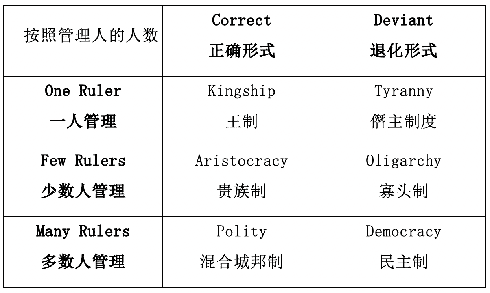亚里士多德的城邦组织原则

如果是一人管理的话，它有一种正确的形式，也就是一种良好的形式，就是所谓的王治。王治就是在一个合乎法统的国王的带领下，一个城邦走向繁荣。

但是它也有一种退化形式，叫僭主制度，僭就是僭越的僭。什么意思呢？就是有一个没有得到正确的法统继承的人，他偷窃了国家权力，然后把整个城邦往歪路上带，这就叫僭主制度。

少数人管理也有一种正确的形式，就是所谓的贵族制----  
一群有德的闲人在管理这个国家或者是城邦。但是这种组织形式也会走向它的德性衰败形式，这就是所谓的寡头制。寡头制就是一群无德无才的人占据城邦的重要位置，在上面分肥，鱼肉百姓。

如果是多数人管理，也有一种正确的形式，就是混合城邦制。混合城邦制是什么呢？我们等会再说。

那么（还）有一种退化的形式，就是所谓的民主制。它竟然是出现在德性退化这一列当中的，而且是与僭主制度与寡头制相提并论的。

总而言之，亚里士多德并不认为少数人统治多数人就一定坏，多数人统治少数人就一定好，他关注的是每种统治形式背后的那种德性的成色。

一个人说了算好不好？这得看这个人有没有德。他有德，他就是正统的王。他如果失德，就是僭主。少数人统治好不好呢？就要看这些少数人有没有德。有德就是贵族制，失德就是寡头分肥。多数人管理好不好呢？要看多数人有没有德。有德就是混合城邦制，若失德就是民主制了。

#### 混合城邦制：精英管理，民众监督，法制约束

不过考虑到今天我们已经把民主这个词当成是一个正面的字眼来使用了，所以亚里士多德所说的这个民主在这里我们要变通一下，这样听上去才比较顺耳。亚里士多德所攻击的民主制度大约等于今天我们所说的暴民政治。

暴民政治中最典型的特点是什么？就是现在的网络暴民，出了点事情，就做出了一副正义满满的样子，根本没有搞清楚真相就乱喷，这多多少少是暴民政治在互联网时代的一种体现。

亚里士多德的时代当然还没有互联网，他脑子里想到的暴民政治显然就是苏格拉底时代所遭遇到的那一种败坏的雅典民主制。梭伦时代的那种德性光芒已经丧失了，民众出于纯粹的嫉妒心或者自尊心去决定军国大事。比如伯罗奔尼撒战争中的那些大事，还有比如是否要处死苏格拉底这样的大事。

这种政治的特点就是没有定性，没有规则，形式出于偶然，出于情绪，这样的民众也非常容易被野心枷锁操控。亚里士多德讨厌这种暴民民主，（从）这一点也可以看出柏拉图对于他的影响，同时也可以看出亚里士多德的师爷苏格拉底的死留给他的心理阴影到底有多大。

不过我们要注意的是，亚里士多德本人最认可的政治制度可不是柏拉图所说的哲学王制度。哲学王制度实际上是亚里士多德所说的王治，就是一人统治，但此人有德有才。亚里士多德最喜欢的政治制度实际上是多人统治的混合城邦制。

我们再来复习一下，如果这个城邦的统治制度是由多数人管理，它的正确形式叫混合城邦制，它的堕落形式叫民主制。

也就是说亚里士多德最推崇的政治管理制度，只不过是他所批评的暴民民主制的某种亲戚，也就是说只要把暴民民主制改成了一种良好的制度，这种制度就妙了。

从这个角度上来看，亚里士多德并不是有些人所描述的反民主人士，毋宁说他要做的就是将民主制度加以改良，而不是否定它，那么混合城邦制当然就是这样的改良方案了。

现在我们可以大致讲什么叫混合城邦制。混合城邦制如果一言以蔽之，就是精英管理，加上民众的广泛监督，再加上法制约束。因此他给出的是个混合套餐，至于这个混合套餐具体该怎么实行，我下面有机会会和大家详说。

但是毫无疑问的是，亚里士多德所推崇的混合城邦制是为广大公民的政治参与提供了空间。这样的一种制度如果按照今天的观点去衡量的话，其实也能够算广义上的民主制的一种吧。

#### 德性加总论：德性专长的配合与舆论的制约

说到这里大家就要问了，为什么亚里士多德不像他老师那样主张哲学王的理论？他为什么不喜欢一人统治或者少数几个人的统治呢？因为一个人的统治与少数几个人的统治，也可能出贤王也可能出贤相，他为什么不喜欢这样呢？

亚里士多德是有他的道理的，他喜欢多人而不是一人和少数人统治，是基于他的德性加总论。

也就是说个体的德性加在一起，他的总体德性就会上升了，它就类似于三个臭皮匠凑成一个诸葛亮的道理，所以还是让更多的人参与管理好。

但乍一听这个论证好像是有点问题，因为这好像意味着德性似乎是像人的力气一样，是可以彼此累加的。比如拔河比赛我这里有 20 个人，你那里有 5 个人，20 个人肯定赢，但对方 5 个人后面又加了 15 个人的援军一起拉，这力量就增加了。

但德性是不是这样的东西呢？有些人或许能想出这样一种反例：如果有一个人德性非常坏，他加入了这个团体，会不会造成德性败坏的症状在群体中的传染呢？

亚里士多德的意思是不用太担心害群之马，害群之马肯定是有的，但是大量德性评价者的出现，能够使得某些不合格的德性评价者被过滤掉，或者说被边缘化。

换言之，大多数人按照公心去评价，会构成某种非常重要的舆论场，然后就构成了某种势。而且具有各种德性专长的人相互组合，也能够克服盲人摸象的问题，帮助公众看清楚问题的真相。

我本人对于这个论证也有两个补充性的论证来说明亚里士多德是有道理的。

一个补充性的论证是这样，就是从概率的角度上来讲，一个人德行败坏的概率要高于全社会比如说 5 万个人德行同时败坏的概率。所以你把国家的希望就放在那少数几个人身上，他出事的概率会比较高。5 万人同时道德败坏，这应该说是比较难的。

那么第二个论证是什么呢？公众的舆论场本身它有一种道德的压力，迫使大家在舆论场中装也要装成正人君子。虽然有时候有些人是装成正人君子，但这多少也算是一种约束。

这也就是说大量的道德评价人所构成的舆论场本身也就成为了一个相互监督的场所，这是维持个体道德积分的某种重要的社会条件。

但是如果你把所有的权利都放到少数人手里，那么其他人手头没有任何的权利，甚至没有舆论的监督权，这就会使得德性的腐败成为一件很容易发生的事情，但是在某些情况下可能也会出现反面的情况。

我前面已经说了 5 万个人同时堕落的确概率要比一个人的德性堕落的概率要低得多，但是保不齐也会出现某种黑天鹅事件。就是在某个社会里面，八九成的人良心都被狗吃了，相互监督成为相互比烂，全社会的道德积分就所剩无几了。

那么按照亚里士多德的观点，如果出现了这种黑天鹅事件，那么这个社会就必须转入贵族制与王制了，让少数或者一个德性还不算败坏的人来进行统治。

换言之，在这样一种政治制度中，5 万人的道德总量已经低到了如此的地步，以至于还比不上某一个闲人的道德总量。这种情况可能发生吗？还真有可能发生，我们历史上也有实例。

二次大战以后，我们知道纳粹德国它是暂时是被盟军军管的，然后盟军就在他们所统治的地区进行强制的去纳粹化教育。这是为什么？因为纳粹化教育已经把德国人的道德积分弄成了负分，每个人脑子里装的软件都是乌七八糟的，都是觉得犹太人就活该被我们欺负，我们就活该侵略别人。

所以这时候不能让德国仓促使用民主制，弄不好纳粹余孽就会冲上来了，有一个小希特勒又冒出来了，而必须要让少数的盟军的军官进行强制性的去纳粹化教育，这就是某种意义上的贵族制和王制了。

#### 维持社会德性：让多数人成为中产阶级

这里的问题是我们怎么能够避免整个社会的德性堕落到如此不堪的地步？亚里士多德给出的一个药方，（是）让社会中的大多数人是成为中产阶级，也就是那些不那么富也不那么穷的人。

社会中当然也必然会有富人与穷人，但他们所占的比例是比较少的，社会大多数成员乃是中产阶级，所以我们就把这样的一种社会结构称之为橄榄型的结构，当中大两头小。

中产阶级为什么能够成为社会的定海神针呢？这是因为中产阶级处在一个上不着天下不着地的，卡在当中的位置，他既能够同情穷人的处境，也能够理解富人的想法。

纯粹的穷人就比较容易产生片面的仇富心理，富人则可能沉湎享乐，不知民间疾苦。中产阶级就能够体现亚里士多德所说的中道的原则了。

亚里士多德的观点其实是颇有道理的。大家想想看，希特勒这样的人是怎么能够通过民主选举而在 30 年代初的德国取得大权呢？就是因为当时德国的经济败坏了，没有一个稳定的、强大的中产阶级了，大量的人失去了工作，所以这些人就需要一个救世主，很不幸他们找到了希特勒这样的人。

亚里士多德只是说如果中产阶级强大的话，那么这个社会的德性总量就能得到维持。但是怎么让中产阶级强大呢？

这个问题就很深了，这就牵涉到一些更深的对于经济结构的问题的一些思考。比如今天美国的分裂，其背后的经济原因当然就是传统意义上的中产阶级的没落。

但是中产阶级的没落背后的根本的原因又是什么呢？就是全球化的这种经济资源的重新分配，导致美国国内的一部分中产阶级，成为了这种新分配游戏的牺牲者。

这方面的深刻的原因，是亚里士多德的中产阶级理论所没有能力触及的。我认为这方面的讨论，可能会要涉及到一些马克思主义的思想资源，不过这是一个非常复杂的话题，我们就此打住。

好吧，我们现在就假设中产阶级力量已经很强大了，不管它是怎么强大的。但亚里士多德非常清楚，即使中产阶级的力量很强大，专家的意见也必须要得到尊重。因为很多专业的管理问题一般人是不懂的。怎么平衡专家意见与民众意见之间的关系呢？这就首先要对民众参与公共管理这件事本身进行区分。

有一些职位，比如古希腊城邦的执政官是重要的官职，也是非常重要的核心的要害部门。而一般的公民大会的投票事务，则是不那么重要的政治事务。

亚里士多德认为，重要的官职应该交给德才兼备的政治专家，而一般的不那么要紧的事物，则可以交给民众，两者之间的关系可以通过法律来协调。

#### 合格政治专家的遴选标准：财产和德性积分

好了，现在有一个新的麻烦了，到底谁才能算是德才兼备的专家呢？亚里士多德的哲学四面讨巧的特点，在这个问题上也流露出来了。他认为遴选合格的政治专家的标准，其一就是看财产，其二是看此人历史上的德性积分。

第一条比较好说，因为财产可以度量。后者则是看他做了多少公认的好事，比如自己花钱更新公共设备，救助乡里乡亲什么的。但谁都看得出，要做此类的好事，并且被大家记住，有钱也是一个必要条件。

今天的读者可能会对这个标准感到不太舒服，这也就是说富人成为城邦老大的机会难道就更多一点么，这样的体制又怎么维护穷人的利益？

这里必须要指出的是，亚里士多德的意思，并不是说你越富就越有资格成为执政官。他的意思说财产标准是一个入门的资格，至少得保证他是中产阶级或者是中产以上阶级。

在这里钱之多寡，只是某种媒介性的条件，也就是说是触发德性积分提高的物质性前提。另外也因为被遴选的后备官员至少算是一个小富人，所以他对物质的需求是不大的，做官以后贪污的概率也比较小。而且也正是因为他多少算是个小富人，所以他从小到大受到良好教育的机会也比较大，所以他治国理政的本领，要比读书少的底层民众要强。

但是不是即使是这样的人也有可能做坏事呢？当然有可能了。所以公民有选举和审查官员的权利，防止出现建主制度与寡头制度。

这里要指出的是，虽然选举这些候选人并不是全民都可以参与的，但选他们的（时候）公民还是可以参与的，同时审查他们的（时候）公民也是可以参与的。

请注意，这里我们所说的审查权和监督权并不等于是决策权，这两者是不同的。

就拿中国的古代政治制度来打一个比方：在汉代，地方上最重要的行政单位叫郡，郡的长官叫太守或者是郡守。太守的权力还是很大的，他有地方上的各种各样的决策权、人事权，用人的权力，甚至有调动郡内军队的权力，所以有点就像一个小诸侯的味道。

但是他不是为所欲为，说他是小诸侯只是个比方，他如果做出鱼肉百姓的事，或者对朝廷不忠的事，那怎么办？

在几个郡级单位上面，还有一个刺史部，刺史部的主要的官员叫刺史，负责监督各个太守的执政，看看大家有没有做出一些不良的行为。但是如果每一个郡守所做的事，都在汉朝的法度之内，一般来说刺史是不干涉地方的具体措施的。

而亚里士多德如果知道中国汉朝的制度，他只不过就是把中国汉朝的刺史从一个人换成了一群人，也就是广大的公民，广大的公民都是刺史大人，都有权审查官员是否违法。

但注意，你不能够具体地干涉官员的具体行政，只要他是合法的，你还得听他的。

而亚里士多德所攻击的那种报名民主制度则是全体公民集体审议一切事物，不论大小。而真正的行政官员却不能决定任何事物，仅仅做一些准备性工作，亚里士多德认为这会使得整个城邦的秩序陷于崩坏。

#### 如何判断公司的好坏？

亚里士多德的上述思想对于我们衡量一个微观的社会组织，比如说公司这样一个德性程度是有非常大的帮助的。比如我们要考察一个公司到底是个好公司还是坏公司，我们就可以仿造亚里士多德的格式来问下面的一个问题。

第一个问题是公司的管理阶层的德性程度如何？德性程度体现在哪些方面呢？比如管理者对于公司的公共利益有没有公心，或者只是把公司当作为自己谋利的工具。

对于下属，上层的管理者是不是经常会将下属的功劳拿走，同时却将责任往下面推卸，上级的管理者愿意不愿意倾听下属基于公心而提出的针对工作中的问题的种种批评意见呢？

第一个问题是针对这个公司的或者是其他社会组织的管理阶层的德性的。但是亚里士多德也提到，被管理者也要有德性，如果广大公民的德性崩坏了，整个社会也没救了。

在这种情况下，我们就要看看这个公司的广大员工的德性水平如何了，也就是说如果公司里面出现了种种不正常的现象，你是不是在公司的微信群或者是公司的其他的舆论平台上听到那些批评性的言论呢？或者说广大的员工只是逆来顺受呢？员工之间是否有互相坑害的现象。这是第二个问题，是针对公司的被管理者的。

第三个问题是针对整个公司的形式管理方式的。到底谁管事呢？是一个人还是几个人呢？（遇到）大事会不会开职工代表大会呢？或者董事会的运作是否正常呢？上市公司的财务报告是否透明呢？

在中国有很多企业，它带有一定的家族企业的特征，所以在研究公司的组织管理形式的时候，你也不妨研究一下这些公司的重要领导干部之间的亲属关系。如果亲属关系过于密集，十有八九它的用人原则是唯亲而上的，而不是唯贤而上。

第四个问题就是公司的利益分配原则是怎样的，核心员工的待遇如何。我们都知道在亚里士多德的一种理想化的混合型城邦体制里面，中产阶级的利益应该是要得到保证的。

按照同样的道理，在一个合理的公司里面，核心团队的收益应该是比较稳定的。它的整个收入结构应该是像橄榄形一样，中间大，两头小，大多数人拿的钱基本上是差不多的，但是有一些极优秀的员工可以拿的多一点，少数比较后进的员工拿的比较少一点。

如果出现了所谓的哑铃型，也就是说整个收入分配出现了非常严重的两极分化的这种趋向，这个公司就很难运作，而且基层员工的工作积极性就很难被调动起来。

如果你按照这样的一个评价的标准，对一个公司的德性总分做出了一个评价以后，最后能得出什么结论呢？我个人的一个观点是这样的，一个公司如果管理者与被管理者的德性都不错，而且它的整个组织架构也是合理的，它的分配制度也是合理的，这个公司当然就是个好公司了。

但如果其中有一项或者是两项败坏了，你是不是要离开这个公司呢？你就得看具体情况了，也就是说就要看它败坏到什么程度，是不是已经败坏到了你无法忍受的程度。

如果上面所说的这些要素全败坏掉了，公司的管理层也腐败，被管理者也不像话，整个公司的组织运作原则根本就是没有原则，分配利益的原则也完全是好处让少数人独占了，十有八九你就得离开这个公司了。

#### 跳出工作困境：让自己变成德才兼备的人

但是这里面又有个程度的问题，因为如果你能够跳槽到的别的公司，在这方面的问题要比你原来待的公司更加严重，你可能还是很难立即跳槽。所以这又回到了亚里士多德哲学的重要的原则上，就是要寻找中道。

中道到底在哪里？不能机械地规定，得根据每个人自己行业的具体情况来看。

在中国国企、外企、私企、高校情况是各自不同，不同的城市的情况也都不同。以我自己作为大学老师的体会来看，不同的学校，不同的院系情况也千差万别。但是其中有一条原则却是万变不离其宗的，就是要让自己变成德才兼备的人。

这不是说一些泛泛的道德空话，这个才和德都是具体有所指的。这个才是什么呢？在各个技术部门里面你都要考证，你要有各种各样的专业技术职称，当然是国家认可的那些金字招牌的职称，否则你说有才别人就不信了。

举个例子说，在我们的学术行当里面，理科的老师说我想跳槽到别的学校去，你有几篇 SCI 的一区论文，这就是一个很重要的证明你才干的标准，否则人家新的单位不要你。

第二个就是德，德就是做什么事情要按照原则来进行，千万不能够在自己的职业生涯中留下什么职业道德方面的污点。

比如在我们做教授这个行当里面，剽窃论文就是个很严重的失德。但是只有你自己恪守底线，从不嫖窃论文，那么当别人剽窃论文的时候，你才有足够的道德资本冲上去吼一嗓子，对他进行猛烈的道德抨击。

当然话又说回来了，如果你发现某个地方某某教授已经有了公认的严重的学术失德行为，却依然在学术的小环境里面吃香的喝辣的。你就十有八九可以判断，这个地方可能是学术界的某种道德积分的洼地。

所以为了不同流合污，只要你自己的资历硬，你大可一走了之，到一个德行积分高的地方去。

而且在这种情况下，你如果要按照自己的道德操守来做事情的话，走可能要比留更好。因为你可以发现一些道德操守比你低的人在这里已经爬到你上面去了，你按照自己的道德的行为准则来做事的话，反而会遭到他打压。

如果你认为自己是个道德上还算有底线的人，你这样的人被打压了，岂不是让全世界的道德积分又往下调低了这么几个点吗？所以为了让你的道德积分能够提高，你可以跑到别的单位上去，（当）你在行政上得到了新的单位领导的保护，你再来攻击原来你看不爽的人，在微观的政治操作技术上也比较安全，这样做对公对私都是极好的。

好，前面我们已经根据亚里士多德讨论政体的一些思想原则，对我们怎么选择单位、怎么判断一个单位的德性积分做出了大概的描述了。

人生并不是事事都能让人如意的，有时候我们的确能找到一个德性积分很高的单位，发挥自己的才能。

但有时候很不幸，因为各种因缘际会我们进入了这个公司或者单位，它德性积分就是很低，（你的）身边都是小人。

亚里士多德又该如何理解生活中的种种不如意，甚至生活中的种种悲剧呢？这就牵涉到了亚里士多德对于悲剧的本性的讨论，这也正是我们下一期的内容。

好了，今天这一集的内容就到这里为止了。谢谢大家，我们下次再见。

公众号懒人找资源，懒人专属群分享

## 22\. 悲剧的意义：在对行动的模仿中追问人性

各位听友大家好，我是徐英瑾。

前面我们提到了各种社会组织结构的种种不同的组织原则，当然我们大家都很希望进入那些德性积分比较高的社会组织，但人生中多有不如意之事，邪恶暂时压制善良的现象，甚至还并不少见。

不得不承认，悲剧性的色彩总是会出现在人生之路的某个环节上，我们又该怎么来面对这个问题呢？

亚里士多德所给出的减压良方是这样的，我们就不妨以毒攻毒去剧场去看悲剧，从悲剧中汲取力量，来对抗生命中的种种不公与悲凉，这就牵涉到了亚里士多德对于悲剧的看法。

#### 悲剧具有引人反思的教育意义

亚里士多德对于悲剧的看法集中在他的《诗学》一书之中，为什么《诗学》这本书会讨论悲剧呢？因为当时的诗歌的概念是很宽泛的，它也包括戏剧。

亚里士多德充分肯定了戏剧对于教育民众的作用，这一点他与贬低诗歌与戏剧的柏拉图是非常不同的。

而且亚里士多德又特别地强调悲剧的教育作用，他认为悲剧对于人生本性的揭示作用特别的强，能够从总体上唤起观众对于人生哲学基本问题的反思，而不会让观众在低俗的笑声中沉湎于各种让人怡然自得的小确幸的心理之中。

所谓的《诗学》从这个角度上看，就是告诉大家何为优秀文艺作品的一种评风之学。在今天戏剧的重要性已经被影视剧给取代了，而观看影视剧也成为了我们日常生活的一个重要组成部分。

因此亚里士多德在《诗学》中所给出的文艺评价标准，也能够帮助我们在海量的影视资讯中迅速遴选出一部值得一看的文艺作品，以免让那些烂剧浪费我们的人生。从这个角度上来看，亚里士多德的《诗学》应当成为今日豆瓣评分的指导哲学。

好，现在我们说回去来看看亚里士多德对于悲剧的看法。从哲学角度上来看，多看悲剧，进而多看戏，它有啥好处呢？

这是因为戏剧中的人物乃是一般性与具体性的统一，是哲学的抽象性与生活的具体性之间的中介，对于这些戏剧人物的行为的了解，能够帮助观众以最简约的方式看到不同的性格、不同的世界观彼此碰撞后的结果。

相比较而言，纯粹的生活过于具体而缺乏典型性，纯粹的哲学过于抽象而缺乏具体性。沉湎于生活细节，我们会失去对于大的格局感的认知；而沉湎于哲学概念，有时候我们就没办法接地气了。

而戏剧则兼得此二者，以莎士比亚的名剧《李尔王》中的主人公李尔王为例，他当然首先是一个具体的人，有名字叫李尔，因此他有戏剧舞台上的行动力。注意抽象的概念是不能行动的，只有人才能行动。

但同时李尔王又是个典型的心地善良、但头脑不太清醒的糊涂蛋。虽然心眼不错，但是识别人心的能力非常弱，不晓得自己的三个女儿中谁才是真正的好人。

莎士比亚来刻画李尔王这个人物，就是要表示某种一般性的概念，即单纯的善良，如果不能与适当的警觉心这种德性相互结合，反而就会造成不堪的后果。

但这种观点若仅仅是以命题的方式表现出来，而不化身为一个具体的人的具体的行动，就会变得枯燥无味。对于受过哲学训练的人来说，他们大概能够听懂这个命题是什么，但没有办法起到教育大众的作用。

我们再举一个例子，根据日本作家井池户润的小说《我们是泡沫入行组》，以及《我们是花样泡沫组》改编的现象级日剧《半泽直树》，也可以为亚里士多德的这种戏剧观提供一个注解。

这部剧集里的主人公半泽直树比较好地统一了公益心、勇敢、智慧等种种美德，因此引发了观众的大量共鸣。但是你如果抽象地说半泽直树这人很有公益心，很勇敢很智慧，然后写成一句句子，谁会去看这部戏呢？

很显然，被虚构出来的半泽直树，是通过他与银行内部的腐败势力的种种艰苦斗争来展现这些美德的。如果没有这些精彩的剧情所提供的支点，那么那些空洞的道德标签是难以引发大家的关注的。

#### 戏剧创作：模仿自由意志选择的行动

戏剧家要如何做到通过虚构具体的人物来完成对于抽象的人性原则的诠释的呢？亚里士多德的答案是这样的，靠模仿。

请注意，这不是我们第一次在本节目里面提到模仿。在柏拉图的戏剧理论里面，现实事物是对于理念的模仿，戏剧是对于现实的模仿，因此戏剧比起现实事物来说，又与理念多隔了一层，并因此更加远离真理。

所以柏拉图本人是不太喜欢模仿这个概念，但是亚里士多德确实在积极的意义上提到模仿说的。他也说戏剧是模仿某种对象的，但是请注意在亚里士多德的语境中，这样的模仿对象并不是理念，而是行动。

那么什么是行动呢？不是随便发生的任何事情都能算是行动，行动必须得有人类的意志与选择的参与，而且这些事情的效果也得有重大的意义。

日本的东海大地震不是行动，它是纯粹的自然世界，因为地壳的运动是没有意志的。假设我在得知日本东海大地震的新闻的时候，正在肯德基的店里面吃饭，并且正在纠结到底应该是吃 A 套餐还是 B 套餐，这件事算不算行动呢？

这事也不算行动。虽然我选择吃套餐的行为也牵涉到了我的自由意志，但是选吃套餐这件事情毫无重大意义，无论对于我的人生还是对于别人的人生来说，选 A 套餐又怎么样？选 B 套餐又怎么样呢？

与之相比，在日本的最新电影《福岛 50 死士》里面，东电公司的福岛核电站的前线人员，是要选择留下来与核电站共存亡呢？还是要选择做逃兵，远离此是非之地呢？

这样的选择显然牵涉到了一个行动。因为相关的人员是运用了他们的自由意志来参与这些选择的，同时他们的选择又关系到了几千万人的生命。

按照电影里的剧情的描述，如果福岛核电站的十几个核反应堆全部崩溃，半个日本将进入万劫不复的境地，而整个东北亚的生态环境也会出现不可修复的问题，所以福岛 50 死士的选择就值得成为戏剧刻画的对象。而我在看这部片子的时候，到底嘴巴里嚼的是薯条还是巧克力，则相对不值一提。

行动所涉及的重大选择的走向是戏剧中人物的价值观、性格与历史背景的综合性体现。所以这些重大行动才屡屡在优秀的戏剧与小说里面，成为戏剧家所聚焦的对象。

由此我们也就不难理解哈姆雷特的那句名言的哲学含义了----  
生存还是毁灭，这是一个问题。换言之，如何选？怎么选？选性命还是选大义，乃是人生面临的最终极的大问题。

由于优秀的戏剧往往能够在有限的时间内迅速引导观众关注到这样的大问题，这就说明优秀的戏剧本身就具有某种准哲学性。

就这一点而言，亚里士多德甚至认为连历史学研究都缺乏戏剧创作所具有的这样的一种准哲学性。因为历史研究受到客观的历史事件所发生的物理时间的限制，没有办法自由地虚构人物与事件，并通过这种虚构将牵涉自由选择的行动，在相对短暂的戏剧时间之内展现。

很多人不爱读正史，觉得枯燥，反而觉得历史小说有意思，基于历史事实改编的文艺作品有意思，也正是这个道理。

#### 如何进行有效的模仿？

很显然，作为戏剧家或者小说家，你得辨别出在日常发生的林林总总的事情里面，哪些才是具有重大意义的、算得上是有人类的选择所参与的行为或者行动。而一般人往往缺乏这种敏感性，容易被缺乏历史意义的花边新闻牵着鼻子走。

譬如我在翻看 1944 年的英国的一些战时新闻，就发现当时人们所关注的所谓的好玩的事件，在今天看来简直不值一提。譬如驻扎英国的美军是如何在酒后闹事的等等，这样的新闻竟然占据了头条。

真正的大事，比如诺曼底行动该如何策划，新闻是不说的。但敏感的作家与高级的新闻记者，是应当能够嗅出即将发生大事件的气味的，否则那么多美国大兵出现在英国又是作甚呢？

所以要进行有效的模仿，第一个步骤就是要发现人类的行动，第二个步骤则是要构造出虚构人物，并且将怯懦、勇敢、自私这些道德特征投射到他的身上，让这些特征能够在他的具体的选择活动当中体现出来。

这同时要求戏剧作家敏锐地观察具有此类特征的一般人的行为举止，以便作为典型人物性格刻画时可资参考的素材。

#### 悲剧的特点：唤起悲悯与畏惧的情绪

说到这里大家或许会问，以上所说的乃是一般戏剧的创作原则，但为何我们这里要特别突出悲剧呢？

悲剧在亚里士多德看来是一种能够唤起悲悯与畏惧这两种情绪的戏剧。与一般意义的放松愉快等情绪相比，上述两种情绪乃是具有哲学特征的情绪，所以特别具有净化观众灵魂的力量。

但为何这么说呢？先从悲悯开始讲。悲悯显然是悲剧的重要因素，否则悲剧又为何叫悲剧呢？但是悲悯本身并不是某种廉价的眼泪，悲剧也不是某种廉价的催泪剧。

什么叫催泪剧呢？就是反复表现主人公的人生有多么的悲催，让大家一哭了事。但哭完观众突然意识到这是戏，又突然意识到自己的生活其实比主人公要好上太多，于是又心生小确幸怡然自得起来。这种低级的催泪剧本身很可能会成为某种伪善的道具，不能够起到教化城邦公民道德的作用。

悲悯的正确的表露方式，就是某种达到中道的悲悯，必须做到哀而不伤，否则就会过犹不及。优秀的戏剧将告诉你啥是中道，这个中道并不是某种没完没了的自怨自怜，而是帮助你认识到造成悲剧性生活的某种深层根源。

认知总是让人冷静的，并使得悲悯能够得以被克制。而另外一种与悲悯相互制衡的力量，就是我前面所说到的畏惧。畏惧乃是优秀的悲剧，能够迅速将自己与低级的催泪剧拉开档次的最重要的情绪力量。

为了说明这一点，我举个例子。如果你看了一部纪录片，仅仅描述非洲的居民生活有多惨，你仅仅会感到悲悯，并因为自己的生活尚属小康而产生我毕竟没有投胎在非洲的那种小确幸。于是你就会觉得你看到的就是别人的事情，而不是自己的事情。

但是假设你在把玩一件精美的象牙制品的时候，正好看了一部纪录片，这部纪录片表现的是非洲大象被人类残杀的痛苦。这时候你感受到可能就不是悲悯了，你会突然意识到你自己也是这样一条罪恶的象牙销售链条当中的一个环节。

这时候你感到了畏惧，你畏惧了什么呢？你畏天、畏地、畏良心。在这种情况下，你就会觉得你看到的不仅仅是别人的故事了，而且是自己的事。

优秀的戏剧都应当有这样的一种力量，就是让观众从心底里面感到自己被震撼到了，你得让观众思考，而不仅仅让他们掉眼泪。

不过要做到让戏剧具有这样的力量，要让观众产生这样的一种畏惧的心理，也并不是很容易。一种最低级以及最不入流的方法就是拍摄恐怖片了，也就是说让观众在黑乎乎的电影院里面惊得大呼小叫。比如《加州电锯狂人》《死神来了》《食人鱼》这样的刺激感官的电影。

但很显然这样的电影无论情节有多恐怖，都不会让人感到这电影说的是自己的事情，反而也会引发大家的小确幸心理。大家看完心想，虽然情节好恐怖，但毕竟是假的，和我没关系。

稍微高级一点的引入畏惧心理的方法就是写网络爽文，就是大男主大女主，杰克苏马利苏情结。这些主人公在剧情里面一路升级打怪，在职场或者官场上披荆斩棘。在这类故事里面主人公的人设一般是高大上的，充满正面价值的。

当然这些故事里面也会出现很坏的大反派，在故事的各个环节里面，甚至还会屡屡将主人公逼到绝境，这种恐怖的情节也能让读者感到畏惧，为主人公的命运感到担心。

但是这种畏惧情绪毕竟不是真正涉及读者自身的，因为读者心里清楚，毕竟爽文主人公最终是有办法克服这些难题的。

而在坏人被惩罚的故事套路的引导下，读者的复仇心理也得到了宣泄，于是他们就能够心安理得地放下这段故事，继续去做自己的事情了。而他们看待世界的世界观和自己的一个灵魂的根本都没有被触动。

#### 悲剧引发哲思，追问人性自身的界限

我们又该怎么样让那种真正能够触动灵魂的，使人畏惧的力量被引入戏剧呢？其关键就是要设法让读者从作品中，看到对于人性自身界限的追问。类似于这样的问题：我是谁？

我们不妨可以再举一个例子，古希腊悲剧作家索福克罗斯的《俄狄浦斯王》里的主人公是俄狄浦斯。这样的一个主人公，可以说是有很多完美的人设，智慧超群、热爱邦国、大公无私、斩妖除魔、无所畏惧……好，说到这里，似乎欧迪普斯王展开的是一种网络爽文的模式，但错了，这个故事的要点根本不在于此。

故事的要点是俄狄浦斯早早就从神谕里面得到了这样一个预告，即他自己注定是要杀父娶母的，也就是说他将犯下人伦大罪。

俄狄浦斯天性善良，觉得自己绝不能做出如此不伦之事。为了逃避神谕的诅咒，他逃离了故乡科林斯，因为他认为科林斯的国王和克林斯的王后就是自己的亲生父母。

但俄狄浦斯万万没有想到，正是这种刻意的躲避，加速了他人生悲剧的步伐。他在路上误杀了年迈的忒拜国国王拉伊奥斯，然后又在忒拜国，娶了拉伊奥斯的遗孀，却不知他杀的就是自己的生父，娶的就是自己的生母。知道真相之后，愧疚的主人公刺瞎双眼，自我流放。

这个故事有某种直击人心的令人恐怖的力量。故事涉及到的问题是，人是否有能力摆脱命中注定的事呢？人本身究竟是什么呢？是命运的玩具，还是能够通过自己的自由意志与命运一搏的某种小神？

我们已经看到俄狄浦斯是试图运用自己的自由意志向命运宣战的，因此接下来发生的事情，比如他身为王子却离开祖国去外国流浪之类的，是足以成为亚里士多德所说的行动的。

但问题是这种自由是否在更高的层面上又被命运的狡诈所克服了呢？比如索福克罗斯的戏剧中命运是如此的狡诈，竟然能够进一步预测到主人公会看到神谕，并因为逃避神谕而走向了神谕设定的第二部陷阱。

好，如果观众已经意识到了命运本身竟然有着如此恐怖的力量，我相信任何一个观众也会联想到这样的问题。我们自己又比俄狄浦斯强多少呢？他连人面狮身的女妖斯芬克斯都不怕，却最终打不过命运，难道我们这些凡夫俗子就能打败命运吗？胜天半子，难道永远是一种奢望吗？

需要注意的是，上面我们所说的这个戏剧本身无疑是带有浓重的宿命论，或者是命定论色彩。而从哲学角度上来看，命定论未必是一种正确的哲学观点，别的哲学家或许会提出一种与之相互对抗的观点。

在这种情况下，有的人就会问了，假设命定论本身就是一种错误的哲学观点，那么看一部宣扬命定论的戏剧，这件事本身还有意义吗？

答案是有。因为这样的戏剧至少能够将那些没有受过哲学训练的观众的心智提高到比较高的思想高度。即使得他们能够去思考命定论对不对，人的力量在命运之前是否真正是无边际的。

伟大的悲剧作品都有能力将观众带到这个层次上，悲悯与恐惧这两种情绪在优秀悲剧作品里的正确出场方式大致就是以上这些了。

这里我还想顺便给我自己打一个小广告，我自己也写了一部长篇历史小说，叫《大吴帝国前传》，这部小说即将由上海人民出版社出版。这个作品与今天讲的话题之间的关系是什么呢？这是一部严格按照亚里士多德的悲剧理论所创作的中国古典题材的小说。

这部小说的主人公就是大家所熟悉的吴主孙权的老爹孙坚，而孙坚的一生就是用他自己的自由意志试探生命的最大边界的一生。

他从东汉末年的边陲低级公务员做起，  
甚至还没有一个体制内的编制，然后一步步往上做，通过残酷的权力斗争，一度摸到了最高权力的门槛，最后却从最高峰一路跌落，被武力等级根本不足他的黄族设计杀死。

我也希望广大的读者能够通过我的小说，思考一系列充满亚里士多德哲学意味的人生命题。比如人生的本质是什么？成功的边界是什么？如何平衡个人的野心与个人的能力之间的关系？

好，就此我们对于亚里士多德的人生哲学的各个环节的讨论，大致已经结束了。

在下面一回中，我将对这个板块的内容进行小结，但为了让我们的回顾不至于太重复前面的内容，这一回顾也将结合对于罗马思想史的介绍来进行。我们下回见。

公众号懒人找资源，懒人专属群分享

## 23\. 从古罗马到美国，亚里士多德从“理想”步入“现实”

各位听友大家好，我是徐英瑾。非常高兴和大家继续来讨论哲学家的十种生活提案这个话题。

今天已经是本单元的最后一回了。在前面的将近十回的内容中，我们已经对亚里士多德的人生哲学的方方面面进行了介绍。

我们都知道亚里士多德是百科全书式的哲学家，他的著作全集可以看成是希腊时代的《吕氏春秋》，所以亚里士多德对于后世思想的影响是怎么说也不过分的。

#### 罗马人的生活里，有亚里士多德哲学的影子

今天我们对于他的总结将结合亚里士多德的思想对于罗马人的影响来进行。为什么我们需要要扯点关于罗马的知识呢？首先当然是因为亚里士多德的时代与古罗马崛起的时代是比较接近的。

亚里士多德死后大约 200 年的时间内，罗马就慢慢崛起为地中海地区的头号强国之一，然后罗马又花了几百年的时间成长为一个横跨欧亚非的大帝国。因此亚里士多德的时代与罗马的时代的确不是特别远。

第二，也是因为我在下一个单元，也就是虚无主义的单元里面所涉及的罗马的思想家会比较多，在这里提一下罗马也可以构成一种过渡。

第三，我在这里要提罗马，是因为亚里士多德的不少关于人生哲学的思想，并不是在他所生活的古希腊时代成为了现实，而更多的是在罗马时代构成了现实。

也就是说看看罗马人是怎么生活的，能够帮助我们更多地理解亚里士多德的人生哲学是什么。通过这种方式来复习亚里士多德的人生哲学，我们也可以得到一些新的历史资料。

这里需要注意的是罗马人并不是那么地喜欢哲学，这多少有点讽刺意味。罗马人比较喜欢搞法律，搞税收系统、搞公共建筑、搞商业，在军事上也特别在行。但是他们并没有职业哲学家这个专门的行当。

亚里士多德的书在罗马时代主要是以原始的希腊文状态流传的，并没有人系统地将亚里士多德的书翻译为拉丁文，拉丁文就是罗马的第一官方语言。

亚里士多德的书（被）翻译为拉丁文，那是中世纪的事情。在这样的情况下，我们又凭什么说罗马人的生活里面有亚里士多德哲学的影子？这主要体现在如下几点：

第一点也就是最重要的，最提纲挈领的一点，就是所谓的中道原则。我们都知道亚里士多德哲学的一个基本的原则就是中道，不走极端。

不走极端有很多含义，其中一个含义当然是指克制过分的欲望。这也是罗马的官方哲学思想----斯多葛主义的核心命义。

斯多葛主义是我们在下面一个单元里面所要涉及的思想，这里没有办法全面展开，但是几乎肯定的是斯多葛主义对于谦虚沉着的美德的颂扬，与亚里士多德对于中道的颂扬是有一定的相似之处的。

虽然罗马帝国在晚期相当堕落，整个社会的享乐之风越来越重，以使得斯多葛主义逐步成为了一种道德上的掩饰。但是至少从字面上说，斯多葛主义仍然具有坚持中道的含义。

第二点，亚里士多德有一种基于希腊语之自豪感的世界主义情怀，认为希腊文明的光芒要照亮四方。

这种思想是与他学生亚历山大大帝的扩张互为表里的。不过亚历山大的马其顿帝国毕竟是不稳固的，真正实现这种理想的乃是罗马。

罗马是从一个城邦出发，用几百年的时间建立了一个环绕地中海的大帝国，并且以拉丁语为第一官方语言，也就是帝国的西部语言；以希腊语为第二官方语，也就是帝国的东部语。

（罗马）在整个帝国境内实行同样的法律。这里要注意的是《罗马法》是今天的大陆法系的根源，其核心思想就是成文法传统----  
法条必须以命题的方式被肯定下来，颁布天下，天下按照同样一个尺度来执法。

这种做法就预设了某种统一的逻辑思维。在法律工作中的重要性，也就等于积极回应了亚里士多德在《工具篇》中锻造逻辑学武器的各种努力。

第三点，亚里士多德的中道原则也牵涉到了他对于修辞的态度。亚里士多德对修辞也采取比较中庸的态度，还写了《修辞学》，肯定在逻辑的辅佐下，通过辞章的安排，来达到自身演说目的的合理性。

而在罗马共和国时代，西塞罗则成为修辞学与演讲的大师，政治修辞日后也成为了西方政客的基本训练，这在相当程度上也是受到亚里士多德的影响。

#### 罗马时代的政治体制与混合城邦制的相似性

第四点，就是亚里士多德鼓吹德性是政治体制背后的灵魂，而他最喜欢的那个政治体制就是混合城邦制，这在我们上一回的节目中已经提到了。

什么叫混合城邦制呢？就是那种德性在里面起到积极作用的准民主政治。我这里用准民主政治就指出它有民主政治的成分，但并不完全是民主政治。

我认为在古典的世界中，最接近亚里士多德这种理想的，就是罗马共和国时期的政治体制。罗马共和国的政治体制的一个基本构成，可以说是基本上是平衡了民众与精英阶层之间的一个关系。

比如其中比较具有大众民主色彩的民众大会，其中又包括所谓的区会议、百人会议、部族会议以及平民会议，用来遴选高级的官吏，特别是执政官。

而比较代表精英色彩则是所谓的元老院，成员由 100 人后来扩张到 300 人，但即使是 300 人，人数也不是很多，基本上都是政治老手才能够参与的，一般的政治素人是没办法参与的，很多位置也是被贵族所垄断的。

除了民众大会与元老院之外，还有执政官。执政官是由民众大会选举产生，但是他在退休以后又可以通过旋转门进入元老院。

执政官多多少少有点像今天各国的首相或者是总统，但是一般来说是两个执政官不分正副，同时执行领导国家的职责，任期只不过是一年。

一句话（来说），罗马共和国时代的政治制度既不搞民粹，也不搞寡头，而是让民众的代表与贵族的代表坐在一起讨论天下事，大家按照中道办事情。这种不走极端的政治路线，实在是太亚里士多德了。

除了罗马共和国的政治体制很亚里士多德以外，甚至罗马帝国时代的政治体制，也非常具有亚里士多德主义的气味。

我们都知道亚里士多德除了混合城邦制以外，他也能够接受贤明的君主统治。他把贤明的君主统治称之为王制，把那种堕落的君主统治称之为僭主制。

罗马进入帝国时代之后，出现了皇帝，也屡出贤明君主，所以有所谓的五贤帝之说。五位贤明的君主分别是涅尔瓦、图拉真、哈德良、安东尼*庇护和马可*奥勒留。当然我个人认为古罗马的第一个皇帝奥古斯都，也就是屋大维，也能算是一位贤明皇帝。

古罗马的皇帝与中国古代的皇帝是不同的，很多皇帝不会立自己的亲生儿子为继承人，而是寻找一个与自己没有血统关系的人做继承人，当然要让他改自己的姓氏，成为自己的养子。

这就避免了中国帝制经常遇到的三个尴尬。

第一，如果某个皇上有不孕不育的问题，就没有孩子了。比如汉代的汉桓帝就没有任何子嗣，所以他后面的皇帝汉灵帝并不是他的亲儿子。

第二，有时候孩子太多，互相残杀，都要争那个地位，比如晋朝的时候所出现的八王之乱。

第三，虽然老皇上有孩子，但是都是一群窝囊废，没一个适合做皇上。但是在古罗马是选贤不选卿，只要你贤能，或者具有某种潜在的德性，就会被老皇上选，继承天下之大统，这的确是太符合亚里士多德的胃口了。

请注意，在亚里士多德的整个政治哲学的设计中，统治者本身的血缘，从来不被他看成是政治合法性的基础，他认为这一点是和德性没有本质性的关系的，这一点是和中国古代儒家的看法很不同。

当然话又说回来了，并不是说古罗马所有的皇帝都是好皇帝，也出现了像尼禄这样的坏皇帝。但是在极端情况下，即使出现了暴君，元老院也可以通过政治谋杀来换掉皇上，这是某种带有血腥色彩的政治救济。

#### 古罗马人的民族特性：用理性统摄情感

古罗马人继承亚里士多德的第六个方面，就是他们的整个民族特性，都是主张用理性来统摄情感的。

我们都知道理性应当控制情感，是柏拉图和亚里士多德的灵魂学说都肯定的一个想法。但在希腊的政治制度中，这一点却很难实现。

苏格拉底之所以被判处死刑，就是因为愤怒的雅典人没有控制住自己不当的情绪。而亚里士多德之所以被雅典人赶走，也是因为雅典人基于一种抽象的民族主义仇恨，仅仅因为亚里士多德本人是马其顿人，而不是雅典人，而不能够容他在城内居住，但这样的问题却可能不会在罗马出现。

这里面有一些案例，就第一次布匿战争的时候，也就是在公元前 255 年，罗马海军的舰队遭遇到了一次悲惨的海难，230 艘战舰只留下 80 艘，有 6 万名士兵葬身鱼腹。

但是罗马的民众却没有处罚涉事将领，他们认为这些涉事将领之所以没有应付好海难，仅仅是因为全罗马都缺乏海军人才，这和他们的德性没有关系，还让他们继续带兵打仗。换成希腊人对于出事将领（有）如此宽容的态度，乃是不可设想。

我们应当还都记得苏格拉底之所以与雅典公民大会结下了梁子，就是因为苏格拉底认定雅典公民大会对于一些雅典海军将领的审判，是非常的不合理的。

那些将领明明打败了斯巴达人，仅仅就是因为某些技术原因，没有及时回收己方的阵亡水兵的尸体，竟然就被自己的公民大会判处死刑了，苏格拉底认为这样做是很不合适的。

从这个角度上来看，苏格拉底和柏拉图以及亚里士多德理性原则，是不见容于他们所生活的古希腊社会的，却被罗马人所接受了。

#### 打仗为了和平，战争本身不是目的

罗马人继承亚里士多德思想的第七个方面就是他们与亚里士多德一样，即他们与亚里士多德一样都认为和平的重要性是要超过战争的，即使打仗也是为了和平。

为什么说罗马人也继承了这个想法呢？有些人可能会觉得这个想法有点奇怪，罗马人不是很好战吗？他们不是打遍了地中海的各路群雄吗？

但你也可以换一个角度来看，罗马打败群雄，比如像迦太基这样的强国，其归根结底的目的，很可能也是为了统一整个地中海沿岸的各国，建立起一个和平的大帝国。

实际上奥古斯都称帝以后，罗马人享受过不少于 200 年的和平时间，也基本上满足于现在的疆土，不想再打仗了。

比如哈德良长城，是在今天英格兰北部的一系列的罗马人留下的防御工事，标志着罗马帝国扩张的最北边界。甚至还有一个拉丁文的词组，叫 Pax  
Romana，成为了以后史学家经常使用的俗语，其意思就是指罗马统治下的和平。

#### 罗马帝国的灭亡：国家的质料条件引发了奢侈浪费

大家会说为什么罗马帝国后来也灭亡了呢？罗马之所以衰亡，亚里士多德的哲学也能够提供很好的解释。

我们都知道，按照亚里士多德在政治学中所提出的一个观点，任何一个国家的构成都有形式与质料这两方面。质料这一方面就是他的风土、地理条件、人口的比例、民族比例、性别比例等等。

用这个观点去看罗马，罗马帝国构成的质料条件就是它的地理环境和它的人口情况。罗马帝国和我们中国的中央帝国，比如说秦帝国、汉帝国是很不同的，它是个围绕地中海所构成的一个国家，地中海就可以说是罗马帝国的内湖，这就会导致罗马帝国内部的物流成本相对比较低。

这是为什么呢？在没有飞机、高铁的时代，水运的成本一向是要比陆运要来得低。所以就有一些研究来证明，与汉帝国相比，罗马帝国的收税的效率是比较高的。

这件事儿表面上看是不错，能够方便国家收税，从另外一个角度上看，也可能成为德性的败坏器。为什么呢？

罗马帝国的两个首都，东都是君士坦丁，西都就是罗马城，这两个城都有非常庞大的人口，比如罗马城在帝国的早期就有 100 万人口了。

他们的粮食从哪里来呢？从凯撒时代开始，埃及就成为了罗马城的平民的一个非常重要的粮食供应地，而地中海本身提供了非常便利的航运条件，可以方便罗马统治者从其他的帝国的省份来抽血。

最后就会导致生活在首都区的老百姓以过于低廉的价格来获得各种物质必需品，他们就会忘记了勤劳本分的这些美德，觉得这些财富来得特别的容易。

连平民都是如此，再想想那些上层社会，真是酒池肉林，过着糜烂不堪的生活。这样的生活承平日久，罗马人就会慢慢磨掉他们原来所具有的血性，慢慢地堕落下去。

#### 过分追求平等主义，使今天的美国全面背离中道原则

那么现在我们在批评罗马帝国晚期所出现的这些问题，多多少少也可以延续到对于美国的批评上，因为很多人都觉得美国可以说是今天的罗马。

那么换言之，既然我们可以用亚里士多德的哲学来看待罗马的问题，我们也可以用亚里士多德的哲学来看待美国今天的问题。

我认为今天美国所面临的核心问题就是全面背离亚里士多德的中道原则，这主要体现在哪里呢？

第一点就是现在美国的主流意识形态是过分追求形式平等，反对哪怕一点点歧视。歧视当然是不好的，但是人和人之间总是有各种各样的差别，这些差别如果完全无视的话，倒反而会变成另一种所谓的精神洁癖，也许对于社会发展真的不是什么好事。

我举个例子，有些语言论在中国恐怕不会被视为歧视性的言论，在美国却是歧视性的言论。

比如有个中国来的同学跑到美国去读书，如果某一个美国人对你说这个同学你是来自中国的吧，想必你的数学肯定不错吧。

这话在中国人看来肯定是会带来一些精神压力的，因为人家对你提出了比较高的期望，但是没有人认为这是歧视。如果像过去，有些武打片里面人家指着你说你是东亚病夫，那才叫歧视，说你数学好是恭维。

但是站在美国当下的文化来看，这个话就是歧视亚裔，因为这话就等于是在给亚裔贴标签，好像不能存在数学不好的亚裔似的。

但是语言的实质就是要用一般性的名词去指称个别性的事物。如果我们每天每刻每秒都在对自己使用的任何一个一般性的名词进行这样深刻的道德反省，那么我们语言交流的效率就会大大降低，而且我们整个做事情的效率也会大大降低。

另外一个平等主义所导致的一个问题（就是）美国全面的平等主义与工会制度相互结合，会导致中小学的优秀老师没有精神动力进行教学改革，因为这样做会被群体排斥。

举一个例子，我们上海曾经向英国输送过一些数学老师，用中国人的方法来提高英国中小学生的数学成绩。当然中国人使用的整个手段是和英美人很不相同的，任何一个人如果想复制中国数学老师的那种教学努力，在今天的美国的工会制度中很有可能就会被当成异类来加以排挤，甚至他会认为你在班级里强行搞分级，搞排名，会剥夺学生的自尊。

这就会导致现在一个非常可笑的情况，很多美国老师私下里都和我抱怨，很多美国学生都进了大学了，基本的数学能力，甚至是基本的英文拼读能力都很差，这就是因为中学老师不肯好好教育他们。

更让大学老师感到头疼的是这些学生甚至还不以为耻，反以为荣，这就是抽象的平等主义所造成的一个问题。

那么站在亚里士多德的哲学的立场上来看，德性有高低，能力有高低，这是自然界的一种正常的分布情况。而且对于自己的能力的不足的认识，本身就是德性的一个重要部分。你片面地要把所有人的能力都说成是一样的，这种做法本身是违背德性的要求的。

同时，对于平等的没有克制的追求，也会导致对于中道原则的全面的违背。

上面说的对于中道原则的这样一个违背，还是从思想意识的角度上来说的。现在我们再从社会结构的角度来看看美国社会对于中道原则的违背。

#### 美国社会的分裂：中产阶级正在慢慢缩小

也就是说，今天的美国已经缺乏了通常意义上所说的中产阶级了。我们都知道按照亚里士多德的讲法，中产阶级不仅仅是个财产方面的概念，它也具有德性方面的含义，也就是说成为中产阶级者，他不仅是有恒产，而且有恒心，也就是说他要有公益性，同时要有现代知识。

中产阶级就是整个社会的一个稳定器，如果一个城邦里面大多数公民是属于既不富也不穷的人，那么这个城邦就非常稳定了。

但今天的美国经济意义上的中产阶级正在慢慢的缩小，也就是说今天的美国正日益变成穷人的美国和富人美国的两极对峙。他们在政治观点上分裂，使得持守中道的中产阶级同样的是在被削弱。而且他们在政治观点上的日益极化和日益分裂，也使得思想意识状态上的那种中产阶级也在迅速地缩小。

我在美国旅行的一个体会就是大多数的美国人他在智识方面的低下是让人非常震惊的，大多数民众都缺乏一个大国公民所应该具有的基本常识。

比如很多人都不知道东京和上海哪一个在东面，哪一个在西面，哪一个在北面，哪一个在南面。尽管美国精英科学家的科学素质是非常的令人钦佩的，但他们与普通大众之间存在着一个巨大的知识鸿沟。

所以从知识的分布上来看，美国整个的人口结构和社会结构，绝对不是橄榄型的，而是金字塔型的。这是一种非常不稳定的，很容易出事的社会结构，更让人感到担忧的是美国采用的民主制度，却是要靠广大的这些金字塔底座方向上的那些民众进行投票的。

#### 全球性问题：资本主义逻辑的全面控制和文艺精神的堕落

那么另外还有两个问题，它不仅仅是针对美国的，而且是带有全球性色彩的。也就是说我们整个地球很可能现在也都在丧失对于亚里士多德的中道原则的把握，当然也是基于各种各样的理由。

那么第一方面就是资本主义的逻辑控制了社会运作的方方面面，什么事情都是以资本增值的最大化为第一考量或者是压倒性考量。

也就是说以家庭幸福为核心的亚里斯多德式的家政学，已经被资本增值的抽象逻辑所取代，这很可能就会导致对于生命体验的一种全面的扭曲。

第二个方面是全球性的一个文艺精神的堕落，这种文艺精神的堕落在相当大的程度上就是对于亚里士多德的文艺原则的背弃。

我们前面已经提到了亚里士多德的文艺原则就是要看重悲剧，那么悲剧的好处是什么呢？就通过悲剧所引起的怜悯心和畏惧性，我们可以把握到人性的整体，对于人生的限度进行深入的形而上学思考。所以悲剧是一种给大众看的哲学作品，它和一般的哲学作品不同，因为它是感性的艺术。

但是在今天的这样一个以流量为王的娱乐环境里面，亚里士多德对于悲剧的这一种崇敬心态就无处安放。换言之，人们已经不再试图以艺术为出发点来追问人性的本质与人生的界限了。

相反，人们试图将自己沉湎在感官娱乐所提供的种种低级享受里，以此来忘却对于人性本质的一切追问，而这种肤浅化的趋向又是与上面所提到的资本主义逻辑相互支持的。所以我们看到在很多网络平台上，对于流量的追求本身就代替了对于内容的打磨。

很显然，今天我们所处的时代并不是一个让亚里士多德感到高兴的时代。因为一个极化的并且肤浅化的时代，是不可能符合追求中道德哲学家的胃口的。

相反，极化的时代精神就会催生极化的思想，其中有一种极化的思想，我们就称之为虚无主义，也就是对各种各样的价值观进行否定的思想浪潮，这也就是我们下一个单元所要提到的思想家所提供的人生哲学方案。

那么到现在为止，对于亚里士多德的人生哲学的生活提案的讨论，基本上也就完成了。谢谢大家，我们下回见。

公众号懒人找资源，懒人专属群分享

## 24\. 现代的忧郁：热衷解构宏大叙事的虚无主义

各位朋友大家好，我是徐英瑾，很高兴地和大家继续来讨论哲学家的十种生活提案这个话题。

从今天开始我们讨论的人生哲学将进入一个新的板块，这个板块也是唯一一个不以单个哲学家的名字来命名的板块。

相反，我们会提到不少的哲学流派，比如说怀疑主义、犬儒主义、伊壁鸠鲁主义、斯多葛主义等等，所以这可能是我们这档次节目里面哲学史知识最密集的一个领域了。

#### 虚无主义：否定性的哲学立场

大家或许会问，你为什么把这么多哲学流派一锅煮？这些思想的共性是啥？我认为它们的共性是它们都可以算是虚无主义人生哲学的不同面相。

那么什么是虚无主义呢？虚无主义中的"虚无"二字可以做动词理解，也就是说它是使得某某被虚无化，换言之，这就是一种否定性的哲学立场。

我们都知道，柏拉图与亚里士多德的哲学的特点就是先肯定一些东西，然后再否定一些东西，因此这两个人的哲学都是肯定性的哲学。

柏拉图首先肯定的就是理念论，亚里士多德肯定的是中道，然后二人再站在自己的哲学立场上去攻击别的学派。与之作对比，虚无主义的思路则是偏重于先对某个思想进行否定，以否定作为自己的思想标签。

所以我们打个比方来说，传统的哲学家他更像是筑城者与装修师，而虚无主义更像是拆房者，或者说他们更像是打一枪换一个地方的游击队员。

今天说虚无主义其实是颇有时代代入感的，在当下的时代中，很多人似乎都不愿意相信传统价值了，非常喜欢给各种事物贴负面标签，自己又提不出任何的建设性方案。我们就有一个专门的词来描述这些人，就是"喷子"。

一些人他在生活中又没有人生方向，缺乏干劲，看待万事万物态度都比较消极。（所以）虚无主义在心理学上面的一个对应物，我个人认为就是忧郁症，或者说忧郁症的哲学对应物就是虚无主义。

那么虚无主义所带来的消极情绪，甚至还不是亚里士多德所说的悲剧所带来的情绪。我们都知道悲剧是包含着对于人性本质的肯定性探索的，它依然带有一种宏大叙事的风格。然而虚无主义本身却往往具有拆解宏大叙事的特征，往往是在人们失去希望的时候发生的。

以中国思想史为例，我们可以大致把儒家思想看成是亚里士多德哲学的某种模糊的对应物，因为二者都强调应该以积极的态度来面对社会的责任，强调个体不能够脱离社会的责任而独立存活。

我们都知道在汉末和魏晋的时候，中国思想史上发生了一件大事，就是佛教开始对中国进行成功的渗透了，而佛教的思想和儒家的想法是不一样的，他们要淡化个体的社会羁绊，鼓吹要脱离世俗的这种社会羁绊来得到灵魂的解脱，这种思想本身就是虚无主义的某种胜利了。

与这样的一种思想史事件相互对应，在这个时期，中国可以说是战乱频繁、民不聊生，所以虚无主义思想对于现实的否定，便成为了民众逃避现实的某种精神良方。

当然这并不是说只有战乱时期人们才会产生虚无主义的想法，和平与繁荣有时候也会导致虚无主义，只要这种和平与繁荣催生了阶级固化的现象，并且由此导致了不少人希望的破灭。比如今天日本的低欲望时代，或者说是日本的佛系精神，便是一个很好的例证。

由于我们在这个板块中所要介绍的思想流派是比较多的，所以我们有必要在此对他们先进行一番概览。

我个人认为这个时期所出现的林林总总的哲学思想，要么就是柏拉图、亚里士多德哲学所驳斥的某种哲学体系的还魂，或者说是升级；要么就是柏拉图、亚里士多德自身哲学的某个面向的抽象发展的结果。

#### 皮浪式怀疑主义与犬儒主义：悬搁标准与判断

我们首先要提到的是皮浪式的怀疑主义。

我们都知道苏格拉底、柏拉图与亚里士多德的一个重要的思想敌人，就是智者。智者的哲学思想是以普罗泰戈拉主义为其代表的，而普罗泰戈拉主义的核心命题就是"人是万物的尺度"，这是一种很典型的相对主义立场，即不相信有任何绝对的价值与评判。

从对于绝对价值的否定来说，相对主义似乎算是一种虚无主义立场，但是要落实到人生态度上来，智者的生活却一点都不虚无，一点都不佛系。他们喜欢赚钱，喜欢给人打官司，而且就相信金钱的绝对力量而言，他们就不是相对主义者了。

而我们这里所要说的怀疑主义则不然，怀疑主义在西方哲学史上出现过好几个版本，我们这里所说的叫皮浪式怀疑主义，这显然与一个叫皮浪的哲学家有关。他生于公元前 360 年，卒于公元前 270 年，当然这只是一个大致的生卒年月。

这一派哲学的核心操作，并不是提出一个哲学命题，实际上他们也没有兴趣提出什么哲学命题，甚至哲学上的否定性命题他们也没有兴趣提出。

他们喜欢提出的是一种哲学态度，这个态度就是要悬置或者说悬搁一切判断，包括对于否定性信念的判断。

如果我们把这种态度变成人生哲学，会怎么样呢？就不妨想想和一个皮浪主义者谈恋爱的后果，下面就是我自己设想出来的一个对话：

一个女孩子就问皮浪主义者，你爱我吗？

皮浪主义者回答：让我想想，现在不好说。

女生又问了：什么时候能见你父母？

皮浪主义者回答：让我想想，现在不好说。

女孩子生气了，我看我们还是分手吧。

皮浪主义者说：让我想想，现在还不好分。

好吧，由此我们就可以看到皮浪主义是一种无法落实为任何人生行动的人生态度。

为什么这么说呢？因为任何的行动都是建立在判断之上的，而皮浪主义就是要悬搁一切判断，因为他们的探究告诉他们，任何判断都是有风险的。

这种皮浪式的怀疑主义则会倒向另外一种虚无主义态度，这就是犬儒主义。犬儒主义是一种局部意义上的怀疑主义，他们主要怀疑的对象是聚焦到了财富与世俗名望之上，认为追求这些事情毫无意义，而灵魂的幸福则来自于道法自然，因此生存上的必需品必须减少到最少。

这种态度显然会导致某种意义上的世俗生活的消解，而在近现代犬儒主义这一标签的含义则发生了变化，就变成了圆滑世故，不问是非的意思。

近代的犬儒主义的含义虽然貌似与古典犬儒主义非常不同，但都是以对于世俗习惯的某个方面的悬搁为前提的。

古典的犬儒主义，他悬搁的是世俗的财富的成功标准，所以他们不爱财；而近代的犬儒主义，他们悬格的是世俗的道德评判标准，所以他们不在乎世俗的道德评价就显得不要脸。

#### 伊壁鸠鲁主义：死亡根本不值得担心

这里所说的犬儒主义，则与我们在本单元中所要介绍的第三种版本的虚无主义遥相呼应。这种版本的虚无主义的名字叫伊壁鸠鲁主义，这显然与哲学家伊壁鸠鲁颇有关联，伊壁鸠鲁主义者作为虚无主义者，他们虚无掉的东西就是死亡的意义。

死亡的意义对于一般人的人生来说是很重要的，我相信大家都怕死，而且正因为大家都认识到了生命的有限性，所以我们才希望能够在有限的生命中达到成功。如果大家都能够像古希腊的那些神仙一样永远不死的话，我相信大家的人生态度会发生很大的变化。

所以为死是世俗人生观中的一个重要的组成部分，而伊壁鸠鲁者则要虚无掉人生观中的这一部分，他们是怎么做的呢？伊壁鸠鲁主义者有一种非常复杂的关于物理世界运作的学说，这种学说叫原子论，原子论的真正的提出者，是在伊壁鸠鲁主义之前的德谟克利特哲学。

基于德谟克利特的原子论，伊壁鸠鲁主义者的认为，我们对于死的那种消极性感受，可以通过理性反思而得到消解，于是死亡就是一件根本不值得我们担心的事情。

换言之，与庄子面对妻子死亡时鼓盆而歌的潇洒态度相对应，伊壁鸠鲁主义者也认为，我们根本不需要担心死亡这件事。

但是我们这里要看到的是，伊壁鸠鲁主义者对于死亡的无所谓态度，与苏格拉底与柏拉图对于死亡的无所谓态度是有区别的。

苏格拉底与柏拉图也不怕死，特别苏格拉底是更不怕死，喝下了毒芹汁，为真理而死。但是苏格拉底不怕死，是因为他有某些精神性的理念作为他的人生目标，而伊壁鸠鲁不怕死，则是因为他们所推崇的物质世界本身是没有生死的。

所以伊壁鸠鲁主义是无法催生出像苏格拉底和柏拉图那样为理想奋斗的勇士的，而只会使得理想主义本身被虚无化了。

#### 斯多葛主义：人生哲学是自然哲学的附庸

当然了与前面所提到的虚无主义立场相比，伊壁鸠鲁主义至少包含了一种对于宇宙如何运作的肯定性学说，也就是来自于德谟克利特的原子论，所以这种学说的积极色彩，要比前面几种立场有所提升，这就引发了数种虚无主义色彩相对比较淡薄的准虚无主义立场。

这里面首先要提到的是斯多葛主义。亚里士多德死后西方哲学进入了所谓的虚无主义时代，这时候希腊文化走向衰落，而文明的幻灭则也会带来人们的精神的幻灭。

在希腊之后崛起的罗马文明，虽然填补了希腊文明的真空，但哲学在罗马人的精神生活中的地位是相对边缘的。

罗马帝国的官方哲学斯多葛主义，虽然在强调德性的重要性方面有点像亚里士多德哲学，但是他们的人生哲学其实是他们的自然哲学的一个附庸。

也就是说根据斯多葛主义的观点，符合德性的生活在骨子里就是符合自然之道的生活方式。所以从这个角度上来讲，斯多葛主义可能是古典虚无主义立场中最不像虚无主义的一种了。

斯多葛主义的人生哲学与其宇宙观有一定的关联，他们认为宇宙是有一个积极的部分和一个消极的部分构成的。

积极的部分就是形式部分，也就是作为神的逻各斯；消极的部分就是质料的部分，主要也就是水、火、土、气这四大要素。整个宇宙的整体就是一个活体，每一个个体只有被理解为整个宇宙活体的一部分，我们的生命才能变得有意义。

有人说这种学说怎么是一种虚无主义思想呢？他的虚无主义思想主要是体现在他虚无化了宇宙之下的各个层次自己的独立性意义，也就是说它虚无化了宇宙这个大的整体之下的各个层次自身的独立性。

比如在个体的层次上，我们要追求个体的幸福；在家庭的层面上，我们要追求家庭的幸福；在公司的层面上，我们要追求公司的利益；在国家的层面上，我们要追求国家的利益……

站在斯多葛主义的立场上看，所有的上述这些追求，除非把它兑现为对于宇宙秩序的尊敬，否则是没有追求的价值的。

但我们知道在日常生活中，我们有时候很难做出这种兑换。比如我就是为了我的家庭打拼，我凭什么就认为我对于家庭的打拼就是为了银河系的利益呢？这好像扯得有点远。

所以斯多葛主义这种观点，就很难使得我们对于一个家庭、一个国家的奉献得到一种伦理上的安顿。也就是说它是把所有的伦理负重，都放到宇宙这同一个篮子里面了。

换言之，这种学说也使得我们的自己的人生选择很容易受到宇宙图景自身的影响。尽管从常识角度上来看，一个人即使对于宇宙的宏观图景没有深刻的认知，也可以过上幸福的生活。

请注意的是，斯多葛主义的有点古怪的思想并不仅仅属于西方，中国思想始终也有与之对应的部分，这就是董仲舒提出的天人感应学说，以及作为其发展版本的各种各样的谶纬学说。

我个人认为，汉代的儒家对于先秦儒家的思想改造，本质上就是对于先秦思想的一种斯多葛主义的升级。尽管斯多葛主义是我今天给他们加的标签，汉代人自己是不知道斯多葛主义的。

从某种意义上说，汉代发生了很多政治动荡，它的一个根源就是因为他们太喜欢把对于人生的观点与对于宇宙的观察联系在一起了。这一点我在我的一部小说《大吴帝国前传》里面会提到，即将在上海文艺出版社出版。

好了，以上就是我们所提到的第一种比较弱版本的虚无主义，这就是所谓的斯多葛主义。

#### 普罗提诺主义：忽略中间层次的过渡，与太一融合

第二种弱版本的虚无主义乃是普罗提诺主义，这种学说可以被视为对于斯多葛主义的一种带有柏拉图主义气息的改造。

斯多葛主义主张个体要与自然融合，而普罗提诺主义则主张与自然融合还不够，我们个体要与太一融合。什么叫太一呢？这是一种超越于各种经验事物的超级理念，有点就像柏拉图以前所说的至善。与柏拉图主义类似，普罗提诺主义也认为个体的幸福在于认识到理念的永恒性，并抛弃肉体的有朽性。

但为何我们要说这种脱胎于柏拉图主义的普罗提诺主义带有虚无主义的色彩？为什么我们不说柏拉图主义本身是一种虚无主义呢？这也就是因为在太一与个体的幸福之间，普罗提诺主义是缺乏中间层次的过渡的，这些过渡层次对于完整的人生来说是非常重要的，包括家庭、法律、国家等等。

我们都知道，柏拉图本人对这些中间层次是非常重视的，他有一些对话就是专门讨论这个话题的，那么普罗提诺主义对于此类问题的轻视，也恰恰是因为家庭、法律、国家这些经验的事项，与纯粹的美丽的太一相比，总是不那么完美的。

所以他对这些事项就会采取一种冷漠的态度，这种冷漠的态度也会导致某种意义上的虚无主义。

#### 诺斯替主义：透过个人经验所获得的神秘思想

第三种比较弱版本的虚无主义则是诺斯替主义。诺斯替主义是基督教的某种前导性思想，把它说成是一种哲学，稍微有一点牵强，其实它更像是一种秘密宗教，是一些在小宗派里面流传的思想。

这些思想还有一个专门的名字叫"灵知"，它就是指透过个人经验所获得一种神秘的知识或者意识。诺斯替主义者相信透过这种超凡的经验，他们这些小宗派的成员就可以脱离无知以及肮脏的现世了。

这种学说为什么说也是带有虚无主义色彩的？因为它的神秘主义色彩是非常浓的，这也就是说诺斯替主义者放弃了通过世间可以理解的语言去构建复杂社会网络的这样一个企图。因此他们的种种行为，就表现出了对于小宗派之外的社会整体利益的淡漠。

不过我们从虚无主义这个角度出发来概括，希腊、罗马所出现的这些思想流派，仅仅是在某种特定角度下所产生的观察结果。

为了平衡不同的视角，我将在本版块的结尾，提到法国当代哲学家皮埃尔\*阿多的哲学。

他虽然是当代的哲学家，却以研究古代哲学著称，他的最重要的哲学贡献，就是将古代哲学家的文本，转化为一种能够激励当下人的灵修活动，灵修活动也就是一种精神的修炼活动。

那么有意思的是阿多的这种哲学观点是与黑格尔不同的，黑格尔认为哲学本身只不过就是在黄昏起飞的猫头鹰，它只能够对发生之事进行思想反思，但就哲学活动的本身而言，对于世界的实际运作来说影响是不大的，因为世界的运作是有它自己的逻辑的。

与黑格尔思想接近的，某种意义上说是马克思。马克思进一步强调传统的哲学家他们只是在认识世界，但他认为更重要的事情是抛开哲学而去直接改变世界。

但是阿多对于灵修的强调则肯定了哲学活动本身就能够治疗我们的精神。因此哲学不是对于某些既有的治疗活动的反思性的产物，它本身就是一种治疗。

那么阿多的文笔流畅、充满幽默，似乎很难被归类为一种明显的虚无主义哲学。而他对于伊壁鸠鲁主义、斯多葛主义的积极意蕴的重新开发，则让我们看到了一种将传统的虚无主义哲学思想加以正向化的可能性。而对于阿多的思想的讨论，也会构成本单元的结尾。

好了，现在我已经完成了对于本单元所要介绍内容的一个大致的介绍，下面我们的讨论将从皮浪式的怀疑主义开始，我们下回见。

公众号懒人找资源，懒人专属群分享

## 25\. 皮浪的怀疑：不做是非判断，人与人的意见分歧也很无聊

各位听友大家好，我是徐英瑾，上一回我们已经就虚无主义时代的哲学思想做了大致的概括，今天我们要和大家介绍的是皮浪式怀疑主义。

#### 悬置的问题：事物的本质无法被精确认知

这个思想的标签似乎暗示这个思想流派与皮浪这个哲学家有关。皮浪这个哲学家生于公元前 365 年，死于公元前 270 年，他是一个述而不作的思想家，我们之所以能够了解他的思想，乃是通过他的徒子徒孙的工作，这些学生包括阿那克萨尔克、泰蒙，爱那西德穆、阿格里帕等等。

皮浪式怀疑主义的核心观点，说起来似乎也并不是很复杂。这也就是说在他们看来，事物的本质是没有办法加以精确的认识的，我们必须满足于自己所看到的表象，而不要追问表象本身是否代表了真理。

举个例子来说，最近美国大选弄得是沸沸扬扬，有人说大选出现了舞弊，有人说大选是公正的。皮浪主义的观点就是我们要将大选是否出现了舞弊这样的一个判断给悬置起来，或者说悬搁起来。

因为对于这件事情的真相的认知，完全超越了我们个体所能够认识的范围，我们能够做的事情就是肯定我们所能看到的现象，但是却并不进一步地说这样的现象代表了怎样的本质。

这就比如说你好像是看到网上的一些疯传，说美国的一些州出现了幽灵选票问题，这就是你看到的现象。但是这个现象是疑似地出现了幽灵选票，这些选票是不是真的代表了舞弊呢？我们是不知道的。

反过来说，如果你看到有很多美国的地方法院，甚至是最高法都驳回了川普团队或者是亲川普的一些法律诉讼团队的诉讼案。这也并不代表这些法院的这种不作为行为是符合美国的法律的，包括美国的《宪法》。

你只能够在现象的层面上说，他们驳回了川普的诉状。但是背后的是非谁知道到底是什么呢？我们只能够描述我们看到的东西，但是不能够下任何的断语。

那么皮浪主义的这种哲学观点，究竟会转变为一种怎样的人生态度呢？

有一种故意丑化的意见说皮浪本人因为悬置一切判断，所以人就变得没心没肺。他看到有路人不小心掉水里了，头也不扭一下，自己该干嘛干嘛。

因为按照皮浪的学说，道德上的利他主义行为到底对不对这样的问题我们是无法认知的，这样的问题是要被悬置起来的。既然我们不知道道德上的利他主义到底对不对，咱们干嘛一定要救人呢？

也有人说得更离谱，说皮浪看到马路上有马车朝他冲过来了，他也并不避让。因为根据他的学说，对于马车的视觉印象，并不意味着在客观世界里就一定要有马车，如果这样的话，我们又为什么要躲避，这个马车弄不好那是个幻觉。所以对于客观世界里面有没有马车朝我冲过来，我们要悬置判断。

这些故事到处传，在哲学史的有一些教材里面也会被引用，但我个人认为这是胡扯。当然了，当我说上面的这些关于皮浪的故事是胡扯的时候，我已经对这些故事是否反映了真实情况作出了判断。

因此在这个问题上，我是没有办法做一个彻底的皮浪主义者的。这听上去有点小小的背缪，甚至有一点小小的反讽。

#### 皮浪主义者与一般人有什么区别？

我如果要洗白皮浪的话，恰恰要通过反对皮浪哲学的某一个方面来进行。

那么我怎么来洗白皮浪呢？第一，如果一个人蠢到连马车都不知道避让的话，那么大概率是会早早死在车祸里面。皮浪的年龄是多少呢？我已经说过了，大约是在公元前 365 年生，是在公元前 270 年死。

可是在很古很古的公元前，他竟然可以活到令人不可思议的 90 来岁。那时可没有抗生素，也没有手术台，所以皮浪显然不可能早早地死于车祸，甚至他能活那么长这一点就可以告诉我们，他实际上是一个非常聪明的人，他知道如何躲避各种对于身体的伤害。

所以他肯定对于他的生命来说非常重要的事情不会进行悬搁判断的。比如从楼上跳下去肯定会死，和迎面马车撞上也大概率会死，他肯定对这些事情不会进行悬搁判断的。

那么第二就是指前面他看到有人落水不去救的那个传说，我认为也是假的。因为一个人如果真不去救落水的路人的话，那么他的名声可能就不会太好，就很难相信这种人会收那么多徒弟。

那有人就说了无风不起浪，既然有这么多关于皮浪的风言风语，那肯定有点事了。但我个人认为有时候真还是会无风不起浪，事情的真相或许是这样的，因为皮浪的团队搞得有声有色，引发了一些别的哲学流派的嫉妒，所以有人就故意在舆论场上发帖子黑他。

而且即使从哲学角度上来看，你也不能从皮浪的哲学中一定会推出他看到孩子落水会不救。为什么呢？一个利己主义者他也会救孩子，这也就是说如果皮浪主义者救了小孩，这一点也未必会导致对于皮浪主义学说的反驳。

为什么这么说呢？大家想想这样的一个对话。

比如一个皮浪主义者真的救了一个小孩了，那么有人就会问了，皮浪，你刚才为何救了那小孩呢？救小孩这件事情之所以做出来，难道不正是因为你是个利他主义者吗？只有利他主义者才会不顾自己生命的安危去救别人。

但皮浪先生你是个皮浪主义者啊，你怎么能够在利己主义和利他主义之间，明确的站到利他主义一边呢？你难道不已经对道德的本质进行了判断了吗？

皮浪说我可没有站队，谁说我救孩子是为了践行利他主义呢？我就是看到孩子在水里挣扎觉得不忍，所以我就下水救了他，如此而已罢了。

那个人就反问了，皮浪，你之所以产生不忍的情绪，难道不正是因为你本人就已经是一个利他主义者了吗？

皮浪回答说，未必，这样的一种情绪也可能是基于利己主义。我之所以救那孩子，就是因为害怕自己晚上会因为自责睡不着觉罢了。同时我在救人后立即与被救者一起合照，发了朋友圈，现在有很多圈友都留言点赞我了。所以说你说我是基于利己主义才救人，这一点也是完全说得通的。

质问皮浪的人想了想，就把问题换了。好吧，既然你已经承认了，你救人是基于所谓的利己主义立场，而利己主义立场本身难道不正是一种伦理学立场吗？你又怎么可以说你能够对所有的伦理学判断加以悬置呢？

皮浪就这样回答了，仁兄你可听好，我刚才并没有说我的行为是基于利己主义的，我是说如果你想要论证我的行为是基于利己主义的话，道理也是说得通的。但这话也并没有否认从利他主义角度解释我的行为的可能性。

所以到底是啥理论触发了我的行为？我自己也不知道，我有一种感觉我应该去救人，背后的道理、原因，我对它进行悬置判断了，所以我是个皮浪主义者。

好吧，从上面我所虚构的对话来看，皮浪主义者在日常生活中的表现，应该不会与大多数人有过于明显的区别。

特别是（就）某些自发性的行为而言，他和我们是一样的。他看到红灯也知道停车，看到摩托车也知道避让，看到有人落水了就会关切地去看一看，只要判断他自己会游泳，水不是特别急，他也会扑通跳下去把人救起来。

皮浪主义者与一般人的区别，它主要体现在哪里？

第一，他们在讨论到事物的本质的时候，是拒绝给出某种全面性的本质性的判断，而要对这些判断进行悬置。

第二，也正是因为他们有上述哲学态度，他们在日常生活中，在面对那些需要更多的思虑才能给出的判断的时候，会比一般人显得谨慎一点。

第三，也正是因为他们的行为没有受到那些基于本质性判断的信念的激励，所以他们在日常生活中的行为，才不会那么的执着。执着就是认死理，一根筋走到底。比如像苏格拉底那样为自己认定的真理而英勇赴死的事情，皮浪主义者是不会做的。

#### 皮浪主义者的生活态度：不做是非判断，也不争风吃醋

下面我就想通过一个文学案例，来说明皮浪主义者的这种态度如果变成一种生活态度，大致是什么样子？

这里我拿到的一个案例实际上也不纯粹是文学的，也可以说是电影的，因为它是根据文学作品改编的电影。文学作品是清末的小说家韩邦庆写的吴语小说《海上花列传》，基本上是苏州话改写的，由张爱玲把吴语又改编成了国语，全国的读者都能读懂了。

在 1998 年的时候，大导演侯孝贤先生把它改编成了一部沪语电影《海上花》。沪语电影《海上花》里面描写了很多上海在清末的风月女子的生活，其中哪个女孩子最像皮浪主义者？我认为是周双珠。

周双珠是由刘嘉玲扮演的，她是老鸨的亲生女，能够一一平息姐妹之间的各种争分吃醋，排解一些很麻烦的人民官司，她的聪明练达也深受客人们的赞赏。

但是周双珠她只是摆平事情，她不对事情的本质做出是非判断，她也不争风吃醋，没有很强的欲望，我认为这就是很典型的皮浪主义的态度。

如果我们要更清楚地看清楚皮浪主义的态度是什么，我们不妨就拿其他的风月女子的表现作为一个参照系。有另外一个风月女子，她的名字叫沈小红，在电影里面的扮演者是日本演员羽田美智子。

沈小红对于爱情有着一种柏拉图主义式的执念，她对客人王莲生产生了真正意义上的眷恋（王连生是由梁朝伟先生扮演的），结果就让王连生感到非常的头大，最后她就变成了一个麻烦了。

按照皮浪主义者的观点，沈小红已经陷入了对于爱情的本质主义判断，这是挺糟糕的。

还有一个可以与皮浪主义者相互对照的人物，则是由李嘉欣所扮演的黄翠凤。黄翠凤精明，而且现实。她对爱情从来没有奢望，所以就不会像沈小红那样在情海中挣扎。

但是她也不是像周双珠这样的皮浪主义者，因为至少黄翠凤对于金钱的意义是有某种本质意义上的判断的，她就要财要利，她坚信金钱万能。

她之所以热情接待候补县令罗子富，就是看中了罗公子的政治前途和他的家庭经济财力，她想通过罗子富的帮助来为自己赎身。

从哲学角度上来讲，黄翠凤就是我们前面所说过的普罗泰戈拉主义和后面将会提到的马基雅维利主义的一种揉杂。

周双珠也就是我们所说的皮浪主义者的代表。（她）在风月场中所表现出的这种沉稳与洒脱，按照日本哲学家九鬼周造的术语来说，就是"いき"，也就是拿得起放得下的意思。

有"いき"的这样一种态度的人，他们能够满足于在现象界逢场作戏，以免在本质领域真正地掏心掏肺。

那么与九鬼周造的哲学相关的内容，大家可以去回顾一下我在看理想上的另外一档子节目，也就是《暧昧：给日本脑洞一个哲学解释》，相关的内容这里就不重复了。

但是大家应当能够看得出，九鬼周造的哲学，可能也能算是对于古希腊的皮浪哲学的一种日本化的发展。

#### 皮浪学派的重要论辩：爱那西德穆的十种论证

说了那么多风月，总是得再说点严肃的事情。皮浪主义在哲学上之所以还能算得上是一个流派，乃是因为其提出了很多论辩的套路以支持其学说。其中最有名的爱那西德穆所提出的十套辩论套路，也有一些书将其翻译为"十式"。

爱那西德穆也是皮浪学派的一个重要代表人物。这十个辩论套路的总套路是不管你提出怎样的哲学观点，皮浪主义者都能言之凿凿地说，无论对这样的一个哲学观点，说 yes，还是 no，都无法构成一个决定性的论证。因为说 yes，也有 yes 的道理，说 no 也有 no 的道理。

所以对于任何一个哲学观点，我们都是要悬置其是非，下面就是这十个辩论套路了。这里要注意的是关于这十个套路的出场次序，我个人做了一些调整，所以可能和一些教科书上的提法有所不同，但内容是差不多的。

辩论套路之一，也就是人兽的感觉差异问题。我们都知道大家所看到的世界是通过我们人类的感官所获取的，然而别的动物的感官是和我们人类不同的。

我们都知道蝙蝠能够听到超声波，鲸鱼可以听到这个次声波，显然它们所感受到的世界与我们不同。然而为何我们所感受到的世界更真实一点？反过来说，为什么不能说他们所感受到的世界更真实一点呢？

显然没有任何逻辑上的理由可以去支持所谓的人类感觉优越论，也没有任何一种理由去支持蝙蝠感觉优越论，金鱼感觉优越论等等，人与动物能够感受到的其实都只有现象。

现象背后的自然界的本质是啥呢？咱们就要悬置起来。很显然这种立场会导致我们放弃对于动物的主宰性立场，为什么？因为我没有理由说明我们比动物更高级，凭什么我们能去主宰动物呢？所以动物保护主义者会很喜欢这个论调。

辩论套路之二是这样的，他主要讨论的是人与人之间的感受差异问题，很显然不同的人之间也会有感受差异，所以人与人之间的意见分歧其实也是很无聊的。

这种观点显然是针对其他各个流派的那些对真相尚且有执着的哲学家。这些哲学家在皮浪主义者的眼里，都是所谓的教条主义者。

辩论套路之三是从人和人之间的感受差异又往下降了，说到了人的不同感官之间的差异，也就是说同样一个人他的感官彼此之间也会打架。

比如你的双眼看到的伦勃朗先生画的金色的头盔应当是半球形的，因此显然是在三维空间中的，但是你手摸到的油画本身显然是二维的；你的鼻子闻到香水感觉到非常的美好，但如果你的舌头去尝尝香水，基本上感觉不会特别美好。

到底哪个感官在说真话，哪个在骗你呢？皮浪主义者的意见是别问了，真相是不知道的，真相是要被悬置起来的。

辩论的套路之四是这样的，人的不同的情绪状态对于感官也有影响。比如你心情好了，一阵冷风吹来，你会觉得很清爽；如果心情不好的时候感受到同样的风，你就会感到这个冷风吹到你的心窝窝里去了，把你的心都吹冷了。

风本身的真相到底是怎么样的呢？毋宁说，风本身的真相已经随风飘走了，并且只能被悬置。

辩论套路之五，也就是时空、光照等环境因素对于感觉的影响问题。比如说在日常生活中，我们都会知道这样的现象：筷子伸到水里好像就被折弯了，快速飞的鸽子，它脖子上的毛色会因为其快速移动而变化。

但是筷子本身到底是直的还是弯的呢？有人说这应该还是直的吧，这是因为在折射的情况下才会弯。但是你这样说的时候，你就把折射当成一种反常了，为何我们一定要认定折射本身是一种反常？难道折射与单一媒介中的光线传播现象，在哲学上不都属于现象范围吗？

既然这也是现象，那也是现象，你为何要厚此薄彼？显然只要我们不厚此薄彼，我们就不知道真相是什么。因此我们也就不知道筷子是直的还是弯的。

辩论套路之六，是其他的经验对于当下经验的渗透问题。

我们很难单纯地感受到一种经验。比如你如果要感受到颜色，你显然就会同时感受到形状。比如一块红色的布料，同时肯定是一块有形状的红色的布料。这两种感受又同时与对于时空的感受交织在一起，呈现出更加复杂的样态。

我们也知道这些感受在向我们呈现的时候，又会受到各种媒介性因素的影响，比如光照条件等等。可见自然界本身就是通过这种互相干扰的方式，向我们呈现出自己的现象的。

如果有人说我们要摆脱这些现象，看到本质。一句话，这是不可能的。很显然这样一个辩论就有总结以上诸辩论的意味。

那么接下来的几个辩论，我觉得整个辩论的思想就往更加高的层次上带了。比如辩论讨论之七----不同的数量对于事物的性质的影响问题。

数量很重要，比如你说酒是不是好东西，有的人说是好东西，有的人说是坏东西，这取决于多少。你多喝了贪杯了就小心三高，适当喝一点则可以起到活血的作用，对身体健康是有好处的。酒的本质是好是坏，不知道，这件事情应该悬置起来。

辩论套路之八与之类似，也就是它讨论的是某事物的不同的出现频率对于该事物性质的影响。

比如金子是不是好东西？在现实世界中金子的出现的确很稀有，因为它稀有，所以物以稀为贵当然就好。

但我们可以设想在另外一个可能世界中，满世界的金子，这时候金子还稀有吗？可见金子的价值取决于其出现的频率这样一个偶然性因素。金子本身到底有没有价值？天知道。

由上面一个辩论，我们就可以得到一个引申性的推论，我们可以提出这样的问题：天下任何一种像金子一样的贵重的东西，它本身是否真的那么贵重呢？这点我们是不知道的。

辩论套路之九，对于某事物的评判标准，对于该事物的价值的影响究竟是什么？我们也要加以辨析。比如有人在马路上就随便杀了个陌生人了，这在伦理上是否可以接受呢？

我们文明人当然是觉得不行了，但问题是如果这个人不是文明人呢？

大家都看过一部台湾电影叫《赛德克\*巴莱》，里面就反映了台湾原住民之间的一些部落战争。比如当时一个部落男子的成年礼就是冲到另外一个部落里面，把对方的陌生人的人头给砍下来，还有个专门的术语叫"出草"。

我们有理由说他们的价值观就一定错吗？有点难，因为这会导致循环论证。我们凭什么说他错？我们就说了我们自己是文明人，所以你是错的。但人家就问了，为什么野蛮人就不好？

你听到这样的问题就很难避免循环论证了，你会进一步回答说，因为野蛮就是文明的反对面，所以要文明，所以要反对野蛮。这个问题就不能通过这样的方式回答了，因为在逻辑上说不通。

从这个角度上来看，像这些部落民这样随便去出草，去杀掉别人，这件事在伦理上对不对？我们没办法进行本质性的判断。

于是我们就达到了第十个辩论套路，就是对于上面九个辩论套路的一个总结，这个总结，也就是上面所有的辩论套路的基本格式在这里体现出来了。

这格式是这样的，假设有一个事物的本质，它在某些特定的观察者与某些特定的观察环境下，会呈现出特征甲，这个甲是什么我们先不管。

然而它在另外的一些观察者与另外的一些观察环境下，则会呈现出特征非甲。我们不管非甲是什么，它肯定是对于甲的否定面。

下面就是皮浪主义的大招了，我们没有任何哲学理由可以说其中的哪一个观察角度比另外的观察角度要好一些，因此事物的本质是不可判断，不可认识的。

以上就是皮浪主义者辩论的核心内容。皮浪主义者虽然悬置了对于事物本质的判断，但是在现象领域，他们还是能够做到以机敏的方式去随波逐流的。

我个人认为即使你不赞同皮浪主义的观点，部分采纳他们的生活态度，也是有利于在当下时代的生活。

今天咱们生活的时代变化实在太快，很难看清历史大方向，与其早早下一个本质性判断，还不如思考一下现象界的问题，关心一下自己的小环境，去学学《海上花》里面的周双珠，不要去学沈小红。

我们甚至还可以再往虚无主义的方向挪几步，去学一学另外一种虚无主义的生活态度。这就是比皮浪主义更要极端一点的犬儒主义，这也就是我们下次所要讨论的话题。

今天我们这一集的节目就到这里为止了，我们下回见。

公众号懒人找资源，懒人专属群分享

## 25.（沪语版）皮浪的怀疑：不做是非判断，人与人的意见分歧也很无聊 - 番外

现在大家所听到的这个版本是皮浪式怀疑主义这一集节目的沪语版。

在这里我要解释一下我为什么要用沪语来录另外一个版本。主要的一个道理是现在哲学的发展进入一个新的阶段，就是要把乡土性知识和普遍性的哲学判断之间的界限打通，其中一个很重要的哲学趋向就是搞实验哲学。

比如现在有很多哲学家就认为，很多哲学理论都是在西方语言的框架中被给出来的，所以西方语言的有一些预设就可能会对我们的一个哲学直觉构成了影响。

所以我们要把哲学的表述乡土化，看看在各种的地方性语言当中的这些哲学直觉是否还行得通。那么这些地方性的哲学直觉就会牵涉到方言的问题，我也想在这里做出一些小小的尝试。

另外也是因为我本人是上海人，我觉得我可能是这个星球上最后一代能够比较流利的说上海话的上海人了，我非常怀疑我们下一代已经不会说了，我也没有办法阻挡这样一个历史趋势。

但是如果我能够在数码世界里面留下一些用沪语讨论哲学的素材，那么对于后世的知识考古来说，还是具有一定的意义的。

我相信只要这些素材留下来，在某些特定的时刻，吴语文化的种子还是有机会生根发芽的。

当然了，我也想通过这件事情来挑战一下我用自己的家乡话来讨论哲学问题的能力。因为哲学一向被认为是比较高大上的东西，方言被很多人看成是下里巴人的这样一个语言，所以两者之间要进行一个沟通是非常难的，但我觉得可以挑战一下。

我在下面的述说过程中讲的内容会与大家所听到的普通话版本大致相同，但是因为吴语有自己的表达特征，所以在有些地方我要做很多变通。

同时我要指出的是，因为可能很多朋友本身是听不懂吴语的，所以在讲到一些关键词的时候，我可能会用普通话再点一点，这样可以方便大家对照地进行理解。

我也非常欢迎其他的一些朋友能够用自己的家乡话来讲述这些高大上的话题，这也能加深大家对于这些话题本身的了解。

比如像广东话、四川话这都 ok，只不过我本人会讲的方言就是上海话，其他的我都不在行、不拿手，所以也只能说上海话献丑了。

下面就是这个节目的正式的内容，谢谢大家。

### 文稿

上一回我们已经就虚无主义时代的哲学思想做了大致的概括，今天我们要和大家介绍的思想就是皮浪式怀疑主义。

#### 悬置的问题：事物的本质无法被精确认知

这个思想的标签似乎暗示这个思想流派与皮浪这个哲学家有关。皮浪这个哲学家生于公元前 365 年，死于公元前 270 年，他是一个述而不作的思想家，我们之所以能够了解他的思想，乃是通过他的徒子徒孙的工作，这些学生包括阿那克萨尔克、泰蒙，爱那西德穆、阿格里帕等等。

皮浪式怀疑主义的核心观点，说起来似乎也并不是很复杂。这也就是说在他们看来，事物的本质是没有办法加以精确的认识的，我们必须满足于自己所看到的表象，而不要追问表象本身是否代表了真理。

举个例子来说，最近美国大选弄得是沸沸扬扬，有人说大选出现了舞弊，有人说大选是公正的。皮浪主义的观点就是我们要将大选是否出现了舞弊这样的一个判断给悬置起来，或者说悬搁起来。

因为对于这件事情的真相的认知，完全超越了我们个体所能够认识的范围，我们能够做的事情就是肯定我们所能看到的现象，但是却并不进一步地说这样的现象代表了怎样的本质。

这就比如说你好像是看到网上的一些疯传，说美国的一些州出现了幽灵选票问题，这就是你看到的现象。但是这个现象是疑似地出现了幽灵选票，这些选票是不是真的代表了舞弊呢？我们是不知道的。

反过来说，如果你看到有很多美国的地方法院，甚至是最高法都驳回了川普团队或者是亲川普的一些法律诉讼团队的诉讼案。这也并不代表这些法院的这种不作为行为是符合美国的法律的，包括美国的《宪法》。

你只能够在现象的层面上说，他们驳回了川普的诉状。但是背后的是非谁知道到底是什么呢？我们只能够描述我们看到的东西，但是不能够下任何的断语。

那么皮浪主义的这种哲学观点，究竟会转变为一种怎样的人生态度呢？

有一种故意丑化的意见说皮浪本人因为悬置一切判断，所以人就变得没心没肺。他看到有路人不小心掉水里了，头也不扭一下，自己该干嘛干嘛。

因为按照皮浪的学说，道德上的利他主义行为到底对不对这样的问题我们是无法认知的，这样的问题是要被悬置起来的。既然我们不知道道德上的利他主义到底对不对，咱们干嘛一定要救人呢？

也有人说得更离谱，说皮浪看到马路上有马车朝他冲过来了，他也并不避让。因为根据他的学说，对于马车的视觉印象，并不意味着在客观世界里就一定要有马车，如果这样的话，我们又为什么要躲避，这个马车弄不好那是个幻觉。所以对于客观世界里面有没有马车朝我冲过来，我们要悬置判断。

这些故事到处传，在哲学史的有一些教材里面也会被引用，但我个人认为这是胡扯。当然了，当我说上面的这些关于皮浪的故事是胡扯的时候，我已经对这些故事是否反映了真实情况作出了判断。

因此在这个问题上，我是没有办法做一个彻底的皮浪主义者的。这听上去有点小小的背缪，甚至有一点小小的反讽。

#### 皮浪主义者与一般人有什么区别？

我如果要洗白皮浪的话，恰恰要通过反对皮浪哲学的某一个方面来进行。

那么我怎么来洗白皮浪呢？第一，如果一个人蠢到连马车都不知道避让的话，那么大概率是会早早死在车祸里面。皮浪的年龄是多少呢？我已经说过了，大约是在公元前 365 年生，是在公元前 270 年死。

可是在很古很古的公元前，他竟然可以活到令人不可思议的 90 来岁。那时可没有抗生素，也没有手术台，所以皮浪显然不可能早早地死于车祸，甚至他能活那么长这一点就可以告诉我们，他实际上是一个非常聪明的人，他知道如何躲避各种对于身体的伤害。

所以他肯定对于他的生命来说非常重要的事情不会进行悬搁判断的。比如从楼上跳下去肯定会死，和迎面马车撞上也大概率会死，他肯定对这些事情不会进行悬搁判断的。

那么第二就是指前面他看到有人落水不去救的那个传说，我认为也是假的。因为一个人如果真不去救落水的路人的话，那么他的名声可能就不会太好，就很难相信这种人会收那么多徒弟。

那有人就说了无风不起浪，既然有这么多关于皮浪的风言风语，那肯定有点事了。但我个人认为有时候真还是会无风不起浪，事情的真相或许是这样的，因为皮浪的团队搞得有声有色，引发了一些别的哲学流派的嫉妒，所以有人就故意在舆论场上发帖子黑他。

而且即使从哲学角度上来看，你也不能从皮浪的哲学中一定会推出他看到孩子落水会不救。为什么呢？一个利己主义者他也会救孩子，这也就是说如果皮浪主义者救了小孩，这一点也未必会导致对于皮浪主义学说的反驳。

为什么这么说呢？大家想想这样的一个对话。

比如一个皮浪主义者真的救了一个小孩了，那么有人就会问了，皮浪，你刚才为何救了那小孩呢？救小孩这件事情之所以做出来，难道不正是因为你是个利他主义者吗？只有利他主义者才会不顾自己生命的安危去救别人。

但皮浪先生你是个皮浪主义者啊，你怎么能够在利己主义和利他主义之间，明确的站到利他主义一边呢？你难道不已经对道德的本质进行了判断了吗？

皮浪说我可没有站队，谁说我救孩子是为了践行利他主义呢？我就是看到孩子在水里挣扎觉得不忍，所以我就下水救了他，如此而已罢了。

那个人就反问了，皮浪，你之所以产生不忍的情绪，难道不正是因为你本人就已经是一个利他主义者了吗？

皮浪回答说，未必，这样的一种情绪也可能是基于利己主义。我之所以救那孩子，就是因为害怕自己晚上会因为自责睡不着觉罢了。同时我在救人后立即与被救者一起合照，发了朋友圈，现在有很多圈友都留言点赞我了。所以说你说我是基于利己主义才救人，这一点也是完全说得通的。

质问皮浪的人想了想，就把问题换了。好吧，既然你已经承认了，你救人是基于所谓的利己主义立场，而利己主义立场本身难道不正是一种伦理学立场吗？你又怎么可以说你能够对所有的伦理学判断加以悬置呢？

皮浪就这样回答了，仁兄你可听好，我刚才并没有说我的行为是基于利己主义的，我是说如果你想要论证我的行为是基于利己主义的话，道理也是说得通的。但这话也并没有否认从利他主义角度解释我的行为的可能性。

所以到底是啥理论触发了我的行为？我自己也不知道，我有一种感觉我应该去救人，背后的道理、原因，我对它进行悬置判断了，所以我是个皮浪主义者。

好吧，从上面我所虚构的对话来看，皮浪主义者在日常生活中的表现，应该不会与大多数人有过于明显的区别。

特别是（就）某些自发性的行为而言，他和我们是一样的。他看到红灯也知道停车，看到摩托车也知道避让，看到有人落水了就会关切地去看一看，只要判断他自己会游泳，水不是特别急，他也会扑通跳下去把人救起来。

皮浪主义者与一般人的区别，它主要体现在哪里？

第一，他们在讨论到事物的本质的时候，是拒绝给出某种全面性的本质性的判断，而要对这些判断进行悬置。

第二，也正是因为他们有上述哲学态度，他们在日常生活中，在面对那些需要更多的思虑才能给出的判断的时候，会比一般人显得谨慎一点。

第三，也正是因为他们的行为没有受到那些基于本质性判断的信念的激励，所以他们在日常生活中的行为，才不会那么的执着。执着就是认死理，一根筋走到底。比如像苏格拉底那样为自己认定的真理而英勇赴死的事情，皮浪主义者是不会做的。

#### 皮浪主义者的生活态度：不做是非判断，也不争风吃醋

下面我就想通过一个文学案例，来说明皮浪主义者的这种态度如果变成一种生活态度，大致是什么样子？

这里我拿到的一个案例实际上也不纯粹是文学的，也可以说是电影的，因为它是根据文学作品改编的电影。文学作品是清末的小说家韩邦庆写的吴语小说《海上花列传》，基本上是苏州话改写的，由张爱玲把吴语又改编成了国语，全国的读者都能读懂了。

在 1998 年的时候，大导演侯孝贤先生把它改编成了一部沪语电影《海上花》。沪语电影《海上花》里面描写了很多上海在清末的风月女子的生活，其中哪个女孩子最像皮浪主义者？我认为是周双珠。

周双珠是由刘嘉玲扮演的，她是老鸨的亲生女，能够一一平息姐妹之间的各种争分吃醋，排解一些很麻烦的人民官司，她的聪明练达也深受客人们的赞赏。

但是周双珠她只是摆平事情，她不对事情的本质做出是非判断，她也不争风吃醋，没有很强的欲望，我认为这就是很典型的皮浪主义的态度。

如果我们要更清楚地看清楚皮浪主义的态度是什么，我们不妨就拿其他的风月女子的表现作为一个参照系。有另外一个风月女子，她的名字叫沈小红，在电影里面的扮演者是日本演员羽田美智子。

沈小红对于爱情有着一种柏拉图主义式的执念，她对客人王莲生产生了真正意义上的眷恋（王连生是由梁朝伟先生扮演的），结果就让王连生感到非常的头大，最后她就变成了一个麻烦了。

按照皮浪主义者的观点，沈小红已经陷入了对于爱情的本质主义判断，这是挺糟糕的。

还有一个可以与皮浪主义者相互对照的人物，则是由李嘉欣所扮演的黄翠凤。黄翠凤精明，而且现实。她对爱情从来没有奢望，所以就不会像沈小红那样在情海中挣扎。

但是她也不是像周双珠这样的皮浪主义者，因为至少黄翠凤对于金钱的意义是有某种本质意义上的判断的，她就要财要利，她坚信金钱万能。

她之所以热情接待候补县令罗子富，就是看中了罗公子的政治前途和他的家庭经济财力，她想通过罗子富的帮助来为自己赎身。

从哲学角度上来讲，黄翠凤就是我们前面所说过的普罗泰戈拉主义和后面将会提到的马基雅维利主义的一种揉杂。

周双珠也就是我们所说的皮浪主义者的代表。（她）在风月场中所表现出的这种沉稳与洒脱，按照日本哲学家九鬼周造的术语来说，就是"いき"，也就是拿得起放得下的意思。

有"いき"的这样一种态度的人，他们能够满足于在现象界逢场作戏，以免在本质领域真正地掏心掏肺。

那么与九鬼周造的哲学相关的内容，大家可以去回顾一下我在看理想上的另外一档子节目，也就是《暧昧：给日本脑洞一个哲学解释》，相关的内容这里就不重复了。

但是大家应当能够看得出，九鬼周造的哲学，可能也能算是对于古希腊的皮浪哲学的一种日本化的发展。

#### 皮浪学派的重要论辩：爱那西德穆的十种论证

说了那么多风月，总是得再说点严肃的事情。皮浪主义在哲学上之所以还能算得上是一个流派，乃是因为其提出了很多论辩的套路以支持其学说。其中最有名的爱那西德穆所提出的十套辩论套路，也有一些书将其翻译为"十式"。

爱那西德穆也是皮浪学派的一个重要代表人物。这十个辩论套路的总套路是不管你提出怎样的哲学观点，皮浪主义者都能言之凿凿地说，无论对这样的一个哲学观点，说 yes，还是 no，都无法构成一个决定性的论证。因为说 yes，也有 yes 的道理，说 no 也有 no 的道理。

所以对于任何一个哲学观点，我们都是要悬置其是非，下面就是这十个辩论套路了。这里要注意的是关于这十个套路的出场次序，我个人做了一些调整，所以可能和一些教科书上的提法有所不同，但内容是差不多的。

辩论套路之一，也就是人兽的感觉差异问题。我们都知道大家所看到的世界是通过我们人类的感官所获取的，然而别的动物的感官是和我们人类不同的。

我们都知道蝙蝠能够听到超声波，鲸鱼可以听到这个次声波，显然它们所感受到的世界与我们不同。然而为何我们所感受到的世界更真实一点？反过来说，为什么不能说他们所感受到的世界更真实一点呢？

显然没有任何逻辑上的理由可以去支持所谓的人类感觉优越论，也没有任何一种理由去支持蝙蝠感觉优越论，金鱼感觉优越论等等，人与动物能够感受到的其实都只有现象。

现象背后的自然界的本质是啥呢？咱们就要悬置起来。很显然这种立场会导致我们放弃对于动物的主宰性立场，为什么？因为我没有理由说明我们比动物更高级，凭什么我们能去主宰动物呢？所以动物保护主义者会很喜欢这个论调。

辩论套路之二是这样的，他主要讨论的是人与人之间的感受差异问题，很显然不同的人之间也会有感受差异，所以人与人之间的意见分歧其实也是很无聊的。

这种观点显然是针对其他各个流派的那些对真相尚且有执着的哲学家。这些哲学家在皮浪主义者的眼里，都是所谓的教条主义者。

辩论套路之三是从人和人之间的感受差异又往下降了，说到了人的不同感官之间的差异，也就是说同样一个人他的感官彼此之间也会打架。

比如你的双眼看到的伦勃朗先生画的金色的头盔应当是半球形的，因此显然是在三维空间中的，但是你手摸到的油画本身显然是二维的；你的鼻子闻到香水感觉到非常的美好，但如果你的舌头去尝尝香水，基本上感觉不会特别美好。

到底哪个感官在说真话，哪个在骗你呢？皮浪主义者的意见是别问了，真相是不知道的，真相是要被悬置起来的。

辩论的套路之四是这样的，人的不同的情绪状态对于感官也有影响。比如你心情好了，一阵冷风吹来，你会觉得很清爽；如果心情不好的时候感受到同样的风，你就会感到这个冷风吹到你的心窝窝里去了，把你的心都吹冷了。

风本身的真相到底是怎么样的呢？毋宁说，风本身的真相已经随风飘走了，并且只能被悬置。

辩论套路之五，也就是时空、光照等环境因素对于感觉的影响问题。比如说在日常生活中，我们都会知道这样的现象：筷子伸到水里好像就被折弯了，快速飞的鸽子，它脖子上的毛色会因为其快速移动而变化。

但是筷子本身到底是直的还是弯的呢？有人说这应该还是直的吧，这是因为在折射的情况下才会弯。但是你这样说的时候，你就把折射当成一种反常了，为何我们一定要认定折射本身是一种反常？难道折射与单一媒介中的光线传播现象，在哲学上不都属于现象范围吗？

既然这也是现象，那也是现象，你为何要厚此薄彼？显然只要我们不厚此薄彼，我们就不知道真相是什么。因此我们也就不知道筷子是直的还是弯的。

辩论套路之六，是其他的经验对于当下经验的渗透问题。

我们很难单纯地感受到一种经验。比如你如果要感受到颜色，你显然就会同时感受到形状。比如一块红色的布料，同时肯定是一块有形状的红色的布料。这两种感受又同时与对于时空的感受交织在一起，呈现出更加复杂的样态。

我们也知道这些感受在向我们呈现的时候，又会受到各种媒介性因素的影响，比如光照条件等等。可见自然界本身就是通过这种互相干扰的方式，向我们呈现出自己的现象的。

如果有人说我们要摆脱这些现象，看到本质。一句话，这是不可能的。很显然这样一个辩论就有总结以上诸辩论的意味。

那么接下来的几个辩论，我觉得整个辩论的思想就往更加高的层次上带了。比如辩论讨论之七----不同的数量对于事物的性质的影响问题。

数量很重要，比如你说酒是不是好东西，有的人说是好东西，有的人说是坏东西，这取决于多少。你多喝了贪杯了就小心三高，适当喝一点则可以起到活血的作用，对身体健康是有好处的。酒的本质是好是坏，不知道，这件事情应该悬置起来。

辩论套路之八与之类似，也就是它讨论的是某事物的不同的出现频率对于该事物性质的影响。

比如金子是不是好东西？在现实世界中金子的出现的确很稀有，因为它稀有，所以物以稀为贵当然就好。

但我们可以设想在另外一个可能世界中，满世界的金子，这时候金子还稀有吗？可见金子的价值取决于其出现的频率这样一个偶然性因素。金子本身到底有没有价值？天知道。

由上面一个辩论，我们就可以得到一个引申性的推论，我们可以提出这样的问题：天下任何一种像金子一样的贵重的东西，它本身是否真的那么贵重呢？这点我们是不知道的。

辩论套路之九，对于某事物的评判标准，对于该事物的价值的影响究竟是什么？我们也要加以辨析。比如有人在马路上就随便杀了个陌生人了，这在伦理上是否可以接受呢？

我们文明人当然是觉得不行了，但问题是如果这个人不是文明人呢？

大家都看过一部台湾电影叫《赛德克\*巴莱》，里面就反映了台湾原住民之间的一些部落战争。比如当时一个部落男子的成年礼就是冲到另外一个部落里面，把对方的陌生人的人头给砍下来，还有个专门的术语叫"出草"。

我们有理由说他们的价值观就一定错吗？有点难，因为这会导致循环论证。我们凭什么说他错？我们就说了我们自己是文明人，所以你是错的。但人家就问了，为什么野蛮人就不好？

你听到这样的问题就很难避免循环论证了，你会进一步回答说，因为野蛮就是文明的反对面，所以要文明，所以要反对野蛮。这个问题就不能通过这样的方式回答了，因为在逻辑上说不通。

从这个角度上来看，像这些部落民这样随便去出草，去杀掉别人，这件事在伦理上对不对？我们没办法进行本质性的判断。

于是我们就达到了第十个辩论套路，就是对于上面九个辩论套路的一个总结，这个总结，也就是上面所有的辩论套路的基本格式在这里体现出来了。

这格式是这样的，假设有一个事物的本质，它在某些特定的观察者与某些特定的观察环境下，会呈现出特征甲，这个甲是什么我们先不管。

然而它在另外的一些观察者与另外的一些观察环境下，则会呈现出特征非甲。我们不管非甲是什么，它肯定是对于甲的否定面。

下面就是皮浪主义的大招了，我们没有任何哲学理由可以说其中的哪一个观察角度比另外的观察角度要好一些，因此事物的本质是不可判断，不可认识的。

以上就是皮浪主义者辩论的核心内容。皮浪主义者虽然悬置了对于事物本质的判断，但是在现象领域，他们还是能够做到以机敏的方式去随波逐流的。

我个人认为即使你不赞同皮浪主义的观点，部分采纳他们的生活态度，也是有利于在当下时代的生活。

今天咱们生活的时代变化实在太快，很难看清历史大方向，与其早早下一个本质性判断，还不如思考一下现象界的问题，关心一下自己的小环境，去学学《海上花》里面的周双珠，不要去学沈小红。

我们甚至还可以再往虚无主义的方向挪几步，去学一学另外一种虚无主义的生活态度。这就是比皮浪主义更要极端一点的犬儒主义，这也就是我们下次所要讨论的话题。

今天我们这一集的节目就到这里为止了，我们下回见。

公众号懒人找资源，懒人专属群分享

## 26\. 古典犬儒主义：摒弃世俗的自由流浪者

各位听友大家好，我是徐英瑾。很高兴地和大家继续来讨论哲学家的十种生活提案。

上一回我们说的是皮浪式怀疑主义或者说是皮浪主义。我们知道，皮浪主义者虽然在理论层面上是疑神疑鬼，非常狐疑，但是在现实世界中他们很可能却是老滑头，很懂得随波逐流。

你如果不仔细观察，会发现这些皮浪主义者很难和一般路人甲乙丙丁分开，陷在人堆里面就找不到了。

所以从某种意义上说，皮浪主义者与今天我们所要说的古典犬儒主义者相比，他们的虚无主义色彩还并不是那么的浓郁。

#### 西方哲学史上最朴素邋遢的流派

古典犬儒主义则不然了，即使仅仅从穿着打扮这个角度上来看，我们也很容易把古典犬儒主义与一般人分开来。

他们到底是什么样子呢？往往是蓬头垢面，类似于丐帮的成员，可以说是整个西方哲学史上穿的最差、吃的最差、住的最差、最不勤洗澡的一个哲学流派了，而且他们这样做并不是因为真没钱，而是故意为之，就是作秀。

就这一点而言，古典犬儒主义与今天所说的三和大神可不是一回事。什么叫三和大神呢？按照百度百科的解释，三和大神原指游荡在深圳三和地区的新一代农民工，原本怀揣着致富的梦想来到深圳，现实却无情打碎了他们的梦想。

三和大神是睡网吧、睡马路，但为什么这么做呢？仅仅就是因为没钱，而犬儒主义睡马路则是为了实践他们的哲学理念。

他们本来可能是有钱的，比如犬儒主义学派当中有一个人物，他叫克雷特，本来就贼有钱，纯粹就是为了做犬儒，才做了犬儒，把所有的财产都抛弃了，蓬头垢面。

我受到了这个哲学人物的启发，在自己的小说《大吴帝国前传》里面就重构了一个历史上确有其人的人物叫笮融。他为了能够和僧人言无名混在一起，得到师傅的欣赏，干脆也放弃了自己很大一部分家产，过着浪迹天涯的苦哈哈的日子。

#### 犬儒主义哲学的历史渊源

犬儒主义这四个字在汉语里面会造成某种误解，因为犬儒的犬就是狗的意思，所以大家就会认为犬儒大概是像狗一样低贱的人。

其实这个词的起源完全是一个罗生门，有很多解释，常见的一种解释是这样的：犬儒学派的创始人叫安提斯泰尼，他经常在一个体育场中讲学，这个体育场的名字叫居诺萨格。

居诺萨格的外文的拼写里面有一个词叫 Kunosarges，这个 Kuno 在希腊语里面就是狗的意思，所以传来传去这个学派就变成犬儒了。

这个考证到底对不对呢？对于了解犬儒主义的哲学思想来说，我认为并不是很重要，所以我们可以暂且将它放到一边去。

犬儒主义与前面所提到的皮浪主义一样，他都不是一个人，他是一个学派。开山祖师爷是安提斯坦尼，他有个大弟子的名声要超过他自己，叫第欧根尼。第欧根尼又有一个学生，就是刚才所说到的放弃家产的克雷特。

克雷特自己又传了两个很著名的学生，其中一个女弟子叫希帕蒂娅。希帕蒂娅要稍微提一提，因为我们这个节目讲到现在为止，好像这是第一次提到一个女哲学家的名字，我觉得这挺不容易的，不要说在古代，就说在现代，女哲学家的数量也不是很多。

克雷特还有一个男弟子叫芝诺，不过在古希腊叫芝诺的人名字好多，所以我们要提提他的籍贯。他的籍贯是塞浦路斯岛的季蒂昂，所以我们叫他季蒂昂的芝诺。

芝诺后来又和斯多葛学派发生了关联，算是自己开了独立的武馆，也就是说从犬儒主义又发散出一个新的流派了。

#### 对世界本质的清晰看法：尊重自然，摒弃习俗

好了，这些哲学史上的渊源我们就说到这里，还是主要把精力放到思想上来。

犬儒主义与前面所提到的怀疑主义除了在外部的行为表现上有所差异以外，其核心的哲学观点也是有些不同的。

怀疑主义或者说皮浪主义，他们对世界本质的看法就是三个字，不知道。基于这样的一种不可知主义，他们反对在信仰上投入太多的生命力量，满足于在现象界的随波逐流。

与之相比较，犬儒主义则对世界的本质有着相对清楚的看法。他们将世界上的万事万物都区分为两类，一类就是自然，一类就是所谓的习俗或者说是习惯。

什么叫自然呢？自然就类似于是物理学、生物学所揭示出来的世界，或者是你自己感受到的那种感觉，而所谓的习俗就是我们通过家庭与社会教育而获得的各种规范。

比如你按照生物学的本性来说，人是要吃喝拉撒的，而且有很多别的生物学欲望，特别是性欲，但是按照社会习俗，我们总得讲客气，总得讲礼节。

我再讲一个和三国有关系的人物，三国的时候有个很著名的人物叫孔融，孔融是孔子的后代，孔融小时候他明明想吃梨，但是他知道这个梨不能一口吃了，这就显得没礼教了。

作为孔子的后人得讲礼，所以他让出梨子给别的小朋友吃，这就是讲礼节，这就是尊重习俗。

犬儒主义则认为，自然与习俗之间是有非常清楚的界限的。我们真正应该看重的是自然，而应当去摒弃的乃是习俗。

正是基于这样的一种自然优先主义，所以犬儒学派的重要代表人物之一第欧根尼才会做出一些连皮浪主义者都不敢做的事。

譬如第欧根尼就经常在雅典的街面上做出一些非常不雅的行为，这些行为在私下里一个人做，或者关起门来两个人做都是可以的，反正不能在公开场合做。到底做什么？此处删去 500 字，大家自己想象。

第欧根尼这些放浪形骸的行为，也使得犬儒主义成为了西方历史上最早的行为艺术家。

这里的问题是，为何犬儒主义者要尊重自然，摒弃习俗呢？反过来为什么就不行呢？这背后有什么哲学上的道理呢？

这个道理大致就是这样的：自然界的一切都是自然的，是有道理的，是自足的，没有任何矫揉造作的。而人为的世界里面则充满着各种各样的伪君子和虚假的东西，所以我们要拥抱自然。

#### 两种制约：自然规律与习俗法律之间的矛盾

当然了这个讲法是非常含混的，我个人认为如果犬儒主义者能够知道一些现代物理学或者现代生物学，比如说达尔文主义的思想的话，他们能够如此重构他们的论证。下面就是我的重构：

概而言之，统治自然的是什么呢？乃是物理学、化学与生物学的规律。

这些规律要么是上帝的产物，要么就是自然形成的。反正不管怎么说，这些规律不是人类自己创造出来的，而且可以肯定的是这些规律早在人类社会产生之前就有了。

所以这些规律的可靠性是有漫长的历史作为其保障的，而这些规律也对人本身的一种生活方式构成了限制。

比如你首先是个生物学意义上的人，所以你要服从生物学规律，你不能不喝水，你不能不睡觉。你也是个物理世界中存在的人，得符合一些基本的物理规律。你不能够随便想穿越就穿越了，穿越到明朝去，穿越到三国去，小说里可以现实不行。

这些限制本身既然是自然的一部分，所以你就不能对它加以挑战。

当然，我们人类同时又是一个社会法律和习俗的产物，所以我们也受到了习俗与法律的制约。但是习俗与法律它自身的历史要短的多，比起宇宙的历史来说那要短很多了。

但要命的是这些习俗和法律也对我们构成了制约，所以我们同时要受到科学规律的制约，也要受到各种各样的社会意义上的习俗与法律的制约。

这里的麻烦是这两种制约有时候会互相打架，也就是说有些来自于社会方面的制约，他们所给我们带来的困扰甚至要大于我们的自然肉身给我们带来的制约。

我们可以举个例子，比如在某些的社会文化的这种熏陶下，我们就形成这样的一个成功观：什么叫成功？就是要赚钱，要赚很多的钱。

但为什么一定要赚那么多的钱呢？你从生物学的角度上来看，也未必一定要赚那么多钱，你现在的状态也够了，你也有房子住也有东西吃，仅仅满足自然对我们所提出的要求，难道不刚刚好吗？

当然除了赚钱以外，还有其他方面的制约。比如古代儒家讲的那么多复杂的礼仪制度，有必要这样折腾自己吗？你见到皇上一定要三跪九拜，如果不这么做的话，难道会引发地震吗？

今天这个社会当然没皇帝了，但是一个领导来了，比如局长来了什么的，他说话你就在下面要记笔记，不管他说的到底有没有道理，或者他说的那些信息量到底大不大，你都得记笔记。这是表示恭谦的一种表示，但是你不记笔记又怎么样呢？难道会引发海啸吗？

除了职场上的这些事以外，我们婚姻当中也会碰到这些事。比如毛脚女婿第一次要见丈母娘，手里是不能空空的，要带点东西。但你就是手里空空了，又怎么样呢？会导致火山爆发吗？

再看看各种各样的法律制度，这法律制度是越来越复杂，特别是美国的法律制度比中国复杂得多，每一个州的法律都不一样，原告、被告、检察院、陪审团、律师……这是不是很烦？如果两个人真有麻烦了，就躲在草丛里，通过剪刀石头布解决问题难道不好吗？律师费都省了。

所以我认为这里的一个论证大致是这个样子，自然与习俗都对我们个人的自由施加了限制，自然的限制你是去除不了的，因为这是科学规律，但是习俗方面的限制是人类自找的，科学并没有规定人一定要这样生活。

所以如果我们要把自己的自由最大化的话，那么就要按照自然的要求去抵抗世俗施加给我们的种种的限制，挣脱它的枷锁，很显然自由就是犬儒主义的核心价值词。

#### 犬儒主义者的自由：按照本心说话，遵循自然之道

但自由这个词很容易被大家自由地误解。很多人也会说我也热爱自由，谁不热爱自由，我的自由观很简单，我想干嘛就干嘛。我想吃澳洲龙虾，我就去吃澳洲龙虾，我想去马尔代夫度假，我就去，我想开除谁，我就对谁大声吼叫 You  
are fired。

但是这种自由并不是犬儒主义者的自由，犬儒主义者的自由观恰恰是上面所说的这种自由观的反面。在他们看来，这只能算是一种嚣张跋扈，或者是炫耀金钱的行为，本质上是反自由的。

好了，犬儒主义者说的自由到底是什么意思呢？

第一点，这个自由就是要按照本心来说话，也就是说你喜欢谁，你就说喜欢谁，讨厌谁，就说讨厌谁，不要因为照顾别人的面子而掩饰自己的感情。

这里有个传说中的案例。有一次第欧根尼躺在马路上，正好一个大人物经过了，就是亚历山大大帝。亚历山大大帝有附庸风雅的癖好，因为他毕竟是亚里士多德的学生。

因此他听说第欧根尼经常在马路上晃，就屈尊来找第欧根尼，很可能是想和他来一张合照，以便发朋友圈。

没想到第欧根尼本人却根本不在乎，对他说，年轻人，麻烦你挪一下身子，你现在挡住了照在我身上的阳光。

大家想想看，他是个社会地位如此低下的人，竟然敢对当时整个地中海世界权力最大的年轻人说这话。很显然，这就是他心里想说的话，他并不想巴结那些社会名流，他对社会权威是完全不屑一顾的。

犬儒主义所说的自由观的第二点，所谓自由，就是要按照自然的要求来进行身体锻炼，由此锤炼出一颗犬儒主义的心。

这样的身体锻炼是什么意思呢？并不是我们平常所想的那样，跑到健身房去好好打卡，训练身体，练过举重什么的，以便参加什么马拉松比赛等等，它不是这个意思。

因为你这样做，又是按照大多数人的套路来做了，这是习俗的一部分，而不是自然的一部分了。

他们玩的是另外一个套路，非常非常的自虐，就是故意测试自己的身体受苦的下限，怎么折磨自己就怎么玩。比如夏天天很热，都快四十几度了，没事就在户外酷跑，冬天都光着脚丫子在冰面上跳芭蕾。

第欧根尼本人就是这个人，他就住在一个大木桶里面，以蓝天为天花板，以星星为吊灯，并且一边在路上摇头晃脑地吟诗，一边冷眼嘲笑京沪广的那些房奴。

有人就问了，你（第欧根尼）对自己这么狠，没有任何的积蓄，如果惹上官司，没钱付律师费，该怎么办呢？

犬儒主义的想法恰恰和大多数人相反，他觉得穷才好，穷的话律师也知道你穷，他就不会找你了，所以他就不会敲诈你了，你的人生是不是就少了一个被割韭菜的环节呢？这难道不正是自由吗？

犬儒主义的自由观的第三个方面，在做各种各样的手艺活的时候，要符合自然之道。

需要注意的是犬儒主义虽然热爱自然，但也不是抽象地讨厌一切技术，只要这个技术是符合自然之道的，他们就喜欢。

我可以举个例子，这也是传说，有一次第欧根尼在马路上看到一个竖琴艺人在卖艺，在弹竖琴，但是弹的这个音就非常的难听，可以说是荒腔走板。

第欧根尼就怒了，觉得是可忍，孰不可忍了，就骂他了。说你这小子咋整的？你看你这琴，多好的料做的，这么好的琴怎么给你弹出了拆房子的声音？你怎么就不能让你的灵魂与你的双手彼此协调呢？

这话就说得有点哲学意味了，艺人一听不乐意了，说我可说不过你，不洗澡的哲学家。

第欧根尼回答说，我哪里和你说哲学了？我在和你谈生活。年轻人，你难道不想生活吗？你难道不想活着吗？你现在在糟践生活。

这段传说就告诉我们，犬儒主义它并不讨厌艺术，也肯定了艺术对于我们的灵魂的陶冶作用。

但他们更关心的事情是怎么样让艺术自然地传递出自然之音，由此能够协调灵魂与物理世界之间的关系，如果能够做到这一点，你也就自由了。

#### 犬儒主义哲学的积极意蕴

现在我们已经很清楚地看到了，为何说犬儒主义是一种虚无主义，因为他们对于社会的各种建制与习俗的破坏实在太大了。

全世界如果都按照犬儒主义的教导去生活，我看 KTV 也会倒闭了，酒店也会倒闭了，高铁也没办法运作下去了，航空公司也没办法运作下去了，整个国家就没 GDP 了，这就惨大了。

因为这么多设施似乎都超越了最低限度的生物学的需要，甚至我觉得金钱可能也就不需要了。不少犬儒主义者都对铸有帝王头像的金币不屑一顾，既然连实体货币他们都不需要，他们显然就更不需要花呗与信用卡了。

但是有人说我们能不能从犬儒主义的这种消极的态度当中，读出一些积极的意蕴呢？也是可以的。

第一当然是环保主义了，也就是主张绿色出行，减少对于自然的过度索取。

但是环保主义也不能过头，比如为了防止全球变暖，就立即关掉所有的炼油厂，这样世界经济立即就完蛋了，会出大事的。

所以在这里我们就需要某种亚里士多德式的中道原则加以平衡，经济也要适度发展，但是对于自然界的索取也不能无休无止。

犬儒主义思想的第二方面的积极意义就是它的世界主义思想。

世界主义有一个很长的英文单词叫 cosmopolitanism，这词特别长。它是由  
cosmos 和 politician 这两个词合在一起的，前面一半指的是宇宙，后面一半指的是城邦里的公民，所以有点是世界公民主义的这种思想。

世界公民这个词是什么意思？就是指他们要把国家淡化，也就是说他们不是像亚里士多德一样张口就说城邦怎样，怎样的城邦是有德性的。他们心怀宇宙，张口就说宇宙世界，境界很高。

为什么这么说？因为犬儒主义认为城邦与国家它都不是自然的产物，它是人造的。但是世界本来就有啊，世界是自然的，所以他们认为天下所有的人都应该摒弃国家与民族的隔阂，叫天下大同。

这个观点有人说是不是秦始皇的观点？是不是所有的七国都要统一？不是。

第一，秦始皇是要用秦国的法去统一天下，横扫山东六国，但是犬儒主义可根本不会喜欢商鞅、李斯所搞的那些法律。

他们认为这是人为的造作的东西，他们要按照犬儒的要求去生活，这样就不会有争名夺利的事情，更不会有吞并六国的战争了。

另外，秦始皇所说的天下，包括中国历史上所说的天下是与蛮夷相互对立的，也就是说有东夷，有北狄，有西戎，有南蛮，这都不是在天下的考虑范围之内。

而犬儒主义所说的世界主义，是只要是个人，都在它的概念的统摄范围之下，所以他们不搞中国古代所做的那些夷夏之辨。

当然了，犬儒主义的观点境界很高，但是和现在的现实相比照的确稍微有点极端。因为我们目前是很难想象，我们要彻底地否定掉国家的存在。

不过我们也可以说犬儒主义的想法是对于马克思的共产主义思想的一种非常具有前瞻性的描述，尽管这种描述的细节的都非常的粗糙。

而且即使你觉得犬儒主义的思想要实现起来是非常的难，但是只要你经常听到犬儒主义的世界主义的想法，你也可以在思想深处受到一些触动。

你会隐隐有这种感觉，如果犬儒主义是对的，世界主义是对的话，我们为什么就那么在乎要在天下争霸呢？我们为什么要在乎我们要做世界的老大？

如果世界上的各个有野心的国家的国民，都会部分地接受犬儒主义的世界主义的思想，这就能够增进世界上的和平主义的力量。

在中国最接近这种世界主义观点的思想，就是来自于印度的佛教思想。因为佛教的传播本身也带有一种和平主义的目的，通过消磨掉世人的争雄之心来使得天下太平。

我在这里稍微再安利一下我的哲学小说《大吴帝国前传》，在小说里面主人公孙坚也就是孙权的老爹，他是马基亚维利主义与儒家宗派主义的代表，他为了孙家的繁荣而不择手段。

与之对立，西域僧人安世高的弟子言无名则是犬儒主义的佛家代言人。他的理想是在战乱中抓紧时间传播佛教，让大家意识到争权夺利这件事是多么的虚妄。

在他看来，世界上最苦的人可能还不是那些在死亡线上挣扎的饥民，而是锦衣玉食的汉灵帝。因为汉灵帝被他的生物学欲望主宰灵魂，他不知道放弃才是最大的自由。

所以我的小说是具有一定的反战色彩的。我们都知道由于复杂的因素，用汉语写作的战争题材小说大多数都不是反战题材的，甚至有歌颂战争的嫌疑。

而我则希望借着第欧根尼带给我的勇气，向着虚无主义的方向再走几步，而我虚无化的对象则是被无数人讴歌的军事荣誉。

做这件事也需要一点小小的勇气，假使也有另外一个亚历山大大帝踩住了我试图收起长矛的手，我也会想想第欧根尼当年对亚历山大大帝所说的话，"年轻人请挪开你的双足，别挡着我将长矛回炉"。

今天的节目已经接近尾声了，很显然今天我们所说的犬儒主义是有风骨的犬儒主义，是不为权贵的犬儒主义，而绝对不是对权贵唯唯诺诺的狗。

但是到了近代，犬儒主义的含义却发生了戏剧性的变化。请听下回分解。

公众号懒人找资源，懒人专属群分享

## 27\. 现代犬儒：聪明狗出现，装有道德，彼此冷漠

各位听友大家好，我是徐英瑾。很高兴能和大家继续来讨论哲学家的十种生活提案这个话题。

上一回我们讨论的是古典的犬儒主义，今天我们要说的是古典犬儒主义的蜕变版本，就是近现代的犬儒主义。

#### 爱装的"伪君子"

现代的犬儒主义其实并不是什么学术流派，而是一种生活现象。实际上，没有人会在今天主动说我是个犬儒主义，因为在今天的流行话语里面，说自己是犬儒主义就等于自己骂自己了。

那么汉语的舆论界有一个与之含义比较类似的词，就是"精致的利己主义"。这也就是说今天的犬儒主义与精致的利己主义这两个概念之间是有很大的重合的部分的。

那么现代犬儒主义到底是什么意思呢，其含义就是不相信这个世界上有好人，不相信这个世界上有善意，认为所有的人都是有坏心眼的，所以他们不愿真正地按照世俗的道德教导去做一个好人。

不过他们却愿意为了某种功利目的把自己装成是一个符合社会道德要求的人。请注意这种"装"是不违背现代犬儒主义的基本立场的，因为装作有道德，并不等于你内心真的对道德有信仰。

那么这方面最典型的案例就是某些表演性的环保主义分子，环保是个好事情，但有些人是为了表演而进行环保，做出热爱环保的样子搞搞行为艺术。明明开一个会可以去坐飞机的，但他就是不坐，要坐一个帆船。

这也就是说现代犬儒主义也好，精致的利己主义也罢，他们好像都有这样的一个特点，就是喜欢装作自己很有道德，我们在现代汉语里面有一个词来给这些人贴标签，这就是所谓的"伪君子"。

#### 古典犬儒主义与现代犬儒主义的区别

在这里我们也很容易就发现了古典犬儒主义与现代犬儒主义之间的区别。

区别之一前面已经提到过了，古典犬儒主义有自己的学术谱系，有自己的知名哲学家。现代犬儒主义是一个哲学思潮，它不是个哲学流派，所以它写不到哲学史的教科书里面去。

那么区别之二，就是古典犬儒主义的立论基础，是自然与习俗的二分，是对于自由的尊重，所以他们是有骨气的，是不谓权贵的，是鄙视财富的。

那么现代犬儒主义则没有这样的一些立论的基础，实际上他们对自己的利益是非常看重的，是非常在乎世俗的名望与财富的。因此，他们反而非常地精通如何在权贵面前进行表演。

这里就有一个问题冒出来了，这种新意义上的犬儒主义既然与古典犬儒主义之间有这么大的差别，你凭什么还叫犬儒主义呢？

有人就说了，既然新犬儒主义的一个思想特点是怀疑世界上有善意，怀疑别人做事有好意，那么难道我们不更应该把现代的犬儒主义视为古典的皮浪式怀疑主义的思想继承者吗？

对于这样的一个疑问，我的回答是这样的：的确，现代犬儒主义有点像是怀疑主义的一个变种。

有的听众可能就忘记了皮浪式怀疑主义的观点是什么了，我再来复习一下。

皮浪式怀疑主义的观点是这样的，假设张三借给你橡皮了，你怎么解释这一点呢，无论是说张三借给你橡皮是基于好意，还是说给你橡皮是基于恶意，都是某种超越现象的本质性断言。

而在皮浪主义者看来说正面的断言是对的，反面的断言也是对的，这彼此之间是很难分出一个优劣的，这两种断言可能都有道理，因此我们只好悬置判断。因此，我们也就不必对别人给予我们的帮助投入比较大的道德热忱。

我承认犬儒主义现代的变种也有类似的思维，也就是说他们认为我们是搞不清楚别人的真正用意是什么的，那么我们就不妨姑且对所有人的信念都抱有怀疑的态度，然后按照某种对我们更有利的那种方式来形容。

但是说到这一步，皮浪式的怀疑主义与新犬儒主义的区别就显露出来了，我承认皮浪主义的观点的确是悬置一切判断，但是正是因为他说的这个判断是一切判断，所以他们也要悬置这样的判断：即做何事对自己更有利。

与之相比较，新犬儒主义仅仅怀疑别人的善意，但是从来不怀疑自己的利益是很重要的。所以就缺乏对于公共事业的热情而言，这个皮浪主义似乎与新犬儒主义是类似的。

但是在如何追逐名利方面，很显然，这个新犬儒主义的吃相要比皮浪主义要难看得多。

就拿我前面所提到的电影《海上花》来说事，这个刘嘉玲所饰演的周双珠，与李嘉欣所扮演的黄翠凤都是冰雪聪明的女人。但是周双珠对自己的利益并不是特别敏感，就像她对于事情的真相也并不特别敏感一样，她是个真皮浪主义者。

而黄翠凤则有点接近于新犬儒主义，尽管公平地说她的整个德性要比我这里所说的新犬儒主义还要略高一点，但是很清楚的是黄翠凤是个对于自己的利益算得很清楚的女人。

她从老鸨那里弄到赎身的契约书以后，就叫识文断字的候补县令罗子富反复琢磨文书里可能的法律漏洞，在这个问题上她显然没有悬搁一切判断，她至少不怀疑罗少爷的智商，也不怀疑自己的利益关切在哪里。

从这个角度上看，虽然新犬儒主义是带有一点怀疑主义的色彩，但是与皮浪式怀疑主义相比，新犬儒主义好像在德性上稍微更堕落一点。

#### 新犬儒主义的名称从何而来？

上面说的这一段，主要是想告诉大家，新犬儒主义与古典怀疑主义也不是一回事。

但既然新犬儒主义与古典怀疑主义都不是一回事，那么我们又凭什么把新犬儒主义说成是古典的犬儒主义的一个精神后代呢，这是不是有点小过分呢，到底有什么根据这么讲呢？

由于新犬儒主义本身没有代表性的哲学家，我们要对这个问题进行哲学反思，就要依据某一个对新犬儒主义所带来的社会现象有所反思的哲学家。

有人说有这么个哲学家吗？有，还真有这么个人，我这里所要介绍的一位哲学家的名字叫彼得\*斯劳特戴克，他是 1947 年生于德国西南部的一个城市叫卡尔斯鲁厄，在 1968 年和 1974 年期间，在莫尼黑大学和汉堡大学主修哲学和德语的语言文学，1975 年在汉堡大学获得了博士学位。

他写了一本研究犬儒主义的书，题目就叫《犬儒理性批判》，这个题目是仿照了康德的《纯粹理性批判》的格式。那么从题目上看，很显然这就是一本批评现代犬儒主义思维的书，不过看得更深一点，这是一部批评资本主义的技术运作逻辑的书。

那么作者在时间上甚至将新犬儒主义在西方的出现的时间定位于上世纪的 60 年代之后，这显然就是资本主义在西方大繁荣的时代。

按照斯劳特戴克的观点，现代犬儒主义的产生在相当程度上，是因为启蒙时代所催生的技术化条件所导致的。

这也就是说，并不是古典的犬儒主义自然而然地传到现代，突然就变成了现代的犬儒主义了，不是这样的。是现代的这种社会结构方面的变化催生了一种思想，这种思想只是因为某种偶然的原因，才被大家与古典的犬儒主义相联系，因此我们就叫它新犬儒主义。

这两者之间总得有点联系吧，这个联系是什么呢？就是二者都放弃了逻辑思考对于生活的指导作用。

我们已经说过了很多次了，第欧根尼是一位非常有名的行为艺术家，他不时地做出某些低俗行为，来彰显自己的哲学立场。

这与依赖哲学辩论的柏拉图哲学、亚里士多德哲学，气质上是不同的，甚至就连怀疑主义的哲学都是非常依赖哲学辩论的，所以才有所谓的十个辩论套路，这是我们前面已经提到过的。

而与古典的犬儒主义类似，新犬儒主义也放弃了对于人生意义的逻辑性追问，也不能说他们没有理性，但他们的理性都用到追名逐利上去了。

但按照传统的哲学观点，比如说苏格拉底、柏拉图、亚里士多德的观点，人之为人，就是因为人能够通过理性思考，来对自己的人生道路进行反思。正如苏格拉底所言，未经反思的生活是不值得过的。而从不思考的人，又与狗有什么区别呢？

从这个角度上看，古典犬儒也好，新犬儒也罢，显然都只能像狗一样活着，至多只能算是聪明的狗罢了。

#### 新犬儒出现的因素之一：宗教结构的溃散

到底又是怎样的社会因素与技术因素，导致新犬儒这些聪明狗出现了呢？斯劳特戴克找到了如下因素，而我则根据我本人的理解，以及网络化时代的一些新的技术发展情况，以及中国的国情，对于斯洛特戴克所归纳出的这些因素进行了部分的改写。

这些因素中的第一条就是基督教的退场。我们都知道在中世纪的时候，是基督教赋予了天下万事万物以意义，大家在神职人员的协调下，就很容易齐心了，甚至在今天仍然有些国家在社会生活中，基督教影响仍然很大，所以这一点也可以得到体现。

有一部电影大家可以去看看，是波兰的电影，还是 3D 的电影，题目叫《华沙之战 1920》，讲的是波兰建国的故事。

在这部电影里面，波兰军队面对俄罗斯军队那种凶猛的机枪火力，一时间都怂了，士兵们都不敢冲上去，但是有一个神父就冲上去了，带头打仗，然后就毫无悬念地被打死了。

但是神父一死，波兰军队的弟兄们都被激怒了，嗷一嗓子全冲上去了，三下五除二就攻克了俄军的阵地。

为什么别的一般的士兵死了，就没有这效果呢？为什么神父上去死了，大家就真的被激怒了呢？因为神父是教徒与教徒之间的一个精神凝结核。

我们可以打个比方，他就是个教区的人肉精神硬盘，是大家灵魂托付的终极服务器。神父一死，大家自然就进入癫狂状态了，不再怕死了，觉得服务器都没了，和你拼了。

当然了，波兰是个比较特殊的天主教国家。天主教的影响今天都很大，这并不是欧洲国家的常态。

就大趋势而言，西欧的情况是这样的，二战以后基督教的影响的确是非常小了，今天的美国也是这样。

我最近也听到一个让我非常惊讶的新闻，加州的一个神父，他需要跳脱衣舞，才能够被允许布道。

这是为什么？因为在疫情期间，加州政府竟然给脱衣舞舞厅开营业许可，却不给传统的教堂开这种布道的许可。

这就说明在加州这种地方，这种教堂的生活已经被贬低到什么地步了。在这种情况下，社会的凝结核就失去了。

这样一来，本来有一个宗教所编织的社会网络，里面有彼此相亲相爱的兄弟姐妹，现在在现代的这种社会条件下，网络被拆散了，这些兄弟姐妹都被释放出来了，于是就成为了彼此孤立的社会原子，彼此不再信任，而是彼此冷漠，他们也就变成了新犬儒主义者。

中国并不是一个受基督教影响非常大的国家，但是类似的情况在中国也出现了。

它出现的方式主要有两种，一种是以儒家宗族结构崩溃的方式出现的。相关的一些案例，大家在小说《白鹿原》里面应该能找到很多。

第二种表现方式是带有小社会特征的，（比如）传统国营企业在 90 年代的改制。通过这种改制，整个社会的结构也发生了变化。

为什么呢？因为传统的国营企业本来扮演的就是社会凝结核的作用，它有点像儒家宗族社会的工业化版本，它是管着员工的生老病死的，甚至是灵魂的安顿。

但是在国企的改制当中，这些结构都被破坏了。电影《钢的琴》就描述了从这样的凝结核脱离出来的，社会原子的那种非常飘零化的生活状态。

按照这样的一个标准去衡量，我个人认为中国的新犬儒主义思想的出现基本上是在上世纪末发生的，而大致在本世纪成为一种更为显著的现象。因为中国和西方的国情不同，这件事在中国的发生要比西方晚上几十年。

#### 新犬儒出现的因素之二：技术的复杂性对人的边缘化

上面我们就提到了新犬儒主义思想产生的第一个因素，这主要是和一种宗教结构的溃散有关的。第二个主要的社会因素则是技术化。

这里我们必须要知道，今天我们所说的这个技术与古代所用的那些技术，比如说弩机、帆船它不是一回事。因为今天的技术的复杂性，已经完全完成了对于人的这种边缘化。

比如在古代希腊的帆船中，我们知道帆船有很多很多的桨，所以需要划桨的水兵或者奴隶，没有这些人力，船自己是不会动的。

在这种情况下，船长或者舰队司令就必须时刻掌握手下人的心理，给这些划桨手打气，否则你就没办法打赢战争。心理上的彼此依赖，就成为了社会工作的聚焦点。

但是在现代的技术流水线里面，人就成为机器运作的旁观者，你对于别人的信任也不再那么重要了。

而且现代机器往往它在外观上都是冷冰冰的，这种冷冰冰的外观所构成的心理学暗示，也会加强我们对于他人的冷酷指数。

这种将人边缘化的技术化倾向，若很不幸地与大规模杀人的邪恶目的相互结合，就会造成奥斯维辛与广岛的悲剧。

最近这样的一种恐怖，在更小的尺度上在阿塞拜疆与亚美尼亚之间的战争中重现了，也在某国刺杀伊朗核科学家法赫里扎德的事件中被重现了。

在最近发生的这些事件里面，公众突然发现，原来杀人这件事情，甚至可以在杀人者完全离场的情况下发生。也就是说你可以通过人工智能主宰的无人机与无人机枪来对别人进行屠杀。

在这样的技术条件下，我们为何还需要对别人的内心加以洞悉呢？人工智能技术下的脸部扫描也好，测谎仪也好，核磁共振成像技术也好，难道不能更好的帮助我们锁定目标，或者探知他人的内心结构吗？

在巨大的技术压力面前，这种对于人类自身个体的无力感，难道不也正是新犬儒主义思想产生的温床吗？

#### 新犬儒出现的因素之三：资本主义逻辑的控制

催生新犬儒主义思想产生的第三个社会条件，则是资本主义。

那么资本主义可以说是技术的孪生兄弟，因为技术的大规模运用，往往是资本推动的结果。资本主义的基本思维方式是什么呢？就是把所有的问题都抽象化货币化。

我们都知道在美国经济危机的时候，也就是 30 年代大萧条的时候，卖不出去的牛奶即使倒了，也不会免费地发放给民众。

为什么呢？因为这会导致牛奶的价格降低，影响长期利润。在这种思维模式下，人这样的一个有血有肉的概念，就会被替换为一个冷冰冰的概念，这就是消费者。或者是一个更加冷冰冰的概念，就是市场主体。

但是穷人难道不是人吗？只要你没有消费能力，你就不会被视为某种经济学意义上的人，也就是消费者。

而从资本主义的角度上来看，你既然不是经济学意义上的消费者，你就不值得大家尊重，这个大家指的就是资本的利益。

换言之，资本主义逻辑控制下的大数据的探测技术，它关心的是什么？是如何预判消费者的消费行为。这种技术并不真正关心你这个人，特别是在你失去被榨取的价值的情况下，它就会完全的抛弃你。

所以资本主义的社会架构，就是一种缺乏对于人的所爱所想进行真正尊重的社会构架。

既然整个社会构架都是这样，你如何期望在这种社会构架中所生活的这些活人，会彼此尊重彼此的所爱与所想呢？毋宁说大家会彼此疏离，彼此不信任，然后全部变成新犬儒，也就是狗。

#### 新犬儒出现的因素之四：数据极权主义

导致新犬儒主义产生的第四个社会因素，则是极权主义。

说到极权主义，我希望大家不要仅仅想到奥斯维辛与《古拉格群岛》，我想更多的谈谈极权主义的一种新的进化样态，这就叫数据极权主义。

传统意义上的极权主义的一个很重要的特点，就不允许一些人说出一些当权者不爱听的话，而数据极权主义，则利用大数据可以更方便地做到这一点，他们甚至可以改变与删除人们的记忆。

我举个例子，在 YouTube 这样的一个管道上，如果你胆敢质疑某次大选有作假，实际上我说的就是这次美国大选有作假，那么你所发布的这部影片就会被打上特定的标记，这个标记叫黄标，这样你的节目的观看的浏览量就会下降，你的收入也会受到影响。在极端情况下，你的视频甚至会被删除。

我们都知道，人类的记忆有一个特点，就是我们的脑子记不了那么多事情，所以我们要把大量的信息，放置到外部的信息资源库中，这些资源库在今天往往是数据资源库，而各大媒体平台，则往往为这些数据资源库的营建提供了技术可能。

但是如果像类似 YouTube 这样全球性的媒体平台，都有如此明显的政治倾向性的话，会不会动摇天下人对于诚信的认知呢？这种诚信的缺失感，会像瘟疫一样蔓延，进而动摇个体之间的彼此信任，最后导致全社会的犬儒化。

#### 一种准病态的忧郁症

新犬儒主义是不可能幸福的。斯劳特戴克指出，从心理学角度上来看，我们可以说新犬儒主义算是得上了一种准病态的忧郁症。准病态就是指它离标准的抑郁症，或者忧郁症只有一步之遥了。

凭什么这么说呢？这是因为那种不相信人的生活是非常痛苦的，你必须处处提防别人。而且也有一些心理学研究指出，犬儒倾向明显的人，他的智商是会下降的。

这是为什么呢？这是因为你一天到晚就琢磨着怎么防备别人，这会影响对于知识大厦的一种积极的构建。

我想提一个正面的案例来解释我刚才所说的这个话是什么意思。这个正面的案例便是来自于日剧《半泽直树》里面的主人公半泽直树。

看过这片子的人都知道，半泽直树可以说是深陷在银行腐败的沼泽之中，他有理由对不少人都有严肃的怀疑，他也怀疑一些政府的高官是不是贪腐分子。

但是半泽直树绝非是犬儒，他也不是皮浪主义者。他坚信银行人的最终使命不是赚钱，而是通过盘活金钱带给人民幸福，而且在他的私人网络中，他也坚信他的战友是不会背叛他的。

比如在第二集里面，他的战友就包括 IT 的弄潮儿濑名洋介，他在银行里面的死党渡真利忍，还有他新收的徒弟森山雅弘，还有一直支持他的妻子半泽花。

很显然，在《半泽直树》第二季的剧情里面，半泽之所以能够打败更强大的敌人，与其说是他的个人能力增强了，还不如说是他的盟友网络更加的丰富了。甚至在第一季里面与他作对的死敌大和田晓，在第二季里面也成为了他的盟友。

半泽的胜利可不是犬儒主义的胜利，而是针对犬儒主义的胜利。为他的胜利提供哲学注脚的，乃是亚里士多德关于友谊的学说，也就是本节目第 18 回《论友谊：天才为何成群地来？》的内容。

仿照《半泽直树》的思路，我在自己的哲学小说《大吴帝国前传》里面，也构建了一个围绕着主人公孙坚的朋友圈，里面有他的同乡与亲戚，也有来自于异乡的漂泊人，比如诸葛亮的父亲诸葛珪。我希望我所制造的这样一个虚拟的故事，也能够引发读者的共鸣。

我们对于犬儒主义的介绍就到此为止了。犬儒主义的立场很容易与另外一种哲学立场相互混淆，这就是唯物主义。

唯物主义作为一种人生哲学，在西方有物质至上主义的意思，就这一点而言，它与新犬儒主义在气质上是有点类似的。

因为二者似乎都要将人类的共通的精神价值给虚无掉，但唯物主义真的无法提出一种稍微积极一点的人生哲学吗？请听下回分解。

公众号懒人找资源，懒人专属群分享

## 28\. 不怕死的伊壁鸠鲁：灵魂也会腐朽，享乐乃至善之始

各位听友，大家好，我是徐英瑾。很高兴和大家继续来讨论哲学家的十种生活提案这个话题。

在前面的节目中，我们已经讨论了虚无主义人生观的三种形式。第一种是皮浪式的怀疑主义，第二种是古典式的犬儒主义，第三种则是新犬儒主义。

#### 基于自然科学研究的伊壁鸠鲁主义

这三种观点都有一个特点，就是他们对于自然科学都不是特别感兴趣。

皮浪主义认为，自然本身是无法被认知的，我们得悬置对于世界本质的判断。

古典犬儒主义虽然重视自然，贬低习俗，但是他们所说的自然更多的是指自然而然的身体体验感受，而不是对于自然界的理性研究。

新犬儒主义的产生，虽然与现代科学技术对于人的全面边缘化有点关联，但是这并不意味着新犬儒主义者自己对于科学有兴趣。

因为从个人体验的角度上来看，运用某项技术与科学研究不是一回事儿。一个人可以对核裂变与核聚变反应完全一窍不通，照样可以开开心心地使用来自核电站的电能。而使用谷歌翻译的人，也可能是完全不懂深度学习的。

与之相比较，我们现在要说的这样一个学说，就是伊壁鸠鲁式的人生哲学，则是基于自然科学研究的，尽管古希腊罗马时代的科学研究是非常的落后和粗糙的。

大家可能会问了，为什么自然科学的研究，会与我们今天所说的虚无主义的人生态度发生联系呢？

我们可以举一个例子。我小学高年级的时候，通过阅读一些科普读物，我第一次知道宇宙中有超新星爆发这个事情，第一次知道宇宙中有黑洞。我突然就觉得地球好渺小，人类好渺小。

这种仰望星空的行为的确在一定程度上有助于减压，但是有时候也会引发某种很深的恐惧，就是对于人类未来的担忧。担忧地球会不会哪一天被天外的天体击中？如果在银河系附近有中子星爆发，影响到了地球，把我们全部杀死了，该怎么办呢？

所以我每次看到这样一个浩瀚的银河的时候，我会被一种非常的虚无感所征服，我就觉得在可怕的未知的宇宙面前，我什么都不是，这就是虚无主义的一个可能的来源。

我可以再举一个例子，石原里美主演过一部高分的日剧，叫《非自然死亡》。里面有一个法医，这法医不是石原理美，是和石原理美相互抗衡的另外一个法医，叫中堂系。他说过一句很有名的台词，就是不管什么人死了以后，在解剖台上被解剖，切开来以后就是一堆肉罢了。

这显然就是一个学解剖的人或者是学医的人，自然而然地具有的一种关于人类的观点。你学了这些自然科学知识以后，也会由此引发你对于人生态度的一些观点，也就是说你更容易看淡生死。

我曾经听说过一个笑话，但也可能不是笑话。这内容就是说在一些三甲的医院，那些大医生他们私下里吃东西，并不是特别讲究口忌，也就是说不是说这个不能吃，那个也不能吃，他们不是很担心三高，尽管他们显然比一般人更懂得应当如何避免三高。

这里就有一种解释了，这些医生反正天天都在看生死，生死早就看淡了，知道迟早大家都会只有一个结局。不管在此之前，你是三高，还是三低，所以能吃一点就吃一点，至少这辈子我吃过不少珍馐了。

这样的一种态度就是及时行乐，好像就很容易被打上享乐主义的标签了。这也就是说一种非常具有唯物主义色彩的自然观，似乎最后就引发了一种享乐主义的人生态度了。

在这个问题上，我必须要说一下唯物主义这个英文单词 Materialism，它本来就包含有物质至上主义的意思。因此在英文的语境里面说某人是唯物主义者，就类似于说这个人不信神，没信仰，就知道享乐。

#### 唯物主义：培养虚无主义的温床

说到这一步，我们大体上也已经看清楚了，为什么唯物主义的人生观，乃是虚无主义的人生哲学的一种表现。我们已经说过了，所谓的虚无主义并不是说物质世界不存在，而是说那些传统的道德说教留给我们的那一些道德啥的，都是可以被解构、被消解的。

这也就是说那种肯定物质世界存在的唯物主义，它恰恰非常容易成为培养虚无主义思想的温床。其具体理由有：

第一，唯物主义的含义就是说世界上除了物质啥也没有了。他们最喜欢用的一种文法结构就是这样的：所谓×××无非就是×××。

我们不妨回忆一下前面我们所提到的那句日剧的台词，"所谓人类被切开来以后无非就是一堆肉罢了"。"无非"这两个字在逻辑上，排除了物质世界具有别的属性的可能性，比如神性、价值性、目的性都不在我们的考虑之列。

用亚里士多德的哲学术语来说，唯物主义就是一种排斥了目的因的哲学，并且唯物主义试图让动力因去解释世界上的一切的运作。

但是几乎所有的我们能够想到的对于人生意义的描述，似乎都会牵涉到目的，都会牵涉到你为了什么这样的一个句法结构，你把这一切全部消解掉了，那么这样的一种思想不是虚无主义又是什么呢？所以唯物主义天然就是虚无主义的。

#### 伊壁鸠鲁的自然观：原子论

当然了，在中国提到唯物主义，很多人都会想到马克思，殊不知马克思思想的一个古典源头恰恰就是古典的唯物主义者伊壁鸠鲁。

请注意，青年马克思的哲学博士论文的题目，就是德谟克利特的自然哲学与伊壁鸠鲁的自然哲学之间的差别，也就是说青年马克思乃是伊壁鸠鲁的一枚铁粉。

那么伊壁鸠鲁又是何许人也？伊壁鸠鲁生于公元前 341 年的萨摩斯，父母都是雅典人，他在 18 岁时搬到雅典，之后去过小亚细亚，并且在那里受到过德谟克利特哲学的影响。

在公元前 307 年，他在雅典建立了一个学派，叫花园学派。这个学派在他去世之前一直在雅典活动，据说在庭院的门口有一块告示牌上面写着：陌生人，你将在此过着舒适的生活，在这里享乐乃是至善之始。

我们不妨回忆一下，在柏拉图学院的门口也有一块告示牌，上面写的是：不学好几何学不得入内。与柏拉图学园门口的那块告示牌相比，伊壁鸠鲁的花园学派的招生广告，可真是亲民，不过我并没有考证到他们的学费是不是也是那么的亲民。

伊壁鸠鲁在罗马时代收获了一枚铁粉，这就是哲学家卢克莱修。卢克莱修著有哲理长诗《物性论》，在这个诗里面它系统保留伊壁鸠鲁的学说。

要离开卢克莱修来讨论伊壁鸠鲁是困难的，就像脱离柏拉图来讨论苏格拉底是非常困难的一样，所以下面我们偶尔也会提到卢克莱修的名字。

首先我们来看看伊壁鸠鲁的自然观，我们刚说了伊壁鸠鲁提出了一种系统的关于自然的学说，就是所谓的原子论。

原子论的真正提出者是德谟克利特，他生于公元前 460 年，卒于公元前 370 年，伊壁鸠鲁则继承了德谟克里特在这方面的学说。

在原子论看来，世界的本源乃是原子和虚空。这里所说的原子并不是今天物理学所说的原子，而是某种通过哲学思想而提炼出来的概念。（原子）它所指设的这个东西乃是某种不可再生的物质微粒。请注意这是哲学家想出来的，并不是他们通过做实验做出来的。

今天物理学家会说，我们今天所说的原子仍然是可以被区分的，不是不可再被区分。因为今天的原子它就有个原子核，原子核往往是由中子和质子构成的，在原子核外面还有一些电子绕着它转，因此原子还是有它的下级结构的。

那么古典原子论者所说的原子则是没有任何的下级结构的，它是不能再往下分的，原子运动的场所则被古典原子论者称之为虚空。

#### 灵魂由原子构成，并且也会腐朽

我在这里不想去讨论德谟克利特与伊壁鸠鲁的原子论的技术性细节，而只想讨论一下他在人生哲学方面的意义。不过要讨论其在人生哲学方面的意义，前提是要讨论清楚原子论是如何看待人的。

我们都知道传统哲学如柏拉图哲学，是把人分为肉体和灵魂这两部分。就肉体而言，伊壁鸠鲁主义者认为这就是一堆原子的聚合，没有什么特别的。

那么灵魂呢？伊壁鸠鲁的观点是你硬是说人有灵魂的话也是可以，但它不是与身体完全无关的一个抽象的对象，它就是物理世界的一部分，也就是说灵魂也是由原子构成的。

如果你把灵魂说成是一种非物质的东西的话，会产生一些哲学问题，即非物质的灵魂是如何与物质性的身体彼此之间发生因果联系的呢？很显然唯有物质性的灵魂才能够与物质性的身体发生彼此的联系，彼此的产生影响。

也正因为如此，灵魂也是会腐朽的。也就是说构成灵魂的那些原子，他们的聚合形式有时候也会崩解。从这个角度上看，我们没有理由赋予灵魂以非常特殊的哲学地位。

这也就是说伊壁鸠鲁主义者姑且可以使用灵魂这个词，但是他们把柏拉图意义上的那种不朽的灵魂给消解掉了。

我们都知道柏拉图主义者一直希望自己死后能够不朽，不朽的一个支点是什么呢？就在于灵魂本身是不朽的。但是这样的一个支柱现在已经被伊壁鸠鲁主义者给消灭掉了，这是伊壁鸠鲁的人生哲学能够走向虚无主义的一个重要理论步骤。

#### 以唯物主义的框架，说明知觉的真实性

不过这里有一个理论问题，假设世界上没有那种柏拉图意义上的不会腐朽的灵魂，那么我们又该如何说明知觉的产生呢？

请注意，这个问题不仅仅是认识论的问题，而且这个问题对于说明伊壁鸠鲁享乐主义思想仍然是有一定的意义的。因为你要享乐，你的前提就是感官享受的真实性，而感官享受的真实性的前提就是知觉的真实性。

而在不少哲学家看来，知觉的真实性是需要灵魂力量来担保的。在这种情况下，伊壁鸠鲁主义者如何在一种唯物主义的框架中说明知觉的产生呢？

伊壁鸠鲁在这方面的观点，可以说是非常天才地预见到了后世神经科学的观点。他认为物质意义上的灵魂是由两部分构成的，一部分就是所谓的心智，大约位于胸部，是处理各种感觉的。另外一部分是精神，是位于身体的周围。

有一些评论家指出，伊壁鸠鲁实际上是以他的方式在讨论今天我们所说的神经系统。我们都知道神经系统分两个组成部分，一个是中央的神经系统，或者说中枢的神经系统，它是处在脑子里面，这就相当于伊壁鸠鲁所说的心智。

只不过伊壁鸠鲁时代的科学实在太落后了，他竟然误以为这样一个中枢神经系统是在胸里面，但实际上我们都知道是在脑里面。而伊壁鸠鲁所说的位于身体周围的精神，则有点类似于今天所说的周围神经系统，或者说外围神经系统。

好，因为伊壁鸠鲁是一个彻底的唯物主义者，所以无论是心智还是精神，归根结底也是由原子所构成的。

不过与构成身体的原子不同，构成灵魂的原子有它的特点，它非常的轻，非常的细微，非常的高档，而构成身体的原子就比较低档，是那种比较重，比较大的原子，它运动也不积极。

那么灵魂的这种原子就游走于各种粗糙的、低档的身体原子之间，产生鲶鱼效应，以赋予身体的整体以活力。

那么知觉又是怎么产生的呢？很显然知觉的产生是纯粹的物质世界，而不是精神世界。

按照伊壁鸠鲁的观点，我为何能够看到花瓶呢？

我们都知道花瓶与天下的万事万物一样，也是由原子构成的。它作为一种原子的聚合，会向空中放射出一些原子的散流，这些散流就像溢出花瓶的原子聚合的一些流浪儿在空中飘来飘去，其中的一些散流当中的一些原子就会进入我们的灵魂原子系统，扰动这些原子。灵魂原子就通过与这些入侵的花瓶的离散原子产生了相互作用，就产生了对于花瓶的知觉。

这套理论有点小意思。因为我个人认为这套理论的科学细节虽然有点模糊，但是它会引申出一些有趣的结论，以便改变大家的人生态度。

其中第一个引申结论是这样的，也就是说根据上面这种学说，幻觉与错觉之间的界限是不存在的，或者说至少它的绝对界限是不存在的。

比如为何我梦里面有花瓶呢？按照伊壁鸠鲁主义者的解释，这是因为花瓶的一些零散的原子还留在我的体内，让我产生类似的知觉。

这也就是说伊壁鸠鲁是怎么解释我们会产生对于真实的花瓶的真实知觉的，（以及）我们怎么产生对于花瓶的幻觉的，这两者是一个解释路子。

这就会导致了一个非常具有人生哲学意蕴的理论，即我们不必太在乎真实与虚幻之间的区别。

#### 打击或宽容吸毒，背后有什么哲学理由？

请注意，这个结论似乎有点皮浪主义者的味道。皮浪式的怀疑主义也说真相是啥，我们把它悬搁起来就行了，不用管。但仔细一分析，伊壁鸠鲁主义者说的与皮浪主义者可是有点差异的。

伊壁鸠鲁的意思是说，关于为何我们有知觉、为何有幻觉，我们是有一套科学的解释的，这就是原子论。

而原子论本身是一套真实的理论，我们是不需要把原子论给悬搁起来的。毋宁说在预设原子论本身的正确性的前提下，我们的幻觉与知觉可能是同样真实的，因为原子论都能够对他们加以说明。

大家会问了，伊壁鸠鲁主义与皮浪主义之间的差别似乎是非常的微妙。你在学术层面上是可以把它说清楚，但这对人生态度有什么影响呢？我认为还是有影响。

要说清楚这个影响我就必须讨论一个比较敏感的话题，这就是吸毒。我们都知道，吸毒是我国严厉打击的犯罪行为，我在这里也借这个机会，向各条战线上与贩毒分子进行斗争的缉毒警察表示敬意。

但是也毋庸讳言，在世界上的某些国家，软毒品的吸食是被允许的，比如说大麻这样的东西。毫无疑问，一个人如果完全不吸毒，或者说他偶尔吃点软毒品，或者他就是一个彻彻底底的瘾君子。这三种人生道路会导致三种完全不同的人格。

对于这样一个问题我不想多做解释，因为这是常识的一部分。这里我提出的一个哲学问题是打击吸毒，有没有哲学理由？或把这个问题反过来问也一样，某些国家宽容吸毒，这背后有没有哲学理由？

我们马上可以想到一个反对吸毒的理由：吸毒会让人产生很多很多的幻觉，而会破坏吸毒者对于真实世界的正常知觉。

在这里我们必须预设对于世界的正常知觉是具有伦理上的正面价值的，而幻觉则具有负面的价值。因此如果有一种药物，它的主要功能就是触发幻觉，那么它在伦理上就不应该被欢迎，所以我们要打击吸毒。

按照同样的论证，我们就不需要打击其它的提神性的食品或者饮品了。比如说咖啡，咖啡也能提神，毒品也能提神，为什么我们不去打击喝咖啡的行为呢？因为咖啡不会导致幻觉，相反能够增加我们的知觉的敏锐度。

现在麻烦的是上面的论证碰到了一个敌人，这个敌人就是伊壁鸠鲁主义者。如果伊壁鸠鲁本身的自然科学知识，能够通过援引现代生理学而得到更新的话，那么伊壁鸠鲁就可以轻松地破解上面的批评了。

他可以这么说，实际上我们所有的感觉无非就是特定神经元的激发，而由药物所导致的激发与由实际物理刺激所导致的激发，从微观层面上看都是一回事。

也因为这一点，我们为何要对药物所引发的幻觉耿耿于怀呢？知觉与幻觉，难道不都是所谓的物理世界吗？所以吸毒没事。

听到这里不少人可能都会听出一身冷汗，伊壁鸠鲁主义竟然可以引出这样的一种挑战社会习俗的言论。好吧，我们不妨先回回神，想想如何继续证明吸毒的确是不正当的。

一个很容易想到的补充性的论证是这样的，即吸毒它除了会破坏我们的正常知觉以外，它显然会明显地影响健康，减少寿命，而我们应该都不喜欢减少寿命吧？

没想到伊壁鸠鲁主义者对于这样的批评，也已经准备好了回敬的方案。他们的意思是上面的论证预设了怕死是正当的，但在原子论看来，怕死却是没有哲学依据的。这也就是原子论的身心关系理论所引出的第二个与人生哲学特别有关的推论。

为何说怕死是没有哲学依据的呢？因为从原子论看来，死亡的本质是身体初造原子的聚合形态崩溃了，由此，细微的灵魂原子就失去了自己的家园，只能在空中到处飘荡，这只是一个自然事件而已，有啥可怕的？

反驳者会反问，就算你说的是对的，但它也毕竟是我的身体的分解，我的身体是唯一的，我为何不怕呢？

伊壁鸠鲁主义者的再反驳如下：你既然还活着，那么就说明你的身体还没有被解体，所以对于你而言，死亡这件事并不存在。而对于已经死的人来说，他们已经死了，所以他们也无法怕死了。所以怕死这件事无论对活人来说，还是对死人来说，都毫无意义。

这个反驳貌似有点道理，但仔细想想还是有些地方不对劲。因为很明显，这个反驳它抽离了时间因子，我们怕死不是因为死亡发生了，而是因为死亡即将发生。

死亡事件不断迫近，尽管它没有发生，但是这足以让我们在心理学上对它产生畏惧。伊壁鸠鲁的论证，似乎遗漏了对于即将发生之事的心理学体验的分析。

#### 卢克莱修的时间对称性论证

不过伊壁鸠鲁在罗马时代的铁粉卢克莱修则意识到了这个问题，他提出了一个很有趣的论证，试图弥补伊壁鸠鲁的论证当中的漏洞，这个论证也被称之为时间对称性论证。

这个论证是这样的，时间是对称的，过去与将来对称，过去的一年与未来的一年对称，过去的一百年与未来的一百年对称等等。

好吧，有人怕死，实质上就是怕他的未来，这一点我们是可以肯定的。但是按照时间对称性原则，他也应该害怕过去，比如害怕他没有诞生之前的过去。但几乎没有人怕已经过去的那些事情。

那么按照对称性原理，他既然不怕过去，也没有必要害怕未来。既然你对未来都不怕，为何要怕未来的死呢？总而言之，没有必要怕死。

这个论证的预设就是时间本身的确是一种对称性的结构，为何我们一定要接受这个预设呢？为何个体的生命时间的体验不能是射线的形状呢？比如以出生那一点为射线的起点，或者以当下为起点，然后这个射线就射向未来呢？

伊壁鸠鲁主义者对于这个问题的可能的回答是，这种意识中的时间结构，可能不是宇宙中的原子所在的时空框架。既然我们是原子论者，我们就要尊重原子的时空框架。

很显然这种回应又体现了伊壁鸠鲁主义的虚无主义本质，在他们看来，人类的信念也好，习惯也罢，除非与原子论发生了牵扯，否则都可以被虚无化，就连人类的通常时间体验也是这样。

好吧，我们上面已经说明了为什么伊壁鸠鲁主义者不怕死，而我们前面还说了，这个观点很容易被发展成一种为吸毒行为进行辩护的理论。

看来宣扬伊壁鸠鲁主义真的是有点危险。而且在中世纪，伊壁鸠鲁主义就是一个非常非常遭人嫌恶的立场标签，如果你的额头上被贴上了伊壁鸠鲁主义这六个字，你的麻烦就大了。大家就会说你没伦理，不信神，做事没底线等等。

但是为了公平起见，我还是想说伊壁鸠鲁主义的思想是有一点正面价值的，没有那么的虚无主义。请听下回分解。

公众号懒人找资源，懒人专属群分享

## 29\. 伊壁鸠鲁的自由：只要不妨碍他人，是否就能为所欲为？

各位听友大家好，我是徐英瑾，很高兴继续和大家来讨论哲学家的十种生活提案这个话题。

在上一回我们讨论了伊壁鸠鲁主义的原子论与其享乐主义的人生态度之间的关系。看上去伊壁鸠鲁主义似乎是一种不教人学好的人生哲学，不过今天我将尝试着给他说一点有限的好话。

其实伊壁鸠鲁主义者也是谈一些具有正能量的话题的，比如人是有自由意志的，他也是谈社会正义的，他也愿意以一种比较积极的态度来谈论友谊等等。

不过我们要注意的是，这些讨论都必须在原子论的框架内进行。所以尽管这些问题柏拉图也谈，亚里士多德也谈，但唯物主义的谈法是不一样的。

#### 重视偶然性的哲学思想

那么我们先来看第一个问题，伊壁鸠鲁是如何看待自由意志的？

我们都知道，传统的哲学理论处理意志自由或者自由意志的做法，就得预设心物二元论的存在。

这也就是说，按照这种理论，灵魂是一种与身体完全不同的精神实体。所以如果物质世界存在着铁的必然性的话，这种铁的必然性只能够管住我们的身体，它管不住我们的灵魂。

因为灵魂所在的精神世界未必有这样的一种物质上的必然性，而物质必然性被打破的地方，自由意志就有机会放射出它的光辉。

但麻烦的是伊壁鸠鲁主义者他不能用上面的论证，因为他已经放弃了二元论了。在他们看来，世界上除了原子什么都没有。

那么按照这种观点，世界上也应该没有自由意志了，但他们为什么还说世界上有自由意志呢？

他们的解释是，首先我们就不能够预设宇宙中的原子的运动是服从铁一般的严格的规律的。原子的运动并不总是直线运动，而是会莫名其妙地发生偏斜，而且这种偏斜是一种自主的偏斜，并不是那种被别的原子撞开后的产生的那种被动的偏斜，而偏邪就意味着自由的根源。

换言之，我们人之所以有自由意志，就是因为构成我们的原子有时候会不由自主地乱转，在这里"自由"二字就意味着我们找不到任何别的原因可以解释这样的运作是如何产生的，因为有了解释就等于我们找到了规律，这也就不是自由了。

#### 随机性与自由意志的关联

限于当时的科学知识，伊壁鸠鲁所说的原子的偏斜，的确在细节上非常的含混，让今人听来感到莫名其妙。但也有一种解释认为，伊壁鸠鲁天才般地预见到了现代物理学。

根据现代物理学的思想，目前我们科学家所说的原子是由原子核与电子构成的，而电子则是围绕着原子核进行运动的，但这种运动并不是像行星轨道那样的有规律地运动，而是乱撞。我们只能根据这个电子出现的概率，描述出电子云的大致形状。

这是似乎说明了随机性似乎是在物理世界的根基处起作用的，而量子力学的很多发现似乎也是加强了这个观点。很显然，如果伊壁鸠鲁能够了解到自然科学的这些新发展的话，他蛮可以这样来说明他的哲学观点的。

也就是说通过这样的科学观察，随机性不仅在物理世界的根基处起作用，而且它也会一层层地进入我们的决策系统，这也就是自由意志的根源了。

但是这个论证好像有一个问题，就是它好像预设了随机性与自由意志是彼此差不多的概念。真是这样吗？你如果想说电子的运动是自由的，多少是有点让人感觉到很不舒服，自由这两个字好像分量还是蛮重的，不能够如此轻易地被贴到电子这样一个对象上。

也就是说要说某物或者某人自由，似乎还需要一些别的因素。比如说他要有自我意识，而且他要知道自己是自由的，而且他这样做还要有相应的理由，理由也就是有相应的判断来支持当下的选择。这些要素似乎电子都不具备。

但是伊壁鸠鲁主义者或许会这样来反驳上面一种意见，他们会说："难道你们所看重的那些高大上的自由意志，不正是随机性的某种改头换面吗？"

我可以举个例子，就是如果有两个男生追一个女生，这两个男生都不错，女生最后也很犹豫。那么最后得胜的那个男生之所以得胜，难道不正是因为那个女生在某个时刻的一念之想所产生的一些微妙的差异吗？

比如这个女生在权衡这两个男生的时候，突然她的脑海里面就有一个念头、一个想法，让她想到了那个男生的某个方面的好处。

但是这是个随机性事件，很可能是这样的，女生的大脑随机开启了有利于这个男生的记忆。但这只是在现实世界中发生的情况，在另外的一个可能世界中，女生的大脑子会启动有利于另外一个男生的记忆，并让她去选择另外一个男生。至于选择前面一个男生的理由什么什么的，则是这个女生在做好选择以后的一些事后的合理化解释罢了。

好吧，根据上面的这个讲法，男生在追女生的时候，临门一脚的功夫是很重要的。但即使如此，你也不能松懈，因为原子在任何时刻都会发生偏斜，随机性在任何时刻都会发生这样或者那样的作用，所以说人生就如赌博。

这里需要注意的是，随机性这个词儿与偶然性这个词儿彼此之间也能算近义词，所以伊壁鸠鲁这种哲学思想也可以说是一种重视偶然性的哲学思想。

那么这种想法在日本哲学家九鬼周造的名著《偶然性哲学》这本书里面也有体现，相关的细节大家可以回顾一下我在看理想这个平台上的另外一档节目《暧昧：给日本脑洞一个哲学解释》。

#### 社会契约的雏形：从反面的角度定义自由

上面我们主要谈谈伊壁鸠鲁是怎么来看待自由意志这个问题的，下面我们再来谈论一下伊壁鸠鲁是怎么看待社会正义的，或者说为什么享乐主义者也配谈社会正义呢？

实际上伊壁鸠鲁的社会正义观与他的享乐主义的观点并不是彼此矛盾的，他的思想是这样的：张三要享乐，这非常好，那么李四要享乐，这也非常好。那么张三与李四之间发生冲突怎么办呢？那就定下社会契约，井水不犯河水，大家各自做各自的，做到这一点社会也就正义了。

伊壁鸠鲁的这种观点就是大名鼎鼎的社会契约论最早的版本，而社会契约论则构成了西方各国目前所流行的自由主义观点的一种学说基础。

那么这种观点实际上说白了就是一种消极的自由主义，就是只要我不妨碍别人，自己干什么都行。它并不是从积极的角度去定义自由是什么，而是从消极或者说是从反面的角度去定义自由肯定不是什么。

这也就是说不管自由是什么，他肯定不能够妨碍别人得到自己的利益，不能妨碍别人得到自己的幸福，不能妨碍别人去享受。

#### 如何定义不妨碍别人进行享受的自由？

好吧，我承认其实我自己也是蛮喜欢这样的一种自由观的，但是我作为一个哲学家，不能够因为这种观点很合乎我的个人的口味，我就说支持他，我必须追问这种理论的合理性的依据。

请回忆一下上一回我所提到的毒品的问题。如果有一个人吸毒了，我要去劝他不要吸毒，要去戒毒，而这样一个人则学到了伊壁鸠鲁的社会契约论，并且以此为工具来还击我，我该怎么办？

有人说了，原来伊壁鸠鲁的社会正义观也能够这样用？可以。我来给大家做一个示范：

这个吸毒的朋友就可以这样还击我："我吸毒碍着你了吗？我吸毒是我的事，我又没逼你去吸毒，我自己吸毒开心，又没妨碍你不吸毒的自由，你为何管我？"

我们上一回已经提到了，如果我们要从"吸毒有害身体"这一点来反对吸毒的话，伊壁鸠鲁是有理由反对的。如果我们从"吸毒破坏知觉的健康性"这个角度去攻击吸毒的话，伊壁鸠鲁主义者依然有话来反对。

现在伊壁鸠鲁主义者又得到了社会契约论的支持，似乎这些理论工具就会使得我们批评吸毒这件事变得越来越难了，但是我个人认为还是有办法来对付这个难题的。这也就是说社会契约论有个非常模糊的地方，这就是如何定义不妨碍别人进行享受的自由，这个定义很难。

好吧，貌似张三这个人吸毒我管不着，但是张三也吸毒，李四也吸毒，很多人变成瘾君子之后，他们的家庭财产就会被掏空，这些人就很有可能会成为抢劫犯，去抢劫别人。

而我的钱是我的，我可不希望看到我所在的城市治安变坏，然后我的钱被你抢掉，因为这就破坏了我的财产自由。所以至少在间接的意义上，吸毒这件事是妨碍了很多人的自由，所以应当被禁止。

这个论证貌似是很有力量的，但不幸的是在某些国家，目前这个论证的有效性已经被移向很奇怪的政策削弱化了，这项政策就是毒品合法化，至少是软毒品的合法化。

相关的推理如下，当毒品合法化以后，毒品的社会供给就会增加，那么毒品的消费就不再是大宗的消费了。那么如果毒品就像咖啡一样便宜的话，那么因为吸毒所产生的抢劫就会减少了，因此就没有人会因此而丧失他的财产。

这个辩论就有可能会对我上面所提出的那个反驳，构成釜底抽薪的一击。但是我个人认为我还是可以想出一个办法来应对上面一个辩论，我可以提出两个补充性的论证：

第一，食品吸食会导致吸食者产生幻觉，由此造成交通事故，这就威胁到了我在公路上的安全，因此妨碍了我的自由。瘾君子在全社会的蔓延，会导致社会的经济运转出现问题，这就威胁到了我的经济安全。

第二，很明显这两个论证分别预设了我怕死，以及我对自己的未来的经济安全非常关心。

但是我们已经知道了，伊壁鸠鲁主义既不担心死亡，也对未来没有兴趣，所以我的这两个补充论证只能够说服像我一样同样怕死，并且同样关心未来的人。尽管如此，我依然认为社会契约论本身是个不错的理论。

请注意，只有当社会契约论与对于未来与死亡的冷漠相互联系的时候，社会契约论才能够成为一种能够为毒品合法化进行辩护的理论。

但是社会契约论本身是完全可以被再次利用，为鼓吹扫毒合理性的观点进行辩护的，只要它能够与另外的一些哲学预设相互联系。比如说我们大家都怕死，比如我们大家都关心自己的财产安全等等。所以就社会契约论本身而言，我也可以认为这依然是伊壁鸠鲁主义留给后世的重要精神遗产。

#### 友谊的价值：与他人分享快乐

好，我们已经讨论了两个话题，一个是自由意志，另外一个是社会正义。现在我们可以过渡到友谊这个话题了。

为什么在现在才提出友谊这个话题？这是因为我们已经讨论了社会契约论了，而社会契约论里面就蕴含了友谊的重要性。

请问我为何一定要在关照自己的享受的时候，也去照顾别人的享受，并因此在你和我之间建立契约？

一个备选的答案就是，你若不照顾别人的享受的权利，小心别人来揍你。所以为了太平，我们要建立契约，保证利益均沾。

但是这个答案有个破绽，就是假设我的力量足够大，我为什么要担心别人来揍我？在这种情况下，我要不要照顾别人的享受的权利？

伊壁鸠鲁的意思很清楚，在这种情况下依然要。因为从享乐主义的角度看，与朋友分享快乐，能够倍增快乐，而一个人快乐是非常无聊的，这就是友谊的价值了，友谊就是一种促使你能够与别人分享快乐的社会关系。

那伊壁鸠鲁的这个观点在相当程度上是符合常识的，为什么一些土豪开派对的时候，总是会叫上一群人一起嗨？就是这个道理，一个人玩多没意思。

但这里所涉及到的一些另外的问题，伊壁鸠鲁可能考虑的就比较少了，就是由酒肉朋友所构成的这个朋友圈的圈子到底会有多大？"朱门酒肉臭，路有冻死骨"，如果你只是管着朋友圈里面的人的享乐的话，整体意义上的社会正义又该如何实现？

好吧，如果我们再回到前面所提到的契约论思想，将全社会的成员的享乐的权利进行精确的界定的话，那么谁又该来做这个界定？而且如果全社会的资源不够分，仅仅够一部分社会成员进行享受，又该怎么办？这都是需要深思的问题。

#### 语言引申于自然，无法脱离环境

以上说的这些可能会给大家带来一个印象，伊壁鸠鲁似乎是一个现代的享乐主义者，一不小心穿越到了古代，用古代的那一种粗糙的原子论语言，包装了今天某些人的心声。这些人的特点是什么？他们对于毒品宽容，男女关系混乱，同时基本不信神。

但有意思的是，上面的这种印象也并不完全公平，在伊壁鸠鲁的哲学里，竟然还有一些重要的思想因素是对激进左派不利的，而对保守派是有利的，特别是伊壁鸠鲁对于语言的起源的观点。我们都知道人是语言的动物，是概念的动物，我们所使用的概念在相当程度上会决定我们的行为模式，决定我们的人生道路是怎么样。

但关于人类的语言的来源是什么是有很多争议的，其中一项争议就是语言到底是来自于自然还是来自于约定。伊壁鸠鲁作为唯物主义者，当然倾向于说语言来源自自然。

他的意思也就是说，我们人类在面对自然的各种威胁的时候，人体的发声器官就会自然发出各种各样的声音，这就是语言的根源。而后因为社会建制的日益复杂化，为了应对在不同环境下的不同的社会建制的建构需要，语言才慢慢的复杂化。

但是伊壁鸠鲁认为，若脱离了对于环境的回应这样一个外在的硬的约束，我们随意改变语言，指鹿为马，这是非常不合适的。

他特别讨厌有人造出空洞的名词来吓唬人，而这些名词本身在自然界中是没有什么对应的。比如他认为死这个词，就是被人为制造出来吓唬大家的。

那么伊壁鸠鲁的这个观点就会导致一种非常有趣的后果，就是今天在西方激进左派里面流行了很多词，比如说要讨论 LGBT+的权利，在伊壁鸠鲁看来可能是不知所云，这些词在几十年前的英文词汇表里面都没有，都是最近一些人为了特定的目的制造出来的怪词。

那么这些对于这些怪词的偏执，在伊壁鸠鲁看来，都是他自己的哲学治疗活动所要整治的各种思想病症。

说到现在为止，我们已经对伊壁鸠鲁的人生哲学做出了一种大致意义上的介绍。很显然伊壁鸠鲁主义是一种从自然哲学引申出来的人生哲学。

那么同样具有此特征的还有斯多葛主义，不过斯多葛主义的虚无主义色彩要比伊壁鸠鲁主义要淡泊一点，我们甚至可以说斯多葛主义是一种非典型的虚无主义。

下一回我们就要讨论斯多葛主义了，我们下回见。

公众号懒人找资源，懒人专属群分享

## 30\. 温和的斯多葛学派：在消极的想象中，服下安定心灵的药片

各位听友大家好，我是徐英瑾。很高兴和大家继续来讨论哲学家的十种生活提案这个话题。

现在我们已经结束了对于伊壁鸠鲁主义的考察。伊壁鸠鲁主义之所以被视为一种虚无主义的学说，乃是因为他们的人生哲学是建基于他们的自然哲学的，而他们的自然哲学又是纯粹唯物主义的，或者说是纯粹原子论的。

这样一来他们的学说就没有给不朽的灵魂安排下任何的位置，这也就使得传统道德的施展失去了自己的落脚点。换言之，这就为虚无主义思想开了方便之门。

不过这是不是意味着唯物主义就一定会拥抱伊壁鸠鲁主义呢？这也不一定。实际上在希腊罗马时代，伊壁鸠鲁主义还有一个同样处在唯物主义阵营之内的思想竞争者，这也就是斯多葛学派。

#### 同时囊括奴隶与皇帝的哲学流派

斯多葛学派的代表人物，也能说出一长溜。其创始人是塞浦路斯岛的岛民芝诺。我们在讲犬儒学派的时候曾经提到过他，但是他后来从犬儒学派里面脱离出来了，就成为了一个新的流派的创始人了。

为什么斯多葛学派叫斯多葛学派呢？这是因为芝诺建立斯多葛学派的时候，他的地点是在雅典的一个集会广场的画廊，也就是说他很喜欢在集会广场的画廊聚众演讲，这个集会广场的画廊写成古希腊语，它的发音就是 Stoa  
Poikile，所以就把它写成斯多亚学派了。

但为什么有时候把它写成斯多葛学派呢？这是因为它的英文发音叫 stoics，它有个\[k\]音，而在希腊文里面没有\[k\]音，所以这个\[k\]音在中文里面就会变成葛，但是这只是个翻译的问题，不是特别的重要。

斯多葛学派除了前面的创始人芝诺以外，还有很多很重要的人物。比如说演说家西塞罗，比如说尼禄皇帝的老师赛内卡，比如说出身于奴隶的哲学家爱比克泰德，又比如说身为罗马五贤帝之一的马可\*奥勒留等等。

这里我们要提到的这个爱比克泰德，可是西方哲学史上第一个出身于奴隶的哲学家，同时他又是我所知的西方哲学史上第一个残疾人哲学家，他断了一条腿，听上去他的社会地位好像是不太高的。

但同时我刚才提到的奥勒留则是皇帝，如假包换的罗马帝国皇帝，而且是个非常有名的皇帝，也就是说这是西方哲学史上唯一的一个同时是皇帝的哲学家。

这太有意思了，因为这样的一个哲学流派竟然同时囊括了奴隶哲学家与皇帝哲学家。这好像是社会金字塔的两个极端，一个是最惨的人，一个是最有权力的人。那么这样一个同时囊括了最没权力的人与最有权力的人的哲学流派，怎么可能是虚无主义的哲学呢？

在这里虚无主义主要表现为对于改造世界的那种欲望的克制，你就不要想着改天换日了，像《半泽直树》那样的道德激情与嫉恶如仇，在斯多葛主义那里是找不到影子的。也就是说斯多葛主义的典型的心理学特征就是宁静致远，而不是怒发冲冠。

讲到这里大家就会奇怪了，如果某个哲学家是奴隶出身的，他没有什么改造世界的欲望，这还说得通。因为一个被解放的奴隶，是不太可能有太高的社会地位的。但是为什么身为罗马帝国皇帝的奥勒留，也会有对于世界的无力感呢？

这是因为奥勒留本身就是位很悲催的皇帝，他在 1161 年登上皇帝宝座的时候，其实也是有点被动的，他心里不想干，甚至一度试图与别人分享帝王权力，到最后时势逼着他成为唯一的真命天子，这对他来说也只是听从命运的召唤罢了。

他本人的希望就是做一个哲学家，而且他热爱和平，但是对国家的责任和皇帝的职责却逼着他四方争讨，成为了一名军事家，过着自己所讨厌的那种生活。

#### 温和版本的虚无主义：不成大事，不讲武德

其实皇帝所感受到的虚无感，或许还会超过出身于奴隶的人。因为刚被解放的奴隶毕竟会说："我在不久之前还是奴隶，我没办法改变世界，这难道不是很自然的事吗？"

皇帝则不然了，皇帝明明是大权独揽的人，但即使如此，你还是没有办法按照自己的心意去做事，最后变成了你自己最痛恨的那类人，你难道不会感觉到世界很荒谬吗？你难道不会感到人生很虚无吗？

这里又冒出了一个问题，如果奥勒留感受到了虚无主义的召唤，他为什么不去变成一个伊壁鸠鲁主义者呢？

道理如下：因为奥勒留毕竟是皇帝，天下之道德表率，罗马五贤帝之一。作为皇帝，他若带头宣扬伊壁鸠鲁式的享乐主义，这个画风也实在是太古怪了，所以他必须要择某些中庸之道。

斯多葛主义就是一种中庸之道，但它并不是亚里士多德的中庸之道，它是对亚里士多德的中庸之道再做一次中庸之道。

什么意思呢？它是处在亚里士多德的道德保守主义，与伊壁鸠鲁这样的道德虚无主义之间的中间立场。

从亚里士多德看来，斯多葛学派很像虚无主义，但是从伊壁鸠鲁学派看来，这个学派多多少少就有点反虚无主义了，所以我们就把它称之为一种温和版本的虚无主义，甚至与前面所介绍过的皮浪怀疑主义相比，斯多葛主义它的虚无主义色彩也比较淡，为什么呢？

首先是因为皮浪主义它是拒绝给出一种对于自然的本质性断言的，而斯多葛主义则与伊壁鸠鲁主义一样，他们会对于自然本身的性质做出一种系统的宇宙论的阐述。

第二点，就心理学的画像而言，皮浪主义者的心理学画像主要是冷漠，而斯多葛主义的心理学画像的则是宁静。

冷漠和宁静貌似很像，但还不是一回事。我举个例子，在鲁迅先生小说的《药》里面，鲁迅先生描述了一群冷漠的看客，去看革命党怎么被清政府杀头的，这就叫冷漠，为什么呢？（因为）他们对于革命党与清政府谁代表社会正义这样的问题，是根本不在乎的。

与之对比，日剧《半泽直树》里面，东京中央银行的董事长中野渡谦的态度则是宁静沉着。他虽然知道银行里谁是好人，谁是坏人，但是喜形不露于色，只是在最后关键时刻才露出他的底牌。

这就叫不轻易表露是非，而不是悬置是非。所以中野董事长的算是一个日本版的斯多葛主义者，不能算是皮浪主义者。

但正如我前面所说的，与柏拉图、亚里士多德的这种传统的人生哲学相比，斯多葛主义仍然是有一点虚无主义色彩的，因为这种学说的确缺乏对于世界的这样一个行动力。如果大家都像中冶董事长那样，虽然是非心里清楚，但嘴上不说，那么谁来匡扶正义呢？

很显然匡扶正义需要的是血气之勇。而在日剧《半泽直树》里面，有血气之勇的乃是主人公半泽直树，而不是中野。麻烦的是半泽直树肯定不是斯多葛主义者，因为他嫉恶如仇，鼓吹加倍奉还主义，其行为离宁静致远这四个字有十万八千里之遥。

毋宁说，半泽直树乃是马基雅维利主义与柏拉图主义的古怪融合，即用柏拉图主义的哲学来给自己定人生目标，再用马基雅维利主义的手段来实现人生目标。

中野毕竟是幸运的，因为在他手下可以找到像半泽这样的反腐猛将，这就说明纯粹的斯多葛主义是成不了大事的，甚至奥勒留皇帝在战场上也无法实现他的斯多葛式和平，只能强行将自己转变为一个兵家。

这也就是斯多葛主义有点虚伪的地方。他们不愿意像柏拉图、亚里士多德那样，大大方方地承认血气之勇的重要性，并在特定的条件下，肯定战士的品格的重要性。尽管他们内心或许也知道，离开这种具有武德的猛人，一个共同体迟早会完蛋。

换言之，如果没有具有足够武德的人，那么谁来打击外敌与内敌呢？这里的外敌很可能指的是侵略者，这里的内敌主要指的就是各种腐败分子。

说白了，斯多葛主义之所以是虚无主义的，乃是因为他不讲武德，不去积极地研究如何积极地改造世界，而主张让我们每一个个体都成为在命运之海上随波逐流的浮萍。

#### 痛苦必然会发生，应当坦然接受

所以在西方人生哲学的脉络中，斯多葛主义这个词，是与宿命论这个词有着密切的关联的。这种观点马上就会引申出一个非常奇葩的结论，即我们应当坦然接受各种痛苦，这里的论证是这个样子的：

第一，世界上所有的事情都是命定的，这就是斯多葛主义的核心教义之一；

第二，若痛苦发生在你身上，那么痛苦也是世界上所有的事情中的一件；

第三，所以你就得接受痛苦，否则你就不是斯多葛主义者。

很显然，按照这种人生哲学，你就不能愤怒了，因为愤怒往往是对于道德伤害的一种本能性反应。然而按照斯多葛主义，如果你看到有人贪污你的钱，把你当成韭菜来割，你是不能愤怒的。因为贪污也好，你被伤害也罢，这都是世界上必然会发生的某种事情，你就得好好接受，接受了就说明你的道德境界提高了。

虽然斯多葛主义是古希腊古罗马时期的哲学，但是当下的中国人，或许对这种人生哲学的思想会感到有点熟悉，很多中国的俗语就类似于是斯多葛主义的东方亲戚，比如说什么吃亏是福。很多企业的企业文化也是这样，一边企业主在对员工进行 996 式的盘剥，另一边是组织员工在公休期间站起来一起唱《感恩的心》。

说到这里，大家应当能够理解了，为何斯多葛主义会成为罗马帝国的官方哲学了吧？因为这种学说的确能够有效降低帝国的管制成本，大家都接受痛苦了，谁还会因为忍不住痛苦而去做陈胜吴广呢？

而斯多葛主义能够成为基督教的思想源头，道理也在这里。基督教也主张，若别人打你左脸，你就让出右脸给他打，这就叫双面打脸 double 幸福。

#### 斯多葛学派与伊壁鸠鲁主义的区别

这里就冒出了一个非常有趣的哲学问题，斯多葛主义的这种将痛苦当成巧克力来吃的奇葩理论，是建立在宿命论之上的，但是我们为何要接受宿命论呢？

我们不妨回顾一下，斯多葛学派的竞争对象伊壁鸠鲁主义的学说。伊壁鸠鲁主义是不接受宿命论的，因为在伊壁鸠鲁主义者看来，偶然性在物理世界中就是本人存在的，因为毕竟原子的运动本身就会发生莫名其妙的偏斜。

所以伊壁鸠鲁主义者认为，人是能够通过自己的主动性来决定自己应当享受怎样的幸福的，因为人本身就是由那些随时会发生偏斜的原子所构成的。而同样作为唯物主义的斯多葛主义，怎么就成了宿命论的代表了呢？问题的答案就在于这两种学说的宇宙模型是不同的。

在伊壁鸠鲁主义的宇宙模型中，除了不同种类的原子与虚空之外，没有任何别的东西。他们的宇宙论的模型基本上是机械主义的，一个原子如同弹子球那样砸向别的原子，引发后者的运动，然而所有这些原子各自又都会突然发生偏斜。

所以对于原子的精确走向的预报，是不太可能的，这就为偶然性预留下了空间。斯多葛主义的宇宙论模型的则是有机论的，或者说是万物有灵论的。

这是啥意思呢？就是说整个宇宙都是一股混沌的元气，而在这股元气里面，有积极的形式原则与消极的治疗原则相互作用。

这里所说的积极的形式原则，也可以被视为神的代名词，这种声音也被称之为以太。以太后来成为了一个科学名词，至于消极的质料，则由水、土、气、火四种要素彼此相生相克，并会定期在一场大毁灭中彻底完蛋，然后它们又被周而复始地创生出来。

大家就问了，为什么上述这种宇宙模型会导致宿命论呢？

第一，根据斯多葛主义的宇宙模型，世界上是没有空隙的，每一个立方厘米里面都充溢着上面所说的元气。换言之，世界上没有一个立方厘米不再元气的形式原则，也就是以太原则的统治之下，这不是决定论又是什么呢？

而在伊壁鸠鲁的学说里面，世界中既有原子也有虚空。那啥叫虚空？虚空就是原子彼此碰撞的场所罢了，除此之外，虚空啥都不是。

很显然，虚空就成为了某种法外之地，是偶然性诞生的场所，是反抗必然性之统治的秘密花园。但在斯多葛的模型里面，"普天之下莫非王土"，以太原则渗透入了任何一个角落，何者可以逃脱以太的统治呢？

第二，斯多葛的宇宙模型，包含了伊壁鸠鲁主义的宇宙模型所没有的一个因素，这就是大毁灭理论。四种要素相生相克，在一次大毁灭中消亡，然后一切又重新开始了，而这一点也是由以太的原则来加以规定的。

我个人承认，从科学角度上来看，斯多葛主义的这个观点包含了某些洞见。因为从某种意义上说，我们所在的太阳系本身也是会毁灭的，以后的太阳或许会变成一个红巨星，膨胀膨胀，然后吞掉地球。而在很久很久以后，宇宙中还会有新的恒星产生，而所有的这一切生命也是受到铁的自然规律的支配的。

然而对于这一切的意识又会导致怎样的人生体验呢？如果你知道这些知识以后，你会觉得这个世界和人生会怎么样呢？那就是三个字：无力感。

我们不会对任何一次新生感到感动，因为我们知道新生儿总是会死的；我们也不必为死亡来加以悲哀，因为总会有新人生出来；整个宇宙也是这样，因为我们已经预知了大毁灭。而没有预见到大毁灭的伊壁鸠鲁主义者，则可以继续没心没肺地泡吧、唱 k、酒池肉林。

#### 宿命论与自由如何共存？

不过敏锐的听众此时应当发现，斯多葛主义的理论，似乎已经冒出了一个大破绽。这个破绽是这样的，一方面他们肯定宿命论是对的，世界上的发生的一切事情都是被决定好的，因此人类没有自由。

另外一方面斯多葛主义又说，我们应当去接受斯多葛主义的教导，学会忍受并且享受痛苦。这就预设了我们有选择，并且能够选择接受斯多葛主义，或者不接受之或去接受别的什么学说，既然我们有选择，这就说明世界上是有自由的。

这两个说法显然是彼此矛盾的。同样很显然的是，如果斯多葛主义没办法消除悖论，他们的学堂就又关门了，那该怎么办呢？

斯多葛主义的化解办法，就是通过重新定义自由二字，由此使得宿命论可以与自由共存一世。传统的自由定义是这样的，所谓自由不受到前面所发生的事情的影响，完全脱离了因果链条限制的那些事件的特征。

很显然这样的自由观念是无法与宿命论相融的，因为根据宿命论，任何事件的发生都受到了前行的事件的限制，但斯多葛主义的自由定义不是这样，他们说所谓的自由并不是说他没有受到前行的发生的事件的影响，而是说他没有受到外力的胁迫，这不是一个意思。

我们不妨就举个例子，看看前行的车轮。当车轮自由地滚动的时候，并且我们将自由这两个字，用来描述车轮的这种滚动状态的时候，这是不是就意味着车轮自身的运动，没有受到物理规律的限制呢？当然不是，实际上恰恰是在惯性的作用下，车轮才继续向前滚动的。

而在什么情况下我们可以说车轮的运动不自由了呢？比如车轮如果撞上了一个路障，陷入泥地啥的，它的运动就不自由了。但什么路障也好，泥地也罢，它们的存在和它们的作用也都是自然世界，不过它们就是阻碍自由的自然世界罢了。

换言之，在所有的有宿命论所规定的自然世界中，一部分事件是自由的，即这些事件的主体按照自己的原来趋势来进行运作，这些事件就是自由的事件。但另外一部分则是非自由的，在非自由的事件中，事件的主体的原来的运作趋势被外力给阻断了。

有人听了以后会觉得很奇怪，因为斯多葛主义上面举的这个例子是关于车轮的自由，但心灵的自由难道也是这么一回事吗？

斯多葛主义说：是的，这个比方是可以沿用到心灵上的，你的心里当然可以选择接受斯多葛主义，也可以选择不接受之，但无论接受不接受，都有一套对应的因果的说明。

然而不管怎么说，接受斯多葛主义还是好的，因为只要接受斯多葛主义了，你就不那么容易受到外力的控制。什么痛苦悲催的生活，什么 996 的加班，什么老板的咒骂，你都能笑对，因为这些无非就是轮子前进的时候所遭遇到的一些阻力罢了。

守好自己的心灵，按照本性去生活，这些痛苦都不是什么事。反之，你如果太看重这些悲催的事，并在内心将其放大，那么这些阻力就会增大到足以阻止你的心灵之轮顺畅滚动的地步，让你得不到宁静。

总而言之，接受斯多葛主义的教育毕竟是一件美事。我个人认为虽然斯多葛主义在很多场合，都会成为阻碍人们积极面对世上邪恶精神力量的某种哲学吗啡，但是在某些时候吗啡还是有用的，对于那些无法挽回的损失，如亲人的离去，如股市上的损失，来几片斯多葛牌的药片，还是能够帮助我们重建心灵。

这也就是说精神治疗的确是斯多葛主义的强项，不过这一点也预设了，该学说有一个相对来说比较复杂的灵魂学说。

那么斯多葛主义的灵魂学说，究竟是如何的呢？请听下回分解。

公众号懒人找资源，懒人专属群分享

## 31\. 斯多葛主义的佛系人生：在理性的城堡里，防御勇敢的冲动

各位听友，大家好，我是徐英瑾。很高兴的和大家继续来讨论《哲学家的十种生活提案》这个话题。

在上一回中，我们已经对斯多葛学派的宇宙模型进行了大致的描述，并且在此基础上解释了为何在斯多葛主义的理论框架中，我们可以让宿命论的思想与自由意志的存在彼此不发生冲突。

很显然，斯多葛学派用来解决这个问题的诀窍，就是重新定义自由。即不认为自由乃是对于必然性的摆脱，而只是将自由认定为是主体对于外力的逃避。而且这种逃避本身依然是处在宇宙规律的管控之下。

对于我们人类而言，对于自身闲适的、宁静的心理学状态构成最大扰动的那种心理状态，实际上就是疼痛了。无论这里所说的疼痛是感官意义上的，还是心理意义上的，而疼痛又往往来自于外力，并由此对自由构成了威胁。

所以斯多葛学派所鼓吹的哲学修炼的核心任务，就是要他的信众学会忍受疼痛、忍受痛苦。

#### 以淡然的态度，接纳必然的痛苦

这里要注意的是，忍受痛苦既不是像伊壁鸠鲁主义者那样去逃避痛苦，也不是像古典犬儒主义者所主张的那样去主动地追求痛苦。因为逃避痛苦也好，追求痛苦也罢，这二者都预设了痛苦事件竟然是可以被逃避的，或者是可以被追求的。

但在斯多葛学派看来，导致疼痛这个事件的发生是具有必然性的，你既没有办法去消极地躲避它，也没有办法去积极地追求它。该来的总会来，不会来的你盼它来也没用。否则，斯多葛学派宿命论的宇宙论模型就无法成立。

显然，既要维护宿命论的宇宙论模型，同时又要最大程度保持心灵的安宁，唯一的办法就是接受痛苦，以淡然的态度来看待痛苦，由此减少痛苦带给我们的心灵冲击。

怎么做到接受痛苦呢？一个很重要的办法就是预见到痛苦必然会到来的这样一个命运。以出身于奴隶的斯多葛学派的学者爱比克泰德为例，爱比克泰德在做奴隶的时候曾被主人虐待，腿部遭到重击，他一边被打，就一边对主人说："主人，不要打了，再打我的腿就要断了。"

主人还是拼命地打，结果他的腿真的断了。然后他就说："主人，正如我刚才所预料的，我的腿真断了，我已经告诉你了。"

很显然，爱比克泰德已经预见到了他断腿的命运。这种预见能够让他做好心理准备面对冲击。这就好比说，那些早就料到自己的船只会被敌人的炮弹击中的船员，会预先做出一些防止冲撞的保护性动作来减少身体受伤的概率一样。

由此，我们就可以引申出一个斯多葛主义的心灵宁静大法。也就是说能够让你的心灵被干扰的，不是你对于外部事件的种种感觉印象，而是你对于这些外部事件印象的判断。

换言之，如果你能够预见到这些事件，并将这些事件视为必然发生的，此类事件所带来的感觉印象所包含的那种不舒适感就会被减少到最低限度。这同时也就意味着你的自由也被增大到了最大的限度。

#### 斯多葛学派与皮浪主义的异同

上述这样一个提法已经区分了印象与判断，这是个非常重要的认识论的区分。什么是印象？印象就是纯感觉。当你看到有一条类似于狗的动物，在你面前狂吠的时候，你看到的就是这样的一个毛茸茸的东西在汪汪汪，这就是你的印象。

什么叫判断？你就得进一步了解这到底是真狗，还是被精心伪装出来的机器狗？很显然，判断能够改变你的预期。如果你的确判断出这是一条机器狗，那么你就不会给它喂水喝，因为这会导致机器狗短路。

同样的道理，对于已经接受的痛苦印象，你的判断也会导致印象本身的意义被彻底的改观。譬如爱比克泰德被殴打的时候，其腿部所遭受的痛苦感觉就是印象。但是如果他预见到他命中肯定是有这一劫难的，而且这一劫难或许会在未来某个时候给他带来福报，即被解放为自由人，并且成为哲学家。那么做出这样一个预言的爱比克泰德就会以更加积极的情绪来面对这种肉体的痛。

在这方面斯多葛学派的态度与皮浪主义有相同处，也有不同处，我们下面就通过一个案例来说明这一点。

假设小葛代表斯多葛学派，小浪代表皮浪学派，他们都是公司的职员，天天加班 996。在某年某月某日，两个人都各自捧着一堆重要的文件，在公司二楼的走廊里迎面走来。本来两个人是不会相撞的，但是突然又冒出来一个冒失鬼，在走廊里发疯地乱跑，将两人连续撞倒。结果小葛和小浪手里的文件都被弄得满天飞，不少都飘到了一楼。

面对这种糟糕的现场，小葛与小浪或许都不会太惊慌。小浪我们就说过是皮浪主义者，他不惊慌的理由是什么呢？没事，我只是看到这些文件满天飞而已。但是对于这些麻烦所导致的后果究竟是什么？我能够下本质判断吗？恐怕不能。未来是咋样的，我们要把它悬置起来。既然我对未来毫无所知，我为何要紧张？

小葛，也就是斯多葛学派的信徒，他也不紧张，但是他不紧张的理由是不一样的。他的想法是：撞击我的那个人是突然从我后面撞击我的，我的脑后长眼睛了吗？显然没有，所以我被他撞倒那是必然。而被撞击后文件满天飞，这也是必然的，毕竟文件是纸头做的，文件很轻。

这是已经发生的事情了，对此我们已经无能为力。但是我能够做的就是一边迅速捡起还在二楼的文件，并对一楼的同事喊一嗓子，让他们帮忙整理落到那里的文件。我现在紧张能解决任何问题吗？答案是不能。

那么老板会不会因此开除我呢？好，无论我预见到他会不会开除我，我都不用紧张。如果我预见到老板不会开除我，显然我就不用紧张了，这一点是不用解释的。

如果我预见到他会开除我，我依然不用紧张，因为如果老板会因这么小的事情开除我的话，那么我就能够进一步地预见到，他也会因为别的小事开除我。那么谁在公司里面做事，不会有点小错呢？

好，这就是说，他开除我这件事情是必然会发生的，那么我们为何要对这件必然会发生的事情感到紧张呢？既然我不能选择是否能够让他开除我，至少我能够选择是否紧张。不紧张，由此让心灵保持宁静，难道不好吗？

由此看来，小葛的态度要比小浪积极一点。因为至少在出事以后，他能够积极地面对问题，去尽量地减少损失，他也愿意积极地对事件中所发生的事情的前因后果进行推理，积极地来动脑子。

但是对于整个社会的宏观运作机制，他却表现出了一种无力感，因为他并不认为自己的能力可以去改变这个世界。毋宁说斯多葛主义者的心理机制是防御性的，他们试图将心灵做成一座城堡，将理性对于必然性的把握做成城墙，以减少外部事件对于城堡内部事件的影响。

这个态度甚至与儒家的态度也不一样。孟子有时候也是鼓励大家积极地面对痛苦的，但是背后的逻辑不一样。孟子说，"故天将降大任于斯人也，必先苦其心志，劳其筋骨，饿其体肤，空乏其身，行拂乱其所为，所以动心忍性，增益其所不能。"

换言之，孟子虽然也主张我们要拥抱痛苦，笑对苦难，但这样做的目的，恰恰是为了成就大的功业，去改变世界。所以在这个问题上，斯多葛主义的人生态度，显然要比儒家更富虚无主义色彩。

#### 当一切命中注定，勇敢和积极还有必要吗？

由此我们也可以理解，为何勇敢并不是斯多葛主义者所积极鼓吹的一种德性名目，尽管柏拉图与亚里士多德都认为我们必须具有勇敢的品性。

这道理是什么呢？勇敢的本质，就是在我们面对失败的风险的时候，敢于给出特定的行动和行为，以彰显正义。这也就是说，勇敢的前提就是我们不知道我们的投入是否会有回报，但尽管我们不知道这一点，我们依然投入了我们的力量。

但在斯多葛主义的模型中，既然宇宙中所发生的一切都是宿命的，我们的投入是否有回报，这一点也是命中注定的。我们为何还是要为了命中注定的事情而进行积极地投入呢？会不会希望越大，失望越大，由此导致心理的失衡呢？这就是斯多葛主义要问的问题。

不过从哲学角度上来看，即使我们承认世界中所发生的事情一切都是命中注定的，这似乎也推不出勇敢是一种不必要的德性。对于这个问题我的论证如下：

首先我们得肯定个体的有限的认知能力是不足以把握世界中所发生的一切事情的。请注意，斯多葛主义应当也是支持人类个体的认知能力的有限性的，否则假若大家都可以自动预见到世界中所发生的一切，很可能就会自动地成为斯多葛主义者。在这种情况下，为何斯多葛主义者还要去宣传这种学说的优势呢？

而且即使你接受了斯多葛主义，你也不能够自动地预见到世界中所发生的一切。否则的话，为何斯多葛主义认为他们所鼓吹的斯多葛式的修行之路非常漫长呢？

另外需要注意的是，说个体的认知有限，与说世界中的万事万物是被决定的，这两者也不是彼此矛盾的。因为我们完全可以说个体的认知有缺陷这一点，本身就是宿命论所描述的世界的一个重要的方面。

好吧，既然我们对于未来的这个认知是有缺陷的，那么请问，我是如何知道我们要付出努力的某件事情是否一定会成功，或者一定会失败呢？我是不知道的。

在这种情况下我就可以问出这个问题了，我为何不能放手一搏  
，去看看命运最后是不是站在我这一边呢？另外我怎么知道我的勇敢情绪的涌现本身，难道就不正是某个更伟大的宇宙计划的一部分呢？

就好比《半泽直树》里面的主人公，半泽直树的勇敢行为，不就是中野董事长的反腐计划的一部分么。如果我意识到我自己就是某个伟大的世界计划的一部分，难道我不应当心潮澎湃，产生"天行健，君子以自强不息"的那种激情吗？

很显然在这个问题上，斯多葛主义并没有给出一个合适的论证，来排除勇敢的品性与宿命论的宇宙观彼此融合的可能性。但如果他们无法做出这种排除的话，那么勇敢就会成为一种破坏宁静的心灵状态的搅局者。

为什么呢？因为勇敢就是一种从内向外的冲动性力量，而宁静则是一种从外向内的紧缩性力量，二者气场不同，是不能并存于一心的。

#### 佛系的斯多葛主义在现实社会的显现

与之相比，柏拉图主义的观点则要写得圆融一点。柏拉图认为战士要有武德，统治者应当审慎，这样让不同的主导性的品德去占据城邦中不同阶层的人的灵魂，让他们彼此配合，天下就能大治了。

很显然，他并不主张让所有的城邦公民的德性特征都是一样的。像斯多葛主义所主张的那样，从奴隶到皇上全部心静如水，这可是柏拉图所不能赞同的。既然没有任何哲学上的强烈的和足够充分的理由，能够保证斯多葛主义的佛系心态是唯一一种可能被宿命论所接受的心理状态。那么为何斯多葛学派还是那么的佛系呢？

我觉得一个重要的原因可能是社会心理学性质的。当斯多葛学派被接受为罗马的官方哲学的时候，罗马帝国已经进入了中晚期。以自耕农为主体的罗马军团，已经被大量的包工头化了。

换言之，大量的蛮族战士仅仅是为了钱而成为了帝国军人，因此，公民自身的武德已经毫无用武之地了。很多罗马的平民就知道混日子，没事就到罗马城里面去看看角斗士表演，蹭吃蹭喝，去卡拉卡拉，大浴场搓背等等，战争的风险是留给外籍兵团的。

这种情况有点类似我们中国清朝的八旗子弟的情况。努尔哈赤、皇太极的时候，八旗子弟可是东亚最强的精兵，但是等到鸦片战争的时候，这些人就全部成了只会玩鸟、抽鸦片的废柴。这也就是说承平日久，整个社会的向上的朝气就会被消磨掉了。

类似的分析也适用于改革开放以来的中国。八十年代的中国知识界的整体气氛，应该说是柏拉图主义占据主导的。很多人都认可很多抽象的理念，愿意为这些理念而斗争。

我记得那时候，小时候我经常从广播里面听到的词，就是改革的勇士、时代的弄潮儿。换言之，柏拉图所重视的勇敢这个德性的品类，在当时是具有很高的地位。

那么勇敢的行为所要克服的对象，自然就是各种各样的反对改革的保守力量，而且与他们的斗争显然是有风险的。

但是根据我个人的观察，八十年代的知识界的精神氛围，依然是历史决定论的，而不是偶然论的。因为大家都一边倒地认为，改革派将来会获得最后的胜利，并且认为自己会成为这场胜利的分红者。

但中国加入 WTO 以后，情况有了变化了。当然了，经济发展是非常的快，但是阶层固化的问题也变得日益严重了，拼搏不如拼爹的声音不绝于耳。对于个体而言，社会的运作就日益成为了一台我们无法加以干预的庞大机器，尽管我们并非对于这台机器的内部运作逻辑毫无所知。

这种情况就非常容易催生一种中国版本的斯多葛主义，这也就是说我既然无法干预不公，但是我足够理智，至少我可以做到预见到不公。而既然我能够预见到不公，我就能够对发生在我身上的种种不公，表示出一种接受的态度，并由此减少痛苦。

需要注意的是，这并不是说斯多葛主义的思想是阶层固化时代的唯一的思想得益者。皮浪主义者、新犬儒主义者与伊壁鸠鲁主义者，也各自获得了他们应得的生态位。

换言之，个体的经济与社会地位、知识储备不同，就会采取不同的虚无主义立场，来保护自己的心理。

举个例子来说，有能力获得更多社会资源，而德性又全面堕落的人，就会成为新犬儒主义者。也就是说他们是一群不问是非，拿钱办事的人，是精致的利己主义者。而那些已经获得了不少社会资源，然而德性却尚可的人，十有八九会变成伊壁鸠鲁主义者。

换言之，他们的确很懂享受人生，但是他们也通过社会契约论来规范人与人之间的行为，也就是说他们基本上做到了乐而不淫（这里的淫就是指过分的意思）。

至于那些没有希望获得更多的社会资源，同时又对体制运作的内部逻辑不太了解的人，则会采取皮浪主义的态度。反正真相对他们也没什么意义，所以他们就干脆完全悬置真相，成为了浮萍人。

那么哪些人会成为斯多葛主义者呢？是那些具有比较高的知识储备与社会经验，能够理解社会的运作，但又无力干涉其运作的人。公司与机关的中层领导、高校教师（当然不是指那些手握大权的高校教师了，不是学阀级别的）这样的人很可能会成为斯多葛主义的票仓。

与上面所说的种种虚无主义思潮相比，真正的柏拉图主义者在今天可谓是寥若晨星。

现在我们已经对斯多葛主义的灵魂学说的大致情况有所了解了，在下一回节目中我们要讨论一个具体的话题----斯多葛主义者是怎么谈论对于愤怒的节制的。

我们都知道在生活中，我们经常会碰到一些让我们愤怒的事情，怎么样能够制止愤怒，使得心态保持平和？在这个问题上，斯多葛主义者赛涅卡可是有一整套诀窍的，我们下回见。

公众号懒人找资源，懒人专属群分享

## 番外 - 心灵奇旅：人对意义的追寻，是小鱼对大海的追问

各位听友大家好，我是徐英瑾。

今天这一集番外，我想和大家聊一聊最近很热门的一部动画电影，这是由美国迪士尼公司以及皮克斯公司合拍的一部电影，题目叫《心灵奇旅》。

这部电影为什么与我们的节目相关呢？因为这部电影实际上讲的就是一个心灵哲学的命题，它里面所涉及到的很多的电影桥段都与我们的系列节目《哲学家的 10 种生活提案》是息息相关的。

#### 怀才不遇的爵士乐手，在机会降临时灵魂却上了天

这个故事本身大致的情节我不想剧透太多，但是为了方便我下面的叙说，还是得稍微说两句。

有一个怀才不遇的黑人爵士乐手名字叫乔伊，主要是靠给某一个中学做业余的音乐老师来混口饭吃。但是在某一刻他的人生遇到了一个重要的选择，一方面中学的校长对他很满意，给他一个 offer，说你可以在我们的中学一直教书教下去，有所有的福利劳保，可以加入教师工会，听上去挺不错的。

但另外一方面，他却被纽约的一个非常非常大的爵士乐的腕儿多茜娅小姐看上了，觉得他可以在她晚上的爵士表演里面一展风采。  
乔伊的主要工作是弹钢琴，而多茜娅主要是吹萨克斯的，两个人要进行珠联璧合的合作。

乔伊就在想了，到底是吃个铁饭碗呢，还是要追求自己的理想，变成一个全美国都能够为之鼓掌的优秀爵士乐手呢？

请注意，这两者都是玩音乐，但是意义不一样。前者主要是教那些菜鸟，你的音乐水平是不能提高的，也没人会 care 你。做后者可就不一样了，成名立腕的道路就在他面前了，他当然选择后者了。

虽然他的老妈丽芭希望他拿一个非常固定的饭碗，尤其是学校的铁饭碗，但是他不理老妈。但是没想到在准备演出的时候，乔伊有点得意忘形，不小心掉到阴井盖里面，就差点死了。

故事其实从这时候开始了，前面其实都是铺垫。他不是受了重伤了么，灵魂就上了天了。上了天以后，碰到了一个很麻烦的问题，在灵魂伸往天堂的过程中，乔伊一直想回到城市间和他的肉体相互结合，因为他觉得自己才 40 多岁，还没活够，而且几个小时之后他就有可能和多茜娅小姐一起同台演出，这是个多么多么重要的机会，他可不想放弃这机会，至少让我干了这事儿吧。

没想到跑到天国了，想回到城市间没那么容易，所以天上那些天使就让他做一个工作，这个工作就是做心灵导师，听上去挺鸡汤的。

什么叫心灵导师呢？这个故事的设定是在每一个灵魂他来到这个世界之前，都要接受一些基本的心灵的这种教导，这些教导完成以后，灵魂才有资格能够进入这个城市，与相关的肉体相互结合。

能够有资格做教导的，都是非常牛掰的人物，比如像哥白尼的灵魂，比如说林肯总统的灵魂，都是这种级别的人物。

乔伊其实没有资格干这事的，但是因为天堂的天使它也有可能计算错误或者把名字搞错了，它把乔伊搞错了，搞成一个诺贝尔的生物奖的获得者，因此就让乔伊去做非常大的刺头的一个心理导师。

乔伊阴差阳错地被指派为 22 的心灵导师

这个刺头在这片子里面也没有什么特定的人名，就叫 22 号。

22 号在天上已经游荡了几千年了，很多很多了不起的导师，从哥白尼，甚至欧几里得时代就开始教它。它一直不愿意接受任何伟大的心灵的教导。它就不愿意回到地球上去，过着一个比较通常的人类的生活。因为它有一个基本的观点，所有的人生都是不值得过的，它在没有来到红尘之前就看破红尘了。

而现在乔伊的一个任务就非常的有趣，他需要把 22 号的心灵点亮，让它意识到人生是有趣的，否则乔伊本身也就没有机会重新回到他自己的身体里面，去过他自己的人生了。

这故事非常有趣，就在乔伊和 22 号互相在进行这种心灵上的战斗或者纠葛的时候，两个人莫名其妙地就进入了城市，但是灵魂却发生了互换。22 号的灵魂进入了乔伊的身体，而乔伊的灵魂进入了狗的身体（更正：音频有误，乔伊的灵魂进入的是猫的身体。），两者之间又产生了很多很有戏剧性的这种互动。我不能说得太多了，说得太多以后就剧透了。

#### 心灵导师：知识潜藏于心的前世预定说

这个故事它到底要和我们讲什么道理呢？这是我下面要向大家掰扯掰扯的。

首先关于整个人的灵魂上天堂，在那里接受一些心灵导师的这种教育，这个讲法它背后的一个哲学根据就是柏拉图的哲学。

因为柏拉图的人生哲学大致是什么样子呢？这在他的《斐多篇》里面是有说明的。

他把我们的人类的灵魂看成是个自由自在的鸟儿，把我们每一个人的肉体都看成是一个囚禁这些鸟儿的这样一个牢笼或者是鸟笼，也就是说你死了这件事儿并不是特别的可怕，就是鸟笼子开了，鸟儿飞出去了，鸟笼子坏了，它可能就换一个地方去住了，就是这么一个过程。

而且在苏格拉底和柏拉图的哲学里面，还有个特别有意思的观点，就是所谓的前世预定说。什么叫前世预定说呢？就是说你这一辈子所获得的知识有可能在前生之中你已经知道了，已经以一种潜能的方式藏在你的心里，你只不过在今生今世以某种方式把它拾起来。

比如苏格拉底就教导一个小奴隶，这个小奴隶基本上不识字，也没有学过数学，但是经过他的一个非常认真的循序渐进的教导以后，小奴隶在几分钟之内就学会做了一道几何学的证明题。

苏格拉底要通过这样一个对话证明什么呢？他就是要证明，实际上即使是奴隶，都是有慧根的。说明他前世已经得到了一些知识了，只不过在你从前世到这一世的这样一个人生的转换过程中，你有可能会经过一条忘河，忘记之河，暂时地把这些你前世学过的知识忘掉。但不要紧，经过苏格拉底的这样一种精神的助产术，他可以把你的前世学到的知识一点点给带出来。

这部电影里面它也预设了类似的想法，也就是说灵魂在没有进入城市之前，灵魂当中的很多要素就已经在天堂构成了，有一些天堂的那种灵魂的导师在你的前世就对你进行了指导，而这些导师当中有可能有一些都是牛人，像林肯、欧几里得、哥白尼都是这样的一些牛人。

#### 灵魂学院：柏拉图对灵魂的拆解

还有一个电影里的要素，也是柏拉图哲学的一个非常重要的体现。因为柏拉图认为，这个灵魂它并不是一个整体，它是不同的组成部分之间的一个相互斗争的战场。他把灵魂是分为三者，一者乃是欲望，一者乃是激情，另外一者则是努斯，就是理性的意思。

欲望大概就代表那种生物学意义上的冲动，激情则代表我要做大事的那一种更高层面上的一种精神的向往，理性或者说努斯则是对于前面两种要素的不同比例的一种控制能力。

所以我们也可以看到，在所谓的灵魂的学院里面，这些小灵魂他们在来到地球上和自己的城市结合之前，他们也按照不同的灵魂力量的配比进行了分类。有的就到独处室里面去独处，他们出来的人可能就会独处，有些人到激情室里面去培养武德，这样他们出来以后就不会不讲武德了等等。

每个小灵魂都要凑齐不同的性格品质，才能获得去往地球的通行证

所以他们来到地球上以后，就会形成零零总总的人格，我们的生活才会变得非常的丰富多彩，否则大家都千篇一律，一个脾气，这个世界就太无聊了，这也是柏拉图的想法。

#### 乔伊的人生观：柏拉图主义和亚里士多德主义的混合

这部片子的另外一个看点就是不同人之间的人生观之间的一个相互的战斗，至少是相互的一个对比。

我们可以先讲讲主人公，这主人公是乔伊，乔伊的人生观是怎样的呢？我认为他的人生观是柏拉图主义和亚里士多德主义的一个相互混合的状态。

而柏拉图主义的人生观是什么？就是说人活在这个世界上要为理想而斗争，我们称之为理想主义。

亚里士多德的人生观是什么呢？亚里士多德主义实际上是一种打折扣的理想主义，也就是说是现实版本的理想主义，就理想是个好东西，但是在实现的过程中稍微要注意一下现实的条件，然后要找到一个中道。

而且亚里士多德还特别强调一种最高级的幸福是一种思辨的幸福，思辨的一种幸福就是思考神的意义、神的本质。所以他认为理论生活的重要性是超过政治生活的，政治生活的重要性的是超过那种世俗的赚钱的生活的，在这个意义上亚里士多德哲学还是有很明显的柏拉图主义的痕迹。

那么乔伊基本上就是这样的一个人，乔伊他有非常明显的柏拉图主义的一面，因为他就是为音乐而生的，他就是迷上了爵士乐，认为爵士乐就是他的一个灵魂。

在玩爵士乐的时候，他的灵魂能够进入所谓的忘我状态。这个忘我状态已经很接近于亚里士多德所说的那种沉思状态了，就是进入到对于神的本质的思考。

只不过音乐家是以琴键的方式、吹奏的方式来接近神的本质的，而哲学家是以概念思辨的方式来接近神的本质的，可以说是殊途同归。

乔伊在弹钢琴时，常常进入"无我之境"

当然了，他的思想里面也有一点点和现实妥协的成分，因为我们根据剧情可以了解，如果他不是得到了多茜娅小姐的 offer，让他去参加这么一个非常高大上的爵士乐表演的话，他还是会接受中学老师给他的那个 offer，乖乖地去吃体制内的饭，也就是做一个中学的音乐的老师，就此了结一生。

虽然这不是他的生命真正的兴趣，但我相信，如果多茜娅小姐不给他这机会，他会向现实妥协的，所以他还是有点亚里士多德主义的那种思想的成分的。

而且多多少少他也有一些功利和自私的想法，因为他对音乐虽然是非常热爱的，但是他也非常希望通过音乐来达到名利上的成就。

就这一点而言，他的理想主义的成分其实是不如另外一部电影《海上钢琴家》里面的 1900 的，1900 这位钢琴家是真爱音乐，很多人都说你水平这么高，就从船上下来，随随便便到陆地上进行表演，你这个钱都赚大发了。

如果乔伊在这种环境下的话，肯定会走下那条船的，但 1900 没有走下船，甚至到最后悲壮地选择和这条船共存亡了。

乔伊就不是这样的人，所以我对于乔伊大致的定位就是柏拉图主义和亚里士多德主义的一种揉杂的状态，并且他的思想里面也有一点功利主义的想法。

而且在某些情况下，他的想法又会透露出一点点马基亚维利主义的色彩。为什么呢？当他很不幸地灵魂和身体与 22 号发生对调以后，他自己的身体就变成猫了。

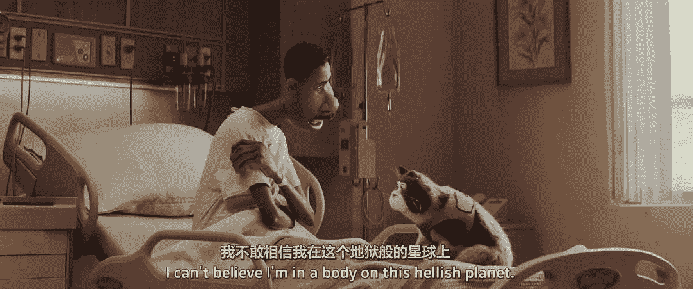

再次回到地球时，22 的灵魂误入了乔伊的身体，而乔伊成为了一只猫。

所以在这个阶段，他多多少少是把 22 号看成是自己的工具的，他指令 22 号做这个、做那个，也不是特别关注 22 号自己的所思和所想，就是为了满足一个目的，让 22 号能够冒充自己在多茜娅小姐面前变成一个非常帅气的爵士手，这样就可以让多茜娅小姐能够最后同意让乔伊本人上场，他就是这样一个目的。

这种观点就是非常接近马基亚维利主义的观点了，只要我自己的目的是正当的，我就可以自由地选择达到同样一个目的的不同手段。

当然了，在这个故事的剧情的发展的过程中，他的这种作为实际上是伤害了 22 号，使得 22 号的心理产生了重大的变化。他自己也产生了反省，因此就有很多补救的行为。这就说明在乔伊的灵魂当中，柏拉图式的和亚里士多德式的这种德性主义的要素还是占据了主要的成分。

特别有意思是，最后这个故事是蛮让人觉得皆大欢喜的，22 号也得到了自己的身体，而乔伊也回到了自己的身体当中，演出获得了巨大的成功，而且多茜娅小姐也愿意和他继续合作下去。

#### 小鱼对大海的追问：满足本身就意味着空虚

但是乔伊突然就觉得没有自己所期望中的那种狂喜了，他觉得自己应该很开心。这时候多茜娅小姐就和他说了一句过来人一般来说会对后浪所说的有点鸡汤味的话：

小鱼儿对老鱼儿说："我要去大海，我就要去大海。"

结果小鱼儿跟着老鱼儿真的进了大海了。小鱼儿说："这是哪儿呢？我要去的是大海，但为什么我看到的只是水呢？"

但是老鱼儿会反过来对小鱼儿说："瞧，这就是大海，大海也不就是这些水吗？也就是水多一点而已。"

这是一个非常有意思的说法，这说法里面有一些佛系的成分。比如在叔本华的人生哲学里面，叔本华就特别强调人生本质上是个悲剧，为什么呢？因为你有不同的成名立腕目标，有些人想成为爵士乐的老大，有些人想连任总统，当然有些人没连任成。

那么在这样的一个情况下，是不是那些达到自己目标的人就成为真正的大赢家呢？不，你真正达到这个目标了，这个目标本身就显得不那么重要了，这个目标很有可能就会成为一种新的空虚的开始，因为满足本身就意味着空虚。

所以人生的无意义性就在于任何一个目标达成了，你就会觉得这件事是没有什么太大的意思的。这是一种有点佛系的想法，可以和乔伊本来所具有的这种理想主义的人生观构成了某种对冲，所以乔伊最后是回到了这样一个中间状态。

在我自己讲的《哲学家的 10 种生活提案》里面，在这种高度的佛系的想法和那种积极有为的人生观之间，能够达成对冲的那种哲学思想就被称之为斯多葛主义，斯多葛主义也一度成为了罗马的官方哲学，甚至出现了像奥勒留这样的有皇帝身份加持的皇帝哲学家的加盟。

那么斯多葛主义的一个基本的想法是什么呢？就是整个世界当中的很多事情都是命定好的，你要成为一个优秀的爵士乐手，或者你能选上美国的一个国会的参议员，这些事情都是命定好的。所以你只是在执行一个伟大的宇宙计划的组成部分，你一旦得不到你所得到的东西，多多少少也是命定好的。

所以相信斯多葛主义的人应该做到不以物喜，不以己悲，胜不骄败不馁。这种态度既不像佛系那样，是完全消除了前进的意义，因为既然有一个伟大的目标在指引着你，那么你还是要前进的，但同时他也强调了在面对失败的时候要坦然接受，因为这件事情也是你命里注定要接受的，那么这种观点十有八九就达到了这部电影的最后的一个思想的境界了。

#### 顽固不化的 22，有着皮浪主义式的冷漠

我们再来讲讲电影的另外一条线，另外一条线是 22 号，也就是说是为乔伊索要教导和开蒙的灵魂。我已经说过了 22 号灵魂的非常的麻烦，油盐不进，很多了不起的灵魂都没有办法打开它的那一个心理设防的状态。那么这样的一个灵魂，它的精神状态是什么？

应该说它是极端聪明的，但它那种聪明是那种不愿意对世界的本相做出认真地探究的聪明，而不是那一种牛顿式的聪明，我一定要搞清楚这个世界是怎么运作的，我要成为物理学家。不是的，它聪明不是这样的，它是反过来觉得，牛顿再聪明有什么用呢？你知道的也仅仅是表象。我在天上的混了几千年了，这么多优秀的、聪明的脑袋我都和他们交流过了，那么在这样的情况下，我为什么还要回到地球上，把你们已经过了几千年的生活再过一遍呢？It  
does not make any sense，这件事情没有意义，我就不做了，这就是它的一种想法。

那种冰雪聪明，好像看透了世间的浮华，不愿意投入热情来面对世界的态度，在我们讲的《哲学家的 10 种生活提案》里面，是一种典型的皮浪主义的态度，我们或者把它称之为皮浪式的怀疑主义。

教导 22，让所有名人导师感到头疼

皮浪式的怀疑主义的核心思想是什么呢？就对于任何一件事情，它的是和非我们都能够讲出滔滔不绝的道理，但正因为它的是和非都有同样的道理去支持，真相本身是不可知的，所以我们要把我们追求事物真相的热情给悬隔起来，我们要对世界保持一种冷漠的态度。

正因为它要对世界保持冷漠的态度，所以它就不愿意和任何一个城市间的肉体相互结合。非常有意思的是，因为某种阴差阳错的这种原因，作为皮浪主义者的 22 号进入了乔伊原来的身体，然后它对世界的观点就发生了改变了。他突然发现如果来到地球上拥有一个人的身体以后，他能够做一件在天上不能做的事情，也就是说通过肉身来感知这个世界。

#### 变成吃货的 22，转向了伊壁鸠鲁的享乐主义

我们在这里有个背景知识，灵魂在天上是没有感知的，互相打耳光都不行。没办法知道鲍鱼、蹄髈、三文鱼、寿司、秋刀鱼之间的区别的等等。因为他们没有这种味觉系统、没有这种肠道等等。

但是得到了人的肉体以后，作为皮浪主义者的 22 号，在纽约的街头吃了一块披萨，然后它被披萨感动到了。这很有意思，有时候治愈自己的心灵非常的容易。

第一次尝到食物的 22，被披萨的美味征服

而且因为它的肉身也是乔伊的，乔伊的头发被弄乱了，所以它跑到理发店去理发的时候又吃了个棒棒糖，它结果被棒棒糖感动了，后面它被甜甜圈感动了。

这很有意思，原来我们觉得要派最优秀的灵魂，特蕾莎修女、欧几里德去启发它，后来发现启发它灵魂的竟然是食物，这家伙天然是个吃货，整个方向全部搞错了。

那么从皮浪主义变成一个吃货的过程，从哲学的角度上看是什么呢？是从皮浪式的怀疑主义变成了另外一种带有虚无主义色彩的一种哲学理论，这就是伊壁鸠鲁主义。

那么伊壁鸠鲁主义我们有时候把它归类为一种古代的享乐主义，也就是说伊壁鸠鲁的想法非常简单，天下世界的万物都是由原子所构成的，你如果能够吃到一个披萨，你会觉得非常的好吃，那是因为构成披萨的原子和你的整个人体当中的相应的原子产生了相互的作用，然后构成了你灵魂当中的相关部分的激应或者回荡。

请注意，他认为灵魂也是由原子构成的。从这种意义上说，伊壁鸠鲁主义者是个比较彻底的唯物主义者，他并不认为灵魂是种纯粹灵性的东西。

其实如果我们从伊壁鸠鲁主义的观点去改写整个《心灵奇旅》的故事，很多地方倒说得通了，因为我们可以把 22 号的灵魂状态也说成是一种物质状态，只不过这种物质状态是由灵魂原子构成的物质状态，这似乎也就可以解释为什么不同的灵魂之间也可以进行这种声音和语言的交流了。

那么抛开这一点不谈，就伊壁鸠鲁主义所体现出来的这种种享乐主义，最后可以归结为一句话----人生的精彩就在我每一次吃披萨所受到的感动当中。

#### 柏拉图的洞喻：不经适应跑出洞穴，灵魂会崩溃

这故事讲到这里是蛮好的，但是出现了一个很麻烦的问题。因为我们都知道 22 号是借了别人的身体才能够感受到这一切的，但是乔伊要把身体再拿回去，结果他是拿回去了，但是 22 号没身体了。

22 号它对于世界的所有的这种乐趣和感受都是在于这一些非常小的细节。它竟然会因为看到秋天的纽约几片掉下来的金色树叶而感动，而乔伊本尊他满脑子都想的是怎么把爵士乐推到一个更高的高峰，好像自己就是爵士界的贝多芬一样，它觉得自己太渺小了。

正是因为有乔伊的这种理想主义的刺激，明明已经被治愈的 22 号的灵魂又崩溃了。它本来是个皮浪主义，好像没法治，后来变成了伊壁鸠鲁主义者，但是碰到了一个光芒四射的理想主义。

我们在讲柏拉图的洞喻的时候已经知道了，你不能让一个洞穴里面的人跑到外面去，没有经过任何的中介的环节，就让他去看天上的太阳，这样他的眼睛会瞎的，他的灵魂会崩溃的，现在这样的事情就发生在了倒霉的 22 号身上。

那么怎么样重新来拯救 22 号呢？乔伊就发现自己好像把 22 号害了，他也开始反思这个问题。于是他在创作一个新的钢琴曲的时候，就把 22 号它的肉体所接触过的那些普通的事物放在面前，比如像棒棒糖、甜甜圈，诸如此类的东西，他突然发现在细节里面是有美的。

22 对生活细节的感悟，成为了乔伊的创作灵感

然后通过这样的一个方式，他和 22 号又达成了和解，22 号也找到了自己生命的肉体，开始了它自己的人生之旅。

#### 柏拉图主义的美好想象，掩饰了现实的分裂

故事的结尾又以某种方式向柏拉图主义致敬了，虽然这个故事当中有很多非柏拉图主义的桥段进去了，什么皮浪主义、伊壁鸠鲁主义、斯多葛主义，结尾为什么突然又向柏拉图主义致敬了呢？

因为柏拉图主义就有一个非常重要的观点，就是我们整个社会的构成是需要不同的人相互协作的。你要成为伟大的音乐家，这很好。如果你觉得你先天晚上写出的曲子没有达到你心中的伟大的目标，你就很痛苦，你要为这件事情而奋斗，这没问题。

但每个人都有自己的命，或者都有自己的这样一个工作的区域。比如像多茜娅，多茜娅就是赏识乔伊的那一个爵士乐的大佬，她有她的社会的生态位，乔伊有他的天命。乔伊的妈妈就是个裁缝，就是丽芭，她也有他自己的天命。

但是像 22 号这样的人，像凡夫俗子，也许它的幸福就在于每天吃几块披萨、吃个狗不理包子之类。好，这就是他们的天命。

所以一个社会里面的国家的统治者或者是哲学家，或者是爵士手，或者是武士、士兵、工商业工作者，都按照他们的德性所规定的这样一个工作区间去工作，让他们各自的德性能够得以发挥，天下就大治了，千万不要出现那种错位的场面。

所以最后片子它所想鼓吹的，实际上是每个人都按照自己的原先设计好的一个人生的路线来进行运作，使得整个社会能够变得非常的协调。

所以我个人认为这部电影是以一种比较感性的方式，把我们在《哲学家的 10 种生活提案》里面所说到的这些人生哲学的方案都做了一些提示，所以这部电影还是值得一看的。

当然了，因为我自己是搞哲学的，搞哲学的人一个最大的特点就是他在说完别人思想以后，总是忍不住要批判两句。那么这部电影本身它的一个问题是什么呢？

它所描述的这种过于美好的画面，实际上是掩饰了美国社会正在发生的一些巨大的分裂，包括现在美国总统的选举，以及总统的这样一个选举结果的议会的认证过程中，出现了很多不和谐的现象，而这个不和谐的现象背后的社会现象，是半个美国和半个美国之间的意识形态的战争、文化的战争和经济的战争。

这些问题是不能够通过简单的心灵鸡汤来解决的，而是需要大家使用像手术刀那样锐利的思维能力来对社会现实来进行反思。

如果要进行这样的一个反思的话，哲学思辨力就非常的重要了。所以我也希望大家在听我的《哲学家的 10 种生活提案》的同时，有空再来复习一下我在看理想平台上面的另外一档子节目，也就是《用得上的哲学》。

好了，今天这一集番外就到此为止了。谢谢大家，我们下次再见。

公众号懒人找资源，懒人专属群分享

## 32\. 塞涅卡的制怒百宝箱：如何克制愤怒？

各位听友，大家好。我是徐英瑾，很高兴和大家继续来讨论《哲学家的十种生活提案》这个话题。

今天我们讨论的话题就是看看斯多葛主义者塞涅卡的制怒百宝箱，就是制止愤怒的一些诀窍。

为什么今天我们要讨论愤怒呢？就不得不指出今天的世界倒似乎是充满着各种愤怒，而且每个人都有自己愤怒的理由。

最近美国大选闹得是沸沸扬扬，导致了美国的大分裂，也就是说是半个美国对另外半个美国的愤怒。到底什么是愤怒呢？如何克制愤怒呢？我们就需要斯多葛主义来给我们做一番解答了。

#### 斯多葛宇宙图景中的理性存在者

但是要讲愤怒这个话题，我们还要对前面的内容进行一下复习。

在前面我们已经对斯多葛主义的宇宙论模型和心灵模型做了一番大致的介绍，并大致讨论了斯多葛主义者是如何从上面的理论模型中推出那种宁静致远的生活哲学态度的。

我们这里就来复习一下，斯多葛主义认为整个世界就是一个神，但这并不是基督教意义上的那个上帝，他们所说的神是一团类似于像火一样的东西，这团火它消灭，燃烧，反复循环。

斯多葛主义进入了罗马时代以后，这样的一团火就被赋予了朱庇特这个名字。我们都知道，朱庇特就是希腊宙斯神的罗马的叫法，但是大家别被这个名字给忽悠了，就经过哲学改造的朱庇特，已经不是罗马多神教里面的那个朱庇特了。

那个朱庇特就类似于玉皇大帝，仅仅是法力比别的神仙更大的神仙，当然他是 Number one 的神仙，但他毕竟是和其他的神仙共同存在的。

而在斯多葛主义里面，他们所说的那个朱庇特就是宇宙自身，是不是别的神就不存在呢？也不是这意思。但是别的神的存在方式变了，他不再是与朱庇特比肩并列了，而是宇宙本身在运动的时候所呈现出来的不同的面相。在这样的一个宇宙图景里面，理性的存在者就被分为了三个等级。

第一个等级就是刚才所说的朱庇特了，也就是宇宙自身它有完整的理性。理性在这里指什么呢？就是对于必然性的认识。既然朱庇特就是宇宙自身，他显然也就能够全部地、完整地认识到其自身的必然性。

第二个等级就是比朱庇特法力律差一点的神，请注意，这些神就是宇宙运动的不同的面相。

在罗马的神谱里面，那些神大家可能也会多少听说过一些，比如朱诺就是希腊神话里面的赫拉的罗马对应物，类似于我们中国的王母娘娘。

玛尔斯是战神，他对应的是希腊神话中的阿瑞斯。维纳斯是美神，对应的希腊神话里面的阿芙洛狄忒之类等等，就这堆东西。

但是这些神它并不是独立存在的，如果按照斯多葛主义的改写的罗马神谱，它们就是世界的不同面向。

你能够通过这些神，能够看到世界不同面相的必然性。但是整群的必然性，是要通过朱庇特才来把握的。

#### 人类既受支配又有自由，既理性又免不了愤怒

第三个等级的理性存在者就是咱们人类了。人类有意思，咱们人类是有两面性的，这种两面性到底是什么意思呢？这有两种表达。

第一种表达，人是世界秩序的一部分，他是受到宇宙法则的支配的。既然人的行为是受到宇宙法则的支配的，所以人要做什么，朱庇特是知道的。

但另外一方面，人又是有自由意志的。自由意志就是指人可以自己决定自己做啥，你的很多行为似乎并不是事先你自己可以预计到的。这两个表达之间似乎是有矛盾的，人怎么可以同时是被决定的，同时又是自由的呢？

关于如何解决必然性与自由之间的矛盾，我们在这个节目的三十回里面已经有了大致的描述了。解决这个问题的思路就是我们要重新定义自由，我们要把自由定义为不受外力的阻碍，而并非是说自由乃是不受宇宙必然性的控制。

换言之，一个自由的人仍然是受到宇宙必然性的控制的。这就是类似于一个车轮，它可以在不受阻碍的时候前进，但它依然是受到惯性的控制的。

对于人的两面性，还有第二种表达。一方面，人是理性的；但另外一方面，人又是不理性的，因为人类动物性的一面会阻止理性的充分发挥。

譬如我们被伤害以后所产生的愤怒，会蒙蔽我们的理性，让我们通过报复再去伤害别人，所以我们要提高自己的理性认识的水平。

这里需要注意是，如果我们是在柏拉图主义的思想光谱中，讨论怎么提高自己的理性认识水平，这主要是指如何提高自己的逻辑思维水平和数学思维的水平，并在此基础上提高自己的哲学对话技术。

但是斯多葛主义说的提高认识主要不是这个意思，它的意思就是说，你要深刻地意识到你是宇宙秩序的一部分，同时你要认识到别人也是宇宙秩序的一部分，你如果被别人欺负了，我告诉你，那是你被宇宙秩序的另外一部分给欺负了。

需要注意的是，你自己也是宇宙秩序的一部分，就类似于你的左手打的右手。换言之，你是被你自己的某种衍生形式给欺负了，你是被自己的某种孪生兄弟欺负了。在这种情况下，你因为这件事情怄气，就等于你自己对自己的呕气，所以不值当。

当然这个想法听上去非常的阿 Q，被人打了以后就说我好开心，我被孙子打了，就类似于这种想法。

一个人喜欢抬杠的话也可以反击这种观点，说但是我被人家打了，管他是不是被我孙子打的，我就是愤怒，我就是不开心，我的愤怒和我的不开心也是世界秩序的一部分，我要接受我的愤怒，正如我要接受世界的其余部分一样。

斯多葛主义者听到了讲法以后就会回击你，世界本身的秩序，它是和宁静致远这样的一个精神状态相互呼应的，它是和永恒性联系在一起的。

而愤怒的是破坏宁静致远这种心态的，因此它也是在破坏宇宙的和谐性和永恒性的。所以经常愤怒的人，他是没有办法把握到宇宙的真正的节奏的。

#### 产生愤怒的条件：负面情绪与报复欲望

有意思的是斯多葛主义者还写了一部专门的著作来讨论这个问题，这就是由塞涅卡所完成的一个短篇作品，叫《论愤怒》。

塞涅卡的名字比较长，是卢修斯*阿奈乌斯*塞涅卡，公元前 4 年生，公元后 65 年死。他除了是一个非常重要的斯多葛学派的哲学家以外，还有很多别的身份。他是个很了不起的剧作家，写了很多戏剧，他也是一个重要的政治家，曾任尼禄皇帝的导师及其顾问。

尼禄我们都知道是古罗马历史上的一个大暴君，塞涅卡他在辅佐尼禄的过程中被暴君所忌恨，所以在公元 65 年的时候，被尼禄逼迫，以切开自己血管的方式悲壮地自杀了。

好，赛涅卡的生平我就不多说了，主要就谈谈他的《论愤怒》这本书里面的一个基本的讨论的线索。我们也在要讨论《论愤怒》这样一个话题之前，首先我们知道什么叫愤怒，你不对愤怒进行定义，你就没办法把它讨论清楚。

为了解释什么是愤怒，我们来看这样一个例子。比如你在马路上兜马路，突然看到非常严重的犯罪行为，有人在路上乱砍人，血肉横飞，你会不会感到恐惧？你会不会感到义愤填膺？

当然会了，但这算不算愤怒？有意思的是赛涅卡认为这不是愤怒，这是理解赛涅卡的愤怒理论的一个很重要的环节。

他的一个观点就是你自然而然地立即产生的这种情绪反应都不算愤怒，他认为这种东西就像膝跳反应一样，有人用榔头敲你的膝盖，你脚啪就弹起来了，这种东西是你的肉体反应的一部分，我们灵魂没办法控制。

如果这样的情绪反应不是愤怒，那么到底什么是愤怒呢？

塞涅卡的观点是这样的，你如果有了这种很不爽的感觉以后，就产生了一种想法：我得去报复这个作恶的人，混杂着这种报复欲望的情感就叫愤怒。

换言之，愤怒它不仅仅是一种对于某些事物很不爽的自然情绪，而是在这种负面的自然情绪的引导下，所产生的对伤害本身进行报复的欲望。

换言之，所谓的愤怒就有一个非常清楚的对于报复对象的指向，他是在激情指引下的一种报复欲望。

如果大家还没听明白的话，我们在这里再梳理一下。纯粹的激情就是不爽的激情，没有报复的目标，这不是愤怒。

但是另外一种例子就是纯粹的报复，很冷静的报复、没有激情的指派，这种算不算愤怒？按照塞涅卡的标准也不算。一定说是有激情、有抱负的目标，两者一拍即合，这叫愤怒，这也是他主要反对的一件事情。

#### 愤怒是具有的理性成分的错误产物

为什么塞涅卡会有这样一种有意思的观点呢？这就要对塞涅卡的认识论的背景知识进行了解了，这也是很多斯多葛主义者所分享的一种认识论。

咱们的灵魂会对感官所送来的那一些印象进行识别和判断，而愤怒就是在这个过程中所产生的灵魂产物。

举个例子说你的灵魂看到了一些让你不爽的事情，然后就产生了不爽的感觉。这种不爽的感觉是你的感官送来的印象，但这印象如何处理呢？如果你的灵魂将这样的一个印象与具体的报复的目的相互联系，那么愤怒就产生了。

那么塞涅卡为什么要把愤怒定义为一种具有一定的理性成分的心灵产物呢？他为什么不把愤怒定义为一种纯情绪呢？我认为这是有他的哲学考量在里面的。

因为纯粹的感受就像你的膝跳反应一样，是你灵魂控制不住的，所以你不可能去指责膝跳反应。你写一本书指责膝跳反应，但怎么来制止自己的膝跳反应呢？要改造自己的神经系统吗？

因此只有灵魂已经参与其中的东西，灵魂才能发挥作用，特别是纠错的作用。

这里我们就提到了纠错这两个字，这就说明按照塞涅卡的观点，愤怒是理性在错误的运作时所产生的错误的产物，所以需要被纠错。

我们现在已经搞清楚愤怒本身是什么了，但我们要进一步讨论愤怒为什么是错的。因为愤怒无用甚至有害。但为什么愤怒是无用而且是有害的呢？

#### 在理性的框架下惩恶扬善，才能避免更大的损失

第一个观点是这样说的：愤怒有用。为什么？因为愤怒引导报复，报复则能够提供某种天道的平衡，只有惩恶扬善天道才能平衡，惩恶扬善本身也是宇宙秩序的一部分，所以这是水浒式的正义，我们要找个大旗，上面写四个字，替天行道。

斯多葛主义者的回复是什么呢？好吧，替天行道这件事我姑且是可以承认的，我也可以说坏人做了坏事以后是需要得到惩罚的，惩恶扬善也没什么太大的问题。

但问题是为什么要在愤怒的情绪下做这事呢？为什么不能在理性的指导下做这事呢？理性也能够给予你足够的精神动力，为弱者提供各种救济。

比如我如果发现（有人）犯罪了，我愤怒有用吗？我不如立即打 110 叫警察来处理。当然如果我是警察或者检察官，我发现了一些不法的行为，我按照法律的程序走程序就把坏人给办了，你愤怒没用。

比如最近有部电视剧叫《巡回检察组》，这个片子里面有一个组长冯森，于和伟表演的，他为了克制为自己的妻子报仇的那种愤怒，是做了很大的精神努力的。

他自己也说："其实我已经查出了谁害了我的妻子，我按照我私下的手段也能处理掉，但我是个检察官，我得克制愤怒，我得用法律程序来办案。"结果他最后就按照程序走，照样让犯罪分子落网了。

这个片子里面有个反面的典型，就是一个叫米振东的人。他表面上也很正义，也是为所谓的养父、养母报仇。但是他是按照自己所认可的方式，在愤怒的指导下来做事情的，就导致了很多无辜也惨死在他的报复计划之内。

我们在历史上也可以看到这样的例子，愤怒情绪下的报仇是要闯大祸的。三国时候的曹操，他的父亲曹嵩被徐州牧陶谦的部将杀害。这当然是个很不幸的事件，爹没了，他找陶谦去找说法，结果没讨来说法，他就随意泄愤，把徐州地带的无辜百姓大量地屠杀，据说杀了 24 万人，大大流失了他的人心。

即使从马基雅维利式的角度来讨论曹操的作为，这个作为都是不恰当的，因为他的作为对他的事业是有很大伤害的。所以斯多葛主义不是反对惩罚，而是主张在理性的框架下进行惩罚。

有人就会问了，这话说得好轻松，意思好像是法治一直是很严明的，但如果法律本身败坏了怎么办？执法的队伍都腐败了怎么办？你要求理性框架下，人家就给你玩黑的那一套怎么办？

斯多葛主义说在这种情况下，你也得遵守斯多葛主义的教导，不能够愤怒。如果你通过你的理性反思认识到法律坏了，那也不要愤怒，与邪恶的人斗争，你还是需要动脑子。

再说《巡回检察组》这部电视剧，里面的政法委书记张友成的儿子被坏人陷害了，他也知道自己的儿子是无辜的，同时张友成也知道他身边的执法队伍里面有坏人的内鬼，但是他愤怒了吗？他还是克制了自己的愤怒，用脑子来做事情，将计就计，让儿子真的跑到监狱里面服刑，以便从内部搜集情报瓦解敌人。

相反，他的妻子郑双雪就控制不了自己的情绪，对宝贝儿子受冤枉这件事大呼小叫，情绪失控，步步落入邪恶力量的圈套，其实是帮了倒忙。总而言之，愤怒是没用的。

#### 打仗要靠脑子，而不是愤怒

现在我们已经对愤怒有用论的第一个论点提出了批评，愤怒有用论的第二个论点是这样的，愤怒之所以有用，是因为愤怒至少能够在战场上凝聚人心。你看亚里士多德好像也说过类似的话，战事如果对敌人不愤怒，这仗怎么打呢？

塞涅卡就这样回应了，你真打过仗吗？打仗就是靠愤怒吗？他就举个例子，我们都知道罗马的很多外敌里面有一股劲敌就是日耳曼部落，日耳曼部落的战士是非常有血气之勇的，打仗的时候嗷嗷乱叫，非常容易愤怒。

但真的碰到了罗马军团，谁赢呢？恐怕还是罗马军团赢。因为罗马军团他靠的是纪律和战术、优良的兵器，比如像弩炮这样的兵器。但是要维持纪律、队形和这些优秀的兵器的运作，难道首先不是靠动脑子吗？难道首先不是靠理性、冷静以及服从吗？

在现代战争中这个问题可能会变得更加的明显了。你在现代战争中愤怒是没有用的，可能愤怒还会有害，因为现代武器都非常的复杂，很多都需要在电脑的界面上进行操作，一旦出现了什么问题以后，比如电脑宕机了，然后你愤怒了，拿个锤头把电脑砸坏了，这不解决问题。

#### 暴力的惩罚，会使理性受到蒙蔽

关于愤怒有用论的第三个观点是这样的，愤怒能够引导惩罚，以暴力的方式来进行，让坏人畏惧。也就是说如果仅仅是以理性的方式来进行报复，你报复的力度不够，不能让坏人害怕，不能把坏人给怔住。

但是塞尼卡也不是那么认为，他就是反对用暴力的方式来进行惩罚。他认为惩罚是 OK 的，没问题的，但惩罚要以温和和恰当的方式。

比如你要暴力地攻击一个制度，觉得这个制度出现了很大的问题，但是你一天到晚去骂它，这个制度就会变好了吗？

这种暴力的态度就使得你自己的理性就受到了蒙蔽，使得你对于问题的估计变得过于的悲观，让你没办法看到这个制度在某些方面还是有优点的。

如果你能够克制你的愤怒，冷静地想想就会发现这个制度在某些地方还是可取的，某些人还是可以争取的，这样你就可以扩大你的战友和盟友的一面，来更大地孤立敌人，这对你的事业实际上是有帮助的。

我在这里讲这事是有专门的所指的，我在录制这期节目的时候，川普第二个任期看来是黄了，我们来反复的思考一下川普为什么失败。

即使我认为在这次选举中出现了可能的不公行为，但是他把这么多的媒体、科技大佬极其得罪这件事，多多少少他本人也要负责任。

比如他张口闭口就说 fake news，把所有的媒体都说成是 fake  
news，用愤怒来回应某些媒体施加到他身上的不公。这个做法除了发泄情绪以外，并不有助于改变他所面临的政治局势。

最后需要补充的是，愤怒是会影响身心健康的，对你的血压各方面是非常不好的。我自己在发现自己有高血压之后，也特别注意制怒这一点，我发现仅仅是出于要把自己的命活得长一点这个目的，我还是要做到制怒的。

#### 培养孩子的制怒性：消除攀比，实事求是

好了，现在我们已经讲完了两个问题了，第一啥是愤怒，第二为什么愤怒是有害的。第三我们就要说如何制怒了。这就是百宝箱的一个很重要的内容，我觉得有很多的想法，非常的具有可操作性。

首先克制愤怒要从孩子做起。为什么呢？人的脾气是小时候就形成的，你小时候就像个火药桶一样的，没事一惊一乍的，你长大估计也难改。如果自己改不了至少要培养孩子，所以我们要培养孩子的这样的一种制怒性。

那么家长该怎么做到这一点呢？我们要知道愤怒往往缘起于心灵的不平衡状态，为了消灭心灵的不平衡状态，我们就要在幼小的心灵的环境中，消除种种导致不平衡的心理状态的外部现象。

比如我们不能让孩子有攀比心理，比如你吃的好，我吃的差，你穿的好，我穿的差，这就为愤怒埋下种子。为什么小王穿的比我好？为什么小三穿的也比我好？等等，他就会有这样的问题。

这也是很多学校它要推行校服制度的一个重要的道理，你通过校服的推行，通过校园餐的推行，可以让不同家庭的出生的孩子，至少在吃喝穿的方向上是整齐划一的。

有的时候这能消灭个性，但是斯多葛主义说，我们就是要消灭你是富人或者穷人这种想法，否则互相攀比，长大以后就很容易产生心理失衡。

但这里有一个问题，就是某某孩子就特别的富，而且他也知道这一点，难道家长为了培养他的平等意识，就要把他的财富全部藏起来，然后对孩子说其实我们没有钱吗？

这不是塞涅卡主张的，塞涅卡主张，你要把财富放在孩子的眼前，但是不能让孩子具有对于财富的处置权。

这句话的背后的意思是什么呢？就是说有钱这件事，既然是个客观事实，也是宇宙秩序的一部分，你不能藏着掖着，否则你就是骗人，骗人对教育孩子也是不利的。但是处置权不能给他，因为孩子还不成熟。

你就是要让孩子培养出这样一种坚韧的性格，我看着金山银山，我心岿然不动，我就吃着最便宜的汉堡。

还有一个问题，还是特别需要注意的，在孩子有一些比较好的表现的时候，怎么称赞他？如果孩子犯了一些错误的时候，怎么批评他？这个问题是斯多葛主义特别强调的。

中式教育的一个特点是什么？就老说孩子你不行，孩子明明做得很好了，家长还要找点毛病。其实你这次数学 98 分，为什么扣两分呢？你为什么这两分不能够再认真一点呢？弄得孩子一天到晚压力山大。

美式教育是什么？是倒过来的，每个人都是最棒的，没有什么愚蠢的问题。你这次考了 58 分，差两分就及格了，好不容易，再加油。

塞涅卡的主张是我们要在这两个极端之间找个中道，要实事求是，进步了就肯定，不行了也不要也不要讳言这一点，总之不要吹捧孩子。

为什么呢？让孩子正确地认识到自己的优缺点，也是认识宇宙秩序这个大课程的一部分，你得学会接受自己的缺点，这样就不会愤怒的。

当然我顺便说一句，塞涅卡应该是非常反对整容的。如果孩子觉得自己哪个地方长得不好，吵吵要弄笔钱让爸爸妈妈让他整容，他肯定是反对的。因为整容这件事情是破坏自然秩序的。

#### 耐心从容，不偏听偏信

关于克制愤怒的训练的第一条已经说好了，从孩子做起。训练的第二条，如果听到了什么坏消息，不要轻易地相信。

请注意这种讲法是反对墨菲定律的。墨菲定律现在大家肯定是听说过，它的意思就是说如果事情有变坏的可能，不管这种可能性有多小，这种可能性总是会发生的。

塞涅卡的想法就没有那么悲观，不是说老往坏的地方想。他的意思是说别没事就杯弓蛇影，你不妨让子弹飞一会儿，有些事情大事化小反而好，真相的揭露需要时间。你如果听到任何坏消息就被坏消息弄得六神无主，这就说明你对于真相没耐心，你就不够成熟。

它这个例子也就是凯撒和庞培为了争夺天下就打仗了。有一段时间凯撒的部下有点担心自己会输，就写了很多私通庞培的信，但是最后庞培输了，凯撒赢了，庞培的营地里这些信都被缴获了。

这样一来，凯撒手下就吓死了。如果凯撒搞反攻倒算怎么办？凯撒一点都不着急，把这些信一烧了之，就把这件事给翻篇，翻过去了。

如果他不按照斯多葛主义的教导，从一种非常小鸡肚肠的角度来思考，心想我身边有那么多人在我最危险的时候要反对我，我一定要把你们抓出来。否则如果做不到这种防微杜渐，我的江山就要被你们夺掉了。如果他用这种想法来开启他的政治清洗的话，这才是真正他事业没落的开始。

无独有偶，官渡之战以后曹操打败了袁绍，也把袁绍军营里面缴获的很多首相的部将与袁绍私通的信件一烧了之，这反而为曹操赢得了人心。

我刚才讲的关于曹操的正面的故事是为了对冲我前面批评曹操的故事，这样我对曹操的观点也显得比较的公允了，这样我也克制住了对于曹操的愤怒。

#### 心智坚强，避免因小失大

好了，现在我们来讲讲克制愤怒训练的第三点，第三点就是别总被小事左右心情。如果你老是被小事左右心情的话，就说明你是个软弱的人。

比如你在地铁上被人踩了一脚，你就骂了，你长眼睛吗？然后被网上不认识的人怼了一句，你就骂他你弱智。如果你克制不了情绪，你骂一句他骂一句，这事情就搞大了。

其实这种不必要的纠纷在日常生活中每天都发生，这就说明什么？你是一个心智软弱不做大事的人。

如果你是个心智坚强要做大事的人，你就得思考，现在我的脚被别人踩一下这事，对我现在要计划中做的大事有本质影响吗？

比如你要参加一次很重要的面试，你被人踩了一脚了，他脚趾头又没有给你踩掉，鞋子也没破坏，这事就忍住了，最多就瞪他一眼就可以了。

你回怼别人，然后导致无休止的争吵，破坏你的情绪，导致你下面的面试没办法好好进行，那就失去了一个很好的工作机会，这不值当。

所以如果这件事儿对于我的主要的目标影响不大，不理睬这件事就罢了。

#### 所谓不公，是否只是与期望不符？

克制愤怒训练的第四点，就是在面临一些所谓的不公平的现象的时候，你得思考一下这个问题，这到底是真是不公平，还仅仅是因为这件事情与你的期望不一致呢？

为什么要这么想？因为我们人类都有自爱的倾向，遇到挫折的时候，我们往往会把这个责任推到外界，或者说规则不公平。我被规则玩了，好黑呀，这里有黑手。

但是我们能不能想一想我们历史上所获得的那些成功、得到的那些荣誉，对我们的竞争对手真正的是公平的吗？恐怕也未必吧，恐怕就是上次我运气比较好吧。

但既然上次我赢了，仅仅是因为运气比较好，为什么今天这一次比赛的运气不会落到别人的头上呢？你这样想想心里也就平衡了。

#### 换位思考，想想自己的不足

那么克制愤怒训练第五点，就是想想你自己的缺点。

别人犯错你当然很生气，一件小事没办好，或者把某件事的给办砸了，结果公司的主管就会对下属大发雷霆。

但是公司的主管也得想想这个问题，你也是从公司的基层一步一步做上来的，人家大学刚刚毕业，对公司的业务不熟，你当时大学刚刚毕业的时候，难道不也犯过同样的错误吗？这样一来你恨别人难道不就是在恨当年的自己吗？这样一想你的心态就平和了。

#### 上一次的愤怒，带来了什么？

那么克制愤怒训练的第六点，就是想想上次愤怒带给你什么。

上次你因为一个下属没办好一件事情，对他大发雷霆，你因此得到了什么呢？你好像什么也没得到吧。

你对着他大发雷霆，然后你乱摔东西，你摔坏的马克杯其实是淘宝上已经断货的，一种版本很稀有的马克杯，你事后还很后悔，一直没买到。

你把似乎不称职的员工给开除了，结果你找了一个新的大学毕业生，后来你后悔了，你发现后来那个人还不如前面被开掉那个人，所以那次愤怒没有给你带来任何好的东西。

你如果想到这一点，你就得反问自己，为什么这一次我要重复上一次的错误呢？

以上就是塞涅卡的制怒百宝箱。大家可以在百宝箱里面找到一些适合自己的制怒方法。

听上去是不是很鸡汤呢？但我要再强调一遍，塞涅卡是反对做老好人的，他也主张惩罚，但是他特别强调惩罚要在恰当理性的支配下进行。

而且他也特别地强调，如果你认为你的惩罚这个举措是正当的是合理的，你的理性反复检查没有发现这种惩罚手段有任何问题，那么想明白了就立即要去做，不要犹豫不决，这就是他的一种为人处事之道。

这个为人处世之道，很大程度上是教帝王的，今天没帝王了，那就是教领导干部的，或是教公司的各个领导层的。做领导的一定要克制自己的情绪，不能够把你的喜怒哀乐写在脸上，而要在心里默默地盘算事情该怎么做，一旦想明白了就立即执行，这才是坚强的表现。

我在这里再怼一下川普，川普的问题就是他在推特上说话太多了，他太多地表露了自己的情感，以至于他的对手民主党非常容易根据他在推特上说的话，给他设立圈套。

当然封掉他的推特这件事情，在破坏自由言论方面是开了一个很坏的恶例，在伦理上是可以指责的。但是从纯粹的马基雅维利主义的角度来考量的话，川普自己的行为举止，也使得他的对手能够抓到他的那么多小辫子。如果川普早点读读塞涅卡的书，他也不会走到这一步。

不过我也不得不指出的是，川普的敌人也绝不是塞涅卡的信徒，因为他们对于川普的报复也是在愤怒的情绪下进行的。

现在我们对于斯多葛主义的介绍已经接近尾声了，我知道很多小伙伴都挺喜欢斯多葛主义的，不过我必须要指出这种学说也并非没有问题，我会在下一次的节目里面借着讨论奥勒留哲学的机会，来揭示斯多葛主义哲学的一些问题。

好了，今天的节目就到这里为止了，我们下回见。

公众号懒人找资源，懒人专属群分享

## 33\. 皇帝哲学家奥勒留：城邦唯一，神即宇宙，法随自然

各位听友大家好，我是徐英瑾。很高兴和大家继续来讨论《哲学家的十种生活提案》这个话题。

#### 斯多葛主义的理论短板

在上一次的节目里面，我们讨论了塞涅卡的制怒百宝箱。我们知道塞涅卡本人是帝王师，他当然是希望自己的君主能够控制自己的坏脾气，这样天下就礼乐人和了。

这是斯多葛主义与中国的儒家非常接近的地方。我们可以看到中国儒家的政治哲学不是那么发达，它很喜欢把所有的政治问题最后都变成道德问题。哪个朝代崩溃了，那肯定是君主的德性有亏。

这个想法就和斯多葛主义就非常像了，斯多葛主义说一个君主只要控制好他的脾气，别的事情就不是那么重要了。

而且与斯多葛主义的思想相互平行，儒家也有一个阴阳五行的理论，这就非常类似于斯多葛主义对于宇宙秩序的强调。

换言之，在个体的德性与宇宙运行的大道之间，儒家和斯多葛主义都缺乏对于其中的中间环节的描述，但塞涅卡自己的悲剧就说明了这一套似乎行不通，他似乎应当能够克制住自己的脾气，但是克制不了他的学生，也就是暴君尼禄的脾气。结果塞涅卡自己还是被逼死了，切开自己的血管，放光了血液，悲惨地死去。

塞涅卡当然也提到，对于各种各样的罪恶，我们是可以采取报复的行动的，只是一定要在理性的控制下进行这方面的报复。但是他没有非常系统的阐述这里面的方法论，要把这里面的道道说清楚，要等到后世的马基亚维利主义。

#### 有着皇帝身份的哲学家

但有意思的是，即使有一些斯多葛主义者在现实世界中比塞涅卡玩得更转，他们也没有补足斯多葛主义的相关理论短板。我这里要说的这位哲学家就是皇帝哲学家奥勒留，这也是整个西方哲学史上，甚至可以说是整个世界哲学史上唯一是皇帝的哲学家。

马克*奥勒留全名叫马克*奥勒留*安东尼*奥古斯都。在我们国家的《后汉书》里面，我们提到他就把他说成是大秦王安敦，没有用奥勒留。但现在考证下来指的是同样一个人，他是罗马帝国五贤帝的最后一位皇帝，在公元 161 年至公元 180 年在位的。

他是古都罗马最著名伟大的皇帝之一，也是斯多葛学派的重要哲学家。他留下来的最重要的哲学著作是《沉思录》，不过有点意思，这个作品它并不是用罗马通行的第一语言拉丁语写的，是用希腊文写的。

这就说明什么？当时的这种高级知识分子在罗马都是希腊文和拉丁文两种语言都共通的。奥勒留小时候就被罗马皇帝哈德良注意到了，哈德良是个非常有名的皇帝，我们今天在英国看到的所谓的哈德良长城就是他造的，所以从小就把他当成是整个罗马帝国的未来接班者来加以培养的。

而且在他做了皇帝以后，也曾经与他的弟弟路奇乌斯一同继承帝位，出现了两帝共治的这种状态。大家会觉得在这种状态下，这两个人还不斗死？

我们都听说过，以前中国两宫皇太后，西太后和东太后斗的是鸡飞狗跳的。但实际上这两个皇帝之间是互谦互让，并没有产生大的宫斗，这是因为斯多葛主义者德性都比较高，不屑于干这种蝇营狗苟的小事。

#### 汉朝与罗马的首次正式外交

有一件事情是马克*奥勒留做的，而且很能体现他这样的德性对于他的手下的影响，同时这件事和中国历史还有点关系。也就是在公元 166 年的时候，马克*奥勒留派遣他的使者跑到了中国的东汉王朝，使得中国的汉朝和罗马第一次建立了正式的外交关系。

那么这件事和斯多葛主义有什么关系？恰恰是因为斯多葛主义它主张简朴，所以它的这些使团所带来的东西都非常的寒酸。这个寒酸当然是按照中国的标准了，实际上他们也带来一些好东西，比如说象牙、犀角、玳瑁……但这些东西没有引起洛阳朝廷的重视，因为天子和朝臣都认为这些东西在中国的岭南地区都能够搞到，比如像日南郡。

所以他们十有八九可能是假的一些外国人，然后冒充成罗马使团跑到洛阳去想混吃混喝。但实际上使团恰恰是秉承了罗马皇帝要简朴的想法，没有带来汉朝人所期待的贵重礼物。

汉朝人特别期待的贵重礼物是什么？除了我们想到的金银之类的话，就是火浣布了。火浣布是什么东西呢？是一种能够放到火里面烧却烧不坏的布，它非常像今天我们消防员所穿的那种石棉防火衣的某一种古代的原型。

在汉代人眼睛里，这就是一种非常高级的布，就像他们看咱们的丝绸一样都是价值连城的，在我的小说《大吴帝国前传》里面也以这种布为道具设计了很多情节。但是非常有趣的是罗马人没有带来这种期望中的布，所以你让我们怎么相信你是罗马人？

在这里面体现了当时的汉朝和罗马帝国之间的文化差异了。我们当时大约是听说过罗马这个帝国的，我们把罗马人说成是大秦人，这意思也许就是说是和以前的大秦帝国一样强盛的帝国，只不过地理上过于遥远。

所以我们想你如果有钱有权，你就肯定很富，而且你必然要炫富。所以你来使团如果不炫富的话，你必然是假的。

但恰恰斯多葛主义者认为权力本身是不能够随便炫耀，你有权力没事炫耀，就是破坏了宁静致远的心灵状态了。这就体现了当时中国的主流的官方文化和当时的罗马的官方文化已经有很大的差别了。

不过这并不意味着中国文化的各个支流都与斯多葛主义是彼此冲突的。实际上在中国的道教思想里面是有很多思想要素是接近于斯多葛主义的，我以后会找时间和大家聊一聊中国的道教化思想在汉代的一个变种  
\----哲学家王充的哲学，我认为王充的哲学乃是斯多葛主义在遥远的东方的远亲，不过这是放到以后的节目里面再说了。

#### 宇宙论模型之辩：原子论还是整体论 ？

下面我们就来讲讲奥勒留哲学的一些思想要点。奥勒留哲学同时也可以说是斯多葛主义的某种总结，我也可以通过今天这一回节目，对于前面几回我讲述斯多葛主义的各种内容进行一番总结。

我们都知道斯多葛主义是在于各种虚无主义思想的战斗中成长起来的，但有意思的是它虽然与其他的虚无主义思想有所不同，但是与柏拉图与亚里士多德的哲学相比，它自己也是一种虚无主义，只不过它的虚无主义色彩要比其他虚无主义要来的大，奥勒留哲学也体现了这样一种居间的特征。

好，我们先来讲讲奥勒留的哲学与第一种他的论敌之间的战斗，就是与伊壁鸠鲁主义之间的战斗，这主要是在宇宙论模型上的战斗。

这里的核心哲学问题是什么呢？就宇宙的模型到底是基于原子论的，还是基于整体论？原子论是什么意思呢？整个世界无非就是一群原子在虚空中的碰撞，世界的根本原则乃是偶然性。

今天你偶然碰到我了，明天你偶然地碰不到我了，就这么一回事，整个世界的展开根本就没有任何宏观的设计。斯多葛学派的整体论说的是这个意思，整个宇宙就是神，神就是宇宙。这个神当时在罗马人那里是朱庇特神了，而且既然神的存在是有目的的，那么宇宙的存在就是有目的的，所以整个宇宙的图景背后都是神的设计。

好了，有人说了这个争辩听上去非常形而上学，它与人生哲学的关联是什么呢？有两个关系：

#### 感恩的来源，决定了人与物的关系

第一，从这两种不同的宇宙论模型出发，你就会对于感恩这件事产生不同的看法。

如果你是个彻底的伊壁鸠鲁主义者，你就很难对自然界给予的东西进行感恩。你对你要喝的水、吃的饭、看到的风景，只会进行冷酷的科学描述，给予这些现象以某种动力因意义上的解释，转一堆科学名词，比如板块运作，比如说光合作用等等。

既然你最后体验到的都是一些原子运动的结果，你会感恩吗？你不会感恩，你并不觉得这是大自然的馈赠，因为你觉得大自然本身是没有目的，没有情感的，它怎么会馈赠给我任何东西。

但斯多葛主义就不一样了，你看到的每一粒饭都是神的体现。我在看日剧的时候就学到一句话，就是按照日本人的神道教每一粒米里面都住着七个神仙，所以你必须要用感恩的心把饭都吃完。

所以在吃饭之前都要说一句"いただきます"，它并不是指我开动了，而更多的是表示对于饭食里面所体现的生灵的尊重。你用这种观点去看待天下的万物，那么人与物之间的关系也会发生变化了。

斯多葛会认为人与物之间的关系实际上就是某种变相的人与神的关系，因为天下万物都已经蒙被上了神恩，所以我们必须珍视物。这种观点就非常容易倒向今天的环保主义的观点了。

我这里稍微说一句，我们就发现日本人很爱干净，这是因为日本的神道教本身就天然带有斯多葛主义的特点。所以他们的热爱环境多多少少不是受到西方环保主义的思想，是他们的本土文化就有这种要素了。

不过我要指出的是我并不认为斯多葛主义会导向某种更加极端版本的环保主义，比如说瑞典环保女孩格雷塔\*滕伯格的观点，比如她要说我们要完全废弃石油。而且斯多葛主义也未必会采纳今天的一些科技大佬的建议，就全面彻底地通过绿色能源来取代传统能源，其理由是什么呢？

第一，物是需要珍惜的，这没错，但我们人也是物，我们也要珍惜自己。你武断地消灭一切石油供应，会导致很多人立即失业，会导致人与人之间关系的不和谐，所以对于这件事要做长久计议。

第二，绿色能源的概念炒作背后是有相关的资本利益的。比如很多人要炒作绿色能源，他的真正目的真的是因为他热爱地球吗？错了，他是热爱绿色能源的股票，他想把股市里面的行情炒高了。

你以这样的一种态度来对待绿色能源，来对待环保，就是一种异化的资本的态度。这本身就是对于物的一种不尊重。

好，所以对于是否要感恩、感恩感从哪里来这个问题的看法首先就会导致我们和物之间的关系的变化。

#### 人之间关系的重新定位

第二，这也会导致自我和他人之间关系的重新定位。

我们都知道伊壁鸠鲁者都是享乐主义者，但是享乐主义者不能自相残杀，自相残杀也就没得享乐，所以他们就通过契约论来规定享乐主义之间的界限。但契约本身是临时性的，是基于对于各自享乐范围的一种当下的认识，而且是缺乏爱的浇灌。

而斯多葛主义的观点是什么？它认为世界是一体的，我与他人也是一体的，所以我与他人的关系还是世界的这个部分与世界的那个部分之间的关系。因此我们就必须要亲密，因为世界的整体性在背后为我们的亲密关系做了背书。

这就联系到了奥勒留的一个重要思想命题----  
全天下只有一个城邦，即世界城邦。我个人认为奥勒留要派出他的使团跑到遥远的洛阳进行沟通和访问，可能也是出于类似的思想动机，他要和遥远的中国人结成同盟。但富有讽刺意味的是恰恰是他的朴素作风，使得他的热情并没有得到汉朝的积极回应。

另外需要注意的是就是斯多葛主义对于宇宙的目的性地强调，在以后的基督教世界也得到了发扬光大。

基督教认为世界是上帝创造的，因此世界的存在本身就有一个终极目的，就是这件事是为上帝所喜爱的，上帝希望它发生，所以这个世界存在了，所以我存在了，所以你们在听我的节目。那么意识到这一点的基督徒就可以通过对万事万物涂上神圣的光环，来提高生活的幸福感。

当然了现代科学的很多发现，比如宇宙大爆炸，比如说进化论，这些发现使得这种目的论的解释遭到了威胁。但是足够机智的基督徒也可以提出这样的一个问题来反问这些科学的支持者  
\----为什么我们发现了自然科学的规律都那么的和谐？这也是因为背后有神的设计。

从这个角度上来看，伊壁鸠鲁主义或者说唯物主义与设计论之间的斗争，实际上是很难在理智上分出一个决断的，也就是说最后是取决于你的某种准宗教的信仰。

#### 奥勒留与犬儒主义的自然观念

好了，现在我们就讲完了奥勒留与当时典型的唯物主义思想，即伊壁鸠鲁主义之间的斗争，现在我们讲讲它与犬儒主义的斗争。

我们都知道要讲朴素，谁朴素的过犬儒主义？他们连澡都不洗。但斯多葛主义的朴素与他们不同，我们都知道罗马使团在进洛阳之前，还是要在南方采购一点象牙才敢进京城的。

若是换成犬儒主义者，要进我们的大汉朝的首都洛阳，估计他们只会穿条裤衩，一路乞讨进入，城门的守将都未必会放人。

那么由此我们就可以看到斯多葛主义与犬儒主义的差别了。斯多葛主义认为简朴是宇宙秩序的一部分，过分埋汰自己就不对了，因为这会破坏自己的健康，也会破坏你在人家心目中的观感，人家会讨厌你。

大家别忘记一件很简单的事情，就是自己的身心健康和别人的快乐也是宇宙秩序的一部分。

但是如果我们看的更深一点，这里面还有个更深的哲学争辩，就是自然与规范的问题。犬儒主义者认为自然的状态就是纯粹的按照本性去生活，不能够受到明教的约束。

根据别人的眼光，别人的评判或来打量自己就非常累，要自然不要社会规范，要自己做自己。所以他们的自然是什么？就是对自己的自然情绪的尊重。

所以我就举个例子，日本人的有种做法犬儒主义肯定是反对的。日本女孩子的确是很在意化妆的，虽然妆化的不浓，但是不化妆是不能出门的。

就有一次有一个在西方国家读书的日本女神和同学们住一个宿舍，因为发生了火警，匆匆忙忙冲出来，这时候肯定来不及化妆了。那就没什么事了，你既然没有什么损失，大家就回去了，但是她不停的和大家道歉，"すみません，Sorry，I'm  
so sorry。"

大家就说："你干嘛？火警又不是你造成的，你 sorry 什么？咱们都受害者。"

她说："不是，我的点不在这里，我道歉的点是因为我来不及化妆，让大家看到了我没有化妆的素颜的样子，实在是太对不起各位的眼睛了，我太可恶了，すみません。"

其他的同学听了都呆掉了，原来这也能构成一个道歉的点。

所以犬儒主义者的想法就很简单，你这样生活很累，你要把身上的这些负担全部去掉，素颜朝天有什么不好呢？

在这一点上犬儒主义对于社会规范的反抗态度，在某个程度上是有一定的道理的。但是他们可能在有些地方是做的太极端了，比如不洗澡之类的。

斯多葛主义的自然观念并不是像犬儒主义一样，要强调的是对于自己的自然情绪的尊重，他们尊重的不是自己的自然情绪，他们不是很关心小我，他们关心的是大我。

大我是什么？宇宙的自然秩序。自己的情绪要服从大我，你要服从大的利益，要服从大的格局，所以我们要克制自己的情绪，于是我们就要学习塞涅卡的制怒宝典。

#### 融合宇宙秩序与人间规范的自然法

这里面就有一个很有意思的问题了，宇宙的秩序与人间的规范的关系是啥呢？这两者之间实际上是有一个非常密切的联系的。

实际上按照斯多葛主义的观点，人间的规范恰恰是按照宇宙秩序的精神去制造的，这就是大家平常所听到的自然法这个概念。

什么叫自然法？自然法不是指自然界本身会流出法律来，那不可能的，法律还是人定的。自然法指的就是你把所有各国的法条罗列出来以后会找到公约数，基本上都是差不多的，肯定是不能杀人，不能偷盗。

这些公约数的存在本身就说明这些公约数所反映的道理是自然而然的成立的天理，乃是宇宙秩序的一部分。《罗马法》本身就是通过找到各个民族的律法的公约数来约束被统治的各个民族，并允许各个民族的特殊风俗在一定范围内存在，这是对于世界法治文化的重大贡献。

有意思的是罗马虽然离中国比较远，听上去好像我们和它不是一个文化传统的，但中国当前的法律实际上与《罗马法》之间的历史关联是比较清楚的。

所以我们如果跑到一些大陆法系的国家去旅行，我们会觉得那里的法律条文思想和我们中国比较接近，但是我们到了一些英美海洋系的法律国家去旅行的，反而会感到不习惯。

我随便就举个例子，你到美国去旅行就有很多特殊的美国式法律，或者说地方性法律，和别的地方人脑洞开的方向不一样的。

在美国你要买瓶啤酒，注意还不什么烈性酒啤酒或者是果子酒，在俄罗斯眼里根本不算酒的酒，竟然就随时带着你的身份证件来证明你超过 18 岁。

美国为什么对酒管的那么严，同时对于枪支的管理就相对来说比较松？当然了美国人这样做是由他的特殊历史发展路径决定的，我们中国人也不想去说什么，但是从哲学的角度上来看，这可能就压过了对于自然法的尊重，自然法就是指各国的法律的差异性背后的相似性和统一性。

这当然也就导致了一个问题了，如果一个朋友有法律官司，他在日本打和在美国打，事情是不一样的。

日本的法律精神，因为它也是大陆法系为主的，和我们中国人的直觉差别不是很大。但是美国人经常会有很多很奇葩的很开脑洞的想法，所以在美国法律是个很深很深的坑。

从哲学角度看，自然法的概念是融合了自然与规范之间的界限，这种融合非常符合斯多葛主义的气场。在他们看来，既然人类是宇宙的自然秩序的一部分，那么人类的法律就应当体现自然的精神。

很显然，自然法的概念是同样崇尚自然的伊壁鸠鲁主义很难产生的，伊壁鸠鲁主义者眼中的自然是缺乏目的与规划的，而斯多葛主义所说的自然是有灵魂的，它本身就是神。

关于罗马皇帝奥勒留哲学斯多葛主义思想的微言大义，我们今天就讲到这里了。因为这方面的内容稍微来说比较多一点，所以我们准备分两期来讲，我们下回见。

公众号懒人找资源，懒人专属群分享

## 34\. 天真的斯多葛主义：挫折中有神恩，普世包罗万象

各位听友大家好，我是徐英瑾，很高兴和大家继续来讨论《哲学家的 10 种生活提案》这个话题。

上一回节目我们主要讨论的是罗马哲学家奥勒留的思想。我们主要讨论了奥勒留的生平，讨论了奥勒留是怎么与伊壁鸠鲁主义以及犬儒主义做斗争的。

#### 删除第一判断，赋予事物以价值

今天我们要把上一回来不及讲的内容加以补足。我们下面就来讲讲奥勒留与另外一个当时的虚无主义流派----皮浪主义或者说怀疑主义如何做斗争呢？

我们都知道皮浪主义的一个基本想法就是悬搁判断。皮浪主义者认为，对于任何问题的辩论都会导致彼此势均力敌的正方与反方的观点。正方听得头头是道，反方说的也是句句有理，因此我们就没有办法站队了，事情的真相是不知道的。

奥勒留也提出了类似的观点，但他用的词儿不是悬置判断，他用的是我们要删去我们对于事物的第一印象。

请注意，这两个看法彼此之间虽然有相似之处，但是有差别的。什么叫删去对于事物的第一印象呢？这就好比有个女生，她认识了一个男生，觉得这个男生非常的浮夸，不靠谱，但是随着时间的推移，越来越发现男生身上有可取之处。这个过程实际上就是一个删除第一判断的过程，或者是你会发现你的第一印象是有问题的。

删除第一判断难道不是为了给出更好的判断吗？答案当然是了。斯多葛主义是反对悬置一切判断的，但是他们主张要悬置那些在仓促的环境里面，以仓促的方式形成的判断。

请注意，这里的判断更多的是指价值赋予的这样一个过程。我特别就拿刚才一个男生和女生的交往做一个例子，因为在恋爱的过程中，你首先关心的问题是对方是不是值得你爱，值得你爱的，他头上就有高光了，这个过程你就把价值赋予它了，这是个价值赋予的问题，它并不是科学上的判断对方是个男的还是女的，这当然是一眼就看出来了。

在这种事情上，斯多葛主义是主张我们要按照常识就错了。不仅在恋爱中我们要讨论一个人值不值得爱，在工作中，我们也要讨论工作伙伴是不是值得信任呢？在购买商品的时候，我们要思考这个东西值得买吗？在做事的时候，我们要想这件事值得做吗？这都是一个价值赋予的过程。

斯多葛主义在这里的一个具体操作方式是什么呢？他们的操作分两种，一种是所谓的消极操作，一种是积极操作。

消极操作是什么？就悬置俗常生活赋予对象的那些价值。这个步骤有点像皮浪主义，也就是说珠宝有什么了不起，无非就是因为稀有才被人珍视，它自己到底有什么价值呢？

第二步就是所谓的积极操作。这有点像我们平常夸夸群里面的做法，明明是遭遇到一件挺倒霉的事，你一定要从积极方面想。被老的公司开除了，这是因为老板没有办法慧眼识珠，认识你这一个真正的经天纬地之才，所以还给予了你一个机会，能够让你有机会到另外一个公司去另谋高就。

或者说挫折表面上是负面的，但是暴露问题极早，所以没有酿成大祸。从长远来看，这一次暴露是具有极大的价值的。

这就是一个斯多葛主义对于万事万物价值进行调整的过程。有价值的把它价值的分往下减，没有价值的事就给它增加价值，这样万事万物之间的价值的落差就会变小了。你生活在这样一个世界中，你也非常的怡然自得，否则你一天到晚就在重大的价值差之间穿行，你的心里就会像过山车一样，没有办法达到那种宁静致远的效果。

#### 苏格拉底对德尔斐神谕的解释

好，这就是是奥勒留哲学与皮浪的怀疑主义之间的一个差异和相同。现在我们再来谈谈他的哲学是怎么与苏格拉底的理智主义斗智斗勇的。

苏格拉底的理智主义指的是什么意思？也就是说苏格拉底、柏拉图这一派哲学家，他们都非常看重理性的重要性，认为理性是我们哲学生活的根本。

但世界上除了理性以外，还有一些其他的东西，比如说虔敬或者说虔诚。对于宗教来说虔诚就非常重要，人际关系中虔诚也非常重要。

举一个例子，就有一个老大带着你去打天下，在这个过程中老大提出了一个策略，你其实没怎么听得懂，老大和你解释了半天也没听懂，这件事可能超出了你的智商，或者是其中有一些隐情他不方便告诉你。

这时候老大就急了，就说："兄弟你信不信我？"信我这个人当然是两方面了，一方面是智力，在智力上我的计划有没有问题？一方面是我的道德，在道德上我会不会出卖兄弟？

如果在这两个元素上你都找不出毛病的话，你就会一拍大腿，没听懂不要紧，老大我就信你了。

这就是说你信一个人就可以省掉很多理智上的麻烦，跟着他一起来做事情了。所以虔诚的一种退化版本就是对别人的信任，只不过如果我们信任的对象如果是神的话，用信任这个词就有点不太敬神，我们要发明一个更高的字眼，就叫虔敬或者虔诚。

但苏格拉底就有点麻烦，苏格拉底一天到晚用哲学智慧和人家辩论，他对于德尔斐神谕的解释也非常有意思。

德尔斐神谕明明告诉他，苏格拉底是全雅典最聪明的人，别人听到这神谕肯定会感激涕零，我该怎么回敬神对于我的这样一种恩惠和很高的表扬。但他反过来还会在理智上思考一下，我这么笨，神怎么会说我是全雅典最聪明的人？只有一种解释，我比其他人聪明的地方仅仅就在于我自知无知。

你看表面上还是在尊敬神，但实质上又是借着他的小聪明，把全雅典的其他人都嘲笑了一遍，因为你们连自知无知的这样一种自知之明都没有。

#### 松绑游叙弗伦之问：挫折中也有神恩

在《游叙弗伦篇》里面，苏格拉底的这种小聪明又体现出来了。他就和游叙弗伦进行辩论，我们前面已经听了，也就是说你去拜神，如果你真是出于对于神的虔诚的话，你为何一定要预设神一定会听你的话，这是虔诚吗？这不是虔诚。

神如果听了你的话了，就说明你把神作为你的工具，这就说明你对神不敬。

但反过来说，你如果认为神不会去听你的话，你去拜神这件事情本身没有意义的。

总而言之，把对方逼入了一个逻辑死循环。

你看在这件事上，苏格拉底干的是什么呢？他抖机灵，靠他的这种理智智慧，使得很多对于雅典的诸神系统还抱有情感的信众情感上很受伤，当然也是导致他最后死亡的诸种原因之一  
\----不敬神。

但斯多葛主义毕竟不是一般的群众，奥勒留他也是一个有着皇帝名号的哲学家，所以作为哲学家的要思考这里的逻辑问题。这《游叙弗伦》里面的逻辑问题是很严重，你如果要去拜神的话，你这里到底是在尊敬神还是在把神作为你自己的工具？这到底是尊敬还是不尊敬的？如果这个问题不能解决的话，拜神这件事情就没有意义了。

斯多葛主义解决这个问题的方案是什么呢？他就说神还是要去拜的，我们拜神就是拜自然，拜自然就是拜整个宇宙整体，整个宇宙整体是一团熊熊的大火，这团大火有自己的目的，但是这团火它所具有的理智的含量和密度，压倒性地超过了我们任何一个渺小的人类。

我对宇宙表示虔诚，并不等于我知道宇宙的计划是什么。比如我希望我这一次考试能够中，我去拜什么朱庇特之类的，结果我没中。

没中怎么办呢？难道我以后就不去拜朱庇特吗？不是。这就说明宇宙背后有一个更大的计划，更大的计划是需要我去认识的，需要我去体会的。

举个例子，这并不是暗示你上次给朱庇特提供的供品不够贵，或者是暗示你下次应该去拜另外一个神，不是这意思。而可能是在暗示你，老兄你可能不是做公务员的料，所以我就故意让你考不中这一次，让你思考一下你有没有好的人生道路。

这不要怪神，要永远用感恩的心来看待你在生活中遇到的每一件事，包括挫折，这里面也有神恩的成分。

这个想法以后被基督教也大量地吸收了，因为对基督教来说也碰到这个问题。你如果去拜上帝，上帝没有回应你的要求，这说明什么呢？这就说明上帝的伟大计划你以前理解错了，你要调整你的认识，让你的人生的目标与上帝的伟大计划相互协调，这样你才可能做到有求必应。

这样的一种处理方案，凭什么就可以把《游叙弗伦篇》里面所提出的逻辑问题加以消解？这个道理就在于这里，因为在《游叙弗伦篇》里面，它把人类的诉求和神的回应之间的关系绑的太死了，好像我们对于上帝或者神的这样的一种尊敬，一定要建立在他要回应到我某一个具体的诉求上。

现在斯多葛主义把这个关系给弄松了，弄松了以后，这就使得我们可以充分合理地解释为什么在相当多的情况下，神没有回应我们的诉求。

#### 普世主义：全天下的人生活在同一共同体中

好了，上面讲的以及我们上一回讲的内容，是世界上唯一的皇帝哲学家奥勒留的斯多葛主义思想的一个纲要了。

听上去他的思想真是很好很和谐，在他看来宇宙就是个超级大火锅，什么东西都可以放在宇宙大秩序的大火锅里面一锅煮，煮得稀烂。

这种想法实际上还有个专门的字眼来描述它。这个单词也比较长，它的发音是 cosmopolitanism。这个词有时候是把它翻译成天下主义，有些人就把它翻译成普世主义，有些人把它翻译成世界主义，反正一个意思，就全天下的人都要服从同样的一个秩序，生活在一个巨大的共同体里面，就是所谓的宇宙城邦、世界城邦，就是这样。

这想法听上去太美了，但它的背后的问题是什么呢？这里的问题是这个天下主义的天下或者说世界主义的世界，它的界限是什么呢？难道是全地球吗？那火星算不算对不对？如果外星人来了，外星人算不算？就像美国电影《降临》里面八爪鱼的外星人来入侵我们了，他们算不算天下主义的一部分？这些问题都挺麻烦的。

在奥勒留的斯多葛主义思想体系里面，特别是在他的天下主义的思想体系里面，他有一种对于文化和文化之间差异的漠视态度。他认为文化差异不要紧，因为咱们都是人，都是在同样一个天下中生活。

#### "地中海天下"的分裂

有人说奥勒留为什么这么想呢？除了整个斯多葛主义的学派都是这么想的以外，也有一些特殊的原因，因为古代的罗马帝国就是个古代的微观天下，我把它称之为地中海天下。

为什么呢？整个罗马帝国在全盛时候的领土就像围绕着地中海的一个项链，但是你要知道罗马帝国所统治的各个民族之间的文化差异性是很大的，尽管很大，大家都可以在统一的罗马帝国的法律框架中生活，就是按照所谓的自然法的精神，听上去非常好。

但是我们也知道罗马帝国最后还是灭亡了，为什么灭亡呢？这灭亡的原因太多了，其中一个原因就是由这种世界主义和天下主义所导致的一些深层次的逻辑问题。

这里的逻辑问题是什么呢？你是要主张要天下主义，所有人都听着你的话，但是如果有一个民族他拒绝天下主义，你应该如何应对呢？

这就是个逻辑问题了。你如果接纳他，这样的一个新的民族就会在你的内部反对天下主义，把你的整个国家弄得四分五裂。你如果与之战斗，那么你就直接在字面上反对你曾经宣扬过的天下主义了。也就是说你无论是往左边走右边走，死活都会破坏天下主义。

有人说这样一种抽象的可能性在历史上有体现吗？有，罗马还真碰到了这样的一个民族，这个民族就是所谓的犹太民族。

罗马人本来的宗教民族的统战策略是这样的：他有一个万神殿，就是把所有的被征服的民族的神都搬进来，反正他们是多神教体系，只要最大的神是朱庇特就可以了，下面什么神都会塞进去，由此来丰富天下主义框架的这样的一个神谱。

但是犹太民族有点麻烦，他们说耶和华是唯一的真神，不是万神中的一个，他是唯一的。所以如果你好心好意把耶和华也搬到万神殿里面去说："你看我们罗马人好开放，我们非常崇尚宗教自由，万神殿里面有你的位置。"

犹太人会觉得是非常的不爽，他们觉得耶和华是唯一的真神，你们怎么能够把他放到万神殿里面？让他和诸神尤其是异教的神一起并列呢？这不是没事抽我们的脸吗？于是他们就和罗马人的关系就非常的紧张了。

当然也正是因为他们对于罗马人的整套宗教体系的不服，就会导致了其他的问题，他们也不愿意承担兵役，不愿意当兵。但是如果大家都不当兵的话，大家都不做警察的话，整个帝国的安全谁来保证？

尤其是到了基督教状态，就是犹太教在转变成基督教状态以后，基督徒又利用罗马帝国所提供的环绕地中海的便利的交通体系到处传教，让更多的人思想转到你们这一边，而这样的一个兵役和徭役体系，你们却拒绝服从。

这把罗马统治者真气的不行不行的，因此我们也就不奇怪，为什么即使像奥勒留这样的脾气很好的皇帝哲学家都会辣手镇压基督教。

前面我已经提到了犹太教升级为基督教这件事了，我要指出的是犹太教他升级为基督教以后，非但没有使得耶和华神和罗马体系里面其他的神之间的关系得以缓和，相反的还变得更加的激烈了。

为什么呢？因为在犹太教的宗教教义里面，耶和华只不过是犹太民族的神，他不是所有人的神，但耶和华在基督教那里就成为所有人的神。

这就是用基督教的天下主义否定了斯多葛主义的天下主义了。本来你只是在局部和罗马的意识形态做斗争，现在你是在全局的范围内和罗马的意识形态做斗争了，罗马统治者怎么能容你？

当然了，最后这种斗争是以某种你死我活的状态而结束的。这种你死我活是指罗马的多神教体系还是被战败了，活下来的是基督教，因为两者是很难共生的。

这也是罗马和日本非常不同的地方。因为日本的神道教它是一个多神论的体系，这就使得明治维新以后，多神论的体系，佛教的体系，传统的儒教的体系和西洋的基督教的体系大致还是保持着一个比较和平友好的关系。

当然了，在江户时期发生过残酷的禁教事件，但这背后并不完全是宗教方面的原因，也有政治方面的原因，因为很多天主教的势力背后很可能是有丰臣秀吉的遗族的力量和支持的。

我特别强调这在日本不是个宗教性事件，是因为德川幕府对于荷兰人的新教相对来说比较宽容，这足以证明这是按照政治立场进行站队的，和意识形态的关系并不是很直接。

#### 斯多葛主义的失败：对文化中的他者过于乐观

那么从哲学角度上来看，罗马的斯多葛主义为什么最后会随着罗马多神教的体系的失败，而一起被基督教力量所打败呢？斯多葛主义貌似是一种非常宽容的思想，应该是很不错的，它为什么会失败呢？

就是因为它对于文化当中的他者的期待过于乐观了。也就是说遇到陌生人的时候，他们更多的想到这是能够容纳到我们这个大家庭中的一个新份子，所以它抱着一种很傻很天真的态度。

这是罗马式的天下主义和中国古代的天下主义之间的不同。我们说的天下就是中华文化圈的天下，我们对于中华文化圈外面的事情不是那么有兴趣。

换言之，如果不是西洋人用坚船利炮打开了我们封闭的大门的话，我们会继续在这样的一个比较封闭的中华天下中过着自己的小日子。

这里需要指出的是，今天西方的普世主义的理想在源头上是与斯多葛主义有关的，当然当中还有基督教的再次强化。我已经说过了，基督教是一个强化版本的普世主义，它是如此强化和一元化，以至于斯多葛主义没有办法和它进行竞争，但是归根结底他们都是普世主义，或者说是天下主义。

美国在历史上入侵伊拉克与阿富汗的失败，在相当大的程度上就是普世主义的失败，是天下主义的失败。为什么呢？他们非常天真地认为只要我到这些国家去推行了我们的社会制度，他们就可以兴高采烈地来欢迎我们，实际上不是这么一回事。

我随便就可以举一个例子。我看了一个美国士兵在阿富汗的一个战斗日志，他们跑到阿富汗想去做学雷锋之类的好事，给阿富汗的部落的孩子送东西吃。

按照美国人在国内所形成的思想习惯，就给当地的小女孩更好的食物，或者把食物优先给了她，他觉得尊重小女孩是对的。

但是美军走了以后，这些小女孩差点没有被当地的长老或者是其他男孩子打死。为什么呢？对于他们来说，美国人这种做法是完全破坏了他们男尊女卑的这样的一种社会结构。

所以美国人用纳税人的钱把好东西送到那些部落里面去，结果换来的只是两个字，仇视，大家都仇恨他们。

这是非常有趣的一件事情，美国人不是因为烧杀淫掠被人仇视的，而是因为他想推行普世价值，推行男女平等。

这就说明什么？在普世价值的这样的一个巨型的火锅里面，有些肉丸子它就是烧不熟，因为它可能是假的肉丸子。

好了，既然我们说到斯多葛主义向基督教转换的环节了，我们就要扯一扯一个与早期基督教颇有渊源的哲学流派了，这就是普罗提诺主义。

谢谢大家，我们下回见。

公众号懒人找资源，懒人专属群分享

## 番外 - 代孕的隐喻：现代人的思考似乎总跟钱联系在一起

各位听友大家好，我是徐英瑾。在这一期番外里面，我想和大家谈谈最近很火热的一个话题。

因为女明星郑爽的代孕事件引起了网络上的轩然大波，所以现在打开微信圈，好像满世界都在说代孕这件事儿。

那么代孕这件事儿能不能从哲学层面上来加以分析和讨论呢？我觉得也是可以的。当然在展开这个话题之前，我们首先说清楚到底什么是代孕。

#### 以人为的方式和资本的态度，切割人类生产的过程

这代孕和很多情况都不一样，首先代孕它不是领养孩子，领养孩子大家可能都是以积极的态度来面对它的。因为你领养回来的孩子一般来说不是领养父母的 DNA 所促成的，就不是你们家的骨肉了，就是你们的养子或者养女。

同时这样一个所谓的代孕妈妈，和我们平常所说的试管婴儿也不是一回事，试管婴儿是以一种人工的方法来促进这种精卵结合。但是整个十月怀胎的过程是不能够在一个人造子宫里面做出来的。我觉得未来有可能会做出来，但是现在还做不出来。

代孕妈妈实际上扮演的就是，把原来的母亲的 10 月怀胎的任务给承担下来了，但是 DNA 是原来委托人夫妻的，借这个代孕妈妈的肚子，让她来承受分娩的痛苦，把这个孩子生下来。这个委托人就像收到一个快递一样收到了这个婴儿，这个婴儿当然还是他们原来的 DNA，是他们的亲骨肉。

这就是所谓的代孕妈妈的实质，就是把人类的这样一个从受精到怀孕到分娩的过程加以人为的区割，然后把其中的某一块分包给别人，这就把一个自然生产的过程变成是个生产过程了。你就可以把飞机的某个部件分包给别人来做一样，可以把生孩子的某一个过程分包给别人来做，这就是代孕的实质。

也就是说以人为的方式和资本的态度来切割人类生产的过程，使得其中最辛苦的一个过程可以由别人来代劳，并用资金支付的方式来弥补别人的损失。

#### 伊壁鸠鲁主义：通过契约，使快乐最大化

好，我讲的这个定义相对比较抽象，但是要讲哲学总是得抽象一点。讲完了这样的一个定义以后，大家就要思考了，为什么要有人要做这件事呢？道理就非常简单，因为有人要把他的快乐最大化。

快乐最大化就体现在哪里呢？一方面是体现在你能够避免怀孩子和分娩的痛苦。

生孩子我是没生过，但我看我老婆生过。就有很多很多的事情，吃什么东西都吐。而且这么一个小生命在肚子里面，没事就踢踢闹闹那很累，尤其是肚子大了以后，做什么事情都很不方便。分娩这一关的确是个大关口，这我就不用说了，因为这是太显然的一件事情了。

如果能把其中最难受的那一些环节全部找出来，用付钱的方法来搞定，让别人来承担，这不是听上去很好吗？作为一个女性来说，她的时间就可以得到最大化地利用了。如果她正好身上签了很多商业合同，她可以利用这些时间去履行那些商业合同，让她的整个资本创造的过程能够得到最大化了，这是大家都是非常容易理解的。

但是这背后的一种哲学思想是什么？我觉得背后的这种哲学思想有可能就是伊壁鸠鲁主义。

什么叫伊壁鸠鲁主义呢？我们已经说过了，他的人生哲学实际上是一种快乐主义和享乐主义的人生哲学，人活在世界上就得开开心心、爽爽的好。

但问题就是你要开心，别人也要开心，你生孩子不想生，你让别人替你生，凭什么呀？所以伊壁鸠鲁主义就想出了个办法了。我也不想让所有的人彼此之间产生矛盾，为了使得矛盾能够最小化，最好的办法就签订一个契约，在契约论的这种框架下，使得每个人的快乐都可以不至于和别人的快乐产生更大的冲突。

好，通过冷冰冰的这个契约，似乎是能够安顿了不同的人之间的这种利益关系。有些人找出了现在代孕在有些第三世界国家好像是一个很大很大的产业，有很多的女性就是通过代孕，好像是解决了一家子的问题。有些人代孕了七次、八次了，这简直太恐怖了。但是的确是可以这么做的，这对女性的身心也是一个很大的挑战。

#### 斯多葛的反驳：生产应当自然，福报与苦难命中注定

但是辛苦一两个，幸福全家人，有些人认为这是值得的，反正他们也没有什么别的能够挣钱的营生。

那么这样的一种伊壁鸠鲁主义的观点是不是对呢？如果它是对的话，它为什么就遭到了现在舆论方面这么大的一个反弹呢？正因为一个哲学道理往往是有另外的哲学道理与之制衡的，不是说一个哲学家就把那个真理给垄断了。

与之对抗的这些哲学道理是什么呢？比如我们再想想看，有斯多葛主义。斯多葛主义它对于那种拼命追求快乐的观点是不屑一顾的。

请注意，斯多葛主义并不是反对你享受快乐，它的观点是一切要以必然性为最高准绳。

如果这个福报是你命中注定就该来的，享受它呗。但是有些苦难如果是命中注定的也要来的，也要坦然地面对苦难，你不能逃避，对不对？不是说任何时候都可以说逃跑可耻但有用的，有些时候是逃跑既可耻，而且也是无用的，这是斯多葛主义的观点。

比如生孩子这件事，你在这件事上如果已经要承受了这样一个小生命了，你既不能逃跑，而且也不能得到荣誉，你就得乖乖地在你的这样一个人生的岗位上站好这个岗，把孕妇这个任务从头到底地一口气执行完。

斯多葛主义讲的那些道理，背后可能是有一些对于自然之道的这样的一个尊重的。对自然这个词，斯多葛主义看得非常的重，以至于斯多葛主义的法学思想也是建立在自然法的这种想法上的。

什么叫自然呢？实际上在这里就是指大家直觉上觉得或者传统上觉得，我们该怎么样把孩子生下来，我们就怎样把孩子生下来。人类上百万年都是这么来的，通过自然的方法把孩子生下来。你通过某种方式把生孩子的过程让别人去做，这像话吗？这一点都不像话。

但斯多葛主义它并没有一个很丰富的现代科学知识。如果它有一个现代科学知识的话，可能会找到更多的证据来证明它的这个观点是有道理的。

比如他们可能会找到这样的一个证据，就是女性或者孕妇她在怀着孩子的时候，实际上已经产生了某种亲子的互动了，因为这个孩子在子宫里面，他已经处在了母亲的这样的一种微循环里面，这种微循环就已经对孩子产生那种影响。

而且有一些语言学家甚至认为妈妈她在怀孕的时候说的语言，和老公说的语言，和在职场上说的语言，已经对孩子产生了一点点的影响。

也就是说如果她说的是上海口音的话，孩子生出来就会上海口音。如果说的都是伦敦的英语，她孩子生出来就会伦敦英语。

所以你如果要让你的孩子全面地继承你的衣钵、你的文化、你的习俗、你的一些待人接物的方式，甚至你的脾气等等的，你还是要亲力亲为，把整个怀孕的过程给承担下来，因为这个过程实际上是个胎教的过程。

我相信胎教这个想法今天都市白领女性应该都接受，还有很多胎教班，这是个很好的论证，这个论证是非常适合用来说服那些有钱的夫妇不要代孕。

你得先夸夸人家，说恭喜你们，您的夫人已经怀孕了，也不知道是千金，还是公子。总而言之，你们夫妇那么优秀，又是海归，又获得了这么高的这样的一个社会的尊重，你们就一定要把你们好的家风的传到孩子身上。怎么办呢？就要从胎教开始做。

有人如果就要提出所谓的代孕的想法，我就吓唬你，代孕很可怕的，你真的不知道，你签了这个合同以后到底是谁来帮你代孕，那是个很乱哄哄的场合。你的宝贵的孩子，在他们的这样的一个环境里面接受胎教的话，怎么能够把你们那种优良的家风传下去呢？

如果我来说服那些有钱人不要代孕的话，我十有八九会采用这个方法。有人说，徐老师，你这话有点歧视穷人的味道。但我的道理非常简单，我是见什么人说什么话的。我的目的只有一个，就是说服他们遵循自然之道，所以要挑他们爱听的话来说。

至于其中说的有一些话可能会让别人听了不开心，这是很正常的。因为战国时候的那些策士，也是根据每一个国君他自己的脾气来调整自己的策略的，这就是另外一种人生态度了，这叫马基雅维利主义的人生态度，这是我以后要讲的，现在我先放一放。

讲到这里我们已经很明白地就知道了，既然有一些苦难是生物学必然性的一部分的话，就没有必要去逃避它，要勇敢地去接受它。

而且这件事是有福报的。这件事的福报也就在于，女性如果真的能够很好地进行了一次很正常的这种分娩活动以后，其实对她的生理和心理的健康也是有很大的帮助的。

我当然不是妇科方面的专家，不能讲太多，但我觉得按照自然之道去做，肯定是有好处的。即使从心理角度看，也是很好的。

举个例子，如果我是一个经纪人，我如果听到我旗下的或者我为之服务的某一个女明星有代孕的想法，我会怎么劝她呢？我会劝她，你只要认认真真生一个孩子，有两个好处：

第一，你可以把你生孩子的所有的过程，一个月一个月全部通过我们的公关团队放出去，让大家证明你是个诚信艺人，绝不搞代孕，这对于你以后的事业长久是有帮助的，是不是呢？

第二，我为了说服她，也是用马基雅维利主义的方式。这帮人可能太爱钱了。有一个角色我帮你找到了，正好是在你怀孕前五六个月可以接的，正好演个孕妇，你这时候正好有一些妊娠的反应，演孕妇可能特别好，当然这个活不能太重了。

第三，更重要的是，你如果真的成为妈妈了以后，演妈妈肯定要比现在更像，现在的公众对于你演妈妈这一点都有一些批评，所以听我的话，对你的演艺事业是有好处的。

#### 生育不需强求，领养也是解决的方法

好，讲到这里的时候，大家就会觉得斯多葛主义对于必然性那么看重，如果一个聪明的哲学家就揪住这一点，反击斯多葛主义该怎么办呢？

这是个很好的问题。比如有人说了，你看现在有很多人代孕，就是有个产业链，而且是跨国产业链，已经很多人靠这吃饭了。所以代孕的存在是什么？已经是世界秩序的一部分了。

所以就像斯多葛主义者必须要勇敢地接受苦难一样，你得勇敢地接受代孕这个事实。

当然了为了强化这个观点，很多人也有一个进一步的论证，就是我听到的支持代孕最强大的论证是这样一个形式。就是说有些人真的是有不育这种问题，就生不了孩子，但特别想要自己的孩子。

既然特别要想要自己的孩子，那就代孕了，因为他们也不想领养，如果是领养的话，就不是自己的 DNA，就是让自己的 DNA 能够还在别人那里得到一些延续。

对于这个问题，实际上斯多葛主义者的回答估计会听上去比较让人悲观。斯多葛主义说，如果你真的是因为生理的原因，你没办法生孩子的话，当然它也绝对不阻碍大家去正常地寻医问药，到妇科或者男科医生里面去看。

如果这毛病不是很严重，花点小钱，吃点药调理一下身体就能够解决了，这当然很好了。但是如果医生告诉你这事俺搞不定，不是通过一些小的手术或者吃一些小的药能够解决的。斯多葛主义者的解决之道是这就是你的命，既然这是你的命，你应该承受命，你就不要强求了。如果你真爱孩子，没问题，领养。

斯多葛主义者他之所以搞领养，有一个社会上的原因，也有一个哲学上的原因。

社会方面的原因是在斯多葛主义者活动的希腊，尤其是罗马时代，贵族领养孩子是非常非常正常的事。

罗马帝国的很多皇帝都不是老皇帝的亲生骨肉，老皇帝怎么能代孕？当然当时也干不了这事。也就是说他会从别的家人孩子里面去挑一个他看重的，让他跟到自己家里面，去赐他一个新的姓，就成为养子，有可能以后的江山就交给他了，就这么回事。

我们的哲学家皇帝奥勒留不也是这样吗？很小被哈德良给看上了，他和哈德良之间并没有直接的血缘关系。这很正常，社会环境就是这样的，鼓励领养。

另外他的哲学观点也是主创这一点的，因为他的哲学观点是世界主义天下一家，谁都是我的孩子，我看谁都亲，领养别人的孩子没毛病。

这可能也是古希腊罗马哲学的一个特点，就古希腊罗马哲学的大的方向是对精神性的东西相对来说比较看重，对血缘的事情相对来说看得比较轻。

你看在古希腊时代，最高级的爱情那都是精神性的，并不是肉欲方面的事。但是在中国的儒家文化的那种环境里面，很可能就是对于你自己的 DNA，当然古人不说 DNA 了，就对你自己的一个血统的正统性是有一种很强的执念的，所以这里面还可以牵涉到一些东西方文化的不同。

#### 存在即合理，不等于在道德上接受它

好。如果硬是有人他要抬杠，说我就是咬住一点不放，现在代孕这个现象在全世界范围内已经是出现了，而且在美国代孕就是所谓的一个合法的现象，所以存在的就是合理的，你们斯多葛主义者也要接受这一点。

当然了"存在的都是合理的"这是黑格尔的名言，在这里我得稍微说道说道。存在的都是合理的，但并不是说对于这种存在的这个事情，我们都要在道德上忍受它。

"存在的都是合理的"真实的含义，在黑格尔哲学里面是指凡是存在的这个现象，它之所以发生，我们都是可以用理性说清楚的。

比如某个地方发生了一个非常非常悲惨的恐怖袭击，但是为什么会发生这个恐怖袭击？我们可以通过科学理性的或者社会学的分析，或者法学的分析，或者心理学的分析把它说清楚。

这绝不意味着这在道德上我们不谴责它，道德上是要谴责它的。黑格尔说的是这个意思，现在已经被歪曲了。

如果黑格尔他要说代孕这个现象既然是存在的，那就是合理的，他其实是想说代孕这个现象的存在是用理性解释的，不是说我们可以用理性为这件事洗地，洗地是另外一回事。

斯多葛主义可能会更强调这么一点，也就是说对于我们的各种各样的这种法律的设置，你不能够违背我们的自然直觉太多。他可能不太会喜欢美国的这套法律，也就是说允许代孕合法。

中国的法律法规对这件事持的相对否定的态度。斯多葛主义者如果能够穿越到今天，也许会更喜欢中国的这套法律法规，因为这套法规更符合罗马人对于自然世界的这种理解。

#### 机械的商业标准，如何对情感进行切割？

好吧，既然我刚才已经扯到了"存在就是合理的"这句话，好像也就免不了要讨论这个问题了。这个问题就是：我们如何站在哲学的角度来看待，为什么会产生代孕这种现象呢？

有些除了我前面所说的，有些人想扩大他快乐的这种范围，并且通过金钱把痛苦转嫁到别人身上去，还有什么别的这个原因呢？

别的这个原因就是现在的这种资本的思维方式已经无孔不入，本来有些我们认为是不能够买卖的东西，它也是可以被买卖了。像情感这种东西，它有时候也可以被切割起来，会被买卖。

我前几天还看了个视频，这个视频里面是说日本有一个行业，这个行业听上去大家不要想歪了，就是指女友出租服务，这很容易想歪，但是这不是大家想的样子。

这个游戏的本质是让那些缺乏谈恋爱经验的比较羞涩的男生（这种男生在日本蛮多的），能够通过这个公司所出租给他的虚拟女友，来进行模拟的谈恋爱的训练。通过这样的一种训练，可能会增加对于异性的认识，也许对于他以后的精神成长是有帮助的。

但是因为日本人过于的腼腆，让他在日常的生活中直接找一个女友有点困难，所以只能通过付钱的方式来进行了。请注意，这还是个相对柏拉图的层面，大家不要想歪了。

但即使是如此，这样的一种服务也多多少少让我感到有点小惊讶。小惊讶的地方就在于，人的情感是不能够像切蛋糕一样被切出来一块来进行交易的。无论站在男生和女生的立场上，都会碰到一个问题。

这和银座的公关小姐倒不太一样，因为银座的公关小姐面对的都是商界大佬，这些人都是有分寸的，而在银座的那些女公关也都是非常有分寸的。就是这上海话讲"老吃老做"，也就是说他们在这方面都是高手了。

但是对于这些二十几岁的年轻人来说，实际上他们自己的情感也是处在探索期，并没有能力把自己的情感控制到一个很好的方向上去。陷入这种虚拟的恋爱，怎么能够区分真实和现实之间的关系呢？这个钱就占的有点怪了，为什么要把资本的领域拓展到这些地方呢？

如果资本的领域仅仅是拓展到那些物质的一些领域。比如举个例子，我就卖你蛋糕了，或者我就给你提供一些旅馆的 24 小时的什么服务等等，这种物质上面的这些东西是比较容易切割的，因为它有个空间和时间上的一个长度和宽度。

但是情感这种东西是没有办法用时空这样一个标准来进行衡量的，你怎么能够用这种机械的商业标准来对情感进行切割呢？

#### 资本无孔不入，颠倒了母亲的真实角色

这个例子和代孕的例子是有点像的，虽然他们在伦理上的这样的一个不合适性，好像不是一个比例上的，代孕受到的攻击是比较严重的。我刚才所说的那种情况，有点像付了费的情感方面的咨询和模拟，相对来说大家也许还是 OK。

但是这都是资本文化无孔不入地进入我们生活以后的一个重要的病症。这个病症就是，所有的事情如果不把它和钱联系在一起，你几乎就没有办法来思考它了，这是很可怕的。

钱作为一个很重要的屏障，实际上是隔离了人和人之间直接交流的机会。一个母亲通过她的自然的母性来分娩一个孩子，钱在这里面扮演的应当是一个中介的角色，而不是一个润滑剂的角色。

这个中介的角色就是她辅助的，比如你要给孩子抚养，你要赚奶粉钱，对不对？有些妈妈就比较辛苦，在疫情的期间没有什么太多的收入，很可能就要到网上去直播了，是为了赚奶粉钱。这种情况我们不但不会去谴责，而且是鼓励的，因为在这里，钱是为正常的过程起作用。

但如果倒过来，钱成为了根本，让人类的这样的一个自然的活动成为钱的奴隶，事情的性质就变了。

比如一个女性她接受了一个代孕的任务，她就完全为了钱贡献自己的子宫，贡献自己的青春，贡献自己的精力。在这种情况下，她作为母亲的一个真实的这种角色，实际上也被颠倒了。

因为真实的母亲二字不是钱能努力的，但现在代孕的妈妈这个词已经丧失了母亲这两个字的本来含义了，她成为了一个作为资本工具的子宫的携带者，实际上她已经成为了资本的触角了。

这是很悲哀的事情。在马克思的文本里面，这种情况就被他说成是死劳动统治活劳动，死劳动指的就是资本，活劳动就是人的这种感性的生活。

正因为资本的这种中介性、贪婪性和无孔不入性，它彻底地扰乱了我们的自然秩序，所以它也很可能会扰乱我们得以在社会中生存的基本的一些社会信用的追踪机制。

你可以设想一下，如果在代孕的过程中，或者是在把这个受精卵移植到代孕母亲的子宫的过程中，产生了一些很微小的错误，你换错了别人的 DNA 或者什么的，这个事情不就搞大了吗？这就使得我们人类得以追踪谁是谁的亲属的这样一个社会追踪机制完全就失效了。

有人说，只要严格地监管好，这些错误就不会发生。但问题是怎么严格监管好呢？中国法律都不允许这件事发生了，所以这件事就必然会处在地下的状态。在地下的状态下，这些协议本身的合法性都没有国家政权的背书。所以发生差错了，到哪儿去讲理？这里面的风险是很大的。

总而言之，我们所生活的时代可以说是科学高度发展，资本高歌猛进，但这未必是好事。资本和科技的这样一个全面的结合，正在全面地残蚀我们的传统生活的各个领域，很有可能会让人类陷入更大的危机。

这也是为什么在这样一个浮躁的时刻，我们更需要听一些哲学的道理。更多地思考人的本质是什么，我们从哪里来，我们要到哪里去，我们应该以怎样的方式孕育我们的下一代。

这一期的节目到此为止了，谢谢大家。

公众号懒人找资源，懒人专属群分享

## 35\. 神秘的普罗提诺：理念超越日常，人生不值得关心

各位朋友，大家好，我是徐英瑾，很高兴的和大家继续来讨论《哲学家的十种生活提案》这个话题。

上次我们说完了斯多葛主义的内容了。我再强调一遍，斯多葛主义是所有的虚无主义流派里面最不虚无的一种。

那么斯多葛主义虚无的地方体现于在哪里？就在于他是淡化了对于阶级贫富差距，文化差异、文化冲突、民族冲突的各种说法，他只关心修身养性。

这就使得我们的社会产生问题的很多病症就会逃过我们的审视，一定的条件下甚至会起到与黑暗力量同谋的作用。

不过它毕竟是一种虚无主义色彩比较淡的虚无主义，因为在关于如何在个体的层面上进行修身养性，斯多葛主义是开发出了一套系统的说辞的，而且他们的这些相关理论是具有跨文化的有效性的，特别是塞涅卡的制怒百宝箱。

所以对于促进社会氛围的和谐来说，斯多葛主义是能够起到一定的积极作用的。不过斯多葛主义毕竟已经跨在了通向彻底的虚无主义的门槛上，往前一滑就不知道滑到哪儿去了。

#### 不重视人生的哲学：理念超越现实世界

那么他再往前滑一步时，十有八九会滑到另外一种虚无主义立场----我今天所要说的作为新柏拉图主义的代表思想的普罗提诺哲学。

大家听到这里会觉得很奇怪，这里的普罗提诺哲学既然是新柏拉图主义的代表，难道新柏拉图主义与旧的柏拉图主义之间没有渊源上的关系吗？那么既然旧的柏拉图主义本身是反虚无主义的，怎么前面加了个新字就变成了虚无主义的思想了呢？

为了说明这个问题，我们不妨来复习一下，原始的柏拉图主义为何是反虚无主义的？

我们前面已经说过了，柏拉图主义的核心思想的是理念论，其核心的哲学比喻乃是洞穴的比喻。按照这个比喻，我们的感知所看到的一切都是理念当中的那些理想的投影。

所以我们要根据理念世界所提供的种种规范来促进我们的生活的美好化，或者说来要求我们生活的方方面面，特别是要处处按照真善美的要求来要求自己与他人。

那么请注意在这套哲学说词里面，柏拉图本人他并不对俗成的世界有任何的仇恨情绪，因为在他看来，俗成的世界其中的万事万物，本来就是通过分有理念而形成的，因此里面多少还是有一些理念的影子的，只不过它不如理念自身那么完美罢了。

所以一个原本意义上的或者说是一个遵从柏拉图本人思想的柏拉图主义者，他是热爱生活的。你看柏拉图写的对话录，里面刻画的苏格拉底虽然非常固执，但是风趣幽默，善于交际。而柏拉图的对话录，也为我们研究雅典社交的社会学细节提供了有趣的指导。

这也反过来说明柏拉图本人是非常喜欢观察生活、观察人性的。若再朝这个方向往前走几步，柏拉图哲学就很容易变成亚里士多德哲学了。那么亚里士多德哲学的想法是什么？就是强调理想就在生活中，生活是理想的唯一住所。

不过新柏拉图主义，特别是普罗提诺主义，是向着相反的方向来发展柏拉图主义的，他们不是强调日常世界与理念世界的对应关系，而是强调理念世界是如何超越日常世界的，甚至把理念进入现实世界看成是一种堕落。

#### 普罗提诺主义：只专注于"太一"的乌龟式人生

大家要问了，如果有这样的一种哲学学说是如此的讨厌现实世界，到底会导致什么呢？这就会导致相关的哲学家没有办法开发出一套系统的学说，去引导我们在俗常生活中如何生活，也就是说这会导致其相关的人生哲学内容的匮乏。

有人说了，不重视人生的哲学还叫人生哲学吗？有意思的是我认为这依然叫人生哲学。我来解释一下这是为什么。

大家想想看，一个人他不管信仰什么哲学体系，甚至是一种对于人生不是很感兴趣的哲学体系，只要他还活着，他的想法就会改变他的生活。甚至一种对世俗不感兴趣的哲学体系，也会变成一种另类意义上的人生哲学。

我们可以做个类比，我们前面已经讲过犬儒主义了，犬儒主义对于物质利益不关心，但最后这也导致了一种针对物质利益的生活态度，那就是苦行主义。苦行主义就是比较苛刻地对待自己的物质身体。

那么普罗提诺主义是不是就是犬儒主义呢？从非常肤浅的外部表现上来看，两者还真有点像。我们都知道第欧根尼从来就没想过买房子，一天到晚拿着木桶在马路上招摇过市的一个人，也不好好洗澡。

普罗提诺比他也强不了多少，据说他就是因为忽略自己的健康，得了一些皮肤方面的毛病，也不知道为什么身上长了一些怪怪的东西，人臭哄哄的。

他上课的时候和同学们见面的时候还喜欢没事抱一下学生，表示老师对学生的关怀，把很多学生都吓怕了，就导致他自己的学堂入学率就比较低了。

他自己也想模仿柏拉图建立一个柏拉图式的学园，但是做的道场没有历史上的柏拉图那么大。尽管在这个问题上，普罗提诺同志有点像第欧根尼同志，但背后两个人的理路是不一样的。

犬儒主义的想法就是要抓住自然感受，放弃社会规范。而普罗提诺主义的一个想法是什么呢？他们要抓住太一，然后忽略社会规范。这是个哲学术语，就是比一还要更厉害的一，更牛掰的一，叫太一。

大家就说了，哲学上的区别，它到底会体现到生活上的哪些细节呢？一个人老念叨太一，一个人老念叨我要尊重自然，这两个人在生活细节上是有差别的。说得通俗一点就是神神叨叨的人与济公之间的差别。

这里所说的济公就指的是犬儒主义。衣裳褴褛，酒肉穿肠过，佛祖心中留，但是他们也很自由，想睡就睡，想骂就骂，但求一个爽字，就是对积累财富不感兴趣，不为抽象财富所累，就这种人，就像济公一样。

神神叨叨的人就是普罗提诺主义者，表面上看来有可能也是衣裳褴褛，穿得也不整齐，但他们是念叨了一些事情的，念叨啥？太一。做梦想太一，起床想太一，吃饭想太一，但是对自己的自然感受却毫无兴趣。我觉得这两类人之间还是有一些区别的。

那么我再打一个动物的比方。我认为犬儒主义的人生乃是流浪狗的人生，那么普罗提诺的人生是乌龟式的人生，他们把他们的脑袋缩到乌龟壳子里，不看花花世界，他只看一本书，这本书叫《太一宝典》，这当然是我自己的一个发明，从《葵花宝典》变过来的。

#### 太一：柏拉图理念的升级版

大家现在听了半天，听到太一这个词头都大死了，什么乱七八糟的。那么在讲清楚太一之前，我讲几句普罗提诺。

一般来说我们考证下来他是出生于埃及，在亚历山大里亚求过学，所以他在 39 岁之前有可能一直是在埃及度过的。

那么他的老师是谁？他的老师显然不是柏拉图本人，为什么？普罗提诺是公元后的人，他是公元后 204 年生，270 年死，如果硬是要说的话，基本上是我们三国魏晋时候的人，他根本就不可能和柏拉图发生关系了，柏拉图苏格拉底那是相当于我们中国春秋时候的人，差得很远。

所以他见的肯定是研究柏拉图的某个学者，这个学者叫阿莫尼乌斯\*萨卡斯，他有很多的弟子，其中有一个很牛掰的弟子叫波菲利。为什么波菲利这个人非常的有名？这是因为普罗提诺的最重要的著作《九章集》，《九章集》就是九个章节所构成的集子，实际上就是由波菲利编纂而成的。

那么波菲利是在老师死后 17 年以后才把老师上课时候的讲义、他自己的听写笔记以及老师留下的手稿散文全部绘成一本书，所以波菲利在这个过程中也把他的一些思想加入了。

千万不要小看这个人，没这个波菲利今天我们就不知道普罗提诺在干些什么了，尤其是普罗提诺他写文章错别字特别多。

那么好，现在我们稍微说了一下普罗提诺的一些生平，回过来讲啥是太一。太一就是柏拉图所说的理念的升级版本，柏拉图的理念我们知道有不同的等级，有狗的理念、马的理念、方的理念、圆的理念、冷的理念、热的理念、高的理念、矮的理念、快的理念、慢的理念……

也有比较高级的理念，比如说美的理念、善的理念、正义的理念，那么善在这里面就占据了一个最高的位置了。但是所有这些理念之间是怎么样互相衍生的呢？他们到底是同样一个理念的不同面相还是彼此独立呢？

这个说法在柏拉图的早期和中期的理念论里面都不清楚，柏拉图在晚期的著作里面是讨论这个问题的，那么最重要的一部著作我认为是《巴门尼德篇》。

这不是巴门尼德写的这个篇，是他虚构了历史上的哲学家巴门尼德和苏格拉底的一场对话，由此讨论了这些理念的来源的问题。

我在前面的节目里面没有提到《巴门尼德篇》，是因为这本书讨论的问题相当抽象，有可能不太适合在节目里面讲，所以我这里就说一句，所以你以后出去和别人说，你只要知道有《巴门尼德篇》，就要比那些只知道有《会饮篇》和《柏拉图篇》的人，段位就高一级，内容可能大家听上去会有点抽象，但至少要知道这篇目。

现在普罗提诺就沿着这个思路往下做了，他就说我们要把柏拉图的所有理念全部打包，打包成一个东西，就是太一。太一是什么？就洞穴比喻里的超级大太阳，一的原则要贯穿始终，咱们要从一而终，我们的哲学就是从一而终。

当然了太一也会进入物理世界，但是要注意了，这种进入不是通过封有，而是通过太一下凡，通过某种恩赐，通过某种自我牺牲。所以我们的灵魂也要认识到世界本身的某种虚妄性，不要为花花世界的表面现象所迷惑。因为真正的世界的本相是太一，而不是这个花花世界。

#### 静态防御：不理睬命运之神抛来的每一个球

这里的哲学思想显然体现出了普罗提诺对于哲学上的大一统的迷恋。为什么他对太一，对一的原则那么迷恋呢？我认为有些心理上的原因。

人类在乱世中对于复杂的世界是有某种恐惧的。普罗提诺是生活在乱世中，罗马帝国已经有点风雨飘摇了，他自己也当过兵，也差点死掉，所以他生活的世界非常的混乱。

所以在这种混乱的世界中，我们要追求某种心灵的宁静，就要把希望寄托在别的事情上。

那么斯多葛主义他也追求宁静致远，但是斯多葛主义并没有一个世俗世界与太一之间的二分法。他们认为整个世界就是一大团火，因此他们没有造一个稳固的心理防火墙来遮蔽那些让人烦心的事情，他们是通过一种非常复杂的心灵平衡术来进行心灵治疗的。

我就打个比方，它就类似于要让你的心灵就像一个非常厉害的乒乓球手，像福原爱一样，能够不断地接住命运之神抛给你的每一个乒乓球，你如果每个乒乓球都接的好好的，你就完成了这种动态平衡。

塞涅卡的制怒百宝箱也是这个道理。你有各种各样的原因愤怒，他就交给你一大套克制愤怒的技巧，有时候用这个技巧，有时候用那个技巧把你的情绪给控制住。

这套方法非常的精密，但是它的一个问题是什么？动态平衡的维持很累，你只要有一个时候你控制不住，这个平衡就消失掉了。就类似于搞一个公司一样的，你要维持资金流的这样一个健康的流动。只要有一个月你大概打高尔夫球去了，没有管住财务，有可能公司就会崩。

普罗提诺主义就提供了一种一劳永逸的方法，他们不是要努力接触命运之神抛给你的任何一个球，同时维持身体的平衡、心理的平衡。而是不理睬任何一个球，老子就不和你打乒乓了，我不理你。

他对所有飞过来的球大喊："球，你是堕落的地球的一部分，我在思考永恒的太一，太一就是一切。"

所以普罗提诺主义所搞的这种心灵防御术是一种静态防御，而不是像斯多葛主义那样是一种动态防御。

那么这个思想可能是普罗提诺主义与佛教思想的某种共通之处的体现。佛教当然也不承认世界存在的根据是某种类似于像太一这样的超级理念，因为这也是种执着，佛教要去掉对于一切事物的执着。

但是至少就去除对于世俗世界的执着而言，普罗提诺主义是相当佛系的。也就是说对一般的佛教信仰者来说，他们是把自己的生命的幸福的希望，寄托在某个遥远的世界上，比如通过某个轮回才能够达到美丽的新世界。

当然了在各种宗教思想里面最接近普罗提诺主义的显然是基督教。在基督教的教义与希腊哲学合流的过程中，新柏拉图主义是发挥了很大的作用。

所谓上帝就是太一的人格化，上帝牺牲自己来到世界，就等于派出耶稣牺牲自己来拯救我们一样，我们凡人终究会死的。但按照基督教的观点，我们真正向往的并不是俗世，而是天堂，这个讲法非常的哈利路亚。

#### 流溢说：从太一转向现实世界的过程

好，有人说了这种以基督教相互结合的普罗提诺主是不是一定会倒向虚无主义呢？这在具体的历史语境中可能会要进行具体的分析。这取决于相关教育的开发者是否能够开发出一套系统的学说，让对于彼岸世界的向往与现实世界中的具体人生规划相互接驳。

那么基督教就具有这种两面性，也就是出世的一面与入世的一面。如果这两方面的关系处理得比较好，上面所说的那种接驳的机制也就出现了。

举个例子，清教徒在最早进入北美的时候，就是一种入世版本的基督教，在神的激励下开拓疆土。那么早期的北美的拓荒者的生活是非常艰辛的，我们在现在热播的电视剧《黄石》里面多少还能看出那点影子。

但另外一个版本则是出世的，比如在美国的黑奴制时代，那些黑奴就被灌输了基督教的观点。其核心思想就是指大家做奴隶很苦我都知道，但没啥，大家忍忍，以后死了都进天堂了，岂不美哉？

那么普罗提诺主义是否开发出了一种从太一转向现实世界中的万事万物接驳的技术了呢？我认为他开发出了，但开发的这方面的技术不是很强大。他的确也提到了太一向万事万物之间转变的过程，这个过程就是所谓的流溢说，非常类似于太阳溢出太阳光的过程。

那么太一溢出的自己的第一个环节就是所谓的理智，这不是我们的人类个体的理智，而是太一的理智。太一所说的理智也就是柏拉图的那堆理念，比如说善、美等等。

问题是柏拉图的理念是多，太一是一，你从一个里面怎么就变出了多呢？我来讲一讲普罗提诺的思路，这个思路大家接受不接受，是要看大家的见仁见智了。

他的思路大致是这样，一本身也意味着一种同一性的关系。比如说 1+1=2，但问题是只要你说出 1+1=2，事情就很麻烦了。等号左边的 1+1 和右边的 2，它表达的东西是不一样的。3+4=7，等号左边是 3+4，右边是 7，它是不同的东西，对不对？

而且我们在日常生活中所说的很多和数学没关的等同符号，它的左边和右边也是不同的东西。比如中国的首都是北京，美国的首都是华盛顿 DC，这个就是左边的东西和右边的东西也是不一样的，就是定义项和被定义项他们的信息是不对称的。

但是恰恰是因为这种不对称，同一关系才会变得有意义。这就意味着什么？你要有太一就要有同一性关系，你要让同一性关系要有意义，你就要牵涉到等号左右边的信息的不对称，这就牵涉到了多。而这个多的资源的背后是用什么东西把它撑起来的，这就是理念。

正因为理念本身是多，所以天下的万事万物就是多，这就是普罗提诺主义从一变成多的这样一个辨析法的过程。那么太一向万物的转变的第一个环节就是从理智这个环节变出了很多理念。

#### 贬低灵魂的物质欲望，专注于对太一的凝视

第二个环节就是灵魂。  
这里所说的灵魂并不完全是柏拉图哲学意义上的灵魂，普罗提诺把灵魂看成是什么呢？是某种更加抽象的渴望，就是灵魂拥有者对于他自己所暂时不具备的某个外物的渴望。

这种渴望的最高等级就是对于理念的次序的渴望，这是灵魂的最高阶段。我渴望理念的秩序，我渴望把里面的知识关系搞清楚，但也有低级的状态，渴望美食、渴望包包、渴望豪车等等，这都和物质有关。但是这两者之间殊途同归，都是对于我暂时不具备的某个东西的渴望。

请注意与亚里士多德对于物质的宽容态度不同，普罗提诺对于物质是不宽容，他总是觉得什么东西进入物质了以后，就是一种堕落。

他的理由是什么？物质阻止我们思考纯粹的太一。为何这么说呢？因为太一所流溢出来的那种理念，都是完美的，是充满着各种可能性的。马的理念是充满各种可能性的，可能是黄马，可能是白马，可能是花马，但是物质化了它就固定在某个特定的方向了，因为物质化本身就阻止了从别的角度去完善理念的可能性。

这就好比说很多文学名著被改成电影以后，就是因为它的物质性因素的加强，而使得大家的想象力的空间就受到了局限，有些原著粉就会攻击电影的制片商，觉得他毁了一部原著。

那么这种重视太一，重视理念，而忽视物质的态度，实际上就是一种人生态度，它就是要贬低我们的灵魂的物质欲望，把我们人生的核心目标定义为对于太一的凝视。

#### 太一牌鸡汤：满足对于永恒的渴望

如果这样说还太抽象的话，我现在就开发出一套普罗提诺主义的心灵开导法，来看看一个普罗提诺主义的人是怎么样给大家灌鸡汤的，我称之为太一牌鸡汤。

这个导师先问学员，"孩子，你为何苦恼？"

学员说："我的欲望没有满足。老师，我摇号买上海的房子，但是又没有摇中。"

导师点点头，"你很有欲望。"

学生就反问了，"老师，有欲望是坏事情吗？"

导师说："不是，我没有说有欲望一定是坏事情，有欲望就说明你已经意识到了自己的不足，你要追求外部的更美好更强大的东西。"

学生点点头，"老师，这就是我的意思。房子就是我内部没有的，我从我的头摸到脚都没有摸出房产证。所以房子是在我外面的，比我更大更美好的东西。"

导师说："你的志向要更高远一点，房子本身会坏，会贬值嘛。"

学生说："老师，不会的，上海内环的房子不会跌的。"

导师说："但房子变成房子了，就会阻碍别的可能性。比如现在你把这 1000 万拿去创业，赚更多的钱或者买比特币，最近比特币涨疯了你知道吗？你要考虑到有更多的可能性的存在。"

学生一听眼睛一亮了，"老师你的意思我懂了，不要去买学区房，而要去买比特币。"导师马上会说比特币最近又跌了。"好我就去创业。"

导师说："不是，你如果是创业了，的确会赚更多的钱，但你又会失去别的东西。比如你想想看你的自由，你的闲暇，你的健康。"

学生说："该怎么办？"

老师说："房子比你更强大，买房子的钱如果不买房子，钱更强大。但如果你放弃了赚钱的欲望，你就能追求更大、更强、更美的东西了。这些东西不受到任何物质的限制，凝视它的时候，你的欲望中最高级的部分就得到了最大的满足，因为你欲望中对于永恒者的渴望得到了满足。

学生说："这是啥呢？"

老师说："这就是太一。"

听到这里，大家是不是觉得普罗提诺主义太神神叨叨了呢？过于的神秘主义色彩了。好吧，只要神秘主义的这扇小门一开，就会有各路大神紧随其上。

正如大家所听到的那样，普罗提诺是一位与基督教思想颇有关联的哲学家。那么讲完了普罗提诺，我就忍不住要讲另外一位与基督教思想颇有关联的哲学家，这就是大名鼎鼎的奥古斯丁。

大家说这奥古斯丁怎么就大名鼎鼎了呢？因为在美国新总统拜登的就职典礼上，拜登引用了哲学家奥古斯丁的话，他好像已经预示到了我要在我的节目里面讲奥古斯丁，所以在这里感谢拜登先生给我们的节目打 call。

好，下一回我们就来讲奥古斯丁，我们下回见。

公众号懒人找资源，懒人专属群分享

## 36\. 基督徒奥古斯丁：在时间之外，追问心灵的感受

各位听友大家好，我是徐英瑾，很高兴和大家继续来讨论《哲学家的 10 种生活提案》这个话题。

上一次的节目我们主要说的是普罗提诺的思想。普罗提诺是所谓的新柏拉图主义的一个代表人物。我们也说过了，虽然新柏拉图主义和柏拉图主义之间明显是有渊源的，但是新柏拉图主义是有明显的虚无主义色彩的，其根本原因就在于在普罗提诺的理论模型之中，除了太一以及对于太一的膜拜之外，它是缺乏对于世俗世界中的其他事项的强烈兴趣的。

#### 学习基督教神学后，中年开悟的奥古斯丁

有意思的是有类似想法的哲学家还不止普罗提诺这一人，他的思想也影响了另外一位名气很响的哲学家，我们把他称之为希波的奥古斯丁。

因为奥古斯丁后来在希波做了大主教了，所以叫希波的奥古斯丁，也可以把他叫做圣奥古斯丁，他后来被封圣了。

奥古斯丁是在公元 354 年生于北非的一个地方，叫塔加斯特城，这个城市今天是在阿尔及利亚境内，他实际上是柏柏尔人的家庭，不过这块地盘广义上也是属于当时的罗马帝国的。

首先要注意的是奥古斯汀小时候的宗教信仰根本就不是基督教，他是摩尼教的信徒，摩尼教是接受善恶二元论的。

请注意这和基督教的想法是不一样的。基督教并不认为善和恶是两个彼此不可还原的这种东西，基督教认为善的匮乏是那个恶，恶本身它并不是个原本性的东西，如果恶本身是一个原本性的东西的话，撒旦的地位就会和上帝平起平坐了，这基督教不干了。

但是摩尼教是相信善恶二元论的，奥古斯丁接受的教育就是摩尼教二元论的教育。当然了他也是熟悉罗马的整个文化的，因为他的老爹就是一个罗马的收税的税吏，就是收税官，是在这样的家庭里面长大的。

奥古斯丁年轻的时候还挺好色的，17 岁的时候他竟然就纳妾了，17 岁我们这是高二的样子，他已经纳妾了。当然纳妾就意味着他先要解决肉体的欲望，正式娶老婆的时间还要往后推。

就是这么一个年轻人，但是等到 30 岁的时候到米兰去突然开悟了，为什么呢？他在那里碰到了米兰的主教安波罗。请注意在那个时期，罗马已经改变了对于整个基督教的态度，你跑到了意大利的罗马去，还是能够光明正大地学习基督教神学的思想的。

学了这个想法以后，他一开悟了，结果就与自己同居 10 年的情人分手了，然后就觉得这样的一种没有得到上帝恩典的男女同居的生活极为丢脸，极为羞耻，改变了这种生活态度了，然后就决定信奉基督教，然后他在 33 岁受洗了。

34 岁的时候，他回到了非洲过他的修道生活。42 岁在希波这个地方任主教，75 岁离世了。他写的哲学著作里面最重要的两本，一本就叫《上帝之城》，另外一本就叫《忏悔录》，听这名字就很基督教味。

奥古斯丁与最近就职的美国新总统拜登还有一定的因缘，为什么呢？因为拜登在就职典礼上引用了奥古斯丁的话，这句话它英文的原文是"a people was a  
multitude defined by the common objects of their love"。

大致的中文意思就是说，所谓人民就是由其所共同热爱的对象来界定的大众。说的稍微白一点，也就是说如果很多人都爱同样一类事物的话，他们就是统一的人民了。

这个原文就是奥古斯丁的，出处是在《上帝之城》的第 19 卷 23 章，也有人把这段话翻译成其他的样子：所谓人民就是众多理性动物的集合，这些理性动物因为热爱的事情而相和谐并组成团气。

有人说这句话不是听上去挺正能量的吗？怎么就虚无主义了呢？这意思如果翻得更明确一点，所谓所爱的事物，肯定又指上帝了。既然大家都爱上帝，所以大家又因为共同所热爱的对象彼此团结。

#### 不论正义与利益，只关心对于上帝的爱

当然我们中国人大多数不是基督徒，但是在西方的文化脉络里面说这事的确是件非常正能量的事呀？非也，这句话并没有大家所听上去的那么正能量，奥古斯丁的这话是针对斯多葛主义的重要代表之一西塞罗说的。

请注意，奥古斯丁本身是在罗马的一个官员的家庭里面成长起来的人，作为这样的一个家庭背景中成长出来的子弟，他对西塞罗的著作是很熟的了。

西塞罗是罗马哲学家嘛，他在《国家篇》里面就以罗马军事家希皮欧的口吻给出了对于国家和人民的定义。他的定义是国家就是人民所要操心的事。人民是啥呢？人民不是所有人和大众的集合，而是按照对于正义的认同和对于共同利益的这样一个认识，而集合起来的那群人。

西塞罗的看法和奥古斯丁的看法之间的差异是什么呢？首先西塞罗提到了正义，这明显是柏拉图对他的影响嘛，但是作为新柏拉图主义者的奥古斯丁，竟然在讨论到人民的时候不提到正义，这挺有意思。

我们最近有一部热播的电视剧叫《巡回检察组》，《巡回检察组》本来就有一个题目叫《人民的正义》，这个题目是非常具有西塞罗意味的。

第二，西塞罗说了共同利益，但是奥古斯丁也没怎么谈利益，他根本就不谈利益。这就等于说奥古斯丁不是很关心西塞罗所关心的这两件事情。

第一，就是正义的实现方式，即国家的司法系统。

第二，利益的实现方式，即整个社会的经济系统。奥古斯丁不关心这件事情，乃是因为他关心对于上帝的爱，所以对于俗常的社会规范来说，奥古斯丁采取的是一种非常虚无化的态度。所以我一直觉得拜登引用这话也有他的微言大义。因为他引用这句话也回避了 MAGA这个口号，其实 MAGA 这个口号非常的西塞罗。

有人就会问了，奥古斯丁为什么这么想？难道他反对正义吗？也不是说他反对正义了，只是说他对正义的观点有点奇葩。

他的意思是说，在上帝那儿是有正义的，上帝知道啥是正义。但我们是凡夫俗子，我们是亚当夏娃的后代，亚当夏娃的后代都有原罪，就是吃了个苹果被毒蛇诱惑了。

所以奥古斯丁认为负有原罪之人是不可能达到真正的正义的，而只能得到伪正义。那么凡夫俗子他接受了基督教的洗礼，认识到了自己的原罪，可以通过爱上帝来达到精神提升的目的。然后多少可以领会神的意思，由此来领会做什么事情是正义的。

但是既然正义这件事是从上帝的光芒里面流溢出来的，这就意味着正义问题本身是不能被单独提出来的，而首先要提的是对于上帝的爱。

在上面的这个讲法里面，奥古斯丁显然提到了上帝与俗常世界的二元分化，这就是所谓的上帝之城与世俗之城的二元区分。

有人说这没什么了不起，这不就是柏拉图的理念世界与世俗世界的二元论的翻版吗？但是两者不是一回事。因为在奥古斯丁的理论里，他对于世俗世界的贬低非常严重，这就使得他的上帝之城与世俗之城之间的界限被绝对化了。在这种理论模型当中，他的信徒对于世俗世界的整个积极态度也变少了。

#### 物理时间与人生哲学：道德规范只能以公共时间为准

说到这里大家可能会问了，类似的想法普罗提诺哲学也已经说过了，奥古斯丁的这个特点在于哪里呢？我觉得奥古斯丁他有创意的地方，就是他提到了一个很重要的哲学话题，就是时间学说。时间（time）这是哲学当中最难最有趣的问题。

我们平常所说的时间大致可以分成三个层次。第一个层次是所谓的心理时间。什么叫心理时间？有时候我们会觉得过了两个小时，就像过了两分钟一样快，有时候我们觉得过了两分钟就像两个小时一样长。

有一个美丽的女记者问爱因斯坦，"爱因斯坦先生，您能跟我讲一讲什么是相对论吗？"

爱因斯坦眼珠一转就说了："如果我坐在你这样一个美丽的女士旁边，坐了两个小时觉得过了两分钟，我觉得这个日子过得实在是太快了，我真想把时间都拉长。倒过来说如果你跟着我上物理课，你就听我讲两分钟，你就觉得过了两个小时，简直度日如年，没一句听得懂。"

这就是说我们的心理感受会把物理时间加以缩减或者是延长，这种被主观体验扭曲过的时间感受就叫心理时间。

第二个层次很显然就是与心理时间相互对应的物理时间了，这就是 5 分钟、10 分钟的实际长度，可以用数量的方式来加以刻画。

第三个是一个无时间的永恒的领域，比如神的存在（假设有神的话）。

另外就是数学规律，你说 1+1=2，它存在在哪里？它存在在这一分钟或那一分钟吗？它是在每一个时间段都存在着，正因为它在每一个时间段都存在着，它不会变化。所以它们的存在是不受时间流变的影响。

我在这里想多谈一些物理时间与人生哲学之间的关系，我们要谈人生就要讲做人的道理，做人的道理很多时候就是伦理规范，而伦理规范的确定很多都与物理时间相关。

为什么？因为道德规范是处理人与人之间关系的，因此这是处在在公共领域之内的。所以道德规范是不能够以个人的体验为准的，而只能以公共的感觉为准，因此只能以公共时间为准。

比如作为白领上班是不能迟到的，我作为看理想的一个签约的音频内容的提供者，我的节目是不能断更的，这都得按照时间表来，所以时间表背后的依据就是大家公认的时间系统。

反之，如果每个人都按照自己的时间表做事，与别人不合拍，这就不仅仅是一个个人自由的问题了，这会给别人落下口实，觉得你这人品德有问题，你不守时，你不守契约。

所以如果有一种哲学理论，它忽视公共空间，忽视公共时间的话，那就很危险了。它会使得我刚才所说的那些社会规范没有一个着落点，它会落入虚无主义。

我个人认为柏拉图本人还是重视公共时间的，从表面上来看，柏拉图是非常重视理念世界的，但是他的理念世界的一个很重要的特征是有数学骨架撑起来的。他不是说么，没学好几何学的人，根本就不能进柏拉图学园。

所以很明显他是希望日常生活能够仿造理念世界的这种数学精密性，而进行一种非常精确的运行。所以他是希望所有人都守时，也赞成了维护建立在公共时间系统上的一个社会规范。

#### 时间学说：公共时间属于世俗之城，不是上帝之城

但奥古斯丁的思路很奇葩，我们刚才不是说了三个时间吗？一个是主观心理时间，一个是客观的物理时间，第三个是无时间。他把当中的物理时间去掉了，他只要主观心理时间和无时间的那个状态。他认为上帝就处在无时间的状态。

这不是说公共时间这个事情它不存在，而是说它不是在哲学上具有基础地位。因为公共时间是属于世俗之城，不是上帝之城。

有人说了，凭什么我们要跟着奥古斯丁接受这套古怪的学说呢？他有论证吗？还真有论证。这得看他的书《忏悔录》。

请注意，他的整个要把物理时间加以虚无化的论证的第一步乃是肯定上帝存在，因为他是基督徒，我们得同情地理解这个论证的预设，否则你没法跟上他的预设了。

好吧，上帝存在了，那上帝是啥呢？他是一切的造物主。那么物理时间到底存在还是不存在呢？我们作为反证法或者归谬法的第一步，不妨先假定物理时间是存在的。

这就冒出了一个问题了，上帝创造了物理时间吗？请注意，这是个非常麻烦的两难推理。如果你说上帝没有创造物理时间的话，那就很麻烦了，上帝就不是万能的。如果上帝不是万能的，他凭什么还叫上帝呢？他和朱庇特什么有什么两样呢？他就不是上帝了。

好，反过来说，如果上帝创造了物理时间，这也很麻烦。请问这是不是意味着存在着某个状态，在这个状态当中，上帝还没有来得及创造出物理时间呢？如果这个状态存在的话，这是不是等于说有一个上帝在创造物理时间之前的状态呢？

请注意"之前"这两个字，因为之前本身也是一个时间表达词，它也在时间里。

好吧，这就导致了一个很大的困难。上帝到底在不在时间里？所以这个二难推理让你往左走掉沟里，往右走掉坑里，怎么看都不对。那怎么办呢？

第一个办法就是为了使得我们逃出这个二难推理的困境，我们就牺牲上帝，说根本就没上帝。

第二我们牺牲物理时间，因为现在的问题就是上帝的预设和物理时间的预设发生了打架，你总得牺牲一个，但是牺牲上帝奥古斯丁是不能做的，因为他是基督徒，所以他只能牺牲物理时间了。

但问题是你想牺牲物理时间，你就能牺牲了？你还得要有个论证，去否定物理时间它本身的存在。

这是奥古斯丁的理论比较精彩的地方了，他要追问时间的本质。他关于时间就有句名言----  
时间究竟是什么呢？没人问我的时候我倒很清楚，如果有人问我了，并且我想回答这个问题了，我反而茫然不解了。

#### 时间存在于心，是思想的伸展

奥古斯丁想啊想，就得出了这个答案。答案很简单，时间存在于我们的心里，别处找不到。时间并不是那个现成的什么一个东西。时间它的本质不过是一种伸展，但是是什么东西的伸展呢？

请注意，奥古斯丁说到这里就亮出他的底牌了，时间是思想的伸展。他最后想说的就是时间这件事是俺们想出来的，这怎么说呢？

我们来举个例子。过去存在吗？比如你小时候有个小妹妹和你有竹马之情，或者说经常和小朋友踢皮球、踢足球、打排球、游泳、钓虾，这些事儿存在吗？

奥古斯丁的答案是这些事在被你讲述的时候，是以一种记忆的影像存在的。也就是说如果你的记忆系统崩溃了，有些人得了阿兹海默症或者有些人干脆就死了，这些事儿就真的不存在了，我只是感受到了关于过去的那个记忆。

同样的一个问题----未来存在吗？明年你想升职，后年你想换套房子，这些未来的事情是否存在呢？

奥古斯丁的意思是未来是通过对于将来的筹划而存在的，而筹划这一心理活动毕竟是发生在现在的，未来本身是不存在的，真正存在的是指向未来的当下的筹划活动。

那么现在的一个问题就是现在存在吗？奥古斯丁的这个想法挺有意思的，现在就是当下的思想，当下的思想当然是存在的了。

各种各样的过去、现在和将来的想法，实际上都被他划归到了这个当下。而这个对于过去和未来的这种展望，成为当下超级大章鱼伸出来的两个触手，但它的根本是在于它的当下。

所谓的时间就是超级大章鱼所伸出来的不同的触手，所构成的一个所谓的打击范围，在这个章鱼打击范围内的东西，这就叫时间。在它打击范围之外是啥？不知道，是一片黑暗。

请注意，这种记忆与展望的这个触手伸出的程度，受到个体心理影响的程度很大，是不能用外在的物理标准进行衡量的。

有人就说了，你这样说好玄乎，但是我们毕竟还是生活在物理时间中的，我们不是要看表吗？我们看理想上面的节目，它更新的时间表难道不是北京时间吗？这一点奥古斯丁怎么解释呢？

奥古斯丁的解释就是我们是通过空间来界定物理时间。比如通过日月的运动，比如通过钟表的机械运动来把握时间。但是你别忘了，谁在看这些日月的活动？谁在看钟表？是你。

你看钟表、看日月活动的那个当下的心理活动，是给你对于空间活动的这种理解，提供最根本的担保的，而且最重要的心理活动都是当下的，所以"当下"两个字是可以包打天下的。

#### 上帝在心理时间之外，又能随时进入心理世界

有人说了，说到这里一大套听上去挺有意思的，这和上帝有啥关系？他本来不是要说时间和上帝之间的关系吗？奥古斯丁已经指出了，在最根本的意义上物理时间不存在的，或者说上帝是不处在物理时间之中，也不在物理时间之外。

现在我们已经肯定了心理时间是存在的，那么上帝与心理时间之间的一个关系是什么呢？他的一个想法是上帝在心理时间之外，但同时又能够随时进入心理世界。这咋说呢？心理时间的存在及前提就是人的灵魂的存在，因为人的灵魂才能把握现在。而人的灵魂哪来的？按照奥古斯丁的讲法，他肯定是上帝创造的。

所以上帝通过创造了灵魂而创造了心理时间，所以上帝在心理时间之外。但是既然上帝是全知的，上帝也能够知道每一个人类个体的所有思维，包括回忆、感知与展望。所以上帝能够进入心理时间的所有环节，所以上帝也在时间之中。

#### 时间学说的悖论：意义来源何者？

这个学说貌似很强大，但是有两个问题。第一个问题是心理时间的长短的任意性，实际上是与意义有关的。

一个老兵会记住在战场上他丢失一条腿的那几秒，这几秒会像噩梦一样在他以后的记忆中反复出现。一个父亲会记住等待孩子分娩时的那种紧张的心情，为什么？因为我说的这些事情，对于一个人的人生意义是非常重大的。

这也就是说心理活动它运作的对象是各种事件，而事件本身是有意义的。但意义本身的来源是什么呢？是心理活动自身所赋予的吗？

这个问题会将奥古斯丁推入一个两难推理。一方面，如果说语词的意义是每个人自己定的话，那么这个想法会对他大主教的工作构成很大的困难。有人就会说了，您对于《圣经》的字面意思的理解是您的事情，我为何要理睬您的解释呢？

另外一方面，如果语词的意义乃是公共的话，那么语词所描述的世界的意义，就可以在公共中被大家所理解。那么我们也可以通过这一点来彼此理解对方的心理，心灵活动就会成为公共的语言交流的副产品。

这种想法也会影响我们对时间的看法，因为按照上面的推理思路，时间就不是依赖心灵而存在的东西了，而是依赖公共活动而存在的东西。

奥古斯丁的理论还面临另外一个问题，其实还是神创论的老问题。只要承认上帝创造了人，那么他还是需要设定一个没有人存在于世界之上的创世之前的状态。

而这里的"之前"到底是什么意思呢？显然它不可能是心理意义上的之前，因为人还没有出现，既然人的灵魂还没有出现，谈得上有心理时间吗？所以这样推下来这样的一个"之前"，就只能是物理时间意义上的之前了，物理时间真是阴魂不散。

有人就说了，那凭什么这里的"之前"两个字，不能是上帝自己的心理时间意义上的之前呢？这也不行。因为上帝是不能有心理时间的，上帝如果有心理时间，他就要进行回忆与筹划了，但回忆与筹划就意味着不确定。而上帝应当是全知的，所以上帝怎么能够进行回忆与筹划呢？

所以在我看来奥古斯丁的论证并不是非常成功，不过他的论证也揭露了心理时间与物理时间之间的巨大的不对称性，这一点还是颇有人生哲学的意义的。

#### 我们活在当下，买卖未来与过去

我们的现代生活实在是太重视物理时间了，各种各样的切割都是要按照物理时间把我们的日子进行精细的厘定，演员演戏每一分钟都得算钱，我们吃饭的时候也得不时地看看桌上的钟表。

但是谁来负责追问心灵自身的感受呢？满足心理时间的安排和满足物理时间的安排，哪件事情才能够让我们真正地感到幸福呢？

我的问题是虽然我们不得不尊重物理时间，不得不尊重社会规范。但是能不能在奥古斯丁哲学思想的启发下，给心灵时间多一点点的空间呢？

另外从奥古斯丁的理论中，我们也可以得到一个启发，如果我们真的做一个彻底的奥古斯丁主义者，真的认为物理时间是扯淡的话，我们会得出一个很有趣的推论：我们的经济是通过营销对于时间的表征来过活的。这话是什么意思呢？

你想想看股票的本质是什么？股票的本质是在买卖未来，但未来本身是不存在的，你买卖的是不同的人关于未来的不同的观点和筹划。

股票是件多么奇妙的事情，竟然不同的人关于未来的不同的故事，本身是可以作为货币作为资本而流通的。最近在美国所发生的所谓的蚂蚁和华尔街的巨鳄斗争的故事，难道不正是不同的故事版本之间的斗争的一个翻版吗？

另外一方面，我们也通过销售关于过去的表征过日子。比如不同的省份都很想把某一个旅游景点挂到自己的省份的名下，或者自己县的名下，因为这方便他们构造出一个更好的故事，吸引更多的旅游资源。

非常有意思，他们说的历史故事本身可能是不存在的，但重要的是我们要讲好故事，而故事的讲述者和聆听者都在当下。

奥古斯丁的哲学我们就说到这里了。下面我们会讲一个更加富有神秘主义色彩的哲学流派----诺斯替主义，我们下回见。

公众号懒人找资源，懒人专属群分享

## 番外 - 流金岁月：幸福和钱之间的关系到底是什么？

各位听友大家好，我是徐英瑾。今天我们要录一集《哲学家的 10 种生活提案》的番外，我想谈一谈我对最近在爱奇艺上播出的电视剧《流金岁月》的一些看法。

《流金岁月》是 2020 年中国大陆都市情感电视剧，根据亦舒所著同名小说《流金岁月》改编。

我不是做剧评，我主要是从这个剧的观感中，抽象出一些哲学的道理来和大家讲一讲。

那有人说我为什么要讲这一部戏呢？这个道理主要是《哲学家的 10 种生活提案》里面说的大多数都是一些西方的哲学家，东方的哲学我会涉及一点，但不是特别的多。

但是讲西方人的理论和他们的人生哲学总觉得和我们有点隔膜，其中一个最大的隔膜就是西方的人生哲学，他们对于家庭问题的讨论相对来说比较少，他们比较喜欢讨论的是什么呢？是个人、社会、国家，再往上就是上帝。

比如在柏拉图的《理想国》里面，他更多的是讨论城邦的正义不正义，他不太讨论一个城邦的公民怎么样去爱他的孩子、爱他的妻子，他甚至有一种把所有的男孩子都集中在一起，让他们同吃同住的想法，这就在相当程度上是破坏了家庭的结构了。

这样的一种想法在很多的哲学家身上都体现出来了，好像亚里士多德稍微正常一点，但是我们再看很多有虚无主义色彩的哲学家，比如说皮浪主义，比如说古典版本的犬儒主义，在他们的思想那里，家庭的地位都不是特别的重要。但是对于中国人来说，家庭是一个核心的问题。

#### 因为同样渴望家庭温暖，两个女孩成为好友

好，我们现在回到《流金岁月》这部戏里面，这个戏它是从亦舒的小说改编过来的，从一个香港的背景改到了一个上海的背景，然后拍了 38 集，我这里就不去讨论亦舒自己的小说了，我不会涉及太多，因为我主要是谈的是改编过来的这个电视剧。

这个电视剧的核心问题讨论的是家庭，而且它的着眼点非常有趣，它是两个女孩子，一个是蒋南孙，另外一个是朱锁锁，这两个女孩子的家庭都有一些问题。

那朱锁锁就不谈了，她连自己的娘是谁都不是很清楚，都没见过。她的爹就像没有一样，是一个海员，在这个电视剧里面好像就出场了一两集吧，然后也就失踪了，基本上就属于一个没有家庭照顾的一个女孩。所以她最大的理想就是要拥有一个完整的家庭，所以家的拥有对她来说简直是人生最大的一种欲望了。

我们学过普罗提诺的哲学了，在普罗提诺的思想里面他有一个很重要的想法，就是所谓的欲望，就是对于你体内或你身上不具备的那个东西的冲动和向往。朱锁锁她没有一个正常的家庭，所以她渴望有这个家庭，这是她很多行为逻辑背后的一个根本的道理。

那么另外一个就是蒋南孙了，蒋南孙貌似有一个家庭在电视剧的设定里面，她们本来是住在复兴路的一个三层楼的豪宅里面，现在估计卖出来要上亿人民币了吧，貌似是很不错。

但是这个家庭有严重的问题，主要这个家庭的主心骨，就蒋南孙的爹有严重的问题。他是一个狂热的赌徒，把所有的家当都全部都投入到股市了，到最后可以说是家破人亡。

他自己因为欠债太多，愧对家人就跳楼死亡了，很惨，留给女儿一屁股债，就爹不像爹。蒋南孙的奶奶则是有点重男轻女的一个老太太，生活很精致，但是没事就叨叨，唉呀孙女是孙子就好了。

所以这名字起的也不太好，就蒋南孙这个名字，这个"南"是南边的南，"孙"是孙子的孙，这个"南"又谐音为困难的难，意思就说怎么这么难就变成孙子呢，这里面就是重男轻女的味道了。

至于蒋南孙的妈妈也基本上什么事也不管，也没有起到家庭主妇的责任，所以这不是一个特别正常的家庭，当然要比朱锁锁要强多了，所以朱锁锁和蒋南孙从小就是玩伴。

在亦舒原始的小说版本里面，两个人之所以是玩伴，还有一个客观上的原因，这两个女孩子都是上海人，上海小姑娘，然后跑到香港去。那么在香港大家都是讲广东话的，所以这两个讲沪语的上海小姑娘就被孤立起来了，因为她们的发音，讲广东话的人听来都非常奇怪。

所以在写这段小说的时候，亦舒可能是有点投射自己的这种情感了，因为她本身是一个讲沪语的女作家，然后搬到一个讲广东话的语境里面，可能她也感受到了这种压力。

但在我们的这电视剧里面，因为故事全部是改到了上海了，所以就不会因为两个女孩子讲上海话，被其他上海人歧视了。

那么，她们两个人不是因为遭到共同的歧视而相互接近，那她们接近的根本道理是什么呢？很可能就是因为两个人对于那种残缺的家庭要素，都有一种渴望，这种渴望使得她们需要更多的温暖。

#### 男性世界之外，女性闺蜜发展高级感情的可能性

朱锁锁在这个电视剧里面，因为长期的寄居在舅妈的家里面，寄人篱下的日子也不太好过，所以经常就跑到自己的闺蜜也就是蒋南孙的家里面去蹭吃蹭喝。结果呢，因为她们家房子也大，她来蹭吃蹭喝也非常讨她们家的喜欢。

这里面有一个非常隐秘的信息，这个隐秘的信息非常有意思，我觉得可以从柏拉图的哲学来看。因为柏拉图认为最高级的爱情是同性恋，但是这种最高级的叫同性恋的爱情，在古希腊那里主要是体现为男人和男人之间的情感，但是《流金岁月》却体现出了某种意义上的男性世界之外的女性闺蜜之间发展出高级感情的可能性。

我们知道如果在古希腊社会，在同性恋的这个背景里面，我们谈到同性恋的两个 partner，一个 partner 如果是比较的年长的，她就有点是扮演男性同性恋里面的积极主动的角色。那个消极的、被动的或者类似于女性的角色，则可能是指里面那个小鲜肉、美少男，因为他青春已在，经验却无，所以需要长辈的男性的这样一个关照。

实际上，在朱锁锁和蒋南孙的感情关系里面，这个感情当然是闺蜜感情了，她们都是对男性有正常的需求的，这是毫无疑问的。

但就是在她们两个人这个感情关系里面，朱锁锁更多的扮演的是一个男性的角色，她的性格也比较男性，因为她从小是在舅妈的冷眼中长大的，所以她比一般人成熟的要早，她知道了更多的人间的世事，同时她性格也比较的泼得出去，有点像男孩子。

相比较而言，蒋南孙则有一点大家闺秀，有一点消极。这两者之间的关系，就像是古希腊的男性同性恋关系的某种映照。

所以我觉得我在看这个片子的时候，是感受到了一些希腊思想对于这个故事框架的影响，只不过是把很多男版的思想改成了女版。

这一点也同时解释了为什么作为一个外人，朱锁锁竟然在蒋家这么受到欢迎，老太太也喜欢她，所有人都喜欢她。因为蒋家有一个隐秘的心结，他们需要一个男生，但问题就是没有男生，而蒋南孙的性格又是个大小姐的性格，所以带有男子气质的朱锁锁进入蒋家以后，弥补了蒋家的这种心理上的缺失。

家庭的完整性在整个戏剧的构成中扮演了一个核心驱动力的角色，只要任何因素它能够满足家庭完整性这个需求，它就像吸铁石一样的会被吸进来，朱锁锁就是这样被吸进来了。

#### 对家庭完整性的诉求，成为蒋南孙的行为的深层逻辑

正是基于对于家庭完整性的渴求，这个女主人公之一蒋南孙的很多作为才能够得到一种比较合乎逻辑的解释。

我的意思是说，如果我们不从对于家庭完整性的渴求出发，她的很多行为是很难解释的。比如我乍一看也觉得蒋南孙的很多行为可能有些不对头，就是从纯粹的道德角度上讲，她和两任男友分手好像都是有她自己的责任的。

比如她第一任男友是章安仁，章安仁是一个穷地方跑到上海来留校的一个有为青年，所以花钱特别的省，对师长特别的恭敬，读书特别的用功，就是个八面玲珑的人，一个挺不错的男孩子，对女朋友也很关心，对吧？蒋南孙和他谈了也 5 年了，为什么分手？

就是因为蒋南孙的爹，他好赌，把家里的钱全部拿到股市上去赌了，赌光了，结果欠了一屁股子债，他竟然要作为穷小子的女儿的男朋友也拿出一笔钱来救他，那章安仁肯定不敢不干，他这钱来的多不容易，所以就很不开心。

就这一件事让蒋南孙很伤心，她觉得自己男朋友在蒋家出危难的时候没有去救她，所以这两个人就掰了。

就看到这一点，我心里咯噔一下，我觉得好像蒋南孙对于男友的要求太高了，她应该知道首先爹好赌这件事在伦理上是不对的，这种行为有可能已经导致了喜欢精打细算过日子的男友伦理上的厌恶。

其实她应该知道她男友家里很穷，好不容易攒钱买了套房子，他还要付房贷呢，这种情况下让他莫名其妙拿一笔巨款来救她，这完全是强人所难啊，是不是？

这件事情不赖她男友，但是你仔细地想一想，这是蒋南孙在面对她的家庭要崩溃的这样的一个非常大的危机局面时，她陷入了某种恐惧。我始终认为蒋南孙在这件事上对于她男友的要求是过高了，但是仔细想一想这一点是可以理解的，也就是说她于家的完整性的这种诉求是蒋南孙的各种各样行为的一个背后的深层逻辑。

另外一件事也可以看出同样一个逻辑在另外一个方向上起作用了。比如蒋南孙后来又交了另外一个男朋友王永正，王永正则和前面那个男朋友章安仁的性格完全不同，是一个开放的、大大咧咧的，有点美国人气质的一个艺术青年。

当然他也是个理想主义者，在他做建筑的过程中他像柏拉图主义者一样，要把对于美的追求放到最高，也是个不错的男孩子。但是，蒋南孙却来到了与自己的男友处在竞争关系的另外一家敌对公司，而且在项目竞标会上打败了男友的提案。

当然这怎么打败其中有很多的过节。表面上第一个回合是男友的公司赢了，但是第二个回合他们通过其他的暗箱操作又把它扳回来了，这个手段在道德上也不是非常的光明，所以让他的男友就非常非常的诧异，就是你和自己的男友掰了也就算了，你竟然还摧毁他的梦想。

这听上去好像是非常非常的残忍，而且她的男友也没有做过任何对不起她的事，但是你仔细一想，它背后有很深的行为逻辑在里面，为什么呢？蒋南孙她这样做心里非常痛苦，她也知道自己这样做不对，她甚至恨自己，但她为什么一定要这么做呢？

因为蒋南孙她现在所在的那个与男友敌对的公司给的工资相当高，她需要这个工资，需要这样的一个项目来为她爸爸留下那么多债务来填窟窿，否则的话他们家就家无宁日了，而且她还要养她的老奶奶，给老奶奶一个比较幸福的晚年，也就是说对于物质利益的诉求捆住了她对于理想的诉求。

但在这里你千万就不能够把它看成是纯粹的为物质而物质。如果她没有家庭的这样一个羁绊的话，这些钱对她来说可能就是过眼云烟，但是就是为了要养家，为了临死要还清爸爸留下那些债务，她就不得不这么做了。  
这就说明对于家庭的诉求，在她的生命里面扮演的是第一位的角色。

#### 叶谨言帮助朱锁锁，是对于女儿的愧疚转嫁

这样的一种分析模式甚至可以把它放到那个朱锁锁的老板叶谨言身上。

朱锁锁跑到叶谨言所在的公司做了他的秘书，非常受到叶谨言的关照，使得很多人都误以为叶谨言对朱锁锁的美色产生了不良的心态。但实际上叶谨言并不是这样一个好色之徒，他是在朱锁锁这样一个新报到的女生身上看到了自己的女儿的影子。

他的女儿曾经在很多年前被自己的父亲，也就是叶谨言赶到国外去，叶谨言的主要目的就是希望她到海外去镀镀金，就没有想到的自己的女儿心理脆弱，在海外就自杀了。

就这件事让叶谨言承受了极大的心理压力，他一直觉得是自己害死了女儿，但问题是女儿已经死了，他就没有办法弥补对于女儿的这种愧疚之情了。

所以他遇到了朱锁锁以后就产生了一种强烈的救世的欲望。实际上他已经没有一个完整的家了，因此他就非常希望朱锁锁这样一个孤苦伶仃的女孩子能够得到幸福，把他对于女儿的愧疚转嫁到另外一个人身上，让她过得幸福和美满。

只不过这样的一个做法非常容易引起外人的误解，以为他是老牛啃嫩草，对与新来的女员工有非分之想。当然这样一些误解后来也被澄清了。

这也就说明对于家庭的完整性的渴求，也在一个更高的层面上出现。这个更高的层面，也就是在叶谨言的那个生活里面。

#### 幸福和钱之间的关系到底是什么？

特别有意思的是，钱在这部片子里面的不同的场合是扮演了不同的角色。在蒋南孙的案例里面，她通过玩了命的赚钱维持了家庭的运转，所以钱本身的存在是维持了家庭的完整性的，但在别人的案例里面的情况就不一样了。

蒋南孙的闺蜜朱锁锁被富二代谢宏祖热烈地追求，然后和他结婚了。但是这种锦衣玉食的生活并没有给她带来所希望中的那种家庭的美满，为什么呢？因为谢弘祖的老妈谢嘉茵非常不赞同这场婚事，她非常希望自己的儿子能够和另外一个富豪的千金结婚，来达成谢嘉茵本人在商场上的合纵连横的目的，她就把儿子婚姻当成是个筹码，所以她和自己的儿媳的关系弄得非常非常的僵。

富有极大的讽刺意味的是，恰恰是谢嘉茵她本人的生意失败了，家里没有那么多钱了，她与朱锁锁之间的关系却在相当大的程度上得到了缓解。当然也没缓解到什么地步，但至少能够说一句话，这也就是说在朱锁锁的案例里面，钱是一种阻碍她获得家庭完整性的一个要素。

而在相反的蒋南孙的案例里面，钱是帮助她的家庭得到了完整性。这是一个很好的人生哲学的训练，就是幸福和钱之间的关系到底是什么？到底在什么样的一个情况下，钱能够起到正面的作用，什么情况下钱多了反而是一件祸事？我觉得看完这个片子以后，大家都要多想一想。

#### 升级版的皮浪主义：处理好微环境中的人际关系

这个片子的最后的一个着眼点还是落实在对于个体的微环境的调整上。

实际上人活在这个世界上，他真正面临的这个世界不是外面的世界，而是你的微环境，你的微环境就是你身边的人。当然上班的时候，你的微环境就是指你的直接部门里的同事，下班以后，你面对的这个微环境就是你的一个家庭的成员。

所以怎么样把这样的一个关系理顺，对于搞好提高生活的这个幸福指数是有很大的帮助的。那么中国人之所以要强调家庭的重要性，相当程度上也是因为这个。

从西方哲学的角度上来看，这或许是某种升级版本的皮浪主义。什么叫升级版本的皮浪主义呢？就是原始的皮浪主义指的是对于真相是什么？我们是要把它悬隔起来的，我们看到的就是现象。

现在我们把这样的一种学说加以一种积极化的改造，就是关于社会规律的一种真实的运作情况，这样一个宏大的故事，可能你不知道何为真何为假，但什么东西你能感受到呢？就是你每天周遭所遇到的那些人。

所以你如果能够让你和这些人之间的关系变得非常的顺畅，你的幸福指数就能提高了。至于  
金钱在这件事里面所扮演的这个角色，则应该抱着这么一种淡然的态度，有钱也好，没钱也无所谓，不要对金钱这件事看的太重了。

我看完这个片子以后也突然想明白了，为什么蒋南孙最后真正爱的是王永正，而不是章安仁。章安仁看似是一个很不错的男孩子，花钱非常的勤俭，为了在上海扎下根也是吃尽了苦头。

但他也有一个缺点，这个缺点就是他可能对金钱这件事看得太重，以至于他作为一个建筑系的老师，他对于美的理念的追求可能要逊色于他的竞争对手王永正。因此他设计的房子仅仅考虑到实用性，却很少考虑到一些更大的需求，就人与环境的和谐，人在这样一个环境里所得到的那种幸福指数，他会思考的比较少。

最后我要指出的是这个片子本身的题目《流金岁月》，似乎也在向我们暗示钱和幸福之间的关系。钱是好东西，但它迟早要在岁月里面一点一点的流走，真正能够抓住我们的是岁月当中的真正的精彩。

所以这部电视剧它在拍摄的时候也非常注意光影和人物之间的关系。它经常是在大太阳的时候让金灿灿的阳光照在人物的脸上，但是在晚上这些阳光又突然地褪去了，使得所有的景和物又沉默在一片上海的静谧的夜色当中，这是似乎也是在暗示我们财富总有一天都会褪去。

好了，这一期节目就到这里为止了，谢谢大家。

公众号懒人找资源，懒人专属群分享

## 37\. 诺斯替主义：在不合理的盗版世界，我们该如何生活？

各位听友大家好，我是徐英瑾，很高兴地和大家继续来讨论《哲学家的十种生活提案》这个话题。

上一回我们主要讲的是圣奥古斯丁的哲学。奥古斯丁虽然名义上他是新柏拉图主义者，但实际上他的思想与柏拉图本人还是颇有区别的。

我们都知道柏拉图虽然区分了理念世界和所谓的可感世界，但柏拉图对于正义的问题还是很关心的，对于怎样的城邦是正义的城邦，他可以说是费了不少的口舌。

但奥古斯丁的整个理论体系和他有点不太一样，奥古斯丁对于整个世俗世界都不是那么感兴趣，他觉得这个世界的就是所谓的世俗之城，是肮脏之城，伟大的城是在天上的，叫上帝之城。

这样的一种观点或许会在某种情况下变成道德虚无主义，因为他对于如何在现实的世界中的实践正义这个问题就有点漠不关心了，这样的一种倾向可以说在以后的一些虚无主义的哲学家身上也体现出来了。

可能说到这一点有人就会问了，对于世俗的物质世界的鄙视，为什么就会导致对于正义的问题的漠视呢？这是因为我们讲的人间的正义。

注意，人间的正义就是与物质分配相关的，比如拆迁工作为什么有时候会引发一些争议？某些地方的拆迁工作就是因为他的补偿款没有到位，也就是说物质分配上出了问题了。如果一个人他完全不关心任何与物质相关的问题，他怎么可能会关心这些人间的疾苦呢？

#### 诺斯替主义：高于语言的秘传学问

好了，现在我们要讲在这方面，也就是在虚无主义的方向上，把新柏拉图主义的这个趋向变得更加极端的一位哲学家了。

严格地说这不是一位哲学家，这可是一群哲学家，他有一个大的名号叫诺斯替主义。诺斯替它不是一个人的名字，它就是所谓的诺斯替主义，有些地方说成是诺斯底主义，这个翻译也都差不多的。

诺斯替或者诺斯底它不是一个人的名字，它是一个希腊语的词儿，本意是指知识，不过这个知识和我们一般人所说的知识可不是一回事，所以我挺喜欢对于这样一个主意的另外一种翻译方法的，叫灵知派。

你听到灵知派这三个字就觉得神叨叨了，这就对了。诺斯替主义是一群人，它的学术分布是非常非常杂乱的，大致可以分为波斯学派以及叙利亚、埃及学派。

我们可以在 20 世纪发现的《死海古卷》里面找到诺斯替主义的痕迹。诺斯替主义它叫灵知派，也是一种秘传的学问，也就他们所说的知识和我们一般人所说的知识不一样，不是能够印出来的，出现在互联网上的，是口耳相传、密传的。

为什么一定要是密传呢？这与诺斯替主义的教义是颇有关联的。诺斯替主义的观点虽然与基督教很有相似之处，但也有一些重要的区别，基督教的观点我们应该比较熟悉，上帝就是造物主，而且上帝本身他创造了物质世界。

因此物质世界本身也分享了一部分神性，所以正宗的基督徒是并不主张鄙视物质世界的。相反在吃食品之前，他们还要感谢主赐给我们食物，能够让我们维持生命，抱着感恩的心来吃食物。感恩节背后的宗教意蕴和它也有点像。

那么如果你愿意承认物质是重要的，物质本身也分享神性了，从中可以开发出一套颇有正能量的伦理规范，比如爱惜粮食、珍惜资源等等。

诺斯替主义的想法与之不同，它的神学思想很奇怪，他们貌似与基督教一样，也承认有一个类似于上帝这样的独一无二的人格神，不过他们管他叫的名字比较有意思，这个名字叫 Pleroma，中文可以读成普累若麻，听上去好像骂人的话，有时候在有些地方把它叫做拜多斯。

大家如果记不住这个名字，可以想一想普罗提诺的哲学，因为普罗提诺里面提到一个"太一"这个概念，把"太一"这个概念神学化了，就是这个普累若麻了。

但是既然它是要太一，太一叫流溢，像太阳光一样的把光射出来，把它的光辉洒遍各个方向，流着流着就流出了旁边一个神。这个神是比普累若麻次一点，但水平也很高，这个神叫索菲亚，索菲亚这个词一听这和 philosophia 的 Sophia 是不是很像呢？对了，他就是爱智里面的智，所以我们把他称之为智慧神。

这里特别要留意的是智慧神本身不是普累若麻，是普累若麻流溢出来的，这就说明普累若麻要高于智慧。而智慧还有另外一个名词，这个名词就是罗格斯(logos)，也就是语言了。

所以大致我们可以想明白了，就是所谓的普累若麻它高于语言，它是神神叨叨，我们说不清楚，但是他流溢出来的光还变成了智慧了，或者说变成言语或语言了，我们就可以读懂他的意思了。

在这里实际上诺斯替主义是通过上面的学说，降低了公共知识的等级，公共知识没什么了不起，写在书上的就是次一等的，最高等的是不能言说的普累若麻。

#### 神学思想的结构模型化，由次等的神来完成

好了，在他们的神学体系里面，索菲亚的角色有点有趣，他不仅仅地位要低于普累若麻，而且他有时候还会捣蛋，他会制造麻烦。为什么呢？因为他是智慧，智慧就要把所有的事情说清楚，所谓说清楚，就是要把对象的结构研究清楚了，你才能说清楚。

所以他就没事老在下面琢磨着我从哪儿来？我从普累若麻那里流溢出来了。普累若麻的结构是什么？我要把它说清楚了，我一定要琢磨琢磨。

所以他脑子里就想出了一个蓝图，这蓝图到底对不对呢？他心里也没谱，所以他需要把这个蓝图做成一个模型。但是你要知道智慧神他是没动手能力的，说说可以，因为他是言语，言语本身它不可能变成实际的物质，就像设计师本身是没有办法把设计图纸变成房子的，于是他要外包，于是他要把做这个普累若麻的结构的任务，外包给另外一个更次等的神来做。

这个神也有个名字叫得缪哥(Demiurge)，实际上这个神有很多翻译方法，他在柏拉图的一个很著名的对话《蒂迈欧篇》里面也出现过，也是古希腊哲学和神学里面的一个常客。他实际上是什么呢？就是个大号的鲁班，就是个巨匠，什么活都能干，不过他是神，鲁班是人，这一点是有区别的。

但是这里面有个问题，这个问题可以说是索菲亚犯了个大错误，这个错误就是普累若麻的结构可能本来就不能够通过明晰的结构加以阐明，你自己一定要把它阐明，可能就犯了一个大错误了。

诺斯替主义这方面的教育有点像旧约的讲法，也就是说人类吃了智慧树上的果子，就犯下了大错了，不过在这里竟然是神自己也犯下了这样的一个错误了。这一块的思想可以说是诺斯替主义的一个反智主义的倾向的体现。

我们再说得缪哥，索菲亚给他的一个任务，那我就完成。于是他真的做出了一个关于完美的存在，也就是所谓的普累若麻的结构的模型。这模型是什么呀？不是别的东西，就是你我这些凡夫俗子所生活的这个物质世界。

原来物质世界是这么来的，诸位，听上去是不是很慎人？但得缪哥从此骄傲了，认为自己拽得很，自己才是造物主，忘记了自己只是一个分包的建筑商。用今天的商业术语来说，就是乙方把自己错当成甲方了。但得缪哥觉得宇宙都是自己造出来的，就觉得自己才是真正的唯一真神。

这里特别需要留意的是在诺斯替主义看来，为什么物质世界本身就是邪恶的？就是因为得缪哥的这种妄自尊大，因为这个世界本身就不应该造出来的。正宗的基督教不这么看，正宗的基督教认为这个物质世界是上帝本身创造的，不是得缪哥创造的，没有得缪哥什么事，从来没听说过，所以他们当然不会认为物质世界是个邪恶的东西了。

我们可以用今天的版权的这种术语来描述这件事，因为人人影视被 K 掉了以后，好像现在大家都很关心版权的问题。

这个基本论证是这样的，我再重新捋捋。首先一个被造物的存在他是否值得谴责，乃在于他是否得到了一个正确的著作的版权。他得到了版权，他的存在就 OK，他没有得到版权，我们就得谴责他的存在。这是第一句话。

第二句话在基督教的正统教义里面，物质世界的存在是由上帝本人的意志决定的，既然上帝本人决定要创造出世界，当然就不存在着一个盗版的问题了，对不对？

第三，不过在诺斯替主义的思想里面，索菲亚要去做所谓的普累若麻的这个模型，这件事本身就没有得到普累若麻的授权，而得缪哥分包了做模型这件事情，更是没有得到更上一级的领导普累若麻的授权。

于是我们有结论了，所以在诺斯替主义思想的这个框架里面，物质世界的存在本身就是一个巨大的侵权行为的产物，我们所有这些人类都应该为我们自身的肉体存在的物质形式感到耻辱，因为我们的生物学身体都是盗版的。

#### 当物质世界缺乏合理性，我们该如何生活？

那么上面说的这种观点自然会导致一个人的人生态度方面的重大变化。举例来说，假设你一直喜欢到 KTV 唱歌，突然有人告诉你，这首歌不能唱，有版权问题。那首歌不能唱，有版权问题。那你该怎么办？你就一怒之下，你就离开 KTV 了，我不唱了，我吃火锅。

进了火锅店了，有人说不许吃，这菜谱有版权问题。你气死了，我不吃，我回家睡觉。有人说不许躺下，你的床有版权问题。不许呼吸，空气的存在也是有版权的。

如果有一个人他要否定天下所有一草一木它存在的合理性，那么我们就会无所适从了，没法生活了，因为生活首先就是与物质世界打交道的方式。

那么怎么办呢？如果你面对的世界本身就是盗版的，你该怎么办呢？可能不同的人就有不同的观点了。

第一种观点是既然整个世界就是盗版的，那就随便用，不用白不用。

第二种观点是既然整个世界都是盗版的，就尽量不用或少用。

请注意，这两种观点貌似相反，但都可以从类似的结论中导出。这也就是说，当物质世界本身的秩序不存在的时候，每一个个体就会孤单单地存在于世界之上。

为什么？因为所谓的道德规范，就是在物质世界当中做人做事的那些样板和套路。现在这些样板和套路没了，被说成是全部是盗版了。那你怎么办呢？你只能在两个极端之间进行选择了。

一种是蔑视所有的秩序，发泄你的人欲。当然，你这样发泄下来，你也是在发泄兽欲了。另外一种，就是排斥世俗生活，彻底佛系。

所以诺斯替主义的人生观也体现了这两个极端。比如很多人都观察到一部分诺斯替主义者，他是禁欲主义的，在男女关系和饮食方面的禁欲就显得特别的要紧。这也就体现了我刚才所说的一个极端。

但是根据另外一些材料来看，另外一部分诺斯替主义者采取的是非常放荡的人生态度。

比如说有个叫 Simon 的这样的一个诺斯提主义者，就成立了一个叫道德自由的学派，叫道德无涉主义。在这个学派中所有成员的行为都可以说是放浪行骇，跟着老师的样子。

比如说 Simon 有一个门生，叫华伦提努，这个华伦提努吃异教祭物，男女关系超级混乱，都不知道有几个小老婆，甚至还娶了自己收养的姐妹为妻子，甚至以这种男女关系混乱的事件作为圣礼的仪式等等，认为这是有宗教意义的。甚至有一些诺斯替主义者认为男女之间的这种杂婚恰恰体现了神的律法。

#### 盗版的语言无法解释完美存在的争议

好，我们可以看到了很多诺斯替主义者对于如何在物质世界中处置肉身，采取的是超级混乱的伦理规则，这也不奇怪为什么基督教很讨厌它了。

不过他们也非常强调要通过灵修来达到对于完美存在的认识。那么灵修这个东西的存在本身就意味着对于公共知识的排除。他们是不会建立像柏拉图学园、吕克昂学园这样的用清楚明白的语言，讲述清楚哲学道理的教育机构的。

那么为什么他们不可能采用清楚明白的语言来讲清楚他们想要说的呢？这是有个论证。

第一，任何公共知识的介入都需要用到语言。

第二，语言在本质上就是思想的物质化。比如空气的震动、书写符号等等，都是有物质化的层面的。

第三，他们已经先验地得出整个物质世界都是盗版的。

第四，所以前面几句话就可以得出结论，语言的存在是盗版的。

所以第五，结论，我们不能够通过公共语言来理解完美存在的争议。

好，不靠语言我们就只能靠灵修了。那啥叫灵修呢？灵修就是通过个体的神秘体验来得到神的启示。不过这件事就说不清楚了，因为缺乏语言的监督与辩论的修正。你的体验到底对不对？是不是上了正路？就说不清楚了。你这个教会不会变成一个邪教，这一点也就没有保证了。

我们都知道，前面已经说过了，基督教的名门正派一直看不起诺斯替主义。因为在正统的基督教里面，特别是到了中世纪以后，亚里士多德的传统与基督教教义结合在一起以后，基督教是有着非常严谨的辩论传统，所以他们就看不起那些神神道道的邪教了。

#### 两难推理：无法全知全能的神不值得崇拜

抛开上面说的这些问题不谈，我认为纯粹从逻辑上来看，诺斯替主义的主张也是有一些问题的。我的问题是，普累若麻流溢出来的索菲亚他突发奇想，要胆大包天地做出他的上级普累若麻的模型，那么这件事情普累若麻自己知不知道？

还有个问题就是德缪哥他做了个分包商，要把这个模型给物质化了，这一点普累若麻又知不知道呢？这就陷入了一个两难推理。要么普累若麻知道，要么他不知道。

这里的麻烦是如果普累若麻知道的话，他为什么不阻止后面两个神这么做呢？这就说明他不是全能。

反过来说，若其不知道下面两个神的为非作歹，那么他就不是全知。所以普累若麻不可能同时全知全能，所以普累若麻似乎不值得我们崇拜。

我觉得这个问题可以给诺斯替主义提个大难题。当然聪明的诺斯替主义者说，这个问题也可以问正统基督教。上帝知不知道奥斯维辛集中营的罪恶？如果他知道，他为何不阻止纳粹做这些事情。他如果阻止了，不正好证明他的全能吗？他如果阻止不了，这足以证明他不是全能的。

好，如果上帝根本就不知道这件事情的话，那么上帝又凭什么是全知的呢？所以这个问题好像也可以用来攻击基督教本身。

但是正统的基督徒是不怕这问题的，这个问题他们想了一千年了，甚至可以说想了两千年了，可以说在这个问题上他们是有套说辞，就上帝之所以允许像希特勒、希姆莱这样的一些坏人所做坏事的存在，乃是为人类的自由空间留下了余地，让人类自己可以选择作善作恶。

但是在诺斯替的理论模型当中，索菲亚和德缪哥的那种僭越的行为却是必然发生的。请注意，这种必然性很可能会使得德缪哥被解释为一种力量，仅次于上帝的撒旦式的力量。那么这种理论就对上帝的威力构成了很大的威胁了。

#### 秩序的虚无，使心灵寻求神秘的启示

有人会觉得诺斯替主义的这些想法过于的神神叨叨，咱们不是诺斯替主义者，诺斯替主义应该和今天的社会没关系。你还真别说，还真有些哲学家认为诺斯替主义能够在今天复活。在今天，在 20 世纪的西方哲学里面，比较重视诺斯替主义的思想资源的有政治哲学家沃格林，另外还有存在主义的哲学家汉斯\*约纳斯。

我抛开这两位哲学家不谈，就谈谈我自己的体会。我也觉得诺斯替主义，他的学说对我们今天世界是有一定启发的。

这是为什么？因为现代世界的复杂性，导致了另外一种意义上的物质世界的无秩序性。也就这个世界太复杂了，我们今天以为事情会这样的，明天事情就会突然的变化。好像真的有一个撒旦在背后要做坏事一样。

比如新冠病毒，莫名其妙说来就来。由此所导致的各种社会秩序说变就变。你一个做旅游的行业还在为 2020 年的事情做规划，以为能大赚一笔，结果都快破产了。这么重要的东京奥运会准备了这么多年，说暂停就暂停。多少行业好像说关门就关门。同时，也有很多奇怪的事情，小散户团结起来，说灭了股市巨头就灭了。所以我们就感受到了一种秩序的虚无。

在这种情况下，我们似乎就很难通过对于肉体的安顿来得到心灵的安宁了，我们似乎需要某种神秘的启示。今天为什么有这么多说话神神叨叨的心灵治愈大师能够行走江湖，赚的盆满钵满呢？也就是因为这个道理。

为什么呢？对于具体的物质世界走向的预测太容易出错。但是你如果要进入一种灵修的状态，讨论你与太一合一的那种体验是否达到了，全靠一个"心"  
字。大家不是需要心灵的安宁吗？这些心灵治愈大师就给大家这样一个虚假的安全感。他们自己也能够赚得盆满钵满。

不过，关于如何将古代的人生哲学思想与现当代的社会现状相互结合呢？做的最有名的可不是前面所说的沃格林和汉斯*约纳斯，而是当代的法国哲学家皮埃尔*阿多，这也是我们下一步所要讨论的哲学家。我们下回见。

公众号懒人找资源，懒人专属群分享

## 38\. 爬山虎哲学家阿多：从古典到现代，哲学仍然是一种生活方式

各位听友大家好，我是徐英瑾，很高兴地和大家继续来讨论《哲学家的十种生活提案》这个话题。

上次我们说的是诺斯替学派的隐秘知识学说，与诺斯替的隐秘知识学说相对应的，就是今天的学院哲学的做法，也就是说把哲学当成客观知识。

这两者可以说是两个极端，诺斯替主义的做法是非常主观，啥都可以，但今天的主流的学院哲学的研究则是太客观了，哲学研究成了哲学知识的考试比赛了，就成了科举了。

而且在这样的一个哲学知识考试的比赛当中，你甚至可以把诺斯替主义本身也当成一个词条来考，当成客观知识。这可以说是对于诺斯替主义的一个很大的反讽。

#### 当代哲学家阿多：挑战现代哲学的教育方式

其实我们今天所谓的古典哲学研究，也可能就陷入了这种培养做题家的思想怪圈，就进入内卷化了。你即使是学习苏格拉底、皮浪、西塞罗，卢克莱修、伊壁鸠鲁、普罗提诺等古典思想家，也没有人关心你是否能够从那些古典思想家的学说里面学到什么做人的道理，大家只关心你是否能够写出好的 paper，写出 paper 就能够升上职称了。

但问题是大众对一个教授是否能够提上职称，他是没兴趣的，所以哲学研究与公众之间的距离也就越来越远了。

有一位当代的法国哲学家就决定要挑战这样一种知行分离的现代哲学的教育方式，并且要向古典哲学的知行合一的模式来学习，此人的名字叫皮埃尔•阿多。

阿多是巴黎人，他是在 1922 年生，2010 年亡故。他本来是想做天主教的修士的，后来因为对于教皇庇护十二世的某些见解不满，他还俗了，也就结婚了。

他是一位古典的希腊罗马哲学的研究专家，古代语言文字的功夫也非常好，希腊文、拉丁文是非常的熟，而阿多的思想的最大特点就是他不是卖弄学问，他不是以注释古代经典为他的主要目的，而是试图融会贯通，通过古代哲学来治愈现代人的心灵。

这也就是我为什么要在讲希腊罗马的虚无主义哲学的时候，要把一位现代的法国哲学家纳入到这个板块的道理，因为他的思想是和古人融汇在一起的。

#### 恢复古典时代的哲学洞见，提高人民智识

不过要解释阿多的哲学思想是有点难的，这一类哲学家我给他们起了个名字叫爬山虎哲学家，因为他们的思想是依附着前面的哲学家进行继续地阐发的，所以在解说这些爬山虎哲学家的思想的时候，我们就必须得分清楚他们的哪些思想是前人的，哪些思想是他们自己的。

下面我对于阿多的思想的解释，也将努力说出阿多的自己的心。不过话又说回来了，正因为他是爬山虎哲学家，我也会不得不跟着他的思路，顺带复习前面的节目已经阐述过的内容。

在这里我们首先要提一个核心观点，是我从阿多的哲学里面找到的，就是哲学它的本质上是一种用于治疗受伤的灵魂的生活方式。

也就是说在阿多看来，我们要恢复古典时代的哲学洞见----  
哲学是一种生活方式。今天的哲学不是一种生活方式，它是一种谋生的手段，你读了哲学以后能够做教授，做了教授以后能拿薪水就这么一回事情。

但问题是古人不是这样，你看苏格拉底，苏格拉底他没事在雅典与人辩论，难道就是为了拍上视频上传，然后在抖音上有一个号然后割韭菜吗？不，他的目的就是辩论本身，通过辩论来提高雅典人民的智识。而根据阿多描述的苏格拉底的形象，这种辩论的目的也不是要证明苏格拉底本人很聪明，而要对雅典的人民进行精神的治疗。

精神治疗是什么意思？这是不是意味着雅典人都是神经病，或者是精神病？阿多的意思是说也不是这意思，他想说的意思也就是说大多数人过的并不是具有智慧的生活，而是一种缺乏智慧的并且灵魂受伤的生活，因此需要被提点。

什么叫智慧的生活呢？并不是指你要懂宇宙大爆炸是什么意思，而是说你要学会克制自己的不安，克制自己的恐惧，克制自己的欲望，认清生活的真谛，而要看透这一切就需要智慧。

那么按照阿多的描述，苏格拉底本人他治疗雅典人精神的具体的方式，就是通过苏格拉底的对话方法。这个对话方法有时候也被称作为精神助产术。

这意思是啥呢？就是说真理是啥，我苏格拉底不首先告诉你，而是通过归谬法等逻辑手段，慢慢引导你自己去见真理。

#### 苏格拉底式的哲学解惑工作

请注意这一套把戏虽然学院哲学也玩，但是作为一种治疗的哲学和生活的哲学，做精神助产术的这样的一种训练，还是带有更多的风险的。

也就是说像苏格拉底这样的人，必须面对生活中无助的那些雅典人所提出的各种各样的问题，并且在自己没有体制保障，特别是没有薪水保障的前提下，花费大量的时间与这些人进行人生困惑方面的探讨，并为他们进行解惑。

如果你要做到这一点，也就是说免费的花费大量的时间为大家解惑的话，你就需要几个前提：

第一，你必须得足够爱人，否则你不会花那么多时间与那么多陌生人交谈。

第二，你必须足够地鄙视财富，因为对城邦中的公民进行没有经济保障的这种灵魂治疗，实际上是浪费了你到别的地方去赚钱的机会成本和时间成本。

第三点，像苏格拉底这样的治疗者，必须对于人生有关系的问题特别有兴趣。比如他要追问爱情的本质是什么，比如他要讨论是否对神虔诚，比如他要讨论这样的问题，在得到错误的司法审判的时候是否可以逃亡。

请注意，在柏拉图笔下，苏格拉底所讨论的这些主流的话题已经不是今天的学院哲学的主流话题了。我可以很明确地告诉大家，比如爱情的本质是什么，今天的大多数学院哲学家已经不讨论了。这就意味着要真正从事苏格拉底式的哲学解惑工作的人，就要对生活本身进行足够认真的观察，要足够地热爱生活。

#### 为何哲学研究会变成一个服务性行业？

这里的问题就是哲学本来就是苏格拉底那样子，现在怎么就变成写 paper、写书、评职称这回事了呢？它怎么就变成了学院哲学了呢？

阿多的解释是这样的，我觉得挺有意思，就古希腊罗马的哲学其实还没有被真正地学院化，即使是柏拉图学园，即使是亚里士多德吕克昂学园，也没有以培养职业的哲学教授为目的，而是试图陶冶学生的心理。

不过在基督教的思想与希腊哲学相互融合以后，情况就有点小变化了。为什么呢？大家可以想想，哲学在基督教进入西方以前，它在古希腊罗马时代其实扮演的是准宗教的角色。

斯多葛主义就是这样，它有很强的宗教色彩，但是到了中世纪，基督教的地位已经非常强大了，哲学家的权威就被教廷给剥夺了，哲学家还要混口饭吃就要退而求其次，成为宗教的并与。

所以哲学的研究就在中世纪的整个大学的研究工作里面成为了一个服务性的行业。为什么是服务性的行业呢？你不能够怀疑基督教的信仰，但是在此前提之下，哲学可以为教徒可能的困惑提供理智的服务。

当然最典型的就是这样的一个问题，就是既然上帝是全知、全能，并且是全善的，为什么上帝还是允许一些灾难的发生呢？为什么会允许战争的发生呢？会什么会允许地震的发生呢？这样的一些问题就抛给哲学家了。

这样的一个服务性的工作的建制化，就使得哲学课程化了，变成一个行当，所以中世纪恰恰是哲学变成学院哲学的第一个环节。启蒙运动以后，基督教的势力就下降了，西方社会就开始世俗化的过程了。

在这样的情况下，哲学是不是能够重新回归社会呢？不是的。因为现代社会有了新宗教，新的宗教是什么？就是科学。

以前人们生活中没有方向了，会去找修士，会去找神父，现在会去找谁？会找各门各类的专家。生活领域里面也有婚姻专家，法律方面有律师，也是法律方面的咨询的专家。你心理上有困惑了，有心理咨询师，总而言之就是相信专家。

这样哲学的饭碗好像又保不住了，所以哲学要保住自己的饭碗，只能够从以前的宗教的并与转变成科学的并与，也就是要帮助人们理解各门实证科学之间的关系，澄清各门自然科学自身的前提。

但这样一来哲学与人生之间的关系算是更远了。因为这样的一种为自然科学打工的哲学，本身并不直接处理人生的问题。阿多是号召大家要回归古典哲学的做派，他发现在 20 世纪的有些哲学家那里已经体现了这种精神，比如说维特根斯坦。

路德维希\*维特根斯坦的哲学是一种对于学院哲学的哲学病的治疗，他认为学院哲学得了什么病，没事就要问事物的本质，一天到晚问英文里的 what，What is  
this? What is  
that?就这种病为什么是病呢？因为有很多很多的人生的痛苦，根本的原因就是因为你太喜欢问 what 了。爱情的本质是什么？友谊的本质是什么？正义的本质是什么？这些问题很烧脑，对于这些事项的无穷追问会导致生活的停顿。

维特根斯坦的哲学态度是什么呢？就这些问题如果要解答的话，他的解答也不应该是理论性的，而是实践性的，也就是要通过你如何做事这一点，你才能够知道你做这些事情背后的规范是什么。

这类似于我前面讲过的一部电视剧《流金岁月》里面的朱锁锁，她站在理论的态度上一直觉得自己是个拜金女，但没有想到当她自己用大笔的金钱去救自己老公谢宏祖的企业的时候，她才通过自己的行为发现她不是拜金女，她所遵循的生活的道是家庭至上，而不是金钱至上，很有意思。

所以我认为在这个问题上，阿多是非常受到维特根斯坦的启发的，他同样要求哲学家要走出书斋，自己去体验生活，去反思生活，提供某种更整全的人生及问题的解决方案。

#### 阿多的精神修炼大法

但这里新的问题也就冒出来了，一般人他也过日子，哲学家也过日子，为什么哲学家维特根斯坦或者阿多他们过日子就能想出比朱锁锁更多的关于人生的体验？这是因为阿多基于古典哲学启发而得出的哲学修行方法，和一般人过日子的方式是不同的。

很显然这是因为阿多的哲学受到了斯多葛学派的影响。我们都知道斯多葛学派的一个主张，我们要营造心灵的城堡了，不要让外界的变动过多地影响我们了，我们要克制自己的欲望了，克制自己的愤怒了等等。

这些内容我就不想重复了，我特别想提提阿多自己的想法，以及他的想法与奥古斯丁的时间哲学之间的关系。

我们前面已经说过了，奥古斯丁的时间哲学是关注当下，而且奥古斯丁认为未来本身是不存在的，存在的只有我们当下对于未来的筹划；过去也是不存在的，存在的只有我们的当下对于过去的回忆。

这种学说可以说是有两种发展方向，一种比较消极的发展方向就变成诺斯替主义了，也就是彻底地鄙视公共的时间与空间，然后倒向当下的主观的神秘体验。

另外一种发展方向则比较的积极，也就是说要以更加积极的态度来面对当下，比如产生这样的想法：过去的灾难固然已经发生了，但它毕竟已经发生了，不要过于悲伤，要抓住当下。至于未来的美好憧憬也没有到来，也不知道未来是不是一定要美好。所以要抓住当下，不要想入非非等等，那么这种心灵的治疗就可以导致我们的心态走向平和。

所以阿多的精神修炼大法也正是抓到了"当下"这个关键词。我下面就谈一谈他的这个心灵修炼大法的一些要点。

#### 修炼大法一：活在当下，不过于担忧未来

修炼大法的要点之一：关注当下，不要分心。

阿多对于未来有一个很负面的看法，他认为未来总是与欲望有关，所以不能够太关注未来。凭什么说未来与欲望有关呢？这里的论证如下：

一，太多的欲望会导致心灵的失衡，这是一个很容易理解的前提。一个人欲望太多，很显然心里就装了五六头鹿，七八头羊，你的日子肯定是过不安生的。

第二，欲望的本身都是基于对于现状的不满足，这也是一个很容易理解的一件事情。

第三，对于现状的不满足就指向了对于未来的憧憬。这个憧憬就是在未来中我们能够改善现状。最后就得出了这个结论了----  
所以如果我们不去多关注未来的话，你反而能够得到心灵的宁静。

当然了，对于这种完全聚焦于当下的心灵的安宁法，也有一种积极的解读与一种消极的解读。

消极的解读是这样的：你就不关注未来了，那就没有筹划了，你就是行尸走肉了，你活着干嘛呀？

那么积极的解读是这样：也不是说人要变成行尸走肉，就是说人不要被自己不能控制的未来而牵着鼻子走，为自己不能控制的未来而太过担忧。

为了讲明白这一层道理，我想和大家说一部反映冷战的电影，这部电影叫《间谍之桥》。这个电影里面有一个苏联特工，在美国境内从事特务活动的时候，被美国的反间谍组织给破获了，很可能会被判处死刑。

Tom Hanks 就扮演这个特工的律师，因为(这个特工)他即使是敌方的一个特务，被捕以后也是可以享有律师的。那么 Tom  
Hanks 扮演的这个律师认为苏联特工罪不至死，所以为他奔走呼号。

但是他每次与自己的委托人见面的时候，都发现这位苏联特工心态非常平和，自己急死了，没想到这位特工本身则完全不关心自己的生死。

律师就问他了："难道你真不怕我官司没打赢，你被法官判处死刑吗？"

特工只用一句话来反问他，"怕有用吗？"

这句话问得很好，因为这件事他已经完全没有办法左右了，完全交给律师了，怕对他有什么用呢？

这部电影的结尾，通过苏联与美国的特工互换计划，这名特工即将回到祖国的怀抱，交换的地方就在柏林桥，所以这部电影叫《间谍之桥》。

在这名特工即将回到苏联特工组织的怀抱的时候，律师最后问了自己的委托人一句："我千辛万苦地保下了你的命，然后把你交换回去，但现在我又有点担忧了，如果苏联当局已经是对你失去了信任，对你加以迫害，我难道现在不是在害你吗？你难道不怕吗？"

特工就笑着说："还是那句老话，怕有用吗？"结果他就大步流星地走向柏林桥的苏联特工的一面了。

那么这名特工我个人是非常欣赏的，他就体现了古典哲学的生存技巧，就是不关注自己控制不了的未来，维持心灵的平衡，而且有时候对未来也不要那么悲观。

据我所知，苏联当局对于那些被美国人抓住过，又被交换回来的特工，待遇还是不错的，是给予了体制上的保障，并没有进行政治迫害。这客观上也是因为他们已经有了与美国谍报部门斗智斗勇的经历了，这足以让这些人成为苏联间谍学校的优秀教师。

#### 修炼大法二：预演坏事情的发展可能

但是有人要问了，未来实在是太多变了，我们也不是全知的神，具体怎么做到对于未来处境不变？这就牵涉到了阿多的第二条精神修炼大法，也就是说要尽量对各种坏的未来进行思想预演。

我再拿前面的《间谍之桥》的例子来说，苏联特工是怎么做到被美国人抓到以后是如此冷静的？实际上有可能他已经按照阿多哲学的要求来做了。道理很简单，他早就知道他做这个行当是很危险的，迟早会被捕的，所以他在脑子里早就开始预演自己被捕后的样子了。

只要反复预演，事情真发生了，你还会有小惊喜。为什么？事情真发生了以后，你说原来美国联邦特工的素质这么差，脑子这么糊涂，在逮捕我和搜查我的房间的时候，竟然没有展示搜查令，这是个法律上的 bug，他们比我预想的蠢，我好开心。

那么他碰到了 Tom Hanks 演的律师以后，可能也有个小惊喜：上帝真是太赞了，美国人给我派的这位律师虽然与我素昧平生，竟然如此卖力地给我办案，上帝太爱我了。

在过柏林桥的时候他也会这样想，虽然我不知道我回到苏联以后是不是会被迫害了，但最坏的结果也不就是被枪毙吗？但我死也死在祖国了，真好。如果我不回国的话，那么我这把老骨头就要埋在美国了，死在异国他乡，我（现在）回到祖国了，真的很不错。

不得不承认有上述这样的一种心理素质的人真的是很少，有一些人一看到不利的局面就大呼小叫。就股市上这里故事可就太多了，《流金岁月》里面蒋南孙的爸爸为何跳楼呢？因为他就没有受过阿多的这种精神修炼大法的锻炼，他的精神根本就没有系统地预习过股市崩溃的这种场面，所以一旦发生了他就接受不了。

即使他通过叶老板的帮助，卖掉了别墅，并且还掉了相当一部分债务，他还是没有做好要通过自己的双手来打工养活自己的精神准备，结果他只有通过一个办法来解决问题，就是跳楼。

这里面我想谈一谈死亡的辩证法，也就是说在蒋南孙的爸爸和我刚才所说的苏联特工之间产生了一个非常有趣的反差。

那位苏联特工天天在脑子里预习死亡，预习被捕，预习自己怎么英勇就义，结果他长命了。蒋南孙的爸爸天天考虑都是最好的情况，天天考虑怎么股市发大财，咸鱼翻身，忌讳谈论失败与死亡，结果早早的就跳楼死了。

这也就是体现了中国文化的一个毛病，我认为蒋南孙爸爸就是这种文化的一种受害者。我们的文化好像不太愿意公开地谈论坏的事情的发展趋势，似乎说出来就很不吉利了。但真出事了，又没有预备方案，结果就会采取这种决绝的做法。其实，这样的一个文化的习惯并不有利于身心健康。

#### 修炼大法三：关注更加宏大壮观的叙事

不过有人说了，我如果一天到晚就遇见到坏的情况，好像这日子也过得消极了一点。有没有一些别的积极一点的精神修炼大法呢？有。我下面就提出了阿多所提出的第三个精神修炼大法  
\----仰望星空大法。

这个办法说的是别老关注身边的蝇营狗苟，不妨就看看蓝天白云，思考一下宇宙演化与物种起源之类的大问题，多看看一些经典书目，看看《资治通鉴》，然后做几道数学题。

总之，要让自己的精神沉浸在宏大叙事里，沉浸在学问的海洋里。由此你会发现，你刚才遇到的这些人生烦恼是多么的渺小。

这个法子似乎对学者是特别有用，不过我觉得，即使你不是学者，在字面上做到仰望星空也是不错的。比如我现在所住的上海的空气质量已经不错了，你就不妨多花点钱买一台望远镜，在不开心的时候，在阳台上看看天上的星星，也许真的对精神解压是有用。

#### 修炼大法四：用记录抵抗遗忘

除了上面提到的三套修行大法以外，阿多还有一个综合性的修行大法，这就是修行大法之四----备忘录修行大法。

有人说，备忘录也能修行？这个精神修行大法是阿多通过阅读哲学家皇帝奥勒留的《沉思录》发现的。阿多发现这书的结构很怪，12 卷，473 节，次序很乱，里面包含的元素极为杂乱，这一段是格言警句，那一段是戏剧性的对话，还有一段似乎是对于皇帝自己的一些自我警告，还有一段似乎是大量的摘抄别的哲学家的话。

这到底是怎么回事？有一些解释家认为，这就是因为这位皇帝得了胃溃疡，脑子不清楚，所以写出来的东西则这么乱。

阿多则认为不是这么一回事，这是写书的古典方式与现代方式之间的差异。现代方式主要写书是给大家看的，要著书立说，要做教授，要给同行评议，所以书写得乱哄哄的就不行。

古代方式不是这样的，书是要写给自己看的，为自己的记忆提供不同的思想把手。所以奥勒留的书里面就隐含了一些只有他本人才知道的如何使用这些思想把手的信息。

写下这些思想把手的目的是什么呢？就是为了与遗忘作斗争。遗忘会缩减你的手所能够触碰到的当下的范围，而备忘录则能够扩大你的手所能够触及的范围。

阿多的这些精神修炼方法对于手机时代的我们是非常具有意义的，为什么呢？

第一点，因为现在的我们被手机这个东西分心分得太厉害了，无法在当下用心。时常无法在当下进行深入的阅读，读了几句话就被别的事情就扯到别的方向上去了，所以阿多的这些精神修炼法能够让我们静下心来。

第二点，现在的我们对于未来的担心有点过分了，当然这很可能也是因为今天的经济结构和古代不同，现代经济的运作在相当程度上是建立在股市的运作上的，而股市本身就是一个针对未来的赌博业，但我们的教育却没有开发出这样一种能够抵制未来赌博业的方法。

第三点，我们所生活的这个时代是一个遗忘变得非常容易的时代。很多社会热点几亿人可能几个小时就说得可以说是沸沸扬扬，一周以后就被忘得干干净净。对于社会中的每一个个体的发展而言，很多人天天都在奔命，但很少有人总结这一年我在职场上到底学到了啥，哪些东西未来还能用。

大家就可以想想看，现在有多少人还在使用奥勒留的备忘录精神修炼法，来对自己的人生的一部分进行总结呢？

好了，阿多的思想今天就介绍到这里了。下面我们要转一下画风，说一说汉代哲学家王充的人生哲学。

大家会觉得为什么我们要把话锋转到一位中国古代的哲学家上面呢？因为在王充的哲学里面我们可以发现两个互相冲突的因素，一方面的一个因素就是他本人对于汉朝当时的意识形态，特别是天人感应学说所包含的虚无主义的思想进行了英勇的斗争。

但另外一方面，他本人的人生哲学也包含了某种意义的虚无主义，所以我也是愿意在虚无主义的大的框架里面来讨论中国哲学家王充的人生哲学的。我们下回见。

公众号懒人找资源，懒人专属群分享

## 39\. 理性的怀疑：王充，一个非主流的“精神希腊人”

各位朋友大家好，我是徐英瑾。很高兴地和大家继续来讨论《哲学家的十种生活提案》这个话题。

前面我们讲了阿多的思想，我们关于虚无主义的人生哲学的板块似乎就应该打住了，但是我还是觉得有点意犹未尽。因为我觉得上面所提到林林总总的人生哲学态度，可能都不是我个人最欣赏的人生哲学态度，或者说我只是欣赏其中的某一些观点，而不是全部。

在本板块所介绍的这么多人生哲学的观点里，相比较而言我对斯多葛主义的好感度是最高的，但我还是觉得有些地方斯多葛主义的学说并没有挠到我心里的痒处，所以我要提一个我最喜欢的人生哲学家，挑来挑去，我最后选择的竟然是我们中国东汉的哲学家王充。

#### 王充，一个讲文言文的"精神希腊人"

这可是个有点另类的选择。因为王充与孔子、孟子、老子相比是一位不太主流的哲学家。但是喜欢一个哲学家并不是取决于他是不是主流，也并不取决于他是哪个国家的、哪个朝代的，我觉得他有道理，我就喜欢他。

如何将对于王充哲学的讨论，镶嵌到我们对于古代希腊罗马哲学的讨论中去呢？就根据我对于王充的了解，他其实就是嘴里说着中国文言文的精神希腊人，简称精希。

我这话是什么意思？也就是说他的主要的著作《论衡》，在逻辑论证的条理上是全面超过那些主流的儒家的作品。比如《论语》《孟子》，远远都不如《论衡》。

在我心目中，从先秦到汉代的中国的哲学作品里面，在逻辑论证上能够拿出来和西方一决高下的，真的就没几本。比如《墨子》《公孙龙子》《荀子》都不错，而《论衡》也是其中的非常令人瞩目的佼佼者。

我们这里虽然说的是人生的哲学，但是本节目的宗旨也很清楚，也就是说不管你讲的是怎么生活，怎么处理你的人际关系，首先你的观点要讲的清楚明白。即使是诺斯替主义，他主张密传，好像他的思想非常神神叨叨，但我在介绍诺斯替主义的时候，我要把它讲的尽量的清楚明白。

所以我本人在选材的时候，也会偏好那些文本逻辑相对清楚的作品。而王充的《论衡》之所以被我所喜好，也是出于这方面的道理。

#### 理想人格：家国情怀，修身养性与探索自然科学三位一体

而且从哲学观点上来看，王充的人生哲学观点正好补档了希腊罗马哲学里面的一个重要的空位。到底是什么空位？简言之就是家国情怀，修身养性与自然科学探索的三位一体。

换言之，一种理想的人格应该具有三方面的特征。一方面就是对城邦事务非常关心，关心社会正义；第二方面在日常的生活中能够做到随遇而安，不追求自己命中不可得的东西；第三就是对自然世界又有着非常强烈的探索兴趣。

那就拿苏格拉底来说。苏格拉底有第一项，他显然很关心城邦的正义问题。第二项就有点欠缺了，苏格拉底做人不圆融，用我们中国话来说，这人做人太轴。第三项勉勉强强算有，但不算特别明显。苏格拉底早年是研究自然哲学的，但是后来他就关心城邦事务了，对自然哲学的问题就没什么太大兴趣。

亚里士多德他第一项是有的，他很关心城邦正义。第三项他也有，亚里士多德有非常系统的自然哲学。第二项勉强算有，为什么？因为亚里士多德是主张中道的，在为人处世的圆融性方面是远超过苏格拉底了，但是亚里士多德依然认为生活的最高兴趣是对于神的反思，这对日常生活中的饮食男女的引导力就不是很大了。

至于古典犬儒学派，第一项特点就是关心城邦正义，那是显然没有的，他们才不管那些。第二项、第三项也没有。

大家可能会说古典犬儒主义不是说遵从自然吗？对，但他们的遵从自然不是指要研究自然科学，而是指要遵从自己的自然感受，这是两回事。第二项相对来说犬儒主义比较强，随遇而安的这样的一种生活态度他们是有的，他们肯定是不会花很多钱去买房子的首付的，把皮球桶往脑袋上一套，这就是他们的家了。

至于皮浪主义第一项是没有的，皮浪主义不关心城邦。第三项也没有，他们肯定是不会去研究自然科学的，为什么？因为他们悬置了对于自然本身的判断。至于第二项比较强，皮浪主义也是主张随遇而安的。

伊壁鸠鲁主义第一项是比较弱的，他们对于城邦的正义没有一个柏拉图式的追求，只是主张通过契约论来维持人与人之间的关系。第三项也就是研究自然科学这方面，伊壁鸠鲁主义相对来说是很强的，实际上在他们的原子论里面，我们可以发现很多很牛的一些科学猜想。

至于就第二个部分对于人生的态度而言，是不是有一种随遇而安的态度？恐怕也是有的。这方面伊壁鸠鲁基本上是达到了一个我满意的分数，因为他们的偶然性哲学本身是鼓励随遇而安的。

再来讲斯多葛主义。斯多葛主义第一项就是对于城邦的正义，他们还多多少少是关心的，但是他们有一个世界主义的观点，世界主义的观点有可能是胸怀太大了，会导致对于自己本乡本土的政治事务的一种失焦。失焦就是指失去焦点了，因为眼睛看的太远，看不清楚脚底下的西瓜皮了。

对于自然科学探索，斯多葛主义这方面分数算不高不低，他们关于自然结构的思考，没有像伊壁鸠鲁那样提出一些很牛的假设。但是他们用各种元素火、水、气、土当中的相互转换来解释宇宙的生存，并且设想归根结底的火的原则是统治一切的。这个想法也有一定的治理要素，所以这方面能够给他打个及格分。

至于第二项，就是随遇而安这一方面，斯多葛主义的分数还是比较高的，他们是主张通过各种各样的心理控制术，让你能够在这个世界中得到一个比较安全的这样一种心理感受。

新柏拉图主义就第一项，也就是对于城邦事务的关心是比较弱的，世俗之城没什么意思，要关注上帝之城。第三项也不是很强，其中有一些观点，比如诺斯替主义是主张物质世界是盗版的，你都主张物质世界是盗版了，你还研究什么自然科学是不是？

第二个部分怎么样来使得自己的心情能够在世俗之中得到安顿，这方面他们的分数可以说是不高不低。如果你按照世俗的标准来看的话，可能分数会很低，因为他们的哲学里面基本上不会包括怎么发展友谊，怎么发展爱情，怎么在社会中变得圆融这些要素。

比如按照奥古斯丁的看法，整个世俗之城里面的所有的人际关系都是肮脏的，没有什么太大的意思。但是通过与上帝交流，很可能他们找到了另外一种能够使得自己的心灵得以安宁的方式。

所以这方面他们的表现究竟能打几分，就取决于你是否已经接受他们观点了。如果你没接受他们的观点，可能分数打的比较低，反之会打的比较高。

#### 儒家、道家与王充的人格特点

好了，我已经给这个板块所涉及到的那么多思想家打了个分了，我再来说说对于中国的一些思想流派我该打哪些分数。

儒家在关心整个城邦的正义，当然城邦是西洋人的想法，我们基本上就讲国家国情怀了。在关心国家的事物方面，儒家的表现相对来说比较强，儒家是比较强调个体和社会共同体之间的一个相互关联的。

至于第三项自然科学儒家真是弱爆了，这方面我们就不谈了。第二项还马马虎虎，第二项讲个人的修为，因为儒家的理想并不是一定要和命运斗着干的，有时候命运太强大，儒家是认命的。

所以孔子才说，"吾十有五而至于学，三十而立，四十而不惑，五十而知天命，六十而耳顺，七十二从心所欲，不逾矩"。这话意思是非常的清楚的，等到 50 岁的时候就知道天命是什么了，不要老觉得自己很牛掰，要和老天斗着干。不行，你会被碾碎的。

那么讲道家，道家的第一项，对于国家事物的这种关心相对来说比较弱，道家有点就像希腊的犬儒穿越到中国去了，他们是追求自然讨厌名教。

至于第三项就是中国的道家是否重视科学是见仁见智的。一方面有一种意见说道家好像不太喜欢机械的东西，庄子就非常讨厌机械的按部就班的思维，说"有机械者必有机事，有机者必有机心"。

但是还有一种解释就是道家你看经常炼仙丹对不对？仙丹站在西洋人的立场上，好像是现代化学的前身，所以道家的很多思想也许和中国的中医也有些关系，所以像李约瑟先生就会从这个角度来论证，你看道家对中国科技的发展还是有帮助的，这条线也是可以说说的。

那么我心目中的这三个方面都比较强的一位思想家，就是王充。王充是公元 27 年生，大约公元 97 年死，是会稽郡的上虞人。汉代的地名大家听上去可能不熟，只要把它记住是浙江人就够了。

#### 王充思想的科学色彩：反对"天人感应"学说

王充可以说是道家思想的一个传承者与发展者，他的思想里面对于天、气、无为这些道家的思想都进行了接纳，但是有意思的是他对于道家的思想也进行了很多的修正。

比如第一，他对于儒家因素的吸纳，就使得他对于社会伦理与国家秩序的讨论有了更多积极的色彩。

这一点是和传统道家不一样的，这与他在公务员体系内的经历是颇有关联的。也就是说王充长期是在公务员体系里面做一个小官的，虽然官做的不大，但是也有一些历练。

那么第二点，他基于气这样一个哲学概念，发展出了一种系统的宇宙论。这种宇宙论里面的科学色彩是非常强的，这一点也要比原始道家要厉害了。

请注意的是他不但对道家是既利用也改造，他对于儒家也是既利用也改造的。他愿意接受儒家的很多伦理规范，但是他反对的儒家什么思想呢？他特别反对汉代儒家在"天人感应"学说的指引下，对于儒家思想的那种汉代化的神学改造。

王充为什么要反对汉儒的这种"天人感应"学说呢？就是为了给对于自然界的科学解释留下地盘。所以如果我们将斯多葛主义、苏格拉底主义以及伊壁鸠鲁主义作为坐标来理解王充的哲学的话，王充的哲学可以说是苏格拉底、斯多葛主义以及是伊壁鸠鲁主义的三位合体。

我们来看看苏格拉底。苏格拉底对于基于奥林匹亚诸神系统的希腊宗教内心是有点小轻蔑的，他真正遵从的是理性的力量，他相信精神助产术的力量，他相信辩论的力量。

那么汉代的意识形态实际上也是有点神神叨叨的，实际上汉代的民间宗教《山海经》所描述出来的多神系统是有点像希腊人的多神系统，就官方的意识形态而言，汉代的官方意识形态乃是经学。

到底什么是经学？因为我们不是专门讲中国古代文化，可以讲得简单一点，我们简言之也就是秦始皇焚书坑儒以后，很多古代的经典都丢失了。

在这种情况下，我们要重建汉政权，要重建中国的文化传统，就需要对于经典的含义进行当代化的解释。当然在解释过程中又变成了古文经和经文经之间的争执，这是两种解释路线，古文经主要是依据于用篆字所书写的传统经典，而经文经是依据于用隶书所撰写的儒家经典。

这两者之间的争执我们先不去谈，但从哲学角度上来看，从董仲舒开始就搞出了一个神神叨叨的学说，就是天人感应。

天人感应的意思是非常斯多葛主义的。大家看看斯多葛主义的一个想法是什么？整个宇宙就是团大火，然后四种要素，也就是说火、水、气、土它相互之间的相生相克。

这实际上非常像天人感应学说，因为在儒家的天人感应学说里面，整个宇宙的要素就是金木水火土是五行，然后五行相生相克，而且与斯多葛主义对于火的崇拜，相互对应的是汉儒也是很崇拜火的。

你觉得这好玩不好玩？好像两个人都说好了。因为大汉是以火为德的，大汉以火为德的话，那么汉朝的正统就是建立在火的正统上，所以想反汉的人，想把大汉推翻的人都喜欢以土为德，为什么五行相生相克里面土要克火，所以黄巾军为什么要用黄袋子裹在脑袋上？那是因为黄色代表土能够克火。

大家想想看，这就使得整个汉代的意识形态是把对于颜色、天体的运作，这些自然科学的考虑与对于政治的合法性的考虑完全是一锅煮了，非常的斯多葛。在这种情况下要搞那种有政治中立化色彩的纯粹的自然科学探索，不是说没有空间，但是很难进入主流意识形态。

那么王充是对于董仲舒搞出的这套天人感应学说是很不在乎的，他就利用大量的哲学论证来证明孔子他不是神而是人，他虽然是我们的榜样，但是我们也有独立探索我们的合理生活方式的权利。就这一点而言，它就有点像苏格拉底了，要和迷信作斗争。

那么为什么说王充的思想与伊壁鸠鲁的思想也有点像呢？难道王充他提出原子论了？没有，他没有提出原子论，但是他与伊壁鸠鲁一样，他的宇宙论模型虽然是基于"气"这样一个东方哲学概念，但是这样的一个"气"的概念是缺乏目的因色彩的，它更多的是个动力因的一个结构。

比如在王充的主要著作《论衡》里面，包括了一些对于自然现象的解释。比如他在《说日篇》里面解释了天体运动，在《寒温篇》里面讨论了气温变化，在《商虫篇》里面讨论了蝗灾和其他各种各样的虫害，在《遭虎篇》里面讨论了虎灾，在《顺鼓篇》里面讨论了水灾，在《薄葬篇》里面讨论了丧葬制度……

这些描述虽然它具体的科学解释的内容有可能已经过时了，但是你可以看出王充是极力试图淡化目的论的色彩，要把所有事情的解释全部祛魅化，给出一种理性能够理解的因果上的解释，就这一个大方向而言，他与伊壁鸠鲁的原子论是一样的。

有人就问了，为什么说王充的思想还与斯多葛主义一样呢？因为他虽然在自然哲学观上不赞同斯多葛主义那种用目的论的观点来解释自然运作的观点，但是在人生哲学方面，王充哲学仍然流露出了一种随遇而安的哲学气味，只是其背后的道理与斯多葛主义是不同的。

斯多葛主义是强调了必然性与命定论的这种捆绑，使得我们能够做到随遇而安。而王充式的东方生命定论里面则有很强的偶然性的因素，这一点我在下一次节目里面会详说。

#### 敢于反问，破除孔子的神化形象

现在我再利用本次节目余下的时间，来谈谈王充的思想具体是怎么与苏格拉底的这种辩论的思想相互类似的。

我们都知道这个苏格拉底是个逻辑辩论的好手，喜欢用归谬法。归谬法就是先赞成对方的观点，当然是假装赞成了，然后从你的观点当中，一步步地抽丝剥茧式地引出一个非常荒谬的观点，然后反推出你原来的观点是错的。

从人生哲学的角度上来看，使用归谬法本身是预设了人与人之间的一种平等关系。如果你把对方看成是不可质疑的人，你用归谬法来和他进行辩论，本身就有调戏别人之嫌。就好像玩玩你，先把你骗到一个坑里面，再把你用网扎起来。

但是在一个自由平等的辩论环境里面，使用归谬法并不会导致别人的愤怒，别人也会很开心。碰到一个辩论的高手，我们一起切磋切磋。王充也是这么觉得，他觉得做学问就是要切磋，他就说了一句话了，"凡学问之法，不畏无才，难于距师，核道实义，证定是非也。问难之道，非必对圣人及生时也。世之解说说人者，非必须圣人教告，乃敢言也。苟有不晓解之问，迢难孔子，何伤淤义？"

啥意思呢？就是做学问的方法并不在于你有才能，难就难在要敢于反问老师，核实道理，确定是非。你要进行辩论的话，不一定要面对圣人本人，为什么？圣人已经死了对不对？所以现在如果要解说圣人的道理，来教人的不一定要圣人教过的话他才敢说，圣人没教过的话你也敢说。如果有不理解的问题，如果追问责难孔子，这道理有什么损害等等。

这个话实际上对于那些正宗派的儒生来说，简直是大逆不道，但王充这里面已经体现出了隐隐微的一种五四式的启蒙精神了。那么他在具体讨论孔子的言说的时候，就对很多汉儒对于孔子的神话是表示不满的。

我必须要指出的是王充也是尊重孔子，但他只是把孔子当成一个伟大的先行者，不是把孔子当成神。

他就问了，假定孔子具有类似神的预知能力的话，我们就可以认定孔子可以不通过经验归纳与逻辑推理，获得了很多关于外部世界的真信念。

这当然是我的话了，他的原文是"儒者论圣人，以为前知千岁，后知万世，有独见之明，独听之聪，事来则名，不学自知，不问自晓，故称圣则神矣"。

这话是用来做归谬法的前提的，王充并不认为这是对的，但是你们是怎么说的，我先把这话说出来。如果你们说的这话是对的话，那么孔子就应该能够对自己的身世进行一个直观性的了解了。他的前生前世是什么，孔子眼睛吧嗒吧嗒就知道了。

但是按照当时公认的传说故事，孔子是在吹奏乐器的时候反复琢磨，才突然推理出自己的祖上是殷宋大夫子氏的。按照原文来说，就是"孔子生不知其父，若母匿之，吹律自知殷宋大夫子氏之世也"。

这里面王充就找到了一个很重要的矛盾，这个矛盾是什么呢？如果你们认为孔子是可以拍拍脑袋就立即知道自己的前身或者自己的祖上是谁，他为什么还要通过演奏乐器反复地想，最后才想出来呢？就说明孔子并没有你们想的那么神。

下面有一个故事就更加的有意思了，我这个原文就不念了，可以证明孔子他和我们一样，有时候也不能够很好地主导事态的发展方向。

比如举个例子，孔子这个家伙挺讨厌阳货这个人的，但是阳货给他送礼了，孔子不好意思不回礼，所以就故意在阳货貌似不在家的时候，他去拜阳货了。然后仆人说阳货出去采购了，他没在家。孔子心想我算到了，阳货现在就不在家，我现在算回礼了，他就是乐呵呵往回走了。

没想到在大街上正好碰到一个人，这个人是阳货。阳货说："孔丘，我总算见到你了，来，握握手。"孔子这个气，我不是想避开你吗？怎么我现在又碰到你了呢？这说明什么呢？说明这件事超出了孔子的预判的范围了，这个结果是孔子不想看到的。

一句话，如果孔子是全知全能的，他怎么会在回家的路上还偶遇阳货呢？他应该能够预见到在回家的路上他能够遇到阳货。就类似的很多很多责难，将孔子神化的做法的文字在《论衡》的文本里是非常非常多的。

王充对于孔子的态度，我觉得对今天的中国人是很有启发的，我们应该要很好地摆正自己与传统之间的关系。

很多人在两个极端中反复地犹疑，一个极端就是极端的反孔反儒，一个极端的是极端的尊孔，把孔子说成是神一样的存在。现在流行把一些其他的儒家也说这是神一样的存在了，董仲舒也是神一样的存在，王阳明也是神一样的存在。

王充他并不反对大家尊敬孔子，但是他反对大家将孔子说成是神。孔子和我们一样都是人，他也会有错误。

他主张利用理性和逻辑对孔子的言行进行核查，如果没有问题，我们就信孔子的话，如果有问题，我们就按照我们自己的理性判断来选择我们自己的人生，不要一天到晚看到孔子这个招牌，就立即产生正面和反面的情绪，而要做到一事一议。我个人认为这样的一个态度对于今天的中国人来说，是非常有借鉴意义的。

在下面的一回中，我会着重地谈谈王充的哲学是怎么能够引出一种随遇而安的人生态度的，而在这方面，他的思想与斯多葛主义既有类似的地方，也有不同的地方。

好了，我们下回见。

公众号懒人找资源，懒人专属群分享

## 40\. 随遇而安的王充：运气决定命运，偶然是世界本性

各位朋友大家好，我是徐英瑾，很高兴地和大家继续来讨论《哲学家的十种生活提案》这个话题。

在上一次的节目里面，我们主要讨论了王充的哲学与苏格拉底哲学之间的类似之处，也就是说他们对于各种神学迷信，是愿意用自己的理性对它进行驳斥的。不过王充也并没有因此变成一个抽象的反儒分子，实际上他对儒家学说中合理的部分仍然是持一个肯定的态度。

那么今天我们主要是要讨论一下王充的人生哲学，特别是他类似于斯多葛主义的那一面，也就是他是怎么主张随遇而安的。

#### 技术理性被意识形态掩盖的时代

大家会觉得很有意思，一个人如果他变得非常具有批判理性，他就应该变得非常冲。一个人主张随遇而安的话，他就应该内敛。一个人是怎么同时做到这两面的呢？那么这也就是我们今天所要讨论的要点。而对于这个问题的解释，也跟一个很重要的哲学概念是有关系的，这就是中国人经常说的气。

不过我在讨论气之前，还是想把王充所生活的时代的一个意识形态的复杂性，和时代背景的复杂性加以提点。

前面一次的节目里面我们已经说过了，汉代的儒学是高度的宗教化与神秘化的，这一点与先秦儒学有些不一样。不过非常有趣的是，王充所处的东汉王朝又是中国古代科技发展的一个小高峰，重大科技事件是层出不穷。蔡伦改进了造纸术，张衡发明了浑天仪。当然关于张衡是否发明了地动仪，现在学者们还是有争议的。

同时数学名著《九章算术》得到了广泛的传播，民间建筑也普遍实现了多层结构。就东汉人起楼喜欢起多层的楼，而且他们喜欢造很多很多的雀楼，所以东汉人的建筑技术是非常了得的。

在东汉末年则是出现了像华佗、张仲景这样的旷世名医。同时我们现在对于居延汉简和长沙走马楼吴简的这些出土文献的研究也表明，汉代基层政权的运作是极富韦伯式的技术理性的。

这似乎与董仲舒的《春秋繁露》所揭示出来的那个神神秘秘的精神世界，是旨趣相差甚多的。那么由此体现出来了的反差，足以向我们证明汉代人的技术理性是存在的，但是是被意识形态掩盖了。

这里需要注意的是，在东汉的学者里面，除了王充之外，已经有一些人意识到了这个意识形态对于技术理性的打压，那么最典型的一个例子就是张衡。

#### 家道衰微，了解帝国底层的王充

张衡也做过很多官，什么郎中、太史令、侍中、河间相、尚书他都做过。另外一个也就是汉末的长沙太守张仲景，但他同时也是一位医学家。他们都试图利用自己体制内的身份，为技术理性的合法性来进行辩护，但是做的不是很成功。但是从哲学角度反思这个问题，做的最系统的，那就是王充了。

从王充本人的传记材料来看，它主要是体现在《论衡\*自纪篇》，同时也从范晔写的《后汉书\*王充传》来看，王充他的整个家世还是比较衰微的。按照王充的讲法他祖上也阔过，但是到这时候也已经不行了，所以他没有办法评上像孝廉和茂才这样的人才品级。

你在汉代要做官，要做比较大的官，首先要评上孝廉。比如孝廉就很难评，大概 20 万户才一个名额，所以你要怎么才能孝呢？你要有一个足够的财产你才能孝。比如你要做出特别特别让人感动的事迹，比如爸爸说我现在要养老了，你就随便给他买三环、四环的几套大宅子，爸爸我对你多孝顺。你看你没钱就没法孝顺，所以 20 万户才能评一家，就这道理，穷就做不了这事了。

王充虽然在首都洛阳也曾跟着儒学大师班彪学过《古文经》，但是师徒意见不是非常相合，王充以后就开始了自己的思想探索了。他做的官也特别的小，都是一些边缘的官吏或者说府吏，比如上虞县的功曹，会稽郡的都尉府的掾功曹，郡太守的五官功曹行事等等。

这个官名大家听起来头都很大，但是功曹就相当于现代的人事处处长，所以他所面临的这个世界，可以说是一个文牍的技术官僚的世界，并不是一个意识形态官僚的世界。这就使得他通过工作的经历，更多地对这个帝国运作的底层信息有所了解了，这和一般儒生的世界就不一样了。

所以他觉得这个世界的运作既然你和你上层说的不一样，你就得实事求是地按照帝国的运作、所面临的实际情况来制定政策，否则这个国家肯定要跑偏。所以他也要对我们所面对的这个宇宙进行一番去魅化的操作。

#### 王充所说的气：运作偶然，没有目的

那么他如果要进行这种去魅化的操作，也不可能用现代科学的数据，只能用他当时能够想到的概念。他用到的也就是先秦道家所说的气。

气这个概念好难定义，就事论事地说，就《论衡》文本所体现出来的气，大致可以被视为一种彻底地剥离了人格性与目的性的，充盈宇宙的自然能量。这是我用现代的语言来说，用王充自己的话来说，是"谓天自然无为者何？气也。恬淡无欲，无为无事者也，老聃得以寿矣"。

那么用我的话来说，气是可以分为阴阳二种，分别为天与地所释放，而阴阳的交合则催生了万物。用他的话来说则"天地合气，万物自生，犹夫妇合气，子自生矣"。

因为我们整个节目更多的是讲西方哲学，所以我们不妨把王充的气的概念，和西方哲学的一些概念做一个对比。

大家也可以注意在我们看理想的平台上，周濂老师也开始讲西方哲学史了。那么在讲到西方哲学史上，就一开始就会讲到米利都的哲学，里面就会讲到阿纳克西曼尼这位古希腊的哲学家所说的气。

王充的气和阿那克西曼所说的气是不是一回事呢？并不是一回事。因为后者所说的气，是构成天下万事万物的本源，而王充所说的这个气，好像也不是天下万事万物的本源。因为他说天和地释放出了阴阳二气，这就说明天和地本身是在气的描述之外的东西。

王充的气可能也不是亚里士多德所说的质料，因为亚里士多德所说的质料是需要与形式的结合才能构成具体事务的，而在王充那里气自身的阴阳交合就能自主地构成事物了。

那么王充所说的气是不是斯多葛主义所说的那种火呢？斯多葛主义在气、火、水、土这四种要素里面，最看重的是火。

那么斯多葛主义这么看重火，王充这么看重气，所以王充的气是不是斯多葛主义说的火呢？肯定也不是。为什么？因为斯多葛主义所说的火以及他所构成的宇宙，本身就可以把它说成是神的另外一个名字，这个神可能在罗马人那里就是朱庇特，因此它是具有目的论的面向。但是王充的气是无欲无求的，它是纯然的反目的的，没有任何意向性的。

所以我个人认为与王充的气最接近的这个概念，其实就是德谟克里特、伊壁鸠鲁、卢克莱修他们所说的原子。有人说气怎么像原子？气是弥漫四下的东西，原子一个个像弹子球一样的。

我个人认为只要做一些原始设定方面的修订，原子就可以变成气了。为什么呢？你看原子有一个很重要的设定，就是分离性设定，原子是在虚空中运动的，所以原子和原子之间是有空虚的。

现在我们把分离性设定给取消了，天下就是一个原子，但是原子当中的成分是有稀疏之分的，这不就是王充所说的气吗？更重要的事情就是王充的气和原子论所说的原子，它们都是反目的论的，这一点是更重要的。

好了，我们一定要记住，气的一个最重要的特点就是它的运作是没有目的的。另外还有一个特点，它的运作是偶然的。这一点就和斯多葛主义不一样，斯多葛主义一天到晚强调世界的运作有必然性，而你要得到灵魂的安宁，就是要对这个必然性要有预见。

#### 如何驳斥有目的论色彩的宇宙观？

但是王充认为这个世界的运作本身就是充满偶然的，这点也和斯多葛主义不一样。但王充是怎么论证世界的运作，特别是气的运作是无目的的呢？用的还是我们前一回所说的归谬法：

假若具有目的论色彩的宇宙观是正确的，那么一个目的的存在，就必须以该目的的领会者与执行者的存在为前提。你不能说有目的，但是不知道这个目的是谁提出来的，谁领会的，谁来执行的，但是就是有目的。

这话说不通是不是？那么这个所谓的宇宙目的的领会者与执行者是谁呢？我们来看董仲舒先生怎么说。

在《春秋繁露\*郊义》里面，董仲舒的答案是这个领会者与执行者乃是天。所以你知道为什么古代皇上叫天子，听上去就是天是整个宇宙的这样的一个目的的领会者，这个领会者最后要落实到一个肉身上面，这就有点像基督教里面的上帝和耶稣之间的关系了。董仲舒的原话是"天者，百神之君也，王者之所最尊也"。

但是董仲舒的这个观点有问题，王充是这样反驳他的，你不是说天是目的的领会者与执行者吗？但是我们知道，任何的目的的领会者与执行者都需要特定的身体来产生欲望，来满足欲望。如果你要有一个身体，你就要有一个能量的输入端和一个观察的器官，特别就是口和眼。

用他的原话来说是"口欲食而目欲视，有嗜欲于内，发之于外。口目求之，得以为利欲之为也。今无口目之欲，于物无所求索，夫何为乎？"

也就是说你如果没有口、目方面的欲望，眼睛和嘴巴方面的一个欲望，你对世界没有所求，你怎么会产生一个目的的想法呢？

接下来他要放大招了，他的放大招就是天有嘴巴吗？天有眼睛吗？他的答案是没有的。为什么呢？"无地，夫妇也，地体无口目，亦知天口目也"。

这个解释也就是说，既然天和地是像夫妇一样配对的，而地是没有嘴与眼睛的，天怎么就可能有嘴与眼睛呢？由此我们就反推出天不是目的的领会者与执行者，由此我们可以反推出董仲舒错了，整个天的运作是"天地不仁，以万物为刍狗"，它根本就不在乎它的运行的终极目的是什么，它就这样纯然地运动着。

#### 以气的理论，破除汉代的迷信现象

好了，王充已经驳斥了天道运行自有目的的这样一种汉儒的观点，他接下来要论证气的运作的偶然性。

如何论证气的运作的偶然性呢？其实王充又在使用归谬法了，他先确立归谬法的靶子----  
假设世界上万事万物的命运是必然的话，那么我们就肯定有办法从这些事物的内在形式出发，推理出他们所会遭遇到的命运。

但是对于自然事物，我们就不能做出这样的一个推理，比如有很多明明内在品性类似的草药，却会因为因缘的不同而遭受到了完全不同的命运。有些草药得到了医人的采摘成为良药了，有些就被野火烧掉了，其实如果它被医人采摘的话，也本可以成为良药的。

对于人类个体的命运，我们可以做出类似的推理。比如就仁德而言，晋文公与徐偃王都是非常的仁德，各自的福报却天差地别，所以我们就没有办法认为世界上的万事万物的命运是必然的。如果世界上万事万物的命运它不是必然的，就倒过来说它就是偶然的。由此我们就可以推出这个世界充满了大量的偶然性。

好了，现在王充已经说明了整个世界的运作，尤其是气的运作它是没有目的的，其次气的运作是偶然的。说清楚这两点以后，由此他也可以对世界上所出现的各种自然现象作出解释了。这个解释也是为了针对当时普遍存在在汉朝意识形态当中的种种迷信现象，比如打了个雷了，下了个雨了，就认为是老天不开心了，皇上就要下罪己诏了等等。

王充觉得这不必那么一惊一乍。比如关于虫害，有人认为为什么蝗虫飞过来吃谷物？这是因为官吏侵夺人民，天不开心了，结果天放出蝗虫来。王充觉得这完全是扯淡，因为官吏的作为与虫子的生长，在他看来是完全属于两个不同的因果序列。

那么既然虫灾是常发生于春夏，如果官员的作为与虫害直接对应的话，那么贪污行为也应该发生在春夏，而秋冬的时候官员会相对的比较廉洁。但是没有任何统计学的证据证明，秋冬的时候就没有贪腐方面的问题。

请注意，王充本身是做过多年的功曹的，就是人事处的处长，所以关于官员在什么时候会贪污，他心里是清楚的，应该是不会与季节有非常大的关系。如果有可能倒过来的关系倒是有的，因为秋冬的时候可能贪污反而会方便一点，尤其是在秋收核算粮食的时候，反而方便他贪污了，但这时候虫害不多，所以这解释不通。

关于虎害，实际上当时有很多的讲法，老虎多了以后是因为当地的吏治不好，但是在王充看来，官员的奸或者是廉与虎害的多或者寡是没有真正的对应关系的，否则我们怎么理解这样一个现象呢？春秋的这个时候，鲁国的赋税轻薄，鲁国的官吏应该说干得还是不错的，但为什么还是有不少虎害呢？

关于水害王充也有自己的想法。很多的当时的儒家都认为，如果发生水害的话，我们要通过击鼓来克制水，咚咚咚敲敲鼓水就退了。

王充觉得这是扯淡吗？因为你击鼓是作用于土地神，在这里王充还是顺便顺应了当时的一个多神教的那种思维方式。因为希腊人相信万事万物背后都有个神。

其实东汉人也是这么信的，因为东汉人是有一个《山海经》的神话体系的，所以有个土地神。但是王充就觉得你怎么能够通过打击土地神而希望对水发生作用？其荒谬程度就类比于要通过逮捕与罪犯甲无关的另外一个人乙来制服罪犯甲，这是完全是胡扯的事。

那么说了以上这些事情，我们就会觉得王充从思想和人生哲学有什么关系？这个关系可就大了。如果你好不容易种了一年的庄稼却碰到了虫害，你心里难过不难过？如果你的五叔人非常好，外出采山药的时候被老虎吃了，你心里难过不难过？这些事情可以说是充斥了古代劳动人民生活的方方面面。

所以出了这些事以后，大家都要对这些事有个解释。那么儒家的解释就是要在道德方面找问题，所有问题都是道德问题，人被老虎吃了也是道德问题。但在我们今天看来，如果有老虎跑出来反而是好事的，证明这个地方生态不错，当时认为这肯定是当时的官吏不好。但是王充认为这就是偶然，偶然就是世界的一部分，如果你运气不好，真的遭遇到什么灾害，就是因为你运气不好，没有别的解释。

#### 原始的偶然，导致后期的必然

有人说了这种思想很有意思，这和斯多葛讲的是不一样的。斯多葛主义说我们之所以能够建立心灵的城堡，能够让我们心里面感到平和，是因为我们看透了必然性，我们预见到了某些灾难肯定会发生，于是我们基于知识或者做了一些思想的预演，我们就感到了思想的平和。

王充的思想似乎是反过来的，偶然性是世界的本性，没有人能够看到真正彻底的必然性，所以我们得心平气和。

这是一个非常有趣的问题，大家会反问王充，王充你是怎么做到的？既然你认为整个世界充满偶然性，这样我就对未来没有任何把握了，这样我还怎么可能做到心平气和？

王充是怎么解答这个问题的呢？他说，我不是说你对未来完全无知，我是说对于未来完全的和整全的知识是不可获得的，但这也并不意味着你对未来完全无知。因为通过对于气的运行的大致预判，你能够大致知道你在宇宙中和社会中的相应地位，你只要在大方向上接受这种安排，你依然会感到心安。

其实基于气这种理论的王充哲学已经充分肯定了人与人之间在禀赋方面的不平等。他说，为什么有人工资比较高？汉代的工资是用粮食来算的，百担以下那是很小很小的公务员了，但有些人可以做到两千担或者以上。两千担就是省部级领导，就是当时的刺使、太守。当然刺使的工资稍微低一点，六百担，但他权力也是比较大的。为什么能够有这么大的一个工资、薪资方面的差别呢？这是因为大家禀赋不平等。

大家觉得王充这个想法很有意思。王充一方面是反对目的论的解释，另外一方面又带有宿命论的思想。

但是按照一般人的观点来说，你反对目的论就会导致陈胜吴广的想法，"王侯将相宁有种乎！"，也就是说没有一个人出生就命定会成为领导干部，或者是个小兵、或者是个奴隶的，所以我们要奋斗。

但是一个反对目的论观点的王充竟然主张宿命论，请问这两张皮是怎么合在一起的？王充是这样来解释的，他所说的气并不是均匀地分布在宇宙的，有的地方密集一点，有的地方稀薄一点，厚一点的地方就会导致运气在那里也比较多，气比较稀薄的地方就会导致运气在那里也比较稀薄。所以在不同的地方出生的人，他领受的气候不同，你以后的命运也就不同了。

换言之，为什么刘邦有帝王命，而项羽没有帝王命？并不是因为上天已经预定刘邦为天子了，如果你这样说就是一个目的论的解释，而是因为刘邦诞生的时候，那个地方所承接的气极为偶然的多余，项羽诞生的时候，项羽那个地方所承接的气这后面也没有什么神的设计。

如果我们用现代人的例子来翻译王充的理论，他大致想说的是这个意思：假设有一个人叫汉斯，是随便的一个德国人。汉斯的这样一个数学才能之所以远远不如数学天才高斯，也仅仅是因为高斯爹和高斯妈在生高斯的时候，他们各自 DNA 混合的时候所产生的高斯本人的 DNA 的匹配方式，非常偶然地产生了对于数学研究极为有利的智力结构，就是运气好，而不是因为神预先决定让高斯成为数学家。

这种观点叫原始偶然。什么叫原始偶然呢？就是指高斯的智力比较好，这就导致了以后他做什么事情就顺风顺水了，以后那个事情就貌似是必然了，但是必然最开始的那临门一脚，它类似于就是偶然。

国运也是这个样子，实际上为什么项羽到最后没有打败刘邦？如果不讨论他们诞生的时候这些气的多或少，很可能就是因为极为偶然的原因，在彭城战役当中刘邦从项羽大军的魔爪里面逃出来了，其实他当时离死只有一条线了，但是刘邦就是个 lucky  
boy，如果刘邦真死掉的话，那么很有可能就没有一个人能够统一中国了，项羽很有可能就会带领中国重新回到了多国体系当中去。

但是彭城战役当中刘邦活下来了，然后像打不死的小强一样又反击项羽成功了，这件事情就改变了后面的命运。所以在关键点的那个关键时刻所发生的事情，是对后面很多后续的事情有重大影响的。这种偶然在九鬼周造的哲学里面被称之为原始的偶然，原始的偶然确定了以后就会导致后面的路线被锁定。

这部分的王充思想是与现代人道主义，尤其是欧洲的启蒙主义思想很难协调的。现代人道主义是相信人生而平等，相信个体的力量可以改变命运，相信机会均等，反对等级制度。

王充则很残酷地指出，你们的理想很丰满，现实却很骨感，阶层固化的现实有着个体无法动摇的大趋势，人道主义的许诺仅仅是一种许诺而已。

但王充并不是对民间疾苦毫不关心，因为他毕竟是从民间往上攀爬的一位低级管理，并不是站在京城老爷的立场上来看待国家治理的。

他做的事情则是相对来说比较不冲击体制的正常运作，他就想写出《论衡》这本书献给统治者，希望统治者能够根据书里的教导，去掉汉代意识形态里面的迷信成分，用理性来治理国家，这样能够间接地带给贫苦百姓不少的好处。

这当然还是柏拉图试图劝说叙拉古僭主的老思路，不过即使今天的我们对王充的思路不屑一顾，让我们直接穿越到东汉去，难道我们能够想出比他更好的办法吗？

至此我们已经将虚无主义这一部分的人生哲学说完了，下面一回我们将对这整个板块进行总结。谢谢大家，我们下回见。

公众号懒人找资源，懒人专属群分享

## 41\. 虚无主义：在荒诞与无意义中，如何理解困惑？

各位听友大家好，我是徐英瑾，很高兴和大家继续来讨论《哲学家的十种生活提案》这个话题。

今天我们这一回可以说是虚无主义这个板块的最后一回了，所以我们要把这一个板块的内容加以总结。我也不得不承认，这一板块的内容是比较庞杂的，我们还是要回到这一板块一开始所提出的问题上去  
\----什么叫虚无主义？

#### 真正的虚无主义学说，无法被记录和传播

有一种书呆子的方法就是看到西方哲学一个概念，就查它的希腊罗马词源，其实这个词源也没什么太大的意思，英文的 Nihilism 也就虚无主义了。它最早的词源是来自于拉丁文里面的 nihil，意思也就是说什么都没有。

好，现在你告诉我拉丁文当中的 nihil 是什么都没有，这就是虚无主义的意思，请问你是把虚无主义的哲学思想的含义说清楚了吗？听上去像是同义反复是不是？就类似于什么也没有是什么意思？你告诉我是英文的 nothing。

不过有一点需要注意的，如果一个人是要主张字面意义上的最严格的虚无主义的话，这个主张是说不出来的。为什么呢？字面意义上的虚无主义，就是说什么东西都没有，这种观点呢是主张不出来的，论证如下：

首先我们要肯定任何哲学主张都要诉诸于文字，并预设有听众的存在，当然有时候你对自己说自己也是听众，所以你要预设自己的存在。但如果你认为世界上什么东西也没有，这就意味着文字也不存在了，或者听众不存在，甚至你自己都不存在，那么这样的一种学说就不会被记录与传播了。

但是我们知道，只有被记录与传播的学说，才能够被我们大家所听说。所以由此就会得出，你不可能听说任何真正的虚无主义学说。

当然了有人就说了，为什么我们在这个板块里面介绍的那么多虚无主义思想，什么犬儒主义、皮浪主义什么的我们都听说了？这道理就非常简单，因为本板块所介绍的那些虚无主义主张，都不是彻底的虚无主义，他们都是半吊子的虚无主义。

那么什么叫半吊子的虚无主义呢？就是他要站在一定的理论基础上，把别的东西给虚无掉了，所以他不可能虚无掉自己脚下的根基。而不同的哲学家，会选择不同的脚下的根基，去虚无掉不同的对象，由此就会产生不同的虚无主义思想之间的竞争。

那么怎么样去选择哪些东西不去虚无化，而去选择什么东西去虚无化呢？这就取决于不同的虚无主义者对于希腊哲学的体系化哲学传统的不同理解方式。

也就是说在希腊与罗马的虚无主义哲学产生之前，在希腊哲学里面已经出现了两座体系化哲学的大山，一座是柏拉图，一座是亚里士多德，他们都试图对所有的与人生有关的各种事项，作出某种大全化的说明，也就是说是完全整体化的说明。

比如我们要追问我们的物质生命是怎么来的？问到这个问题的时候，亚里士多德就有《动物志》《天象论》《宇宙论》这样的书，柏拉图就有《蒂迈欧篇》。

比如要追问我们的灵魂是怎么安顿的？亚里士多德就有《灵魂篇》，柏拉图有《斐多篇》。

比如如果要追问人际关系是如何处理的？亚里士多德有《尼各马可伦理学》，柏拉图有《会饮篇》，《会饮篇》主要谈爱情。

如果要问城邦的正义如何实现？亚里士多德有《政治学》，柏拉图有《理想国》。

如果要问最高的终极关怀是如何实现的呢？亚里士多德有《形而上学》，柏拉图有在《理想国》里面提出的理念论。

如果要问如何用理性的头脑，来对人生的目的进行工具层面上的这种分析和确定？亚里士多德是提出了三段论，这主要是在他的《工具篇》里面，而柏拉图则借着苏格拉底这个形象，提出了精神助产术以及苏格拉底式的辩证法。

一句话，这两位哲学家的哲学是真正的百宝箱，是要啥有啥，但是体系哲学崩溃以后，很多要素都分崩离析了，很多人都像盲人摸象一样，只抓住其中的一个要素，而放过了另外一些要素，甚至去攻击另外的一些要素。

所以在我看来，希腊罗马的虚无主义思想就是对于体系哲学的放弃，是对于体系当中的残羹冷炙的片面追求。

#### 怀疑主义对苏格拉底辩证法的改造

这里我想谈谈意识形态斗争和哲学斗争的一个很有趣的现象，就是任何一个思想工具，只要稍加改造，就可以被用来打击其原来的主人。

我们先来看看这个怀疑主义，尤其是皮浪式的怀疑主义。怀疑主义的本质是啥？就是利用苏格拉底的辩证法，去反对柏拉图与亚里士多德的本质主义判断，由此完成了对于古希腊两位哲学家的思想体系的解构。

为什么这么说呢？因为苏格拉底的辩证法的本质，是通过理性的彼此辩难来推进对于问题的认识，其目标是获得对于关键性概念的普遍性定义。比如追问正义的定义是什么？本质是什么？前进的定义是什么？本质是什么？

但是苏格拉底的对话，经常没有得到确定的答案，他也经常说自己是无知罢了。他的这种做派可能会导致一部分没有耐心的听众觉得，苏格拉底式的对话反而会让一些我们本来清楚的事情变得不清楚了，由此导致了巨大的理智困惑。这种困惑的系统化发展，很可能就会转变成皮浪式的怀疑主义了。

我们不妨来回顾一下，皮浪的门徒之一爱那西德穆提出的十套辩论套路中的第一个，也就是人兽的感觉的差异问题。

我们再来复习一下辩论套路的内容是什么：我们人类所看到的世界是通过我们的感官所获取的，但是别的物种能够通过它们的感官获得其它的感觉材料，比如蝙蝠能够听到超声波，鲸鱼可以听到次声波，它们所感受到的世界就与我们所感受到的世界彼此不同。因此我们凭什么觉得我们人类的感受到的世界就比它们强呢？

我要说的是，实际这个上辩论是具有很强的哲学思辨性的，它要求我们跳出人类感官的局限，去思考别的物种的感官能力。但是也恰恰是因为我们人类的感官与动物是彼此不同的，所以我们是很难真正的知道别的物种的真正的感受。

这也就是说，这就使得对于不同物种的感觉的优劣性的辩论，缺乏了特定的体验性根据了。所以怀疑主义者的这一辩论，是对于普罗泰戈拉的"人是万物的尺度"这一学说的全面升级。

换言之，他们是把"人是万物的尺度"改成了这样一句话----"人是人的感官世界内的万物的尺度"。然而任何一种物种都是其感官世界内的出现的万物的尺度。

换言之，苏格拉底式的辩论策略如果被皮浪主义者学会了，他们竟然使得苏格拉底的本来的敌人普罗泰戈拉的观点变得更加极端了，这是苏格拉底和柏拉图所始料未及的。

当然了，今天的一部分动物心理学家可能会反对皮浪主义者的这个辩论，他们可以通过动物心理学方面的测验，知道蝙蝠的听力比我们强，但视力比我们弱，而我们的视力则不如猫头鹰，但这些感官能力是可以通过科学实验加以比较的。

但这样的策略，是无法说服大多数的虚无时代的古典哲学家的。因为重视个体体验，忽略公共的检测手段，其中当然包括科学实验手段，乃是当时大多数人的思维共通项。

#### 犬儒主义：分离道德感受与道德规范

对于当下体验的重视，这个特点也体现在犬儒主义这里。正如怀疑主义完成了古典辩论策略与辩论目的之间的分离一样，犬儒主义也完成了道德感受与道德规范之间的分离。

在古典哲学那里，也就是在柏拉图和亚里士多德的哲学那里，情感与感受很可能是与道德目标相辅相成的。正如柏拉图所说的，激情无非就是正义的朋友，正如鲁智深是武松的朋友，张飞是刘备的朋友一样。

至于爱情，则更是一种充盈了道德正义感的高尚情感。但是在犬儒主义者那里，社会的道德规范则成为了压抑个体的东西，你得摆脱它，你要变成一个游走的木桶，你得鄙视一切社会规范，完成你自己的人性的解放。这种做法里面就包含了对于所有具有重大意义的人生决策的放弃，因为这些决策本身必然会承载社会规范的内容。

犬儒主义的这种分离社会规范与自然感受的想法，在伊壁鸠鲁主义那里得到了一种全面的学术升级。它的升级的主要措施则是引入了一种基于原子论的宇宙论模型，这种理论模型非常精密，成为今日的微观物理学的古代祖先。

#### 斯多葛主义：以自我催眠的方式，维持心灵平和

但是我们必须要指出的是，微观物理学本身也是一种意义消解。

请注意，研究不同门类的自然科学可能会给人不同的道德暗示。如果你一天到晚去看 BBC 说的那些星云演化的故事的话，你心中就会洋溢着一种史诗一般的豪迈感。但是如果你知道你眼前的某个美女、帅哥，从微观世界的角度看，也只不过是一堆原子随机碰撞后的后果。你能感觉到什么呢？你就会觉得那些宏大的命题必须要被消解掉，你甚至会产生享乐的想法，只要抓住当下就好，只要享受当下就好。

这里需要注意的是，甚至对于人在享乐时为什么会有快感这个问题，伊壁鸠鲁主义者也给出了一种基于原子论的解释，比如是精巧的灵魂原子与外部的粗鄙的原子之间的互动等等。

这种理论在科学上是否有道理暂且不提，但至少可以肯定的是，这种说法没有留给社会规范以任何发挥的空间。这种观点也成为了今日的唯物主义的具有虚无主义色彩的规范理论的源头。

因为今天不少唯物主义者也认为，所谓的价值规范无非都是阶级利益的体现等等。

斯多葛主义则是对于上述的虚无主义思想浪潮的一个小型的拨乱反正，在虚无主义的大的背景里面，斯多葛主义有点反虚无主义的色彩。但是如果从正统的柏拉图和亚里士多德哲学的角度上来看，斯多葛主义依然是虚无主义的。

斯多葛主义的反虚无主义的意味是很明显的，因为这种学说毕竟日后成为了罗马的官方哲学，而一种彻底将道德规范虚无化的哲学是无法成为官方哲学的。特别是在伦理学这个方向上，斯多葛主义貌似继承了古典希腊美德教育的很多成分。

但是斯多葛主义的精华恰恰不在于它是如何继承希腊的古典传统，它的精华是在于它如何发展出了一种非常细密的心理控制技术，来维持自己心理的平衡。

请注意，这种心理控制技术本身是以遮蔽对于事件的真实因果解释为前提的，因此也就非常具有所谓的自我催眠的意味。

为什么这么说呢？从表面上看来，这种心理控制技术恰恰主张的是对于事物发展必然性的认识。比如只要你认识到这次肯定会股票赔钱，那么现在赔了，你有什么可以担忧的呢？

但是真实发生的情况很可能不是这样，你是利用事后诸葛亮的思维方式，对你的历史进行了重新解释，让在历史中已经发生的一些偶然性事件被重新解释为必然性事件，以便能够让你心平气和地接受现实。

当然作为心理治疗技术，这一套是很有用的，但是作为一种对于客观真相的解释工具，这套做法却很成问题。总之，这套做法似乎是遮蔽或者是遮断了真实历史与你的心灵堡垒之间的通道，让你自己活在你自己所设想的历史和现实里。

不过斯多葛的心灵控制技术也实在是太复杂了，有点在川流中平衡独木舟的味道。这套心灵控制技术本来也就是首先推荐给帝王将相的，所以对于文化水平不高的平头百姓，恐怕也不管用。

#### 肯定上帝，贬低物质世界的虚无主义

而在基督教兴起以后，似乎老百姓是需要一些更容易操控的心灵平衡技术了。这个技术必须非常非常的简单，不需要操控者一天到晚琢磨怎么平衡小船。最好的一个直接方法，就是直接把这个船锚给抛下去，将灵魂的铁锚深深扎在河床里，这个河床对基督教而言就是上帝。

于是虚无主义发展就进入了一个新的阶段，我们就看到了普罗提诺主义、奥古斯丁主义以及诺斯替主义。这三个主义都有一个积极的共通点和一个消极的共通点，积极的共通点是在于，他们都肯定上帝作为至上人格神的地位。就消极的共通点而言，他们都以各种方式来贬低物质世界。

这里要注意的是，贬低物质世界这事在以前的虚无主义那里还没有系统地发生过。在伊壁鸠鲁主义那里，物质世界甚至还得到了一套精密的模型来对它加以描述。但是在普罗提诺主义、奥古斯丁主义以及诺斯替主义里面，物质的问题第一次从更抽象的角度被提了出来，这就说明虚无主义发展到这样的一个阶段，已经走向了高度的理论自觉。

普罗提诺主义贬低物质世界的方法，就是指出物质世界不能提供比太一更多的精神满足。这个思想表面上看还不是很极端，因为就连亚里士多德都说过，对于神的反思才能够带给我们更大的幸福。而奥古斯丁主义则极端化了普罗提诺主义的这一思想趋势，其方法是贬低使得物质得以存在的基本条件，也就是物理时间。

也就是说奥古斯丁通过将物理时间顺化为心理感受的不同模式，它实际上也就是把物质本身也转化为了一种心理模式。不过奥古斯丁对于物质的敌意毕竟是间接的，发展到诺斯替主义阶段，哲学家就干脆直接说，物质宇宙乃是恶毒的神仙德谬哥在不经过上帝的同意下盗版做出来的，而上帝的本意很可能是不愿意做出任何物质性的世界的。

这种对于公共的物质世界的高度敌意，自然使得哲学活动的形象发生了颠覆性的改变，从亚里士多德的逍遥学派的那种公开的师生辩论，变成了小圈子里那种神神叨叨的极端神秘主义的做法。

#### 虚无主义与反虚无主义纠葛的东汉时代

虚无主义在西方展开的时间大致于我国汉代同时期，斯多葛主义者，罗马皇帝奥勒留，就是在东汉时期与我国建立外交的。而有意思的是东汉的意识形态战争，也与当时西方的意识形态战争类似，是虚无主义与反虚无主义相互纠葛的时代。

汉代的儒学是对于先秦儒学的改造，这就类似于斯多葛主义是对于亚里士多德学说的改造一样。这也有一点像普罗提诺主义对于古典柏拉图主义的改造，也就是说孔子的原始的伦理学与政治学思想，在汉代被升级为了一种包含了宇宙论与神学的神秘体系，很多本来可以在人间讨论清楚的问题，被包装为对于上天意志的揣测，这样个体通过理性改变命运的奋斗故事，就被虚无化了，因为天意才是真正占据一切的，由此还闹出了一些很有趣的政治悲喜剧。

比如西汉的天文学家兼儒学大师刘歆，本来是篡位者王莽的政治盟友，后因为政治观点分歧，想起兵反对王莽，但是因为刘歆成为了汉代的意识形态的牺牲品，所以他忽略了自己的能力所能够触及的范围。他认为自己所做的一切都是上天意志的体现，所以他就一天到晚研究天文，琢磨造反的合适天时，以至错失良机，事泄自杀。

在这种思想环境当中，王充与官方意识形态的战斗，当然就有反虚无主义的一面。王充试图让人类的道德规范的力量，能够自我证明自己的伟力，而不是成为天象的附庸。

不过从一个更大的理论图景去看，王充的思想仍然是带有虚无主义色彩的，他承认命运，命运中有偶然成分，但一旦错过了选择的历史节点，后面的事情就大局已定了。这是一位在官场上失败的官僚，对于阶层固化的现实而发出的哲学悲悯。

我本人之所以对王充的哲学富有同情，是因为我发现在今天的中国的各个角落里，可能也散落着像王充这样有见识，却仅仅是因为家族背景和籍贯等原因，无法进入社会的更高生态位的有识之士。

一流高校的学生，类似于东汉的太学生，他们很多都是背诵经典非常在行的做题家，但是像王充那样抛开圣贤之书，能够直面人生思路，清爽地进行推理的人却不是很多。甚至在今天已经高度内卷化的中国哲学研究的小圈子里面，我要找到一个能够充分理解王充哲学的一个做题家都很难，何谈找到今日的王充？

高度有思维灵性的人，无法掌握社会的资源，却空有满脑袋的聪明。另一方面，社会资源的控制者却相对因循守旧。这样一种社会资源的错配，估计才是虚无主义思想产生的根本原因。

换言之，看透的人没法做事，做事的人看不透，于是就会有一些人看得更通透一点，看到了社会运作的终极混乱与无意义，于是他们写下了虚无主义的的篇章。

好吧，说到这里就越说越消极了，我们也不必那么消极，还是有一些人脑瓜子既聪明又能够做事的，而要了解这方面的思想资源，我们就要谈谈马基雅维利主义义了，这也就是我们下面一个版块所要涉及的内容。

好了，今天的节目就到这里为止了，我是徐英瑾，我们下一版块见。

公众号懒人找资源，懒人专属群分享

## 42\. 马基雅维利主义：世俗功利面前，道德或许没那么重要

各位听友大家好，我是徐英瑾，很高兴地和大家再来讨论一下《哲学家的十种生活提案》这个话题。

今天我们要开始一个新的板块了，在这个板块里面我们要讨论的是意大利哲学家马基雅维利的思想。

讲到马基雅维利这个词儿，大家可能会听说过另外一个词儿和他有关系，这就是马基雅维利主义。什么是马基雅维利主义呢？非常简单地说，就是一种主张为了世俗的功利的成功，人有权在手段的选择方面具有更大的弹性的人生哲学。

一言以蔽之，就是你如果看准的目标的话，那么只要这个目标本身就在你眼前，你就可以选择各种各样的手段来为这个目标服务。

当然了，这并不完全可以把这个思想简化为所谓的不择手段。不择手段的讲法听上去就更加的邪恶一点了，马基雅维利并没有大家听上去的那么邪恶。

#### 在动荡政治形势中生活的马基雅维利

马基雅维利生于意大利的佛罗伦萨，他是文艺复兴时期的一个思想家。那时候的意大利和今天的意大利不一样，它不是一个统一的国家，可以说是处于诸侯混战的状态。佛罗伦萨是一个类似于像城邦一样的国家，旁边还有很多这样的小国家，比如说比萨，比如说热那亚，最有名的大家可能听说的就是威尼斯。

当时的欧洲像神圣罗马帝国，神圣罗马帝国不是古罗马，是指德意志神圣罗马帝国，还有西班牙，法国则是一些非常强大的陆上强权。所以每一个意大利的小邦都要在这些陆上强权的夹缝中生存。所以佛罗伦萨作为一个在北意的城市，它的生存状态也是颇为堪忧的。

而佛罗伦萨的整个政治制度是在共和制和僭主制之间摇摆。僭主制就是有一个人说了算，一个大家族说了算。那么大家可能会听说过有一个家族叫美第奇家族。美第奇家族长期地控制着整个佛罗伦萨政治生活的方方面面。

但是在马基雅维利年轻的时候，美第奇家族就被推翻了，当时就成立了一个共和国，那么马基雅维利就很自然的成为了共和国的一个行政长官了。官也不是特别的大，是所谓的共和国第二国务厅的长官，兼任共和国自由和平时委员会的秘书，他主要是负责外交和国防的，经常出使各国，拜见各国的领袖，这样一来他自己的眼界也得到了开拓。

这里要注意的是佛罗伦萨也有一支小型的军队，马基雅维利也在军队里面混过，他在 1506 年就建立了一支小型的民兵部队，甚至还在于比萨人的战争中获得胜利，这就证明了马基雅维利是有一定的军事才能的。

在神圣罗马帝国和教皇陷入外交矛盾的时候，他也出使各国，捍卫了佛罗伦萨的利益，但是后来他比较倒霉。我们不是说佛罗伦萨是在共和国和僭主制之间来回摇摆，后来美第奇家族杀回来了，把共和国推翻了。

推翻了以后，马基雅维利就有点小倒霉了，因为他是共和国一派的人，就进监狱了，后来通过一些疏通关系什么的就放出来了。放出来以后，他心有不甘，他还想做官。他官瘾很大，不是改朝换代了吗？不要紧，我就继续效忠新朝，他就写了一本书就叫《君主论》。《君主论》就是献给美第奇家族的洛伦佐二世的，这本书也成为了马基雅维利的一个标牌性的著作。

但是也真是天有不测风云，马屁虽然拍得很好，但是政治形势又发生变化了。1527 年的时候佛罗伦萨恢复共和国了，马基雅维利说我最早就是为共和国服务的，现在能不能让我继续做官呢？但是大家不信任他了，为什么呢？他曾经向美第奇家族拍马屁，所以他最后在 1527 年共和恢复以后就没什么官做了，然后郁郁而终。

#### 马基雅维利是一个虚无主义者吗？

他的最重要的书就是《君主论》。我最早听说《君主论》这本书的时候，大概是在读小学高年级，我是看二战史，看墨索里尼的历史，然后就发现墨索里尼很迷一本书，就叫马基雅维利的《君主论》，所以那时候我就知道世界上有一个人叫马基雅维利，他写了个《君主论》。

正因为马基雅维利进入我的童年的这样一个记忆的方式，是和墨索里尼一起进入我的大脑的，而墨索里尼不是什么好人，所以一开始我对马基雅维利也没有抱以好感。

但话又说回来，《君主论》里面的确写了一些听上去好像是很反道德的言论，我就随便找几句话念一念。

比如他说关于人类咱们一般可以这样说，人类就是忘恩负义的东西，人类是容易变心的，人类就是伪装者、仿冒者，是逃避危难的，是追逐利益的。

他又说，在我们的时代里，我们看见只有那些曾经被称为吝啬的人们才做出了伟大的事业，至于别的人就全失败了。他的意思也就是说要吝啬，不要慷慨。

下面一句话几乎是成为他的标牌性的名言了，也就是说君主要掌握好使用残暴手段的限度和范围，即损害行为要一下子都做完，对臣民的财产和他们的妻女不要染指。

在守信和失信方面，君主应当效法狐狸与师子。由于狮子不能够防止自己落入陷阱，而狐狸则不能够抵御豺狼，因此君主就必须是一头狐狸，以便认识陷阱，但同时又必须是一头狮子，以便使豺狼感到惊骇等等这样的话。

这话的意思也是相当明显的，就是君主使用各种手段的时候，应该收放自如，残暴的限度要弄得刚刚好，一方面要流露出你让人感到害怕的一面，就是装狮子；另外一方面又要流露出狡诈的一面，让别人摸不透你，这就叫装狐狸。

还有一段话就是君主务必要把连带责任的事委托他人去办理，把布施恩惠的事让自己去掌管，这也是做官的一个诀窍，就是好事自己办，有些很脏很累的活外包出去让别人做，万一做砸了以后就立即甩锅。

按照上面我们所听到的马基雅维利这些所谓名人名言，大家是不是觉得马基雅维利是一个虚无主义者呢？什么叫虚无主义者呢？就是试图向传统的道德规范，比如说慷慨、宽容、说真话、信义……要把这样的传统的道德规范全部颠覆呢？马基雅维利是不是想告诉大家只要成功做啥都行呢？

我认为他倒并不是这样的虚无主义者。大家回顾一下虚无主义者的主要观点是啥？他的主要观点就是要把做事情的欲望加以淡化，所以虚无主义者和佛系这两个概念彼此之间是有点联系的。比如说作为怀疑主义的皮浪主义者，他们对于一切事物的本质都是采取一种漠然的态度，都要把它悬搁起来，所以出现一个政治事件以后，他们也不会对这个政治事件的动因进行认真的考察。

犬儒主义他是只关心自己的自然感受，所以犬儒主义具有一种天然的反政治特征。斯多葛主义他们对于政治操作没有太多的兴趣，他们更多的喜欢讲修身养性，类似于希腊罗马时期的道家。明明作为罗马皇帝的奥勒留，他的《沉思录》里面也基本上不谈帝王术。

新柏拉图主义者奥古斯丁就更明显了。他分了上帝之城和世俗之城，马基雅维利讲的那些政治技巧那都是在世俗之城里的，他根本就不感兴趣，他关心的是上帝之城的事。

诺斯替那更显然了，诺斯替主义认为整个世俗世界是盗版的。马基雅维利他在佛罗伦萨干的那些事情都是盗版世界里的盗版行径，根本就和他没关系。

#### 马基雅维利是古代智者的同路人吗？

那么有人说了，你上面说的这些思想家的确和马基雅维利不是一路人，那么普罗泰戈拉这样的一个古代的智者，是不是马基雅维利的同路人呢？那么普罗泰戈拉有一句名言，就是"人是万物的尺度"，听上去就好像真理就是跟着我自己的利益偏好来可以加以修正的。

我们还记得在《理想国》里面还出现了另外一个智者，就特拉西马库斯，他和苏格拉底怼了半天，两个人就讨论什么叫正义。

特拉西马库斯就认为正义就是统治者所定义的正义，这听上去非常非常的马基雅维利主义。马基雅维利本人就是这样，共和国的领导人在台上的时候就站在共和国一边，然后僭主美第奇家族上台了就立即更换政治门庭，这不就是特拉西马库斯的思想的体现吗？

我也并不认为我们可以因此就简单地把马基雅维利算成是古代智者的同路人。"人是万物的尺度"这句话也好，"正义就是统治者所定义的正义"这句话也罢，这两句话都是一种非常笼统的概括，它缺乏政治实战的操作价值，因为你仅仅是把这两句话挂在嘴上，你是没有办法解释为何有人成功有人失败的。

《三国》里面袁术成了皇帝了，如果袁术看过《理想国》，心想特拉西马库斯思想挺符合我的胃口，正义就是我所定义的正义，那么现在我就是强者，我就来定义正义了。

但这样做是不是好呢？适得其反。他称帝了以后非但没有让他的事业更上一层楼，还使得他成为天下人所攻击的对象，同时甚至使得他最有利的部将孙策也反叛了他。曹操就比较聪明，他一直不称帝，就是玩弄汉献帝，挟天子以令诸侯，获得了极大的政治红利。

为何曹操相对比较成功，袁术则彻底失败了？为什么在西汉和东汉交界的时候，王莽失败了，刘秀成功了？我个人认为智者的哲学它缺乏讨论这些问题的具体思想资源，（而）马基雅维利就有这方面的资源，翻《君主论》就知道了，也就是说某某成功了，刘秀成功了，曹操成功了，就是因为这些人他符合我在《君主论》的第几页里面提出的 A 方案、B 方案、C 方案。袁术不成功王莽不成功，就是因为他们违背了我的方略，他就有解释资源。

比如对于曹操的这样的一个行为，他就说曹操这家伙玩弄汉献帝，自己不称帝，是因为曹操非常懂得狐狸的策略，知道怎么玩欺骗，所以他是靠欺骗得天下的。

大家就说了，马基雅维利的这方面的一些想法似乎只是在工具和手段的方面比智者者提供了更多的解释资源，难道就仅仅凭这一点，我们就可以认为马基雅维利不是个虚无主义者吗？

我认为的确可以仅凭这一点就可以判断出他不是个虚无主义者。为什么呢？如果有一个人像马基雅维利那样，对于做事的手段与方略有极大的研究兴趣，这就说明了很多的人的兴趣的面向。

#### 反佛系的人生取向：对世俗政治的高度关注

第一，他对于这个目标是认真的。比如假设小张有一个好友或者是亲人得了重病，而且你就发现小张这个人就开始非常认真地研究医学期刊，然后到处去托哪个医院有什么专家能够看这个病，最后竟然也成为了这方面的半吊子专家了。这就说明什么？从这件事就可以说明小张非常爱他的家人或者朋友等等。

同样的道理，如果小张专门研究股票研究的非常深，这就意味着小张有很大的决心要发大财。如果小张专门琢磨搞政治手段，这就说明他对于自己的政治目标是非常认真的，

与之相较，你是很难在任何一个虚无主义的流派里面看到对于政治细节的讨论，这就说明了他们根本就不在乎怎么玩政治。而政治游戏的细节或者说权力的游戏的细节，显然就是现实世界的一个组成部分。他们对于政治细节不在乎，也就是他们不在乎现实世界的一种具体体现。

马基雅维利他喜欢讨论政治运作的细节，这就说明他热爱政治生活，对政治目的有兴趣，所以他的整个人生取向是反佛系的，因此他就不是个虚无主义者。

第二点，他为什么不是个虚无主义者呢？以马基雅维利的这些对于帝王术的这种狂热的追求，就证明了他认为成功是在此岸，而不在彼岸。请注意，一个对于手段和细节特别感兴趣的人，肯定已经预设了这个事情是有可能被做成的，而且是有颇大的可能被做成的。

举个例子，像你说爱迪生他认真研究做灯丝的各种材料，因为他已经预设了这个材料，应该是很快就能找到，我就是因为运气不好，多试几种材料，有可能明天下午我就找到了，结果他果然就找到了。

反之，如果爱迪生认为使得这一个灯泡能够被做出来的优秀的材料根本就不在现实世界中，根本就不是在物质世界里面，而是在普罗提诺所说的太一里面，他难道会去认真地研究灯泡的材料吗？当然不会，他肯定预设这个东西离我很近。

同样的道理，马基雅维利对于政治手段不是特别痴迷吗？这就意味着马基雅维利已经预设了政治成功，就是在此岸世界的，而不是在彼岸世界。实际上这种学说和这种想法可以被概括为政治的现实主义，它当然是处在虚无主义的反面。

第三点就是为什么说马基雅维利主义它不是个虚无主义立场呢？因为很多人认为虚无主义这个词儿是与对于公共道德的排斥相互联系的，你是个虚无主义者，你就对公共道德不感兴趣，你是个自私自利的（人）。

但是马基雅维利极有可能不是个利己主义者，这是为什么呢？因为政治的目的本身是具有一定的公共性的，即使是公认的暴君，他们做的某些事情也是具有公共性的。

比如隋炀帝他的行为算是暴君的一个典型了，但是大运河的修建它是具有公共意义的。曹操的名言"若不是有我曹操，不知天下，有几人称王，几人称孤"这句话就有很深很深的哲学意味。他的意思是想说什么呢？就是在我曹操这个人的个人野心和整个天下人的宏观的公共利益之间，是有一个非常深的联系的。并不是说我实现了个人野心，就要让所有人都倒霉，恰恰我实现了我的政治宏图，能够使中国北方能够安定下来。

所以马基雅维利对于世俗的政治成功的这样一个高度的关注，本身也希望君主能够通过他的成功来给人民带来福祉。

我们在这里就可以想想，在古典的智者的这个论述体系里面，政治家在历史大潮中所扮演的角色是被全面淡化的，他们没有看到这样一个历史格局，这也是智者和马基雅维利的的身份之间的一个重大的不同。

马基雅维利本身他算是个半吊子政治家，做了个不大不小的官，有一定的经验，但同时他又是个历史学家，他写了个很重要的书叫《佛罗伦萨史》，所以他具备了古典智者不具备的历史格局和政治格局。

#### 研究人性并作为统治的工具

还有第四点理由可以来说明为什么马基雅维利不是虚无主义者？因为马基雅维利对于人性的研究是具有强烈的兴趣的，这当然是和君主论的任务相辅相成的。对于民众的心理的研究是君主所需要掌握的重要的情报，因此在《君主论》这本书里面，有很多内容也是讨论民众的心理状态的。

当然我说这话并不意味着虚无主义是完全不研究心理学的，伊壁鸠鲁主义与斯多葛主义都包含了很多心理学的内容，但是他们讨论心理学的主要目的是教人如何调整自己的心理的状态，然后走向平和，因此从他们的心理学里面是开不出社会组织学的维度的。

特别是像塞涅卡这样的斯多葛主义，他不是鼓吹心灵治疗大法吗？教你怎么控制情绪吗？他们这个心理学有一个很重要的缺点，他们就没有意识到能够完全按照他们的心灵控制打法去走，成功控制情绪的人乃是人群当中的少数精英，很多人就是这个火爆的脾气，不动脑子，也缺乏斯多葛主义者所要求的对于必然性的洞见，所以斯多葛主义的学说就不太可能转化为一种社会学的理论。

但是马基雅维利是一个要做事的人，他关心的是如何掌握民众的心理的现实状态，他并不试图教育人民，他是想搞清楚人民的心理状态是怎么样的，然后利用这个状态，把它作为一种工具性的知识来做成君主要做成的事。但是恰恰是因为这样的一个比较功利主义的目的，所以他对民众心理的把握和刻画可能更接近现实。

#### 充满功利色彩的伦理学

讲到这一步，大家可能都接受了马基雅维利主义的确不是虚无主义，历史上也有一些人是反对虚无主义的，最典型的就是柏拉图、亚里士多德，他们都反对虚无主义。马基雅维利主义和他们的关系是什么呢？很显然，这两者之间还是有很大分别的。

以亚里士多德为例，其政治学和其道德哲学之间的关系，应该说是高度联系的。也就是说在亚里士多德认为，一个好的城邦显然是一个能够实现正义的城邦。

而马基雅维利的政治学是一种集体功利主义，他更关心的是国家的整体富强，而不是抽象的这种观念。也就是说他认为君主为了能够实现国家的整体富强，很多道德上的顾忌可以先放一放，这就意味着在马基雅维利的政治哲学里面没有那么强的伦理学色彩，或者换一个角度来讲，他也许也有一种伦理学，但这种伦理学已经不是传统的伦理学了，而是一种充满功利色彩的伦理学。

如果我们把一个医院看成是一个微型的类似于佛罗伦萨的城邦，马基雅维利所扮演的角色就类似于医疗剧《白色巨塔》里面的财前五郎医生，他是唐泽寿明演的，亚里士多德和柏拉图则类似江口洋介饰演的里见修二医生。

他们都热爱医院，都想搞好医院，但是路子不同。作为马基雅维利主义者的财前五郎知道世界很残酷，要做成事情，有时候就得使用点不太光明正大的手段，而里见修二医生是完全跟着良心、跟着道德规范来做事的，两只手干干净净，不沾任何脏事。

我举了这样一个电视剧的例子以后，大家恐怕也都明白了，为什么我要在人生哲学这个板块里讨论马基雅维利了。

第一点，虽然现代的社会结构与古代很不相同，但是现代的企业结构也很像是个小型城邦，现代人要做成事情，也会碰到在伦理和你的现实手段之间如何选择的这样一个难题。因此在这方面，马基雅维利主义就可以成为一个很好的思想资源。

第二，马基雅维利主张了人，尤其是君主，或者换成今天来说可能是掌握一定权力的人。比如企业的老总，他要在这个世界上生存下去，要有狐狸的面相和狮子的面相。狐狸在这里就只设了撒谎，或者说一种撒谎的习性。而我们今天遇到的互联网事件，实际上就是一个由大量的含混信息所构成的混沌的信息场，也就是说实际上很多人已经默默地在使用马基雅维利主义的那一套来给你喂料了。

反过来说，如果我们自己也能够学习马基雅维利主义，我们就能够深入地理解今天的数据化信息处理机制的运作方式，这样我们就可以在复杂的信息场里面占据对我们更有利的一个生态位。

#### 马基雅维利板块的整体思路

下面我就来讲讲马基雅维利这整个板块是怎么展开的。

第一部分就是导论，也就是今天大家听到的部分。第二个部分我要谈谈马基雅维利的另类伦理学，我已经说过他的伦理学不是常规的伦理学，他的伦理学是一种非常功利的伦理学，甚至是具有一定的反常规伦理学的色彩。

下面一部分我会谈一谈马基雅维利对于真理的颠覆性的说法，这是和他对于伦理的颠覆性的说法相互对应的，也就是真理就等于带来效果的断言，而不是客观真理自身。我会讲讲马基雅维利对于德性的颠覆性说法，也就是说君主的德性不是要做好事，而是要忍住大发善心这样一个念头。

以上的这几回都是关于君主，接下来我会切入马基雅维利对于民众的心理状态的分析。所以下面一回我会讨论马基雅维利对于人性与人的气质的一般看法。

再接下来我会讲马基雅维利对于历史必然性与命运的看法，讲到这里我就会讲一些现代人对于马基雅维利的一个比较新的研究成果。有很多人认为现在有一些研究成果，就认为马基雅维利在《君主论》里面说的这些话有可能是反话，并不是他的真正想说的意思，这也就是切入到了下面一回，马基雅维利与反讽的修辞手段之间的关系。

还有一种意见认为马基雅维利的真实的观点，并不是体现在《君主论》这种（书里），他骨子里还是个共和主义者。《君主论》这本书是写给僭主时代看的，但是他毕竟和共和国之间的关系更好。

真正要理解马基雅维利的共和主义，也需要去解读他的《论李维》，李维是一个古代罗马的大历史学家，这也会我会花一回的时间来讲。

在下面的几回里面，我会讨论马基雅维利对于外围思想的影响。其中我会讲心理学界是怎么引用马基雅维利的这种思想，去开拓出一种心理学的学说的，这就是马基雅维利主义的心理学版本。

再下面我还会讲在国际政治的这样一个领域里面，大家是怎么运用马基雅维利来开拓出一种马基雅维利式的国际政治理论。然后我会讲讲马基雅维利思想与中国的法家思想之间的比较，最后我会对整个板块的内容进行总结。

好了，现在就让我们一起进入马基雅维利的世界，我们下回见。

公众号懒人找资源，懒人专属群分享

## 43\. 荣誉至上的伦理学：有效达成目标，必须残酷而伪装

各位听友大家好，我是徐英瑾，很高兴地和大家继续来讨论《哲学家的十种生活提案》这个话题。

今天我们要讲讲马基雅维利的伦理学思想，他的伦理学思想是以荣誉作为他的概念出发点。

我再说一遍，马基雅维利并不是没有伦理学思想，他的总体印象好像是不讲伦理，但不讲伦理本身也是一种伦理学思想，比如像杨朱之学，"拔一毛而利天下，  
不为也"，这种态度也是种伦理学，所以马基雅维利也有伦理学思想。

#### 关心洞穴之内世界的荣誉

他的伦理学思想的核心字眼我已经说过了是荣誉，而不是我们经常听到的那些词，比如说善，比如说正义，不是的。

那么荣誉和正义与善到底区别在哪呢？这荣誉它是被公众评价的，你不能自己给自己荣誉，要别人给你荣誉。而正义本身的获取则很可能是与公众的看法是无关的，而与于某种更加抽象的目标有关。

我来举个例子，在近代的法国发生过一个案子叫德雷福斯案子，或者说德雷福斯丑闻。有一个犹太军官叫阿尔弗雷德\*德雷福斯，在法国部队里面服役，然后吃了冤枉官司了，有人说他犯了叛国罪了，但是的确是被冤枉，有各种各样的文化名人都出来站台，为他洗清冤情。

所以在 1906 年 7 月份，法院重判说前面对他的所有罪名都是不实之词，德雷福斯也得以重返军队了。这有一部电影就专门去反映这段历史，大家可以去找找。

我们现在把这个故事的情节做一些修改，和真实历史不一样。假设有人做局害德雷福斯，表面上的证据又非常的确凿，以至于公众都被官方忽悠，真的相信了德雷福斯真是敌人的特务，是德国特务，所以他的军事荣誉被剥夺以后就再也没有被恢复。

尽管实际上德雷福斯依然是被冤枉的，在这种情况下，德雷福斯还是不是一个正义的军官呢？

如果让苏格拉底和柏拉图来回答的话，他肯定说这人还是正义的，他被人冤枉了这件事儿并不能够妨碍他的正义性。公众的看法是被官方误导了，这是洞穴里面的人的意见，并不是事情的真相。

马基雅维利如果碰到这个案子，就会说他是不是正直的，他有没有犯罪，他是不是当过特务，我根本就不感兴趣。我感兴趣的是他失去了荣誉，这才是关键。

#### 荣誉：世俗所认可的一种能力积分

在这里你觉得马基雅维利他有点像谁？就像日本电视剧《Legal  
High》里面的古美门律师，他赢了官司还是输了官司，这是马基雅维利关心的。他输了官司就一切都完蛋了，至于事情的真相，马基雅维利不 care。

所以马基雅维利的特点就是高度的现实主义，他不关心洞穴之外是不是有个永恒的世界，会怎么看，他就关心洞穴之内的世界会怎么看。比如法院是怎么判的，因为一般来说法院怎么判，报纸就会跟着怎么说了。法院怎么判，公众怎么看，就意味着你身上是不是有荣誉。

荣誉这个词它的英文是 glory，意大利文和它很像是 gloria，那么这个词与拉丁文里面所说的 dignitas 也是有点关系的。dignitas 有点像英文 dignity，尊严的意思，但还是有功成名就这样一个意思。

我这里要说的是马基雅维利他是个精神古罗马人，所以他提到这些事情的时候，脑子里都有古罗马的图景。所以古罗马人的尊严与荣誉，都是与你在现实世界中所获得的成功有关的。

比如举个例子，最典型的这个荣誉指的就是你打败了敌人，然后吹吹打打凯旋回罗马，不是有个凯旋门吗？不是法国的凯旋门，法国的凯旋门是山寨罗马的，（是）古罗马的凯旋门。然后把你的功绩记在立功柱上，这就是荣誉与尊严的活动，一定要有个仪式。

那么马基雅维利所说的荣誉和尊严是以军事荣誉为典型的，但是其他方面的一些荣誉也可以有，比如土地房产，奴隶的数量也能够带来一些荣誉。所以马基雅维利所说的荣誉，本质上乃是世俗所认可的一种能力积分，成功就是积分的提高。

那么这种荣誉观它既是个人主义的，它又不是个人主义的。说它是个人主义的，是因为积分肯定是落实在个体的人身上的，而且能够与你个人的好处构成正态循环，但是它又是能够为集体带来好处的。因为军事荣誉往往意味着国家的胜利，所以你胜利了，国家也胜利了。

#### 军事荣誉重要性的四种体现

不过正如我刚才所指出的军事荣誉，在马基雅维利的荣誉观里面占的比例是非常高的，他自己也打过仗，也获得过针对比萨人的军事胜利。那么军事荣誉的重要性本身就意味着什么呢？我认为是体现为四个方面：

第一个方面，军事荣誉有一定的偶然性。这也就是说打仗这种事情保不齐是谁输谁赢，有一定的命运之神主宰的意味，所以才能够激发赌徒心态，有一些名不见经传的人就靠军事荣誉踏上去了。

像拿破仑就是这样，在土伦战役之前，谁知道拿破仑是谁，等到土伦战役之后，天下人都知道拿破仑是谁了。

第二就是这个荣誉所包含的成绩是有一定的客观性的。这是军事荣誉的特点，你打赢了就是打赢了，打输了就是打输了，很容易就把那些不服的人全部嘴给堵上了。所以说比诗文不如比打仗，有着一句话说文无第一，武无第二。这打完仗以后谁躺下死了那就输了，清清楚楚。

第三，军事荣誉能够带来利益的普遍性，你个人一将功成万骨枯，你踩着别人的白骨，你成就了功业，但是主要是国家也获得了胜利，国家也能够分到好处。

第四也就军事荣誉，它是类似于货币，可以兑现为各种各样的政治好处，比如你可以封侯拜相等等。

那么在这方面可以举一个案例，这个案例也是马基雅维利本身特别喜欢举的一个案例，这就是大西皮阿。这个名字大听上去可能不是很熟，罗马历史的人可能没听说过，他的外文叫  
Scipio Africanus。它在拉丁文里面是什么意思？我翻成中文就吓死你，就征服非洲的西皮阿。

为什么叫这个名字？是因为他在非洲的扎马会战里面大败了整个迦太基最牛掰的军事统帅汉尼拔。汉尼拔被认为是一个不可被击败的元帅，结果惨败于西皮阿之手。

请注意就是西皮阿他本身就是一个纯粹的军人，就是因为他在和迦太基人作战的布匿战争中，获得了很高的威望。所以这方面的军事威望使得他在政坛上也是平步青云。

举一个例子，我们都知道在罗马要做市政官，他年龄就是要满 30 岁，但西皮阿在公元前 212 年要竞选市政官的时候，他年龄只有 24 岁，就凭着他在军事上的威望和由此获得的非常广博的名望，他竟然就破格成为了市政官了。

等到他以后打赢了扎马战役以后，他回到了罗马，获得了一次盛大的凯旋式，并被赠与征服非洲的西皮阿这样的一个非常荣耀的口号。

我们在这里就拿前面的标准和西皮阿来做一个对比，大西皮阿的军事成功它具有一定的偶然性，扎马会战汉尼拔也有可能赢，但是他的军功是有客观性的，汉尼拔就被打败了，从此以后迦太基骨头都被打断了，布匿战争以罗马的胜利告终。

另外他的成功也是整个罗马的成功，最后他的军事成功也兑换成了相应的政治资本。

#### 军功：今日世界中的绩效和业绩

有人会说了，我们现在也不和迦太基打仗，迦太基在哪都不知道，所以马基雅维利对于军功的强调，对于今天的普通人来说有什么直接意义呢？

我认为非常明显的直接意义就是你要把军功两个词泛化，泛化成什么？绩效和业绩。你看看今天这个世界就是一个绩效第一的世界，你说你到底有没有荣誉，你的荣誉是体现在你的绩效上。

比如我们可以通过最近热播的电视剧《流金岁月》当中的一个人物来体现，这个人物是今年公司原来的销售经理杨柯。这位老兄是满脑子都是销售成绩，对他来说现金都是王道，鼓励员工就直接扔钱。

就这一点而言，他就是把古代的军功兑换成今天的销售业绩了，但你必须得承认他是销售好手，而且销售成绩不是作假的，他的确是吸睛之王，而且他所做的事情虽然在某些地方上、伦理上会被人诟病，但也没有触犯法律，他就是个非常马基雅维利主义的人。

而在同一部电视剧里面，由陈道明扮演的精言老总叶谨言却是一个理想主义者。他是主张房子是要卖的，钱是要赚的，但是我们还是要讲情怀的。所以他对于图书馆计划就非常的执着。

好，现在我们经过上面的讨论以后就知道了，所谓的军事荣誉第一的想法就可以在今天被转换为绩效主义。那么绩效主义的本质是什么呢？它是把成功量化了，成功是可以计算的东西，成功 95 分、成功 96 分可以兑换成你卖了多少元的房子。我卖了 5000 万的房子，了不起，绩效冠军。

那么古代就比较的残忍，像秦汉时代要砍人头或者斩人耳朵，通过这个东西来计算绩效，我们今天把它文明化，但本质是一样。

但是量化活动的前提是什么？量化活动的前提是质方面的统一。我们经常说质量，实际上质先行后有量。这话到底是什么意思？就是说你要数数量，你首先要有一个量纲，这个量纲是在质的方面确定的。

比如我要说我要赚 5 万，别人就说了你说的 5 万是什么？是美元吗？你拍拍胸脯说不是美元，是比特币，我要挖 5 万个比特币。大家一听有志气，现在比特币都涨到什么样子了？你真能挖出 5 万个比特币，不知道要有多大的计算机资源才帮你挖出来。

所以你如果不说单位说个 5 万就没意思，那么你把单位说清楚了，实际上也就把什么是成功，什么不是成功，做了个极为清晰的界定。

所以马基雅维利主义者他的一个最大特点就是你要把目标说得清清楚楚，你不要跟我说些含含糊糊的目标，一定要量化。但是如果你把你的目标说得过于的清楚，这就会导致目标本身的复杂性和多元性被牺牲了。

比如我们的目标是幸福，马基雅维利说什么幸福？你给我界定一下，多少钱才是幸福。他说钱和幸福有关，但是并不完全就体现为钱，这样说马基雅维利主义了就不开心了，你不能这么讲。

实际上在马基雅维利主义之前，大家都意识到像幸福、善这种东西都没法定义，为什么普罗提诺说我们最后要渴望太一，而太一本身又是不可言说的呢？就是因为世界的大道这种东西，你一说就可能把它说坏了，所以他宁可对太一本身持一种神秘主义的思想。

但马基雅维利觉得不舒服，你这样什么东西都搞不清楚，你没办法行动。因为你如果目标不确定的话，你的手段就没办法确定。

所以马基雅维利的思想其实有点是为以后人工智能的思路开辟了道路。人工智能很喜欢讲一句话就叫问题求解，Problem solving，Problem  
solving 是英文，也就是说你先要确定问题是啥，我才给你个解题思路，进行路径优化。

比如举个例子就是哥尼斯堡的七桥问题，这是人工智能里面讨论的，它本身是个数学问题。在东普鲁士的哥尼斯堡有一条河叫普列格里阿河，在普列格里阿河当中有一些川中岛，  
另外还有两岸，因此连着这些川中岛和两岸一共有七座桥，然后我们怎么以最短的路径把这七座桥全部给走一遍，这就是数学问题。

请注意这个问题的要点就在于他的目标是很明确的，七座桥全部要走一遍，路径的要求也很明确，要最短，你看这就是马基雅维利主义对不对？那么计算机专业的人讨论这个问题，就是要设计一个程序了，不是人要找这条路径了，让计算机也能够找到这样一个路径。

所以马基雅维利主义者看到的世界几乎都类似于哥尼斯堡的七桥问题，先把问题定义清楚，然后我用最快的、最省钱的、最有效的方式帮你解决，走人。

#### 像狮子一样残酷，像狐狸一样狡猾

那么确定了这样的一种世界观以后，我们就会有两个有趣的推论了，第一个推论就是我们必须要像狮子一样残酷。第二个我们必须要像狐狸一样狡猾，并且会学会伪装。

有人说这特别有意思，把荣誉列为伦理学的核心范畴，已经有一点小小的离经叛道了，现在你把残酷和伪装视为伦理学的核心范畴，那简直是辣眼睛。

但是你仔细想想，只要我已经把荣誉积分作为我的目标了，我就必须得残酷，而我也必须得伪装。

#### 残酷的竞争不需要怜悯

我先来讲残酷的一面。假设你的目的是以最快的速度经过哥尼斯堡的七座桥，然后在中间拿个冠军，拿着钱走人。在路上跑着看到小孩子掉水里了，喊救命，你救不救？当然不救，这关你什么事对不对？这就类似于在《流金岁月》里的杨柯经理，他的目标就是多赚钱，他为了多赚钱就会开掉一个对他没有用的员工，因为雇佣这样个废人对他的核心目标来说是干扰的。

那么还有另外一个论证可以说明残酷的必要性，这是为什么？你在获取荣誉的过程中必然会经历大量的竞争，也就是说可能不是你一个人在这七座桥上跑，可能有十来个人，你要和他们竞争，你就不能够怜悯他，有一个人他摔倒了乱叫，你不要去扶他，这是他自己的事。

在商场上也是这样的，商场上你不能对你的竞争对手具有怜悯之心。在韩寒编剧的电影《后会无期》里面有一句很有意思的名言----小孩子谈的是对错，成年人谈的是利弊。

那么如果把这句话和马基雅维利主义的思想背景结合在一起，我们就可以得出这样一个结论了：西方的人生哲学发展到马基雅维利阶段，基本上不太谈对错，主要是谈利弊了。

那么反过来说，按照《后会无期》的世界观来说，西方的人生哲学发展到马基雅维利阶段就基本上进入成年了。

#### 伪装，一种必要的智慧

我们已经说完了残酷再来说伪装。大家说为什么除了残酷以外还要讲伪装呢？伪装的必要性体现在哪里？因为竞争的时候你必须要进行伪装。比如你在桥上酷跑的时候，你要让别人不知道你要过的是这座桥，而不是那座桥。有时候你要把你的步伐装得快一点，或者装得慢一点等等，用各种办法来赢。

比如在《流金岁月》电视剧里面我们再说杨柯。杨柯为了能够从叶谨言的精言公司里顺利溜走，并给予致命反击，还甚至偷偷勾引了原来公司的女财务，由此获得了大量的情报，但这张底牌他是最后才流露出来的，他一直在伪装。

在中国古代，吴越争霸的时候，越王勾践为了让吴王夫差不对他产生疑心，也经过了长期的伪装，到最后才对他反戈一击，大败了吴国。这里的伪装也就对应于马基雅维利所说的狐狸的智慧了。

那么狮子的残酷与狐狸的狡猾之间的关系是什么呢？到底啥时候要做狮子，啥时候做狐狸呢？这取决于实力对比。对方的力量比你小，你就做狮子吃掉它；对方力量比你大，你就先做狐狸，获得战略缓冲期，等你变成了狮子再吃掉它。要做到这一点，必须要对敌我的实力进行非常精确的计算，随时改变敌我的定义。如果你算错了就完了。

这听上去是不是很无耻呢？好吧，马基雅维利会说，我的成功，也就是我的军事积分或者商业积分，将证明我的手段是合理的。

换言之，只要你确定了你的目标是什么，你就可以倒算有多少资源可以用来实现你的目标，而不同的计算结果就会导致不同的策略，不同的策略就会导致你要么去做狐狸，要么去做狮子，因为我的资源与我的目标之间的间距一直在改变，我与我的竞争对手之间的力量对比也一直在改变，所以我扮狐狸和扮狮子的策略也必须要变。

所以按照马基雅维利的观点来看，上面所说的一切从工具理性的角度看 perfect，非常合理。

#### 伪装是骗别人，而不要骗自己

那么讲到这里，我还要指出的是上面马基雅维利说的那些很冷酷的话，其实和我们今天所通常所说的伦理观仍然有一些重合的地方，并不是完全对立的。

比如马基雅维利几乎不主张进行政绩作假。请注意他是主张伪装的，他主要是骗别人，你不能骗自己，自己骗自己你就惨了。

为什么？我就举一个例子，这是因为马基雅维利所说的这样一个伪装术并不是中国法家一些思想家所主张的愚民之术，这理由有三：

第一，军事荣誉的认证需要一个认证的主体，认证的主体不能是荣誉的接受方，否则就是陷入了自我循环的这样一个怪圈了。比如大西皮阿的战功是罗马人民认证的，他在战场上获得的胜利是所有参战的罗马士兵都看到的，这事情做不了假。

第二，这也不是说君主不能在某些情况下欺骗人民，但是他即使在某些情况下欺骗人民，其目的也是为了国家的长远利益，以及更加长远的集体绩效。

这就类似于爹妈骗孩子说你现在吃的药不是药，而是一种糖果。很明显的是欺骗的首要对象的乃是君主的竞争对象，比如说别的君主，而不是自己人。

那么马基雅维利的这种伦理观显然会影响到他对很多事情的看法。比如关于撒谎这件事的看法，就会很直接地影响到他的真理观了，因为撒谎就貌似是真理的反面了。

那么马基雅维利对于真理是怎么看的呢？我们下回再来讨论。谢谢大家，我是徐英瑾。

公众号懒人找资源，懒人专属群分享

## 番外 - 无依之地：方寸之间，所感知的即为世界

各位听友大家好，我是徐英瑾，很高兴地和大家继续来讨论《哲学家的十种生活提案》这个话题。

今天我们这一期节目是番外，我想谈一谈最近很热门的一部电影，赵婷女士指导的电影《无依之地》在金球奖的颁奖典礼上获得了大奖，这也可以说是华人电影的一个骄傲。

赵婷凭执导电影《无依之地》（Nomadland）夺得第 78 届金球奖最佳导演和最佳影片大奖

#### 次贷危机过后的游牧人生

这部电影讲的内容挺有意思的，可能和我们整个系列节目的主旨有点关系，它讲的是一个人生主题的问题。我不知道有多少朋友已经看过这部电影了，因为这部电影它并不是一部以情节见长的电影，我稍微剧透一下或许也是可以的。

这个故事讲的就是在美国次贷危机以后，很多本来就生活在底层的美国的民众就失去了经济来源。在内华达州有一个地方叫 Empire 镇，这名字听上去都非常的反讽，帝国镇，但实际上穷得叮当响。

那里有一个石膏工厂就破产了。女主人公弗恩就失去工作了，她在 Empire 镇的老公也得病死去了，这就使得她失去了整个经济来源。可能就是因为次贷危机碰到一些问题，她的房子很可能也就卖掉了，也就是说银行有可能收掉了她的房子，这片子里面讲的不是特别详细，然后她就过上了流浪生活，把所有的家当都搬上了自己的一辆 Van，就是像中国所说的面包车，然后流浪天涯。

虽然她的亲戚也能救济她，比如说她也有个妹妹，也住大豪宅，但她始终拒绝亲戚的救济，就一路上在美国各个州开来开去，认识了很多人，然后就展开了她的人生。

电影并没有一个非常清楚的情节推进，主要就是通过弗恩的碎片化的人生来展现她的那一种游牧式的生活方式，有一种悲凉的气氛，就始终裹挟着整部电影，但是基本上是做到了儒家所说的"乐而不淫，爱而不伤，发乎情而止乎礼"。也就是说很多地方让你觉得有点感动，但是她克制住了，没有让你把眼泪给迸发出来，所以看这部电影像我这样的人，基本上是不用带手帕的，泪点比较低的可能要带。

#### 影片体现的三种哲学人生观

我不能说太多，否则就剧透太厉害了。那么这部电影从哲学的角度上该怎么看呢？我今天要讲的主要是这个话题，就这部片子所反映的游牧人生，它本质上是怎样的一种哲学人生观的体现呢？我这里就给出了三种答案，这三种答案我认为一种答案比一种答案好：

那么第一种答案就是一种犬儒主义的人生，第二种答案是一种斯多葛主义的人生，那么第三种答案就是这是海德格尔所说的"此在在世"中的"在"或者说是"向死决断而生"的那种人生。

我认为这三种答案是互相递进的，一种比一种好，但这句话也就意味着其实每一层也都有它的道理。

#### 不为外物所动，又努力维护个体尊严

我们先来看比较浅的一层，就犬儒主义。我们讲的犬儒主义更多的是指古典犬儒，不是指现代犬儒。现代犬儒很可能就是指这部电影里面所嘲讽的那一些华尔街的精英，对吧？读了数学、读了金融，但是满脑子想的就是怎么赚钱，然后跑到华尔街里面和大资本家沆瀣一气，把房价炒高，让普通人去贷那些实际上他们还不起的房子，然后榨干他们的血。

这事有点现代犬儒的味道，就是不太问价值是非。古典犬儒是另外一回事，他就是向往自然，只为内心的安宁，不问世事，而且不为物质财产所羁绊。

所以在古典犬儒的形象里面，我们就看到了第欧根尼他就拿着木桶到处流浪，也不买房子。第欧根尼说天上的星星就是我的整个天穹，我天天就睡在天穹下，整个世界就是我的家，我多爽，我还买房子，我傻呀。

听上去这个弗恩就有点像古典犬儒，或者说他们所说那些游牧民好像都有点古典犬儒的现代版的味道，他们基本上也是流浪四方，居无定所，但是这里面她们和古典犬儒还是有点分别的。这个分别是什么？这部片子里最让我感动的地方是什么？就是你知道古典犬儒的特点是极端的邋遢，肮脏，不洗澡，第欧根尼就是，如果我穿越到古代去遇到第欧根尼，我肯定离他 10 米以外的距离，肯定是肮脏不堪的人。但是你看像弗恩，她在野外生存，其实洗澡的条件也不是很好，搞个人卫生的条件也不是很好，但是一有机会她仍然在维持自己的尊严，把自己捯饬得尽量干净一点点，当然也干净不到哪里去。

比如她在外面游荡的时候也需要一定的经济来源，她就在国家公园里面去做清洁工，反正在客人没有用厕所之前，就利用厕所里面的洗卫设备，抓紧时间把自己捯饬捯饬，维持一个老年妇女的基本的形象。

同时这部片子最让我感动的地方是，尽管她的经济状况很拮据，但亲戚要向她提出援手的时候，她仍然保持着尊严，说 I'm ok，这我完全可以搞得定的，你放心。

她跑到各种各样的职业介绍的单位提供自己的一个简历，要求能够打份零工，挣点小钱的时候，实际上也是受到了不少的冷眼。因为洋人拒绝你一般来说会比较礼貌，他不会直接说你太老了什么的，他们会说非常很遗憾地告诉你，目前好像我们的工作岗位有一点小小的紧张，但实际上潜台词仍然是说你不行，你走吧你。面对这样的冷言冷语，她仍然保持微笑，这是让我心里咯噔一下的地方。

就是要保持人类的尊严，个体的尊严，这一点是她和古典犬儒完全不同的地方。古典犬儒基本上就把个人形象就完全毁了，古典犬儒的形象就类似于我们宋朝时候的济公，酒肉穿肠过，佛祖心中留，十年澡不洗。

那么为什么这部片子里面的弗恩要维持自己的基本的形象？这是因为她有一个建设性的方面，她要建设自己的人生的自尊，这就是她的一个小小的世界，这是我后面要讲的海德格尔的世界观要在这里做补充的。而古典犬儒就有点全部的自我放弃的味道了，不想过日子了。

#### 斯多葛主义：认清命运，再重新规划人生

好，我们现在来讲讲，如果说犬儒主义并不是一个非常好的标签，能够贴到我们电影的主人公弗恩女士头上的话，那么我们能够换一个标签吗？第二个标签是什么呢？就是所谓的斯多葛主义。

斯多葛主义的特点就是忍受痛苦，不以痛苦为一种恶，而且视它为某种必然性。这部片子如果从斯多葛主义的角度来看的话，好像也有这点味道。

看完很多片子以后，我也翻了翻国内很多网友的评价，有些网友说这部片子里面说的是美国社会的阴暗面，就像是枝裕和先生拍的《小偷家族》体现的是日本社会的阴暗面一样。

另外的网友说不对，你没看仔细了，这片子里面绝大多数人走上流浪生活都是自我选择的，对不对？像弗恩她其实有两次机会可以结束流浪生活。

一次机会她又回到自己的妹妹家里了，妹妹又跟她说："实际上你走了以后姐，我心里空落落的，你回来吧。"

其实（如果）她说 yes，就住下来了，美国的房子都挺大，多一个房间无所谓，当然有点寄人篱下的味道了，但不管怎么说也比自我流浪要好。

还有一次机会就是她在流浪的时候认识到另外一个到处流浪的老头子，这老头子叫丹佛，丹佛和她相处了一段时间以后对她有点感情了，然后丹佛他决定结束流浪生活了，为什么？丹佛的儿子他有了孩子了，丹佛就觉得我回去就做爷爷，给儿子搭把手。

这时候他就对弗恩说："实际上你可以和我一起到我家去。"这句话的意思太明显了，其实就暗示她你也缺个伴，我也缺个伴，我们领证去，就这么回事。如果领了证以后，就是弗恩名正言顺地成了丹佛的老婆以后，实际上也就算有了一个新家，和过去的历史就一刀两断了。如果能做到这一点的话，她也老有所依了。

但是弗恩最后还是拒绝了他，她虽然到丹佛的家里去做客了，家里人对她看来也不错，没有任何人对她冷言冷语，她如果留下来也许还行，但是她还是决定要一个人上路了。

所以讲到这里的时候，有些人就说了这弗恩是不是用上海话说就是作，就是说有点作天作地，就是说故意要和自己过不去。那么这是一个很有意思的问题，我等一会还会提到就弗恩自己的选择她背后的逻辑是什么？但是毫无疑问弗恩是以自己的一种方式来彰显一种生活，这种生活要对那些有固定住宅的这种美式的社会生活说一个 no。

为什么要说一个 no？也就是说在弗恩她回到自己的妹妹家里去的时候，她实际上是和家里面的人有一次谈话的，也就是说实际上她妹妹家里都比较有钱的。也有人在家庭谈话的时候提出这样一种观点，就是房子这个东西就是用来炒的，现在又是一个炒房的机会了，我们可以通过炒房子再赚一笔。

听到这话以后弗恩很不开心，她就插了一句了，"我非常想保持礼貌，但是我仍然不得不插一句了，像你们这种投机商把自己的这种幸福建立在别人的这种痛苦上，诱惑别人去买实际上他们注定会买不起的房子的行为是不道德的。"

当然这话就弄得家庭谈话很不愉快了，害得妹妹马上来打圆场，就是说实际上姐姐过的这种游牧民的生活体现了美国鲜明的这种开拓精神，这完全是打圆场的话，她自己未必心里都信。

但是这两种生活方式它背后的一个张力它到底体现在哪里？我觉得电影前面有一段地方也体现出来了。在亚利桑那州有一个游牧民的联欢的 Camps，就是有这么一个联欢的场地，有一个叫鲍勃\*威尔斯的男人，他组织了全美的游牧民的生存指南的野外营，他就是一个营主，就请大家来，想教大家怎么样在野外生活中能够活得好一点，然后再讲述一下他自己的人生哲学观点。

那么在会上组织者就讨论了一下他自己的哲学观点，我觉得这段话是讨论哲学的。也许我自己是哲学的，看什么都像讨论哲学的。他就说今天的美国是一个被美元暴政所统治的美国，美元暴政可以说是无孔不入，你如果一不小心陷入这些债务危机，有可能就会破产，然后法院就很可能把你的房子给没收了。

但是我们应该怎么样和这样的一个美元暴政做斗争呢？这个斗争的方式实际上就是忍受它，忍受它带给我们的所有的痛苦，然后再开着车上路。

这话是什么意思？为什么这也能够成为一种抵抗暴政的方式呢？这道理非常简单。你不是忽悠我买房子吗？你不是忽悠我把我的所有的储蓄全部拿出来吗？我现在过的一种生活方式和所有人的生活方式都完全不同，我不买房子我买车，车我买得起对不对？然后我稍微装修一下，我就跑到马路上兜风了，也就是说我就摆脱了你的所有的这些经济陷阱的诱惑，开始去过我自己的人生了，这实际上就是一种与暴政对抗的方式。

那么讲到这里，斯多葛主义的意味主要也就体现在它并不主张对于世界本身的命运做出直面的对抗，而是要你要认清命运是什么，然后通过对于必然性的认识来重新规划你的人生。

#### 海德格尔哲学：世界是指被你感受到的那部分世界

就这一点而言，我觉得这部电影是表露出了一点斯多葛主义的气味。但是尽管如此，斯多葛主义仍然不能够抓住这部电影的精神的所有的面向。

这是因为斯多葛主义的一个要点是要追求心灵的宁静。它的大量的思想资源都放在了怎样让你变得心灵宁静上面，却不会教你怎么主动地去改变人生。

但是你仔细想想看，游牧民的生活并不是消极被动的，相反他相当的主动。你如果把我们这些城市人的生活和游牧民比一比，你发现他们才更像动物，咱们已经变成植物了。屁股就种在沙发里面，就种在钢筋水泥的丛林里面，基本上都不会迈出所谓的大的城市圈。但他们的生活就完全不一样，天南海北，从一个州开到另外一个州，看尽了美国的湖光山色。这样的一种主动的积极的人生，它背后是怎样的一个哲学图景呢？

我认为是海德格尔哲学的对于世界这个概念的介绍。那么海德格尔在《存在与时间》里面，他引入了个很有趣的概念叫"Umwelt"，世界。大家说世界有什么了不起的，我们张口闭口就要讲世界。但你要知道在中文里面"世界"这个词基本上都是佛教引入的，在佛教进入中国之前，中国人语汇里面都没有世界。一般人所说的世界并不是海德格尔所说的世界，一般人所说的世界就是空间的总体和时间的总体，

但是空间的总体和时间的总体和你有关系吗？这部电影里面就有一个问题了，这是个很有意思的，借着天文学的话题所引入的一个哲学问题。就是你在看天上的一个遥远的恒星，有可能因为距离遥远，你所感受到的这个光实际上是它从 1987 年发来的，然后经过漫长的时空旅行才跑到你这里。你会觉得这非常非常的遥远，是不是？

但是非常有意思，只要你看到它了，它就是你世界的一部分了。现在它就装点在天穹上，所以海德格尔所说的这个世界并不是那个纯粹的与人无关的世界本身的时空总体，而指的是被你感受到的那部分世界。

当然，被你感受到那部分世界的光是 1987 年发出的，你到二零一几年才接收到它。因为这部电影可能反映的是 2011 年的情况，但这无所谓，你接受到了这个光，这个光就是你的世界的一部分了，这是海德格尔的世界观。

#### 与人发生关联的事物，才是世界的一部分

如果大家要对海德格尔的世界观要有一个深入的理解的话，可以听一听就是海德格尔怎么对梵高的《鞋》进行描述的。

梵高画了个画，里面就是农夫的鞋。这个画里面梵高他没有画农夫，没有画土地，他画的是啥呢？他画的就是是鞋本身。但这个鞋本身一看就是很旧的，并不是新的工厂里的鞋，好像已经和主人之间有长时间的磨合了，同时这个鞋又沾着泥，好像你能够闻到泥土的芬芳。你感到的是什么？你感到的是农人的辛劳。

所以海德格尔就指出，就仅仅通过鞋这样一个很小的切入点，没有画农人，也没有怎么画土地，海德格尔已经向你揭示了什么？农人的世界。这个农人的世界就在方寸之间体现出来了，这就意味着世界在海德格尔的语境里面一定是有很多很多的事物，通过你的劳动和实践和你的人生发生了密切的关联，然后才会成为世界中的一个组成部分。

这并不意味着它在空间上一定要离你很近，只要你看到了这也算。比如举个例子，北斗星离你肯定很远，但如果你在野外的旅行的时候，一直拿北斗星作为你的这样一个参照系的话，它也许就和你的手机离你一样近了。

同时如果一个离你很近的东西，对你的世界没有什么打扰，或者没有办法干扰到你的精神世界，它就是在你的世界之外的事情。

举个例子，你如果开着房车，但是你心里并不向往着大都市的生活，所以当你偶然地经过一座非常美丽的别墅的时候，这座别墅只是在你的世界中偶然地出现了一下，然后就再也不会再次进入你的世界了，你再也不会去想它。

如果按照这个眼光来看待弗恩的生活的话，我们就可以理解弗恩为什么会做一些有趣的事情。比如她开的那辆 van，就是那辆面包车，开着开着就出问题了，这是没办法的事。全美国跑，哪有不出事的道理。里程已经到了，所以她要换个发动机，然后发动机一换，修车行里的人跟她说，2300 美金就没了，但是整辆车也就 5000 美金，他的意思就是说你换辆新的吧，这 2500 扔进去不是特别的值当。

但是弗恩拒绝了。她就说这个车上的每一件小的东西都是我亲手打造的，这里面都倾注了我对于这辆车的感情。正因为如此，你如果重新换了一辆新的车，我没有办法把这些打造的一些小的部件完全复原在新车上面，对我来说是一件很不上算的事情，对我来说就改变了自己的世界了。

请注意，这辆小车就是她的世界。正如梵高笔下的农人的鞋，向我们展示了农人的世界一样。

#### 把世界装进车窗，坐看风景经过

那么在这一集番外的最后，我想把《无依之地》这部电影所描述的这样的一个游牧族的生活和另外一部哲学小说里面所描述的摩托车手的生活做个比较。

另外一部哲学小说是波西格写的《禅与摩托车维修艺术》，这和《无依之地》的内容有一点点小的相像，就是说男主人公带着自己的儿子然后横穿整个美国，一路上也见到了很多人，见到了很多事儿，聊了很多，然后扯到了禅宗和摩托车维修技术之间的一种哲理的相通的地方。

但是这两部文艺作品之间还是有所不同的。其一，在《禅与摩托车维修技术》里面，我们看到的并不是真正的游牧民的生活，那是在城里面住的人实在太烦城里面了，出来转一圈，不是真的要去流浪，此其一。

此其二，这是个很重要的一个问题，就是骑摩托车和坐汽车那种感觉是不一样的。按照波西格的讲法，你如果骑着摩托车在外面兜的时候，你就可以感受到大地在你脚下颤动。因此，你就在风景中，请注意，你就在风景中，你不是风景外的东西在看风景。

但是如果你坐在汽车里面旅行，有点意思了，世界和你之间隔着汽车的车窗，所以有一种感觉，有可能你好像类似于坐在一个家里面，看外面的世界像电影一样的在你车窗里面经过。

当然了，波西格个人更崇尚骑摩托车这样的一种生活方式了，因为他觉得这种生活方式更加的自由。但请注意，波西格只是短途的旅行，他并不是一辈子要骑摩托车，一辈子这样他怎么完成睡觉的任务？而且晚上这样很不安全。而弗恩她是通过坐一辆 van 来完成这样的一个旅行的。

这就导致了一件很有意思的事情。因为从现象学的观感上来看，她实际上是把世界装到了她的车窗里面。因为你想想看，车子和外部的景物发生互相的位移的时候，你既可以把它看成是你在动，世界不动，也可以把它看成是世界在动，你不动。

我们现在采用后面一种观点，实际上弗恩所过的那种生活就类似于她是住在一个固定的地方，但是地球在绕着她动，只不过你要维持这样一种效果，你要往你的住宅里面不停地添加各种各样的费用，比如汽油的费用和其他的费用等等。

如果你换了这个角度看，你岂不是赚了吗？你住在这么一个大概五六千美元，不会超过 1 万美元就可以打造的这样的一个房间里面，然后可以变着法儿地让美国将近 50 个州的风景都能够不停地出现在你的车窗里面，这是一种能够以最节约的方式构造你的世界的丰富性的一个最好的办法。

从这个角度上来讲，她的整套人生哲学可以说是结合了现代科学技术所提供的便利，也就是汽车，以及古典的生存智慧，部分的是犬儒，部分的是斯多葛。然后在海德格尔的关于世界的现象学观点里面得到了统一。

那么在这次番外的最后，我想引用斯旺基的一句话，斯旺基是这部电影里面弗恩认识的一个另外的老太太，然后两个老太太也成为好朋友了。

斯旺基上公路流浪的理由是比较悲催的，因为她得了癌，这个癌看来是治不好了，她不想最后死在医院里面，所以她要开到很远的地方去，比如阿拉斯加这种很远的地方。如果去阿拉斯加，要横穿整个加拿大，还有空把加拿大看一遍。

她想在很多很多飞鸟环绕的大自然的环境里面死去，她觉得如果在这样的一个环境里面死去，她的人生就 perfect，或者是 complete，也就完满了。

这显然就是一种非常有趣的态度，就是把自己的人生的终结当成是在自己的这样一个面包车所看到的世界电影当中的最后一张，然后自己也进入了这个画面。整部电影上就出现了一个英文单词  
\----the end，结束了，然后就落幕了。这是不是非常的美好？

当然毫无疑问，你要过这样的生活必然要承受很多很多的不便，野外生活的不便，上个厕所也很麻烦，要找个地方洗澡也非常麻烦。最麻烦的就是这些人年纪都大了，如果是受伤了或者是腹泻了，或者是被野兽袭击了，随时都有生命之虞。

但是我觉得凡事都要讲一个"势"。如果像鲍勃\*威尔斯所组织的那一些能够把所有的游牧民联系在一起的社会组织能够更加强大，如果有更多的 NGO 能够参与这样的活动的话，如果能够给所有的这些游牧民的汽车都装上卫星定位系统，能够方便大家来搜救它的话，这方面的负面效应也能够降到最低。

总而言之，这部电影一方面是反映了美国的下层人民的生活的悲催，美国的确也并不像我们设想的一样，每个人都很富有。但同时我也仍然为他们在逆境中的乐观主义的精神和创造精神所深深地折服。最后也同时恭喜赵婷女士这部电影获奖了。

好，谢谢大家，这一期节目就到这里为止。下一回我们会继续回到冷酷的马基亚维利主义的话题上来。

公众号懒人找资源，懒人专属群分享

## 44\. 知行合一的真理观：撒谎并不重要，行动并成功才最有效

各位听友大家好，我是徐英瑾，很高兴地和大家继续来讨论《哲学家的 10 种生活提案》这个话题。

上一回我们主要说的是马基雅维利的另类的伦理观，里面说到了做君主既要学会做狮子，又要学会做狐狸，你要做狐狸（的话）撒谎也就是必修课了。

#### 真理的效力，在于它对行动的影响力

不过撒谎这个词在日常语言里面就是指掩盖真理，不要说真理，但是马基雅维利词汇表的意思是和一般人不一样的。在某些情况下在马基雅维利主义者看来，撒谎就是为了表达真理，而且在某些情况下撒谎就是为了表达真正的真理，这也就是说马基雅维利的撒谎教程里面是包含了一个真理理论的。

这听上去大家就会觉得脑子里很凌乱，这难道不是语言的腐败吗？你马基雅维利故意将语言的意思给弄混了，是不是想故意指鹿为马忽悠人呢？这是不是就类似于以前纳粹在奥斯维辛的集中营的门口上写上一句正能量的口号"劳动创造自由"来忽悠那些犹太人么？

事情并不是这样，我现在就来说一下关于真理与语言的关系是什么。这里我想稍微串了一下我在看理想上另外一档子节目，就是《用得上的哲学》里面的内容，我在里面就说过了，主流的真理观在西方哲学的传统里面就是所谓的符合论。

什么是符合论呢？说一个句子是真的，当且仅当这个句子所描述的内容是符合事实的。比如说有一个英文句子叫 Snow is white，雪就是白的。Snow is  
white 这个句子什么时候是真的呢？就是当且仅当雪的确是白的时候。

但牛津的日常语言学派的大佬之一 JL 奥斯汀认为，人类说话的言语行为要比符合论、真理论所描述的情况复杂上一万倍。我们都知道奥斯汀就把人类的言语行为分为三类：第一类叫以言表意，第二类叫以言行事，第三类叫以言取效，由此充分体现人类言语活动的多样性与丰富性。

我们先来说说什么叫"以言表意"，这些都是《用得上的哲学》里面已经有的内容，我们换一个角度重新说一遍。

以言表意的例子是这样，在语境甲里面奥斯汀对罗素说："雪是白的，snow is white。"在此奥斯汀仅仅想表达这句话的字面意思，即雪的确是白的。

这句话是不是真的呢？是真的，因为雪的确是白的。但是你要想想看，这句话本身的成真条件虽然符合符合论真理观的预报，但是在大多数情况下，我们也不太会说这话。你和朋友聊天的时候突然说雪是白的，这话什么意思？非常莫名其妙，所以它的用法是比较有限的。

现在我们来看第二个例子，就叫"以言行事"。在另外一个语境及语境乙里面，奥斯汀就对罗素说了，"雪是白的。"

这个语境是怎样的一个语境呢？罗素要参加一个模型比赛，所以他要做一个雪地的模型场景，场景里面的模型雪显然不是真雪了，但是罗素也不知道为什么他做的这些假的模型的雪有一点脏，也不知道他用的这些料是不是有问题。奥斯汀一看不满意了，说："雪是白的。"

这句话的真实的含义是什么呢？就提醒你，你的模型的上色有瑕疵，你一定要修改你的模型场景里面雪的颜色。

这句话实际上不是在描述一个事实，而是提出一个建议或者是给出一个命令，也就是说我建议你把雪弄成白的，或者是我现在命令你把雪弄成白的。这显然不是符合论的真理观所能够解释的，也就是说这句话本身它最后要落实，是要落实到能不能让罗素听明白这个命令的意思，如果罗素没有听明白这是个命令，这话就说的失败了。

第三个例子就是叫"以言取效"。以言取效就更进一步了，在另外一个语境丙里面，奥斯汀也对罗素说同样一句话，"雪是白的。"但这个语境是这样的，罗素已经自以为把模型做好了，马上要参加模型展了。奥斯汀是评委，进行初次的筛选，看了看罗素，他竟然把雪涂成了灰色的，非常生气的说了一句话："雪是白的。"

这句话和上面一个场景就不一样了，上面这个场景是罗素还在做这个模型，现在这个场景是比赛已经快开始了或者已经开始了，你就没办法修改了。所以这时候奥斯汀对罗素讲雪是白的，就直接告诉他这个比赛你没参赛资格，你在基本的问题上犯了重大的错误了。

所以他说这句话的主要目的就是要取得一定的效果，这个效果就是让罗素知难而退，立即退赛。也就是说他是要通过贬低别人，给别人制造心理压力，并以这样一个方式让别人做出一个行动。这种以言取效的行为，显然也远远超出了符合论真理观所能够涵盖的范围。

第三种情况也就是以言取效的情况，我在这里要稍微地深挖一下。我们已经在这个故事里面看到了，假设罗素的确被奥斯汀的贬低吓到了，然后不去参加比赛了，那么奥斯汀本来所想要达到的效果也就达到了。

换言之，真理并不是通过和外部事实的符合来展现自己的力量，真理是在行动所达到的效果里面来体现自己的力量。这实际上已经很接近马基雅维利所要表达的意思了----  
真理的效力在于它对于行动的影响力。

#### 真的信念能够兑现并带来效果

不过有人话又说回来了，刚才那个例子好像听上去还没有非常的马基雅维利主义，因为马基雅维利主义说要学狐狸，狐狸的特点是什么？狐狸的特点就是要撒谎。刚才那个例子里面的确罗素的雪的颜色就出了一点问题，奥斯汀指出这一点也没有向他撒谎。

我个人认为撒谎有软撒谎和硬撒谎这两种。硬撒谎睁着眼说瞎话，就忽悠你。实际上你已经画得非常好了，忽悠你你这水平还只有入门级的水平，这叫睁着眼撒谎。

还有一种叫软撒谎，他说的也是真话，但他故意地隐瞒了一些事实，让你的注意力被集中到他需要你聚焦的方向上去。

我可以举一个例子，比如我们在《用得上的哲学》里面曾经学过一点心理学的知识，这就所谓的框架效应。我们把框架效应再搬回来说，也就是用不同的语言组织方式所构成的框架，可以把你的注意力引导到说话人所需要引导的方向上去。

比如一个健身教练如果要让你买课，他会怎么样引导你的注意力？他就会让你注意到他的身材有多好，然后让你看看你的身材，让你产生一种焦虑感。如果你的身材也非常好的话，他就没办法了。但是通过这样的一个注意力的转移，就使得你忽视了另外一部分的真相。你现在的财政状况有一点小小的紧张，因此你买不起这么贵的私教课。

但是只要你没有过多的注意这方面，有可能你也就进入他的这样的一个话语的框架了。当然了对于马基雅维利主义来说，说部分的真理，说被框架调整过的真理与赤裸裸的撒谎，对他来说都没有什么区别。如果在某种情况下，可以通过赤裸裸的撒谎来解决问题，马基雅维利也不是很在乎。

所有的这些想法就可以概括为一个哲学术语，哲学术语是用意大利文来说的，它的发音是 verita，什么意思呢？效果意义上的真理。马基雅维利利用这个词就是用来区别于那种理论意义上的，特别是符合论意义上的那种真理。

很显然马基雅维利是在政治活动的语境里面说真理的，并不是在比如科学研究的语境里面。对于政治活动的主体来说，怎样的信念是真的呢？就是那些能够兑现，能够给你带来效果的信念，否则信念就是假的。

我就来举一个例子，在宗教的历史上，特别是基督教的历史上就有一个很麻烦的问题，是个神学问题，同时是个宗教哲学问题----  
上帝的真理我们是怎么获取的？到底是要通过罗马教廷的中介，通过他的诠释我们来获取，还是我们可以通过个体的觉悟来获取？

这当然还牵涉到一些具体的问题。即上帝的真理是通过拉丁文这样一种罗马教廷的官方语言的形式被我们所获取，还是可以通过各个民族的民族语言的方式来获取？

这个问题的答案应该怎么回答呢？马基雅维利主义的解答非常简单，这就取决于你自己的生态位是什么，说什么样的话对你是有帮助的。如果你本人就是罗马教廷的红衣大主教，你从小就学习拉丁文，因此拉丁文就是你的一种财富和盔甲，你就会既强调罗马教廷的权威，又要强调拉丁文的权威，这样你才有一口饭吃。

但如果你是马丁路德，情况就不一样了，马丁路德好不容易把《圣经》从拉丁文翻成了一般德国人才能够看得懂的这种德语版本，他花了很多的精力做这事儿，他当然要强调《圣经》可以为每一个掌握自己民族语言的老百姓所读的懂了，他为什么强调罗马？他为什么要去强调罗马教廷的权威？

同时马丁路德也是为德意志境内的某一些贵族的利益站台的，他们想绕开罗马教廷这样一个韭菜收割机，享受当地更多的税源。所以你如果正好就是马丁路德或者是他的马仔，你当然要站在他这一边，坚持他的神学主张和宗教哲学主张。如果你是罗马教廷的那一边，你就要支持罗马教廷所提出的那些宗教哲学主张。

什么样的信念如果剥离了他们的特定的立场，去讨论他们的真假都是没有意义的。对于政治家来说一定要记住这一点。

#### 如何打通效果的真理、看见以及行动？

在这里马基雅维利就区分了两组术语，第一种术语效果的真理，看见以及行动。也就是说效果意义上的真理，是你看得见的范围内的真理，而且你要通过行动来保证它是真的。

第二组就是想象中的真理自身以及想象活动。这里的想象我更多地把它看成是一种理论意义上的空想，并不是指在实践活动中的一种谋划。因为任何的行动都需要谋划的，你要认真地进行思量。这里的想象是指空想，空想就是指你以为这是个纯粹学问的问题，可以在学问的纸面上解决对于上帝的这种基督教的新教的解释和传统所谓的天主教的解释或者是东正教的解释哪个更有道理。这根本不是学问的问题，这是个利益的问题。

因为马基雅维利本身是一个狂热的罗马文化爱好者，所以我们也把它说成是广义的文艺复兴运动的一个组成部分。所以我在这里就通过恺撒的名言来解释马基雅维利是如何打通效果的真理，看见以及行动这三个概念之间的关系。

坎撒的一句名言是什么呢？VENI VIDI  
VICI.听上去挺押韵的，意思就是说我来、我见、我征服，翻译是官方的翻译，我自己的翻译是这样的，稍微古雅一点：吾至此，吾见之，吾胜之。

那么 VENI VIDI  
VICI 它是三个动词的第一人称的完成时，三个动词的原形也就是说是来、见和赢这三个词，但是把它做一个修正以后就变成了我已至此了，我已经看到他了，我已经打败他了。

为什么恺撒要说这话呢？我们都知道就恺撒和庞培为了谁能够主宰罗马共和国的命运，就爆发了一场大的内战。庞培不是对手，一路狼狈地逃到了遥远的埃及，意大利都待不下去了。这两个人打得昏天黑地的时候，本都国王法尔纳克二世想浑水摸鱼，然后就进军了安纳托利亚，实际上已经进入了今天的土耳其的境内了。

恺撒心想你别以为我打庞培的时候就打不了你，于是在公元前 47 年，恺撒就在泽拉城附近彻底击溃了法尔纳克二世。赢了以后恺撒就立即写了一个文书告诉在罗马的元老院，文书上就写了一句话：VENI  
VIDI VICI。吾来之，吾见之，吾胜之。然后就震动了元老院。

那么这三句话如果用马基雅维利的哲学来解释的话是什么呢？吾来之或者吾至之，意思也就是说它表示的是行动的主体的位移，表示决心。这决心很重要，你不要说你的决心很大，但是你根本就不动，你要通过你的位移来表示你的决心。我见则是表示我的视野的确定感，也就是说从我的视角看世界就是这个样子。我赢之我胜之则表示一个效果，效果非常让人满意。

那么这句话如果在拉丁文里面说出来就是 VENI VIDI  
VICI，正好在拉丁文里面是押韵的，制造了一种一气呼成的感觉。实际上也由此强调了优秀政治家事业中行动、事业与效果的三者的高度统一。

很明显我上面所说的 VIDI 也就是"我见之"，这个"见之"就是有眼见为实的意思，否则你就不能够把你所看到的胜利和你想象的胜利相互区分了。

这也是政治家所需要的一个很重要的素质，就是万鸟在林，不如一鸟在手。你不要觉得你未来有很多的好处，这些好处都不是看得见摸得着的，你一定要抓住你自己看得见摸得着的好处。

另外需要注意的是马基雅维利并不是在孤独的主体的意义上，也就是在纯粹的认识论的意义上去看待自己所看见的东西的。这是因为政治活动本质上是多主体的，一方面你在做事情，你通过你的所见，再完成你的计划。

但在别人的世界里，或者在别人的眼睛里，你做的事情也被别人所看到了，所以你必须要计算到你做的事情会被别人看到，并被评价，而这些评价又反过来会影响你以后的做事的效果，所以你就得一边按照你的所见来行事，一边又要根据你对于别人的所见的预判来调整自己的行动，以此达到最好的效果。

如果我们再回到凯撒的例子上，凯撒为什么要用如此简洁的文风写报告呢？他为什么不写的洋洋洒洒？为什么不写战斗中碰到的某些不顺利呢？

很显然首先不顺利的事是不能写，否则他就会被元老院的帮人当成是弱者。洋洋洒洒也不行，一方面写洋洋洒洒的文书，可能会耽误时间，同时更重要的是这会使得别人觉得自己是个话唠，而话唠是不能够让人心存敬畏的，所以他必须用非常简洁的方式，也就是用三个单词的方式来表明我就是历史的赢家，我是凯撒。

从奥斯汀的哲学的角度上来看，吾至此吾见之吾胜之 VENI VIDI VICI，这本身就是以言取效的一个例子，通过这三个单词来取得对于元老院的精神的震慑效果。

#### 君主要注意形象营造，匹配效果与手段

我顺便说一句，元老院里面暗自对恺撒不服的人还有很大一批，由此我们就可以引申出几个原则：

第一，君主本身要注意对于自己的形象营造，要重视别人是怎么看你。由此我们就可以引出马基雅维利应该是反对那种非常任性的暴君式的独裁的，因为这会让人民仇恨你。所以像隋炀帝这样变着法儿地玩弄老百姓，压榨老百姓，把老百姓当韭菜割的帝王，不是马基雅维利的菜。

但反过来说他也反对君主太温顺，这样人民就会轻慢你，有一些野心家就会爬到你头上来欺负你。所以马基雅维利恐怕也不太会喜欢唐高宗李治这样的皇帝。这个皇帝人是不错，但太温顺了，最后成为了武则天的政治玩物。

他要的皇帝可以说是恩威并施。有可能东汉开国皇帝刘秀，宋代的开国皇帝赵匡胤，还有清朝的康熙、乾隆，还有唐代的唐太宗，基本上都符合这个标准。唐明皇在没出事之前，安史之乱之前马马虎虎也能满足这个标准，汉武帝则不行，可能是太残忍了。

马基雅维利特别要强调，不管你心里残忍不残忍，至少你要让大多数人觉得你不那么残忍，但是汉武帝的后半生连他自己都觉得自己很残忍了，他把自己的太子都逼死了。好，第一点，君主要注意自己的形象营造。

第二点，对于君主来说，手段与效果之间的关系要匹配与合适。关于匹配与合适，意大利文有一个词儿挺有意思的，就是指一个合适匹配的意思。这话什么意思？就说兵无常势，水无常形，你觉得说出怎样的所谓的真理能够符合你现在的利益，能够达到最大的效果，就得根据说话人与你的关系随时调整。

比如我前面举一个例子，就是凯撒写给元老院的汇报，就非常的间接，但是你也未必一定就要选凯撒。

我们再举另外一个例子。三国的时候，江东小霸王孙策就给曹操所控制的汉献帝上表，也汇报了他军事上的一些成绩，就有点像凯撒向元老院汇报一样。当时是在公元 200 年 1 月 11 日，也就是孙策西征江下进军至江夏沙羡县一带，然后就与杀父仇人黄祖暴发了沙县之战，可以说是打得是昏天黑地。

在这场战斗中，孙策的杀父仇人黄祖虽然没有被擒拿，但是手下的士卒溺死者数万人，孙策也缴获敌军战舰 6000 艘，牛掰得不得了。所以孙策为了炫耀自己的战功，就以凡尔赛的文体在上表的文字中写了这样的话："臣身跨马阵，手击急鼓，以齐战势。吏士奋激，踊跃百倍。心精意果，各竞用命。越渡重堑，迅疾若飞。火飞上风，兵激烟下，弓弩齐发，流矢雨集。可谓惊心动魄。"所以曹操看到战报以后感叹一声"智耳难语争分"，也意思也就是说孙策这条小狂犬已经很难有人制服得了他了。

我这里的一个问题就是为什么孙策写的表章这么啰嗦，其实我只是读了其中一小部分，而凯撒又那么简洁，到底我们以后要学凯撒还是要学孙策呢？我觉得这是不同的人不同情况，你要根据自己的情况来制定。凯撒他的文笔不错，这一点全罗马都知道，他用不着把文章写得很长，来炫耀自己的文笔好，所以他不用说很多废话，有时候话说的少的反而好。

孙策为什么话多？很多有几个考量，第一，他是小青年，曹操对他不熟悉，所以他要多显摆自己。

第二，他要把战斗情况写得详细一点，暗示自己很牛，暗示自己是曹操可靠的结盟对象。孙策非常清楚，曹操现在的主要敌人是袁绍，所以他需要和孙家搞好关系。他的意思就是说曹操我是个很值得统战的对象，快来统战我，就是这个潜台词。

第三，也就是他文采写得比较的炫美。当然有可能是张鸿和张昭这样的文人帮他具体捉刀的，但只要文采写的好，就可以在大诗人曹操面前显摆自己的文化水平，让他知道我是有文有武的，这玩的也是效果意义上的真理。

#### 西塞罗的失败：空想无法落实到行动

我上面讲了恺撒的例子，也讲了孙策的例子，这都是活学活用马基雅维利主义的案例，尽管这两个人都活在马基雅维利主义诞生之前。反过来的案例是什么？反过来的案例就是我刚才所说的空想，想象中的真理只说不做。

我也可以举一个例子，这个例子就是罗马哲学家西塞罗，这里所说的西塞罗的故事和前面所说的凯撒的故事也有一些关联。我们都知道凯撒因为军功太大，被元老元嫉妒，太嘚瑟了，然后被暗杀了。暗杀了以后，罗马就一下子陷入了混乱。

这时候西塞罗和安东尼亚这两个人一文一武就开始在罗马争老大了，西塞罗既是哲学家，但同时也是很重要的一个行政官员。安东尼则是凯撒生前非常相信的大将，两个人的都觉得自己很牛掰，然后就没事互相对骂。

这时候凯撒的侄子屋大维作为一股新兴的政治力量，也已经踏上罗马政治舞台了。西塞罗觉得屋大维这小伙子可以拉到我这一边，所以就利用了所有的机会，在朋友圈、微博（以及）各种各样的场合拼命说屋大维是个好小伙子，继承了凯撒的精神，共和的精神，在他头上戴了 1 万顶高帽，然后就试图让屋大维成为自己的朋友。

但问题是什么？屋大维手头的硬实力不如安东尼多，你就是在屋大维头上塞 1000 顶帽子，仍然不可能因此增加屋大维手头的兵力。

一方面西塞罗通过戴高帽子的方式和屋大维接洽，另外一方面安东尼也偷偷地和屋大维接洽，也就是说兄弟我给你的可是实际的好处，然后我们想办法和另外一个将领叫布雷达，我们 3 个人三分天下，就把罗马的这样一个政治遗产给瓜分了。至于西塞罗他除了在微博上是个大 V 以外，他有兵吗？他没兵，你和他混什么呢？结果屋大维就被说服了，最后屋大维竟然就出卖了一天到晚在各种各样的舆论平台上吹嘘他的安东尼，安东尼最后就被杀手杀害了，人头就放在了他经常做演讲的罗马元老院前面的广场上，非常的惨。

西塞罗的问题是什么呢？他当然是热爱共和国的了，他非常讨厌安东尼，觉得他是个军事独裁者，也许他的观点是正义的，但从马基亚维利主义的观点来看，我对你的政治观点是不是正义的没有兴趣，我感兴趣的是你失败了，你的失败就是你的不正义。

那么他为什么失败呢？他说的太多，他以为公知可以改变世界，围观可以改变世界，但事后大家才发现改变世界的是罗马军团的矛和剑，而且非常富有讽刺意味的是一直被他吹捧的屋大维最后也出卖了他，最后被围观的不是世界，而是他的人头。

反过来说屋大维则是一个马基雅维利主义者，他一方面把经常吹捧自己的哲学家西塞罗的人头给献出来，献给了自己的敌人安东尼，让安东尼对他丧失了戒心。然后在时机成熟的时候，屋大维再调动大军最后杀死了安东尼，他是真正的行动派。

上面讲的这些例子很多都和军事有关，这也是和马基雅维利的思路有一定关联的。因为马基雅维利本身也认为行动的最高峰它的一种最集中的体现就是军事行动，而军事行动的胜利是一切真理里面最具有真理性的真理。

从哲学角度上来看的话，马基雅维利所说的这种效果化的真理，就使得真理的掌握者与行动的负责人必须高度统一，知和行必须高度统一。这就使得古典的那种静观认识论意义上的真理观黯然失色，这也是对于古代的苏格拉底和柏拉图的真理观的一次重大颠覆。

听到这里大家就要问了，我们既不是军事家，也不是政治家，但是马基雅维利的这些观点对我们有用吗？我觉得当然是有用的了。我们就想想我们日常生活，是不是有时候太执拗于理想中的真理了呢？是不是已经忘记了做事的效果了呢？我们是不是已经在某些情况下犯下了教条主义的错误了呢？

有时候我们是不是说话太直，虽然说的的确是表面上的字面意义上的真理，而且也是基于所谓的好心，但最后却把事情办砸了，并且伤害了朋友呢？我们是否懂得能够面对不同的人，按照自己不同的目的，说出不同版本的真理呢？或者说我们也不一定要撒谎，我们能够把真理按照真理应该展现的方式，一点点地喂给这个世界呢？

很显然要做到上面这一切是很不容易的。你还得要用到马基雅维利主义的德性，这就引出了他的德性论。我们下回见。

公众号懒人找资源，懒人专属群分享

## 45\. 理智德性论：不要放弃战斗，而是要进行韧的战斗

各位听友好，我是徐英瑾，很高兴和大家继续来讨论《哲学家的 10 种生活提案》这个话题。

上一回我们说的是马基雅维利主义者眼中的所谓真理的问题。我们知道他说的真理可不是我们所说的真理，他说的真理是一定要兑现为效果的，否则就是不真。

当然了效果这个东西是非常非常难达到的，你以为能达到这个效果，结果效果却不好，所以你要把握这种的真理就需要一些很复杂的心理素质了。

#### 有能力利用资源，都算是靠自己

马基雅维利对于素质是有一个界定的，他用的意大利词是 virtu，virtu 这个词很难翻译，我把它翻译成德性也是非常勉强。实际上 virtu 来自于拉丁文 virtus，后者是对应于英文当中的 virtue，中文里面一般是把 virtue 翻译成德性的，所以我也把 virtu 翻译成德性了。

但是如果要讲到德性的话，这词往往是在传统伦理学的意义上说的，而马基雅维利的伦理学又与传统伦理学不一样，所以他即使用到了德性 virtu 这个词也是有很强的个人特色的，这是我们需要注意的。

从词源的角度上来看，拉丁文里面 virtus 里面的 vir 是男人的意思，所以马基雅维利马这里所说的 virtus 或者 virtu 多多少少有男子气的意味。

男子气的本质规定是啥呢？这里有一个本质性的规定，并不一定是和男人有关的，也就是说你得依靠自己，不能依赖别人，要靠自己来打江山。

这句话听上去好像也没什么了不起，因为有时候我们在日常生活中也说，你不要靠别人，要靠自己。要靠自己这句话在不同的人嘴里说出来，意思有可能是相反的，我们要具体问题具体分析。

我们就举个例子，如果有一个女生靠自己的魅力上位，这算不算靠自己？一个富二代靠着拼爹，靠着爹所积攒的人脉在商场获得成功，这算不算靠自己？我相信大家本能的反应是这都不算，但是马基雅维利主义的答案将再一次让大家吃一惊，他想说的是上面的例子都算靠自己。

你看马基雅维利主义是不是时时刻刻都在颠覆大家的三观？为什么马基雅维利主义者会认为上面所说的这些案例都算是靠自己呢？我们就来制造一个虚拟的对话，来看看我们一般人的观点是和马基雅维利主义的观点如何彼此纠纷的。

这里我们就以我在番外里面讲过的一部电视剧《流金岁月》为话题来展开讨论。假设马基雅维利也看过《流金岁月》了，小张则是一个三观很正的青年，所以下面的讨论就在小张与小马之间展开。

小张说："《流金岁月》里的朱锁锁靠着自己长得漂亮，有点魅力，就老想嫁个金龟婿，一步登天。这不对，女孩子得靠自己，所有人都得靠自己。"

小马说了："你错了吧？朱锁锁就是一个靠着自己的能力往上攀爬的优秀女生。你刚才说她靠自己的魅力往上爬，我就问你一句话，她的魅力难道不是她的一部分吗？她为什么不能够靠着她的魅力往上爬呢？"

小张就说了："但你看蒋南孙，蒋南孙基本上就是靠自己的努力学习获得地位的，她才是靠自己，你看她长得很漂亮，也不是很靠自己长得漂亮来吃饭的。"

小马就说了："你说得不对，蒋南孙在建筑艺术上的确有天赋，但这个天赋也是她自己的一部分，正如朱锁锁的魅力也是她自己的一部分。所以蒋南孙靠自己的艺术天赋和学术天赋，朱锁锁靠自己的颜值天赋，她们都是具有马基雅维利德性意义上的好女孩，你可不能够玩弄双重标准。"

小张说："不对，颜值是老天给的，不需要朱锁锁努力，而努力学习是后天的，所以蒋南孙与朱锁锁不同，我们还是要站在蒋南孙一边，反对朱锁锁这样的 。"

小马听了说："不对，谁说美丽是纯然先天的？美丽难道不需要后天的调养与打扮吗？难道不需要后天的气质的加持吗？所以这不是纯先天的。同时学习的能力也不是纯后天的，它有先天的智力因素。所以我还是认为靠学习与靠魅力的女生一样出色。"

好，这个对话已经说完了。小马的推论可以自然地延伸到拼爹、拼人脉的问题上，你有能力利用这些资源，这就是你的资源，就像你可以利用你的身体资源一样。记住再说一遍，马基雅维利主义者只关注效果，赢了才是最重要的。

由此我们也就可以知道了马基雅维利主义者所说的靠自己他说的是什么。

第一，是要靠自己的脑袋想清楚这些问题：哪些资源是自己可以掌控的？形体条件是自己的吗？你的技能已经学会了吗？你的实体财富、你的银行卡上有这些钱吗？你的人际关系，这些朋友是酒肉关系还是真正能顶用的呢？

哪些则是不可掌控的？是不是你长成这样就不要指望能靠形体吃饭了？你的技能就这样一点，那些技能你是掌握不了的？财富（上）未来的财富不是财富，人际关系（上）点头之交算不上至交，也许用不上。

第二步，也就是在你的脑袋想清楚了这些问题之后，你就不要纠结于你所不能够掌握的资源了，先把你能够掌握的资源利用好，扩大你的战果。

需要注意的是，虽然马基雅维利所说的靠自己这三个字所指的范围要远远大于通常我们的理解，但是他很清楚，有一些资源的确是你自己控制不住的，这些资源来了就是好运，走了就是厄运，你是不知道你的好运是不是会马上溜走或者厄运是不是马上会来敲门的。

面对不可知的命运，强者和弱者之间的区别是啥呢？在马基雅维利主义者看来，弱者就是那些求上帝、求菩萨，花钱去消灾的笨蛋，这些人都是笨蛋。而强者是要想办法为未来可能出现的厄运进行未雨绸缪，进行各种各样周全的准备。

#### 会认怂的强者：居安思危，不迷恋和平

请注意，马基雅维利所说的强者又和我们平常所说的强者是不一样了，平常我们所说的强者是什么呢？如果命运找你的麻烦，你就要像约翰\*克利斯朵夫一样，紧紧地扼住命运的喉咙，和它做英勇的斗争，绝对不能够对厄运说一句认怂。

但这不是马基雅维利的意思，马基雅维利觉得这种思想很肤浅，强者的计划将包括认怂。认怂本身根本没有问题。唐太宗在白马之门的时候向进犯长安的突厥人认怂了，因为当时能够调到长安来勤王的部队还在十万八千里之外，他没有资源来保卫长安。

但在马基雅维利主义者看来，唐太宗做得非常对，既然我打不过你，资源不够，那我就暂时认怂，送你礼物、送你金银财宝、送你美女，等我资源变多了，我再反过来弄死你。这有错吗？

当然认怂也是要条件的，你必须要算到认怂有用才能认怂，并且要为认怂这件事进行合理化的包装，否则就是白白丢面子，这就是马基雅维利要讲的。

也就是说如果出现厄运的话，适当的妥协和避让也必须成为你定义的计划的一部分，但是千万不要惊慌失措，因为你已经事先想到了这些可能性了。而要有这种思维能力，你就必须时刻居安思危，对自己的长处与短处进行反省，对可能出现的各种危局进行纸面（上）的推演。

在这个问题上，德性培养的最大的敌人就是倦怠，就是各种的小确幸心态，就是对于和平的迷恋。我怀疑马基雅维利大概率会嘲笑那些没事在朋友圈晒猫星人与美食的人，觉得这些人平时从来不进行思维训练，所以在巨大的变乱面前是毫无缚鸡之力的。他是主张我们即使是生活在和平时期，也去看看马基雅维利的书，《佛罗伦萨史》《论李维》，或者去看看罗马的历史，然后来长一些知识，看看三国也不错。

我下面就要举一个中国文化里面的例子了，曹操的优秀谋士荀彧的早年经历可以为马基雅维利主义者对于危险的这种敏感性作一个很好的注解。

公元 189 年的时候，荀彧被举为孝廉，当上了守宫县的县令，然后他又被朝廷迁到了亢父县，让他去做亢父县的县令。不过他好像不想做官了，为什么呢？他发现现在天下大乱，做官不是个好的选择。

董卓乱政以后，荀彧认为他的家乡颍川必然会成为四战之地，若兵祸兴起，则必然生灵涂炭。所以他就劝乡人和他转走他方，以避战火。但是很多人还是留恋故土，不愿搬走，荀彧只能够把他自己的宗族和他特别要好的朋友迁往遥远的冀州，投靠那里的军阀韩馥。然后颍川果然受到兵祸之苦，他的很多乡亲都已经死了。荀彧则显然活的比他们长得多了，然后成就了一番功业。

为什么呢？因为荀彧是马基雅维利主义者，他天天在大脑里面操演天下大乱的局面，居安思危，所以在碰到危险的时候他能感知到危险，他能够比他的那些小确幸的同乡活得更长。

#### 利用好自身资源，扬长避短

讲到这一步，我想和大家讨论几个引申问题，来深化我们对于马基雅维利所说的德性的了解。

第一个问题是，德性要求我们对自己的资源进行盘点和反省。如果我们的盘点结果是的确我们有很多的短板，这该怎么办？是不是一定就要补齐所有的短板呢？

马基雅维利主义者的一个观点，未必会说你一定要补齐自己的短板，因为你还要算算另外一个问题，你补得齐自己的短板吗？你补得齐就补，但补不齐的话你就别补了，因为会补死你的，人生苦短，你不可能样样都强。

那该怎么办？不要担心，你要设法把你的短板变成长板或至少回避这个短板。我们来举个例子，我们都知道一个很优秀的华人脱口秀演员黄西先生，现在在美国和中国两边都挺红。我看了一下他的履历，他本来是跑到美国去学生物的，但是他学生物了以后就发现，生物方面牛掰的人物实在太多了，他有可能是不可能成为像颜宁这样的大科学家了。

那咋办呢？（他）就很郁闷了。但是他突然发现，他在生物系的研究生里面好像是最喜欢唠嗑的，而且他还用英文唠嗑，语言才能不错，所以他是生物学里面最会说段子的。

于是他就不搞生物了，改说段子了，于是他也就回避了自己生物学才能未必非常拔尖这样一个短板。他发现这个短板补不齐，那我就回避它，对不对？逃跑可耻，但有用。

但是你要用英文说段子，你的英文就要和当地人的英文比了，这怎么比得过呀？一个中国人你再努力，你说的英文仍然会和当地人的英文有这么一点距离，因为你不是土生土长。

不要紧，我就把短板变成我的长板，怎么说呢？我就利用我的移民身份，用文化差异所造成的效率获得成功，把弱点变成强点。

我自己的学术道路也是这样，其实我小时候一直对科学比较有兴趣，我都比较喜欢读一些科普的材料。但是实际上我又不是个做题家，我不善于做题，做题的时候很粗心，这就影响了我以后的职业选择，我不敢学理科，学理科我考不上，我选了哲学。

但是我又发现我是在以文科生头脑为多数的哲学圈里面，比较有科学头脑的那类人，我就采取了类似于黄西的策略，我就开始走了这种混合性的路线，就是做科学哲学。

科学哲学是不需要做题的，它是需要你对科学背后的哲学问题进行反思。这就回避了我做题不行的短处，发扬了我喜欢跨学科思考的长处。

总而言之一句话，不是每一块短板都可以补齐的，都可以补齐就是神了。马基雅维利主义者是现实主义者，他认为是天生我材必有用，短板也是板，短板用好也是不错的。

#### 理智之勇：看清敌人，理性分析

由此引发了第二个问题。第二个问题是我们上面所说的德性观与古希腊罗马人所说的德性观到底是啥关系？

我们在前面介绍希腊人的德性观的时候，尤其是苏格拉底、柏拉图、亚里士多德这三位哲学家的德性观的时候，一般会说这些词儿，就是勇敢、节制、审慎、正义。

马基雅维利主义者会讲勇敢、节制、审慎、正义吗？他也会讲，也会用这些德性的名目，但是具体的意思会改变。

我们来做一个比较。古希腊人意义上的勇敢是什么？就是为了城邦的利益，一不怕苦，二不怕死，这当然是一种血气之勇，是有一种朴素的爱国主义感情的。

马基雅维利主义者所说的勇敢不是这个意思，他的意思是说，在面对敌人的时候，特别是在面对貌似极为强大的敌人的时候，不要太快认怂了，你得算一算敌人是不是有那么强大吗？敌人是不是装成那么强大的？你手头还有什么资源可以用，如果可以用的话，你还可以奋力一搏。

这方面一个典型的人物形象就是赤壁大战之间的孙权。孙权是有点怂的，但是鲁肃、周瑜就劝他了，主公，曹贼没有那么强大，咱们还是有胜算的。孙权一听果然有道理，曹贼果然没那么强大。

所以马基雅维利所说的勇敢并不是指身体意义上的勇敢，而是指你要勇敢地用你的大脑去分析，不要被别人吓唬了，不要别人县令一拍，你招不招？我招，我全招。你不要招，你自己想想看，这个县令有可能知道的没有那么多，你先得想想看他是不是忽悠你了。

所以这种勇敢叫一种理智之勇，而不是肉体之勇、血性之勇。这种勇敢已经有以后康德的启蒙主义道德的原型了，康德在《论何谓启蒙》这个文章一开始就说要敢于认识，就是这个意思。要敢于认识、敢于分析，不要被别人给吓住。

#### 节制与审慎：保持警惕，姿态优雅

传统意义上的勇敢和马基雅维利主义意义上的勇敢之间的区别我们也搞清楚了。再说传统意义上的节制。

节制显然是指肉欲方面的节制，不要沉湎酒色。马基雅维利主义也要说节制，但他的强调点不是放在克制肉欲上，马基雅维利也并不反对君主有肉欲方面的享受，他反对的是君主在沉湎于肉欲享受的时候放松警惕。

那么怎样的影视形象可以体现马基雅维利主义这种节制观呢？我们可以想想《007》系列电影里面詹姆斯\*邦德的形象，那就是美女怀中抱，枕下手枪藏。既是沉湎酒色，也要永远保持一颗警惕的心。

好，第三个德性名目就是审慎。传统意义上的审慎就是要在各种的利益之间进行协调，以实现最大的善。马基雅维利主义者所说的审慎，他更强调的是在你自己所要达到的效果，与你的作为在别人眼里所获得的印象之间进行协调。我们说的俗一点，就是既要保证你能吃到肉，又要保证在别人看来你的吃相是很优雅的。

#### 正义等于被普遍承认的胜利

再来说正义。传统的苏格拉底和柏拉图的道德哲学、政治哲学，它是把整个正义这个概念看成是道德的最高指标的，因此它是个很难定义的东西。所以听到正义我们心中都会燃起熊熊大火，觉得这是个非常正能量的词。

马基雅维利所说的正义不是这个意思，他说的是你要通过各种各样的操作让大家觉得你是正义的，如果大家觉得你是正义的，你就是正义的。所以正义是什么？正义等于被普遍承认的胜利。

很显然根据上面的描述，马基雅维利主义者是苦口婆心地告诉君主，你在民众面前要进行复杂的政治化妆。

有人说这不是教君主坏，教君主骗人吗？你得反过来看，你也可以认为马基雅维利是在以拐弯抹角的方式劝说君主要实行仁政。为什么？因为化妆需要成本，人民要爱君主，君主要撒点面包屑，你不撒一点面包屑，人民怎么爱你？这不是变相为人民谋福利吗？

所以马基雅维利的这种方法，一方面是教君主怎么忽悠百姓，但是有可能他这种教的过程本身也是在忽悠君主，这就叫二次元的或者说开平方的马基雅维利主义者。明明他的目的很可能是要劝说君主做个好人，但是反过来却要说，但是你要获取能够被大家所承认的你的利益，至少你要分一点蛋糕给别人，所以你至少要装成好人。于是他就通过这样一个复杂的操作，把君主的福利忽悠到了、弄到了人民这一边。

好吧，讲到这一段，大家会觉得马基雅维利到底是站在哪一边的呢？他是站在君主一边的还是人民一边的呢？这个问题在我以后的节目中还会进行深谈，现在就开一个小口子。

好了，现在我们已经到了本期节目的末尾了。我觉得马基雅维利的德性观对于当代的我们还是很有启发意义的，我们大概不少人都可以体会到，现在全球都发生一个问题，就是我们说很多话的空间好像越来越小。

在某些国家，你如果说什么话有一点点地触动某些当权者的一些利益，很可能你的社交账号就会被冻结，我这里主要说的是美国，大家不要乱想。因此有人就产生了犬儒式的这种冷漠感。那么在激进的道德理想主义和冷漠的犬儒主义之间，我们有没有第三个空间呢？马基雅维利就开出了第三个空间。

马基雅维利主义者的一种正能量的解读是什么？你当然也可以从负能量上解读他，从正能量的角度来解读他的话，他的意思就是说如果你无法为更大的共同体负责，你的资源和你的能力至少可以为家庭与小共同体负责。

类似电影《辛德勒的名单》里的辛德勒先生，他有能力反抗纳粹的全面统治吗？没有。但他至少有能力救了一千多个犹太人。而且他在救这些犹太人的时候，手段很马基雅维利主义，他明明不赞同纳粹的意识形态，却和纳粹官员谈笑风生，称兄道弟，好像混得就是他们一路人一样。

还有马基雅维利本人。马基雅维利本人据我的观察还是热爱共和国的，但是美第奇家族推翻共和国以后来反攻倒算了，他咋办？他一个人能够对抗美第奇家族吗？不能。于是他就写了《君主论》献给美第奇家族，变着法地往里面塞入私货。用鲁迅先生的话说，马基雅维利主义并不是叫你放弃战斗，而是要进行韧的战斗。

好吧，今天我们已经说到了，马基雅维利的书表面上似乎是呈现给君主的，但实际上他仍然有关注人民的一面。那么马基雅维利是怎么来看待人民的呢？这就是我们下一期的话题了。

我们下回见，谢谢大家。

公众号懒人找资源，懒人专属群分享

## 番外 - 波斯语课：高尚的撒谎，是为了和更大的谎言作斗争

各位听友大家好，我是徐英瑾。很高兴能够在这集番外里面和大家谈一部最近在中国上映的电影，这部电影的名字叫《波斯语课》。

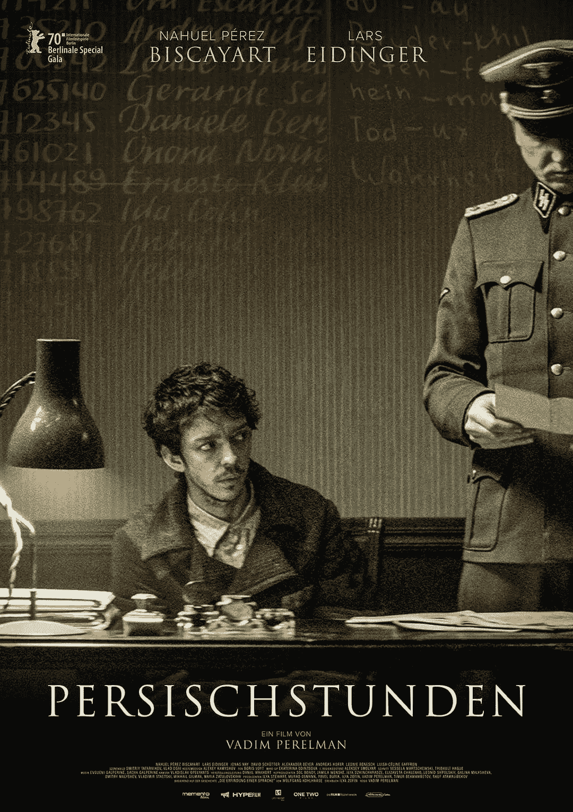

乌克兰裔导演瓦迪姆\*佩尔曼（Vadim Perelman）执导的电影《波斯语课》

#### 在集中营逃过一劫的犹太人

这部电影的一个主要情节是什么呢？我相信很多朋友已经通过很多渠道知道了。  
在二战的时候，德国集中营关了很多犹太人，男主人公之一吉尔斯也被纳粹给抓住了。在面对纳粹的枪口的时候，他急中生智，对纳粹的士兵说："我不是犹太人，饶我一条小命。"纳粹就问他："你是什么人呢？"他说自己是波斯人，也就是伊朗人，纳粹就留他一条小命了。因为按照纳粹的人种制度，伊朗人并不算典型的所谓的劣等民族。

而且这部片子里面的第二男主科赫上尉，正好他需要一个波斯语的教师，所以他叫下面的小兵到处去找波斯人。第一男主人公吉尔斯就这样活了一条小命，他就被带到了第二男主人公科赫那里。

科赫他为什么需要一个波斯语的教师呢？就是因为他有一个弟弟据说是在德黑兰，他非常想到德黑兰与自己的兄弟会合，并且在那里开一个餐厅。

顺便说一句，科赫这个名字德文的读音是 Koch，实际上就是厨师的意思，所以科赫上尉，我们可以把他翻译成厨师上尉。正好他在这个集中营里面也是负责给其他的军人管饭的，这和他战前的职业就相互的吻合了。

他不是一个对战争本身有强烈兴趣的人，就想在军队里面混混日子，战争结束以后，重操旧业做起自己的厨师。所以他就需要在伊朗谋生的这种语言技能，因此他需要一个波斯人来教他波斯文。

#### 根据难友的名字编造伪波斯文

吉尔斯这哥们根本就不懂波斯文，他就是一个比利时的犹太人，他懂德语、法语，但他不懂波斯文。但是难友给他一本波斯文的书，教他几个词儿，他就瞎忽悠科赫。今天忽悠这些词，明天忽悠那些词，科赫也不知道为什么就这么笨，真的被他忽悠上了，而且随着时间的推移，你要忽悠出来的这些单词，彼此之间又要互相联系，变成一门语言，这可难死吉尔斯了。

吉尔斯也是个天才，就这样自编了一种语言，并且在这个过程中还和科赫建立起某种奇怪的关系，应该是某种奇怪的友谊。当然电影结束以后，一切的谎言都会被揭穿，科赫学到的是一种伪波斯语。

他在纳粹集中营马上要被盟军攻陷的时候，按照自己的逃跑路线穿着便服溜了，真是坐上了飞机去了德黑兰。但是他在和海关的官员进行交流的时候，他说的伪波斯语那些真波斯人是一句都听不懂，因此他被当成可疑人员给抓起来了  
。

毫无疑问，伊朗虽然在战时和德国关系也有点小暧昧，但是在德国已经败亡的情况下，伊朗肯定会站在英美一边，把这样一个被查实身份的科赫上尉送到英美人手里，他下场不会太好。

至于我们这里所说的主人公吉尔斯则被盟军给搭救了。他被盟军搭救以后，盟军就请他帮个忙，让他估计一下在你这集中营有多少人送来过？他算了算大概有 2.5 万到 3 万人。盟军的军官又请他帮帮忙，是不是能够记得那些和他一起服刑的难友的名字？吉尔斯就做了一件让所有的人都很吃惊的事，他不但报出了名字，而且报出了 2000 多个名字，而且是有名有姓的，就 first  
name，last name 都非常清楚。

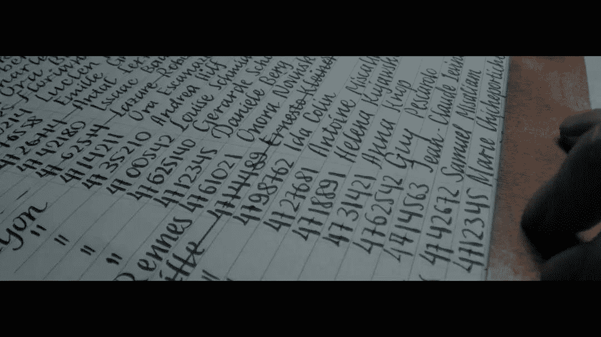

吉尔斯利用集中营关押的犹太人的名字作为词根，编造出上千个"波斯语"单词。

盟军军官就非常震惊，他的记忆力怎么这么好呢？但看过这部电影的朋友都知道，他为什么记忆力那么好？就是因为他给科赫上尉教的那一种伪波斯语，就是从他的那些难友的名字里面通过谐音给变出来的，或者通过各种各样的记忆与联想。所以他与其说是给自己的科赫上尉教了一种语言，还不如说是把遇难者的名字编成了一种密码，然后重新又抛给了使得这些遇难者最终死去的刽子手。

#### 撒谎不可耻，而是为了更大的目的

我们讲这一部电影是在讲马基雅维利的这样一个大的思想板块里面讲的，所以这部电影多多少少就引发了我三点思考，其中两点是与马基雅维利的哲学有密切的关系，另外有一点关系稍微间接一点，但也是与我在看理想平台上讲的其他内容相互关联的。

第一点就是撒谎的问题。我们都知道马基雅维利主义和一般的哲学不一样，一般的人生哲学和道德哲学都是不能撒谎，撒谎这事很糟糕，或者说只能够在非常有限的情况下撒谎。但马基雅维利就说君主应该像狮子一样的残忍，像狐狸一样的狡诈，撒谎就应该成为君主的基本功，而不是临时玩的小花招。

无独有偶，在电影《波斯语课》里面的主人公吉尔斯他也在面临这种情况，他必须天天练习撒谎，装作一个波斯人的样子，要把一种假的语言说得像真的一样。

在电影的有些桥段里面，他为了使得这些假波斯语的单词能够进入他的那个骨髓，他天天晚上背，以至于德军发现他在说梦话的时候，也在说这种假波斯语，还真相信了这个人是个真波斯人。

这样的一种是非颠倒的撒谎生活，当然会给撒谎者本人带来巨大的一个精神困扰，而且在相当程度上也会带来巨大的道德难题。因为作为一个真正的犹太人，他要按照《摩西十诫》的要求来要求自己。这《摩西十诫》里面有一条和撒谎多多少少有关，就是第九条，不能够作假的证言来使得别人蒙冤。

实际上吉尔斯编的假波斯语最后是让另外一个男主人公科赫上尉是倒了大霉了。从这个角度上来讲，他也可能涉嫌违背了《摩西十诫》中的第九条的要求。

为什么在这部电影里面撒谎这种行为非但不会被观众认为是一种道德上的无耻，还（被）认为是一种伟大的行为呢？这就是马基雅维利主义的一个精髓了，鼓吹撒谎不是为撒谎而撒谎，而是为了更大的目的而撒谎。

那么在马基雅维利自己的文本里面，更大的目的就是国家的整体利益，君王可以为了国家的整体利益进行撒谎。当然了为自己的利益进行撒谎这种情况虽然也会发生，但不是马基雅维利所乐见的。从骨子里说马基雅维利是个爱国者，而不是个爱君者。

与之相对应在电影《波斯语课》里面，主人公吉尔斯的撒谎行为也是为了一个更高尚的目的，这个更高尚的目的是要和更大的谎言作斗争，也就是说他之所以撒谎，是因为纳粹先用谎言把整个事件弄得黑白颠倒了。

犹太人在各国都住的好好的，纳粹占领各国以后，非要把各国的犹太人说成是畜生，说成是社会的寄生虫，这不就是系统的撒谎吗？然后全面地剥夺他们的财产，把他们关到集中营里面，不同的集中营门口都写着不同的纳粹的宣传口号。

比如在这部电影里面出现的集中营，前面的德语口号是说每个人都会各得其所，得到自己应得的东西。但实际上里面他们得到了自己应得的东西了吗？在奥斯维辛集中营的门口，纳粹写的德语口号是所谓的劳动创造自由。但实际上他们创造的是自由吗？是死亡。

就纳粹从头到尾都在撒谎，纳粹对自己的人民也在撒谎。纳粹对自己的老百姓说，这些犹太人只是去劳动改造了。实际上很少有一般的德国老百姓知道这些犹太人最终都被处理掉了，这是在战后才被德国普通民众广为人知的，纳粹从头到尾就没说过一句实话。

现在你要和这样的一个邪恶的政权做斗争，你还说真话你不就傻了吗？所以在这种情况下，你有权利利用谎言为武器和一个更大的谎言制造机器作战。马基雅维利也是这么看的，国与国之间肯定有勾心斗角的，你对他说真话，你不就傻了吗？他对你说的假话，你不就成宋襄公了吗？

而且吉尔斯的谎言它不仅仅具有一种防御性的特点和自保性的特点，它还有一种澄清式的特点。

我们前面已经说过了，吉尔斯所创造的这种语言是用纳粹集中营的遇难者的难友的名字改编而成的。这也就是说在电影的结尾，他可以很方便地通过这种缩写的语言，把纳粹的被害人员的名单至少部分的重述出来，这也就是保护了历史的真相不被洇灭。

我们都知道在纳粹的士兵从集中营逃走之前，都把各种各样的犯罪证据全烧了，特别是犯人的花名册，所以吉尔斯在门军的司令部做出的贡献是非常非常大的。而纳粹集中营里面的花名册所揭露的真相，难道不比波斯语本身的真假更重要吗？

所以从这个角度上来讲，吉尔斯可以说是一个颇有道德感的马基雅维利主义者。这也就是我看到这部电影的第一个体会，就是对于马基雅维利主义者来说，撒谎这件事非但不丢脸，而且非常高尚。

#### 困难面前，利用一切有利资源

第二个点我想提的就是如何撒谎。如何撒谎是一个技术活，马基雅维利主义者他特别强调的是德性，德性这个词的意大利文是 Virtu。这个词很有讲究，我们已经说过了，马基雅维利所说的德性并不是古典的伦理学所说的德性，而是说你要依赖你现在手头能够掌握的东西，把这些东西的效用发挥到最大。

对于吉尔斯来说，他能够手头掌握的东西貌似就非常非常的少，但是他非常非常的（有）运气。首先他就非常聪明，有很强的记忆力，而且非常幸运地从其他的难友手里拿到了一本波斯语的书，恰好记住了上面的一些单词，因此能够混过科赫上尉的前面三板斧，让他觉得自己很可能是一个所谓的波斯人，而不是犹太人。

但下面的考验就来了，科赫是每天要问他学一堆单词，每天学四个、五个，有一天就突然让他弄出四十个单词来，麻烦的是你不能够随便编四十个单词，他拿小铅笔一记，明天问你面包怎么说，树怎么说，你的发音如果和昨天不一样，就露馅了。所以你自己要把这四十个词、五十个词、六十个词的意思编出来以后就马上记到了。

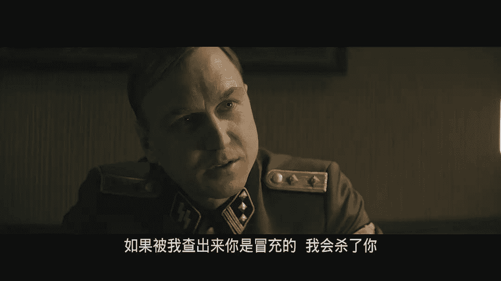

吉尔斯冒充波斯人的实情一旦被发现，将面临杀头之害。

这也就是说编这种语言的能力需要非常高，而且这种能力一般人是不具备的，因为每个人的记忆量都是有限的。更糟糕的是我们的主人公吉尔斯手头没有随时可用的纸笔，如果他有随时可用的纸笔，事情就会好办一点。

但是作为一个马基雅维利主义者，他会抓紧一切机会找到对自己有利的材料，帮自己解决这样一个人生难题。他想到的是什么呢？正好我们的主人公吉尔斯又被分配到了一个重要的任务，就是抄写集中营里面的难友的花名册，因此他能够看到很多名字。他就以这些名字为锚定的对象，然后基于这些名字，又编造出了一些虚拟的波斯语的单词。这也就是说编写是有所依据的，由此就骗过了科赫的耳目。

吉尔斯这种依靠自己的德性就地取材，解决自己眼前难关的这样一种精神，也值得我们学习。我听很多朋友都说，自己可能是小地方跑到大城市里面来闯荡的，所以总觉得自己矮人一头，觉得自己的人生经历没有别人那么的光鲜亮丽。

实际上你观点要反过来想，小地方有小地方的好处。也就是说如果在小地方，也许在你看来没什么了不起，但是在外人看来或许很有发掘价值的那些失传的技艺，那些美丽的风景，那就是你经历的一部分。如果你能够通过你的方式，把这些美丽的景色和失传的技艺通过各种手段介绍给别人，这就等于把你原来眼中的劣势变成了所谓新优势了。

当然了讲到怎么样来做马基雅维利主义者这一点，我就必须要指出，这一方面的讨论就不仅仅是一个人生哲学方面的讨论了，它也牵扯到我们在《用得上的哲学》里面讲的哲学道理。

比如和这部电影特别有关的一个道理，就是维特根斯坦所说的私人语言是不可能建立的。什么叫私人语言？比如像鲁滨孙，他困在了一个孤岛上面，然后有一种奇怪的疼痛，他就拿纸笔在自己的笔记本上写了一个 E，来代表这种特殊的疼痛。

这种写法过了一段时间以后，他自己都搞不清楚 E 到底代表什么了。为什么？因为疼痛总是当下的，而人类的记忆系统，尤其是长期记忆系统，总是要通过一套公共的语言符号体系来对当下的体验进行规范化的。

我们的主人公吉尔斯现在碰到了（和）维特根斯坦笔下的鲁宾森同样的问题，他如果要用一个自创的波斯语符号来记录一种感觉或者一种心理感受，自创的符号也必须是公共语言体系的一个组成部分，否则时间一长，他就忘了这事了。那怎么办？他只能够从犹太难友的名字上入手，通过一些音韵方面的缩写来代表他要创的波斯语的意思。这里对于吉尔斯来说非常便利的一点（是）他每天是负责抄写这些犹太难友的名字的，所以这些名字他可以名正言顺地看，通过反复地诵读把它记住。

当然对他比较困难的就是如果换了一批犹太难友以后，他得重新记一些名字，但没办法，这部电影里面可能是对主人公的记忆力有一种超长的描写，他能够给大家打饭的时候，就根据大家的相貌和特征以及名字的发音，给他制造一个绰号，用这个绰号去填充波斯语的词典里面的一个空位。当然这里说的波斯语是伪波斯语，由此忽悠我们刚才所说的科赫上尉。

换言之，要做马基雅维利主义者，除了人生哲学方面一定要有坚强的心脏以外，你要有一个非常强大的大脑。如果你要知道怎么样来编造一个语言，你就得了解维特根斯坦的私人语言学说，这是我们在《用得上的哲学》这个平台里面说的，这就和我们现在讲的《哲学家的十种生活提案》的相互链接了。

#### 祸福相倚，要尊重命运

我这里要讲的这部电影的第三个感受（是）这部电影包含了巨大的反讽，也就是说字面上的意思和实质上这个作品所要表达的意思恰好是相反的。

我们现在已经前面讲到一层反讽了。你看德国人在所有的集中营的门口都写了一些挺好的话，比如每个人都各取所需，各得其所，劳动创造自由等等，实际上干的都是一些很恐怖的勾当。

但是这部电影本身它又制造了一个反向的反讽。因为这部电影从表面上看来，是德国人在玩弄犹太人，然后把犹太人当成玩物，但实质上我们可以看到吉尔斯在反抗科赫的过程中，是把科赫本身当成玩物，他通过非常柔弱的一种武器，也是一种假的波斯语，把科赫收拾得服服帖帖的。

更有意思的是我们都知道纳粹在对人民进行洗脑，把他们的那一种纳粹主义的思想观念强制灌输到人民头脑中。既然你这么做，吉尔斯就反过来做一件事情，也就是说用一种假的波斯语对科赫进行洗脑。

这科赫也是一种反向的洗脑机制的受害者，他每天认真地默写和背诵这种假的波斯语，为自己所谓的绘画能力的提高而沾沾自喜，并且幻想自己在未来德黑兰的生活是多么的顺风顺水。

但实际上这就带来了第三重反讽。是当他自以为离自己的幸福生活越来越近的时候，正因为他说的这种语言是假的，所以他离自己的幸福生活是越来越远。等到他在空间上真的跑到了德黑兰的时候，他的命运也就被注定了。只要他张口说的那种假波斯语，被真的波斯人鉴定为不知所云，他就立即会被严厉的审查，他的真实的身份也就无从遮掩了。

当然这种意义上的反讽并不让我们感到好笑，很多朋友都以为反讽就一定让人好笑，但是在修辞学里面有一类反讽叫悲剧性反讽，我们在刚才的故事里面是读到了一种悲凉的味道，甚至尽管科赫上尉是似乎是个罪有应得的人，也可以从他最后的结局当中读出一点悲凉的味道。

这个悲凉的味道是什么呢？你自以为是上升的道路，但是命运之神已经帮你安排好了，是下降的道路。你自以为是顺风顺水的道路，但命运女神已经帮你安排好了，这实际上是走向毁灭的道路。

我们对于这一点的发现，不仅仅是为了发一些人生的感慨，而且也是能够在日常的生活中带给我们自己一些警醒。很多人都忽视了使得他成功的路径就是使得他失败的路径，因为任何一条使得他成功的路径，都会让他对这条路径本身产生强烈的心理依赖，而使得他没有办法在新的环境中找到新的路径，最后就是因为这种路径依赖，而陷入了人生的沼泽之中。

所以这就要求我们复习马基雅维利思想中的一个很重要的思想----  
要尊重运气和命运。用意大利文讲，这个运气就叫 fortuna。fortuna 这个东西就类似于滔滔怒河中的某一条河水一样，它阴晴不变，要对它保持敬畏。我们要像尊重海洋一样的尊重我们的命运，不要以为我们自己就能够掌控命运了。

好了，今天的节目也就到这里为止了，最后我也祝愿大家能够在未来的人生中发挥自己的德性，抓住自己所能够抓住的东西，撒一些为了揭露更大的真相而不得不撒的谎，使你的人生更加的精彩。

谢谢大家，我是徐英瑾。我们下回见。

公众号懒人找资源，懒人专属群分享

## 46\. 民众的气质：人的本质是容易被骗、喜欢被骗以及自我欺骗

### 文稿

各位听友，大家好，上一回我们主要谈论了马基雅维利眼中的君主的德性到底应该是怎样的。谈完了君主，我们就要来谈民众了，所以这一次我们主要来谈一谈马基雅维利是怎么来看待民众的气质的，民众的精神禀赋到底是怎么一回事。

#### 体制比人重要吗？

有一种观点认为，体制好像要比人更重要，要体制先行。我认为马基雅维利不去着重谈论体制，恰恰是马基雅维利主义有趣的地方。

大家可能会听说过一本书，这本书是当代美国哲学家罗尔斯（John  
Rawls）写的，叫《正义论》。在罗尔斯看来，社会基本结构的主要任务就是用来分配公民的基本权利和义务，划分由社会合作产生的利益和负担等等。

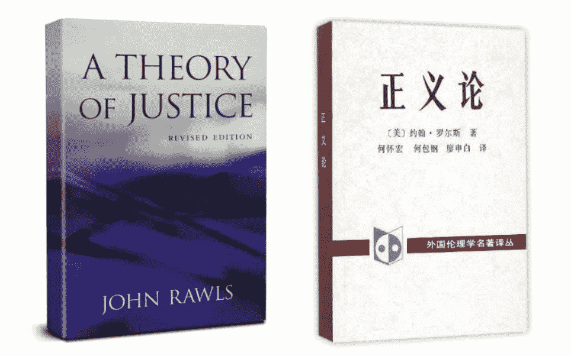

John Rawls《正义论》（A Theory of Justice）

所以《正义论》这本书的主要目的，就是要为整个社会的基本架构的设计确立一些哲学上的原则，特别是正义原则，特别是要处理分配问题，巴拉巴拉就是这套东西。

罗尔斯的《正义论》已经成为当代英美的政治哲学的主流了。但如果马基雅维利能够活到今天，看到这书，我估计他会哼一声，他说这书讲得不对，或者说的都是些皮毛的事。

为什么呢？他认为，你（罗尔斯）说的那些制度的问题、制度建设的问题，不是根本，根本是人民的气质问题。换言之，如果民众的气质不好，制度好也没什么用。

对于这个观点的阐述，有一种通俗的表达和一种形而上学的表达。

通俗的表达是这样的，制度好固然是好事，但这是锦上添花的，根本是什么？人得好，人烂了，啥都完了。

我们都知道，在拿破仑时代法国军队的战斗力很强，但实际上法国军队的参谋本部的组织形式是很落后的，基本上就是靠拿破仑一个人的天才撑着，但拿破仑就是牛，就是把各种对手都打得落花流水。

战争的例子是这样，商场上的例子也是这样，你说苹果的手机之所以好，到底是因为苹果公司制度好的？还是因为乔布斯个人很牛呢？我个人认为他个人的能力恐怕更重要一点。

我上面讲的是领导的气质，下面员工的或者士兵的素质也很重要。美国近代史上有件大事，就是造了美国太平洋铁路，从 1863 年开工，1869 年建成，全长 2000 英里。

在缺乏现代化机器的年代，美国的铁路公司是怎么可能花这么短的时间，就把 2000 英里长的铁路造完呢？这个道理就是因为他们用对了人，他们用了逾万名华工，这些华人仅凭人力与简单的工具开山凿路，付出了惨重的牺牲。

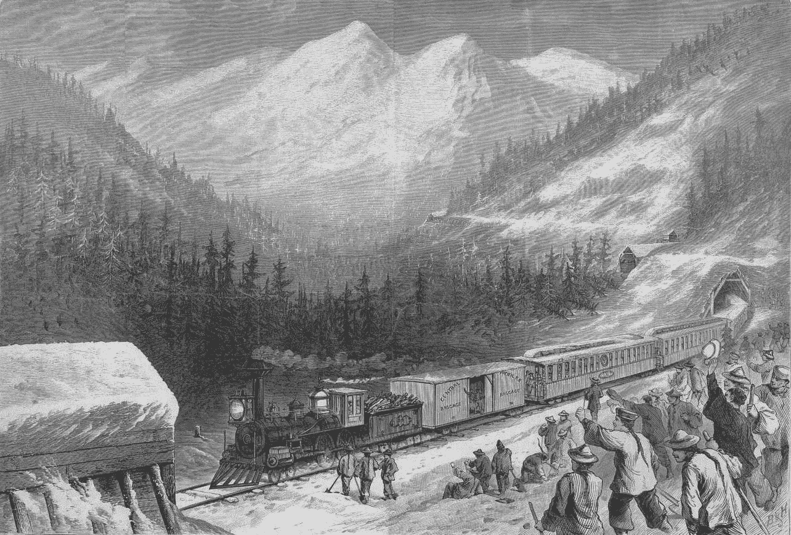

Joesph Becker 所画素描"Chinese railroad workers greet a train on a snowy day".

比如根据资料显示，从中央太平洋铁路沿线运来的华工，遇难者的骸骨的总重量就有 2 万磅。很明显美国人事后也承认，如果不是华工的这样牺牲的话，你靠白人的这一个劳工要完成这样的一个铁路，这是不行的，完全不可能。

这也就是说要把铁路造成的关键，恐怕不是包工头的组织能力，而是他找对了人，也就是找对了华工。所以你说要做成大事，到底是人重要还是制度重要？

上面一个论证还比较通俗。第二个论证也是要得到类似的结论，但是他是站在形而上学的角度上来给出的。

我们都知道按照亚里士多德的哲学，任何事物它都是要有一个形式加在质料上的过程的，类似于你要做成一个亚历山大大帝的头像，这个泥本身就是一个质料，但是你要把这个形象通过慢慢地雕塑，附着在或者强加在这样的一个质料之上，最后就变成了亚历山大大帝的头像了。

在政治哲学里面，形式就是社会制度，质料就是民众、人口数量，以及国家所在地区的风土条件等等。亚里士多德的政治哲学，是一直强调形式和质料要互相匹配的。

不过在西方政治哲学的总的传统里面，大家还是倾向于重视形式，而不是质料。质料本身是边缘化的。

比如很多哲学家都喜欢讨论政体，好像政体搞对了，这个国家就能够大治了。从来不讨论在政体的管理下，民众的精神状态是怎样的。

但问题是质料本身真的能够这样被边缘化吗？比如我们以做玉器为例，在很多时候恰恰是玉料本身的材质，决定了你只能够用这个玉料去做什么样的玉器。

培养人也是这样的。比如有一个人他天生就是唱歌的胚子，你不去培养他唱歌，培养他做数学家恐怕就不合适了。

相关的道理在西田几多郎的场所逻辑里面已经有所阐述了，大家可以去回顾一下我在看理想平台上的另外一档节目《暧昧：给日本脑洞一个哲学解释》。

在政治领域，质料反过来决定形式。这话到底是什么意思？也就是民众的气质决定了什么制度是合适的，否则你不管民众的气质是什么，随便加一个制度上去，就会导致气场不合。

随便举个例子，唐朝中晚期藩镇割据，很多地方，比如说河朔三镇都比较混乱，不服朝廷管，但是江南一直很乖，江南的老百姓乖乖给朝廷纳税，如果没有江南供养的话，唐朝恐怕很早就歇菜了。为什么？因为吴越百姓的气质比较温顺，不爱惹事。

这个气质不是唐朝的政治制度设计出来的，而是当地老百姓就是这种风土人情。唐朝的政治制度虽然搭了顺风车了，甚至民众的气质与想法反过来也会倒逼上面的人必须这样做，或者必须不能那样做。这在哲学上就叫  
Bottom up，就是从底下到上面的那种反应机制。

#### 气质约等于欲望，国家是欲望斗争的场所

好，这里所说的气质大约指的是啥呢？马基雅维利所说的气质，它意大利文是 umore。另外一个意大利文单词的意思和它有点像，叫 abitudine，这个词今天可以把它翻成气质，但这个词也有欲求的意思。

所以说马基雅维利所说的气质有欲望的意思，所以马基雅维利所说的气场之间的斗争，更多的就是民众、军人以及君王的各自的欲求之间的冲突。那么国家就是调整这些互相冲突的欲求的斗争场所，其最后的政治形势乃是上述这些欲求彼此协调后的结果。

需要注意的是，欲求在这里扮演的是某种参数的角色，参数这个词有点难懂，我们可以把它想成是收音机上的一个旋钮，这里拧上了、拧下了，就可以把音量调高、调低。

比如有一个民族，就像类似今天的日本一样，全民低欲望，这是不是意味着欲求这个参数在他们那里不存在呢？不，欲求这个参数在他们那里是存在的，只不过旋钮的音量被调小了，完全没有欲望的人是不可能存在的。

#### 不存在代表全民的民意政府

由上面的讨论中，我们可以引申出几个观点。

第一，民众之间是有着非常丰富和复杂的欲望分层的，欲望之间的冲突乃是常态。有权利的人他试图扩张自己的权利，缺少权利的则要反抗。

因此就要有人协调这两者之间的关系，而协调本身又是一种动态的技术。因此，从某种意义上说，你要达到那种完美的协调，没有任何瑕疵的协调，恐怕是不可能的。

在这里我们似乎隐隐看到了马基雅维利对于马克思主义的预报，任何民族国家内部都存在着大量的斗争。这个斗争被马克思称之为阶级斗争，而且马克思也认为代表全体民意的政府也是一种幻觉，实际上任何一个政府都是伪装成民意政府的某阶级对另外的阶级的专政，这是很典型的马克思和列宁的观点。

当然，在马基雅维利的君主论框架里面，马基雅维利主义还是要把君主放到一个比较重要的位置。

他就特别提到，君主应该想明白，应该与人民当中的哪一个部分进行联合，特别是要与人民内部的哪一部分的气质或者欲望进行联合，然后决定一个拉谁打谁的策略。

等到你完成这个策略以后，再通过某种"化妆"把自己说成是所有人的君主，而不仅仅是一些人的君主。

这话说得有点抽象，我们举个例子。我们都知道，从罗马共和国到罗马帝国的转变过程中，凯撒起的作用是很大的。

凯撒面临的问题是他虽然是罗马贵族，但他是罗马贵族的外围，会被庞培这样的核心贵族排挤。那么怎么办？他的思路就是面向普通罗马人民与普通的军团士兵，用从高卢人那里抢来的奴隶与土地分给大家，让大家对他感恩戴德。

由此，使得那些没有能力向人民撒面包的罗马核心贵族失去人民的好感。同时，凯撒又大量将自己的亲戚塞入元老院，使得他本人的命令可以通过元老院的背书成为全民意志。

实际上，凯撒就是在拉拢底层人民和士兵。但是通过这些操作，他把自己说成是所有罗马人民意的代表。这当然会让共和派的人对他恨之入骨了。

上面说的这些话的一个要点是什么呢？这个要点就是，君主本人是不要妄想真的成为全民代表的，而只要扮演成全民代表就可以了。而且时刻要非常清楚，自己背后真正的政治支持力量是哪一派，谁是自己的政治基本盘。谁是自己的铁票仓。

有些人就不明白这个道理，比如说西汉末年的王莽，他还真以为自己是全民代表，结果糊里糊涂颁布了均田令，得罪了所有人。贵族恨他，因为贵族不愿意按照法定的要求把田分出来。穷人也恨他，因为穷人并没有分到王莽许诺给他们的田。结果所有人都烦了。

这里说的道理就可以和我前面所说的效果中的真理相互结合了。因为按照马基雅维利的观点，真理就必须是以效果为指向的真理，而不是以认识为指向的真理。

换言之，你就要在行事的效果层面上，让全体人民中的绝大多数都觉得你的确是为了全民的利益而考虑，尽管实际上真正得到你恩惠的只是全民当中的一部分成员。

#### 人的本质是容易被骗、喜欢被骗以及自我欺骗

以上就是我从马基雅维利的民众气质说里面所引申出来的第一点观察。第二点观察主要是牵涉到了民众的气质与人性的关系。

马基雅维利关于民众气质的说法，以及他关于君主该怎么利用民众的气质为自己谋利的说法，就预设了人民是需要被忽悠的。

按照他的人性论，他认为人的本质就是容易被欺骗，并且还喜欢被欺骗，甚至还喜欢自我欺骗。自我欺骗，就自己编一个故事让自己 Happy，不是别人骗你，自己把自己给整脑残了。而且在其他方面是见利忘义，注重表象，缺乏深思力，小富则安，缺乏对于危机的警觉性。

当然了，马基雅维利并不是说天下所有的人都是这样，而是说这样的人占人群中的大多数。正因为民众的精神特点是这样的，所以君主可以利用这一点来施展他的政治手腕。

#### 君主制比共和制更好

讲完了第二点，我们就可以引申出第三点了，这第三点是什么呢？从上面的讨论出发，你可能会得出一个结论，君主制比共和制更好。

注意，我并没有说这是马基雅维利的最终结论。马基雅维利在另外一个方向上可能会说共和制更好，这是马基雅维利的书难读的地方。但是如果就今天所讨论的这点思想材料而言，好像似乎君主制比共和制更好。

当然这里所说的君主并不真的是只有一个君主名头的人。一个人说了算的那个人都算是君主，在有些情况下他叫宰相，他叫内阁总理，这都无所谓，比如汉武帝死掉以后，真正汉朝说了算的人就是霍光了，小皇帝是说了不算的。那时候霍光按照马基雅维利的标准，就是君主。

好了，为什么君主制比共和制更好呢？我们知道了按照马基雅维利的观点，整个社会内部的这种复杂的斗争是常态，大家的利益不一样，所以整个政府的任务就是得找个法子让大家安定下来，即使是通过忽悠的方法也行。

但忽悠的要点是啥呢？第一点就是机密，只有机密才能够想出一个机密的方案，把这个社会稳定住。你在忽悠一个人的时候，不能告诉他我在忽悠你，对不对？但是怎么做到机密和保密呢？那就是知道的人越少越好，它君主制天然就容易保密，因为只有君主他才知道全部的计划。

那么共和制的麻烦是什么呢？就知道这件事的人太多，他没法保持机密。而且你在会上一说，敌人也就听到了，特务也就听到了，所以就没法忽悠。

第二，就是协调者本身要有人格感召力。为什么呢？因为很多人他之所以愿意被忽悠，就是因为所谓的饭圈效应，对不对？饭圈是现在的一个新的流行词儿，信一个人了。

但如果饭圈面对的不是一个 idol，一个偶像，而是一大堆人，执政团体，那么实际上就很难有人能够协调好整个团队的力量，除非里面再推出一个领袖，但只要领袖推出来了，这不就变成君主了吗？

这是为什么呢？因为人类心理的基本的架构的特性就决定了我们是认脸的，脸必须是一张，我们得认头，如果你推不出一个头的话，推出一个抽象的机构是没有亲切感。

所以第二点，君主制能够通过君主本身的人格感召力来完成使得整个社会稳定下来的任务，最重要的是他可能会产生一些饭圈效应。

第三点就君主有神秘感与宗教感。尤其在欧洲，你做一个君主总是教皇要给你做一个加持的，以神的名义宣布你的君王的位置是合法的。

这就等于说君主这个圈子可以去蹭宗教这个圈子的流量，来增加自己的饭圈的稳固性。这样一来，他要忽悠的难度就更小了。

如果是共和制的话，领导人就要通过民选产生，但民选这就意味着他在名分上就是人民公仆，大家会对他缺乏敬畏。

所以大家先天的就会用批判的眼光去看他，民选的领导人反过来忽悠老百姓就很难了。这方面的帝王心计在今天的世界还是非常非常有用的。

我最近迷上了一部剧集，是裘德洛主演的《年轻的教宗》。裘德洛在里面扮演了一个虚拟的教皇，叫庇护十三世。

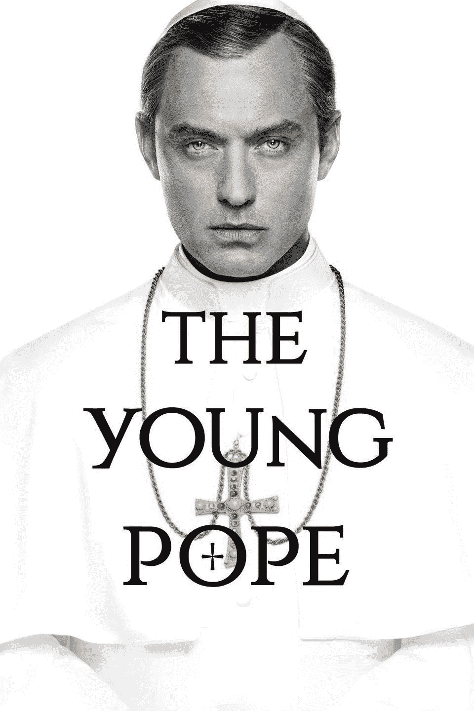

《年轻的教宗》海报（The Young Pope）

那么在这部片子里面，裘德洛索一个最最最体现马基雅维利主义色彩的举动是什么？就是他做了教皇以后长期不发布自己的照片，报纸上就说新教皇出现了，但是看不到他照片，然后引发全天下教徒的好奇，但突然发布，大家才发现我们的新教皇是一个绝世美男。就通过这样的一种饥饿营销，他疯狂地收割了粉丝。

下面我来讲第四点，这是从马基雅维利的"民众气质说"里面所引申出的一个新观察，也就是财富和欲望之间的关系到底是什么。

我们前面已经说了马基雅维利主义的观点，有些方面的确很像马克思主义。但他并不是在所有地方都像马克思主义的，比如马克思就不太愿意讨论一个阶层的民众的气质或者欲望。

马克思喜欢讨论的是什么呢？一个阶层的民众的经济地位，以及他对于特定的生产资料的占有。

一个喜欢讨论经济地位，一个喜欢讨论气质，那么到底是马克思的思路对，还是马基雅维利的思路对呢？其实我个人认为都有道理。

我先说马克思有道理的地方，因为财富与地位能够改变你的气质，经济是很重要的事情。

举个例子，你是市民，假设你穿越到英国内战之前英格兰的市民社会里面，去做了一个小资本家，有点小钱。甚至还混到了中高级军官的这样一个位置，你就开始牛哄哄了，旧贵族的面子也不看了。这也就是说正因为你有钱，所以你通过有钱这件事情，你改变了你的政治地位，也改变了你的心理状态。

但反过来说，气质也很重要，你不要以为有钱就行，假设你有钱了，该怎么花呢？这得看气质。有人拿了巨额的拆迁款竟然去赌博，结果一场空。

历史上西班牙人与葡萄牙人曾经获得了大量的美洲财富，但是这两个国家的贵族都用来去购买珠宝与不动产，他们没有好好地去搞什么工业革命，反而让英国后来居上了。

为什么呢？因为英国的气质与西班牙人的气质不一样，他们有新教的气质，对抽象的财富更关心。

所以气质与财富其实是"鸡生蛋，蛋生鸡"的关系，两面一体，一体两面。二马说得都对，一个是马克思，一个是马基雅维利，所以二马都要看，二马都要骑。

#### 信人还是信机构？

今天讨论的内容对我们日常生活的启发是啥呢？实际上我们在日常的生活和工作中经常碰到一个问题，到底是信这个人，还是信这个机构。

比如我有时候在看到一个幼教的授课机构的时候，牌子似乎不错，但是真的跑到幼教机构里面去访问了一下，觉得那里的老师给我的感觉比较平庸。另外隔壁还有一个幼教机构，你觉得牌子没那么响，但里面的老师似乎挺有眼缘的。

你应当把孩子送到哪个机构去？你是应该相信机构，还是应该相信具体的这样一个老师的气质？这就类似于求医，你是冲着某个专家去，还是冲着某家医院的名号去？对于团队的建设来说，是人才齐备更重要，还是规章制度齐备更重要？

当然了我们这个行当的习惯还是主要是看人，比如说在国际上说一个哲学系牛不牛，主要是看有多少明星教授，机构是跟着走的。

好了，马基雅维利对于气质与政治构架之间关系的看法，实际上是和他的历史观有一定的关联的。为什么？你要把政治构架线条拉长，拉成 200 年、300 年了，这不就成了历史的命运了吗？

所以下一回我们就要谈一谈马基雅维利是怎么看历史的，是怎么来看待历史中的个人的，并且是怎么来看待历史的命运的。

好了，今天节目就到这里为止了，谢谢大家，我们下回再见。

公众号懒人找资源，懒人专属群分享

## 47\. 命运与自由：德性论下的历史必然性

### 文稿

各位听友，大家好，我是徐英瑾。

上一回我主要说到的是民众的气质，怎样的气质决定了怎样的政体，不过这样的讨论依然是静态的，非时间性的。现在我们要谈一个更加宏大的问题，就是个体与整个历史共同体在历史大潮中的命运是什么。

#### 历史必然还是自由意志？

谈到命运的无非就是三者的结合，首先就是个体能够看到的，但未必能够用手抓住的历史的必然性。就好比说你现在已经看到了有一个股票上赚钱的机会，你觉得这是必然性，但你没有本钱，但你的确看到了。

第二就是个体能够把握的个体自身的行动自由。也就是说你看到了，并且你有钱来投入，结果你赚到了。以及那些个体无法认识与无法把握到的运气。也就是说你随便投了个钱，买了一个你认为是很一般的股票，莫名其妙你赢了，赚了一大笔，你自己都没想到。

在这三者之中，给我们带来最大的压抑感就是历史必然性这几个字了，这几个字实在是把我们压得喘不过气。个体也好，组织也罢，它要在历史大潮中作出决定，无论是在中观的层面上，还是在宏观的层面上，都会引发这样的一番思考。这些所谓的历史主体真的是主体吗？到底是我们人类在做决定，还是历史必然性本身在做决定，而反过来将这些历史人物当成它的玩偶呢？

马基雅维利在《君主论》里面也提出过类似的评论，他的大意就是说：历史必然性的强度是如此之强，以至于我们人类该怎么选择，都不会改变历史发展的结果。

但是我马基雅维利还是要说，还是存在着很多很多的可能性，让我们的自由意志是无法被消除的。这话好像讲得模棱两可的，我们到底该怎么理解呢？马基雅维利到底是想站在历史必然性的一边，还是想站在自由意志一边呢？

马基雅维利的自由是灵动地顺应局势变化要考虑清楚这个问题，我们就要以马基雅维利的德性论为讨论的出发点。德性论要求我们从自己能够掌握的资源出发，来筹划自己的行动，这也就意味着你必须要知道有哪些资源是你不能够掌握的，而那些你所不能掌握的资源，又可以从认识论的角度被分为两类。

第一类是你所了解的那些你不能掌握的资源，第二类是你所不了解的那些你不能掌握的资源。至于那些你暂时不知道的、不了解的，你不能够掌握的资源，一旦被你了解了，则既可能成为对你不利的因素，也可能成为对你有利的因素。

在哪些情况下，它们会转变为对你不利的因素呢？在《东汉纪\*世祖光武皇帝》这个历史文献里面有一句话："刘将军平生见小敌怯，今见大敌勇，甚可怪也"。刘将军指的是东汉开国皇帝刘秀。它的意思也就是说刘秀在打天下的时候，他不怕大军阀。大的敌人在他面前他反而勇敢了，他怕的是小军阀，看到小敌人他害怕了。

这听上去好像有点反常，但仔细想想不反常。为什么呢？大军阀就是有名头的军阀，他们是在刘秀的认知范围之内的，刘秀可以依赖马基雅维利式的德性，对这些军阀的实力进行分析，并且依赖他自己的力量去消灭它。

也就是说看得见的敌人其实不是那么可怕，但是黑暗里突然冒出个小军阀，刘秀对他们没有任何的认知预案，这些人就会破坏刘秀的很多计划。刘秀烦的就是这个东西，这就是未知领域内的不利因素。

但在某些情况下，未知领域内的因素转为已知以后，却会给当事人带来惊喜。比如曹操在官渡与袁绍大战的时候，他所知道的事情是袁绍的兵力是压倒自己，但他暂时不知道的事情是袁绍的军队这么多人，他们吃饭的粮食到底存在哪里。

非常幸运的是，这当然是对曹操来说。袁绍的谋臣许攸叛逃袁绍，然后来到曹操一边告诉他，袁绍军的军粮就在乌巢。然后曹操就去攻打乌巢的粮仓，一下子扭转了局面。这也就是说在曹操的未知的领域里面所潜存的某些因素，其实是对他有利的。

既然在未知领域里面，既藏有不利因素，也藏有有利因素，我们到底该怎么做呢？我们应该做的事情就是时刻准备好，在局面发生变化的时候，当然也是在我们的认知发生变化的时候，以最敏捷的姿态去调整好我们的姿势，以便改善我们的态势。要保持这种时刻灵动的状态，这就是马基雅维利所说的自由。

#### 历史决定论与人的自由的结合

这种意义上的自由是与历史决定论彼此相容的，所以马基雅维利就可以既肯定历史必然性，也肯定人的自由了。这也就是为什么他前面说的那一层意思，听上去有点暧昧不清的道理了。实际上他既站在历史必然性一边，也站在自由一边。

从哲学角度上来看，为什么历史必然性可以与自由相容呢？这是因为马基雅维利的自由，是建立在可知基础上的行动自由，也就是说这个自由概念是在认识论与行动哲学的范围内给出的，而不是在形而上学的层面上给出的。而马基雅维利所说的这个必然性是站在形而上学的角度上说的。

换言之，也许从形而上学的角度上来看，很多事情的发生已经被决定了。也就是说某个小军阀必然会在刘秀统一中国的过程中跳出来作妖，或者许攸注定会在某一刻，将袁绍的军粮情报带给曹操。只是在这些变化发生之前，刘秀与曹操本人都不知道它们的发生，因此他们都面临着别的方向上的行动可能性。以曹操为例，如果许攸不来向曹操汇报袁绍军的情况，曹操只能狼狈地从官渡撤退，避免与袁绍主力进行纠缠。

所以从隐喻的角度来看，自由是什么呢？自由就是这样一幅图景：当事人他打开了一个认知手电筒，照亮了历史黑幕上的一个光斑。然后他摇晃自己的手臂，让这个光斑产生了跃动的轨迹。而这个光斑本身的运动轨迹的自由性，实际上就是当事人自身的自由性。

不过在当事人的手电筒的光斑的范围之外，则是沉沉的黑幕，在黑幕背后的历史事件的发展，都是按照铁的必然性来进行的。手电筒的光斑的迁移的自由性，是不会妨碍到未被照耀到的黑幕背后所发生的历史事件的发展线索的必然性。

不过我上面仅仅是说，马基雅维利所说的自由与决定论是彼此相容的，我并没有说决定论本身是一种确定的，或者说是一种站得住脚的哲学立场。这就好比我如果说同时吃沙琪玛与西红柿不会引发荨麻疹，这句话并不意味着我现在一定要吃西红柿或者是沙琪玛。

#### 马基雅维利历史必然性的两种解读

所以我们还有一个问题需要搞清楚，抛开对于自由的有限度的肯定不谈，马基雅维利真的承认有历史必然性吗？马基雅维利本人的态度，我解读下来是认为他很倾向于认为决定论是对的，但是这个表达仍然很含糊。我个人认为他的这种含混态度本身也可以按照两条线索被加以解读，而且这两个解读方案彼此之间也是相容的。

第一个解读方案，既然在我的认知手电筒的光斑之外的黑幕，以及黑幕背后所发生的事情，对我来说是未知的，所以我仅仅只能够对其进行猜测，而不能够断定里面有必然性。

不过我很倾向于认为这里面有必然性，这是为什么呢？因为必然性是与稳定性相互联系的。如果世界上发生的事情它缺乏稳定性，我为什么还要进行筹划呢？

比如我现在要筹划种粮食，我肯定认为这个粮食的生长规律，和整个气候的变化规律是有一定的稳定性的。如果我们没有这些基本的稳定性，我就不会坐下来筹划这些粮食的生产了。

反之，如果黑幕里面发生的事情全部是变幻莫测的，那么任何的计划就没有意义了。而且如果你真的认为，世界上发生的事情真的是如此变幻莫测的话，那么你就会变成一个随遇而安的皮浪主义者，而不会变成一个积极进取的马基雅维利主义者。

第二种解读就是针对马基雅维利对于历史必然性的那种欲说还休的暧昧态度，我认为可以这样解读。就是马基雅维利或许在有限的意义上，承认历史黑幕中是存在偶然性的，而且这是一种形而上学层面上的偶然性，也就是说它是做死在世界的结构里面的，并不是仅仅基于我们的无知。

但是马基雅维利会认为，这些偶然性仅仅在历史发展的枝节问题上起效果，而不会在主干的方向上起效果。也就是说大局是没有偶然性的，大局如何展现自己的一个细节是有偶然性的。而且即使是这些枝节问题上的偶然性，以及这些偶然性的分叉与必然性主观之间的关系，被个体认识到了，并且利用到了，也可以为个体带来巨大的利益。

比如在日本的战后，伊藤忠商事的董事长濑岛龙三先生，曾经成功地预言第三次中东战争的进程和海湾战争的爆发时间。他就利用这个情报给公司套利，获得了商业成功。日剧《不毛地带》，就是以他的故事为原型拍摄的。

很明显，濑岛看到了战争发展的必然性结局，但是有些事情是偶然的，就是个体能不能利用这样一个必然性的局面，为自己创造更多的经济利益。濑岛先生没有办法改变战争的进程，但是他可以通过对于大局的认识，而在他公司这样一个小的局面里面，造成对他有利的改变。这种可能或许带有一定偶然性的色彩，但肯定不被当下的个体所完全认知的这种历史必然性，也被马基雅维利称之为运气。

#### 必然又偶然的运气

反过来说，运气是什么呢？它就是这样的一种历史必然性：一方面它没有被个体所完全的认知，但另外一方面，它在某些方面和某些向度上还带有一定的偶然性色彩。

运气的意大利文是什么呢？是 fortuna，但这个词在词源上的意义也有大海上的风暴的意思。有一个比喻，命运无非就是滔滔怒河中的一条。另外一个比喻就说命运就类似一个女人。不过这些比喻的意思也都非常含混，这到底是在咒骂命运还是在尊敬命运呢？

比如将命运视为女人的比喻，到底是什么意思呢？一些地方马基雅维利说，要像驯服女人一样驯服命运。听上去好像女性同胞很不开心。另外一些段落他又说，命运类似是你的女朋友，是人生的最佳伴侣。好像又在尊敬命运，同时也顺便尊敬了女性。

我个人的解读，这里的要点似乎不是应该尊敬或者是贬低命运，或者是运气。而是三点。

第一，你最好将运气或者命运视为自己具有意志的某种人格化的东西，也就是说你最好要用拟人化的观点来看它。当然了，有意志的东西就并不意味着它就是与必然性相互对峙的，与必然性无关的东西。

比如上帝吧，在基督教的思维框架里面上，上帝是按照自己的意志创造世界的。但是你把命运说成是一个有意志的东西，对你是有好处的，因为这样就能够让你重视命运。它有意志，所以你不太容易掌控它。你说它有意志，你就会重视它，你就不太可能因为自以为是而在阴沟里翻船。

第二，为什么是女人呢？当然，首先因为马基雅维利是直男了，他会自然地觉得女性与自己的关系类似于运气与英雄之间的关系。运气就类似于女人，英雄就是男人。

具体而言，这两者之间的相似点在哪里呢？第一，运气类似女性，具有生育能力，女性为英雄生育继承人，而运气为英雄生育出大量的，变成更大的英雄的机会。英雄抓住机会才能壮大自己，越变越强。第二，运气类似女性，至少站在男性的立场上看，是很难被完全看透的，尽管也不是完全看不透。在某些情况下，女性可以抛弃男性，这就类似于命运抛弃了英雄。

第三点，在当时的男权文化的笼罩下，男性与女性之间的关系依然有主从关系。因此，就像女性必须服从于男性的指挥一样，英雄要做成事情，要做成大事，首先还是要靠英雄自己，不能等时势，而要积极地利用时势，改造时势。

#### 女性特质的运气与男性特质的德性

在马基雅维利的思想框架里面，与男性气质特别有关的这个概念，就是我们前面所说的德性，德性就是依靠自己能够掌握的力量做事情，不怨天由人。在这里，德性与运气就构成了某种阴阳搭配的关系。德性的意大利文是一个阳性的名词。运气，恰好是一个阴性的名词。所以站在意大利语的立场上来看，二者之间的阴阳搭配关系，已经通过它们的词性而得到了体现。

但需要注意的是河流也好，女人也罢，这都是比喻罢了。马基雅维利并不试图从形而上学的角度去界定运气是什么，因为做这样一个纯哲学的工作对他来说是没有意义，他就喜欢打比方。打比方的好处是什么呢？你就可以按照你处理熟悉事物的方式去处理它。

比如如果你很善于和女性打交道，我告诉你命运就是女性，你就知道我知道怎么对付命运了。如果你是个老船工，很善于与各种急流险滩打交道，我就告诉你命运是滔滔怒河当中的一条，你就知道怎么和命运打交道了。只要比喻合适，那么由此建立出来的处理方式就不会太离谱，这也是一种做事做人的态度。

马基雅维利说的自由和别人有什么不同？上面我们已经讲了马基雅维利关于历史必然性自由与运气的看法，现在我们来比较一下他的思想与别的思想家，对于同类问题的看法和想法之间的一个差异或者是不同。

我个人认为就马基雅维利所说的自由，与很多哲学家所说的自由都不一样。伊壁鸠鲁他说的自由是什么？自由就是指原子能够做偏斜运动，它不仅也是做直线运动，所以原子可以有自由。

斯多葛主义也谈自由，自由就是不受阻碍，一个轮子咕噜咕噜咕噜转，这个轮子它没有陷到泥里面，自由地不受阻碍地转，这就叫自由了，所以车轮是可能有自由的。

马基雅维利不会赞同这种观点，他认为自由的主体，这个历史的当事人必须是要有欲望，是有建功立业的想法的。原子和轮子有欲望吗？当然没有。需要注意的是，是否需要强调历史主体建功立业的欲望，是马基雅维利与古典虚无主义思想的一个重大区别我们再来说别的思想家，比如斯宾诺莎，他可以以一种模仿斯多葛主义的口吻说，自由就是对于必然性的认识。你知道所有的必然性事件，你就看开了，然后就能达到自由。马基雅维利则认为这完全是扯淡。因为只要你是个人，你就没有办法认识到所有的必然性，总有一些事情在你的认知范围之外。如果斯宾诺莎对于自由的定义是对的话，那么拥有自由的仅仅只有上帝了。

马基雅维利的自由观我们再来总结一下。自由就等于这样一种精神状态，你要抓住一切机会，扩大你能够认识，特别是能够控制的事物的范围，缩小你不能控制的事物的范围。你具有这样一种能力，你就自由了。但是马基雅维利从来没有说一个人能够控制住所有的东西。

#### 侵略性的自由与欲望下的浮士德精神

这个观点在以后的英国哲学家弗朗西斯*培根那里，得到了进一步的发展。弗朗西斯*培根就说，知识就是力量。如果知识能够增加你控制世界的能力，你就由此可以增大你改变世界的机会。

但这一点本身预设了你是有欲望做这些事情的，你如果没有欲望控制世界，知识是不能够起到这个作用。古代的印度社会也有非常发达的逻辑，也就是所谓的佛教的因明学。

但是西方社会是高欲望社会，古典的印度社会是一个低欲望社会，在高欲望的西方社会，逻辑它变成了科学的一个部分，更重要的是在今天它变成了计算机程序的一部分。而它变成了计算机以后，就进一步扩大了对于物质世界的操控力，逻辑知识在西方最后变成了经济力量。

但是在低欲望的古典的印度社会，佛教因明学纯粹是为了佛教理论存在的，将人锁定在一个很低的科技树的位置。也就是说逻辑知识仅仅成为了纯粹的僧侣的思辨游戏，并且鼓励更多的人脱离经济活动第一线，由此逻辑反而变成了一种反经济的力量。

马基雅维利的自由是侵略性的，是进攻性的，是不断扩大个体控制范围的那种自由，这就是所谓的浮士德精神的体现。什么叫浮士德精神呢？就是与墨菲斯特定下的契约，以获得更多的知识，以更多的自然控制力为目标，甚至不惜典当自己的灵魂。

今天的节目就到这里为止了，我相信很多听众都有了这样的体会。马基雅维利这个人说话吞吞吐吐、含含糊糊，很多话具有多重解读的可能性。

下面我就来介绍一种新的对于马基雅维利的解读意见，也就是说他对于帝王术一种厚颜无耻的教授，未必表达了他的本意。毋宁说，马基雅维利在系统地使用反讽的修辞手段。换言之，大家所听到的关于马基雅维利的一般意见，都是他逗着大家玩的  
\----他想说的是反话。

好了，我们下回见。这句话可不是反话。

公众号懒人找资源，懒人专属群分享

## 48\. 高尚的反讽与手段之中立性：对《君主论》的另一种解读

### 文稿

各位听友大家好，我是徐英瑾。上一回我们主要说的是马基雅维利是怎么看待历史的必然性，看待个体的自由与命运的。讲了那么多回马基雅维利，我相信不少人已经对马基雅维利的形象非常讨厌了，觉得他的思想好冷酷，好工具主义。

但是我上一次也留了一个伏笔，我认为仔细的听众应该能够发现，马基雅维利的思想表达方式是含含糊糊的。你好像怎么解读都有道理。这种阅读体验就使得一部分的研究者提出了一种很有趣的观点，认为马基雅维利的《君主论》是在说反话，或者说在使用反讽。

也就是说这个文本在表面上所颂扬的那类冷酷无情的，没有羞耻的，没有道德感的君主，恰恰是马基雅维利所要批判的。而他本人所要表达的道德三观和我们一般人的观点，还是比较接近的。关于这个问题，还有人专门写了本书，比如 Erica  
Benner 就写了一本书，叫《Machiavelli's Prince : A New  
Reading》（《对于马基雅维利的<君主论>的新解读》），这个话题是非常有趣的。

但是反讽的本质到底是什么呢？马基雅维利到底是怎么使用反讽的呢？马基雅维利又为何要使用反讽呢？我们能够从对于马基雅维利的这种反讽式的解读当中学到什么生活技巧呢？而反讽的滥用又会导致什么负面的效果呢？这就是我们今天所要处理的话题。

#### 反讽一定就是挖苦吗？

首先我们就要问到底什么是反讽？反讽是一种修辞学的现象，就是我们平常所说的说反话，它的大致定义是这样的，一个表达式的字面意思与它的背后的意思有比较大的差异，或者干脆就是彼此相反的。

比如有一个人如果他说话不太礼貌，跑到别人家里去做客，明明看着房子比较憋屈，却说你这豪宅真的很赞。这话就是反讽，因为语言表达的东西和大家所看到的是完全相反的。反讽本身是基于什么目的才被给出的呢？有人说为了挖苦，但反讽未必就是为了挖苦，有些反讽是没有挖苦的意思的。

大家来读读这样一段话。一个叫辛格里的美国青年，将子弹射向了当时的美国总统里根，但是却打中了他的防弹轿车，他的防弹轿车的钢板则将子弹反弹到里根身上，使得子弹射入了总统的胸膛。这样一来，本来是应该保护美国总统免受子弹攻击的防弹钢板，反而成为了引导子弹冲向总统胸膛的钢板。这里面也有反讽。

这里的反讽的要点是什么呢？就是防弹钢板的本来的设计用途与它实际在事件中非常偶然地发生的用途是彻底相反的。本来是应该救命的，现在变成差点要杀人的武器了。当然里根总统在现实世界中并没有死亡，他是很幸运的在手术台上被救下来了。

上面这句话里面所说的反讽的意味，你觉得这是挖苦吗？挖苦谁呢？是钢板的生产者？还是挖苦被害人？还是挖苦加害人？似乎都不着边。在这里我们看到的仅仅是某种对于命运的戏谑的无可奈何的惨笑。

#### 反讽中幽默的本质就是玩具化

请注意我说到笑这个字，说到笑，这就牵涉到了一个很复杂的问题，这就是幽默的本质。我个人认为不管反讽是不是一种挖苦，各种各样的反讽都可能会带来幽默的感觉。而幽默就是让人觉得好笑，但是幽默本身未必是在挖苦谁。

在电影《绣春刀》的第二集的末尾，被捕的锦衣卫沈炼本来是要被皇帝崇祯批准处决的，崇祯已经拿着朱笔在有待处决的名单上踌躇了半天，下面的两个字就是沈炼。

但是到了电影的末尾，沈炼非但没有死，还被升了官。这也是某种反讽。让观众对于命运的造化感到了某种悲凉，但是这种悲凉又非常好笑，是一种悲凉的幽默感。不过这绝对不是在挖苦任何人。这样的一种悲凉的幽默感，可能是人类在面对不可抗拒的力量的暴虐的时候，一种非常有效的心理自我防卫机制，也就是通过微笑来自我解嘲。

但非常有意思的是，幽默本身也会在貌似相反的场合中出现。比如在相声中，相声演员为了让听众开心，故意把自己说得很蠢。比如岳云鹏，他看到 BBQ 的时候，非要读成"波波七"，让大家笑得前仰后合。为什么呢？因为他的这种故意把自己弄得很蠢的那种读法，为观众制造出了心理上的优越感。

从表面上来看，面对不可抗拒的力量的暴虐时候所发出的那种悲凉的惨笑，与看到相声演员在自我贬低的时候所发出的那种哈哈大笑，代表了两种完全不同的幽默生产机制。因为一种是加强听众的信心，一种是削弱你的信心，但是这二者的内在机理可能是一样的。

这也就是说幽默的统一的机制，就是为了让某种本来难以被掌控的力量，被削弱了，然后将其玩具化了。在我前面提到的相声的例子中，被玩具化的是演员自己的智商，这当然是演员故意这么做的。但是作为听众，你分明知道演员赚的比你多得多，他竟然愿意在你面前自我矮化，于是你就在演员的自我矮化中得到了精神满足。

而在防弹汽车无法保护里根的例子里面，被玩具化的则是汽车生产商对于汽车钢板的用途的原始设计思想，以及他对于汽车质量的信心。你分明已经知道，防弹汽车生产商已经投入了巨大的人力、物力，来设计与生产这种防弹轿车，因此对于他们的这些企图的矮化，也让你感到满足了。

不过与听相声所得到的满足感不同，这样的一种满足感并不会导致你对于自我的绝对信心的提高。相反，还会导致某种虚无主义。因为你会联想到，就连大公司在某些情况下都会被命运所玩弄，我作为凡夫俗子，又能如何对抗得了命运呢？这种态度或许会将人们带向犬儒主义。

#### 《君主论》中对于切萨雷\*波吉亚的反讽

上面的一些叙述，或许能够让大家知道了到底什么是反讽。那么马基雅维利本人是怎么使用反讽的呢？我们不妨看看他是如何评论切萨雷\*波吉亚这样一个历史人物的。

切萨雷\*波吉亚生于 1475 年，死于 1507 年，寿命并不是很长，又被称之为瓦伦提诺公爵。是文艺复兴时期一个备受争议的军官，也是一个非常非常投机的政治人物。

他的出身非常非常的暧昧，他是教皇亚历山大六世与教皇的情妇塔塔内所生下来的私生子。在当时，私生子显然是不受待见的。但是在这样的一种严酷的环境下，他却非常懂得怎么钻营，很能打仗，手段毒辣，外号"毒药公爵"。

马基雅维利在《君主论》中是这样说他的：  
"当我回顾公爵的一切行动之后，我认为他非但没有任何可以非难之处，更让我觉得应当向我在上面提出的，把公爵提出来，让那些由于幸运或者依靠他人的武力，而取得统治权的一切人效法。因为他具有至大至刚的勇气和崇高的目标，他只能采取这种行动，舍此别无他途。只是由于亚历山大六世的短命和他本人的患病，才使得他的宏图终成话柄。"  
他在这话里面说到的公爵，就是我这里所说的波吉亚。

这句话的句式和我刚才所提到的防弹汽车没有挽救里根总统的这样一个句式，应该是差不多的。比如我可以造这样一个句子："当我检查了我们公司的防弹汽车的一切细节以后，我认为我们公司的防弹汽车质量优异，防弹性能优越，曾经保护了 18 国的高级领导人的安全。只是由于钢板质量太好，才在某些机缘巧合下导致了一次不幸的跳弹，让子弹射入了里根总统的胸膛"。

在刚才这个句子里面，我们明显读到的是个反讽吧？我们读到了命运的冷酷和汽车的原始设计目的之间的巨大冲撞，似乎有这样的一种语意上的暗示----  
防弹汽车的生产商你不要太自以为是，你们的车子或许会遇到原始的设计者所难以设想的复杂场面。

这似乎也对保镖要提出了警告，不要太相信车的质量。很多事情会在某些机缘巧合下发生戏剧性反转。好，如果我们在这个句子里面读到了这个意思，我们为什么不用类似的反讽的眼光，来看马基雅维利对于切萨雷\*波吉亚的表面上的赞扬呢？

这句话是不是可以解读成这个样子呢："切萨雷\*波吉亚你是不是很牛？我承认你很牛，你不靠别人，你靠自己的力量已经做到了这些事情，足以成为很多人的榜样。但是你背后的支撑，政治老板不就是教皇亚历山大六世吗？他既然是短命鬼。那你的政治后台也完蛋了。而且你自己的身体也不好，所以大志难申"。

所以这里的潜台词是什么？"你根本斗不过命运的。你拽有用吗？"所以读到这里，你会觉得马基雅维利到底是在拍当权者的马屁呢，还是在以一种含蓄的方式警告所有的类似切萨雷\*波吉亚的野心家不要太自以为是呢？

在《君主论》的第七章里面，我们也读到了这样的一个文字："所以如果一个人认为，为了确保他的新的王国领土安全，免遭敌人侵害，有必要争取朋友，依靠武力或者讹诈，使人民对自己又爱戴又畏惧，使军队既服从自己又尊敬自己，把那些能够或者势必加害自己的人全部消灭掉，或者用新的办法把旧制度加以革新。既有严峻的一面，又能使人感恩，要宽宏大量，且慷慨好施。要摧毁不忠诚的军队，创建新的军队。要同各国国王和君主们保持友好，使得他们不得不殷勤地帮助自己，或者诚惶诚恐地不敢得罪自己。那么他就再也找不到比公爵这个人的行动更为生动活泼的范例了。"我再澄清一下，公爵在这里特指切萨雷\*波吉亚。

这段话特别长，意思也就是说如果一个人认为他要做到这些事情，最后他要找到的范例里面，没有一个范例要比公爵这个人更赞的了。这段文字为什么是反讽呢？这个句子前面的一大段，实际上就是说切萨雷*波吉亚这个人做事情，能够做到恩威并施。比如让人民既对自己爱戴，又对自己畏惧，让部队既服从自己，又尊敬自己。但是这和真实的切萨雷*波吉亚是不太一样的。

真实的切萨雷\*波吉亚好像没有恩的一面。这个家伙好像只有心狠手辣的一面，是个残忍的暴君。比如我们说他是一个毒药公爵，是什么道理呢？他经常邀请自己的敌人去参加宴会，然后使用毒药或者是伏兵来杀害自己的这些敌人，所以手段非常的阴毒。

还有一些非常难以启齿的故事，有人就说这位邪恶的毒药公爵曾经谋害了自己的兄弟，乔瓦尼*波吉亚。这是因为这两个波吉亚背后的政治靠山是亚历山大六世，亚历山大六世是比较喜欢乔瓦尼*波吉亚的，而不是切萨雷*波吉亚。这样一来，切萨雷*波吉亚要获得大权，就要把自己的亲弟弟做掉了。这样的人怎么能够说是恩威并施呢？连自己的弟弟都杀。当然还有一个解读，说这对亲兄弟互相杀来杀去什么的，可能是因为感情的原因，为了抢女人，我们这就不去说了。

#### 马基雅维利塑造伯爵恩威并施形象的原因

马基雅维利为什么明明知道切萨雷\*波吉亚这个人没有什么恩惠的地方，却要把他说成是一个恩威并施的人呢？

第一点，把一个明明不具有任何道德性的军阀，写得相对具有一定的道德性，本身就是为了制造一种戏谑的戏剧效果，让大家想明白这个人本身是多么的不堪。

注意，马基雅维利的文本是非常狡诈的，尤其是他的"既……又……"的这样一种措辞。比如说"既残忍，但同时又知道给别人小恩小惠"。这种措辞一半是真反讽，一半是描述事实。这就构成了一种真假交汇的效果，这客观上使得反讽的力度略略减弱。但是他得到的好处，正是因为他掺杂了一半真理，这就可以让读者精确地知道他说的真是切萨雷\*波吉亚。

第二，马基雅维利用反讽的手段来攻击切萨雷\*波吉亚，也使他的真实意图得到了保护，使得马基雅维利的真实立场被部分的隐蔽，这当然也是为了他自己的安全。

第三，反讽的那个句子的表面的意思，恰好表述出了马基雅维利心目中好的君主的真正模板是什么。换言之，虽然真实的切萨雷\*波吉亚不配得到这些赞誉，但既然马基雅维利给出了这种赞誉，我们也就知道了怎么样做个好君主。

#### 斗不过的命运：一种对君主的反讽

有了上面的讨论做引子，我们就可以思考一下这样一个问题了，为何马基雅维利既强调君主的德性，强调君主的男子气，强调君主的掌控力，又去强调运气的无常，说运气类似女子呢？如果我们对所有这一切都做一种反讽式的解读的话，我们甚至可以认为马基雅维利真正想说的并不是君主的掌控力如何重要，而是说外部的命运如何重要。

请思考如下句式的反讽效果。比如这样一个句子："某某君主具有极高的德性，他能够抓住一切有利的机会，甚至可以将不利的场面转为对他有利的场面。但是，最后他斗不过命运"。大家读完以后有什么感受？我们可以思考一下，把命运比作女性的这种说法，本身也带有一种制造反讽的意图。

我们可以按照反讽的这种思想，来设计这样一个句子："德国的沙漠之狐隆美尔元帅，用兵如神，让盟军颇为头痛。但是他是妻管严"。大家是不是能够轻易地读出这个句子的反讽意味呢？

也就是说女人在这里起到的是一个四两拨千斤的作用，一下子就把隆美尔前面用兵如神的形象给覆盖掉了。这就好比说在前面一个句子里面，斗不过命运这句话，就把命运的力量给伸张了，一下子就压掉了前面君主的德性给我们的那种压迫感。好，如果我们按照这种解读方式贯彻下去，《君主论》所说的帝王术，本身就是一种系统化的反讽。类似于曹雪芹对于王熙凤的刻画，机关算尽，反误了卿卿性命。

#### 《君主论》是一部反讽的书吗？

我不能说上面对于马基雅维利的这种反讽式的解读一定是正确的，但是它的确可以成为一家之言。有一种意见特别支持这种反讽化的解读，为何马基雅维利要把这种帝王术写出来，印出来给所有人看呢？这难道不是为了让所有的老百姓，所有的人民，有机会识破帝王的心术吗？

现在我们就暂且假定马基雅维利的《君主论》就是一部反讽的书。但马基雅维利为什么要写一本反讽的书呢？这个理由可以分为三条。

第一，很明显，如果马基雅维利把自己想说的话直接说出来的话，他的麻烦也就大了。为什么呢？因为当时的佛罗伦萨就是被君主控制了，就是被美第奇家族控制了。美第奇家族不但控制了佛罗伦萨，还控制了教会。所以他是斗不过美第奇家族的，他只能把话藏一半，掖一半说。

第二，虽然我上面说过《君主论》印出来是给老百姓看的，但至少表面上也是献给君主的。马基雅维利希望能够通过反讽来降低批评的音调，让君主自己能够看出弦外之音，有时候说话是不能说得太绝的。通过巧妙的修辞来进行劝谏的例子，实际上在各国文化里面都有，在中国也有这个例子。

我们都知道楚庄王曾经沉迷酒色，三年不理朝政，还命令说，谁劝我放弃玩乐者，立即斩杀。这时候楚国大夫吴举就仗着胆子去劝谏了楚庄王，但是他不敢把话直说。他只能绕着圈子说，楚国出了一只奇怪的鸟，这只鸟三年不飞，三年不鸣。这话的意思也就是说，楚庄王，你好像三年都没有干活了，你得看看政务了，不要玩手机了。楚庄王总算听明白了，于是下了个决心，说此鸟不飞则已，一飞冲天。不鸣则已，一鸣惊人，然后就奋发图强，开始了一段伟大的故事。

很明显，这也就说明了和君王说话不能太直。他听得懂他就听了，当然他有可能他听不懂，他听不懂，那就大家装作不懂吧。

第三个理由就是故意写成反讽，也是为了锻炼读者的心智能力，让读者自己去分辨哪一层意思是作者要表达的。也就是说他弄了个政治密码，文化密码，让读者解着玩，看看读者聪明不聪明。

#### 反讽可能是马基雅维利实现高尚政治目的的方式

今天我们所讨论的内容，对于我们这些人的启发是什么呢？从说话的角度上来看，其实说拐弯抹角的话是我们东方人的强项，这在很大程度上会保护自己。不过反讽这个东西也是要分档次的。反讽虽然总体上来说是一种微妙的修辞，但有些反讽不太微妙。比如你看到别人的车就有点破，就反讽说某某人开着豪车来了，你这种反讽你既粗鲁，也没有办法起到保护自己的作用，你这种反讽就不用说了。

而马基雅维利的技巧则是这样的，我们在说反话的时候不要反成那个样子，而是要掺一点真实的描述。这样的反讽的修辞色彩降低了，敌意也就降低了。当然了，我认为这种做法如果滥用是有问题的，为什么呢？因为这种不太直接的表达方式，会让信息的传播效率被降低，大家会误读或者会不读，或者读出一些你根本没有想到的意思。

然后我们再从人生中手段与目的之间的关系来看反讽，我们都知道说话本身只是手段，目标是要做事情。马基雅维利用反这种修辞，他即使是在更高的层面上实现了狐狸的智慧，也就是为了做事。这也就是说按照本回的解读，马基雅维利这么做的目的很可能是高尚，也就是说他是要用反讽这种说话技术，为他的更高尚的政治目的服务。

但这反过来也就意味着，也许反讽这种技术也可以被别人所用，被不那么高尚的目的所用。这就叫手段的中立性。很多手段里面未必有很多道德色彩，这也就是为什么马基雅维利主义值得所有人学的道理，他实际上和大家的根底的道德观是没关系的。

但不管怎么说，马基雅维利本人还是有点高尚的个人追求和政治追求的，那么他高尚的个人追求到底是什么呢？我们下回分解。

公众号懒人找资源，懒人专属群分享

## 49\. 共和主义：人治与法治的灵活结合

### 文稿

各位听友大家好，我是徐英瑾。上一回我们主要说的是马基雅维利的反讽观。基于对于马基雅维利主义的反讽式解读，《君主论》这本书里面很多说的都是反话。

那么有了反讽的解读以后，大家就问了马基雅维利的正面意思到底表现在哪里呢？我们对他的反讽式的解读到底对不对呢？为了更清楚地了解马基雅维利的观点，我们就要看另外一本书，题目叫《论李维》。

#### 为什么要了解共和主义？

李维何许人也呢？他是古罗马的历史学家，写有《罗马史》。马基雅维利是通过评论李维的历史学著作，来体现他自己的政治哲学观点的。

他的政治哲学观点一言以蔽之，就是共和主义。这个所谓的共和主义的本质 ，就是某种混合式的政治制度，是结合人治与法治的长处，以做到灵活性与稳定性的统一。

这其实也就对应了人生的这样两个阶段：第一个阶段就是某种需要做决断的时刻。在人生的某些阶段，你必须要拿出决心来，对某种旧的思维方式、工作习惯或者是生活样态，说さようなら，说 no。

要和一个恋爱多年的恋人分手，或者有时候要和自己的妻子或者丈夫离婚。就像阿部宽在《不结婚的男人》里面所扮演的那个日本的建筑师一样，他突然要决断，我要告别不婚主义，要结婚了，这也是一个重大的决断。

而你在做出这些决断的时候，实际上你就已经是一个微型的独裁者了。你独裁着自己的人生，并且为你自己的人生选择负责。这当然是人生的一个阶段了。

另外一种阶段你要做的就是稳定前行，这时候你也不用过分创新。你循规蹈矩、按部就班也就好了。按照公司行业的期待，做好你的份内事。在这个阶段中，你其实就是某种微型的法治结构的组成零件。

你看看，在我们人生当中就会随时进入独裁阶段和法治阶段。人生也无非就是这两个阶段的相互交替，你随时得考虑好自己应该处在哪个阶段，你应该随时反思到现在自己是处在哪个阶段，下一步该怎么做。

至于国家的历史，则是上述两个环节的交替往复的某种宏观性体现。一个国家它要进步，也需要在这两个环节之间切换自如。

所以我们可以从政治哲学层面上的共和主义思想出发，反观我们自己的人生到底该怎么筹划。

#### 共和制有关公众利益，但不等同于全民民主

那么共和主义的更确切的含义到底是什么呢？共和主义并不是今天很多人嘴里所说的民主。共和的拉丁文乃是 respublica，我们今天的共和的英文 republic 就是从 respublica 变来的。

这个 respublica 的意思是什么呢？就是公众的事情。这也就是说所有共和制的政体它都要关涉到公众利益，而且要以一种无私和中立的方式关涉到公众利益。

但由于柏拉图与亚里士多德的贤人政治思想的影响，在马基雅维利的时代或者是他以前的时代，西方历史上出现的共和国都是小范围内的民主政治。因此它并不是今天西方通行的全民民主的那种政治体制。

我们可以举一些例子，比如说罗马共和国，罗马共和国实际上是把人分成三类的。第一类就是所谓的公民等级。公民等级是拥有选举权和被选举权的。它主要覆盖的是罗马的核心居民，也就是说罗马共和国的基本盘，类似于项羽的基本盘是他的江东子弟。这些人可以选出罗马的执政官、保民官什么的。

第二等就是公民之下，是所谓的平民。平民并不是奴隶，他拥有完整的人身自由，不能被卖来卖去。但他没有选举权，也没有被选举权。他并不是罗马的核心居民，而是罗马核心居民之外的殖民地与被征服地区的人民的总和。

第三个等级显然就是奴隶了。他们就不要说政治权利了，人身自由也没有。

罗马共和国的共和是刨掉了第二层和第三层以后的共和，而在这第一层里面的共和大权还是被贵族所控制的。

你如果不是贵族的话，有一定的政治权利，但是要通过像保民官这样的一个官员才能体现你的政治权利，你并没有办法在所谓的元老院占据大量的席位。所以它的民主是很有限的。

#### 威尼斯和佛罗伦萨的共和制度

我们再讲意大利，尤其是马基雅维利时代，中世纪到文艺复兴时期的意大利，那也是群雄逐鹿。在意大利的领土上最有名的共和国恐怕是威尼斯共和国了，这共和国历史特别长，可以说是千年共和国。

早期威尼斯的共和国并不那么共和，他的独裁色彩比较浓，大事小情都是由一个叫公爵的人说了算的。但是随着时间的推移，公爵的职权就慢慢被削弱了。有很多的政府部门就分他的权，比如有个政府部门赛比安提斯，实际上这个词的词源和智慧是有一定的关系的。

另外在赛比安提斯下面又分出了很多新的工作部门。比如说高里杰奥。这也是使得这个政府能够得以分权的一些新的权力分支。

在 1229 年的时候，威尼斯就出现了所谓的参议院，这个参议院有 60 个人组成。有参议院，自然就有一个众议院，这个众议院就是所谓的威尼斯大议会有 480 个人组成。也就是说威尼斯这个城市共和国，他真正的权利就控制是在这 500 多人的手里。

但是本来的公爵的权利也没有被完全的削弱。所以他是由公爵的王权、参议院的贵族政治和所谓的威尼斯大议会所体现的民主政治相互揉杂而成的一个政治体制。在这个政治蛋糕里每人都有自己一块小蛋糕吃。

佛罗伦萨的情况与之也类似，佛罗伦萨就是马基雅维利的老家。在 1282 年的时候，佛罗伦萨共和国就成立了所谓的执政团，这执政团有 8 个人组成，平民贵族皆可当选。

在 1293 年的时候，佛罗伦萨就颁布了所谓的正义法规。按照正义法规的规定，佛罗伦萨真正掌权的最高权力机关叫什么呢？叫长老会议。这个长老会议实际上是各个行会的老大所组成的一个权力机关。这行会商业上的行会，比如说的律师行会，医生行会、毛坯商行会之类的。而这个议会本身也有一个首领，这个首领就是所谓的正义旗手。

佛罗伦萨的大权基本上就落到了七大行会手里。就像古罗马的共和制会排斥奴隶一样，在佛罗伦萨的政治制度里面雇佣工人是被排斥在政权之外的。因为雇佣工人他日子过得苦哈哈，所以在 1378 年就发生了非常著名的梳毛工人大起义。这也是欧洲历史上的第一次被载入史册的无产阶级工人起义。

这次起义一定程度上推进了政权向中下层开放，也就是说政权就不仅仅是一个肥人政权了。大家听到肥人觉得很奇怪，难道当时掌权的人都很肥吗？那是因为当时有一些利润丰厚的行业，他们的老大就会被称肥人。比如羊毛商、丝绸商、毛皮商、银钱商、呢绒商、律师、医生，他们都是肥人。到了 15 世纪初，中下层的肥人就慢慢的进入执政团了，这个权力就相对来说比较平衡了。

但是我们也知道在马基雅维利本人所生活的时代，共和制度遭到了颠覆。美第奇家族又卷土重来了。

总而言之，古典共和制的一个特点就是人口最多的穷人基本上是被排除出民主进程的。或者说他们在民主进程中所扮演的角色是有的，但没有富人那么大，没有富人那么有权。

马基雅维利本身是倾向于这种意义上的共和制的。就是大面包富人吃，给穷人几块小面包。但富人不能一个人说了算，富人之间要有互相制衡，要有一个像议会这样的东西。

他为什么要倾向于这样的制度呢？既不完全站在穷人一边，也不完全站在独裁者一边，在这里我要说了，在《论李维》这本书里面他提出的观点，可能就和《君主论》这本书不太一样。

#### 君主制还是大民主？

在《论李维》这本书里面，马基雅维利是体现出了对于真正的君主制的一种担忧。君主制的弱点，就是君主本人他太容易把整个国家视为私人利益的提款机了。但共和国它的要点是什么？是要为了大家的公众利益。

而且君主制还有个很大的毛病，就是他很容易受个体的身心健康的偶然性状况的影响。且不提古代的那种君主制，就是在现代的宪政民主的情况下，君王在某些方面有生理和心理缺陷，都会对国家运作造成很大的困扰。

咱们都看过电影叫《国王的演讲》，这英王乔治五世人是个好人，但是他口吃，结果没有办法做国王的广播演说。这对于履行国王的职责来说可是个硬伤，好在他的口吃是治好了，但万一治不好，英国恐怕就有点小麻烦了。你要知道在皇室里面要找一个人适合做国王不太容易。

如果没有国王，不用君主制，这些麻烦不就都省掉了吗？但是另外一方面马基雅维利也不赞成大民主。

这道理非常简单，在马加维利看来，在决定祖国存亡的关头，根本是不容考虑我现在的措施是正义的还是不正义的，是怜悯还是残忍，是值得称颂的还是可耻的。

相反执政者应该抛开其所有的顾虑，把能够挽救国家，并维护其自由的策略贯彻到底。你想想看这种事要做出来，你就不能告诉所有人，你需要在小圈子、小范围内执行这些秘密计划。

当然了，你要做到这种保密的君主制似乎更好，但是君主制也有刚才所提到的这些弱点，所以我们就要取民主制和君主制之所长，回避双方之所短。搞成一个中介的制度，这就是共和制。

很明显，既然共和制本身也经常要面临某些决断，所以共和制本身就得包含某些切换开关，以便他自己能够在决断与法治之间自由切换。这是共和国能够存亡的重要的关键。

#### 古代的狄克推多制度

在这方面是有很多古代的案例可供我们参考。比如古罗马的狄克推多制度，狄克推多它变成今天的英文就是 Dictator，独裁者。但是就其拉丁文的原意而言，它不是一个骂人的话。

狄克推多制度产生于罗马共和国的前期，国家处于危机时候才设立这一职位。由元老院决定的谁来做狄克推多官，也就是所谓的独裁官。

狄克推多官或者独裁官一般的不能超过 6 个月。此后他的兵权和政权就得交还给元老院。当然了元老院在这 6 个月之内把这个权利交给他以后，这时候他真的像王一样，甚至可以牛到想杀谁就杀谁。

狄克推脱制度它的一个特点是什么？一，狄克推脱是独裁者。第二它是临时独裁者。他权利随时可以被元老院收回。如果没有狄克推多制度，共和国凡事都要按照法律来做，那么就没有灵活性了。但是如果没有第二点，即临时独裁者如果把权力紧紧抓在手里不交会给养老院的话共和国自己也就完蛋了，他就变成帝国了。

那么什么时候我们特别需要狄克推多？首先是在国家创立的时候，草创的时候我们需要建立新秩序。第二就是在国家与外国陷入非常严重的战争，或者这个国家又陷入非常严重的内乱的时候。一般的小仗不能算，肯定是大仗。

那么狄克推多机制运作的很多正面例子是可以举出来的，其中有一个例子也是被马基雅维利自己所看重的。

我们都知道罗慕路斯的故事吧，罗慕路斯和莱姆斯这一对孪生兄弟，大家记得吗？罗马的城标是一头狼，这狼下面有两个孩子在吮狼奶，这就是罗慕路斯和莱姆斯。

根据编年体的记载，是罗慕路斯创造了罗马，还有罗马最初的主要的政治制度。所以他是罗马王政时期的第一任王。但是罗慕路斯这个家伙有点像我们历史上的唐太宗李世民，为了获取权力是心狠手辣，他杀害了他的弟弟莱姆斯，并且杀掉了他的同僚萨宾王。

尽管如此，罗慕路斯并没有把权利全部控制在他手里，他挑选了 100 个崇高的公民组成了元老院，这些人以后就成为共和国的贵族。他还创造了库里亚大会，其任务是批准法律。

这非常有意思。他通过独裁的手段杀死了弟弟，使得罗马的权力统一。但这样做的目的不是为了独裁，而是要把权力交给元老院和库里亚大会。

那么我认为类似的例子在近代和 20 世纪的历史中也能够找到。在近代我能够想到的独裁者就是所谓的林肯，实际上林肯在内战的时候就是一个独裁者，但是他并没有破坏美国的共和制度，美国的共和制度并没有因此而受到损害。

罗斯福也是这样，罗斯福其实在二战期间也是个独裁者，他大权在握。他的权利实际上我个人认为并不比同时期的斯大林要少。但是战争结束以后美国也马上恢复到了民主共和的状态。

#### 三个判断狄克推多制度合理性的标准

那么由此看来就有三个标准来判断狄克推多制度是否实行得合理。

第一，当事人必须要有足够大的胆子去做大事情，去担负起历史责任。甚至有时候要去干一些我们在伦理道德上可能是觉得有所疏失的事情。比如杀死自己的兄弟，这个人叫索德里尼。索德里尼是佛罗伦萨的正义旗手。正义旗手就是佛罗伦萨政府里面名义上的老大了。他实际上和马基雅维利的关系是非常好的。

但是索德里尼在国内的反对派和西班牙的外来干涉者的联合压力下被迫下台，结束了佛罗伦萨的共和制度，使得美第奇家族复辟了。马基雅维利也丢了官。

马基雅维利在《论李维》这本书里面就认为索德里尼的一个问题是什么？就是这个人他太善良。他以为以他的善意能够使得国内的那些反对派消除复辟旧政权的欲望，但他错了，他实际上有大把的机会可以把这帮政敌全部做掉，但他心慈手软。

那么狄克推多制度要实行第二条件是什么呢？就是这个人做事情是为了共同福祉，而不是为了个人野心。

历史上的确有一些政治家在心狠手辣这方面的确是超过前面所说的索德里尼一万倍。但问题是什么？他们做这个事情不是为了整体的利益，而是为了自己的利益。那么最大的一个典型是什么？是凯撒。

凯撒他的政治手段是非常的高明，又是个伟大的军事家。但是他把大权独揽以后，他要做的事情是改变罗马的制度，把罗马从共和制慢慢转变为帝制，让元老院成为自己的政治宠物，而不是反过来在某个合适的时候把权力交给元老院。

所以你看第一个条件和第二个条件就很难兼得。有人心很狠，但是心不纯。有人心很纯，但是心不狠，一个人怎么能够做到心很狠，但同时又很纯呢？真的很难，好像是互相矛盾的。

还有个第三个条件，就是政治的当事人要仔细地选择他的继承者。不能你做的好好的，你下面这个人就乱选了，结果让制度败坏了。

这方面的例子是谁呢？我们在上面一个板块反复介绍的罗马哲学家皇帝奥勒留。奥勒留这个人他既坚持政治原则，甚至很不贪权。他愿意把政治权利主动分享出去，但同时该心很手辣的时候也心很手辣，其实是一位了不起的军事家。

但他糟糕在哪里？他糟糕在继承人没有选好。他在 180 年 3 月于日耳曼前线病逝以后。他的儿子，20 岁的康茂德就成为了新皇帝了。

但马可*奥勒留的儿子康茂德可是一个很糟糕的皇帝，他和自己姐姐的关系就处得非常的差。然后又杀了自己的姐姐。同时对于皇帝的执政工作是相当的消极，一天到晚玩。没事就怀疑元老院的那帮贵族要对他发动政治谋杀，并且对决斗式的活动相当热衷，就是个昏君相。马可*奥勒留没有选好自己的继承人，可以说他是晚年的一大昏招。

由此看来，狄克推多的制度要搞得好，要满足三个条件。第一、本人要有决断，心要狠；第二、你要足够的爱国，不能过于爱自己，权利要交还人民；第三、继承人要选好，要有识人的能力。这三个条件要同时满足，好难好难。

#### 如何维护狄克推多制度？只有斗争才能带来平衡

怎么样能够满足这三个条件？难道我们一天到晚就盼着这种伟大的人物出现吗？你不能抱着求青天大老爷下凡来拯救我们的想法。马基雅维利开出的药方是什么？你要强调斗争意识，只有斗争才能带来平衡。

要讲斗争第一点就是要从外部找敌人。《论李维》这本书里面就说我们必须要自愿地发展出一种战争的美德，并自愿地使这种美德服务于共和国。这对维护国家独立及个人自由来说是不可或缺的。这也就是说，通过对外的斗争来激起全民的斗争欲，使得大家能够从享乐的状态当中振奋起来。

第二，他特别强调在一个国家内部穷人和富人之间的斗争也是好事。

为什么罗马共和国了不起呢？他的共和主义传统为什么能够维持那么长时间呢？因为比较穷的公民和贵族控制了不同的立法机构，一个是公民大会，一个是元老院。双方之间是反复斗争，双方又意识到自己的力量不足以吃掉对方，所以又会进行彼此的妥协，这就使得古罗马能够免于暴政和被奴役的情况之中。

如果贵族的力量太小了，比较穷的公民把贵族的力量吃掉了，这就会出现所谓的暴民政治。倒过来说，贵族的力量太强大了，把底层公民的政治攻坚全部吃掉了，这就会变成僭主政治。而任何一种单一政体的这一种统治地位都会导致整个社会的腐化崩溃，只有将这个政体混合起来发挥作用，整个国家才能蒸蒸日上。

好，讲完了马基雅维利的共和主义，我们要从里面就要引申出一些人生哲学层面上的观点了。

我前面已经说过了，国家层面和个人层面之间可能是有一种对应关系的，我们的人生其实也有一种微型的共和机制。这种微型的共和机制就是我们既要有稳扎稳打的人生规划，就像一个国家的法律一样，也要有某种快速切换的决断机制。

家庭运作的两个原则是什么？一个原则是主张稳健，另外一个原则则是主张在关键的时刻要进行决断，做出重大的决定。

因此这两者之间就要达到一种平衡，这种平衡使得家庭能够在正确的时候，把家庭的舵交给一个正确的舵手。现在你掌舵，我来休息，过一段时间我来掌舵。但这个时机要掌握得非常好。

家庭是要这样运作的，缩小到个体也是这样。什么时候你得做决断，什么时候你要停止冒险，一定要切换自如。这时候看看马加雅维利也许对你有帮助。

好了，对于马加雅维利思想的正面介绍就到这里为止了，我们以后要看看他的思想对于其他学术领域的一个衍生性的影响。比如在下一回当中，我们就会谈谈心理学家口中的马加雅维利是怎么一回事。

今天的节目就到这里为止了，谢谢大家。

公众号懒人找资源，懒人专属群分享

## 50\. 你的马基雅维利指数是多少？对智能与人格的心理学解读

### 文稿

各位听友，大家好。我是徐英瑾。在前面我们已经把马基雅维利主义的方方面面进行了讨论了，在讨论它的共和主义思想倾向的时候，我们其实已经展现了马基雅维利思想中相对光明的一面。而且如果对于它的整个反讽主义的解释是对的话，对于它的思想中的光明面的面积我们还要加以高估。

不过毋庸讳言，在普罗大众的心目中马基雅维利主义的确是一个比较糟糕的标签。当然与大家对于君主论的一种相对肤浅的解读是有关的，另外也与心理学对于马基雅维利主义这个词的运用是有关的。今天我们就要谈谈，马基雅维利主义这个概念在心理学中是怎么体现的。

这里的核心词，一个词就是马基雅维利式智力，另外一个核心词是马基雅维利式的人格。虽然这两方面的内容不是马基雅维利本人的思想，但毕竟与马基雅维利有这么一点关系。如果我们能够了解到这方面的心理学的内容的话，特别是我们如果能够对马基雅维利式人格的本质有一定的了解的话，这就能够帮助我们对自身以及别人的人格类型进行定位，以便使得我们能够更好地预测自己和别人的行为，使得我们的人际生活变得更加的顺畅。

动物演化出的马基雅维利式智力及其哲学意义

现在我们先来谈谈马基雅维利式智力。这个概念主要是在动物心理学这个心理学分支里面讨论的。动物心理学顾名思义，研究的就是动物的智力与心理活动。到底什么叫马基雅维利式智力呢？

如果有一个物种其成员的行为具有如下的特征，就可以被认为是具有马基雅维利式智力：比如他有谴责与原谅。大家不要以为谴责和原谅仅仅是人类的行为，在猴子之间也有。还有撒谎、说真话，或者是建立与打破联盟。在猩猩和猴子的这种动物行为中，通过联盟来获取某些目的，应该说是比较常见的。

还有许诺与背言，还有建立与破坏规则，还有故意误导别的动物种群中的成员。比如有一些猕猴就可以通过发出虚假的警报，把所有的别的成员全部骗走，来获取它的伙伴所留下的食物，这就是一种故意误导别的种群成员的案例。

在哺乳动物的群体行为语境中，去讨论马基雅维利式智力，这个做法到底有什么哲学意义呢？首先马基雅维利式智力它在动物群体当中的产生，是与动物群体之间的竞争有关的。换言之，这是为了提高群体的生存性，而被演化出来的一种心智能力。请注意，这是被演化出来的。既然它是被演化出来的，它的哲学地位就像猛犸象的长毛一样，它是一个自然的产物，你是不能够在伦理学上对于这样的一些行为的存在加以贬低的。

第二点，马基雅维利式的智能它未必就是一种破坏性的力量，它或许就是某种建设性力量的另外一种体现。比如说背盟的能力，也就是说把我们的规则破坏，破坏许诺的能力。表面上看来是一种破坏性力量，但反过来说，这种能力本身也就预设了它是有能力许诺，并且有能力遵守规则的。这两者无非是同一枚硬币的两面。

换言之，许诺的可能性本身也就意味着背叛的可能性了。为什么呢？这是因为当你向某人许诺要做某件事情，无论是要许诺给别人一些实际的好处，还是要许诺管你一辈子，这就意味着你已经将被许诺象与被许诺的内容，在一个可能空间中加以了排列与比较。

比如当初八戒对嫦娥说我要管你一辈子的时候，他实际上已经在他的思维空间中，将嫦娥与玉兔做了一番比较。而且它也想到了，可以向嫦娥许诺一些别的内容。比如说我管你十天，而不是一万年。

这就意味着猪八戒现在的许多方案，只是一个庞大的可能性空间中的临时占位者。这就类似于一个人仅仅根据当下的形势，而在公交车上找到了一个比较舒服的位置，如果情况有变，这就会导致你立即改变你坐的位置。或换言之，这就会让你立即改变许诺的内容与许诺的对象。上述讨论的内容不仅仅适用于对于高等哺乳动物的讨论，而且也适用于我们人类。因为我们人类毕竟就是从别的灵长类动物进化来的，实际上人类政治活动中的结盟与背叛，就是动物界的马基雅维利式智能的一种最高级的体现。

有人说了，人和动物之间难道就没有分别了吗？当然是有分别的。人类的马基雅维利式智能与动物的马基雅维利式智能之间的区别，便是在人类这里，我们有了语言的帮助，这就使得复杂的马基雅维利式行为得以可能产生。比如反讽，反讽没了语言，是完全不可能出现的。当然即使没有语言，一些原始的马基雅维利主义行为也可以在别的灵长类那里出现，比如说简单的撒谎。

为什么没有人说自己是马基雅维利主义者

说到这里，就冒出了两个问题。当然从进化论的角度上来讲，我们人类作为灵长类生物进化的一个最高级阶段，身上当然是有马基雅维利式智能的要素的。但是我们依然发现，敢于在大庭广众之下宣布自己是马基雅维利主义者的人是很少的。就拿国家结盟来说吧，一个国家随便更换阵营，会被人嘲笑的。

比如在一战前，意大利说好是参加同盟国集团，和奥匈帝国与德国一起干。战争爆发以后他却更换了阵营，因此被世人所讥笑。这到底是怎么一回事呢？我前面难道不是已经告诉大家了，马基雅维利式智能是从自然中进化出来的。而进化出来的这样一些行为特征，本来就应该不受谴责吗？可我们为什么还愿意在公众生活中谴责马基雅维利主义者呢?

现在我来把这个故事说圆。一种说圆这个故事的方式是这样：一种高端的马基雅维利式智能，会使得你的浅层的或者肤浅的马基雅维利式智能得到掩饰。什么叫浅层的马基雅维利式智能呢？就是赤裸裸的，吃相很难看的马基雅维利式行为。这种行为会让你的行为在公众眼中彻底失去可预测性，并使得你失去了在别人眼中的结盟价值，因为大家已经把你化为势利小人这一类。这样一来，你也很难与别人联手做成大事。

而真正狡猾的高端的马基雅维利主义者，就是那些嘴里大骂马基雅维利主义，自己却默默按照马基雅维利主义的要求去做事的人。这也就解释了，为什么意大利在一战的时候随便更换阵营，却被大家所骂。因为意大利政府在当时所行使的那种马基雅维利主义，实在是太肤浅了。

第二种解释是这样的，马基雅维利式智能是一种潜在的禀赋，而人类又会接受别的价值，这种价值比如是儒家的或者基督教的或者是佛教的那些道德价值，并通过接受这些价值来压制这些潜在的禀赋。

这就类似于从进化论的角度上来看，男性都具有大量传播自己基因的这样一种天然倾向。所以男性比女性在性活动方面更加的开放，或者说男性都是天然的更加花心。但是这并不意味着一个男性真要这么做了，大家就不会谴责他，因为我们的道德会压制这些倾向。

#### 不健康的马基雅维利式人格

纵然我们人人都有马基雅维利式智能，但是在对于人类心理学，而不是动物心理学的研究中，说某某人具有马基雅维利式主义人格，可不是好事。请注意，马基雅维利式智能和马基雅维利主义人格之间的区别。

前者是人人都有的，如果你没有的话，说明你智能有问题。后者也就是马基雅维利主义人格，则不是人人都有的，如果有了，这可能是一件坏事。

到底什么叫马基雅维利式人格呢？这个标准当然不是看，你是否具有马基雅维利式智能，这个人人都有。也并不在于看你是否喜欢读马基雅维利的书。甚至我个人认为，连马基雅维利本人也未必真正具有马基雅维利式人格。一个人要具有马基雅维利式人格，应当是具有如下的标准，大家不妨根据这些标准来衡量一下自己和别人。

比如只关注自己的兴趣与野心，并不在乎别人的想法；比如认为钱与权力比朋友关系更重要；比如你给别人的印象是很喜欢臭美，自以为具有魅力，相当的自信；比如很喜欢利用别人，以完成自己的目的。

请注意，这并不是说你有能力利用别人，其实每个人都有能力利用别人，但是马基雅维利式主义人格是指对于别人的剥削和利用已经成为了他生命中的习惯。比如在有需要的时候进行毫不脸红的撒谎与掩饰；比如经常的对别人进行恭维，而且也毫不脸红；比如缺乏原则与价值；比如看上去城府很深，很难被别人参透；比如对善与道德采取犬儒主义态度；比如同情感很低，比如经常违背许诺，并避免感情投入；比如做事颇有耐心，因为这些人具有精于盘算的本性。

又比如对性关系相对来说比较随便；又比如对解读社会关系与政治形势非常在行，对于政治形势的变化有比较高的敏感性；比如在社会互动中缺乏热情。

也有一些心理学家研究了职场当中的具有马基雅维利主义人格倾向的员工的表现。如果我们说得不是那么罗嗦的话，就是职场中小人的表现。

大家也可以注意一下，在职场中是不是有这样的人？比如这些人不太愿意分享非常重要的信息，对别的员工都是神神秘秘，比如很喜欢玩弄各种各样的人际小伎俩，让工作伙伴在领导面前显得很蠢、很弱、很笨，很不在行。又比如喜欢乱造谣，对同事进行中伤。

#### 心理学中的黑暗三角形

心理学家发明出了专门的心理学测试方法，来测量被试者的马基雅维利式人格的指数，所以就有了高马基雅维利指数与低马基雅维利指数之间的一个区分。这里需要指出的是，所谓的马基雅维利主义人格，乃是所谓的心理黑暗三角形里面的一条边。大家可以在脑子里脑补出一个三角形，每条边代表着一种黑暗人格，其中一条边叫马基雅维利式主义人格。为了讲清楚马基雅维利式人格和别的黑暗人格之间的关系，我们也不妨来讲讲另外两条边。

其中的一条边叫自恋型的人格错乱。自恋大家都听说过，现在有很多人都很臭美，这就是自恋。自恋与马基雅维利式人格之间的一个关系是什么呢？自恋就使得自我的重要性得到突出。因为自我的重要性被突出了，显然别人就很有可能会被工具化了，这听上去好像非常非常的马基雅维利主义。

自恋型的人格错乱的具体表现在哪里呢？我们可以看一看。比如一个人被批评了，他就急得直跳脚，非常不愿意接受任何反面的意见。你说他一点不好，他就要对你虽远必诛;比如喜欢拿别人的好处以便完成自己的目的；比如对自己的重要性与自己完成的工作成绩进行夸大，不断地在朋友圈炫耀；比如对于不切实际的成功与权力，以及不切实际的浪漫关系进行幻想;比如要求别人一直夸自己，要求别人一直积极评价自己，要求别人一直积极地关注自己，不能够容忍失去存在感;

比如太容易对别人嫉妒，真的看不了别人好；比如对别人的痛苦缺乏同情；比如对自我表示非常深的迷恋;比如这些人所追求的人生目标几乎没有一条与公众利益相关，都是有自私自利的印记的;比如这些人要维持与别人的健康的人际关系，是颇为不容易的，十有八九，关系会搞砸;比如这些人对于每类事物的要求都是最高的，喝的水是要最好的，住的房子要是最贵的，开个跑车要是最炫的，男朋友和女朋友也是要最出类拔萃的。

自恋型人格与马基雅维利式人格之间的相似点是什么呢？我已经说过了，他们的相似点很明确，都是只关注自己，而忽略别人。但是两者之间的不同也是非常清楚的。自恋型的人格错乱是一种不受你的理智所控制的臭美，所以这些人的表现会比较的容易被别人判断。

与之相比较，马基雅维利式人格则是充满陈腐的。一个马基雅维利主义者会装的对别人非常的关爱，甚至可以装得非常的克己复礼，但是他的这些关爱本身也是他的一个大棋盘中的棋子。

黑暗三角形还有另外一边，这就是所谓的反社会的人格错乱。这主要体现在哪些方面呢？比如没有良心；比如对别人的感受毫不在乎;比如出了事了，从不想自己的错，没事就让别人做背锅侠，并且自己根本不感到这样做有任何可取之处;比如对任何的人都不尊重，甚至不尊重任何社会权威;

比如他们或许可以轻易地建立起人际关系，但是他们没有能力维持这种关系;比如他们非常强烈地相信，社会上流行的规范对他们自己来说是无效的;比如他们对做符合社会期待的事情是毫无兴趣的，比如他们都相信别人非常的弱小，是很容易成为他们自己的计划的一部分。

比如他们有强烈的撒谎倾向，有操控别人的倾向，即使这些作为会让自己进监狱，并且受到其它的惩罚，他们也在所不惜。比如他们即使受到了社会惩罚，也很难从中学到教训。比如他们在做事之前没有能力思考这样做的后果；比如他们乱吃药物，酗酒；比如他们的人生充满紧张感与无聊感，又比如他们对狗猫这些小动物会莫名其妙地展现出残忍的行为。

上面所说的这些，与马基雅维利式人格的联系与区别是什么呢？二者之间的相似处是很明显的。因为二者都不在意别人，对道德也不是很在乎。但是请注意的是，马基雅的维利式人格并不直接就是反社会型人格。

因为马基雅维利式人格，是可以装作做出一些符合社会期待的事情，而且他们对于自己的所作所为的后果，是有很强的计算能力的，同时他们城府也很深。所以这些事情是绝对不会发生在具有真正的马基雅维利式人格的人身上的。

比如这样的事，得罪不能得罪的人，特别是领导与权威。比如乱喝酒、乱性，于是坏了大事。比如做错了事以后却无法吸取教训，于是在同样一个坑摔了两次或者三次；比如莫名其妙地对小动物残忍。

请注意，具有马基雅维利式人格的人，之所以不会对小动物特别的残忍，并不是因为他们真的很爱小动物。他们不会爱小动物，但是他们也不会浪费时间去残酷地虐待小动物。因为这会浪费他们做大事的重要的时间资源。除非有人付给他们钱去虐待小动物，这就是另外一说了。

很显然，反社会人格要比自恋更加的反社会。自恋的人显然依然需要维持自我与他人之间的某些关系，因为他需要粉丝的鼓励、粉丝的吹捧，才觉得自己很牛。因此自恋型人格依然是某种社会型的人格。但是反社会型的人格则完全不在乎别人的观点。就犯罪倾向而言，具有反社会型人格的人的犯罪倾向是最明显的。

比如自恋的人大概率会避免犯罪，因为这会毁掉自己的人设。而马基雅维利式人格，则会仅仅将犯罪视为一种选项。但是他们不会轻易的使用这个选项，除非他们能够找到特定的背锅侠。而他们一旦决定犯罪了，那就是深思熟虑的罪犯，是需要福尔摩斯这样的超级侦探才能搞定的高智商罪犯。

#### 马基雅维利本人具有马基雅维利人格吗？

从今天的讨论上来看，马基雅维利式人格是三种黑暗人格中相对不那么黑暗的那种。不过非常有意思的是，我个人认为马基雅维利本人应当不具有马基雅维利式人格，

他本人不具有马基雅维利式人格的如下几条特征，比如缺乏价值与原则。马基雅维利人不是一个缺乏价值与原则的人，他有非常明确的爱国主义价值观。而且他也不具备如下特征，即经常违背许诺，并避免情感投入。

我个人认为，马基雅维利对于佛罗伦萨的感情是非常的真挚的。从他的传记材料上来看，他在美第奇家族完蛋以后，又向新的共和国政府提出了求职申请，然后被残酷地拒绝了，他非常的伤心，不久之后就死掉了，这足以证明他的爱国主义感情是真挚的。而且我也没有找到任何的传记证据，证明马基雅维利在性关系方面是随便。同时我也没有找到什么证据，证明马基雅维利在社会互动中缺乏热情。相反马基雅维利在担任外交官的时候，在外交活动中是充满了热情的。

好了，今天听了这些心理学的内容，大家就不妨对自己的心理特征和别人的心理特征进行一些衡量。如果你仅仅是一个低指数的马基雅维利主义者，我认为这是正常的。如果是一个高指数的马基雅维利主义者，你就得想想，马基雅维利本人都不是这样的马基雅维利人格的具有者。但如果你发现，身边有刚才所说的那种最黑暗的人格，也就是反社会型的人格的拥有者的话，你一定要对他敬而远之。

马基雅维利主义的内容我们似乎快说到头了，下面我们还是得来个小结。小节的内容主要是要围绕着这样一个问题来进行的，如何来看待马基雅维利主义的积极面与消极面呢？好了，我们下回见。

公众号懒人找资源，懒人专属群分享

## 51\. 为什么马基雅维利主义会被诟病？哲学家的两种升级方案

### 文稿

各位听友大家好，我是徐英瑾。在前面的数回内容中，我们已经讲了马基亚维利主义的方方面面了，现在我们就要对马基亚维利主义的内容进行总结。

很显然对于马基亚维利主义有两种解读，一种是光明向的解读，一种是黑暗向的解读。我们在上一回里面所提到的，心理学范畴内的马基雅维利式人格，就是一种黑暗向的解读，也是通常人们对马基亚维利主义的一个认识。换言之，这类人就是自私自利、冷酷无情，把朋友当工具用。

但是在《论李维》这个文本里，马基亚维利给人的印象却是个爱国主义者，而且他是赞成共和主义的。不管共和主义的本质到底是什么，共和主义肯定是一种以共同体的利益为优先考虑的政治哲学主张。

至于我们在前面提到的对马基亚维利主义的反讽化解读，则凸显了德性与命运之间的张力。也就是说根据这种解读，马基亚维利的《君主论》，实际是对于君主的任意妄为提出了含蓄的警告。

很明显从哲学的角度上来看，对于马基亚维利的光明向的解读，还是比较有意思的。按照这种解读，马基亚维利主义与自恋性人格与反社会性人格，应该是没有什么太大的关系的，这种学说恰恰意味着共同利益应该是优先的。

当然了，作为马基亚维利主义，这种学说依然鼓励某种情况下的欺骗与权谋。但这样做不是为了自己的利益，是为了共同体的利益。这样的做法所坑害的则是本共同体之外的别的共同体。这也就是说要行使马基亚维利的那种学说，你已经要预设一个非常激烈的国际竞争环境，或者是某种国内的不同小团体之间互相激烈竞争的环境。

#### 光明向的马基雅维利主义一定就没有问题吗

现在我们就预设我们对于马基亚维利的这种光明向的解读是对的，但即使是基于共同体的利益，这样的一种马基亚维利主义的权谋，难道就没有任何问题了吗？恐怕也未必。

我们来看历史上的一个与马基亚维利本人的著作颇有关联的案例。这就是所谓的圣巴多罗买日大屠杀。这场大屠杀又称为圣巴多罗买之夜。1572 年法国发生了严重的宗教内乱，它主要是有两派宗教，一派宗教是罗马天主教。另外一派是新教。而当时在法国的那一派新教还有一个专门的名字叫胡格诺派。

那么这场屠杀它为什么会发生呢？凯瑟琳*德*美第奇，也就是法王查理九世的母后据说是设计了一个权谋，对胡格诺派的教徒进行了大屠杀。她先骗那帮胡格诺派的教徒说，天主教与胡格诺派现在应该携手并进，不要再互相屠杀了。

于是她就要撺掇这么一场婚姻。这个婚姻的双方，一方是来自于国王的妹妹玛格丽特*德*瓦卢瓦，是属于天主教派的。另外一方是亨利\*波旁，也就是未来的亨利四世，他是胡格诺派的。

胡格诺派的人一听很开心，就大批的进入了巴黎，准备大吃大喝，共庆婚礼。没想到天主教那一派早就磨刀霍霍了。屠杀发生在 1572 年 8 月 23 日晚，就在圣巴多罗买纪念日之前。也就在这时候，法王亲自下谕旨，当然是在老太后的撺掇下，命令全数杀害进入巴黎的胡格诺派的宗教人士。然后屠杀的范围又扩张到巴黎之外，持续受周之久，死亡人数有 1 万人到 7 万人等不同的说法。由此引爆了法国日后的宗教战争，导致了无数的生灵涂炭。

这场大屠杀为什么是马基亚维利主义思想的体现，或者说为什么马基亚维利，要为这场屠杀来背锅呢？大家都知道马基亚维利的《君主论》，是献给美第奇家族的。这个法王的太后凯瑟琳*德*美第奇就是美第奇家族的。她是不是读过马基亚维利献给给他们家族的《君主论》呢？是不是在他的君主论的思想的启发下，设立了一个圈套，去清洗异己呢？

很多人都倾向于的确是这样。比如胡格诺派的一个律师叫英诺森特*简特里特，就写了一本书叫《反对马基雅维利》。就把这场暴行与马基亚维利的思想，对于人心的荼毒进行了联系。同时就算太后凯瑟琳*德\*美第奇没有读过《君主论》，这个行为本身好像也符合马基亚维利主义的描述。

第一，这个行为它不是为了个人，它是为了天主教集团的利益。它是基于天主教的利益，反对新教的利益，它不是个体主义。第二，她用了权谋与欺诈，骗取胡格诺派来巴黎以婚礼为诱饵，设置一个杀人陷阱。第三，做这个事情也要像狮子一样的无情，像狐狸一样的狡猾。如果说以婚礼为诱饵，骗别人来参加婚礼，是体现了狐狸的智慧这一面的话，那么杀人斩草除根，则体现了狮子的残忍这一面。这不是很标准的马基亚维利主义吗？

但是读到这里，大家会不会觉得毛骨悚然？在婚礼上大开杀戒，实在是太 low 的行为了。这样一个行为也使得马基亚维利主义在欧洲的名声变得很差，马基亚维利的思想就面临着升级的压力。

从今天的立场上来看，马基亚维利主义的政治哲学的最大毛病是什么呢？这个毛病并不是他强调的权谋。对于权谋的强调，真的很多书都有，我们《孙子兵法》也强调权谋。但是问题是马基亚维利主义没有一个非常明白的，对于暴力的反对态度。

这一点还不如《孙子兵法》。连孙子都认为战争，是一种不得不用的手段，他还是认为战争的最高境界是不战而屈人之兵。我个人认为在某些情况下，马基亚维利的学说可能会鼓励像卢旺达大屠杀那样的恐怖行为。

#### 霍布斯对马基雅维利主义的升级

那么怎么升级马基亚维利主义的思想呢？这几种升级方案，我在这个节目当中未必都会详讲，但是我也会至少略提一下。首先我要提到的是英国哲学家霍布斯的升级方案，英国哲学家霍布斯写了一部政治哲学名著《利维坦》。

这本书是在英国内战的期间他写的，我个人揣摩这本书是为了拍护国主克伦威尔的马屁写的。实际上写这本书的历史背景也有点意思，英国的护国主克伦威尔。其实是读过马基亚维利的书的。马基亚维利除了《君主论》、《论李维》和《佛罗伦萨史》以外，还写了一本书，叫《兵法》。这本书被译成英文以后，在英语世界广泛流行。克伦威尔的武力工具，就是他的所谓的新模范军。而新模范军的各级军官，都读了马基亚维利写的《兵法》一书的英译本。

克伦威尔本人也是实践马基亚维利主义道德的模范，他当然是站在新教一边的。不过和他对抗的王党，也就是国王的势力，则是天主教的势力的小跟班。他的战争行为压服了天主教势力在英国的小跟班，由此将英国锁死在了新教国家的轨道上，并由此完成了国家的统一。霍布斯本人是克伦威尔的小迷弟，不过作为哲学家，他必须要用哲学语言来包装克伦威尔的方案，这样就显得马屁不是拍的那么的 low。

在进行这些哲学包装的时候，霍布斯的有一些观点流露出了马基雅维利的《君主论》对于他的影响，比如霍布斯在描述人类心理的自然状态的时候，根本就没有提到人类灵魂中有一种善的成分。但是过去的传统的伦理学描述，都会说人的灵魂中有善的成分。不仅对于善的描述是多余的，而且从人类欲望的多变性来看，他也认为不可能有这样的事物。

与对于善这个概念的回避相映衬的是霍布斯更感兴趣至恶这个概念。他认为所谓的至恶是最大邪恶的存在，此即对于暴力死亡的恐惧。也就是说一个政治共同体的形成，并不是建立在大家都有善心，而是建立在大家都怕死。这难道不正是马基亚维利主义的观点吗？马基亚维利也认为人本质上是一种趋利避害的动物，需要被恐吓，需要被管教，不拿鞭子抽是不行的。

无独有偶，霍布斯也认为，既然没有至善，自然状态的人就不可能会自动的形成一个寻求最大公共利益的政治团体，然后就会陷入彼此争斗的无政府状态。用他的话说，人和人之间就类似于狼与狼。但是这样的一种彼此争斗的状态，必然会导致大家同归于尽，而人的本性又是趋利避害的，这该怎么办呢？霍布斯由此认为，正是因为大家彼此害怕同归于尽，这就需要发明一个政府来管理大家。由此就产生了所谓的社会契约。

请注意这个社会契约论和我们后面所听到的，比如在卢梭那里听到的社会契约论，想法是不太一样的。这不是公民之间的相互缔约，而是公民把各自的权利，特别是武装权，交到了在所有的公民之上的一个超级威权的下面。让这个超级威权来维持内部和平，和进行外部防御，并且只保留每一个公民免于一死的权利。这个超级的威权十有八九就是君主，或者是贵族。

当然霍布斯在逻辑上，没有排除民主政府也能够扮演这种威权角色的可能性，但他脑子里想的估计是克伦威尔这样的护国主。这方面的思想是霍布斯发展马基亚维利思想的地方。马基亚维利的《君主论》是假定君主已经存在了，然后教君主应该做这个事，或者是那个事。但是他却对非政府状态，演化到政府状态的路径缺乏描述。

而且霍布斯的理论包含了一种对于和平的渴望，他指出人和人之间如狼与狼一般的私斗是非常可怕的，所以需要一个政府来管着大家。这也就是说霍布斯本人应该是很讨厌圣巴多罗买大屠杀这样的惨剧的。然而马基亚维利却对一个共同体内部的争斗，保持一种乐观的态度，他认为这种争斗能够让整个共同体充满了活力。甚至于我也没有在马基亚维利的学说里，找到足够的道德资源，能够使得他去谴责圣巴多罗买大屠杀这样的惨剧。

#### 功利主义：对马基雅维利主义的另一种发展

讲完了霍布斯主义，我们再来讲讲另外一个发展马基亚维利思想的一个哲学路径，那就是所谓的功利主义。功利主义就是他要强调我们要把共同体的利益加以最大化，而且要强调手段的灵活性。这个想法是有一点马基亚维利主义的味道的。但是功利主义者他的典型代表，比如英国的边沁，或者是密尔，他们的思想发展路径，就让我们体察到这样一个问题，即共同体的最大利益该怎么计算呢？

我们不妨来通过一个很简单的例子说明这个问题到底出在哪里。假设在我的小区里面或者在我的社区里面有一笔公共资金，可以来促进我们的文化建设。然后在社区内部的民主委员会的讨论上，就出现了两个彼此相持不下的方案。

一个方案是说我们用这笔钱来请一个交响乐队，让高雅音乐进入社区，然后让所有的人都能够接受高雅文化的熏陶，但是这要花一笔钱。另外一个方案是说这件事是没有必要做的，是浪费钱，我们就用这些钱去买一些简单的音响设备，然后让大叔大妈能够在社区的广场上跳广场舞。大家也没有兴趣听那些高雅的交响乐，大家只想唱《小苹果》。在民主投票的环节，唱《小苹果》的提案以压倒性的优势淘汰了要听交响乐的方案。那么从某种意义上说，唱《小苹果》而不是听交响乐体现了共同体的利益的最大化。

如果你是一个边沁主义者的话，你也许会这么说。但密尔则对传统的功利主义提出了一些修正的建议。密尔的观点是这样的，就是你考虑到快乐不仅仅要从数量的角度要去考虑，而且要考虑数量和质量之间的关系。听高级的交响乐是一种高级的快乐，唱《小苹果》是一种低级的快乐，所以人家一点点快乐就顶上你 20 个人的快乐。

而从社团的长远利益上来看，你还是要去听高雅的交响乐的。当然这就冒出了一个问题了，你凭什么说高雅的东西好就是好了呢？你凭什么说我一个人听交响乐得到的快乐顶 20 个人唱《小苹果》所得到的快乐呢？数量上的计算关系到底是什么呢？这里就变得公说公有理，婆说婆有理了。

这个案例就说明了对于社会的长远的利益的看法，在不同的社会阶层和不同的文化团体之间是有非常大的分歧的。我们可以设想在美国的这种多元文化的社会里面，这种风气可以说是非常的惊人。

比如在美国的华裔家庭，爸爸妈妈只要有钱，他们就会努力用这个钱来供孩子读大学，而尽量让孩子少背一点学生贷，在美国很多人读大学是要背学生贷的。而在白人的家庭里面，父母即使有点钱，也不太愿意直接给自己的子女，要让自己的子女自己去背着贷款去完成大学学业。这是因为在华人的家庭看来，整个共同体的长远利益就是我们的集体利益。而在白人的家庭看来，整个共同体比如说家庭的整体利益，体现为父母的当下利益和儿女的当下利益的总和。他们的时间线相对来说比较短，更多的是考虑当下的利益的总和。所以在华人的家庭的思维模式中，我们对于这种长远的教育投资就有更大的热情，而白人的思维方式则不是这样。

那么哪一种是对的，哪一种是错的呢？功利主义能对这些问题做出一种说明吗？这也是个很大的问题，请注意这个问题仍然是从马基雅维利主义里面引来的，因为马基雅维利主义的共和主义面向，恰恰是要以凸显整个共同体的最大利益为最后的指针的。

好吧，上面的所有的这些麻烦就引发了一种更加彻底的对于马基雅维利主义思想的修正方案，这种方案是什么呢？就是这种方案要预设人人平等，并且在这样的一种规范性框架中来安顿每个人的自由追求。你想这样做也可以，他想那样做也可以，只要大家不碍着谁。那么这样的思想框架是什么呢？就是康德哲学的思想框架，这也就是我们下面要说的一个思想板块的内容了。

好了，对于马基雅维利主义的思想的介绍也就到此为止了。谢谢大家，我是徐英瑾。

公众号懒人找资源，懒人专属群分享

## 52\. 纯粹理性批判：启蒙时代的总结者原来是个宅男

### 文稿

各位听友大家好。上一回我们总算是总结了马基亚维利的的人生哲学的方方面面，现在我们要开始一个新的板块的内容了，是伊曼努尔\*康德的人生哲学。

从总体上来讲，康德的哲学是属于启蒙主义哲学的大范畴的。启蒙主义的思想和马基亚维利的思想虽然有点关联，但并不完全一致。启蒙主义的核心思想就是要用自己的理性照亮自己前进的道路，自己的理智自己得做主。但是与此同时，也要将别的人视为与你一样的人，也要认为他们能够用自己的理性，为自己的人生道路做主。

与之相比较的马基亚维利虽然也强调利用理智，但是他更强调的是统治者使用理智，他并不主张将统治者以外的人，也视为与统治者一样的人。马基雅维利是非常愿意为出于某个目的，而将别人视为自己的工具，这就是马基亚维利和康德之间的重大区别。

#### 恪守书斋的皮革行业之子

既然我们要说康德的人生哲学，那总得先说说康德的人生。德国大诗人海涅曾经在《德国宗教及哲学史概观》这本书里面，这样描述康德的一生。他说记述康德的传记是非常困难的，因为康德没有生活，他没有世界。他在柯尼斯堡娴静偏僻的小路上，度过了非常机械的非常抽象的独身生活。甚至有些人认为康德似乎一辈子他的生活都没有离开他的故乡柯尼斯堡。当然这个想法多多少少有点不精确，只能说是 90%是准确的。

总体上来说，康德终身恪守书斋，从未参与任何重大的现实斗争，是一个如假包换的宅男。就其日常生活而言，平庸到无聊，无聊到平庸。尽管如此，我仍然认为对于康德的平庸的一生的观察，仍然能告诉我们一些关于如何成才的有趣的知识点。比如现在很多人都为学区房而头疼，有人认为一定要挣很多钱，才能够上得起好的学校。康德其实出身贫寒，但是却接受了非常好的教育。

在 1724 年 4 月 22 日凌晨 5 点，康德降生于克纳普霍夫岛。当他生于克纳普霍夫岛的时候，其实柯尼斯堡这座城市还没有建立，要等到康德出生两个月以后，柯尼斯堡才将康得出生地（克纳普霍夫岛）纳为自己的行政管辖区。请不要小看柯尼斯堡这座城市，他的德文可以翻译成王之山，听上去是非常的霸气。他是普鲁士王国最大的城市之一，也是整个普鲁士在东部的桥头堡，商路繁盛，产业兴旺。同时城中的柯尼斯堡大学是波罗的海沿岸的教育中心。康德算是一到家门口就能上得起好大学，这可以说是非常的幸运。

但康德本身依然是出身非常的平凡。康德虽然是德国哲学家，但实际上康德的曾祖父其实就不会说德语，他是来自于波罗的海沿岸的。其祖父成为一名皮匠，把手艺传授给了康德的父亲乔治，二人都擅长制作皮面马鞍。至于康德的妈妈主要从事染色业、制鞋业等皮革相关行业。怎么看都是与作哲学没什么关联。

康德的父母即乔治夫妇一共生育了 9 个孩子，伊曼努尔康德排行第四，9 个孩子里面除了康德以外，只有一个姐姐、两个妹妹和一个弟弟活到成年。至于康德为什么叫伊曼努尔康德呢？则是因为 Immanuel 本来就是普鲁士利的 Immanuel 日，这一天也正好是康德的生日，所以他叫 Immanuel  
Kant。

而康德的这种家庭环境可以说是非常的清贫，不过他的母亲对他产生了非常深远的影响。康德自己也说，我的母亲为我种下了第一粒善的种子，使我的心灵朝向大自然，唤醒并扩大了我的智力，她的教诲对我一生的都有极大的影响。这是一个非常有意思的回忆。而现在有很多母亲对于子女的培养相当的焦虑，恨不得用尽自己所有的开销让孩子去上更好的学校，却忽视了对于孩子品格的培养。而康德母亲对于康德的影响显然是在品德方面，而不是在知识方面。

#### 求学打工之路

那么康德变成大哲学家肯定还要跟人去学习。从传记材料上来看的话，康德的第一个启蒙老师叫弗朗茨阿尔伯特舒尔茨，是一个牧师。他与舒尔茨建立了颇好的关系，然后他就进入了以舒尔茨为校长的腓特烈学院，接受拉丁文这样的古文训练。等到 1740 年才进入了柯尼斯堡大学。在他大学读书的时候，他的主要的功课是神学，但是他在学校里面很快对自然科学产生了兴趣，同时也学习了哲学与数学。同时他通过形而上学教授克努岑的工作，而了解到了莱布尼茨与牛顿的学说。

不过，因为康德的父母先后亡故，他失去了继续读大学的财力支持，所以康德只好中断学业，外出谋生。康德是在大学没有读完的时候，因为家境贫寒，只能外出打工的。我相信很多人在读书的过程中肯定要有一些间隙，但是你如果出去工作不读书的话，你的智力和你对于学术问题的反应能力就会下降。

那么怎么解决学术研究的热情，维持与经济资源的匮乏之间的矛盾？康德的解决之道是去做私人教师，这样既可以维持对于学问的热情，也可以有钱赚，这也是当时德国贫穷大学生的生活习惯。如果他那时候就知道有看理想这个平台的话，很可能会和梁文道先生联系一下，来上面讲讲他的哲学。

这也是康德一生中唯一次离开家乡的岁月。他做私人教师的工作主要是在一个叫约德辰的地方，不过离他的家乡柯尼斯堡也不算太远。约德辰这个地方可以说是德语文化与立陶宛文化相互交融的地方，当地比较缺乏能够用德语讲述学问的人才。康德也就捡了漏，在这里成为了牧师安德斯的三个儿子的老师。

1750 年，康德又来到了奥斯德罗德的地主家任教，他最小的学生就是日后解放农奴的乔治腓特烈，然后他又到了凯瑟琳伯爵家去做家庭老师，这是他的第三任教职。康德在乡村的教学活动，不仅取得了丰富的教学经验，还丰富了他的生活阅历，为他以后的学术活动打下了基础。他在这段时间所赚的钱，不但可以让他在柯尼斯堡负担两个房间的租金，甚至还可以雇起一名仆从打理他的日常生活，能够让他安心学术。顺便说一句，康德好像是个不近女色的人，所以他基本上雇佣的是男仆，他好像也没有女朋友。

#### 不喜欢地理的哲学家不是一个好院士

一个人要成为像康德这样的大师，他最好要具备怎样的素质？他要成为一个多面手，他知道的多，接触的领域多，他开的脑洞就大。康德出版的第一部重要著作竟然不是哲学著作，而是天文学著作，题目叫《自然通史和天体理论》。

在这本书里面，他提出了所谓的康德拉普拉斯假设，也就是关于太阳系起源的星云假说，这个假说在天文学史上具有很高的地位。1755 年，康德重返柯尼斯堡大学，提交了用拉丁文撰写的论文《论火》，由此取得了学位答辩资格。然后他又获得了所谓的硕士学位，当时的硕士学位相当于今天的博士学位，不过康德还是没有得到在大学的教职。

为了获得在大学的教职，康德又提交了一篇拉丁语论文，对形而上学认识论基本原理的新解释，然后通过了答辩。从此以后康德成为了编制之外的私募教师，这是在德国长期存在的一个教师的临时编制，也就是说青年教师他在上课的时候，他的薪水不是由校方支付的，而是由愿意选课的学生负担。只要他口才好，听众多，他的经济问题就不会很大。叔本华以后也干过这行的，但是因为听的学生比较少，所以他在大学里不是很受欢迎。

但是康德还是希望能够高升一步，做一个教授。1756 年 4 月，康德致函普鲁士国王，希望能够递补柯尼斯堡大学的教授空缺。但是因为一些体制上的原因，康德并没有得到他所想得到的职位。这时候作为青教的康德的教学工作可谓非常繁重，除了哲学以外，他还教自然地理学、数学、力学、工程学、伦理学、自然科学、物理学、修辞学。可见柯尼斯堡大学对于康德的人力压榨已经到了多么恐怖的地步。

非常有意思的是康德本人竟然还非常喜欢自然地理学，他把地理独立出来作为一门主要课程来教授。而康德本人则几乎不出柯尼斯堡，这是个多大的讽刺，一个基本上不出家乡的人最迷恋的是地理学。以后彼得堡科学院遴选康德为院士，竟然也主要不是基于康德的哲学成就，而是他的地理学成就。这实际上也就告诉了我们，实际上行万里路，读万卷书这两句话里面更重要的还是读万卷书。你如果真的做到读万卷书了，你未必要行万里路，也可以像康德那样在自己的家乡成为一名地理学家。

康德的一生遭遇到的唯一一次与他相关的战争，是七年战争。这是欧洲诸国都参与了一场大混战。在 1758 年 1 月份，他所在的东普鲁士被俄罗斯军队占领了，这就有点让康德尴尬了，康德本人本来是普鲁士的公民，现在就必须要向女沙皇伊丽莎白彼得罗夫纳效忠，大学由此也为俄罗斯人所接管。

康德想到了自己给普鲁士国王要求晋升教授却被驳回的经历，于是他就想向女沙皇申请教授席位，但是也没有成功。康德并不是一个对国与国之间的分歧非常敏感的人，他的观点是天下一家，谁给我教授的职位，谁就是好国王，或者是好女皇。1762 年七年战争结束，柯尼斯堡又回到了普鲁士的怀抱，但当时的政治气氛还真是宽容，康德写信要求女沙皇给他教授位置的这件事虽然人人尽知，也没有人因此起诉康德。

但是在此以后，康德的确进入了学术上的高峰期，他完成了被称之为三大批判的最重要的哲学著作。其中第一个批判为纯粹理性批判。第二个批判是所谓的实践理性批判。第三个批判是判断力批判。它们分别对应于哲学研究当中的知识论、道德哲学以及美学。

1770 年，想做教授都想疯的康德总算被任命为逻辑和形而上学教授了。1786 年，他总算成为了柯尼斯堡大学的校长。也就是说 1740 年康德进入了柯尼斯堡大学进行求学，在 1786 年他成为了这所大学的校长，为了等到这一天，他整整奋斗了 46 年。

#### 养生秘诀是像时钟一样规律

1804 年 2 月 22 日，康德因为身体衰竭而病逝了。他也是一位非常长寿的哲学家，活了大约 80 岁。讲到康德的寿命，我们将忍不住讲讲康德的养生之道。康德的生活十分有规律，他每天下午三点半都会来散步，因为他每天都是三点半来散步，当地的居民是用他散步的步伐来对表的。唯一的一次例外是因为他读了卢梭的《爱弥尔》入迷了，以至于错过了散步的时间。

虽然康德的身体很弱，但是因为生活有规律，因此也活了 80 岁。我从有些传记材料上来看，康德在一天三顿里面午饭吃的是相对比较好的，而且为了使得自己在吃午饭的时候不思考哲学问题，以影响肠胃对于营养的吸收，他在吃午饭的时候，一般就会请一些社会名流和他一起来吃。而且他对于谈话也有严格的要求，千万不要谈哲学，一谈哲学就非常生气，因为这会影响他的休息。

这一点让我想起爱因斯坦，爱因斯坦总体上来说也是不喜欢和一般人讨论物理学的，因为他觉得如果一天到晚讨论物理学的话，他在真正需要讨论物理学的时候，脑力就不够了。同时因为康德不好女色，没有女朋友，也少了这方面的烦恼，所以他能够花费更多的精力从事学术研究。

#### 康德板块的主要内容

好了，关于康德这个人的人生，我就想讲这一些，大家是不是听了觉得有点无聊。大家心想我可不想做这样的人哪，太无聊了。我虽然作为大学教授也觉得他的生活有点过于无聊了。不过他的哲学却是石破天惊的。

那么我们现在就来讲讲本板块我们要展开的康德启蒙哲学的内容。首先今天要讲的开篇的内容已经讲完了，那么接下来我会讲的康德的启蒙主义思想的要旨是什么，特别是那种先验论证的思维方法到底是什么。他们与我们的这种思维论证的方法，与我们的日常生活之间的关系是什么。然后我会讨论什么问题？我会讨论康德是怎么处理怀疑论的难题的。

怀疑论是西方哲学史上的一个很大的难题，而且它对我们日常生活的安定性也构成了干扰。康德既认为怀疑论的思想有其合理性，但同时他也认为我们凡夫俗子所面对的日常世界是有实在性的。他是怎么把这个故事说圆的呢？下面我们就讲到上帝的问题。因为上帝这个概念，在有一些经验哲学家，比如说安斯尔莫以及在一些近代哲学家，比如说笛卡尔那里，是成为日常世界的实在性的担保。我们看到的、摸到的世界为什么是真实的呢？因为是上帝担保他们是真实的，同时上帝也可以成为很多道德原则的担保。

但康德关于上帝做了一件非常让人惊讶的事。一方面他认为没有任何的根据能够使得我们说上帝的确是存在的。但是他却依然承认上帝是我们的道德生活的担保。这叫什么？这叫假装有上帝。但是假装有上帝又怎么能够对上帝虔敬？这就是我要讲的康德人生哲学的这样的一个面向。

讲到了上帝对于道德生活的担保，那么道德生活的基本规范是什么呢？这就是下面一回的内容了。这也就是康德所说的绝对命令，也就是说他要用普遍的与抽象的道德法则来约束我们丰富多彩的人生。有人说这能做得到吗？且听康德是怎么把这个故事说圆的。

讲完了道德的绝对命令以后就有下面一个问题了，也就是说在康德看来，我们对于自然的描述符合的是因果律，但是除了我们的自然界以外，还有一个领域我们不能忘了，就是那个假装的上帝。请注意是假装的上帝留意出来的那些道德规则所构成的世界，这就是康德所说的自由世界。这里两张皮，即一张皮是关于自然的，一张皮是关于自由的，它们彼此之间是怎么合成一张皮的呢？这就要靠康德在判断力批判里面所提到的判断力机制。

这方面的讨论对我们的人生意义是什么呢？我们现在在世界上就经常碰到两类人，一类是理科人，一类是文科人。理科人的张口闭口就是讲科学规律，文科人张口闭口就讲抽象的道德、价值原则，这两帮人就根本合不到一起来。但康德偏偏就要在这两边搭桥，我们看看他是怎么搭桥的，并且来看看他的搭桥方案是不是对于解决我们的日常生活中的问题有所帮助。

我们讲到了判断力这个问题了，就要引申到美学的问题了。为什么？因为判断力本身是具有美学的这样的一个指向。审美方面的争议也在我们日常生活中扮演了很大的角色。比如夫妻俩他要装修，两个人的审美观不一样有可能就会吵架。那么美的本质到底是什么呢？是纯粹主观的还是客观的？康德该怎么看这个问题呢？这就牵涉到了他的先验共通感理论。

那么讲到了先验共通感，我们就要讲康德美学的另外一个重要概念了，这对我们的日常生活也很有用，这就叫无目的的合目的性，这话是什么意思呢？这也就是说你要让一件事情呈现出美来，就不能做的得非常的做作，要让它自然而然的显示出美来。但如何做到这一点呢？且听我在这一回里面对于康德美学原理的阐述。

讲完了无目的的合目的性，我还会来讲一讲康德的和平理想。因为康德有一个很重要的观念叫永久和平。与一脑子兵法的马基亚维利不同，康德的理想就是未来大同，永久和平，世界人民和谐万万年。但这种思想是不是过于的空洞与美好了呢？或者反过来说，如果我们不将和平视为对于未来的终极期待的话，我们个体的人生的意义又在哪里安顿呢？马基雅维利和康德之间到底谁更代表着真理呢？这也是我这一部分的内容所要涉及的。讲完了这些内容以后，本部分在结尾的时候会对康德哲学的优点和毛病进行概括，并且为像黑格尔式的人生哲学转向埋下某些伏笔。

好了，今天就是康德这个板块的开篇词。下面一回我们就要去讨论一下康德的启蒙主义思想与他的先验论证方法了。谢谢大家，我是徐英瑾，我们下回见。

公众号懒人找资源，懒人专属群分享

## 53\. 康德的启蒙主义：用先验论证之光照亮愚昧的心

### 文稿

各位听友大家好，我是徐英瑾。很高兴的和大家继续来讨论哲学家的十种生活提案这个话题。今天我们要讨论的是康德的启蒙主义思想与他的先验论证。

#### 什么是启蒙主义

我们都知道康德被视为启蒙主义的集大成者。那么什么叫启蒙主义呢？启蒙主义可以说是一个被无数思想家与评论家反复讨论过的话题。有一些后现代主义者，比如说福柯或者利奥塔则干脆认为启蒙本身就是历史虚构的产物，本来就没这么启蒙。当然我没像他们那么极端，我认为启蒙还是存在的。因为启蒙运动波及的国家非常多，主要是德语区、法语区、意大利语区和英语区。所以要对它的特征进行概括还比较难。

我自己是把启蒙主义运动的基本的思想概括为如下几个论题的，一共有五个。第一个论题是个体的理智独立性的论题。康德就写了一篇很重要的文章《什么叫启蒙》。在这篇文章里面他就指出启蒙就是将人类从自我导致的某种不成熟状态当中解救出来，这种不成熟的状态又特别是指对于权威意见的屈从状态。

比如在启蒙以前典型的中世纪，一个农奴他就不会觉得自己有必要对很多问题进行独立的思考。因为男爵大人、公爵大人、子爵大人都会告诉他该怎么做，动脑子的事情就交给他们了。他只要按照这些老爷、太太、小姐的吩咐去做事就行了。但是启蒙就是说这种状态是不对的，你不要迷信权威，要把自己从对于迷信的，要把自己从对于权威意见的屈从当中解救出来。或者说要用一道明亮的光来照亮你那种蒙昧的心智。很显然，按照这种观点，每一个个体都具有潜在的理智力量，以独立自主的姿态做出有效的判断。

当然了关于理智的本质到底又是什么东西不同的启蒙主义者他的答案是不一样的。欧陆的唯理论派认为理智的本质就是理性推理，而英国的经验论者认为理智的本质是经验归纳，在这方面双方是有一些论战。

但是我们都知道每个人的生命都是有限的，智力也是有限的，你不能要求每一个人都像爱因斯坦那么聪明，那么怎么能够解决个体生命的有限性与知识的无限性之间的巨大的冲突？在历史权威本身又不存在的情况下，个体又怎么能够通过富有效率的学习来增加他的理智判断力呢？

这就牵涉到了启蒙主义者的第二个论题。这个论题就是一定要营建公共的知识库，这个公共的知识库它首先可以体现为图书馆。举个例子来说，莱布尼茨就撰写了 2500 本书的书目作为启蒙入门的读物，欧洲各地当时也开始了编纂书目与目录来打造一个包罗万象的图书馆。同时为了方便学术辩论，科学期刊也日益盛行。

在公共知识库营建方面做出最大贡献的就是所谓的百科全书学派。这个学派的主要的代表人物是狄德罗、蒙德斯鸠和伏尔泰等人。我们今天看到的百科全书都是那个时候的百科全书的徒子徒孙。它可以以短小精干的词条来完成对于知识的普及，这样个体就可以通过非常便捷的搜索来获得他所需要的知识。就拿我们当下的中国来说，我觉得百度百科的普及实际上是让中国产生了很多业余历史学家。现在你要去查一个古代刺史、太守他的生辰八字，这手机一查你就能得到答案了。要是在过去，你要得到此类的信息可要费不少的功夫，这就是启蒙带来的好处。

启蒙主义的第三个论题是世俗生活的独立性论题，就是世俗生活有它的独立性的尊严。大家觉得这话很奇怪，世俗生活当然有它的独立性尊严，这为什么还需要强调的？这是因为在中世纪世俗生活是没有独立性的。宗教生活是无孔不入地在干预世俗生活，我们在世俗生活中就时时刻刻可以感受到罗马教廷对我们的影响。

但是启蒙主义是主张政教分离的，也就是说上帝的归上帝，尘世的归尘世，现实政府的运作不受宗教力量的影响。这个观点可以说是文艺复兴思想和启蒙主义思想之间一个重要的分野。虽然文艺复兴思想与启蒙主义思想在很多方向上都很像，但一个最大的差异是什么？就很多文艺复兴的运动是与罗马教廷的资助是有关的，像米开朗基罗这样的伟大的艺术家就是在为罗马教廷服务，他画的内容也是与宗教相关的。但是在启蒙主义者看来，世俗生活就应该和宗教生活彼此分隔。

不过话又说回来了，宗教力量在政治力量中的存在也不能说它的作用是完全负面。因为教会本来是可以在世俗力量的彼此争执中扮演某种终极仲裁者的角色的，现在教会的力量退场了，政治生活陷入无序的风险也就大增了。

那么怎么样来避免这种无序呢？启蒙主义者就找到了别的规范性资源以作为人类社会行为的底线，这就是他们的第四个论题，就是普遍人道主义论题。这个论题对当今我们的政治哲学观念也有非常深刻的影响。也就是每个人的自由价值的实现都存在着无限的可能。所以在价值层面上，任何人与其他人都是相互平等的。而从这个观念出发，也就衍生出了大量的只在人为强化平权机制的制度安排。

如果这些安排能够奏效，这就会引导启蒙主义者提出了最后一个重要的论题，即历史进步主义问题。也就是说人类历史的发展方向就是向着不断实现普遍人道主义的方向来前进的。

#### 康德的启蒙思想

这几个论题在康德那里都有体现。比如个体的理智独立性的论题，这就是康德本人提出的。康德本人在《何为启蒙》这篇论文里面就提出了一个很重要的口号，就叫"敢于去认识"，敢于用你自己的脑髓把这个世界看清楚，把这个社会看清楚。不要听别人胡诌，自己动脑子，这就叫敢于去认识。当然这个讲法还非常非常的粗俗，如果要具体提出康德在这个问题上具体的技术性的一些建议的话，这就要牵涉到了我后面所要讲的先验论证。

至于前面所说的营建公共知识库的必要性的，在康德那里也有体现，你看康德的一生就是在各个学科之间广泛涉猎的一生，他可以说是一个百科全书式的哲学家。

另外讲到世俗生活的独立性，其实康德的宗教哲学讲的就是这个东西。他要在自然和自由之间划界限，本身也是为了对宗教本身划界限，他认为宗教本身是不能够干涉现象界的。至于普遍人道主义论题，则在康德的道德哲学里面有充分的体现。历史进步主义论题则在康德的历史哲学与政治哲学里面有所体现。

我们下面主要是要讲讲康德是怎么阐说启蒙主义的理智独立性论题的。我已经说过了，这主要是体现为他对于先验论证的思想方法的推崇。听到先验论证这几个字大家可能觉得头有点大，不要害怕，先验论证其实并不神秘。它的意思是什么呢？你可以先肯定某某事物是存在的，然后再追问这件事情为什么是存在的呢？它肯定有它的道理和理由，所以你就得寻找使得这个事情得以存在的逻辑前提。

请注意，在先验论证中我们更多关注的是逻辑前提，而不是经验前提。也就是说那些你在书斋里面拍拍脑袋就能够想到的使得某事物得以发生的前提，而不是那些你必须走出书斋进行实际研究才能够发现的那些前提。等你把这些前提找出来以后，并且确定这些前提的确是使得这件事情得以产生的必要性的条件以后，你就可以认定与这些前体所对应的事态肯定是存在的。

有人说了，这里讲的方法为什么与个体的理智独立性有关呢？这就意味着每个人你都可以在不做非常复杂的经验调查的情况下待在你家里，看着手机，拍拍你的脑袋，利用非常有限的资源来对事物的成因进行推理。请注意，如果一种思维方式所要求的资源太多，个体的独立性就会遭受到威胁。为什么呢？因为资源的占有者就可以通过这个遏制资源提供的管道，使得个体没有办法对这个问题进行深究。

比如你要研究某一个王朝内部的某一些宫廷秘闻，所有的问题必须要看宫廷档案。但是官方把宫廷档案全部锁起来了，全国只有五个人能看。那么如果你要通过查阅档案的方法来追求真相，事情就搞不定了，你个体的理智独立性就会遭到威胁了。但康德的一个替代方案是什么？即使你看不到档案，你也可以通过先验论证的方法大致地对这件事情的起因进行粗疏的定位。这已经足以使得你比一般人聪明一点了。

#### 自然科学的因果范畴为什么在心灵之内

康德本人是如何在他的哲学里面运用先验论证的方法的呢？这就是一个具体的案例。康德首先肯定我康德从来不怀疑近代自然科学的效力，我本人在自然科学方面也有点小小的建树。但是近代自然科学是如何形成的呢？这当然会有很多经验意义上的研究，比如对于文艺复兴时代的精神氛围的研究，或者对于近代自然科学与古希腊罗马文化之间关联的研究等等。但这样的研究非常消耗时间，我们也没有太大的兴趣研究这些事情，我们需要研究的是使得近代自然科学得以形成的先验前提。

现在我们抛开那些经验的问题，就去想那些最大的问题。近代自然科学的特点是什么？是它要建立法则，而所有的科学法则它骨子里都是因果法则。建立因果法则的逻辑前提就是要具有抽象的因果观念.你要具有因果观念，就得具有因果范畴,由此自然科学建立的前提是要有因果范畴。

说到这一步我们就不妨继续追问，什么叫因果范畴？我们只能够就我们看到的事实限定一个追问的起点。我们看到的事实是我们的语言里面有因果范畴：因为雷劈了张三，所以张三被劈死了，这就叫因果范畴；因为秦始皇的尸体腐烂了，所以他的尸体才发出了臭味，这又是一个使用因果范畴的例子。于是我们就提出了这样的追问，因果范畴在哪里？我们很难通过经验研究来回答这个问题，因为我们手头似乎没有什么工具能够对世界与心灵进行深入的探究。但是我们可以先验地知道因果范畴要么就在心灵之内，要么就在心灵之外。

现在我们假设因果范畴是在心灵之外，也就是说它就是在世界里面。但是这就会引出一个问题，你怎么知道因果关系的确是客观存在于心灵之外的呢？你能够观察到的仅仅是不同事件的前后相续，因为通过经验观察，你没有办法确定因果关系的确在心灵之外，并在世界之中。由此我们就反推出因果范畴只能够在心灵之内。

既然它在心灵之内，它就是心灵做出来的。所以按照康德的观点，我们的知识是心灵抛出来的范畴与经验材料相互结合才构成的。

#### 用先验条件推理出的三星堆文字和秦始皇老婆

这个推理听上去挺烧脑，但它与日常生活之间的关系是什么呢？这个关系就是如果你碰到了一个蹊跷事你该怎么办。首先你不要怀疑这件事已经发生了，这件事的成因是蹊跷的，但这件事已经发生了，你不要再怀疑。

第二，你要追问这是得以产生的所有条件，其中有一部分经验条件是你暂时没有条件加以探究的。为了节省资源，你不妨聚焦于那些先验的条件，然后你在先验的条件中寻找最可能成真的那些条件，最后聚焦到与此类先验条件相关的对象上。

比如最近三星堆的挖掘可以说是考古界的一件大事，我们都知道在三星堆遗址出土的青铜神树就是一件举世无双的宝物，青铜神树分为三层，上面共栖息着九只神鸟，做工十分精细，这是事实不容置疑。

但问题是如此复杂的器物，当时的人们是怎么做出来的呢？你要进行非常复杂的重力计算，并且要有发达的冶金业，要有超过 1200 度的高温才能够融化这样的铜，这就需要非常复杂的知识传承与分工协作。

不管这个东西是怎么做出来的，你必须要肯定没有复杂的知识传承与分工协作，靠一两个人这件事是做不出来的。但是协作显然是需要文字，传承更是需要文字。那三星堆的文字呢？三星堆的文字其实并没有一个清楚的挖掘。有些人在所谓的玉琮等器物上发现了所谓的文字。但是不是文字，考古学界还有争议。

我个人认为支撑三星堆文明的那些文字当然是存在的，否则你怎么能够解释有这么复杂器物的出现。但是因为某原因，这些文字可能是记录在一些比较容易腐烂的材料上，所以我们现在找不到了。这就是先验论证的思维能够起到的作用，你并不一定要相信挖出来的东西，你也可以相信自己看得到的东西。

另外一个例子我觉得是更加明显能够说明先验论证的作用。从现在所有的史料当中，我们都找不到秦始皇的老婆是谁，也就是公子扶苏和胡亥的娘是谁。但是凭借着每个人都具有的常识我们都应该知道这样的一个人是存在的。因为秦始皇肯定是有皇后的，否则他怎么会有太子呢？

至于这样的一个皇后之所以在历史中找不到，肯定是有其他的解释的。但你不能够因为历史书中没有记载秦始皇有皇后你就认为他没有皇后。这也是先验论证在历史研究中所能够起到的作用。它能够找到那些在史料中并没有被点名的那些所谓的隐变量。

#### 如何从行为倒推别人的意图

有人说我也不是考古学家，琢磨这些问题有用吗？有用。一个很重要的用处就是判断别人的意图。这是我们在社会生活中一些很重要的技能。但是在判断别人意图之前首先你得肯定自己看到了什么，就是别人的行为然后从行为倒推别人的意图。

假设你在单位里面听到了对于某一个朋友不太好的风言风语，你观察到的现象是什么呢？有不少人都在互相传播这些风言风语，这就是你看到的行为。但是这是不是意味着这些风言风语所描述的那些现象是真的存在的呢？当然未必，因为这些风言风语很可能就是谣言。

但是这是否就意味着你无法就此对真相作出任何先验意义上的推测了呢？恐怕也未必。即使你无法肯定风言风语所描述的事情到底发生了没有，但是如下这些条件却是风言风语得以传播的前提，你可以肯定这些前提大概率是真的。

第一，相关的当事人在单位里的人缘恐怕不是很好，或者是受到了普遍的妒忌，否则我们很难解释为什么大家都会乐于传播这样的话；第二，风言风语虽然未必是真的，但是这些话与当事人平常的举动或许有一定的吻合度，否则你也很难理解为什么这些风言风语能够传得那么开；第三，相关的当事人恐怕是没有超强的社会制裁力的，如果他有超强的社会制裁力，他就可以精确的定位谁在传播这些风言风语，并对他们进行控制。而这些风言风语之所以传开来了，就说明他的社会控制力也是一般般的。

在上述三条之中，我认为第三条可能是最具有信息量。如果有一个貌似是狠角色的人，在社会中却没有任何风言风语说他的不是的话，那么只有两种可能。一种可能就是他是无名之辈，没有人有兴趣编造关于他的风言风语。第二种可能性就是此人得到了某个菩萨的加持，根据这一点你就能迅速推理出这个人是碰不得的，迅速的判断出社会中哪些人我们是碰不得的。这也是为人处事非常重要的自保之道。

#### 运用先验论证中的注意事项

我再强调一下先验论证的意义是什么，就是你用自己的理性不通过田野调查，就能够获得对于世界更深一步的认识。这是一个非常简便的思维方法，能够传播这样的思维方法也是启蒙的应有之意。不过先验论证的运用也是有一些坑的，大家不要再运用先验论证的时候掉到一些坑里。

第一，你必须要确定哪些东西是肯定存在的，不要说什么有图有真相这样的傻话。如果你能够看到这个图，你仅仅能够确定的就是这张图是存在的，你不要画蛇添足的说"瞧，就代表了真相"。因为 Photoshop 在今天是非常普遍的一种技术。

第二，在运用先验论证的时候，我们总是要确定某某事物或者某某的事情发生以后使得它发生的这样一个逻辑上的必要条件是什么。但是要对逻辑上的必要条件进行定位，我们还是需要一些起码的经验知识的。

举个例子说，你如果确定某一个事物运动的加速度改变了，就反推出是因为它的受力改变了，才引起它的加速度改变了。你肯定已经了解了牛顿力学大致是怎么一回事了。你没有牛顿力学的观念，你怎么能够做出这样的一个逻辑推理呢？所以先验论证的运用依然预设了运用者应该有健康的常识。

不过在哲学文献里面，康德的先验论证经常被用来对付怀疑论。怀疑论也是对于我们健康的常识颇有危害的一种哲学学说，它使得我们不相信我们看到的这个世界，并且能够促使我们引发一种"佛系态度"。我在皮浪主义这一个环节里面已经对此有所说明了。那么康德对于怀疑论的正面态度是什么呢？我们下一回再来谈。

公众号懒人找资源，懒人专属群分享

## 54\. 没有因果，只有逻辑和感官经验：休谟彻底的怀疑主义

### 文稿

各位朋友，大家好，我是徐英瑾。上节我们讨论的是康德的启蒙主义思想与他的先验论证的想法。我们简单来复习一下，启蒙主义的核心思想是让你相信你自己的理性能够帮助你进行独立的思考。别以为权威就一定对，权威也可能错。

那么先验论证是什么意思呢？先验论证就是这样一种论证方法，它能够使得你仅仅凭借很少的信息，就能够对你看到的现象进行分析，反思这一现象得以构成的前提，然后推出使得相关事物形成的成因所在的大方向。这样一来你的经验调查至少在大方向上就不会有错了。那么有了这样的一些概念装备，或许我们就能够对付怀疑论了。不过怀疑论的问题特别的重要，所以今天我们要专门就怀疑论的问题插播一集节目，也就是说插播休谟的怀疑论哲学。

#### 强酸一样的怀疑论：从皮浪到笛卡尔

不过在讲到怀疑论之前，我先要对怀疑论做一个宏观上的定性。我认为从隐喻的角度上来看，怀疑论就是一种类似于化学上的强酸一样的东西，它能够腐蚀一切正面的或者说是积极的概念构建。比如古典的怀疑论者皮浪就是这样的代表。

我们都已经了解过皮浪哲学的核心思想了，他的核心哲学思想就是要悬置对于外部世界的真实状态的判断，然后满足于在现象界生活，由此做到不动心，不积极地筹划生活。他为什么对外部世界的真实情况进行悬置，人就会变得不动心、不积极？道理很简单，世界的本质是什么你都不知道，你怎么能够说出一个你值得为之奋斗的生活目标呢？

举个例子来说，你得工作，但工作的意义根本上是什么？已经被你悬置起来了。爱情，你得谈恋爱，那么爱情的根本意义究竟是什么呢？已经被你悬置起来了。那么家庭生活的根本意义又是什么？也被你悬置起来了。这样你对于工作、对于爱情，对于家庭显然都打不起精神了。

那么眨眼到了近代，也就是启蒙主义时代，又冒出了两个新的怀疑派思想家，一个叫笛卡尔，一个是休谟。不过这两个人都不是古典意义上的怀疑论者，笛卡尔与休谟的思想都要和缓的多。他们的共同套路是引入怀疑在先，消除怀疑在后。

在最后的第三个环节中，又在怀疑的态度与不怀疑的态度之间寻找了某种中间点。以笛卡尔为例。笛卡尔的怀疑论先从怀疑意义出发，然后走向上帝，然后又利用上帝来消除了怀疑。

笛卡尔的具体思路是什么呢？他的具体思路就是我们对于外部世界的所有知识都是可以怀疑的。比如广大的听友现在就可以怀疑自己是否在听徐老师讲哲学，你们可以合理的怀疑徐老师是不存在的，你们是在听一台机器人讲哲学。你们甚至可以怀疑你手里的手机是假的，而只不过是梦里的手机而已。

但这样的一种怀疑论会不会导致你什么也不信呢？不是。笛卡尔还说绕了一个圈子来证明我们对于外部世界的知识是有担保的。为什么能够说这样一个自相矛盾的话？

笛卡尔的思路是这样的：只要你能够在晚上做梦梦到上帝，甚至是想到上帝这个概念，上帝就一定是存在的。所以上帝能反过来担保，你前面听到的、看到的、想到的都不是假的。这当然是很奇葩的论证了，我只要梦到上帝上帝就存在了，难道我们梦见了妖怪，妖怪就存在了吗？

所以康德以后对于这样的一个论证进行了诟病，但我们且不谈这样一个诟病到底是什么？至少前面的讨论来看，笛卡尔的怀疑论至少让我们看到了近代哲学家的一个思想特点，就是他们的怀疑并不是像皮浪那样走向佛系，走向无为。而恰恰是为了获得真知而走向理性指导下的怀疑。这个怀疑的最终的指向是积极的知识构建。当然在知识构建的过程中，仓促搬出上帝来做救兵，这个做法到底算不算作弊则见仁见智了。

#### 彻底的怀疑主义：仅剩逻辑和感官经验的休谟思想

休谟的怀疑论则是另外一个路子，尽管他最后也走向了与世界的妥协。大卫\*休谟 1711 年生，1776 年死，是苏格兰的哲学家、经济学家、历史学家。这里特别要提到的是他除了哲学著作《人类理解研究》与《人性论》这两本书之外，还写了一部非常重要的史学著作，就是《英格兰史》。

哲学史家一般是把休谟的哲学归类为彻底的怀疑主义，但是他在伦理自然主义方面也做出了一些正面的贡献。那么休谟的怀疑论的思想的核心是什么呢？一句话，他认为世界上除了两件事情不可怀疑以外，别的事情都可怀疑。

第一件事情就是逻辑的有效性。举个例子， A 就是 A, A 不是 B。休谟就是休谟，休谟不是柏拉图，这一点是不容怀疑的。

第二点则是感觉经验的有效性。你如果看到你面前摆的这只苹果是红色的，这一点就是确实的。至于这只苹果的红色是不是幻觉的产物呢？则不是当下你考虑的问题之所在。

正是基于这样的一种思维，而休谟就开始怀疑因果关系的存在了。因果关系可以说在日常语言中是无所不在。比如你看到了一只苹果被放进微波炉，然后有人就开动了微波炉的开关，热上一分钟。当一下把微波炉打开，把苹果端出来，这就变成烤苹果了，热乎乎的。于是我们就会说因为苹果被放进了微波炉，而且被烤了一分钟，所以苹果被烤熟了。

请注意这句话里面就出现了因为和所以这样的表达，这就是因果联系。但是休谟但和大多数人不一样，他认为上面的例子是不足以说明因果联系是真实存在的。他提出了这两个问题。

第一，因果联系本身乃是逻辑法则的一部分吗？显然不是。比如我们听听刚才那句句子，我们再复习一下刚才所说的句子：因为苹果被放进了微波炉，而且被烤了一分钟，所以苹果被烤熟了。

这句句子可不是逻辑判断，因为我们听到的这个句子里面第一个出现的"因为"，与第一个出现的"所以"各自连接的内容是不同的。第一个出现的"因为"它背后连接的句子是苹果被放进了微波炉烤，而且被烤了一分钟；"所以"这两个字后面连接的内容是苹果被烤熟了。这显然是两个不同的内容。

"因为"与"所以"这两个词所连接出来的整个句子，是给出了一些关于世界的新知识的。但是逻辑判断可不能告诉大家任何关于世界的新知识。比如休谟就是休谟，康德就是康德，苹果就是苹果，微波炉就是微波炉，这都是废话。

所以因果联系不是逻辑法则的一部分，这就很麻烦了。因为休谟说过，任何不可被怀疑的东西，要么被归类为逻辑法则或者其衍生物，要么被归类为所谓的纯粹的经验。

现在我就问第二个问题了，因果关系可以在直接的经验中被感受到吗？恐怕也不是。你没有办法感知到因果联系，你只能够感知到两个事件的前后相续，或者是数个事件的彼此的前后相续。

举个例子说，看到了苹果被放进微波炉，然后看到有人按动了电钮，然后听到当一声，然后有人把苹果拿出来，然后你咬了口苹果，热了。就是这些事件的前后相续，这里哪里有因果呢？好了，既然因果不能够从逻辑中被推导出来，而且因果也没有办法在经验中被直接地感受到，那么因果关联就是没有确实保证。

这个结论听上去好恐怖，因为因果知识是我们知识中的一个非常重要的部分。如果没有因果知识的话，我们人类知识的一个很大的板块就会崩塌。这表面上是一个书呆子想出来的哲学思辨问题，却对生活有巨大的杀伤力。

这就回到我们在标题里面提到的问题了。老板为何加你薪水？你肯定要回答说因为有道理，因为我的工作好，老板加我薪水没毛病。休谟说这完全是扯淡，因为世界上根本就没有因果关系，我只看到了不同事件之间的前后相续。比如你工作努力在先，老板加你薪水在后，这两者之间为什么要有因果关系？

这是职场上的例子。我们在讲爱情上的例子。如果你看到梁山伯一直盯着祝英台看，然后发现梁山伯就给祝英台献花了。你能不能说因为梁山伯爱祝英台，所以梁山伯给祝英台献花呢？休谟说这也是扯淡，没有因果关联这件事，你只观察到了不同世界的前后相续。前面的是先一个男生盯着女生看，后面的事件是男生跟女生献花，请不要做更深入的因果判断。

我们为什么要做因果判断？就是因果判断能够让大家对生活的未来要有预判。如果你脑子里仅仅有对于前后事件之间的时间关系的记忆的话，你是没有办法对事情的走向做出清楚的预判的。

举个例子，假设你的记忆力不错，你先想起来了你的工作是很努力的，而且你又想起来你的确在努力工作之后得到了加薪。但如果你仅仅记得这些事情的话，你怎么能够知道你究竟是为了什么才被加薪的？

你得解释：因为有公司的奖励制度，所以按照这样的奖励制度。你工作勤勉、符合条例、得到嘉奖等等。那么反之如果没有这样的一个清楚的解释的话，那么胡乱的猜测都是可以的了。反正如果没有这样固定的解释的话，那么任何胡乱的猜测都是可以的了。

比如你可以这样胡乱解释。因为人事部经理是你亲戚，他一直护着你。虽然你工作也一直很用功，但是你的工作前面只是一个偶然性的事实。你就算你工作不那么勤勉，非常马虎，你也是会得到奖励的；或者也可以这样解释，某某人得到奖励纯粹是因为工资条打错了，或者是银行给钱给错人了。这样的牵强的解释可以给出千万条。

如果一个人看到自己工资涨了，而背后的可能的解释会这么多，他又没办法通过一个清楚的因果判断来把其中的某一个解释固定下来。在这种情况下，他又如何可能有效的规划自己的未来，知道自己日后努力的方向呢？究竟是该继续努力工作，还是继续努力地讨好上级呢？还是守株待兔，一般的期盼工资条打错了呢？

也就是说如果有个因果解释的话，能够让我们的生活变得更安心。如果没有因果解释的话，我们岂不是又会回到皮浪主义的那种老路上了吗？面对这个指控，休谟是怎么应对的呢？

#### 所谓因果不过是一种认知习惯

休谟的应对很清楚，别把我和皮浪混为一谈，我并没有说我们要像皮浪一样停止对事物的任何解释，我们可以姑且说在这些林林总总的现象背后，还是有一个规律存在的。这个规律又怎么说？我们举个例子，比如你看到了一个公司的规章制度，主要是关于加班以后能够得到多少奖励的，然后你看到的确有很多员工按照这样的公司规章制度来自主的 996 加班，以便获得加班工资。这显然是某种意义上的规律。

不过休谟会补充说，所谓的规律仍然是很多同类现象的前后相续，或者至多是对于这种前后相续的某种更加抽象的总结。比如你看到有很多人努力工作，然后就得到了加薪，从中抽象出一个规律，这仍然不是因果判断。为什么？对于两类现象之间的前后相续的关系的抽象，它仍然是处在现象的层面上。它仍然不是对于这两者之间本质关联的规定。休谟的反驳者会说，你这个想法简直是太小看科学了，今天我们有统计学的方法，我们要搜集足够多的现象，我们就能够找到涨工资的真正原因。

比如我们可以问这样的问题，公司里面有裙带关系或者有亲戚关系的概率到底有多少？另外有多少人是在亲戚的提携背后？另外又有多少人是在亲戚的提携下的涨了工资了呢？这件事发生的概率又有多少？如果我们经过统计，发现制定出激励员工的条款的公司，本身就在公司的总保有量里面有很高的比例，而且员工在做出符合激励条款的工作业绩以后，得到加薪的概率也非常高。我们就大致可以确定公司的激励机制的存在，就是解释优秀员工得到加薪的合适原因。

面对这样的一个统计学意义上的解释，休谟又有话说了。他会说，你们说的这些难道跳出了如来佛的手掌心了吗？难道概率统计依然不是对于现象的梳理吗？对于现象的统计学梳理，怎么最后就会变成了对于现象背后的因果关系的解释了呢？我们还是看不到因果。

说到这一步大家可能会气死了，就反问你，休谟：好吧，因果就算不存在，但是我们说话、我们谈事儿，不用因果这怎么张口？难道我们就不能够张口说话了吗？休谟的回应是，我们哲学家可不会修正大家的日常说话习惯，但是你得知道为何你会在日常生活中使用因果这样的表达，这并不是因为世界中真有因果。我已经说过了，因果既不是从逻辑中来，也不是从经验中来，其来源毫无根据。

但是我们还是有因果的说话习惯，那么其根源是什么呢？其根源就是某种心理习惯。讲的具体一点。你看到有人加班了，于是有人加薪了。看到另外有人加班了，另外也有人加薪了。看多了此类的现象的反复重复，你就构成了心理习惯，然后就导致了你产生这样的预期，你未来自己加班了，未来你也会得到加薪。日常语言则发明了因果高大上的词，但是很明显，因果本质上说的无非就是习惯。

#### 休谟怀疑论最终指向遵守共同体的习惯

我们要问的是休谟的这种观点，与皮浪的差别是什么呢？皮浪的意思是我们一定要悬置判断，包括因果判断，然后过彻底佛系的生活。休谟的意思是，就我们要悬置对于世界中的因果判断而言我基本上是赞同皮浪的。但是现象中自有规律，根据规律得到心理习惯，根据习惯做事情则是我们人生哲学的重要指导，而这样的一种生活态度则未必会导致佛系。

很明显，休谟的哲学框架将使得我们更加重视社会共同体的习惯对于个体的习惯的塑造作用。

为何共同体很重要？很显然，按照休谟的哲学，个体的行为是受到他所观察到的现象界中的规律的影响。而规律的稳定性则来自于外部世界的各种输入的稳定性。说的更白一点，主要是看周遭环境中的其他人是怎么做事的。

如果你看到四周的人工作很勤奋，而且随着他们的勤奋工作，他们的收入也不断增加，你就会得出心理习惯，觉得勤奋有用，于是你也变成了一个勤奋的人。如果你看到周围的人坑蒙拐骗，反而都发了大财，你就会得出心理习惯，觉得为人处事就是要做一个大骗子。所以共同体的道德非常重要，否则难以培养出好的个人习惯。

由此看来，休谟的这种关于因果的态度就会导出这样的人生哲学，就是我们一定要尊重习俗，根据习俗的指导来做事。很显然这并不是一种很佛系的人生哲学态度。

不过这样的哲学也会有一种危险。举个例子说，如果你不幸正好生在一个黑帮的家庭里，黑帮的家庭四周的邻居也都是黑帮，那么这就意味着你就一定要跟着周围的人一起做坏人吗？当然休谟本人是不会主张大家去做坏人的，他对于上述指控的回应是，伦理学的真正基础乃是同情，我们做任何事都是要有同情心。

同情是一种人们用于传达并分享感情的一种基础，没有同情感，人类的共同体是不能够成立的。但讲到这一点是不是一定能够阻止我们成为坏人？这就是康德有点不满休谟的地方，难道意大利的黑手党内部的帮派成员之间就没有同情吗？或者说某些情况下，你也可能去同情一些坏人。同情心实在是一个过于偶然的概念，没有办法在这上面建立起非常清楚的道德是非的边界。

就这一点而言，康德要向休谟叫板。不过话说回来了，康德的确还是非常感念休谟的。休谟的《人性论》根据我的了解康德并没有读过，不过《人性论》的简写本《人类理解研究》则传到了哥尼斯堡被康德所读到。康德读完此书以后深感震撼，说此书把自己从教条主义的迷梦中给惊醒了。

那么甚受休谟震撼的康德，又是如何面对怀疑论的难题的呢？他是怎么来应对日常世界本身的稳定性的呢？说的更具体一点。他是怎么看待因果关系的？这就是我们下一回所要讨论的内容。谢谢大家，我是徐英瑾。

公众号懒人找资源，懒人专属群分享

## 55\. 康德对怀疑论的回应：经验加工后的因果关联存在于人心

### 文稿

各位听友大家好，我是徐英瑾。上一回我们说了休谟的怀疑论思想，尤其是休谟针对因果关系的怀疑论思想。休谟并不试图走向彻底的皮浪主义，他认为我们可以根据对于外部的规律的观察而获得一些稳定的心理习惯，由此来替换掉那种严格意义上的因果观念。而这些稳定的心理习惯也足以能够指导我们的生活了。由此休谟哲学未必就会导致一种没有任何的对于未来预期的浮萍式的生活态度。

#### 缺乏对未来想象力的休谟主义者

休谟对于因果关系的这种看法还是会导致一个麻烦，也就是说一个休谟主义者无法根据很少的经验判断来预测未来到底会发生些什么。换言之，一个休谟主义者会缺乏对于未来的想象力，这是为什么？因为很多关于过去的经验未必能够帮助我们准确的预报到未来到底会发生一些什么。

举个例子来说，如果你在十几年前开了一家租赁 DVD 的商店，这类似的商店在北美是很多的，通过这样的租赁业赚了不少钱，你就由此就会预测到未来你能靠这件事情继续赚钱吗？恐怕这样的预测会让你倒霉。正如我们大家所看到的，现在很少有人看 DVD 了，DVD 作为一种载体已经过时了。

为什么 DVD 的租赁业最后走向没落了呢？这恐怕是很难通过对于经验的概括来加以回答的，只能够通过你对于未来的想象力来得到解答。而想象力翅膀的展开又必须要依托于一定的因果解释，否则连胡思乱想也可以被允许了。这里需要注意的是因果解释的本质并不是像休谟所说的那样，是对于大量经验的概括，而是某种基于少量案例而得到的理论顿悟。

我们再举一个例子，这个例子可能有点科学性，但是大家不妨听听。苯在被发现以后，它具体的分子结构是不为广大科学家所知的。科学家仅仅非常模糊地知道，苯分子内部的碳的成分似乎相当的高。现在就有一个要解释的现象，苯分子当中的碳的成分很高，但为什么很高？这就需要一种结构性的因果解释。

与此相关的那些科学史方面的知识，我们只需要浅尝辄止了，因为我们不是在讲化学史。我们只是需要知道在 1834 年的时候，德国科学家米歇尔里希通过蒸馏苯甲酸和石灰的混合物得到了一种液体，这种液体就是苯。以后法国化学家日拉尔又确定了苯的相对分子质量是 78，而且大致估测出了它的分子式 C6H6，换言之，在苯的分子量当中，碳所作出的贡献是远远超过了氢。

为什么苯分子中的碳的含量是如此之高呢？化学家们一时感到手足无措，要找到的原因实际上就是苯分子的真实的这样的一个结构，这个结构显然能够解释为何苯的碳含量是如此之高。

那么科学家最后是怎么找到解释这种现象的原因的？是像休谟所说的那样，是靠大量的经验归纳吗？不是。它是靠做梦。1958 年德国化学家凯库勒提出了碳原子在有机分子中成长链的碳链学说，开创了有机结构理论。但是苯分子中 6 个碳原子之间的彼此结构还是一个谜。

为了解开这个谜，凯库勒可谓竭尽全力。一天傍晚当他坐下来写一本教科书的时候，脑子里还在思考这个问题，然后他在炉火面前渐渐进入了梦乡，梦中发生了难以置信的奇迹。根据凯库勒汇报，他看见长长的碳链像一条长蛇一般翩翩起舞，突然有一条蛇咬住了自己的尾巴，构成了一个圆环形。他由此得到启发，悟出了苯分子中的碳链是一个闭合的环。由此凯库勒终于发现了苯环的结构。

这个故事大家可能都听说过，那里面的哲学教训是什么呢？这也就是说科学家要发现外部世界中的那些神秘的原因，就要对那些未知的领域进行全面的探索。既然那些有待我们发现的领域是我们尚且没有涉足的，我们又怎么可能通过对于过往经验的梳理，发现在这些未知领域中所蕴藏的知识宝藏呢。所以从过去的情况推出未来的情况很可能会让我们倒霉。

有人或许会说凯库勒过去毕竟是见过环形结构的，所以他是通过联想将他以前见过的环形结构投射到了苯的可能的分子结构上去了。从这个角度上来看，休谟的理论还是对的，但是这样的解释还是有这样的问题，为何很多人都见过环，而偏偏是凯库勒能够给出这样的联想，别人不行呢。或者我们也可以问另外一个问题，凯库勒除了见过环以外，还见过很多别的几何形状，为什么他就偏偏联想到了环形？

#### 康德的解释：用人心抛出去的因果关联统摄现象

唯一的解释便是人类的理智的确有这样的能力，他能够用人心中自动发出的因果范畴去统摄现象。既然因果关联是的确存在的，而因果关联又不是从经验中可以被直接找到的。那么因果关联的来源肯定是来自于我们的人心，是我们的人心自己抛出去的，这就是康德的结论。康德的认识论带有一半休谟的色彩，但是另外一半又与休谟不同。他认为要形成知识，我们人类的确要从外部获取大量的经验。然而人类并不是非常被动地接受经验的摆布的。反之，人是能够主动的去塑造经验的。这种主动性在康德看来就在于人类可以通过自身的心智所抛掷出去的因果范畴，对经验进行主动的加工与定型。

说到这里大家会说了，我们今天讲的这个话题好像很像是用的上的哲学，而不是哲学家的十种生活提案。这里面说的话题和人生哲学有关吗？我要指出的是康德对于人的主体性在知识构成的过程中所起到的作用的强调，是有着非常鲜明的人生哲学面向的，而不仅仅具有知识论或者认识论的含义。从某种意义上说，追寻原因的本质并不仅仅是为了满足科学的好奇心，而是为了寻找人生的根据。有了对于根据的了解，我们才能够找到确定感，否则一个缺乏根据的人生便是炼狱。

我就举个例子我们脑补一下，假设我们穿越到了二战变成了一个集中营里面的犹太人。你正在干活，你突然看到身边一个干活很慢的犹太人，一个难友被残忍的党卫军给射杀了。你就得问了，他为何就死了？旁边另外一个还活着的狱友就告诉你，这小子干活慢了，所以党卫军嫌他干活慢，就一枪射杀他了。咱们得加紧干活，否则也得死。于是你就知道了自己活下去的依据是什么，你如果想多活几天，你也得加紧干活。

但是还有另外一种情况，也就是说某党卫军只是随机射杀干活的犹太人，而不论这个人到底是干活慢还是干活快。如果你发现事情的真相是这样的话，你又会怎么想呢？很显然这样的一个世界便是一个没有根据的世界，是一个纯粹现象的世界。你在面对这个世界的时候也不准备服从任何法则，因为这个世界本身就没有提供任何法则。换言之在这种状况下，你可能会陷入纯粹的疯子状态。

休谟对于人生的解释，用我们今天的话来说就是这样，我们面对的世界是一种有统计学的细节堆积起来的世界，你无法用理性追问背后的根据是什么，大数据告诉你什么东西是流行的，你就得跟着流行的风翩翩起舞。大数据若告诉你某某小鲜肉是流量明星，某某电影是爆款，那么你就得去看这部电影，你就得符合大数据的预报，做习俗所要求你做的事情。

但康德告诉你的是另外一个故事，康德告诉你，你得问，为什么我要按照大数据的要求去做大家所做的那些事情，为何我不能自己做自己，我就喜欢看这部电影，难道我就不能够基于自己的理由去看一部小众的文艺电影吗？

从康德主义的角度看来，能够追问万物形成的原因是什么是人类理性的尊严的标记，这也使得我们人类能够与深度学习的程序有着本质性的区别。而且也只有对于真正的因果关系来加以把握，我们人类才能够摆脱经验材料的束缚，对可能世界进行设想。

举个例子，比如说你喜欢看李安先生导演的文艺电影，你也知道里面的原因，你欣赏这电影背后的人文情怀。那么这种欣赏与它的电影的市场表现数据是没有什么关系。即使最近在电影市场上所出现的这些电影都不是你碟子里的菜，都不符合你的口味，至少你也可以通过想象力来设想在未来某种可能的场景中你能够看到你所喜欢的那类电影。

同样的道理，假设你自己就是电影行业的创作者，你就知道自己为什么喜欢拍这部电影，并且知道这些电影所要传达的价值观是什么。即使你是一个电影创作行业的新手，是第一次拍电影，你也可以在上述想法的指导下，设想你未来的处女作能够向大家展现出怎样的风貌。

甚至我做《哲学家的十种生活提案》这档子节目也是这样，我们这档子节目在市场上的先例并不是很多，也就是说我们这档子节目的特点就是将学院哲学的内容与日常生活的关切相互结合，然后融铸为一体，这样的节目不是很多。但是我至少能够在做节目的时候，设想未来我的节目能够做成什么样子，并且在这样的设想的指导下，慢慢的把一期一期的节目做出来。这就是想象力的作用，这并不是依赖大数据的。

#### 心灵中的因果关系并非因果法则

不过上面的讨论也会引出一个比较麻烦的问题，有人会说了听了半天我听明白了，按照康德的观点，原因与结果的关系被称之为因果范畴，而且康德认为因果范畴是我们的人心的机能的一部分，是我们的心智活动抛射出来的。那么这种观点难道不正是唯心主义的表达吗？那么我们怎么能够保证心灵当中抛出的因果范畴能够符合实际呢？

那么为了回答这个问题，我还要对康德的观点加以一番澄清。康德的观点具体而言是这样，在他看来心灵里面抛射出来的是某种抽象的因果关系，而不是具体的因果法则。大家就要问了啥叫抽象的因果关系？就是这样的一种很抽象的说法。任何事件的发生都有原因在先，而任何事件的发生也都有结果在后，这是个很抽象的讲法。也就是说假设一个人死了，他也不会无缘无故的死，对不对？或者一个人死了，他也多多少少会对周遭的社会环境造成一些影响。那么什么叫具体的因果法则？

这就拿前面的例子来说了。为什么苯分子里面的碳的比例那么高呢？这是因为在苯的分子结构里面，碳原子彼此咬合构成了环。或者换一个科学问题不是很浓的例子，为何我喜欢看李安先生导的电影？因为李安电影里面的那种融汇东西方价值观的人文关怀深深打动了我。很显然你如果仅仅有抽象的因果范畴，你是推理不出实际的具体的因果法则的。而要得到一个具体的因果的法则，你就需要一定经验的启发。

比如说电影观众对于某类电影的感受，便是这样的启发，或者说凯库勒看到的某个在梦中呈现的环也构成了这样的启发。不过这些作为启发而被输入的经验，在数量上未必需要很多，有时候一点点就够了。

这就好比恋爱因果范畴，就其抽象意义而言，就像一个少年或者少女对于爱情的某种抽象的憧憬，少男少女会按照这样的憧憬去寻找他的另一半。不否认这样的憧憬的迸发本身是得到某些经验的机缘的刺激的。

比如说在少年少女时代，我们看的爱情电影就会使得我们思考这样的问题，爱情是什么？但是此类的经验的刺激的数量不是很大，有时候一部爱情电影就足够点醒你了。而且一旦心中的因果范畴被点醒，在寻找具体的因果配对的时候，我们人类的智慧就可以帮助我们一眼看出哪里是出现了真原因，而哪个所谓的原因很可能一看就知道是个假的原因。类似于在恋爱的语境中，一对恋人即使彼此相识的时间非常短，也可以迅速判断出对方的确是处在自己的理想恋人的心里憧憬范围之内。

而且注意的是，从康德主义者看来，即使我们在具体的因果配对的过程中发生了匹配错误，我们也可以在事后的检验中发现错误进行修正。这也就是说虽然抽象的因果范畴是从心里面发出来的，但是具体的因果法则的建立，仍然需要我们与外部的世界发生密切的关联。那种认为康德是一个非常不顾现实的抽象的唯心主义的观点，基本上是站不住脚的。

不过如果有人特别杠精的话，有可能还会来反问康德，说康德你还是有两个问题没有回答清楚。第一，人类为什么就有这种寻找因果的能力？这种能力是怎么来的？为什么一条毛毛虫就没有这样的能力？第二，为什么有些优秀的科学家或者是政治家或者是人文学者，他们寻找因果的能力就要比一般人强一点。

那么站在康德主义者看来，第一个问题很可能是一个科学问题，哲学可以不回答，我们大可把这个问题留给演化论专家去回答。那么对于第二个，对于第二个问题的回答是这样的，不同的人类个体寻找因果的能力虽然有高低不同。但是只要你智商没问题，至少你都能够理解对方的因果判断的结果，这也就解释了为什么那些并非是科学天才的人，至少也可以通过刻苦的学习，理解科学天才所给出的科学成果的意义。

在这里我们要看到康德哲学的一个思维特点，康德哲学的思维特点就是它并不是特别关心某些特别的天才成才的原因，他比较关心的是普罗大众，都具有的某些一般能力所具有的一个哲学基础。

我们也不妨把今天所讲的内容与前面所讲的先验论证的内容相互关联，为什么呢？康德推出有因果范畴的论证本身就是个先验论证。我们再把论证理一理，比如论证的第一步是我们可以从很少的经验出发，不经历大数据分析，而得出对于原因的定位。那么这就会反推出，原因并不在经验当中，既然原因不在经验之中，那么原因只能在人类的理性这一端。换言之因果范畴是在我们人类的心里面。这样的思路就是先验论证，从一个基本的现象出发，反推出使得这个现象得以成立的前提，而论证本身基本上也可以在书桌上完成，并不需要我们去做切实的经验调查。

这里我还是要稍微补充一下，康德对于人类心智的结构的来源的态度，与别的同时期的欧洲哲学家有些不一样。比如像莱布尼茨这样的欧陆哲学家认为，我们人类的心智之所以有先天的把握知识的能力，乃是天赋观念的结果。换言之是上帝把这种能力放到了我们心里。同时至少在基督教影响的范围之内，上帝这个观念也构成了西方道德哲学的根源，对于西方的人生哲学也产生了重大意义。

既然知识与道德都需要上帝，作为启蒙运动是总结者的康德，又该如何看待上帝呢？这就是我们下一回的内容。我们下回见。我是徐英瑾。

公众号懒人找资源，懒人专属群分享

## 56\. 薛定谔的上帝：想象的上帝观念是为了有德性的人生

### 文稿

各位听友，大家好，很高兴和大家继续来讨论哲学家的十种生活提案这个话题。

上一回我们说了，依据康德的观点，因果范畴是从人心当中发出来的。这就可以解释为何人类能够在有限的经验的刺激下发挥出某种主观能动性来。这里的一个问题是，因果范畴是从哪里来的？当时有很多受到基督教影响的哲学家就会不假思索地说，这是上帝留给我们的天赋观念。

康德的哲学非常牛的地方，就是没有给神或者上帝留下一个非常明确的位置，这在基督教的世界里可是非常不容易的。但是康德又不像后世的尼采，没事就大喊上帝死了。在康德的人生哲学里面，上帝既死了，又没死，状态非常暧昧，就非常像薛定谔的猫，到底是死猫，还是活猫呢，说不清楚。

#### 安瑟伦关于上帝的证明：上帝将完美的概念植入到凡人心中

我们先来说说康德为什么认为上帝已经死了。道理很简单，是基于启蒙主义的思想，康德判处了上帝死刑。换言之，根据启蒙主义，康德是要求我们大家都用自己的理性去想一想上帝为何存在呢。别听那些牧师忽悠，你得有一个好的论证。

以前的哲学家是怎么论证上帝存在的呢？比如说中世纪的安瑟伦会说，假设有某一个蠢货跑到教堂里面去祈祷，希望他的股票能够翻几倍，这样一来这个蠢货的心里面就有上帝这个观念了。

他认为上帝是全知、全能、全善的。但是这里就有一个问题了，蠢货本人是个非常驽钝的人，一个驽钝的人的心目中怎么会有上帝这个完美的观念呢？这显然就构成了某种不对称，或者构成了某种非常明显的不协调。

这就好比说你要到遥远的地方去旅游，发现在一个荒郊野外的村子里民风粗俗，没有王法，几乎人人都是文盲。这时候你突然就发现了，里面有一个眉清目秀的青年，一边在翻看德语词典，一边在攻读德语原版的纯粹理性批判，试图理解康德哲学，而且他竟然还是我们《看理想》的忠实用户。这位青年的存在与周围的环境就构成了很大的不协调。

该怎么解释这种反常呢？一种粗俗的民风是怎么可能培养出一位哲学爱好者的呢？一种很容易的解释就是说，这个哲学爱好者肯定不是这个村子里面养出的人，他是外面的人，因为某种原因在此暂住几个月罢了。

很明显，我们回到安瑟伦的那个例子里面去。那个驽钝的祈祷人的心理状态就貌似是上面所说的那种荒芜的乡村环境，而祈祷人心目中的上帝观念就类似于那个在读康德的年轻人。于是这里的问题就可以被转换成，那个祈祷人的混沌的心智里是怎么会有上帝这个纯洁的观念的呢？

安瑟伦的思想和我们大家的想法恐怕差不多，那是因为上帝这个观念是从外部植入的。就类似于那个作为《看理想》的用户读康德的哲学爱好者，是从外乡来到这样一个荒郊野外一样。

这样一来事情就好玩了，这个上底的观念究竟是谁植入的呢？很多人说那就是牧师植入的，大主教植入的。有人说这官还不够大，在天主教世界里面最大的是教宗，是教宗植入的，但这种回答不能够解决问题。

我们就是说到教宗吧，他也是凡人。大家都看过裘德洛扮演的那位年轻的教宗吧，这位年轻的教宗也有人欲的挣扎，他也像凡人一样，为找不到自己的亲生父母而烦恼，也为叫停内部的勾心斗角而辗转反侧。所以即使是教宗，也不是全知、全能、全善的。

麻烦来了，即使是裘德洛所扮演的教宗，他的心理状态从上帝的角度看，也是充满污秽的，为何这样的心灵还能够承载纯洁的上帝的观念呢？这也就是说，就连教宗心中的上帝观念，都是从外部植入的。这就很麻烦了，在天主教的世界里，教宗已经是老大了，谁能够向教宗的心灵再输入上帝的观念呢？答案就显而易见了，这就是上帝自己了。所以上帝是存在的，否则你怎么解释，到底是谁将上帝的观念植入了我们的大脑呢？那就是作为植入者的上帝。

安瑟伦的这样一个哲学论证背后，是有更抽象的哲学道理在支撑的。这也就是说如果你在不完美的东西里面发现有一个非常明显的完美的成分，而这个完美的成分又与周遭的环境构成了鲜明的反差的话，这个完美的成分肯定是来自于外部的，至少是同样完美的其它事物。而笛卡尔对于上帝的论证，则几乎是全部抄了安瑟伦的作业，在这里我就不重复了。

#### 康德的反驳："口袋里的五个塔拉不等于真的有五个塔拉"

安瑟伦同学说完了，笛卡尔同学说完了，现在轮到康德同学发言了。康德说，安瑟伦兄、笛卡尔兄你们都错了。康德的反驳的主要思路是什么呢？咱们的人心是具有想象力的，我们的想象力能够帮助我们想出很多观念，也可以帮助我们构造各种各样的事物。

比如假设我生活在乡村，从没去过德国，但是我听了《看理想》的节目，知道德国的哲学很牛，于是我就能够设想，有一个在德国留学学过哲学的中国人，能够来到我们的村子，来和我讲讲德国哲学。

很明显，我这样想未必意味着世界上真的存在这样一个人。因为在逻辑上很可能出现这种情况，即中国从来就没有任何人到德国留过学，学过哲学，但这并不妨碍我这么想。同样的道理，你也可以设想有上帝，你可以设想上帝是全知、全能、全善的，但这并不意味着世界上真有上帝。

康德似乎嫌自己说的上面的道理还不够高大上，于是他也给出了个抽象的哲学原理来支持他的论证。这个哲学原理是这样，任何一个主语都不能够自动地蕴含它所代表的东西存在，如果你要额外的说它存在，你就得有额外的证据。

比如上帝就是一个主语，我们脑子里在翻腾上帝这个概念的时候，这个主语也在我们的头脑中出现了。但是上这个主语并不自动蕴含上帝是存在的，你得给出独立的证据说上帝存在。否则我也可以抬杠说，因为我想到了魔鬼这个主语，所以魔鬼存在。

康德还有一句名言，来对他的这个观点进行一个非常形象的概括。即口袋里的五个塔拉不等于你真有五个塔拉，塔拉是当时普鲁士的一种货币。康德的意思翻译成今天的话就是，你在头脑里面觉得自己财富自由了，不等于你在现实世界中真的是财富自由了。

#### 上帝的存在是道德的必要

说到这一步，似乎康德马上就要得出那种尼采式的结论了，上帝已经死了。但是我们都知道，康德本人是在虔诚的基督教的家庭环境里长大的，他自己也说自己信基督教，这样一来康德最后又给出了一个独立的论证，说上帝存在。因为在他看来，上帝的观念对于有德性的人生来说是非常重要的。

这到底是怎么回事呢？康德怎么出尔反尔了？他怎么自己打自己耳光了呢？康德的意思是这样：的确按照我们上面的想法，你无法论证上帝是存在的，但是你至少可以论证，倘若没有上帝的话，我们的生活会一团糟。而为了让我们的生活不那么糟糕，你就得反过来假设上帝是存在的。换言之，康德的意思是，他并不想论证上帝是存在的，他更想论证的是，假设上帝存在是非常必要的。

论证上帝存在与假设上帝存在可不是一回事，好比说梁山伯有点怀疑祝英台不爱他，但是他无法证明这一点，而且他也无法否认这一点。但是梁山伯隐隐觉得，如果我假装相信祝英台一直深深地爱着自己，自己的生活就会变得很安稳。所以为了让自己好过，他就假设祝英台一直是爱自己的。

现在我们把上面故事里的梁山伯换成是一般的信徒，把祝英台置换为上帝，你就知道康德到底想说啥了。康德的思路是这样，他的论证的起点是我们每个人都要做善事。但是这里的问题是，多大的善才算善呢？我们不难设想有一种善叫至善，也就是说绝对的善、没有瑕疵的善，作为种种的有限的善的极限。为何要设想这种观念呢？因为这种设想对我们生活有用。你想想日常生活中做事情，我们即使是按照善的标准去做的，但总会留下一点小遗憾吧。

比如我觉得我得做一个公正的善良的老师，要尽量公正的给学生评分，但是教务处就给了我 30%的给学生得 A 的名额。在这样的情况下，我就要在不同学生的不同学术表现之间，进行非常痛苦的和复杂的衡量。我就不断地会扪心自问，我的给分真的就是绝对公正的吗？我真的不是很确定，我的给分是不是真的绝对公正。

在有些时候因为种种的原因，我很可能会不公正的对待某一个学生的学术表现，本来应该给他 A 的，给他了一个 B 等等，但是我还是会在评分的时候做出这样的一种脑补式的设想。倘若世界上存在着一个绝对的公正的人，他去评分的话，他该怎么判分？我脑子里有这样一种设想的话，我就会按照这样一个绝对的公正的判分人的所作所为去做。

很显然，对于这样的一个绝对公正的判分人的设想，就很难不被具象为对一个具体的人的设想，也就是说这些公正的行为，是需要一个具体的执行者去加以落实的。而这样的一个执行者，就是一个自己能够思考，自己能够行动的主体。而这样的一个主体，正因为他要做的事情是绝对公正的，显然就不是我们这些凡人了。

凡人都有七情六欲，不能够绝对的公正，不能够绝对的按照善的标准去做事情。我们就不得不设想，这样的一个主体就必须是上帝了。因为只有上帝才是全知、全能、全善，才能够实现彻底的正义。

#### 康德的衡量标准是绝对的善

请注意，上面所说的所有这一切并不是说上帝真存在，而是说假设上体存在，对于我们能够过上有道德的生活这一点来说，能够起到很好的规范作用。

这也就是说即使我们在为人处世的时候，大致的按照善良的意愿去做事，我们仍然需要在心中恪守一个绝对的善的最终标准，对我们的所作所为进行衡量，这就使得我们在任何时候都有道德改善的空间。这个想法是康德与儒家有点不一样的地方。儒家喜欢讨论历史上的道德模范人物，以此作为自己为人处世的参考。这就类似于仅仅满足于用市场上可以买到的尺子去裁量衣服，而不是对尺子本身在进行的精确的加工。儒家对于拼命的做出更好的、更标准的道德尺子是没有兴趣的。反过来说，你如果按照绝对道德的标准去非议儒家的圣贤，你是要挨批的。

我们在前面曾经讲过一个东汉的哲学家王充，王充的思想为什么当时遭到很多人的非议呢？就是他是一个精神希腊人，他是按照那种批判精神去追问孔子的某些作为的。比如在他写的《论衡》里面就有个篇章叫《问孔篇》，在《问孔篇》里面他是这样追问孔子的。孔子遇到了一个叫宰我的人，白天睡觉，打了个呼噜，呼呼就睡了。孔子看到宰我睡觉，就骂他，朽木不可雕也，粪土之墙圬也。意思也就是说，腐朽的木头是不能雕刻的，粪土一样的墙壁是无法粉刷的，宰我这样的人竟然白天睡觉，这种人还有救吗？看完了这段文字以后，王充就攻击他了。他说白天睡觉固然不好，老师上课的时候学生睡觉是不太好，但问题是人总是会犯困的，这也不是什么大恶。孔子你碰到了学生有这么一点小小的罪过，就用朽木不可雕也如此恶毒的语言去进行过攻击，你是不是有点太过分了呢？

王充的意思非常明显，孔子不是个好老师。你看这话不要说在东汉说，在今天你大庭广众说都有点小风险的。王充敢这么说，为什么呢？王充是拿一个抽象的道德尺子去衡量所有人的，包括衡量孔子，他试图站在更加公正的道德立场上去评价孔子，这个思想有一点点康德的味道。

王充也罢，康德也好，他们的思想都带有启蒙主义的色彩，只不过康德是个自觉自愿的启蒙主义者，而王充则貌似是一个从启蒙时代穿越到东汉的思想先行者。但是尽管康德关于上帝的看法，并没有像以后的尼采那样，具有非常鲜明的反宗教色彩和敌基督色彩，至少在康德的同时代的官方人士看来，康德的观点已经足够看到了。

比如在 1791 年的时候，在柏林就有人传说，有书报检察机关向普鲁士当时的国王威廉二世进谗言，禁止康德发表著作，这可能就是和康德哲学里面所内藏的这种自由主义思想是有关的。在当时要发表一篇作品，是需要进行审查的。但康德也是个非常聪明的人，他知道很多具体的审查机关最后是由大学执行的。于是康德表述其宗教哲学观点的主要著作《单纯理性界限内的宗教》就被送到了自由派思想比较占优势的耶拿大学哲学系接受了审查，并且靠着朋友们的帮助拿到了印刷许可证。

《单纯理性限度内的宗教》这本书，它的中文版是由商务印书馆出版的，这本书现在是可以在中文世界随便买到的。不过在当时，这本书的确是给康德带来了一些麻烦。甚至负责思想审查的官员，也对康德提出了严肃的训诫，康德甚至已经做好了自己的大学教职被撤掉的这样一个心理准备了。当然了，因为康德已经是世界著名的哲学家了，不但他的大学的教职没有被撤掉，他做柯尼斯堡大学的校长的职务官方也没有撤掉，也只是私下里对他进行了训诫。康德为了应付这样的训诫，他也这样回复官方，一方面他要摆出一副文人的清高。也就是说我作为一个启蒙主义的思想家，是有权在学术的范围内，对于上帝观念的界限做出独立的哲学探索的。但是另外一方面，我也是陛下的忠实臣民，为了避免嫌疑，我将保证在陛下在世的时候，放弃一切有关宗教题目的公开学术活动。

不过这话说得也比较阴毒，在陛下在世的时候，好像是暗暗咒现在的国王早点死一样。而且康德的诅咒也的确是起到了作用，1797 年 11 月，威廉二世就去世了，在此之后康德又开始抖起来了，又开始非常积极地进行各种各样的学术活动了。

好吧，今天这一回的内容大致就到这里为止了。我们已经很清楚了，康德的上帝观念是为道德服务的，我们接下来就得说说康德的道德哲学了，这可是康德人生哲学中的一个非常重要的部分。我们下回见。

公众号懒人找资源，懒人专属群分享

## 57\. 康德的道德哲学：无条件的善和绝对命令的四条原则

### 文稿

各位听友大家好，我是徐英瑾，很高兴和大家继续来讨论哲学家的十种生活提案这个话题。

上一回我们在提到康德的上帝的观念的时候，实际上已经指出了康德的宗教哲学实际上是为他的道德哲学服务的。康德想说的意思是，道德的最后保障是什么呢？你必须设想要有一个至善的行动者，设想他在某某场合中会做些什么，然后你再设想在多大程度上，你能够按照这样一个至善行动者的标准去做事。

#### 作为纯粹思想产物的至善

假设你是个法官，如果你心里已经有了这种绝对的公正的理念的话，你就会反复拷问自己刚才的裁决是不是在哪里还有修改的空间呢？如果你觉得有一个完美的正义女神在天上盯着自己，你的任何错误在她的眼里都会被放大。

你有这种想法的话，你在判案子的时候就会战战兢兢，生怕你会冤枉任何一个实际上是无辜的人。刚才我们已经提到了正义女神这个概念，也就是说至善的绝对正义的行动者，虽然在经验世界中是不可能存在的，但是这不妨碍我们把他们设想为神。很显然在基督教的传统里，这样的神就只能是上帝了。这也就是说康德的哲学里依然为上帝留有一席之地，尽管康德也几乎否定了关于上帝存在的几乎所有的传统论证方式。

很显然这就体现了康德式的人生哲学的思维方式的某些特点，这个特点就是康德关心的是所有的日常生活场景背后的某种最极端的极限条件。他的思维方式是，虽然我们在现实生活中很难满足这些极限条件，但是只要你把这些极限条件放在心里，你就有不断靠近它的可能。

这样的一种极限条件的确非常接近柏拉图所说的理念，因为二者都代表了某种在世俗中无法实现的理想。但是康德所说的极限条件并不直接就是柏拉图所说的理念。因为康德所说的极限条件并不是真实存在的，甚至他所设想的上帝都不是真实存在的，而是被我们设定出来的存在，是一种纯粹思想的产物。

与之相较，柏拉图则认为他所说的理念是存在于一个与感性世界对应的可知世界之中的。这也就是说在康德的哲学思想之中就有一种二元态度了，即一方面他既肯定了这些绝对条件的作用，但另外一方面他又否定了这些绝对条件具有现实的承载者。

#### 善是无条件的

康德的道德哲学的思想主要体现于他的两本书，一本书是《道德形而上学基础》，2009 年中国社会科学出版社是有一个中译本的。另外一本书比较厚，是《实践理性批判》，大家可以去看看人民出版社的一个中译本，杨祖陶先生校注的。在这两本书中康德提出了这样的思想，道德理论必须被奠基在无条件的善之上，否则就会缺乏扎实的根基。

这是为什么呢？因为有条件的善是不能够成为具有某种普遍的流通价值的通用道德货币的。这就比如说如果我对你友善仅仅是因为你对我友善，那么这就是有条件的善。那么什么时候这样的善就会消失了呢？这就是在任何一方对对方的善意消失的情况下。换言之你如果对我不友善，我也不会对你友善了。

康德提出的问题是，如果世界上所有的善都是依据于特定的条件而成立的话，那么每个人都需要为自己给出善行的行为规定出特定的条件。而不同的文化体与宗教体之间的不同，则会使得不同的文化共同体给出不同的给出善的行为的基本条件。那么新的问题就冒出来了，如果这些条件彼此之间不可通约，又该怎么办呢？

很明显，不同文化体之间的沟通成本会很大，而每一个文化体又会天然地具有强迫别人接受自己的规范的倾向，这样累积下来分歧就会大到无法消除的地步，最终各个文化体唯有陷入彼此的争斗乃至战争。

与之相比较，如果我们先天地认为人与人的交流是需要一些基本的规范，起到托底的作用的话，并且我们认为这些规范本身就应该无条件地发挥作用的话，那么上面的问题就可以得到解决了。

无条件在这里也可以被理解为中立于一切宗教的、文化的、政治的分别，类似于某种共通的人际交流货币，而不需要某种额外的兑换活动。这种普遍的一般的规范的存在，也将大大地减少人与人之间的沟通成本。

举个例子说，假设你要到一座新的城市去访问，你迷路了，你得问路。但是你对当地的文化不是很懂，当地性的宗教你也不是很懂，但至少你得预设，除非没有特别的理由，否则当地人是不会向你故意指错路的。

因为说真话或至少在一般的情况下说真话，是某种托底的伦理规范。虽然有时候我们会基于特殊的理由去说假话，这也是在预设我们在通常的情况之下会说真话这一前提之下的，否则谍报机关对于特工说假话的特别训练就不会显得那么的困难了。这种训练很复杂、很困难，恰恰预设了说假话不脸红这一点是违背人类的本性的，甚至是违背作为人类之成员的特工的本性的。

#### 互助是人类生活的前提

有人或许会抬杠说，好吧，似乎的确有一些规范是无条件起效果的，但为何无条件起效果的规范就是善的规范呢？为何不是恶的规范？难道马基雅维利错了吗？康德会怎么回应这个问题呢？

康德当然承认，很多人是自私自利的，并且是忘恩负义的。但他认为这不是人类生活的最基本的前提，人类生活的最基本的前提乃是互助。用康德那个时代人们还不知道的进化论的语言来说，人类的基因的传播是需要稳定的家庭与宗族关系的。

我们知道，人类的婴儿期相当漫长，没有家长和家庭的保护，婴儿就会早早地死掉。但是家长和家庭的存在就预示着一种稳定的协作关系的存在，而人类的语言则是这种协作关系的一种最明显的体现。语言的进化本身就是用来协作劳动的。也就是说在语言的帮助下，我们一起进行各种各样的生产活动，采集、狩猎、生活、养育孩子等等。而语言只有用来说真话才有意义，因为大量提供假信息的语言本身就是一种进化论意义上的干扰物。

当然，在某些情况下语言也可以用来撒谎，但这是建立在语言已经具备了完整的真理传播能力的前提下。比如一个特工即使在面对敌人的时候撒谎，这一点也已经预设了，他在心里面已经知道了啥是真相。而对于真相的推理，即使发生在他心里面，也当然是在特定语言的帮助下进行的。如果连这位特工自己都不知道什么是真的情报，那也就无所谓撒谎。所以是说真话预设了撒谎，而不是反之。

同样的道理，马基雅维利所说的那种君王权术虽然包含了大量的诡诈，但也预设了某种高尚的目的，比如对于共同体利益的关注。我们甚至由此可以推论说，是互相协作构成了互相拆台的前提。因为前者是人类生活的最普遍的现象，否则人类的集体生活将成为不可能。

按照这样的一个思路，康德认为道德哲学就必须建立在无条件的善的基础上，这样的一个思路听听应该是没毛病。这里需要注意的是，在外语里面善就是 good，而 good 这个词同时也是好的意思。所以无条件的善就是无条件的好。

#### 无条件的善就是善良意愿本身

确定了上面的问题的答案以后，我们就要追问了，那么什么东西是无条件的好或者是无条件的善呢？上面我们已经提到了，无条件的善乃是人与人之间交流的基本思维货币。好，在这句话里面我们已经提到了货币，那么货币或者是钱是不是无条件的善的载体呢？恐怕不是，钱固然能够帮助我们做一些好事，但这不是无条件的好，为什么呢？你要给善人钱，然后让善人把钱用于恰当的目的，钱才能够起到好作用，因此钱带来的好处是取决于一些复杂的条件。

顺便说一句，现在有很多公司与政府部门总有一种错觉，某项工作如果做的有缺陷，就是需要投钱了，这就将钱视为某种无条件的善了。但是大家不想想，如果项目的主管所托非人，或者项目的设计本来就有问题，钱本身可能就会成为一种恶。以影视工业为例，过分的资本集中就会造成资本力量对于艺术家个性的发挥空间的侵蚀，由此反而会造成艺术作品质量的下降。

我们刚才又提到了艺术家的个性，那么强烈的个性，百折不挠的精神，是不是绝对的善？恐怕也不是。这得看个性是用来做什么事情。如果是用来做坏事，那么百折不挠的精神可能会带来更大的坏处。我甚至可以说希特勒也是一个个性很强，百折不挠的人，但是他个性越强对世界的破坏就越大。

反之，二战的时候，美国的巴顿将军虽然个性也很强，甚至他会去打一些士兵的耳光，甚至有人偷偷评价说他有一点纳粹作风，但我们仍然对巴顿作出了高度的评价。很显然个性是什么不重要。巴顿的个性也是非常强的，希特勒的个性也是非常强的，但一个是好人，一个是坏人。这是为什么呢？这主要是看这两个人站队是站在哪一边，是站在正义一边还是站在不正义一边。

巴顿虽然脾气很臭，但依然是个善人。至于电影《波斯语课》里面的那个德军上尉科赫，虽然时常流露出人性的残余，但他依然是恶人。这是因为有比个性更大的因素来给善恶下定。由此看来，强烈的个性只是一种有条件的善。

好，我们继续推下去，什么东西是无条件的善呢？康德的答案就是，这就是善良的意愿本身。你做的事情是取决于你对于绝对的道德法则的觉知，而不是基于任何利益的考量。利益的考量是基于有条件的物质状况的，而道德法则则是纯然超越于这些物质条件。

巴顿殴打士兵的做法虽然不妥，但他的根本原因还是想早点结束战争，消灭法西斯。因为他已经发现了法西斯的存在本身就是对于纯粹的道德法则的危害。所以殴打士兵的行为虽然不妥，但不是恶。巴顿参加二战为国服务的根本道德意愿是善的。

至于电影《波斯语课》里的德军上尉科赫，虽然貌似人不是很坏，但是他对于他所从事的针对犹太人的种族灭绝计划的罪恶性，毫无反省，他甚至做梦还能够在战后去德黑兰，像没事人一样去做大厨发财，这就说明他缺乏对于绝对的道德法则的觉知。所以他的所作所为背后的根本意愿不是善的。

#### 绝对命令的四条原则

说到这一步，我们已经知道了，善良的意愿乃是对于绝对的道德规范的觉知，那么绝对的道德规范本身究竟是啥呢？这就是绝对命令了。绝对这两个字就是无条件的意思，我上面已经解释过了。那么命令是什么意思？这就是命令式的意思。命令式是德语的叙述方式之一，这种叙述方式一般只用于第二人称。我就举个例子，  
德语中的请你马上进来，很显然好像就是一个领导对一个下属所发出的命令，你听了这个命令就要进屋了。

那么按照康德的观点，命令本身有两种，有条件的命令与无条件的命令。有条件的命令是必须与特定的命令语境构成匹配的命令。比如领导叫你进来，其实是因为领导找你有事说，这就预设领导与你之间的上下级关系等等，这显然是某种有条件的命令或者是相对命令。假设某人不是你领导，你也不用看他脸色了。

那么什么是绝对命令呢？康德提到了四条，有些书说是三条，有些书说是四条，我是按照四条来说的。

第一条，你做事的时候所依据的原则必须被预设为对所有人都有效的原则，而不是对一部分人有效的原则。这话听上去有点抽象，我来解释一下。如果抽象，这也不奇怪，因为这和中国人的思想是有点格格不入的，因为这样的思想不是中国文化里面有的东西，中国人受儒家文化影响很深，儒家的伦理学是说亲亲的，什么叫亲亲呢？你要对亲人亲一点，而不是对所有的人都这么亲，用不着那么好。所以在中国的正统文化里面，很难说我们需要假设我们做的事情所依据的道德规范是对所有人有利的，而且很多国人也不愿意相信世界上真的有人是按照这样的原则去做事的，即使有人这么做，也会被一部分国人认为是伪君子。

但康德的想法是这样的，如果你要为天下所有人的行为设计某种能够托底的道德规范的话，你就必须得同时真诚地相信这样的规范不仅仅是对你有效，对你的朋友有效，对你的上下级有效，而且是对所有的人有效，否则后患无穷。这类似于一个公司经理要为全公司的人定规矩，他就必须要真诚地相信这个规矩是对所有的员工有效的，而不仅仅是对公司内部一些与这个经理有着密切人际关系的人有效的。

如果他不这么设想，而制定了这样一套假的规则，也就表面上看来对所有人有效，但仅仅是对一些人有效，整个公司内部的信息交易成本就会攀升。因为所有人都会通过一段时间的运作，意识到这个规则是假的，很多人在运用这个规则的时候是看碟下菜的，每个人都会按照自己的利益和自己的世界观来曲解和利用规则，由此导致公司里面山头林立，离心离德。换言之，要避免这种情况，规则必须无私，规则必须普遍，这就是康德所说的绝对命令的第一条。

康德所说的绝对命令的第二条是什么呢？我们做事必须讲人性，也就是说我们不能够将人仅仅视为手段，而且要将人视为目的。这个思想也是中国传统文化所缺失的，我们中国传统文化中的等级色彩非常浓郁，位于高位的人玩弄位于下位的人是普遍的社会现象。但康德的意思不是这样，康德是要教导我们，我们必须要在骨子里面相信所有的人，无论性别、种族、教育程度、是否长得好看，他们都是人，因此他们都有某种不可被剥夺的人的尊严，因此对于任何人你都要抱着人的态度去加以尊重。

大家不要误解康德的意思，康德不是说你不能利用人，我们有时候不得不利用别人来达成自己的目的，但是康德要我们记住，我们在将别人当成工具来使用的时候，仍然要有去尊重人。有人说了，你又把别人当成工具去利用，又去尊重人，这怎么能够做到呢？

我们下面就举个例子，在这个例子里面我们就去做一个对比，作为对比物，我们会说一个土豪，这个土豪仅仅利用别人，却不知道怎么尊重别人。同时我们又会说到一个绅士，这个绅士既利用别人，但又知道怎么尊重人。这二者之间的区别是什么呢？假设两个人都很有钱，所以他们会花钱让别人为自己做事。土豪的态度就是给钱就是了，把钱砸你脸上，一脸蛮横。绅士给钱了以后，对别人的服务抱着感恩的态度，嘴上礼貌用语是不离口的，这就是大观园与唐顿庄园之间的区别了。

大观园里面的主人打死个奴婢就像玩一样，而《唐顿庄园》里面的主人还是把下面的仆从当成人来看的，仆从有什么问题，甚至老爷爷也会帮着解决，把他当成是和自己人格上平等的朋友。

那么在花钱让别人为自己做事之后，也会出现一种情况，即别人拿了钱却没有把事情做成，在这种情况下土豪的态度就是大发雷霆。而绅士的态度是什么呢？他会去琢磨这件事为何没有做成。他会首先克制怒火，如果被雇佣者仅仅是因为某些不可抗力的作用而没有把事情做成的话，这个绅士是不会去指责他的，甚至他还可能去安慰那个被雇佣者。

另外在日常生活中，土豪往往认为自己可以凌驾于一切社会规范，比如买东西排队的规范他就不理了。绅士则不认为自己可以凌驾于这些规范，好，这就是我们说到的绝对命令的第二条，就是做事得讲人性，要把人当成人来看。

我们说第三条，第三条就是对于道德规范的觉知，必须建立在每个人的绝对的自由意志之上。对于道德规范的觉知必须建立在每个人的绝对的自由意志之上，而不能用强迫的方式使得其接受某种道德规范。

康德这方面的想法也与儒家有些不同，儒家的想法是什么呢？家长在宗族里面具有更大的道德权威，所以如果他想通过惩戒的方式来让所有人接受道德规范的话，也没什么毛病，所以体罚往往是传统儒家道德训诫中的一部分。当然了儒家的思想也很复杂，有些儒家人物的想法是不一样的。比如孟子他是认为人性本善的，他认为每个人的道德都是可以通过直觉而发现的，这貌似是接近康德的。

但是康德的思路与孟子还是不一样。孟子他强调的是道德直觉，而康德强调的是对于各种选择的可能性的理性反思。而且在康德看来，孟子的理论是无法解释为何有些人就是缺乏道德知觉的。那么康德为什么要强调道德选择的重要性呢？这是因为康德想把每个人的道德责任都区分出来，让每个人的行为都能够被视为他自己的道德选择的产物，而不要随便找别人来背锅。

所以康德的哲学就可以用来对付艾希曼的例子。艾希曼何许人也呢？他是前纳粹的党卫军少校，手上沾满了无辜的犹太人的鲜血，二战后定居至阿根廷，后被以色列情报机构逮捕，公开审判后被绞死。哲学家阿伦特在艾希曼在《耶路撒冷》一书中认为，艾希曼所体现出的那种罪恶就是所谓的平庸的恶。也就是说他甘于放弃对于善恶是非的判断力，而完全的将自己视为纳粹的杀人机器当中的一个没有个性的零件，由此让他犯下了滔天的罪行。

但是按照康德哲学的观点，即使是艾希曼这样的人，他也是有机会不做这样的事情，不去杀犹太人了。这里有人就会抬杠了，说艾希曼已经加入纳粹党了，他怎么可以不去杀犹太人？举个例子说，他可以对上级说，我想到前线去打仗，而不想在集中营里面干了。我相信这样的一个申请会马上得到批准，因为德国在每一条前线都急需兵力。

虽然他到前线也不得不杀人，但它的政治性质是不一样的。你在前线打死了盟军，只要是在正常的交战范围内，这并不属于种族清洗，至少他所受到的道德压力就会小很多，在战后也不会受到追杀，除非你干出了一些虐杀战俘的事情，人是有选择的，不是没有选择。

现在我们就讲完了康德的绝对命令的第三条，每个人的行为都是建立在他自己绝对的自由意志之上的，自由意志是不可消除的，每个人都是有选择的机会的。

最后我们作为概括地就会讲到了康德的绝对命令的第四条了。有些人认为这第四条是不应该列出来的，因为内容和前面有些重复。但有些人认为应该单独列出来，我就不在这个问题上牵涉这些争议了。

第四条的内容是什么呢？就人与人组成的一个广义的社会，应当成为一个彼此将对方视为目的的目的性王国。这样的一条就是对于前几条的升华了，这也就是说康德不仅仅要求看他书的人，要重视人性，将人当成人来看，他还希望天下所有的人都这么做，这当然是一个非常高的要求了。但是康德认为至少我们人类社会可以向这样一个目标不断的前进。

这四条道德原则听上去显然都非常抽象的。这四条道德原则听上去显得都非常抽象，这四条道德原则听上去显然都非常抽象，我们不妨就来看看在特定的道德场景中，我们是怎么运用这些道德原则的。下回见。

公众号懒人找资源，懒人专属群分享

## 58\. 从绝对命令出发：人类社会的谎言、偷盗与自杀

### 文稿

各位听友大家好，很高兴的和大家继续来讨论哲学家的十种生活提案这个话题，我是徐英瑾。上一次我和大家讨论了康德的绝对命令，他的绝对命令大致有四条，我们再来复习一下。

第一点， **做事的时候所依据的原则必须被预设为对所有人都有效的原则，而不是对一部分人有效。换言之，你所立下的道德规则必须是无私的，必须是普遍的。**

第二点， **我们为人处事必须讲人性，不能够将人仅仅视为手段，而且要将其视为目的。**

第三点， **我们对于道德规范的觉知，必须建立在每个人的绝对的自由意志之上，而不能用强迫的方法让某些人来接受道德规范。**

第四点， **人与人所组成的社会应当成为一个彼此将对方视为目的的目的性王国。**

这些绝对命令听上去好像都很玄乎、很抽象，但我必须要指出的是，康德所提出的这些绝对命令乃是人类社会得以运作的一些基本前提。康德的想法是什么？康德的想法是任何的社会的运作都要避免在运作的过程中遭遇到矛盾，因为矛盾会让很多事情做不成。

比如如果你下决心要认真的读研，你就可能要放弃一些别的人生选项，比如工作赚钱，因为虽然一些人也可以一边工作一边读书，但是你想同时把这两件事情都做到极致，几乎是不可能的。你如果想把读研、读书这件事做到极致，你就必须有所割舍。如果没有割舍，你的计划就会充满矛盾，会出现 bug，你就会失败。

**康德也认为他的绝对命令就是为了避免矛盾。**  
比如为何我们要将任何人都不仅视为手段，而且要将他们视为目的呢？这是因为不这么做的话，你就不得不将一部分人视为纯粹的手段或者是工具，而把另外一部分人视为目的，这样的话你就必然会将全社会的人分成两类人，一类人是有权按照自己的意愿去追求自己的幸福与人生目标的，而另外一部分人就是高级的牲口罢了。

但是这样的区分却不是基于任何一种自然的理由的，因为即使是奴隶社会的奴隶，他在自然的意义上也是人，你只能基于一些武断的社会的或者政治的理由，把他们视为工具或者财产。所以这种做法实际上就会逼迫我们将另外的一部分，实际上是具有完整的理智能力的人，视为了非人。

这种做法会带来深刻的矛盾，因为这种做法会诱使统治者错误地认为，他们可以永远忽悠被统治者永远做工具而不自知。尽管这些统治者本身同时也认为被统治者至少具有自然意义上的人的地位，  
**这就是某种系统的欺骗与自欺**  
。欺骗是指统治者忽悠被统治者，让他们认命，让他们认定自己这辈子只能做工具。而自欺是指什么？是统治者自己欺骗自己，让他们也相信这些人永远只能是工具，只能是更低等的人等等。但问题是  
**欺骗本身会带来更深刻的矛盾。**

#### 系统的欺骗与"正确的一边"

我在上一回已经说过了，语言本身的存在的意义就是为了传播真理，尽管语言偶然也可以用来骗人，但是传播真理毕竟是某种更基本的功能。如果有人硬是要将人类分成统治者与被统治者这两部分，并且认为被统治者仅仅只能够成为工具的话，这就是一种系统的欺骗。

请注意，系统的欺骗就是一种普遍的欺骗，而不是对偶然的敌人所进行的偶然的欺骗。换言之，系统的欺骗本身就意味着大量的谎言已经进入了社会的流通领域，而基础性的、系统的谎言则会导致更多的非基础性的谎言不断的出现，来使得谎言的世界变得更加的自洽。

就此我们不妨来回顾一部最近上映的美国电影，叫《乔乔的异想世界》，这是站在一个叫乔乔的德国小男孩的视野中所描述的二次大战德国的荒谬的场面，里面所描述的纳粹的意识形态是非常可笑的，即将犹太人视为非人。

《乔乔的异想世界》电影海报

**这是一个系统性的谎言。**  
为了能够让这个系统性的谎言听上去有道理，纳粹的宣传机器又制造出了大量的衍生的谎言去帮助这个谎言，这些衍生性的谎言更是荒腔走板：

比如他们会说犹太人生孩子的方式类似蝙蝠，而不是类似于灵长类；犹太人小时候脑袋上有角，而长大的又不见了云云。

这种胡扯进入了教材，以批量处理的方式毒害了一代代德国儿童的心灵，于是就使得这些德国孩子的思想与三观已经扭曲到无法与外部正常世界交流的地步。而意识形态之间的这些争斗最后会引发真正的战争，最后给德国引来了英美联军铺天盖地的轰炸机，将一座座美丽的德国城市化为了齑粉。

很显然，系统性的撒谎会导致社会运作的体系性问题。换言之，从这个角度上来看，纳粹德国的灭亡以及随之发生的联邦德国的建立，就可以被比作这样一个过程。一台旧电脑系统的 bug 实在太多了，你只能够全部重装系统，推倒重来。那么重装以后，新的联邦德国的宪法的确是按照康德的人权原则确定的，不再武断的认为任何一个种族的人是比日耳曼人更加低下一等的生物。这样的新德国在很短的时间内就重建了经济，成为了世界的强国。

需要注意的是，康德虽然说过撒谎这件事不能作为普遍的原则而成立，但他并不是说撒谎不能作为某种权宜之计而暂时的存在。

**但这种意义上的撒谎的存在，也是为了体现绝对命令所承载的人权原则。**  
盟军对纳粹撒谎是可以的，比如盟军的情报部门对纳粹撒谎，欺骗纳粹，使得他们误以为盟军解放法国的登陆地是加来，而不是诺曼底。这个做法之所以可以被允许，是因为盟军情报部门的最终目的是为了彻底解决纳粹这个反人类的政权。但反过来说，纳粹情报部门对于盟军的欺骗就不具有这样的正面的道德意义。

从这个角度上来看，一个纯正的康德主义者，他们并不会认为基于祖国的利益便是撒谎的合理借口。这是因为康德主义者还需要做出一项重要的补充：  
**你必须得确信你的祖国在这次战争中的确在道德上是站在正确的一边，你在确定了这一点的情况下，才能够有权利讨论祖国的利益。**

为什么呢？因为绝对的道德命令它是无条件的普遍有效的，而国家利益则是相对有效的。有时候祖国是站到了历史的正确的一边，有时候则不是，就像在二战的时候，英美是站到了正确的一边，而德意日法西斯则站到了历史错误的一边，所以德意志三国的青年，就不能以为祖国献身为名，为法西斯的邪恶事业添砖加瓦。

而战后的德国也正是受到了康德主义色彩的这种教育的影响，已经废弃了一些在纳粹时期使用的德语词了。比如在纳粹时期，祖国这个词的德语叫"VATERLAND"，它的直译实际上是父亲之国，这个词在今天的德国已经不太能用了。同样的理由，有些貌似是非常好的字眼，在今天的德国也被禁用了。比如说"ARBEIT  
MACHT FREI"，也就是劳动创造自由，这句话是奥斯维辛集中营门口的标语，现在使用这个词已经变成了一件政治上很敏感的事。

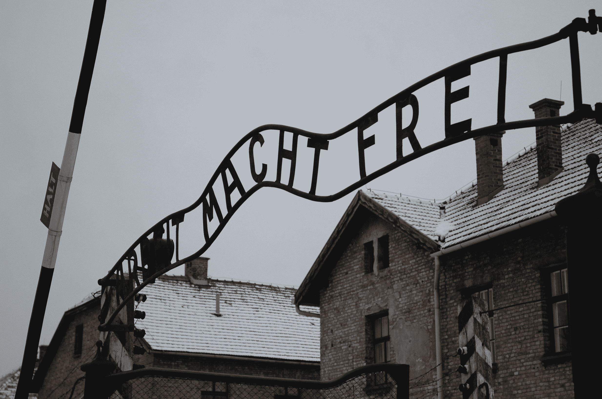

奥斯维辛集中营门口的标语

#### 杀人与自杀：死刑是他作为人的最后尊严

好，上面所说的这一切已经说明了康德的绝对命令学说是怎么帮助我们来看待撒谎这件事的。  
**现在我们再来看看，从康德的绝对命令思想出发，我们该怎么来看待杀人与自杀？**

很明显杀人与自杀就其普遍意义而言，当然是绝对命令所不允许的，为什么？绝对命令已经告诉我们了，我们必须要将人视为目的，既然我们要把人视为目的，我们又怎么能够随便杀人与自杀？而且一种将杀人与自杀当成普遍原则来崇拜的文化，显然就会走向灭亡。因为社会运作的前提是大量的作为社会节点的个体的人的存在，个体的人都大批死亡了，社会又怎么能够健康的存在呢？

不过也正如康德不反对特定条件下的撒谎一样，他也不反对特定条件下的杀人。比如康德本人并不反对死刑，当然被诛杀的肯定是已经犯下死罪的人。至于康德为什么不赞成废除死刑呢？一种解释是康德赞成古老的以命偿命原则，不过这种解释有点奇怪，因为在我看来以命偿命的原则，貌似不是从康德的绝对命令里面直接引申出来的。

我自己对于这一点的解释是这样的。康德赞成死刑这一点是从自由的原则里面引申出来的，这也就是康德绝对命令的第三条。按照这条原则，每一个人都要为自己的行为负责。  
**如果杀人这个行为是出于一个人的自由选择，杀人者就要为之负责，负责的一种典型的方式就是对被杀者的生命表示起码的尊重，而接受死刑就是这样的尊重死者的方式。**

黑格尔以后引申了康德的想法。黑格尔指出，如果一个人杀了人之后，法院不判处他死刑，这反而是对于他的侮辱。因为这意味着这个人是一个精神有缺陷的人，不配接受死刑，所以接受死刑是杀人犯作为人的最后尊严。

法官出于对于杀人犯的尊重判处他死刑，一点都没毛病。

#### 武士道精神：赤穗四十七义士的复仇

因为我是一个亚洲人，所以我在这里就不免开了一个脑洞：康德会赞成日本武士道意义上的剖腹自杀吗？这里我稍微说一下，大家可能有一个文化误会，似乎日本人没事就喜欢剖腹自杀玩。实际上在三岛由纪夫以后，现代日本人就很少剖腹自杀了。而且即使在古代，剖腹自杀也是武士的荣誉自杀方式，自杀的人是可以得到一定的社会美誉度的，我可以拿赤穗四十七浪人的故事来解释这一点。

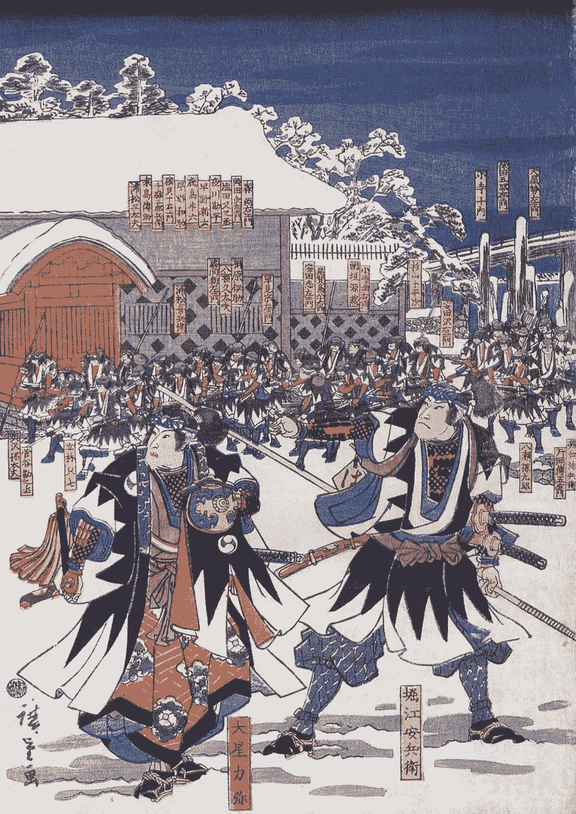

赤穗事件

赤穗四十七浪人的故事是什么呢？是指在 1701 年，江护城的吉良上野介侮辱了播州赤穗藩城主浅野内匠头，那么浅野内匠头就不得不自杀了，他的 47 位家臣就成为了浪人，为了给主公报仇，又合谋杀死了吉良上野介，然后全部自杀殉主。这就是所谓的赤穗事件。

赤穗浪人为何要自杀呢？是因为吉良上野介不把这些浪人原来的主公浅野内匠头当人，随意修理他，故意教给浅野内匠头错误的礼仪，让浅野在日本的实际统治者德川将军面前丢脸，这就等于破坏了人与人之间互信的基础，也就是说吉良上野介他破坏了绝对命令中的一些基本的原则。

而且吉良上野介的这个作为，也就预设了他作为上级，在人格上是天然的高于作为下级的浅野内匠头。从这个角度上来看，浅野的 47 个属下决定为主公复仇的行为，这本身就是一种为平等而进行的斗争。出于具体的政治考量，他们不敢杀德川将军，只好杀他的走狗吉良上野介。将吉良斩杀之后，这些人就全部投案自首，这就意味着他们对于自己基于自身自由选择而做出的杀人行为的承认。

**这里顺便说一句，浅野的 47 个属下的复仇行为的确是基于他们的自由选择的，因为没有人强迫他们这么做。**  
他的家臣中的大多数人都没有参加这次谋杀行动，而是各自开溜了。那么既然这 47 个人承认了他们杀人，他们就得负起责任，而剖腹自杀就是这样的一种方式。江户的德川政府允许他们自杀，则是对于他们行动的正义性的含蓄的表示。因为按照当时的日本法律，一种更严酷的处理方式则是斩首，也就是说不是让你自己动手，而是让别人把你的人头砍下。

从某种意义上说，47 浪人杀死吉良上野介的行为是一种展示性的行为艺术，而剖腹自杀则是这种艺术表演的高峰。  
**这 47 个人实际上是用一种极为壮丽的方式警告江户的高官，不要将我们这些乡下武士不当人，否则我们可以选择同归于尽。**

这个故事的具体情节虽然非常的残酷，但是我们仍然可以从中隐隐看出康德哲学的一些印记，这就是即使是东方人，即使是完全不知道康德是谁的东方人，依然天然的具有为目的论的王国的建立而奋斗的倾向。换言之，在这样一个理想的目的论的王国中，每一个人都不能随意的侮辱任何一个别的人。

#### 劫富济贫，是英雄行为吗？

好，说完杀人，我们再来说偷盗。我们似乎不难猜测出，康德的绝对命令是不会赞成偷盗的。  
**什么叫偷盗？其本质就是在不经过别人的同意的情况下，违背别人的自由意志，将别人的财产以秘密的方式转移到自己名下。**  
那么既然康德是如此的重视每个人的自由意志的尊严，他显然是不会赞成偷盗的。

但是关于这个问题具体到生活中来，还是会产生很多可以讨论的细节。比如无论是中国的《水浒传》，还是英国的《罗宾汉》，这样的古今中外的故事里面，我们都可以看到很多劫富济贫的英雄，这些劫富济贫的英雄或抢或偷，都会夺走很多为富不仁的人的财产，那么这些行为是不是都是 OK 的呢？

在康德主义者看来，这种做法是很难被普遍化。为什么？你凭什么去抢他的钱呢？你说他是为富不仁吗？但为富不仁的定义权在哪里呢？梁山好汉固然可以说祝家庄的人是为富不仁的，但是方腊为什么不能说被招安后的梁山好汉是朝廷走狗呢？所以按照自己的喜好去定义善恶，然后在这种胡乱的主观的定义的前提下进行实质上的抢劫与偷窃。这难道不会破坏整个社会的游戏规则，并导致天下大乱吗？

#### 绝对命令的中道

说完了康德对于杀人和偷盗的态度，我们就发现这基本上还是在讨论人类社会内部所发生的事情。然后我们再来看看人和动物之间的关系，来看看从康德的绝对命令出发，我们该怎么对待自然界中的动物？说得具体一点，康德赞成虐待动物吗？

从表面上看来，如果有一个人虐待动物的话，这个行为并不与绝对命令相互矛盾。因为康德的绝对命令本身并不直接关涉到动物，但是康德本人依然反对虐待动物，不过相关的理由或许更多的是基于心理学的考量，而不是哲学的考量。

首先这个推论的前提就是我们要反对虐待人类，理由是显而易见的，因为人是目的。接下来我们要注意到很多动物与人类是具有类似性的，比如很多哺乳动物它们的习性和人类很像。而经常虐待动物的人，他会在心理上变得很残忍，他做出虐待人类的行为的概率就会更高。所以从人格的培养的角度来看，虐待动物是不值得提倡的。

康德的思想也引发了今天西方畜牧业的一些行业标准的改变。大家就会觉得这怎么又和畜牧业也有关系了呢？你想想看，我们要把牲畜养大了以后，其中有些食用的这种牲畜必须要被杀死，那么杀死这些牲畜的过程是不是虐待动物呢？这就是一个很大的问题了。如果你是个康德主义者，认为虐待动物是件不应该做的事情的话，你就应当在宰杀动物的时候推广那些无痛杀死牲畜的做法。

有人说我们干脆就不吃肉了，彻底向佛教的思想投降，不也就成了吗？这还不行。因为康德主义者认为人是目的，如果人是目的的话，吃掉一些动物的肉，用动物的蛋白质和脂肪来补充我们的营养，这在康德伦理学上来看是非常必要的。所以康德哲学就必须要在满足人类的营养和不虐待动物之间找到一个中道，这个中道是什么呢？杀动物吃是可以的，但是要让它无痛死亡，这也就启发了很多科学家要开发出很多能够无痛杀死动物的这种机器。

这也引发了一些应用伦理学家讨论了一些非常细节的问题，比如鱼类和龙虾是否会感到疼？因为动物显然也包括鱼和龙虾，你不能虐待动物，也就不能够虐待三文鱼或者是龙虾。但这里的一个问题是我们都需要吃鱼类和龙虾，所以我们得先确定鱼类和龙虾是否真的会感到疼，然后再确定我们是否要研发出特定的机器，在宰杀它们的时候，能够让它们无痛的进入西方极乐世界。

#### 现实与理想的巨大空隙

好吧，关于绝对命令我已经说了不少了，现在还有一个遗留问题需要解决。

我们都已经知道了，绝对命令背后的担保是对于上帝的信仰，在这里上帝便是绝对的善与绝对的公正的承载者。但是康德也指出，在现实世界中上帝并不存在，因此纯粹的绝对命令在现实世界中恐怕也不能够得到 100%的体现，而只能够被打折的体现。

**这的确是一种让人感到非常别扭的状态。**

也就是说在康德的哲学文本中，我们看到的现实世界是不完美的，尽管它是现实的；而我们所看到的理想世界它虽然是完美的，但却是不实在的。这显然就构成了两个世界之间的一个巨大的空隙。这两张皮之间的间隙该怎么来填补？

请听下回分解。谢谢大家，我是徐英瑾。

公众号懒人找资源，懒人专属群分享

## 番外 - 《爱，死亡和机器人》：等待任何一个巨人，安静地走向它的毁灭

### 文稿

各位听友大家好，我是徐英瑾，很高兴和大家在这集番外里面又见面了。我们在这集番外里面要应广大听友的要求，去谈一谈《爱，死亡和机器人》的第二季。

《爱，死亡和机器人》的第一季在两年前播出以后，可以说是引发了全球影迷的一致好评。奈飞推出第二季之前，大家也是把胃口吊得高高的。但是从现在的情况来看，珠玉在前，就很难不狗尾续貂了。

但是我觉得第二季仍然是有一些看点，从哲学的角度上来解读，它能启发我们对很多问题的思考。所以在下面的讨论中，我将不去讨论这个剧集本身拍得好不好，我主要是从这八集的小品里面能够找到哪些点，从哲学上加以阐发。

#### "上帝死了"：被杀死的消费者与程序逻辑的权利问题

我找到的第一个点就是科技与人的关系，特别是人工智能与人的关系。在这八集的作品里面，有两集都牵涉到了这个问题，一集是《自动化客服》，另外一集是《神秘小屋》。

《自动化客服》的内容我们都很清楚，一个老太太弄了一个清洁机器人，但这个清洁机器人有点出故障了，不听指挥了，就开始扫荡房间里一切有生命的东西，就差点把老太太给谋杀了，这老太太是和它斗智斗勇，才勉强把它搞定。这就是自动化客服给我们的故事框架。

图源《爱，死亡和机器人：自动化客服》

《生命小屋》讲的这个内容与之是大同小异的，就是有一个宇航员在和外星人进行作战的时候，宇宙飞船被击中了，就掉落到某个未知星球上，他就要跑到这个生命安全屋里面寻找支援。没想到了进到一个所谓的生命安全屋里面，本来应该帮助他的一个机器狗出现了故障，疯狂地攻击人类主人，也许它把他误读为一个外星人什么的了。结果在经过非常残酷的搏斗之后，人类总算战胜了机器。这个故事基本上也是自动化客服的一个太空升级版。

图源《爱，死亡和机器人：生命小屋》

这两个故事都讨论了人工智能的机器不受人的掌控，反过来差点害死人的桥段，这其实也是康德主义者的一个忧虑。因为康德主义的道德原则，它要把人视为基本的目的，既然我们人是基本的目的，这就使得这个物必须要服从人的需求。但是现有的人工智能和历史上所有的这些机器都不太一样，和康德那个时代的机器就更不一样了。它的这个不一样的地方是什么呢？它没有一个清楚的界面，让我们知道它背后在做什么。

我们都想想看，在中国生活的朋友经常就有这样的一个抱怨，在中国办事他就得敲章。你如果要去敲章的话，你就要跑到各个衙门里面去看各种公务员的脸色。但不管怎么说，这公务员是人吧，他能够用一个脸的脸色来和你面对，不管他的脸色有多么冷冰冰，你都没有一种恐惧感，因为你只不过是碰到了一个态度不好的公务员而已，他毕竟是个人。

但是面对机器所统治的世界，这情况就不一样了。前不久我到银行里面去帮我家老人处理一些银行中的事务，然后发现了一件非常有趣的事情，就是现在要到银行里面去，它都要进行非常复杂的网上信息登录，界面弄的是超级的复杂，以至于营业厅里面的工作人员也是一脸懵，根本就搞不懂这背后是什么。

这就好比说，在自动化客服里面，老太太发现自己的机器人没有办法运作了，实际上如果能够连接到人工客服上，人工客服也许能够通过人工干预的方法，使得这个机器停止运作。但是系统给她的声音是，现在接通的人工客服要 6 个小时以后才能够和你进行语音通话，这就断掉了这条路了。所以它只能够在那些老太太根本不能够理解的逻辑里面摁一、摁二和摁三，结果是把情况越变越糟。

**这也就是说，计算机管理模式的界面背后的权力架构，是使得所有的人都不得不服从于设计者硬性的逻辑要求。这些逻辑要求是以程序的方式做死在每一个界面里面的，以至于这样的一个界面运作方式是没有任何通融的余地的。**

凭什么设计者所设计的逻辑丛林，就一定是正确的逻辑丛林呢？为什么老太太就一定要屈从于这样的一个逻辑安排而不能够按照老太太自己自身的心智的习惯，来设计另外一条逻辑通道呢？

**道理非常简单：这里面存在着某种权力上的不对称，消费者不再是上帝了，而是伪上帝。**  
"上帝死了"这句话不仅仅是尼采哲学的箴言，而且也适用于人工智能时代的消费文化。在这种文化当中，消费者不再是上帝了，消费者已经被程序杀死了。

#### 机器的出现，提高了一群人压迫另一群人的效率

那么很多人对于这样的一种现实，是做出了一种我认为是错误的哲学解读。他认为这就体现着机器对于人的压迫。我并不认为这是机器对于人的压迫，我倾向于认为这仍然是一部分人对另外一部分人的压迫，只不过他的中介物变得非常的强大，这就是机器。

**这就使得很小一部分人可以花费很少的力气，就能够通过广大的互联网摄像头和机器对很大数量的人进行精神控制，甚至在某种情况下可以对他进行定点的肉体清除。而人工智能的出现实际上是使得历史上有很多权力集中者所梦想的权力控制方式以一种惊人的效率实现了。**  
所以人工智能到底让我们的社会变得更好还是更坏，这的确是个开放性的问题，但是这种意义上的人工智能显然是让我们的社会是变得更坏的。

在《生命小屋》与《自动化客服》这两部短片里面，被数据化暴政所压迫的个体，的确以他们所能够进行的方式对这样的一个暴政体制进行了反抗，但反抗的方式都非常的原始。

在《自动化客服》里面，老太太是拿一把非常原始的双管猎枪，打坏了这个机器人。在《生命小屋》里面，那个宇航员是发现了这一个机器狗有一个缺陷，它会对着任何发亮的东西进行攻击，于是他就把手电筒把亮光照到了机械狗身上，让机械狗自己残害自己。

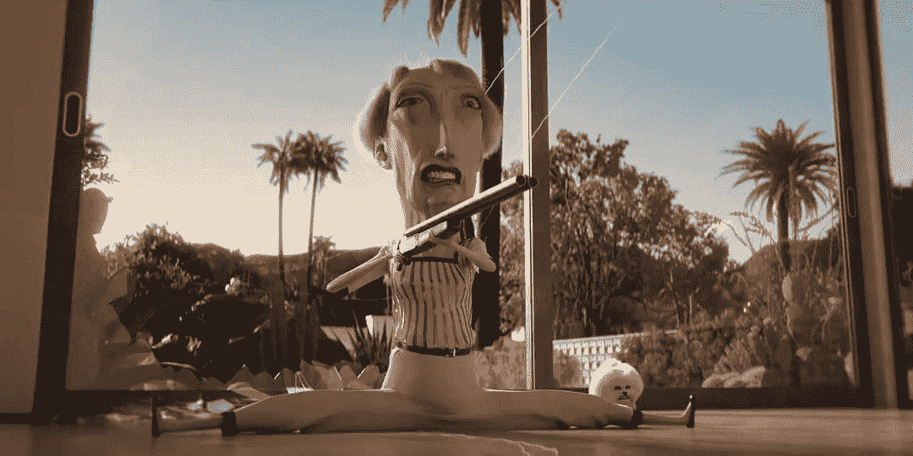

图源《爱，死亡和机器人：自动化客服》

但这两种反抗的方式听上去都有点悲哀，在《生命小屋》里面这种反抗方式已经预设了人工智能体本身的智商是非常低的，以至于它区分不出自己的身体和外部之间的区别，而比较高级的人工智能体则可以有这样的一个觉知，由此能够避开人类给它设下的陷阱。

至于在《自动化客服》里面，人类所进行的那种物理反抗的可能性已经被体系的设计者所预料到了，这也就是说，当他们杀死了一台机器人以后，相关的信息就会传送到这个城市的所有机器人的电脑里面，使得所有的机器人都跑出来来追杀人类，所以这部片子背后的结局有可能是非常非常的悲惨的。  
**由此我们也可以看到清洁机器人这五个字背后的深层含义，它清洁的对象可能不是垃圾，而是任何敢于对于数据化暴政说 no 的潜在的反抗者。**

面对这样的一个看似无解的局面，我个人认为唯一的一个能够与之对抗的方式，是造出另外一种另类的机器人，这种另类的机器人它完全是忠于主人，并且是主人的意识的扩大化，甚至某种半机械化的设施，比如说人体外动力骨骼也能够增强人类在面对机械攻击时候的生存力，但是所有这一切又需要金钱来加以买单。这也就是说这样的一个高度数据化的和机械化的世界，对于贫困的人口来说的确是非常不友好的。

如果有一种新的人工智能能够和它对抗的话，那必然是基于小数据的人工智能。这方面的想法我希望以后有机会再和大家进行阐述。不过可以和大家预报一下，今年年内北京大学出版社将出版我的《人工智能哲学十五讲》，在里面我会系统地讨论我对于小数据人工智能的一个全面的看法。

#### 永生之后，海德格尔的"向死而生"会变形吗？

《爱死机》第二季的第二个值得注意的哲学话题则是生命的长度。

生命的长度与生命的意义之间，实际上是有一种非常有趣的关系的。  
**海德格尔的哲学就有一个很重要的思想维度叫向死而生，这是因为我们每一个个体都意识到了个体生命的有限性。对于这一点的意识，能够反过来让我们反思到我们生活中的点点滴滴是何等的重要。**

你如果目睹了一个和你年龄差不多大的一个人，而且和你关系也不错的人，突然死于一场疾病或者是车祸的话，你就会反过来想想了，他这么年轻也就死了，这种命运是不是也会落到我的头上？我是不是要在有生之年抓紧时间把我要做的事情全部做掉？我以前的时间是不是太虚度光阴了？这种想法能够反过来使得我们的生命充满张力，充满意义。

但是反过来有这么一种可能性：如果我们的身体它都不会死----  
被人打了一枪，一周以后它就会自动地复原，或者说我们的生命已经被设计得具有 500 年或者 600 年的寿命----  
在这种情况下，我们看待每一件事情的意义是不是都会变形呢？

这的确是一个值得讨论的问题。因为现在随着医学的进步，我个人认为出现寿命达到 200 年的人，应该是在不久的将来就会实现了。这也会带来一系列的社会问题，也就是说能够享受这种技术的人应该还是比较富有的人。

地球上的人就可能会变成两种，一种是美丽健康的长寿的人，另外一些是年纪轻轻的、早早的就头发斑白的 996。也就是说阶层之间的固化，有可能会转变为两类人之间的生物学层面上的固化，这可能是科技带给我们的一个让人不寒而栗的未来。

《长生与新生》和《沙漠中的斯诺》这两部短片，就从不同的角度向我们展现了这种未来的不同面向。

这两部片子它的着眼点有所不同，在《长生与新生》里所描写的未来世界之中，大多数出现的剧中的主角他都是不死人，他们都是至少能活五百年六百年，而且长期的保有着自己健美的身材，一点都不衰老。但是少数想通过正常方式分娩孩子的人则被他们追杀，生下的孩子则被一枪杀掉。因为对于社会的主流团体来说，这些人的出生将抢夺不死人的有限的生存资源，所以要把他们尽早的消灭干净。

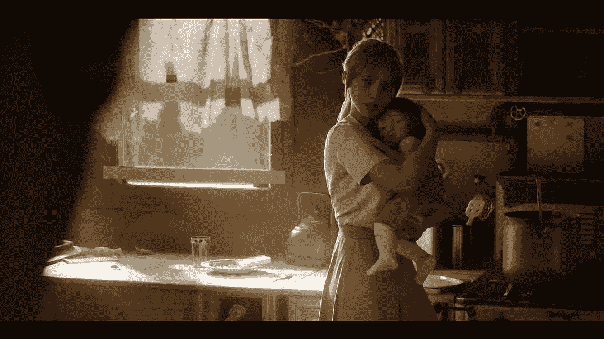

图源《爱，死亡和机器人：长生与新生》

而在短片《沙漠中的斯诺》当中，不死人则成了少数。不死人乃是一个叫斯诺的荒野镖客，他被多数的正常人所猎杀，那些所谓的正常人想弄到不死人斯诺身上的一些身体的体液，以便提炼出某种不死药。

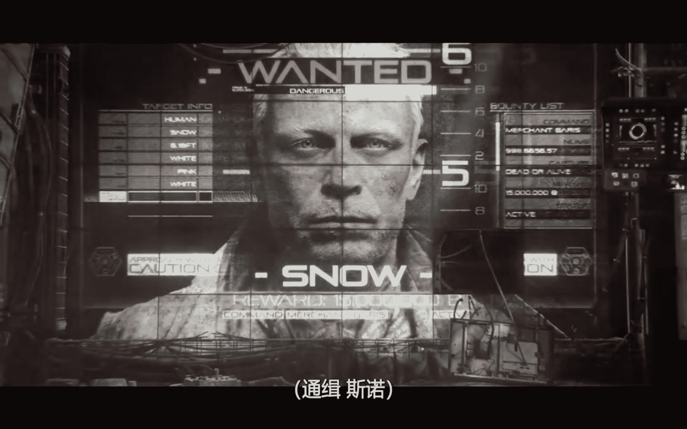

图源：《爱，死亡和机器人：沙漠中的斯诺》

那么看了这两部片子以后，就提出了一个问题，为什么在《沙漠中的斯诺》这片子里面，斯诺看上去像是个好人，他是个不死人。但是在《长生与新生》这个片子里面，除了主人公到最后良心有所发现以外，大多数的不死人都是坏人呢？这到底是为什么呢？我觉得这个问题倒是可以说道说道的。

#### 永生的悖论：凡意识到有限性的存在者，才会追求无限

我们先来说一说为什么如果你真的长生不老的话，你有可能会变成坏人。坏人在这里大致可以把这个词解读为缺乏同情心的人。什么样的人会缺乏同情心呢？就是他自身非常的强大，他没有受到过外来的威胁，这样的人就会缺乏同情。

我们就举一个例子，我们都知道有一个片子叫《美国队长》，《美国队长》里面美国军方就通过人体增强技术，把一个瘦弱的男孩变成一个强壮的武士，他本身就是件武器了。

但他为什么要去找一个瘦弱的男孩，来接受这样的实验，而不去找一个非常强壮的青年呢？道理非常简单，如果他已经是一个非常强壮的青年，弄不好他在现实生活中，就已经是个恃强凌弱的人了，没事看到矮子或者瘦子就上去揍一通。

这样的人缺乏同情心，因为他不能够站在弱者的立场上，去理解弱者的心理。但是如果他本来就是一个瘦弱的男孩，他经常被人欺负，他就知道做弱者有多痛苦。所以即使他的肉体增强了，变成个超级战士，他还想的起来做弱者是什么滋味。这种人拥有了强大的武力以后，就不会为非作歹了，这就是美国军方的一个推理。

现在我们把这样一个推理再放到不死的问题上，如果你自己也知道你会死，因为你的身体也随着时间的变化慢慢的衰老。你看到别人衰老了，你就会产生强烈的同情心。你也知道人类的生命的延续，是需要产生下一代的，所以你也渴望下一代的产生，看到别人把孩子生出来了，你就会送上真挚的祝福。

但是反过来说，你如果能活 1000 年长，对你来说活几十年，50 年、60 年、70 年就死的人生，对你来说是根本就不能够设想的。你看这些人，就像我们这些人看蚕宝宝的那种态度一样，在这种情况下，你能够同情那些人吗？你能够感同身受地理解他们面对死亡时候所流露出的那种恐惧吗？

**请注意，使得下一代得以诞生，是人类克服死亡恐惧的一种重要的方式，因为我们自己的生命可以在下一代之中延续，所以我们才渴望新生。**  
但是如果你自己能够活上千年长的话，你就体尝不到这种快乐了，甚至你会觉得这些人所生下来的这些新的孩子都是需要被清理的，因为他们除了浪费社会资源以外，似乎不能够对你的长生产生任何正面的裨益，这种想法就会让你变得残忍。

但是按照这样一个想法的话，那么在短片《沙漠中的斯诺》里面，斯诺他既然是长生不老的，他也应该变得很残忍，为什么这人倒反而不坏，还是挺有道义的，有点像中国的大侠的味道呢？

图源：《爱，死亡和机器人：沙漠中的斯诺》

那是因为这两个故事里面，长生人的社会结构不一样。在《长生与新生》里边，长生人的社会结构是一个大社会结构。也就是说，很多人都是长生，彼此之间也建立了非常复杂的社会网络，甚至有相关的这种社会的组织的架构来支撑他们，他们可以相互的循环验证着长生人的理念，因此他们不孤独。

但是在《沙漠中的斯诺》这个故事里面，斯诺他是孤独的。他有一个老婆，这老婆在 200 年前自杀了，因为老婆突然变老了，觉得没办法和老公在一起到天荒地老了就自杀了，所以斯诺就变成一个人了。他虽然通过长生具有了一般人所不具有的能量，但是他有一个致命的缺点，这个致命的缺点是什么？他的孤独。

**正因为他很孤独，所以他意识到了自己的有限性。凡是意识到自己有限性的存在者，才能够成为善良的存在者。**  
为什么？你意识到自己的有限性，你才会去追求无限。如果你自己就变得非常接近无限了，你就会产生一种错觉，你就是上帝了。任何一个觉得自己就是上帝的人，离魔鬼只有一步之遥了。

#### 溺毙的巨人与伟大的解构：不再拥有一次长久的注视

好，那么现在我们再来看整个 8 个剧集里面的最后一集，叫《溺毙的巨人》，我没办法对它归类，因为这一集好像是自成一类。

《溺毙的巨人》很明显是受到《格列佛游记》的启发，但是它的整个视角则是从巨人本身转移到了观察巨人的那些小人的身上。这个故事是英国的海岸上突然发现了一个巨人，他因为溺毙，然后被水冲到了海滩之上，所以从四方而来的吃瓜群众就把他包围得水泄不通，各种拍照片，"茄子"，上传到各种社交网络等等，在这巨人的身上乱涂乱画。

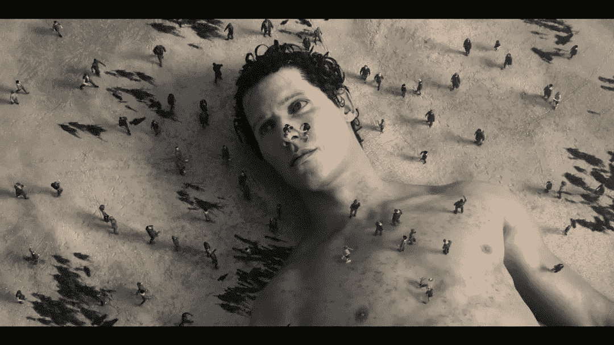

图源《爱，死亡和机器人：溺毙的巨人》

但是主人公则是一个有悲天悯人之情的科学家，他观察了这个场面以后，觉得内心有所不忍。他发现这个巨人的脸庞有一种希腊英雄式的忧郁的气质，身材又非常的孔武，现在却被一群渺小的人类随意地玩弄，这就让他感到心中有无胜悲哀之情。他就目睹着巨人慢慢地腐烂，人类一步一步地把他肢解开来，然后他的身体的各个部分又在世界各地进行展览，以后人类也只能够从巨人残存的肢体上去追忆他的伟大。

图源《爱，死亡和机器人：溺毙的巨人》

这个故事本身倒并不特别的科幻，因为这个故事里面并没有牵涉到太多的科学的内容。但是我们可以把整个故事看成是一种文学式的隐喻。

**巨人意味着什么呢？巨人可能是意味着前面的前技术时代遗留给我们的一些巨大的精神遗产。但是面对这样的一个精神遗产，我们能够做的事情是什么呢？就是在这精神遗产的基础上去调校它、解构它，对于巨人的肢解本身就意味着一种解构结构。**

我在这里可以举一些例子，比如说我们今天是一个浅阅读的时代。任何伟大的、沉重的东西，我们都要把它调效调校，然后把它肢解为我们肤浅的灵魂所能够理解的东西。

我就举个例子，可能这个例子不是特别的恰当，但是能够体现我对于一个巨人时代失去的这种叹惋的心理。比如我们都知道托尔托尔斯泰有一部名著是《战争与和平》，这部电影在冷战时期即被苏联花重金拍过，也被当时的美国拍过，应该说这两个版本都非常的好，也都体现了电影创作者对于原著的一个尊重。

但是在大约 10 年前，欧洲和俄罗斯又把它合拍了一遍，我看了以后整个故事情节怎么和我看到的原始的战争与和平有这么大的区别呢？  
**重大的、人类历史的、史诗性的篇章，变成了各种各样男女争风吃醋的布景台，整个故事被高度地庸俗化，变成了几对男人和几对女人之间相互纠缠的情感关系。**

当然战争这个故事是穿插在其中的，但显得好像就像地震一样，只是一种外在的世界，看不到这些历史运作和历史当中的人物之间的心灵交汇。

为什么会出现这种情况？到底是编剧本身已经丧失了对于原著的理解能力，还是观众自身的肤浅逼迫编著者也要将自己的思想高度降低到能够符合他们趣味的那个水平？

我觉得两者恐怕兼而有之。

当然导致这样一种精神的庸俗化的原因很多，其中一个很重要的原因很可能也是与科技有关。  
**正是因为现在数码化的电子影音产品是如此的丰富，特别是网络上的各种 APP，把大家的时间全部给切碎了。所以大家就培养不出一个长久的耐心，长久地注视一项伟大的事物，从中看出某种恒久的意义。**

即使是在 50 年代以后的发达国家，比如就在美国，虽然表面上看来已经有原始的电视机了，有广播了，有汽车了，但是人们获得精神产品的主要渠道还是通过阅读。

电影虽然也是很重要的一个娱乐的项目，但是要看电影这件事还不是特别容易。在美国很多小镇里面，你要开车开一定的距离，跑到城里面才能够看电影，所以看电影就像看戏一样，还是全家的一件大事。当时的电影有可能会拍得非常的长，比如像《埃及艳后》，比如说《宾虚》都是非常非常的长，这就预设了当时的观众是有足够的耐心在电影院里面把这种史诗级的电影看完的。

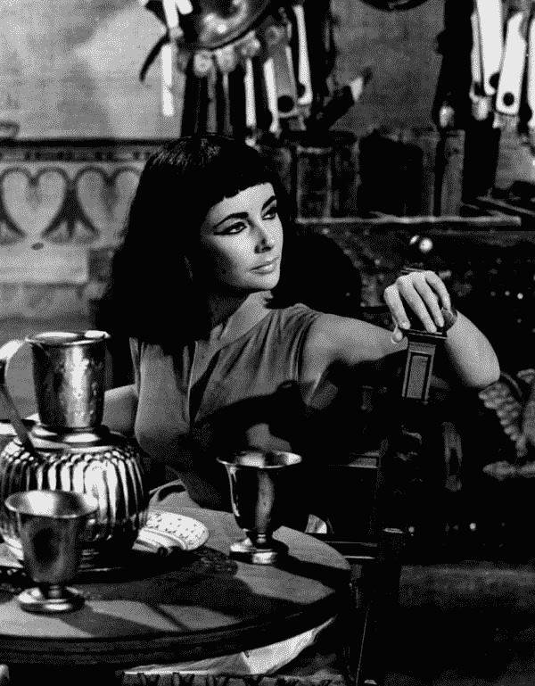

图源《埃及艳后》

现在谁如果按照这种态度去拍电影，肯定是要亏死了，现在大家的所拥有的耐心都不会超过十几秒。这种态度就类似于沙滩上的那些和巨人留影的庸俗的观众对巨人的态度。对他们来说，巨人就是个背景墙，他们根本不屑于去理解巨人背后的那些深层的故事，只是把巨人的背景当成是社交网络上炫耀的一种资本。

当然我对这种现状也并非是完全的悲观。我总觉得人类是有一个特点，就是喜新厌旧，这也未必就是坏事。也许人类要再肤浅 50 年、60 年，突然觉得深刻才是一件很酷的事情。也许等我白发苍苍的时候，人们才会觉得我们要呼唤巨人的归来。

**不管巨人会在 40 年后还是在 50 年后归来，我们仍然会以坚守的态度守护着我们精神的家园，等待着任何的一个在我们的沙滩上搁浅的巨人，能够安静地走向它的毁灭。**

好了，今天这集番外就到这里为止了，谢谢大家，我是徐英瑾。

公众号懒人找资源，懒人专属群分享

## 59\. 作为自然、自由之桥梁的目的论：康德哲学的超级粘合剂

### 文稿

各位听友大家好，我是徐英瑾。在展开今天的话题之前，我们先把前面讨论的内容捋一捋。

#### 康德被误解的"灿烂星空"与"道德法则"

讲到康德的哲学，我们很可能经常会听到这样一句名言，说：在我头顶灿烂星空，在我心中道德法则。其实这句话说的多少有点坑爹，很多人就是因为听了这句话对康德产生了误解，什么误解呢？康德的这句话给人的印象好像是这样的，既然灿烂的星空在我头顶，那么自然规律也应该在我的头顶，因此自然规律就是外在于我的内心的，而道德法则则是内在于我的内心的。实际上这就把康德的意思给说反了。

**康德哲学真正的意思是想说，自然规律是我们的人心做出来的。**  
我们的先验范畴得加上感性材料，然后感性材料和经验范畴相辅相成，这才能做出知识。至于感性材料与先验范畴之外的东西，那不是知识可以触及的范围。康德就管这些东西为"物自体"，一句话，自然规律就在我心中，开普勒的三定律在我心中，牛顿的法则在我心中。因此从这个意义上说，灿烂星空应该在我心中才对，而不是在我头顶。

反过来说，道德法则倒并不是真正的在心中了，而是应该在我的头顶了。

为什么呢？因为我们知道道德法则按照康德的观点，它不是从现象世界当中归纳出来的，它是绝对的存在者，你通过对于现象世界的归纳，是归纳不出道德的。既然它是绝对的存在者，它就需要一个更绝对的存在者来担保它，那就是上帝的担保。正因为上帝的存在是绝对的，所以道德法则都是以绝对命令的形式来体现自身的。作为绝对的存在者，它就不应该在有限的我的心中，它就应该在我的头顶。

所以一句话，道德法则是悬在我头顶的，我把这话改一改就应该是变成这句话了：心中自有小宇宙，头顶律法管是非。

### 康德哲学中的二元论矛盾

那么因为康德的哲学有这么一种二元论的色彩，所以他就碰到了一个问题，就是怎么样把他的哲学的两个要素相互融合。一个要素就是从心里面发出的物理学规律和自然科学规律，另外一个则是从头顶照耀而来的道德之光，怎么把这两个因素结合在一起，这是康德面临的一个非常麻烦的问题。

虽然物理学法则是人心做出来的，但既然是物理学法则，它总是给人一种冷冰冰的感觉；虽然道德的光芒是从我们头顶上照过来的，但既然它具有道德的内容，那么很显然它仍然是关涉到我们每个人的幸福的。所以康德的哲学就面临着这样的一个问题：  
**冷酷的物理描述与温暖的道德法则这两者怎么协调？**

我们生活中的每一个人都是完整的，但是我们又似乎同时生活在这两重性的世界中，我们会不会因为这样的两重性而被撕裂呢？

这可以说是个非常现实的问题，因为在现实生活中我们就会经常看到两类人之间的斗争：一类就是所谓的理科脑，一类就是所谓的文科脑。理科脑的特点是什么？就是做什么事情都要看证据，没证据不能乱说话。文科脑有时候更强调良心，良心是不讲证据。

#### 目的论：作为"自然世界"和"道德世界"的桥梁

康德非常清楚他的体系里面有这样一个矛盾，他的解决办法则是诉诸于所谓的目的论这个概念，目的论为何能够扮演桥梁的作用，以便将自然以及自由，或者说物理世界以及道德世界两者相互打通呢？这是因为在自然界中有目的，在道德世界中他也有目的，因为两者都有目的，所以目的就能起到这样一个桥梁的作用。

现在我们先来看看，为什么说在自然世界中是有目的的？我举个例子，心脏的运作，没有目的的介入，你就很难解释它们为什么是如此运作的。你必须得说心脏就像一个泵一样，它可以把新鲜的血液送到身体的各个部分  
\----你看，这里面就牵涉到了一个目的----它的存在就是为了把血送到身体的各个部位。生物学就是一种充满着目的论的话语结构的自然科学。

讲到这里，有人就认为生物学是一门不彻底的自然科学。彻底的自然科学应该是物理学，在物理学的层面上，我们可以用彻彻底底的机械论的方式来说明世界的运作。什么叫机械论呢？这就比如说有一个弹子球，它之所以动，是因为前面有一个弹子球打了它，这就是一种目的论机械论的说明，有一个前因，有一个后果，前因不发生，后果就不发生。

你用目的论的话语结构来说，这件事就有点搞笑了。你就会说，被打的弹子球之所以在这里，就是为了等打它的弹子球来打它。这就好比说一个飓风把一个房子吹走了，你就说这个房子之所以在这里存在了五年没有被吹走，就是为了等那个飓风在这第五年跑过来，把它一一股脑地吹走了。

#### **无法消弭的目的论**

在说到机械论的描述和目的论的描述之间的不同的时候，我们会发现了目的论描述的关键词是两个字，是"为了"，而机械论的描述则要消除"为了"这两个字。

但康德非常敏锐地发现，尽管在自然科学的物理学层面上，似乎我们可以消除为了这两个字，但这一点在生物学中是不成立的，因为没有为了这两个字，生物学就完蛋了。

这是为什么呢？因为这牵涉到了两个问题： **一个是部分与整体的关系，第二个就是事实与规范的关系。**

首先来讨论部分与整体的关系。生物学肯定是要讨论部分与整体的关系的：你要讨论手指的作用是什么，肯定要结合对于整个手的整体的考察来进行；你要讨论静脉的作用是什么，那么就要看静脉在人类的整个循环系统的整体当中扮演什么角色。很显然，在这些讨论中，整体就具有了对于部分的优先性，所以部分就必然是会为整体而存在的。

大家要记住这一点，为什么会牵扯到为了这两个字，就是因为整体是先在于部分的，所以部分是为了整体而存在，这就使得为了这两个字无法被消除了。这也就是说在生物学当中，就有一种早就被做死在里面的目的论思想了。

为了这两个字的重要地位，也可以在事实与规范之间的关系中体现出来。生物学是一门规范性很强的科学。什么叫规范性很强的科学？我们就来看看。

医学显然是从生物学里面衍生出来的，那么医学里面经常说的话是什么呢？是正常与不正常。比如你的血压正常吗？你的血小板的浓度正常吗？你的血的含氧量正常吗？等等。对于正常与不正常的讨论就是规范性的讨论。

生物学其实也是这样。生物学的一些概念，比如说变异也包含了不正常的意思。正常这两个字的深层语义又是什么呢？说一个有机体是正常的，实际上这就意味着其各个组成部分都是按照其预先规定的运作目的而运作的，所以正常这两个字也就预设了目的论的思想。

如果一个医生他脑子里只有机械论的想法，而没有目的论的想法，他就没办法看病了。我就可以构造一段对话，这个对话里面设想的医生就是一个满脑子机械论思想的医生，没有目的论思想。

病人说：医生，我被撞了一下，胳膊脱臼了，您行行好，帮我复个位吧。

医生说：很好，被重物撞击，胳膊脱臼，这一点是符合自然法则的。

病人说：医生，你别老说废话好不好？问题是你什么时候帮我复位呢？

医生反问说：我为何要帮你复位呢？

病人说：我疼，而且我的胳膊目前不能够正常运作。

医生说：你疼是因为你的神经系统的运作而导致的，这一点也完全符合自然法则；至于你的胳膊不能运作，也是因为你的胳膊事先已经脱臼了。关于这一点，你有任何理智上的困惑吗？

病患说：我没有任何理智上的困惑，我的问题是你为什么不帮我的胳膊复位呢？我的胳膊已经脱臼了。

这段对话告诉我们什么？也就是说一个脑子里面只有机械论想法的医生，他是看不到正常的事态和不正常的事态之间的区别的，他也没有感到有一种冲动要把那些不正常的事态纠正成正常的事态。如果他没有这种冲动的话，他就没办法治病救人了。

自然界当中有目的论这个想法是康德哲学的一个重大发现。很多人都认为，这难道不正是康德承袭亚里士多德的地方吗？因为亚里士多德早就区分了目的因、形式因、治疗因与动力因。但是康德的看法仍然是有他的新意，并不是对于亚里士多德的重复。

#### 目的论：作为宏观理念而非实证知识的存在

这里我要提醒大家注意的是，康德虽然承认生物学当中有目的论的成分，但他并不认为我们可以通过科学实证的方法把这一点实证出来。他的思想要点是目的论是生物学得以存在的一个终极话语结构，你如果不按照目的论的方式去说话，那么生物学就不能够存在了。但是你真的要用一个做实验的方法来证明一个器官的目的是什么，或者说一个循环系统的目的是什么，这是做不出来的。  
**换言之，目的论的设想在康德看来是调整我们眼中的自然图景的某种宏观的理念，而并不是某一条实证的知识。**

这就牵涉到了我和很多杠精谈话的时候所碰到的一些问题。

很多人就不理解，有一些我们谈话的基本前提它并不是通过实证的方式加以确定的，而是我们使得谈话变得有意义而必须接受的前提。

比如说我们要建设一个公平正义的社会，有些人就说我们为什么一定要建设一个公平与正义的社会呢？建立一个丛林法则的社会，这也完全是可以的。老实说我没有办法用实证的方法来证明建立公平正义的社会的想法的科学证据是什么，但是如果你认为公平正义的这种理念不值得追求的话，我们之间的谈话也没有必要进行了，因为你完全可以拒绝用言辞和我谈话，而用刀剑来和我谈话，这就不叫谈话了，这叫暴力。

同样的道理，医学或许也可以完全不区分正常状态和不正常状态，不去在意健康状态和不健康状态。但如果这样的话，这医学就不称其为医学了，医学也许就和制毒杀人、造各种毒品毒害人没有什么本质区别了，这样这些科学就不能够成为对人有用的科学。

**那么请注意  
"对人有用"这个讲法，这个说法是预设了人是科学知识运用的终极目标，人就是目的。这也就是说对于生物学的目的性的这种阐释方案的最终导向，是要将自然科学引向伦理学。**由此我们可以从一个更深的角度来理解，为什么在康德所说到的绝对命令的道德法则里面，人是目的这一条扮演了如此重要的角色，这是因为人本身就扮演了两种角色。

首先，自然意义上的人乃是由各种自然器官按照一定方式构成的组合体，各种器官的正常运作的根本目的就是维护整个的人的利益。

而社会意义上的人则是各种科技产品的运作的最终服务对象，比如飞机、高铁、轮船之所以被发明出来，就是为了运载人，而且这些交通工具上的各种设备的设计都考虑到了人的利益，使得人能够在里面以相对安全、舒适的方式完成旅途。甚至像武器这样的机械也是为了人的利益，虽然武器是具有杀人的指向的，但是杀人也是为了保护武器的主人不被杀。当然我对于武器特点的分析是不适用于核生化等大规模杀伤性武器的，因为这是一个特殊的话题。

从上面的分析来看，康德在道德上将人视为最终的道德法则的一个恩惠对象，这个想法其实在他关于自然界目的论阐述当中，就已经有其根基了。人天然的就能够完成从自然中的目的性到道德领域中的目的性的过渡。

#### 目的论牵引下的自由主义政治哲学

了解了这些想法以后，或许我们也能够更为深刻的理解，为什么康德的伦理观，能够支持起自由主义的政治哲学，而不是国家主义的政治哲学。自由主义的政治哲学非常简单的来说，他重视的是每一个个体的利益，并认为每一个个体的利益是先于整体的。国家主义是反过来的。

为什么康德会有一种自由主义的政治哲学？为什么他不会采用这样的说话方式，即认为国家的整体才是个体生存的真正目的呢？

道理非常简单，因为个体的目的性显得更加的自然。 **请注意，康德是主张部分必须得预设整体的存在而存在的，但是整体必须是某种自然存在的整体。**  
比如我举个例子，你的大拇指、小拇指都自然的存在在你的手掌上，所以你的整个手的整体性是个自然的整体，而你的手是维护你的整个有机体的运作的，你的整个身体就是一个自然的整体，所以人作为一个整体是目的是没有问题的。但是国家作为一个整体而言，它并不是一种自然存在。

比如说奥匈帝国，它表面上是个很大的国家，但一次大战以后迅速的就变成了不同的国家。毫无疑问，国家的整体性，它的稳定性是很差的。

但不管奥匈帝国再怎么变吧，奥匈帝国当中的每一个具体的人，他的身体没有发生改变。奥匈帝国解体以后，大哲学家维特根斯坦本来是奥匈帝国的公民，当然他最后变成了奥地利的公民，后来他又变成了英国的公民。他无论变成哪国的公民，他的手还是他的手，他的脚还是他的脚，他的个体的整体性还没有怎么被破坏吧？这就是康德的要点。

的确康德也是主张整体是优先于个体的，但他说的整体必须是个自然的整体。而在人类的整个社会架构当中，自然的整体甚至连家庭都不是，因为家庭都会解体，只有你的生物学的个体才是一个自然的整体，所以家庭和国家都不是这样的整体。这种想法最后会导致康德的政治哲学和他以后的一些德国哲学家，比如说黑格尔的政治哲学就会有很大的不同了。

由此看来，康德以个体为聚焦点的自由主义的政治哲学观点，是有着非常深刻的生物学考量的，而这些考虑背后又有着非常深刻的目的论思想的牵引。我个人认为，目的论是将康德哲学的各个板块连接在一起的超级粘合剂。

#### 刻在生物性中的人权与自由

听到这里大家就问了，今天的这一集节目能够让我们学到什么呢？怎么能够让我们在生活中用到这些原则呢？

大家要记住，人权这个观念，按照康德的观点，是联系到一个有血有肉的个体的人上面，你脱离了对于人的生物学的关照，空谈人权二字就毫无意义。比如老板要对工人讲人权，就要关心工人的吃喝与劳动保护，关心他们的薪资，你脱离薪资、脱离劳工的基本权益谈人权，这就是耍流氓。同样，自由两个字它也要考虑到生物性。  
**人类热爱自由并不仅仅是一种哲学理念，而在相当大的程度上是因为我们在生物学的层面上，热爱自由就是我们的生命的目的之一，它已经做死在我们的生命里面了。**

你想想看我们人本来是什么？在进入文明之前我们不都是采集狩猎动物吗？如果是采集狩猎动物的话，我们就在大森林或者大平原上，我们得自由地驰骋、自由地奔跑。我们需要溜达，我们需要行动，我们需要空间。所以进入了文明时代以后，社会的管理者也要设计合理的交通规划方式，方便人类的出行。

如果有这么一个制度，一边说我们要给大家自由，另外一方面又通过显性和隐性的规则，逼得所有人都得 996 加班，让人根本就没有时间出去溜达，获得充分的与大自然接触的机会，那么这种意义上的自由也是在骗人。

大家需要注意的是，康德对于目的论问题的讨论是在他的《判断力批判》这本书里面。这本书非常有趣，他一半看的是生物学哲学，一半谈的是美学。

这两个话题貌似是相差非常远的，但是美学和生物学背后又隐隐的都有一个目的论的导向，比如在看艺术作品的时候，我们就会发现艺术作品本身有一个类似于生物体结构的一个目的导向，它最后的高潮好像是前面的所有的铺垫的真正的目的指引，就像我们每个人的死亡也是我们前面的所有的生命活动真正的最后的归宿一样。

因此在下面一回中，我们就会转入美学的话题，这也是人生哲学的重要面向。

好了，这一期节目就到这里为止了，谢谢大家，我是徐英瑾。

公众号懒人找资源，懒人专属群分享

## 60\. 康德的美学思想：“理智愉悦”与审美的目的论结构

### 文稿

各位朋友大家好，我是徐英瑾，很高兴和大家继续来讨论哲学家的 10 种生活提案这个话题。

上一节我们主要说的康德的目的论思想。康德的目的论思维可以说是无所不在的，而且在康德的美学思想里面，我们也可以找到他目的论思想的痕迹。

#### 美是主观的？还是客观的？

美学是干啥的呢？一言以蔽之，美学就是对于美的研究。但美真是一个非常奇怪的东西，因为它根本就算不上什么东西，它好像在那里，又好像不在那里。

一部分人说，美是主观的。举个例子来说，你觉得齐白石画的虾到底好不好？有人会说好，有人会说不好；有人说梵高画的《农夫的鞋》很美，有人则觉得不知所云……可见美这件事是见仁见智的。

另外一部分人则是说美是客观的，美本身具有超越于个体口味的价值。莎士比亚的作品就具有永恒的价值。当然有些人不喜欢莎士比亚，觉得莎士比亚的作品没什么意思。但主张美是客观的人会争辩说，美之具有客观性，与多少人能够理解这种美是没有关系的。这正好比说，相对论之所以有永远的价值，就是因为相对论本身真的有价值。这与多少人能够理解爱因斯坦的相对论是没关系的一样。

美到底是主观的还是客观的？这种争论已经构成了我们日常生活中的一个大分裂的源头。我们面对的生活是审美情绪彼此分裂的时代。有人觉得《小苹果》唱起来美美的，有人听上去就觉得俗不可耐。每个人都在自己的美学茧房里边吐丝，将自己看到的美学世界视为整个美学世界。于是，美学相对主义的思想就会乘虚而入。

相对主义者会这么说，瞧，美学判断本质上就是一种社会学现象，有很多人喜欢某某美学口味，该口味就会被说成是流行的，然后被包装为普遍。而真正的绝对意义上的普遍性则是不存在的。

#### 产生于美学判断的美学愉悦

康德又会怎么来看待这个问题呢？首先要注意的是，康德关于美学的观点是略略偏向理性主义的。他的核心美学思想是，美学的愉悦是产生于美学判断的，而不是反过来的。即并不是美学判断衍生于美学愉悦。

在这个问题上，康德的思路与孔子是不一样的。《论语述而》里面有这么一句话："子在齐闻韶（shao），三月不知肉味。"也就是说孔子在齐国听到了韶（shao）乐，非常沉迷于其中，三个月之内都分不出肉是什么味道。韶（shao）乐是舜王时代创作的音乐，据说非常的庄严，听了这样的音乐可以修身养性。

孔子的思路无非就是说美好的音乐与美好的肉类食品都能引发美好的愉悦感。康德并不这么想，在康德看来，吃好吃的肉，是感官愉悦先行，然后才有判断。比如你吃了一口昂贵的北海道的高级和牛肉，让唇舌与精美的肉品充分搅拌亲吻，然后你的大脑里才会冒出这样一个句子，（美味しいよね）好好吃啊！也就是说你先觉得好吃，然后下判断。

但是看一幅画、欣赏插花艺术则不是这么一回事儿。你首先得先看明白，这艺术作品说的是啥，然后你突然开窍了，一拍脑袋，我看懂了，原来如此，好美，好有创意！这也就是说，是判断先行，然后才有愉悦。

听了这样一套说辞以后，可能大家就会反问康德了，难道我们在欣赏艺术作品的时候，我们的感官不是首先接触到那些和谐的颜色对比或者是声音对比吗？难道这些质料方面的和谐性，就不足以引发我们的感官愉悦吗？为何一定要说审美判断先于审美愉悦呢？

康德的思路是这样的，纯粹的颜色和声音不能够产生愉悦感，否则天下所有的东西都有颜色，都会发出声响，难道万物都是艺术品吗？艺术品之为艺术品，就是对于感性材料的巧妙排列。苏州园林里的石头，虽然都是从自然中取得的，但在被人为的巧妙排列之后，就成为了艺术。欣赏艺术，就等于要在感性杂多里面看出门道来，而所谓看出门道，就叫审美判断。只有你看出了门道，返回去再去看那些感性材料，你才能真正得到审美愉悦。

我可以举个例子，小时候恐怕有很多人都不怎么爱听交响乐，我小时候就觉得交响乐听上去特别吵，非常闹心。长大了却非常喜欢听交响乐，觉得交响乐很雄壮。这里面到底发生了什么呢？

交响乐涉及到了非常复杂的形式结构，这个结构的复杂性就类似于哥特式教堂。对于这样形式的把握超越了儿童心智能力的上限，而成年人有了一定的阅历和一定的艺术鉴赏经历以后，就具备了这样的心智力与判断力。一句话，我们的审美鉴赏力就如同望远镜，没有这个望远镜你是看不到远方的美景的。

#### 审美的目的论结构

这里我们听到了判断力这个词，或者说鉴赏力这个词。判断力这个词好像在科学里面也在用。大家或许会问，审美判断力与一般科学领域内的判断力到底是什么关系呢？比如判断一个演员的表演好不好与判断一个演员的身体好不好是同一类判断吗？

从宏观的角度上看，所有的判断都是将一个特殊项与一个普遍项相互关联的活动。从这个角度上来看，演员的名字总是特殊的，对于演员表演的评分与对于演员的身体健康指数的评分也都是普遍的。所以判断一个演员的演技好不好，与判断一个演员的身体好不好，这两种判断的确都是判断。

但是我们非常清楚，判断一个人的演技好不好，这属于美学的任务；判断一个人的身体好不好这是科学的任务。美学判断它的特殊性又体现在哪里呢？

美学判断特殊的地方就在于其所要揭露的根本不是事实。为什么呢？因为大量美学作品所描述的虚构对象根本就不存在。贾宝玉存在吗？孙悟空存在吗？鲁智深存在吗？都不存在。它也不是某个清晰的科学概念，比如一种疾病的病名，你在文艺作品里面完全可以虚构一种病名。美学判断所要揭露的乃是艺术作品当中蕴含的无目的的合目的性。

什么叫无目的的合目的性，这到底是什么意思？听上去非常的玄奥。这是我们上一讲对于目的论的讨论，对于美学的衍生作用。

我们都知道，好的艺术作品都要有一个目的论结构。我们可能都听说过罗丹的砍手的故事。罗丹雕塑了一个巴尔扎克像，发现这个手做的太喧宾夺主了，然后一怒之下就把手给砍下来了。当然了，有些美术史的专家告诉我，这个故事可能是虚构的。我认为这个故事即使是虚构的，但是这个故事的教育意义仍然在。的确，我们在进行文艺创作的时候会觉得某一个部分过于的喧宾夺主，所以必须要忍痛割爱，这方面的例子还是很多的。

这说明什么？这说明在艺术作品里面，好的艺术作品都要有一个目的论结构，各个环节都必须要为艺术的整体服务。既然你是要整体服务，个体就要为这个目的摆正自己的位置，它不能太出挑。反过来说，如果某一个环节明明需要扮演 C 位的角色，它却根本就不出挑，挑不了大梁，这也算失败。

我自己平常也喜欢搞一些小的艺术创作，除了写小说以外，我还有一个喜好就是喜欢做模型微缩景观，英文里面有一个单词叫 diorama。我在做这个景观的时候，就发现这个目的论的结构非常重要。比如你要表现一个 1:35 的在苏联前线的一个冬天的场景。你要表现士兵们的寒冷，这些模型士兵的衣服与表情，就得为这个目的服务，你不能出戏。顺便吐槽一下，国产的很多战争片之所以很烂，就是因为很多群演的表演很出戏，他无法为历史场景的整体目的服务，似乎故意已经在自己的脸上写了群演这两个字。

大家听了好几遍目的论的结构这个词，但是目的论的结构到底本质上又是什么呢？这恰恰是一句话说不清楚的。你就算好像领悟到了，这也是一种非常模糊的审美判断。不过这种判断已经足够产生愉悦了，这是一种理智的愉悦，因为你已经 get 到了创作者的用心，你感受到了心与心的交融，即使创作者本人在物理上早就死亡了。

#### 无目的的合目的性：美学判断揭露的本质

好吧，关于审美判断的目标是目的论的结构，想必大家都了解了。但为何说这目的是无目的的合目的性呢？康德到底是想说这是合乎目的的还是不合乎目的的呢？

当然康德归根结底的意思还是要说这是合乎目的的。但是在他看来这个艺术作品还必须以润物细无声的方式呈现出目的，而不能强说目的，很多意思不能说白，要观众自己体会。

一些劣质艺术品就是这样，有一些劣质的影视剧就让你看出谁是好人坏人，看出艺术作品的目的是惩恶扬善，每个梗的含义都直接表露出来，一点都不含蓄。这种作品因为表达意思太直接无法锻炼观众的判断力，所以无法让观众产生高级的审美愉悦。

好的作品的典范在我看来就是是枝裕和先生的电影。我是是枝裕和的影迷，我发现他的电影特点是什么？就是在一个日常的生活场景里面，很多演员坐在一起，家长里短婆婆妈妈，好似说的每一句话都是非常通俗的话，好像整个场面是没有排练就可以展现出来的原生态的日本家庭的生活场景，但是你只要仔细一琢磨，才发现没有一句废话，台词字字珠玑，表演浑然天成。真是比那些肤浅的烧钱的大片，不知道高哪里去了。

比如我就不提他的得奖电影《小偷家族》了，我谈另外一部电影《比海更深》。在电影进入剧情的高潮的时候，老太太淑子是已经故去的树木希林女士表演的。她变着法劝说前儿媳祥子能够和自己的儿子复婚，这个儿子是由阿部宽先生演的。在这段表演里面，前面预埋的梗一个个自然的得到揭露。而在感情进入高潮的时候，邓丽君用日语歌唱的《比海更深》的音乐作为背景音乐响起，非常巧妙地完成了点题。这时候作为观众的我，就得到了极大的精神愉悦。

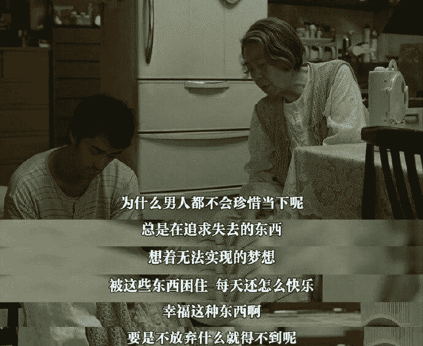

《比海更深》中淑子在听广播中的邓丽君的歌曲

#### 美学判断是有客观标准的

我前面说的意思已经很清楚了，好的艺术作品当中的目的论结构，不能够直接的表现出来，而只能以无目的的表象显露出来。那么有了这样的一层讨论做基底，我们就来看这样的一个问题。审美判断它到底是主观的还是客观的？

康德认为，审美判断还是偏向客观的，之所以客观，主要有两个原因。

**第一个原因是什么呢？就是审美判断是没有利害牵涉的。**  
比如我喜欢是枝裕和先生的电影，不是因为我和他有私交，或者我在他的电影公司里面投钱了，如果是这种原因我喜欢他的电影，这就不是真喜欢了，这是因为里面有利害关系。

需要注意的是，凡是牵涉到有利害关系的这个东西就很难客观。为什么？因为每个人的利益考量是不一样的。比如我是这个电影公司的员工，我就要为我们公司的电影在网上叫好，是不是？我即使觉得另外一个电影公司的电影不错，我也不会为你站台的。为什么？你的利益和我的利益不一样。但是说到纯粹的艺术，相对而言更可能会达成某种一致。所以这是为什么说审美判断具有客观性的第一个道理。

**第二个道理是什么？就是审美判断可能是具有普遍必然性的。**  
这也就是说，当我说是枝裕和的这部电影非常好的时候，我并不是将这个判断视为一个主观判断，我认为这就是好作品。我只是这部作品一个偶然的鉴赏者，我相信具有鉴赏水平的人，会得出和我一样的结论。

我就想起一个故事，我们都知道陈忠实是我们国家已故的作家，他写了《白鹿原》这部小说。他在老家花了很长时间写这个稿子，写完以后带着忐忑的心情就交给编辑看，编辑看完以后很激动，打电话对陈忠实先生说：老陈，这事儿真给你给办成了。

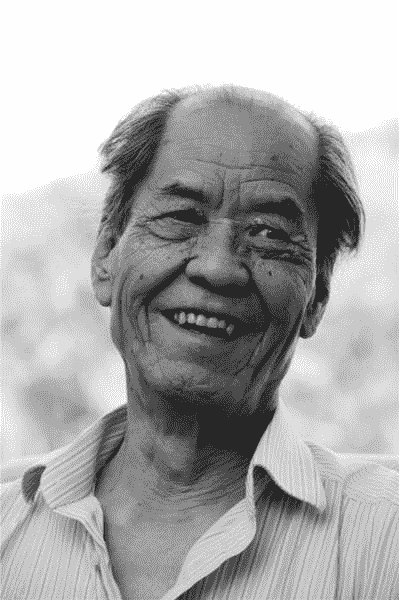

作家陈忠实先生

这话说的特别有意思。他没有说"老陈，你写了部好稿子"，而是说"老陈，这事儿真给你办成了"。这话很有咀嚼的余地。为什么要用这样的语言结构？我觉得这话的言下之意，就是您的小说已经达到史诗级作品的水准，这个水准是客观存在的，你呢越过了这个水准，就类似于一个跳高运动员已经越过了一个世界纪录的标线一样。

因为这个水准是客观的，你又越过去了，这件事本身也是客观的，所以我可以以一种客观的口吻说，这事儿您办成了。我个人认为这位编辑很可能就是一位潜在的康德美学的信徒，他是相信美学判断是有这样的客观标准的。

#### 在美学领域中成立的客观：审美共同体的集体意见

大家或许会说了，在美学判断里面，有很多人与人或者文化与文化之间的差异，甚至是同样一个文化等级水平里的人，也会有对一件事情有不同的看法。

我个人认为在战后德国拍的最好的战争片之一是一部很长的海战片，叫《从海底出击》。所以在读博士生的时候，就把这个牒片找来了，给很多同学看，他们也都是博士生。但是除了我以外，其他人都觉得这部片子很 boring，一点都不好看。这一点难道不正说明了，没有普遍的、一般的审美的判断标准。

康德当然知道，生活中有这个现象。但我觉得康德主义者想说的意思是这样，我们当然知道审美判断是因人而异的，但是我在做我的审美判断的时候，我是以一种"装作"的态度，认为这是普遍的审美判断。装作是什么？就是假装的意思，英文里面就是"as  
if"。

比如我说《从海底出击》是一部好电影，你说不好，我会补充说，但这不妨碍我依然认为这部电影的确客观上是部好片，你说不好是你的事。这就好比说，我如果穿越到伽利略的时代去，我如果对所有的那些中世纪的那些愚夫愚妇说："你们知道吗？伽利略是这个时代作出最大成就的科学家，而且我认为这是一个客观的判断。"结果所有身边的人都用白菜皮子来扔我，因为他们都不同意我，但是这不妨碍我坚持我的发现是客观的。

讲到这里，大家脑子就会糊涂了，到底什么叫客观什么叫主观，你现在能把客观这个词的含义和大家澄清一下吗？我说可以。客观这个词的确有不同的含义。第一重意义上的一个客观，指的是与事情符合，第二重意义上的客观，是指与大多数人的意见符合。第三重意义上客观，是指与高水平的人的意见符合。

在审美领域里面，我们一般说的就是这第三种客观。那么第三种意义上的客观，也可以翻译成这个意思，就是那些所谓的高水平的人、具有先验共通感的人，我的意见只要和具有先验共通感的人相互符合了，我的判断就是客观的。

先验共通感听上去是一个很玄乎的词，实际上它就是这样一个意思，也就是美学判断里面所讲的常识。请注意这不是一般生活中的常识，比如在特定的美学领域里面，大家说的常识可能是外人所不知道的。但是进入了这些领域里面，大家都会碰到这些专门的常识。

在康德的哲学理念中，他说的客观性，始终不是第一种客观。

第一种客观就是与纯粹的事情本身相互符合，但是纯粹的事情本身为康德称之为物自体，物自体在他的整个哲学里面都没有任何地位，既使是科学知识也是智性的范畴与感性材料的结合，而不反映真正的外部对象，即物自体的情况。

第二种客观就是和大多数人的判断相符合，这种客观主要是在日常的知觉活动里面成立的。我说这是红色的，你也说是红色的。如果一万个都说红色的，你非得说是绿色的，你大概得了色盲了，你得去看眼科。

第三种客观是在美学领域里面成立的，美学领域里面的客观是审美共同体的集体意见，它带有一定的精英气质。

康德的美学观点对于我们今天的生活来说还是有一定的教义的，今天我们面对的艺术作品是非常非常的多，简直看不过来。很多人是根据评分来选片的。但是网络上的评分本质是什么？它可能就是第二种客观。也就是大多数的同时代人的趣味的统计学的反映，在这种情况下小众电影就很容易被淹没。所以对于那些坚持审美理想的人来说，这未必是个好时代。

但是我们也必须看到，精英的审美团体的出现也未必是好事。康德是死的比较早了，所以他没有看到后现代艺术大行其道的时代。在某些情况下，有些人把一个小便池放到了一个展览厅，这也成为了艺术品。这里的审美判断到底是由谁给出的呢？

我们再举个例子，在文学艺术领域，难道诺贝尔奖评委会的意见就一定公正吗？在电影的领域，美国的奥斯卡奖所给出的这个评奖结果就一定公正吗？这都是大家可以质疑的事情。

我觉得解决之道，就是要有一个比较开放合理的评价平台，大家不仅可以打分，而且可以谈谈自己为何如此打分。虽然我们好像在网络上也有这样的平台，但目前的问题是，第一利益输送会影响评分，这就破坏了康德美学的无利害关涉这一条件。第二，电子化的平台很容易被技术手段所干扰。第三专业影评队伍的很容易因为各种原因不敢发表自身的意见，他们会受到行政与资本的双重压力。

康德哲学要处理这些话题，资源尚且不够。因为他尚且没有看到资本、技术、权利与艺术四位一体的超级利维坦的出现。而在这个问题上，作出揭露与批判的，是类似像阿多诺或者本雅明这样的二十世纪的美学家。

说到这里，有人或许会问了，康德的美学思想与其道德哲学之间有关联吗？如果审美没有任何的利害关涉的话，利用艺术进行道德的教化，这算不算一种对于美学的利益化的改造呢？康德对于这个问题的回答，鉴于他对于崇高感的讨论，很有意思。在康德的美学体系中，崇高是与美并列的概念，而不是从属于美的概念，我们下回再来详说。

谢谢大家，我是徐英瑾。

公众号懒人找资源，懒人专属群分享

## 61\. 用崇高去追寻无限和道德自由：康德的道德哲学与美学

### 文稿

各位朋友大家好，我是徐英瑾。上一节我们讨论了康德是如何看待美的，美有很多种，小桥流水是美，大江大河也是美，月浸西湖是美，灿烂星河也是美。很显然，在这里我们直观到了两种美，一类美是静悄，恬静的，另外一种美德是壮丽的宏伟的，后一种美在美学中被称为崇高美。

但有意思的是按照康德的观点，崇高是与美并列的一个审美范畴，并不算美的一种。这一点是与汉语的思维习惯不一样，因为在汉语里说崇高美这三个字其实听上去挺顺口的。康德为何要将崇高视为某种值得特别关注的美学范畴呢？因为崇高感与道德教化特别有关，尽管一般意义上的美与道德教化也是有点关系，但是崇高感特别相关。崇高感是道德哲学与美学的一个相互交汇的交汇口，这到底是怎么一回事呢？难道我去看灿烂的星空产生崇高感，这一点有助于提高我的道德吗？且听我慢慢分解。

#### 超出人类个体的崇高：数学式与力学式的崇高

现在先让我们大家的设想，面对巨大的事物的时候的心理感受。在系列动画片《爱，死亡和机器人》第二季的第八集里面，我们看到了有一个巨人的尸体被漂到了岸上，我们可以想想看到这样一个巨人的尸体时候的感受。如果朋友们没有看过这部片子的话，大家就闭上眼睛去想一想，如果我是一个登山者，我面对珠穆朗玛峰时候的感受，或者去设想一下你是一个宇航员，你孤零零地飘在航天飞机的外面，望着浩瀚的银河的感受，我们是不是都感到了一种巨大的量带给我们的压迫感？请注意这个量就是数量的量，这个数量的量在相当程度上是指空间意义上的量。这种压迫感固然是存在的，但是这种压迫感的本身却很可能会带给我们某种更深刻的美学语言，让我们高喊太壮哉了，让我们高喊太壮丽了。

这种由巨大的量的呈现所带来的崇高感，被康德称之为数学式的崇高。我们再来设想另外一类场景，我们面对的假设是飓风、海啸和地震，我们面对的是无法抗拒的自然力，但是对于这种力量的领悟，在某些情况下似乎也能够带给我们巨大的审美愉悦。在这里我想起了一部电影就是《完美风暴》，一群渔民在海上遭遇到了足以把他们撕成碎片的风暴，但是当风暴掀起的海浪高高地扬起它恐怖的脑袋，试图把下面的渔船撕碎的那一刻，你就觉得这个场面本身是带有美感，这样的一种崇高感被康德称之为力学式的崇高。总而言之，无论是数学式的崇高，还是力学式的崇高，它都指向了远远超过我们人类个体的尺寸与力量的某个更伟大的存在。

#### 快感是崇高之物引出的对无限的认识

为何对于这样的一些巨大的对象的认识能够带来愉悦呢？这是因为这些对象本身的存在就提示了无限的存在。举个例子，假设你生活中有个小烦恼，你为这一点而愁眉不展，你转而去把弄天文望远镜，于是看到了浩瀚的银河，你不由感叹，这是何等壮美的场面，但接下来你又会感到恐惧，因为你意识到了你自己在银河面前是多么的渺小，这种认识又何以能够产生快感？

按照康德的观点，真正让你产生快感的并不是你对于巨大的对象的认识，若仅仅停留在这一步，你只会感到恐惧，真正让你产生快感的乃是因为这个巨大的对象本身引发了你对于无限的认识，无限的时空，无限的存在着，或者说是绝对的存在者，他们都是无法在感性世界里面直接的呈现出自己的。因为感性世界里面只能够呈现出有限的时空和有限的存在者。因此人类对于无限者的认识就需要某种引导，而恰当的引导者就是具有崇高感的事物。

比如哥特式的教堂的尖顶高耸入云，让教徒们一抬头看到尖顶的时候，就会产生某种错觉，认为我们的眼睛可以由此一直看到无限，这样的一种设计就是一种引导。教堂当然不是某种无限存在的对象，因为教堂的高度本身是一种有限存在的。教堂作为一个物理对象，它本身当然不是一种无限存在的对象，因为教堂的高度是一个有限的值，但是通过对于光影与时空的特殊安排，这可以将教徒的注意力引向无限，引向上帝。

换言之，引发崇高感的事物，它只是起到了影子的作用，其最终的目的是将观众的世界引向无限。好了，这里的问题就出现了。为何对于具有巨大的量的事物的认识会带来恐怖，而对于无限的认识反而会带来愉悦呢？难道这不应该引发更大的恐怖吗？在康德主义者看来事情并不是这样的，对于无限的认识毕竟是理性自身的成就，这是为什么呢？这是因为引发崇高感的这个事物，自身并不是无限存在的对象，毋宁说是理性以这样的一些事物为支点，然后进一步构想出无限，因此对于无限的认识，就是理性对于自身的成就的肯定，这一点当然会带给你愉悦了。

这就好比说你听一个天才的钢琴家，比如说莫扎特弹琴，你先是觉得好听，但是你突然被钢琴家的令人震惊的才艺所震撼，觉得自卑，觉得自己也学了 10 年琴，怎么各方面都离他差得那么远。然后你继续听，听他弹奏。你从他的音乐里面终于听到了人类的命运与悲哀，听到了时代的悲剧，这种认识让你又感到自己与某种真正伟大的历史精神联系到了一起，这种认识最终让你对自己的鉴赏力感到满意，于是你又得到了某种更高层面上的快感。这种快感可能在背后有一种隐蔽的歧视链在起作用。你可以这么想，我的才艺虽然不如莫扎特，但是至少我能够听懂他的音乐里的某种绝对的力量，这一点我至少比很多别的人强很多了，这一点让我感到很开心。所以大家听上去有点高级凡尔赛的味道。

#### 崇高感是道德自由的精神预备

说到这里大家可能听上去会感到有些糊涂，康德难道不是想说在崇高感与道德哲学之间有着某种深刻的联系吗？难道这种联系就是高级凡尔赛吗？我的答案是就是 yes，就是这么回事。

高级凡尔赛或者说以某种高级以上的自我宣扬，它未必真的是具有道德上的负面含义。比如一个刀匠对于他产品的质量进行自我炫耀，本身就是一种自我的道德鞭策，提醒自己绝不能砸了自己的招牌。海瑞这样的清官没事就炫耀自己的清理也有类似的意义。在康德眼里面对于无限者的认识，也具有这种正面的高级凡尔赛的意义。他的意思就是说一个自由的民族已经通过对于无限者的把握，而在理性上达到了自觉，这就使得这样的民族具有了比尚未达到这个层次的民族所没有的道德高度。所以前一个民族就有资格在后一个民族面前高级凡尔赛了。

这个话我再展开一下，一个无法理解无限者概念的民族，他的道德水平会陷在同态复仇的水平上。什么叫同态复仇呢？也就是说你捅我一刀我捅你一刀，你捅我两刀我捅你两刀，你对我好是因为我对你好。我对你好，是因为你对我好，他对我不好，但我依然对他好，这种情况也是可能发生的。但仅仅是因为我是他爹等等。

也就是说所有的道德行为都是基于社会关系的某些局部的限制，比如地域限制，血缘限制、利益限制，这些民族就不会理解。有另外一个民族会这么想，所有人都是目的，我们之所以对一个人好，不是因为他是我儿子，或者他和我有利益关系，而是纯粹因为他是人，他是人这一点就足够了，而不是因为别的。如果这样的一个民族看到别的民族仅仅因为被帮助者是人，就愿意对被帮助者提供帮助的话，视野狭隘的民族就会认为别的民族都非常的虚伪，他们很可能背后还有一些隐蔽的邪恶目的不为人所知。

为什么他们会以小人之心度君子之腹呢？因为这样的民族缺乏透过崇高看到无条件者的思想穿透力。而在康德看来有了这样的思想穿透力，你在做道德判断的时候，就可以设想有一个绝对无私的神在看着自己，然后你自己就可以学习他的样子，以彻底无私的方式去要求别人，或者帮助别人。而崇高感本身的获得则是获得这种道德上的自由状态的某种精神预备。

说到这里我们一定要清楚，就康德所说的自由绝对不是随心所欲的意思，而是按照无条件者的绝对命令去做事的意思，随心所欲这件事很可能恰恰是反自由的。什么叫自由的民族？按照康德的想法，不是每个人都按照自己的本性去做，自己想吃就吃，想喝就喝，想睡就睡，不是这意思。而是每一个人都按照彻底的道德良心与规则去办事。每个人在做事情的时候都会反问自己，我做这件事仅仅是因为拿了别人的钱，或者是为了报某人的恩，还是因为做这件事在客观上对的呢？

#### 中国有康德式抽象的道德规范吗

很明显，这种按照绝对者的要求去要求自己的日常行为的这种观点，是受到了基督教文化的影响，但是不是一定是处在基督教文化当中的人才能理解这一点。我个人认为中国人也并非不是懂这个道理，表面上看来中国人特别讲亲亲，讲恩义，恩义和亲亲都强调了特定的利益关系和特定的血缘关系对于人的道德行为的影响，这似乎都不是绝对的道德。但是中国人也对绝对的道德有所领悟，即使不是因为受到基督教文化影响的作用。

比如我们遇到不公的时候，我们会说什么？我说我们会说老天爷睁开眼，这狗官太坏了，穷人没法活了。老天爷这词就特别好玩，老天爷它有两方面的含义，一方面它指的是天，但另外一方面它是透过天来指涉某一个绝对无私的裁判的对象。为什么我们会说老天爷呢？这是因为天非常的宏伟、壮大能够引发人的崇高感，所以中国人多多少少也是按照康德的思路去想的，某个崇高的对象背后可能有一个无私的裁判者。所以对于天文现象的审美活动，本身就带有道德意蕴，这一点本不是一种令中国人陌生的思想，在汉代流行的天人感应的思想就是这样。

中国文化和西方文化不同的地方是中国文化缺乏对于无条件的制宪者的语言自觉。这句话是什么意思？我们能够领悟到有一个绝对无私的一个存在者，但是我们的语言没有开发出一套符号系统去言说它。我们也没有开发出一套和绝对命令相辅相成的一套范畴体系去言说这些道德规范，即使到了程朱理学的阶段，儒学的发展达到了一个很抽象的程度。但是我认为程朱理学依然没有达到康德的抽象道德法则的意识。

这方面的话题我虽然不适合多展开，但是在今天的中国舆论场上所出现的一些名词，可能会体现一些人的想法。比如对于抽象的道德规范的意识，在中国的今天的舆论场里面会被污名化为白左思想。白左思想最近好像也进入了英语世界，因为英语世界也知道有不少中国人称他们为白左。

我个人对于白左这个概念是很不满的，因为白左好像是涵盖了两种完全不同的人，这是个概念的混乱。有一些人是我真的是讨厌的，他们是拿着反对种族歧视的招牌为自己谋私利的人，这些人是把道德当成生意来做，我一直怀疑是有这些人的，但是另外一些人是真的相信他们的道德规范的，而中国舆论场是不区分正常的人道主义与狭义意义上的白左，而是要用白左这个大帽子到处去攻击和自己意见不同的人，这样很可能会误伤人道主义者。我再说一遍，我一向是支持人道主义的，我反对的是有一些伪君子拿着人道主义的名义为自己谋利。我反对这些人恰恰是为了在人道主义者的道场里面能够做到清理门户。

人道主义的典型是什么呢？我举个例子，像雨果的小说《悲惨世界》里面的冉阿让对于沙威探长的态度，虽然他知道沙威探长一天到晚在抓他，沙威探长对他可以说是斩尽杀绝，但是在关键的时刻，他仍然愿意救沙威探长的命，因为他认为沙威探长是一个人，作为人你就配得到我的帮助。他并不是按照阶级斗争的观点来看对方，他看到了有一种超越于阶级仇恨的一般意义上的人和人之间的关爱。

当然《悲惨世界》这部小说本身就是个例子，来说明文艺作品和一种人道主义的道德观点是可以合一的。文艺和道德两者是可以携手并进的，这个想法是和柏拉图有点不一样，柏拉图不太喜欢文艺。

#### 美与善的联系表现在哪些方面

好了，现在我们大致已经看明白了，崇高感和道德之间的关系是什么？就崇高感本身是一个影子，它可以引发观众意识到在崇高的对象的背后还有一个无限的存在。而对于这一点的意识，能够使得大家反思到大家都是自由理性的思考者。我们在自己的道德抉择里面，都可以按照无条件制限者的这个要求去做事情。

那么除了上面这一点以外，一般意义上的美与善之间的关联又能体现在哪些方面？这主要是体现在两个方面。第一，我们在上一次节目里面已经说过了，美学享受是不牵涉到利害关涉的，你是毫无利害关涉的去热爱一个美学事物的，所以爱美的人就学会了毫无利害的去爱别的东西，包括爱别的人，爱美与爱人是有精神关联的。

我就拿一部电影来做例子，一部电影叫《窃听风暴》，是德国拍的，一个前东德的政府特工去窃听一个艺术家，因为这个艺术家很可能被怀疑是对政府不忠的。但是他听到了艺术家弹奏的好人奏鸣曲，美丽的音符打动了这个特工的心，特工为自己的行为感到愧疚，以至于在关键时刻帮了这个艺术家一把，而且好汉做事不留名，具体他怎么帮的，大家自己去看电影。这也就是说美学方面的享受，促进了他的道德良心的发现。

那么第二点，就是美的文艺作品可以为伟大的道德样板提供注脚。比如人道主义的承载者，应该是什么样子？冉阿让就是个样板，柯赛特也是，这都是《悲惨世界》里面的人物，或者说同样是雨果写的《巴黎圣母院》里面的钟楼怪人，也为人道主义的承载者提供了一个样板。

今天讲的这些事情对于我们生活中的启发是什么呢？我觉得第一个启发是实际上道德教育与美育是一体的，在道德教育和美育之间是有深刻的关联的。道德教育如果缺乏好的美学样本就会失去效果了。在我们国家的一个教育是什么？道德教育的目的性太强，它无法做到无目的的和目的性这样一个美学标准。我小时候就特别觉得这孔融让梨的故事特别的做作，非常的就没有美感，很明显是一个小孩子想通过这样一种让梨的行为来高级凡尔赛一把。当然这种凡尔赛做得太做作了，我并不是反对凡尔赛，但是我反对的是这种做作的凡尔赛，所以它有可能会起到反效果，让人变得非常的虚伪。

康德的对于崇高感讨论的第二点启发是什么呢？就是科学教育本身也是有道德教化的作用，对于地质学、古生物学、天文学的了解会带来巨大的崇高感，相反能够让我们反思人在世界中的地位。

第三点启发我认为是最重要的，就是道德教育的最终目的并不是让人放弃自己的理性，而被体制所驯化，而恰恰是反过来，要用自己的道德良心去裁断是非。这样一个裁断必须是纯粹的，是不功利的，是纯粹从良心角度出发的，看谁对还是谁错。这当然就需要一个允许个体表达自己的道德判断与美学判断的社会氛围。但我们必须要看到，这样的一个社会氛围仍然是一种理想，即使是自诩为自由民主之灯塔的美国也有大量的言论禁地。

上面我们已经谈了抽象意义上的美与崇高，以及美、崇高与道德之间的关系。而且我们也已经谈了一部分与艺术作品相关的问题。不过这里要提醒大家注意的是，美与艺术作品虽然是两个相关的概念，但在逻辑上并不完全相同。桂林山水很美，反映桂林山水的山水画很美，但是桂林山水是自然的一部分，画才算是艺术作品。

这就引发了很有意思的问题，前面的讨论我们是不分艺术作品和自然对象的，我们都说它们是美的。现在我们突然发现了，作为人公认的艺术作品，竟然与作为自然的一部分的山水都可以被说成是美的。那么艺术作品本身的独特性又体现在哪里呢？何为艺术作品呢？又是谁创造了艺术作品呢？请听下回分解。谢谢大家，我是徐英瑾。

公众号懒人找资源，懒人专属群分享

## 62\. 关于无条件存在者的预设：命运的目的性与人的反抗

### 文稿

各位朋友大家好，我是徐英瑾，很高兴和大家继续来讨论哲学家的 10 种生活提案这个话题。

前面我们已经谈了康德是怎么看崇高感的，我们知道崇高感一般是由巨大的自然对象以及不可克服的自然力所引发的，这也就是说崇高感与自然界所带来的审美体验更为相关。

那么艺术作品所带来的审美体验是怎么一回事儿呢？艺术作品本身又是怎么来的呢？这一部分的讨论其实是与我们的日常生活密切相关的。

我们日常生活中的大量休闲时间都用来干嘛了呢？我们日常生活中的大量休息时间都被用来刷剧、看电影、听音乐了，这就使得 996 的生活多多少少变成一件可以被容忍的事情了。换言之，如果没有艺术的宽慰作用，这日子还真难熬。

既然艺术体验对于我们的生活如此重要，我们自然就会关心哪些艺术作品是好的。而且现在是自媒体、抖音、小视频非常红火的时代，大家似乎都要关心如何做出好的短视频来吸引点赞与评论，这似乎也需要某种美学理论的指引，让大家知道艺术作品那是如何被创制出来的。

不过在这些问题上，康德所给出的答案是否真的很靠谱则是见仁见智的。

我可以很清楚地告诉大家，从康德的传记材料上来看，康德就是个比较理科相的哲学家，他的文本里讨论过的艺术实例确实不多，虽然他写了《判断力批判》，里面貌似谈了艺术，但是很多都是抽象的哲学概念。

这就说明什么呢？这就说明他本人的艺术鉴赏经历也是不多的。有人研究过康德留下来的书库，里面文艺书不是很多，在这方面他可能是比不上很多同时能搞艺术创作的哲学家的，比如说塞涅卡、伏尔泰、萨特等等，这些人都会写戏剧作品。

某种意义上说康德是根据自己的哲学思维硬推出了一套艺术哲学理论，但康德也的确是天才，很多地方还推得挺有道理，尽管某些地方他可能猜测得是不对的，不过我们主要还是要来讲讲他猜测得比较正确的地方。

#### 灵魂与趣味的相互协调

康德的艺术哲学第一个要点就是艺术的本质是灵魂与趣味的相互协调。

具有趣味与具有灵魂的是评价艺术作品的两个等级，具有趣味是个比较初步的等级，具有灵魂则是一个比较高的等级。

什么叫具有趣味呢？比如说你要画庐山，你画的庐山跟真的庐山很像，这样你画的庐山就非常具有趣味。趣味的意思就是说艺术作品对于自然物品的模仿获得了形似这层面上的成功，至少你是形似了。从这个角度上来看，今天的 3D 动画之类的，电脑动画之类的，乃是非常具有趣味的。

但是有趣味不等于有灵魂。啥叫有灵魂呢？这就是说要具有美学理念。啥叫具有美学理念呢？就是对一个理性意义上的理念进行感性显现。

大家听了以后晕乎了，这到底什么东西？我来解释一下。

我们都知道雨果的作品《悲惨世界》，这部作品实际上表达的是基督教的理念。按照雨果的观点，人间的很多争端最终是无法通过暴力革命来解决的。冉\*阿让有他的观点，沙威警长也有他的观点，最后不同的观点的和解是在天堂实现的。

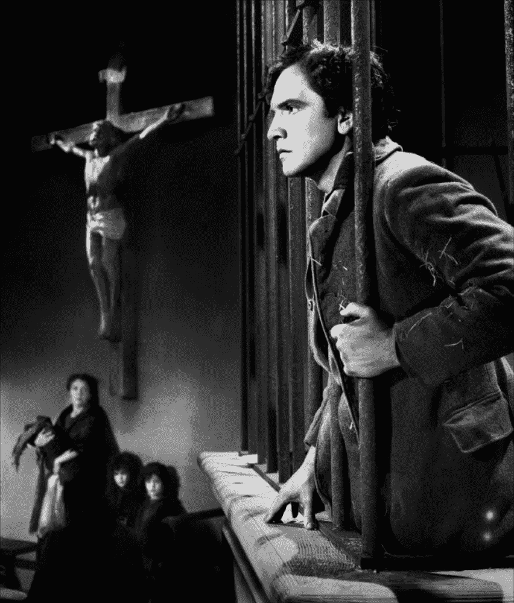

电影《悲惨世界》剧照

这听上去好像牧师在传道，但是你得让这些抽象的道理变成艺术，让这些道理都有感性的显现，你得通过具体的人物的冲突来显示你要表达的意蕴，让读者自己去领会你的意思，这就叫对理性意义上的理念进行感性显现。

这里就牵涉到了艺术创作中的一些大忌了。第一就是抓住理念，没事就说大道理，人物刻画不逼真，不生动。

我们发现有很多革命历史题材的影视剧，往往反面人物刻画的比较生动，正面人物刻画的有时候就不是那么生动，有点假。这就是因为在艺术创作方面，编导没懂这个道理，他让人物变成了一些抽象的理念的宣讲员，让人觉得他不像个人，而只是一个读台词的机器，所以这样的人物就不感人。

但是反过来也有一种倾向，抓住生活细节，这人物的刻画细节很丰满，但从大的角度上来看，故事没灵魂了，不知道这故事最后说了些啥，他为了啥。所以好的艺术作品就是对于生活逼真性与理念深刻性的双重追求。

如果按照这个标准去衡量的话，我觉得当代的中国的很多文艺作品最大的问题，恐怕还不是没有理念，而是它的一些最基本的问题，趣味这个层面也没有达到。比如在很多战争片里面有很多流量明星是油头粉面，让人觉得这根本就不是真的，完全就是一种出戏感。

但是反过来说，有没有这样一种可能性呢？也就是说一部片子它在趣味的层面上非常好，但是它的理念是有毒的呢？有，有这样的作品，这种作品某种意义上说就是艺术毒品了。

我就可以跟大家说一部电影，这部电影叫《犹太人苏斯》，这部电影是二战的时候纳粹拍的反犹电影。如果你没有看过这部电影，这就对了，你现在也看不着这部电影了，因为战后的德国政府已经把这部电影所有拷贝全部销毁了，你看不到了。

但是在 2010 年，在欧洲上映了一部电影，题目叫《犹太人苏斯》，是不是把前面电影重拍了呢？不是，那是部反犹电影，现在怎么能重拍呢？它是把这部反犹电影的拍摄过程拍成了电影，题目还叫《犹太人苏斯》。

这个故事讲的是什么呢？就有一个德国演员，他特别有才华，叫马里安，然后被谁看上了呢？纳粹的宣传部长戈培尔。他看上了马里安，要求马里安在反犹电影《犹太人苏斯》里面扮演男主角，犹太商人苏斯，反正要把他往坏里演。马里安经过反复的抵抗以后，最后也从了纳粹了，把这部电影给拍出来了。

戈培尔在看电影样片的时候，就谆谆教导电影的演职人员说电影怎么拍才好，他说我们的最终目的，虽然要把苏斯这个犹太人怎么奸诈怎么滑拍得是非常深刻入骨，但是我们不能够贴标签。苏斯这个人还是有不同的面相的，你不能让大家一开始就觉得他很坏，而是要让大家觉得这个人和所有的我们这些凡夫俗子都差不多，要让他身上的那些恶劣的品行慢慢体现出来，让故事在合适的地方进行反转，这样反犹的效果才能做得好。

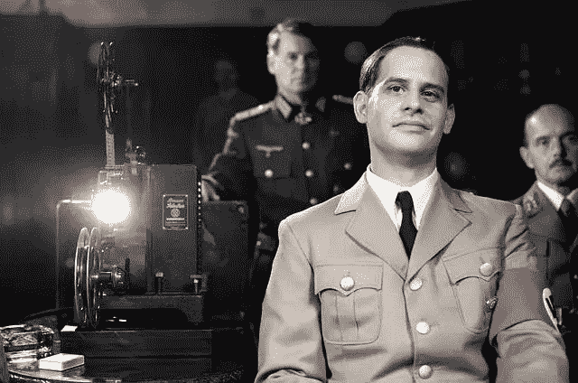

电影《犹太人苏斯》剧照

这部电影的确在某种邪恶的意义上获得了成功，它激发了反犹情绪，进一步恶化了在欧洲犹太人的处境。

从这个角度上来看，戈培尔这个家伙的确非常懂康德哲学的一条重要的美学原理，就是无目的的合目的性。他有一个反犹的想法，不能说得太明，要通过自然的引入让大家产生共情，这部电影就获得成功了。

从这个意义上说，他似乎是读过康德的，但是在一个根本的层面上，他显然是反康德的。康德所说的理性的理念是基于人道主义伦理学的，而绝绝对对不是基于种族主义的，所以戈培尔对康德的美学进行了肢解性的利用。

在这里我们就很难不想起伯拉图的看法了。柏拉图早就指出了艺术本身可能是迷惑人的，诗歌是有危险的，小心诗人，小心戏剧作家，这是为什么呢？这是因为在柏拉图看来，在艺术的鉴赏活动中，我们或许就会放弃对于自身理性的把控，而任凭自己的灵魂被作品的创制者所引导。戈贝尔引导我们走向哪里，我们就走向哪里。

康德当然是知道柏拉图的说法的，所以为了补上这样一个思想的缺口，他才特别强调好的艺术趣味和好的艺术理念之间，必须要相互协调。光有趣味，而没有理念是不行的；光有理念，而没有趣味也是不行的。

大家说这要求也太高了吧，一方面要有趣味，一方面理念又要正确；三观又要正，这个故事又要说得非常的动人，怎么办呢？康德说，对，正因为我们大家都搞不成这事，所以伟大的艺术作品只有天才才能驾驭，这就引向了康德艺术哲学的下面一个环节，就是对于天才的这样的一个理论的阐述。

#### "艺术天才"神秘吗？

那么什么叫艺术天才呢？上面的讨论已经告诉我们一些端倪了，按照康德的看法，所谓艺术天才，就是那些能够设法找到感性的理念，并设法在自己的艺术作品中，将这些理念予以展现的人，这些人就叫艺术天才。

康德还特别强调，所谓艺术天才，他们的任务是创造艺术规则。什么叫艺术规则呢？就是那些将感性理念，付诸于特定的艺术细节的规则，他们绝不是遵循规则的人。

这话我当然是有赞同的地方的，这是因为艺术作品总是有等级的。如果按照理念与感性趣味之间的协调程度来给艺术作品打分的话，最高级的艺术作品当然是稀少的。如果天才已经被定义为最高级的艺术作品的创造者的话，这些创造者的数量也是稀少的。就这一点而言，稀罕天才没问题。

但是康德又在另外一方面认为，天才的产生完全是起源于自然的机缘，是没有办法用理性来加以解释的，完全是用一种神秘主义的观点来看待天才。在这个问题上我和康德的观点有所不同。

我并不认为天才是不可理解的，是纯粹神秘的。我个人认为天才甚至是艺术天才，他无非就是几种素质在某个人身上的叠加。

比如你要做一个文学家，你要有怎样的素质呢？首先你要有极强的词汇应用能力，你不要告诉我你语文很差，你想做作家你不是发疯了吗？

另外一个想象力也很重要，因为你构想的这些事情，都是不存在的。

另外同情心是很重要，你没有同情心，你就没办法了解他人的心理。

你如果没有足够强大的同理心的话，你怎么能够写清楚，在另外一个世界中生活的男女的苦乐喜悲呢？

但这一点也是取决于观察力。观察力就是指你的想象也好，你的同情也好，都基于你平时所积累的素材，所以你要在生活中点点滴滴地积累这些素材，观察哪些生活的细节。

另外还有一个很重要的能力就是毅力，有些人好像前面的素质都具备，最后缺一口气，就是毅力，他懒，他写不了，拿起钢笔就想放下来，这个脾气如果改不了，你做不了作家。作家，"作"家，你总是要坐在家里写。

好，我个人认为单独一项上面所说的能力拿出来都不是很神秘，什么运用词汇的能力、想象力、同情心、观察力、毅力，这有什么神秘的？但问题是，只要这些能力在一个人身上叠加以后，就会产生有趣的化学作用。

为什么好的作家那么缺乏？这是因为这些能力的聚合本身是一件有点稀罕的事，这并不是说这每项能力本身是稀罕的。

#### 巧合的本质：命运的目的性与人的反抗

另外，康德所说的一个基本的艺术创作的规则，就是无目的的合目的性，我认为这一点也并非完全不能掌握。小说里面有一种最简单的体现无目的的合目的性的方法，就是制造巧合。

巧合的本质是什么？就是命运的目的性与人类对于命运这种目的性的反抗之间的斗争。命运有它自己的目的，要把它自己的想法强加于人，人总是要和命运斗一斗的。

人总是按照人类自己的想法去做事情，这就是趋利避害。但是如果大量的人都是按照自己的目的去做事，从宏观角度上来看，这就体现出了某种无目的性。

这就类似于很多的水分子或者物质的分子，都是按照它自己的目的来进行运作，这就构成了什么呢？就构成了所谓的布朗运动，这种无目的的布朗运动。

**但是人类却无法始终按照自己的想法做事，他会陷入某种命运，这本身便是某种更高层面上的目的性，这就是某种历史的必然性。**

比如《俄狄浦斯王》的故事大家都已经知道了，俄狄浦斯王的父母因为得到了神谕的启示，预知到自己的儿子最后会杀父娶母，所以他们为了趋利避害，就把孩子扔了。俄狄浦斯王也得到了类似的神谕，说自己长大了会杀父娶母，他又离开了自己的城邦，结果阴差阳错跑到了外地以后，他真的就犯下了杀父娶母的这样一个罪行，到最后他只能刺瞎自己的双眼。

这个故事大家都知道，细节我就不说了。俄狄浦斯父亲的决定，俄狄浦斯的流浪与逃避，这都展现了人类的真实动机。这个真实动机是什么？就是趋利避害。但是俄狄浦斯父子的这样的一个悲剧性的命运，这揭示了某种人类不能理解的神秘的自然法则在背后起的作用。

当然《俄狄浦斯王》的故事是前基督教的，这多少还是体现了希腊人的世界观，也就是命运自身的不可理解性。而康德的世界观则是基督教的，他认为这个世界的宏观图景毕竟是由上帝控制。

不过希腊人的世界观与基督教的世界观之间毕竟是有一些交集的，这是为什么呢？因为他们都认识到命运的摧毁力量本身是带来恐怖感，这种恐怖感本身会带来崇高感，而崇高感本身会带来某种对于无条件者的敬畏。个体的想法，个体自己的欲望，在这样的一个绝对存在者的意志和裁判面前是一文不值的。

类似的阴差阳错式的巧合所导致的剧情在美国小说家约瑟夫\*海勒的《二十二条军规》里面也有体现。这部作品是以二次大战为背景，对驻扎在地中海一个小岛上的美国陆军航空队的一个战斗生活进行了描写，揭示了一个非常非理性的荒诞世界。

比如在这部小说里面就提到了所谓的二十二条军规。第二十二条军规的规定是这样的，只有疯子才能获准免于飞行，必须要由本人提出申请。但是你一旦提出申请了，就证明你是个读写能力正常的人，因此你就不是疯子，所以你还是要飞行。

大家说飞行为什么很可怕呢？因为那是战斗飞行，你是带着炸弹呢，开着轰炸机去轰炸德国人的这些重要的军事基地，你很有可能一路上就会被德国人的机关枪、高射炮、战斗机给打下来了。

那么这样的一个军规以及围绕着军规所展开的故事，告诉我们什么呢？每件事情都走向了它的反面。比如如果你要申请回家的话，你只要写了申请信就证明你是个正正常人，所以你就必须继续战斗。

然后你就来会来思考了这《二十二条军规》本身用来是干什么的？《二十二条军规》你如果遵守它的话，你就会不遵守它。你如果不遵守它的话，你就会遵守它，这是为什么？因为军规本身有个逻辑陷阱，所以规则就走向了规则的反面，规则就包含了规则的解体。同样的道理，你如果按照正常人的逻辑去做事，你却会被污名化为疯子，所有的一切都是阴阳颠倒，非常的怪异。

但是你会发现整套军事规章的设计背后是有一个隐蔽的目的的，这个隐蔽的目的就是要反复榨干士兵身上的每一滴血，榨干身身士兵身上的每一滴汗，为战争自身的胜利服务，这是一种残酷版本的 996 逻辑。所以所谓的战争的胜利有可能是建立在一个非常不理性的，非常不讲逻辑的内部控制系统之上的，这就是海勒这部小说向我们揭示的。

但更荒谬恰恰在于，这种压抑人性的结构是能够帮助美国军队赢的。而打赢这场战争恰恰是为了终结希特勒政权所做的那些非常不讲人道的事情。这是不是一个更高层面上的反讽呢？

所以这个故事就体现了一种四明治结构。

底层是什么？主人公。这部小说的主人公叫悠悠，悠悠是按照理性来行动的，虽然他被别人视为疯子，但我们觉得有是理性的。

那么中层是什么？中层是军队内部的控制系统，是非理性的，因为《二十二条军规》里面它包含了很大的一个逻辑 bug。

高层是什么？高层是军队这样的设计是为了赢，不管怎么说打败纳粹是很重要的，这好像还是理性的。

还有一层最高层的理性，这种最高层的理性并不牵涉到是美国人赢还是德国人赢。这种最高的理性是代表上帝的正义，它裁判判是非。

这个最高层的理性恰恰是要读者默会的，也就是说大家要默默地理解海勒为什么这么写。很多批评家都指出《二十二条军规》是部黑色幽默的作品，幽默在这里就扮演了一个很重要的角色。

黑色幽默的本质是对于荒谬的揭露，但是这种揭露的前提是预设了我们必须首先得理解什么东西才是真正理性的。所以高级的黑色幽默本身就是一种揭露无条件存在者的、存在方式的写作技巧。从这个角度上来看黑色幽默本身是一种战斗性的写法，是一种和一切荒谬和不合理战斗的写法。

那么我们可以用康德的这一些美学术语再来套我们现在所面对的这部黑色幽默的小说。对于正常人与非正常环境之间的斗争的介入这是对于现实的模型，如果把社会也看成是自然的一部分，这是对于自然界的一种无目的的模型。

但是这个故事透露出了一种带着悲凉的幽默感，你如果感到了那种带着悲凉的幽默感，这就说明已经给出了一些价值评分，你已经知道什么是对的，什么是错的，这就是隐蔽在无目的的描写背后的那种深刻的目的性。

海勒本人也并不是托尔斯泰级别的那种天才，他就是退伍飞行员加文艺青年，文笔还行。所以他就把部队里的这种所思、所想、所见全部加以夸张和重构，完成了这不了不起的小说。我顺便说一句，海勒是飞行员这一点是如假包换的，这部小说里面有很多关于航空器材的描写，比如 B-25，米切尔式轰炸机的各个型号之间的细微差别的描写，不是飞行员写不了那么细。

为什么我们国家就好像很难出现这样的作品呢？这是因为优秀飞行员加上优秀文艺青年这样的组合，在我们国家是很少见的，这点并不神秘，对于这一点的解释就证明了天才的产生也好，天才的匮乏也好，都是可以被理性的解释的，天才本身并不神秘。总而言之天才并不神秘，天才无非就是各种能力与感悟在一个人身上的聚合。伟大的艺术作品，它的创作也是有套路的。

康德要把所有的这一切说得太神秘了，很可能就是因为他本人没有文艺创作的经历。

好了，关于美学的问题，我们就简单说到这里了。在这里我们已经反复讨论了，对于无条件存在者的预设在美学鉴赏中所起的作用。其实对于无条件存在者的预设，也能够帮助我们更好地理解历史发生的过程，甚至帮助我们更好地理解人类未来的走向，这就涉及了康德的永久和平学说。

谢谢大家，我们下回见，我是徐英瑾。

公众号懒人找资源，懒人专属群分享

## 63\. 康德的政治哲学：“昂贵的”自由主义与“蒙昧文化”的反抗

### 文稿

各位朋友大家好，我是徐英瑾，很高兴继续和大家来讨论哲学家的 10 种生活提案这个话题。

上面一回我们说了康德的美学思想。在康德看来，艺术与伦理道德之间的关系应当是融洽的，而艺术天才的任务就是找到艺术趣味与美学理念相互和谐共存的方式。

很明显的，康德所说的美学理念是有相关的伦理学内容的，是为他的人道主义理想服务的，由此不难想见康德的政治哲学思想也会与其伦理学思想密切相关。

顺便说一句，这一回我本来的计划是想讲康德的永久和平论，但是我觉得在讨论他的永久和平论之前，有必要先把康德的政治哲学的思想先梳理一下，所以先把永久和平论的话题往后推一推。

#### 政体的运作应当以保障个体的自由为最大目的

我们知道康德伦理学的核心关键词乃是人，人类的道德行为必须以个体的人为最终目的，因此我们不能够将人仅仅视为手段。

如果在政治哲学领域也实现这样的想法的话，那么这个想法大概就会被转化为这样一个样子： **政体的运作应当以保障个体的自由为最大目的。**  
因为只有这样才能够落实以人为目的这样的一个伦理学主张。

大家听上去会觉得这个主张听上去没什么了不起，这无非就是说执政者一定要做到以人为本，否则执政这件事就会成为无本之木、无源之水了，也就是说要关心人民的疾苦，要让大家有房子住，有肉吃等等。

但康德说的不是这个意思，当然他也不是说反对要让大家有房子住、有肉吃，但他说这个意思的要点不在于这里。

**请注意，康德特别反对这样一种观点：政的目的是为了增进社会的总体幸福。**  
康德不赞成这一点哦，康德的反驳是什么呢？增进社会的总体幸福这句话，就预设了幸福是可以被计量的，所以你可以在量上增加它。那问题是你该怎么计量幸福呢？

请注意，每个人的幸福标准都是不一样的。像我们这些俗人都爱吃鸡鸭鱼肉，我就很爱吃日本的和牛肉，会觉得吃和牛肉很幸福，但是佛家弟子他就不愿意吃肉，他们吃了以后会感到不幸福……

不同的人有不同的幸福标准，既然根本就没有统一的幸福标准，一个执政者如果觉得他的执政目的是为了提高社会的幸福总量，这就等于什么呢？这就等于执政者会把零零总总的幸福标准中的一种强加给所有人，这实际上已经构成了一种压迫了。举个例子说，他就觉得幸福的总量就是要增加大家的牛肉供应，结果逼着大家吃牛肉，和尚就不开心了说"我们是出家的，不能吃肉啊"。

康德说这是不对的。所以康德就提出了一个新的解决方法，也就是说国家的执政目标它不是为了让大家感到幸福，幸福是每一个公民自个儿的事。国家的目标是什么呢？是保障自由。

#### 维护自由，国家必须存在

保障自由的意思也就是说你吃肉是你的自由，我吃菜也是我的自由，萝卜青菜各有所好，大家追求大家自个的幸福，国家只是保障这种自由而已。

这种意义上的自由看似非常消极，但康德恰恰是在积极的意义上鼓吹伦理层面上的至善的。

在这种情况下，康德似乎是赋予了国家以一种相对消极的角色。有人就说了，既然国家的作用不是那么大，干嘛还需要国家呢？难道自由不是某种自然的状态吗？从康德的学说里面是不是可以引申出无政府主义呢？

康德的意思肯定不是主张无政府主义的，为什么呢？因为自由的真正含义不是随心所欲，而是说你不仅要尊重你自己这个个体，也要尊重世界上的任何一个别的个体。

请注意，这种意义上的自由的观念并不是人人都能够理解的，更不是人人都能够践行的。很多人都倾向于比较尊重自己而忽略他人，"自私自利"某种意义上说才是自然的倾向。这就会导致了有一些人会肆意妄为去破坏别人的自由。

好，国家的强制力的存在，不仅是为了维护自由，也是为了维护与自由相关的一些理念。这个理念一共有四个，第一个就是我们前面说到的自由，第二个是平等，第三个是独立，第四个是契约精神。

自由我们已经说过不少了，我们再来说第二个平等。平等是啥意思？平等并不是说经济上的平等，因为贫富差距乃是某种很难被避免的情况。康德说的是法律意义上的人人平等，取消法律意义上的某些人的特权。

什么叫独立呢？他说的也不是民族独立，而是说每个具体的公民在投票的时候都是一个独立的主体，你投票不是因为你的爹爹是这样投票的，也不是因为你被贿赂了一定要去投谁的票，而仅仅是因为你自己的独立的决定使得你去投某某人的票。

契约精神是什么意思呢？公民对于特定财产的合法占有是需要一定的契约来保障的，契约的本质乃是公众的法权意识的凝结形式。举个例子来说，你说这房子是我的，但你得有房契，你得有公证书，有了这些文件以后，这才能够说明全社会已经认可了这房子是你的。

很明显，在康德看来，国家是必须存在的，以便使得上述四个要素的落实能够得到某些强制力的保证。

#### "昂贵的"自由主义意识形态

以上说的康德的这些自由主义的政治理念，听上去是很美好的。不过，我们不能光顺着康德的思路去想。从表面上看来，上述这些理念如果真的能够实现，我们每个人的日子都能过得喜滋滋的。但是如果我们把这些理念与现实相互比较，我们就会发现他的理想与我们所看到的现实是有很大的差距。

第一点，自由貌似是不错，但是很昂贵，不是所有人都能支付得起。

大家说，自由这件事情，难道还要花钱买吗？某种意义上说，是的。康德的自由不是那种自然状态，想怎么样就怎么样，想在马路上撒野就撒野，这听上去有点像第欧根尼的那种态度了。

康德的自由是理性的自由，不是人性，你要用自己理性的头脑去想问题，这就预设了你的理性能力是存在的。但理性能力的培养并不是件很容易的事，虽然人人头脑里都有先天的知识范畴，但依然需要机缘予以刺激与培育。

比如你要在人生的重大环节作出很重要的决定，当然是自由地做出决定，比如投票的决定，婚姻的决定，在职场上的跳槽的决定……所有的这些决定，背后的一个背景是什么？这个背景就是你要有充分的信息，但是信息的充分性又取决于你要获得相关的信息源，并且要有相关的分析能力。获得信息源也罢，获得分析能力也好，都需要时间与金钱的支持。

别的不谈，今天的中国人要获得一些比较有价值的学术情报，英文的通读能力就是很基本的前提。比如像张文宏医生他为什么那么了不起？其实他英文就很好。但在我们中国，能够通顺看英文杂志上的学术情报的中国人，比例是很小的。所以能够自由决策的人的数量其实不是很多，因为自由是很贵的。

第二点，平等也很贵。如果没有经济上的平等做支撑，政治上的平等就变成一个虚词了。

举个例子，表面上看来，人和人都很平等，但毕竟有穷人和富人之分。在西方的，特别是英美的这种海洋法系的司法系统里面，虽然也谈司法上人人平等，但是富人陷入了官司以后，的确是有更大的概率脱罪，因为他可以雇佣更好、更牛的律师。好律师可是很贵的。

第三，独立也很贵，独立也很难，或者说能够独立的人其实也没有你想的那么多。

举个例子，你要按照自己的想法去做事情而不受环境的影响，这是非常非常难的。即使是在鼓吹言论自由、个性张扬的美国，也有大量的言语的禁忌，很多话不能公开说。比如你如果说了一些按照美国的价值标准是政治不正确的话，一个人分分钟就会丢了饭碗。如果你真的很有钱，当然可以口无禁忌，但是大多数人还是要靠工资来养家糊口的。所以很多人就不得不闭上了嘴，很多话就不敢说出来了，害怕得罪别人。

第四，契约精神也非常好，但问题是契约精神有时候很容易让人躺平。

大家说契约精神和躺平有什么关系呢？比如举个例子，现在大城市里面房价的上涨已经对年轻人造成了很大的经济压力，你要不要接受这个现实呢？有人说这应该接受，这是经济契约的一部分，是不是？房子这么贵，这是由市场决定的，你要尊重市场，这叫周瑜打黄盖，一个愿打一个愿挨。

但是房价的上涨的背后，带来的是生命质量的下降，这可是人生不可承受之重。你尊重了契约精神，你的生命质量就下降了，所以很多年轻人就丧失了动力，也只好躺平。

#### 自由主义为什么会流行？

我们这里要注意的是，康德哲学的特点是 4 个字，即"形式主义"，他关心的是怎么从形式上把规矩给确定下来，这样天下就大治了。

但事情恐怕没有那么简单，核心的问题是什么？我觉得康德没有看到他鼓吹的那些所谓的自由、平等、独立、契约精神这些价值是为什么会流行的。这并不是因为康德写得一些书，在书里面鼓吹自由主义，所以自由主义的观念流行起来了，而是因为：  
**西方的市场经济的发展在客观上的确需要自由主义。** 为什么呢？

第一，交易的主体是需要自由的，否则你没办法进入市场。

因为你进入市场以后，如果一个交易主体无法自由的处置其财产的话，你谈什么说自己是市场主体，对不对？比如你到市场上去挂一套房子，人家要买你的这个房子，你突然就反悔了，说我爹说这房子不能够卖，人家就问了你了，那么交易主体到底是你还是你爹呢？你必须要能够自由的处置你的财产。

第二，交易主体是需要平等的，所以平等也是来自于市场经济的要求的，这当然是指形式上的平等。比如买东西要排队，即使你再有钱，买东西的时候也要讲个先来后到，比如我看上了这个房子，别人排队在你前面先付了定金，你只能够认栽。

第三，也就是交易主体是需要独立的，不独立的交易主体就称不上是交易主体了。比如你不能够受到别人的操控，你是按照自己的想法进行交易的决策的。

第四，契约精神也是来自于市场经济的，没有契约就没有交易。不过这一点太明显了，我也不想予以解释。

好了，上面所说的这些理念，自由、平等、独立还有所谓的契约精神，它为什么是好的价值呢？因为从市场经济的角度上来看，它能够降低交易成本，如果上述这些条件不满足，买卖的效率就会降低。

上述的价值观念显然是中世纪的自然经济状态所未必须要需要的，因为当时能够进入市场交易的人数量不是很多，很多人还处在自给自足的这种自然经济状态，不像今天人人都在淘宝上买东西。所以康德所表达的自由主义意识形态，实际上是现代市场经济的意识形态。

#### 自由主义与市场经济体系间的深刻矛盾

康德自以为他所揭示的，乃是以一切的社会形态的不断发展所需要的某种超验的观念性保障，但是康德他并没有自觉地意识到，他的意识形态是与特定的社会交往方式配套的，看到这一点是马克思。也正是因为他的目光仅仅止步于此，他才没有意识到他的这些理念与这些理念所为之服务的市场经济体系之间，竟然是存在着深刻的矛盾的。

大家说这矛盾在哪里呢？

首先自由的理念与市场经济之间是有内在矛盾的。为什么呢？因为市场经济它必然会带来分工。分工会导致什么？会导致很大一部分社会成员的信息会狭隘化，这就影响了其自由决策的能力，因为你已经被固定在流水线上成为一个像螺丝钉一样的装配工人了，你每天八小时都干这种事情，回到家里面就躺到床上就呼呼睡着了，你有什么机会来锻炼你的自由的理性呢？

第二，平等与市场经济之间也是有矛盾的。为什么呢？因为市场经济它很可能就会导致了财富的分化，财富的这样一个分化会导致经济上的平等变成一件很困难的事情，而这件事情也会对政治上的平等造成削弱效应。

第三，这个独立与市场经济之间也有矛盾。表面上看来市场经济是要求独立的，但是随着不同的人之间的经济差距的增大，独立越来越多的就成为一小部分人的特权了，更多的人为了稻粮谋，就要放弃自己的很多独立决策的机会。

第四，我甚至认为契约文化与市场经济之间也有矛盾。为什么呢？因为如果市场经济走向了这样的一个垄断的阶段，处在垄断地位的这些企业就可以抱着店大欺客的态度，随意地改变契约，或者是在契约文化里面放一些毒丸条款，使得这些契约变成了霸王契约。

我们随便就举个例子，我们现在手机上要下载很多很多的 APP，我们下载了很多 APP 以后你就会有个选项了，愿意不愿意让这个 APP 去关注你手机上的一些隐私？我们说当然是不愿意了，但这样一来，你这个手机下载 APP 的进程就会被终止，也就是说实际上是逼得你开放你自己的隐私了。这也算是契约吗？这不是强迫大家遵从这些巨无霸企业的意愿吗？

有人就说了，这到底是怎么回事呢？ **市场经济它催生了康德式的自由观，为什么反过来又摧毁了康德式的自由呢？这不是自相矛盾吗？这种自相矛盾是怎么产生的呢？**

从历史的角度上来看，这事情是这样的，也就是说在市场经济发展的早期，市场上进行相互竞争的这样一个市场主体是很多的，垄断问题也不是那么的明显。在这种情况下，康德式的自由观与市场经济之间的矛盾也不明显，相反的，两者倒更像是相互配合，相得益彰。

后来情况就发生了变化了：首先垄断巨头的出现，让市场中的这种充分竞争就被削弱了；第二，信息产业的崛起，尤其是信息产业中那些寡头的崛起，就可以使得一小部分人可以控制全社会的信息供应，导致了对于社会自由的全面威胁。

不过我必须要指出的是，市场经济总有一天会走到这一步，这一点是早就有人预料到了。这个人不是康德，而是马克思。

#### "拯救"个人隐私：强制力量与蒙昧精神

当然，我认为康德的政治哲学依然是有一定的积极价值的，为什么呢？一个已经全面接受了康德政治哲学的主权者或者是一个执政者，就会使用某些强制的力量，与市场经济所催生的这些乱象作斗争。

这方面的一个典型的案例就是 GDPR，什么叫 GDPR 呢？就是"General Data Protection  
Regulation"，中文的意思就是《通用数据保护条例》。这是一个欧盟的法律体系，它的主要任务就是要在欧盟的范围里面，对于欧盟的公民的个体的数据和隐私进行全面的保护。欧盟也利用这样一个法律为工具，和美国的一些互联网信息的寡头，比如说像 Twitter、Facebook 进行了很多法律上的斗争。

很明显，GDPR 的立法精神就是要限制市场行为，特别是要限制市场中的一个垄断的行为，尊重个人隐私，其背后有鲜明的康德的政治哲学色彩。

不过有意思的是在有些国家，特别是日本，官方其实并没有推出什么抵制大数据产业的法令，但是社会上依然是比较接受隐私保护的这种理念的。这是为什么呢？是因为日本人更喜欢康德哲学吗？我想肯定不是这个道理。康德毕竟是西方哲学，日本人是东方人。

有点讽刺意味的是，在我看来，日本人为什么全民都比较抵制大数据产业呢是因为日本人的整个思维方式都有 **中世纪思维**  
的参与。这个中世纪思维的参与是什么意思呢？

第一点，这主要是来自于中世纪的行会准入制度。我们都知道，中世纪各个封建国家都有自己的行会制度的，你得加入这个行会，得到行会的保护，类似于行规。今天日本的各行各业仍然有这种行会制度的残余。

比如说就以日本的交通为例，日本的 Taxi 是非常非常贵的，有人说为什么没有 Uber、滴滴打车之类的呢？实际上是有的，但有了也等于没有。为什么呢？因为日本的 Taxi 的价格是受到出租车行业内部的行会制度的保护的，你随便降价可是不行的，当然随便涨价也不行。网络打车行不行呢？形式上说是可以的，但是你不能破坏前面的行规，所以你在日本用网络进行打车，你还要加上额外的叫车费用，实在是不如直接跑到马路上去扬招来得方便。

顺便说一句，我在日本发现，除了奈良以外，好像在日本哪座大城市打车都挺方便的，这就抑制了网上叫车这种行为。

第二点，中世纪的思维方式还有一个特点，就是 **对于物的重视** 。

中世纪的思维方式与市场经济的思维方式不同，对物很尊重，而不仅仅是从交换价值的角度去看物。比如随便一个碗都已经敲碎了，你可以到市场上再买一个新的呀。不，老人或者说农村里面的一些老先生、老太太他们会怎么做呢？他们会把这个碗给补起来，而且补得非常的认真。为什么呢？每一个物件你都要尊重它，日本人还有这种思维方式。

有意思的是日本人甚至对钱也产生了物的崇拜。钱某种意义上说是一种抽象的等价物，你就不用去把钱当成物了，但日本人把钱也当成物了，他们把钱称之为"お金"，"お"字打头就表示尊敬，这是日语中的特点，所以这个词直接翻译成汉语就是钱老爷的意思。你看，既然钱老爷是要值得尊重的，所以日本人他们在服务行业向顾客递送零钱的时候都是规规矩矩的，非常非常的郑重。这样的一种文化，是很难接受粗鲁而直接的电子支付方式的。

这就很有意思了，康德的启蒙哲学所试图克服的，恰恰是那种中世纪的、带有蒙昧色彩的文化精神。而在日本，恰恰是这样的一种带有蒙昧色彩的文化精神，拯救了康德所看中的个体隐私，这一点是多么具有反讽意味。

不过前面提到的，欧盟通过 GDPR 等法律保护个体隐私的做法，倒是完全是在康德的思想轨道之上的。康德也一直希望建立一些超国家的联盟，来实现地球的和平。很显然，欧盟的存在非常符合他的口味。

关于永久和平的问题，我们下一回再来说。谢谢大家，我是徐英瑾。

公众号懒人找资源，懒人专属群分享

## 64\. 和平！自由的“题中应有之义”：康德的永久和平理念

### 文稿

各位朋友大家好，我是徐英谨，很高兴和大家继续来讨论哲学家的 10 种生活提案这个话题。

上一次我们讨论了康德的自由主义理念，我们也谈论了欧盟的数据保护法令 GDPR。很显然，欧盟的这项法令是带有非常浓重的康德主义气味的，而且康德本人也主张类似欧盟这样的国际组织的出现是有利于世界和平的，所以我们今天就来谈谈康德的永久和平理念。

大家可能觉得这个话题好像非常的宏大，讨论这个话题对于我们今天的听众的意义又是什么呢？

实际上在后疫情时代，我们大家都对未来的世界格局的发展产生了一种不安感。疫情当中，虽然各国的经济都受到了挫伤，但有意思的是各国的国防开支都在上升，有一种紧张的气氛在加速蔓延。

当然了，世界和平是大家都希望看到的，因为战争会对所有人的生活都造成巨大的负面影响，但我们又该如何维持和平呢？康德的哲学能够带给我们一些启发吗？让我们再回到前面的话题上去。

#### 让国家远离"暴力丛林"的国际仲裁者

为什么康德认为超国家的国家联盟或者国际组织是有利于实现世界和平的呢？这是康德对于霍布斯的国家起源说的一个更宏观的推演。

按照英国哲学家霍布斯在《利维坦》里的观点，在没有国家的自然状态中，也就是在无政府状态中，人与人之间类似于狼与狼，大家互相争斗，非常暴力。但是总有一天大家会厌倦暴力，觉得这样互相残杀总有一天会同归于尽。于是大家都同意将暴力权上交给一个超级主权者，以后人与人之间再有纷争就到那个主权者那里去说理，让他来裁判，于是国家就诞生了。

康德按照这样一个思路继续往下推演，他指出如果国家之间也像人与人那样只是相互争斗，那么就没有任何一个政治主体能够出来阻止战争的爆发了。而要避免战争就需要某种国家之外的国际仲裁者，这就使得国家联盟的出现变得不可或缺了。

这个国家联盟或者超级国际仲裁者到底是以怎样的形态出现的呢？这会导致几种可能。第一种可能就是全世界就是一个超级政府。第二个，这个联盟是一个松散的国际联盟，每个国家都有自己的军队，也可以决定在什么时候离开这个联盟。第三，这个所谓的国家联盟实际上是一个整合性很强的世界联邦国或者说是世界共和国，这个联邦国是有自己的联邦军队的。

康德本人最欣赏的是第三种可能性，或者说世界共和国的建立，就是康德的政治理念之一。关于这样的一个世界级别的超级共和国的武力到底是怎么来的，他语言不详。但是很明显的是，他似乎不是太愿意赋予每一个加盟的国家以相应的武力。实际上他的思想倾向是主张逐步取消各国自己的常备军，这一点我后面还会提到。

#### 呼吁和平：自由的"题中应有之义"

这里面就包含了一个非常有趣的，关于武力的经济学基础的哲学问题，是非常值得深思的。

我们都知道要维持武力是很贵的，现代的隐形战斗机都是 1 亿美元起价的，你要花钱维持这么强大的武力，肯定是因为你已经看到了一些潜在的敌人的存在。类似于你为什么要在家里装上这么昂贵的防盗门呢？这是因为你已经发现了你们这一带的治安不好，小偷很多。如果你所在的社区是路不拾遗的，你为什么还需要防盗门呢？

如果世界上所有的国家都组成了一个统一的联邦，这个联邦之外再也没有别的国家，那么这个超级联邦为何还需要武力呢？难道是准备应对外星人入侵吗？很显然，这个武力就肯定是对内的，这是因为联邦之内的成员国之间是有可能发生冲突的，而作为超级仲裁者，联邦就应该维持一定的武力来应对这种冲突。康德的这个想法就是今天的联合国维和部队的某种前身。

而为了彻底消除加入这个超级国际联邦的各个成员国之间相互发生战争的隐患，康德提出了如下六个提议，这六个提议有一个总的名字，叫《  
**关于各个国家之间的永久和平预备条款》** 。

第一个条款说的是什么呢？也就是任何和平条约如果在签订的时候，就保留了将来发动战争的隐蔽的可能性，那么这样的条约就不应该被认为是和平条约。一句话，只要是和平条约，就不能够有预留战争的可能。

第二条，任何一个独立自主的国家，不论大小，均不得由另一个国家用继承交换、买卖或赠送的手段收为己有。这句话就可以被概括为小国和大国是平等的，小国不能做大国的马仔。

第三条，常备军应当逐步的完全废除。这就从骨子里面消除了武装斗争的可能性了。

第四条，国债不应用于国家对外斗争方面。这一条的目的是为了消除战争的经济基础。

第五条，任何国家都不应该用暴力去干涉其他国家的宪法与政府。这一条的目的就是强化各国的自主性。

第六条比较有意思，任何国家与他国交战时，也就是说不得不打仗的时候，都不应该采用必定会使在未来和平条件下建立互信成为不可能的敌对活动。这也就是说你打仗的时候也要讲武德，不能做一些不讲武德的事情，你使得未来要握手言欢也变得困难了。那么哪些事情是不讲武德的呢？如派遣刺客到交战国去杀害敌方政要、撕毁投降书、策动敌方内部叛变等等。

上述说的这六条，显然是康德的政治哲学中的自由主义理念在国际环境内的一个外推的结果。国与国的平等实际上就对应于康德在政治哲学领域里面所说的人与人的平等，国与国不能互相隶属，就对应于康德在政治哲学层面上所说的每个人都是目的，而且每个人都是独立的；国与国之间的合约要得到保证，则对应于市场主体之间的契约精神；而康德的整个对于和平的呼吁则对应于那个  
**大写的自由** 。

为什么和平和自由之间有对应关系呢？因为自由的"题中应有之义"，就是每个人按照自己的理性去做出决定，因此被强迫做出的决定就是不自由的决定。而暴力的本质就是强迫别人按照暴力施加方的想法去做事情，因此暴力是反自由的。暴力的最高形式是战争，因此战争是反自由的，所以呼吁和平乃是自由主义者的"题中应有之义"。

#### 长远和平： 共和制、否定战争与世界公民

说到这里，喜欢动脑筋的朋友可能会发现这里有逻辑漏洞，比如如果有的国家对别的国家进行欺凌、侵略、破坏国际条约，那又该怎么办呢？比如二战的时候，纳粹德国对于波兰、荷兰、比利时和法国的侵略，面对这样的侵略我们是不是要放弃暴力呢？恐怕不行，我们还得使用暴力去反抗。

有人用暴力去侵犯自由的时候，应对这种暴力的暴力是反自由的吗？恐怕这种暴力就不是反自由的了，这也就是康德愿意在联邦层面上维持武力的原因。不过康德依然认为这只是一种过渡的状态，从长久来看，就连这种暴力措施也要消除。为什么呢？因为所有的联邦的参与国都已经成为拥戴自由主义的国家了。

关于这种长远的世界和平的途径，康德也提了这么几条，一共是三条，它的总的名称是《国家之间永久和平的正式条款》。

第一项正式条款是什么意思呢？就是每一个国家的公民宪法都应当是共和制的，也就是说在这种制度当中，立法权和执行权彼此分离。一句话，他搞的也就是西方国家现在盛行的代议民主制。有人说这一条和和平有什么关系呢？因为康德有这么一个想法，只要两个国家之间都是代议民主制的国家，这两个国家之间发生战争的概率会非常非常的低。

第二项正式条款的意思是这样的，世上绝不能存在着关于战争的《国际法》。为什么呢？法的含义就是和平，而那个战争本身则根本就不是合法的状态，如能维护这一条款也就不会有战争了，这在根子上就宣布了战争是不合法了。

这在相当大的程度上是和我们现在大多数人的国际常识不一样的。我们大家都知道有一个公约叫《日内瓦公约》，《日内瓦公约》是告诉大家在打仗的时候应该怎么打。比如打仗之前应该宣战，比如打仗的时候不能够去打平民，打仗的时候不能做间谍，如果间谍被别人抓到了很可能会被对方直接枪毙等等……但是抛掉这些条件之外，战争本身可能是合法的，但是这个康德要从骨子里面否定战争的合法性。

第三项正式条款就是世界公民法。什么叫世界公民法呢？就是每一个人跑到另外一个国家去，都应该得到另外一个国家人民的礼遇，你不会因为踏上别国领土而遭遇到敌意，天下都是一家人。这个观点就是要淡化国家主权，强调世界公民的理念，这听上去非常像古希腊和罗马人就已经提出的所谓的天下主义的观点了。至于天下主义到底是什么意思？有点淡忘的朋友可以复习一下我对于古罗马皇帝奥勒留思想的介绍。

#### 经济与物质对政治理念的作用力

康德的上述观点听上去的确很美好，但是在我看来，这些理念与其政治自由主义一样，是忽视了经济问题对于政治问题，尤其是国际政治问题的影响。

我再强调一下，维持武力是很花钱的，一个世界的联邦国如果要从事维和活动，就需要在全球部署维和部队，这需要巨大的资金。谁来买单，那么谁就会控制这部分武力，使得公器私用。

除非各个成员国用完全平摊的方式来支付这些费用，那么公器私用的现象或许就能得到抑制了，但这几乎是不可能的。因为穷国与富国应该是不会平摊同样的额度的，否则对穷国来说负担太重，对富国来说负担又太轻。

但这样推演下来，承担这个联盟国运作的一些基本的经济负担的，便很可能是一些富国和强国，这必然也会使得这些国家成为所谓的跨国家的国家联邦的真正主人，或者说这也会使得比较平弱的一些成员国成为这些大国的附庸，这就导致了对于康德的重要的国际理念的否定。也就是说各国要完全平等，小国不能成为大国的附庸，所以我就说忽略经济问题是康德的永久和平说的罩门。

然后我们再往下深思，经济不平等的原因又是如何形成的呢？应该说国与国之间的经济上的一个落差形成的原因是非常的复杂，但我个人认为风土条件是很重要的。有些国家天然有漫长的海岸线，这就方便了他进行远洋贸易；有些国家天然就有丰富的矿产，他就适合发展冶金业与工业；有些国家他有条件合适的大平原，他就容易搞农业机械化生产……

上述所提到的这些经济发展的条件都是在质料层面上的，而不是在形式层面上的，但是它会对政治形势构成某种反作用。为什么呢？因为相关的政体是必须与特定的风土条件相符合的，这是我们在讨论亚里士多德的政治学的时候已经提到的一个很重要的观点。

好吧，说完了经济发展的这个条件，我们再来看看战争它为什么会爆发呢？战争的爆发在很大程度上是为了解决各个国家对于物质资源的渴求。

如果一个世界级别的超级联邦国要解决这些紧迫的问题，这就需要一个非常宏观的资源调配系统，而且该系统的运作必须是绝对公正的，否则就会引发新的纠纷了。

但这又引发了一个新的悖论，国际联邦的存在预设了武力的存在，而武力的特点是不讲理，它具有武断性。但是国际联邦的存在，目的又是为了在国际范围内讲理，而且国际联邦的权威又恰恰在于其对于武力的垄断，武断就等于不讲理，于是国际联邦就成为了讲理与不讲理的结合体。这样一种矛盾该怎么得到解决呢？

有人说那很简单，对讲理的人讲理，对武断的人武断，这听上去这两者之间就没有矛盾了。没有那么简单，因为有时候你很难讲道理。比如说巴以冲突，到底是以色列有道理，还是巴勒斯坦有道理，这真是公说公有理，婆说婆有理，你能说出一个是非吗？很多国家之间的疆界纠纷，牵涉到上百上千年的恩怨，里面有民族冲突也有宗教冲突，你就一定能够分出个是非吗？

只要世界联邦的领导人是人而不是上帝，这就意味着他们不可能在任何一个判断是非的问题上做到绝对绝对的公正，而他们做不到这样的绝绝对对的公正就意味着某种风险，也就是说他们可能会犯错。

请注意，其实某种意义上说，犯一点小错不是人类面临的最大的风险，人类面对的最大的风险是人类自以为自己可以取代上帝作出绝对公正的决策，这种妄念很可能就会导致巨大的伪善，承认人类的决策有公正性的边界，这一点是有好处的。

说到这里我还想提出一个更深的问题，为何永久和平是一个值得追求的理念呢？有人说前面不是已经说过了吗？自由主义者已经论证了永久和平是件好事，因为暴力就意味着对于自由决策的干扰，所以我们要反对暴力，所以我们要反对战争，所以我们要拥护和平。但是这个论证的前提仅仅在自由主义的框架内才是成立的，另外的一种思维模型是这样的，就是非自由主义的思维模型，我们把这种思维模型称之为社群主义的。

按照社群主义的思维模式，人类从来都是属于一个特定的共同体的，比如家庭、公司等等。我们并不需要像康德所设想的那样，一直去行使自己的自由权利，相反，我们经常需要让渡出一部分的自由权利来节省自己的力量。为什么呢？因为凡事你都自己去决策的话，这样的人生其实是很劳累的。在这样的情况下，因为我们预设的条件就变了，对于暴力的一个绝对的避免，未必就是件非常重要的事情了。

举个例子，我如果是日本的战国时代的一个农民，我所在的地区的大名决定要和另外一个大名开战，我就跟着去好了，我为什么要像大名一样，整天的反复的思考到底是开战还是不开战呢？对我来说，为这个大名去做后勤也不是件非常难的事情，一天到晚勾心斗角，这很可能是一种更加劳累的人生。

不过我刚才所说的那些中世纪的日本大名之间的战争，它死的人是很少的，我们从史料上来看，最后死掉的有可能就是大名全家，下面的这些农民都不受影响。但是今天我们遇到的可是一个有核武器的世界，大规模的暴力，特别是牵扯到大规模杀伤性武器的暴力，显然会降低人类的幸福。就反对这种样态的暴力而言，我相信所有人都会说我不喜欢战争，我要和平的。

#### 永久和平论的"现实模型"

我个人认为康德的永久和平论在某种程度上是与今天美国的现实联系在一起的，尽管是在一个更小的尺度上，因为美国并不是全世界，它只是一个国家。但是美国他的国号叫美利坚合众国，他的英文的原名是 United  
States of America，实际上也可以把它翻成是一个美洲的联合国家体，所以听上去也有一点微型的这种国家联盟的味道。

这样一个微型的国家联盟该怎么运作呢？关于在这个微型的国家联盟里面，暴力的资源该怎么分配就有两种完全相反的意见了。民主党的意见接近康德主义，应该主张禁枪，并由此将武力全部上交给联邦政府。共和党是反对康德主义的，他们是主张拥枪的，他们认为联邦政府也未必是好东西，需要民间的拥枪人士来加以抗衡。

有人说这个问题实在是美国特色过于明显了，因为世界上大多数国家都是禁枪的，但是在别的国家，美国的这个争论会别的方式体现出来，这就是大政府与小政府的争论。大政府与小政府的这个争论，骨子里是在税收权的争论上，也就是说除了拥有武力之外，国家体现其政治武断力量的就是他的税收权。你要维持康德式的大政府就需要很多税收，但是税收的征收与分配本身又会形成一个独立的阶层，这本身又会造成另外一个层面上的不公。

康德的政治哲学的过于空想的毛病，在黑格尔哲学那里算是得到了全面的批判，不过在讨论黑格尔的哲学之前，我们还需要对康德的这整个思想板块进行总结。请听下回分解，谢谢大家，我是徐英瑾。

公众号懒人找资源，懒人专属群分享

## 番外 - 《山河燃烧》：他拼命伸手去抓那两面国旗，但怎么也没抓到

### 文稿

各位听友，大家好，我是徐英瑾。在这一集番外里面，我想和大家一谈一部很老的日剧，叫《山河燃烧》。这部很老的日剧是基于山崎丰子女士写的一部小说改编出来的，这部小说的名字叫《两个祖国》。

大家就说了，我们为什么要在讲康德的哲学段落里面讲这么一集番外呢？这和康德有什么关系呢？我一直在思考这样一个问题，哲学家讲的事情都是比较的玄虚的，而且我们在这个节目里面介绍的哲学家很多都是外国人，和我们东方人的关系不是很大。但是如果能找到一些文艺作品，让我们来看一看，康德的哲学理想是怎么在现实生活中兑现成一些现实的人物的，就能够加深对于这些哲学观点的理解。

#### 山崎丰子笔下的人生哲学立场

我个人为什么要选山崎丰子女士的作品来做一个讨论呢？我发现，山崎丰子女士她写了很多作品，好像就是对于西方哲学当中的不同人生哲学立场的一种文学化的描写。

说起山崎丰子女士的作品，我相信大家首先就会想到她的《白色巨塔》。《白色巨塔》不仅是一部出色的小说，由这部小说所改编的日剧也是一部现象级的日剧，在各种各样的评分网站上，比如说豆瓣、哔哩哔哩上面分数都非常高。

这个《白色巨塔》所展现的是什么呢？就是两种人生观之间的对决。一种是马基雅维利式的，加上一点点功利主义的世界观，另外一种世界观就是康德主义的。

马基雅维利主义加上功利主义的世界观，是由财前五郎医生所代表的，他在这个电视剧里面的扮演者，则是著名的日本影星唐泽寿明。财前五郎的想法就非常简单，我为了要把我们的医院建设成全亚洲、全世界最牛的医院，我就得不择手段，我就得使用政治的权术。为了提高医院的治疗率，有时候我们就得牺牲那些被淘汰的弱者，这叫弱肉强食，这是没办法的。

举个例子，有个女孩子她生病了，她生病了以后，我一看这个病是治不好的，我就会劝她立即转院，这样使得我们的整个医院的 KPI 就会比较好看。

里见修二医生则是这个片子里面代表康德主义伦理学的一位医生，他的扮演者则是江口洋介，我相信大家都非常熟悉。里见医生的想法和财前医生不一样，他觉得我们要把关爱施加到每一个个体上，每一个病患都是我们的爷。为什么呢？因为康德已经教育过我们了，每一个人他都是目的，不能把他当成手段。按照财前的想法，你就把医学发展当成目的，把每个人都当成小白鼠，当成手段，这恐怕不行。

但是尽管我们好像发现，江口洋介扮演的里见修二先生的这种价值觉悟好像更高，他好像代表着更高的境界，但是唐泽寿明所扮演的财前五郎仍然有不少可爱之处。在这个片子结束的时候，财前五郎自己也得重病死了，他在自己的遗嘱里就捐出了自己的遗体，以便为医学研究之用。也就是说他甚至把自己的身体也当成是医学研究的工具，这样一说他的境界也提高了。

这就是日剧的一个特点，它并不是很清楚地告诉大家哪一种人生哲学态度是对的，每一种人生哲学态度都有它的对或者错的方面，它是留下很多余白让大家自己去想的。

#### 一人、两国、三个世界

我这里所要说的《山河燃烧》或者说《两个祖国》，则是《白色巨塔》这部作品的全面升级版，它这个规模要写得大多了，是一个巨制。这个小说是厚厚一沓，这个小说翻成中文以后换了个题目，所以大家要找的时候得小心一点，既不叫《山河燃烧》，也不叫《两个祖国》，题目叫什么《情的锁链》，《两个祖国》其实是个蛮好的题目。

它讲的是什么事情呢？讲的也就是在二战当中那些已经加入了美国国籍的日本人，怎么样在这两个国家之间进行抉择的问题。虽然当时日美之间的经济交换的程度不是很大，但是在加利福尼亚和夏威夷是有不少日裔人存在的。这些人的第一代按照美国法律，他拿不到美国的公民身份，但是第二代因为他们在美国自然就出生了，就天然的拿到了美国的公民身份。在日美开战的时候，他们的中心应该放在哪里呢？面对如此大的政治变局，不同的人就做出了不同的选择。

看这个片子也让人感到非常唏嘘，因为直到 30 年代末，甚至是中日已经全面开战的情况下，很多在东京生活的日本人仍然是觉得岁月静好，没有想到日本竟然会和美国开战，竟然会去轰炸珍珠港，竟然几年以后广岛和长崎会被美国人轰炸，这个加速的速度让人是无法承受。

这部小说或者说这部剧集它所牵涉到的人物非常之多。按照小说来讲，是牵涉到了上百人，剧集里面做了一些删减，我主要就谈三个人，因为这三个人是代表了三种不同的人生哲学的态度。

主人公叫天羽贤治。这个主人公就特别有意思，他明明是在美国出生的日裔二代，却回到了日本，完成了高中和大学的学习，这就使得他成为了一个非常特殊的二代。

你想想，在美国出生的日裔二代，可能日语就废了。但是他不但英语保持了母语水平，而且因为在日本读了文学科的本科，所以他的日语水平也比一般日本人要好。他就利用两种语言都非常熟稔的这样一个优点，担任了《加州新报》的一个非常重要的记者。

天羽贤治的视角是整个故事展开的主视角，因为他游走于日、美、中三个国家，所以从他的视角我们就会看到很多重大的历史事件。比如 1936 年的二\*二六事变，一帮日本的狂热军国主义分子攻击了一些偏向于和平的日本文官官僚，就使得日本的整个国家就走向了军国主义方向，他目睹了这个事件。中日战争全面爆发以后，他又作为随军记者目睹了卢沟桥事件，并且在上海参加过一段时间的反日活动，因为他已经看透了日本军队的邪恶了。日本官方高度地怀疑他，只是没有找到硬证据。

又回到加州。因为在日本他已经被太多的警察怀疑了，他只能回到加州去干什么呢？去做《加州新报》的记者。《加州新报》是在加州洛杉矶发布的一个日语报纸，它为什么不是英语报纸呢？因为有很多在美国加州的日裔一代他们还读不懂英文，所以他们要看日文。它主要就是向这些不会说英文的日本同乡提供这些文字和新闻的服务。

但没有想到二次大战进入了加速阶段，日本冒天下之大不韪偷袭珍珠港。美国政府也做了过激反应，就把所有的这些在美国的日裔全部关进了集中营，不分青红皂白，因为他们很可能是潜在的日本特务。

天羽贤治对这件事是很不满的，反复地进行抗争。他觉得日本人侵略美国那是不对，美国人不分青红皂白把日裔的人关起来，这也不对，你不能以"不对"来对"不对"，这肯定都不对了，是不是？但是随着时间的推移呢，美国人也从关押日裔的美国人的集中营里面挑选了一些对美国看似还比较忠心的人，让他们去做翻译官，贤治也就干了这活了，他也慢慢和当局合作了。然后他作为翻译官，随着美国的大军回到了日本，担任东京大审判的高级翻译员。

请注意，他不是低级翻译员，他的主要任务是在东京大审判的时候，对日语和英语的口译的工作进行监督和订正。谁如果犯错了，他就会有一句订正的话说，"这句话犯错了"、"英语不是这么说"或者"日语不是这么说"，他就是执行这个任务的。

这应该说是个很重要的任务，因此从他的视角出发，我们目睹了整个东京大审判的过程。在此期间他还去过广岛，因此从他的视角又描述了原子弹核爆以后广岛的这种悲惨的情况。所以你可以看得出，山崎丰子女士的野心非常大，她是以主人公的视角展开了一个非常宽广的二次大战的画面，这可以说是个很了不起的一个构想。

#### 无处落地的康德主义者

天羽贤治他是一个以怎样的哲学思想作为他的人生指导的一个人呢？我已经说得很清楚了，他实际上是一个康德主义者。为什么说他是个康德主义者？他相信所有的人都是平等的，所有的人都有自己的一个人权。他不管你到底是日本人、美国人，还是中国人，只要你的人权被侵犯了，他就要站在弱者的一边为弱者鼓而呼。

举个例子，他跑到中国上海的时候和当地的一个女孩子（姓杨，是抗日地下党）一起在上海逛马路，就看到了哈同公园的门口写着：华人与狗不得入内。那个姓杨的小姑娘说咱们中国人要和帝国主义做战斗，我们的目的就是要让这些羞辱性的字句从中国的领土上消失。

贤治是怎么回答的呢？虽然我不是中国人，但是我听了你的话我是感同身受。因为我在加州就看到有很多牌子写的是这些话，"日本人从我们这里滚出去"、"小日本不许进去和我们白人一起喝酒"……我在当时受到的屈辱，恐怕就是你们中国人现在所受到的屈辱，所以我们要一起努力，让世界上所有的不公全部消灭掉。你看他说话就特别的有意思。

中日战争全面爆发的时候，有一个在东京的咖啡馆打工的中国小姑娘，这个姑娘叫美龄，就哭哭啼啼了，说我现在在日本打工，但我的祖国现在被日本侵略了，你叫我现在的感情怎么安排呀？希望这场该死的战争马上结束吧。贤治听到了一个中国小姑娘跟他有这样的抱怨，他作为一个日本人，他是怎么回应的呢？

他说美龄你不要哭，这场战争不会那么快结束的，因为日本军队的侵略不会这么快得逞，这场战争虽然会进行很长时间，但中华民族显然会在这场战争中越战越强。

这句话听了以后，我们都觉得台词是不是念错了？这好像应该是我们说的台词。但这是一个从日本人嘴巴里说出的台词。为什么呢？因为贤治的思维方式很简单，日本人在欺负中国人，中国人的人权被日本军队侵犯了，他作为一个康德主义者，他当然要站在日本人的对立面，站在中国人一边，这是毫无疑问的。

但是也正是因为基于同样的逻辑，他有时候就会站到了美国人的对立面了。

为什么呢？我刚刚已经说过了，美国人在太平洋战争爆发以后，就把所有的这些日裔不分青红皂白全部给关起来了。他就和美国人理论，为什么呢？美国宪法已经说得很清楚了，所有的美国公民他们的财产和人身都是得到美国法律的保证的。我们这里有很多日裔的人已经成为美国公民了，现在你要强制他们放弃他们的财产，回到集中营里面去，是赤裸裸地违反了美国宪法的要求。而且美国的法治精神是什么？法治精神就是一个无罪推定。但现在你进行的是有罪推定，假设所有的日本人都是特务，这种想法是和美国的立国精神相互违背的，而且也是和康德主义的人道主义精神相互违背的。因此他和上级就产生了很多很多的纠葛。

最大的一个纠葛就体现在哪里呢？他作为一个翻译官跑到了日本去，又到广岛进行了实地的采访，他写的很多报告详细地记录了广岛原爆的受害者所遭受的那种伤害。因为他是新闻记者出身，脑子还觉得自己是个记者，就要报道真相。  
**日本人侵略中国所犯下的罪行是真相，那个原子弹原爆所造成的巨大的人道主义伤害这也是真相，前一个真相我要说出去，后一个真相难道我就要把它藏着、掖着吗？**

没有想到美国官方对他很不满，就说有些事照让你说你就说，让你不说你就不能够说。天羽贤治到最后陷入了一个巨大的精神的痛苦，所以在这个小说和剧集的最后，他是自杀了。

我读一下这部小说最后描写他自杀的那段话：

"子弹穿过太阳穴，玻璃碎片散落在地，几缕殷红的血，像线一样从太阳穴流出，星条旗和太阳旗在贤治那失去光泽的模子里交相叠影，他拼命伸手去抓那两面国旗，但怎么也抓不到。"

"沙漠上狂风无情的刮起漫天沙尘，铁丝网在无限延伸，这一切在那一瞬间永远刻在贤治的脑海里。"

很明显，当时的世界就是要求贤治要在日本和美国之间选一个国家作为他忠诚的对象，但贤治做不到这一点，他认为这两个国家都有问题。

**到最后作为一个高尚的康德主义者，他只能用子弹来结束自己的生命，因为他在现实中找不到自己的落脚点。**

关于祖国和个人的道德感受之间的关系，这部片子里面有一段对话是展开在贤治和东乡茂德之间的。东乡茂德是日本的外务大臣，他的老婆是一个德国人。贤治就问东乡，我其实是很想爱日本的，但是我还是带着一颗美国的心，我这样的一个人果然就不可能真正的爱日本吗？我的爱国主义的感情到底应该放在哪一边呢？

东乡对他的一个回答就特别有意思，他说你爱一个国家，可并不是因为你出生于哪个国家你就必定必定要爱这个国家，而是因为这个国家本身是可爱的。贤治，你就按照你的本心去做，你在这两个国家之间更喜欢哪个国家，你就去爱那个国家吧。这就是东乡茂德对他的一个回应，我觉得这也是全篇的一个点睛之语。

除了天羽贤治以外，这个片子里面还有两个人物我觉得值得一谈。一个叫田宫查理，他也是个日裔二代。但田宫查理和天羽贤治的想法不一样，他就觉得我们一定要选边站，因此他就铁了心了要和美国人混在一起，而且使用了各种马基雅维利的手段往上爬。在这个过程中可能还使用了一些小的伎俩，让人觉得在道德上是不耻的，但是这个官是越做越大。

但他做事情非常简单，只要美国人开心的事他就做，美国人不开心的事，他即使是在道德上认为美国人可能是错的，他也帮美国藏着掖着。为什么呢？他觉得如果你不帮着他藏着掖着，你有可能反过来会被他怀疑，他就是这么一个人。

除了这样的一个带有马基雅维利主义色彩的人以外，这个片子里面还刻画了另外一个人，就是所谓的天羽忠。天羽忠是谁呢？是天羽贤治的阿弟。有人说天羽忠和天羽贤治既然是一个家庭里面出来的，那天羽忠有可能也就混在他哥哥身边了。

不是这样的，天羽忠这个家伙很奇怪，他实际上并没有在日本读过大学，他是在美国接受教育的，但他对日本文化相当痴迷，所以他就长久的留在了日本。在二战爆发以后，他甚至成为了一名日本兵，在菲律宾的战场上和自己的哥哥在战场上相见了，还被自己的哥哥射了一枪。

天羽忠这个人他的一个底色是什么呢？他的底色是个国家主义者，他是毫不犹豫地愿意为自己的国家奉献出自己的生命。而且天羽忠对于自己的国家所做的事情缺乏反思的能力，因此在他决定参军之前是和自己的哥哥天羽贤治吵过一架的。

天羽贤治已经知道了日本军队在中国的华北、华东，特别是在南京所做的恐怖的事件。他很明确地对天羽忠说，我作为一个日本人，因为日本军队在中国所做的事情感到极为耻辱。没想到天羽忠听到这个话以后，没有和哥哥站在一起。天羽忠也是在美国接受那种人权主义教育的，很奇怪，在这个问题上他和哥哥想法不一样。他说你作为一个日本国民，怎么敢说这样的话？你怎么敢对天皇说这些大逆不道的话。哥哥和弟弟的观点就产生了巨大的决裂。

好，在这部片子拍到了二战结束以后，在天羽忠和天羽贤治的爸爸的斡旋下面，两个人的感情就慢慢地弥合了，看来兄弟情还是能够超过因为国家和政治立场所造成的这些分歧的，看上去还不错。

#### 善人之患

关于这个片子，它最后的一个哲学的教训是什么呢？从中我们可以有怎样的一个哲学的观点提炼呢？我觉得一句话就是： **做康德主义者很累。**

为什么呢？因为康特主义者的一个观点就是，所有的要素它都要摆平，因为它对所有的个体都要平等。就像天羽贤治，他觉得日本人、中国人、美国人全部要摆平，要按照良心来做，做对做错都要按照同样的标准。

但问题是人总是有偏私的，人如果有偏私的话，你很难把一碗水全面的放平，这样你就必然会在现实的过程中厚此薄彼。但是你如果对自己的要求过高的话，你就会陷入巨大的良心谴责，所以做康德主义者非常非常的累。

天羽贤治别的不说吧，他在女性的问题上就没有做到把水全部端平。比如在这个故事里面他的恋爱牵涉到三个女孩子：一个是典子，是一个他在日本认识的、具有很好的家教背景的女孩子；第二个女孩子是梛子，是他在美国认识的，从小就认识的，一直暗恋他；第三个女孩子是惠子，是最后和他结婚的。

结果这个关系都没有搞好，他把典子丢在日本，结果他的弟弟阿忠想把典子带到美国来，没想到船开到一半，珍珠港事件爆发了，船只能重新开回日本，从此典子就和所有的人失散了。在故事结束的时候，典子莫名其妙已经在日本成为一个黑社会大姐大了，你看她的人生恐怕也不是非常的幸福吧。

梛子也很惨。他和梛子没有结婚，因为和惠子结婚了，结果梛子只能回到日本了。N 年以后碰到原子弹爆炸了，结果呢？结果在原子弹爆炸以后受到了核辐射，得了白血病就死了。

惠子他不是和那个贤治结婚了吗？但实际上贤治也没有把和惠子的问题处理好。因为他忙于给军队做翻译，就冷落了自己的妻子，结果妻子就酗酒了，变成一个酒鬼了，真是一团糟。

这就说明什么？你想对所有人好，倒很可能最后落到任何一个人都没有得到你的好处，这也就是做大善人所可能遇到的问题。

但不管怎么说，康德主义所代表的人道主义精神，仍然代表了一种非常崇高的人生哲学理想。尽管我们在日常生活中严格按照这些理想的要求去做事，恐怕会碰壁，但是如果把这些理想作为某些范导性的要求来指导我们的生活，恐怕也能够使得我们的生活多一点公平和正义。

好了，这一期节目就到这里为止了，谢谢大家，我是徐英瑾。

公众号懒人找资源，懒人专属群分享

## 65\. “假装的”理想与人道主义：康德式“狂妄”将要去往何方？

### 文稿

各位朋友大家好，我是徐英瑾，很高兴和大家继续来讨论哲学家的 10 种生活提案这个话题。对于康德的人生哲学的介绍，大致到这里要走到尾声了，所以我们按照惯例要进行一番总结。

康德的人生哲学的核心特点是什么呢？就是假装理想是真的，然后按照理想的极限的要求，反过来要求自己人生的方方面面。

这种思维方式是有点类似于数学上的求极限的思路。广义的极限是指这个意思，就是可以无限靠近它，但是永远不能够达到。康德实际上就把他的道德理想视为某种极限，你可以逼近这个道德理想，但无法真正抵达之。这也类似于所谓的地平线效应，地平线一直在你前方，你好像能够离它越来越近，但是你移动了它也移动了，你永远都跑不到地平线。

康德的道德理想的核心就是他的人道主义思想，人道主义思想的核心就是一句话：要把人当成人来看，人不仅仅是工具。而且康德认为这一点是具有跨文化的有效性的，而不仅仅是针对一部分人有效。

当然了康德知道我们在现实生活中是很难做到这一点的，因为自私、拉帮结派本身就是人性的一部分，但康德的意思是我们必须将这一点视为某种极限，努力的、一步步的朝着这个伟大的目标前进。

#### 道德理想需要母本吗？

康德的理想主义与柏拉图的理想主义可不是同一个版本。

柏拉图的理想主义的一个想法就是要找到现实事物的母本，他的思路是世界上的万事万物背后都有一个母本，而世界上的万事万物又同时是这个母本的拷贝物。这个母本就叫理念，它是绝对完美的，而任何一个拷贝了理念的具体的事物都没有母本来得完美，所以作为哲学家，我们要追求关于母本的原始信息，这才是大写的真理。

很显然，在柏拉图的叙述模型里面，作为母本的理念就被肯定为存在的东西。

康德的意思不是这样。 **康德认为在自然世界中，我们看到那些物理对象的存在是不需要母本的。**  
你眼前的一个苹果之所以存在，不是因为有一个苹果的理念存在并成为这个感性的具体的苹果的母本。任何这样的一个经验对象之所以存在，乃是因为我们的先天范畴与经验材料相互结合以后，在我们的心智系统中使得它存在了。而在我们的心智系统之外的世界本身之中，到底有没有苹果呢？这一点是不可知的。

但抛开苹果不谈，道德意义上的理想，到底需要不需要母本？在康德看来说需要母本与不需要母本都有麻烦。

说不需要母本，我们的道德行为就没有一个极限概念，以便提供某些改善的空间了。说需要母本，那么你说这母本在哪儿？你有何证据说明这个母本存在？

面对这样一个棘手的问题，康德采取了一种狡猾的说法，他说我们可以假装母本存在。假装的好处是什么呢？假装就避免了承诺其真实存在，因此也就免除了给出相关的存在证据的负担，同时我们又可以继续利用这种假装存在的理念来提供某种前进的指引。这就好比说，我并不知道我看到的前面的貌似像灯塔那样的那团光是不是某种幻象，但既然前面貌似有灯塔，那就朝着这样的方向前进。

有人就会追问了，我们如何保证引导我们前进的那一团貌似灯塔的光不会让我们触礁呢？为了避免这一点，康德的研究思路就是引入了 **先验论证的方法** 。

先验论证的思路是什么呢？先验论证的思路是这样的，我们先得肯定我们需要什么，然后再反推出是怎么样的条件被满足了以后才能满足我们的相关需要，然后我们再反过来说这些条件应当是存在的，至少我们的假装其是存在的。

按照这样的一个思路，只要我们追求的那种经验状态是没问题的，先验论证就能帮助我们找到实现它的先验条件，这样一来我们的理想就不会变得荒腔走板了。

比如如果我们要追求的社会状态乃是某种普遍的社会公正，也就是说一个人之所以成功，不是因为他的爹爹很牛，而是因为他自己很牛，那么我们就得预设平等的观念已经成为社会运作的基本理念。

但是平等的观念毕竟是以独立性的观点为前提的，人与人平等就预设了任何人不是任何的别的一个人的附属品，这样的观点又预示了自由，自由就意味着在不依赖于别人的情况下独立的做出决策。所以我们前面所欲求的状态，就预设了自由的理念。

从这个角度上来看，只要我们所欲求的社会状态，比如说普遍的社会公正乃是合理的，按照前面的方法论原则，我们就能够得到实现这些状态的那些前提性条件，那些前提性条件就是康德式的理念，我们必须假装其存在，否则我们就等于否定了我们所欲求的社会状态。

#### 黑格尔对康德的发问与整体论思维

这种思路看似很有理，却被康德的后人黑格尔嘲笑为在游泳之前试图成为游泳专家。

黑格尔是这样嘲笑康德的，他说，如果学会游泳是我们所欲求的状态的话，那么康德先生的意思似乎就是在说，我们得反思哪些条件的满足能够使得游泳这件事能够成功，然后我们再一一找到这些条件，而这些条件就是我们所需要聚焦的理想。于是在学会游泳之前，我们就已经对游泳的 1234、ABCD 能够说得头头是道了。类似的在进行切实的社会改造之前，我们也已经通过对于社会改造的条件的反思，成为社会改造的纸面专家了。

黑格尔认为上面的思路是根本行不通的，为什么行不通呢？黑格尔本人的话是非常的晦涩的，所以在哲学界也被称之为黑话。所以下面我就将他的批评意见按照我自己的理解改头换面说一下。

那么这里面就有两个问题要问康德。第一，你怎么知道你要追求的那种社会状态一定是好的呢？每个人都平等就一定是好吗？

有人说这一点怎么会有人怀疑呢？这肯定是好的呀。反例是很容易举的。我们知道在我们古代科技发展好像不是很昌明，中国古代长期是处在一个有技术没科学的状态。那么很重要的一个原因是什么呢？有人认为就是科举制度，因为这科举制度它貌似非常的平等，谁作弊谁就得砍脑袋，有些更惨的被腰斩了，这样小地主的儿子与当朝宰相的儿子可以在一条起跑线上比赛，这样一来你即使是达官贵人的后代也很难直接拼爹。

但后果是什么？真的对国家和民族是件好事吗？全国的才子都在考四书五经，那么谁去琢磨科学呢？没人，因为没有政治前途，这样社会就缺乏创新了。而在英国搞科学革命的时候，社会等级制度还是非常鲜明的，普选制也没有达成，但社会对研究科学的闲人都持宽容态度。

有人说这不是科举考试本身不对，而是因为科举考试的内容太少了，古时候只考四书五经，如果他们考考自然科学，这不就成了吗？我们可以通过改革科举制来克服科举制的各种缺点，但是到了我们今天的中国的这个高考制度一定就很完美吗？

今天的高考它也考理科，还考英语，古代肯定不考英语，但是还是造成了对于人才的压抑。为什么呢？

你要考公平的考试，你就必须要考大路货，但要考大路货要分出一个高下来，大家就会纠结于 0.5 分和 1 分的差别，于是全民的内卷。一内卷，又怎么搞创新呢？平等压制创新，这样的平等难道是我们所需要的吗？前面说平等是件好事，但现在我们是不是到了反思这样一个理念的合理性的时候了呢？这也是以后的尼采要追问的问题。

奴隶道德如果压制主人道德了，该怎么办呢？黑格尔没有说出这样的话，但他也意识到了这个问题，因为抽象的平等会造成抽象的恐怖，比如罗伯斯比尔这样的人，就会以平等为名大量处死他看不惯的人，反而造成了法国的民族精英的流失。好，这就是黑格尔主义者可能会对康德的思路发出的第一轮挑战，当然是加入了我的很多的私货。

那么第二轮挑战是什么呢？好吧，我们退而求其次的说，就算康德主义者的目标，也就是说制造一个平等的社会这一点是合理的。那么达成这一目标的先验条件，为何就是你康德所罗列的那些人道主义的理念？

**从亚里士多德的形而上学的角度上来看，一个经验状态的达成需要两方面的条件，形式条件与质料条件。**

形式条件是什么呢？大家脑子里是这么想的。质料的条件是什么？大家手里有什么资源来实现自己的想法。比如分奖金这件事，你要做到公平就需要两个条件。第一，大家在脑子里都觉得公平的发奖金是一件合理的事。第二，你要有奖金可发。

而且这两者之间的关系并不是外在的，而是相互联系的。不是说有 1 万元的奖金可发与有 100 万元的奖金可发可以按照同样的标准。为什么？在可发的奖金变少的情况下，也就是在资源变得更少的情况下，我们会变得更加的不宽容，更加的斤斤计较。也就是说质料条件会改变形式条件。

反过来说形式条件也可能会抵消质料条件。为什么？比如大家觉得公平是件很重要的事情，在一个国家的领域内，在一个国家的范围内，如果你要特别强调公平性的话，你就会推出重税的政策，来压制那些赚钱能手的赚钱的积极性。结果会导致什么？导致整个国家可供调配的财政资源的总量反而减少了。

那么上面的辩论就引发了黑格尔的整体论的思维方式，黑格尔说这康德的思维方式是不对的。他的思维方式是什么？做一件事情有很多条件，我们把这些条件一个个罗列出来，就像中药铺里面罗列中药一样，然后我们再聚焦于其中的那些形式性的条件，而不管那些质料性的条件，这个思维方式是不对的。

在黑格尔看来，你要把这些条件当成一个整体来考虑，不能够只抓其中一条，尤其是不能只抓形式条件而不管质料条件，因为这两者之间是有一些很微妙的辩证关系的。

有人说黑格尔你讲得非常有道理，但问题是如果要人人像黑格尔你这样来思考问题的话，要思考的所有的这些要素就太多了，我们的脑子太小想不过来，这可怎么办？黑格尔说，说得有道理，但是问题是我也没有叫你在没有做事之前就把这件事情的方方面面就全部想清楚，我黑格尔也做不到这一点。

黑格尔的建议是什么？边做边想，边想边做，而不是先想后做。也就是说通过做不断地修正自己原来的想法，然后渐渐发现这件事情的整体的构架是怎么样的，这就是黑格尔的建议。不能够在游泳之前先要装作做一个游泳专家，而是要在游泳之中学会游泳，一边想一边游，一边游一边想，就这样。

#### 康德与黑格尔的观念"对峙"

那么如果我们把游泳这样一个比方给撤掉，想得更加的宽泛一点。那么康德和黑格尔之间的观点是什么呢？

康德是从静态的角度来看待理想和现实的关系的，但黑格尔认为理想本身是在历史之中的，理想本身也可以发展。也许你在做一件事情之前，发现平等是理想，自由是理想，但是你在做这些事情的时候发现了这些理想如果被极端化，也会导致一些麻烦，所以你得修正你的理想，让别的理想和这些理想相互制衡，让更复杂的理念目标去指引你。

所以黑格尔就有一句名言，哲学只是密纳发的猫头鹰，只在黄昏起飞。那么这句话到底是什么意思？密纳发就是希腊的智慧女神雅典娜的罗马式的叫法，在罗马拉丁语系统里面他就叫密纳发女神了。

那么黑格尔这句话的解释也就是说， **哲学只能够在有实践的经历做反思的材料的情况下才能够生存。**  
你一定先要有生活、有历史，然后对生活和历史进行反思产生了哲学，然后你才能反思出事情是怎么发展到这一步的，你不能够预先先说事情如何如何，所以说黑格尔的哲学就包含了一种更加谦逊的态度。

有意思的是与康德相比，黑格尔在上帝的问题上是显得更加的保守。他可不是说我得假装上帝是存在的，他认为上帝就是存在的，而我们肯定不是上帝，对不对？那么上帝是怎么存在的？上帝也不是一种静态的存在，上帝是通过我们人类的历史实践，慢慢向我们展示出理性的必然性。然而我们这些凡夫俗子，只有在历史的图景慢慢展开以后，才能够一点一点的知道上帝的计划是什么。

康德的想法不是这样，康德的想法是上帝是否存在俺不知道，但是俺们得假定上帝存在，并且认为上帝的这种假设性的存在保证了我所说的那些人道主义理念是有担保的。

黑格尔就很不爽，他对康德说，康德老兄，你是拿上帝做幌子来给你自己的哲学理念做担保，但实际上谁知道你想的就是上帝所想的呢？所以从某种意义上来说，黑格尔与康德的关系就出现了一种很有趣的对峙。

从表面上看来，康德是说我们不知道上帝是否存在，我们得假装上帝存在，这似乎是承认了人类的无知，好像很谦虚的样子。黑格尔是说上帝当然是存在的，上帝就在人类的历史进程中不断的展开自己，上帝是一个过程。他断言上帝存在好像很狂妄，但看得深一点，更谦虚的人实际上是黑格尔，不是康德。

康德想说的是虽然上帝存在不存在我不知道，但我必须要让假定存在的上帝来做人道主义价值观的带刀护卫。黑格尔的意思是什么呢？我确信上帝是存在的，但是我不确信上帝的最后底牌是什么。所以康德所说的人道主义的价值观的展开，或许只是上帝的宏大计划中的一个环节，但我不能够断定上帝以后还有什么别的底牌。如果我真知道了，我就是上帝了。

黑格尔的思路启发了马克思，马克思也认为资产阶级的人道主义观点是历史发展的一个环节，而不是历史的终点。当然马克思是根本不承认上帝的存在的，他只承认经验的历史活动以及相关的自然环境，乃是我们面对的唯一的实在。但至少在继承谦虚的态度这方面，马克思更像是黑格尔。

马克思对于共产主义的具体社会形态并没有做出清楚的描述，因为他认为这是留给后人的任务，预先的讨论毫无意义。但是他特别强调，进入共产主义的条件之一就是生产力的极大发展，这个想法恰恰是与康德的想法对着干的。也就是说马克思强调的是社会发展的质料因，而不是形式因。

他的想法是社会生产条件的巨变必然会导致社会环境的巨变，而我们的思想也会跟着变化。因此我们无法在社会的环境改变之前，就预报后世的人的思想应当是怎样的。

所以从这个角度上来看，康德与黑格尔或者是黑格尔式的思想家的哲学，就体现出了两种不同的人生态度。康德主义者喜欢未雨绸缪，做什么事情先要制定计划 ABC，出了事了再临时去套 A 方案 B 方案 C 方案，他们认为未来可以通过思想来把握。  
**黑格尔他也制定计划，但他一边制定计划，一边做好准备，让现实粉碎计划，坦然接受命运给自己出的新的考卷，然后再想想怎么解决问题。**

在今天的世界上，我觉得日本的企业制度有很强的康德主义的气味。日本人做事情是什么？日本人做事情的特点是凡事反复思考这个产品出事的各种可能性。这个东西是做得很好，但是他的铺货速度很慢，有时候会错过一些商机。而且在某些黑天鹅事件发生的情况下，日本人的大脑就冻住了。

比如我就举个例子，福岛核电站是因为福岛附近的巨浪的高度超过了防波堤的最高的高度，导致了福岛核电站的水漫金山，这件事情是日本人事先没有想到的。所以出了事以后，反制的措施就显得非常的凌乱了。

与之相比，黑格尔的思路是非常类似于美国的企业制度。比如我们把美国车和日本车比较，美国人自己都承认，美国车的产品的质量把控没有日本车好，但美国车也有一个优点，不是说他车好，而是他的整个企业的售后服务还行，出了错他的修正能力很强。这也更像是黑格尔的态度，也就是随着历史的展开，通过不停的修正来解决问题。所以美国精神中我个人比较欣赏的一部分，也就是随着各种问题的暴露，他有很多修正的方案，他纠错能力强。

好，讲了那么多关于黑格尔的好话，那么下面我们就要正式离开康德这一板块，进入黑格尔的哲学的王国了。黑格尔的话在哲学界被称为黑话，在下面我们将尝试着用大白话来翻译那些黑话，我们下回见，我是徐英瑾。

公众号懒人找资源，懒人专属群分享

## 66\. 黑格尔的理想与现实：于人间烟火中惊涛骇浪

### 文稿

各位朋友大家好，我是徐英瑾，很高兴和大家继续来讨论哲学家的 10 种生活提案这个话题，从今天我们要进入黑格尔哲学的板块了。

黑格尔的大名可以说是在中国家喻户晓，不过我们还是要对他的生平做一个非常简单的介绍。

黑格尔的全名是格奥尔格*威廉*弗里德里希\*黑格尔，生于 1770 年 8 月 27 日，卒于 1831 年 11 月 14 日。非常有意思，哲学史上有很多大哲学家都是金牛座的，像马克思、康德、休谟、维特根斯坦都是金牛座的。黑格尔不是，黑格尔是狮子座的。

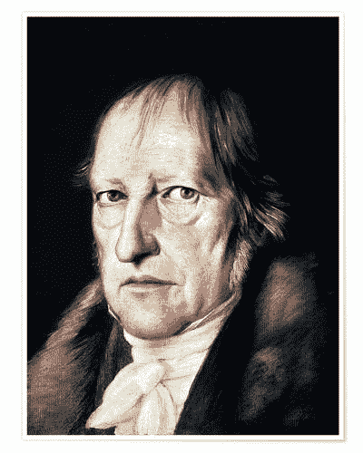

G. W. F. Hegel，1770-1831

黑格尔在去世的时候已经是柏林大学的校长了，用一个不太文雅的词来说，他其实不仅是一个学霸，而且是个学阀。实际上黑格尔最早的学术背景也非常的复杂，1788 年的时候，18 岁的黑格尔进入了图宾根大学的新教神学院学习，学习的是神学，不过当时有点神学背景好像也一点都不奇怪，就连大生物学家达尔文实际上也是有神学背景的。

他受到启蒙思想的影响，和当时的一些很重要的人物结下了深厚的友谊，比如说大诗人荷尔德林，又比如说是客观唯心论者谢林，谢林也是黑格尔哲学之前的一个非常重要的哲学家。同时年轻的黑格尔也开始阅读斯宾诺莎、康德、卢梭的著作，并且被法国大革命的种种现象所吸引。这些现象有些是好的，有些是坏的，这种好的现象主要是指对于封建秩序的一个挑战，坏的现象有可能就是在革命中出现的一些过于恐怖和暴力的现象，这也使得黑格尔开始对于大革命所代表的彻底的革命精神的合理性产生了一定程度的怀疑。

有一件小的典故可能很少有人知道，黑格尔的博士论文讨论的其实并不是严格意义上的哲学问题，而是以与自然科学有关的问题，就叫《论行星轨道》。他是通过这样的一篇自然哲学的论文获得了哲学博士与讲师资格。

不过这样一个文献多多少少也已经提出了对于牛顿的自然哲学的一个挑战，实际上已经预报了黑格尔在精神现象学中对于牛顿的自然哲学的一个更加全面的攻击了。不过这个话题和人生哲学的关系不大，我们暂且不提。

很多西方哲学史上的大哲学家都是以单身汉的身份了却一生，比如像休谟、叔本华、康德、尼采等等等等。黑格尔显然不是单身汉，他与一个比他小 20 岁的一个女性结婚了，而且还留有不少子嗣。

这里有一个花边新闻，就是黑格尔在年轻的时候在耶拿做"青椒"的时候，曾经和他的房东太太有过一些风流韵事，结果就留下一个私生子了。这个私生子在黑格尔正式结婚以后，又重新找到了自己的生父，给黑格尔的家庭生活带来一些小小的风波。因为在黑格尔这样的一个家庭里面得不到温暖，所以黑格尔的私生子他就离开了德国，跑到了遥远的爪哇，在那里作为一名荷兰雇佣军的军官继续讨生活，在那里死于热带病，听上去蛮惨的。

这个故事也多多少少具有一个哲学的意蕴，也就是说黑格尔本人是一个高度的理性主义者，所以对他来说，非婚生子女的产生是理性的社会框架所不能够容忍的。这也正是基于他的哲学观点，所以他对于他的非婚生的子女不是特别的友好。但是非婚生子女的产生是一个客观事实，这个客观事实本身是不容抹杀的，所以在黑格尔处理他的非婚生子女这件事的一个态度上也体现了理性和感性的一场角逐。

#### "存在即合理"

从总体上来看，黑格尔的人生哲学是怎样的一个特点呢？我认为黑格尔的人生哲学是两种态度的一个结合，一个态度是有点消极的认命的观点，就是相信世界中发生的事情总有它的一个合理性。

我们是不是都听说过这么一句话呢，凡是存在的都是合理的，我们都把这句话套到黑格尔身上。这句话是什么意思呢？当然它并不是指有些人所说的那个意思，就出现了各种各样的一个坏的现象，我们就要为他辩护。黑格尔不是这个意思，不是说有人犯罪了，我们要为他辩护，有人贪污了，要为他辩护等等。他是说凡事只要发生了，它都是在理性之网中发生的，你必然能够找到一个合理的原因去解释它。当然这并不意味着你要为这件事来做辩护，但是你可以解释它，你可以理解它。

比如你可以理解一个罪犯为什么犯罪，但这并不意味着你可以为他免罪。总而言之，这个世界中它没有那么多神秘性，当然也就是理性主义的思想对他的一个影响了。相信世界中发生的所有事情都可以被合理的解释的，这就叫存在的都是合理的。

#### 主客观理性的相互符合：历史与逻辑的统一

当然这个想法听上去也有一点点消极的味道，我承认是有的，但是黑格尔的思想也可以反过来看，它也有一个积极进取的方面，它是相信我们能够用自己的主观理性去解释世界中的客观理性的。

请注意，理性这个词在黑格尔的哲学里面，既可以指我们人类的个体的理性，也可以指世界自身的一个秩序安排。如果它是指世界自身所包含的各个要素之间的一个秩序安排，这种理性就是客观的理性。如果你的主观的理性和客观的理性相互符合，你就能够心想事成，你就能够趋利避害。

因此，黑格尔特别强调整个人类历史的发展，它是按照它内在的一个秩序的安排的客观合理性展开它自身的逻辑的，这就叫所谓的历史与逻辑的一个统一。什么叫历史与逻辑的统一呢？你看有个种子，它慢慢就成长成这个树了，这个树慢慢的也会老，也会死，这样的一个自然展开的过程，是和树之所以为树的这种生物学本性有关的。这个生物学本性就规定了整个树它的各个要素之间是怎么联系的。树木的成长荣衰是这样，而文明的一个成长和荣衰可能也是这样。

其实这个观点对以后的有一些历史哲学家，比如说斯宾格勒也有一个影响。斯宾格勒写过一本书，就是《西方的没落》。在《西方的没落》里面，斯宾格勒也是主张，每一个文明体它都会经历一个内在的生长逻辑，怎么样从一个婴儿状态变成青年状态，然后慢慢地走向衰落。

顺便说一句，当黑格尔说历史与逻辑它必须是要统一的时候，这里所说的逻辑并不是狭义上的逻辑。狭义上的逻辑是什么呢？就是我们所说的数理逻辑意义上的一个逻辑，比如说在命题 P 和非 P 当中必有一真，必有一假，这叫什么呢？就是说所谓的排中律，这种逻辑完全是形式之理。

我们在本节目的姐妹节目《用得上的哲学》里面，就区分了三种道理：逻辑之理其实就是形式之理；第二层理就是语义之理，语义之理是指语词之间的关系，红的就不是绿的，绿的就不是红的；另外就是经验之理，经验之理就是指自然科学的具体规律和社会科学的具体规律，还有很多人生的经验等等。

这三层道理在哲学中都起到作用，但是一般人讲到逻辑的时候就是讲逻辑之理，他们会把语义之理和经验之理抛开了。但是黑格尔是要把逻辑之理、语义之理和经验之理都说成是一种广义的逻辑之理，他对于逻辑这个词的用法是非常非常的宽的，这是我们大家需要知道的。所以我们在看到黑格尔写的一些逻辑学的书的时候，一定要知道他说的这个逻辑确实包含了这三层道理的。  
**换言之，如果经验之理里面包含了很多人生的智慧的话，黑格尔恰恰是愿意通过这样一种广义的逻辑的概念，来将狭义的逻辑视为人生智慧的一个组成部分。**

这个视角恐怕是专业的逻辑学家感到非常的震惊的，因为专业的逻辑学家会认为，纯粹形式的逻辑是应该像数学一样，数学应该是不食人间烟火的。黑格尔倒过来，他认为逻辑和数学是生活的一部分，你要从人间烟火的角度去看待逻辑和数学。

#### 黑格尔的绝对精神与历史经验主义

那么讲到这里，我们也必须要谈一谈黑格尔在整个思想史中的一个地位，我们要讲他的人生哲学，他和以前的人生哲学的大师之间的一个关系是什么？

首先我们就要谈到理想主义的传统了，也就是苏格拉底、柏拉图的传统了。理想主义的传统就非常简单，它要区分两个世界，这两个世界一个是现实的世界，一个是理念的世界。当然他们会反过来，认为理念的世界比我们看到的现实世界更现实，因为现实的所谓的感性的世界是一个稍纵即逝的世界，而理念的世界是长存不朽的。我们追求的那些至善、至美、至真的东西，都是要在理念世界里面。

黑格尔并不完全反对这种观点，其实黑格尔的哲学也能算是某种意义上的理想主义。黑格尔的一个核心概念叫什么？叫绝对精神，绝对精神这个概念就是柏拉图主义所说的至善，或者是普罗提诺主义者所说的太一，或者是基督教所说的上帝的某种改写版本。在这个意义上说黑格尔执着于绝对精神，也证明他是执着于理想主义的。

但是黑格尔的理想主义非常的有意思，它是一种亚里士多德化了的理想主义，他也深受亚里士多德的影响。  
**亚里士多德认为什么呢？他认为现实的物理世界和理念世界不是两个世界，两者就是一个世界，理念必须要在现实的物理世界中的实现自己。**

黑格尔也持一种类似的观点，他认为自然和历史是绝对精神必然会外化自己而构成的一个感性形式，两者之间的关系也就是说现实世界与理念的关系是合二为一的。你不能够说在感性的世界之外，我要去找绝对精神，绝对精神就在你的周围。比如你不能够说上帝在整个世界之外，上帝就在你的旁边，就在你的录音笔里，就在你的血肉里，就在你每一个红细胞里，就在你的每一次呼吸里面，在你眼前飞过的每一只小蚊子里面，也许都有上帝的某一个方面的一个体现，这就是黑格尔的观点。

那么这种观点就使得黑格尔的观点和康德的观点也有所不同了。康德的观点是什么？我们在讲康德的哲学的时候已经说过了，康德认为自然界所给我们的世界能够提供给我们知识，但知识是有界限的，我们就永远不能够通过对于知识的积累来获得关于上帝的知识。

请注意，关于上帝我们没有知识，关于上帝我们只有信仰。但康德无疑是信上帝的，只不过我们要指出，这一种信或者说信仰是没有知识做担保的，这就意味着他好像是在假装信上帝。因为一个真正相信上帝的人，你就问他，上帝存在吗？他这样回答，上帝存在不存在我不知道，但我仍然信上帝，这听上去是不是非常的虚伪呢？

这就是黑格尔的哲学对于康德哲学的一个很重要的攻击，你虚伪不虚伪？你一方面说我信上帝，另外一方面说上帝存在不存在我不知道，这不是扯淡吗？当然面对这样的指责康德也有话说，康德说我这样说是有我的道理的，那是因为传统的哲学对于上帝存在的所有论证好像都是不行的，像安塞尔莫的那种论证，仅仅因为某个蠢人头脑观念里面有上帝，你就推出这个蠢人之外上帝是客观存在的，这个思路是行不通的等等。正因为如此，我只能够使用先验论证的方法。

比如举一个例子吧，之所以我们做生意的时候彼此是诚信性的，因为我们相信我们彼此都是自由的市场交换主体，我们都会按照市场规则来做事，凭什么我们相信彼此之间我们都是君子，不会互相耍赖呢？肯定就是因为有更深的一个观念做担保，因为我们都是基督徒，我们都是信上帝的，正是因为我们信上帝，我们相信人人都是上帝的造物，而且人人都从上帝那里分享了某些重要的特性。比如说我们具有自由意志，在这样的一种情况下，我们就能够成为彼此信赖的交易伙伴……所以你看，没有上帝的观念做担保，一个完善的市场经济都不能够形成。

有一些学者，包括有一些经济学家，我现在不去点名，其实都是康德的信徒，他们就认为一个完善的市场经济就必须要以基督教作为一个担保，这一点也就似乎能够解释了为什么市场经济是在基督教盛行的地方发生的。

那么这种想法它到底是不是正确的呢？黑格尔认为是不正确的。因为这种想法是什么？这种想法实际上是一种试图要在游泳之前学会游泳的想法。游泳之前学会游泳就是指你所欲求的状态如果是游泳的话，你就坐在那里坐而论道，讨论游泳得以发生的前提条件是什么。

这就类比说如果你欲求的状态是什么，欲求的状态是要有一个完善的市场经济，你就去慢慢的分析，使得市场经济得以发育的前提条件是什么，然后通过拍拍脑袋你发现了好像是基督教对于上帝的信仰，于是我们就接受他了，于是你就引入了基督教的上帝的信仰了，你就认为有了这个东西后面的东西就拧出来了。

黑格尔说这个思路不对，为什么不对？ **因为你高度简化了世界的复杂性。你低估了这个世界。**  
你以为这个世界能够按照你分析的样子呈现出这么几个要素，但有可能你会漏了几个要素。就类比于说对于整个市场经济的发展来说，基督教的观念真的是起到一个至关重要的作用吗？

最近有一部日剧叫《势冲青天》或者叫《冲上青天》，讲的是日本的明治维新时期的大企业家涩泽荣一的故事。很明显涩泽荣一的精神信仰是来自于《论语》，他的口号就是"一手《论语》，一手算盘"吗，而且恰恰是通过《论语》的信仰，他是改变了日本的近代社会的一个社会面貌了，建立了很多银行、学校，修了很多铁路等等，而且也培育出了大正时期的市场经济的精神。但是直到日本大正天皇时期，你都不能说这个社会是以基督教作为它一个国家信仰，基督教在日本仍然是处于一个边缘性的地位。

这就是一个很奇怪的问题了，为什么有些国家它并不以基督教为主体，也算是建立了市场经济，虽然日本的市场经济不算那么的典型，但勉勉强强也能够算。但是有一些以基督教为国家信仰的国家，跟在西方人后面接受了基督教，却远远都没有达到市场经济所应该要求的那个水准，至少离日本的水准很远，这些问题是康德主义者很难解答的。

黑格尔主义者对这个问题的解答是这样，你必须要到实际的历史过程中去考察这些要素之间的一个关系，而不能够先验地拍拍脑袋，决定哪些要素是最根本的。你认为是前提条件的那些条件，在具体的历史经验的之河中有可能会被历史的浪涛拍到了岸上，成为边缘性的条件。

当然，黑格尔并不知道以后日本明治维新的事情，但我猜想他如果知道的话，他会利用这个例子来为自己的哲学做辩护。

这就导致了一个人生态度的问题。很多朋友很喜欢做人生规划，坐在那里就坐而论道，说我要做这个、我要做那个，我要在做这件事情之前一定要做 ABCDE……我现在非常惊讶的就得知，有很多小伙伴在大学的时候就谈婚论嫁了，这听上去是一个非常非常好的选择，就是你要在上海过得上开心的生活，你就要有一个殷实的资产。怎么能够做到这一点呢？就要在相同门户的两个家庭之间寻找合理的配对关系等等等等，找到了，事情就很好办了。  
**这种思维是有点像低配版的康德。**

黑格尔听到这种想法就会嘲笑他了，哪有在谈婚论嫁之前，先把婚姻的所有的条件全想好了？婚姻本身是要实践的，它是个人的生活经历当中一种最重要的一次冒险。类似于游泳，你要跳到水里面去游泳，你才知道婚姻对你来说哪方面是最最重要的。有可能财产只是其中的一个环节，其他方面的事情也是非常重要的。

所以你必须得先学着结婚，在结婚之中学会婚姻，然后了解婚姻的整体是什么。当然在这个过程中你可能会呛到水，会倒霉，但是黑格尔说存在的东西都是合理的，你倒霉这件事情只要你相信理性，还是能够找到一个背后的解决的原因的，这样下一次你就不会呛到水了，然后你的游泳的水平就会越来越高，这就是黑格尔的一个人生态度。

#### 进入黑格尔哲学的惊涛骇浪

好，关于黑格尔的人生哲学的大致的样貌，我现在已经和大家做了一番介绍，现在我们来讲一讲整个黑格尔的人生哲学的板块的一个安排。

接下来的一个安排是我们会讲一个貌似抽象的问题，因为黑格尔的一个哲学的特点是非常的晦涩，他用了一大套辩证法的语言，搞得大家云山雾罩，所以在切入他的人生哲学之前，我首先要讲讲黑格尔的辩证法语言它的一个本质到底是什么。我要告诉大家黑格尔并不是黑话大师，尤其是我想告诉大家，  
**黑格尔对于是、否、变，这三个范畴的解释，到底体现了怎样的人生智慧。**

在下面一个环节里面，我将切入到对因果关系与相互作用这样一个范畴的讨论中去。这一部分的讨论将有助于反思我们借以讨论人际关系的那些基本的思想工具。比如我们要解释职场、婚姻、求职等等各方面的这样的一些机缘，遭遇到的各种的遭遇啊，我们就会用到"因为""所以"或者"相互作用"这些范畴，所以而黑格尔对于这些范畴的使用将有助于解释我们在人生中遭遇到的一些困惑。

在接下来的一回中，我将讨论黑格尔对于 **主奴辩证法**  
的讨论，主和奴或者说主和从之间的关系在人际关系中经常出现，领导和下属或者是古代的奴隶主和奴隶，或者是现在所谓的夫妻，夫妻之间一般来说很难做到两者在实质上的完全平等，总有一个主奴的相互的制约。但是奴有时候也会变成主，主也会反过来变成奴，这就是主和奴之间的一个辩证法。

讨论到这个环节以后，我们就意识到在处理人际关系的时候，我们就需要一些抽象的原则来要求我们，这些抽象的原则可能就和道德律法有关系。但是讲到道德的时候，我们又会提到另外一些词，比如说良心，又比如说  
**伦理。道德、良心和伦理，这三者之间的关系究竟是什么？** 我们来听听黑格尔是怎么解答的。

好了，人除了讲道德和良心以外，口袋里面还是要有米的。所以接下来我们要讨论一下黑格尔对于财产问题的看法了，尤其是黑格尔所说的人格概念和财产之间的一个关系。这里我们就不妨问一个问题了，  
**如果一个人彻底没有钱，他还具有人格吗？**

讲到了这个财产的问题，就很难不讨论到家庭的一个问题了。很多人都意识到，如果他有很多财产，没有子女可以继承的话，这些财产有可能就会变成竹篮打水一场空，所以家庭在这里就起到很大的一个作用。家庭的本质是什么呢？接下来我们要讨论黑格尔的家庭哲学。  
**家庭的一个基础显然是婚姻，但婚姻的基础又是什么呢？是爱情还是契约，还是二者兼而有之呢？**

接下来我们就要讨论比家庭更大的一个社会活动场域了，这就是所谓的市民社会。市民社会实际上就是今天我们所说的市场经济的活动的场域，  
**市民社会的本质是什么呢？我们应该在市民社会中怎样表现自己呢？**

讲完了市民社会以后，我们要切入个更高的一个层面，这就是国家。黑格尔把国家说成是地上的神，这证明他是一个绝对的军国主义者、绝对主义者和集权主义者呢，还是他只是一个审慎的爱国主义者呢？在这个问题上，后世的哲学家对于黑格尔的国家哲学是给出了完全不同的解释，我们也有可能会在这个环节扯一扯这些后世的解释。

你讨论到了一个国家，就不可能不讨论到历史，因为我们已经进入一个比较广阔的领域了。历史实际上和个体也有关系，因为正如某位作家所说的， **"  
时代的尘埃中的一粒灰落到我们个体上，就是一座山"，所以个体和历史之间是有着非常明显的互动。**

谈完了黑格尔的历史观以后，我们要谈论一个稍微轻松一点的话题，就是黑格尔的艺术观，也就是 **为什么黑格尔说艺术是理念的感性显现呢？**

讲完了这些因素以后，我们会讲讲黑格尔的一些后学是怎么样看待黑格尔的。在这个环节中，我们会提到一位非常有名的丹麦哲学家克尔凯郭尔，即克尔凯郭尔对黑格尔哲学的继承与反叛。

对于黑格尔这个板块的介绍大致就到这里为止了，现在我们就应该扬帆起航，进入黑格尔哲学的惊涛骇浪之中了。大家准备好了吗？

谢谢大家，我是徐英瑾。

公众号懒人找资源，懒人专属群分享

## 67\. 不做把头埋进沙里的鸵鸟：黑格尔辩证逻辑的包容性、必然性与客观性

### 文稿

各位朋友大家好，我是徐英瑾，很高兴和大家继续来讨论哲学家的 10 种生活提案这个话题。

在上一回的节目里面，我们对黑格尔哲学的概要进行了一个说明，由此我们就知道了黑格尔哲学和康德哲学之间的一个最大的不同：康德是假装有理想，黑格尔说理想是真的。

但是他和柏拉图主义也不一样，黑格尔特别强调理想或者理念是在历史之中展现自己的，那么在历史之中展现自己的这样一种理想，它的这个展现过程经常被称为一种辩证的过程，因此黑格尔的思想也经常会被说成是一种辩证哲学的思想。

听到辩证法，大家脑袋就大了，因为黑格尔哲学的很多坏的名声就和辩证法这三个字有关。所以在学界也有人私下里调侃说黑格尔说的都是黑话，不知道他在说什么。那么黑格尔的辩证逻辑到底是怎么回事呢？怎么样把他的那一些黑话阐述得比较清楚明白一些呢？这就是我们这一回所要处理的问题。

有人说咱们为什么要处理这样一个问题呢？我们做的人生哲学和怎么澄清辩证法这两件事有关联吗？大家不要忘记了，叫"工欲善其事，必先利其器。"举个例子，假设你跑到了一个必须要用汽车才能够生活的国家，比如说在美国，对不对？如果没有汽车的话，你就没有办法进行自由的人际交往，不能购物，甚至不能上班。那么在这种情况下，你就得坐下来听我谈一谈汽车的维修和保养，虽然听上去非常的 boring，但是对你的生活非常重要。

那么你要跟着黑格尔游泳，你就要了解他游泳的那种奇怪的姿势，这个姿势就叫辩证法的姿势。你这个姿势不了解，你就跟不上黑格尔的步伐，你跟不上他的步伐，黑格尔说的那些有人生哲理的话，你也就听不懂了。

那么黑格尔的语言我已经说过了，是一种辩证法的语言，辩证法的语言的一个典型特征是什么呢？我们先感受一下黑格尔的名言，黑格尔有一句名言大家听一听："一切问题的关键在于不仅把真实的东西或真理理解和表述为实体，而且同样理解和表述为主体。"

这话你觉得你能给 get 到他的意思吗？没有受过哲学训练的人肯定就不行。那么黑格尔的整个辩证法语言的结构是一个正反合的结构，先是从正面说说它，然后再反面说说它，然后再在一个更高的层面上对正面说的和反面说的话进行一下综合。

这种做法经常被人庸俗化，比如小张在单位里面，领导要评价小张，小张这个人是有很多优点的，吧啦吧啦说了一遍，但是小张这个人还是有很多缺点的，吧啦吧啦又说了一遍，然后最后结论小张是一个有优点又有缺点的同志。这是一种比较庸俗的对于黑格尔的辩证法的这种运用。

另外还有一些别的运用方式，比如说 2020 年中国的流行词是内卷，2021 年就是佛系了，要平躺了。去年内卷，今年平躺，无论是内卷还是平躺，它背后的一个共通项就是焦虑。

给人的感觉正反合的用法就是在两个极端之间找平衡，这听上去好像也没什么了不起，好像很容易学会，我们在日常生活中也经常要在两个极端之间找一个平衡点，或者找一个更高的字眼把它涵盖起来。

我个人认为事情恐怕没有大家想的那么简单，我们还是要抱着一种谦虚的态度，先来了解一下黑格尔的逻辑学的工作到底是什么，为什么他的一个逻辑是被称之为辩证逻辑？

那么我这里想讲三点，我先预报一下这三个要点。第一，黑格尔的逻辑和一般人的逻辑的观念不同，它有很大的包容性。第二，黑格尔的逻辑的概念与必然性是有关的。第三，黑格尔的逻辑又包含有客观性的含义，所以我们要从包容性、必然性和客观性三个角度来了解黑格尔的辩证逻辑是什么意思。

#### 包容性：用三种逻辑概念参透世界

那么我们先来谈谈什么叫包容性。

在《用得上的哲学》这个节目里面，我曾经说过哲学有三层道理：

第一层是逻辑之理，逻辑之理是什么呢，就是 P 或者非 P 这两个命题之间必有一真，必有一假；

第二层是语义之理，语义之理就这朵花是红色的，它就不是白色的，是白色的就不是红色的，因为红色和白色这两个词的语义是相互排斥的；

那么第三层就是所谓的经验之理，经验之理是什么呢，也就是说比如造一个大楼，你要从第 5 层盖到第 6 层，你就要按照客观规律去做，你不能够让混凝土还没有干之前就往上垒新的一层，这样就会有建筑隐患，这就是经验之理，是工程经过长期的实践归纳出来的一些规律，你不能够忽视这些规律。

那么这三层里哲学家往往比较关注的是第一层和第二层，第三层常常被认为是科学家要做的事情。但是黑格尔反其道而行之，他认为哲学家不要那么的谦虚，他认为有一种广义上的逻辑，把这三层理打通了，这种理既是逻辑之理，又是语义之理，也贯穿到了经验之中，这就是他所说的逻辑。

这个所说的逻辑显然就和逻辑学家管的逻辑不一样了：逻辑学家管的逻辑不包含语义，因为语义是语言学家管的；逻辑学家所管的那个逻辑也不包括经验，因为经验是科学家管的。黑格尔要把它们全部包容下来，这就是黑格尔的逻辑概念的包容性。

有人说为什么我们要跟着黑格尔的思路走呢？举个例子，你本来是一个私企的员工，现在跑到国企去了，那么私企做事的方式和国企就不同，如果是外企的话，日企、德企、美企它们之间的做事方式都不同。所以有时候我们就会有一些很抽象的术语来描述这些差异，我们就会说"按照国企的行政逻辑，这件事儿就应当怎么做，你就得认命"。

什么叫行政逻辑呢？行政逻辑到底是指逻辑之理、语义之理还是指经验之理呢？我觉得这三者都有。

说它是一个经验之理，这是非常明显的，因为这是我们在对于国企进行观察以后所得到的这样的一个规律，原来在国企里面这样一种混法能够得到上级的青睐，但在私企里面不是这么玩的，我们知道了这一些，这显然是从经验里面来的，所以这是经验之理。

那么第二层它是语义之理，为什么是语义之理呢？这道理非常简单，就是你如果掌握了这个规律，你要把它表达出来，你就得使用语言和概念。你在表达这个规律的时候，你所使用的语言本身也必然是一种符合人类自然语法的语言，你不能够说得颠三倒四的。

但这里面也蕴含了逻辑之理，也就是说即使是一个没有逻辑的行政逻辑，对它的阐述也是有逻辑的。这句话大家大概有点听糊涂了，有点像黑格尔的话。

比如就举一个例子，大家都知道嘉靖皇帝是一个做事貌似很没有逻辑的人，比如他要在各个大臣之间寻找政治平衡，比如说徐阶，比如说严嵩，他要在这两者之间找平衡。他是怎么做的呢？他通过打哑谜，写青词，说一些云山雾罩的话，表面上看来他所做的事情不一定符合逻辑，但是他有一个隐藏的逻辑，隐藏的逻辑就是为他自己的利益服务。

他要让自己的皇权最大化，就不能够把话说得太清楚，让下级去猜，猜对了显示皇帝的伟大，如果猜错了把事情办砸了，皇帝可以随时甩锅。所以具体的皇帝对一件事情的一个评价，它有可能是不符合形式逻辑的，但是他的所有的行为都是维护他自己的皇权利益这一点而言，我认为它也是符合形式逻辑的。黑格尔的意思是说即使是这样一个看似是像黑箱一样的一个皇权式的操作，它也有某种隐蔽的逻辑。

当然在所谓的形式之理、语义之理和经验之理这三种道理之中，黑格尔是比较看重经验之理的，而不仅仅是语义之理和形式之理。他嘲笑那些仅仅看待形式之理的人，他们没有办法抓到事情中最重要的部分。

比如举个例子，纯粹的形式逻辑本身是不讲究利益的，纯粹的形式逻辑是不管皇权的利益、清流的利益和百姓的利益之间的一个关联的，但是你要分析明朝的政治运作，你就要关系到这些经验的事项，你要能够把嘉靖或者是他的群臣看成是有血有肉的人，有自己的欲望，有自己的想法，有自己的利益诉求，否则的话，你就没有办法把他们做事的逻辑给阐述清楚。

这一点对于我们的生活是非常有用的。我们很多朋友在生活中经常叫死理，我就拿前面的一个例子了，跑到一个国企去工作了，然后说这个规章是不符合形式逻辑的，对，可能是不符合表面上的形式逻辑。但你要站在黑格尔的哲学立场上想一想，它很可能是有一种隐蔽的行政逻辑。

这种隐蔽的行政逻辑到底是什么是要你参透的，是不能够仅仅通过阅读一些规章的字面的文字来获取的。这也就是说如果你仅仅是通过对于一些文件的字面的意思去了解它的一个形式逻辑的话，你有可能就会错失一些很重要的情报。

所以黑格尔的逻辑观对我们是有用的，这也就是说这要求我们把经验之理与语义之理和形式之理三者打通。如果仅仅是站在形式之理的角度上来看待万事万物，你很可能就会变成一个书呆子。

#### 必然性：在具体的环境条件下"跳舞"

那么黑格尔的逻辑观的第一个特征就是它的一个包容性，三种理都占了。

第二个特点是什么呢？第二特点就是必然性。为什么要提到必然性这个概念呢？那是因为我们已经看到了黑格尔的逻辑的概念已经是包罗万象了。正因为它是包罗万象的，很多人就问他了，什么东西不是逻辑呢？什么东西都是逻辑了，那么什么东西不是逻辑呢？天下都是逻辑，那就没意思了，是不是？你这个概念也太宽广了。

黑格尔说也没有大家所想的那么宽广，我所说的逻辑之为逻辑的这样一个事项还是有它的限定性的。它的限定性在于哪里呢？就在于它所讨论的这些事情都是必然发生的，都是一些规则性的事情。  
**纯粹偶然性的发生的事情，它就不是逻辑。**

比如我就举个例子，突然就有一阵风把一个小孩子很不幸的给吹走了，这种偶然性的事情它就不是逻辑。但是我们的社会的团体怎么面对这个悲剧？怎么对那个家长进行补偿等等这些事情可能是属于逻辑的一个组成部分。所以哲学它主要关注的是那些必然会发生的事情。

讲到必然这个词有人就要抬杠了。因为我们已经说过了，黑格尔所说的这个逻辑是同时包含形式之理、语义之理和所谓的经验之理，那么在经验之理的领域当中，必然性总是要打折扣的，它不像纯粹的逻辑之理，在 P 和非 P 之间总有一真总有一假，这个必然是 100%的必然。但是如果我们讲到所谓的行政逻辑，比如一个国企的行政逻辑，这个行政逻辑真的就存在在那里吗？

我举个例子，就拿明朝的行政逻辑来说，嘉靖皇帝的行政逻辑可能就和朱元璋的行事逻辑不太一样，而且应该是和末代皇帝崇祯皇帝朱由检的行政逻辑也很不一样，所以他的逻辑在经验的层面上很可能一直是在变化的。

如果说他一直在变化的话，你怎么能说它是必然成立的呢？这恰恰是黑格尔哲学比较难理解的地方，但同时也是非常有趣的地方。  
**他所说的必然也不是那种书呆子一样的必然，说的是放之四海而皆准的那种意义上的必然。**

他所说的必然更多的是这个意思，就是对于个体的经验来说，对于你的操作来说，你如果发现了一些稳定出现的套路，你就可以把这些套路视为逻辑，然后就按照某种稳定的期待和它玩了。至于这样的一套套路，是不是能够千千万万年的存在下去，这和你做这件事是没什么关系的。

比如举个例子，如果明朝的大臣徐阶，他发现了嘉靖皇帝做事情的一个套路，他掌握了，他就按照这个套路和皇上玩就是了。至于皇上驾崩以后，新皇上是不是按照这个套路玩，徐阶心想到时候大概我也死了，这种事情我就不管了，反正以后还有别的能臣能处理这个问题，比如像高拱，比如说张居正，他们还有大把的青春。这也就是说黑格尔不赞同大家要抛开具体的历史的环境去抽象的讨论必然性。

我觉得这也是一种非常好的人生哲学的态度。因为很多人他都没有认清楚自己生活的小环境，一天到晚就幻想在我外面还有另外一个世界，在另外一个世界里面玩弄的是另外一套逻辑，我就不按照你的套路玩。但问题是你找到下家了吗？你跳槽了吗？你跳槽了再说这话。

黑格尔的一个态度非常简单，在没有跳槽之前请记住这样一句谚语："这儿就是罗托斯岛，请在这儿跳舞吧！"不要跑到别的地方去，也就是说这就是你的舞台，你不要老是得陇望蜀。

#### 客观性："逻辑正是事物本身"

黑格尔的逻辑观还有第三方面的含义，第三方面的含义就是所谓的一个客观性，这和必然性的含义是有关的。那么为什么我们要讲客观性呢？因为康德他搞出了一个先验逻辑以后，整个就把逻辑这个概念弄得非常主观了。

我们都知道康德认为我们人类有很多知性范畴，这些知性范畴，比如说因果范畴、实体范畴、相互作用的范畴等等是从我们的心的活动当中，也就是心灵的活动当中抛射出来的，然后从心灵抛射出来的这些范畴，与我们从感官得来的感性杂多相互结合，然后才构成了知识。所以逻辑的必然性本身就有很强的主观性的印记。

至于客观世界是什么，康德的态度是三个字，不知道。他认为这是物自体，我们只能够假设它大概是那个样子，但究竟是什么？我们只能猜测，只能有信仰。

黑格尔就是不信这个邪，在黑格尔看来，我所说的逻辑就是一个客观的逻辑。比如说如果我琢磨出一个单位内部的晋升规则是什么，一个单位内部的行政逻辑是什么，这不仅仅是我的心智活动的产物，而且是一种客观实在，因此我要去尊重这种客观实在。

有人说这康德的态度和黑格尔的态度归根结底好像也没什么本质上的不同吗，康德也没有说我不尊重客观实在，他只是说我们的知性活动所归结出来的这些规律本身和纯粹的自然之间是否符合，俺们是不知道的，但是是不是 80%的符合呢？也许是符合的。你黑格尔在这个问题上和康德较什么真？老刷什么存在感？

但我认为这两种学说之间还是有分别的，还是那句话，康德如果老是把物自体当成是一个设定出来的概念，而不愿意承认客观物质世界本身的实在性，那就会导致人生哲学态度中的某种主观主义。也就是说总觉得自己和外部世界是有点不一样，这似乎是古代的斯多葛哲学的某种残存的思想。

斯多葛哲学的大佬罗马皇帝奥勒留就认为我可以建立起一座心灵的城堡，也就是说不管外部的世界怎么刺激我，我可以通过对于这些刺激的重新解释，得到心灵的一种安宁。然后过着一种把脑袋塞到沙子里去的那种鸵鸟式的生活。

某种意义上说，奥勒留的这种主观主义可以说是康德式的主观主义的某种翻版，或者说某种极端化的体现。

黑格尔则不是这样，如果你认识到了你现在所认识到的这些单位的行政逻辑也好，公司内部的升迁制度也罢，它是具有一定的客观性的。如果你认识到了它有一定的一个客观性，你能够以更加认真的态度来面对这个现实世界，你会认真地考虑怎么随顺这个世界，怎么适应这个世界，或者怎么改变这个世界。

请注意，改变世界的前提也是你要对这套制度要有足够的了解。张居正在相当大的程度上改变了明朝的行政逻辑，但是如果他没有在明朝的行政系统中多年的历练，他是没有这样的胆量敢对这台行政机器做出修正的。与之相比较，崇祯皇帝对于明朝行政体系的修正则导致了灾难性的后果，因为他不尊重这台行政机器运作的客观规律。

好了，那么讲到这里，我们大致就已经了解了黑格尔哲学的基本的一个特点，他是要通过他的所谓的辩证逻辑来阐发他的一个哲学思想。

他的辩证逻辑的基本的一个特点是什么呢？就是三点。

第一，这种逻辑是具有 **包容性** ，包含了形式之理、语义之理和经验之理，并且三者之间的一个界限也是非常模糊的，随时是可以转换的，是你中有，我中有你的。

第二，黑格尔所说的逻辑具有一定的 **必然性** ，它是我们所观察到的一些稳定的套路，并不是能够轻易地被偶然因素所消解的。

第三，这样一种逻辑它具有非常明显的 **客观性**  
，这也就是说这样的逻辑不仅仅是我们所观察到的现象，而且它正是事物本身向我们显示出来的样子，它就是事物本身。

有了这样一种新的逻辑观，以及有了这样的一种新的逻辑关系以后，我们恐怕就能够更好的来面对我们在生活中遇到的各种各样的困扰了。这些困扰到底是偶然的还是必然的？里面有没有套路可以遵循呢？对于这些套路的研究，是不是给予我们更多的机会来趋利避害呢？甚至改变这个社会现实中某些不合理的成分。

要回答这些问题，我们首先就要对逻辑本身要有一个正确的观点。很显然黑格尔对于逻辑问题的讨论，就为他以后的人生哲学的展开打好了基础。

好，讲到这一步，大家可能还会非常非常的糊涂，因为我们一开始就说了黑格尔辩证逻辑的特点是讲到正反合，讲了半天我们好像今天讲正反合的内容不是很多。好，下面一回我们就要通过黑格尔对于逻辑学这本书的头三个范畴的讨论，让大家看看什么叫正反合，我们下回见。

公众号懒人找资源，懒人专属群分享

## 68\. 走进黑格尔的辩证游戏：关于“是”“否”以及“变化”出的更多

### 文稿

各位朋友大家好，我是徐英瑾，很高兴和大家继续来讨论哲学家的 10 种生活提案这个话题。

上一回我们主要是讨论黑格尔的黑话是不是真的那么黑，我告诉大家黑格尔的黑话其实没那么黑，他的辩证逻辑的意思其实是可以用相对清楚明白的语言说清楚的。

他的辩证逻辑有三个特点：

第一个是 **包容性** ，既包含了形式逻辑，也包含了语义层面上的这个语义之理，同时也包含了经验规律，他三者全部打包了；

第二个是他的辩证逻辑是具有很强的 **必然性** ，以上所说的形式之理、语义之理和经验之理，它们的共通项就是他们都是必然的发生的，必然的成立的；

第三个特征就是黑格尔所说的辩证逻辑它具有强烈的 **客观性**  
，虽然我们是通过我们头脑的主观活动来把握世界的客观规律的，但是毫无疑问的是，这些规律在我们的头脑活动之前就已经是存在了，我们必须要把他们当成是客观存在的东西，否则就会陷入主观主义的迷雾。

#### 辩证逻辑间的相互关系：黑格尔的整体主义哲学

有了上面的这一回的讨论做基础，我们这一回要讨论一个更深入的问题，就是黑格尔是怎么样来阐述他的辩证逻辑中各个环节之间的相互关系的。

请注意，黑格尔的哲学，我们经常会称之为一种整体主义的哲学。那么整体主义的一个哲学它的想法是什么呢？也就是世界中的各个要素，彼此之间都是联系在一起的。  
**你所认为你不知道的那些事情，你所认为的那些对你的生活没什么影响的事情，很可能归根结底也会让你的生活产生巨大的影响。**

所以黑格尔的人生哲学，他打的是哪些人的脸呢？就是岁月静好派的脸。什么叫岁月静好派呢？就是认为我们不要去管天下大事，这和我有什么关系，我坐在这里开开心心喝自己的小酒，过自己的小日子就行了，我根本不用去看新闻。

历史上大凡能够做出重大贡献的人，都不是岁月静好派。有人说我们也不想做出重大贡献，但是有时候简单的趋利避害，也是需要一种黑格尔的精神的。

我拿中国文化里面举一个例子，这个人显然不可能读过黑格尔，但我觉得他有黑格尔的精神，这人就是曹操的谋士荀彧。

荀彧大家都知道特别的聪明，在东汉末年大家还在岁月静好的时候，他就跑到了他的老家叫颍川，这个颖是新颖的颖，其实就是在今天的河南省了，对他乡里乡亲说，根据我对于洛阳朝局的这样一个观察，天下要大变化了，你们就不要岁月静好了，跟着我逃命，我在冀州（冀州是在今天的河北）有些朋友，我们可以在那里重新建立家园。

很多人都觉得他疯了，脑子坏掉了，一天到晚就说东汉王朝会大变乱。结果很多人就没有跟着荀彧北迁，但是一部分人还是跟着荀彧北迁了。荀彧的确成功地预见了汉末的朝政的大乱，那些跟着他北迁的人都活下来了，没跟着他北迁的人就陷入了军阀之间的混战，很多人就死掉了，非常非常的可悲。

所以，你想离开对于这种国家大事的关涉，过着岁月静好的日子，这是你的主观愿望。如果你的家正好住在兵家必争之地，各路军阀都来这里攻伐，谁还把你的这几亩良田当一回事呢？

很显然，孔子说：君子不立危墙之下。看到形势不妙，你就得逃，但问题是逃到哪里去，又需要你进行一个全盘的操控了。

比如举一个例子，二战的时候如果有一个犹太人不堪德国法西斯的压迫，你逃没问题，你要逃对地方。你如果从德国跑到法国也就安全了一两年，纳粹德军进入了法国，照样和维希政权狼狈为奸，压迫法国境内的犹太人，最后还是逃不了去奥斯维辛集中营的这样一个悲惨命运。

所以你要逃就要逃的远，至少跨过英吉利海峡，有本事跨过大西洋。这就是说你要对世界的局势要有一个全面的了解，这就是整体论思维方式的一个重要的帮助。

#### 黑格尔的逻辑谱系：范畴间的隐秘关系

那么怎么样才能培养我们这种整体式的思维方式，能够让我们在大动乱、大变局的时代不会变成韭菜呢？不会就像颍川的那些荀彧的家族乡亲当中的那些不幸的遇难者一样，成为大时代的牺牲品呢？怎么能够避免这一切呢？

要训练这种思维，从哲学家的角度上来看，除了你要像荀彧那样一天到晚打听政治情报什么的，你还要需要一种哲学性的思维，你要在哲学层面上意识到各个概念的使用，彼此之间就是联系到一起的。

那么讲到这一点，我想引用维特根斯坦的一段话，我觉得可以和黑格尔的话相互的对应。

维特根斯坦就认为我们使用的这些概念就像一个语言工具箱里面的各种工具一样的，有各种各样的扳手，有各种各样的改锥，有各种各样的螺丝，而且这些工具它们彼此之间是按照一定的次序来摆放的。你去看看那些好的木匠，他的各种各样的工具的摆放是非常有道理的，不会非常凌乱的，这样你才可以在正确的时刻迅速地找到你要找到的工具来完成你的任务。

**我们脑子里面也有很多工具，这种工具我们称之为概念工具。** 这些工具在什么时候用，什么场合用，这就有非常大的一个讲究了。

比如我在讲用得上的哲学的时候也提到有些词不能乱用的，是不是？你和某某人只见了第一面，而且没有见过第二面，你就不能够说，"昨天我和他再见面了"，你说"再"是什么意思呢？"再"就意味着你在和他昨天见面之前还至少见过一面，但如果你和他昨天见面是第一面，你用再干嘛呢？这就说明你把这一个概念的工具用错地方了，用错一点点别人就会皱眉头。

那么黑格尔他要做的一个事情是很有雄心的，他认为所有的这些语词的概念工具之间是有一种隐秘的关系的，这个隐秘的关系就是像爷爷生爸爸、爸爸生儿子、儿子生孙子的这种关系，或者说叫概念谱系学，就很多概念之间有一个衍生和被衍生的关系。  
**他现在就要把这个概念的谱系学给弄出来，这就是黑格尔的《逻辑学》这本书他要做的事情。**

顺便说一句，这些抽象的语言工具，也就是起到那种像螺丝、扳手那些基本的语言框架作用的语言工具，就被黑格尔称之为范畴。这个词康德也在用，但是因为黑格尔所说的逻辑不仅仅是一种主观逻辑，而且是一种客观逻辑，他认为世界的运作也是按照这样的套路来进行的，这是他和康德之间不同的一个地方。

如果我们要把范畴之间到底"谁是老大、谁是老二"、"谁是爹、谁是儿子"这样的一个关系给梳理清楚了，这样一门学问就叫《逻辑学》了。所以黑格尔的《逻辑学》不是讨论形式逻辑上怎么做推理的那种数学意义上的逻辑，做的像非常数学化的证明题，不是这样的，他是研究谱系的，谁是谁的爹、谁是谁的妈，要把这件事情搞清楚，你得证明你亲妈的确是你亲妈，这是他的《逻辑学》的任务。

那么这样的一个《逻辑学》的训练有什么好处呢？你如果在这么抽象的层面上都搞清楚了这些抽象的范畴"谁是谁的爹、谁是谁的妈"，他们的一个谱系就搞清楚了，你在处理日常生活中的这些经验事物的时候，你就更有把握搞清楚这些问题的关键点在哪里了。

有些问题是表面的，你要解决这个问题到底要去找谁。比如你这公司要建立，就有一个政府部门就卡着，你这章没法敲，你就一下子要找到问题的关键，哪个领导是在这个问题上起到最根本作用的，然后一举把这个问题解决了。

但是如果你找错人了，找了下面一个小的办事员，你搞不清楚下面的小的办事员的权利是上面的权利衍生给他的或者指派给他的，你如果搞不清楚爹和妈之间的关系，那么你的事情就办不成了。所以黑格尔所说的《逻辑学》就是这方面的抽象思维训练，对我们日常生活是有用的。

好，今天我们先要讨论一个相对比较可控的话题，就是《逻辑学》开场的三个范畴，一个是"是"，一个是"否"，一个是"变"。

#### 是与否：范畴中的基础性信念

这个"是"是所有的范畴里面的第一个范畴，也就是黑格尔一开始就说了，不是说要给这么多范畴排一个大小吗？谁是宋江？谁是晁盖？梁山 108 好汉怎么放很重要对吧？黑格尔的意思是说你把这个次序放乱了，后面游戏就不能够玩了。我现在不讨论宋江、晁盖、卢俊义，一开始我就讨论李逵，我讨论花荣，我讨论孙二娘，这故事就没法说了。所以我们先要从前面的大头开始说。大头是什么？是"是"。

"是"是什么呢？在德文里面是"Sein"。它翻成英文是什么呢？就是"being"，就是"to be"，所以"to be"就是所有范畴里面的老大。

那么讲到为什么"to be"是老大，我相信大家肯定明白。哈姆雷特就告诉我们了，这还用黑格尔告诉我们，"To be or not to be，this is  
a question"，This is a problem，这是一个大问题，我们在用得上的哲学里面也有一个章回是专门来讨论"To be or not to  
be"的这个问题的。

也就是说对于洋人说话来说，我觉得对大多数英欧语言的都是适用的。他们说话的时候特别强调这个"是"。

那么为什么"是"很重要呢？你想想看，说话的本质是什么？是下判断。下判断的本质是什么呀？就是把一个主词和谓词联系在一起。你要把一个主词和谓词联系在一起要靠什么？你就要靠"是"和"is"，或者"to  
be"。to be 是它的一个抽象的动词形式，它变成个第三人称单数就变成 is 了，is 在德语里面是 ist。

这也就说明我们说话的所有的一个基本的预设，就是要把主谓加以联系，如果你不把主谓加以联系的话，那么你这个说话到底在说什么呢？

比如举一个例子，你说："小张，癌症。"你这话说了人家会吓死的，是不是小张得癌症了？你得把话说全，小张是癌症方面的专家，小张得癌症这事情是个谣传等等，你得把话说全了，是、否得加上去，否则人家真不知道你在说什么，你不能扔一堆名词，对不对？所以"是"就是下判断，不下一个判断就不足以构成一个完整的语言表达的单位了，所以"是"是非常重要的。

那么"是"非常重要，这一点恐怕大家也能够理解。有人就说为什么否定性的表达不是最重要的呢？黑格尔认为否定性的表达也很重要，但否定性的表达肯定没有肯定性的表达来重要。大家就想想一件事儿，大家平常说话你是说肯定性的语言多，还是说否定性的语言多？我相信大多数人只要你是个正常人，你还是说肯定性的语言多。

谈恋爱的时候，假设我面对我心仪的姑娘，这姑娘如果叫翠花。我对翠花说："翠花，我爱你"，这就是个正确的表达。

请注意，我爱你，用德语讲是"Ich liebe dich"，用英文讲是 I love you（我用那个十三姨的发音）。这样的一个表达显然是一个包含了 to  
be 的表达。

虽然从表面上来看，它并没有出现 is，但它隐含了 is，因为任何一个动词的正面使用仍然是 is 的一种变形，所以这句话也可以说是"我爱你这件事是存在的"。这是谈恋爱的正确的道路。

而如果你认为"是"的肯定性的表达不是第一位的，而否定性的表达是第一位的，这生活太好玩了。

比如我要向一个姑娘求爱，我就不和她说我爱你，我就和她说："翠花我告诉你，我其实是不爱喇叭花的，我也不爱玫瑰花，我也不爱……"结果我把我知道的花的名字都说了一遍。

翠花大怒，柳眉倒竖，银牙乱咬，小脸通红，一拍桌子，"你且说你到底爱不爱我？"

我对她说"to be or not to be，that's a  
problem"，她肯定一巴掌把我扇回去了。因为如果你不把肯定性的话说出来，你是根本办不了事情的。否定性的词儿，它必须要以肯定性的词儿占据主导的地位上，它才说得出来。

其实这一点在电影《盗梦空间》里面也有体现。

我们都记得里面有一段镜头，小李子和渡边谦这两个人密谋，反正渡边谦演的日本人是一个富商，花钱叫小李子去到别人的梦，要把别人的富商，另外一个富商脑袋里的信念系统全部给弄乱了，让被盗梦的人觉得赚钱是件很无聊的事情，让被盗梦的人想了法的去糟践自己的钱。

小李子一听就说这活干不了。小李子就问渡边谦了，现在我要你不去想一头粉红色的大象，你会干什么？渡边谦想了想说，我首先会去想你为什么要叫我去想粉红色的大象，所以我首先就会去想粉红色的大象。

为什么呢？这就是因为否定性的禁止性的评论，激起了肯定性的征服欲望，这恰恰证明黑格尔是对的。你让一个信念正面地进入别人的大脑是容易的，你让一个否定性的信念进入别人的大脑是很难的，这就说明正面的信念它的一个存在是具有基础性地位的。to  
be 是老大，"是"这个词是老大，否定词它不是老大。

好了，大家想想看黑格尔的哲学的确和我们的日常生活颇有关联，他首先肯定了我们所有概念里面的老大已经找到了，玉皇大帝已经找到了，或者说宙斯已经找到了，这就是"是"，这就是"to  
be"。接下来就讲老二了，老二显然是他的一个否定性的表达，就是"否"。

否没什么好讲的，就是一个否定句，你说什么什么是，接下来就是什么什么不是。你说你爱翠花，就意味着你不爱翠花以外的姑娘，或者说你爱翠花的程度超过了你爱翠花以外的姑娘的程度，或者说你爱翠花以外的姑娘的程度不如爱翠花的程度等等等等。这一点好像比较容易理解，我就迅速过去了。

#### 变：复杂而抽象的世界之理

第三个概念就是"变"。"变"这个词特别特别的麻烦，它的英文是叫 becoming，它德文是叫"werden"。

黑格尔本人说了一段云山雾罩的话去说明"是"、"否"、变这三者之间的关系。他的原文是："反过来说'否'作为这种直接的自我等同的范畴，就好似是与'是'相等同者，'是'的真理以及'否'的真理，因此也就是对于二者的联系，这一联系就是变。"

大家听了，这就是典型的黑格尔的黑话。我就稍微凡尔赛一下，接下来我就不会继续读他的黑话了，所以大家不要特别的担心。

"变"这个词它到底是什么意思呢？实际上"变"这个词在德语里面，它扮演了非常复杂的角色，它既可以表示那种过程被动态，也就是说在英文里面它要表示被动态，一般来说是加一个 to  
be，to be 后面跟着一个过去分词。但德文不一样，它用的不是 to be，它用的是"变"。

我下面就造一个句子：Seine tochter wurde  
krankenschwester，他女儿成了一名护士。这个词它实际上就是实义动词，它可以不接续任何的其他的动词，直接就一跟一个宾词了。所以在德文当中变这个词，它是具有非常非常复杂的这种语法活用现象的，英文里面没有，汉语里面也没有。

有人说你讲了半天怎么和我们上德文课了？我只是说，这个要点不是说德语，是 werden 这个词它的一个广泛的运用是告诉我们黑格尔的用意。

黑格尔用这个词就告诉我们，事物的各种各样的变，比如时间的变（本来不是护士，现在变成护士了），另外主动和被动之间的一个变（我被别人打了一下或者送到医院了）等等，所有的这些变，背后都有一种抽象的变。这种抽象的变乃是世界的某种很深刻的道理，但是这个道理是放在"是"和"否"后面的。

这个世界的第一个道理叫世界中存在着什么东西，肯定性的判断。

第二个，世界上有很多东西不存在，很多情况不存在，这是世界的第二个道理。

这个世界中的第三个道理是什么？是告诉大家，存在的和不存在的之间互相会变。

有人说为什么变会变成第三？黑格尔说，你把它放到第一去试一试，它显然要放到第三。你如果不肯承认你在判断什么，你怎么说变？你如果不去否定哪些属性不存在了，你怎么说变？所以变的一个存在是以"是"和"否"为前提的。大家想想看这是不是有道理？

在这个问题上，黑格尔的这个想法肯定是和很多别的哲学家是不一样的，如果老庄哲学来说这件事的话，就不会把"存在"本身看成是一件非常重要的、要放到第一位上的事了，很可能老庄哲学要把变化的原则放到第一位。

黑格尔当然是了解一点老庄哲学的，大家不要小看他，他也知道一些中国哲学的事，但他肯定觉得他的哲学更有道理。

为什么他的一个哲学更有道理呢？因为黑格尔会说我的这种哲学是对生活有用的哲学，你在日常生活中如果不肯定有些东西是肯定存在的，并且在此基础上否定某些东西或者属性是不存在的，你就跟我抽象地谈"变"，你这个句子的主词都找不到，你在说什么？还说我黑格尔在说黑话，你们老庄才在说黑话。所以只要你不想说黑话，就要跟着黑格尔说话，承认是是老大，否是老二，老三是变，这个次序是非常非常有道理的。

正因为它有道理，不能够随意地更改，所以它体现了逻辑的这三个特征。第一，它有包容性，能说万事万物，第二，它有必然性，这个次序不容随便更改。第三，这样的一个次序是客观的，不是我黑格尔想出来的，而是世界本身就是这个样子。

#### 黑格尔辩证游戏的启示

好了，那么讲到了这一步，我们就对黑格尔的这个辩证逻辑游戏怎么玩，有一个大致的概观了，怎么从这个"是"然后变成了一个"否"，然后才变成了这个"变"，然后再变出越来越多的这样的一个范畴。

今天的讨论，除了告诉大家黑格尔的辩证法的游戏该怎么玩，之外还给了大家这么几个启示。

第一点，你要做一个整体主义者，要认识到我们每个人的生活，都是和整个世界中发生的事情紧密联系在一起的。

第二点，要做整体主义者，我们就要知道我们的概念框架当中的各个概念要素是怎么连缀为一个整体的，而我们如果要训练我们自己具备把握这种整体的能力，我们就要学习黑格尔版本意义上的逻辑学。

第三点启示是什么？第三点启示是我们在日常生活中会遭遇到了很多很多的变化，是不是有些朋友一查身体结果查出三高，这还是小的，有些朋友可能查出了一些很凶险的病，像癌症一样的病，这可是人生中的一些重大的一个变化。

在我们面对这些变化的时候，我们不要惊慌。 **我们要知道，这个变化是预设了某些东西是稳定的的存在，存在仍然是我们这个世界的基础。**  
就类似于一个商人遭到了一次重大的投资失败以后，他仍然要想一想，哪些事情他还可以控制得住，他还可以 hold 得住，不要认为"变化"是老大，还是一句话，"存在"是老大。

好了，今天的节目就到这里为止了，在下面一次节目中，我们要把黑格尔关于是否变的辩证法，推到一个更高的层面，去看看如下三个范畴之间的一个关系，即实体因果与相互作用。谢谢大家，我们下回见。

公众号懒人找资源，懒人专属群分享

## 番外 - 漫谈中西方精神文明里的“存在”与“变”：到底谁才更贴近哲学的探索核心？

### 文稿

各位朋友大家好，我是徐英瑾，很高兴和大家继续来讨论哲学家的 10 种生活提案这个话题。

今天这一期节目是个番外，也是一个福利，是我在计划外的一期节目。我在讲完了黑格尔的逻辑学一开始的三个范畴，也就是"是、否、变"之后，我就觉得有一些话我还有必要再生发一下。

在这一期节目里面我们要讨论一个问题，这个问题就是为什么在西方人的哲学脉络里面，把存在当成是一个核心的问题来考虑是那么自然的事情。存在也就是"是"，"to  
be"能翻译成"存在"也能翻译成"是"。也就是说，把肯定事物的存在当成是所有的讨论的开始。

#### 作为核心范畴的"存在"

从巴门尼德开始，存在就成为了西方哲学的一个很重要的哲学范畴，甚至是核心范畴。这一个观点也在柏拉图的观点里面得到了继承，在黑格尔的逻辑学里面也得到了总结，所以黑格尔的逻辑学一开始就告诉大家，我们要讨论的所有的范畴就是 to  
be，接下来我们再讨论它的否定，也就是无，或者是否。第三个范畴才是所谓的变。

与之相比照，为什么在中国的文化里面对于变化的讨论，具有这么高的地位。我们好像不会有哪个哲学家跳出来说存在，存在这个词甚至都不是一个很典型的中文词汇。作为系词意义上的"是"，进入汉语相对来说也比较晚。早期汉语当中，也就是古汉语当中的"是"甚至不是今天的系词意义上的"是"，它主要是一个代词，代词指示某种东西。有点像英文的 this 或者是 that 的意思，并不是今天所说的 is 的意思。

这就非常奇怪了，为什么我们的想法和西方人不一样？西方哲学家，当然就可以为他们的这种哲学安排的普遍性作出一种申辩。黑格尔主义者就会说，你要否定一件事情，你要说什么东西在变化，这句话本身是要有一个主词的，你只有把主词确定下来，你就已经肯定了什么东西是存在的，所以 to  
be 显然是非常重要的，在概念的缘起上它应该早于 to be not，也要早于 becoming 变或者德文的 werden。

这个思路听上去非常符合逻辑，既然这个讲法非常符合逻辑，为什么中国人不这么想呢？这就很奇怪了，难道中国人思考问题不符合逻辑吗？对于这个问题应该有一种合乎理性的解释。

我在这里也试图提供一种解释，但这个解释我不是很有把握，所以我就放在番外里面谈。这个解释并不是哲学的，有可能是更基于历史学和社会学的一个观察，或者是一个心理学的观察。

#### 强调稳定与规则的西方

西方人他先强调肯定的范畴，中国人先强调变动，这有可能是因为中国社会和西方社会所处的社会结构是不一样的。

西方的一个社会结构从自古以来都特别强调规则的稳定性，你必须要在特定的规则的安排下来做事情。

我们都知道这个苏格拉底，他是在特定的规则的安排下接受死亡的。也就是说，雅典公民大会对他进行了一个审判，苏格拉底是故意不去钻规则的空子，然后让自己去死的。而且克里同明明已经买通了狱卒，可以在苏格拉底被行刑前先把老师救出去，但是苏格拉底为了维护规则的神圣性，明明知道这次判决不是很合理，还是坦然接受了死亡。这也就是说对于规则的追求似乎成了西方文化中一种非常根本的特征。

我们都知道凯撒渡过卢比孔河的这个故事。

凯撒渡过卢比孔河之后说了一句很有名的话："我来了，我看见了，我征服了。"然后就渡过卢比孔河，向意大利半岛的核心地区前进。

很多人就要问为什么渡过卢比孔河是一件很了不起的事呢？渡过大渡河是一件很了不起的事，因为大渡河很难渡对不对？卢比孔河就是一个浅溪。就这么一个小溪流，渡过它，为什么要引发凯撒的感慨呢？为什么会让他反复的思考呢？这件事和卢比孔河本身的物理特征是没有关系的，这与卢比孔河本身的规则意义是颇有关联的。

按照当时罗马的法律，在外面带兵的将领，如果没有得到元老院的命令，私自把部队带过卢比孔河，进入罗马的腹地，形同叛乱。

当时庞培控制了元老院，而罗马在高卢的军团则控制在凯撒的手里，凯撒要与庞培通过一场军事决定谁是未来罗马的主人，为了做到这一点，凯撒就要带大军渡过卢比孔河。但是他非常清楚渡过卢比孔河是一件非常严肃的政治事件，因为他没有合适的部队调令，如果仗打赢了也就罢了，仗打输了，就这个行为本身就可以让他成为国家叛贼。所以他做这件事情的时候，是反复的思考，最后咬咬牙，心想老子和你拼了，还是带部队过去了。

这个故事的确让我们感到非常惊讶，尤其让中国的读者感到非常惊讶。原来在两千年前古罗马人做事情的时候，就那么有规则意识。当然虽然毫无疑问的是，凯撒最后破坏了规则，但是至少他在破坏规则的时候，是有敬畏之心的，他觉得这事不对，我要去想一想，然后我才破坏这个规则。

#### 中国政治文化中"变"的力量

有人说，你不能够用这种观点来看待中国人，好像中国人就对规则非常无视一样。在中国古代历史上，也经常发生一些事情啊，比如说一个年少的皇帝要改变什么规矩，一大帮老臣就围着他说"这是祖宗之法，是不可改变的"……好像在这种意义上说，中国人也是非常重视规则的。

但是请注意，我前面所说的规则和后面所说的规则是有所不同的。我前面所说的规则是元老院的一个集体意志，某种意义上说它是代表人民的意志。

罗马军团在行进的时候，它有一个幡旗，这个幡旗上面绣了四个字母，是拉丁文字母，我按照英文的这个发音来念，叫 SPQR（Senatus Populusque  
Romanus）。这句话是什么意思呢？就是一切权力归于元老院与人民，它并不是归于某一个皇帝的。

罗马后来虽然从共和国变成了帝国，但是毫无疑问的是，即使在帝国时代，它的所谓的皇帝也并不完全是东方意义上的皇帝。比如奥古斯都成为皇帝以后，皇帝的真正含义实际上是元首。

元首这个词大家可能一听到元首就想到希特勒。这的确是希特勒在故意使用一些古代的词汇为他脸上贴金。但元首的本来的含义不是希特勒的意思，而是指元老院首席公民，也就是说我只是天下第一公民而已。你看这个讲法听上去还是比较谦虚的。

正是因为如此，在罗马法的系统里面，法律都带有人民法的特点，它都体现了人民的意志而不仅仅是一个个别人的意志。如果你让法律具有了这样一个普遍性的色彩以后，它就和个别人的一个习惯，和个别人的一个禀赋失去了联系，至少从哲学层面上看是这样。

但是我前面所说的，中国人说的祖宗之法不可变，它往往讲的是一个特定朝代的特定的开国国君的一个特定的秉性某些特殊的方面，它并不具有一个普遍性。甚至中国古代的这些士大夫，也没有尝试把这样的一些君主的个别意志普遍化为人民的意志，他们甚至连一种伪装都懒得做，他们就很清楚的告诉你，这就是君主的意志，而且我们天然就应该受到某一个特殊的人的统治。

非常非常有意思的是，实际上在中国古代皇帝也被称之为天子，某种意义上说，好像天子上面还有一个天，似乎能管着天子。但是天的原则乃是变，而不是存在。为什么呢？天象一直在发生变化。正因为天象一直在变化，所以士大夫可以通过对于天象的某些解释，以便构成对于皇权的某些牵制。但这种牵制并不是以存在为前提的。

举个例子，在古代的罗马，帝国时代我们不讲，在共和国时代，各个机制之间的一个相互牵制是写得清清楚楚。比如说罗马有《十二铜表法》，这个《十二铜表法》就对平民和贵族之间的一个权利责任做了一个大致的规定。罗马在共和国时代还有一个官叫保民官，保民官的任务就是代表相对比较贫穷的贫民的利益和贵族进行一些抗衡。他的一个权力和责任都说得非常的清楚，也就是说你想随意的扩大你的权力也是比较困难的。

但是在中国的这个文化里面，儒生对于天象的解释，那可是随便发挥。哪里出现一个乌龟，那就是一个祥瑞；哪里出现了两个头的乌龟，这恐怕就不是祥瑞了；但是另外一个儒生说，两个头的乌龟，弄不好是双倍祥瑞，然后就吵得一塌糊涂……所有的原则都是在语言的变化当中，然后取决于某一派政治力量在某一刻的优势，某一种解释就可能会胜出。

在这样的一个政治文化里面长大，你就很难感受到存在的力量。你会感受到什么呢？你会感受到一个变的力量。

相反在希腊罗马这个文明里面成长的人，他更多的会感受到这个世界上还是有一些基本的法律的。比如说在罗马就有一个罗马的基本法，你要改变它也是可以的，但是你要修订的话是要有一个非常复杂的过程的，你如果要解释它的话，也不是张三李四能够解释的。

请注意，在罗马帝国时期，这个国家是养了一批的专业法学家，这些专业的法学家是饱读法律文件的饱识之士，有非常丰富的识法的经验和法律实践经验，让他们对法律进行解释一般来说也不会出现过于荒谬的情况，国家的运行相对来说就是比较稳定。

这种稳定，可以体现为三个字叫逻各斯，英文是 Logos。逻各斯这个词可以说是我们平常所说的"道理"这两个字的西方式的写法。

我们中国人说这儿有道理，这事儿有道理，西方人如果学过一点古希腊哲学就会说，这里面有逻各斯，但是这个逻各斯是以存在为根本的。也就是说，你先要肯定什么规矩是存在的，然后才能够仔细的在这个规则的基础上再想出变化。他们不是否认变化，而是说在讨论变化之前，我们首先要肯定有一个基本的意义的基础或者规则的基础，它是不容被破坏的。

同时我们要看到，"变"这个范畴在黑格尔那里，是作为"是"和"否"这两个范畴之后的第三个范畴出现的。所以前面是个"是"后面是个"否"，我们都知道在黑格尔的哲学里面有一个正题反题合题，正题就是"是"，反题就是"否"，第三个才是"变"。所以它是有一个结构性的，所以"是"、"否"、"变"这三个范畴就体现出了一种三位一体的结构性。

但是这种结构性，在中国的哲学中相对来说是比较少的，甚至在一个比较讲求逻辑辩论的王充的哲学里面，我都发现在讨论"气"的时候他的讨论是缺乏这种结构性的。我们就是把那个"气"本身的变动和偶尔性的这种分布，当成了哲学的第一个原则。

这两者之间的一个分别，也可能与东西方社会生活之间的不同是有关的。

站在社会生活的这个立场上来看，"是"、"否"、"变"这三者之间的一个辩证性的递进过程，它体现了一个什么？它体现了一个理性的平等的对话的过程。

"是"就表示有人提出了一个建议，"否"相当于什么呢？有人反对这个建议。"变"相当于什么呢？就是根据这个反对的建议对原来的建议进行一个修订，然后提出了一个更好的建议。你看，这非常有层次感。

我们在《用得上的哲学》里面，其中就有一回专门讲"罗伯特意识规则"。这个"罗伯特意识规则"实际上就是对于黑格尔所说的"是"、"否"、"变"这样三个范畴的演进过程的一个技术化的体现。

但是在中国的文化里面，你如果按照这样一个原则去做事情的话，有可能就会倒霉。

举个例子，讲嘉靖皇帝，他说话都说不清楚，他是故意把话说不清楚，一天到晚叫群臣去猜哑谜。然后他说的这些哑谜到底是什么意思？严嵩在猜，严世蕃在猜，徐阶也在猜，弄不好什么高拱、张居正都在猜。

你看，这里面有没有人跑出来说一个论题呢？这个论题就是皇上你到底要说什么，你先说出来，我们群臣议。绝对不可能，绝对不可能，你首先得猜，而且你随时有可能猜错，而且圣心一直在变。

既然不可能，有人胆敢跳出来叫皇帝把他要说的这个题意正面的说出来，那就不可能有辩论的第二个环节了，就是否定他。皇帝，你说的好像是不对的，然后就进入了第三个环节，我们来修正一下皇帝的一个建议。

但是这样的一种做法在西方文化里面是很常见的。我们都知道英国有所谓的一个大宪章运动，大宪章运动是什么呢？就是国王的权力和贵族的权力要达成一个平衡，国王不要觉得自己太得色。国王说这些税收我都要收，贵族说不行，国王你这个动议我们否认了，然后否了五六条。国王说那不行，也不能都否了吧，给我一点面子，于是有了第三个阶段，就是变。变的一个原则就是每个人都从自己的立场往后退了一步。

这个大宪章运动，虽然是远远发生在资产阶级革命之前，但是"讨价还价"的这样一种精神，已经进入了这种英吉利民族的血液之中了。由此我们就可以理解以后的英国的内战，虽然也死了很多人，但是光荣革命毕竟是以比较小的一个代价实现了英国的政治转型。

但是如果一个民族它平常就没有这种"讨价还价"的训练，一句话就是按照《罗伯特议事规则》所进行的这样一个辩证对话，到最后只能靠什么东西来对话呢？靠刀、枪、剑。如果一个社会是如此轻易地进入了用暴力来解决问题的这样一个阶段的话，就会血流成河，就会死很多人。

从某种意义上说，黑格尔是西方哲学和西方文明的代表者，所以他对于"是"、"否"、"变"这三个范畴之间的一个关系的看法，更多的是对于西方文明精神的一种总结。

这一部分的内容，只是我的一些私见，我再重申一遍，我不是很有把握认为我说的一定是对的，也希望大家能够以批判的眼光来看待我今天所讲的内容，但一定要讲的有道理。

好，这一部分的内容就到这里为止了，希望大家有耐心有兴趣，继续听我讲完黑格尔哲学的方方面面，谢谢大家，我是徐英瑾。

公众号懒人找资源，懒人专属群分享

## 69\. 游向更深的“黑格尔水域”：实体、因果与相互作用

### 文稿

各位朋友大家好，我是徐英瑾，很高兴的和大家继续来讨论《哲学家的 10 种生活提案》这个话题。我们现在已经在黑格尔哲学的海洋里面，扑腾了不少时间了，希望大家能够在游泳之中学会游泳。

那么在上一节游泳课的环节里面，我们学了黑格尔的三个范畴， **第一个范畴是  
"是"，第二个范畴是"否"，第三个范畴是"变"**，由此大致了解了黑格尔式的辩证逻辑到底是怎么展开的。

我们应该知道所谓的一个辩证逻辑，就是告诉大家我们使用的这些基本的这种思维概念之间的一个衍生关系，到底谁是老大，谁是老二，谁能够成为宋江，谁只能是孙二娘，李逵就必须在宋江旁边，不能够占了宋江的位置，就是要告诉大家这个道理。

那么在"是"、"否"、"变"这三个概念里面，谁是老大呢？当然"是"是老大了。对于很多问题的讨论，都应该正面的预设了什么情况是存在的。比如一个女生说我已经不再爱这个男生了，你说这话已经预设了你曾经爱过这个男生。同时你至少也知道爱的标准是什么，如果一个人对于爱的标准是什么，他不知道，他也没有办法说自己不爱某某人等等。

同样的道理，当你说"变"这个词的时候，你也得预设什么东西在变。比如我的老同学他的长相变了，他的脾气变了，他的地位变了。你至少老同学还是老同学，这一点你是确定的对不对？

这就是黑格尔哲学的思想和老庄的思想不同的地方，我们中国的道家的思想强调的是宇宙的原始状态是一片混乱，是充满了偶然性的。比如我在这一个节目的前面几回就说过王充哲学，王充哲学就抬高偶然性。今天的日本京都学派的重要代表人物之一九鬼周造，他也强调偶然性。

**但是黑格尔他说的逻辑，我们说过了有三个特征：第一有它的一个包容性，包含形式之理、语义之理和经验之理；第二有它的必然性，必然性就排斥了偶然性；第三又具有它的客观性。**

这样的一种黑格尔哲学的特征，就会导致了黑格尔的人生哲学的其他方面的一个特征。

我们知道如果你不是黑格尔主义者，你是受到了道家的影响，受到了王充的影响，受到了九鬼哲学的影响，那么你就会提出一种基于偶然性的哲学，你会强调命运的非理性，在这种状态下人就很容易躺平。为什么呢？一切都不在我的掌握之中，一切都不在理性的掌握之中，我做的好做的坏有什么意义吗？那就躺平。

但是黑格尔是强调各种各样的这种社会现象背后，还是有大的必然性的，虽然它不是说没有偶然，偶然也存在，但是关键必然是套路。你要掌握套路，理解套路，控制这个套路，这样你才能成为人生的赢家。所以黑格尔哲学应该能够导致一种更加积极的人生态度。

#### 游向更深的水域：实体、因果与相互作用

现在我们要把黑格尔的这样的一个想法予以深化，所以我们要讨论黑格尔的另外几个范畴，一个是实体，一个是因果性，一个是相互作用。

这些范畴在黑格尔的《逻辑学》里面是属于所谓的本质论。《逻辑学》这本书分成三个部分：现象论、本质论和概念论。

啥叫现象论呢？我来说一个比较简单的解释。小朋友大概刚刚开始学会说话的时候用的那些概念范畴就叫现象论。

你看小朋友他说话就是，"这是糖，我要吃糖"、"我不要吃这个，我要吃那个"、"妈妈，你给我的牛奶的味道变了，怎么没有昨天好喝"……小孩就这样说，是、否、变。

但是我认为大多数的孩子只要你不是什么超级神童，像释迦摩尼一样生下来就是说"天上人间唯我独尊"这样恐怖的话，一般小孩刚开始说话的时候不会这样说的："爸爸妈妈，为什么这个牛奶它味道变了呢？我猜可能是因为你们没有把它放到正确的冰箱中的那一格吧？"

你觉得刚刚开始学会说话的小孩会说这话吗？他不会说这话，小孩刚才已经用到了因果范畴了。因果范畴有点难，它是对于现象的一种解释。实体范畴也是这样，你要认识到纷繁变化的现象背后，它有一个共同的根据，就是一个实体。

因果范畴和实际范畴还不是最难的，最难的是相互作用，它要认识到不同的元素是构成了一个相互作用的整体的，就比如你手掌里面有五根手指头，这五根手指头彼此之间是有联系的。能够说出"我手上这五根手指头，彼此之间是有紧密联系的"这句话，你觉得这小孩子他的智力要发展到几岁？我反正觉得应该五岁小孩能说出这个话，我已经有点小惊讶了，三岁我是不信的。

所以如果我们要对我们看到的一个现象进行进一步的解释，就要用到一些非常复杂的概念工具了，是特别小的小朋友不会用的。这里我们要提到的三个概念工具就是实体、因果、相互作用，其中因果是我们的老朋友了，我们在讲休谟和康德的时候已经看到过因果范畴的作用了，在黑格尔这里它又重新出现了。

#### 实体：表层判断之下的本质性依据

我们先来看看实体。

其实对于实体的讨论在黑格尔的文本里面占据了很多的篇幅。实体这个范畴实际上是我前面所提到的"是"这个范畴的一个对应者，它体现了"是"的很多特征，但是比"是"更加复杂。

这听上去就像我们经常所说的，我们今天所使用的滑翔机是以前的古人就会使用的风筝的某种技术的后继者，但今天的滑翔机可要比古人用的风筝要复杂得多了。这就类似于实体和事的关系，实体就类似于我们说的滑翔机，这个事就类似于古代的风筝，但是古代的风筝仍然是老大，人家是源流。

好，我们先来说说实体范畴它怎么用。我下面举的这个例子有点让人感到揪心，我举了一个杀人犯的例子。

可能就是因为在录制这个节目的时候我们周遭发生了一些事情，我不方便详谈，但是经常看新闻人都知道，我们今天这个社会是充满了越来越多的戾气，很多吵架能够解决的问题非要动刀子，何苦呢？对不对？大家坐在一起讨论黑格尔不是很好吗？为什么一定要白刀子进，红刀子出呢？我们不去谈。但既然在生活中发生了这么多不幸的现象，我们就要用黑格尔的态度来面对它。

黑格尔的态度是什么呢？凡是存在的就是合理的。这句话不是说我要为杀人犯做辩护，我是说凡是存在的都是合乎这样的一个理性的解释框架的，就是这件事的发生是可以解释的。请注意，不是说我要原谅杀人犯，绝对不是这意思。

好，我们现在就构成了一个判断：张三是杀人犯。那么在这个句子里面我们出现了"是"这个词，但是这仅仅是小孩子的水平，小孩子也会说张三是杀人犯，你如果是个法官，你是个警察，你的思维方式就要复杂一点，你要找到这个现象背后的根据，这个根据就是本质论的任务。

你就要想杀人犯有不同的类型，激情杀人、变态杀人、过失杀人、蓄意杀人、因报仇杀人等等等等。因为他有不同的杀人的原因，所以我们的解释也就不一样了。

比如我们有不同的一种说话方式，我们可以这样说，"张三虽然是杀人犯，但张三毕竟只是一介文弱书生，这次是被逼杀人了"，这是第一句话。第二句话，"张三本就是变态杀人犯，本就是连环杀人犯，他已在加利福尼亚作案三起，在康涅狄格州作案五起，今天终于在北卡罗来纳州落网了"。这是两种完全不同的说话方式。

**在这种更深入的解释性的判断当中，我们看到了什么呢？我们实际上是看到了偶然性与必然性之间的分分合合。**  
如果我们只是说张三本来就是一介文弱书生，这次只是激情杀人，那么我们已经把文弱书生的标签加在了张三身上，这个标签就构成他的必然性，而激情杀人就成为了一种偶然性，这种偶然性是与他的这种必然的本质相互冲突的。

的确，在人类的这种生活中是有这种现象的，一个不应该做某件坏事的人，他就做了某件事了。就像《水浒传》里面杨志卖刀，碰到一个泼皮，然后杨志一刀就把他杀了，这件事的确有一定的偶发性，杨志也没想到。鲁提辖三拳打死镇关西这件事也有偶然性，鲁提辖就想教训一下镇关西，他真没想杀人，没想到镇关西这么不经揍，三拳就被打死了，这件事是具有偶然性的。

但是如果张三本就是连环杀人犯，那么杀人就是他的一种必然性了。不是说他现在继续杀人这件事没有偶然性，但这个偶然性就体现在一些非常次要的地方了，比如他到底在哪里做案？第二，他到底对谁作案了？第三，他做完了以后是否被抓了？只不过这一次的运气不好，他在北卡罗纳州作案的时候，被警察抓到了。

**现在我们就知道实体它的本质是什么了：实体是表层判断之所以能够成立的背后的本质性依据，这就是实体。**

黑格尔所说的这个实体，我觉得和别的哲学家说的实体有些不一样，别的哲学家所说的实体更多的是一个东西，黑格尔所说的实体，更多的是一种稳定的根据。它体现了理性的力量，只不过黑格尔所说的这个理性不仅仅是主观的，而且是客观的。

比如你在法庭上说出的那些根据，你必须要坚信，这些根据不仅仅是你编出来的，世界本身就是这个样子，否则你就不能够在法庭上做到义正词严。很显然。这些对于根据的判断，在生活中会起到很大的作用。

举一个例子，一个文弱书生因为激情杀人，和他本来就是个惯犯不停的杀人，我觉得在大多数的情况下都会导致不同的量刑结果。如果是激情杀人、冲动杀人可能就会稍微轻一点，如果是惯犯就死定了。当然我说死定了这个词也是一个比喻了，某些国家是没有死刑的，至少是会按照最高的刑法加以惩处。

这样的一种思维方式不仅仅对于法官、律师或者西方国家存在的陪审团的成员来说很重要的，对我们所有人都很重要，在我们生活中的方方面面都很重要，包括恋爱、求职和在职场上碰到的各种各样的问题都非常的重要。

假设你是一个公司的主管，你招了一个新的员工，他的工作质量好像不太好，你就要判断了，这到底怎么回事？我是个老师，看到某某同学他考试成绩某一次不好了，是怎么回事？两个人谈恋爱，突然发现恋爱对象最近的经常闪人不见，放鸽子，这是怎么一回事？你要进行解释。

这个解释它的要点是在于，现在所体现出来的这些现象，现在这个对象所表现出来的这些现象，是不是体现了他的本质呢？或者是不是体现他的实体性呢？或者只是体现了某种极大的偶然性呢？比如举个例子，考生考不好，究竟是因为他不是学这一科的料，还是因为他最近家里出了点事魂不守舍？你就要把这些问题搞清楚。

我不是说学了黑格尔的哲学，你就能把这些问题搞清楚，但是学黑格尔哲学的一个用处就是告诉大家，碰到这些问题，大家要用这种分情况讨论的态度来面对这种复杂的生活的情况，不要立即下结论。你要在每一种可能性的下面，去找分别的证据，然后去找哪一种本质性的解释才是抓到了问题的要害。

总而言之，黑格尔的哲学故事，要告诉我们以下这些道理：

**第一，你要相信世界上存在着实体性这件事情，实体性这件事情用我们中国人的话来说叫  
"江山易改，本性难移"。**当然这个成语有点不好，这里的秉性难移或者本性难移往往是指坏的那种秉性，但是好的秉性也是这样，一个人他应该在某些情况下是做不出一些大逆不道的事的。

比如举个例子，2008 年在美国发生了一次很严重的枪击案，有二十几个人在校园中被人打死了，然后有人就跟我说谣传说是一个上海男人开得枪。我认为上海的男人是不可能开枪杀死二十几个人的，因为我对上海的男人有个基本的判断，你让上海的男人杀 25 只鸡都不太可能，不要说杀 25 个人了。后来果然查出来了，是韩国的一个人。

黑格尔就强调我们要对这些事情有判断，我们要对一个人也好，一个社会团体也好，一个民族也好，要对它的实体性有一个基本的判断。

第二个，虽然世界中有偶然性，但是偶然性这个概念我们是需要辨析的，我们不要把偶然性与现实性和可能性混为一谈， **偶然性、现实性与可能性是三个不同的概念。**

这一点有点烧脑，我通过举例子大家就知道了，我还是拿杀人的例子来说。

比如说如果张三的确杀人了，这就就是一件发生的事情，这是一件现实的事情。张三如果杀人的地方是在美国的北卡莱罗纳州，那么北卡莱罗纳州成为事发的一个地点它是具有一定的偶然性的，因为在美国你开车很容易从一个州就跑到另外一个州了，有可能第二天他就在另外一个州了。

那么偶然性和现实性之间的一个关系是什么呢？不得不承认偶然性是现实性的一部分。因为在北卡罗纳州杀人这件事也的确是现实地发生了，但是它的一个实体性的根据不强，也就是说没有很强的理由让我们相信他必然会在贝卡莱罗纳州杀人。也就是说在现实中发生的所有的事情当中，有一部分事情它的发生是稍微偏差一点就不会在现实中发生的，它的根据性比较差，这种事情我们称之为偶然性。

在这方面黑格尔的思路是和日本哲学家九鬼周造不一样的。关于九鬼周造的相关思想，大家可以去链接我在看理想这个平台上的另外一档节目，《暧昧：给日本脑洞一个哲学解释》。

九鬼周造认为偶然性是世界的一个根本，他的一个基本想法的根据就是你很难消除偶然性。你如果要去消除偶然性的话，你就要对世界进行一个追问：有一些人被高空坠下来的重物给砸死了，这件事是很不幸的。

但是为什么正好砸到你头上，而不是别人的头上呢？为什么你运气那么不好呢？为什么你恰好就走过那个地方呢？为什么这个人倒东西？为什么我走过那里呢？你怎么解释都解释不通。这就导致了他对于偶然性应该在哲学体系里面去扮演什么角色的这种观点和黑格尔完全不同。

好，我不能说太多关于九鬼的话了，说着说着就显得九鬼很有道理了，我们还是要看黑格尔怎么说。

黑格尔讨论偶然性也牵涉到了必然性、现实性、可能性这些概念。黑格尔是怎么看待可能性和偶然性之间的一个关系的呢？

实际上黑格尔很不喜欢讨论的那种可能性叫抽象的可能性，他喜欢讨论的是一种现实的可能性。实际上偶然性往往是和抽象的可能性相关的，而与现实的可能性不相关。

大家说什么叫现实的可能性？现实的可能性就是那种发生了不会引起大家惊讶的事件。

举一个例子，张三个饕餮之徒，喜欢吃各种各样的大餐。他昨天晚上吃了两只龙虾，他今天如果吃了 2.5 只龙虾，你也不会特别的震惊。因为吃 2.5 个龙虾和吃 3 个龙虾，它之间完全是非常接近的两种可能性。这种，如果你在现实世界中吃了 2.5 只龙虾，但在可能世界中吃了 3 只龙虾，可能世界和现实世界之间的间距非常近，那种可能性被黑格尔认为是现实可能性。他认为我们在日常的生活中，在制定一个预案的时候，是要考虑到现实可能性的，但是抽象可能性就不要去思考了。

什么叫抽象可能性？一个乞丐第二天突然发现他突然中了个福利彩票，然后他就成了富翁了；一个德国的工人晚上做梦觉得自己变成苏丹了……做梦是无所谓，但是他真的变成苏丹了，这就是抽象的可能性。黑格尔教大家不要在这样的抽象的可能性当中浪费思路。

但是我们得注意，恰恰是很多人都沉湎在这种抽象的可能性当中，不去考虑自己现实的可能性。为什么这些讨论它非常的抽象呢？因为这些讨论的根据不足。

好，讲到这里的时候，如果有人要杠黑格尔，就说：黑格尔，你讲的是完全不对的，我现在就可以举一个例子来证明黑格尔你的那种过于保守的、缺乏想象力的、打击人家雄心的观点是不对的。

最近有一部日本电视剧叫《势冲青天》或者叫《冲上青天》。它讲的是谁？讲的是日本明治到大正时期重要的企业家涩泽荣一的故事。他这一辈子干的事，先是一个破农民，然后莫名其妙成为武士了。成为武士了以后，又成为幕府的重要官僚了，然后竟然又成为明治维新时期的官僚了。你看，改朝换代了以后，他还是官僚，然后成为大实业家了。做了实业家以后，又做成了很多很多的大事，真是牛的不得了。口号听上去也是非常的有味道，说左手算盘、右手《论语》就可以治天下了。

就这样的一个人，他身份那么低微，不就是一个想拱白菜的人吗？还变成了一个这么大牛的人了。他年轻的时候，在他还根本什么都不是的时候就做了一首汉诗，这汉诗就成为电视剧的提名的一个来源了，汉诗的内容叫"势冲青天攘臂跻，气穿白云唾手征"。这话说的牛气冲冲，要比城里拱白菜这个话要文雅多了，但是狂傲之情也是跃然纸上。

涩泽荣一的老爹就一天到晚说，我们就是做农民的命，我们连武士都做不了，你瞎操这心干嘛？日本的好坏和你有什么关系？你看，涩泽荣一老爹的观点是不是听上去很黑格尔？那种抽象的可能性不要思考，你只要考虑现实的可能性。涩泽荣一的成功就打了黑格尔哲学的脸。

但是黑格尔会怎么看？我作为一个黑格尔主义的信徒，我读了涩泽荣一的故事以后，我会这么来解释。我会认为涩泽荣一的故事没有挑战黑格尔哲学，因为涩泽荣一他的本质没有变，他表面上的政治站队一直在变，他表面上穿的衣服一直在变，但是他的一个基本想法没有变。

你要知道涩泽荣一他不是一般的农民，他是武藏国血洗岛村的农家的长子，他们家是经营蚕业和染织业的。他年轻的时候就深感封建制度的缺陷，因为他受到封建领主的剥削，他属于早期的自发的日本本土资本主义萌芽的这种代表。他恨洋人和恨封建领主的道理是一样的，也就是他不想做韭菜，不想被割。

到最后他突然发现，也就是从现象论进入本质论了，他要对这个世界本身进行一个解释了，他突然发现杀洋人不是一个好方法，绝对不是好方法，要"师夷长技以制夷"，把洋人赚钱的本事学到，自己做大资本家。但是它的一个本质性规定没有变，这个本质性规定它就要发展日本自己的资本主义。

当然了不是说涩泽荣一的整个人格的成长的过程中它没有偶然性，它当然有偶然性了。比如他与德川庆喜之间发生了关系。但他为什么与德川庆喜之间发生关系了？是因为他先认识了德川庆喜的一个重要的家臣叫平冈圆四郎，而平冈圆四郎非常喜欢涩泽荣一，觉得这小子有意思，就把他收为德川庆喜家的家臣了。

讲到这一点，我们突然就发现了，你如果要对偶然性的事件进行解释的话，你还是需要什么？你还是需要因果范畴的，因果范畴是在两个实体序列之间建立桥梁的一种企图。

比如举一个例子，涩泽荣一是怎么进入德川家的呢？是因为靠平冈圆四郎的引荐，这个"因为"  
"所以"就构成了一种因果的这种范畴。因果范畴是必然会在我们要对两个实体序列之间的关系进行解释的时候出场的，所以它是黑格尔所说的概念三件套里面的第二个，第一个是实体，第二个是因果。

#### 因果：实体的反题，自我的否定

"因果"范畴某种意义上说构成了"实体"范畴的一个反题，正如"否"这个范畴构成了"是"这个范畴的反题一样。

为什么？因为因果范畴的一个特点就是在原因句和结果句里面出现的句子应该是不一样的。

实体范畴不一样，实体范畴就是主词和宾词之间的自我同意，比如涩泽荣一就是涩泽荣一，他人没有变，对不对？我就是我，一朵不一样的花火，我没有变。主语和谓语之间彼此重合的这种特征，体现出了重复与稳定的力量，所以才能散发出必然性的味道。

但是在因果性的表达里面我们看到了什么？我们看到这样一个句子，因为德川庆喜的家臣平冈圆四郎赏识涩泽荣一，所以涩泽荣一成为了德川庆喜的家臣。我们可以看到这个句子虽然有点长，但是在"因为"这个句子里面所出现的某些内容，在"所以"这个句子里面没有出现，比如说平冈圆四郎，这是个新的情报。

你看到这句话，你会很自然地问："平冈圆四郎是谁？"你问了这个问题就对路了。  
**原因和结果的出现的一个特点，就是因果句子表达的信息是不同的，它并不是一种自我同意，结果要通过他者来肯定自己，他要通过他者来肯定自己某种意义上说也是对于自己的否定。**

涩泽荣一毕竟他的地位十分卑下，没有平冈元次郎的一个提携，他是不可能成为德川庆喜的的家臣的，这两个人之间的社会阶层差了三千层，所以你需要借助一把梯子，"别人"这个梯子。

**这样的一种对于自我的否定，就构成了实体性原则的某种反题。**  
在实体性的原则里面我就是我，我涩泽荣一就是涩泽荣一，我不靠别人，我就靠自己；反题里面你不靠平冈圆四郎，你能够认识德川千禧吗？你不认识德川庆喜，你怎么成为德川家的经济大管家？你不成为他的经济大管家，你怎么向世界证明你是日本一流的理财专家？就是这么一回事。所以这两者之间就构成了一种关联，也就是说实体性原则和因果性原则。

#### 相互作用：稳定系统形成之必需

好了，讲到实体性原则和因果性原则以后，我们突然发现还有第三个范畴必须要提到。第三个范畴是什么呢？第三个范畴就是所谓的相互作用的范畴。

什么叫相互作用的范畴呢？人际之间甚至是自然的物体之间，有效果的因果作用往往是反复出现的。当然也不是说所有的都是反复出现的，比如布鲁图斯杀了凯撒，一刀就把他捅了，这是这种暴力性的事件，我们不去谈。但是布鲁图斯本来和凯撒是好朋友，布鲁图斯吻凯撒这件事是发生了很多次了，我们要知道古代男人之间也是可以通过亲吻来表示礼仪的。这就类似于滴水穿石，吻了一次感情就夯实了。

这样因与果在两个实体之间反复的发生，会构成一个局部的人际网络系统，这个局部的网络系统里面发生的事情就不是纯粹的实体原则和纯粹的因果关系能说明了，它是实体之间的反复的因果的重复。这叫什么？这叫相互作用。

相互作用非常的重要，比如我们再回到涩泽荣一的例子里面去。当涩泽荣一进入了德川庆喜的班子以后，它就像荀彧或者国家进入了曹操的班子一样，已经成为了德川庆喜这样一个班子里面不可缺少的一个组成部分了，就像大拇指对于我们整个手掌来说是不可缺少的。也就是说涩泽荣一和德川庆喜之间的关系是什么呢？是种相互作用的关系，这可不是一锤子买卖，这是反复的稳定的相互因果作用。

我们人类社会之所以能够存在，是因为我们人与人之间有相互的稳定的这种关系。如果我们所有的男女之间的关系都是萍水相逢，那就不会有家庭；如果我们上下级所有的关系都不是信赖的信任的关系，而是利用一把子就走，我们就是一个丛林社会。任何一个稳定的社会都需要什么？实体之间的一个相互作用。

好了，讨论到相互作用，我们就发现黑格尔哲学的范畴学或者说逻辑学背后的社会内容是非常丰富的，表面上是在讨论思维范畴之间的关系，最后谈的是人生，谈的是社会，谈的是整个家庭的内部结构，他们怎么样在相互作用的关系当中彼此支撑的……  
**这就是黑格尔哲学要讨论的东西，这也是为什么黑格尔的哲学是整体论， "以小见大，一叶知秋"。**

讲到了社会关系网络当中的人际关系的相互作用面向这个环节以后，我们就要讨论人和人之间的主从关系了。因为人和人之间总是有从属和被从属的关系：师傅总是要管着徒弟的，老师总是要管着学生的，上级总是要管着下级的。

虽然从抽象的角度上来看，人格都是平等的，但是管理和被管理的关系还是存在的。这就牵涉到了一个很重要的问题，主奴辩证法。想在职场上反客为主的小朋友，千万不要错过下一回。

我是徐英瑾，我们这一回的内容就到此为止，谢谢大家。

公众号懒人找资源，懒人专属群分享

## 70\. 无可逃遁的“镰刀”与“韭菜”：黑格尔的主奴辩证法

### 文稿

各位朋友大家好，我是徐英瑾，很高兴和大家继续来讨论《哲学家的十种生活提案》这个话题。

在上一回节目里面我们已经说了，黑格尔是如何从对于实体范畴的讨论过渡到因果范畴的，然后再过渡到相互作用的范畴。我也已经提到了此类的讨论貌似是非常抽象的哲学思辨，或者甚至是一种概念游戏，实则是有着非常丰富的人生哲学意蕴的。

比如这里所说的相互作用范畴，很可能说的就是人类社会中的人际关系的特点。人际关系的特点是什么？人与人之间的因果关系它并不是单向的，而是反复出现的。比如父母与子女之间的关系，爱人之间的关系，上级与下级之间的关系，都不仅仅是我今天做了一件事，你接受了我一件事，就由此写了个句号。往往是你明天还要向我进行反馈，然后我们就在这样一个反复因果的关系中，落实了我们的人际关系，或者说是加深了我们的人际关系。

在黑格尔看来，这种复杂的人际关系中所出现的因果相互作用的模型，本身就称得上是某种哲学范畴的体现，这种哲学范畴就叫相互作用。

但讲到这里，还是有点太抽象。比如举一个例子，人际关系中的因果循环的套路可能体现为很多种形式。一种形式就是，如果某个领导比较粗暴，习惯性的打下属耳光，下属一直忍受，这是一种相互作用关系的一个体现。另外一种，如果夫妻之间相敬如宾，也是一种相互作用的关系。我们到底是需要哪一种呢？

那么在这个问题上，黑格尔的态度大致是这样的。就人与人之间的相互关系而言，他认为一种比较高级别的社会状态，的确是启蒙主义理想之光照耀下的人人自由与人人平等的关系。但黑格尔特别主指出，奴役与压迫毕竟是人类历史之中所必经的环节。我们的哲学家不能老看理想，也要看现实，要把现实和理想结合在一起看。

但为什么黑格尔说奴役是自由的必然环节呢？这就得看他的书《精神现象学》了，在黑格尔看来，这是你在阅读《逻辑学》之前的一个精神的引导。这本书是他在耶拿时期完成的。我前面已经说过了，黑格尔在耶拿时期生下一个私生子，以后给他的家庭生活造成了一点小麻烦。但与此同时，他还完成了一部重要的著作《精神现象学》。

《精神现象学》这本书它的内容很丰富，其中和今天的话题特别相关的是什么？就是黑格尔所讨论的奴役与被奴役的关系，或者简称为主奴辩证法。通过对于这一部分内容的解读，我们就能够理解为什么黑格尔说奴役和被奴役这种关系乃是人类历史的必经环节，你根本就逃不掉。

#### 主奴辩证法的普世意义：奴役是自由的前提

听到这里以后大家就觉得了，主奴辩证法，奴役与被奴役，这是不是讲古代的事情？这和今天的我们有什么关系呢？我觉得这个还是有关系的。

黑格尔以后的大哲学家恩格斯就指出，实际上现代资本主义的雇佣制仍然是一种奴隶制，但它与古典奴隶制有所不同。主要的不同就在于在古典的奴隶制里面，人是被整个的买来买去的，或者说被卖来卖去，而在现代的资本主义雇佣制度里面，我们出卖的是我们的劳动时间，我们是零敲碎打地把自己切碎了卖出去的。

由此我们就可以看到，即使是在现代的雇佣劳动制度里面，奴役和被奴役的关系依然存在着，我们依然处在一种全面被异化的社会现实之中，因此黑格尔对于主奴辩证法的讨论应该是有普世意义的。

而且我们得注意，黑格尔说奴役与压迫就是我们实现自由的某种必然的阶段。当他说这话的时候，他对于奴役和压迫心中并没有那种最直接的恨意，因为他认为不经历奴役与压迫，就不会有自由。正因为奴役与压迫构成了自由的前提，所以其出现就具有必然性与客观性了。就这一点而言，它也体现了所谓的历史的逻辑。

我已经讲过了黑格尔的逻辑它有三层含义，这和我们一般人讲的逻辑不一样。

哪三层含义呢？第一层含义就是包容性，你不仅仅可以讲形式的逻辑，也可以讲艺术的逻辑，讲历史的逻辑。第二个就是所谓的必然性，也就是说前一个环节和后一个环节之间的关系并不是偶然的，而是必然的。第三个是客观性，也就是说这不是我黑格尔脑子里想出来的，这是外部世界中自然有这种逻辑。

那么奴役构成了自由的前提，这一点也体现了逻辑的这三个特征。

有人说了，黑格尔对于奴役与压迫的这种宽容态度，与历史上的斯多葛主义是不是很像呢？我认为在某一些地方有点像，但也只是形似，并不是神似。

我们都知斯多葛主义者里面有一个很有趣的哲学家是奴隶出身的，叫爱比克泰德，他被主人打断腿了。在被打断腿之前，他还高喊："主人，请尽情地殴打我吧，我昨夜已经预言到了今日你会殴打我，请你证实我昨日的预言吧。"就是这种态度。被人揍了以后很开心，到底证明了我昨天预报自己被揍这一点是对的。

**黑格尔主义者的一个态度是什么呢？如果他也不幸被绑起来揍，他会说：  
"主人，你殴打我吧，你们整个主人阶级在明日之被打倒，正如我今日之被殴打，都是必然发生的。"**

从这个角度上来看，黑格尔的观点是否是鼓励"躺平学"或者"逆来顺受学"呢？我看也未必。黑格尔的学说也可以被转化为一种"卧薪尝胆学"，在他看来受奴役，很可能下一个阶段就是解放，就是革命，这就是为什么黑格尔的思想会引出马克思主义的一个重要道理了。

好了，讲了这些以后，我们很多朋友还是不清楚，怎么黑格尔上嘴唇一碰下嘴唇，就说奴役它就变出了一个摆脱奴役的自由状态呢？凭什么说奴役就是自由的前提呢？你得讲道理。好，下面我们就来看看黑格尔是怎么在其主奴辩证法的理论里面阐明，我们是如何做到反客为主，走出被奴役状态的。

#### 主奴辩证法的理论语境：自我意识发展的三个阶段

要讨论这个问题，我们首先要看看精神现象学讨论主奴辩证法的一个大的语境。精神现象学讨论主奴辩证法的一个大的理论语境，是讨论自我意识。

讲到自我意识，我们不妨想一想，很多初学哲学的朋友经常就问哲学是干什么的，为了把他们的初步的好奇心加以满足，我们一般就说了，你只要想想保安问陌生人的时候问的这几个问题，你就知道哲学是干什么了。

有一个人闯到小区里面，保安就问了：你是谁？你从哪来？你到哪去？你看，所以第一个问题是"你是谁？"我倒过来也可以问自己吗，"我是谁？"对于自我的确定，对于自我的肯定，这个问题就是自我意识的问题，甚至对于自我的意识的肯定，在非哲学的这样的一个语境里面也经常被大家讨论。

比如很多人都在说自己没有存在感。"自己没有存在感"这句话的一个哲学的解读就是自我意识的匮乏，所以自我意识的确定就是黑格尔的精神现象学里面的一个重要的话题。

那么一个人他要确定这个自我意识该怎么做呢？他要经历好几个阶段。其中第一个阶段是什么呢？ **就是自我意识通过对于外物的否定来肯定自己。**

这句话是什么意思呢？比如你肚子饿了，你肚子饿了你该怎么办呢？你吃，你喝，通过消化外物，把外物否定掉。否定掉就是把它吃掉（哲学家说话都比较奇怪，明明吃掉就可以了，非要说否定掉），把胡萝卜吃掉，把狗不理包子吃掉，然后你得到了营养。你就通过这样一种消化活动知道你还活着，通过你对于食物的感官的这种体验你还知道你还活着，但这种活着是以外物自身的牺牲为代价的。

有人说这种哲学说明好像听上去也没什么了不起，这傻子都知道我肚子饿了得吃东西，我还要听你哲学家这么讲，对不对？黑格尔说这话有什么了不起？哎，黑格尔说这话的确很了不起。

你想想笛卡尔是怎么确定自我意识的？笛卡尔的名言是"我思故我在"，黑格尔是说"我吃故我在"，吃货才能够真正地理解哲学，吃本身就意味着自我对于外部世界的某种凯旋。从海参到龙虾（我们要保护珍稀动物！），我啥都能吃，你看我牛不牛？甚至有不少原始部落认为吃掉某种凶猛的野兽，就能够获得这种野兽的力量与精神元气。

所以吃这种活动本身是有很深刻的哲学含义的。吃的哲学含义是什么？你的自我意识如果只是一种纯粹的精神的话，是没办法肯定自己的，你必须外化为肉身的活动，比如张开嘴，用你的舌尖来品尝中国。

请注意，中国要通过舌尖来品尝的，纯粹的精神没有舌尖，没办法品尝，对不对？然后你通过对于外部环境的这种否定，你比如吃掉一只龙虾来肯定你自己，这种需求就在吃货的吃的活动中得到了充分的体现。

不过话又说回来了，这是自我意识肯定的一种非常低档的方式，就近乎动物的方式。连只兔子都有这种吃的欲望，蚕宝宝都有，咬桑叶。有些人就停留在这个阶段，不停的吃，不停的在微信圈里面晒，我今天又吃了这个，又吃了那个，不停的买包，买包其实和吃有点像，也差不多，也就是要攫取和占有，还有买车、买房子来肯定自己的存在。

从哲学角度上来看，这种生活方式都是差不多的，用自己所消耗的物质的多少来标志自己的存在。但这是个很低的阶段，你要进入第二个阶段。第二个阶段是什么呢？就是自我意识它发展到下一个阶段的时候，人们就要发现，你如果要奴役更多的物的话，你就必须要奴役更多的人。

举个例子，皇上要造一个大宫殿，他突然发现这宫殿现成的没有，他只是在图纸上画了一个宫殿了，那怎么办呢？他就要奴役很多劳工来完成这个工作，你不奴役人，这个工作就不行。其实即使是像龙虾、海参这种海味，你也要渔民师傅出去打渔才能够得到这些海味。归根结底，你也要占据别人的实际的劳动。

所以在人和物的关系背后是什么？是人与人之间的关系。你要奴役物，你就要做到什么？你要奴役人。所以奴役人就成为了一种更高级的自我意识肯定的一种方式了。

不过很多人的精神大致也处于这样的一个阶段，这个阶段是什么呢？也就是"我奴役了很多人"。黑社会片子里面某某大佬一拍胸脯，露出两把斧子，说背后都是我兄弟，二三十个甚至一百个，拿着各种家伙的小弟都站出来了。也就是说这样的一个黑帮老大，恰恰是通过这样一种方式来肯定他自我意识的存在的。

第二个阶段显然就是主奴辩证法要讨论的核心环节了啦，通过一系列巧妙的辩证式的转换，我们就可以达到第三个阶段。

第三个阶段是什么呢？也就是自我意识发展比较高的一个阶段了。在这个阶段里面，我们发现别人不仅仅是作为一个主人或者奴隶存在，而是作为一个人本身而存在，也就是说别人也就是另外的一个自己。

达到这个阶段你就近乎于达到康德的水平了，也就是每一个别人都是目的，正如你自己也是目的一样。

但是要达到这个阶段，不是一蹴而就的，这是黑格尔与康德之间有很大区别的地方。黑格尔认为在达到这个阶段之前，你还要吃"九九八十一难"。

#### 高阶的自我意识确认：把每个人视为目的

好了，现在的问题就暴露出来了。这第二个阶段也就是奴役人的阶段，是怎么就变成了第三个阶段，也就是把每个人视为目的的阶段呢？这两个阶段之间好像是有很大差别的。我现在就来细讲黑格尔是怎么样来实现第二阶段和第三阶段之间的过渡的。

这种过渡本身又要分很多个小环节，黑格尔的哲学实际上分析得非常细腻。

第一个环节是什么呢？第一个环节就是初步的遭遇。什么叫初步的遭遇？比如两个人在丛林里面突然照面了，他从对方的形体、长相上来评估对方，这其实是一种动物意识的体现。你突然看到一个陌生人，你就想我打得过他吗？在这种情况下，你是不会从人格的角度去衡量他的。你不会想"他也是个人，他和我一样具有同样的人权"，在动物意识里面，是没有这个东西的。人在动物意识里面，只是把对方看成是一个打的过和打不过的对象。

在和平时代，有些人恃强凌弱，以为自己的爸爸是谁，自己手头有几个臭钱，就可以随便霸凌别人，实际上也是这种低级的动物意识的体现。

我们现在进入第二个环节了，第二个环节就是他在遭遇以后，生死搏斗了。搏斗是个非常有意思的事情，如果两个人足够理性，足够的聪明，而且其中一方的身体力量明显超过另外一方，搏斗估计不会发生。

韩信为什么要受胯下之辱呢？就是因为韩信发现那几个调戏他的小流氓联合动起手来，自己很可能会倒霉，所以他马上就怂了。什么时候才会出现搏斗？就是彼此遭遇的双方都认为自己有打赢对方的可能，所以大家都想搏一下，看看命运女神到底站在谁一方。在这个环节里面出现了很大的偶然性因素，这好像听上去就有点偶然性哲学的味道了。我们在《暧昧:给日本脑洞一个哲学解释》里面讲过九鬼周造的哲学，九鬼周造就会抬高偶然性的地位，贬低必然性。

但黑格尔的观点和九鬼周造不同。黑格尔认为，搏斗中哪一方打赢哪一方打输，实际上更多的体现出的是一种意志的胜利。什么意思呢？就是两军相逢勇者胜，谁更不怕死，谁更能赢，谁更想赢，谁就更能赢。  
**或者说你只有战胜恐惧了，对于死亡的恐惧才不会征服你，你才能够被置之死地而后生。**

这听上去好像是在讲古代世界当中的一个争斗的情况。像斯巴达战士就特别的能打，也许他们更不怕死，所以他们能够奴役希洛人。罗马军团也非常能打，这也许是他们能够奴役色雷斯人、高卢人的道理。

但是黑格尔的这个讲法似乎有着某种超越于古代战争语境的，更加普遍的人生哲学的意蕴。他想说的意思也就是说，不怕死的精神似乎能够逼出人的潜能，让人超水平发挥，而这样的人才能成为人生斗争的赢家。

在和平时代，到底谁是这样不怕死的人呢？在我脑子里想到的就是那些投机家。在以前的上海不是有个大投机家哈同吗？这些人不怕死，用借来的钱去炒作各种货物，赢了就收割一切，输了大不了跳楼自行了断，就是这帮人。到最后这种人往往两种结局，一种是发大财，另外一种是入狱。谁是被奴役的色雷斯人呢？就是老老实实的打工人，没有什么胆量，也不敢去收割别人，结果被别人收割，成为房奴、孩奴等等等等什么奴。

黑格尔的这些描述，似乎也已经暗示了资本主义早期积累阶段的某种原始罪恶。但黑格尔已经指出了，这是历史发展的必然环节。所谓的必然环节就是指一个读康德或者佛祖的慈善家，有可能在上辈子或者在他祖父那一辈就是心狠手辣的黑老大，而这种历史发展路径是有必然性的。

这里要注意的是在搏斗当中，如果分出了胜负，出现了征服这样一种关系的话，这并不等于被征服者要被杀掉，被杀掉了，这不叫征服。因为征服是意味着把人变成韭菜，我可以收割，你不能把韭菜全杀了，杀了你就没办法收割韭菜了。纯粹地杀韭菜就是意味着抽象的否定，这无法达成自我意识的肯定。因为征服者在这个环节中还没有征服被征服者的精神，你要听韭菜和奴隶们喊"万万岁、万万岁"，你才能完成自我意识的肯定。

在日本作家井上进先生改编的中日合拍的电影《敦煌》里面，回鹘公主为何一定要在西夏王李元昊面前自杀呢？这是因为公主想暗示她的人民，回鹘人民在精神上永远不屈，死亡完成了某种意义上的反抗。而李元昊为何要坚持与她结婚呢？这就意味着，他想把对于整个回鹘民族的征服加以合法化，和回鹘公主的婚姻就能够为合法化披上一层符号化的外衣。

#### 历史现实主义者："镰刀"与"韭菜"的制衡

广泛的人际关系的建立，就是通过这样的主奴关系来开场。

这就意味着黑格尔是一个历史现实主义者，而不是历史理想主义者，他认为人类历史没有那么多的岁月静好，花前月下，打打杀杀非常多见。不过他也并不是霍布斯，霍布斯认为人在自然状态中就是互相砍，所谓人与人之间如同狼与狼，为了避免这种状态，才不得不引入作为国家超级权力机器的利维坦。

黑格尔则认为上述历史发展过程乃是霍布斯所做的高度的简化。实际上打打杀杀马上就会分出胜负，分出了胜负就会出现主奴关系，然后就有稳定的关系。

如果稳定的主奴关系已经形成了，我们就必须看出奴隶之所以成为奴隶，乃是因为他怕死才成为奴隶，而在奴隶的地位中，他得到了这样的保证：只要好好干活就不会被杀死。

这里我们需要注意的是，奴隶毕竟不是纯粹的物，而是人。主人如果把奴隶逼急了，奴隶就算不去做斯巴达克斯，也会集体躺平不干活，让奴隶主没法收割。

所以稳定的主奴关系需要稳定的预期，需要主奴一起抱团过日子，这就是孔子所说的君君臣臣、父父子子的道理。若出了像桀纣这样的暴君，孔子的学生孟子就会说，我们这些韭菜有权杀了这样的人，因为这样的人已经不是合法的君主了，而是独夫民贼。

孔孟的理想是除掉了头上这把锋利的镰刀以后，新的镰刀能够不那么锋利，这样就能够让韭菜在两次收割的间隙喘这么几口气，生上这么几胎。如果有这样的镰刀，孔孟愿意称他们为尧舜一样的圣君。由此完成的人的自我认同，也就是等级制度里面的自我认同，我就是以一颗快乐的韭菜。

类似于在日剧《冲上青天》里面，主人公涩泽荣一的父亲对涩泽荣一说，俺们就是农民，为何要操心那些武士大人才关心的事情？

请注意，武士和平民之间的身份差别，或者是镰刀与韭菜之间的身份差别，会带来彼此所承担的责任之间的差别。在封建制度里面，主人也就是农场主或者是封建领主，对于农奴的剥削是以对于后者的保护为前提的，否则那些韭菜也不会那么甘心被收割。

#### 反客为主，建立新秩序

好吧，这样的一个君君臣臣、父父子子的制度框架会不会改变呢？会改变。变动的动因是什么呢？在黑格尔看来，这就是主奴关系演化的下面一个环节，就是反客为主。

奴隶在接受强大的工作负担以后，渐渐发现他自己虽然是奴隶，但是他自己的本领很高，他掌握了大量的生产技术，这也就是说他能够改造自然，这种快乐让奴隶成为了自然的真正主人。而主人呢？他脱离了劳动。这就导致了什么呢？导致了他们自己成为了依附于奴隶的劳动的基础之上的从属者，而不再是真正意义上的主人。

黑格尔的话听上去非常的辩证、非常的绕，我再来稍微解释一下。

奴隶主和广义上的主人，他们既是劳动者的剥削者，也是劳动的管理者与组织者。但是随着这个管理与组织的程度变得越来越复杂，他们的掌控力也就会变得越来越弱。

举个例子，中国古代皇帝大量的被太监控制就是这样，把读文件、用玺所有这些权利全给他轻信的太监了，到最后太监成皇上了。同时管理组织的全面扩张，就使得顶层的那些猎食者没有能力了解管理的底层细节，比如超级公司它只管公司的资本并购而不在乎生产细节，由此就导致真正掌握底层的生产细节的人可以以小博大，利用上下层之间的这种信息差。这种掌控力的削弱可能会导致新的力量崛起，他们会打倒主人，建立新的秩序。

黑格尔的主奴辩证法能够带给我们不少有趣的启发。举个例子，很多人现在都在抱怨 996，说这种日子没法过，我们该怎么办？最好的反抗难道就是躺平吗？我个人认为不是。偶尔的躺平不要紧，人都需要休息，但把躺平当成是饭来吃肯定是不行。

你仔细想想看，在中国这样一个超级大的人口大国里面，你能够让所有人躺平吗？很多人嘴上说躺平，实际上没有躺平的，你如果认为躺平能够构成反抗效果的话，你得想办法让所有人在同样一个时刻集体躺平才能造成效果。所以你得换个思路，这换个思路就是要掌握更多的生产情报，做信息的主人，这就是你的资本，这个资本会成为你以后翻身的根据。

大家看看电影《肖申克的救赎》。主人公先是做监狱长的马仔，然后为他打理各种各样的财物，掌握了监狱长所有的财政情报，最后自己翻身了，做了大富翁。这显然是一种非常非常含蓄的预报，就是主奴辩证法中奴隶是怎么变成主人的。

不过有人说了，你这里所说的翻身做主人，难道一定就意味着我们要掌握主人的情报然后做新的主人吗？新的秩序的建立，是不是一定就意味着一批新主人替换了旧的主人呢？到最后还是换汤不换药呢？

为了避免这种情况，也就是换汤不换药的情况，我们是不是立即要引入作为国家机器的利维坦来阻止人与人之间的争斗呢？在黑格尔看来，恐怕还不到时候。在他看来，经济关系尚且能够以一种比较和平的方式，调解人类社会之中的种种矛盾。在下面一回中我们就来谈谈黑格尔对于财产问题的讨论。

好，这一回的内容就到这里为止了，谢谢大家，我是徐英瑾，我们下回见。

公众号懒人找资源，懒人专属群分享

## 71\. 黑格尔的财产观：作为“奴役”与“平等”之中点的物权关系

### 文稿

各位朋友大家好，欢迎大家继续来到《哲学家的 10 种生活提案》这个栏目里，那么今天我们要谈一谈黑格尔的人格与财产理论。

上一回我们主要谈了黑格尔的主奴辩证法，这主奴辩证法非常有意思，在主人和奴隶的关系中，一开始是主人控制着奴隶，但是随着奴隶越来越多的占有着劳动的实质环节，他发现他才是自然的真正掌控者，于是就完成了颠倒，奴隶反制了主人。

有人就会说了，主奴之间的这种关系颠倒，会不会立即倒向人与人之间的相互尊重呢？会不会立即倒向康德式的相互承认？其实还没有那么快。人与人之间的那种更健康的关系的建立，是需要一个重要的中介的，中介就是物权的关系以及相关的契约关系。

为什么这个关系很重要呢？因为人和人之间的关系是通过物权联系在一起的。

比如，你不能够随便进入别人的私人领地，为什么呢？因为别人的私人领地乃是其物权的管辖范围的一部分。再举个例子，你拿了谁的工资，吃了他的那碗饭，就必须为这个人干活。为什么？因为他是你的老板，在工作契约的制约下，你就变成了他的下属。

#### 物权关系：主奴关系与普遍尊重的中点

物权关系和契约关系乃是我们上一回所谈到的主奴关系以及康德式的普遍尊重的道德理想之间的中介，也就是说在这光谱的两端，一端是赤裸裸的主奴关系，另外一端则是康德式的普遍尊重，而在这两端之间则是物权关系与契约关系。

为什么物权关系与契约关系处于这两个极端的中间呢？这是因为物权关系与契约关系与前面讲到的这两个极端都有点像，也都有点不像。

与主奴关系类似，物权与契约关系里面也有隐蔽的主从关系。为什么？你想想看，为何有人就能够在帝都的三环有 4 套房子？为何有人在京郊只能住得起地下室？很显然物权的固化也带来了阶级分层的固化，这一点就非常像主奴关系了，因为主奴关系里面确定的也是主人对奴隶的统治权。

但是在物权和契约关系里面确定的这种权利上的不平等与主奴关系又有所不同。为什么？因为物权与契约关系至少有表面上的那种普遍性与公正性，我们是在抽象的法的保证下拥有物产、签订契约的，而法律的基本精神至少从形式上看是人人平等的，这就构成了一个非常有趣的中间地带：  
**在平等的法律精神的指导下，我们通过契约确定了人与人之间的实际的不平等。**

虽然这种状态听上去有点好笑，但这就是我们目下生存状态的实际。一方面，真正的奴隶制对我们来说已经成为历史；但另外一方面，康德的人道主义理想的彻底实现，现在也仅仅是在我们的梦里。现在我们面对的现实是什么呢？嘴里说着平等，实际上是三六九等；你开你的玛莎拉蒂，我吃我的火锅料底。

也正因为如此，黑格尔对于物权与契约问题的讨论，才非常接近我们当下的生活现实。

关于这个问题，黑格尔到底说了些什么呢？我们可以参考他的重要的哲学著作《法权哲学原理》。这本书以前也被翻成《法哲学原理》，有些人把它翻成《权力哲学原理》，我按照邓安庆先生的意见，把它翻成《法权哲学原理》。现在这本书最新的中译本，大家也可以去参看邓安庆先生的译本，由人民出版社出版。

#### 所有权的本质：自由意志的外化

我们现在来看看所有权的本质是什么？是人格对于物的抽象占有关系。这话什么意思？我们得一个环节一个环节来掰扯。

首先来看看什么叫人格。我们在生活中恐怕经常听到这样的话："你得尊重我的人格"、"虽然我买不起玛莎拉蒂，但我也有我的人格"。这话似乎告诉我们，人格是具有抽象性的，一个人是否具有人格与一个人的财产多寡或者他的身体状况究竟如何似乎关系不是很大，这是人格的形式因素，所以人格是非常抽象的。

但人格也具有另外一面，也就是它的质料因素。人格毕竟是与具体的、个别的人偶然产生的自由意志结合在一起的。比如，有人虽然可以买得起玛莎拉蒂，但他也可以选择不买，他也可以骑一辆山地车，这就是他的自由意志，你必须要尊重。

**黑格尔的产权理论的特点，就是他既重视人格的形式因素，也重视那些质料因素。**

他特别强调了自由意志本身的经验层面必须要得到尊重，一个人他想要做什么，如果的确是出于自由意志，的确这个想法本身也不和现有的法律发生冲突，我们就要尊重他。

听上去自由意志是一个非常空虚的概念，但是在现实生活中，一个人的自由意志它必然会走向外化。外化是什么意思呢？就是从看不见摸不着的状态，变成大家都能看得见、摸得着的状态。

比如我有拥有豪宅的自由意志，这个意志就要在外部世界中展现出来，这就是我真正拥有的一座豪宅；或者说我手头没有这么多钱来买豪宅，但至少我可以拿得出购买豪宅的首付款；或者我连首付款都拿不出来，但至少你可以发现，我在认认真真地攒钱，我在朝向这个目标进行行动。

这里需要注意的是，自由意志的外化显然会使得自由意志和特定的外物发生了联系。比如我为了达到某种目标，某个物就会成为我的意志的工具。我的自由意志如果仅仅是想吃饱，那么特定的食物就会成为我的工具；如果我的自由意志不仅仅是吃饱，而且要吃好，吃的精美，那么特定的食材，比如说澳洲龙虾，就会成为实现这些意志的工具。

**而如果外部世界有一种纯粹的物，这种纯粹的物并没有和自由意志发生任何的联系，那么对于黑格尔来说，这样的物就是彻底的无。**  
这种观点体现了黑格尔的物体观，物必须成为人的活动的相关物，纯粹的物自身，黑格尔是不感兴趣的。

但是这里需要注意的是，黑格尔虽然是个理性主义者，但是在讨论财产问题的时候，他特别强调了意志的重要性，这在相当大的程度上就启发了以后的一些唯意志主义者沿着这条思路继续往下想了，这就牵涉到了叔本华与尼采的哲学。不过我们在这里不能多谈，我们继续接着前面的话头往下说。

#### 占有物的三种方式

我们已经说过了，纯粹的物如果不是和自由意志发生关系，那就是绝对的无。这并不是指它在物质的意义上是不存在的，而是说它对于主体来说没有任何意义。那么被占有的物实际上就是财产了。

我们怎么样通过合适的方式来占有财产呢？有人会说了那就签个合同，你签了合同的东西就是你了。买卖本身就是一个有合同的一种行为，因为我们知道在买卖的过程中，发票其实就是合同的凭据。但是黑格尔在这里却并没有说我们首先要签合同，要通过契约的方式来占有物，契约是在以后的环节里面讨论的。

占有物的这个过程的本相，乃是这三种，由简单到复杂。

**第一种方式是什么呢？就是最直接的身体的把握，也就是说我用我的身体直接占有这个物。**  
当然了，我也可以通过某些器具来间接的占有物，这也算是某种直接占有的一种衍生性的形式。

比如我用我的双手抱住了一只西瓜，这只西瓜就是我的。但是我如果做了一个布囊，在这个布囊里面又放了六七个西瓜，再把这个布囊背到身上，那么这六七个习惯也都是我的了。尽管这个布囊是一种间接的工具，但是至少它仍然以某种方式与我的身体相互联系。

在这个环节中的黑格尔注意到了手的重要性。很有意思，黑格尔经常被人说成是个唯心主义哲学家，但他在这里却讨论到手。他的意思也就是说你要去占有一个食物，要把捉一个食物，你就是靠手，靠手紧紧的把捉它。它甚至在这里提到人和动物之间的不同，就是人能够通过手紧紧的把捉到其他的事物，使得这些事物能够与自己相伴而行。

请注意，通过手来进行占有是占有关系的第一个步骤。在这个方面，黑格尔的观点或许能够得到今天的认知语言学的印证。认知语言学是试图从隐喻结构来看待意义投射关系的一种语言学理论。

我们可以发现，今天的大量的与权力有关的隐喻都是基于手的隐喻，比如说一手遮天，比如说权柄在握，比如说手握重兵，比如说运掌中，运掌中就是把一切都运行于自己的掌中。黑格尔在这里所提到的占有关系的第一个环节，就是基于手的身体是占有，实际上也是重复了他在主奴辩证法里面所提到的思想。

主奴关系的第一步是什么？就是能够成为主人的人必须是不怕死的敢打的人。同样的，你要成为一个占有者，有产者，第一步是什么呢？你要敢于占有，你要不怕苦。原始人在面对猎物的时候，他就要敢于搏斗，你抓住它，干掉那个猎物，它的肉就是你的肉，它就会成为了你的所有品。

好，这是我们个体占有财产的第一种方式，相对来说比较原始粗暴。

**第二种方式是什么呢？是给物以定型。**  
定型就是规定的形式，或者说确定的形式，它可以以一种比基于身体的把握更广泛的这种占有形式来占有物。一句话，它就是要通过改造外物来实现占有。

很典型的一个案例就是农民，农民通过开垦土地，然后种下庄稼，使得土地成为农业生产的一个基本的生产资料，由此实现了对于土地的占有，这个土地就是他的了。

不过有意思的是如果某一种自然物它本身很难被加以有意识的改造和确定，这样的自然物恐怕就很难成为任何人的财产。比如说空气，空气能够成为财产吗？这恐怕很难。因为空气它流来流去，你很难对它进行改造。当然你如果把一部分的空气给把捉住了，然后把它做成了纯氧灌到瓶子里面，这样的东西经过你的改造了，就可以成为你的财产了，但原始的空气是不行的。

有人就要问了那么奴隶是不是财产？黑格尔在这里就体现出了两面性的观点。他认为从一个角度看，奴隶似乎是财产，但另外一个角度看又不是。

为什么说奴隶似乎是财产呢？因为奴隶是可以被掌握的，你可以征服他，就像征服马匹一样，可以被改造，可以改变他的兴趣。就这一点而言，对于来自另外一个部落人的驯服，将他改造成自己的奴隶的一个过程，就非常类似于将狼改造为狗的过程。

但另外一方面奴隶又不是财产，奴隶毕竟是人，人有自由意志，他会反叛，而牛羊不会反叛，所以奴隶制天然就包含着矛盾。

**占有外物的第三种方式是什么？给外部对象加上各种各样的标记。** 这个标记是什么？是徽章和旗帜。

我们都知道，即使你能够通过改造外物使得一大片土地都成为你的，但是这片土地依然会处在被别人侵犯的危险之中，你要通过某种方式来使得别人知道这就是你的土地。但是你不可能一天到晚进行巡逻，一天到晚进行巡逻，非累死不可，你也没那么多时间和精力。怎么办？那就立下一个界标，上面插一面旗帜，或者画一个徽章。

顺便说一句，到欧洲旅行过的朋友都会发现，欧洲的城堡每个小城堡都有自己的徽章。欧洲中世纪打仗的时候，不同的封建领主在 PK 的时候，下面的小兵他们身上带的盾牌上也画着各个家族的徽章，以至于在欧洲有一门很冷门的学问，叫家徽学或者纹章学，就专门研究中世纪的各个封建家族的这样一个相互的关系，用怎样的徽章来代表他们。

今天的很多徽章也变成了足球比赛的各个城市队的所在的队旗的这样一个大致的图样来源，所以我们看到有很多足球队的球迷在互相挥动着自己的旗帜，互相叫骂的时候，实际上就是中世纪的时候，不同的城邦互相交战的那种状态的一种历史孓遗。

从黑格尔的角度上来看，一个徽章很丰富的社会，就预示着这个社会内部的产权关系和层级结构是非常丰富的，所以这种精神关系的丰富性就会外化为徽章的丰富性。

从这个角度上来看，徽章也好，旗帜也罢，它的哲学本质是什么？它的哲学本质是一种对于肉身直接占有关系的一种表象式的代理。什么意思呢？如果你的身体无法直接控制这片农场，你可以让那个标记来代替你去占领这个农场，这样可以让你自己来省力了。

但是这种表象的代理本身，尽管它是一种精神活动的产物，却要有特定的武力来加以维持。比如举一个例子，你就在这里设一个界标，然后从来就不在这里巡逻，然后别人侵犯了你，你也从来不还击，这个标记就是无。这样这些标记的实际含义就会被人轻视。所以你要定期地进行巡逻，定期地对侵犯边界的人进行惩罚，如果你没有这样的力量可以维持这个标记的实际意义的话，这个标记就没有存在的意义了。  
**总而言之，没有士兵守卫的长城，它就不叫国境线，它叫历史遗迹。**

这里有一个故事可能能够为黑格尔的观点做一个注解。有一个原籍瑞士的美国探险家叫苏特尔，苏特尔在 19 世纪中期的时候跑到了美洲，然后跑到了加利福尼亚的圣弗朗西斯科，这也就是我们所说的旧金山。当时的整个加利福尼亚并不是美利坚合众国的领土，而是墨西哥的领土。他向墨西哥政府委派的总督毛遂自荐，获得了这片土地的十年的租用权。

但是后来发生了一件大事。什么大事呢？在 1848 年 1 月的时候，在他的农场里面发现了黄金，而且这个黄金是很容易被人发现的，它离地表非常非常的近。这个消息传开来以后，全世界各地的人通通涌到了他的农场里面去掘黄金了。

但问题是这片农场是他家的农场，不管是买的还是租的，至少在租期里面，这是苏特尔自己的的地盘。在苏特尔的领地，没有得到苏特尔的允许自行采集黄金，这是违法行为，但是苏特尔自己没有自己的武装能够保卫自己的农场。

更糟糕的是，虽然加利福尼亚当时是属于墨西哥的，墨西哥政府也没有相应的政府力量来保卫苏特尔的财产。结果苏特尔的农场成为了全世界蜂拥而至的冒险家洗劫的对象，这位老兄破产了。多好笑，因为自家的农场里发现了黄金，他破产了。

以后加利福尼亚又并入了美利坚合众国的版图。苏特尔希望美国的法律能够为自己主持公道。非常有意思的是，加利福尼亚的最高长官之一法官汤普森的确在一场审判当中判定苏特尔拥有对于这块土地的财产权，但是这个判决却没有人执行，因为在这片原来的农场之上已经盖起了一片一片的房子，全世界各地的淘金者已经把这里完完全全地占领了。所谓法不责众这四个字的道理，在美国也是行得通的。所以他们非但没有执行法官的命令，相反把那个法官的家也烧了。

苏特尔发现在加利福尼亚没法讲理，只能跑到华盛顿不停地上访，到最后在国会大厦的门口悲惨地死去，没有人为他主持公道。

这个故事我们讲完了。抽象的法权关系，没有武力的保障是完全不行的。

#### 顺势而为，先到先得

关于物的占有，黑格尔还特别提到了一个问题，就是先来先到的原则。我先到这里，如果我有权利或者我有武力把这些财物占为己有，这些东西就是我的。这个原则在二次大战的美军中得到了施用。

大家是不是看过一部电视剧《兄弟连》？当美军进入德国本土以后，美军就开始执行这样一个政策了，因为德国是战争策源地，所以对德国老百姓不用特别好。如果你看到德国老百姓家里有一些银制的餐具或者一些精致的怀表，你看着非常的喜欢你就拿走好了。这个原则是什么呢？就是谁先看到谁先拿，这就是谁的。如果一个小兵和一个大官同时看到了一个精致的怀表，小兵先看到的也是小兵，大官不能去抢，这个原则就叫先到先得。

先到先得它具有一定的偶然性，黑格尔在这里恰恰主张偶然没有什么问题，为什么？因为世界上总有人先到和后到，你如果说先到后到不是一个非常合乎理性的原则想提出一个别的原则的话，黑格尔要反问你，你说的原则是什么？难道后到的人才有资格先拿吗？

相比较而言，先到的人先拿，是所有的原则里面听上去最理性的，这就是黑格尔的现实主义的理性观的一个最重要的说明了：他是个理性主义者，但他要讲究现实。他要在各种的现实的方案中寻找最理性的，即使最理性的方案里面仍然包含着某些偶然性和荒谬性，但黑格尔说你只要想不出更好的方案，我们就接受它。

如果黑格尔的哲学能够被后世的一些军国主义者听懂的话，那么世界上会少很多战争。以后德意志帝国的威廉二世就提出了这个问题，为何天下的殖民地都是由说英语和说法语？为何天下的殖民地基本上都由英国人、法国人瓜分的差不多了？我们德国人就没什么地盘可以刮分了，为什么？他正是因为对这一点不服气，所以要发展海权和大英帝国一决雌雄。以后日本法西斯也提出了这样的问题，为什么白人的势力不仅拓展到了欧洲、中东，而且还拓展到了远东？白人凭什么在地球上占领这么多土地？日本人作为黄种人为什么不行？

对于威廉二世和日本法西斯提出的问题，黑格尔主义者的反驳非常简单，谁叫你们晚参加的这场游戏，你们晚到就是你们的错误。军国主义者或许会反驳黑格尔说：殖民地分配必须公平！黑格尔会说什么叫公平？  
**你没有实际实力来支持你的诉求，你对于公平的希望只是一种主观愿望，本身一文不值。**

黑格尔关于财产问题的学说大致就是以上这些，我们从中可引申出很多很有意思的结论。

比如从黑格尔的财产学说中，他推不出"私有财产是神圣不可侵犯的"，为什么？道理很简单，因为财产本身是由欲望产生，是经过身体的努力而获得的，欲望与身体都不是不朽的东西。既然财产都是欲望和身体的衍生物，它也不是不朽的，所以它不是神圣不可侵犯的，它会变动。

真正神圣不可侵犯的在黑格尔看来是国家的权威。黑格尔是国家主义者，这一点倒是如假包换的。他觉得国家本身甚至是凌驾于契约关系的，是尘世间的神。这一部分内容我们可以以后再谈，但是至少就与财产相关的讨论而言，国家的力量就体现在以下几个方面。

第一种，国家可以决定遗产税的税率，从以这种并且以这样的一种方式来变相的剥夺家族的财产。

第二种，国家可以理直气壮地处理无主遗产，如果有个古老什么孩子都没有，这笔财产留下来了，国家就可以完全收归国库了。

第三种，甚至在财产的所有人还活着的情况下，国家可以在紧急状态下征收公民财产。比如在二战的时候，美国对于公民的财产就进行了这样的处理方式。比如说在美国，如果有一个老兄，他囤积了很多的铝和铜，他囤积铝合铜的目的主要就是为了做一些金属的投机，等到这些金属的价格上升的时候再把它卖出去。但是如果政府看上了这些铝和铜，认为这些铝和铜对于国防事业来说非常重要，就可以通过强制的手段收购你的这些私有财产，当然国家给的价格肯定不是老百姓希望看到的价格，这肯定是平价。但黑格尔认为这没错，国家有权利这么干。

黑格尔也反对契约神圣不可侵犯的这样的神话，因为契约在本质上乃是对于事实上的财产关系的事后追认，或是对于符合客观条件的物权关系再进行重新建构。如果离开了现实条件的制约，契约本身就是空洞的文字。

#### 黑格尔财产观的现世意义

那么黑格尔的观点对于今天的我们有什么启发呢？

目前的中国出现了大量的财富不平均的问题，黑格尔如果知道中国目前出现了这样一个财富不均匀的问题，他会怎么说呢？他会说这一个问题之所以会产生有其非常复杂的历史必然性，你不能抽象的去谈论平等，并且通过这种抽象的平等观念去反对这种客观的现实。原因很简单，你说了也没用，你反对了也没用。

黑格尔的思路是让形势的发展自己显露出改变自己的可能性，然后个体再顺势而为。这当然听上去是个比较消极的结论了，大家觉得那意思也就是说做韭菜的人，你之所以有做韭菜的命，有它的历史的必然性，不能再抽象讨论韭菜和镰刀之间的一个平等问题，因为你反对的也没用，这听上去实在太躺平了。

但是黑格尔的哲学也可以引出一个相对积极的结论，就是你可以增加你的财产。有人说了我正是因为增加不了自己的财产，我才觉得胸闷，那么我怎么增加我的财产呢？我如果知道了，我还问你黑格尔干嘛？

黑格尔就说了，要增加你的财产，它不仅仅是指你的物质财产，而且也包括你的精神财产。为什么呢？因为财产的本质是什么？我们都知道，我们占有财产的第二种方式，就是我们精神对于外部事物的改造。所以，你的精神改造力就是你的潜在资产，而提高知识的含量，以此提高精神的改造力，这都是每个人都能做到的。

那么讲到这个话题，我们可以来看看黑格尔会怎么来看躺平主义。黑格尔可能会这么说：我要看你说的躺平主义到底是什么意思，如果你说的躺平主义仅仅是指不买房，不去进行自己那些把控不了的投资的话，黑格尔未必会反对；

但是如果你说的躺平主义指得是什么事也不干，混吃等死，黑格尔可能会反对。他认为即使在自己的财务收入比较有限的情况下，仍然要积极思考，要准备技能，不能荒废了自己。因为财产的本质是精神利益，你要通过精神力的提高，来提高未来获得更多资产的可能。

好，俗话说成家立业，今天我们说的财产问题主要切中的是立业这两个字，所以我们就必须要找一个时间专门来谈谈成家的问题，也就是谈谈家庭。因此在下一回我们将要讨论一下黑格尔的家庭环境，我们下一回再见。

谢谢大家，我是徐英瑾。

公众号懒人找资源，懒人专属群分享

## 72\. 黑格尔的家庭哲学：婚姻何以作为家庭的核心？

### 文稿

各位朋友大家好，我是徐英瑾，很高兴的和大家继续来讨论《哲学家的十种生活提案》这个话题，今天我们讨论下黑格尔的家庭哲学。

为什么现在我们要讨论家庭哲学呢？上一回我们是来讨论黑格尔是如何看待财产的，讲到财产我们就会想到一个俗语，就是指成家立业。立业就和财产有关，所以我们今天来谈谈成家了。

成家了这就和家庭的构成有关了。为什么要在人生哲学里面讨论家庭呢？这个道理也太显然了。是因为家庭涉及到了人生幸福的重要的维度，家庭不幸福，你人生也幸福不到哪里去。

当然了我们也必须得指出，以前有很多传统的哲学家，至少在西方这个脉络里面都比较看淡家庭。柏拉图就干脆学习斯巴达，好像最好整个城邦的男人都过着梁山好汉那样的没家庭的日子，整个社会就集体成为大军营，只是部队放假的时候才回家看看孩子，看看太太，孩子也有可能会早早离开父母接受军训。亚里士多德当然没有柏拉图那么极端，但是亚里士多德更看重的是友谊的问题，亚里士多德并没有太多的讨论夫妻之道。

家庭的问题在东方哲学的脉络中恐怕要重要的多。儒家的哲学它整个脉络的展开都围绕着修身、齐家、治国、平天下的这样一条线索，在这样一个线索里面，"齐家"两个字是起到了承上启下的枢纽的作用。

但是东方哲学它缺乏一个理性的脉络，它更多的是一个感性的体会的综合，所以我们就更需要一个作为理性主义者的黑格尔向我们掰扯掰扯家庭是怎么一回事。

#### 夫妇关系：家庭的构成与核心

我们先来说家庭的构成。家庭的构成就是夫妇的构成。

很多人就会说了这个观点还要黑格尔告诉我吗？这谁不知道呢？但问题是你未必就一定要把家庭的构成看成是以夫妇的构成为核心的一种构建形式，你也可以将子女的诞生视为家庭的起点。但黑格尔偏偏不这么看，黑格尔认为子女的诞生乃是某种意义上的家庭"解体"的信号。

**为什么夫妇的构成在黑格尔的家庭观里面占据了重要地位呢？因为黑格尔的哲学是重视自由意志的。**  
这在我们上一回讨论财产的时候已经说过了，家庭的诞生必须是建立在两个自由意志主体的共同意愿的基础上，一个男的愿意和一个女的结婚，那个女的愿意嫁给男的，于是才有家庭。

但是子女的诞生对于子女而言并不是自由意志的产物，而是两个具有自由意志的主体的结合所导致的自然衍生物。所以咱们不能够倒果为因。

**我们为什么要尊重自由意志呢？这就是由婚姻的本质决定的。**  
婚姻的本质是两个陌生人的偶然的邂逅所产生的爱情，以及社会习俗对于这种爱情的普遍的承认的产物。所以在婚姻中它既具有质料的环节，也具有形式的环节。

它质料的环节是纯粹的肉体吸引，两个人习性与世界观的彼此相合；它的形式的一个环节是指婚礼所给予的社会承认。正因为上述的质料环节不可缺少，所以说使得这种质料因素得以出现的自由意志的因素也就必须得到尊重。

我们不妨想想下面的对话。

女孩对男生说：你为何不喜欢我？难道我不美吗？

男生说：不，你虽然很美，但是你的确不是我的菜。

很明显在你不是我的菜这句话里面，我们看到了主观的任性的成分，但这恰恰是自由意志的光辉，黑格尔是不想否定这一因素，这也就说明黑格尔是明确支持自由恋爱的。他当然也并不反对父母指引子女构成家庭，但是如果父母要强制儿女按照他们的意见去和特定的人结婚的话，黑格尔是反对的。

那么黑格尔的这种观点就是与儒家的家庭观构成了鲜明对照。儒家的家庭观的核心关系不是夫妇关系，是父子关系，而且很多类似的比喻也是以父子关系为核心的。比如在政治关系里面，皇帝就被说成是君父，这就是家庭里面的父权制在政治领域里面的一个衍生性的说法。

但是黑格尔的家庭关系的核心是什么呢？是夫妇关系。他虽然在行文的某些地方也对女性有所贬损，比如说女性的理性程度不如男性，大事还得靠男人做主，但至少在如下几个方面，黑格尔还是坚持了女权的地位。

第一，他强调了女性也应该对家庭公共财产具有支配权。第二，他承认了女性在子女教育中对于子女具有主导权。第三，他承认并且捍卫了女性对于财产的继承权。第四，他明确反对了一夫多妻制。

用黑格尔自己的话来说，对于女性的态度，我们要反对两个极端：一个极端是不将女人视为人，而是将女人视为性工具或者生孩子的工具；但是我们要反对另外一种极端，把女性视为神，降低男人的地位去崇拜女人，比如在欧洲的浪漫主义的传统里面，两个骑士是为了某个贵妇人的莞尔一笑而进行生死决斗。黑格尔认为这两个极端都是错误的。

我前面刚刚提到黑格尔是反对一夫多妻制的。需要注意的是，对于一夫多妻制的反对，在黑格尔的家庭哲学里面扮演了一个枢纽的角色。我个人认为对于这一点的理解，能够帮助我们理解黑格尔为何将家庭关系的核心视为夫妇关系，而不是家长与子女之间的关系。

道理其实也不难想见，因为在一夫一妻制的制度安排中，女性的地位总是能够得到起码的保证。而在一夫多妻制的制度里面，女性成为变相的奴隶，而男性则成为妻妾们争宠的对象。这种一对多的不平等关系会立即导致女性的奴化，使得女性自身的抽象的人格性被消解了。而且一夫多妻制自然会导致庞大的家庭，这会构成家庭不稳定的根基，财产的分割会在多子女的斗争之中导致家庭内斗。

如果我们运用黑格尔的家庭哲学思想来重新读解东汉到三国中国的一些历史故事，我们非常容易理解袁绍与袁术产生内斗的根源。看过三国的朋友都知道，三国里面袁绍和袁术这两个人，虽然两笔写不出一个袁字，是一家人，但是彼此有很多的内斗，甚至还打起了一些低烈度的代理人战争。也正因为二袁之间不团结，所以才可以被别的军阀逐个击破。

为什么会有这样的悲剧呢？这就和一夫多妻制的这种大家庭的关系有关。实际上袁绍他的整个出身是有点问题的，他虽然是袁家人，但他的妈咪是一个婢女。但为什么一个婢女生下来的袁绍，以后能够掌握袁家的大权？真是因为一些纯粹偶然的原因。

因为袁绍的老爹袁逢，还有一个兄长叫袁成，袁成早逝，家里面没有人来继承袁成的遗产了，所以袁逢就把自己小妾生的孩子袁绍送给了袁成家，但没想到这个袁成家的财产是很多的，这就导致了以后的袁绍控制了大量的袁家的财产。

袁术的的确是袁逢的大老婆生的孩子，但他的问题是什么呢？他就是因为一些偶然的原因，他手头获得的资源竟然没有父亲的小老婆生的袁绍控制的资源那么多，那么袁绍心里面会不会产生不服的心理呢？当然会了，因此二袁就限制了内耗。

很显然一些偶然的原因，导致了家庭内部的财产分布不均，产生了内耗，但偶然里面有必然，必然就是谁叫你们这个家族搞一夫多妻制？对于袁绍和袁术之间的一个兄弟的悲剧，黑格尔或许能够站在一个更加普遍的立场上做出一种哲学诊断，他认为肯定是东方式的制度在很多环节上都错了。

第一就是一夫多妻制的制度本身是不对的。一夫多妻制实际上是给家庭的稳定制造了大量的不安定的因素。这里稍微要说一句，黑格尔对于一夫一妻制的推崇是不分任何社会阶层的，国王也会受到这样的约束的一个限制，这也是理性的普遍性的要求。这也就是说虽然黑格尔是主张君主立宪的，主张应该有个国王的，但是因为国王也受到一夫一妻制的限制，所以在黑格尔所设计的政治框架里面是不会发生东方式的家庭悲剧的，比如说西晋末年的八王之乱。

第二，黑格尔会指出这种东方式的大家庭的构建方式是不对的，如果以一夫一妻为核心，那么家庭的合适规模就是小家庭，那么跨小家庭的财产转移就是不合适的。这是因为根据黑格尔的《法权哲学》的基本思想，这个家庭的核心决策者必须是基于自己的自由意志才能够对家庭的财产进行支配。

但是大家庭的家长与小家庭的家长不同，你想想小家庭的家长不就是老婆和老公互相商量吗？这个事情是很容易操作的。但如果你是管了一个大家庭，整个宗族里面有上百个人，这里面有民主协商的余地吗？恐怕很小了。所以大家庭的家长的独断的支配权就会碾压个别家庭成员的自由意志，以武断来代替民主。而且正是因为大家庭的家长与他所要支配的财产之间没有密切的关系，所以他才会做出一些很奇怪的决定。比如一个爷爷会武断的决定一个兄弟的财产分给另外一个兄弟。

关于家庭的组建黑格尔还有另外一个有趣的想法，结婚不应当发生在熟人之间，他鼓励在陌生人之间结婚。当然了，反对的熟人之间结婚是有很明显的理由的，比如在古代的那种农村的社会结构里面熟人很可能是近亲，但是有人说了，如果熟人他不是近亲呢？难道就不能结婚了吗？法律上讲当然是（可以）结婚的，但黑格尔貌似不鼓励这样做。

黑格尔关于家庭构成的观点是这样的，夫妻之间当然得有彼此类似的习惯与世界观，然而这一点应当是陌生人在彼此认识以后，以一种带有惊喜的方式而被发现，而不是早就认识的熟人之间早就存在的那种共同性。为什么就不能搞熟人婚姻呢？这背后的道理是什么呢？还是万变不离其宗，还是要为了尊重个人的意志与自由。

你想想看，熟人的婚姻仅仅是因为相互熟悉才结婚，而并不是因为充分的自由意志。这就类似于四川人爱吃辣仅仅是因为一个四川人周围的人都爱吃辣，上海人爱吃甜也是同样的道理。你一直习惯于这道菜，或者你一直习惯于这个人，不是因为你经过选择而习惯，而是因为单纯的习惯。而在陌生人的海洋里面找到熟悉的味道，这才叫真正的爱情。

黑格尔的观点也为今天的一些职场禁忌提供了哲学论证，比如这样的一个禁忌：同一个公司内部是不能谈恋爱的。为什么呢？职场内部是一个统一的伦理共同体，所以婚姻所要求的人格之间的彼此独立就会与别的社会关系产生逻辑冲突，比如秘书对于老板的权利义务关系，就会与男女之间本应该具有的平等关系彼此产生冲突。如果老板和自己的秘书谈恋爱了，这事情就说不清楚。

#### 子女的教育与家庭的解体

说完了家庭构成中的夫妇关系，我们还得说说父母与子女之间的关系，子女的生产是生物学的问题，我们不谈，有问题找医生，哲学家不管，哲学家讨论的是子女的教育的问题。

教育的目的是啥呢？就是要让孩子有独立的人格。但是孩子作为孩子，依然缺少独立的人格，这该怎么办呢？这就应该暂时地管制孩子，但目的不是将孩子视为工具，而是能够让孩子总有一天长大成人。

我们必须要指出的是任性毕竟是儿童经常具有的一个特点，很多孩子都不懂得延迟满足，做事情都过于自我中心，在进行判断的时候也缺乏判断所需要的社会知识与科学知识。所有的这些不利因素，都需要在父母的教育中加以一一地克服。

黑格尔在这个问题上就反对了两种倾向了。

一种倾向是将孩子视为财产，他批评了古罗马的法律，按照古罗马的法律，儿子要被父亲卖掉三次以后才能得到真正的人格权。当然，古罗马这种做法的确非常的变态，但是现代人也有将孩子视为财产的倾向，比如彻底按照自己的意志塑造孩子，让孩子成为父母的梦想的实现载体，忽略了孩子也有自己的梦想，自己的选择权。

但是黑格尔也反对另外一种倾向，就是将孩子神圣化，认为孩子的本质是某种没有被污染的赤子之心的状态，这种没有被污染的状态始终需要得到保护，而长大就是等于被污染。

黑格尔反对这种倾向，因为这种倾向是将孩子的那种种种潜在的可能性未被实现的原始状态误当成了人的终极状态，这种误解会导致现实感的缺失。

黑格尔特别指出，孩子的自然状态其实就是在母亲的无所不在的保护中，母乳的滋养让他的精神和他的肉体都得以成长。但是这是一个虚假的环境，外部的现实是非常残酷的。教育的目的是以合适的节奏，让孩子慢慢晓得外部的世界是充满着多少的腥风血雨，让孩子知道总有一天他必须独立面对这一切。

而责任感的培养要点也在于供给的相对不充分，因为丰富的供给会让人忘却责任，会让人误以为一切事物的得来都是不费吹灰之力的。

理想的教育效果是什么呢？是让孩子知道自己毕竟还是孩子，还有不成熟的地方，因此愿意接受家长的教导，但是也要让孩子渴望长大，渴望自己终有一天能够独当一面。教育的目的就是孩子的成长，让孩子走出家庭，导致家庭的解体，以及新家庭的诞生。黑格尔的观点也与他的小家庭观是相辅相成的。只有孩子及早地走出旧有的家庭，才能够防止家庭的规模变得越来越大。

这里有个问题，在中国的文化的不同路向里面，法家是主张小家庭的，儒家是主张大家庭的。黑格尔也是主张小家庭的，黑格尔会不会支持法家呢？其实不会。因为黑格尔的法权概念与法家所说的法是不一样的，黑格尔的法权预设了人格的自由平等，虽然这是一个形式要素，却是一个不可或缺的形式要素，至少在这个方面他部分地接受了康德关于人是目的而不仅仅是手段的观点。所以按照黑格尔的观点，每个人都可以按照自己的自由意志去处理自己的财产，大家都会有自然的倾向让自己的财产增值。财产增值最快的领域是什么呢？这显然是工商业。

黑格尔很明显是认可新兴资产阶级的独立社会地位的，但是在法家的模型中，商业被鄙视了，耕战才是最重要的。人成为了国家增值财富的工具，而不是自身成为自身的目的。就这个问题而言，黑格尔的观点可谓与法家南辕北辙。至于法家反对大家庭，它实际上是主张用国法来代替宗族的司法，其根本的目的是为了方便国家直接割个体的韭菜。黑格尔也反对大家庭，从表面上看来，他也主张用国法来代替宗族的司法，但是他所说的国法并不是君主的个人的意志，而必须代表市民社会的公共利益，以防止大家族去割资产阶级的韭菜。

从这个角度上看，我们再来看看儒家的立场，儒家是鼓吹大家庭的，他的目的是什么呢？是组成宗族层面上的自保的团体，成为国家和个体的韭菜之间的一个缓冲带。是的，宗族的长老可以割下面的韭菜，但问题是谁叫我们是亲戚，你迟早是要被别人割的，还不如被亲戚割了。

儒家的立场和黑格尔的立场之间的一个相当大的区别就在于在儒家的社会架构里面，在家和国之间是没有缓冲带的。而在黑格尔的构架里面，家和国之间是有缓冲带的，这个缓冲带就叫市民社会。

正是因为儒家没有市民社会缓冲带，除了将家庭做大，他们是没有别的抵抗手段来应对国家对于个体的压榨的。从这个角度上看，也许我们能够略带同情地看待儒家对于一夫多妻制的鼓吹，也许站在儒家本来的立场上来看，一夫多妻的本来目的并不是一种单纯的性欲满足手段，而是一种增殖家族人口的手段。但是儒家的这种考量归根结底还是有问题的，因为对于一夫多妻制的推崇是缺乏普遍性的可推行性的。为什么呢？因为从人口学的角度上来看，对于一夫多妻制的推行，显然会限制全社会的人口增殖。为什么呢？因为男女的总比例总是平衡的，有了一夫多妻，必然就会导致一些人无法分配。

如果我们不搞一夫多妻，就搞一夫一妻，但同时要增加社会的财富，唯一的出路就是扩大生产力，倒逼科学技术的发展，这样又会倒逼社会进行大分工。社会要进行大分工，就要倒逼整个现代社会教育结构的出现，但这种做法又会倒逼大家庭的解体。为什么呢？因为只有让不同的孩子有充分的自由意志去决定他们应该去学什么，才能够让不同的学科发展起来。而要让孩子充分地实现自己的自由意志的话，父权制的社会结构或者说家庭结构就必须被瓦解。  
**这从根本的角度就说明了儒家的社会结构为什么和现代科技的发展是格格不入的。**

我们现在已经看到了，在家庭与国家之间应当是有一个非常重要的缓冲地带的，这就是市民社会。儒家的宗族社会是没有市民社会的，整个国家就是一个大家，因此儒家的宗族社会在黑格尔的笔下被嘲笑为没有完成器官分化的多环结动，比如是像蚯蚓这样的动物。

黑格尔所讨论的市民社会究竟是什么呢？我们究竟又应该如何在市民社会中生活呢？且听下回分解。谢谢大家，我是徐英瑾。

公众号懒人找资源，懒人专属群分享

## 73\. 黑格尔的市民社会理论：决定生死的“微观”政治结构

### 文稿

各位朋友大家好，我是徐英瑾，很高兴和大家继续来讨论《哲学家的 10 种生活提案》这个话题，今天我们要讨论一下黑格尔的市民社会理论。

上一回我们主要说的是黑格尔的家庭哲学。讲到家庭这两个字，我们就会想起儒家经常挂念在嘴上的，心心念的一句话：修身、齐家、治国、平天下。你看按照儒家的想法，一个君子如果做到齐家以后，他就要治国了。如果这个说法被黑格尔听到的话，黑格尔可能会嘲笑儒家，因为在黑格尔看来，在家庭与国家之间还有一个很重要的中介层，这个中介层你得关照到，这就叫市民社会。

#### 市民社会：决定生死的微观政治结构

市民社会到底是什么意思呢？如果翻译成大家能听得懂的语言，这就是指大家在职场中的生活。那么职场中的生活是关系到大家的生死的，对不对？没有职场上获得的薪水，大家怎么养家糊口？而且职场上的生活与国家生活还不一样。在国家生活里面你主要作为一个国家的公民而存在，而在职场当中你主要是作为一个单位的员工而存在，职场上的经济地位它与公民权并不是一件事。

我就问个很简单的问题，比如一个华人跑到北美去了，他有两个选择：选择 A，在美国硅谷的某个公司工作，有绿卡，年薪 40 万美金，但是没有投票权，因为他不是美国公民；选择 B，就是土生土长在美国，因此是有公民权的，当然也是可以投票的，但是没有很好的高等教育背景，只是做一般的蓝领，年薪大约是 7 万美金。在这两种生存状态当中让你选，你愿意选哪一种？

我猜很多人会选第一种，有没有公民权不重要，钱多实在，对不对？这就说明什么呢？这就说明职场和政治是不一样的，这是我们现代人所面对的第一个现实：职场是我们面对的某种微观政治结构，这种微观政治结构可能要比宏观政治结构更能够直接决定我们的收入，甚至我们的生死。

黑格尔的《法权哲学原理》里面就有一个部分专门用来讨论市民社会的，也就是讨论职场的解构。那么黑格尔在这个问题上的讨论可以被大致地转化为这么几个问题：

第一个问题是为什么要有市民社会，或者说为什么要有职场。这个问题还可以被简化一下，转化为这个样子----我们该如何理解人人必须得工作这件事。

第二个问题就是职场中的工作岗位是如何分布的。这个问题落实到个人身上也可以转化为这样一个问题----我们该如何选择自己的职业。

第三个问题，职场中的不公该如何解决。这个问题也可以置换为这个问题，即我们如何在职场中保护自己的合法权益。

#### 市民社会的形成：职场是怎么来的？

我们先从第一个问题开始摆扯。

市民社会也就是广义职场的形成，在黑格尔看来，是依靠多样性需求的刺激，有需求了才有职场。

家庭是不能够满足人类需求的多元化的，一个主妇再能够做饭，她也不可能凭空做出鳗鱼寿司饭，她得有鳗鱼，是不是？你得有原材料，你就需要到市场上去买鳗鱼。但是市场中的鳗鱼是怎么来的？那是因为有人到大海里面去捕鱼了，另外有人去搞运输，把鳗鱼运到你这里来了。一个住在内陆的人是不可能仅仅为了吃一顿鳗鱼饭去大海捕鱼的，因为这样的消耗太不值得了。

于是人和人之间就有分工与交换的需要。为什么这么做？因为这样才能够以最经济的方法满足大家各种各样的需要。

那么这就导致了什么呢？这就导致了职业多样性的产生。有人说，这好像是每个人都懂得道理，需要黑格尔专门告诉我们？其实黑格尔的道理可以引申出两个对个体特别有用的推论。

第一，永远不要低估人类需求的多样性，需求的精致性本身是无底洞，它本身能够创造商机。

黑格尔也专门讨论了人类对于奢侈品的需求。比如他提到英国人，他的生活是非常追求精致性的。用英文讲就是 comfortable  
life。这样的一种精致生活，它的精致度是没有底的。这就意味着什么呢？一个人或者一个民族对于精致度的追求就可以制造很多商机了。精致性本身是一种刺激，你需要满足一种精致化的需求，新的需求就会自然出现。

在这里我稍微吐槽一下，中国制造它的一个特点是性价比高，这是它的优点。但是它的一个缺点，就是它不够精致。比如我们和日本制造相比，日本制造的精致度就超过我们了。那么你只有走向精致化，你才能够实现市场的多样化，开拓那些你没有想到的市场领域，在这个方向上，我们的确要向精致化方向继续努力。这是黑格尔的需求理论里面能够给我们的第一个启示。

第二，需求乃是众人之需求。比如举个例子，有个人有一种非常古怪的需求，这个需求以至于世界上大概只有三四个人和他分享。那么满足这种特定的需求，就是特定人的偶然行为，它没有办法成为市场。那么需求的开发是因为有人从这种开发中可以获得利益。

从这样的观点中我们可以发现有两个问题。第一个问题，就是比如在文创产品、文学艺术领域，现在为什么一些比较深刻的文艺作品很难出现？就是因为现在的受众的理解水平都在下降，这样的作品他没有需求，没有需求就没有人有动力去写，因为它就没有市场。另外一方面我们可以看到在某些国家，比如说日本，就连对一般的物质产品的这种欲望和需求都已经下降了，现在日本的年轻一代进入了集体无欲望状态，这就严重地拖累了日本的经济。

#### 市民社会的结构：职场如何分布？

我们现在转入第二个问题，市民社会的结构是什么？职场的职业分布是什么？黑格尔是给出了三个大方向的分类。

**第一个就是农业阶层。**  
农业阶层就是直接从土地获得产品，这种生产方式就决定了从事这种劳动的那些市民或者公民，他们的思维方式是非反思的，是直接的。也就是说他们是喜欢以看得见摸得着的东西来就事论事的。你和他说什么股票、期货他可能听不大懂，他就（在乎）看得到的、摸得着的，地里种出来的粮食。

**第二个阶层是什么呢？就是所谓的工商业阶层。**  
它是把工业和商业混在一起说的。这个阶层的特点是什么？他可以通过各种交换完成全社会的经济流动。那么这个社会阶层的思维方式是什么呢？他是反思性的，他可以看到那些具体的商品背后的一般价值，理解各种商品之间的兑换规律，并且以这样的一种理解力为契机，智造商业交换的机会并从中牟利。

**第三个体系是什么呢？是公务员体系。**  
公务员体系的工作是什么呢？它是向全社会提供一些公共产品，以润滑整个市民社会的运作。它自身并不产生直接的产品，相反他自己还是要消耗别的阶层向他提供的税金的。从事这个行当工作的市民，他们的思维方式是什么呢？他们是具有一种普遍性的思维，因为他们要提供的是公共服务产品，所以他们就要思考全社会的利益，不能够局限于一个阶层的利益。要从事这个工作，黑格尔认为理想状态下就需要很多高知的人士参与，因为你只有上过学读过很多年书，你才能够对于整个社会发展的规律有一个深度的理解。

我个人认为黑格尔的设计虽然有一定的道理，但是它也有高度的理想性，部分是脱离现实的。为什么呢？因为公务员体系它是很难摆脱官僚习性的，而公务员的经济利益的非独立性就很难让公务员真正的为所有人服务。在现实生活中，公务员主要是为上级服务的，上级开心了，他就开心了，因为他的位置就保得住了。这就说明了要让公务员真正地要为全民的利益来思考问题，在很大程度上是一种书斋里面的设计。

至于要让高知的人进入公务员体系，这也是一种设计。在现实生活中，除非有稳定的薪资，否则的话很多人可能还是要走入工商业领域的，因为在那个领域里面获得的薪水的确比较多。这是黑格尔对于市民社会的结构的设计当中相对不合理的成分。

但是他的有些想法还是比较合理的，比如他意识到农业阶层的思维方式与工商业阶层是不一样的。农业阶层思维方式更多的是局限于本乡本土，这与农业生产的特点有关，因此它对于全球的经济流动的规律是缺乏反思的；而工商业阶层它天然的就容易被镶嵌到全球贸易的网络当中，但是他们对于一乡一土的特定的农业生产方式是缺乏了解的。那么整合矛盾的统一体，只有在公务员体系中才显得比较可能。

从另外一个角度上来看，对于我们个体而言，黑格尔既然指出了特定的职业与特定的精神状态是有联系的，我们也要根据自己的心性来决定自己未来在职场中适合从事什么工作。然后你选择一个比较合适的职业，慢慢地把你的事业做起来。

#### 如何面对"职场不公"

好，现在我们讨论第三个问题，如果在职场遇到了不公正的现象了，被侵害了怎么办？黑格尔在这个环节里面讨论了所谓的司法正义，以及警察与行业工会的一种保护。

黑格尔所说的司法正义与大家所理解的司法正义的意思大致相同，基本上也就是要通过公开的审判来维护正义。

其中有几个环节：

**第一个环节就是法律的内容应该具有公开性，你不能搞秘密法律。**  
比如说我随便说你触犯了我国的《民法》第 279 条，但 279 条的内容我不告诉你，这话不行，你既然说触犯了 279 条，你就要把这个内容写出来，甚至法律的用词也必须通俗易懂，以免使得一部分群众不了解法律的内容。

**同时不能权大于法，权力必须按照法律的要求去运行。** 不能倒过来，按照权利的意志随便地改变法律。

**同时法律的审判必须公开，不能搞秘密审判。**  
而在审判的过程中证据必须充分，推理必须严格，定罪必须与嫌疑人所犯之罪的罪恶的程度相互匹配，不能够轻罪判重了，也不能重罪判轻了。

不过光有司法那是不行的，为什么呢？司法具有滞后性，所谓民不举官不究。如果市民社会受到了一些当下的侵害，又想得到当下的这种援助，那该怎么办呢？黑格尔就特别提到了，在这种情况下就要请警察来帮忙。

请注意，他是把警察和司法分开来看，也就是说他所说的警察可能和我们理解的警察意思有点不一样。黑格尔笔下的警察除了我们所说的警察之外，还包括了消防队、环卫部门、防疫部门等等，也就是说它包含了一切关涉到公共安全的部门。

这里有一个非常有趣的点，就是黑格尔是在什么情况下谈到警察的？是在讨论市民社会的时候说到警察的。我们已经说过了，市民社会无非就是职场，也就是说警察是职场的保卫者，他并没有说警察是属于国家的，也就是说他不是政权的一个重要的组成部分。这是黑格尔的警察观和我们今天所说的警察之间的一个重大区别。

不过如果我们拿某些国家的现实来做个比照的话，黑格尔的观点也许比较容易理解。比如在美国他的警察是分哪几种？他县是有县自己的警察局的，当然了市有市的警察局，州有州的警察。但是国家的，也就是联邦政府的警察实际上是 FBI，是联邦调查局。他的层级越往下，警察和特定社区的关系就越密切。这也就是说在美国警察分两种，一种是和社区有关的地方警，这个地方警就类似于为地方的社区打杂的。另外一类是国家的警力，典型的就是 FBI。黑格尔说的这些道理实际上在当时的普鲁士并没有实现，而多多少少是在今天的美国实现了，这是挺有意思的一件事。

所以黑格尔试图表达的意思到底是什么呢？我个人认为黑格尔是在这里表达了一个很含蓄的思想，这个很含蓄的思想就是市民社会应该具有一支准军事部队来保卫自己，以求自治。准军事部队就是警察和消防队，但是这个意思他不方便明说，因为他本人也要处好和普鲁士的国家的政权之间的关系。

除了警察要保护市民社会以外，还有一个很重要的机制要保护市民社会，这就是公司或者是行业工会。

请注意黑格尔说的警察不是我们所说的警察，黑格尔所说的公司也并不就是我们所说的公司。他所说的公司本质是行业工会，而且也包含各种俱乐部，各种各样的 NGO 团体、宗教团体、学术委员会，反正就是民间的各种的社会和商业的自组织团体。

我个人认为黑格尔所说的这些团体应该是历史上的中世纪欧洲的封建行会的历史沿革。甚至我们都知道，我们所熟悉的这种西方的大学自治传统都是从中世纪传下来的，什么牛津大学、巴黎大学，他们作为一个自治团体在中世纪早就存在了。

那么这个行业组织它存在的主要的目的是什么呢？一句话，就是要罩住所有的行业内的工作者，有问题帮你解决。

比如它要解决这样一个问题，某一个学徒进入这个行业了，他的技术是不是达标？对不对？这个技术有在低技术时代很可能就是一个定马蹄的一个马蹄匠的技术。但是在今天高技术时代，很可能就是操控高级数控机床的这样一个技术是否达标了，这是要他解决的第一个问题。

第二个问题是，如果某个人的技术不达标，怎么办？不能把他开除了，如果把他开除了就不是保护个体了。就是要教育他，对他进行职业教育。请注意，这是黑格尔所强调的行业工会保护机制的一个重要环节，不是说我只要我们公司要的人，这个人没有达到我们公司的标准就把你开掉了，不是，他要看你是不是有可造之才，有可造之才，就会利用公司的资源培养，把你当成孩子来培养。

另外一个问题是如何维护行业的利益。如果行业遇到了一个整体性的不景气，我们该怎么解决？行业工会的老大爷出来吼两嗓子。另外，行业个体当中的某个个体如果碰到一些偶然的危机，比如家里的老婆突然得了癌了什么的，家里缺钱，行业工会的老大就要组织起来大家捐款，帮他度过这个危机。

所以黑格尔所讲的这一个所谓的公司有点像什么？我觉得像日本的公司。日本的公司是部分承担了学校的职责和一个大家庭的职责，要把大家都兜住。

这方面的考虑，虽然听上去非常的美好，但是我们会发现现实当中的公司和商业团体，的确有一些团体离上面所说的理想标准比较近，有一些就比较远，这就使得我们这些年轻人在进行职业选择的时候必须要思考这样几个问题：

你要选择的公司在行业内部的地位是什么呢？这个公司是不是会提供一个职业教育的资源使得你个人得以成长？它是把你当韭菜来割，还是一边割一边对你施肥，让你长得更大一点这样它能割得更好一点等等，你得算一算。另外你要算一算薪资之外的一般性的隐形福利有没有？有没有对于危机中的员工的保障机制？比如某个女性员工怀了孕了，结果一回来工作岗位没有了，完全对于女性员工极不友好，是不是这样的企业？

黑格尔的观点是什么？第一类家庭就是他自然的家庭，一个人所从事的行业是一个人所进入的第二类家庭，所以选择行业是非常重要的。

#### 需求是经济的第一推动力

不过上面所说的所有的这一些，都是针对有产者所构成的社会团体的，就是你有工作、有薪水，或者有产业能够雇佣别人。在上面的讨论里面，好像黑格尔没怎么讨论那些贫困群体，他也没有讨论无产者，当然这些人是客观存在的。

黑格尔认为对于这些人的这种窘困的情况，除了政府救济与私人慈善之外，是没有办法加以缓解的。为什么呢？有些人会陷入贫困状态，这件事是具有社会必然性的。

他的推理是这样，这有产者之间的竞争，会因为个人禀赋与天然资源方面的种种不同，而走向贫富分化。这也就是说只要有竞争就会有失败者，没办法的。因为竞争的本质是什么？就是分出胜负，既然有胜负，自然就会有人贫困。

有人说我们就不要竞争了。黑格尔说我们不能不搞竞争，你不搞竞争怎么办？搞计划经济吗？黑格尔虽然没有直接讨论过计划经济，但很显然他的《法权哲学原理》，是默认了市场经济是市民社会运作的基本经济逻辑的，而且我们可以从黑格尔的哲学中，即推理出为何计划经济是搞不定的。

黑格尔的哲学与亚里士多德的哲学一样，都是要追求形式与质料的统一。对于经济机器的运作来说，机器的整个程序性的一个运作规律，就是它的形式。这台机器的一个质料是什么呢？就是个体的需求。

人有需求，需求是经济运作的第一推动力，但是需求本身是具有偶然性的，是不是？在电影没有发明之前，你能够预估到大家有看电影的需求吗？在彩色电影没有发明之前，你能够预估到大家有看彩色电影的需求吗？恐怕很难预估到。所以个别人的个别的需求，是不是会变成全面的需求，这一点很难预料到，只能通过市场来检验。

而计划经济的策划者，是很难预先对此做出精准的估计的，除非计划经济的策划者和规划者仅仅就人的基本的穿衣与吃饭方面的需求进行规划，但是如果这样做的话，那么整个社会的整个经济发展水平就会很低。为什么呢？它的分工就会走向高度的简单化，我们仅仅是为了吃饱肚子而过日子，为了冬天不被冻死过日子，这个要求就太低了。而高度复杂的分工只能够基于非常复杂的需求，而非常复杂的需求，又是计划经济的掌控者很难事先预计到的。因此只有搞市场经济，才能够使得需求得以被释放出来，使得经济机器得以运作。

另外还有一个哲学上的道理，如果需求的偶然性被压制掉，使得人类的需求的类型被高度的格式化，并且成为计划经济的掌控对象的话，这会导致什么呢？这会从哲学上导致人格自由性的破坏。

比如就举一个例子，在一个没有牛仔裤的计划经济的时代里，我如果发明了牛仔裤，我凭什么就不能够穿牛仔裤呢？因为上级的计划经济的掌控的官僚，没有计划生产牛仔裤，在这个问题上很明显，他的计划就压抑了我的个性，也就消除了我的自由。

**能够自由地占有财产并且利用自己的才能去生产新的东西，是黑格尔的经济观的基石。**

很显然，在这个问题上，黑格尔与英国的古典经济学的想法是非常类似的，比如像亚当斯密这些政治经济学家的观点是非常类似的，他们都承认自由财产权，承认市场经济。

但是黑格尔和这些英国的政治经济学家的观点还是有些地方是不一样的。在黑格尔看来，在市民社会之上还有一层就是国家，国家的权威是要通过另外一套逻辑加以说明的。

换言之，在市民社会中所体现出来的逐利的本性，以及由此可能带来的种种可能的负面的意蕴，需要在国家的运行逻辑中加以克服。而在国家运行的逻辑当中，我们要实现对于古老的人类德性的复兴。

关于黑格尔的国家观，我们下一回所要说的内容了，我们下一回见，我们下回见。

公众号懒人找资源，懒人专属群分享

## 74\. 黑格尔的国家哲学：用“爱”弥合斗争的国家逻辑

### 文稿

各位朋友大家好，我是徐英瑾，很高兴和大家继续来讨论《哲学家的 10 种生活提案这个话题》。在前两回内容当中，我们分别讨论了黑格尔的家庭哲学与市民社会哲学。我们知道所谓的市民社会哲学，也就是黑格尔对于职场与市的一般运行逻辑的看法。今天我们就来讨论黑格尔的国家哲学。

#### 协调"爱恨"与"利益"的国家逻辑

黑格尔的家庭哲学、市民社会哲学与国家哲学这三者之间的关系又是什么呢？我们先从一个人开始掰扯。

一个人活在世界上，往往不是孤立的，它往往是处在复杂的社会关系之中的。怎么样的社会关系呢？

首先是在家的关系，比如夫妻关系、父母关系、子女关系、兄弟关系，人首先就是血缘动物；第二，在家庭外也就是在职场中，某一个人可以是某某公司的职员，也可以是经理，也可以是领导，也可能是某一个政府部门的公务员，从这个角度上看，人还是经济动物。

作为血缘动物的人与作为经济动物的人，他们之间的关系是什么呢？一个人必须从市场当中获得薪水，然后才能够养家，实现血缘血亲的共生。

由此看来市场逻辑和家庭逻辑是通过非常复杂的利益和金钱的循环而被捆绑到了一起。

但是家庭的基本原则和市民社会的基本原则之上，似乎还需要一个别的原则来阻止分裂。大家说为什么要阻止分裂呢？这里面到底哪个环节出了问题呢？我们先来掰扯掰扯。

**家庭的基本原则是爱**  
，相爱使得男女成为夫妇，没有爱会离婚。但是这里的问题是什么？有爱就有恨，不同的家庭之间的利益是不一样的，他们会互相争斗，于是就有罗密欧与朱丽叶的悲剧了。

**市民社会的基本原则是利** ，有利益大家凑在一起做生意，没有利益公司就散伙了。但这里也预埋了一个问题----  
不同公司的利益是不一样的，不同的行业之间的利益是不一样的，这就会导致不同公司和不同行业之间的恶性竞争。而且因为每个人的经济生态位的不同，不同利益集团之间的天然对抗关系似乎是很难弥合的，比如出租车行业的利益与乘客的利益好像就处在一个斗争的关系，能源公司与能源用户的利益也在一个相互斗争的关系，房东与租客的利益似乎也是天然对立的。

但是这些利益总得有人协调，没有人协调的话，互相斗来斗去可能出大乱子了。那么怎么协调如何协调呢？就要靠国家了，这就引出了黑格尔的国家哲学。

很多人就要问了，我们作为一般公民为何要理解国家的运作逻辑呢？道理有二。

第一，每个公民都要守法。但是法律是什么？是国家意志的体现，你只有理解国家的运作逻辑，你才能更深刻地理解法律。

第二，日常生活中的决策也需要考虑到国家意志的变化。比如买房这件事，买房本身是家庭的运作逻辑所导致的，因为你在家庭中有一些特定的需要，你需要更多的空间，比如说生三胎，或者说为了让子女接受更好的教育，你就要买学区房。顺便说一句，现在学区房的政策已经发生了改变了。而买房这件事除了要受到家庭逻辑的控制以外，你又要受到市场逻辑的制约。比如你得有钱，你如果没有钱的话，你就要去银行借钱。但这是所有的一切背后又有国家逻辑的运作在起作用。国家对于房价是怎么看的？国家的这些看法会导致银行的借贷政策发生什么样的变化？你三方面都要考虑。

比如在我录这期节目的时候，实际上学区房的政策已经在很多地方被取消了，这已经影响了很多地方学区房的价格了，这就是国家意志影响市场价格的一个很重要的案例。

#### 祖国啊，父亲

黑格尔是怎么看国家的呢？首先要注意的是，黑格尔不仅强调国家是历史发展的必然产物，并因此是符合理性的，而且他还强调国家是情感寄托的对象，这种情感就是爱国主义的情感。

黑格尔认为爱国主义的情感是那种类似于孩子对父亲那样的爱，也就是说我们必须要像爱爹一样的爱祖国。

有意思的是在德语里面，这个德语当中的祖国是写成"Vaterland"，翻成中文实际上不是指"祖国啊，母亲"，而是"祖国啊，爹"。这和英文、汉语的思维是不一样的，英文的思维是 mother  
land，是把祖国说成是娘的。不过因为这个词被纳粹所滥用，今日德国已经将这个词列为禁忌词了。我们把纳粹这一段给抛掉，因为黑格尔是不知道以后纳粹会乱用这个词的，他用没问题。

黑格尔将祖国视为父亲的看法，是不是有点像儒家思想的德国版本呢？比如在儒家的思想脉络里面就会将君王说成是君父。我认为从某种意义上的确有点像，但仔细想想又不是。儒家的思想是家国一体，所以所有的社会环节都像是家庭的类比物；黑格尔的思想则是三明治结构，最下面是家庭，当中是市民社会，最上面是国家，国家是家庭逻辑和市民社会逻辑的合体。

这就导致了黑格尔的国家主义与东方传统的国家主义是有所不同的。东方传统的国家主义是这样，你必须听国家的，因为国家是你的爹，结束。黑格尔的思路是这样，我们必须听国家的，因为国家是俺们的爹，不过话又说回来了，国家也要听听市民社会的意见，因为毕竟是大家的税收养活了国家，要有爱，也要有利，两者不可偏废，所谓亲父子明算账。

#### 君主：国家意志的外现

黑格尔对于国家内部结构的讨论是以君主为起点。黑格尔似乎默认现代国家必须有个君主，这恐怕会让今天的我们感到小小的诧异。因为在今天共和国已经是全世界默认的政体模式，君主国虽然也有，但少的类似于三叶虫的化石。

不过我们回想一下，在黑格尔的时代，毕竟世界上大多数国家都是君主国。当时世界上最强大的国家是英国，英国是君主立宪国，这一点肯定对黑格尔产生了很大的启发。他在很多很多的文献里面提到英国的时候，我是发现他对英国是羡慕嫉妒恨，表面上说英国这点不是那点不是，心里头想德国像英国那样好就好了，但不敢把这想法明说出来。

当然法国大革命以后是成立了共和国，但我们不要忘了，法国最牛的时候是君主制，也就是拿破仑第一帝国时代。而在拿破仑时代之前的法国却产生了罗伯斯庇尔式的乱政，这给德国人很糟糕的印象。顺便说一句，黑格尔本人是拿破仑的铁粉，他称赞拿破仑是骑在马背上的世界精神。

有人说在黑格尔生活的时代已经都美国了，美国是共和制，黑格尔当然知道美国的存在，但是当时美国处在世界边缘地位，欧洲人是不重视的，所以默认君主制的合理性是当事人的一般想法，我们如果到了那个时代也会这么想。另外作为与官方关系很好的哲学家，黑格尔也必须尊重君主制，因为普鲁士的国王保不齐就会读他的书。

当然上述的这些理由都是历史的偶然的，而不是哲学的。那么作为哲学家，黑格尔有什么更深入的理由来拥护君主制呢？

在黑格尔看来，君主制的存在乃是国家的机能在客观上所需要的。我们说过了，国家的逻辑是家庭逻辑与市民社会逻辑的合体，因此国家才必须部分的具备家庭的特征。那么家庭的特征是啥？就是要有家长，要有家庭代表，他一般来说是男性。在西方文化传统中我们都知道女性嫁人以后就会用老公的姓氏，所以男性往往就是家庭的代表。

家庭是如此，国家也是一个道理，你爱国家总得爱一个有形体的东西。国徽、国旗之类的虽然是个有形体的东西，但是它长得不太像人，它不能激发全面的情感。而君主是个肉人，他是个人。所以看到一个君主作为一个肉人出现在你面前的时候，你就有了一个爱的附着点。

很显然黑格尔的思想里面有一些马基雅维利主义的印记。马基亚维利也认为君主的行为是国家意志的代表，如果一个国家意志他没有办法展现为君主的行为并被大家所看到的话，大家又怎么知道国家的意志是什么呢？所以在抽象的国家与傻乎乎的民众之间需要一个人的行动作为感性的界面。

我个人认为即使是在君主制已经被边缘化的今天上述这番道理，可能也有部分的真理性。虽然现在的各国的国家领导人大多数都不是君主，而在君主立宪国出来管事的首相又不是名义上的君主，但是至少这些管事的国家领导人他们的一举一动是代表了国家的形象，所以他们的各种行为都会被认真地解读，当成是国家意志的体现。

我在录这期节目的时候美国总统拜登又在几次公开的场合莫名其妙地突然单膝下跪了。如果他是随便的一个美国老头做出这样的举动，媒体会关心吗？不会，但正因为他是美国总统了，所以媒体都在解读。

好了，讲清楚了君主的机能，那么君主本身又是怎么产生的呢？

黑格尔是非常强调基于血缘的王位继承法的重要性的，不过在这一点上他的想法倒有点儒家的味道了，典型的儒家士大夫的思想是最反对老皇上废长立幼的，这样会破坏立储的规矩。三国时期的孙权的后半生之所以被人诟病，就是因为孙权在称帝以后在立太子的问题上反复无常，导致了吴国朝廷的内部分裂。

黑格尔在这个问题上的想法与儒家类似，就是君主的产生他主要的遴选标准就是要看哪一个皇子是先生出来的，这是要按照严格的生物学次序的，而不能以立贤为标准。为什么？立贤这件事情是见仁见智的，你觉得这个皇子贤，我还觉得那个皇子贤。你说曹操的两个儿子，一个是曹丕，一个是曹植，哪个更好一点？真是说不清楚，我们就比大小，大家就没有争议了，这样有利于政治稳定。

这个思想是重复了黑格尔在讨论法权的时候已经提到的老观点，也就是先来先到（先到先得）原则，你晚来就是你的错误。

从哲学角度上来看，黑格尔主义的想法是用纯粹的外在的偶然次序来消弭各种可能的分歧，消灭各种可能的分力。

有人就问了，君王是傻瓜怎么办？当然如果一个君王真的是医学意义上那种傻瓜，这样的继承者是可以通过继承法的预先设计被排除出去。但如果一个君王的继承者，他只是有点傻，还没有傻到成为医学意义上的傻瓜的地步呢？黑格尔说真不怕，这也蛮好的，因为有宪政的安排，君主在内阁的辅佐下运作，仅仅需要批准内阁的决定就行了，他也不需要太聪明。

不过黑格尔在谈到君主和内阁之间关系的时候，他的有些描述是含糊的，在有些地方他似乎强调君主的运作是纯粹形式的，仅仅是个橡皮图章，但又在有些地方他又强调君主的意志会在关键问题上发挥作用，有实质权利。

我仔细体会下来，黑格尔所说的君主立宪制度当中所规定的君主权利，可能是比较接近德意志第二帝国与日本明治维新以后所确立的那种君宪制当中的君主权利。而与日本战后的君宪制所规定的天皇权利相比，黑格尔所说的君主的权利可能还要稍大一点。

#### 用"爱"弥合立法与行政之斗争

好了，说完了君主再往下说，君主之下是立法机构和行政机构。

立法机构的任务当然就是要为国家制定法律。 **从哲学角度上看，立法的本质是什么？就是建立一般性的规则。**

行政机构主要就是内阁和政府的各个部委，它的任务在法律所规定的范围内依据法律去做事情。 **从哲学角度上来看，这就是将特殊的事物与一般的规则相互联系。**

君主的任务是什么呢？君主的任务就是利用君主的特权处理某一些立法机构和行政机构所无法处理的偶然例外。

偶然例外指的是什么？我就胡诌一个例子，比如有一个战斗英雄在前线立了大功，得到了全民的敬仰，但是有一天在马路上遇到一个泼皮，一言不合把那个泼皮三拳打死了，就像鲁提辖打死镇关西一样。但不管怎么说，至少能判他一个防卫过当。但是这个人获得的名望实在是太高了，如果真的把他判到监狱里面去入狱，会寒了士兵们的心，影响军心，影响民心，但是他已经犯了罪了，也必须要有个说法，这时候君主就会跳出来了。

君主会肯定两件事，他既肯定了他以前立过战功，也要肯定他现在犯了罪，怎么处理这个问题让老百姓开心，又同时能够使得法律的尊严不至于受到损害呢？君主会说：我以皇上的名义特赦这样的一个罪犯，他是罪犯，但被我特赦了，行不行？这就是君主的特权。

君主制的好处就是什么？就是平时不管事，要管就管大事。如果出了事，一般来说这个责任就在宰相在内阁，这样让宰相和内阁把所有的错误基本上都承包下来，就可以保护君主的权威了。而君主的权威如果要用的话就能发挥作用了，因为他没有在平常的那些小事中折损自己的光辉。

在这个问题上，黑格尔就嘲笑了总统制。总统在概念上就是人民公仆，只不过是所有公仆里面最大的公仆，但你毕竟是大家选出来的，他缺乏名义上的权威。而且总统他有一个任期，他是要短期执政的，他没有办法像君主一样考虑国家的长远利益。同时民众一人一票选出总统的做法是充满偶然的，民众很容易被收买。同时总统一天到晚跑到电视上作秀，这个演讲那个演讲，到 Twitter 上去发言了，他曝光率太高，言多必失，说错话了就会损失，说错话了就会使得自己的权威遭到打击。

你看君主有多好，民意就是军府，有大义名分来加持，而且出于高贵的血统，统治具有天然合理性。平时几乎不说话，保持神秘感，可以保持威严。所以用军事术语来说，君主是保持国家稳定的战略后备队，而共和制的国家是没有这个战略后备队的，所以在黑格尔看来，君主制在政治上更稳定。

现在我们已经说了黑格尔所设计出来的三个权之间的关系，君主权、立法权和行政权，这听上去是不是三权分立呢？我觉得不是。标准的三权分立，讲的是行政、司法与立法。在标准的三权分立的结构中，我们是说不清楚行政、司法和立法三权当中哪个是最大的。你只能说三者彼此制衡。

黑格尔的结构就和他们不一样了。

黑格尔是用辩证法的正反合的结构来说立法行政与君主的关系的。立法是正题，确立普遍性的原则；行政是反题，他要把特殊性和普遍性相互结合；君主制是合题，它会凌驾于立法和行政处理一些需要当机决断才能够断定的一些特殊事物该怎么处理。因为在君主制里面它出现了爱的原则，所以爱能够弥合立法和行政之间的斗争。

举个例子，比如立法机构议会与行政机构内阁产生斗争的时候，只有议会的议员和内阁的首相都想想一个基本的问题，咱们都是食君之禄，分君之忧，都是皇上的子民，这样大家就不会任凭裂痕肆意扩大了，而能够在某个环节下冷静下来，握手言欢。

黑格尔是如此的重视团结，以至于黑格尔认为在他的理想的政治架构当中，议会中的议员与政府的公务员，是应该有部分的人员重叠的。这听上去有点不大对劲，因为议会是用来监督政府的，照你这么说，就是监督者与被监督者有部分的人员重叠了，这怎么监督对不对？自己左手监督右手。但黑格尔说，你只是看到了左手监督右手可能会导致官官相护，你忘记了另外一个问题，也就是说如果这两拨人马完全不是一回事，他们又怎么能够彼此同情，了解对方的难处呢？归根结底还是团结很重要。

在这里我不由得想到一个头脑风暴。如果在美国独立战争中，华盛顿将军在做了总统以后，听到了有一些人的建议，真的就把美国改变成了一个君主立宪国，让自己做了国王，由此所导致的那个美国，是不是就比今天的美国一定要来的更糟呢？会不会反而更好一点？

在今天的美国，甚至连国旗都没有办法成为弥合国家内部的各种分裂的标志，（因为按照美国内部的有些政治团体的观点，美国的国旗本身就是个种族主义的旗帜）那么在这种情况下，又有什么东西可以让整个国家团结在一起？如果黑格尔还活着的话，他对今天美国出现的问题会给出怎样的诊断呢？

我觉得他的诊断可能是这样。在美国虽然有家庭逻辑，有市场逻辑，但是市场逻辑的力量过于强大了，而国家逻辑也就是最顶层的设计则过于的弱小。美国的国家逻辑的建构是有很大的问题的。我认为这是黑格尔对于今天的美国的问题，可能所给出的一种德国式的诊断。

#### 不要"言论自由"？不要多党制？不反对"战争"？

黑格尔的国家学说除了突出君主的地位之外，还有几个有趣的点。

第一，黑格尔并不主张片面的言论自由，这可是一个非同小可的主张，因为这个观点似乎是与启蒙时代的主流观点相互对抗。不过黑格尔的意思也不是反过来那个意思，要搞一言堂，不许人民说话，他不是这意思。他的意思是要取一个中道，人民可以说他们想说的，但是上头听不听得看情况。

为什么？因为在黑格尔看来，民众的意见往往是基于自己狭小的知识范围，你自己特定利益的羁绊，它缺乏长远性全局性。国家的领导人需要综合各种舆情作出总体判断，而不能被一叶遮目的意见所绑架。

当然，黑格尔也反对上头完全不听民间的意见。道理也很简单，因为对于全局的把握依然需要各种情报，综合总得有材料。所以，如果你不听民众的所言，你又怎么获得综合的起点呢？在黑格尔看来，民意本身的具体意见未必是有理的，甚至是荒谬的，但是背后所透露出的社会趋向则是需要重视的。

黑格尔的国家学说的第二个特点是什么呢？黑格尔基本没有提西方民主政治的一个重大特征，就是多党制。这可能是与黑格尔的整体主义思路也是相互一致的。在他看来，如果在市民社会当中有各种争斗的话，就要在行业工会、公司的层面上去斗争。比如你可以互相打官司去告对方，但是他并不希望这种斗争被上升到政治的层面上，在政党的层面上去解决。在政治的层面上应当讲和谐，而不能讲斗争，是要解决问题，而不是制造新的问题。

顺便说一句，黑格尔允许各个行业按照行业自己的规矩，选出自己的名义代表进入议会，也就是立法机构。但他反对英美搞的那一套，也就是按照地理选区进行民意代表的遴选。黑格尔认为，地理原则之所以不是分配议会议员名额的手段，乃是因为这样的原则会促进国家的分裂，而不是促进国家的统一。

行业分布才是更好的分配原则，比如农业阶层分多少个亿元，工商业分多少多少个。这道理也非常简单，行业和行业之间虽然有斗争，但是任何行业都不可能脱离别的行业搞独立的。我一个能源产业，我脱离了能源的用户而独立，那能源我卖给谁是不是？这就类似于生殖系统无没有办法脱离循环系统搞独立。

黑格尔的国家哲学的第三个特征是黑格尔并不那么反对战争。黑格尔与康德不同，康德是说得很清楚，永久和平是我们要追求的理念；黑格尔反其道而行之，认为康德是在做春秋大梦。黑格尔认为每一个国家都是个有机体，每一个有机体都要求自身的生存，因此当利益发生纠葛的时候，就会发生彼此的交涉谈判；但是当交涉和谈判没办法解决问题的时候，就要打仗。

黑格尔指出，和平交涉时常会失败，为什么呢？你找不到足够强大的国际协调者，所以战争的发生是必然的。既然这件事是必然的，我们就要理性的看待战争了。而且黑格尔还指出，战争有不少好处：战争能促进国家的内部团结，能够锻炼公民的勇敢的德性等等。

我个人认为黑格尔战争观是有部分的合理性，从人类历史来看，战争的确有利于促进国家的形成，美国的形成过程就是被战争促进的：独立战争、第二次英美战争

南北战争、二战……一次一次地改变了美国的国家形态。至于有一些国家，比如说战后出现的小国，以色列纯粹就是个打出来的国家。

**但是黑格尔还是漏算了一点，他漏算了科技的发展对于战争形态的影响，他也没有对人类道德堕落的程度做出充分的估计。**

黑格尔脑子里想到的战争当中的最残酷的类型，无非就是拿破仑战争，他认为打仗还是要有基本的分度的，就是不打平民，不针对个体。但是以后的战争是变得越来越残酷，种族屠杀、无差别轰炸，甚至原子弹这种缺德的东西都出现了。所以对于战争的破坏性，黑格尔的想象力还是差了一点。

考虑到现代战争的非人道性和恐怖性，康德的永久和平学说的确更符合我们的需要，除非我们真的不在乎全人类在核战中一起完蛋。

好吧，听到这里有人就会说了，黑格尔的国家学说似乎没有涉及不同的语言文化、民族与国家之间的关系，这是不是黑格尔完全无视这些问题所导致的呢？不是，黑格尔不想在国家哲学这个环节里讨论这个问题，他想在历史哲学这个环节里讨论这个问题。

所谓的历史哲学，处理的是世界历史，世界历史乃是在地平线上的不同国家彼此对决的过程。这个过程同时也可以说成是世界精神的展开过程，这就是我们下次要讨论的话题。好了，我们下回见，谢谢大家。

公众号懒人找资源，懒人专属群分享

## 75\. 透过历史的面孔，把握世界的精神：黑格尔的历史哲学

### 文稿

各位朋友大家好，我是徐英瑾。很高兴和大家继续来讨论《哲学家的 10 种生活提案》这个话题。

上一回我们主要说了黑格尔的国家哲学，在黑格尔看来，国家和国家之间斗争的最终裁判并不在于像联合国这样的"超国家"组织，因为它这个组织本身仍然是由人来组成的，它不能体现真正的天意。

**国家与国家之间的斗争的最终的结果要靠谁来裁判？要看世界精神的自然展开过程。**

这话听上去很悬，说白了就是要看世界历史的最终结果，让谁赢，让谁输。对于这个问题的讨论，就将我们引向黑格尔的历史哲学。

#### "曲解历史""六经注我"？

历史哲学听上去是一个很宏大的概念，我们个体为什么也要了解历史哲学呢？道理也非常简单，每个人其实都是自己的微观历史学家。文艺工作者也利用这一点来进行创作。

比如香港女作家亦舒的《我的前半生》，实际上就是对于自己的一个微观历史的艺术性刻画。还有一种小说叫大河小说，在日本也有所谓的大河剧，这种文艺体裁的特征就是将个体的一个成长过程与历史的大潮所体现出来的大趋势结合在一起，加以展现。最近比较火红的一部中国的电视剧，也可以说是大河剧，实际上就是《大江大河》。

甚至抛开文艺作品的讨论不谈，我们也经常躺在床上反思自己以前的人生经历。我们会迅速勾勒出一个大概，看看未来自己的路该怎么走。

在这个过程中，很多人都可能会成为糟糕的个人历史的历史学家。

有这么两个毛病：一个毛病就是把今天的想法放到过去，以为自己过去一直很聪明，特别的洋洋自得，这叫事后诸葛亮效应；另外一种就是认为自己的糟糕经历都是别人的错，在回忆失败的恋爱经历的时候，我们尤其会犯这样的错误，我们都倾向于推卸自己的责任。

如果你要构建的不是个体的历史而是民族的历史的话，这两个问题就会放大了。第一个问题就会放大成这样：民族里面出现的伟大的人物，民族的英雄，他一直是先知先觉的；另外一方面，本民族如果受欺负了，有什么糟糕的经历都是别的民族的错，拼命的矮化别的民族的历史。

有人说为了避免这个问题，我们就要搞历史实证主义，要讲证据，于是我们就得引入兰克的历史实证方法。

兰克何许人也？他的全名叫利奥波德弗兰克，1795 年生，1886 年死，是德国的一个史学大师。他的一个基本的史学思想就是要重视原始资料的利用和考辨，重视政治史，认为我们的理性可以部分的认识历史，而且对史料来源的辨析是相当的重视。历史著述的作用就在于恢复历史的本来面貌，我们不一定要相信历史上的伟大的历史学家所留下来的记录，而要根据自己的判断重新爬出历史资料，做出一个更加理性的全面的决断等等。

不过话说到这里大家可能就会迷惑了，如果兰克的方法是值得推崇的话，为何要学习黑格尔的历史哲学？对黑格尔的历史哲学有这样的批评：黑格尔的历史哲学非常曲解历史、"六经注我"，恰恰是兰克的方法论的反面……那么黑格尔的历史哲学到底是怎么样"曲解历史"、"六经注我"的呢？在这个问题上，我们还是要看看黑格尔本人怎么说，不能够偏听偏信。

#### 历史描述的三个阶段

黑格尔在历史哲学里面将历史的描述方法是分成三类。

**第一类叫原初性的历史描述** ，这方面的典型代表有古希腊的历史学家希罗多德和修昔底德。

这一类描述的特点是什么？就是历史学家所记录的事情和他自己的时间间距是很近的，这样的历史记录就是个人传记或者回忆录的一种扩大版，而且他与文学之间的界限也不是特别的明显，缺乏对于在历史中真正重要的中心性事件的一个聚焦。它就类似于小孩子的历史描述方式，如果让一个刚刚进小学的小朋友描述一下他在幼儿园里的所见所得很有可能就是这个样子。

**第二个阶段就是反思性的历史描述** ，这方面的代表是古罗马的像李维或者是塔西佗这样的历史学家。

在这个阶段的描述当中，历史学家开始思考历史的本质了。什么叫本质？什么叫在历史的思考当中，以本质主义的观点来处理史料呢？实际上就是加标签，强加预设，也就是说按照自己脑子里已经形成的标签和预设把人来加以归类，然后按照预设的设定来挑选史料，符合预设的史料就留下来，不符合这预设的史料就抛掉。一般的成年人的思维，如果没有进入哲学阶段的，成年人的思维就是这样一个阶段。

**第三个阶段就是哲学性的历史描述，就是要去掉预设，要在整体中把握对象。**  
那么我们就可以比照一下非整体性的思维和整体的思维之间的一个区别是什么？非整体的思维就是这样，很容易形成"三人成虎"的效应。

比如说某某皇帝，他看到某一个太监经常向他报告坏消息，然后皇帝就想了这个太监好讨厌，所有坏消息都从他嘴巴里出来，他是不是乌鸦嘴啊，他是不是丧门星啊，然后就给他加标签了，就非常讨厌他或者排斥他。

但如果是整体主义的思维，皇帝如果他看到了太监一直给他递送坏消息，他突然想明白一件事，这些坏消息不是太监送来的，是客观上的确有坏消息，但总得有个传信的，所以这个太监是一个庞大的信息传递系统的一部分，你可不能因为你最近收到的信都是坏消息而去仇恨邮差，所以整体的思维就告诉了我们一个关于事物之间的普遍联系的更全面的图画。

对于黑格尔来说，你要把握一个文明体系的整体，就是要对历史进行总体的精神把握。用德文来说就是要抓住一个文明体的 Geist（Geist 是精神的一个德语的写法）。大家说这话到底是什么意思呢？我们不妨就参考一下黑格尔以后的一个历史哲学家的观点，来反过来注解一下黑格尔在说什么。

#### 透过历史的面孔，把握世界的精神

这哥们就叫斯宾格勒，全名是奥斯瓦尔德*阿莫德*哥特弗里德\*斯宾格勒，1880 年生，1936 年过世，他写的一个很重要的著作就叫《西方的没落》，大约是在 1918 年到 1922 年出版的。在这本书里面，斯宾格勒提出了一个很有趣的观点，就叫观相学，  
**历史观相学** 。

是什么意思呢？他觉得每一个时代都有自己的一个肖像。可能堂吉诃德就是个肖像，《少年维特之烦恼》的维特就是个肖像，于连是《红与黑》的代表，于连就是个肖像……  
**他们可能是各自代表着一个文明体在某一个历史阶段到底是什么样子，或者说他们是历史的面孔。**

如果你想了解拿破仑帝国崩溃以后，一些有野心的法国的年轻人怎么想往上爬又爬不上去的这样的一个历史阶段，你去读读《红与黑》；

你想读一下中世纪的文化已经没落了，还有一些骑士沉湎在过去的那种往日的荣光当中，用一种骑士风度来应对新时代所提出的种种挑战，请你看看《堂吉诃德》这部作品……

我们也可以说你要了解汉代中国文明的相你就去看看画像砖，画像砖体现出的是一种雄浑的精神风格；

你要去看看秦代的风貌，你到西安去看兵马俑，这里的风格和汉代略有不同；

中世纪欧洲的精神则体现在哥特式教堂里，高耸入云的哥特式教堂的顶尖则体现了人对于无限的追求……

**一句话，每个时代都有自己的象征。**

实际上斯宾格勒的观点是对于黑格尔的历史哲学观点的一种更富艺术性的表达，黑格尔也是主张每个时代都有自己的一个时代精神或者世界精神，你要把握住这个东西就得观相。

虽然黑格尔的具体描述没有像斯宾格勒那么的文采飞扬，但他在历史哲学里面也指出，就古希腊的一个相是由谁来体现的呢？古希腊的像是由年轻的亚历山大大帝来体现的。年轻的亚历山大的大帝就把整个古希腊的形象定格在那样一种状态中，雄心勃勃，充满生命力，而且特别的年轻。

你看亚历山大死在 33 岁这件事本身在黑格尔看来是个好事，它能够帮助我们将古希腊的整个精神形象定位在年轻的状态。这种话其实已经非常非常的具有文学意味了，所以大家不要把黑格尔的世界精神当成是一个完全抽象的东西，它会通过各种各样的历史人物或者是文学作品等等的这样一种相，感性地展现给我们。

#### 以自由度"含量"为基准的历史分期

人类的历史该怎么分期呢？我们要知道黑格尔做的历史哲学并不完全是个西方历史，是个全球史，但是很明显是把东方放到一个比较边缘的位置的。他把人类分成是这么样的四个时期，就是幼年期、青年期、成年期、老年期。

**幼年期就是东方历史** ，这个东方历史就很显然，把波斯、埃及、中国都往里面放了。在这种状态里面，黑格尔认为人类是不那么自由的，他最大的特点是什么？叫  
**"  
一个人自由"**，别人都不自由。因为西方人对东方都有这么一种刻板成见，就认为东方是一种专制主义，专制主义就是有一个皇上或者别的什么老大，别人都要听他的，做他的奴才。

进入了第二个阶段就是所谓的青年期， **青年期就是希腊**  
。我已经说过了，亚历山大大帝虽然是马其顿人，也是算到希腊文化里面去了，所以亚历山大大帝本身的年轻的面庞就可以为整个希腊时代代言，希腊就是青年期。

**人要变老成了，要成熟了，那就进入了所谓的第三个阶段，就是罗马时期。** 希腊时期和罗马时期，如果看它们的共相的话，它们的特点就叫 **"  
部分人自由"**。部分人的自由是什么呢？我们都知道希腊已经出现了民主制度，罗马则出现了法治，在这种状态下，一个希腊公民、雅典公民，或者是个罗马公民，他在日常生活中得到的法权方面的保护应该是比较的全面的。

比如罗马帝国和我们大汉朝大致是同时期，一个生活在比如说汉武帝时期的老百姓和一个罗马的公民相比（我讲到汉代就要讲到老百姓了，讲到罗马要讲到公民了，因为公民这个词在一个非法治的文化里面是不能出现的，只能说老百姓），他的整个权力就受到了很大的压制，自由权就没那么多。但为什么希腊和罗马他还是部分人自由呢？很明显，这两个社会都是建立在奴隶制的经济基础上的，奴隶不自由。

**所以人类的文明就要进入最高级阶段了，就叫日耳曼时期，基本上也是黑格尔所生活的那个时代。日耳曼时期， "所有人自由"。**

当然了，这是一种超级超级超级简约的历史描述了，黑格尔只是在很边缘的角落里面讨论到了美洲的地位和非洲的地位。在他看来，美洲和非洲不太重要，他基本聚焦欧亚大陆，而且欧洲中心主义的思维还是比较重的，认为欧洲的当下状态最牛。而且他很不客气的用日耳曼这三个字来代表欧洲，英国人、法国人看了肯定是会气得吐出三升血。

当然这是一种写意的历史分类了，分类的这个标准显然是指每个文明体内部的自由量的含量多少，你自由量越少就越放到前面，自由量越多越放到后面。所以这个分类并不是按照实际的历史分期的。

听了我们这档子《哲学家的 10 种生活提案》的老听友们应该清楚，当黑格尔张口闭口说自由的时候，自由当然不是指任性自由的意思。自由含量的高低指的是那种康德式的"彼此承认对方为人"的承认度的高低。也就是说一个社会它如果是自由含量高，大概就是 70~80%的人都心悦诚服地愿意承认彼此是人；如果一个社会的含自由量少，大概只有 5%的人愿意承认别人是人，但别人可不愿意承认你是人，他们首先会把你看成是一个奴婢或者一个奴隶、一个丫鬟、一个牲口口等等。

在一个黑格尔所说的"一个人自由，别人都不自由"的社会里面，一个臣子就会对皇上说（注意，这个臣子有可能官做的贼大了，小妾 20 个，奴婢 500 人，都是已经成为人上人了），他看到皇上的时候还会诚惶诚恐："皇上，这都是奴才的错，请责罚奴才吧。"你看，连一个大臣都不承认自己是人。

相反的，如果是在一个黑格尔所说的日耳曼的这种社会体系里面，即使是国王，他谈到黑格尔的时候他也会说："朕听说最近黑格尔先生写了一本书，现在谁把这本书给朕买来，朕要学习学习。"你看他虽然也是朕长朕短的，但是他对一个大学教授的提法就不是把他当成个奴才了，是正儿八经地把他当成个知识分子，把你当成人来尊重。有国王、没国王这是次要的，我前面已经讲过了，在黑格尔的国家哲学里，他所说的国王是预设了整个宪政的与客观有效性的。

在讲到这一点的时候，我们不得不承认，虽然黑格尔处处怼康德，但康德对他的影响还是很深的，人是目的的思想在这里很明显。说到这一步，我就要谈一谈前面的兰克了，我们为什么要把兰克引进来呢？很多人觉得兰克的整个实证方法是和黑格尔的那种六经注我的方法是有冲突的，但现在看来这个冲突也不是很大。

黑格尔不是在人类历史的最后一个阶段强调日耳曼精神如何吗？它的本质上是想强调新教精神如何，为什么呢？因为新教运动就是马丁路德搞出来的，所以法国人不是觉得他们自己很牛吗？黑格尔就说了，你们法国人一直就没有进入新教阶段，就这一点而言，咱们讲德语的人是不是也牛呢？在这个问题上我们讲德语的人是不是比你们更甚一筹呢？等等。

兰克也有类似的意思，兰克也是德国人，是因为兰克的路德宗的立场以及他所认同的新柏拉图主义的思想，就为他提供了处理历史细节的宏观的框架。这样他就可以超越个别的、特殊的历史故事的特殊性，提供某种普遍的历史叙述脉络。

这方面最重要的著作就是兰克的一个《教宗史》，也可以翻译成《教皇史》，就是研究宗教当中的领袖，也就是罗马教皇的一个特点。实际上这个是历史最后透露出来的微言大义，也就是说普世的基督教的一个精神的成长，最后这个落实是要落实到新教的崛起的，是构成了整个教皇史的个人经历展开的一个更深的思想背景。

#### 新黑格尔主义的五条观点

黑格尔的历史哲学观点除了上面提到的一个分类以外，还有什么呢？根据新黑格尔主义者科林伍德的解释（科林伍德是个英国学者，不要把他以为是德国人）黑格尔的历史哲学的观点，除了以上的历史分类原则以外还有这么五条。

**第一条，自然没有历史，只有咱们人类有历史。**

**第二条，人类的历史的本质是精神的历史，是自由的不断展开的这个过程。**

这两条背后的微言大义我集中起来谈。实际上黑格尔想说的是，人类历史的精神性是自然科学方法无法彻底把握的。在这个问题上，有人如果完全要做历史实证主义者，黑格尔就和你掰扯掰扯。

当然，任何历史事件都牵涉到了一个物理层面。比如凯撒的血迹，他被布鲁图斯的人屠杀的时候身上血乱飙，这是个物理世界，这物理世界就标志着凯撒的生命体的死亡。

但问题是任何一个历史事件还有个内部的一个层面，就是意义的层面。也就是说安东尼的死亡或者凯撒的死亡，或者克利奥帕特拉的死亡、秦始皇的死亡，为什么要比一个贩夫走卒的死亡，一个随随便便的小宫女的死亡（在历史意义上）就更加的重要呢？那是因为重大历史事物的死亡会影响历史网络中各个节点的变化。

比如在屋大维和安东尼争夺罗马天下的时候，安东尼最后是死掉了，克利奥帕特拉也死掉了。安东尼的死亡就意味着阻挡屋大维控制全罗马的最重要的政治障碍没有了，由此屋大维就可以改变罗马的宪法结构了，自己可以做元老院首席公民了。这是个重大的宪法意义，这个宪法意义是历史学家的纯实证考察看不到的。

一件意义很大的事，就是因为它能改变人类特定族群的命运，它正好是个命运的转折点，而这些转折点是特定的人物在特定时间下的特定决策的产物。

举个例子，李宗盛去酒吧听唱歌，如果他听到的都是很平庸的歌手，这件事就缺乏重大历史意义。如果他有一天正好去听歌，遇到了一个在那里怀才不遇的青年叫周华健，李宗盛和周华健的这次偶遇，对于华语的流行音乐历史就具有重大的历史意义了。由此相比较，你也可以发现，一般意义上的人类的饮食起居，纯粹的人类的生物学活动，如果不会导致重大的后果，它是缺乏重大的意义。

讲到这里有人就会说了，难道自然生物的进化过程它就没有重大的节点吗？比如恐龙大灭绝也是一个自然进化的历史的节点。对，从这个角度上来讲，古生物学家也会说演化当中有一个节点，节点就是一个重大变化的转折点。但是人类历史中的节点和自然演化当中的节点不一样。

在人类的历史当中，节点的出现是伴随着周遭的人的自觉的意识的。比如恐龙不知道自己的灭绝对于地球生物圈的意义，但是亚历山大大帝在 33 岁驾崩的那一刻，我相信以他的智慧，他大概是能够猜到他死后马其顿帝国是会分崩离析的，他已经看到了他的团队里面有大量的内斗了。

也正因为有这样的一种预判，人类首先会采取行动来趋利避害。比如恐龙没有预判，它不知道做任何事情来避免自己被灭亡的命运，但汉武帝就有预判。汉武帝和钩弋夫人两个人生下了刘弗陵，汉武帝总觉得自己死了以后自己看中的继承人刘弗陵只有 8 岁，十有八九会被年龄更大的钩弋夫人所控制，于是他就做出了一个非常残忍的行为：留其子而去其母。立刘弗陵为太子，找一个没有由头的罪名处死了青春美丽的钩弋夫人，以便在根源上杜绝以后的外戚专政。

汉武帝的这个做法是相当让人恶心的，简直就不把一个美丽的女孩子当女孩子。不过这正好完美的印证了当时的汉朝处在黑格尔所说的只有一个人自由，别个人都不自由的状态。另外，也完美地印证了黑格尔的另外一个观点：人类是对于历史节点的发生有先知先觉、有预判的，人类的精神的作用就使得人类历史中的节点和进化历史中的节点截然不同。

讲到这里有人还会觉得不服气，说"我现在听到一种新的史学方法，叫数据化史学，我们可以把很多史料喂给计算机，让计算机找到里面的模式和套路，这种做法和自然科学难道有什么本质的不同吗？"

还是有些不一样的了。自然科学归纳的对象是单纯的没有灵魂的个体，你在苏州研究三聚氰胺与在加州研究三聚氰胺是没有什么区别的，三聚氰胺就是三聚氰胺，没有灵魂。

但是历史研究的是有灵魂的个体，曹操与曹丕父子逼退汉室建立曹魏政权，与屋大维弄死安东尼与克列奥帕特拉这对野鸳鸯、自己成为元老院首席公民，是不是体现了一种类似的套路呢？或者说历史上不同的游牧民族，比如匈奴、鲜卑、党项对于中原王朝的骚扰是不是体现了一种类似的套路呢？

似乎从宏观上看，的确这些个例之间是有些相似的，但是从细节上看，这些具体事件之间的差异就非常惊人了。

到底我们应该把这些细节上的差异放大还是缩小，强调还是忽略呢？这个问题不是科学告诉你的，而是历史叙述的当下目的所决定的。

更重要的是两个相似的事件，它的外观虽然有点相像，但只要它内部的宪法意义和精神原则不同，我们仍然不会把它们归类为相似的对象。

我们都知道拿破仑是在法国变成共和国以后，似乎开历史倒车在称帝的；袁世凯也是中华民国已经成立以后，又莫名其妙的把中华民国改成中华帝国。从外貌上来看，两者貌似都完成了权力的集中，好像都开了历史的倒车，但内部的精神意义却不同。

我们今天对于拿破仑称帝宽容度就比较高，对袁世凯称帝基本上就不宽容，这是为什么呢？这是因为拿破仑称帝以后，随着拿破仑战争的战火的蔓延，他使得《拿破仑法典》四处颁布，实际上是导致了反封建进程的深化，但是袁世凯称帝就没有这样的一个进步意义了。要理解这两个人称帝各自的历史意义的不同，需要人对于这两个世界的精神价值加以把握，这并不是完全可以靠统计的方法来解决的。

**第三个观点，人类的精神的历史，其本质是理性的历史，也就是说精神两个字还要落实到理性上。**

讲到这里的时候，很多人就认为黑格尔的观点过于强调理性的重要性了，历史中重要的事件也需要激情的参与。黑格尔当然不反对激情的一个作用，但是在他看来激情只是理性的 B 面，或者是另一面。某人处在激情中，并不意味着他们没有同时受到理性的支配。

凯撒陷入了克利奥帕特拉的爱情。但这一点难道与理性就完全没有关系吗？你控制了埃及，艳后克利奥帕特拉就等于控制了埃及的粮仓。这件事情难道不是对罗马的国计民生大有好处吗？所以凯撒在爱情里面掺入了算计。情感是材料，理性是建筑方案，两者结合在一起才能够铸就历史工业。

**第四个观点就是历史的展开是逻辑的过程。**

这一点好像我们反复提到了，因为黑格尔所说的逻辑是要在客观主义的意义上来理解的。这里所说的逻辑是一个事件的内在精神意义，与另外一个事件的一种客观的关联。

比如刘邦一统天下建立的西汉王朝，为何一开始是郡县制与分国制的混合体呢？这里面就有逻辑体现出的必然性。具体而言，刘邦曾经参与了反秦战争，也主导了灭楚的战争。秦搞的是郡县制，项羽的梦想是恢复周代的多国体系，刘邦同时反对了秦和项羽，又要使得自己在逻辑上能够自洽，那么他的政权的合法性空间在哪里呢？各取一半。

他如果完全采用了郡县制，他就没有反秦的合法性。他如果完全采用了多国制，为什么他还要去打项羽呢？他各取一半就可以指责他的政敌，瞧，你们就没有找到中庸之道，所以你们该死。这里展开的逻辑是由前面的事件的意义所逼死的，也就是说除非汉代不想混了，它如果想长久地混下去，这个制度是唯一他可以选择的制度，这就叫历史的逻辑。

**黑格尔的第五个观点是历史是终结于现在的。**

这个观点就使得现在有一些畅销书的作家要写"未来简史"这样的工作，在黑格尔看来就是非常不合法的。未来的历史你怎么能写呢？关于未来你连史料都没有，没有想象力运作的起始点。

这不是说黑格尔不想未来，但他说想未来这东西没办法变成学问，你空想未来只能导致两种情绪，一个是希望一个是恐惧：希望就是在你对未来有乐观主义的一个设想的情况下，恐惧就是你对未来有一个悲观主义设想的情况下，但这都不算历史，只是你的一种个人的态度。

这个观点也非常的有意思，实际上设想未来会发生什么，恰恰是现代社会运作的逻辑。股票就是一种把未来当成对象进行投资的奇怪工具，但仔细一看，从哲学的角度上来看，未来其实还并不存在。那么投资的对象与其说是未来，还不如说是对于未来的感情，也就是希望与恐惧，希望导致股票升值，恐惧导致股票跌停板，就像某滴 APP 一样。

但也正是因为对于未来我们没有确实的知识，所以股票的涨跌才会大起大落，这验证了黑格尔或者是黑格尔主义者都会持有的一个观点。现代经济的科学性是建立在很多精神性参数上的，尽管现代经济会把自己伪装成理科，弄了一大堆数学图表忽悠人，但它既然是人类活动的一部分，归根结底只能通过精神性的方法来加以把握。

好了，关于历史哲学就讲这里。今天我们举的很多案例都扯到了像凯撒、克里奥佩特拉这些人物，我相信很多朋友了解这段历史首先是看了好莱坞电影《埃及艳后》。《埃及艳后》这个作品也是基于莎士比亚戏剧改编的，这也就是说很多人了解历史乃是通过艺术。

历史意识对于民族意识的形成是很重要的，而艺术又在历史意识形成的过程中发挥了重要的作用。黑格尔本人是如何看待艺术的呢？且听下回分解，谢谢大家，我是徐英瑾。

公众号懒人找资源，懒人专属群分享

## 76\. 黑格尔的艺术哲学：人生的休憩之所，绝对精神的浪漫展现

### 文稿

各位朋友大家好，我是徐英瑾，很高兴和大家继续来讨论《哲学家的十种生活提案》这个话题。

上一讲我们主要说的是黑格尔的历史哲学。我们都知道这个历史哲学的研究是国家哲学的余音，国家哲学也好，历史哲学也罢，二者都属于对于客观精神的研究。

讲到客观精神这词大家就迷糊了，什么叫客观精神？在黑格尔看来，精神是要分成三个阶段的：

第一个阶段叫主观精神。主观精神就是个体的心理的世界，这样的一个世界是处在心理时间之中的。

第二个维度就是所谓的客观精神，这就是社会的历史的世界，这有点就像大我了。主观精神是小我，客观精神就是大我，在主观精神里面你去谈谈你的人生，在客观精神里面你谈谈社会国家。

**那么什么叫绝对精神呢？绝对精神就是超越于时空限制的理念世界。**  
我们在讲柏拉图的时候已经讲过什么叫理念世界了，不过现在黑格尔的理念世界是加上了一点基督教的成分，他会用上帝这个词来代称绝对精神。所以在黑格尔的绝对精神里面，有柏拉图的成分，有普罗提诺所说的"太一"的成分，有基督教的成分。

不过与柏拉图不同，黑格尔的理念和艺术之间的关系是与柏拉图的整个哲学模型不太相合的。

柏拉图认为理念世界只能通过基于理性的哲学来把握，艺术是没有办法把握理念的，艺术和理念之间隔了两层。他凭什么这么说呢？因为现实事物是模拟理念的，而艺术又去模拟现实事物，所以艺术与理念岂不就隔了两层吗？所以柏拉图不是很看得起诗人。

但是黑格尔对艺术就宽容得多了，他认为艺术是可以直接体现绝对精神的。

#### 艺术：绝对精神的感性展现

一种叫感性的展现方式，这就是艺术。感性当然就是通过艺术作品的，艺术作品如果不感性的话，还叫什么艺术作品？

第二种的展现方式是象征的展现方式，象征的展现方式就是宗教。通过宗教的形象----圣母玛利亚、耶稣等等来展现出了上帝的精神。

第三种就是概念的展现方式了，就是哲学了。在哲学里面我们就不是那么依赖那些文学隐喻了，黑格尔的言下之意，就是到了这一阶段得好好学习他的逻辑学了。

很明显的是，与柏拉图时代相比，艺术在黑格尔的哲学体系中的地位是被全面提高了，虽然听上去仍然是艺术、宗教、哲学这三个门类里面最低的，但这已经是高的里面低了，就是它已经进入了尖子班了，只不过在尖子班里面是倒数第一名，但是它已经进入了尖子班这件事情是毋庸置疑的。

有人说了，我们为什么要对黑格尔的艺术哲学产生兴趣呢？这个道理很简单。

我们的心理世界，也就是我们的那种内心的情绪，或者我们所处的这个社会的外部的环境，有时候就会成为某种困住我们的一个茧子，我们就像那个吐丝的蚕宝宝一样，困在了自己的茧子里面。我们跳不出我们的小我，甚至跳不出大我，会因各种各样的原因、繁忙、劳累、做孩奴、做房奴，等等奴。

但艺术能够让我们忘却生活的痛苦，让我们暂时忘记了自己是房奴、孩奴的一个实质性的状态，进入了一种无时间的超越领域，在这个领域中我们真正的做了一回自己。

**艺术乃是人生重要的休憩之站，所以我们特别需要了解艺术的本质是啥。**

在这个问题上不同的哲学家有不同的看法，康德有康德的看法，黑格尔有黑格尔的看法，我们就不妨博采众长吧。

那么艺术哲学它又叫美学，它是一种研究美的哲学分支。

关于美到底是主观的还是客观的，康德与黑格尔的意见可不太一样。

康德从表面上看来是说艺术的美或者事物所体现出的美是客观的，但是康德所说的客观不是我们所说的客观，他指的是人人同意的那种意义上的客观，这是因为我们人都是有审美共通感的，他并不是想说这个美是属于事物自身的。

残臂维纳斯美不美？美。根据康德的学说，为什么你觉得他美呢？那是因为你的审美和我的审美它彼此重叠，彼此应和，并不在于维纳斯这个雕像本身就是美的。

黑格尔会怎么看呢？在这个问题上，黑格尔倒是和当时的有一位很重要的美学家席勒的观点有点像，他也认为这个雕像自身就是美的，因为雕像自身就已经体现了美。

这话很容易被误解，比如会被误解成这个样子：黑格尔会认为美就在雕像的客观的物理构成之中。黑格尔认为这不是他要说的意思。纯粹的物理构成仍然是某种外在的东西，黑格尔的意思勿宁说是这样的一个样子：雕像这样的艺术品是对于自由的一种感性显现，自由的精神本质上就是绝对精神，是上帝的代名词。

当黑格尔说美是客观的，他想说的意思并不是美的客观性可以类比于石头或者河流的客观关系，而是说这样的一个雕像的美，是来自于客观的上帝所流溢出来的光，这个客观实际上在黑格尔那里应该把它说成是绝对，以便于和康德所说的客观相互区分。

我再强调一遍，当黑格尔说一个雕像的美是客观的时候，这个客观性并不来自于构成这个雕像的物质材料的客观性，这个美的真正的来源即上帝的绝对性。

#### 黑格尔美学中的形式与内容

讨论到这一步，我们就要牵涉到一个很有意思的一对概念了，就叫形式和内容。这对概念在美学里面经常用，而黑格尔也非常喜欢用这对概念。但是这对概念听上去非常像亚里士多德的形式、质料的二分法，我要指出这两者不是一回事，我来掰扯掰扯这是怎么回事。

比如面对维纳斯的雕像，亚里士多德会说这样的一句话，这个雕像是怎么构成的呢？有形式的一面，有质料的一面。它的质料是什么呢？就是大理石。它的形式是什么？它的一个特定的优美的形状。形式和质料相互结合，就有了维纳斯的雕像了。

黑格尔就不会这么说，他在物质构成上当然会按照亚里士多德的模式来说，但黑格尔现在在说美学，美学是另外一个领域。

黑格尔会说从美学的角度上来看，雕像的材料、大理石和它的形状也就是特定的优美的样式，它们都是美学意义上的形式。诶？美学意义上的形式，同时包含了前面所说的形式和质料，那美学意义上的内容显然就不是指这个雕像的材质了，那是什么呢？那就是雕像的精神内容，它表达了怎样的情绪，怎样的想法等等。

黑格尔的术语今天还有遗留，比如对于一些导演拍摄的作品，我们可能会有这样的评价：这电影炫技形式大于内容。这话是什么意思呢？电影大量的新式科技的使用固然让人称奇，但是故事本身没说好，让人觉得缺乏精神营养。

很明显，电影中所使用的各种的技巧，无非就是对于各种物理要素的排列，对于黑格尔而言，这都是艺术作品的外在特征，外在特征是要为内在的精神服务的。如果你这部电影只有这些形式上的进步，内容却是非常的陈腐老套，那就叫什么呢？叫形式大于内容。

由黑格尔的理论我们不能得到一个推论，在黑格尔看来，纯粹的自然事物不管怎么美，都不具有特别高的审美价值。

比如美丽的山水的确很美。如果请黑格尔到中国来，让他看桂林山水的桂林山水甲天下，他也许也会赏心悦目，这人同此心，心同此理。但黑格尔作为哲学家嘴还要硬，他说这东西是形式美，它缺乏精神内容。为什么呢？桂林山水是不可能有理性的自觉的，它不可能是真正自由的，山水只能够成为人类精神活动的背景。

有人说了你这样说东方的山水画，好像它的审美价值就不如你们西洋的肖像画了？照这么说，你们西洋也有风景画，只不过不是国画，都是各种各样的油画。很多人在家里面都挂油画，尤其是在黑格尔生活的时代，荷兰人是以很高的速度批量生产油画给中产阶级挂在家里面的，你这油画上经常也没有人，这些东西它有没有审美价值呢？

黑格尔他的态度也比较暧昧，他认为这些东西是有一定审美价值的，但不是因为它体现了景物，而是因为它通过体现景物，间接地体现出了人类闲适的心情。  
**就类似于月亮会从太阳那里借点光，但是光还是来自于太阳的。**

但是我觉得言下之意，黑格尔仍然认为这些东西只是小品，不是最了不起的最值得欣赏的核心艺术作品。

这里需要注意的是，黑格尔一方面说艺术作品体现了人类的精神自觉，另外一方面又说艺术作品体现的美是客观的，这两个断言并不互相矛盾。为什么？因为个别的艺术家的精神自觉，在黑格尔看来并不是他纯粹主观上的事情，而是绝对精神借着他来体现出自己的意图。

所以你一个具体的画家，比如说拉斐尔，比如说达芬奇，他就是上帝的一支笔一个传声筒而已，所以他画出来的东西虽然是他的精神自觉，但他同时又是绝对精神的光芒的体现。

#### 世界艺术发展的分期

正如黑格尔喜欢对人类的世界史的发展进行分期一样，他也会将世界中的艺术的发展进行分期。我个人认为这些分期对于指导我们的日常审美还是有点小帮助的。

**第一个阶段就是所谓的象征主义的艺术。**

什么叫象征主义的艺术？就是在这个阶段中精神本身的地位是不彰显的，人们得用一个外在的图腾来体现精神。这就好比说一只部队用老虎的形象来表现自己的战斗精神，或者说今天的车标文化里很多人都把自己开的车标当成是他的一个精神的体现，很多服装文化也体现这个特点，人靠衣装马靠鞍，很多人要体现自己的精神价值是怎么样的，他体现不出来，就通过衣服的搭配来体现。

那么这种思维方式的哲学本质是什么呢？就是精神被看成是了一个自然的物，所以大家说不出精神是什么，你一定要把它和一个自然的对象结合在一起，于是说我们的精神就是豹子的精神，旁边一个哥们说我的精神就是大马哈鱼的精神，这样一来精神与自然物之间的界限就没有被充分的意识到了。

这一点甚至在人类的宗教史中也有体现。比如古代有一个宗教叫琐罗亚斯德教，琐罗亚斯德教教徒的思想特点就是崇拜光，他们把光本身当成神了。光其实是个自然物，这就是说作为自然物的光与他们所要崇拜的神的精神性之间的界限是没有被意识到的。

象征艺术发展的最高阶段，在黑格尔看来是古埃及人的艺术。古埃及人已经非常清楚地意识到了生和死之间的一个区别，这样的一个意识就是精神的自觉性的初步的体现。也就是说古埃及人是知道死人精神的丧失的，你通过死可以倒逼出精神自己的地位。

但在黑格尔看来，埃及人的这种意识依然是非常初步的，古埃及人仅仅将死亡视为对于生的抽象否定，然后通过像金字塔这样的建筑将生与死的世界加以区分。古埃及人对于活人的浮雕依然是矮版的，缺乏精神，  
**这样我们就要进入了艺术发展的第二个阶段，叫古典主义的艺术阶段。**

这个阶段大家猜一猜都猜得出，这肯定是指古代希腊的艺术。断臂的维纳斯的形象，它并不是某种精神的象征，而是精神的直接表达。

请注意象征与直接的表达之间的一个不同，象征其实就是一种隐喻。我举个例子，我随便说句话，姑娘如水，姑娘就像水一样，这就把姑娘和水联系在一起了。但这种比喻是有很多问题的，水有很多特征，比如水有液体、固体与气体三态，说一个姑娘就像水一样是不是意味着一个姑娘有三态的变化呢？当然不是。水的复杂的物理特征会干扰我们对于姑娘的精神世界的认识，实际上起到了一个注意力的干扰器的作用。

但是雕像则不同，在古希腊的雕像那里，我们可以发现人物的表情与身体的体态是如此传神，以至于我们的注意力已经从雕像的物理材料之上被转移开了，而转移到雕像的精神内核上去了。

不过古希腊的雕塑虽然达到了很高的艺术水准，但仍然没有达到更深一层次的精神性，因为古希腊的艺术受到了古希腊的宗教的拖累。

古希腊的神他们会嫉妒、会爱慕、会背叛，会沉绵于肉鱼，他们的艺术也必然与宗教的状态相互适应，这就需要艺术向下一个阶段进行转换，  
**这就是艺术发展的第三个阶段，叫浪漫主义艺术。**

黑格尔很有意思，他是把中世纪的艺术与文艺复兴的艺术都塞入了这个栏目。实际上他想说的浪漫主义艺术本质上是基督教的艺术，这一阶段的艺术的典型的代表，那也是拉斐尔的《西斯廷圣母》。圣母玛利亚对耶稣的爱并不是简单的世俗之爱，而是表达了某种深刻的宗教情绪。

所以圣母玛利亚的表情我们在这个画上看到，并不是那种溺爱的表情，好像有一种永恒的魅力，这种魅力我很难说，大家自己去看。

拉斐尔《西斯廷圣母》

在这种情况中，个别的一个母亲的心理倾向的特殊性就得到了 **" 扬弃"**。这是黑格尔的一个术语，也就是说既保留又克服又提升的意思。

大家就问了，黑格尔就把这个阶段的艺术叫基督教艺术就得了，他干嘛叫浪漫主义艺术呢？这浪漫这两个词给大家的含义好像是只跟着感觉走，随心所欲，是不是？黑格尔所说的自由难道不正是对于随心所欲的某种克服吗？

黑格尔说的浪漫主义显然是和我们理解的不同。黑格尔想通过浪漫主义这个词强调的是对于某种超越性的宗教情绪的感性领悟，而这种领悟的对象与哲学思辨的对象是统一的，也正因为如此，这样的领悟是自由的。

但凭什么说这样的领悟可以被打上浪漫的标签呢？因为这种领悟的一个具体过程，会使得领悟者抛弃具体的社会规范的限制。在这个问题上，我们可以说这样的一种领悟是浪漫。

我们可以想想罗密欧与朱丽叶的例子，他们对于爱情有一种宗教式的殉道者式的狂热的投入情绪，他们敢大胆的对世俗说不，因此罗密欧与朱丽叶的故事是浪漫的。

我个人认为黑格尔对于浪漫主义艺术的推崇，体现了他试图在某个环节将非理性主义纳入他的哲学思想框架的企图。表面上看来，黑格尔是一个理性主义者，非理性主义和他的气场是不合的。但黑格尔对于论敌的策略往往不是直接驳倒之，用中国人的话讲，而是将其招安。

它的辩证法实际上是一种思想招安秘计。招安的本质就是允许你存在，但你得服从组织安排的工作。这就类似于宋江你可以被招安，但高俅给你安排工作，你必须要去打方腊。

黑格尔的组织性就是绝对精神的展开结构。艺术是不是很牛？我来招安你，但是你被招安了以后，你的地位就必须比宗教低。宗教是不是很牛？我来招安你，你被招安了以后，你的地位仍然低于哲学。当然，非理性主义者是不会满足于这样的一种被招安的安排的，他们的野心可是要比宋江大多了，他们可是人人想做黄巢的，这一点我们后面会说，我们这里暂且不提。

#### 黑格尔的"艺术形式排行榜"

下面我来谈一谈黑格尔对于不同的艺术形式之间高下的看法。

黑格尔的《美学讲演录》里面所讨论到的具体的艺术形式主要是建筑、雕塑、绘画、音乐与诗歌。黑格尔认为越被前面提到的这些艺术形式就越低档，后面出现的就越高档。

排序的根据是啥呢？也就是说从建筑出发到最后我们说到诗歌，它物理质料的成分是从多到少，精神的成分或者自由的成分是从少到多。

这又怎么讲呢？我们先来看建筑。建筑它是给人住的，是人的一个外部的环境，而且他要占用大量的材料，它的质料性是非常明显的。

雕塑就不一样了，雕塑它体现了更多的精神性，你不能说一个建筑它雕成人的样子，这就不像话了，但是雕塑本身直接可以雕成人的样子。只要体现出人的样子，很明显它就会体现人的精神性了。

但是他和绘画相比还是少了一点。为什么呢？绘画可以把人物所处的背景画到画框里面去，雕塑就不能这么干，因此雕塑无法像绘画那样体现人与环境之间的互动。而由由此看来，绘画能够表露出比雕塑更多的精神内容。

音乐就更加自由了，它不受任何空间材料的限制，什么画布、纸都没有，它纯粹是时间性的，是在时间中展开。但是音乐也有音乐的问题，音乐的旋律到底代表了什么样的一个意思？这种精神性的内容是需要歌词来补充的。没有补充，音乐的含义会显得过于不确定。

我随便就举个例子。瓦格纳的《女武神》，有人说他是纳粹音乐，主要原因是在二战的时候德国人喜欢放这个音乐，以至于现在犹太人也很讨厌这个音乐。但是我真的想为瓦格纳说一句好话，打死他也没有想到他的音乐以后会变成纳粹音乐。

在电影《现代启示录》里面，美国军队用直升机在扫荡越南游击队的时候，放的也是瓦格纳的《女武神》。难道瓦格纳在作曲的时候就恨上了越南人，并且要站在美帝国主义一边打越南游击队吗？这和瓦格纳有什么关系？

所以音乐它就有个特点，它可以被随意地放到各种各样的这种环境中被利用，它的精神性就过于的随意，除非有歌词能够支持它，对不对？比如像《欢乐颂》（贝多芬），它的歌词的内容本身就是称颂上帝的，所以你反过来说它是称颂撒旦的，几乎没有人会赞同，所以歌词很重要。

好，我们就进入了歌词的阶段了，特别的好玩。歌词是什么？本质上就是诗。于是黑格尔就进入了最后一个环节的讨论，就是诗。诗歌有韵律有节奏，这就说明它来自音乐，它是对音乐的扬弃；诗又有文字内容，能够更加确切地体现精神。

讲到诗的时候，我们要注意，从亚里士多德的诗学开始，西方的诗学都包含了戏剧学，而小说又是戏剧的副产品，所以讨论诗也会附带讨论小说。我们都知道今天的电影之类的都是从小说戏剧里面衍生出来的，所以实际上这一部分也包含了今天所说的电影哲学的一个雏形。电影哲学是现代西方艺术哲学的一个新分支，当时在黑格尔那里还没有，因为还没有电影。

#### 审美与审丑：戏剧中的自由与理性精神

那么黑格尔也在亚里士多德开创的思想传统之中，所以他一讨论到诗歌就会"搂草打兔子"，讨论到戏剧，由此就必然会讨论到悲剧与喜剧的区分。悲剧的古典代表当然是像《俄狄浦斯王》这样的一个作品，悲剧的近代代表则是莎士比亚的悲剧像《哈姆雷特》。

那么像《俄狄浦斯王》这样的古典悲剧与《哈姆雷特》这样的一种近代悲剧相比，这两者之间的一个区别到底是啥呢？

在黑格尔看来，古典悲剧的特点是什么？悲剧人物是命运的玩物，由此走向毁灭，他到底死得有没有尊严就见仁见智了。

你看俄狄浦斯王他就是为了逃避杀父娶母这样的诅咒，兜来兜去逃不出如来佛的手掌心，到最后还是做了这些坏事。这怎么回事？这好像是体现不出人的尊严，体现出人就是神的玩物。

但在近代悲剧里面，悲剧人物是基于自己的选择走向毁灭的，这也就是哈姆雷特那句台词的深意。生存还是毁灭，这是个问题。"To be or not to  
be"这样的一个问题的解答靠谁？靠哈姆雷特自己。

哈姆雷特最后也死了，这是毫无疑问的，但他死得有尊严，他死于自由意志，这就是近代悲剧的力量。所以黑格尔就比较崇尚近代悲剧，因为它体现人的精神性了。

那么再来说说喜剧。喜剧的本质是什么呢？喜剧比较有意思，与悲剧不同，在喜剧中，戏剧人物所玩命追求的目的，要么是过于无关紧要的，要么就是与其生命中的其他的目的构成了某种比例失调，由此就造成了某种可笑的感觉。但是戏剧中的人物并不意识到自己的目的或者手段的荒谬性，所以他们能够从打击中幸存，而不是毁灭。

但问题是，为什么看喜剧也能够体现自由的精神，黑格尔不是张口闭口说自由吗？我们可以看看《威尼斯商人》，莎翁的最重要的喜剧之一。这个作品里面有个很可恶的犹太商人夏洛克，这哥们对于利益的追求造成了比例的失衡，但是这故事里面有很多很多的捉弄他的人。

你看喜剧往往是这个特点，有一个人是个喜剧的对象，但有很多人是代表正常人的。《威尼斯商人》里面的正常人是巴萨尼奥、葛莱西安偌、鲍西娅、尼莉莎这些人，这些人对于夏洛克的戏弄就构成了常识对于失衡感的那种补偿。观众笑了起来，就说明了观众认同的这种补偿机制。

**所以笑是什么？笑是自由理性的一种凯旋。**  
你意识到你是有常识的，你是按照一个自由人的常识来做出正确的道德抉择，你才发现像夏洛克这样的小人他陷入了种种计策的算计之中，是他活该，因为是他先算计别人的。所以在一个市民社会的奖惩体制里面，这种人活该受到惩罚。

这个说法就说明了拿残疾人的缺陷开玩笑是不可能构成好的喜剧的。如果有人看了这样的这种所谓的喜剧还能笑出来，这就说明这些人的精神仅仅发展到了这样一个阶段，他们仅仅只能注意到某些人物的无聊的外在生理细节，而没有能力关照到灵魂资深的美丑。

请注意，喜剧的本质是什么？是审灵魂之丑，以便倒逼、反衬出灵魂之美，由此体现自由，而不是审身体之丑，由此反衬出审查者自身的身体之美。如果一个人只是痴迷于比较身体之丑与身体之美的话，这样的一个灵魂恰恰是丑陋的。

顺便说一句，黑格尔认为他所处的时代是真正的艺术走向消亡的时代，他已经感受到宏大叙事的艺术刻画方式已经在落幕了，在解体了，各种小确幸的文化正在盛行之中。伦布朗先生的夜巡不再描绘欧洲历史上的任何重大历史事件，而就是描绘了一群无聊的中产阶级，穿了铠甲在夜晚的街道上玩 cosplay。黑格尔已经感受到了新时代的到来，而这一新时代已经不属于像他这样的理性主义哲学家了。

但是在切入黑格尔以后的人生哲学之前，我们得好好做个总结，而在做总结之前，我还想加一集番外，下回见。

公众号懒人找资源，懒人专属群分享

## 番外 - 《又见奈良》：能在风雨飘摇中托住你的，是人的羁绊

### 文稿

各位朋友大家好，我是徐英瑾，很高兴和大家继续来讨论《哲学家的 10 种生活提案》这个话题，今天我们要讨论一集番外。实际上我们在讨论康德哲学这个板块的时候，快结束的时候也讨论了以及番外，这好像已经成了一个小小的惯例了。

那么今天我们要讨论的还是电影，是一部挺让我感动的电影，题目叫《又见奈良》。是由中国的年轻新锐导演鹏飞导演的片子，但是它有点中日合拍的色彩。

这个电影它到底讲了些什么？为什么我们要在讲黑格尔的末尾要讲这样一部电影？我先扯扯黑格尔。

#### 不停"打架"的三层逻辑

黑格尔的哲学，尤其是他在讨论法权哲学原理的时候是给出了伦理社会的三个层次。第一个层次是什么？是家庭。在往上的一个层次叫什么？叫市民社会。再往上的一个层次是什么？是国家。

这三层逻辑是进入我们的日常生活的。我们在家里面就要作某人的老公、某人的妻子，某人的孩子、某人的父母。进了公司以后就会成为某人的上级、某人的下级，在市场中会成为了消费者、顾客或者成为服务的提供商。在合同的关系里面要么就甲方，要么就乙方等等。还有一层就是国家，在国家中我们就是一个公民，我们在政治生活中行使自己的合法的权利等等。

**我们人生当中都是有这三个层次的，但这三个层次有时候是会 "打架"的。**

比如在美国生活有时候就碰到一个问题，地方的法院要求陪审团，要招募陪审团，你已经被电脑系统选中作为陪审团了，这就是国家的逻辑在起作用。但问题是这可能会和你的家庭逻辑或者是你在市民社会中所扮演的角色相互冲突。比如举个例子，你孩子发烧了，要陪孩子去医院；或者是你公司里面有急事，你要服从老板的安排…这该怎么办？所以这就有一个协调的问题。

当然我刚才所说那个事情是相对来说比较容易协调的，陪审团你不去也无所谓也可以叫别人，你和上面打声招呼，有特殊的原因也许就不会叫你了。但是在某些情况下，家庭、市民社会和国家这三层逻辑之间会发生激烈的冲突。当这三者之间发生激烈冲突的时候，黑格尔的哲学是否能够安顿这些问题，这就是个很大的一个问号了。

黑格尔虽然谈论了，国家和国家之间的斗争是要通过世界历史的展开来决定的。但是一个人，他同时扮演的三种角色发生了互相的斗争的时候该怎么办？好像黑格尔在这方面是着墨不多，这也就是这部电影要揭示的。

#### 《又见奈良》的历史语境

这部电影到底讲了些什么，这是映射到了中日之间的一段很复杂的历史。

我们都知道伪满洲国建立以后，日本人搞了一个叫开拓团的东西。他们就认为东北平原土质非常好，适合种地，但是这里人口太少，他们就从日本的本土找了很多农民，到那里做开拓团，就在那里种地了。实际上就是日本的侵华战争的一个步骤，就是所谓的一个战争殖民，就这么一回事。

但是我们又必须要看到，被送到东北去的那些开拓团的团员本身也没有什么太多的选择，他们也都是侵华战争的战争策略的炮灰，和我们一样，也都是有鼻子有眼的人。

1945 年的时候日本战败，苏联红军越过伪满洲国和苏联之边境，进入了伪满洲国，要解放这里的人民，然后日本的军队就作鸟兽散，关东军看到苏联红军是根本不敢打的。苏联红军是很短的时间内就把关东军给摧毁了，这些开拓团的人就被晾在这儿了。

以后东北就陷入了很多别的事情。我们都知道东北是国共大决战当中的一个重要的环节。这里的一些日本人的撤走就可能不是很及时，所以有很多日本的父母就把在这里生下来的孩子就丢下来了，自己跑得快一点就回去了。这个故事就是所谓的侵华遗孤的故事了。

我曾经在介绍康德的作品的时候，介绍过山崎丰子的作品《两个祖国》。但除了《两个祖国》之外，山崎丰子女士还写过一个作品叫《大地之子》，后来也拍成电视剧了，这里面讲的也就是侵华日本人的遗孤的问题。还有一部电影是由谢晋导演导演的，叫《清凉寺钟声》，这部电影濮存晰先生主演的，大家也可以在网上找一找，很容易找到，讲的也是侵华遗孤的问题。如果串起来看，大概就知道是怎么回事了。

总而言之、言而总之，就有一些日本小 baby 被丢在中国了，没人管，爹妈就走了，然后被东北的好心的中国人给收养了。大家总觉得战争是残忍的，但孩子是无辜的，再说这孩子长得特别小，不忍心。所以这个电影里面有一个叫陈慧明的老太太（当时在 1945 年的时候还不是老太太），她就抱了一个孩子，这个孩子也不知道叫什么名字，直接就给她起个名字叫陈丽华，实际上是个日本孩子，是日本的小姑娘。她从小就在中国长大。

请注意，中国的东北是中国的领土的一部分，你们日本人跑过来，把溥仪搬上去以后建立一个伪满洲国，然后把你们日本人的开拓团搬过来进行殖民，这是什么逻辑？这是  
**侵略逻辑** 。

侵略逻辑背后的一个基本的一个预设，是民族国家的预设，即日本民族和中国民族在东北这个地方争夺生存资源，他们利用武力把这块地方抢走了，这是黑格尔所说的不同的民族国家进行对决的一个世界舞台的战场。

当然了，在这个战场里面，前一回我们是略输，后来我们把它扳回来了，在国际反法西斯阵线的帮助下，在苏联红军的帮助下，我们把这个地方解放了，这是  
**国家的逻辑** 。

但是另外一个逻辑就是你站在这小孩子的立场上想，他根本就不知道自己是日本人还是中国人。她也不懂什么叫开拓团，她眼睛睁开了以后看到的世界就是个东北的农民的世界，她讲的都是东北的土话，她半句日语都不知道，她什么平假名片假名都不知道，她就是被当成中国人来养的，然后就融入了中国的家庭。

这是什么？这是个 **家庭的逻辑** 。所以陈丽华进入了这样一个家庭以后，她自己是缺乏自己是一个日本人的精神自觉的。

但是村子里面的其他的人很可能就会在背后指指点点，说这孩子的来历好像是日本军队留下了，或者日本开拓团留下来的。

然后村里面再来放映队，放映队里放的电影，什么《小兵张嘎》、《地雷战》、《地道战》，当然当时的电影还是拍的不错的，我从小看这种电影从来没有看到手撕鬼子。如果你站在陈丽华的立场上，她看了以后也拍手说"八路军消灭日本鬼子"。拍手的时候如果旁边的小朋友说，她就是日本鬼子，陈丽华会怎么想？

我们得将心比心想一想。陈丽华会觉得心里非常的沉痛，这莫名其妙啊，我就是陈家人，我从小就是陈家人，日本在哪我都不知道，我一句日语都不会说，我会说的日语都假日语，什么"米西米西""斯拉斯拉"的，我怎么是日本人呢？我和你们一样恨日本侵略者啊！莫名其妙。这小姑娘受到了很大的心理创伤，然后就到父母那里一闹（"我是不是中国人呐"），爸妈说你就是中国人啊，你就东北人，你以为你是哪旮旯人啊对吧？爸妈是不能把真相告诉她的，这样事情就很麻烦，小孩子受不了。

#### 幻象破碎的开始

直到有一天，中日建交了。中日建交了以后，突然就有一个外交部的大官儿开着辆北京牌儿吉普，沿着土路开到村子里面找村长村支书聊：

你们这有个村陈丽华的人吗？

（哟，是北京来大官了。）有有有。

我们和日本外务省讨论了一下，我们发现你们的这个陈丽华十有八九是侵华日军遗孤的后代，现在考虑要和她讨论这事儿。

陈丽华一听这消息你觉得她是不是很高兴？不是，她的整个世界观会崩溃的，你知道吗？这真是时代的一粒灰，掉到你身上就是一座山。有些人觉得拿日本绿卡，美国绿卡是很开心的事，陈丽华绝对不这么想！她从小到大觉得自己是一个中国人，而且她觉得日本鬼子侵略我们是错的，你现在跑过来告诉我我就是个日本鬼子，你觉得她会怎么想？她脑子转得过弯吗？转不过弯啊。这简直就是五雷轰顶。这叫什么？叫"personal  
identity"，就是个人的同一性或者叫个人的认同，全部崩溃了。

这里面我们就会看出国家认同是进入了你的日常生活的，虽然国家这件事情离我们很远，但至少你知道你是哪国人，你是日本人中国人还是德国人，你连这点都怀疑，你是不是又怀疑你（在不）在地球上？你是不是怀疑你是钵中之脑？这些很可怕的事情就类似于我现在在和大家做这个节目，至少我不怀疑我有两只手，并且我也不怀疑我在上海，如果你告诉我我根本不在上海，我在西雅图，只是周围的人都像《楚门的世界》一样扮作上海人来骗我，我岂不要疯掉。

现在的陈丽华面临的就是这种她几乎快要疯掉的情况，她突然发现她是个日本人，她也并不高兴。

当然了人总是要接受现实的，陈丽华最后就接受了她是个日本人的想法。后来一看电视日本那么富，当时因为刚刚改革开放，日本的财富是远远超过我们，他们经济正好处在如日中天的状态，那好吧，反正中日也友好了，现在日本也不侵略我们，和我们是友好国家，那就去做日本人。

但是故事没那么简单，她到了日本去以后经常给家里写信，写到 2005 年这信断了。家里她的养母叫陈慧明，在电影里面是由吴彦姝老太太演的，她找不到她的信了，很奇怪，当时信件仍然是主要的联系方式，还没有什么微信之类的。她就很着急，然后就凑了点钱办了个护照和签证，要到日本去找她。

#### 日本寻亲三人组

找她总是要有一个人来引路，你个老太太日语一句话都不会说，你在那干嘛？你得有个人引路。谁来引路呢？她在日本有个亲戚，这个小姑娘叫小泽，在电影里面是有一位非常有才华的女演员英泽来扮演的，这位女演员为了演好这个角色，在日语零基础的情况下三个礼拜突击啃下了全片的日语对白，我觉得她的日语在这么短的时间能说到这个地步是很让我震惊的，是才女。

好，反正小泽就带着吴彦姝满世界的找已经失踪的陈丽华，这也不太容易找。但小泽毕竟也是个普通的打工人，这里面就牵涉到了一个家庭逻辑和所谓的市民社会逻辑的斗争了。

小泽和吴彦姝演的陈慧明是亲戚，亲戚帮亲戚是应该的，这是个家庭逻辑。但是小泽她在市民社会里面她扮演的是一个雇工，她是在一个食品包装公司里面包装食品盒子。她经常带着老太太出去找人，没办法工作，所以老板也给她很大的压力，几次威胁要把她开除。

在这种情况下，你总是要有一些体制内的人来帮忙，但是这两个人，日本人凭什么来帮你呢？也是运气非常好，她们碰到了一个退休的日本老警察，是由國村隼先生来演的。

國村先生演的警察正好退休了，闲着也是闲着，而且他经常在小泽打工的某一个餐厅里面吃饭，挺喜欢小泽的，当然大家不要想歪了，不是那种意义上的喜欢，是因为他觉得这个小姑娘让他想起了自己的女儿。他的女儿就离开了奈良，她跑到东京去了，到东京去结婚了。警察的老太太就是他的老婆已经过世了，就他一个人。

所以呢看到了你们中国人有困难，然乎一听，陈老太不容易，没有任何血缘联系就把一个陈丽华养成成年人，日本的老警察一听心里一暖，好人，我自己又有闲，虽然我从警局退休了，但同时我还有点人脉关系可以积攒。好，就帮帮你们。于是这三个人一个日本的、中国的混血的年轻的女生加一个东北老太，加上一个日本的退休老警察，构成了寻找陈丽华的寻亲三人组。

陈丽华在哪不知道，到处找，所以这部片子也有个英文的题目叫《tracing her  
shadow（追踪她的影子）》，可以体现出这部电影所要表达的想法。后面所展开的这个故事很可能就是像《罗生门》一样，因为陈丽华到底跑到哪里去了呢？就一个线索一个线索找，一个线索一个线索断，又见了很多见过她的人等等。然后通过这样的一个故事，慢慢的可以从很多细节中拼接出陈丽华在日本的生活。请注意陈丽华本人在电影中始终没有出现，除了一两张照片以外，但是她恰恰构成了整个故事得以形成的一个核心逻辑。

我在看这个故事的时候是非常非常难过的，是越看越难过。陈丽华跑到日本去，那个日子是不好过的。我前面已经说过了，就是一个人她要生活在这世界中，你三个地方都摆平了，基本上你的人生就美满了。

第一，你作为家庭的一个成员，你前后左右的关系都很好，老婆爱你，老公爱你，孩子爱你，你孝顺爹妈，爹妈喜欢你，特别好。这是一方面。如果老婆、丈夫之间天天吵架，一天到晚陷入这种父子或者母女之间的仇恨之中，你就不幸福。

第二件就是职场上的，你的工作也很顺利，想升迁的时候就升迁，不能升迁的时候当然就升不了，但是至少工资也就可以了。

另外一个是国家的逻辑。这国家的逻辑现在我觉得在中美的这样的一个互相角逐的环境中，很多人也感觉到了。很多人已经在美国生活了很多年了，莫名其妙被 FBI 约谈，怀疑你这儿，怀疑你那儿的，但如果你所在的整个政权的环境对你来说是很友好的，你也觉得很幸福。所以一个人三个层面全搞定了，你就幸福了。

但是陈丽华真的很惨耶。她离开了东北，跑到了日本，就等于离开了原来的家庭，要找新的家庭。她本来不就是有一个日本的家庭吗？日本的家庭要和她重新见面，她要进入一个新的家庭。她现在碰到了一个很麻烦的问题，就是血缘匹配失败了。那么血缘匹配失败了，就意味着她已经没办法进入日本的新的家庭了，这是一件很让人生气的事。

那你就回东北吧？她回不去啊。她和村子里面人都说了，我现在要去日本了，我本来就是个日本人，我现在到日本去过好生活了，日本是个发达国家，然后你在日本就转了一圈，被人说你是个假日本人，然后再回来。这村子里面这闲言碎语她受得了吗？中国人是讲面子的，她回不去了。结果两个家庭都把她抛弃了，她已经陷入绝境了。

那么市场的逻辑就是市民社会的逻辑才能进入嘛。麻烦，麻烦啊同志们。你在日本做工作有一个基本的条件，您得会说日语啊对吧？但你不会说日语对吧？（你也就会个  
"ができません"）不会说日语麻烦就大了。日本人是一个对于其他的语言都不太敏感，只是把说日语的人当成说话的人。你不会说日语，他怎么用你啊？日本人很重视礼貌的，他们非常重视第三产业的礼貌的一个交往的，你看，这就使得她在职场中也被排挤。

这里面讲了一些辛酸的故事，讲她怎么样被欺负，最后能够和她交心的唯一的一个日本人是个聋哑人。两个人不用说话，只要用眼神就能建立起一个交流。好，她在第二个层面上也被排斥了。

第三个层面就是国家。实际上她回到日本是由日本政府来牵线的，但是日本政府是一个弱势政府（我讲的是今天的日本政府，不是指侵华战争时候的军国主义政府）。日本政府就是负责给你牵线，把你带到本来的家里面，给你一些基础的帮助  
\----非常非常基础的日语训练，给你一些很少的补助金----  
接下来该怎么办全是靠你自己的，你如果自己不行就不行了。所以在这件事上，她从日本政府那里得到的帮助是有限的，最后她被逼入了绝境。

#### 如果相机里，一直都没有胶卷…

大家就（自己开始）解释了，为什么 2005 年以后他就不给东北老家写信了呢？她也有可能是编不下去了？因为她每封信里面都会说"我学日语的进度很快"、"和这里人交了很多好朋友"……实际上我们一调查根本就不是这么回事，很多留学生都这样，把国外的生活说得很好，主要是不想让爹妈担心。（只有我这种没心没肺的人给家里写信，我留学的时候尽说不好的事，我比较没心没肺。）

好，为什么 2005 年以后这样的信就不见了呢？这就是个谜。直到电影快结束的时候，这个谜才揭开来。

陈奶奶和小泽姑娘，还有日本老干探，三人组又找了一天，累的不得了。开车正在高速公路的时候，老干探的一个老同事给他打了电话了，老干探的老同事他打电话的时候用的是免提，虽然讲的是日语但小泽姑娘在旁边听懂了，小泽姑娘懂日语，老太太听不懂，你们说什么都不知道。

老干探的老同事就和老干探说，我知道你们在找叫陈丽华的姑娘，我也知道你们花了很多精力了，你们就别找了。他说干嘛不找呢？这事儿很敏感吗？他说一点不敏感，是因为找这件事没意义，她已经不在世界上了。

2005 年的时候，他发现在某地的出租屋里面，人死的时候，就是尸体被发现的时候已经腐烂了一两个月了，这件事情我们已经确定了，所以你们别找了，这个人在世界上不存在了，找一个已经死的人这是没意义的。

他想了想又对他说，我也觉得中国老太太特可怜，千里来寻女，这个女儿虽然不是血缘意义上的，看来她是真喜欢她。我作为一个旁观者，我是很同情的，所以当你把这个不幸的消息告诉老太太和中国小姑娘小泽的时候，希望你注意措辞，找一个合适的时间。电话挂了。

但是这个老干探的老朋友不知道，其实他说话的时候小泽姑娘都听到了，小泽姑娘就眼泪汪汪地流，整件事情好像就没有任何的意义。她的这种情绪上的变化，回到旅馆以后就被老太太发现了，老太太就问了，你哭什么？小泽姑娘就不好意思把这么大个打击就告诉这老太太，就随便编了个理由，说您在日本拍的那么多照片好像都没有拍下来。

这句话就一语双关了，有可能真的就是指照相机里面没有胶卷，都白拍了；但是同时又是暗示他们在日本进行了那么长时间的一个千里寻亲的活动，最后没有得到一个完满的结局。

当然这样的一个故事是开放性的，因为在这件事情以后，他们又接到了一个电话，是另外一个侵华日军的遗孤，当然他现在在日本工作了。他认为有一条陈丽华的线索，所以在电影的最后，这三个人又重新踏上了所谓的寻亲之路。

尽管在老干探和小泽姑娘的心里面，他们知道这件事情 90%是不能落实的，因为来自警察局的情报，它错的概率是相当相当低的。这时候，当三个人在日本的马路上，在寂静的夜晚，在皎洁的月光下默默无言的走着路的时候，背景音乐响起了。这是由邓丽君小姐歌唱的日语版的《再见我的爱人》。

#### 突破国家藩篱的人性之美

读到这里，我们感受到了什么？很明显，我们感受到了在国家的逻辑和市场的逻辑都崩溃的时候，整部电影给我们的希望是什么？

其实在这部电影里面我们感受到的是资本主义社会的无情，我们也感受到了日本政府对于自己公民的不作为态度。我认为我是要批评日本政府的，是你们把军队派到了中国，然后让很多普通的中国人和普通的日本人遭受了这样的不幸的遭遇，很多年以后烂摊子你们得收拾。这些人回到日本去以后，你们是要给予全方面的心理辅导和语言辅导的，而不能让他们自生自灭。

从这部电影里面来看，包括这部电影所套拍的纪录片来看，第一代的侵华日军的遗孤在日本生活得并不是很好。我觉得日本政府可以做的更多一点，尤其当时的日本政府是很有钱的，贼有钱、贼有钱，80 年代日本政府，你知不知道有多有钱？我就不想形容了，他们是有能力做到这一点的。这是一个问题，国家并没有起到它的一个责任，市场也是冷酷的。

But，但是在这部片子我看到了温情，就是普通的中国人和普通的日本人之间的温情。比如国村隼所扮演的那个日本老警察，他和吴彦姝扮演的这个陈老奶奶和英泽扮演的小泽根本不认识，纯粹是出于人对于人的一种基本的关心，花费大量的时间来帮助他们寻找线索。

他们所到的各个地方，虽然有些日本人是比较冷漠的，但是你也看到有些日本人对于他们提出的帮助是尽力地给予一种积极的回应。这就意味着人和人之间的一个相互的承认，可以越过市场逻辑，可以越过国家的逻辑，而在一个更基础的层面上来进行，也就是说  
**仅仅是因为你是人，你的故事感动了我，正因为你的故事感动了，所以我要来帮助你。**

但这里有一个最大的问题，这一点到底是怎么实现的呢？我认为是通过两点，一点很可能也就是康德式的理念，现在部分的在这个世界中已经实现了。康德式的理念就是要把人当成目的，而不仅仅是工具本身。

一个日本人把中国人的遭遇当成是他的遭遇予以解决，这件事本身就体现了康德式的"人是目的"的这样的一种观点。但是这又不仅仅是来自于康德式的"人是目的"的，因为康德仍然是一个理性主义者，而我们东方人，无论是日本人和中国人都是讲感情的。也就是说讲感情就意味着，这个日本警察也未必会去帮任何一个陷入困难的中国人，他为什么特别帮助你而不帮助他，纯粹就是缘分，也就是说看对眼了，我就觉得你这个人值得帮。

在这部电影里面有一个耐人寻味的镜头，吴彦姝老太太扮演的陈老太太和国村隼扮演的日本老勘探，两个人在公园的长椅上做着一件不需要语言交流就能完成的事情。因为吴彦姝为了让自己的侄女小泽能够减轻经济负担，就帮她捻各种的小旗子，这些小旗子就是在竹签上捻上中国和日本的国旗之类的。好像捻一个小旗子能赚一点微薄的这种薪水，于是她就趁着这个寻亲的空当也在捻了。日本老干他也明白了这件事的意义，于是也默默地帮她捻。捻的过程中双方有什么语言交流上的困难，基本上靠手势来解决。

这是件非常非常有意思的事情，两个语言不通的老人在这里达到了一种精神的共契，而两个人所做的事情表面上看来微不足道，实际上却有着深远的意义。因为两个人在捻国旗，两个人彼此都在捻对方的国旗，这就意味着人和人之间的这种感情的交流能够突破国家的一个藩篱，这也是我们所希望的一种精神状态。

当然，正因为这部电影的结尾是个开放性的，所以这就体现了东方思想的某些意蕴。我们不知道未来是怎么样的，也许寻亲的结果的失败本身并不意味着真正的悲剧，寻亲的过程所体现出来的人性之美才是真正值得回味的。

好了，下一回我们要对黑格尔哲学的板块进行总结，这一期的节目就到这里为止了，谢谢大家，我是徐英瑾。

公众号懒人找资源，懒人专属群分享

## 77\. 脱离黑格尔式现实：理性的僭越、狂妄与破产

### 文稿

各位朋友大家好，我是徐英瑾，很高兴和大家继续来讨论《哲学家的 10 种生活提案》。我们前面那么多回谈的都是黑格尔，现在总算到了对黑格尔的思想进行总结的时候了。

世人对黑格尔思想的一个最大的误解，就是认为黑格尔是一个满嘴说黑话的玄学家，没事儿就玩弄各种辩证法，尤其爱捣糨糊。罗素在西方哲学史里面就有这样的一个误解。

不得不承认我以前在读哲学的时候，也曾经对他有这样的一种误解。读黑格尔是需要一定的阅历的，一定的阅历既包括生活的阅历，也包括读哲学书和读其它各种各样的人文类著作的阅历。没有这种阅历你是读不懂黑格尔的微言大义的。

那么在今天总结的这一回，我就想谈谈黑格尔哲学的思想对于人生哲学的最大启发是什么。

#### 同中见异：不要惧怕矛盾

我是总结出了两点，第一点是不要惧怕矛盾。

这话怎么说呢？我在《用得上的哲学》这个节目里面曾经反复说过"逻辑之理"。逻辑之理是我们做各种各样推理的一个托底的道理，基础的道理。你要遵守逻辑你就得排斥矛盾，因为有矛盾的命题肯定是假的，它不可能反映真实的情况。尽管排斥了矛盾以后，你也不能说你现在说的一定是真的，但有矛盾的肯定是不能反映真实的情况。

但是这样的一种观点在黑格尔那里就被动摇了，黑格尔似乎要给我们重新定三观。黑格尔的教导是：你害怕矛盾，说明你尚且处在知性思维之中，你还没有达到我的哲学所需要的理性思维的阶段。

我在读大学本科的时候第一次听到黑格尔哲学的这个观点，第一个反应就觉得黑格尔这个人脑子不清楚，他应该去看看心理的医生或者什么的。我是花了很长时间才理解黑格尔在说什么，我现在就举个例子。

就以谈恋爱为例，在生活中我们有时候会碰到有些女生她会觉得，男生是否爱她是一个问题，比如这个男生做的有些事情好像表现出他是不爱自己的。比如他一直打游戏，打游戏的时候就不理自己，但有时候这个男生却对自己非常在意，这个男生到底是爱不爱自己呢？爱自己和不爱自己，这两个判断就产生了矛盾。你看矛盾在生活中无处不在。

还有一部小说是得了茅盾文学奖的是一部沪语小说，金宇澄先生写的《繁花》。在这部小说里面出现的领导，经常是不说话的。不说话用上海话写，或者用上海话发音就是"不响（覅响）"、"伐晓得你来做撒"（不知道他在干什么）。这是到底是什么意思呢？是领导同意你的意见还是不同意你的意见呢？好像领导的某个眼神好像暗示你他是同意的，但是领导的另外一个眼神又是暗示你他是不同意，他到底是同意还是不同意，这里又出现了矛盾。

人生的很多苦恼就在于如何找到和我们的生活密切相关的那些问题的答案。而且答案本身无论是什么，它应当是没有矛盾的，但是要找到没有矛盾的答案确实很难。

黑格尔在这个问题上就给了我们开一个大大的脑洞 **，他说你们要找的真相，其实就是包含矛盾的。**  
什么意思呢？你的男友既爱你又不爱你，这就是真相。你的领导既赞同你的意见又不赞同你的意见，这也是真相。大家说到底黑格尔在说什么，黑格尔的这些道理能不能说圆润？我试图把黑格尔的道理给说圆润了。

黑格尔想说的是，任何一个事物，它都会受到几股力量的支配。假设你的男友爱游戏也爱你，但人的精力是有限的，所以在特定的时空区域之内，他的重心就会发生偏移。同样的分析也可以放在对于领导的这样一个态度的琢磨之上。所以正因为任何一个事物它同时会受到不同的力量的牵扯，它自然就会显示出矛盾性了，这就是事物的本相。

有人就不服气了，说黑格尔你这话讲的不对，你完全可以通过对于时空区域的明确表述，来摆脱这个矛盾。比如你可以说，当我的男友在玩游戏的时候他是不爱我的，而当我的男友在不玩游戏的时候他还是爱我的等等，那么这两个命题之间显然就没有矛盾了。

但事情显然没有那么简单。黑格尔会指出，只要你这么做，你就得临时区分出不同的时空区域的间隔，以便消除矛盾。但这种做法算不算一种思想的作弊呢？因为你已经预设世界本身是没有矛盾的，所以你总能够设法临时的划一条楚河汉界，以便将你所看到的矛盾双方安置到不同的界限两边。

更麻烦的是，上述的这种使得我们摆脱矛盾的做法最终会使得我们在日常生活中所使用的那些主语变得过于复杂。

本来一句话的主语是我的男友、我的领导，现在这主语变得很复杂了----"在特定时空区域内的，处在特定状态中的我的男友"。这就预设了什么呢？这就预设了世界中基本存在的乃是事态而不是事物。事态是什么意思呢？就是"一个东西它放在桌子上"这是一个事态，它表现为一个句子。而事物是个东西，比如一个茶杯，一张桌子等等等等。

当然了，也有一些哲学家比如说叔本华、早期的维特根斯坦，他们的确认为世界是由事态组成的。但是黑格尔不会这么看，他还是认为这个世界是由事物构成的。为什么呢？这是因为我们说话的一个基本逻辑结构就逼着我们要做这样的预设。

举个例子，且不论科学家怎么看问题，我们就按照我们在常识中判断别人或者别的事物的方式，你看到你的男友躺在沙发上看球赛，你是不是会认为你的那个正在看球赛的男友是一个整体？当然是一个整体了。既然他是一个整体，他就需要一个单纯的主语去指设这个整体，他并不是 12 万亿个细胞堆积在一起所构成的那个组织，以及这个组织对于特定的时空坐标的占有。如果你这样认为的话，你就要把我的男友在沙发上看球赛这样的一句话改写成这样子了：有 12 万亿个细胞堆积在一起，占有我家沙发的一个特定的空间区域，并且在一个特定的时间区域，它在看球赛。你觉得这是我们日常说话的逻辑吗？

好吧，黑格尔认为主语（就是我们日常说话当中所用到的主语），是应当具有抵抗那种时空流变的稳定性的。但是实际中总是充满着流变的，这也是黑格尔知道的，这是赫拉克利特（那时候）就知道的事情，这就导致了黑格尔对于流变的处理只能走内在主义的道路。

这也就是说，他不是通过外置不同的时空坐标来消除矛盾的，而是通过将矛盾内置于事物，并且认为这是事物的本质的一部分，以这样的方式来消除矛盾的。  
**所以事物的本质就在于它本身就具有矛盾，所以我们不用害怕矛盾。**

黑格尔的这种思维的好处就是能够将时空的具体性抽象掉，搞出一个关于变化与矛盾的普遍一般的故事。这实际上对人生哲学也是有好处的，知人论世就是要看出人生的套路，看出事物变化的一般规律。

#### 异中见同：在分裂中建立和谐

由此看来黑格尔在别人避免矛盾的时候去拥抱矛盾，而在别人制造分裂的时候，黑格尔又会怎么做呢？黑格尔会建立和谐。这也就是说，黑格尔的想法是要同中见异，异中见同。  
这也就是黑格尔的哲学能够带给我们的第二点人生哲学的启发： **我们要去消除各种概念之间的界限。**

我对黑格尔的哲学与康德的哲学的这个哲学气质有一个比方。

康德他是挖沟的，他看到有很多重要的事项之间有混淆，就很不满意，就要挖出很多很多的鸿沟，比如现象与物资体之间的鸿沟，知识与信仰之间的鸿沟。

黑格尔的工作则是在看到康德挖沟的时候，就冲上去填满康德挖出的沟壑，比如黑格尔要去填满现象与物自体之间的沟壑。

黑格尔的这个想法对于我们的人生也是颇有启发意义的。

我们想想看平常我们经常问这样的问题：这个人的本质是什么？他的现象代表他的本质吗？某个演员在电影里面扮演小偷，如此惟妙惟肖，他的真实的人生又是怎么样的呢？一个作家在写作的时候，写得很多婚外恋的故事，难道他的人生的本质就是一个热爱婚外恋的人吗？很多人去了日本，看到日本的服务员的态度很好，也会有这种想法。这些日本人表面上笑眯眯的，内心是不是会有坏主意呢？

上述的这种想法都已经割裂了现象和本质。但是黑格尔是反对这种思维方式的， **他认为现象和本质之间肯定有交流的管道。**

举个例子，就拿刚才所说的服务的态度来说，真心的服务与机械式的礼貌，纵然表面上似乎彼此相似，但是你还是看得出一些端倪，可以将二者区别开来的，我的一个判断的原则就是看眼神。

我在日本旅游的时候，有时候用蹩脚的日语与服务员对话，但是我从他们的眼神中看出了真诚，我就知道他们对于我的礼貌是真心的。但是如果一些日本人对我的服务态度不好的话，实际上也很难逃过我的双眼。比如有一次我在奈良想吃拉面，我想把积攒的这些日元的小硬币全部花掉，于是就把很多硬币给了老板。老板表面上在拾，但是我发现他在计算这些硬币的时候流露出了有点不耐烦的情绪，我就看得出他的服务态度没有别的日本的服务员来得好。

反过来说，我如果口是心非的话，既使是外国人也是看得出的。

我在奈良有一次迷路了，然后问日本的行人到某某地去怎么走。他跟我解释了一下，其实我就听懂了一半，但是为了不给别人制造新的麻烦，我就违心的说"わかりました"，就是我听懂了，我知道了。但实际上日本人马上看出了，他就淡淡一笑问我："真的听懂了吗？"这也就是说，不但我有察言观色的能力，别人也有。所以千万不要小看我们自己与别人的观相的能力。

内外之间的分别以及由此所造成的种种的困扰可以说是充斥着我们的生活，只要我们能够破除知性思维为我们设置的烦恼，我们的生活就会变得更加的轻松。

有些女生就有这样的苦恼，那个男生爱的是我的外貌还是我这个人？黑格尔的答案就会非常的圆融，他会说"可爱的女人是有气质的，而气质既不是外貌也不是内心，而是外貌与内心交流的界面"。男生也有烦恼，假设某个男生很有钱，他会想那个女生爱的是我的钱还是人？黑格尔的答案是什么呢？"有钱的人与有德的人并不互相排斥，财富可以使得人更加的宽容。"

当然，世界上也有为富不仁的人，但是在这种情况下，如果你真的遇到一个为富不仁的人，你就很清楚你不会爱他，因此你也不会陷入这样的一种思维的陷阱，到底你爱的是他的人还是他的钱。

还有一个问题是与之类似的，就是你面子和里子，哪个更重要？我们是要里子还是要面子？黑格尔式的答案是面子就是里子，反过来也是一回事。比如举个例子，你如果真有实力，你总得展现出来，否则你自己都不确定你自己是否有实力。

但话又说回来了，为什么有些人又死要面子活受罪呢？这就说明这些人要了面子就不要里子了。黑格尔式的解答是，这时候的面子是假的面子，因为这时候我们所说的面子是经不起交叉检验的。北洋水师在检阅的时候体现出很强的战力，但是在实战中就被打得很惨。为什么呢？它的真正的实力是经不起交叉检验的，这也就是说只有经过交叉检验的面子才真正体现了里子。

#### 理性的僭越与狂妄

好了，我上面说了很多关于黑格尔哲学的好话，现在我们得说说黑格尔哲学有什么毛病，它的缺陷是什么。

有人说黑格尔哲学最大的问题是唯心主义，我的观点是和很多人相反的，我认为黑格尔的哲学最大问题并不是在于他是一个唯心主义者，而是在于  
**他是一个想象力有限的生物学保守主义者** ，某种意义上说他可能是更唯物的，也就是说他太拘泥于现实了。

我们在讲到黑格尔的家庭的哲学的时候，已经说到黑格尔并不否认男女之间的生物学意义上的性是使得家庭得以构成的某种质料性的因素，这就预设了生物学规律的当然有效性。而且黑格尔所设想的家庭结构当然主要是以一男一女为核心的，然而今天我们所看到的这个世界，已经与黑格尔所生活的那个世界非常不同，LGBT 的问题已经不容忽视了。比如两个同性人所构成的这个家庭，在很多国家都已经出现了，那么这样的一个家庭，在黑格尔的家庭哲学中将怎么样得到说明和解释呢？这是一个巨大的问题。

黑格尔在讨论到市民社会的时候，他是预设了行会组织在市民社会中所起到的巨大作用，而行会组织显然是对于传统封建行会制度的一个继承。但是黑格尔明显低估了新的产业对于市场的洗牌效应，新的互联网产业会完全的、彻底地消灭旧有行会组织之间的一个壁垒，开创出新的产业，而这些产业又是带有全球性的。

另外在黑格尔的国家哲学中，他明确表述了对于君主立宪制的一种崇敬的心理。

对于君主立宪制的崇敬，实际上就是对于君主的崇敬。这种崇敬本身有心理学的意味，因为在黑格尔看来，抽象的国家必须要有真正的肉身符号，这样才能够成为大家爱的对象。但是黑格尔忽略的问题是国王的产生它带有生物学的偶然性，老国王的不孕不育，就可能动摇国本。

换言之，他所设计的这套方案的很多的预设，都是预设了整个世界，特别是人类社会的运作，是完全按照生物学的规律来进行的，他没有想到很多很多的偶然性和反常现象的发生，可能会动摇他的整个学说的地基。

由此我们可以想一个开脑洞的问题，黑格尔会承认人工智能体具有公民权吗？这里说的人工智能体，我们假设它已经达到了强人工智能的阶段。有人认为机器人的外文是 robot，robot 在捷克语里面本来就是指奴隶，奴隶是不会具有公民权的。但是这并不是个好的论证，我们不妨想想黑格尔的主奴辩证法，不妨想想斯巴达克斯。

人工智能会造反吗？这取决于一些基本的问题的考量。比如在主奴辩证法里面，我们看到了三个环节。第一个环节是生死搏斗，生死搏斗就会决定搏斗的双方中谁会成为主人谁会成为奴隶；第二就是劳动的组织，在劳动组织的环节，主人将奴隶视为自己享乐的手段；第三个阶段就是一个反击的阶段，奴隶意识到自己才是劳动真正的主人，开始具有自我意识。

这里的问题是，生死搏斗的前提是搏斗的双方都是生命体，作为生命体他们都有生存的需要，而且双方的生存都会牵涉到一些彼此重叠的资源，比如双方都需要的一些东西，如食物、水等等。这里我们且不提人工智能体是不是生命体，难道人工智能会与人类争夺水与土地吗？这可能是一个很大的问题。

有些人或许会说，人工智能与人类或许会在电力的争夺方面陷入生死搏斗。这也就是说我们可以设想这样一种场景，需要维持自己运作的人工智能，需要很多很多的电力，因此他们试图控制核电厂、水电厂，由此与人类产生搏斗。

但是这种情况是不是一定会发生呢？这就牵涉到了一个科技树的增长速度问题。比如 AI 的发展速度快，还是类似于核聚变这样的能源技术发展速度快呢？很显然如果能源技术的发展速度一直高于 AI，上面所说的生死搏斗，就大概率不会发生。而且就目前的情况来看，能源技术的发展速度恐怕的确是高于 AI 的。因为关于如何发展出具有自我意识的 AI，我们还是一团糨糊；但是关于如何发展出核聚变的技术，然后由这种技术开发出新一代的核电厂，我们已经有清晰可辨的技术路线图了。

不过，我上面所说的并不意味着 AI 所带来的冲击不会对黑格尔的哲学构成致命的麻烦，就 AI 发展的现有状态而言，它已经对黑格尔哲学造成不少麻烦，这个麻烦就是大量的失业，以及由此所造成的对于市民社会原有框架的冲击。

有些在技术方面比较乐观的朋友会认为，AI 虽然会消灭一些旧的工作岗位，但是它产生的新的工作岗位会填补它所消灭的旧的工作岗位。但这个说法严重忽略了产业分布的地域性问题。AI 产业的布局是全球性的，它会消灭本国的岗位，然后在遥远的国度产生新的岗位，这就会动摇民族国家的运作之根本，而且这显然是黑格尔的国家哲学漏算的一项重要因素。

由此看来黑格尔哲学的缺陷便在于他虽然千算万算，在自己的哲学里面放入了足够多的元素，但是他还是对于人类历史发展的多样性缺乏估计。他没有算到 AI、互联网、全球化、原子弹和全球疫情，他甚至没有算到国家之间的战争会扩大到爆发世界大战这样的规模的程度。

**理性的僭越性和狂妄性在他的哲学中得到了一部分的体现，而一部分嗅到历史新动向的哲学家则看到了理性主义破产的端倪，这也就是非理性主义的哲学登场的时候。**  
我们将在下一个板块的内容中讨论非理性主义的人生哲学。

好了，关于黑格尔哲学的内容我们的讨论就到此为止了，谢谢大家，我们下回见。

公众号懒人找资源，懒人专属群分享

## 78\. 面对无法解释的人生：为无辜花草而生的非理性主义

### 文稿

各位朋友大家好，我是徐英瑾，很高兴和大家继续来讨论《哲学家的 10 种生活提案》这个话题。今天我们讲的这个话题要开始一个新的单元了，这也就是非理性主义或者说是意志主义的单元。

我们上一个单元的讲的是黑格尔的哲学。我们都知道黑格尔的哲学是德国古典哲学的集大成者，他同时也是理性主义时代的终结，然后西方的文化就慢慢开启了非理性主义的时代。

到底什么是理性主义呢？什么是非理性主义呢？理性主义的人生哲学态度与非理性主义的人生哲学态度之间的差别究竟是什么呢？我们下面就来掰扯掰扯。

#### 为"无辜的花草"而生的非理性主义

我们都知道黑格尔说过一句名言，存在的都是合理的。这句话经常被人误读。这话本来的意思是说存在的事情只要它存在了，不管是好事还是坏事，它都有自己存在的根据，所以理性可以追问这个根据。纵然存在的事情本身很可能是一件大屠杀，比如说"奥斯维辛"这样的事件。但是为什么会有奥斯维辛呢？这件事你可以用理性的态度加以研究和反思，可以写论文，可以开研讨会等等，所以理性能够完成对于世界的分解。

这个说法多多少少是包含了理性的狂妄与乐观，如果站在今天的角度来看，它高估了理性的力量，也就是说我们的理性能够看透一切、搞定一切。比如一个人也好，一个民族也好，他的整个发展过程总是有高潮、有低潮，如果一个人或者是一个民族或者是一个企业它正好处在发展的低潮期，那么黑格尔式的安慰就是这样，"这是漫长的历史进程中的一个小小的插曲，风雨过后必有彩虹，你不要担心未来，未来必然是属于理性的凯旋的时代"，这就是黑格尔主义的一种乐观态度。

黑格尔还说过一句名言，世界精神在前进的时候难免会践踏无辜的花草。这句话的意思也就是说，整个国家民族的发展过程中总得有点代价，国家得到的好处，你就是那个代价。你想想国家的发展获得了这么大的一个进步，你心里应该觉得非常非常幸福，即使你被践踏了。

但问题是，个体的感觉有时候会和黑格尔的这种乐观主义的陈说所体现出来的感觉是完全不同的。个体会问，"我就是那花草，我很痛，风雨过后的彩虹我没有看到啊，我作为花盆里的君子兰，我就被台风给刮死了呀"。这就让人们不由得想起一部著名的美国电影《巴顿将军》里的一句台词，巴顿被称之为血胆将军。但是那些蓬头垢面的大兵对这句话就不以为然，他们对这句话的解释就是巴顿的胆，我们的血。

这时候我们就看到了两种视角之间的一种巨大的分歧了，黑格尔的视角是什么呢？是时代的大视角，一座山在他眼里也是一粒灰。但是个体的视角呢？一粒灰落到你头上也是一座山。  
**而站在个体的视角来看，理性的大视角似乎是毫无意义的。** 站在个体的立场上来看，周遭恐怕是充满了偶然，充满了荒谬，充满了难以解释的种种现象。

我就想起了中国的棋圣吴清源在日本的遭遇。他在日本下围棋的时候正好碰到了 1945 年美国对于东京的大轰炸。为了躲避大轰炸，日本围棋院的一帮兄弟们就想一想就离开东京，跑到一个相对来说轰炸比较少的地方继续下棋。于是他们在地图上小罗盘点点点，点到了广岛，当然他们后来非常不幸地遇到了原子弹的爆击。但是又非常幸运，他们是在广岛的郊区遇到了原子弹的爆击。而在原子弹爆击现场和他们的棋院之间有一大片竹林，这片竹林也救了他们的命，否则吴清源就死了。

当然你可以从宏观的黑格尔式的角度分析日美战争的大格局，但你又如何解释为何吴清源个体就这么倒霉？或者反过来说你又如何解释他在不幸中为何又有如此之大不幸，明明到了广岛却得以逃生？

你落到个体的偶然性的问题上，这理性主义的解释一下子就失去了魅力。比如战争怎么听都是件坏事，死了那么多人，但还保不齐你能找到一两个人他们就是靠战争发了战争财的，你信不信？和平总的来说是好事，总的来说大家都很开心。但有些人在战争当中他没有死，假设是个老兵，和平了他退役了，在家乡被卡车撞死了，大风大浪都见过了，结果死在阴沟洞里。所以说这种偶然啥时候都有，这就说明了面对这种偶然的时候，理性主义的解释框架是捉襟见肘的。

那么有人就会说了，这样的一种偶然哪朝哪代都有。为何在黑格尔死后对于这种现象的发现，能够促成非理性主义的思潮的产生？

我们讲了思潮这两个字一定要注意，思潮是一个社会现象，肯定不是因为一两个人觉得这个社会很荒谬，而是很多人觉得社会很荒谬了，对不对？也就是说有相当数量的人，几乎在同时觉得自己的生活没有办法按照理性的规划来进行，或者说有相当数量的人，他们都发现这个社会整个投入产出之间的逻辑关系都破坏掉了，好好干活的人没办法得到好的回报，很多走歪门邪道的人全都发达，这就造成了社会的系统性的精神扭曲。

如果社会真的出现了这种现象，广大的民众又失去了一个精神上的落脚点，就必然有一批哲学家会反思这个社会现象，然后把反思的结果做成一种新的哲学，或者是一种新的哲学路向，这就是非理性主义。

#### 关于非理性主义的误解

那么在讲到非理性主义的时候我还是要告诉大家，我这里讲的非理性主义是不等于经验主义的。为什么有人会有误解？这也是我以前在课堂上教学的时候碰到的，很多人在这些问题上脑子有点乱。因为在近代的哲学会有一个唯理派与经验派的一个相互斗争。唯理派的观点是什么？知识的主要来源是理性。经验派的观点是什么？知识的主要来源是经验，他们主要是就知识的构成和来源展开了激烈的争鸣。

所以在这样的一个理论里面，你去提到理性，你就会想到唯理派；你想到唯理派就会想到唯理派的对立面，那就是经验派。所以我们今天不是讲理性主义终结了吗？这听上去好像是在讲唯理派终结了，那么很多人就会觉得唯理派终结经验派就应该兴起。实际上这是一个概念上的系统性的误解。请注意，我这里讲的理性主义哲学不等于唯理派，所以理性主义的对立面是非理性主义，而不是经验派。唯理派的对立面才是经验派。

那么唯理派与理性主义之间的一个关系是什么呢？关系如下，就是理性主义就其广义的这个词的意义而言，它是包括唯理派的，但它同时也包括经验派。想明白了吗？所以理性主义的对立面不是经验派，经验派是它的一部分。那么理性主义和唯理派之间的差别到底是什么？为什么理性主义能够包括唯理派呢？唯理派的意思我们已经知道了，我们的知识的起源是在于理性。理性主义的意思是什么？它是个更宽泛的意思，它是说凡事都是可以讲道理的，你如果相信凡事都可以讲道理的，那么你就是一个理性主义者。至于这个道理是逻辑之理还是经验之理，这是无所谓的。这都不影响你去做一个讲道理的人。

那么如果你是个讲道理的人，大前提已经定下来了，你是个理性主义者。但是你特别强调讲道理的时候，逻辑之理很重要，那么你就是一个唯理派者；如果你特别强调所谓的经验很重要，那么你就把你的聚焦点放到了经验之理上，你就是一个经验派。这两类人实际上都是讲道理的。

但是非理性主义者就比较决绝了，他既怀疑演绎逻辑对于人生的指导作用，也怀疑归纳逻辑或者经验之理对于人生的指导作用。他觉得无论从归纳出发还是推理出发，都不能解释为什么我会这样，这种态度才叫非理性主义。

#### 意志将非理性主义与行动相连

好了，我们讲清楚什么是非理性主义了，大家就会问一个问题了，为什么我们这个单元的标题是非理性主义，或者是意志哲学呢？意志这两个字又是哪里冒出来的呢？为什么非理性主义又要和意志哲学之间要花上一个略等号呢？好，为了解释这个问题，我们来看一看。

按照大卫休谟的观点，人类的心智结构是分成三方面的能力，一个叫"知"，也就是知识的构造能力。什么叫知识的构造能力？比如我知道很多事情，我知道我现在看理想做节目，我知道我现在在和大家掰扯理性主义这个概念和意志主义这个概念之间的关联等等，这些都可以说我知道。

那么，第二方面的能力叫"情"，也就是情绪。我怀着愉快的心情为看理想做节目，我怀着忐忑的心情为看理想做节目，大家怀着可能是忐忑的心情可能是愉快的心情，听我为看理想所做的节目等等，这是情绪。

第三方面的能力叫"意"，也就是意志。我想要为看理想做更多的节目，或者说我想要在为看理想做完节目之后再吃一只西瓜等等，这就是我想要做的事。

好了，我们把知、情、意这三个概念都记住了以后，我们再拿理性和非理性这两个概念和它比对，看哪个和理性有关，哪个和非理性有关。

知显然是与理性有关的。当我们知道一件事情的时候，我们的心态是相对来说是比较平静的。举个例子，你处在求知的状态，你要了解一件事情是怎么样的，这时候你情绪不能很激烈，对不对？举个例子，我们都知道医生是一般不鼓励给自己的亲戚开刀的。为什么呢？因为你想到这个人和你的关系很密切，你的整个知识把握能力就会有偏差，情绪这个东西会干扰认知，所以知识是一种平静的心理状态，这显然是和理性主义的大方向是吻合的。所以知已经很清楚了，不是非理性主义的菜，是理性主义的菜。那么接下来情和义看来就是非理性主义的菜了。

有人就说了，既然情和义都是非理性主义的菜，为什么我们要把非理性主义和意志联系在一起，而不是和情绪联系在一起？按照排除法应该留下两个，现在只留下一个了。这也是有道理的，我来告诉大家。

情绪和意志之间有一些区别，这个区别是什么？意志是和行动有关的，只有行动能对世界的有所扰动。

比如我想要喝一杯可乐，你只要喝了这杯可乐，你伸手拿了那杯可乐，世界上就少了一杯可乐。我想要为看理想做一期节目，我有这个想法就会促进我的行动，于是大家就听到了这期节目。但是情绪会不会直接和行动发生关联？不是，情绪要变成意志，意志才能变成行动。比如假设我这个月有这么一点小小的疏失，就导致了我大概半个月都没有为看理想做节目，我心里就有一种很强的亏欠的心理，就觉得我欠了广大的朋友一些东西，这种亏欠的心理就构成了一种让我很不爽的情绪。但是这种情绪会不会立即变成一个行动，即我马上打开了我的录音设备给大家录节目呢？不是这样的。这个情绪会引导我的反思，然后构成了一个意志，我不能够这样浪费时间了，我现在要为大家录节目了，于是我给大家录了节目。

大家想明白了吗？情绪是个像场一样的东西，它并没有把能量聚集到一个点上，而意志是产生了一个想法，"我要做什么"，它已经聚集到一个点上了，最后才转成了行动。这也就是说  
**如果你从意志的角度来看待非理性的话，那么非理性的这种活动就和行动之间有关联了。**  
所以如果一种哲学是特别强调人的行动的话，它就会强调意志。这就是为什么尼采特别强调权力意志。因为尼采他强调"超人"，他的行动才使得他成为了"超人"。但行动靠什么东西来达成？是靠他的意志，而不仅仅是情绪。

但是我必须要指出的是，如果你要做一个非理性主义者，你不从意志出发，从情绪出发，这条路也走得通。比如东方的思想就有点不一样。我们在看理想的平台上，我还有另外一档子节目《暧昧：给日本脑洞一个哲学解释》，在那里面我们讨论了西田几多郎的场所逻辑，这个场所逻辑实际上更多的是一个情绪的逻辑。在东方的这种佛教的思维里面，情绪就有更多的抒发的空间了，以后的海德格尔其实也比较重视情绪，不过海德格尔并不属于本板块所讨论的内容。

#### 非理性主义诞生的时代背景

那么下面我们就要处理另外一个问题了，就是怎样的时代背景才导致了非理性主义思潮的兴起呢？我就略讲这么几点。

第一点是和宗教有关联的。一方面在当时的欧洲，天主教是衰微了，天主教衰微会导致人的精神处在无家可归的状态。大家说这到底怎么回事？因为咱们不是在基督教文明里面长大的，这话我们得稍微掰扯掰扯。

基督教社会的一个家庭，尤其是天主教社会的家庭，实际上是一个非常复杂的层级结构，当然最往上的一个超越的对象当然是上帝了，但是在城市间他的代表就是教宗或者是教皇，然后教皇会封很多级别的主教。你很可能就生活在某一个教区，心灵上有什么困扰，你就找到你的教区里面的一个神父向他告解一下，或者说忏悔一下，说出来以后心里就爽了，这就是一种精神有家的状态。

在有天主教社会的完善运作的这种前提下，这种教会就能够提供一种 **精神之家**  
。精神之家就是一个让你感到安全的地方，大家有什么心理困扰，神父能够帮你解决，因为神父上达天庭，他是代表上帝来听你的各种各样的忏悔之声的。你得到了神父的宽恕，就得到了神的宽恕，就感到安全感，这就叫灵魂的安宁。通过这种方式，大家的心智都安宁下来了。

请注意，宗教的东西表面上看来是和理性相互对抗，但是在黑格尔的哲学里面，宗教和理性还是手拉手的。这是因为有宗教把大家管起来了，大家的心灵就会处在安宁的状态，这时候人就不会陷入非理性的癫狂。这种安宁的状态实际上对于理性主义者来说，他也是喜欢这种状态的，你老处在癫狂状态，老是不相信世界有秩序，你就大乱了。像牛顿这种人，一方面在做自然科学，另外一方面又相信上帝是个"钟表匠"，所有的自然科学规律都是上帝制造的，他心里很安宁。

但问题是宗教改革以后，这个基督教的世界发生了分裂，天主教的势力发生了大大的衰微。今天的天主教内部也有很多的问题，大家可以再去复习那部裘德\*洛主演的电视剧《年轻的教宗》，里面反映了很多类似的问题。

有人就说了这种天主教衰微造成的这种精神不在家的状态，是不是能够通过新教的兴起而加以克服，至少是片面的克服呢？这里我们就牵涉到了新教和天主教之间的不同。新教又叫路德宗，其实狭义上的基督教指的就是新教。

新教的一个特点是什么呢？就是他们总体上而言不认教宗。在英国的问题稍微有点复杂，因为英国的女王，或者国王本身就是英国当地的一个宗教领袖。就抛开英国不谈，在德语世界，个体他是不属于这教宗的（这里就要抛开某些地方，比如巴伐利亚，比如奥地利，这是天主教教区，我说的德语世界主要是指抛开这两块剩下的德语世界。）所以这个个体是直接面对上帝，直接面对上帝也非常的好，上帝可以直接面对你了，你有上帝的加持。那么问题就是什么呢？就是  
**如果信仰失去了理性的加持会变得很虚无、很任意。**

我就拿《年轻的教宗》这部电影里面的一个情节来说，虽然这是个天主教的背景，但是裘德*洛所扮演的那个教宗他的位置非常的有趣，这个裘德*洛进入梵蒂冈以后是看谁都不爽的，他下面的整个教会已经高度腐败了，他是以反腐英雄的这种色彩进入梵蒂冈的。在这种情况下，他的精神状态就有点像新教了，不是像天主教了。下面的家庭烂了，他要重新建一个家，这时候他就需要上帝给他指导，但问题是上帝不会直接说话，你还真以为上帝是个人？

上帝是通过一些非常神秘的一种天象，来把他的意思以非常隐晦的方式告诉你的，你是得体会的，但这种体会是有可能出错的。所以裘德\*洛扮演的教宗也处在一个巨大的精神压力之下，他就怕在什么时候要领会错了上帝的意思。

这也就是说当你没有一个社会的客观的解释系统在帮你解释上帝的意思的时候，靠你自己的脑袋来解释的时候，你就会陷入任意性，这种任意性也会导致另外一种无家可归的问题。所以实际上把《年轻的教宗》这部电影我们仔细复习一下，它的一个核心问题就是教宗的精神如何安顿，最后我们就发现教宗本身是个孤儿，他连自己亲生的爹妈是谁都不知道，所以他就一直祈祷上帝把亲生的爹妈还给他，真是很可怜。

不过讲到整个教会的力量的衰微，还有一个从历史唯物主义的角度可以发出的一个解释。就是为什么教会在历史上看上去，可能成为大家的一个精神之家呢？是因为他能做慈善，大家饿了、困了，教会、宗教的组织能够提供一些帮助。但他为什么能做慈善呢？因为他有钱，他有充分的这种资源能够做慈善，否则教会怎么能够成为一个温暖的家呢？但是资本主义的进程使得西方的财富的这种分布形势发生了变化，虽然教会仍然控制着很多财富，今天的梵蒂冈仍然很富。但是我们讲到这个世界上最富的人，我们肯定会在硅谷的资本家里面想，一般不会首先想到梵蒂冈，是不是？所以资产阶级成为了这个世界上的财富的真正的掌握者。

但是资产阶级他们的思维方式是和宗教人士不一样，他们满脑子都是机会主义的想法，要抓住赚钱的机会，否则他们怎么赚钱？凡是有这样的一种精神状态的人，他们自己的不安全感也非常的强，这就会导致整个社会的这种不安全感也会增加。一句话，如果这个社会最有钱的人他自己都感觉不到安全感，你说社会中比他更没钱的人，他怎么会有安全感呢？对不对？  
**这不安全感是会传递的。**

这就牵涉到了和宗教以外的另外一个社会的动因，促进非理性主义思想的泛滥或者说传播。

资本主义的生产方式是与封建主义的这种生产方式是非常不同的。在封建主义的生产方式下，仍是一种依附于土地的存在，当然土地也是可以把它用来进行买卖的。但是土地把它建来买卖，它本身也还是土地，它并不是资本运作的一个抽象的要素。我随便就举个例子，比如你到明朝去、你到清朝去，你赚了一点钱你买土地，你除了建宅子和种地之外，你想不出别的可能性，所以土地还是土地。你就想不到我这个土地可以造一个新的工业园区，这个土地我可以招商引资，生产一些和农产品毫无关系的东西，比如我可以生产电动车。如果在这种情况下，土地它就不再是土地了，它是一种抽象资源可以被计算了。

**这样的一种社会运作方式就导致了人的心理状态的一个极大的变化。**

当然从好的地方来说，市场交换就非常丰富，我们的生活水平大大提高。但是从消极的角度上来看，所有的东西或者说玩意儿都不是按照它本来的样态呈现给我们的。我们要去看待这些事物，就要按照某种中介化的一个标尺，这个标尺就是它有多少售价。

比如这个土地本身，如果是我的老宅里面它寄予了我们家族的那种感情，但是在资本主义的思维下面就是一句话，你说值多少钱吧？好，有资本家要来买我的土地，我说这是我的老宅，我不卖，资本家一拍大腿，我加一倍钱你卖不卖？对他来说无非就是钱。有可能我就受到这种思维的沾染，好吧，加个 1.5 倍我们就交割，就把土地给卖了。

所有东西都是可以卖的，这会导致什么？资本主义的买卖关系所无法触及的事物的这种内部的意义被遗忘了，这样的一种生活状态会导致我们处在一种精神上无家的状态。为什么呢？我们的家是可以用来被买卖的。

同时，我们看到的大量的这种新闻，或者是各种各样的自媒体上的那种信息，都是一种断片化的信息。但是我们睡觉的时间也并不因为我们所看到的信息的增加而被大规模的压缩，我们每个人还得睡 8 个小时，这和古人也没有什么本质的差别。这就导致什么呢？我们缺乏深思的能力了，高质量的文化信息被边缘化了。信息的碎片化也使得人无法理解人生的整体含义了（除非他把这些碎片化的时间用来听我们的节目《哲学家的 10 种生活提案》），但是大多数人没有办法理解，他们处在精神的无家状态。

当然还有另外的一些原因也促进了这种状态，比如在科学上面遇到了一些大事。在 20 世纪的时候遇到了量子力学这个怪物，  
**整个牛顿物理学给我们的那种可以解释的那种乐观情绪，被量子力学带给我们的不确定性给击碎了。**

即使在本单元所讨论的叔本华哲学与尼采哲学的时代，也就是在量子力学诞生之前，科学界也出现了一个怪物，这个怪物就是达尔文的生物学，这个生物学是叔本华、尼采都知道的。有了达尔文的生物学以后，  
**我们就发现我们进一步地处在无根基的状态了。**

本来我们觉得我们人在世界中的地位是由上帝担保的，因为上帝按照自己的形象设计出了我们，世界中的万物也是按照上帝的意图设计出来的，但上帝有意把其他的花花草草，海里的鲸鱼，天上的鸟，笼子里的猩猩，都把它们设计得比我们低等，所以我们是受到上帝特别偏好的物种，有了这种观点，我们就觉得我们在世界中的地位是有担保的。

达尔文这家伙一出来，告诉我们爹妈、我们的爷爷奶奶，不知道再上溯多少代都是猿猴；而且猿猴之所以变成人这件事情不是任何人在设计的，是靠自然选择；什么是自然选择呢？自然选择是生物为了自己的生存而进行的一种盲目的斗争，这种斗争本身不再有任何先验的宏大的目的。

好了，我们现在听到这一切了，是不是加剧了我们在世界上的那种孤独感呢？原来我们是因为一些非常偶然和荒谬的原因，才出现在这个生物界之中。在这样的一种情况下，黑格尔式的这种理性乐观主义，又怎么能够和这样新的这种社会氛围相互匹配呢？于是就会有新的思想产生。

本单元的内容相对来说是比较丰富的，这也是没办法，因为这是个一大坨的东西。我们要讨论的非理性主义或者意志主义的哲学家主要有三位，一位是丹麦哲学家基尔凯郭尔（又翻作克尔凯郭尔），一位是叔本华，另外一位是更加有名的哲学家尼采，我来掰扯掰扯下面讲述的一个路线。

基尔凯郭尔的一个哲学的任务是什么呢？他是受到黑格尔哲学的一个影响的。他的一个基本的想法就是，黑格尔哲学里面的正、反、合的三段论里面的合题是有问题的。正和反是我们在人生中经常看到的这种彼此之间的斗争，这种斗争被克尔凯郭尔说成是非此即彼，但问题是我们的人生经常能找到这样一个完美的合题吗？鱼与熊掌能够兼得，这是黑格尔的理性主义的妄想。所以我们要通过我们的抉择的力量，在此和彼之间进行二选一。

不过基尔凯郭尔他本人依然是在基督教的理论框架里面，来讨论非此即彼这种选择的，所以这种选择的根据相当程度上也是取决于个体对于上帝的意志的这种领会，而一个基督徒要把这样的一种上帝的意志的领会内化，变成你自己的意志，然后进行选择。基尔凯郭尔的这种他有基督教色彩的非理性主义，转到叔本华的哲学那里，就发生了很大的变化。

叔本华的整个宗教底色非常有意思，他不是基督教的，他是佛教和印度教的，这使西方哲学的底色被破坏了。所以叔本华的哲学不是严格意义上的西方哲学，他是用德语写作的世界性哲学，他的底色是佛教。就这一点而言，叔本华和西田几多郎是很像的。西田几多郎用日语来写的哲学，他的底色也是佛教，而且叔本华的思想对日本人是有影响的。我们去复习一下《暧昧:给日本脑洞一个哲学解释》里面讲到的一位日本哲学家，和辻哲郎就是第一位把叔本华的思想引入到日本的一个哲学家。

叔本华的哲学与前面的康德与黑格尔哲学之间的一个表面关系是什么呢？尽管我认为他的底色是佛教，但是他表面上是和德国古典哲学仍然是有联系的。就是叔本华说自己是康德的学生，是黑格尔的敌人，那么他是怎么把一个还是具有理性主义色彩的康德哲学的框子和他自己的框子相互结合的呢？我也会掰扯一下这样的一个问题。

当然叔本华哲学的底色是佛系的，这就使得他的一个哲学有一个重要的观点，就是康德所说的物自体就是生存意志。这到底是怎么一回事呢？叔本华是怎么样把康德的哲学解释成一种很佛系的哲学呢？这种改造是怎么进行的呢？这是我们下面的一个章节所要讨论的问题，也就是在讨论叔本华与康德与黑格尔哲学之间的关系之后，我会讨论叔本华的核心哲学观点：世界的本质乃是意志。

讨论完了叔本华的核心哲学观点以后，我们这个单元会讨论叔本华的审美理论。大家应该猜到了他的审美理论显然也是带有强烈的佛系色彩的。审美活动本身是对于现实中我们所遭受的苦难的一种超脱，所以我看到叔本华的审美理论的时候，我的脑洞就想到了敦煌。

讲到了叔本华的审美理论，一般来说我们就要讲与之匹配的伦理学了。叔本华的伦理学可不是基于理性的伦理学，他是基于同情感的伦理学，是基于那种万物有情的观点，这也很佛系。

叔本华讲完以后就讲尼采，尼采和叔本华之间什么关系呢？我认为这两个哲学家都有一点点东方哲学的气味，但是方向不同。叔本华是唐僧，他是主张通过消除欲望，来念经。然后来达到心灵的平和的。尼采是战斗佛，所以尼采是孙悟空，他要把叔本华的这样的一个生存意志转变为权力意志。

讲到尼采的时候，我们也会讲这么几回，一回我们会讨论尼采的生平，这一回大家可能比较有兴趣，大家可能都听说过尼采最后疯掉的故事，这也是西方哲学史上一个非常有名的，最后被关到精神病院的哲学家。然后我们会讲尼采的早期的哲学思想，特别讲酒神精神与日神精神的这种对决。然后我们会讲讲尼采的一些核心的形而上学观点，在这里我们会有几个关键词，上帝之死、虚无主义以及视角主义。这些词到底什么意思呢？在相应的节目的单元里，我会向大家掰扯掰扯。

然后我想讨论一下大家可能经常听到的一些尼采的伦理学理论当中的重要的范畴，比如说主人道德，比如说奴隶道德，比如说超人，这些词听上去非常非常的让人毛骨悚然。尼采难道在鼓吹强人政治与暴力吗？他是不是纳粹的精神先驱呢？我想对这些问题做一些澄清。但是我必须要指出尼采的底色还是有点佛系的，所以我会在讨论尼采的最后的一个单元里面，讨论权力意志与永恒轮回，永恒轮回本身就是个很佛系的提法。

本次讲完尼采之后，我会有一个专门的一次节目，对于本单元的内容进行小结。

好了，本期的开场白比较长，这是因为本单元的内容也相对来说比较丰富。下面一回内容我们将首先从丹麦哲学家基尔凯郭尔说起，我们下回见，谢谢大家，我是徐英瑾。

公众号懒人找资源，懒人专属群分享

## 79\. 选不对，才是人生的真相：基尔凯郭尔的“痛苦”哲思

### 文稿

各位朋友大家好，我是徐英瑾，很高兴能和大家继续回到《哲学家的 10 种生活提案》这样一档子节目里面。那么前面一回我们主要是把非理性主义或者说意志主义的人生哲学来了个开场白，那么今天我们就要正式开张了，要讲第一个非理性主义的哲学家叫基尔凯郭尔（有些地方把他说成是克尔凯郭尔，这只是个翻译问题，说的是一个人）。

那么他的全名是索伦\*克尔凯郭尔，1813 年生，1855 年死。可以说是我们节目里面介绍的唯一一位丹麦哲学家，他主要是生活在哥本哈根，但是后来又跑到柏林去了。在柏林的从事一些哲学方面的研究，在那个地方了解了一些谢林和黑格尔的哲学。

他和我们前面所讲到的康德和黑格尔都不太一样，康德和黑格尔都是在大学里面获得了职业的哲学教授的身份，但是克尔凯郭尔他并没有一个职业哲学家的身份，他有点我们今天所说的民哲的味道，不过我们现在也把他追记为一位伟大的哲学家了，他的书基本上都是自费出版的，家里还有几个小钱。

#### 时代的转折：从"我思故我在"到"我选故我在"

基尔凯郭尔的思想一般被认为是黑格尔的哲学和非理性主义时代的一个转折点。我认为基尔凯郭尔思想的源头和思想对手都是黑格尔，也就是说黑格尔既给他思想的滋养，又给他提供了很好的思想的靶子。

基尔凯郭尔和黑格尔，他们各自的差别到底在哪里呢？黑格尔谈存在，基尔凯郭尔也谈存在，但黑格尔所说的存在它是一个思维范畴，它是黑格尔的理论哲学的一个组成部分；而  
**基尔凯郭尔他所说的存在更多的是一种情绪，一种感受，他是通过非理性的方式来揭露存在的意义。**

那么这句话是什么意思？我们在讲黑格尔的时候一开始是怎么讲的？存在和非存在（也可以翻译成有和无）以及变，这三者之间建立了有、无、变的辩证法。你看一个东西它到底是什么它不是什么，或者有什么没有什么，或者说存在什么非存在什么，这是个概念辩证的游戏。

但是基尔凯郭尔就指出了存在这本身它并不是一种概念，它首先是我的一个体验。这到底是什么意思呢？在基尔凯郭尔看来，存在本身是生活的一部分，它不是思想的一部分，如果像黑格尔那样的认为思想本身的包含存在，那就会犯下很多很多的谬误，这是一种自以为是的包容，认为思想可以包容一切。类似一个孩童去兜风，然后指着窗外的房子说，"在我的思想里，这些都是我的地产"，但这其实就是意淫。所以从思维当中是推不出存在的。从思维里面我所拥有的 20 张房产证，是推不出你真的是有这 20 幢房子的。存在是有其特殊的意义的，存在在本质上是个生活实践的问题。在这个问题上，基尔凯郭尔和黑格尔是有很大的一个差别的。

另外一个很大的差别就是个非此即彼的问题了。黑格尔的一个辩证法是一个正反合的辩证法，从正题出发，然后走向反题，然后走向合题。但问题是合题真的是在现实中它具有的吗？基尔凯郭尔认为这是个扯淡。思想里面很容易有综合，但是现实里面有综合吗？这也就是他刚才所说的那个观点的一个变种，你如果认为思想里面存在着对于鱼与熊掌兼得的一个很好的处理方案，这就意味着在现实中你就能把它落实吗？这可能是落实不了的。

在现实中我们碰到的就是很多非此即彼的选择。在一夫一妻制的这种制度下，我们要么选择和这个人结婚，要么选择和那个人结婚，要么就生二胎，要么就不生。什么叫综合呢？这就非常困难。生活的真相它不是综合，生活的真相是选择。  
**选择的本质意味着什么呢？选择的本质就意味着放弃，你选了什么就等于不选另外一个东西了，而放弃本质上就是一种痛苦了。**

如果你想在理论实践中完成对于各种选择项的优点的汲取，那只是你思想的一个产物，这本身是一种意淫式的综合，是一种吗啡，让我们忘记了选择的痛苦。但是，选择的痛苦、担心、害怕、战栗，是非此即彼的选择中我们必须所接受的真相。这个问题是理性主义的哲学所无法处理的。

普遍主义的哲学同样无法处理。为什么呢？因为我们面对的所有的生活难题，它都是特殊的、个别的，我们自己的个体的生活也是特别的，我们如果碰到了什么生活中的困难，特别是特别有个性的那些困难，你是不能看哲学书解决问题的（我是指那种黑格尔式的哲学书）。所以笛卡尔的名言，我思故我在，在基尔凯郭尔那里要改一改了，我选故我在。

#### 审美阶段：伊壁鸠鲁主义的快乐哲学

那么上面讲了黑格尔的哲学与基尔凯郭尔哲学之间的一个差别，但是黑格尔的这种辩证式演进的构造体系的哲学思路也多多少少影响了基尔凯郭尔，所以基尔凯郭尔是一边骂黑格尔，一边又从黑格尔那里（我认为他是）偷学了几招。所以基尔凯郭尔就把整个人生它分成了三个阶段。

第一个阶段是什么呢？第一个阶段就是所谓的审美阶段，审美阶段是什么呢？就像小朋友一样，在这个阶段里面，我们就是追求快乐，要把快乐最大化。在这个阶段我们恐怕人人都是一个隐蔽的伊壁鸠鲁主义者。

特别有意思的是理论意识或者说科学研究的意识，是附属于这样一个伊壁鸠鲁主义的阶段的。

大家说做理论不是很苦的事吗？这和这种伊壁鸠鲁主义的快乐哲学怎么是一回事呢？这件事基尔凯郭尔是这样说到的，他做了一些希腊文词源上的考证，理论它的英文是 theory，戏院，它英文是 theater。这两个词在古希腊文里面它是分享着相同的词根，这就意味着做理论与看戏是两件有点相近的事情，你在这两件事情里面都能够得到某种类似的这种快乐。那么这个话要怎么理解呢？这个基本一个含义，就是指在基尔凯郭尔看来，理论研究它不是一种独立的事项，不要以为理论研究有什么了不起，知识研究有什么了不起。

理论它是附属于审美的。理论它本身是为了求个乐子，你为什么做理论研究呢？你觉得这好玩。就是理论的阶段是很幼稚的，这是人生发展的第一个阶段。

这个想法特别特别有意思，我们为了体会他的想法，我们就仔细反思一下，像牛顿这样的人，他为什么要做自然科学呢？爱因斯坦这样的人为什么要做自然科学呢？很多大科学家可能也都说过这样的话，他们发现物理世界非常非常的优美，他们要揭示物理世界的这种优美，而且在理论科学的研究中，他们获得了巨大的精神快乐。这种讲法就印证了基尔凯郭尔这种说法，理论研究和审美意识是相互捆绑的，而且理论研究本身就是图个乐。

但是这里的要害是基尔凯郭尔指出理论研究很幼稚，一种求真、求知识的人生态度很幼稚，这个讲法就和西方哲学的大的道统产生了冲突了。西方哲学的一个大的道统是尊重真理、尊重知识，整个古希腊人他的哲学就建立在对于知识的追求上，你要区分什么是知识，什么是意见，柏拉图的哲学就是讲这些东西。现在基尔凯郭尔把整个游戏颠倒过来了，说你们是很幼稚，你们追求的最高的目标在我看来是我们人生的第一个阶段。如果用基尔凯郭尔的眼光，去区分休谟所区分的"知""情""意"这三种心理能力的话，知也就是知识的能力恐怕是最低等的。

大家说我们又怎么理解基尔凯郭尔的这种观点呢？凭什么说知识是比较低等的？怎么说呢，实际上这种观点有点像中国人的观点，我越来越发现当西方人的哲学思想转向非理性主义以后，很多观点和东方人的想法有点近了，基尔凯郭尔那里有一点体现，在书本上体现得就更多了。

我们中国人好像经常有一种说法，就是一个人聪明不聪明，主要不是指他的理论能力，而是指他这种为人处事的能力。你说孔子很聪明，孔子很聪明就是他察言观色的本事大，并不是说他代数几何非常好。在西方的科学技术大规模的入侵中国之前，至少在中国人的文人圈子里面对一个人的才情的评价、智能的评价，并不是集中在知识能力上面的，而是主要放在他怎么察言观色，怎么看别人那个心思。这种说法就有点像基尔凯郭尔的味道了。

#### 伦理阶段：选不对，才是人生的真相

基尔凯郭尔就认为到了人生的第二个阶段，人就要进入伦理阶段了。伦理阶段就是人在伦理关系中，怎么来处理人际关系的这个能力。

但是讲到这里，虽然在伦理关系的这种处理能力要比求知的能力更高级这个问题上，基尔凯郭尔与中国人的想法有点像，但是在具体的内容上他还是有点不像的。

他特别强调的是在伦理的选择当中，你会看到非此即彼的痛苦，他强调的是这个面向；儒家强调的是中庸，这还是个很亚里士多德的想法，怎么样把两边都摆平。所以在这个问题上，基尔凯郭尔是个有点反社会的一个人，他就是告诉大家，你们在各种各样的哲学心灵鸡汤上所听到的那种能够把人际关系处理好的处世哲学全是扯淡，我告诉你根本根本搞不定这事儿，我们的人生就是非此即彼，就是断舍离，断舍离是我们人生的真相。

进入了选择以后，因为你经常要否弃一个东西，所以你就会经常感到痛苦。我个人认为就电车难题它之所以成为一个难题，就是因为它揭示了基尔凯郭尔哲学的一个特点。电车难题可能有些朋友听说过，如果电车在往前开，前面发现有一个人被绑在轨道上，我来不及刹车了，为了救他的命，我就把车子拐到右面这个扳道上，右边这个扳道上有五个人也绑在轨道上，所以我就必须在杀一人和杀五人之间做一个选择。

这是个高度简化的案例，但我认为这是个隐喻了，在人生当中我们就会碰到很多很多这样的问题。比如你如果是一个医生，给病人做一个手术，你也会碰到一个问题，你要把他的癌症的部位是切的多一点，还是切的少一点，对吧？你如果切的多一点的话，他的存活率就比较高。但问题是的脏器功能会受到重大损害，他的术后生活质量会很差；但是你如果留得比较多的话，他术后质量会好一点，但他可能复发率很高，那该怎么选择？这是个很痛苦的医学伦理话题，这种话题可以说层出不穷。

**别的哲学家都告诉我们，我们怎么样在这两个极端之间找到中道，但只有基尔凯郭尔告诉你选不对才对了，选不对、你不知道怎么选这才是人生的真相**  
，这是很有意思的。所以这种哲学并不是一种能够告诉你怎么积极地面对生活中的挑战的这样一种哲学，我认为这是一种"破鸡汤"哲学。

不过这个阶段仍然被称之为伦理阶段，因为在基尔凯郭尔看来，在这个阶段上我们进行非此即彼的选择，仍然会受到伦理的一般性的束缚，你得按照伦常来选择。也就是说比如两个伦理规则，它发生了战斗，你要在这两个伦理规则里面，你要二选一，这是个困难。

比如举刚才医生的例子：你提高病人的术后的一个生活质量，这是符合医学伦理的；但是你要降低他的一个癌症的复发率，这也是符合医学伦理的；但是这两件事要同时要做好，是在逻辑上相互矛盾的，就是这样的一种冲突。也就是说并不是"我是要选择做一个好医生，还是要做一个黑心医生"这种意义上的选择，而是要做哪一种意义上的好医生，在这两种好医生的模型之间二选一。所以这个选择的选择项当中，是不包括那些伦常认为是大逆不道的事项的。

#### 宗教阶段：超出伦理的遵从上帝的声音

好，那么我们进入了伦理阶段以后，还是要高层次去攀爬。实际上伦理阶段有点就像黑格尔在法哲学原理里面所讨论的伦理社会。但是黑格尔在讨论到这些伦理的这种社会以后，他要往更高的层面攀，黑格尔攀到哪一个层面，最后都能找到一个实体性的存在，类似于某种综合体，能把你各种矛盾综合在一起。基尔凯郭尔是反其道而行之，他是越往上爬，越让你看到没有综合体，越往上爬，越让你看到矛盾是不可调和的。所以他用黑格尔的方法来反黑格尔。

好，那么基尔凯郭尔他爬到的最高的一个档次，就是所谓的一个宗教阶段  
**。宗教阶段是什么意思呢？就是要超出伦理规范规定的一般性，你要按照你对于上帝的意思的理解去做选择。**  
这就和黑格尔的意思不一样了。在黑格尔看来，伦理规则是上帝的意志的体现，你符合伦理就是符合上帝的意志，什么叫超出伦理的这种要求去遵从上帝的声音的？在黑格尔看来这话不通。

那么基尔凯郭尔为了把他的道理讲通，他就举了一个例子，这个例子在《圣经》里面非常有名，这个故事就是亚伯拉罕献祭的故事。

上帝和亚伯拉罕偷偷说了一句话，说你得显示你对我的虔诚心，亚伯拉罕说我对你够虔诚了，还有什么办法能够显示我对你的虔诚呢？上帝说你杀一个人，这个人不是别人，就杀你自己的儿子，把你的儿子杀了来作为对于我的一个献祭，来体现你对我的诚心。亚伯拉罕这个痛苦啊，这儿子怎么舍得杀？但是他对于上帝的爱，他对于上帝的至诚使得他咬定牙关，真的把这个孩子就放到献祭台上准备要动手了，在动手一刹那上帝突然显身了，说亚伯拉罕我知道你的诚心了，这件事意思意思就可以了，我知道你的诚心这件事就结束了。

这个故事挺有名的，也就是说杀儿子来献给一个神，按照大多数人的看法这肯定是违背伦理的。站在儒家的立场上莫名其妙把自己的儿子杀掉了来献给某个神，肯定这个神是什么邪教，儒家肯定认为这是邪教的。而且儒家认为即使自己的儿子犯法了，基本上也要亲亲相隐的，最好是没有血缘关系的人来告发他，更何况你的儿子根本就没犯法，没犯法就是为了让你自己所信仰的神能够开心，你就把自己的亲生骨肉杀了，这太恐怖了，这是禽兽。

但是为什么这个故事，在《圣经》的脉络里面却编成一个具有正能量的故事呢？尽管在其他的文化看来，它是一个具有负能量的故事。这件事就特别有意思了，这就体现出了如果你真的进入了一个宗教的决断的层面，你就得和伦常进行战斗，你要在宗教和伦常之间二选一，你不能让宗教和伦常兼得，这就是宗教阶段的选择，非常痛苦。

那么基尔凯郭尔本人也经历了一场这样的人生风波，我们可以看一看，从他的人生风波中可以体现出他自己的哲学思想。

他在哥本哈根家里还算是有点小钱的，我已经说过了，很多书都是他自费出版的，这没钱干不了这事，当时自费出版需要不少银子的。他还爱上了同样的一个属于中产阶级的女孩，这个女孩名字叫雷吉娜，长得亭亭玉立，特别特别的可爱。两个人门当户对的，男生也喜欢女生，女生也喜欢男生，那就牵手呗，结果他们就宴请宾客，搞了一次订婚，我们都知道大户人家结婚，还有一个订婚宴，我们比较穷就没有了。大户人家订婚宴是要请各界名流的，实际上搞了这个订婚宴以后，就和结婚只有一张纸的距离了，这也就告诫各位别的女孩子别追这男生了，别的男生也不要追这女孩子了，否则就会遭到整个上流社会的耻笑。

订婚是发生在 1840 年，这件事情发生在 1841 年 8 月，突然发生了一件很恐怖的事情，就是基尔凯郭尔决定和自己的未婚妻雷吉娜解除婚约，这时距离他们订婚的时间只有十一个月，然后就给她写了一份分手信。这是一件很让女生没面子的事，女生的家庭也很没有面子，更让人感到震惊的是这封信并没有很清楚的讲明要和她分手的原因，是不是有第三者？移情别恋？或者还是想着两个人不合适？没有，没有这些事儿。现在根据基尔凯郭尔的各种各样的专题资料来反映，没有这回事儿，基尔凯郭尔仍然很爱雷吉娜，基尔凯郭尔在和雷吉娜分手之后仍然和她保持着一些书信往来。从种种证据和迹象来表明，他似乎爱雷吉娜爱了一辈子。但是雷吉娜就这样被他甩了。大家想明白这是怎么回事了？

雷吉娜后来又找到一个不错的人，名字就叫施莱格尔，是一个非常非常厚道的人。我觉得他特别厚道，他完全知道雷吉娜被哲学家基尔凯郭尔甩掉的事情，也知道雷吉娜心里还有基尔凯郭尔，甚至对于基尔凯郭尔为什么甩她，她心里一直非常非常的疑惑，他对自己的女友  
\----后来变成他的妻子----  
雷吉娜的这段感情完全采取宽容的态度，甚至在他与雷吉娜结婚之前，他自己去买了一些基尔凯郭尔的哲学著作，读给雷吉娜听，让雷吉娜和自己共同学习基尔凯郭尔的哲学。所以基尔凯郭尔一直在肉体上没有出现在这两人的婚姻中，但在精神上他成了史上最亮的灯泡。

这个故事站在中国人的立场上是极难理解的。基尔凯郭尔当时他和雷吉娜分手以后，当然遭到了整个哥本哈根的上流社会拼命的攻击了，反正已经算丑闻了，基尔凯郭尔在哥本哈根也呆不下去了，就到柏林去了，出国了。然后在柏林就参加了谢林批判黑格尔的课程，从此以后就走上了批判黑格尔的思想道路了。

好，现在我们就回到这样一个问题，他和雷吉娜为什么要分手？这体现了一种非此即彼的观点，也就是说基尔凯郭尔本身他有一个更大的侍奉的心，这个侍奉的心是要把自己交给某种神秘的体验，上帝的召唤。雷吉娜是个很好的女孩子，但是她显然并不是那种很哲学气息的女孩子，很可能和德\*波伏娃而不是一类人，所以她渴望过的是一种小女生向往的那一种，大家都明白的那种平淡如水的日子，就是一般的哥本哈根的中产阶级过的日子，这种日子不是基尔凯郭尔够给她的。所以为了让自己的女朋友幸福，她应该找一个和她想法差不多的男生，同时自己也可以有更多的精力来服侍上帝。在基尔凯郭尔看来，婚姻这件事儿和向上帝服侍这件事儿，这两件事儿你必须二选一，这是个非此即彼的选择。

那么还有一件事也是非此即彼的，他认为婚姻和爱情这两者也不是一回事。爱情是接近于审美阶段的，婚姻是属于第二个阶段，就是伦理阶段的，你进入了婚姻以后就没爱情了。有一句俗话大家听得好，就结婚不是和一个人结婚，是和一个家庭结婚，有一堆社会关系，七姑八姨的乱七八糟，你就会认识了一大堆你本来就不认识的人，他们的麻烦也变成你的麻烦了。这样的一些复杂的社会关系，也不是基尔凯郭尔所愿意承担的，他想做的事情就是脱离这种关系。

现在看来，他如果和雷吉娜仅仅保持这种精神慕恋的关系，并不是在肉体上和婚姻上实质性地占有她，他可以使自己始终处在审美阶段，和雷吉娜进行神游；但同时又可以跳过伦理阶段，直接进入了这样的一个宗教阶段。这可以看得出这一个基尔凯郭尔对于伦理阶段有多么的恨，他就是要通过各种各样的选择来跳过这个阶段。

这可以体现出他和黑格尔哲学另一个重大分歧了，因为黑格尔认为婚姻是伦理的社会当中的一个重要的环节，你没有婚姻，没有家庭，那就没有市民社会，市民社会的一个基本的出发点就是个婚姻。

讲到婚姻的时候，黑格尔也认为婚姻开始是要有激情的，要有欲望的，但激情和欲望最后要服从于伦理的理性的，最后是要被辩证法的游戏给消除掉的或者消融掉的，这是黑格尔的辩证法游戏给我们的一个理性的途径。但是基尔凯郭尔就告诉我们这是理性哲学家的途径，非理性哲学家我们不理这一套。非理性的选择的欲望，就会冲破理性的桎梏，按照他自己的选择的欲望来开辟出自己所要前进的道路。

好了，我们对于基尔凯郭尔的哲学就花一回的时间把它讲了，我并不想在基尔凯郭尔上花太多的时间，因为接下来我们还讲其他的哲学家。

**基尔凯郭尔的一个哲学的关键词是什么呀？是选择。所以他的哲学精神是什么呀？是我选故我在。**  
选择本身就意味着什么呢？有一个强烈的意志，你是通过你的意志来进行选择的。所以基尔凯郭尔的哲学已经向我们揭示了这个意志哲学的一个很强很强的面向了。

于是你就可以很清楚地发现，非理性主义，它会很自然地过渡到唯意志主义。讲到唯意志主义，我们又怎么能够忘记叔本华的大名呢？我们下一回就要讲讲叔本华了，下回见，我是徐英瑾。

公众号懒人找资源，懒人专属群分享

## 80\. 叔本华新本体论：人生是断线，宇宙是无规则的火

### 文稿

各位朋友大家好，我是徐英瑾，很高兴和大家继续回到《哲学家的 10 种生活提案》这个话题。上一回我们主要讲了基尔凯郭尔的哲学，我们说了基尔凯郭尔哲学的关键词是选择，但是是谁在选择？是我在选择。那我是通过什么来选择？我是通过我的意志来选择，所以对于选择的强调就很自然地就倒向了意志哲学。那么到这儿就必须要讲到意志哲学里面的一个开山祖叔本华了。

叔本华全名叫 Arthur  
Schopenhauer，他是生于但泽。但泽这个地方比较复杂，它在叔本华出生的时候还属于德意志，在今天是属于格但斯克。对于二次大战的历史这个有点了解的朋友们也许会知道，波兰和德国之所以最后就打上了，这个城市的政治地位是一个导火索。

那么这和哲学有什么关系？你想想看，叔本华和康德有点像，你想想康德生活在哪里？哥尼斯堡，德文叫 KoConigsberg，今天就变成了加里宁格勒了，早就成为俄罗斯的飞地了。这也就说明叔本华和康德都是生活在德语世界的边缘，再往前迈一步就不属于德语世界了。在这种比较边缘的地带，他很可能会产生一些思想的杂交，叔本华就是思想杂交的产物。

他爹叫海因里希*弗洛里斯*叔本华，贼有钱，母亲约翰娜\*叔本华也是一个有名气的女孩子，是一个作家。但是怎么说呢？妈妈和儿子之间的关系不是特别好，因为叔本华的亲爹投水自杀了，叔本华将此事归罪于母亲，所以他和母亲之间的关系不是特别好。叔本华他本人所接受的教育是非常丰富的，他在英国和法国都读过书，他能够流利使用英语、法语、意大利语、西班牙语，以至于德语只不过是他会的多种语言中的一种。

那么为什么这件事对他哲学风格形成了影响？因为总体上来说，当时的德国哲学它受到了费希特、谢林、黑格尔的思辨唯心主义的影响，文风很晦涩。叔本华他从小读的很多东西都是英语和法语的材料，文笔相对来说比较的清楚明白，这就使得叔本华的文笔也变得比较的清晰。即使他以后是用德语写作的，你会发现读他的书的感觉和读黑格尔不一样，思路很清楚，就是因为他被英国人和法国人已经训练过怎么写论文了。

所以我并不认为叔本华是一个典型的德国哲学家，叔本华的哲学里面又有佛教和印度教的思想成分。我把他称之为世界哲学家。也就是说我更愿意在世界哲学家的脉络里面看待他，而不是在所谓的西方哲学的脉络里面看待他。在这方面能够和叔本华相提并论的，很可能是日本的京都学派了，比如像西田几多郎。他表面上是用日语写作，但里面也包含了很多的哲学要素。

在叔本华的这样的人生经历中，最早他并不是从事哲学的，1809 年他是进入哥廷根大学读医学的，然后才把兴趣再慢慢转到了哲学，然后又到柏林去了，对于费希特的思想和施莱尔马赫的思想产生了浓重的兴趣，然后他是正儿八经地弄到了一个柏林的大学的博士论文。所以有些人对于叔本华有很多误解，认为他是民哲。他根本不是民哲，他有一本非常有分量的博士论文，这博士论文我大学的时候很认真地读了读，可以说是我大学时候第一本读完的哲学博士论文，题目叫《论充足理由律的四重根》。

这篇论文也得到了当时的大文豪歌德的赞赏，歌德和叔本华之间的关系也非常非常的好。在歌德展开与牛顿的一场论战，也就是关于颜色的本性的论战的时候，叔本华选择与歌德站在一起，当然这是个科学史上的话题，我们这里就不说了。

叔本华最重要的书当然并不是他博士论文，而是《作为意志和表象的世界》。这本书出版以后竟然无人问津，现在看来已经是一部哲学名著了，这让叔本华感到非常的不爽。

也大致是在这个时候，已经作为柏林大学的博士的叔本华，他发现他要找一份大学里的教职，于是他就获得了柏林大学的编外教授的资格。编外教授实际上是德国的一个对青椒很不公平的一个学术制度，也就是说你作为一个青椒你留校以后，大学是不付你的薪水的，你得自己再开一个课程，开一个课程以后根据选科量来决定你的薪水。如果没有同学选你的课，你就卷铺盖走人，就养不活自己了。

当时柏林大学如日中天的哲学家当然是黑格尔了，黑格尔是超级学阀，控制了很多学术资源。

但叔本华这个人脾气就比较倔，于是他就在选课表里面选黑格尔上课的同时间，和他打擂台上课，而且教室也和他毗邻。因为叔本华他还没有积攒足够多的粉丝，黑格尔的饭圈已经非常非常大了，所以我就觉得黑格尔在这个问题上碾压叔本华应该是不成问题的，但这并不意味着两个人的哲学水平就是叔本华低，黑格尔高，这是两回事。

那么叔本华看看班上只有两三个人选课，心里就很难过了，当然他家里有钱了，也并不在乎大学里的薪水，但是在名誉上他就觉得没有斗过黑格尔，那就走了吧。还有一个很重要的理由使得叔本华离开了柏林，但是这件事说明在另外一个战场上，叔本华打赢了黑格尔。

也就在 1831 年 8 月，柏林发生了大规模的霍乱，叔本华觉得柏林并非久待之地，否则要得病会死，于是他就离开了柏林，但是黑格尔留下来了，黑格尔死了。不过关于黑格尔是不是死于霍乱，有另外一种讲法，另外一种讲法是黑格尔的确是在柏林 1831 年大霍乱的时候死的，但他死的不是霍乱，是胃病。

这只是一个学术上的梗，大家听过就算了。在叔本华与黑格尔阴阳两隔以后，黑格尔当然去了另外一个世界，叔本华还在这个世界上幸福快乐的生活着，他于是就把人生的最后 27 年的选在了另外一座城市度过，这就是法兰克福。在法兰克福他继续修订他的代表作品《作为意志和表象的世界》，出了第二版和第三版，其中他出品了一个小书，这个小书叫《附录与补遗》。

《附录与补遗》实际上是《作为意志和表象的世界》这本书的附属学术产品，这是叔本华所写的所有的作品里面最人生鸡汤的一部，他的中文版是以《人生的智慧》名义来出版的。这样一个心灵鸡汤的书卖的极好，结果就带动了他本来的最重要的著作《作为意志和表象的世界》。这事情很搞笑，《作为意志和表象的世界》是他呕心沥血写出来的，结果他随便写本心灵鸡汤的书就让他成为图书市场上的宠儿了，结果他就抓紧时间把他的最重要的著作《作为意志和表象的世界》出了个第三版，然后出版社就这样说，"《附录与补遗》的作者又出了本新书"，其实这本书一点都不新，是第三版，结果这本书卖的极好，这是非常具有讽刺意味的。

《作为意志和表象的世界》第一版出版的时候，叔本华才 30 岁，年轻人，这本书出版以后没有获得任何学术反响。当他在 72 岁出版这本书第三版的时候，仅仅因为他在此之前出版了一本心灵鸡汤的书，所以这本书卖的极好，反正叔本华对这件事情也是无语。

1860 年叔本华因为肺炎的问题去世了，他一生没有结婚，这并不意味着他对于女性没兴趣，他是谈过一些女朋友的，但是因为他性格孤僻等种种原因反正就最后没有一个女孩子和他正式的牵手。

叔本华的确是一个站在女生的立场上有点难以靠近的男人，我都觉得他是个问题，他脾气火爆，爱怼人，你看他的书就知道了，他写到费希特、谢林、黑格尔的时候，用的都是跳梁小丑，江湖骗子这些词，一般来说在学术著作里面写这种观点是不太绅士的，你可以攻击别人的观点，但不要攻击别人的人，打人不打脸，这是我们的绅士的规矩，他就不讲这个东西。

而且他特别讨厌劳动人民和噪音的制造者，还写过一个专门的文献叫《论噪音》，这件事还让他吃了一个官司。他有个邻居，是个 47 岁的一个邻居，女裁缝，她可能是产生一些噪音了，然后就和她理论，理论到一半，叔本华没控制住自己的手脚，把她推下楼了，她的手臂就这样残疾了，人家裁缝，手臂残疾了怎么吃饭呢？最后法官就判叔本华罚金 300 个塔勒，判完以后又要规定叔本华每年必须支付这个女裁缝，每年 60 个塔勒作为她的一个养老金，大概是每个季度结一次，叔本华付了 20 年，我觉得这是叔本华活该。

20 年以后这女裁缝病死了，叔本华就免除了这样一个债务，于是他还在这个账本上写下了一句拉丁文的话，这听上去用拉丁文读极为押韵"obit anus,abit  
onus"，翻成中文就是"老妇死，重负释"。

#### 对康德哲学开刀：简化认识论

好，现在掰扯了一下叔本华的哲学。我们已经说了叔本华和黑格尔的哲学，好像两者之间是有很强的对立的关系，当然这是不是完全对立，我们接下来还要讲讲。但有一点是肯定的，叔本华没事就把康德说的非常牛，他说康德真的很伟大，至少在康德面前他不狂。不过他下面就说了句很狂的话了，他说德国哲学的正统是从康德哲学到我叔本华但，当中的谢林、费希特、黑格尔，这都是跳梁小丑。他这话就说的有点不太的礼貌。那么我们就不妨看看他自己的哲学和康德哲学是什么关系。

我们都知道康德哲学仍然是在理性主义的脉络里面，他怎么就变成叔本华这样的一个意志主义了呢？所以这一点也有点像基尔凯郭尔对于黑格尔的改造。基尔凯郭尔也玩辩证法，讲人生的三个阶段，所谓的审美阶段、伦理阶段和宗教阶段，但是在每一个阶段里面，他都在强调选择，特别是后面两个阶段，去掉了合题，认为所谓的左右逢源的合题是一个理性思想家的主观幻想，怎么样进行选择才是一个真正的哲学课题，而且是从理性主义的角度无法说明的。基尔凯郭尔的哲学的特点是什么？就是"以黑反黑"，就是以黑格尔反黑格尔。其实叔本华也有这个味道了，我觉得叔本华的哲学表面上他尊崇康德，他实质上是"以康反康"，表面上是打着康德的旗号，实际上是反对康德的。

他对康德做了两个"大手术"，把他的哲学改造成自己的哲学了。第一个大手术是简化康德的认识论，第二个大手术要复杂化康德的物自体学说。请注意，一个地方是做减法，一个地方是做加法。那么今天这档子节目我们先说他怎么做减法的，怎么简化康德的认识论。

那么在叔本华看来，康德对于世界的表象的说明是过于的复杂了。康德的基本路子是什么呢？他是区分了一个感性和知性。人类的认识有两种能力，感性和知性。感性是什么呢？是对时空的把握。什么叫知性呢？就是在感性的基础上，对于各种时空对象之间的这种关系，比如实体关系、因果关系，进行更深入的梳理，这就叫知性。

这套东西叔本华不喜欢，叔本华就把什么感性知性这些概念全部做了一个重新的处理，他就搞出了一个新的概念，这个概念虽然在哲学史上有根据，但是在叔本华哲学里面有其独立的含义。

这个概念叫充足理由律。什么叫充足理由律呢？从文献出处上来看，这个词是来自于莱布尼茨的，莱布尼茨就很喜欢谈这词，也就是说你如果要看到什么现象，你就必然有充分的理由去解释这些现象如何发生的，这种解释的模板就叫充足理由律。比如你看到石头掉了，那必然有道理来解释石头为什么掉了。你看到有一个非常认真的会计今天算账算错了，那也肯定有一个充足的理由来解释他为什么算账会算错了，有可能是很琐碎的原因，昨天和女朋友吵架了，没睡好等等。如果没有找到这个原因是你不行，但是这并不意味着这个理由客观上是不存在的。

大家就说了，莱布尼茨搬出充足理由律这个概念干嘛？为什么他不遵从康德原来的哲学构架来做？我们来看看康德。康德在说知性的时候，他给出了 12 个范畴，这 12 个范畴就 12 个模板，我们经验的水流是要留到这个模板里面，然后冰冻了，然后脱了模了才变成一个个雪糕的，这个雪糕就叫知识，这个模板就叫范畴了。

那么其中在 12 个范畴里面，第三组范畴是叔本华的一个攻击的对象，这组范畴叫关系范畴，这里面有三个范畴。

第一个范畴叫实体范畴。实体范畴是什么呀？就是你就是你，我就是我，黄河就是黄河，长江就是长江，尽管你换了衣服，我换了衣服，你改修了哲学，我改修了历史，但是你还是你，我就是我。黄河即使改道了，长江即使泛滥了，但黄河还是黄河，长江还是长江。实体范畴的意思就是说 x 和 y 这两个不同的表象背后，还是有一个联系的一个实体，把它们联系在一起的，这就叫实体范畴。没有实体范畴的话我们就很麻烦了，你们每次听我在录音里面和我见面，如果有什么机会能够在视频中和我见面，那么你见到的我和音频里面听到的我是不是同一个我呢？有实体范畴，你就可以把这两者联系在一起了。

那么第二个范畴就是因果范畴。因果范畴这很容易理解，因为黄河发大水了，所以把某人的田地给淹了。某人的田地为什么被淹呢？因为黄河发大水了，它漫过了地，所以这之间有一个原因和结果之间的关系。

那么讲完因果范畴，就进入了关系范畴的第三个范畴，就是相互作用的范畴，相互作用范畴是什么意思呢？就是指两个国家之间的敌意相互作用，或者说黄河大堤的高度的增加，与黄河的泛滥趋势的日益明显，也是相互作用，互为因果，这听上去就有点像古代开封的地上河的这种状态了。开封旁边它就有黄河，为了防止黄河泛滥，大堤就越造越高，但是水没有别的地方流，它在这里水流又急，就逼得反过来就导致你的大坝造得又高了，这就是一种互为因果的例子。

这就构成了一种黑格尔的正反合，实体原则就是你就是自己，你的根据就在你这里，这是正题。因果呢？因果就是你之所以是你自己，根据不在于你自己，对不对？你之所以是你自己，是因为爹妈生了你，祖国培养了你，离开爹妈与祖国，你啥都不是，你的根据不在你自己，在外面。

那么你的根据在你自己之内，这叫实体原则，这叫正题。你之所以是你自己的根据在你之外，那就是反题，相互作用就构成了一个合题了。也就是说你个人的内部环境和外部环境互为因果，你既要保持住你自己，你又要对环境感恩。

这套黑格尔式的说法其实是来自于康德的，请注意，是康德先在范畴表里这么说，然后黑格尔接过这个范畴表的话茬，他再往下说。叔本华认为康德、黑格尔在这里都错了，所以不要以为叔本华很接近康德，他对康德有很多很多的攻击，他认为上面的讲法是捣浆糊，为什么呢？这里面就有克尔凯郭尔的思想的影子了。

叔本华发现实体原则和因果原则两者是互相对抗的，你没办法把它综合，你必须以非此即彼的精神二选一。为什么实体原则与因果原则是互相对抗的呢？因为因果的时间模型和实体的因果模型是不一样的。

**因果的时间模型是前后的模型** ，也就是说是前因导致后果，你不能说后果导致前因，它的时间模型是一去不复返的那一种线性的时间模型。

**而实体的那种时间模型是不管前后的，它是一种去时间的模型。**  
比如举个例子，你如果去看黄河，不论你先从哪个河段去看，黄河也总是黄河。如果你要去勘察一座小洋楼的话，你不能说因为我先看到底楼，所以底楼在时间上是先在于阁楼的，不是的。你会很清楚的，你先看到的东西和后看到的东西都在时间上是同时的存在的。叔本华的意思也就是说这两种时间模型不是一回事，一种是去时间的，一种是有时间的，你要在这两种时间模型里面二选一，不要两面讨好。

既然你要在时间模型里面二选一，非此即彼，叔本华怎么选呢？他选因果范畴，他就灭掉了实体范畴，他灭了实体范畴，也灭了基于实体的相互作用范畴。道理很简单，相互作用范畴是基于因果和实体的，你灭了实体，第三个也就没了，对不对？这就类似于你把新郎给休了，或者新娘给休了，那证婚人他来干嘛呢？他也只能打辆车回家了，对不对？

大家就要问了，为什么他要选因果范畴呢？他为什么不倒过来，把因果范畴给灭了呢？不同的哲学家是有不同的选法的，有些哲学家还真选了实体范畴，就灭了因果范畴了，这个我们不提。但叔本华就是要选因果范畴，灭了实体范畴。这里面就不是个学院哲学的话题了，这牵涉到了人生体验。

我们都知道古希腊的赫拉克利特的人生体验是什么？是万物皆流，人不能两次踏入同一条河流，所以在赫拉克利特看来，实体原则就是扯淡。

同样的道理，佛家的人生体验是什么呢？佛家的人生体验是这样的，对象或者说事物的聚合乃是一种假象，真正发生的情况是什么呢？是不同的要素在特定时空中，因为特定的因缘而偶然的相聚。你怎么知道昨天的你就是今天的你呢？你凭什么就把实体原则加上去呢？你是通过照镜子吗？看看镜子里的你和你所想起的昨天的你有点像？或者翻看自己的手机记录，发现你昨天和朋友的谈话，和今天你能回忆起的现在正在做的事情之间有一些很明显的连续性？  
**但是严格的说，从哲学角度上讲，这些证据只能够证明昨天的你与今天的你非常类似。类似本身并不等于等同，类似要经过一种锐化处理，四舍五入以后才变成了统一型关系，于是才会有实体。**

但凭什么你就一定要做这个四舍五入呢？你为什么一定要做这种锐化处理呢？你为何不假设世界上只有类似性的关系，而没有同一性的关系呢？当然，如果你说世界上只有类似性关系，而没有同一性关系的话，你就没办法保留实体范畴了，但因果范畴是可以被保留的。由此看来，叔本华就是通过对于范畴表的一个重新的清洗，他要给出有利于因果范畴的这样一种新的本体论。

#### 如果每天我都被杀一次……

讲到这里大家要问了，这样的一种从认识论到本体论的范畴更新对于人生哲学有什么意义呢？这对人生哲学是有意义的，你可以比较两种人生态度。

一种人生态度就是基于实体的，"我相信我就是我"，这种观点就会导致自信。你可以把他的实体观点再拓展到别的对象上，比如我相信国家实体是真实的，你就会导出黑格尔式的爱国主义。

但反过来说，你像叔本华那样不相信有实体，且不提国家的，就说你自己吧。我自己的实体我恐怕都是不存在的，我仅仅观察到今日的我与昨日的我彼此相似，但实际上发生的情况鬼知道呢？是不是有这样一种情况呢，如果我每天被人暗杀一次，但我每天被人暗杀的那一刻，我的身体迅速的被一个科学家克隆了……而且他在克隆我的时候保持了我大脑中的所有的记忆，这就使得我睁开眼睛醒来的时候，误以为我刚才只是被什么重物撞了一下脑袋，我前面的这个记忆，存在我脑袋的记忆就是我自己的。  
**但实际上我每天都被杀了一次，而被杀的那一个人和我现在正在说话的我之间只有相似性关系，两者之间没有统一性关系。**

或者有一部日剧叫《掟上今日子的备忘录》，里面有一个女侦探是新垣结衣扮演的。这个女侦探的特点是什么呢？她的记忆只有一天，过了一天以后事情就会重启，就归零了。所以她所有的破案都是必须要在一日之内完成的。不过她也不可能从事一日之内不可能完成的任务，比如从相亲到结婚，在这样的情况下，她的人生就不是个连贯的整体，而是由无数根断线所构成的虚假的整体了。你仔细一看，在两个线段之间都是有分裂的。

为什么我们不设想我们的人生也是这样的一个样子呢？如果我们是以这样的态度来看待我们的人生，我们的人生态度会发生改变吗？当然会改变。这时候我们就不会相信关于个体宇宙的基于实体原则的宏大叙事，也许也有某种宏大叙事，但是那不是那种有目的论的宏大叙事。我们看到的宇宙也许就是一团没有规则的火，或者是一股不知道往哪里流的那种江水，它不是一个可以用理性清楚明白可以解析的对象。

大家听到这里了以后，是不是觉得叔本华的哲学怎么又回到犬儒主义了？或者回到皮浪主义了？好像是对于所有的这种俗常伦理的这种总体的这种大拒斥呢？我个人认为这个比喻是不对的。叔本华的哲学其实更接近佛家，也就是说他虽然在某个层面上是拒斥了宏大叙事，但是在一个更深的层面上，他是给出了一种虚无主义的宏大叙事的解释。请注意它是一种虚无主义的宏大叙事结构了，目的论的宏大叙事。

说的更加精确一点，以皮浪主义为例，皮浪主义是要把所有的事物的本质全部悬隔起来。皮浪主义对于事物的本质，对于康德所说的物自体毫无兴趣，但是叔本华却认为世界的本质以及康德的物自体是可以向我们揭露出来，他的主要著作《作为意志与表象的世界》，就是试图回答这个问题。

好了，我们前面卖了个关子，康德的哲学在叔本华那里得到了双重改造：第一，他的认识论被简化了；第二，他的物自体学说被丰富了。下面一回我们就要去讲叔本华是如何展开他对于康德哲学的第二重改造的，我们下回见。

公众号懒人找资源，懒人专属群分享

## 81\. 叔本华的宇宙意志：连绵流淌，互为表里

### 文稿

各位朋友，大家好，我是徐英瑾，很高兴又回到了《哲学家的 10 种生活提案》这个话题。

上一回我们大致讲了叔本华对于康德的哲学所做的第一重手术，也就是康德所认定的十二个范畴里面，只要保留因果范畴就行了，别的范畴，特别是实体范畴，都要割舍。

但是这不是一个最核心的手术，核心的手术就是对于康德的物自体是什么，叔本华要做一个扩容，他要把康德的言简意赅的物自体学说变成一个庞大的学说。

康德的哲学的核心思想是什么呢？是区分了现象界和物自体。现象界是人类的知识可以覆盖的领域，我们的感性和知性都是在和现象界打交道。物自体是什么呢？就是我们的知识没有办法触及到的所谓的彼岸世界。物自体在康德哲学里面主要是起了两个作用，我们要稍微唠嗑唠嗑。

有人说我们讲叔本华为什么还要讲康德那么多？我就必须得指出康德哲学叔本华哲学的一个重要的发源地，我们要把两者之间的关系讲清楚。

#### 叔本华对康德哲学的第二重手术

物自体在康德的哲学里面所起到的第一个作用，是提供感觉的一个最终刺激。你看到的所有的东西，你能够认识到的所有东西，你现在听到音频，这个节目里的每一个字儿，能够变成一个有意义的字儿，被你的大脑所接受，都是按照如下的信息加工步骤所构成的。

第一步是什么呢？物自体它要刺激感观。比如说有个外在的对象，你可以把它说成是声波，但是你把它说成声波以后，你就把它客体化了，它实际上是不可言说的，物自体就是不可言说的。这么一个外在的对象，它触及了你的感官，引发了一个感觉，比如使得你的耳膜被震动了，然后你心灵的时空直观形式就对感觉进行信息加工，构成了一些直观材料，这些材料就输送给了更高级的执行范畴，范畴与前面所说的直观内容合体，就构成了一个知识了。

在这个过程中，物自体的刺激是所有环节里面的第一个环节，一定要有外在的某个东西，它刺激你的感官，你的感官才能运作起来。比如你完全听不到任何声音，你完全看不到任何颜色，一片黑暗，你的知识就没有办法形成了，因为你没有第一推动力了。

这里的麻烦是，有一个哲学家叫舒尔茨问了康德这样一个问题，康德先生，你怎么知道世界上有物自体的呢？你一方面告诉我们物自体是不可说的，物自体的意思也就是说是事物本身，它并不是呈现在我们面前的这只苹果，这只生梨，这个苹果、生梨它已经不是本来的苹果、生梨了，已经是经过我们的心灵加工了。所以物自体是在心灵加工的产物之外的彼岸的东西，既然它在我们的知识的彼岸，你又怎么知道它存在呢？这个问题很有意思，你既说我们没有办法感觉到物自体，也没有办法知道物自体存在，但是你的哲学体系又预设了它的存在，这不是自相矛盾吗？

另外一个矛盾是什么呢？当你说物自体刺激我们的感官，使得我们的感官产生感觉的时候，你已经在使用因果范畴了。物自体刺激感官是原因，感官产生了一个印象，它就是个结果。如果你认为物自体会刺激感官构成了一种原因，你已经把因果范畴加到物自体上面去了。但你现在告诉我，因果范畴是不能够加到物自体上面的，它只能够加在各种各样子感性的直观的对象上，也就是说是通过我们的感官的初步处理以后所产生的一些感觉材料，在这上面才能加上因果范畴。你把因果范畴加到你的物自体之上的做法，岂不是和你的整个哲学体系产生了重大的矛盾了吗？

这就说明物自体成为了康德哲学中的一个很大的麻烦。舒尔茨对于整个康德哲学的攻击被叔本华吸取了，叔本华觉得有道理，叔本华就觉得康德的哲学要修改，不修改这个 bug 就解决不了。

物自体在康德哲学里面还起到另外一个作用，除了认识论上的作用以外，还有一个作用，提供各种各样道德规范。这些道德规范是设定出来的，所以我们在讲康德的道德哲学的时候，我们强调他是假装有理想，假装理想是实在的，而物自体就是承载了这些假装的理想。

可能有人会很奇怪，为什么物自体这个概念能够包容这两种含义？一种含义就是所谓的认识论意义上的一个起点，另外一种含义就是道德规范，好像是两回事。但是这两者之间还真的是有些共通点。

第一个共通点，两者都是假装有一个东西。物自体的第一重含义是什么呢？假装有一个感觉得以被激发的一个终极原因。物自体的第二个含义是什么呢？假装有道德规范，假装有上帝来担保这一切，两者都是假装。

物自体的两重含义之间的第二个共通点是什么呢？它都和基督教都有关系。大家想想看，对于感觉的终极刺激是来自于物质的，而物质怎么来？是上帝创造的。还有那些使得我们的行为有所担保的终极的道德规范，也是从上帝那里流溢出来。也就是说正因为有上帝隐蔽的概念，物自体能够兼有这两层含义。

顺便说一句康德哲学的毛病，第一，他没有办法说明为什么我们可以把因果范畴加到物自体上。第二，他也没有办法以非常明显的清楚的方式来处理物自体的这两种含义。这个毛病叔本华之前黑格尔就发现了。黑格尔的一个解决方案非常的清楚，也就是说在物自体和现象界之间的楚河汉界是不存在的，关于物自体我们可以有知识。你想想看，如果关于物自体我们可以有知识的话，那么也没有人可以攻击黑格尔了，你怎么能够把知性的范畴用到物自体上，没有这问题了。第二个问题，为什么物自体这两重含义在康德那里暧昧不清呢，这个问题黑格尔解决了。我就把物自体说成上帝，就说成是绝对精神，看你怎么办？有了上帝搬出来很多问题都解决了，关于上帝我们也可以有知识叫绝对知识。

叔本华也看出了康德哲学有这个问题，但他的修正方案是不能够走黑格尔的道路的。黑格尔的道路是将物自体解释为一个超级的实体，也就是上帝了。叔本华已经很清楚地表明了他态度了，他不想保留实体范畴，他要把实体给消灭掉。那该怎么做呢？

请注意，叔本华在绕开黑格尔，给出他自己针对康德的修正方案的时候，还保不齐从黑格尔那里学了两招，当然可能是偷学，他表面上是不承认黑格尔是他的精神导师的。

他从黑格尔那里学到的第一招是什么呢？物自体本身它不是假设的对象，它是可以把握的，它并不是个假设的虚假的东西。第二，物自体本身与现象界之间的关系是可以相互沟通的，它不是两边绝缘的，这一点他也学到了黑格尔。

但是他反对黑格尔的地方也非常清楚。第一，黑格尔说物自体是超级实体，是上帝，他认为这不对。第二，关于这种超级实体，我们的把握方式按照黑格尔讲法就是知识，只不过这不是一般的知识，而是绝对知识。

关于黑格尔的讲法，叔本华也不能赞同。叔本华的修正意见是两点：第一，物自体不是实体，它是意志，意志是一股你搞不清楚它会流到哪里的一股流；第二，对于意志，我们也没办法用知识把握，你只能够用体会的方式来把握，这是理性以外的力量，所以叔本华是一个非理性主义者。

#### 身体蕴含了宇宙的真理

好吧，大家就说了，你凭什么说物自体是意志？我凭什么信你？叔本华是这样阐述他的观点的，大家跟着他的思路走一走。

大家会认识到这个世界上有好多的事物，太阳、星星、苹果、手机、电视、动车等等，但是在所有的事物中有一类事物是特别有趣的，这一类事物是什么？就是我们的身体。

大家如果要听我这档子节目，有可能是用手机来听，如果身边在地铁里面声音很嘈杂，那么大家可能会拿起手机，将手机贴在自己的耳朵边。这个动作之所以要被做出来，就是因为你想要怎么做，你想要把我的声音听得更清楚一点，你的意愿、你的意志使得你的手臂如此的运动，使得你的耳机或者说你的手机和你的身体感官亲密接触，最后使得你清晰地听到了我的声音。

好吧，请细想这个问题。你的手臂和手指的运作是你的意志所导致的吗？或者说能不能说是你的意志导致了你的身体的活动？这个问题为什么很重要呢，你想想看，当你说我的意志导致了我的身体的活动的时候，我实际上是在用因果范畴来解决这个问题。我的意志是原因，我的身体活动是什么呢？是结果。

但是当我们用因果范畴来处理意志和身体的活动之间的关系的时候，我们就会碰到一个麻烦，这麻烦是什么呢？如果两者之间真是因果关系，那么意志就会处在我们的运动的前面。意志是前因，运动是后果，你就会感到你先有意志，后有身体的运作。

但是在很多的基本的身体运作当中，我们感觉不到这种前后的关系，很多事情似乎是本能性的运作。比如我们看到一个电线杆，只要是个正常人就知道自动的避开，我们似乎感到意志的发动与身体的运作是同步的，是一体两面的。

这实际上就是叔本华的哲学向黑格尔透视的地方，他激活了黑格尔哲学的另外一个对子，就不是因与果了，而是内与外。内与外它不是因果关系，因为内与外是同时发生的，意志是内，而身体运作是外。

同理，按照叔本华的讲法，如果我们把物自体看作是意志，把身体的运作看为现象界的那种运作，那么物自体与现象界之间的关系就是内外关系了。既然是内外关系，我在设定物自体是意志的时候，你就不会说你怎么错误的把因果范畴放到了物自体上呢？我没有说我已经把因果范畴放到了物自体上，我已经说过了物自体是内，我的身体运作或者我的现象界的那种表现是外，内外关系不是因果关系。你看康德哲学的一个大 bug 就被叔本华给填上了。

当然很多人听到这里可能还会觉得有些狐疑，叔本华如果要说明物自体不是别的东西，它正好是我们的意志，他就拿我们身体来做立论，这好像有点薄弱。这好像只能说明我们人的意志和外部的我们的身体的运作之间的关系，这个世界上还有很多别的东西呢，你如果要对整个世界的运作进行一个宏观的描述，你说整个世界都是意志吗？这听上去有点牵强。叔本华该怎么回应这问题呢？

叔本华是这样来回应的。他首先让大家想想你的身体感受和宇宙真理之间的一个关系。这有两种假设，一种假设就是你的身体感受它体现了或者反映了宇宙的真理，就像一滴水能够反映整个海洋的这些真理一样，有点像全息胚理论所暗示的那样。另外一种情况就是假设你的身体感受没有反映宇宙的真理，但叔本华他倾向于认为我们的身体的感受和宇宙的真理之间是有积极的关联对。你如果按照这个思路去假设，你会觉得一路贯通，把很多问题都假设的通了。

比如我先从我的身体开始说，我有我的意志，我的意志就决定了，今天这一回节目比较难，我还想再听一遍，于是我通过一些手指的运作，迅速地把手机的页面做了一些处理。我相信现在很多朋友们他手机用的都很熟，几乎你的手指就是你的意志的体现，所以你的意志它的外在化，或者用叔本华的观点来讲，它的客体化就是你的手指的移动，在这里比较容易讲通。

叔本华说，你再去看看你身边，在你的所做的这一节地铁的车厢里面其他的朋友，他们的手指是不是也体现了他们的意志呢？他们也在手机的屏幕上移动吗？他显然也在做同样的事情。所以正如你自己身体意志的客体化，直接体现为你身体的手指的运动一样，他们的意志的客体化也体现为他们手指的移动。

好，然后不看人类了，看狗和猫。你看到一只猫它在打哈欠的时候，你觉得它非常的疲倦，它想睡觉，睡觉本身也是一种意志的体现，你就会很清楚地感受到它的那种想睡觉的意志和它打哈欠的这样的一个动作，完全是一个内外同步的过程。所以猫和我们也是一样，于是你就可以往低等的动物去看了。你看到有一条海鱼，从海水里面捞出来，在鱼网里面拼命的挣扎，它想重新回到大海的欲望和它身体的运作不就是内外同步嘛。你再去看看更低等的生物，看君子兰，君子兰的茁壮的生长也是它的生存意志。你再去看新冠病毒，它们不停的变异，难道不也正是病毒自身生存意志的体现嘛。你再看看苹果落地，砖头落地，这就说明我们地球有强大的意志吸住这些对象，于是一直无所不在。

#### 意志世界，连绵一片

听到这里也许讲到前面几个环节，很多朋友还是觉得有道理，讲到后面几个环节，大家觉得叔本华疯了。有人就会说了，叔本华没读过物理学吗？他好歹也是个哲学博士，而且他是学医出身的，前面自然科学应该也学过，他应该是知道伽利略以后的科学革命，他怎么能够用亚里士多德式的目的论的这种观点来解释苹果落地呢？这个讲法很奇怪，听上去像亚里士多德的讲法，苹果之所以落地不是因为引力，而是它有一种强烈的欲望要回到大地母亲的怀抱，你这是在写诗啊，作为诗还是挺有意思的，作为科学就不能这么讲。

好，我现在就试图对叔本华进行洗白。

叔本华当然是了解现代科学的，第一，叔本华他并不反对科学的描述，他说所有的物理学家的描述，我不反对你任何一个字，你干你的。但是科学描述是表，我哲学家做的是里，科学描述是表，意志是里，你说你的，你不妨碍我说我的。这两种描述可以说互为表里、相互映衬。你既可以说某种病毒的传播系数在增长，这是种科学描述，叔本华说没问题，也许在科学报告里也这么说。但在我的小圈子里面，我就会说宇宙意志的流动，在某种特殊的情况使得变种的病毒的势变得越来越大。我就换一种方式说，这也说得通。这是第一，叔本华并不反对科学的描述，他认为形而上学描述是一种更深入的对于意志之流转的真实情况的描述。

第二，叔本华也并不试图回到亚里士多德那里去，毋宁说叔本华是受到了达尔文思想的影响。你知道亚里士多德思想的特点就是目的论，整个宇宙的运作都有一个巨大的目的，甚至这个目的论的思想在牛顿那里都没有完全洗干净，牛顿都说宇宙是个大钟表匠。但是达尔文主义的思想是不一样的，达尔文告诉我们演化的过程是没有最终的一个宏观目的的，每一个生物个体都是按照适者生存的原则在搏斗，而这种搏斗宏观结果是什么你没有办法预先设计。

叔本华说的宇宙意志也是这个意思。

他说的宇宙意志乃是某种到处流转的而无法把握的有点神秘的东西，貌似它在局部有一个目的，但是宏观的目的它是没有的。

要理解这一点，大家就不妨想想自己的个体的意志，你自己的个体的意志真的是你的理性可以把握和预报的吗？不知道，很多事情是事后诸葛亮。大哲学家罗素如此频繁地更换女友，按照罗素本人的讲法就是他总觉得爱情来得快去得也快。罗素是一个分析哲学家，讲究逻辑理性和数学，但是爱的激情与意志他竟然是无法把握的。这就说明意志就是一个到处转来转去的东西，它好像转到你身上了，你的爱火就被点燃了，离开你了你就没有了，这是全宇宙流动的东西。

很多历史大事也是这样，你用叔本华的观点来看历史挺有意思的，这和那种兰克式的理性主义的实证主义的历史观就完全不一样了。比如说中国近代史，我就专门讲一个应该不会引起争议的话题。我觉得慈禧太后这个人有时候昏庸，有时候脑子还算比较清楚，她有时候做的决策还行，我就不列举了，但是不得不承认，在义和团运动的时候是有点傻，愚蠢到与多国同时开战。她事后也很震惊，觉得自己当时魔怔了，那么这一点怎么来解释呢？我认为是宇宙意志在她那里的某一种体现，从某种意义上说是义和团的那种狂热气质感染了她或者暂时征服了她，也就是在这段时间，她作为一个女政治家的理性全部放羊了。

所以叔本华讲的意志也是分两面的，他讲个体的意志只是一个方便的法门，让你通过你个体的意志和你的身体之间的互为表里的关系，来理解整个宇宙背后也有一个互为表里的关系，整个宇宙的意志和宇宙的现象界是互为表里的。

别人的意志会影响你，甚至纯粹的自然环境也会影响你，意志的世界是连绵一片。这也就是说知识和意志是不一样的，知识和条分缕析的东西是针对特定的这种对象的，所以现象界的那些事物都是一个个，萝卜是萝卜，白菜是白菜；但是就它的内在状态而言，它是一片连绵的意志，彼此之间是相互联系。所以仅仅从知识的角度来把握宇宙的整理，这只是一种肤浅的表达，叔本华有时候就将意志在现象界的这种表达说成是意志的客体化，或者是某种个体化的运动，个体化的运动也就是指本来是绵延一片的，现在萝卜是萝卜，青菜是青菜，每个个体都分出来了。

#### 天地不仁，以万物为刍狗

从叔本华这种有点玄玄乎乎的形而上学里面，你会引申出怎样的一个人生哲学的观点呢？答案就是悲观主义。

悲观主义的对立面是乐观主义，而乐观主义往往与理性主义相互结合。理性主义的观点是什么呢？人类的理性会不断地进步，原则上看明天总会比今天更好一些，于是就有了康德的世界的永久和平论，于是就有了黑格尔的观点，人类历史的终结就是日耳曼的这种世界，他所心目中的那种基督教的新教的世界；或者是福山的观点，人类历史的终结是西方的民主制度。

但是这不是叔本华的观点。叔本华根本就不相信世界意志的运作是有一个终极目的。世界意志的运作就像是岩浆，哪里都可以从火山口里面喷射出来。喷射出来以后，就会摧毁一切。但是这也未必就一定是坏事，当它没有喷射出来，在地底下运作的时候，也会在某些地方导致有很多温泉，你在上面开个温泉的酒店，弄不好还能赚点钱。但是天地不仁，以万物为刍狗，它就是冲出来了，把你的温泉酒店烧毁了，这也是保不齐的事，没人保证未来一定会变得更好。

落实到微观的个体的层面上，我们个体的意志的运作该怎么样顺着宇宙意志的运作来趋利避害呢？这时候就要谨防掉入一个坑了，这个坑就是我们把意志和所谓的一厢情愿的这种设想结合在一起，一厢情愿的设想叫 wishful  
thinking，我觉得我行我就行，这叫一厢情愿的思想，我觉得我能加工资我就能加工资，我觉得我竞争能赢就赢。很多人都是这样的，他有一种强烈的意志，就是不认命，要得陇望蜀，这样就不断地陷入从一个欲望进入另外一个欲望的漩涡。  
**但这样做有可能就陷入了和宇宙一直的对抗之中了。** 你顺风顺水的时候，有可能你这些想法心想事成；但万一宇宙意志不是这样流淌的，你这样做可能就搞不定了。

而且叔本华特别指出，人生的最大的空虚，不是在于你无法得到你所想得到的，而是你已经得到了，这就如同岩浆终于摧毁了村庄，却在空气中被凝固了，完成了自我否定，这种空虚会带来巨大的精神痛苦。

叔本华一口气就否否定了好几种人生态度。

第一种态度就是浮士德式的人生，用自己的灵魂与魔鬼交换以获得更多的知识，但知道获得又怎么样？你知道的越多，就知道自己不知道的越多。就像苏格拉底的圆，如果把知识比作这个圆的面积的话，并且把你的未知领域比作这个圆的周长的话，圆的面积越大，周长越长，你不知道的越多，你就越痛苦。所以第一种人生，浮士德的获知的人生不是叔本华所希望的。

第二种就是金钱的人生，金钱的人生就是投资，自己赚得越来越多，但是你赚得越多，你就发现有一个更大的财富目标在你面前。于是你赚得越多，你会觉得自己越穷，这也不是叔本华所希望的人生。

第三种人生是克尔凯郭尔式的人生。虽然叔本华的哲学与克尔凯郭尔的哲学颇有暗合之处，但是克尔凯郭尔的那种观点，让自己成为上帝的奴仆，通过与上帝之间的心灵感应来完成非此即彼的最终选择，这也不是叔本华所认可的，因为叔本华他的整个宗教的倾向是偏向于佛教和印度教的，他并不认为需要设定一个上帝，物自体是一堆到处流转的宇宙意志，它并不是个人格性的神。

好，讲到这里，我们怎么样才能提高我们人生的幸福感呢？听上去真是悲悲戚戚。悲观主义的人生基调里面怎么能多一点快乐的色彩呢？这就要靠审美了。下面我们就要来说一说叔本华的审美理论了，我们下回见。

公众号懒人找资源，懒人专属群分享

## 82\. 叔本华的艺术观：踩着哲学梯子，去情绪中寻找宇宙真相

### 文稿

各位朋友大家好，很高兴又回到《哲学家的 10 种生活提案》这个话题。上一回我们主要说的是叔本华的一个核心的形而上学观点，这个观点就是所谓的康德的物自体，它就是到处流转的宇宙意志。其实这个学说虽然形而上学意味很浓，但是有着非常明确的人生哲学指向。

叔本华指出这个世界它有两面性，这个世界就是个硬币。一面就是现象的表征，就是我们看到的树、花、城市、国家；硬币的反面是宇宙意志，这宇宙意志里面则是混沌一片，你的、我的都分不清楚。俺们人类也是这样，人类的一半就是现象界，在现象界里面，我们是按照充足理由来做事情的。另外一半是物自体，我们是宇宙意志的一个环节，在意志的支配下做事情。

**但是，正是因为我们的人类一只脚跨在现象界，一只脚跨在意志界，我们人类是很难得到安宁的，我们感到痛苦。**

这是为什么呢？因为我们的知识能力只要一运作，就会对世界中的事物进行归类与分类，然后进行因果梳理，用叔本华自己的语言来说，这就是要对现象使用个体化的原则，把本来混沌一片的世界给切分的很细。但是一切分的细就麻烦了，因为很多麻烦是因为你分得太清楚了。比如说得陇望蜀就是一种痛苦，为什么？你得到了 1000 万，你还是要挣 1000 万，于是你就在欲望的海洋中越陷越深了。

为何有着痛苦？有人就说那是因为欲望太多，意志太强。叔本华的诊断不是这样的，他就是一个意志主义者，他认为世界本身就是一大团意志。你说人的意志太多，这就等于否定世界的本性了。所以他对于得陇望蜀的人的批评思路是相反的，你的欲望还不够泛滥，所以你才会感到痛苦。这话怎么说？我来解释一下。

#### 淡化个体化原则，去艺术中"傻乐"

假设有一个人他赚了 1 亿元，他觉得这是个小目标，因为他要赚得更多。其实说这话的人就有一个预设了，这位老兄他是有私有财产观念的，他赚的钱是他自己的。那么私有财产观念是来自于区分你和我，这是有所谓一个个体化的原则所导致的。所以这位仁兄的痛苦就在于，他一方面保留了个体化原则，另外一方面欲望的原则又对他产生了作用，这两相叠加才让这位老兄陷入了苦海。如果一个人他淡化了个体化原则，不在乎自己赚的钱和别人赚的钱之间的差别，那么即使他自己赚的不多，但是每天跑到银行门口看到有那么多人存钱取钱、取钱存钱就会觉得很开心。如果我们的幸福是如此容易获得的话，人生就有多么的美好。

有人说了你的意思就是说自己不去挣钱，而是看到别人去挣钱，我也会感到很开心，这是不是有点扯淡？我觉得这话并不是很扯淡，我告诉大家，你即使没有学过叔本华的哲学，有时候你看到和你非亲非故的人赚了钱，你心里也会很开心的。那么在什么时候，我们才会开心，有这种很傻乐的状态呢？这就是在艺术的欣赏过程中我们会有这种心态。

我以前就看过一部电影叫《凯利和他的英雄们》，这部电影大家可以在网上找找，讲的是有点把战争片和探宝片结合在一起，说一群二战的美国兵，在欧洲某地找金子，然后私分的故事。本来他们和德军是敌人，但是没想到最后他们竟然与作为敌人的德军又合伙一起分了金子了，那是因为藏金库的银行的门实在是太厚了，美军打不开，然后盟军就求德军帮忙，德军就用虎式坦克的大炮把它轰开了，见者有份，既然德军作出了贡献，他们也分了钱，这故事真是大圆满。

这电影我看得很开心，不知道为什么，其实也是部很肤浅的电影，故事本身也是胡编的，而且很明显的是我没有看完这部电影分到一分钱的金子，如果是到电影院去看的，我还要给他金子。这就很奇怪了，我们在看电影的时候，在看小说的时候，在看戏剧的时候，我们会忘记个体，忘记自己的利益，而融进到了整个艺术作品的世界里面，为艺术作品里面的人物的喜乐而喜乐。这就是一种脱离了个体利害关系的一种超越性的考量了。这就是叔本华要告诉我们的，艺术，好东西，它是让我们摆脱世俗的个体化原则的方便法门，你进入了艺术就至少暂时与理念发生关系了。

为了把叔本华这个观点给掰碎了讲清楚，我们就得顺便说清楚以下几个问题。

第一个问题，为什么在欣赏艺术的时候，我们能够摆脱个体化的原则？从表面上看来，个体化原则也应当被施加到艺术作品之上。因为艺术作品里面，比如小说里面它也有故事，有因果线索，故事要合理，因此要服从充足理由律，所以说欣赏艺术也预设了我们要使用个体化原则，你凭什么说艺术作品帮助我们脱离了个体化原则呢？

对于上述的质疑，有这么几点回复。首先在艺术作品里面，比如在小说里面， **我们遇到的虚构的人物其实是某种理念的象征** 。

《悲惨世界》里面的冉阿让就代表着某种基督教的理想，忍辱负重，以德报怨；沙威警长也代表着某种理想的公务员或者警察，以执行上峰的命令为自己的天职。他们的个性刻画反而是为这种理念服务，所以个体化的原则在这里其实是被淡化了，我们真正聚焦的对象是理念。第二，对于艺术的沉迷，使得我们暂时忘却了真实世界的个体化原则统治下的种种纷争。第三，在某些特定的艺术形式，特别是音乐里面，甚至个体化原则的痕迹也没有了。瓦格纳的《女武神》未必真的就是关于女武神的。那些旋律是代表着某些更抽象的东西，不过关于音乐的事情我们后面还要详谈，这是第一点说明。

第二点说明有人就会问了，为什么叔本华说与意志直接相关的艺术，也可以被说成是对于理念的直观呢？很多人读到叔本华在这里就读不懂了。为什么？因为理念是柏拉图的概念，柏拉图是理性派的哲学家，叔本华他为什么能够借用这个概念呢？实际上在叔本华的语境里面，理念他指涉的对象是宇宙意志流转形式的某些泛型，所以和柏拉图所说的不动的理念相比是有些不一样。但为什么叔本华敢于借用柏拉图的概念呢？那是因为柏拉图的理念与他自己说的理念是有点类似的，因为两者都是超越于时空的，都是某种意义上的非时间性的存在者，而且我们也不能把因果律施加到他们上面。

不过叔本华的理念毕竟不是柏拉图的理念，柏拉图的理念是理性把握的对象，而叔本华的理念是需要艺术直观加以把握的，不过这一点也就牵涉到下面这个问题了。为什么叔本华看中艺术，并不看重哲学呢？这一点是有点说道的。因为这是叔本华与黑格尔非常不同的地方。

#### 我的哲学是梯子，请你用它去彼岸

黑格尔认为我们要把握物自体（他说的物自体就是绝对精神）有三种方式，三种方式从低到高，首先是艺术，接下来是宗教，最高的是哲学。艺术乃是理念的感性显现，不过在三者之中档次最低；而宗教是对于绝对精神的一种表象的显现，层次略高；哲学最牛，是对于绝对精神的概念的显现。

叔本华认为黑格尔太拽了，因为你自己是哲学家，所以把哲学说的那么高。叔本华在这个问题上显得比较谦虚，不能因为我自己搞哲学就说哲学很牛，那么叔本华凭什么说哲学没那么牛呢？他有两段话挺有意思的，我来读一读，我尽量翻译的口语化一点。

"知觉虽然不是所有知识的唯一来源，却是最为出类拔萃的知识来源。这句本身就算得上是无条件的真的知识的典范，而且是名副其实的真的知识的典范。知觉本身就能够使得恰当的动静得以产生。知觉本身就是以实实在在的方式为人所吸收的，并且知觉滋养了人的内在本性。而且我们甚至还可以合理的说，所谓概念，是依附于知觉的。"这段话的一个基本的想法，就是直观要比知识要牛。

我们再读下面一段："对于想获得洞见的人来说，书本学习仅仅是在其朝向知识整体攀爬的过程中，踏过的那些阶梯，只要一级阶梯被他踩了过去，那阶梯本身也就落在他的身后了。然而另一方面  
\----确实有些人----  
他们学习的目的并不是为了求知，而就是为了记忆大量的东西用于填塞自己的记忆库。对于这些人来说，他们不是把梯子上的每一节阶梯当做攀爬的工具来用的，而是将这些阶梯锯下来，背负在身上，然后身上的负担就变得越来越重。结果这些家伙的负担越来越重，因为他们愚蠢地将帮助他们上升的工具，当做了自己的负担。"

叔本华这话实际上是在黑黑格尔。为什么？因为黑格尔非常重视记忆，黑格尔所描述的哲学的历史的发展的过程，实际上就是一个辩证的过程，他要把所有的哲学史上以前的环节都说成是自己的哲学的前传。不过这也就预设了一个哲学家需要有很大的记忆量来记住这些前传，甚至是前传的前传的前传。

叔本华认为这是扯淡，你把这些前传都记在脑子里了，就等于背着梯子爬梯子，你累不累？所以一句话，黑格尔认为你如果要对物自体有所了解，也就是对宇宙的意志有所了解，你就不能够通过那种求知的方式；而求知的方式，把哲学说成是某种绝对知识，恰恰是黑格尔最喜欢的一种观点。

有人就说了叔本华这样说是不是也会给自己造成麻烦呢，因为他自己的哲学也是用概念的方式去写的，而且他用的概念比如世界意志这本身也是个概念，宇宙意志它也是个概念。

叔本华他的意思很清楚：别抬杠，我的哲学书是梯子，是帮助你往更高的境界再往上攀爬的，由此你就可以认识到意志的本质。那么上了这个境界以后，请你遗忘我吧。

这有点让我想起藏天朔的歌词，藏天朔唱过一个歌叫《朋友》。

（这歌大家都会唱吗？）

#### 透过艺术，直观意识

在叔本华的语境里面，他所说的新的彼岸是什么？就是艺术。但为何是艺术呢？叔本华说得很清楚，直觉很重要。他说的直觉并不是对于日常事务，比如一只苹果、一只铅笔的直觉，而是通过直觉把握理念的能力，这种把握就是艺术鉴赏力。

我也一直在思考为什么叔本华那么看中艺术，艺术其实是具有两面性的，一方面艺术与理念相关，但另外一方面艺术又非常重视细节。比如在表演艺术里面，你演的分寸只要错一点，人家就觉得这戏不对。当然这两方面似乎是矛盾的，理念是和一般有关，细节是和特殊有关，你两面都要抓住是不是有点奇怪？但仔细想想，这两者还真有内在关联，尤其是在叔本华的哲学里面。因为叔本华所说的理念是和意志打通的，而意志是流来流去的，所以这种意志的流动方式会非常微妙，这种微妙就会带来很多细节。这是概念没有办法概括的，只有通过艺术直观。

那么接下来我们还要讨论下面一个问题，就是为什么叔本华最看重的艺术形式是音乐呢？其实叔本华谈到了很多艺术形式，比如绘画、雕塑、建筑、诗歌等等，但他是因为认为音乐最牛，地位最高，这和黑格尔的思路不一样。

黑格尔的美学思想是认为诗是高于音乐的，这事情该怎么看呢？黑格尔之所以重视诗，那是因为他抬高概念思维。既然诗歌里面用到了语言概念，因此看上去貌似更像哲学，而音乐在没有歌词补充的情况下，其语言的解释会非常的随意，并没有体现出所谓的必然性的力量。

叔本华他的观点是和黑格尔颇为不同的，叔本华本来就不主张与哲学，特别是黑格尔式那种概念哲学接近是一件好事情。他认为我们应该更多的是要与意志本身相互接近，而艺术则是一道方便法门。为什么说在这么多的艺术里面，音乐艺术特别的接近意志呢？我们来想想意志的特征是什么？

意志的特征是在时空之外的，按照这个标准，音乐天然教比雕塑高，比建筑高，比绘画更高。因为雕塑建筑与绘画都高度的依赖空间，那么诗歌呢，诗歌从表面上看似乎并不那么依赖空间，因为诗歌的版面的印刷所占据的空间，这算什么空间？但是你要想想看，诗歌仍然会间接的牵涉到空间。大家就想想为什么诗歌会牵涉到空间，因为诗歌会用到概念：李白的诗歌床前明月光，疑是地上霜，他提到了什么？他提到了床前，提到了地上，这是不是空间概念？所以诗歌与在时空之外的意志相比还是隔了一层。

这音乐就不一样。音乐的本质它并不是直接的表现空间，它是表现某种辽阔的感觉或者激昂的感觉，这是某些具体的空间的理念背后的一种更抽象的东西，并不是把空间直接掰给你看，而是让你感到或者想到好像有那么个空间。

在这个问题上，大家都可以听一段音乐体会一下，我自己比较喜欢的一个音乐是俄国的一个作曲家亚历山大\*鲍罗丁的《第二交响曲》。

大家听到了这种音乐感受到了什么呢？开始感受到了某种沉重，好像是广袤的俄罗斯草原上一群农奴在痛苦的前进。当然后面有一些调子稍微有些乐观的，一个鲜亮的感觉。但是你如果不把它理解成一个俄罗斯草原上一群农奴在痛苦的前进，这也可以，因为你是知道的，这是俄罗斯作曲家鲍罗丁的作品。我如果忽悠你说这是一个日本的作曲家的作品，这是一个美国作曲家的作品，你有可能就不会这么想了。如果不告诉你关于作曲家所有背景知识，你把它理解为一艘破冰船在北极的冰层当中痛苦的破冰前行，恐怕也没什么问题。

音乐当然指涉了空间性，但它没有指涉某一种具体的空间性，这就和绘画很不一样了，对吧？一幅绘画，你说这是表现沙漠的，它就不可能同时表现海洋，但是刚才那段音乐表现沙漠，表现海洋都是可以的。所以音乐首先是以情绪的方式点亮了一种精神状态，然后把这种精神状态投射到各种可能的空间上去，这就很体现叔本华说的观点了，音乐和意志本身更接近。

当然了，音乐与情绪之间的这种密切的关联，在黑格尔那里会被视为音乐的某种缺点。因为黑格尔是讲究概念的哲学家，他认为概念的必然性是他看中的，而情绪则与个体的偶然性相关。但是这种负资产在叔本华那里就变成了正资产，为什么呢？因为在黑格尔那里情绪是个坏词，叔本华那里情绪是个好词。  
**在叔本华那里个体的意志与情绪，只不过就是宇宙的意志与情绪的某种最直接的客体化，所以情绪就揭露了宇宙的真相。**

在音乐里，各种宇宙的情绪的原型就得到了展露，比如悲伤的原型，欢愉的原型等等。而且这些情绪的原型它本身并不存在因果律的支配之下，比如悲伤就是悲伤自身，欢愉就是欢愉自身，悲伤并不是因为考大学没考上，欢愉也不是因为向女神求爱得到了对方的认可，而是悲伤自身为悲伤而悲伤，欢愉自身为欢愉而欢愉。

这客观上也就解释了，我们看悲剧为何能够带来享受，而现实生活中的现实的悲催则一般来说不能带给我们享受。这是为什么呢？因为现实生活中的悲催是被特定的因果律所左右的，所以你知道这些悲催对你意味着是什么，宝宝心里苦，嘴上说不出。而悲剧里面的悲与现实生活无关，他不在因果律里面，你大可痛快的哭一场，发泄自己的情绪，然后让你的小我的情绪与宇宙中的同类情绪达到共鸣，这种共鸣至少让你忘记了你在表象世界中的位置，这反而是一种解忧之法。

由此看来，有高档次的艺术修养的人乃是有福之人，艺术是我们与现实斗争的伟大工具。

不过也有一些人，不得不指出，在看电影的时候、看戏，会为一些穷人的一种悲惨遭遇而一掬同情之泪，但是到了现实中的却对种种这种悲惨的现象视而不见，对各种需要帮助的人说 no。对于这些家伙叔本华有啥话要说呢？请听下回叔本华的伦理学思想，好，咱们下回见。

公众号懒人找资源，懒人专属群分享

## 83\. 叔本华的伦理观：在禁欲中做宇宙意志之海的一簇浪花

### 文稿

各位朋友大家好，我是徐英瑾，很高兴继续和大家来讨论《哲学家的 10 种生活提案》这个话题。上一回我们阐述了叔本华是如何阐述审美的意义的，审美能够帮助我们摆脱世俗烦恼。但人不能一直审美，你看完戏以后还得去工作，还得去考学，人还得与世界中的别人打交道，这就需要引入伦理的关怀了。

那么叔本华的伦理的学说又是怎么样的？

我们都知道，叔本华的哲学是来源于康德的，但是他对康德的伦理学是非常不爽的。康德伦理学的核心特点是什么？就是强调一些绝对的道德律令对于个体的形式上的约束，所以这种伦理学又被称之为形式伦理学，就是看中道德法则，忽视道德情感。

那么叔本华是一个意志主义者，他认为如果道德律令背后没有意志的作用，它就是无源之水。比如有一个士兵，对士兵来说为祖国而战，当然是某种军人必须执行的，一种军人必须执行的道德法则，但是这还远远不够。比如有一个士兵，他听长官说大家一定要为祖国而战，他就一定为祖国而战了吗？这未必，打仗会死人，每个人都会在死亡的威胁面前退缩，所以你要克服对于死亡的恐惧，去英勇地战斗，你就需要战斗的意志，需要对于国家的爱，对军队的爱，让每一个士兵感觉到他与祖国的生命是在一起的，所以意志是非常重要的，道德律法是个僵死的东西，是个纯形式的东西，它本身是没有精气神的，你要通过意志才能够让它获得自己的灵气。

所以叔本华就指出最基本的道德律法也需要惩罚来加以维持，你要让那一些作恶的人感受到被惩罚是一种现实威胁，然后他才能收敛自己，规规矩矩。当然了这样一种现实的威胁乃是一种权力架构的安排的产物，如果没有一个权力架构的话，那谁来威胁你呢？从这个角度上来看，叔本华肯定不是一个无政府主义者，他甚至有一种听上去很奇葩的理论，主张对某些可能出现（注意是可能出现，不是已经出现）的犯罪进行预防性打击，这就惊人的预报了以后的美国科幻电影《少数派报告》里面所讲述的内容。

根据这部电影的情景，在 2054 年的华盛顿特区，谋杀已经消失了，未来是可以预知的，而罪犯在实施犯罪之前就已经受到了惩罚，甚至司法部内部也有一个专职的精英团体，有一个预防犯罪小组负责剖译所有的犯罪证据等等，而且在预测各种各样的谋杀案方面，基本上没失过手。

叔本华如果看过这部电影的话，他或许会支持预测犯罪计划。这听上去是不是让人觉得有点毛骨悚然，但叔本华有他的哲学理由。比如我们一般人觉得预防犯罪计划之所以很可怕，这是因为这个计划否定了个体在法权关系中的实体性，作为一个法律实体，个体需要为确实发生在他身上的行为负责，他是不需要为可能发生在他身上的行为负责的。因为说起可能性，实在可能性就太多了。

叔本华的思路与之不同，他的意思是说使得实体得以涌现的个体化原则是属于现象界的，在物自体的层面上，也就是在意志的层面上，个体之间的界限则是模糊的。换言之，叔本华主义者会根据其对于现象界背后的宇宙意志的流转方式的预测，去打击那些貌似无辜的对象。

我可以举一个例子，我个人认为某种意义上说，汉武帝或许就是一个穿越到汉代的叔本华主义者，他可能偷看了叔本华的书，然后穿越到汉代去。汉武帝晚年有一个宠妃叫钩弋夫人，钩弋夫人长得很漂亮，带给汉武帝的晚年很多快乐，但汉武帝却把它处死了。为什么？为什么把一个没有过错的妃子处死呢？这是因为汉武帝已经经立了钩弋夫人所生的儿子刘弗陵为太子，而且汉武帝预测到了钩弋夫人在自己死后，可能会成为一个非常具有权势的太后，压迫自己的儿子刘弗陵，或者就会成为第二个吕后了，导致天下大乱。他预防性的处死暂且没有过错的钩弋夫人，那是为了拯救更多的人，是为了国家好，是为了朝廷好。这听上去的确让人感到非常不适了，一个没有任何过错的年轻女孩被处死了。

西方也有这样的案例。比如在 1940 年 7 月 3 日的清晨，当时英国的海军上将萨默维尔率领 H 舰队跑到了法属北非的一个地方，叫米尔斯科比尔。在叫米尔斯克比尔的港口，他做了一件让世界震惊的事情，他下令英国海军向作为盟友的法国海军的军舰开火。英国人、法国人不都是反法西斯同盟的吗？自己人杀自己人，这是有病啊。为什么？这是因为当时陆地上的法国陆军已经被击败了，法军的政府当时已经和德国媾合了，打不过德国人，孤悬海外的法国海军的地位就显得非常的暧昧了，他们极有可能投靠德国。所以英国人就下了一个决心，与其等到德国人争取到了法国盟友的军舰，还不如先下手为强，把这些将来可能成为德国军舰的法国军舰自己先干掉，于是就不得不杀害了不少的法国的水兵。

这个例子和前面的汉武帝杀死钩弋夫人的例子是不是很像？但是很有意思，现在很多历史学家在复盘这段历史的时候，也觉得丘吉尔当时做的决策也许也是有道理的，所以这里的分寸很难把握，你要进行精确性的预防性的打击，这种做法或许能够拯救未来可能死去的更多的人，但是这种做法也非常容易成为坏人蓄意迫害好人的工具。所以要把握这种时机，要把握这种预防性打击的分寸，它需要一个天才，他能够真正的和意志本身发生交流，在《少数派报告》里面，这种人都被称之为先知。

天才这个词在叔本华那里是有特殊的含义的，就是那种能够透过现象界看到物自体的运作趋势的人。艺术领域当然有很多这样的天才了，莫扎特是天才，贝多芬是天才，也许政治领域里面也有，丘吉尔或许就是这样的天才，至于汉武帝是不是我不知道，也许也算。也正因为叔本华认为参透物自体的本领不是人人都有的，而是有等级的，所以他很自然的就反对共和制，赞成君主制了，认为这是符合自然之道的事情。

他也反对男女平等，认为女性服从男性也是符合自然之道的。在 1851 年他还写了一篇论文叫《论妇女》，这里面有这么一句话（女性朋友听了别生气），他这么说，"女性之所以适合做护士，适合于做孩子的老师，仅仅是基于如下事实：妇女自身就是带有孩子气的，是无聊的，是短视的"。

听到这里，有些朋友可能就有点讨厌叔本华的形象，不过我必须得指出，叔本华的论述里面有不少是个人偏见，另外一部分则是从他的理论里面客观的推理出来的。比如叔本华对于女性的厌恶就掺杂着大量的情绪。

他本人的爱情生活一塌糊涂，对于女性的了解很多基于想象，但是如果他有机会真正遇到了一个不错的女性，叔本华对于女性的态度就会从贬低变成谄媚。1859 年，也就是在他写了前面那篇臭名昭着的论文《论妇女》八九年之后，他遇到了德国大才女雕塑家伊丽莎白，这位才女立即被叔本华判断为艺术天才。他遇到了这个女孩以后，就说了这样一句话，他说"只要一位妇女能够从群众的庸俗水平中脱颖而出，她就能够无限成长"，巾帼不让须眉，这话就和前面的话的调子不一样，这有点预报了以后尼采的态度，一边骂女性，一边则是看到任何一个姑娘就脸红。

另外即使你从叔本华的理论往外推，你也必须看重女性。为什么呢？因为女性更忽略个体性原则和更具有同情心，一般来说，男性的心都比较硬，而同情心在叔本华的理论里面具有很高的地位，这是从现象界进入物自体的诸种通道中的一条很重要的通道。

#### 同情是一种具有形而上学意义的伟大情绪

同情心理论是叔本华的伦理学体系里面的相对于我们的道德常识比较接近的一部分，这种思想与前面所介绍的那种打击预防性犯罪的思路似乎是有些分别。但我仍然认为这两者之间是有内在的关联性的。

比如作为一个天才，天才必须要感受到隐蔽的气场里的各种各样的意志力的运动，恶的意志他会感受到，但是别人痛苦也会感受到。当天才感受到恶的意志的时候，他要进行预防性的布置；但是如果天才感受到别人的痛苦的时候，他就会同情别人，像钢铁侠、蜘蛛侠那样对别人进行帮助，总之要跳出小我，拥抱大我。

因此在叔本华的理论体系里面的同情就不仅仅是一种心理学的情绪了，它是宇宙透入我们个体的一道光。同情在本质上是指向被同情的对象的，通过同情你感受到了别人所感受到的东西，这实际上就提供了一个机会，使得个体的意志融入了宇宙的意志，所以  
**同情是一种具有形而上学意义的伟大的情绪** 。

同时叔本华所说的同情与儒家所说的恻隐之心是不同的，后者是基于血缘与文化同心圆的。换言之，谁是我家亲戚，我就更多的同情他一点。但是从叔本华的角度上来看，这种观点未必符合我们的真实道德感受。有时候出于很奇怪的机缘巧合，我们同情一匹马的程度也要高于我们同情某个自己不熟悉的老乡的程度。大家都记得尼采的故事，尼采就非常同情在都林的一匹马，然后就扑在马背上，不让车夫去鞭打那匹马，接下来尼采就疯了。

按照叔本华的观点，宇宙意志这种神秘的流动方式，使得你不知道你会突然对什么表示同情。不过叔本华也不主张今天的西方的自由主义者所主张的那种观点，就是对谁都同情，对谁都是母亲。叔本华的意思就是说这是伪善，你在装，你是不可能同情任何人的。你扪心自问一下，这是你的真实的心思吗？你得忠实于你的感受，你不同情那些人就不要装。总而言之，同情靠的是缘分。

我再总结一下，儒家的观点是我之所以救你，那是因为我们是亲戚，或者退一步说，咱们都是读孔子的书长大的，我们都是圣人的学生，这也就是说除了血缘同心圆之外，还有文化同心圆。自由主义的关键是我救你，因为我把你当成人看。叔本华的观点是什么呢？我救你是因为缘分，我今天遇到了你，不救你我心里不忍。话又说回来了，我为什么不救另外一些人？叔本华的观点是这是宇宙意志的神秘安排，天机不可泄露了。

叔本华基于同情的伦理学是讲层次的。

第一个层次是现象界的层次，当然也和意志发生了一点关联，在这个层次里，你多多少少受到了个体化原则的影响。虽然你有同情心，感受到了你和他多多少少是联系在一起的，但是你还是感受到你就是你，他就是他。在这种情况下你不会去侵害别人，因为你知道侵害别人的那种感受是不舒服的，所以这时候你相信的伦理学规则是己所不欲，勿施于人，这是黑格尔所说的市民社会的道德，虽然不彼此侵害，但也不彼此拥抱。人与人之间虽然不像狼与狼，但也正像刺猬与刺猬，这是正义的人的层次。

第二个层次是你能够进入别人的心灵，感受别人的感受，努力帮助别人解除痛苦。能够做到这一个层面，你就不仅仅是一个正义的人了，你是一个好人。

到了第三个层次，就是更进一步，你不但愿意帮助别人，而且愿你在这个过程中牺牲自己，这就类似于耶稣的层次了，或换言之，这就是圣人的层次。

#### 贯通东西宗教的叔本华伦理学

说到了这第三个层次，大家就问了，这是不是到了一个宗教的层次了？的确是这样。叔本华的伦理学因为直通物自体，而物自体本来就是基督教的上帝所设计的对象，所以叔本华的伦理学很宗教。而叔本华的宗教观点是贯通东西宗教的，他对各种宗教都持有好感，他说基督教很牛，印度教很牛，佛教也很牛。

请注意，叔本华说佛教也很牛，这可是西方哲学史上第一位向佛教虚心学习的大牌哲学家。有些人指出休谟也算是一个受到佛教影响的哲学家，但是我觉得这方面的痕迹叔本华更明显。与之相比，黑格尔对佛教是非常不屑的，相关的情况，大家可以去看看黑格尔的《宗教哲学讲演录》。

好了，现在我们就来比较一下佛教的观点与叔本华的观点。那么关于佛教的观点，有一种讲法叫四圣谛，四圣谛就是指苦谛、集谛、灭谛和道谛。

什么叫苦谛？苦谛就是个现象的描述，一切生存皆是苦。生活中当然有苦有乐，但使人难以忍受的就是诸行无常，生老病死都是众生所必须经历的，没有任何东西是持久的、长驻的、永恒的。所以苦谛完成的是对于我们所面对的现象的描述。

什么叫集谛？就是对于上述现象的初步的分析。为什么我们人生有种种的痛苦呢？这就是因为有三毒。佛教所说的三毒是什么呢，是贪，是嗔，是痴，那么这三毒就合称为集谛。换言之，为什么会有现象上的痛苦，就有一种心理学的根源了。

那么灭谛是什么？灭谛就是解决问题的办法。你已经认清楚了这一个产生痛苦的原因是三毒，也就是贪、嗔、痴，你就要把它消灭掉。好，那么解决问题的办法怎么落实？这东西不是想灭就灭的，这就引出了道谛。

也就是说实行上述的灭谛的具体的路线图，那么这就要去修八正道，"诸恶莫行，众善奉行"，然后我们就会随圣去向涅槃之道，细化为三十七道品。

现在我们用叔本华的语言重构佛教的思想。

何为苦谛？苦谛就是指受到个体化原则限制的个体，它进入了一个又一个的欲望，但同时又觉得这些欲望是我的，不是世界的，所以要不断地扩大小我，扩大你的财产，扩大你占有房产的数量，于是就进入无限的拓展，疲惫不堪。

那么什么叫集谛？那就是对于苦的根源的认识。我个体的欲望占据了宇宙意志中的一个不恰当的比例，我本来只是宇宙意志中的一朵小浪花，我还以为自己是一片大洋。

什么叫灭谛？就是要看透个体化的原则与宇宙意志统一。

什么叫道谛？就是如何做到灭谛的三种方式。

第一种就是审美，这是我们上一回所讨论的内容，叫忘却俗常；但它也有缺点，人不可能一天到晚审美，你还得生活。

第二条就是伦理上的同情与帮助，就是要做慈善，也就是我们这一回所讨论的内容；不过它有个缺点，它需要被帮助的对象存在，如果一个人正好处在一个所有人都不太需要别人帮助的这种社会里，那么在这种情况下，他的那种慈善心也就没有施展的对象了。

所以这就需要第三种方式，更深入的一种禁欲修行，将对于个体的欲望的限制变成一种习惯，这也就引出了叔本华的禁欲主义了。

#### 禁欲主义：自我约束，听从安排

讲到这一点，我必须指出这是叔本华思想非常容易被人误解的一点。很多人认为叔本华的唯意志主义是一种唯心主义，就是自己的意志说了算，想咋样就咋样。不是不是，叔本华的哲学，不是那种主观版本的唯心主义，他说的意志是一种宇宙意志，至于你我的意志都是宇宙意志的大海中的一簇浪花，浪花若要代表大海就是僭越。所以每一朵浪花都要认清自己作为浪花的自我的地位，要自我约束。当然自我约束不是说你可以自杀，自行了断，不是这个意思，叔本华是坚决反对自杀的，正如佛教也坚决反对自杀一样，这是因为浪花也有生存的最低需要，不过不要超过这需要，要低碳环保，要克制。

前几年，我看过一部电影叫《哪吒》，《哪吒》这部电影里面表达的思想就可以用叔本华的思想来解读一下。

《哪吒》这部电影里面表达的思想就叫逆天改命。在叔本华看来这是胡扯，如果天就是宇宙意志的话，我们要做的是体会宇宙意志，顺势而为，甚至在某些情况下要逆来顺受。人是斗不过天的，正如浪花是斗不过太平洋的洋流的，而要参透这一点，就需要我们看透个体化原则虚妄。你哪吒个体的真实性是不重要的，重要的是你得服从一种更加神秘的宇宙意志的安排。

平常我们也经常听说一句话，佛教经常说  
"色即是空，空即是色"，这话很多人都把它理解歪了，反正我们现在用叔本华的话来进行一些翻译。他会这样说，不同的品色（注意这里的色不是女色，是指品色）也就是说种种现象界的分别。

**不同的品色之间的差异是怎么造成的呢？不同的现象之间的差异是怎么造成的呢？乃是个体化原则造成的。但是个体化原则所造成的这些差异是一种肤浅的现象，在肤浅的现象背后是什么？是摧毁一切区别的宇宙意志的流动。**  
不过这种宇宙意志的流动流到某个环节，就必然会客体化自身，造成这些肤浅的表面的这种差别，所以"色即是空，空即是色"，意思也就是说差别即是没差别，没差别即是有差别，没差别即是有差别是指意志本身也会客体化自身。

不过为什么要把空这个词用来描述宇宙意志呢？这是因为宇宙意志自身的流动难以用语言来加以形容与分析。所以对于秉持着概念思维的黑格尔式的哲学家来说，它就是空。意志主义的佛系倾向在叔本华那里得到了清楚的体现。

不过讨厌佛教的黑格尔似乎还是躲在一个阴暗的角落里，对叔本华主义者发出偷笑。黑格尔式的辩证法精神将会预报，一旦有个消极版本的意志主义出现，就会有一个积极版本的意志主义出现与之对抗，这就是正反合的辩证法。那么这种积极版本的意志主义就是尼采的意志主义，我们下回见。

公众号懒人找资源，懒人专属群分享

## 84\. “积极版”意志主义：走进尼采的成长与癫狂

### 文稿

各位朋友大家好，我是徐英瑾，很高兴和大家继续来讨论《哲学家的 10 种生活提案》这个话题。

上一回我们已经讲完了关于叔本华哲学的介绍，我们已经说过了，按照黑格尔的辩证法精神，有了叔本华式的消极版本的意志主义，就会有积极版本的意志主义与之对抗。那么这种积极版本的意志主义是谁的意志主义呢？那就是弗里德里希\*尼采的思想，所以从今天开始我们会稍微讨论一下尼采的思想。

#### 成长经历

尼采是在 1844 年 10 月 15 日，生于接近莱比锡的一个小镇叫洛肯，他的老爹卡尔路德维希是路德教派的牧师。这个身份特别有趣，我们知道以后尼采成为一个敌基督者，但实际上他的老爹就是个牧师，这挺有意思的。而尼采的母亲名字叫奥勒尔，她是与尼采的爹在 1843 年结婚的，第二年就把小尼采给生下来了。

这里需要注意的是，尼采的家庭背景里面女性成员非常多，为什么呢？不是说有爹吗？很不幸，他的爹在 1849 年时候去世了，这时候尼采还是个小朋友。尼采也曾经有一个弟弟，但是他的弟弟也早夭了，所以他家里有他的妈妈，还有个小妹伊丽莎白，伊丽莎白在尼采死后就成为了尼采遗稿的编修人了。到 1850 年尼采全家就搬到了另外一座城市叫瑙姆堡，在瑙姆堡他就和一大堆女性成员生活在一起，比如自己的祖母，自己的母亲，以及自己的父亲所留下的两位未婚的姐妹，因此尼采的周围几乎都是女性。

不过尼采本身读书是在一个私立的男子学校读书的，就是纯爷们的这种环境里面。在他的中学生涯里面，他接受了希腊和罗马的古文学的训练，因此他整个希腊文和拉丁文的基础打的比较好。这样的一种训练使得他接触到了一些和基督教文化非常不同的古代希腊和罗马的文化，他对希腊和罗马的文明产生了强烈的向往的心理，这对于他以后撰写他的著名作品《悲剧的诞生》来说，可以说是起到了非常大的作用。

#### 大学时代

中学毕业以后，尼采进入了大学学习，他读的大学的名字叫伯恩大学，在那里他对神学和古典语文学来进行研究，迷上了荷马的史诗，迷上了希腊文，也就是这段时间的研究使得他对基督教日益丧失了兴趣，据说是因为他读了大卫\*施特劳斯写的一部很重要的书，就是《耶稣的神评》，也可以翻译成《耶稣传》，这本书大家可以在商务印书馆里面找到它的中译本。

这时候尼采就遇到了他生命中的一个贵人，这个贵人的名字叫德里奇\*里奇尔，教授非常喜欢尼采，于是在里奇尔教授跑到莱比锡大学去以后，尼采也屁颠屁颠的跟着他去了莱比锡了。

就在这个时间，作为大学生的尼采除了阅读《耶稣传》，除了阅读和希腊研究有关的那些文献以外，他还阅读了哲学家叔本华的著作。关于叔本华的思想我们前面已经介绍过了，下面我们还会提到尼采和叔本华之间的思想联系。另外尼采也读了一个很有意思的哲学家叫朗格写的一本书叫《唯物主义史》，关于朗格的《唯物主义史》对于尼采有什么影响，我们下面也会说。

尼采在里奇尔教授的帮助下，他的人生可以说是踏上了一个很大的台阶。也就是说，尼采也就是一个读了本科的年轻人，因为里奇尔教授的帮助，他竟然获得了瑞士巴塞尔大学的古典的语文学的教授的职位，但是在此之前他并没有获得博士学位，这在今天看来简直是开玩笑。在搬到巴塞尔以后，尼采就放弃了他的普鲁士公民权，但又没有加入瑞士国籍，所以从这段时间开始一直到他死，尼采的国籍一栏都是空白，这是个很有趣的事情，不是很多人都知道。

有意思的是尼采甚至还参加了 1870 年到 1871 年的普法战争，尽管他是个无国籍人士，完全可以站在旁边袖手旁观，但是尼采在普法战争中是普鲁士军队的一名医护兵。普法战争我们中国人大概都比较清楚，我们有些人可能看过一个小说叫《米龙老爹》，就是描述普法战争的。所谓的巴黎公社的起义也是普法战争法国失败以后所引发的一个政治后果。尼采竟然还参加了普法战争，他看到了战争的残酷，战争的残酷本身也引发了他哲学思想的演变，有可能就萌发了他日后所形成的权力意志的思想。

#### 尼采的创作

战争结束以后，尼采又重新回到巴萨尔教书，他这时候也认识了很多的名人。比如就举个例子，历史学家布克哈特这时候就成为他的好朋友了。布克哈特写过一部非常重要的着作，《意大利文艺复兴时期的文化》，这本书也是名著，商务印书馆的汉译名著系列也有翻译。特别需要一提的就是尼采在这时候就认识了瓦格纳夫妇，瓦格纳是德国著名的音乐家。瓦格纳的老婆是钢琴家李斯特的女儿柯西玛，也是个大才女，是个重要的文化人物。

在 1870 年的时候，尼采就完成了他的最重要的哲学著作《悲剧的诞生》，他把这书的手稿（注意不是打印稿）送给了柯西玛作为生日礼物，这件事也引发了后世的很多尼采传记研究者的一些遐想，你同时认识人家夫妻，你送个生日礼物，结果送给女方不送给男方，你是不是对别人的老婆有什么想法，很多人在都在捣鼓这事，具体的详情我也不是很清楚。

在 1872 年，他的这部著作《悲剧的诞生》就正式发表了。这部着作得到了完全不同的评价，应该说瓦格纳夫妇对这本书是非常喜欢的，觉得这书写得真是太好了，完全说到他们心眼里面去了。但是尼采生命中的贵人，就是我前面提到的里奇尔教授对这本书不是特别的喜欢，因为里奇尔就觉得尼采同学，或者现在是尼采老师了，你现在是一个古典语文学的教授，你要写的这个东西要在学术规范的套路之内，你现在写的这个东西好像和你的学术套路就完全不是特别的符合。所以很多专门研究古希腊文献的老学究对他这种写作文风格提出了批评，这在相当程度上就使得尼采的名声变成墙内开花墙外香，他在学院里面得到了孤立，但是《悲剧的诞生》这本书在社会上得到了一定的积极的反响。

在 1878 年，尼采出版了《人性的，太人性的》的一书，他以格言的形式讨论各种议题，并且在这本书里面他开始和瓦格纳的思想与叔本华的思想分离了。

他为什么和叔本华的思想分离呢？刚才已经提到一点了，因为他产生了与叔本华不同的发展意志哲学的一个方向。

与瓦格纳的分离则是有不同的原因，正是因为瓦格纳他是一个有点心计的人，他知道尼采是个学术界的新星，他想利用尼采的名声让自己的作品更加的好卖。这个想法有点小庸俗，也被尼采看出来了，更重要的是尼采接触长了就发现和瓦格纳三观不合。瓦格纳本身是个德意志民族主义者，尼采不是这样的一个德意志民族主义者，他有点喜欢法国文化，有点讨厌德意志的民族主义。在这一点上尼采是像叔本华的，叔本华也很讨厌德意志民族主义。同时瓦格纳他的音乐对基督教有一点谄媚的这种色彩，不过音乐要为基督教服务，这是很典型的黑格尔的思想，在这个问题上瓦格纳倒是黑格尔的继承者，而尼采是敌基督的。

#### 在癫狂中走向消亡

总而言之，尼采在 1868 年遭遇了一次车祸，1870 年他生了一场大病，他的身体越来越差，使得他在巴塞尔大学没有办法很好的教书，在 1879 年他就离开了巴塞尔大学，正常的教学活动就完全的停止了。以后他就辗转在欧洲的各地，比如说在意大利的热那亚，在都灵，在法国的尼斯，就跑到一些比较热的地方，希望能够在这个地方改善他自己的生活。这时候尼采实际上就失去了大学教师的正常的薪金，他的钱主要是通过大学的退休金来生活的，同时也获得了一些朋友的资助。

但即使他得到了朋友的资助，但是他的身体情况总的来说还是渐渐在往下走的。尤其在 1889 年，尼采的身体就体现出非常不稳定的征兆。他在都灵就引起了一个公众的骚动，他做了一件很奇怪的事情。

据说在一个叫阿尔伯托的广场上，他看到有一匹马被马夫鞭打，马却不肯走，然后他突然冲上去抱住马的脖子，痛哭道"我受苦受难的兄弟啊"，然后就瘫倒在地上，从此以后他的精神状态就很不好了。

那么这一幕是与陀思妥耶夫斯基《醉与罚》里面的一个场面是极为类似的，里面的一个主角叫拉斯科尔尼科夫，他看到马遭到鞭打以后好像也倒在地上。

在此以后，尼采就进入了临床医学所认为的这种疯癫的状态。最后尼采的母亲是决定把他送到德国的耶拿以接受治疗。有一个叫奥图\*宾斯汪格的医生跑过来对尼采进行了各种各样的这种治疗。在 1897 年尼采的母亲过世以后，他的妈妈就没法照顾他了，尼采就搬家搬到了魏玛，我们都应该很熟悉这个名字和伟大的诗人歌德的名字是相互联系的，那么这时候照顾就是他的妹妹伊丽莎白。到了 1900 年 8 月 25 日，这也是新世纪的第一年，尼采死于肺炎。

在他死后，他的一些作品以《权力意志》为名的得到了出版。很多研究者认为这本书是他的妹妹加以篡改以后写成的。他的妹妹伊丽莎白以后的思想日益激进，她篡改以后的《权力意志》也成为希特勒最喜欢读的一本书，所以很多人都认为纳粹主义之所以和尼采的意志主义哲学发生了联系，十有八九都是拜他妹妹所赐，他的妹妹在乱编自己兄长的书。

那么尼采到底是不是希特勒的纳粹主义的源头呢？我个人认为既能说是也可以说不是，我现在来说说一些不是的理由。

尼采本人十分讨厌反犹主义，而希特勒是个狂热的反犹主义者。另外尼采讨厌日耳曼中心主义，他对法国文明还是很喜欢的，而希特勒是日耳曼中心主义者。尼采实际上也讨非常讨厌通过那种媒体去操控大众，因此他也非常讨厌瓦格纳的做法，他觉得瓦格纳在相当程度上就把音乐变成了操控大众的工具。

但是也不能说尼采与法西斯主义的观点一点关系都没有，他鼓吹权力意志，鼓吹超人能够重新给出各种新的价值体系。

那么既然我们前面提到了一部著作《悲剧的诞生》，为什么说叔本华的思想影响了他早起的著作《悲剧的诞生》呢？我们那么我们下一回就要说一说这个书里面表现的思想是什么。我们下回见。

公众号懒人找资源，懒人专属群分享

## 85\. 《悲剧的诞生》：做梦时创造伟大，癫狂时便破坏她

### 文稿

各位朋友大家好，我是徐英瑾，很高兴和大家继续来讨论《哲学家的 10 种生活提案》这个话题。上一回我们已经说到了这样的一部著作《悲剧的诞生》，我们就得说一说这个书里面表现的思想是什么。

这本书相当程度上是受到叔本华的思想的影响的。叔本华的思想我们已经了解过了，他的一个基本的观点就是意志主义，他认为世界本身的零零总总的表现都是涌动的宇宙意志的客体化的结果，科学表述是没有办法刻画宇宙的真正真相的，而仅仅是其表象，因此科学知识本身是服从于意志的。

当然了，叔本华的意志主义是一个消极的版本，尼采是主张把它改造为一个积极的版本的。为什么说叔本华的思想影响了尼采的早期著作《悲剧的诞生》呢？我们先来看看《悲剧的诞生》说了些什么。

#### 做梦与疯癫：理性之外，诞生悲剧

《悲剧的诞生》实际上说的是希腊悲剧的诞生，按照他的讲法，希腊悲剧为什么会诞生，因为希腊的民族精神里面有两个精神源头，这两个精神源头它产生了一个化学反应。哪两个精神源头呢？一个叫阿波罗精神，阿波罗就是日神，我们现在就把它简称为  
**日神精神** ；另外一个是狄奥尼索斯精神，狄奥尼索斯是酒神，接下来我们就把它简称为 **酒神精神** 。两种精神互相作用，导致了希腊的悲剧的诞生。

讲到这里可能大家有点糊涂了，我们这一档节目的宗旨是讨论人生哲学，好像尼采说的这个话题有点小，他仅仅是谈一个地方的悲剧，就是希腊的悲剧的起源，这个小小的话题怎么能够覆盖到整个人生哲学这个领域呢？实际上可以从这个角度来看待这部书的一个广泛的哲学意义。

大家就想想这么一件事，人活在世界上有很多时间不是彻底清醒的，比如你如果要维持自己的生命，你肯定要睡觉，不睡觉人会很快死掉的，所以正常的人他三分之一的时间要花在睡觉上。那么睡觉的时候会干什么呢？他会做梦。醒来以后很多人都会眯一口酒，喝酒后一些人会发酒疯。但也有人他可能不太爱喝酒，但是恐怕在人生的某个阶段，即使是一个不爱喝酒的人他恐怕也会理性失控，他会咆哮，那种状态和发酒疯也差不多。所以我们人生中就有两个要素了，  
**一个叫做梦，一个叫疯癫** 。

这特别有意思，也就是说对于正常人来说，我们是用理性控制了做梦的时间和疯癫的时间的长度。如果你在特定的时间内做梦和特定的情况下疯癫，人家还以为你是正常人；但如果控制不住，你就成为了臆想症的患者，或干脆就是疯子。正常人就等于能够定期摆脱臆想症与发疯状态的人，但是只要他喝醉了，可能也会进入发疯状态；如果他睡着了，有可能也会在睡梦中成为臆想症患者。

特别有意思的是，这都是常识，天下人都这样。我们中国人也喝酒，希腊人也喝酒，中国人也做梦，希腊人也做梦，但是好像很少有哲学家把这些问题作为主题来讨论。

希腊哲学以来的一个总体上的倾向是更关心我们在清醒的时候是怎么做理性推理的，这在苏格拉底、柏拉图、亚里士多德的哲学里面得到了充分的体现。

但仔细想想看，我们一辈子能够做理性推理的时间有多长？现在就有一些白领他在嘀咕，在上班的 8 个小时里面，真正脑子很清晰，能够高效率工作的恐怕也就 3 个小时，我相信很多朋友都会有类似的体会。为什么这两三个小时的时间就一定要被传统的哲学加以凸显呢？为什么传统的哲学不去凸显其他的时间呢？

尼采在这里就要填补别的哲学家的空白了。他说我就是要研究做梦的状态，我就是要研究癫狂的状态，做梦的状态体现了日神精神，癫狂的状态体现了酒神精神，两种精神相互交融、相互平衡，于是产生了希腊悲剧。

#### 日神精神：为意志服务的理性与逻辑

讲到这里有一个小问题大家要注意，因为我们日常生活中经常是把做梦和发疯并列，但是做梦和发疯两者之间是有区别的。

做梦它是依照逻辑来进行的。大家不要误以为做梦没有逻辑，这是不对的，比如我们可能在梦里面会碰到已故的亲人，想和已故的亲人说几句话，估计能说两句，但是很难进行长期的这种对话。为什么呢？这是因为亲人已经故去了，你遇到那个亲人是大脑编造出来的，编造合理的对话需要很烧脑的这样一个心理过程，有可能编到一半，大脑就会停止编故事，会强迫你醒过来。

所以做梦多多少少是受到逻辑影响的，虽然不是说是做数学时候那种严格的逻辑，但是它有一种非常粗线条的逻辑在支撑着梦的故事的展开。发疯则不然，发疯往往天马行空，根本就不管逻辑，完全发疯的人或神经分裂的人，他说出来的话的那种混乱性，可以说是梦境里面出现那种情况所不能比拟的。

我们就打个比方，好莱坞的造梦工厂，他们造的那些梦实际上就是白日梦，它故事得符合基本的逻辑，它就类似于我们的自己大脑在做梦的时候的信息处理方式。某种意义上说，从生理学角度上来看，做梦在本质上是一种大脑的记忆的归档方式，也就是通过做梦，不同的记忆就放到不同的档案袋里面了，而归档活动本身肯定是要讲逻辑的。同样的道理，像索福克勒斯、欧里庇得斯这样的悲剧家的创作作品的时候，他也要讲究逻辑的展开、故事线索的展开，否则这个作品就是一堆乱麻。所以在悲剧的创作里面，日神精神就代表了这种理性和逻辑性。

不过也需要注意的是，日神精神所代表的这种理性和逻辑性与我们在讨论柏拉图的理性哲学当中所碰到的逻辑性和条理性并不是一回事，这是为什么呢？

你想想看，在柏拉图那里理性和逻辑是为了知识服务，而我们在《悲剧的诞生》文本里面讨论的理性和逻辑是为了悲剧服务的，也就是说它是为了情感服务的，在这里面就体现出了叔本华对于尼采的影响了，我们兜了个圈子总算说到这一点了，就是知识逻辑是为意志服务的，而不是反之。

什么叫为戏剧而服务的逻辑？比如诸葛亮牛不牛，要看哪个诸葛亮。如果你说的是罗贯中写的《三国演义》里面的诸葛亮，他当然很牛了，在赤壁大战里面诸葛亮是个主角。但真实的赤壁大战呢？你如果看《三国志》、看《资治通鉴》，你就发现赤壁大战的主角是周瑜，诸葛亮的角色是可有可无。但是按照罗贯中的逻辑，突出诸葛亮是没毛病的，这是因为他有一个《三国演义》的拥刘贬曹的这样的故事的主线，他要有这样的一个情绪在里面，所以他把积极的感情放到诸葛亮上面了，所有的光环就围绕着他，这就是所谓的戏剧的逻辑。

但是从客观历史的角度上来看，这并不符合实证的逻辑。实证的逻辑是服务于知识的，尼采强调的逻辑就是为表现故事的结构而服务的，而不是科学意义上的客观的逻辑，所以我说他体现了叔本华的哲学的影响，这是服务意志致的。在这里也可以看出  
**叔本华和尼采两个人是共同背叛了柏拉图** ，柏拉图认为知识本身很重要的，而艺术是败坏知识、歪曲理念。

#### 戏剧人生：做梦时创造，癫狂时毁灭

好了，我们讲到了悲剧当中的日神精神这一方面，但是日神精神必须要和酒神精神互相平衡，也就是一个人要在做梦与发疯之间平衡。  
**做梦是一种编故事的过程，是一种创造的过程。发疯是什么呢？是癫狂，是破坏故事。**  
用上海话来讲是"做天做地"，我不知道用普通话怎么说，也就是说做天做地，各种各样的破坏，各种各样的耍小脾气。

为什么悲剧体现这两面呢？你想想看，悲剧的特点是什么？悲剧的积极面就是有人建功立业，里面有非常宏大的画面。但是反过来一看，他就有酒神的一面了，癫狂的一面了。你会发现，你做了很多有意义的事情做到一半，就像沙滩上堆起来的城堡一样，一阵海浪过来它们就全部坍塌，人生无常。

换言之，以下两种情况都不是悲剧，比如在中国的互联网上出现了很多爽文，怎么样穿越到过去，用现代人知识怎么吊打过去的人，这都不是什么悲剧，因为你在这里面你根本看不到美丽的东西被毁坏以后的那一种悲凉感，你仅仅看到单方面的建设。另外一方面，有的故事，就像祥林嫂一样的，就是无穷尽的悲哀，这也不是悲剧。因为它只有毁灭，只有遭罪，它没有建功立业。

**什么叫悲剧？是先创造伟大，然后把伟大毁灭掉给你看，然后你才意识到这个世界有两面。**

叔本华的影响在这里已经非常清楚了。日神精神，也就是建设的一面是什么？个体化原则。它体现的是什么？是世界的现象或者表象。那么酒神精神体现的是什么？是代表那种涌动的意志。只不过叔本华所说的个体化原则更接近科学，尼采是把他拉到戏剧理论去，这也就说明了尼采意识到，戏剧这件事情可以说是贯穿到我们人生的各个领域的，所以它并不仅仅是一个美学的问题，它可能具有某种本体论的意义。

尼采的理论实际上对我们日常的人生的哲学来说是有很大的启发意义的，比如有些朋友就会说这样的话：人生如戏，戏如人生，一场游戏一场梦，这实际上是对于尼采观点的一种高度通俗化的解释。怎么说呢？每个人都要设计自己的人生，但是无论你如何设计，这都是梦的设计，梦总有醒的一天，最后总会有一种摧毁性的力量去拆毁你们的梦。

#### 平淡安稳 vs 惊涛骇浪：你会如何选择？

不过讲到这里面，讲到这里面就有一种非常有趣的选择题请大家去思考了，因为不是所有的人都会像《悲剧的诞生》所描述的那样在日神精神的鼓舞下去建功立业的，这恐怕只是英雄人物的特点，很多人都是碌碌无为一辈子，但是也有人他的确是进入了这种英雄状态，尽管这种英雄的建功立业的状态，最后有可能或者说是注定会碰到虚无。所以大家面前就面对着两种人生的道路：

人生道路 a，一辈子做小人物，无病无灾，没有什么太大的毛病，但是也没有任何精彩，就是庸庸碌碌活了 100 岁，死了以后也没人能记过你。你的一生恐怕也在做梦，但是你要知道这叫庸碌的梦，庸人的梦里面是不太会出现建功立业的，它更多的可能会出现买了彩票，中了很多钱之类的很庸俗的事，因为这个梦本身太没有意义。所以酒神看到你的梦都懒得去拆，太无聊。

人生道路 b，你大起大落，巅峰的时候你的权力与财富都达到了一般人所难以企及的那种程度，就类似于像和珅，乾隆爷在的时候，位极人臣，一人之下，万人之上，人家都叫他和相。乾隆一死，嘉庆皇帝就把他家给抄了，悲惨死去。当然有人说和珅是个奸人了，但很多好人也是被人所害，岳飞在他人生巅峰的时候，你知道敌人怎么评价他？"撼山易，撼岳家军难"，这是对他多高的评价，到最后也被秦桧所害，悲惨的死去，可以说是大起大落。不过这些人生后会成为不同的人所谈论的人，和珅虽然名声不太好，但至少他是名人，岳飞就不提了，他是充满正能量的人，更被我们所记忆了。

那么这是怎么一回事儿呢？就是你的功业越大就会产生某种反作用力。宇宙中想要拆毁你的功业的那种反力量也就越大，到最后你的人生必然大起大落，所以你到底要选哪一种？我这个问题留给大家自己去思考。

**悲剧让人认清意志的本相**

好了，我们上面已经看到了叔本华的思想对于尼采的《悲剧的诞生》这本书的影响，下面我要说说尼采的思想不同于叔本华的地方。

在叔本华看来，悲剧其实是某种鸦片，它让我们忘却世间的痛苦，但悲剧带来的这种忘却是暂时的，你不能一天到晚看戏，你还要回到日常生活中去，所以我们还要诉诸于别的手段来克服种种痛苦，比如要行善，比如说禁欲等等。

尼采他并不认为悲剧是一种鸦片。他认为悲剧是醒脑剂，让我们认清意志的本相，也就是说我们要肯定生存意志，在看到世界本身无意义的同时，又去创造一些东西。

这个想法是尼采与叔本华非常不同的地方。叔本华是面对混乱认命，尼采面对同样的混乱和混沌，认为可以有超人给出新的价值体系。这就牵涉到尼采的一个很重要的哲学概念了，那就是"超人"这个概念了，这是下一回的内容了。那么我们下一回就要说一说尼采的《权力意志》和他的"超人"学说了。我们下回见。

公众号懒人找资源，懒人专属群分享

## 86\. 尼采哲学的两难：上帝死了、权力意志与永恒轮回

### 文稿

各位朋友大家好，我是徐英瑾，很高兴和大家继续来讨论《哲学家的十种生活提案》这个话题。上一回我们主要讨论了他的早期作品《悲剧的诞生》，接下来我们就要讨论尼采成熟时期的哲学思想了。

虽然尼采本人也被列为哲学家，但他的作品的文学气息非常浓郁，很多关键词的意义在学界都有多重的解读。

在英美学术界对于尼采的解读一般是来自于文学专业，而不是哲学专业，这就暗示了英美分析哲学界普遍默认尼采是伟大的思想家，但不是哲学家。为什么呢？因为尼采哲学缺乏一般的哲学作品的一个普遍特征，就是有论证结构。

但是英美哲学界还是认为叔本华是哲学家的，这是因为在叔本华的书里面论结构是非常清晰的。因为我自己在大学里面研究的一个本行是英美分析哲学，所以我也是主张哲学应该清楚明白。

我们都知道，尼采晚年的精神状态是很糟糕的，从临床角度上看他已经疯掉了。所以对于他的本意的把握也会变得非常的困难。但既然我讲到尼采了，我只能勉为其难地把尼采的思想予以清晰化，尽管我无法保证我的解读是绝对的准确的。

尼采成熟时期的哲学思想有如下的关键词，第一个关键词是上帝死了，第二个是权力意志，第三个是超人，第四个是主人道德与奴隶道德，第五个是永恒轮回。我发现这五个关键词是彼此联系在一起的，没有办法彼此脱离。我就试图在这里给予一种一揽子的解释方案。

#### 上帝死了：意义赋予者的消亡，彼岸不存在

我们先来说尼采思想的第一个命题，这就是"上帝死了"，这也就是《查拉图斯特拉如是说》里面给出的命题。

《查拉图斯特拉如是说》是写于 19 世纪 80 年代，当时尼采已经因为健康原因辞去了在巴塞尔大学的任务，他跑到了休养圣地瑞士的恩加丁，在那里欣赏美丽的风景，呼吸新鲜的空气。在这种环境里面尼采感到心旷神怡，所以他就经常登山，远眺群山，看着山下的大河东去，心情澎湃，就在随身携带的笔记本上涂涂画画，回到自己的房间里以后就把它加以整理，有时候会忙到深夜，于是就写成了这本书叫《查拉图斯特拉如是说》。请注意，这本书不是所有的篇章都是在瑞士完成的，其中后面的篇章是在法国的尼斯还有蒙顿完成的。

这本书里面所有的讲述者都是一个叫查拉图斯特拉的人，他是一个敌基督的形象，尼采就借着他的名声来宣扬自己的哲学思想，这个形象是以一种新价值的创造者的面目出现的。尼采也大力宣扬这个人的自我超越，并预言将来人们可以在上帝不予以帮助的情况下，就能够实现自我的完满。

查拉图斯特拉在这个作品的一开始就到处喊"上帝死了，上帝死了，你们还不知道吧街坊邻居们，上帝已经死了"。这听上去就像乾隆爷刚驾崩的时候，一个太监冲出来喊，"太上皇驾崩了"那种场面。但是喊上帝死了，这话是什么意思？上帝又不是个人，他又不是乾隆爷。我们要知道上帝代表啥，他是一种彼岸的人生意义的规定者。这话是什么意思呢？首先我们要知道什么叫彼岸，什么叫此岸。

**彼岸就是超越个体生命的有限性的那种永恒的理想世界，此岸就是个体所能够度过的生命所在的范围**  
，这是个有限的感性的领域。凭什么说上帝他在彼岸，他能规定我们在此岸的各种各样的人生意义呢？我们举个例子。

一个坏蛋做了很多坏事，要被判处死刑，临刑之前问神父，上帝会宽恕我吗？神父说：上帝爱所有的人，我的孩子，你虽然杀了 25 个人，偷了 47 头牛，烧毁了 8 座教堂，但是上帝会宽恕你的，阿门。于是犯人安心伏法。这也就是说个体对于生死的有限性的畏惧和不安，是通过对于无限的彼岸的寄托而得到克服的，心想我做了这么多的坏事，上帝都能够原谅我，那我就安心去。实际上对于上帝的信仰，是长时间维持了西方社会的和谐。

举个例子来说，我们会发现中西历史有一个特点，欧洲的历史上农民起义数量不是很多，不是说没有，但不像中国历史是定期式的爆发。我们想想为什么西方的农奴他就这么乖呢？其实他们也可以像中国人那样思考，凭什么贵族可以吃鸡鸭鱼肉，我们这些农奴就得做牛做马呢？如果农奴想不开，随时也可以做陈胜、吴广。陈胜、吴广的口号是什么呢？王侯将相宁有种乎。但西方真的大规模的起义不多。

在我所知道的西方中世纪的各国农奴里面，最苦的应该是俄罗斯农奴了，比一般农奴要苦。但是俄罗斯历史上最大的农民起义，不过是普加乔夫起义，是 1773 年 9 月爆发，1775 年 8 月结束，闹腾两年就结束了，而且接下来叶卡杰琳娜二世是把俄罗斯帝国搞得特别强盛，好像这场起义也没有什么负面的后果。

在欧洲的比较中央的地区，在中世纪晚期爆发的最大规模的农民战争是胡斯战争，也叫胡斯农民起义。但这个战争也不是我们说的陈胜、吴广式的战争，它是个宗教战争，它是个新教对天主教的战争。所以这种战争对于胡斯起义的参与者来说，他们的刀刃不是对着自己身边的贵族老爷的，他是对外来人的。

比如我们捷克人要团结起来，要对付哈布斯堡家族派来的那些代表天主教利益的帝国镇压者。他们为什么不去怨恨身边的比他们富的人？难道不是身边的人更容易引发大家的嫉妒吗？那是靠基督教。

身边的人有什么可以值得怨恨的呢？只不过是这位老爷、这位小姐比我富罢了，但是在永恒的彼岸，大家的所作所为都会得到上帝的重新的估量，上帝他老人家是真正仁慈与公正的，所以我不恨贵族，我不恨那些贵妇人，即使你穿金戴银。

但是我为什么要仇恨那些代表天主教教廷利益的德意志、神圣罗马帝国的军队呢？因为那帮兔崽子，他们对上帝他老人家的认识与我们不一样，我们的牧师，也就胡斯先生告诉我们，咱们捷克人可以绕开罗马的教廷，直接与上帝他老人家沟通。但是那个天主教教廷却在 1415 年将我们的牧师胡斯先生活活烧死了，他们是堵死我们通向上帝的路，所以打天主教的军队不是要均分财富，而是为了去打通去天国的路，是捷克人自己的通向天口的路。

请看，这个战争的理由和陈胜、吴广的那个理由，王侯将相宁有种乎是一回事吗？某种意义上说，胡斯战争的双方对上帝都是认真的，我相信天主教势力所派来那些军队也是很认真的，他们觉得罗马教廷所提供的路就是通向彼岸世界的唯一道路，这帮龟孙子竟然会想出另外一条道路，这帮乱臣贼子，能不打你？

所以战争的双方还是有很深很深的一种默契的，他们都是基督徒，只不过是两群不同的基督徒。正是因为基督教社会有某种总体的价值比较的体参照系，所以基督教社会总能找到最终的共识。相反，如果没有统一的宗教对于彼岸世界的这种许诺，大家就会进入恩怨相报的互害模式，而且一般是从身边的熟人下手，这样的社会会定期陷入大的动乱，这就类似于一个电脑没有它基本的操作系统。

不过西方人这个做法也有个大麻烦，就是这个做法要行得通就得预设大多数人脑子里装的都是同样的操作系统。但是有很多人同时卸载了这个系统，这个怎么办呢？实际上大家可以看看我们在《哲学家的 10 种生活提案》里面提到的很多哲学家的思想已经在面对这个问题了。

康德已经面对这个问题了，康德已经意识到关于上帝的终极操作程序是有问题的，因为关于上帝的本体论证明是有很大的一个 bug 的。但是康德认为我们不能够卸载上帝的程序，如果我们卸载了，系统就崩溃了，我们没有替代的操作程序，所以我们就假装这个系统没有问题。

黑格尔是给出另外一个方案，黑格尔是说这系统不需要卸载，我们也不像康德那样假装说它没问题，我们得认认真真地给这个系统升级，它的升级方案就是用绝对哲学，或者用关于绝对精神的这种绝对的知识去偷换宗教。这个方案似乎很高大上，但是你给系统装的这个哲学它过于高级，就与一般群众的脑袋里所装的芯片的低配置产生了很大的一个相融问题。也就是说人家的脑子想不了那么复杂的哲学程序，哲学家给出的这样的一个方案很难被普遍化。

叔本华拍拍黑格尔，老兄，你错得没谱了，我就来认真地重装系统。我既不像康德那样假装系统没问题，也不像你这样搞一个过于高大上的系统，我就很认真地重装系统了。基督教的程序不太好，我要搞一个包容性的程序，里面塞入了很多佛系的思想，印度教的思想，但是在界面层面上，仍然可以像基督教那样体现出一种利他主义的道德。你看多好，我也是像基督教那样主张宽容，主张同情，但是内部搞的那套东西和基督教可不同。

尼采要干什么呢？尼采要比叔本华更进一步了，他就不想去重新设计基本的操作系统了，一切都在此岸世界，彼岸世界不存在，也就是说我们不需要这样一个终极的系统，我们也能够活。这听上去就很非常的疯狂了，至少在前面这些哲学家看来，尼采有点走火入魔了。

尼采是怎么做到这一点的呢？尼采的第一步就是宣布"上帝死了"。宣布上帝死了也就意味着关于彼岸世界如何运作的终极操作系统到期了，不续费了，没人续费了，这个系统完蛋了。这就意味着什么？这就意味着  
**赋予我们个体人生终极意义的那个意义赋予者不存在了。**

什么叫对于我们的人生意义给予意义的赋予活动呢？这就是对于我们人生中的各种各样困扰的一系列的终极回答。比如有人就要问了，人生在世为何活着？有了上帝就好办了，为了健全上帝的荣耀。有人就问了，为何富人压迫我得忍？牧师说因为耶稣告诉你了，别人打你的左脸就要把你的右脸让过去。有人就问牧师了，我肚子饿为什么不能偷？牧师说有摩西十诫。有人问了我的生活太苦了，我为何不能自杀？牧师说上帝不允许，你的生命是上帝造的，如果要取，由上帝来取，你是没资格取的。

尼采宣布因为终极操作体系到期了，不续费了，也不服务了，所以上述答案统统失效。

#### 超人：存在于此岸的惊艳对象

尼采的第二步是什么？第二步就是要建立一个"超人"的价值体系。很显然上帝作为终极操作系统退场了，那么什么东西可以取而代之呢？这就是"超人"。超人是啥意思？这就引发了很多注解尼采的学者的争论，我只能勉强说说我的理解，不一定是对。

第一，超人是价值的给予者，也就是说在这个方面超人是类似于上帝的。

第二，超人他并不在某种彼岸对象，而是在此岸，它是一个可以被惊艳到的对象，有点类似于艺术天才，比如莫扎特他是艺术天才，莫扎特是个惊艳对象，在地球上存在过的。

第三，超人虽然与天才相似，但是他比我前面所说的天才更进一步。比如牛的艺术天才的确可以在一个艺术领域进行立法，比如梵高、塞尚就是改变西方画风的人，他们就是在一个艺术领域立法的人。但超人就更加有本领了，他要对所有人的基本伦理规范进行立法。

不过我本人是发现尼采在这里面有一个 bug，他一方面说超人不是超越的对象，是此岸的，但另外一方面他又不给出任何的案例，告诉我们到底谁是超人。这不像康德和叔本华讨论艺术天才，艺术天才我们在艺术史上可以随便找到一大堆，也不需要哲学家给案例。但你说了超人，超人是谁呢？这就引发了海德格尔的批评，尼采是反对形而上学，反对彼岸的。但是他最后又是一个形而上学家，甚至是西方哲学史上的最后一个形而上学家，因为他提出了超人的概念。

#### 权力意志：做什么事情，取决于是否符合权力的需要

有些人认为尼采的超人概念有点像马基雅维利所谈到的君主善于使用自己的 virtue。virtue 是个意大利文的单词，可以勉强翻译成德性。但我在讲马基雅维利的时候已经说过了，virtue 这个词恰恰不是我们通常所说的德性，而是指善于使用自己的权力，来达到自己目的的那种特征。如果这种解读有一定的道理，这就涉及到了与尼采的超人概念密切相关的另外一个概念，就是权力意志，它的英文是  
**The will to power** 。

意志这个概念显然是来自于叔本华的，这一点是太明显了。叔本华认为宇宙本身它就是一大团没有办法分辨彼此的意志，这个意志没有方向，到处乱转。而个体的意志，就是你的意志、我的意志、他的意志，是这个宇宙意志与个体的肉身结合在一起所产生的一个混合物。

宇宙本身的意志是不会死的，但是宇宙意志所占据的个体的肉身是会死的，所以个体的意志就变成了某种三夹板了：它一边是宇宙意志，一边是有血的肉身，所以个体一直在死与不死之间挣扎，这就使得我们陷入了苦海。解决的办法就是要克制自己的欲望，有点像儒家说的克己复礼，所以舒本华的意志主义是走向了佛系的道路。

尼采的思路不是这样，他反其道而行之，他认为：  
**个体的意志就应当按照自己的权力义务去做事情，做什么事情取决于你是否符合权力的需要，怎么做符合权力的需要，你就怎么去做。**

这里就有个问题了，啥叫权力？这个权力是指力量的力，不是利益的利。如果是权利，英文叫 rights，那它是黑格尔的法哲学所讨论的对象，不是我们这里所讨论的对象。权力，它德文是 Macht，它的意思非常非常的丰富，实际上这个词和德文当中另外一个词是有关系的，另外一个词叫 machen,就是读的意思、做的意思。所以权力 Macht，它在德文中的意思大概就是  
**" 做的权力"**。

在本质上，任何权力都会牵涉到权力的施加者与被施加者，权力就意味着一方对另外一方的资源的控制，A 对 B 施加权力，并且成功，就会导致如下的后果，也就是说原来是 A 的东西还是 A 的，不过原来是 B 的东西现在也是 A 的了。

这话听上去好恐怖，尼采是个什么人？他是不是想做啥就做啥？他要征服宇宙吗？所以听到这里，很多人就觉得这种思想果然启发了以后的阿道夫\*希特勒，不过大家要注意的是，尼采这里所说的那种施行自己权力的自由，本身是与生命有关的。

他的意思大致就是说你觉得牛排好吃就好吃，别太考虑环保主义者说的那些说教；你觉得某个女孩你想追就追，所以不要去考虑别人说什么；你得按照自己的权力，去得到自己所想做到的事情，由此你会得到权力的满足感。所以权力是一种感受，你得感受到权力所给你得到那种快感。大家可能听到有一句在互联网上经常流行的话，权力就像春药，有些人上了权力的瘾，就没办法戒下来了。

听到这里，大家还是不是特别的懂，有些人就会问尼采了：你拥有权力以后，你能伤害别人吗？尼采回答说，能够伤害别人，就能证明我有权力。我如果谁都伤害不了，怎么证明我有权力呢？你能够杀死别人就说明你牛，这是权力；你能够让别人怕你，这也是一种能力，这是权力。但这是不是意味着掌握权力的人，就要没事去故意伤害别人呢？不是。

站在尼采的立场上来看来，你如果没事故意去伤害别人，反而会让别人觉得你自感权力不稳，这恰恰是没有权力的体现，最好的办法就是杀鸡儆猴，让别人知道你有权力，但是你也不要经常使用这权力。

听到这里很多听友可能头皮都发麻了，尼采真的是非常非常的可怕。这好像比马基亚维利要可怕的多，因为他说的那些弄权的办法，虽然在马基亚维利《君主论》里面也有讨论，但是我们在讲马基亚维利的时候已经告诉大家了。在马基亚维利的理论当中，一个君主弄权是为了国家利益，而不是为了私欲，马基亚维利还是个爱国主义者。在尼采的思想体系里好像不是这样，尼采的权力意志并没有受到爱国主义的约束，我们怎么样能够把尼采的学说，说得更加的圆润一点呢？我们可以站在一个更具有同情心的角度，来这样为尼采的学说进行辩护。

我们可以这么说，尼采并没有赞颂暴君，尼采所说的超人是给出新的价值体系的个体。

比如说传统的暴君往往是这样的人，在日本历史上有一个人叫丰臣秀吉，他是从底层的农民开始做，一步步做到超级统治者，然后发动了针对朝鲜和明朝的侵略战争，导致了很多无辜的人死去。这些人他们的作为的一个特点是什么呢？他们会把底层人的价值观拓展，发扬上去，这就表现为对于土地的无限的渴望，但价值观本身是错的。所以这种价值观是默认的价值观，一些从底层往上爬的人，他很恨贪官，但是他恨贪官的方式是什么？就是做了台面上的大官以后，他比别人更贪，他会觉得如果自己不贪，就不能够发泄他对于富人的仇恨。实际上他并没有改变价值观，他只是改变了输家和赢家的名字。

超人不是干这个的，超人是要清洗这些价值观的。超人的价值观是如何建立的呢？超人的价值观的建立方式是这样的，他首先要肯定什么东西是好的，并且在这个过程中不受庸人的影响。

我就举个例子，再拿前面的丰臣秀吉做个例子。丰臣秀吉可能是个土鳖，他控制了大板城以后，在大板城的城墙上就涂上了很多金料，今天我们去大板已经看不到金光闪闪的样子了，但是历史上丰臣秀吉造的大阪城，远看就金光闪闪，非常非常的炫富。

这种作为对于那些贵族来说是非常 low 的。我在《暧昧:给日本脑洞一个哲学解释》里面，我介绍了九鬼周造的哲学，在九鬼周造的美学体系里面，他就非常看不起丰臣秀吉的那一种铺张浪费的审美风格。如果让九鬼周造来重塑审美价值，他就会拆毁所有这些炫富的建筑，走向简约风，九鬼周造认为简约才是高端大气上档次的事情。如果一个人按照九鬼周造的这种审美价值来重新进行城市规划的话，你能说他是暴君吗？他肯定不是传统意义上的暴君，因为简约的建筑不会消耗太多的财政，站在老百姓的立场上，这是德政。

但是这种做法或许它会在微观层面上造成暴君的外观，比如乔布斯，他为了在苹果的公司里面推行自己的审美理念，所以可以说是一意孤行，对下面的员工也不是特别好。所以我想来想去，有可能最接近尼采所说的超人的人，可能是乔布斯这样的人，但是我本人不是非常的确定。

为什么说超人不是传统意义上的暴君呢？还有一个理由，凡是暴君者，一般都缺乏逻辑思维能力，我发现历史上的暴君都有个特点，就逻辑思维能力都很差，如果他逻辑思维能力好的话，十有八九就会被归类为明君了。为什么这么说呢？因为价值体系的重新奠定它需要强悍的逻辑力量，它不能搞双重标准，不能颠三倒四，否则你没有办法服众。

比如你搞一个晋升制度，说立了多少战功就能够封到将军，结果有一个人基本什么战功都没立，你封他做将军，你自己就破坏了你自己的规则，你怎么服众？关于审美的这个标准也要服众，你定下来以后说简约是个好东西，结果你又资助了很多个破坏简约风的建筑项目，你怎么服众？这就类似于基本的操作系统，就不能有巨大的 bug，否则价值观就会混乱。

我们中国历史上的一些法家，比如说吴起、商鞅，都主张法的价值体系是对一切人有效的体系，所以他们才会有徙木立信这样的一个做法。但是暴君往往喜怒无常，做事不计成本，也不考虑他上午说的话和下午说的话之间有逻辑矛盾。比如像隋炀帝就是这个典型的一个特征，我就不举隋炀帝的恶政的特点了，因为我们时间有限。

总而言之，这些人是缺乏全局的逻辑检查力，缺乏自我约束力，所以暴君才成为了暴君。所以你如果硬是要从古代的君王当中去寻找一些案例，来为尼采的超人做注解的话，肯定是不能选暴君的例子的，如果选明君的例子，恐怕稍微靠谱一点，你可以选选像刘秀、李世民这样的例子，但是他们依然不被称为尼采的超人。因为刘秀也好，李世民也罢，或者是康熙、乾隆，他们都继承了儒家的价值体系，而不是像尼采那样重构新体系。

尼采的这个超人听上去是非常非常牛，能够重构体系。有人说了，那么尼采的超人就完全不管传统吗？好像真的是这样。因为尼采有一个很重要的讲法，在《查拉图斯特拉如是说》里面，他提出了精神三变的讲法。

什么叫精神三变呢？精神它首先会变成骆驼，然后它变成狮子，最后变成婴儿。

啥叫骆驼呢？骆驼就背负着很多东西来前进，当然，背负着很多东西来前进这个隐喻首先是来自于叔本华的，在叔本华的哲学里面就提到了，有些人就一天到晚把知识的梯子锯下来放在身上，他忘记了这个梯子是用来攀爬的，却变成了负重。这样的一个讲法也深刻地影响了尼采，尼采认为很多人就是这样，把传统背在身上，就像骆驼一样的慢慢地前行，他认为这是精神的最原始的阶段。然后呢你要进入狮子的阶段，狮子就是勇敢，你要勇敢的破坏传统规范。然后你会变成什么呢？你会变成婴儿，婴儿就是这种创生性的力量，你有一种赤子之心。

用我们前面计算机的隐喻就可以说， **骆驼就是那些顽固使用旧的操作系统的人，狮子就是大胆的说我们重装系统并且敢做的人，婴儿则是开始运行新系统的那个人。**

超人就要进行一切价值的重估，超人就是要做婴儿。所以从这个角度上来说，我前面举的那些古代的在儒家文化的影响下，进行治国理政的所谓的明君都不符合超人的标准，因为他们并没有给出新的价值体系。

#### 主人道德与奴隶道德

既然超人是要进行价值重估的，这就引出了尼采说的两种道德，主人道德与奴隶道德，前者代表新的系统，后者代表旧的系统。

主人道德是肯定什么东西是好的，眼睛就盯住啥是美的、是高贵的，让美的、高贵的东西在世界上有更大的生存的空间，这是一种肯定的道德，他类似于贵族做派。从政治上讲，这种道德可能会引向贤人政治，以及由贵族所控制的共和制度。

奴隶道德是怨恨为主，恨那些比自己美丽的、聪明的，恨那些比自己富有的，他要求抽象的平等，在这种人所要求的这种均贫富，不是说让大家都富，而是让大家都穷，这是一种否定的道德。现代民主制的道德根源就是这个东西，要强调所有的人都有权，抽象的平等权，说 XX 的命也是命，这个 X 你可以随便填。

#### 永恒轮回：同一生命体的重复

好，说到这里有个问题，超人既然不是上帝、不在彼岸，他也就是肉人，他也会死。超人本身的有限性他是怎么得到克服呢？这就引出了尼采哲学中的最后一个关键词了，永恒轮回。

永恒轮回的意思也就是说，已经死的个体又会在实践中无限循环了。大家听这想法是不是很像佛教的转世投胎？但是我告诉你，他的想法和佛教不一样，如果他和佛教一样，他就会变成叔本华了。

尼采所说的永恒轮回和佛教的转世投胎之间的第一个区别是什么呢？就是佛教里的转世投胎，他不是同一个生命体的简单重复，你这辈子是人，下一辈子就是螳螂，再下一辈子是臭虫。但是尼采所说的永恒轮回则是同一生命体的重复。

第二，佛教的目标是脱离生死轮回，走向超脱，涅槃了，这是佛的境界。尼采则认为永恒轮回没有什么可以超脱的，他是以积极的眼光来看待永恒轮回的。

第三，如果你按照佛教的观点，如果你能够大彻大悟，脱离了生死轮回，那么佛的状态本身就意味着，对于一切人间价值的远离，而超人的则是要在人间建立起新的一个价值体系。

听到这里他的永恒轮回学说到底是个怎么样的学说呢？我不得不承认，在这个问题上我发现学界关于这个问题是有争论的。从逻辑上来讲，尼采可以说是陷入了两难，一方面要让这个学说变成一个反形而上学的学说，但另外一方面这个学说又听上去像是某种宗教说教，听上去又像某种彼岸的学说。

如果要让这个学说变成一个反形而上学的学说，你就要让它变得靠谱，你就要对它进行科学的论证。但是科学可以论证有永恒轮回这回事吗？我觉得这是比较难的。比如科学家也会讲什么质能守恒，能量守恒之类的学说，但是要把这个学说变成永恒轮回，我觉得当中有很多很多的跳步，不一定跳得过来。

另外一条道路就是让这个学说变成个宗教学。说就像基督教里面所说的弥赛亚学说一样，或者先知的学说，或者是末日审判的学说，末世论的学说等等。但是如果把永恒轮回的学说和超人的学说加以宗教化，这也不行。因为尼采自己说的，他反对对于彼岸的设计。

尼采哲学的两难

尼采的哲学就代表着一种两难：一方面他也需要建立一套新的价值观，用来填补上帝之死所造成的空白；另外一方面他没有办法处理相关的重建任务，因为很多人还是回到基督教去重建，还是比较的安妥，毕竟基督教有传统。

所以吉尔凯郭尔的思路就是这个样子，吉尔凯郭尔虽然他的思想理论和尼采一样都属于非理性主义者，他最后还是归基督教了，他还是不舍得拆了那个，或者卸载了那个中继系统。

叔本华走的是佛系的思路，佛系的思路虽然对于西方人来说是个新玩意儿，但是在东方早有渊源，所以这样的一个操作系统它也是有历史的根据的，从这个角度上来看叔本华的道路不算激进。而且尼采的哲学其实它也吸收了一部分的科学的内容，这就是它为什么要还是希望在经验科学的内容中的落实它的这样的一个超人学说，只不过做得好不好那就见仁见智了。

顺便我这里提一嘴，尼采是受到一个叫朗格的哲学家的影响的。朗格写了一个书叫《唯物主义史》，尼采是很认真地读过的。朗格在这里面提出了一个很有趣的观点，他要用自然科学和唯物主义的这种想法来重新解释康德哲学，他要走一条彻底的实在论意义上的唯物主义和康德的先验哲学之间的一条中介性的道路，也就是说让德国的这种观念论的思想传统与科学发展的新情况相互的协调。

其实尼采的思路是多多受到朗格的影响。他所说的超人概念，我认为肯定是有形而上学的色彩的，是有德国观念论的传统的色彩的，但是他非要把超人说成是一个此案的东西，这背后就是朗格的那套东西在对他起作用。

好了，讲到了这一步，我们就要问下面一个问题了，尼采要把科学因素纳入到他的价值学说中的努力，不管成功不成功，但至少体现出了他对于科学还有一个起码的尊重。那些正儿八经学科学的哲学家又会有怎样的一种人生哲学呢？这也就是我下面的一个单元所要讨论的问题了，也就是说按照黑格尔的精神，我们讨论了一大堆非理性的哲学家，我们也就不妨看一看在 19 世纪中下叶的一个科学发展的大环境下，那些受到过更多的科学思想滋养的哲学家是怎么来看待人生的，这也就是我们下一个单元的内容。

不过在我们切入下一个单元的内容之前，按照惯例，我还是要对本单元的内容进行一番小结的，我们下回见。

公众号懒人找资源，懒人专属群分享

## 87\. 非理性之终局：鲁迅式癫狂中的尼采思想，冯友兰“变化本相”中的叔本华色彩

### 文稿

各位朋友大家好，我是徐英瑾，很高兴和大家继续来讨论《哲学家的 10 种生活提案》这个话题，今天我们就是要对非理性主义的人生哲学这一板块进行一番小结。

非理性主义的人生观的特点是什么呢？就是要强调人类的决断背后的意志的力量，要凸显意志在人生哲学中所扮演的这个角色的重要性。

当然了，在此之前，传统的哲学家也会谈意志。在西方哲学史上开始系统地重视自由意志问题的人是奥古斯丁，在康德的哲学里面，自由意志问题是个超级悬案，人类是否真正地具有自由意志是他所提到的四大二律背反之一。与之相比较，我们在本板块里面所介绍的那些思想家，对于意志的强调又有什么特点呢？

#### 理性的缺陷与退场

我们先来看看传统的哲学家是如何来看待意志的，他们更喜欢将意志视为决断的副产品。

我们在这里不妨打一个比方，人生的本质就是一段长长的旅程，旅程的过程中有很多重要的关节点，这些关键点就是大家要做出决断的那些点。决断的内容是什么呢？是在哪里换车呢？是换快车还是换慢车呢？是不是在这里我要走一段回头路呢？遇到了人生的这样一个转折点，我是向左转还是向右转呢？我上了车以后是买站票还是买坐票呢？是豪华的车厢还是普通的三等车厢呢？这些选择会决定人生最后的质量。

传统哲学家当然也强调决断，但是他们更强调好的决断乃是理性思考的产物。比如康德就认为，人生的选择是要按照实践理性的要求去做的。什么叫实践理性的要求呢？其中的核心思想就是我们在做决断的时候要始终记牢这样一点，每个人的存在都有自己的价值，你得努力按照这个要求去做你的人生选择，要小心，不要去损害到别人的利益。

黑格尔的看法要比康德来得要复杂一点。他意识到，我们人活在这个世界上要扮演各种各样的角色，在家里是家庭成员，在市民社会里面是一个职场的打拼人，在国家组织里面是一位国民，而这些复杂的角色所给出的规范性要求又同时对一个人的决策构成了重重约束，所以一个人的人生选择就必须得综合考虑这些约束。当然了，在这样的一种更加复杂化的决策模型里面，决策的依据依然是理性主导的。

意志在这样的一个过程中扮演了什么角色呢？意志在理性主义的框架中扮演了两个角色。

**其消极的角色就是意志要被理性压制的。**  
比如在电影《廊桥遗梦》里面，女主角 Francesca 虽然已经爱上了男主人公 Robert，并且产生了与他私奔的意志，但是从理性主义者的角度来看，这样的意志是必须要被压制的。因为 Francesca 对于自身人妻的社会规范的这样一个考虑，必须使得她自己压制并且破坏掉这种社会规范的种种意志。

这实际上是一种西方版的君君臣臣、父父子子的这种观点，你既然进了这个套子扮演社会角色，你就要始终要记住，君要像君，臣要像臣。那么在这样的情况下，当然意志就是一个需要被克服的对象了。

**意志也要扮演一个积极的角色，也就是成为理性的润滑剂。**  
康德有句名言叫敢于求知，这句话什么意思呢，就是当你的理性推出这样做是可行的时候，那么你就去这么做，按照知识的要求去做事，不要理睬习俗，不要眷恋过去。总之要么意志就是理性的对比物，要么意志就是理性的助产婆，意志在传统哲学里面是没有核心地位的。

但是传统哲学对意志如此的处理方法会遇到一个瓶颈，这个瓶颈是什么？ **有时候理性是没有办法告诉我们如何进行合理的选择的。**

下面我们谈这样几种情况：

第一种情况就是情报缺失。举个例子说即使我是个康德主义者，我是相信我的目标是不能让任何人受到伤害的，至少要退而求其次，让最少数量的人受到伤害，我也会碰到一个很大的麻烦。比如修正版的电车难题就是会提出这样的一个质疑，这和传统意义上的电车难题相比有一些参数上的调整。

传统的电车难题是这样的，就是我在看电车的时候看到左边轨道上有 1 个人，右边轨道上有 5 个人，但是没有第三种开车的可能了，要么就往左拐，我要么就往右拐，我该怎么办呢？

在修正版本的电车难题里面，左边还是有 1 个人，但是在右边轨道上的则是 5 个非常模糊的一个人影，他们可能是 5 个人，但也有可能是 5 个稻草人，但是我又没有时间去查考，这时候我要不要把这个车开到右边呢？

保不齐右边真的是 5 个稻草人，这样我就可以救了左边那个人；但万一这 5 个所谓的稻草人就是真人，我就杀了 5 个人了，这时候该咋办？这时候你完全要靠理性思考的话，理性什么也不会告诉你，你只能靠赌博，但赌博这个东西本身是没有理性根据的。

第二种情况就是几种不同的价值规范之间它陷入了冲突。比如黑格尔认为你作为一个家庭成员，作为一个市民社会的成员，再作为一个国家的公民，要求总的来说是自上而下的。如果这几种规范发生冲突的时候，作为公民的规范好像要起到的作用更大一点，但是在有些情况下还真的很难说。

在苏德战争之中有一个德国士兵，德国士兵的名字叫弗里茨\*施门克尔，这个人在战场上被苏联红军俘虏了，然后他被苏联红军的精神感召，成为了一名苏联红军的士兵，表现还很好，成了苏联英雄，作为一个讲德语的人能够在苏联红军里面拿到苏联英雄是很不容易的。然后他又回到德国那里去执行各种军事任务，结果被德军抓住了，被德军当成卖国贼给处死了。

我们在直觉上觉得施门克尔的做法是非常英勇的，他愿意站在反法西斯阵营背叛自己的祖国。但是黑格尔主义的理性主义的观点又如何解释这样的一种行为？因为对他来说国家就是匍匐在地上的神，一个公民背叛自己的祖国，参加敌人的军队，这件事他该怎么看呢？

第三种理性可能不管用的一个情况就是，两个选择都不是我所偏好的，两个选择都特别得糟。像电影的《苏菲的选择》里面就出现的情况，梅尔斯\*特里普所扮演的女主人公是个犹太人，她被一个德国党卫军要挟，要求她在自己的一对儿女中选这么一个，因为德国党卫军军官认为最多只能让其中的一个孩子活，那这让这个妈妈怎么选？这个选择背后难道就有理性的根据吗？

第四种情况呢则是终极的价值体系的担保----上帝本身也退场了，这就使得任何理性主义的决断就失去了最终的根据了，不过这个问题我们上一会已经说过了。

正是因为以理性为中心的这样一种决断理论没有办法解决上述问题，意志的重要性才被凸显出来了。

#### 意志参与决断的三条通路

在理性退场的情况下，意志本身又是如何做决断的呢？这就有三种答案了，这也是我们在这一个板块所涉及到三种答案。

第一种答案是吉尔凯郭尔给出的一种答案。他还是比较保守，说上帝老人家您别退场，您还有工作要做，不过上帝老人家在这里起到的作用就不是提供终极的理性规范了，否则就像康德那样了。在吉尔凯郭尔那里，上帝的一个任务就是要提供一些神秘的启示，让孤独无助的人知道该如何的选择。

比如我就举一个例子，如果是大家处在《苏菲的选择》这样一种非常痛苦的环境下的话，我们就要想一想在《圣经》里面亚伯拉罕所碰到的一个麻烦。亚伯拉罕就得到了上帝的一个非常神秘的启示，要求他杀死自己的儿子来祭上帝。你想想看，这比《苏菲的选择》可能精神压力还要大，不是在两个孩子们挑一个，是把他最重要的宝贝儿子拿去献祭了。但亚伯拉罕也没想，他就是让自己的意志服从上帝的意志，这样的人他反而活得轻松一点。总而言之，  
**你的意志不重要，按照上级的意志去做吧。**

这个做法，或者吉尔凯郭尔的做法虽然有一定的道理，但它的麻烦也是很明显的：这样的一种哲学思想很容易被邪教所利用。如果有些人知道怎么操控别人的人心，就可以向他暗示，你现在听到的就是上帝的声音，按照上帝的声音去做吧，但其实这里的上帝的声音是邪教教主的声音，这样这样的一种思想就会让社会中很多人就误入歧途。

意志主义的第二种答案是叔本华的答案，他的答案就很有意思。宇宙本身就有意志，但是这个意志和大家所想的不一样，它不是一种人格化的意志，它是一种到处流动的不知疲倦的没有目的的盲目力量。

在这种情况下，你是不是要去听从宇宙意志的要求呢？是不行的。原因是什么？因为每一个个体它都是有限的，我们的身体或者佛教的话讲，我们的臭皮囊它都是个有限的存在者，你怎么能够用有限的存在者去追求无限的欲望呢？这样会让你陷入无穷的痛苦，所以你就有一种新的意志，就是决断的意志，要进行禁欲。

所以叔本华的意志理论最后体现出一种非常复杂的三明治结构：

底层是 **宇宙意志** ，这与具体的个体是没有关的；

第二层则是宇宙意志的直接客体化所导致的 **个体的意志** ，我们每一个个体的一种生物学的欲望，饮食男女的欲望，这也是个体的这样一个肉身所产生的意志；

但是这种个体的肉身有时候会忘记自身的有限性，冒充宇宙意志去追求无限结果陷入了痛苦，于是我们就引入第三层意志，就是对于 **第二层的个体意志的否定**  
，这当然也是一种意志力量，非常非常的难。但是舒本华也给出了很多具体的通道，使得对于这种个体欲望的静止变得可能。

叔本华的聪明之处在于哪里呢？虽然上帝已经退场了，但是他依然认识到人世间的道德是需要有东西来维护，人类的价值是不能被完全虚无主义的，他是要在虚无主义的本体论的结构中，又变戏法似的把我们所认可的那些道德，特别是利他主义的道德再变回来。

所以叔本华的哲学在表面上看来，对于我们人世间的很多道德采取的都是肯定的态度，比如要同情弱者，比如要做慈善了等等等等，所以叔本华的哲学可以说是一种对于社会的  
**腐蚀力量非常小的哲学** 。

我甚至认为，他的哲学虽然是一种非理性主义的哲学，但是他是一种对整个传统的价值观具有一定的肯定作用的非理性主义的哲学，所以在这一点上，叔本华在我这个单元所介绍的三位哲学家中是卓尔不群的。

第三种利用意志的答案则是由尼采给出的。尼采的方案其实与叔本华相当不同，很多人都认为尼采的哲学是从叔本华那里变来的，但这种讲法严重低估了尼采的思想和叔本华思想之间的巨大的断裂性。

尼采他明确地肯定上帝退场了，但是他也意识到人活在世界上必须要有一个价值体系，价值体系的来源只能诉诸于所谓的超人。超人学说虽然非常非常的诱惑人，但它的核心问题是没有办法被兑现为任何一种现实的制度安排。大家就要问了，到底谁是超人？

而且超人要去重构一切社会价值的做法，必然会导致由此所产生的新价值与传统价值之间的完全的割裂。所以这样一种想法对于社会的正常运作来说，是  
**具有非常强大的腐蚀性** 的，这个腐蚀性的程度是在我本单元所介绍的三种学说中，是占第一位的。

#### 尼采与叔本华对中国思想史的影响

因为咱们都是中国人，所以在本单元要结束的时候，我也想聊一聊上面所提到的这些思想与中国的关系。

应该说早吉尔凯郭尔、叔本华和尼采这三位思想家里面，吉尔凯郭尔可能对于 20 世纪中国思想史的一个影响稍微小一点点，叔本华和尼采的影响都相对来说是比较大。

而且我也发现，凡是对传统文化有点感情的人，在叔本华和尼采之间会比较站队叔本华，比如说王国维先生，宗白华先生，梁漱溟先生，冯友兰先生的某个阶段（因为冯友兰先生的思想一直在变），他们对于叔本华的态度都相对来说比较肯定。那么对于传统文化的采取比较大的批判态度的思想家，则比较站队尼采，这方面的一个案例，当然就是鲁迅先生。

为什么会这样？这道理非常的简单。因为波本华的哲学总体上来说，它在表面上与我们所说的传统道德并没有很大的冲突，他也是主张利他主义的，因此和中国人所熟悉的佛教的道德和儒家的道德相比较，叔本华的思想并没有提出一个很大的挑战。而且叔本华的哲学又非常的洋派，对于五四以后既要追求洋派，又要追求于传统接续的思想家来说，叔本华的思想其实是一个很好的理论框架。

尼采的思想就不一样了，尼采的思想是强调个性，强调解放。五四以后，凡是站队要进行革新的人，要和传统说 NO 的人就喜欢尼采。我们下面就各举一个案例。

关于尼采我们就举一举鲁迅和尼采的关系，关于叔本华我想谈一谈冯友兰先生与叔本华之间的关系。

青年时代的鲁迅是通过在日本留学了解到尼采的思想，那又是谁把尼采的思想介绍到日本的？那是京都学派的重要的思想家和辻哲郎。关于和辻哲郎与京都学派的思想，大家可以去关注在看理想上的另外一档节目《暧昧：给日本的脑洞一个哲学解释》。

在 1907 年发表的《文化偏至论》这篇文章里面，实际上鲁迅已经谈了很多尼采的思想，他认为 19 世纪的欧洲文明已经有了很大的弊病，一个弊病就是太关注众人也就是群众的意见，另外一点就是太关注物质的利益。要摆脱众人的意见以及物质的利益，我们就需要像尼采这样的一个狂人。当时鲁迅显然已经读过了《查拉图斯特拉如是说》这个文献，因为他提到了这个名字。

尼采的这种个人主义、反奴隶道德、反偶像、价值重估的这样的一种思想，在鲁迅先生那里又有怎样的一个文学上的体现呢？我稍微说几个文本。

比如尼采他特别讨厌的就是那种奴隶道德，他是主张一种主人道德的。奴隶道德就是逆来顺受，并且嫉妒强人。

你想想看，逆来顺受指的是谁？在鲁迅那里指的不就是祥林嫂吗？那么嫉妒强权，反过来通过精神胜利法来达到自己心里的满足，这样的一种奴隶道德的体现者难道不正是我们所说熟悉的阿 Q 吗？

当然《阿 Q 正传》与《祥林嫂》这两个作品主要是从尼采所鼓吹的这样的一个主人道德的反面来体现尼采的精神的，那么在正面体现尼采的超人精神和主人道德的作品又有哪些？大家可以想一想，《狂人日记》是不是就是这样的一个作品呢？尼采最后也发狂了，而《狂人日记》本身又是充满着极强的癫狂的气味。

除了《狂人日记》以外，我读到的很多杂文也有类似的特点，我随便再举一篇，就是所谓的《灯下漫笔》。大家也可以去读一读这样的一篇杂文，我记得我年轻的时候（当然这并不意味着我年老了），应该说是我读中学的时候第一次读到《灯下漫笔》的时候，也被这种尼采式的癫狂所点燃。

当然这里所说的尼采和鲁迅之间的关系，并不是指鲁迅先生中晚期的这样的一个思想，因为鲁迅的文笔里面实际上体现了两种思想，一种思想是尼采的，那是强调生命意志、强调个性、强调解放的；还有一种思想又是继承于德国的启蒙主义的，就类似于像康德这样的思想。那是因为中国在"五四"以后，面对这样一个救亡图存、引入德先生和赛先生的任务，是等于要把西方几百年吃过的饭在十几年当中一口气吃下了。

西方人本来吃饭是一道道菜吃，中世纪经院哲学、近代启蒙主义，启蒙主义结束了以后我们"吃"意志主义。结果中国人是把启蒙主义和启蒙主义以后的意志主义这两道菜一起吃，这叫什么呢？这叫大餐和甜点一起吃。那么在这样的情况下，大餐和甜点这两者之间就可能打架。

所以鲁迅的思想也碰到了这样一个问题，走启蒙主义路线他在很大的程度上就要和群众打成一片，因为启蒙主义的思想是什么呢？它还是像苏格拉底那样，相信理性的种子是在群众的心中的，启蒙就是要点亮这样一个理性的种子，大家一起变理性。那么非理性主义，尤其跑到尼采那里又看不起群众，这两者之间就产生了冲突了，这可能也正是尼采哲学的内在矛盾所引发的冲突。

这个冲突就逼迫了鲁迅先生后来就走向了马克思主义了，当然马克思主义不是我们这档节目主要讨论的对象，我这里就略提一笔。不过话又说回来了，鲁迅先生之所以是一位伟大的思想家，就是因为他虽然经过了尼采，但他的思想并没有局限于尼采。

我们还要谈谈另外一位思想家，这位思想家是受到了叔本华思想的影响，那就是冯友兰先生。冯友兰先生我们大家都非常清楚，他的一个最大的贡献是在抗战的时候完成了所谓的"贞元六书"，"贞元六书"这六本书是代表了所谓的新理学的思想，新理学就使得冯友兰的思想和历史上的程朱理学发生了关联。

但是在此之前也就是在二三十年代，我觉得冯友兰先生的思想好像不是他之后的思路。在这个阶段里面，他的想法好像是糅杂了佛家、道家和儒家的想法，而在这个糅杂的过程中他也参考了叔本华的想法。

冯友兰先生在 20 年代发表的一些人生哲学作品主要是收录于《三松堂全集》里面，中华书局 2014 年出版。在这本书里面，他提出的一些人生哲学的观点，是有些叔本华哲学的一种痕迹的。

我们都知道叔本华他最大的一个特点是什么呢？他认为这个世界的本相是一大堆意志，而对于世界的一种合理的描述方式则是因果律，因果律的一个特点是强调事件，而不是突出事物。与之相类似，冯友兰先生受到了罗素的中立一元论思想的影响，也是认为整个世界是由事件所构成的，这个世界是 world，事件是 event，也就是说这个 world 是由诸多的 event 所构成的。

这个讲法它的背后的一个哲学的意义是什么呢？也就是事件本身是带有时间坐标的，如果我强调事件是构成世界的一个根本的话，我就会强调变化是这个世界中的一个本相，而脱离了变化不动的实体，则是一种人造的抽象，它们不是根本。

这种观点，实际上就给出了一种非常亲和于叔本华的宇宙论的描述。在这样的一种宇宙论的描述的框架中，冯友兰先生又对善恶的问题做出了一些很有趣的一种描述，他基本上认为，欲望本身它是中立的，它谈不上善恶。甚至他认为，如果孤立的来看，像桀纣这样的暴君的欲望，像隋炀帝这样的暴君的欲望，也谈不上是恶的。当然我们今天会说他们是恶的，我们说他们是恶的并不是因为他们内在是恶的，而是这些人的贪欲无限，使得别人的欲望没办法实现，他们阻碍了别人的欲望，所以我们才说他是恶的，这个观点非常像叔本华。

叔本华也是主张宇宙意志本身无所谓善恶，但为什么会出现一种糟糕的情况呢？那是因为有些人或者说不少人，他把流淌在他身上的宇宙的意志，视为不受自己的生命的有限性所拘束的那种宇宙意志了，于是就产生了无限的宇宙意志，与个体的生命的有限性之间的斗争，于是就产生了所谓的恶。

那么怎么来解决这个问题呢？在这方面叔本华的思想就和冯友兰的思想不同，冯友兰的思想亦与叔本华有别。叔本华是要通过禁欲主义来压制个体的身体的欲望，而冯友兰则是要通过一种积极的社会的建构来调节人与人之间的欲望。这种社会的建构，当然里面就有儒家的礼教的成分。冯友兰是很清楚地意识到，有不少人是像叔本华那样是通过禁欲来解决这个问题的。但冯友兰认为，这条路可能对于个别人来说是走得通的，但是对社会中的大多数人来说是走不通的，只有很少比例的人才可以遁入空门，所以解决问题的真正的关键还是在于礼教和政治的清明。

讲到这里，黑格尔主义者或许会嘲笑冯友兰，因为你要谈到礼教加社会的清明，还不如去看看黑格尔的《法哲学原理》，这里面说得更加地系统。但是冯友兰的支持者可能会反驳黑格尔说，您的书固然写得不错，但您谈的那些道理，更多的是近代资产阶级社会运作法则的一种抽象化，它未必适用于各种文化和各种时代。而冯友兰只是抽象地讨论了礼教的这种约束，就是这样的一种约束它本身的一种抽象性，反而使得它自身具有了更大的普世性。

好了，关于所谓的非理性主义的人生哲学我们就讲到这里了。讲到这里的时候，黑格尔的辩证法精神又要在思想的发展史当中发挥自己的魔力了。根据这种精神的要求，既然有非理性主义的人生哲学，就会出现关于整个人生哲学的反题，但是这个反题又显然不应当是某种作为大权的黑格尔哲学的一种简单地重复，而是某种对实证科学比较认真的这样一种哲学的思路，这也是对应于黑格尔死后的思想分裂的情况，  
**偏文的哲学路向和偏理的哲学路向完全分裂了** 。

既然有一帮哲学家对非理性的要素看得那么重，也有一帮子另外的哲学家，他们强调人生的基础要建立在科学的态度上，这样的一种对科学很认真的人生哲学又将是呈现出怎样的样态？这也就是我们下一个单元所要讨论的问题，咱们下回见，谢谢大家。

公众号懒人找资源，懒人专属群分享

## 88\. “理科脑”哲学的反击：科学分析、回归现实的实证主义

### 文稿

各位朋友大家好，我是徐英瑾，很高兴今天继续和大家来讨论《哲学家的 10 种生活提案》这样一个话题。从本次节目开始我们要进入一个新的单元了，在这样一个单元里面，我们想谈谈"理科脑"的人生观。

什么叫"理科脑"？今天我们大学的分科都有文理之分了，社会分工和大学的学科的分工已经将我们区分为了文科脑和理科脑，甚至在哲学内部也区分为了两种哲学，  
**偏向理科脑的就是所谓的分析哲学，偏向文科脑袋就是欧陆哲学** 。

这样的一种分裂在黑格尔死后就变得日益的尖锐了。黑格尔死去以后，德语世界的科学家开始对黑格尔的思想遗产进行了一个反击，他们有一个很有意思的观点：只要黑格尔活着，咱们德国的科学就比不过法国的同行，就是因为黑格尔的思辨哲学使得我们的实证科学精神没有得以发扬光大的空间。所以黑格尔死后，实证主义的精神在德语世界就新兴起了。

比如举一个例子，心理学长期是哲学的一个分支，但是黑格尔死后实验心理学就从哲学分家走向独立了。尽管今天这个世界上心理学最兴盛的可能是英语国家，特别是美国，但是从历史上来看，这是德语世界先闹出来的事情，比如说冯特就是个非常重要的早期实验心理学家。

那么在哲学界，黑格尔死后，德国的主流哲学就日益变成了"新康德主义"，康德思想加了个"新"字又杀回来了。

#### 康德思想的"复活"

新康德主义的特点是啥？就是利用现代科学的最新的材料去重构发展康德哲学，不过仍然继承康德哲学的一些基本观点。

比如说朗格这位哲学家，他写了一个《唯物主义史》。他有个很有意思观点，就是我们要用唯物主义的方法去论证唯物主义是错的，康德是对的。

举一个例子，科学告诉我们颜色到底是什么呢，实际上从物理学的角度上来看，颜色对应的是一些波长，比如红色是可见光里面最长。但是，"红色是可见光里面最长的"这句话能够告诉你红色到底是一种什么样的颜色吗？不能。颜色它的主观特征是外在的物理刺激和我们的主观的神经系统相互发生作用以后所产生的一种现象，并不是事物自身的情况。诶？这是科学家告诉我们的，难道不正好反过来说明了康德的观点吗  
\----物自体本身是不可知的----比如你脱离了你的感受系统讨论波长自身它到底会带来怎样的感觉，这根本是没人知道的，这是不可知的。

朗格是这样，李凯尔特也是这样，他是另外一位新康德主义者。李凯尔特他区分了两门科学：精神科学与自然科学。这有点继承康德的说法，也就是区分了本体与现象，不过他发明了精神科学这一个术语，就是把康德所说的那些玄玄乎乎的道德律令落实为大学里的一些具体的饭碗，比如精神科学可以落实到几个教授的岗位等等。

普鲁士官方也非常喜欢这种将康德复活的想法有 4 个动机。

第一个，复活康德能够让科学家开心，因为康德对科学比较友好。第二个，复活康德也可以让人文学科的学者比较开心，因为康德可以说是两面光，他对人文学者也很友好。第三个，复活康德也能够显示德国文化优越性，因为不管老康德新康德都是德国哲学。第四点，复活新康德主义有利于消除黑格尔的影响，这是因为黑格尔的思想在青年黑格尔派那里已经变成了一种激进的思想，我们都知道这种思想最后变成了马克思主义，这并不是普鲁士官方所乐见的。

与此同时实证主义的思想也在别的欧陆国家流行，特别是法国。法国不仅仅有浪漫，也有科学精神，近代的哲学里面法国出了很多颂扬科学精神的大人物，什么笛卡尔，拉美特里，拉普拉斯等等。

工业革命也使得理工科的人才在社会上的发言权大增，因此有理工科背景的哲学思想也得到了强势性的发展，最后这种想法就导向了实证主义。

#### 实证主义：眼见为实，实际比抽象更重要

那么到底啥叫实证主义？实证主义的英文叫 positivism，实际上它的核心哲学思想就是我们要做实际的验证，也就是说，  
**任何的一种哲学的思想，只要他强调实际验证比抽象的思辨更重要，都可以视为广义上的这种实证主义** 。

如果要说它的源头的话，在英国 13 世纪就有一位学者叫罗杰尔*培根（千万不要把它和弗兰西斯培根混为一谈，尽管这两个人思想也是有点像），罗杰尔*培根很早提出过和实证主义精神相同的想法。

在近代，实证主义的一个重要的标志性旗手人物则是法国哲学家奥古斯特\*孔德。那么孔德就认为实证这个词要来传达事物的 6 项性质：真实的、有用的、确定的、正确的、有机的和相对的。

某种意义上说，狭义的实证主义的思想就是指孔德的思想；但是广义的实证主义思想则有三代，第一代的代表人物是孔德，第二代则是奥地利哲学家马赫，第三代则是由维也纳学派的思想来代表的。从实证主义的发展，我们可以看出其中有不少说德语的人都参与了。

**实证主义这个思想它得以产生的客观的思想背景就是科学的发展。**  
科学的发展使得大家具有了这样一种想法：眼见为实的事情才是最重要的，而且我们可以通过相对客观的实验观察和数理的推理来获得相对一致的意见，这样的一种方法可以使得人和人之间的分歧缩小到最小的程度。总而言之，按照科学的办法去做，眼见为实才是真，我们的社会也可以由此得到进步。

#### 孔德：实证视角下人类发展的三个阶段

孔德在他所写的实证哲学里面，是把实证主义的思想和人类的社会进步相互结合在一起的，所以这种思想它不仅仅是一种科学哲学，更是一种认识了，而且也可以变成一种人生哲学。

那么按照孔德的讲法， **人类发展的一个最早的阶段就是神学阶段。**  
人类对于自然界的一些力量和一些现象感到害怕，我没有办法来解释它，就用信仰和膜拜的方式来胡乱地解释自然界的变化。这时候在这个社会中最有权利的人可能是一些巫婆、祭司、意识形态专家、神学士等等，所以我们称之为神学阶段。

如果用我们中国的历史来说，我们汉代的谶纬之学就是这种所谓的神学阶段，天上掉个流星，哪里生了两个头的娃娃等等都胡乱的被解释为对于朝政的某一种暗示，但是解释权又控制在少数的经学的解释家手里面，他们扮演的角色就类似于原始社会中的一些祭祀。

那么到了 **第二个阶段就比较稍微发达一点了，就叫形而上学阶段。**  
形而上学阶段的一个本质，就是在这个阶段中出现了哲学家而不是神学家，他们是用哲学概念来解释世上的这种万事万物的。主要指的是哪个阶段呢，它主要指的是古希腊的苏格拉底出现了，这就说明西方的思想就可能会进入形而上学阶段了。

苏格拉底不那么在乎古代希腊神话体系对于世界的解释，他要给出一种独立的解释，这种解释在他的弟子柏拉图和亚里士多德那里被发扬光大了，于是一系列的神学概念就被系统地替换为形而上学的概念，于是我们就听到了柏拉图所谓的理念论，我们就听到了亚里士多德所说的所谓的四因说等等。

但这个阶段也不是孔德乐意接受的，因为不同的形而上学家所提出的观点又带有自己强烈的个人色彩。柏拉图有柏拉图的讲法，亚里士多德有亚里士多德的讲法，到底公众要按照谁的意见去做？你最后还是要进入我说的第三个阶段，就是实证阶段，用科学的方法对事物进行观察和分类，来探求事物之间的彼此的客观因果关系，按照这样的一个方法去做，社会才能够进步。

这种想法显然是和柏拉图的理念论是相反的，理念论认为看得见摸得着的东西是假的，思想到的东西才是真的，按照实证主义的观点看得见摸得着的事情才重要，理念论则是扯淡。

所以按照他的想法， **社会的最高的统治者就从  
"哲学王"的这样一个模型变成专家治国的模型了。**其实孔德的想法对今天的世界影响很大的，比如专家治国论，很多人都觉得就是学而优则仕，首先你要在哪里读一个博士，然后经过镀金以后才有资格进入内阁，这种想法现在影响相当的大。

#### 马赫：绝对立场不可追问

当然实证主义它有不同的版本了，孔德提出的是第一个版本。第二个版本则是奥地利的思想家马赫所提出的。

马赫的很多想法，就加入了很多相对主义的想法，也就是说你所得到的这样一个经验的材料，是站在你的一个特殊的立场上所给出的，但是你不要去追问在特殊的立场背后有没有一个绝对的立场，这种想法是没意思的。那么这种想法也深刻的影响到了爱因斯坦，因为爱因斯坦很喜欢马赫的书。

#### 维也纳学派：逻辑实证主义

第三代的实证主义我们称之为逻辑实证主义，是由维也纳学派所代表的。

逻辑实证主义的一个基本的想法是什么呢？就是他要把现代逻辑的推理符号和经验的描述相互结合，这就使得他们的这种理论就显得更加的技术性，更加的高大上。概而言之实证主义大约是有这样的一些想法：

**第一个观点就是所谓的现象主义原理。**  
根据现象主义的原理，只有感官所包含的现象和知识才能成为知识。请注意，这个想法又和古典哲学，特别是德国古典哲学的想法有所不同，德国古典哲学（特别是黑格尔）就觉得绝对意义上的知识必须要把握物自体，而不能仅仅把握现象。但是实证主义倒过来说，现象本身就很好。

**第二个观点是什么？是演绎主义的原则**  
。演绎主义的原则就是如果你产生了这样的一个假设，你必须要从假设中演绎出那些可被验证的那些附属性的假设，而不能仅仅就假设来提假设。胡适之先生所说的大胆假设，小心求证，在这里也被进一步的夯实为两个小心：第一个是要小心的从假设中演绎出可以被实证的附属性假设；第二点，指的是要小心的寻找证据来验证这样的一个附属性的假设。

**第三个观点则是归纳主义的一个原则**  
，也就是说我我们实证主义所关注到的那些经验事实，肯定不应当是孤证，因为孤证不立，应该收集足够多的证据。那么怎样多的证据才算足够多呢？这就使得实证主义也非常重视统计学与概率学的这样一个研究。举一个例子，逻辑实证主义的一个重要的代表人物卡尔纳普也是梳理统计和概率论方面的专家。

**第四个观点也就是科学研究必须以一种无价值的或者说价值中立的方式来进行** ，这也就是说科学家不管政治，科学家也不管道德，科学家只管科学真理。

**第五种观点，科学陈述与规范性陈述之间有着非常明确的一个区别** 。为什么？因为规范性陈述的真实性是不能够被感官所验证的，科学家本身不参与价值的建设。

#### 庸俗版实证主义：精准度量、科学规划的人生观

好，所有的这些观点如果落实到人生哲学上，会变成什么？会变成一种非常硬核的"直男"的人生观，也就是只认证据只认推理，不管人情世故，什么同情心、社会规范都被视为人生中的奢侈。

大家就会觉得很奇怪了，难道在这里专门开一个单元讨论这样的一种人生观有意思吗？难道很多人都是科学家吗？我们为什么要单独讨论这种人生观？

我的观点是这样的，很多人即使他不是科学家，他也会受到科学化的人生观的影响，这未必就是因为我们受过很多理科教育了，而是因为现代社会有个特点，商品经济非常发达，很多事情都可以被货币所度量，这就导致了  
**商品社会的运动特点与科学活动的运动特点高度的重合**  
，都可以用数学来度量我们的经验。我们不妨来想想这种科学思维与商业思维的高度结合是怎么来影响我们的人生观。

举个例子，有个帅小伙拼命追求一个比他大 20 岁的富婆，但很奇怪的是他其实并不真正的喜欢那个女的，他的动机很明显：阿姨接受我，因为我只想少奋斗 20 年。那么按照这样的一种做法，人生就被看成一种科学规划了，目的是要在最短的时间内获得最大程度的可以度量的财富。

实际上大城市的中产阶级的中年人的思维普遍是被一种准科学的思维所占据的，他们一天到晚考虑的就是时间投入与金钱产出的一个最科学的比例，同时他们又看不起那些看不见摸不着的东西。偶像剧里面经常出现的情节，一个女孩要和一个穷小子结婚，妈妈问她，凭什么？女孩说我爱他。妈妈问爱情是啥？是能够吃还是能够喝？你看这就是庸俗版本的实证主义者。爱情这种东西看不见摸不着，那就是不存在。

另外，在上帝死了以后是不是有超人我们是不知道的，恐怕是找不到，但是科学的确成为了我们时代的新宗教，科学家的话其实就像超人的话一样，是具有权威性的。这就是我们新时代的特点，我们有人生的困惑怎么办？去听神父说吗？肯定大多数人不会这么做了，上帝未必存在，那就听专家的。到底啥专家呢？就看你有什么需要了。

怎么发财？找理财专家。怎么装修好？找装修专家。怎么养生好？找医学专家。找怎么找爱情，你会去读柏拉图的《理想国》吗？会去图柏拉图的《会饮篇》吗？不会，你会去找情感类的专家，他们是一种心理学的专家，他们会告诉你 a 和 b 之间速配指数是 78.5%，用实证的证据来讨论爱情，那么价值的问题则被边缘化。这种边缘化也并不意味着要像尼采那样重估一切价值，而是既有价值的高度庸俗化。可以体现为一句江湖上经常听到的话，能够被钱解决的问题都不是问题。

当然我上面谈的是在社会上流行的庸俗版本的实证主义，我可没有说孔德、马赫或者说逻辑实证主义他们自身的实证主义就那么庸俗。所以我们这档子节目也不妨听听正宗版本的实证主义者是怎么来谈人生的，他们究竟能够高雅到哪一步。那么我们现在就来谈谈本单元所要展开的路线图要涵盖哪些内容。

**第一我们要讨论这种  
"科学脑"的人生哲学的一个积极策略**，也就是说科学进入人生指导人生的做法，这就引向了法国孔德的实证主义与之有莫大关系的英国的功利主义思想。那么在这一回内容里面，我们要讨论这些思想家是怎么用科学的态度来面对世界中的各种问题的，这当然就会导致了我刚才所说的专家治国论了，这也会导致一种非常具有英国资产阶级的世界观气息的观点，就是人生的幸福的总量是可以像金钱一样被精确计算的。

不过这种观点的某一种版本或者它的某一种发展，却导向了社会主义的一种雏形，这可能是很多人所不知道的。所以我就要谈一谈这样一种科学化的说法，明明体现了中产阶级或者资产阶级意识形态，怎么又会发展出社会主义的这样的一种变种呢？

**下面一回也就是  
"科学脑"的人生哲学的消极策略**，就是科学地退出认识，而不是进入认识，这也就是维也纳学派的观点与早期维特根斯坦的一个观点。早期维特根斯坦的观点可以概括为所谓的"不可说主义"，这种思想是体现了新康德主义思想的一个影响，这种影响就是科学能解决很多困惑，但是与一种神秘的体验、与宗教有关的事项还是得留给艺术留给宗教，至于形而上学则必须被砍掉。我们会在这样的一个环节里面讨论维也纳学派是如何与当时主流的欧陆哲学 PK 的，也会说一说什么叫早期维特根斯坦的不可说主义。

讲完了积极策略和消极策略以后，我们会进入第三个环节，来讨论 **"  
科学脑"人生哲学的人类学立场**，这里面我们会讨论休谟的习俗主义。我们都知道科学的一个重要支柱就是经验，但经验不仅仅包括实验室里的经验，还包括广义的人生的经验，而人生的经验则与社会习俗与个人习惯非常的有关。那么遵从习俗的做法如果与归纳逻辑的归纳精神相互结合，就会体现出一种科学的人生态度，这方面的案例则是休谟的人生哲学。

讲完了休谟的人生哲学，我们就会讲另外的一种人类学的立场，也就是后期维特根斯坦的"遵从规则"的思想。休谟哲学对于习惯的尊重在后期维特根斯坦那里则变成了对于日常语言游戏的规则的尊重，因为这些规则本身也积累了大量的社会历史习惯。不过这也引发了一个有趣的问题，也就是说在这些社会的历史习惯里面也包含了很多互相矛盾的成分，那么人生要追问确定性，要找到确定性，确定性从哪里而来呢？维特根斯坦关于这个问题是有自己的看法的。

那么讲完了两种人类立场，我们就会讲下面一个环节，就是 **进化论是如何看待道德的**  
。随着进化论思想的普及，现在有一部分专家也试图对于道德规范的产生给出一种自然主义的描述方案。如果我们能够把我们的人生很多的价值规范都纳入科学的阐述体系，那么这样的一种做法又会反过来对我们的人生产生怎样的影响呢？这是这一个环节所要回答的问题。

好，在讲完了进化论是如何看道德的，我们就会进入本单元的一个总结。这个总结就是科学的人生哲学与激进的社会批判理论之间的对决，我们在这个环节里面会讨论  
**马尔库塞的《单向度的人》这本书是怎么样批判科学的人生观的**  
，因为马尔库塞把自己视为马克思主义和黑格尔主义的传人。当然他是不是代表正宗的马克思主义观点这是见仁见智的，不过在马尔库塞的《单向度的人》这本书里面他的确是分出了一个章节，猛烈的抨击分析哲学所代表的人生观，他认为，这种人生观放弃了对于人生之整体性与社会之整体性的批判，是一种与资产阶级的金钱游戏共谋的一种智性游戏。他的批评是否有道理，我们也会来掰扯掰扯。

好了，讲完了这样的一个导论的内容以后，我们就要正式的进入本单元的各个环节了。下一回我们先来讲实证主义的早期代表孔德的思想与英国功利主义的思想，我们下回见。

公众号懒人找资源，懒人专属群分享

## 89\. 孔德的实证主义社会学：用“世俗宗教”组织人生

### 文稿

各位朋友大家好，我是徐英瑾，很高兴又能和大家继续来谈《哲学家的 10 种生活提案》这个话题。我们现在已经开始了新一个单元的讨论了，上一回是对于新的单元也就是科学化的人生观的一个总的开场词，现在我们就要讨论科学化或者实证主义的人生观的最典型的代表，法国思想家孔德。

#### 奥古斯特\*孔德

奥古斯特\*孔德他是生于 1798 年，相当于中国的嘉庆三年，他是属马的，死于 1857 年，相当于中国的咸丰七年，可以说是一位非常著名的哲学家，社会学家，又是实证主义的一个创始人。他的出生地是在法国的蒙彼利埃，是一个天主教徒和君主主义者的家中。有意思的是孔德以后是摆脱了天主教的，但是他父亲的天主教观点也对他产生了某些潜移默化的影响，这一点我们接下来还会谈。

在 1814 年和 1816 年，孔德是在综合工科学校求学的，学习成绩非常好。从 1817 年开始，他就成为了一名著名空想社会主义者圣西门的秘书了。他和圣西门的合作一直要等到 1824 年才结束，这时候两个人的理念产生了一些分歧，但在此期间他也与圣西门合作编辑出版了很多重要的刊物，比如说《工业》、《政治家》、《组织者》、《企业家入门》等等。

到 1830 年的时候，孔德自己的重要哲学著作《实证哲学教程》第一卷也出版了，这个教程一共是有 6 卷，1830 年出现的是第一卷。在 1842 年出现的第 4 卷里面，孔德正式提出了社会学这个概念，所以我们今天全世界各国的社会学的祖宗其实就是孔德，这是个非常了不起的事情。

孔德自己的职业主要是在法国的综合理工学院担任分析机械课的一个辅导教师，直到 1851 年他才失去了综合理工学院辅导教师的一个职务。不过在此期间他的经济生活也不是特别的稳定，也受到了很多朋友的资助。在资助他的人当中，可有一个名声很大的人物，那就是穆勒。穆勒也被翻成斯图亚特\*米尔，是英国著名的功利主义者。我们都知道严复先生翻译过一本书叫《穆勒名学》，穆勒就是这里所说的这位穆勒。1857 年 9 月，孔德在巴黎逝世了。

#### 孔德的思想背景：机器革命重建社会体系与制度

孔德生活在法国大革命与拿破仑战争之后的法国，这时候的法国人心思定，人们都要求过上有秩序的生活，孔德也是。但是天主教的秩序已经被大革命弄得七零八落，很难直接恢复，所以就不存在一种旧的君君臣臣、父父子子的关系。好在这时候好像有一个新的社会秩序建立了：机器工业为核心的大革命（工业革命）已经进入了法国了，机器大工业本身也建立起了非常严密的社会分工体系，并且带来了与机器结合的新的等级制度，这就是孔德思想产生的一个思想背景。

不过我们要注意是到的是，这种新的由机器为骨干所建立起来的社会等级制度，和这个老的封建的等级制度是不一样的。

**第一，它不是天生的。**  
一个工人可以从一个工种换到另外一个工种，可以从工人变成工头，可以升级；在老的这种体系里面，一个农奴要变成贵族老爷，这个机会真是十亿分之一的机会，不是说完全不可能，但这听上去都是不太可能。

**第二，分工的意义变得非常非常的明显。**  
为什么我们在工业体系里面完成分工呢？那是为了做出更加复杂的产品。为什么要做出更加复杂的产品呢？因为更加复杂的产品它往往就更加的精密，更精密的产品就更容易卖出好价钱，在国际贸易里面去割别人的韭菜。所以这个工业竞争的本质是组织力的竞争，看谁做出来的东西越精密，这就越好。在过去，在封建时代分工的意义不是那么明显，我也搞不懂我为什么要供养一些人来作威作福，现在你理解了为什么在一个工厂里面要有工头和部门经理，因为如果没有这样一个劳动的组织者，劳动的这种分工就没办法实现，而且人家这些经理是了解组织的奥秘的，人家也是专门学过的，并不像以前的贵族老爷，他生出来就是贵族老爷，他也用不着去学一门课才变成贵族。

**第三，现代的工业组织的内部语言是不神秘的，或者说是去神秘化了的。**  
什么意思呢？你在一个工业组织的内部，你要发号施令，行，但你的命令要说得清楚明白，你不能说跳大神的话。这种组织协作就类似于军队内部的不同兵种的协作，命令指示必须要清楚明白，否则就会大乱。这就会导致那种含混的带有神学色彩的语言退场了，科学化的语言占据了某种优势，因为科学化的语言能够减少大家在信息交流时候的交易成本。

**第四，就是证据取代了神秘的体验，成为新的组织原则的说服工具。**  
你如果要说服别人接受你的意见，请拿出证据来，不要去跳大神，而证据具有公开性与不可辩驳性，以及某种意义上的可重复性。

**第五，现代的工业组织是受到了科学内部的学科分类的启发。** 不过这一点我在这里仅仅是提一提，等一下我还会说得更详细一点。

#### 孔德的社会进化三阶段

受到了现代工业文明的组织方式的启发，孔德给出了他的社会进化的三阶段说。

第一个阶段就是所谓的神学阶段。在神学阶段里面，人们相信自然界的某些现象的产生必须得归因给某些超自然的力量。说的更白一点人总是有一种要解释一切的欲望，没法解释就硬解释，那就发明一个神，把所有的这些都归给神。

不过在神学阶段里面也有三个小阶段。第一个就是 **拜物教阶段**  
，在拜物教阶段里面，人们认为各种各样无生命的东西（一块石头、一片木片）或者是某种自然现象（火山爆发）都是有精神的，他们就崇拜这些无生命的事物。第二个阶段就是  
**多神教**  
，也就是说这时候人们对不同事物的精神性进行进一步的人格化处理，将其描述为神，比如说石头背后有石头神，一片木头后面可能有木精或者森林精，火山爆发的现象背后可能有个山神等等，这样就导致了所谓的多神教。那么多神教以后就进入了第三个阶段，第三个阶段就是  
**一神教** 。一神教是认为不同的神格可以被统一为一个神格，也就是一个神。

那么从拜物教到多神教到一神教的这样一个发展趋势，它体现出来的根本上的一个道理又是什么？为什么神学的发展是按照这样一个路线来进行的？

我们可以发现，从拜物教到一神教它有个变化趋势，就是解释象与被解释象之间的差异是变得越来越大。

这话到底是什么意思？什么叫解释象？什么叫被解释象？用来解释其他现象的假设就叫解释象，被假设解释掉了的现象就叫被解释象。比如我现在看到火山要爆发了，这就是被解释象。我说那是山神发怒了，这就是解释象。

那么什么叫解释象与被解释象之间的差异变得越来越大？你看看，在拜物教的阶段，我们就是用无生命的事物来解释我们看到的现象。其实我无所谓的无生命的事物与被解释的现象之间还是很像的，也就是说我认为石头本身它所自带的精神，它解释了石头为什么会滚动，你看石头的精神和石头本身没什么差别。

那么到了多神教的时候，我现在又要对这样的一个精神进行人格化的处理了，进行人格化的处理以后，具体的神和被解释的现象的差异就变得有一点点大了。因为石头本身是没有意志的，是没有情感的，但这个神可能是有意志，有情感的。

等到了一神教阶段以后，解释象和被解释象之间的一个差别就变得非常大了。因为比如说全宇宙的现象如果都可以解释为一个上帝的创生所产生的话，那么上帝本身是一，世界的现象本身是多，一和多之间的一个差别就变得非常大。

这就非常有意思了，为什么从拜物教到多神教到一神教的这样一种变化，它就体现了某种社会的一个进步呢？

当然从哲学角度上来讲，思想变得越来越抽象了，当然是代表着某种进步了，但作为社会学家的孔德不是这么想的。他的论证是什么？如果一种一神教能够流行的话，这就意味着这种宗教所代表的社会的组织力变得坚强了。

我们可以比较两种宗教的组织力量，一种是很原始的宗教。在这种原始宗教中，一个部落以鸟为图腾，一个部落以耗子为图腾，另外有一群人都是崇拜猫，然后因为某些目的这几个部落都结成一个同盟了；另外还有一大群人，他们只相信上帝。那么你觉得这两群人如果在一起竞争的话，谁会赢呢？十有八九就是那些思想更加单一的人能够赢。为什么？他们使用的是统一的"概念货币"，也就是上帝，由此可以减少人与人之间的信息交易成本。但问题是你凭什么让这么多人都使用一种统一的"概念货币"？这就需要复杂的传教体系了，这是很不容易的。

好了，神学阶段的一个最高阶段当然就是一神教的阶段，然后就会进入所谓的下一个阶段，就是要抛弃神学，这就是形而上学阶段或者说哲学阶段。为何要让人类进入这样一个阶段呢？因为即使是一神论的这样一种社会组织，它也是一个靠"忽悠"建立起来的组织，你没办法一直靠忽悠混下去，有各种各样的难题会破坏这个组织的组织度。

比如举一个例子，就是神证论的问题。比如在基督教里面最麻烦的一个问题，如果上帝是全知、全能、全善的，为什么 ta 会允许各种各样的灾难的发生呢？这是个大问题。另外一个问题就是我们怎么样以理性的方式来证明上帝的存在呢？这又是个大问题。这些问题一问，社会的组织度就会出现问题了，你一讨论这些问题，你就很可能会从宗教的态度转向了哲学的态度。

哲学与宗教的本质差别是什么呢？也它们所讨论的问题也许是比较类似的，就是保安在问陌生人的时候喜欢问的几个问题，喂，你是谁？你从哪里来？要到哪里去？  
**但是宗教是以某种独断或者  
"忽悠"的方式来解答这种问题的，而哲学是因为一种平等开放的辩论态度来解决这个问题的，而且哲学所提供的答案，它不会牵涉到对于神的指涉，而会使用抽象的概念。**

从组织的角度上来看，哲学组织的建立需要更高的社会组织度，因为哲学的追问它本身是具有很强的颠覆性的，所以它需要局域的这种社会保护。所以就有大学，大学就是为这样一种自由的讨论提供一种局域的保护。

对了，我们从中世纪开始，很多在欧洲出现了的大学其实都是某种意义上的准武装组织。我们看到很多西方大学的校徽，上面都有盾牌，这就向大家暗示了它的准武装组织的起源。为什么呢？如果一个大学它没有一定的武装保卫力量，就没办法保证内部的学术自由。至于苏格拉底当年会死，也就是因为当时的希腊社会的组织度不够，无法在宗教与与哲学的冲突中建立起缓冲地带。

好了，讲到哲学了，哲学的态度是不是已经可以足以帮助我们扫平天下所有的难题呢？不行，因为哲学概念的建立具有一定的随意性，哲学家没事就彼此攻击，造成以邻为壑的局面，这就会破坏了更高程度的那种组织的形成的可能性。所以我们人类就要离开形而上学或者哲学的阶段，进入下面的阶段，这就是实证主义阶段，这也就是科学的阶段。

在科学这个阶段里面，我们也要对自然现象作出解释，但是我们不靠引入神仙，也不靠坐而论道搞思辨，要靠啥呢？要靠科学的观察、实验、比较，这就要求非常非常发达的组织行为了。为什么呢？第一，实验活动有时候很花钱，所以要对实验活动有一定的经济支持和社会组织的支持。第二，对于实验结果的发表与评论要有个公开的平台，比如说学术杂志、学术会议。第三，实验结果它是要进入社会的，它要进入社会要运用的，所以要有一个运用的渠道。

顺便说一句，在提到向自然科学学习，按照自然科学所提供的这样的一个框架来进行组织的工作和以及实验的设计的时候，孔德特别谈到了不同科学之间的一个区别，在这个问题上孔德有颠倒学科歧视链的这种倾向。

按照我们现在一般人的观点，在各门科学里面数学是最牛的，搞数学的人是最聪明的，物理也是很牛的，生物好像就没物理那么牛。如果你说你是搞社会学的，你都没办法和别人谈，因为社会学听上去是很不科学的一门科学。一般人为什么会做出这样的一个判断呢？就是看一门学科的一个量化表达的比例有多高。

你看数学的表达基本上是纯量化的表达，它当然是最牛的，物理听上去也很厉害，化学就不如物理了，生物就不如化学了。按照这样一个标准，看到社会学里面用到的数学工具很少，所以就最不科学。

孔德则有颠倒歧视链的想法，他认为社会学它是最高的。他的判断标准是什么呢？主要是看研究对象的复杂性以及由此所带来的研究方式的复杂性。

你数学的研究，研究的是数学对象，数学对象就没有物理学对象来得复杂吗？因为物理学里面有数学，但是物理学又不仅仅是数学，它是研究物理的现象。而化学它是奠基在物理学上面的，它所处的现象比物理学更复杂……由此推下去，生物学就更复杂了，到社会学那是最复杂最复杂的东西了。

有比处在社会关系中的人的行为更加复杂的东西吗？恐怕是没有的，这需要极高的社会组织度来加以研究。未来的社会按照孔德的想法，就是让那些掌握社会学知识的牛人来掌控，这就是一种典型的精英治国论。

#### 孔德主义者"画饼充饥"的人生困境

有人就问了，孔德的这种带有精英主义色彩的社会哲学观点，又能引申出什么人生哲学观点呢？

孔德的人生哲学的观点，无非也就是说那些具有各种丰富的社会学运作知识的人会给你各种人生问题的解答。在这里孔德的思想是有一点点反民主的，因为他既然觉得高级的知识是那么复杂，它就不能普及，所以你得信专家，但是这个想法本身是有一点点的问题的。

首先，实证的历史知识本身是不支持孔德的社会发展三阶段说的。因为古希腊的形而上学思想非常发达，这恐怕是先于基督教的一神论在西方的普及的。

**其次，同时也是个更大的问题，社会学的科学实证阶段本身是一种画饼充饥。**  
今天对于人的行为的研究，它主要依赖的其实也未必是社会学，而是经济学与心理学。但即使是把经济学和心理学都算进去，再加上社会学，这些知识依然没有完成对于人的行为的一种统一的刻画，这是是因为人本身是过于复杂了。所以孔德的麻烦是什么呢？他想做给大家的大饼本身就没有做好，他在预售那些很难交房的房子，在这个问题上孔德很可能是在给大家画饼充饥。

好，既然我们没有办法吃画在墙上的饼，我们只能退而求其次。那么按照退而求其次的孔德式的人生哲学，那么我们在人生遇到各种困难问题的时候，就去询问专门的专家了。但是这个做法恐怕也不行，因为不同的专家会给出不同的意见，我们该怎么将不同人的专业意见加以整合呢？

假设我晚上一直睡不好，去咨询了睡眠专家。睡眠专家说你缺觉，你之所以缺觉就是因为你心事太多，你一定要放空自己。这时候财务专家打了个电话来了，你买的几个基金可能会出问题，你的财务很不稳健。我听了以后我还能好好睡觉吗？婚姻专家又说了，因为你买的几个基金，很可能会出现问题，你的太太现在开始不停的抱怨，因此恐怕首先要爆雷的是你的家庭危机。

好吧，睡眠专家、财务专家和婚姻专家，都向我提出了不同方向上的人生意见，但他们这些意见彼此之间是有冲突的，我该怎么做呢？

这时候我也许会诉诸于叔本华哲学，克制自己的欲望，把财产看成是身外之物，基金亏了就亏了，先做好自己好好睡觉，也许我就能好好睡觉。或者我诉诸于斯多葛主义，做自己能够做的，在自己的行动半径里解决问题，比如能够从股市里面救一点钱你就救，救不了的钱也就算了。

这些措施或许都能够改善我的睡眠质量，但是当我这样做的时候，我已经诉诸于叔本华哲学与斯多葛主义了，而不是孔德主义。而一个尊奉孔德哲学的实证主义者，则可能向我提出这样的反问，斯多葛主义或叔本华的哲学，他们可以被实证吗？恐怕很难吧。

叔本华的哲学的依据是什么？是意志主义，整个宇宙又是一大团盲目运作的意志。而斯多葛主义的根据是什么？宇宙本身是一团像火一样的神秘存在，我们对于这样一团伟大的火来说，实际上都是像灰烬一样的存在方式。那么这两种哲学假设在孔德看来，都是属于形而上学阶段，不是实证阶段，所以它不能用。

#### 人道教：用世俗宗教组织人生

好吧，上面所说的这些就证明了孔德的哲学如果用来治疗人生当中的一些困惑的话恐怕是有一些问题的，还不如去使用传统的形而上学的方案来的好。实际上孔德本人也逐渐意识到没有宗教或者形而上学，即使是一个工业化的社会也是没有办法运作的，类似你要运作一个企业，你要有专门的人才，但也要有一些虚的东西，比如说企业文化、企业理念什么的。

那么该怎么办呢？孔德有两条道路，它可以向思辨哲学取经，也可以向宗教取经。

照常理说，孔德似乎应该走向思辨哲学取经的道路，因为思辨哲学毕竟与实证精神较为接近，但孔德竟然走的是第二条道路，就是向更原始的宗教取经，这非常有意思。

具体而言，他发明了一种教叫 **人道教** ，试图填补纯粹的实证精神无法占领的那些精神真空。

啥叫人道教呢？人道教就是利用天主教的组织，但是过滤掉基督信仰。这听上去很奇怪，就像你拿了一架飞机，但是把翅膀折掉，或者是弄了一条船，但是把螺旋桨拆掉，你搞了一个天主教的组织，但是不许他们信仰基督，不许他们信仰上帝，不许他们信仰玛利亚，这特别好玩。这样的一个新混合体就体现了孔德本人生命中的两种生命体验在它里的结合，一种是他小时候接受的基督教的信仰，另外一种是工业文明带给他的那种无神论的信仰。

好，那么人道的教他总是得信仰什么，你不信仰上帝，你信仰什么呢？他的信仰有三点。

第一点就是所谓的 **利他主义** ，反对自我中心主义，要慷慨，不过这是一切道德说教的共通项。

第二点就是 **秩序**  
，秩序很重要，反对没事造反，因为法国大革命以及后来的拿破仑战争带来的各种各样的社会变乱让孔德主义者感到非常的反感。不过对于秩序的强调，也是天主教的题中应有之意。

第三点就是 **进步** ，也就是大家分工协作，把蛋糕做得越来越大，最后大家都有肉吃。

有意思的是，与基督教、天主教一样，人道教他也是做法事的，它有 **七大法事** ：

一个是命名法事，有人出生了要起一个教名；毕业法事，一个人完成了教育了也要有一个仪式；择业法事，就是一个人他进入职场了，也要搞一个法事；婚姻法事，这大概比较容易理解，结婚的时候要派个神职人员；还有荣休法事，一个人离开了这个工作岗位，也要搞一个法事；另外一个叫终傅法事，终傅法事是什么东西，就是说宗教人员在危重病人的身上涂抹经过祝圣的橄榄油，经过这样的一个仪轨呢就可以起到安慰病人的作用了。最后一个法事就叫死后留名法事，就是人死了以后三年再搞个法事，把他的所作所为记录到历史里面去。

这样的一个安排，的确是全方位的在学习天主教的做法。那么这里就遗留出这样一个问题了，你搞的人道教到处山寨天主教，你凭什么拿自己这个新宗教与天主教竞争呢？你有的人家都有啊，这是个很大的问题。第二个问题就是，这些神圣的仪式是去掉了对于上帝的信仰以后留下的仪式，其存在的意义是什么呢？你搞的东西非常像天主教，所有仪式也学它，但是说没有天主教的上帝信仰，这事情是很麻烦的。

所以在这个方向上我们可以看出，孔德的计划与康德不同，康德是装作上帝没死，所以我们可以继续信仰上帝。孔德他是像尼采一样直接宣布上帝死了，但是他又没像尼采一样说要靠个超人来重估一切价值，而是要用上帝没死的时候的宗教仪式继续把大家组织起来，这件事情就很难搞定了。法事的宗教神圣性与实证主义的世俗性，它们之间的矛盾该如何调和呢？所以看来要搞成一个世俗的宗教，按孔德的办法是不行的。

还有一些别的办法，我个人认为比如希特勒营建纳粹党的过程，实际上也是在搞一个宗教仪轨的过程，他的纳粹党是带有一定的宗教色彩的。但希特勒的办法是纳入了民族主义，他崇拜的对象与其说是上帝，还不如说是被他生造出来的一个日耳曼民族，然后追求民族内部的共同性。

但是毫无疑问的是这条道路绝绝对对不是孔德想走的，这是因为你要以民族主义为核心，要建立一个世俗的宗教，那么这样的一个社会组织，它必然是仇外的，因为民族这个概念本身就要区分内和外。如果你仇外的话，你又怎么可能引导出一种普遍的利他主义行为呢？这是不可能的，所以孔德也走不成那条路。

#### 奉献自我式精英主义：资本主义与社会主义精神的奇妙组合

好了，尽管孔德的学说有很多的麻烦，但是它至少向我们展示了实证主义的人文光谱并不是倾向于资本主义的，而是社会主义。即使是像孔德这种有精英治国论思想的人，他指的精英治国论并不是指一群资本精英在收割下面的韭菜，他指的是一群道德精英在上位，奉献自我，然后能够成全大我，是那种意义上的精英主义。

这样的一种思想就说明了孔德的想法是具有一个社会主义的维度的，所谓社会主义它的一个重要的含义就是指有肉大家吃。  
**我个人认为这是一种非常有趣的思想组合，因为孔德本人是崇拜现代工业力量，而现代工业力量本身是资本主义的副产品，但他本人的这样的一个社会分配学说，则是倾向于社会主义的。**

那么这种学说的一个合理性就在于，实际上战后的资本主义国家的整个社会财富的分配方式，是多多少少按照孔德的方向来进行的，一方面坚持资本主义私有制，另外一方面又鼓励捐赠与慈善，由此捐赠与慈善就成为调和资本主义私有制与均富要求的某种缓冲器了。

而孔德则进一步指出，在天主教或者基督教已经衰亡的时代，要让这个缓冲器运作得好，还需要一些润滑油，而这个润滑油就是人道教。

孔德的思想不仅在法国有同道，就是我刚才所说的空想社会主义者圣西门，在英国也有他的思想同伴，这就是英国功利主义，这就是我们下一回要说的内容，我们下回见。

公众号懒人找资源，懒人专属群分享

## 90\. 边沁的功利主义：快乐可以被计算，Interest 最大化乃是终极之追求

### 文稿

各位朋友大家好，我是徐英瑾，欢迎大家和我继续来讨论《哲学家的 10 种生活提案》这个话题。上一回我们主要讨论了法国的实证主义者孔德，今天我们要跨过英吉利海峡，看看英国人是如何用科学化的思想来处理人生问题的。

在这里我首先要澄清大家的一个误解，就是法国与英国的哲学和文化是势不两立的。其实也未必是这样了，科学理论的哲学家可以说是不分国界、惺惺相惜的。你看穆勒（John  
Stuart  
Mill）是英国的功利主义者，他就是孔德的密友，一个英国人，一个法国人，可以成为好朋友嘛。我们在上一回节目里面就提到了法国的圣西门，也就是孔德的前老板，实际上法国的圣西门和英国的一个重要人物构成了某种思想上的孪生兄弟，那就是英国的空想社会主义者欧文，所以大家不要忽略英法两国之间的一些思想家之间的思想互动。

不过英国人他毕竟是英国人，有自己的国情。孔德用科学化的态度面对社会改良的问题做法英国人肯定会通情的，为什么？因为英国本身就是工业革命的发端国嘛。但是孔德用人道教来弥补传统宗教的真空的做法，英国人就未必会很同情了。为什么呢？道理很简单，法国大革命在法国大大削弱了天主教的力量，这是真的，而且在此之后，也没有什么新的宗教力量崛起了，所以孔德就会想出要搞成什么人道教来填补真空。

但英国的情况不一样，英国的资产阶级的夺权的过程，包括英国内战的过程，从宗教角度上来看，是英国国教的势力对于天主教势力的一个清洗，而后英国的国王就自动成为了国家宗教领袖了，英国并没有出现严重的宗教真空问题，所以在英国也没什么人希望要搞一个人道教来画蛇添足。

另外英国人他做事的风格是更加精明，更喜欢看细节，他觉得要让社会幸福、要克服工业文明带来的种种病痛，不能够靠那些大而化之的社会的改造方案，而是要靠一条条法律的制定，通过一条条法律的制定来节制资本家的某些行为，让普通的工人能获得一些实惠。而法律的制定靠的是什么呢？是要靠在议会里面不同党派之间的"议价"过程，不要打打杀杀，能谈就谈。所以我们在《用得上的哲学》里面所谈到的《罗伯特议事规则》，它为什么是基于英语文化的也是这个道理。当然《罗伯特议事规则》具体是英国人的文化亲戚美国人搞出来的。

在这样的情况下，英国当时的伦理学家的工作，就是给出一个具有操作细节，同时又具有利他主义思想色彩的伦理学的条文手册，以便指导议会的具体的立法工作。不过也正因为科学化或者工业化的计算精神已经深入了英法两国的时代灵魂，所以这就会引出所谓的"快乐可以计算"的学说，而这种学说的最重要的支持人，则是边沁。

#### 杰里米\*边沁

杰里米*边沁生于 1748 年（也就是乾隆 13 年），死于 1832 年（也就是道光 12 年），是英国的哲学家、法学家和社会的改革家，同时也是最早支持动物权利的一个英国人。他著有《政府论片段》这本书，在其中对英国宪法进行了讨论，而且在《道德与立法原理》一书中，使得功利主义的原则第一次得到了明确地表达。同时他也是古典自由主义的一个重要的代表人物，深刻地影响了我前面所提到的空想社会主义者罗伯特*欧文。

边沁是一个有神童色彩的哲学家，3 岁起就开始学习拉丁文，10 岁的时候就用希腊文给他的父亲（当时是牛津大学的基督学院的副院长）写了一封长信；12 岁的时候，他的文化水平已经达到了大学本科的水平了，非常的吓人。

但是早熟也给他带来了很大的麻烦，使得他的精神的成长变得有些失衡，所以他的大学生活过得很不愉快，也没有办法和他的同学进行和平地相处。这道理也很简单，一个 12 岁的小朋友已经具有了大学本科生的水平，说的英文里面一半都是希腊文的单词，如果有这样的一个同学做大家的同桌，大家会怎么想？肯定认为他是怪物。同时他又不喜欢搞运动，如果他喜欢玩玩英式板球什么的也许能结交一点朋友，但他是矮小多病，不喜运动。他就是一个不喜欢进行社交的人，甚至别人骂他的文章他都不读。工作是非常的勤奋，他的日常的工作量是每天工作 8 至 10 个小时，玩了命地写手稿。

边沁死后他的遗体经过处理，仍然以正装的姿态展示在伦敦大学学院的主楼回廊上。今天我们如果去的话可以发现边沁的遗体，只不过其中边沁的头部是事后所追加的蜡像，因为他本身的人头已经腐烂了，没办法向大家展示了。

陈列在 UCL 的边沁遗体

#### "中道"观念的复兴：钱非万能的，但没钱是万万不能的

边沁哲学的第一个关键词是英文 interest，可以翻译成利益，这个利益成为了一种人生哲学的关键词，到底是什么意思呢？是不是说利益是人生最重要的事情，除了赚钱以外什么事都不重要呢？不是，实际上边沁表达的这个哲学观点还是具有很强烈的中庸色彩的，用我们中国人喜欢说的话来说就是：钱并非是万能的，但是没钱是万万不能的。

这里要注意的是，利益是一个涵盖很广泛的词，它可以翻成利益，但也有兴趣和志趣的意思，同时也有快乐与幸福的意思。所以边沁认为，人生在世，无非就是追求 interest，某种意义上说叫快乐无罪。

历史上有很多哲学家都试图从快乐与幸福的角度来定义人生的价值，伊壁鸠鲁就是这样的哲学家。

叔本华的哲学虽然首先是一种意志哲学，但也间接涉及到了所谓的利益和快乐的问题，因为在叔本华看来，对于利益的片面的追求导致了痛苦的产生，而痛苦本身就是种不快乐，而不快乐就是一种心理利益的损失，所以他主张通过禁欲来减少心理损失。

他的这一点想法又使得他的哲学与塞涅卡的制怒法相互吻合了。在斯多葛主义者塞涅卡看来，制怒恰恰就是为了达到心灵的安宁，以便使得负面情绪不会日益增长，去影响你的全面的心理利益。从这个角度上来说，边沁在思想史上的同道者还是很多的。

但是边沁毕竟是把利益这个词作为他的一个核心词来讨论，而不是快乐，尽管也搂草打兔子，涉及到了快乐。所以有人说，这就体现了边沁作为一个英国人，体现了资产阶级的唯利是图的本性。如果有人从这个角度来批评边沁，这种理解纯粹是望文生义。边沁是做出过一个非常好的心理学论证来说明利益与钱的多少并不直接就是一回事的，这与我们今天常说的边际效益是有关的。

比如举个例子，你给一个穷人发 1 万元，你给一个富富翁发 1 万元，带给两个人的利益获得感是不同的。穷人当然会觉得他今天赚大了，而富人则会觉得今天只是多了一点零花钱，因此利益首先是个心理学概念，不能从钱的多少来看。这牵涉到一个心理期待值或者心理阈值的问题，所以你为了让更多的人的利益满足，你就不能"撒胡椒面"，得根据不同人的情况给予不同的对待。

假设富人的幸福阈值是 1000 万元，穷人是 1 万元，而你手头有 1 亿元可以分配，那么你该怎么分钱让更多的人开心呢？

第一个方案，把 1 亿元分给 10 个富人，每个富人都能拿到 1000 万，都能达到他们的心理阈值，10 个人很开心；但另外的 1 万个穷人一分钱都拿不到，他们很不开心。所以第一个方案导致 10 个人开心，1 万个人不开心。

第二个方案是你把钱分给了穷人，穷人每人能分 1 万元，1 万个穷人都很开心，因为穷人的幸福阈值就是 1 万元。但是因为富人没有分到一点点钱，所以富人就会都不开心。所以就是 10 个人不开心，1 万人开心。

第三个方案，一半分富人，一半分穷人。但是每一个富人，他只拿到了 500 万，但他们的心理阈值是 1000 万，每个穷人就拿到 5000，他们的心理阈值是 1 万，这就导致了富人也不开心，穷人也不开心，没人开心。

同样 1 亿的三种花法，大家就看到了，第三种方案是最惨的，你明明已经花了这么多钱了，没人支持你，没人投你的票，还是所有人在骂你吝啬，惨不惨？怎么花钱让更多的人开心，这是边沁关心的问题，所以他的立场是站在一个财富分配者的立场，也就是说议会的议员，国会的议员的立场，让他们通过某一些财富分配法案来调节社会的贫富差距的问题。

好吧，讲到这里，我们大概就明白了，为什么边沁对于快乐与幸福的讨论，总是要与利益相挂钩的，利益这个词要比快乐和幸福具有更强的适用性，因为快乐和幸福这两个字词它毕竟和钱没有直接的关联，而利益是与钱有直接的关联的。一句话，钱虽不是万能的，但没钱是万万不能的。

那么钱非万能这句话是什么意思呢？从我们现在这个思想框架出发，这话可以解释成这个样子，就是：已经满足的人，再多的钱不能够让他变得更加幸福了。

那么为什么说没钱是万万不能的呢？这就是说对于那些连网费都付不起的人来说，你还是得给他钱让他付得起网费的，让他能够解决一个基本的生存的问题。这时候你突然来一个非常高大上的，让他来学习叔本华的哲学，让他听古典音乐，追求灵魂宇宙意志的合一，你觉得有意思吗？

所以这就是亚里士多德的中道的观点在英国哲学当中的一个恢复了，也就是说你要在恰当的时间恰当的地点，将恰当数量的钱发给恰当的人。

#### 利益的本质与两个维度

好了，看来利益这个词就是既和钱有关，又不能完全还原为钱，所以我们现在就要对利益这个词进行一个非常深入的讨论。

我们怎么来理解它的意义呢？很显然，利益是一个心理学概念，而不是一个可以直接用货币度量的概念；货币是利益得以被满足的杠杆，但杠杆本身并不是杠杆所撬动的东西。所以对于利益，我们要做出一种完整的心理学分析。

边沁的分析方案是什么呢？ **利益的本质就是求乐、避苦，追求快乐、躲避痛苦。**

同时利益还有一个对于未来的期望的维度：利益的增加，等于利益相关者期望未来他能够最大限度的得到快乐、避免痛苦；稳定的利益，就是期望未来我能够稳定地获得快乐，稳定地避免痛苦。

大家说为什么一定要牵涉到稳定，为什么一定要牵涉到对于未来的期许啊？大家来比较一下两种状态种哪种状态你更快乐：

第一种情况，设想自己是柏林水晶之夜之后的某个柏林犹太富商。大家知道水晶之夜吧，是纳粹的一帮党徒在全柏林把犹太人的商店全部给砸了，这就是一个反犹活动升级的征兆了。但是仅仅在你的店被砸的那一天，甚至是这天以后的颇长的一段时间内，你还是很有钱的，你还是比一般的德国人要有钱的多，但是你在德国的日子是过一天算一天，最后你的命运将在奥斯维辛终结。

第二种情况，你可以把自己设想成一个二战退役后回家的美军飞行员。你在二战中是开运输机的，拿了一些不多的退伍金，其实家里也没什么钱。但是你拿到了一个 offer，你被某个大的民用航空公司任用了，大家觉得你这人飞行技术靠谱，所以你的任务就是驾驶民用飞机。而且通过你对形势的判断，你可以判断出以后美国会出现一个战后的航空工业的大爆发，所以这时候你的钱表面上是不多，但是你觉得你未来的日子会过得很好，你对未来的预期很好。

这两种人生你要选哪一种？是忧心忡忡地喝着 1900 年生产的法国波尔多的葡萄酒，还是口袋里只有 20 美元兴致勃勃的在烈日下喝着可口可乐。边沁的答案是后者，我相信大多数理智的人都会选择过后一种生活。

这也就解释了为何穷人拿到钱会更容易开心。 **钱的本质是一种选择多样性的可能，有了钱以后，你可以做没有钱的时候不能做的事情。**

有钱了以后，你可以去巴黎看看，可以去埃及看看，可以去北极看看，可以去英国游学，没钱你就上床做梦去。这些丰富的经历，穷人以前只能想想，给了他钱，他就能够立即有对于这些选择项的一个选择权了；但富人都经历过这一些了，你给他这些钱，他无非就是再去一次卢浮宫，但又怎么样呢，没这笔钱他也可以随时去卢浮宫，钱不能带给他更大的预期。所以说正确的花钱方式，就是让你能够对未来有全面期望的那种花钱方式。

涉及到期望，还有一个问题。有个江洋大盗，他想盗墓发财，这也是一种期望，他通过投资买了一些先进的盗墓工具，也希望这些投资会有回报，但是毫无疑问，这种做法本身是不道德的。对于这种不道德的期望，边沁的利益理论是怎么说明的呢？

对于这个问题，边沁的解答方案是这样的，他已经预设了我们的社会具有一个良好运作的惩罚系统。在惩罚系统的运作下，每个人都会期望，如果他做了一个坏事他就会吃牢饭，但这样的预期显然就会导致作奸犯科者对于发财的预期被大大削弱，因为他都会觉得做这个事是没啥好处的。

但是有人也会反驳，所以警察总是比罪犯晚到一步，很多案子最后也没有破，这怎么说呢？对于这个问题边沁也想到了，他是这么说的，你之所以能够说出这话，那是你用了一种事后诸葛亮的智慧，你一开始怎么知道这案子破不了呢？既然你这么想，罪犯也会这么想，我怎么知道警察叔叔找不到我呢？对于这种被抓获的几率的认识，也会大大降低其犯罪欲望。

所以，对于利益的认识，不仅仅包括期望的这个维度，也包括对于某些后果产生的几率的认识。

所以从议会和政府的角度上来看，他们就要想方设法维持公检法系统的正常运作，只要这个系统是在正常运作，罪犯就会意识到其被抓到的几率是很高的，这样做就能够减少犯罪，减少犯罪就能导致更多人的财产得到保护。

而保护财产的心理学意义也是非常明显的，因为我们人类都有厌恶损失的心理倾向，损失 1 万元的痛，有时候是不能够通过意外地赚到 2 万元来得到弥补的。所以慈善活动固然很重要，这能够调节社会的种种的这种不公的现象，但是更重要的事情要保护大家的合法所得，由此就需要大量的公共资源来投入。

看到这里我们大概就看到了，边沁理论的特点是什么呢？他是将计算的原则引入了心理学，然后又倒向了伦理学与政治哲学。不过他的这种计算是在心理阈值的满足框架内进行，他指的不是纯粹的财富增长。今天的微观经济学与行为经济学的很多思想，发端都是在边沁这里。

#### 如何计算利益：边沁计算快乐的七个参数

好吧，既然我们已经谈到了计算，要算就要算到底。现在我们要处理一个有趣的问题，到底怎么来计算利益呢？

我们已经把利益定义为了那种求乐避苦的心理趋向了，那么我们怎么来计算求乐避苦的程度呢？或者说说得更加简单一点，我们怎么样来计算快乐的程度呢？因为快乐的程度和苦恼的程度是成反比的，只要算算快乐的程度，也能够回答苦恼的程度该怎么计算的问题了。

边沁在面对这个问题的时候，就给出了计算快乐程度的七个参数，大家不妨听一听。

第一个参数就是 **强度**  
，他描述的是情感的强度。我就举一个例子，如果你要喝汤，你肯定是想喝靓汤或者是高汤啊，比如人参乌鸡做的那个高汤，这煲得汤多好喝啊。为什么呢？因为这个高汤它有营养啊。如果我给你喝撒了葱花的味精汤，也就是水里面泡点味精，再撒点葱花，你肯定觉得没有高汤好喝。所以高汤所带来的这样一个快乐的强度，是超过了撒了葱花的味精泡水给你带来的这种快乐的程度的，所以第一个就是强度。

第二个就是 **持续度**  
，它描述的也是情感，持续度就是指快乐所持续的时间。假设你是张学友的歌迷，你当然是希望完整地听完他两个小时的演唱会，而不仅仅是听一半。为什么？如果只听一半那么持续度就低了。

第三个就是 **确定或者不确定的程度**  
，这描述的也是情感。你如果想到明天肯定会进账的工资，因为肯定会进账的钱具有很强的确定感，你就会很幸福，这个快乐就会多于想到那些很难中奖的彩票。

第四个就是 **接近度**  
，就是与快乐相关的事件离你有多近，这描述的也是情感。比如你想到明天就要发工资了，这个快乐要大于想到年底才能得到的奖金，因为年底的奖金离你太远。

第五个就是 **生产度**  
，描述的是行为。这个概念有点费解，它指的是一个具有特定情感的行为带来与之同类的情感的机会，这里所说的生产就是导致同类情感产生的意思。我举一个例子，吃第一个热狗是具有生产度的行为，因为吃热狗带来的快乐可以在后续行为中的得到保留，你可以期待吃第二个热狗的时候我也很快乐。

第六个参数就是 **纯度**  
，它描述的也是行为，它指的是一个具有特定性质的情感行为带来与之类型相反的情感的机会。这里所说的纯度就是自成一类的意思，这听上去也有点费解，我举个例子。假设你的胃口值能够吃下八个热狗，当你吃第八个热狗的时候，吃第八个热狗的行为就是具有纯度的行为，因为当你吃第九个热狗的时候，你就不快乐了，你会吐。所以到了第八个热狗为止，这样一个行为就是自成一类。

第七个参数就是 **广度**  
，广度指的是什么？是指独乐不如众乐，指如果我们要让自己变得更快乐，就要让自己的快乐在众人之间被传播与分享。比如看喜剧电影，在电影院里面和一帮朋友一起看、一起笑，你会得到额外的快乐；如果你一个人躲在被窝里面，在手机上看喜剧电影，一个人在凌晨 2 点笑，你自己都会觉得自己神经有问题。

#### 对边沁理论的修正与批判：程度标准无法一概而论

好，上面这些参数的设计听上去都挺有道理的，看来边沁每天工作 8 个小时到 10 个小时琢磨出了不少东西。但它们的问题是，很难被放到一个大一统的公式里面被加以计算。最大的疑惑是什么呢？多样性的个体所具有的多样性的快乐都能够被塞入这几个参数吗？

当然，如果边沁学了今天的神经科学或者是化学，他或许会说，当然都可以了，无论怎样的快乐，最后都能被兑现为一些化学物质的释放，比如多巴胺的释放。但即使我们今天知道多巴胺是怎么运作的，我们也明显感觉到事情没那么简单。做很多事情都能够促进多巴胺的分泌，但是你做不同的事情还是会带来微妙差异的。

我们明明会觉得，在我们向女生或者男生告白被对方肯定的时候，与我们证明出一个很难的数学证明题的时候的多巴胺的分泌是有些不同的，虽然很难说清楚这些不同是什么。这一点也就引发了其他的一些功利主义者，比如穆勒（也翻译成密尔）对于边沁的理论的修正。

密尔是不同意边沁的，他认为从统一的七个参数出发处理一切快乐的做法过于武断。密尔认为道德快乐、审美快乐与理智快乐具有独立的地位，因此不能与我们在吃披萨的时候获得的快乐混为一谈，这一点恐怕也是亚里士多德对于密尔思想的影响。

按照亚里士多德的观点，思辨神的本性乃是具有一种最大程度的幸福的生活。也为了凸显这种幸福的地位，密尔专门把这种幸福称为 contentment，这个词很难翻，勉强可以翻译为圆满感。所以哲学家的圆满感就要高于一个没有受过教育的人的幸福，而后者的幸福和快乐则要高于猪猡的幸福与快乐，而猪猡的幸福与快乐则是要高于蚕宝宝的幸福与快乐。

密尔与边沁的幸福理论的不同，暗示两个人所处的不同的社会生态位。

边沁其实更接近于社会主义，所以他更倾向于认为大家的幸福在本质上都是一样的，所以他要提出要统一分配财富。密尔的观点更接近于上层，他的一个想法是什么？贵族有贵族的幸福，工人是不懂的，所以财富的分配需要更复杂的设计，不能一概而论。

这些讨论会在具体的一些问题上体现出来，比如你是不是要在市中心投资，划出好的一地段建立一个高级的戏院，但是只有少数人才能够欣赏里面的戏剧呢？这是因为里面上演的剧目都是阳春白雪的，一般人都看不懂。

密尔的意思说，这是好主意。为什么？虽然能够欣赏这些高级戏剧的人很少，但会说希腊文和拉丁文的那些贵族他们的精神享受是我们首先要保护起来的。还是那句话，也就是哲学家、艺术家的圆满感要高于一个没受过教育的人的那种低等幸福，而没有受过教育的人的低等幸福则要高于猪猡的幸福。

边沁则认为不行，他要把钱花到能够让更多的人获得利益的这种场所，所以他会用这笔钱用来投资，建立更多低档的娱乐场所。这当然已经牵涉到了一些隐蔽的阶级斗争了。

#### 确立边界是社会集体利益得以存在的前提

好，最后我想谈谈我对于边沁理论的批评，我的批评未必是站在密尔的立场上的，我也不想拾密尔他的牙慧，我想从另外一个角度来讨论问题，也就是边沁讨论的社会到底是什么东西呢？

他一天到晚谈社会，实际上这个社会是以本国的议会能够做主的社会，是民族国家内部的社会。举个例子说，法国的议会不能给英国老百姓做主，英国的议会也不能给法国人民做主。

不同民族国家之间的利益冲突该怎么协调？这就是个大问题。而民族国家之间的界限又该怎么确立？这又是个大问题。

就拿 20 世纪的历史来说，奥地利的地位就一直处在不稳定的一个状态，奥地利它到底是奥匈帝国的一部分，还是应当是德国的一部分？还应当是个独立的国家？捷克与斯洛伐克到底是一个国家还是两个国家？这些问题你得确定，如果这些问题不确定你谈什么社会利益。

比如最近美国军队从阿富汗狼狈撤走了，这就引申出了一个具体的问题，有没有一个全阿富汗人的集体利益呢？要知道，阿富汗是个多民族国家，它有普什图族，有塔吉克族，有乌兹别克族，每个民族都觉得自己民族的利益比阿富汗的整体利益要更加的重要。我们就拿英国说，爱尔兰与英国的关系怎么界定呢？这在 20 世纪上半叶的历史中可是个大问题，其实直到二战以后北爱尔兰的共和军也会造成很大的麻烦。

在这里我们就发现，黑格尔的国家哲学还真是需要补的一课。 **没有国家的统一性，没有国家的稳定，市民社会的利益真是没有保证。**

什么是国家呢？国家并不是请客吃饭，国家是靠隐形飞机与无人机等昂贵复杂的杀人武器，武装起来的超级利维坦。一句话，离了祖国你什么都不是，谈什么社会呢。有了祖国才会有边界，才能够区分出边界里的人与边界外的人，然后才能够来谈边界里的社会的集体利益。

当然我说这话并不是说英国人无法理解德国黑格尔的这个思想，这也是很多人对于英国哲学的一个误解，在英国还是出了不少新黑格尔主义者的，什么鲍桑葵、布拉德雷、柯林伍德，他们当然都是懂黑格尔的了。只不过这些人与我们今天所说的什么边沁，密尔，他们都不是在一个光谱里面的，也并不是我们这一个环节所讨论的重点。

好了，功利主义的人生哲学我就说到这里了，我们下面得说说科学化的这种人生哲学的下一种类型，这种类型的与密尔的思想比较像，认为对于道德价值的把握与高端的美学享受应该具有更高的价值地位。但是他们依然主张我们要在特定的范围内，坚持实证主义的思维方式，这就是维也纳学派与早期维特根斯坦的思想，我们下回见。

公众号懒人找资源，懒人专属群分享

## 91\. 维也纳学派与早期维特根斯坦思想：意义需要证实，价值不可言说

### 文稿

各位朋友大家好，我是徐英瑾，很高兴和大家继续来讨论《哲学家的 10 种生活提案》这个话题。

在上一回我们主要说了边沁的人生哲学，与前一回所说的孔德的人生哲学一样，这二者都体现出了用科学思维处理人生问题的倾向。

需要注意的是，虽然我们今天有些人一提到科学就会联想到技术，一说到技术就会想到资本，于是科学、技术、资本这三者就像三位一体一样，这就好像说主张科学思维的人天生就是与资本利益捆在一起的。但这是一种误解，我们已经看到了孔德与边沁都有明显的福利社会主义倾向，否则他们的朋友圈里面怎么会有空想社会主义者圣西门与欧文呢？所以我们一定要了解整个实证主义的人文光谱，或者说它的价值光谱，很可能是具有一定的社会主义倾向的，当然也未必所有的人都是这样。

实证主义者有三代，第一代代表人物是孔德，第二代是马赫。这个马赫是个物理学家，也是爱因斯坦的哲学精神向导。爱因斯坦的一些很重要的关于物理世界的哲学观点，比如"时空本身并不是以一种绝对的方式存在的，时空的存在方式是取决于观察者"，这些想法很可能就是受到马赫的影响。

第三代实证主义者就是维也纳学派了，这是一群人，否则就不叫学派了。它是发源于 20 世纪 20 年代维也纳的一个学术团体，其成员有石里克、有卡尔纳普、有纽拉特、有费格尔、有汉恩、伯格曼、弗兰克、韦斯曼等等等等。

维也纳学派的思想和早期维特根斯坦的思想又有一些非常复杂的关系。维特根斯坦并不是维也纳学派的正式成员，但是他写的早期著作《逻辑哲学论》则被维也纳学派视为一个很重要的哲学的典籍，很多人也从这本书里面获得了思想的影响，所以我们把早期维特根斯坦和维也纳学派在这里就并提了。

#### 意义的证实观：让命题与具体事物联系

维也纳学派的核心的哲学观点是关于意义的证实理论，这个观点总体上来说是在认识论和语言哲学的范围里面讨论的，并不是在人生哲学的范围里面讨论的，不过从中也可以引申出一些人生哲学的道理，所以我们在这里也是略谈一点。

什么叫关于意义的证实理论呢？一个命题的意义，就等于证明其为真或者为假的方法。

这个想法与传统的经验论是有一定联系的，但是比传统的经验论的想法更具有体系性。传统经验论的一个观点是命题的意义必须还原为你能够经验到的那些感觉，但这些想法就过于的狭隘了，不能够应对现代科学的发展。现代科学的发展让很多假设性的实验场景也能够为命题的意义提供支持或者反驳，尽管某个实验你还没有做出来，但是你可以设想你能未来做出某个实验，然后用来支持某个假设或者反驳者。

我们就来想想这样的一个命题，这个命题我们能不能设计一个实验来支持呢？按照爱因斯坦的广义相对论，引力能够使得光线弯曲，甚至不管这个物体的质量有多小，任何有质量的物体都能使得时空弯曲。你如果能够让时空弯曲了，就可以让行进在时空中的光线弯曲，当然质量越大，物体对于时空的弯曲的改变的程度也就越大。

好，爱因斯坦的理论就是这个，我们能不能设计出一个实验来验证它呢？如果爱因斯坦的理论是一个科学理论的话就行，如果它是一个宗教理论的话就不行。

举一个例子，如果它是个宗教理论的话，我就仅仅做一个实验，我没有发现引力和光线的弯曲之间有任何的关系。有人就会辩驳说，因为你的测量手段无法检测到如此小的弯曲量，我的理论还是对的。但问题就是怎样的测量手段才能够测到你所说的这个弯曲的程度呢？你能不能给出一个量化的说明呢？你必须给出个量化的说明，你不能够采用一种宗教式的辩护的态度。比如我说千禧年肯定会到来，大家就问你了，千禧年是哪一年？你说我不知道，但是大家要信弥赛亚的到来，这件事是肯定会到来的，你这样说就不是一种科学的态度。

同样的道理，一定得预报出（当然这种预报是经过计算所产生的）多大的引力导致了多大程度的外因，得说个数字，然后大家再找机会去验证。数字很大，我们没有办法满足这个数字所要求的实验要求，这不要紧，你先得报个数，有数了我们就知道验证的方法。

在 1919 年的一次日食中，英国科学家真的验证了爱因斯坦的这个预报，他们观察到来自其他恒星的光线，在经过太阳附近的时候产生了轻微的弯曲，这样天文学家就知道了，宇宙中天体的引力场能够使得光线发生弯曲，这就是重力偏折现象，这个实验就验证了广义相对论可能是有道理的。

这个例子就证明了关于命题的这种实证主义的理论是一种很"直男"的思维，世界上的事情要么发生，要么不发生，你的命题如果要获得意义，就得让我们知道这个命题与世界中具体的事件能够发生怎样的联系，不要扯在此之外的其他的事情，那些可能发生、或许发生、不知道发生没发生的事情我们是不考虑的，记录这些情况的命题统统也是没有意义的。

这种粗暴的态度其实在有些人生领域是比较有用的，比如说商业、军事等等领域。比如在军事场景中这样一个对话，我们一定要在这个高地坚持三个小时，我们一定行。反驳说凭什么你行？你计算给我看，三个小时你要消耗多少弹药，敌人可能的兵力是多少，我得用计算机模拟一下，你现在的补给能不能撑到这三个小时。你看，这就是个直男的态度，你要通过计算的方式来计算你的军事资源，所以发达国家的军队都要做复杂的兵器推演来算一算他们的火力、防护力是不是够。

商业场合的对话是这样的，有人说这个项目一定能够赢，别人就会反问他了，当然是用我前面所说的那种实证主义的思维，你得算给我看。成本的投入，市场的购买力、购买意愿，你分析了吗？国家的政策面的导向你预估了吗？回本的时间以及银行借贷时间之间，是不是有重大的时间差呢？上述这些问题就会倒逼着军队的参谋与商业公司的项目经理花很大的精力将自己的方案细化为执行方案，然后才能估算出事情是否能够成功。

就类似于爱因斯坦必须先计算出来，多大的引力才能够导致光产生多大程度的偏转，否则你的理论就是没有任何诚意的，是没有资格被摆上台面的。

#### 道德理论是假，道德感受为真

在这里显然孔德的影子是在维也纳学派的建筑物之间飘荡的。

在孔德和新一派的实证主义者看来，以前的形而上学家就是胡乱给承诺，从来不打算告诉大家这些承诺是怎么兑现的。这就好比说一个人做生意，却不知道自己的负债额有多少，他们都是哲学领域的张宗昌（这是个梗，张宗昌是一个民国军阀，他的特点是三不知将军，不知道自己兵有多少，钱有多少，姨太太有多少）。

上面的这个态度就立即引出了维也纳学派的反形而上学态度：传统哲学家都是在扯淡，因为他们的主要命题都没有办法按照上面的方式而获得意义。

对于康德所说的"永久和平理想"，实证主义的回击是：这永久和平理想是几几年实现的？你敢于给出一个和平实现的具体路线图吗？不敢，那就是没有意义的胡扯。

对于黑格尔的说法"人类的历史进步具有一种目的论的结构"，实证主义的一个反驳是：你的叙述怎么和具体的实证历史差别很大呢？在很多时候我们都看到了历史的倒退。

对于叔本华的观点"宇宙的本质是一种宇宙意志，它到处流转没有自己的目的"，实证主义的问题是：你如何设计一个实验证明这一点？没法证明这一点，你的观点就是没有意义。

听到这里我们可能会觉得有点头大，这种理论是不是一种道德虚无主义的理论？它要把所有东西都拆毁？不是的。  
**维也纳学派的观点并不是道德虚无主义，而是道德理论虚无主义，这是两回事。**

维也纳学派的一个观点是大一统的道德理论都是扯淡，大一统的道德进步方案都是扯淡，甚至孔德的社会进步理论也有点扯淡。但是道德感受是真的，我们会同情弱者这是真的，这是一种道德意愿，你可以经验到，可以感受到，可以被证实。帮助别人能够让我感受得好一点，这一点谁都能感受得到只要你是个正常人，所以我会在这种情感的支配下，我去帮助别人。

讲到这里大家就问了，我就是没有学过任何哲学，只要我是个正常人我也能感受到别人的痛苦。那我学习你的实证主义哲学，对于我的人生有什么帮助呢？

维也纳学派的标准回答很简单，这个帮助就是 **工具性的帮助** 。

比如你看到某个省的群众受灾了，管它是火灾、水灾，你想去帮助，这个帮助不能仅仅靠道德意愿吧？你现在要提供的是一些在技术支持下的帮助，我们的实证主义者就能分析出一个最佳的方案，让你以成本最小的或者受惠面最广的方式把群众给救出来。科学技术的进步可以让我们增加帮助别人的能力，这也是受到了弗兰西斯培根的思想的影响。弗兰西斯培根有句名言，知识就是力量。

这个回答恐怕还会让很多人感到不满，这个做法就等于放弃了哲学在人生问题上的一个终极话语权，而把这个终极话语权交给常识性的直觉，但常识性的直觉是有很多问题的，它是充满冲突的。比如有各种各样复杂的电车难题，我们遇到两个人都需要帮助的时候，我们就有一个排序的问题了。

这个问题还不是最麻烦的，更麻烦的问题是有些人的直觉和我们是在根子里不同的。有些人是极端的利己主义者，有些人是杀人惯犯，如果他们的观点需要被反驳的话，我们有什么理论资源可以反驳他呢？这就是一个非常值得提出的问题了。而为了回应这个问题，也许我们就要冲淡维也纳学派的道德学说里面隐含的这种相对主义色彩，而引出某种道德绝对主义的立场，这种立场更多的是在早期维特根斯坦的思想中得到了表露。

#### 对于不可说的东西我们必须保持沉默

维特根斯坦是 20 世纪最重要的哲学家之一，而关于维特根斯坦思想，我们可以说是在本节目的一个姐妹节目，也就是《用得上的哲学》里面已经有了系统的介绍了，所以关于维特根斯坦的生平我们在这里就不说了，我相信大家已经对他有点熟悉了。

维特根斯坦的早期的作品就是 1921 年出版的《逻辑哲学论》。《逻辑哲学论》是以一种以箴言的方式写出来的一本体例很奇怪的书，这本书它的一个逻辑框架可以通过这七个命题来加以概括。

第一句话是"世界是所有发生的事情"，第二句话是"发生的事情是事态的存在"，第三句话是"事实的逻辑图像是思想"，第四句话是"思想是有意义的命题"，第五句话是"命题是基本命题的真值函项"，这六句话是"命题的一般形式是真值函项的这样一般形式，它具有如下的这样的一个结构方式……"下面是一个非常复杂的逻辑学公式，我在这里就不读了，因为挺难读的，第七句话是最有意思的，"对于不可说的东西我们必须保持沉默"。我这里要说的是第七句话，这是和人生哲学关系比较大的。

这七句话，尤其是这第七句话，既表现了早期维特根斯坦与维也纳学派之间的一个思想相同点，也展现出了他们的一个不同点。

它的一个相同点是什么呢？他们都认为命题的意义在于这个命题是否构成了事态的图像，这里的事态本身是指事情发生或者不发生的可能性状况，即使某某事情不发生，你也得说出个子丑寅卯来，让我知道这具体是啥意思。

比如这样一句话：张三吃的盒饭里可没有卤蛋哦。这句话所对应的事实到底存在不存在呢？假设真相是这个盒饭里的确有卤蛋，但是盖在这个饭下面大家没有看到，那么你说"张三吃的这个盒饭里没有卤蛋"这个命题就是错的。但是这个命题是没有意义的吗？不是，它依然是对于事态的一个刻画的图像，只不过是个错误的图像，因为我们能听明白你说的是怎么一回事，我们也知道在怎样的情况下你这个命题可以变成对的，比如我现在就立即找到这个卤蛋把它吃掉，你这个命题就变对了。

我们再看另外一句话，张三的思绪是绿色的，其形状类似卤蛋。这句话你听得懂吗？至少我是听不懂，这话什么意思？它对应什么事态？它连真假都说不上，它是无意义的。

现在我们就遇到了一个新的命题：张三的行为体现了最崇高的奉献精神。这句话有意义吗？这是个比较麻烦的问题。怎样的一种物理事态能够对应最崇高的奉献精神这种描述呢？这显然是个伦理学评价。

维特根斯坦的态度则是认为这样的一个命题它是具有独特价值的，当然我没有办法把这句描述与特定的一种物理事态相互的挂钩，怎样的物理世态叫崇高的奉献精神，我们真的搞不清楚。但是在这背后有一种不可说的神秘，这就是维特根斯坦思想。

如果你要谈到伦理判断以及与之相关的宗教判断和美学判断，你所触及到的这些价值就是非常崇高的价值，你不能放在科学的层面上，这些价值是需要大家去领会的。你 get 到了就算 get 到了，而且你一旦 get 到了，你的价值观的改变，就会影响你看待万事万物的眼光。

举个例子，一个对罗马文化一无所知的中国土豪到了罗马会露出一脸的鄙夷，会说罗马有什么了不起的，都是些破破烂烂的房子。一个中国的历史爱好者去了罗马，看到斗兽场则会激动得无语。这两个中国人面对的物理世界是一样的，但是在他们的心理的内部图像中，这两个物理世界所具有的精神的段位则是完全不同，从这个角度上来说，也可以说他们看到了完全不同的罗马。

顺便说一句，维特根斯坦本人则是一个复合型的人才，他受过良好的工科训练，出生于维也纳的工业巨子家庭，也具有极好的人文艺术素养。他的态度是科学也要，艺术也要，各种各样崇高的人类价值一个都不能少，而且他也清楚地意识到崇高的人生价值是没有办法用科学来验证。

所以他想到的办法是什么呢？他就是将人身价值的那一些最崇高的东西置于不可说的高阁，你不能去讨论它，你只能够去体会它。

这也就意味着他拒绝就这些问题展开辩论，辩论就等于把它变成可说的，这就使得一些必须被辩论的关于价值的话题，无法在早期维特根斯坦语境中出现了。

比如这样的话题：不同的人有不同的价值诉求，我们如何平衡不同的价值诉求之间的冲突？我们就不谈伦理学，我们就谈美学方面的价值冲突。有些人就喜欢巴洛克式的建筑风格，有些人则是喜欢古典式的，有些人是喜欢中式的，有些人喜欢日式的，有些人喜欢北欧简约风，你说哪一个好？所以你得说服别人，在很多人看来多少还是得靠辩论，否则就会引发某种独断。

但是维特根斯坦的观点恰恰认为人生是需要某种乾纲独断的，辩论总是有辩论的终点，而在辩论的终点则是意志起作用的地方。所以他就有一句名言了，这句名言我刚才已经提过了，也就是他的七个命题最后一句，对于不可说的东西我们必须保持沉默。但是他前面还有半句话是说，让可说的东西被说清楚，同时对于不可说的东西，我们得保持沉默。

这句话到底是什么意思？如果我把它转化为能够被我们的人生哲学所吸纳的一句话，也就是说在选择人生道路的时候，具体的人生道路的走法和具体的某一个执行方案我们可以来谈，至于整个人生道路的价值出发点，你们都要 shut  
up，你们都得闭嘴。

我个人倾向于认为维特根斯坦的观点代表了科学人生观的右翼，右翼也就是保守的意思，不容辩驳的意思。他的观点也就是说有些人的价值观之所以是正确的，它是不能辩驳的，他们就是有特权。边沁则代表左翼，所有人的快乐都可以用七个参数来计算，所以可以提出大一统的社会改造方案。

我顺便说一句，维特根斯坦他虽然被称为一个分析哲学家，但他其实是叔本华哲学的死忠粉。

叔本华哲学有两个发展路线，一个是人文版本，它发展出了尼采；一个是科学版本的，它发展出了维特根斯坦。这也是叔本华哲学所讨论的"作为意志和表象的世界"的这两面的两条发展路线，作为意志的发展路线是尼采，作为表象的发展路线是维特根斯坦。

不过维特根斯坦虽然也有着强烈的精神贵族倾向，他与同样作为叔本华哲学的后续的尼采是非常不同的，维特根斯坦从来没说过要重估一切价值。他的家族是改为天主教信仰的犹太人，而维特根斯坦他一辈子的宗教信仰基本上也是个天主教徒，他的最重要的女弟子 Anscombe 安斯康姆，还利用老师的思想来论证天主教教义的合理性，比如反对使用避孕工具、努力生三胎，这与尼采的敌基督的思想在理论上是根本对立，却与熟本华的那种东西通吃的宗教思想差别不是很大。

换而言之， **维特根斯坦还是主张维护一般西方人所认可的那些公序良俗** ，这种拥护文化传统的观点在维特根斯坦的晚期哲学中得到了更明确的体现。

但在切入维特根斯坦的后期思想之前，我们还得插播另外一个哲学家的思想，那就是大卫\*休谟。休谟是尊重社会习俗的人生哲学大咖，在他看来，习惯便是我们人生的伟大指南。我们下回见。

公众号懒人找资源，懒人专属群分享

## 92\. 传统与激进并存的调和主义者休谟：人生要幸福，就要少折腾

### 文稿

各位朋友大家好，我是徐英谨，很高兴和大家继续来讨论《哲学家的 10 种生活提案》这个话题。上面一回，我们主要说了维也纳学派与早期维特根斯坦的这个人生哲学，很多人就觉得我应该说说后期维特根斯坦的人生哲学了，实际上我要在讲后期维特根斯坦之前，先讲讲休谟哲学。

不过大家就会觉得为什么我要在这里讲休谟，因为休谟的生卒年，他是在边沁之前，我在这时候插入休谟有点怪啊。我要指出的是我在这里插入休谟，主要不是看他们的生卒年，我是要看思想家的光谱之间的一个接近性和一个差异性。

从孔德到边沁的科学化的人生观，可以说都是光谱偏左的这种思想；而维特根斯坦的光谱则是偏右。（这里的一个左更多的是指这个变革，右更多的是指保守，所以大家不要在中国的语境中理解这两个词的意思。）

休谟总体上来说也是偏右的，所以我在讲维特根斯坦后期哲学之前我插播休谟，这就可以让大家理解，保守主义的这种思想倾向如果和科学思维相互结合会出现什么样的结果了。

#### 从怀疑主义到传统主义哲学

休谟的思想其实我在《用得上的哲学》这档次节目里面已经有一点解释了，所以有一些基础问题我会说的很快。

他是个经验主义者，所有的东西都要在经验的海洋里面找到验证，他就问了，因果关系可以被经验到吗？比如太阳晒了石头，石头热了，你能够经验到两者是前后相续的，但是你能够经验到因果关系本身吗？恐怕是不能的。因果关系是经验之外的东西，你不能够直接经验到因果关系，所以或许因果关系就是不存在的。

但是休谟也没有说因果关系肯定不存在，他就是说关于它的存在我们没有坚实的证据，所以这种立场实际上也就是不可知论。但是没有因果概念，我们该怎么生活呢？休谟的回答就是遵照习惯，大家怎么说你就怎么说，但别问为什么，问了也不知道。

这到底是一种怎样的人生态度呢，有人说这是不是一种皮浪主义的思想还魂呢？皮浪主义是古典的一种怀疑论，按照皮浪主义的这种人生态度，我们就要做世俗世界的浮萍，不问世界的本质，因为本质已经被悬置起来。

但严格的说休谟的人生态度并不是这样。你要知道皮浪主义的这个观点很难对人生给出一些积极的指导，他就是一句话，反正随波逐流就对了，反正是过这种没心没肺的生活；但是休谟还是给出了一些指导的，他的一个人生哲学有鲜明的传统主义、保守主义的色彩，保守主义就是尽量少修改祖宗留下的习俗，不是说不能改，但是改的少一点。

#### 苏格兰启蒙运动五杰

休谟有这个想法与他本身的出身是有关的。

休谟他严格的说是个苏格兰哲学家，因为要注意在当时苏格兰和英格兰的区别还是很大的，今天是因为苏格兰和英格兰它合并很久了，所以我们有时候会忘记这件事。苏格兰的整个民风是和英格兰不同的，苏格兰的文化气质不但与英格兰不同，而且与整个欧洲大陆也不一样，总之苏格兰比英格兰经济更落后，人民更加质朴，人民更相信习俗，而不是抽离经验的这种抽象推理，这也就是所谓的苏格兰启蒙运动的题中应有之意。

所以讲到启蒙运动的时候，我们还不能够简单的谈英国和法国的区别，在英伦三岛上还要分英格兰和苏格兰，分得很细。而且苏格兰启蒙运动是所有的启蒙运动当中最为保守稳健的，或者说最不像启蒙运动的一种启蒙运动。

苏格兰启蒙运动可能平常大家听的比较少，我们就听几个重要的人名，其中我想提一提苏格兰启蒙运动的五杰，其中有一个是休谟，另外四人是谁？

一个是弗兰西斯\*哈齐森 Francis  
Hutcheson。哈奇森他是在格拉斯哥大学（这大学很重要，是苏格兰很重要一个大学）学习哲学古典文学和一般文学，然后又学习神学。那么他提出的一个重要的哲学概念叫 moral  
sense，也就是说道德感，这个观点就很体现经验主义的思维方式了：道德不是一种原则，而是一种感受，这个观点也许孟子和王阳明都会很喜欢。

还有一个人他的名字是非常非常的长，叫第三代沙夫茨伯里伯（Anthony Ashley-  
Cooper），名字叫库珀。不过要指出的是把这位库珀算到苏格兰启蒙运动里面有一点名不副实的地方，就是他本身是一个英格兰地区的哲学家，而且也在英国的议会里面的长期进行工作。说起他的哲学导师，那就是大名鼎鼎的洛克。但是他的一个观点是更加接近于苏格兰人的观点，他认为一个人要成为君子，他需要的不仅仅是理性主义者所说的理性能力，他更需要的是一个在小我单元内的自我平衡与协调能力，而做到这一点则需要非常微妙的道德的直觉。

还有一位思想家叫乔治\*特恩布尔（George  
Turnbull）。特恩布尔他是个神学家，他也是苏格兰启蒙主义的路数的，他主张的神迹对于耶稣基督的地位的论证，实际上就类似于科学证据对于科学假设的这样一个论证。他是用一种经验主义的观点来看待如何论证这样一个神学的观点，这和传统的像诗人托马斯主义或者是传统的这样的一个安塞尔莫从理性的角度来论证上帝的存在的路数有点不太一样。

然后我们要讲到一个很重要很重要的思想家，是另外一位苏格兰启蒙主义的一个代表，是托马斯\*里德（Thomas  
Reid），他是前面所说的特恩布尔的学生，提出了一种很重要的观点叫常识实在论。常识实在论认为什么？就是老祖宗传下来的很多的很重要的生活基本常识，你就得信，这是我们必须接受的对于世界的基本的描述方案。比如你在不看月亮的时候，月亮也在；比如是个人就得行善，行善总比作恶好等等。这种环境天生就很朴实很朴实，但是却对后世产生了重要的影响。李德长期以来是一个不太受重视的思想家，但在二战以后在西方思想界就慢慢走红了。因为大家在他的思想上发现了很多与后期维特根斯坦，以及与牛津的日常语言学派的思想接近的想法。

#### 传统与激进并存：靠写历史书实现财务自由的哲学家

好，接下来我们就可以说休谟了。

休谟的哲学只有两个面相，他的脑袋上有两个帽子，一个帽子叫怀疑主义，这个怀疑主义让他的思想有时候容易让人联想起古代的皮浪主义，也就是怀疑一切。我怀疑是不是有因果关系，我怀疑是不是有上帝，我怀疑在我之外的外部世界是否存在。但是他脑袋上还有另外一个帽子，就是传统主义或者说保守主义。保守主义的面向是什么呢？就是小心谨慎，要遵照祖宗家法去做事情。也就是说，休谟这个人理论态度大胆，实践态度相对和缓。

比如他的因果理论，他的宗教理论就体现出他极尽色彩，他对于因果是否存在，上帝都是否存在，都给出了一种怀疑论式的这种描述方案。但是在他的英国历史研究中，他则体现出了鲜明的保守主义色彩。

听到历史研究这四个字，大家可能会惊一惊，休谟难道是历史学家？然矣。在法国定居的时候，休谟还是个哲学家，他在 26 岁的时候完成了他一辈子最重要的哲学作品《人性论》，但是写完以后这本书没有获得当时的媒体界的这样一个好评，这让休谟就非常非常的难受。他又写了一些其他的哲学作品，比如 1744 年他写了《道德与政治论文集》，然后他申请了爱丁堡大学的伦理学和精神哲学系的这样的教授却被大学拒绝了，这让他非常非常的头大。

为了解决这样一个生计的问题，他就到了南戴尔侯爵的家里去做家庭教师，多少微信上有点钱转进来就好了。这个工作维持了一年左右也就结束了。不过也就在这段时间休谟痛定思痛，他觉得读书市场既然不欢迎我的哲学著作，我就写英格兰史。他真的就是持之以恒地写下去了，这工作持续了 15 年。写成的时候这个书已经超过了 100 万单词，分成 6 册来出版。

这个书在出版的时候，开始应该说还没有得到反响很大，因为他写的是什么呢？写的是早期的罗马征服时期。英国的历史最早是要从罗马人怎么征服英伦三岛开始讲的，那个事情太过古远，没几个人爱读。但越写到后面越有意思，为什么呢？他后来就写到了英国内战，写到了斯图亚特王朝怎么被革命所推翻。

这事情大家感兴趣，大家一看这讲的不就是我爷爷时候的事吗？我爷爷就在克伦威尔的新模范军里面当兵，我看看他是怎么说的，没想到他里面提出的观点还非常的具有独特性与主流关键点不一样，引发了争议，引发了争议就带来了流量，带来了流量就带来了巨大的商业利润，结果整套 6 册的书卖得都很好。

通过这本书哲学家休谟实现了财务自由，尽管这是历史书，不是哲学书。

但是哲学家所写的历史书，毕竟是哲学家写的历史书，它本身是有一些哲学观点的，我们就可以从这本书里面看出休谟有趣的人生哲学的论点。

#### 反对激进革命：幸福就要少折腾

第一个观点，他是比较倾向于保守主义立场，不喜欢社会变革的。再具体落实到英国史上，他是在托利党与辉格党的斗争之间更多的站队托利党，以至于很多人都说他就是个托利党徒。当然他有时候也很含糊的说实际上我是辉格党，但他说话的口吻像是一个托利党。听到这里大家可能有些晕，什么叫托利党？什么叫辉格党？大家只要记住一点就够了：托利党就是主张政治保守的，辉格党就是主张更大幅度的社会变革的。至于具体的托利党和辉格党的一个变革，不是我们哲学节目所要讨论的问题，应该在近代英国史的栏目里面去讨论。

所以一句话，根据休谟的观点，人生要幸福，社会要幸福，就得少折腾，要多传承传统。

因此他对英国内战就持有一种非常有意思的观点了。应该说按照成王败寇的观点，英国内战当中既然斯图亚特王朝已经被推翻了，你就应该在斯图亚特王朝的尸体上再踩上三脚然后表示政治正确。他就不这么干，他对于整个斯图亚特王朝持同情态度，他也承认斯图亚特王朝的作风有点专断，但他同时指出斯图亚特王朝并不比在他前面的诸多王朝来的更为的专断。他甚至表露出这样的一个倾向，英国内战造成的巨大伤亡并非不可避免，而克伦威尔所组织的反王权的武力或许是不必要的。

这个态度可是与另外一个英国哲学家霍布斯的态度非常不同。霍布斯的利维坦的一个观点是什么？所有的权利都要集中在一个护国主的手里，这个护国主暗指克伦威尔。这本书写出来，按照有些史学家的观点，就是为了向克伦威尔表忠心的。

当然了，斯图亚特王朝本身的是非是英国人自己的事，但是休谟的态度具有普遍的意义。他无论跑到任何一个社会里面，都有可能是一个反对激进革命的人，而主张要渐进的进行小规模的改良。因为他认为激进的革命所造成的破坏会造成比不革命更大的麻烦。

#### 文化建设先于制度

在整个这样的一个观点的基调下，休谟就提出了第二个观点，文化很重要，制度建设是其次。

很多人研究政治历史强调的是宪政变化或者是帝王将相的斗争，休谟认为文化的变迁更重要，他把英国内战看成是文化宗教冲突引发的战争，这和马克思主义的观点不一样，马克思肯定认为这是新兴资产阶级和传统守旧势力的斗争，但他认为这首先就是天主教和新教之间不同的生活习惯所引发的战争。

这多多少少也体现了苏格兰启蒙主义者的特点，重视周围的日常生活，不关注庙堂上的斗争。而宗教特征的特点是什么呢？它是与每一个贩夫走卒的日常生活是有关的。比如天主教的仪规与新教是有种种不同的，宗教上的冲突在任何有教堂的地方都能够被感受到，人们更容易因为宗教文化的变化而感到被剥夺、被侵犯了。

我就随便举一个例子，中国人总的来说在宗教上是比较宽容的，但为什么在义和团运动的时候产生了一些排外的运动呢？这站在休谟的哲学的立场上是可以解释的。这是因为如果基督教的势力它进入中国了，它必然会有一些具体生活上的对于我们的干扰。

举一个例子，你在这里要建一个教堂，但教堂的位置有可能就和某一个祖宗祠堂的位置产生了地理上的冲突，一山不容二虎，你在有祖宗祠堂的地方突然出现个教堂，大家会产生种种的感性上的不舒适感，或者说违和感。由此很多人就产生了对于基督教的一个敌意，如果你只是在遥远的地方传教，他为什么要干涉你呢？所以首先并不是一种意识形态冲突，这是一种生活形式冲突。

#### 按照习俗办事之自由乃是人生大智慧

休谟的第三个观点，在这本书里面所体现第三个观点是强调文化的自组织力量，强调自由，主张统治者要无为而治，反对霍布斯的那种大政府的利维坦观点。

请注意，休谟是主张自由的，但是大家一定要搞清楚，他说的自由可能不是大家所想到的自由。很多人所想到的自由是每个人都按照自己的意志自由的办事。请注意休谟不是这个意思。

顺便说一句，在个体的自由是否与决定论所描述的自然世界相互矛盾的问题上，休谟是个调和主义者，他的人生哲学也没有强调这一方面的面向。

在人生哲学或者说历史哲学的维度里面，休谟所说的自由恰恰是指自由就是按照大伙的习俗办事情。这是非常有趣的一个观点，因为在很多人看来，按照大伙的习俗办事情，正好就是不自由，因为我的自我性消失掉了，我是按照众人的意见来办事。这样一看休谟所说的自由，难道不正与我们所说的自由意义正相颠倒吗？

好，我们就要问休谟一个问题了，你所说的自由凭什么还有资格使用 liberty 自由这个词呢？就好比说你凭什么在一个写着糖这个字的玻璃瓶里面，你装的都是盐呢？

休谟会这样回答你：我说的自由还真是自由，因为我说的自由，它的对立面是什么？是武断。 **武断是自由的最大的敌人。**

武断和自由之间的关系到底是什么呢？我们就看生活中的一个案例，比如中国也好，外国也好，我相信在前工业化时代经常会发现这个问题，一个村庄和另外一个村庄的人发生械斗，为争一个水井之类的事情会造成械斗，这个械斗必然会造成伤亡，怎么办？具体有不同的处理方法。

一种是按照习惯法，以前宗族里面怎么处理这个问题的就怎么处理。习惯法有可能就和我们法律上规定的不一样，比如有人被打死了，是不是一定要偿命呢？但是在某些部落里面不是这么干的，人命就不一定会赔偿出来了，他们主要赔偿几头牛、几头鸡。这就习惯法的处理。

另外一种处理方式就是不许械斗，所有武力全部上交，由朝廷派来的官员来处理。商鞅就是这么办的，霍布斯也是这么办的。但是休谟觉得不行，因为他认为朝廷派来的官员他会武断行事，会破坏自由。这话怎么讲呢？因为他不懂当地的习俗。

比如就举个例子，当地有很多古怪的问题解决方案，比如判断一个人是否撒谎就让他的手指伸到沸腾的油里面去拿一个铜钱。这件事情的确看上去很古怪，这个做法是否合理的确是值得讨论的。

作为哲学家，休谟本人也会认为这种做法的一个理性根据是可疑的，正如他怀疑上帝存在的理性根据一样。但是休谟的怀疑论仅仅告诉我们全面地接受习俗会有问题，但他的理论却没有"我们应该全面地去反对习俗"这样一层意思。这就类比于说你如果没办法论证上帝存在的话，这推不出上帝不存在，严格地说你只能推出上帝是否存在这一点我是不清楚的。同样的道理，你看到有些习俗很怪，你搞不清楚是怎么一回事情，但是你能够得出的结论仅仅是习俗是否有问题我不清楚，而不是说我要推翻习俗。

所以既然我们在理论上不太清楚的话，我们在实践上做事就要谨慎了。

什么叫谨慎呢？休谟想来想去，按照习俗来办事还是相对安全的，为什么呢？因为本地人对于本地的做法有一种默会知识，默会知识是什么意思？就是那种心照不宣的知识，或者说是一种神秘体验。反正大家心里清楚，就像中文当中有一个词，你懂的，你懂的这话什么意思呢？翻成英文说 you  
know what I mean，说的还是很含混，但你懂了你自然就懂了，你不懂我和你怎么说你也说不清楚，你不懂就是不懂。

外来的官员他的问题是什么呢？他没有本土化的知识，他连方言都不会说，你懂个啥？你懂个球。本地的长老或许有一点无知，但是外来的官员更无知，外来的和尚未必好念经。这就好比说你按照你在大城市里面读大学获得的一些知识，来破坏习惯法的一些隐秘的连接，弄不好会闹出一个更大的乱子，这种做法就叫什么呢？这就叫破坏自由。

大家听到以后就觉得这这好像和我们大家所想的自由不一样，他所讲的一个破坏自由好像意思和我们相反的，破坏武断性就是保护自由了。

这里如果大家还是不明白休谟的哲学到底是什么意思，我可以比一比美国和英国统治世界的方式。今天在我做这个节目的时候，美国还貌似是世界上最强大的国家，尽管他也在日落西山。但我们知道在历史上英国是世界上最强大的国家，叫什么日不落的帝国。在英国统治世界和美国统治世界的方法是不一样的。

英国统治世界多多少少有休谟哲学的色彩，很多地方的习惯法我是不管的，我就管表面上的事。英国统治印度的时候，很多印度社会的传统习俗英国都尊重了，尽管很多事情英国人心里是觉得怪怪的，但他也就忍了，他并没有试图把整个印度社会改造得和英国一模一样。为什么呢？英国人也知道他们是外来的和尚，这经验不好，大家达到一个妥协点也就可以了，你表面上服我就行了，内部你自己玩。

美国不一样，他是民主宣传员，他们好热心，伊拉克不行，按照美国的民主制度玩，阿富汗不行，按照美国的民主制度玩，你们不按照美国的民主制度玩这就不行。这就引出了一些具体的问题。

我是在看美国军队的一个士兵他写的一个在阿富汗进行作战任务的时候的一个个人的体会和记录，他就讲了个故事，我觉得非常有意思：

美国军队他想在阿富汗收买人心，就向阿富汗小朋友发糖，然后看到个小姑娘本能性的先发给小姑娘糖。但问题是好心办坏事，后来美国人也是事后知道，美军一走，这小姑娘就被暴打，被其他小男孩暴打，这个糖也被抢走了。这是为什么呢？因为当地极端的重男轻女，美国人先把这个糖分给小姑娘，就破坏了当地的这种隐秘的法则。

如果美军按照休谟的教导，他该怎么做呢？你把所有的物资全部给酋长，酋长爱怎么发怎么发。事后倒反而可能会感你的好，你脚底抹油就走，你要尽量减少和他们接触的时间，东西一发，东西他们拿走，然后收个收据，拍张照片，证明这个东西你没贪污，然后马上走了。

相比较而言，意大利军队他也参加了美国在阿富汗的所谓维和任务，就比较智慧了，意大利人也未必是看了休谟的书，他们有一种意大利人的天生智慧。我们知道意大利军队是非常聪明的军队，他们都知道打仗这种事情就是作秀，他们看得特别透。意大利军队就是给当地的酋长一定的费用，保证所谓的反西方武装不管在别的地方怎么闹，千万不要在意大利军队的辖区内弄，那些酋长也非常听话，拿钱办事。所以在特定的舆情下，不去改变别人的重男轻女的传统，这就叫自由。这难道不正是与美国所鼓吹的自由理念是相反的吗？

答案是，在休谟主义者看来，这才是人生的大智慧，这能够让你以最少的精力，最小的损失来解决问题。因为有些问题你解决不了，你就不要在里面空耗资源。

#### 也反对历史虚夸，尊重文化事件

好，那么休谟的观点的第四个方面是什么呢？就是休谟很强调传统，但是他也反对制造虚假历史。

我们在这里要注意的是，休谟对于传统的重视和儒家还是有点不一样的。儒家也主张尊重传统，孔子说"郁郁乎文哉！吾从周"，好像什么事情都是周代的最好，我们要恢复周礼，天下就能大好。

休谟是不是复古派？休谟并不是孔子那样的复古派，他更不是像王莽那样的复古派。休谟说的传统是什么？是可以经验到的传统。凡是你经验不到的历史，它的真假你大可不必在乎，所以他并不反对疑古。

疑古是什么呢？就有些考证专家要写文章来证明某个古人的伟大事迹并不存在。休谟说你如果拿出证据来你就写，不要怕，我支持你，但是这也不妨碍我尊重传统。

休谟本人写的英格兰史就是这个特点，他也搞了一些疑古的事情。

我们都知道在早期的英格兰的历史上有一个重要历史，我们叫亚瑟王，亚瑟王还有部电影，大家可能看过，休谟就认为亚瑟王或许是不存在的。

他甚至认为阿尔弗雷德大帝恐怕是不存在的，这件事可比较大。为什么？我们知道今天的英语民族它的一个正式名字叫什么？叫盎格鲁-撒克逊民族。世界上第一个盎格鲁-  
撒克逊的国王是谁？就是阿尔弗雷德大帝。但是这样一个大帝休谟认为他是文学创作的人物，说这话胆量比较大，查理曼大帝他也认为很可能是不存在的，这胆子也比较大（查理曼大帝我认为是存在的），他疑古的程度的确水平很高。

好，如果休谟他穿越到中国，学了一些中国的文化，但仍然保持他自己的哲学思想，他恐怕会这么说，我休谟既然跑到中国了，我就一定要尊重中国的传统文化，中国的传统文化就是好，你看我穿儒服，我用筷子吃饭等等，但是我觉得你们说的大禹应该是不存在的，我考证下来，我认为大禹可能是条虫。孔子或许是不存在的，是他的门徒编造出来的，他的门徒写了《论语》，然后觉得必须有一个主人公，于是凑出了孔子。但尽管如此《论语》是本好书，孔子的话是有道理的。再强调一次，我非常崇拜中国传统文化。

我估计大多数中国人如果听休谟这么讲，估计会说休谟是在高级黑，他是在做反讽。但问题是他对英国的历史人物也是这样处理的，难道他是在高级黑吗？难道他是在反讽吗？我认为休谟不是在做反讽，休谟的态度是认真的。

因为在休谟看来，历史传统不等于文献学知识，历史传统是你能够感受到的事情。文献学的一个知识是什么？文献学知识的真假是由学者来勘定的，这两者之间不是一回事。

举个例子，汉代人的蹴鞠和相扑这样的一些体育活动是中国的传统吗？不是，蹴鞠规则已经失传了，相扑运动的传承者是日本。老实说相扑现在就是个日本运动，你现在不要跟我说相扑的一个源头是中国，它没有在中国传下来。如果你只想就事论事的讨论汉代的相扑，它就是一个文献学对象，仅此而已。

中国还活着的传统是什么？是筷子，是狗不理包子，对不对？是饺子、小笼馒头、麻婆豆腐、满汉全席，是黄金周挤满每个景点的场面。甚至有一些和中国传统文化没有什么关系的东西，现在也是我们的传统了，因为我们在用，比如微信支付宝之类的。

**休谟的尊重传统，并不会倒向文物作假与历史的虚夸，更不会倒向历史名人故居的争夺战，他只会导向我们对于当下进行的那些文化实践的尊重。**

所以休谟的这种尊重传统的方式，一方面是给专家的理性判断留下了充分的空间，又给一般的作为非专家的这样的一个普通的民众以相应的活动空间，因此他的这种哲学就具有非常浓郁的调和主义色彩。

也因为在政治领域，休谟是高度尊重习俗的，所以孔德氏的大规模的社会改造理想他是不赞成的。不过对于那些狂战的复古派来说，休谟的学说已经有点大逆不道了，因为他至少敢于说出这样的话，某些你们所尊重的伟大的历史人物有可能是被虚构出来的。

所以在这些狂热的复古派看来，休谟和孔德是一路人，他们都是可恶的反传统分子。尽管休谟本人觉得他没有那么反传统，不过也正是因为与那些狂热的复古主义者相比，休谟的确身上有更多的科学理性色彩，所以我们在此才有资格将休谟的观点也视为科学式的人生观的代表之一。

休谟的思想对于后世的哲学有重大的影响。在哲学进入 20 世纪以后，哲学经历的所谓的语言转向。在语言哲学的时代，休谟哲学重装上阵了，这就是后期维特根斯坦的哲学，我们下回见。

公众号懒人找资源，懒人专属群分享

## 93\. 后期维特根斯坦思想：基于生活实践与社会生态的道德观点

### 文稿

各位朋友大家好，我是徐英瑾，欢迎大家继续回到《哲学家的 10 种生活提案》这个话题。

上一回我们已经讨论了休谟的人生哲学，他的人生哲学的基本思想就是要遵从习俗。在讨论上一回内容的时候，我们已经透露出了这样一种观点：道德行为的一个根本来源是从历史传承而来的各种习俗。

那么习俗为什么是这个样子，而不是那个样子呢？与这些习俗有关的那些伟大历史人物的事迹，是不是经得起专家的考据呢？关于这些问题，我们大可利用自己的理性加以质疑。但是质疑归质疑，这并不妨碍我们继续按照习俗来办事去。这就好比说，就算你能够考证出周幽王烽火戏诸侯的故事是假的，但这也不妨碍你按照这个典故的精神要求，去做一个诚信的人。宗教也是类似，比如把休谟在理论层面上对神创论有大量的批评，但是一写到具体的英国历史，他还是对信仰天主教的斯图亚特王朝充满同情。

当然，很多人或许会认为这种做法有点精神分裂了，但平心而论，这种分裂性在很多哲学家那里早就体现出来了。比如在叔本华的哲学那里，我们就看到了作为表象的世界与作为意志的世界的彼此分裂：作为表象的世界服从个体化原则，作为意志的世界则混沌一片，没有个体化原则的容身之处。

前期维特根斯坦的"不可说"主义也有这个味道。按照他的观点，可以说的要说清楚，但是我们还是要对某些事情保持沉默，特别是关于伦理、美学与宗教的事项。

那么后期维特根斯坦又是怎么来看这个问题的呢？他本人的观点在多大程度上是与休谟彼此相关的呢？我觉得要讲清楚这个问题，可以先谈一个哲学史上的花絮，这个花絮还有个名字，叫"维特根斯坦的拨火棍"。

#### 稳固的伦理学规范是社会生活的前提

有一次，同样是来自维也纳的哲学家卡尔\*波普在英国做演讲，在剑桥大学。维特根斯坦也在剑桥大学，他就在下面听。

卡尔*波普所讨论的话题是伦理学命题的本质。维特根斯坦对卡尔*波普之所言颇不以为然，一边玩弄着手里的拨火棍，一边问卡尔\*波普：你说的伦理学命题到底是个啥东东？你举个例子。波普非常非常的不满，然后就哼了一声说：比如不要在主讲人说话的时候拨弄拨火棍，这就是个伦理学命题。维特根斯坦听了这话就知道波普在骂他，大怒，扔了拨火棍就走了。面对他的背影，同样也在场的哲学家罗素不爽了，对他大喊：路德维希，这次是你的错！（路德维希就是维特根斯坦的 first  
name。）

历史上对于这个故事的解读的重点，往往是放在波普与维特根斯坦之间的个人恩怨之上，或者是放在对于维特根斯坦的个性的解读上。但是我认为这里面还可以读出一些更深的东西。维特根斯坦为何是那么愤怒呢？需要从他的哲学中找答案。

我个人是认为后期维特根斯坦与休谟哲学之间是有种连续性的，两个人的思想的确非常像，不过还是有所不同，因为后期维特根斯坦有一个休谟没有的因素，那就是  
**敬畏** 。

比如按照休谟的方案，道德是基于情感的，宗教习俗则是基于习俗的，而我休谟作为情感的奴仆与习俗的奴仆，会按照世俗的道德与宗教的要求去做事情；但是作为一名理性的哲学家，我在做哲学推演的时候，我未必信这些。所以休谟的这种态度多多少少有点玩世不恭。

维特根斯坦的方案是什么呢？就是道德它不仅是基于情感，而且还基于宗教体验。我维特根斯坦作为这种宗教体验的遵从者或者领会者，会按照世俗的道德与宗教的要求去做各种事情，去尽我的义务。比如在一战爆发以后，维特根斯坦就听从了奥匈帝国的国家征兵令去当兵了。这并不是因为他认为奥匈帝国有机会打败英法联军，而是因为他认为这是一名公民必须遵守的伦理规范，也就是说我之所以这么做，是因为我对这些规矩是有敬畏心的，而不是因为我不想被世俗所迫害、出于功利的目的我才决定去当兵。

从维特根斯坦哲学的立场上来看，一个理性的哲学家去接受上面这些神秘的宗教体验，这一点是没有违和感的。大家就说了，一个理性的哲学家同时去接受这些神秘的体验，怎么就没有违和感呢？那么如果要在后期维特根斯坦哲学的整个框架里说清楚这一点，我们就要牵涉到一部作品，叫《论确定性》。

一般人往往是从认识论的角度去看待这个作品的，但是我认为从伦理学的角度去看这个作品也是成立的，它也是部伦理学著作。《论确定性》这部书他要讨论的话题是什么呢？话题是这样，人生在世，你活在世界上总得有一些基本的行动指针，你是不能怀疑的，否则你就无法行动了。

你不能够老是怀疑你生活在一个《楚门的世界》里面，否则你就没办法开展正常的交际了，比如老师和你说句话，你就怀疑了，这是不是《楚门的世界》里面某一个演员？有个女孩子说晚上出去约会一起喝酒，你就觉得这女孩子是不是也是个演员？

你如果以这样一种怀疑主义的态度来面对这些人和事，你就会像活在深渊里面或者生活在地狱里面一样。

**请注意，信任是人类社会生活的前提，而人类社会的组织度本身就是人与人之间信任度的结晶，没有组织度的社会就是散沙社会。**

这个散沙社会的特点是什么？每一个个体都是彻彻底底的皮浪主义者。作为皮浪主义者只相信现象，不相信现象后面有本质。用我们中国的俗话来说，这就叫人心隔肚皮，做事两不知。正是因为你不知道每个人的真心到底是什么，所以一有外界压力，就会出现囚徒困境，每个人都会出卖另外的人。

不得不承认，一个人如果具有怀疑论的哲学思维方式的话，这体现了更高的哲学智力，但是由此所带来的一个负面的效应是，它的社会组织度会非常差。

比如，假设庄子的门徒都带有皮浪哲学的这种气质，容易怀疑彼此，甚至怀疑现在到底是在听老师上课还是老师做梦变成了自己，另外有一群像阿甘那样傻乎乎的人，结果 1000 个阿甘组成的部队与 1000 个庄子的门徒组成的部队大家对打，你认为谁更强呢？

#### 实现道德传达的方法：遵从规则、诉诸实践、配合社会生态

好吧，现在看来如果没有一个稳固的伦理学规范，一天到晚我们都去怀疑这些规范是否成立的话，我们的社会就会变成没有战斗力的散沙社会。

不过这就引出了一个基本问题，我们是不是需要将这些使得社会组织得以稳固的伦理学规范，写成条例呢？一部分人认为我们一定要把它写成条例。请注意，传统的宗教建设往往围绕着宗教典籍的编纂，而这些宗教的典籍本身就包含着大量的道德戒律，比如《摩西十诫》。但维特根斯坦在这时候就跳出来问了个问题，这些戒律本身你到底该怎么加以辩护呢？这在理智上会引发一个无穷后退的问题。

其实早在维特根斯坦之前，卢梭在《爱弥儿》这本书里面也提到了这个问题。卢梭就反对用抽象的道德概念来进行道德教育，否则会引发自我循环。我在下面可以引用卢梭自己写的一段话。卢梭写道："向孩子们进行的或可能进行的种种道德教育，差不多都可以归纳成如下的一套对话：

老师：'孩子，不应该做那件事。'

孩子：'为什么不该做那件事情呢？'

老师：'因为那样做是不好的。'

孩子：'不好，有什么不好啊？'

老师：'因为别人不许你那样做。'

孩子：'不许我做的事情，我就是做了，有什么不好？'

老师：'你不听话，如果不听话就要处罚你。'

孩子：'我可以做得偷偷摸摸的，不让人家知道，别人怎么处罚我呀？'

老师：'别人也会暗暗的注意你的，若想人不知，除非己莫为。'

孩子：'那我就藏得更好一点。'

老师：'别人还是要追问你的。'

孩子：'那我就撒谎。'

老师：'不应该撒谎。'

孩子再问：'为什么不应该撒谎？'

老师再说：'因为撒谎是很不好的。'

我们在这样的一段对话里面发现了一个问题，就是如果我们要为一些道德的规定（比如说不许撒谎等等）做辩护的时候，我们会碰到一些 **很根本的字眼**  
，比如说不好、好的、善良，这些字眼是无法定义的，这些字眼的意义是需要体会的。小孩子没有办法体会这些抽象的字眼，所以我们要从定义之外找办法，去教会小孩子怎么明辨是非。

那么怎么教呢？道德怎么教呢？好坏怎么教呢？关于这个问题，后期维特根斯坦与早期维特根斯坦既有相同点，也有不同点。相同的点就是两个维特根斯坦都认为道德的根本是没有办法加以定义的，要诉诸体验；但是后期维特根斯坦还看得更深一点，他会问一个问题：怎样来体验呢？人是生而知善恶的吗？

早期维特根斯坦给人的感觉就有点类似于孟子与王阳明了，主张某个形而上学主体是先天知善恶的。后期维特根斯坦的观点则多多少少有点类似荀子，认为善恶需要后天教化。用维特根斯坦的话来说，就是要遵从规则。

当然这里所说的遵从规则的意思并不是说要遵从定义，我们已经说过了，善恶这些基本的伦理学概念没办法定义，而是要根据老师或者家长的这种做法来做事情。

我们来举个例子，有一个日本小朋友问妈妈：妈妈，为什么吃饭之前我们要说いただきます呢？いただきます翻成中文大致是指"我开动了"，但是它的真实含义是指表示对食物的感恩之心。所以妈妈就回答说，这是为了表达对于食物的感恩之心。孩子又问了：食物又没耳朵，它能够听得到吗？妈妈说：听不到，但是你要表示你的心意。孩子说：那我有心意可以不说吗？我不说也不意味着我对食物不感恩。妈妈想了半天，没办法回答他了。她就说反正日本人吃饭之前都得这么说，你跟着做了就是了，不要问了。

大家是不是觉得这个教育方法很武断？你按照家长的要求去做就可以，不要深问。怎么有点儒家棍棒教育的味道？但这里的要点是这套实践除了带有一点点的权威主义的色彩以外，这的确还需要很多东西配合，否则还不能起效。比如为什么日本人对于食物有感恩之心？这和日本的环境有关系。

日本的食材真的是非常非常的贵，西瓜都是一片片卖的，黄金瓜也是一片片卖，我相信去过日本旅游的朋友都发现过这一点，这就会导致大家更珍惜食材。而且日本民众也有普遍的吃七分饱的饮食习惯。那么孩子只要跟着父母一起去吃饭，看到了食材购买与搜集的不容易，这才了解了在吃饭之前搞一些小仪式的重要性，要说一句いただきます。

**所以，正确的仪式感必须安置到正确的文化生态的语境之中，否则就会造成种种滑稽。**

我们再举个例子，像康乾盛世的时候，康熙皇帝就非常喜欢狩猎。狩猎活动本身是一种仪式，但这种仪式本身又包含着狩猎民族的特定的文化生态信息，所以它既是一种仪式，又具有一定的军事实践意义。但是在枪支普及的时代，这种意义就被消解了。

我们从这个角度再重新去看卢梭举的例子，卢梭他就要回答这样一个问题：如果我们不使用这种抽象的概念，怎么样让孩子学会那些重要的道德观念和社会观念呢？比如说私有财产观念。当然你不能够定义，像自由主义者说的那样：孩子们，你们现在听好了，私有财产观念是天赋观念，是上帝放在我们心灵里面的。如果你这么说的话，所有的孩子都会盯着你，眼睛嗒吧嗒的，说你到底在说些什么？我一句都听不懂。什么叫天赋观念？

因此用维特根斯坦的话来说，你一定要靠特定的语言游戏当中的遵从规则的活动来让孩子知道这一点，私有财产观念必须要和一些语言游戏中的命令相互结合。比如这是你是，这是我的，你不能越界。而这些命令又需要与特定的社会生态要素相互结合。

卢梭的《爱弥儿》里面就举出了这样一个教育方法，为了让小孩知道什么叫私有财产观念，先让自己的孩子（那孩子叫爱弥儿），在邻居家的田地里面偷偷种西红柿，等到植物长大了孩子想去拔的时候，邻居却把它拔出了。为什么呢？这时候老师就会教育爱弥儿了，谁叫你把西红柿不种在自家的院子，种到邻居的田里面去呢？孩子看到他自己辛苦的劳动果实被剥夺，感到了痛，这就领会了私人财产的真正意义了。

卢梭的方案完全可以在维特根斯坦的后期哲学的框架中得到解读，这也就是说我们必须让私有财产的概念与农业劳动相互结合，是种西红柿的劳动实践产生了我的这个观念，而且对于越界行为的惩罚也是一种社会实践。这种语言游戏正好使得我的东西和你的东西之间的界限得以了体现。

当然，这样的教育要得以实行就需要整个社会生态的配合。如果你不幸的正好生活在一个法权混乱、公民财产被随意剥夺的社会里，你再到处宣扬私有财产的观念就会成为一种滑稽，这就类似于在一个没有电力供应的社会中训练公务员上网办公。

#### 前提难以穷尽，最好多做少问

我个人认为维特根斯坦的观点是强化了休谟的观点。休谟遗留的问题是，为什么很多社会习俗我们最好遵从就罢了，不要问太多呢？在这里我们可以给出一个也许休谟没有得出的一个答案：这是因为在我们所要遵从的社会习俗里面包含着大量的个体与文化生态相互互动的信息，这些信息是非常非常微妙的，你没有办法把这些信息穷尽出来，所以你最好少问多做。

而且在维特根斯坦哲学的语境里面，这种不诉诸于理性追问的方法，本身却是非常合乎理性的。这是为什么呢？因为在理性的光芒照耀下的追问活动，总得碰上一些基本的前提，而这些前提是无法在理性辩论中获得一致的。一直要求理性回答所有问题，这个做法本身就是非理性的。

举个例子，如果我和你都喜欢肖邦，难道是因为在乐理学层面上的辩论让我们获得了理性的一致吗？当然不是，这肯定是因为你我都在对于肖邦的音乐的审美体验中得到了共情。乐理学在本质上是对于审美情感的某种尸体解剖学，而乐理学家则是验尸官，但是验尸官的存在的前提则是有人必须活过，人活过才能死，人死了才会有尸体，尸体才能够成为尸体解剖学的材料。

道德也是这样，道德哲学也好、伦理学也罢，其存在的前提是道德共情的存在。而道德共情的基础是啥呢？是相同的生活形式。因为我们喝一样的水，我们吃一样的食物，说一样的语言，所以我们能够体会到类似的感情。

举例来说，我看到外国灾难的这种新闻，比如哪里地震了，哪里水灾了，我对意大利发生的灾难的共情会高于对于别的国家的灾难的共情，这是因为我在那里生活过一年，会说一点他们的语言，我相对了解他们的文化生态。

由此看来我们也可以解释这样一个问题，就为何商业和贸易在全球的展开会减少全球战争的机会呢？因为商业与贸易的国际化，可以促进不同国家的人民之间的彼此共情。商业是一种在本质上跨越国家界限的生活形式，而战争所代表的仇恨则是这种共情的反面。

顺便说一句，昭和时代日本的悲剧（也就是日本走上军国主义道路的悲剧）从维特根斯坦的哲学的角度上看该怎么解释？那就是日本上层的这种执政结构中，很多很多的商人代表被军人代表给取代了，但是这些军人则缺乏国际社会关系，没有办法对别的国家的人民产生共情，而且很容易产生片面的仇视西方的观点，由此就把日本引上了一条不归路。

#### 社会价值有高低，普遍的道德评判可以存在

说到这里有人就说了，维特根斯坦的这种基于生活形式的道德实践理论，它是不是一种道德相对主义呢？比如我们是不是可以得出这样的推论？如果我们要决定浪费食物这个做法是不是一种道德上的罪过的话，那么我们首先要观察道德主体所在的环境。比如在一个食物分配的环境里面，浪费粮食就不是什么大问题；而在一个食物匮乏的环境里面，我们就不能浪费粮食。那么我们又有什么办法，能够给出某种普遍的、一般的一种道德的评判呢？

我个人认为维特根斯坦的这种基于生活实践的道德观点并不会让我变成道德相对主义者。为什么不会呢？维特根斯坦对于这个问题的讨论是来自于另外一本书，这本书的题目叫《论颜色》。在这本书里面他有一段对于色盲的讨论，我认为他对于这个问题的讨论也是具有伦理学意义的。

假设一个部落里面的所有人都是色盲，他们的颜色词汇里面只有灰色、黑色、中灰色、白色等等，而没有我们有的这些字眼比如红色、绿色、温暖色、冷色，在这种情况下，他们当然就没办法理解我们的很多科学词汇了，比如说三原色。而且他们这种能力的缺乏，也使得他们很难理解我们所欣赏的很多视觉艺术作品，甚至这一点也影响了他们进入我们的社会规范。

比如这些与颜色有关的这种社会规范，他们都没有办法很好的把握。举个例子，第一，看到红灯就要停车，看到绿灯就可以走了。又比如看到红旗升起，就要行注目礼。你看，他们识不了颜色，所以没办法就按照这样的一些社会规范的要求去做事情，于是他们只要进入了我们的社会就会被认为是一些缺乏审美体验的人，他们不懂交通规则、不知敬畏国家，他们甚至可以被说成是野蛮人。

有人说了，我们凭什么有资格从我们的社会的交往形式出发去批评他们呢？他们为什么不能反过来批评我们的呢？维特根斯坦答案很简单，我们就是比他们高级，因为我们的生活形式是多样的，而他们的生活形式是贫乏的。就看电影这件事来说，我们能够同时欣赏黑白电影与彩色电影，他们只能看黑白电影，因为彩色电影对他们来说也是黑白电影。而且即使就看黑白电影这件事而言，我们获得的美感也比他们多，我们可以联想到彩色，并由此给予黑白对象的一种遐思的空间。换言之，黑白电影所造成的审美余韵，是对色感丰富的人来说才是成立的，对色盲来说，则没有这些余韵，所以我们必须可怜他们，他们必须羡慕我们。

在这里我们不妨说有一条价值歧视链，所以维特根斯坦观点是没有办法支持文化相对主义的。

现在我们同时将这个关于色盲的论证拓展出去，我认为没有私有财产观念的社会应当羡慕拥有私有财产观念的社会，因为后者能够有更丰富的社会实践。私有财产的观念明确了，就可以有比较明晰的产权，明晰的产权可以诞生出复杂的法权关系，由此可以更好的保护个体的创造力，可以维护生产力的发展，让我们的生活变得更多样化。而产权模糊的结果是什么呢？企业家都没心思好好打理企业，他们要做的事情就是骗政府的项目，然后拼命地套钱，然后导致整个社会诚信的崩溃，甚至是生产力的崩溃，由此就导致了我们社会生活形式的多样性的退化。

**同样的道理，一个尊重女性的社会，就不能够去欣赏一个可以随意迫害女性的社会。**  
**这是为什么呢？因为一个随意破坏女性的社会，用一些布头把女性从头到脚裹得严严实实的一个社会，压制了女性的创造力，让我们没有办法看到女性的能力有得到充分发挥的可能性。**

**同时我们更不可能欣赏一个可以随意杀人的社会，因为随意杀人是对于社会的社会性的根本颠覆。**  
**社会是由人构成的，如果人本身的生物学存在都没有办法得到保证，就不可能有丰富的社会实践与丰富的语言游戏。**

在这个问题上，维特根斯坦的态度的确是对于休谟的深化，并且与尼采是直接对抗。从大的角度上来看，休谟与维特根斯坦都是保守派。休谟与维特根斯坦采取反对理性辩护的态度，用这样的一种不辩护的态度来维持传统，当然维特根斯坦则进一步触及了不同文明之间的比较问题。

与之相比，黑格尔也是个保守派，不过黑格尔是从形而上学的角度来处理同类的问题，他的思路是去衡量一个社会的理性指数。比如按照黑格尔哲学的思想，为什么人治的社会它的等级不如法治的社会来的高呢？因为法治的社会能够体现思维的普遍性，法律本身就代表这种普遍性；但是在人治的社会中，我们只能看到统治者任意的偶然性。

维特根斯坦或许也会认为人治社会的价值不如法治社会，但是他对这一点的说明方式更接地气，他会直接地指出，法治社会可能会引出更多的社会实践的丰富性，因为法治社会能够稳定人们的预期。

但是与维特根斯坦与黑格尔都不同，尼采走的是另外一条路，他要重估一切价值。对于尼采的这种要重估一切价值的做法，维特根斯坦的反问是：你作为一个人，根本无法跳出你生下来就接受的这套语言框架而去发明一种纯粹的新语言，由此来重估一切价值，这是不可能的，这就像你要抓住你自己的头发离开地面一样，这是不可能的。

好了，维特根斯坦的后期哲学证明科学化的人生观有着广泛的光谱，有孔德这样的左翼，也有维特根斯坦这样的右翼。左翼相信理性，右翼尊重习俗；前者导向社会学，后者则导向民俗学与人类学。

但是二者之间依然有着重大的交叉，因为二者都相信有某种可以在广义上被实证的东西。举个例子来说，左翼思想家所鼓吹的逻辑的演算是可以被实践的，你可以拿个计算器算一算。而维特根斯坦所说的那个生活形式，则可以亲身体验。因此二者都反对某种广义上的秘传之学或者说神秘学，用维特根斯坦本人的话来说，  
**Nothing is hidden** ，意思也就是说无物可藏。

同时我们也发现凡是走这样的一条道路的哲学家，也就是说有着广义上的实证主义旗帜的哲学家，其伦理学思想与一般人之间的思想冲突不是很大。这与走秘传路子的哲学家就不同了，比如在秘传路子的哲学家里面难免会出现一些离经叛道的人，从古代的诺斯替主义到近代的尼采，不一而足。

好了，科学精神与日常伦理结合的最完美的典范，恐怕还不是维特根斯坦的哲学，而是基于现代演化论的演化伦理学。这也就是下面一回我所要讨论的对象了，我们下回见。

公众号懒人找资源，懒人专属群分享

## 94\. 达尔文主义的社会化与拓展：人类的道德习俗是生物性诉求的外现

### 文稿

各位朋友大家好，我是徐英瑾，很高兴和大家继续来讨论《哲学家的 10 种生活提案》这个话题。

前面的节目里面我们已经讨论了休谟与后期维特根斯坦的人生哲学，不过休谟与后期维特根斯坦的人生哲学都没有充分地利用演化论的材料。

我这里稍微说一下，这个演化论就是指进化论，但是按照不少哲学家的观点（比如冯友兰先生的观点），把它翻成演化论恐怕是更好的，因为进化这个词暗含着这个演化过程是在走向进步的。但也未必嘛，有一些演化是走向了某种意义上的退化，比如在很多阴暗的环境里，有些穴居动物它的眼睛就退化了，但是这也是演化。好，所以我们呢就用演化论这个词。

#### 演化论的诞生：一种关于"我从哪里来"的解答

演化论的诞生是 19 世纪后半叶科学历史上的大事。为什么大呢？为什么演化论这件事和伦理学的关系就比较大呢？为什么我们不说爱因斯坦的相对论呢？因为生命自身的演化，尤其是对于人类自身来源的追问，特别关涉到所谓的保安三问。

保安三问就是江湖上的一个有点戏谑色彩的说法，就是哲学的本质性的发问方式是类似于保安的：你是谁呀？你从哪里来呀？你到哪里去呀？

在基督教的势力还非常强大的时候，对这些问题的回答非常简单。

\-你是谁？我是上帝的造物。

\-你从哪里来呀？我从上帝那里来，是上帝创造了我。

\-你到哪里去呀？这要看我的品行了，品行好上天堂，品行不好下地狱。

（有一首歌也为这个问题提供了一个答案，"好女孩上天堂，坏女孩走四方"。）

好了，如果上帝死了，没有上帝了，这些问题该怎么回答呢？

当然你可以通过一种新的形而上学建构的方式来回答，比如意志主义，无论是叔本华的还是尼采的意志主义都可以提供一种解答方案。不过科学化的解答方案，会诉诸于演化论或者是达尔文主义。

不过达尔文主义这个词是有新旧两个版本的，新达尔文主义当然是针对古典达尔文主义而言的，所以我们首先得复习一下，什么叫古典达尔文主义。

#### 完全基于生物学的理论建构：古典达尔文主义的基本观点

在 1859 年，查尔斯\*达尔文出版了他的一个巨著，也就是《物种起源》。不过有意思的是在同一年，几乎是在同样一个档期，大文豪狄更斯的《双城记》也出版了。

演化论的基本的观点，或者说经典达尔文主义的基本观点体现为如下几点：

**第一点就是演化思想本身**  
，也就是说根据这一条，生物界并非是恒常不动的，物种分类也并非是万古不变的，很多物种曾经有现在就没了，现在的物种未来也未必一直会有。

**第二点就是祖先同源论**  
，也就是说今日看似不同的物种很可能分享了同样的祖先。叮我们的蚊虫、我们欣赏的君子兰以及我们人类自身，可能都有一些基因上的拐弯抹角的关联。

**第三点叫物种分化论** ，也就是说同源之物种或因山川阻隔或因缘巧合，会渐渐地分化为不同的子物种，乃至子子物种，造就了百花齐放、鱼跃鸟飞的地球生物界。

**第四点就是渐变论**  
，也就是说物种和物种之间的变化过渡总是连续的，不会出现甲物种一跃而成为乙物种之情形，比如不可能出现鳄鱼没有经过任何的这中间物种就变成猴子这种事。

**第五点是自然选择** ，根据此论呢物种之性状的产生与演变，乃是下属两种机制综合作用之结果。

首先得有某种生物学机制能够产生大量的备选的性状，比如鹿之利角，象之长鼻，并由不同的生物体来承载这些备选的性状；其次这些性状的载体和其所处的环境做世代之残酷斗争，在自然环境中得到生存者其携带的性状便可以得到保留，反之，失败者的性状就会随着失败者本身的淘汰而同样被淘汰。

由上述五点不难看出，达尔文的思想本来是一种纯粹的生物学理论，它甚至并不包含着全面否定基督教信仰的无神论企图。

我顺便说一句，达尔文他本身是学神学出身再学生物学的，他搞出了生物学的演化理论以后也从来不说自己是无神论者，而且是通过各种场合还说自己是个基督徒的。

#### 达尔文主义的社会化：由赫胥黎与斯宾塞而起的"谬种流传"

那么这样的一个好像和人生哲学没有什么关联的纯粹的生物学理论，它怎么就变成了社会各界人士都关注的一个概念呢？为什么不仅仅是生物学家关注呢？那是因为达尔文有个好朋友，某种意义上说是他的一个形象的打理师吧，也就是托马斯\*赫胥黎。甚至达尔文主义这个词儿，英文 Darwinism 就是赫胥黎发明的。

赫胥黎是个非常有趣的人，他本人在上生物学课的时候偷偷和同学们说，我和达尔文先生在学术观点上是有分歧的。但是当他在面对工人或者一般的群众进行演讲的时候，却反复地把达尔文说成是一种社会理论，认为这种理论能够帮助英国走向一个进步的状态，由此我们就牵涉到了另外一个非常重要的思想家，就是斯宾塞。

斯宾塞也是一个广义上的----像赫胥黎那样----试图把达尔文的思想社会化的一个人，他就提出了社会演化学说。

实际上早在《物种起源》发表前两年，斯宾塞就发表了一篇论文，这篇论文的题目叫《进步法则及其原因》。在这篇论文里面他就提出了这样一个观点：宇宙中的万事万物都必须经历这样一个过程，它开始的阶段都是个简单的状态，在这个状态当中呢事物之间的一个质的差别是不明显的，但是经过慢慢的演化，逐渐出现了很多彼此异质的复合体。

这种观点如果进入社会学领域，就会变成了什么？就会变成社会达尔文主义。

这个社会达尔文主义的观点是什么呢？社会的发展阶段本来就是一个比较低级的阶段（比如农业的社会结构），我们会慢慢地向分工更加细密、组织更加严密的高等社会（比如说工业社会）来进行转化，这是浩浩荡荡的世界潮流，不可阻挡。

但我们需要看到的是，斯宾塞对演化论思想的这种发挥未必是达尔文思想的本意，达尔文本人并不主张要把他的演化论的思想快速地从生物学领域拓展到生物学以外的领域，比如说社会的领域、伦理规范的领域。

更重要的是，即使在生物学领域谈"演化"这个词，达尔文本人也并不认为演化就一定意味着进步，一定意味着更加复杂，有时候退化、从复杂变成简单也是演化的一种体现。

尽管斯宾塞和达尔文之间存在着上述的理论分歧，但是从受众的角度上来看，他们是没有兴趣站在生物学的角度去解读达尔文的，他们就是喜欢按照斯宾塞的方式来读。

这方面的案例我们中国人应该比较熟悉，比如清末的严复先生翻译的《天演论》就体现了这个特点。

《天演论》这个本子所本的英文原文是赫胥黎的大众演讲文稿、《演化论与伦理学》以及其它。在这个演讲稿里面，赫胥黎就违背了达尔文就生物学讨论生物学的初衷，大谈演化进程与人类伦理建构之间的这种关系。在他看来，生存竞争宜适用于人类社会。换言之，能够在此类竞争中得以存活者，就为伦理品质中的上乘之人。

严复先生在翻译此书时，又夹入了很多的私货，他在按语中说"此说亦可用于解释国际竞争"，并告诫国人，若一味固步自封，就会在竞争中落败，导致亡国灭种的悲惨后果。

而尽管这本书的观点已经离原始的经典达尔文主义非常遥远了，但是这本书的译文 1898 年在中国正式刊行以后却正好迎合了甲午惨败之后中国知识界救亡图存的急切心理，反而成为了很多国人了解演化论思想的主要渠道。由此我个人认为，几乎可以说是"谬种流传"。

#### 新达尔文主义：基于生物学框架的理论拓展

好了，说完了经典达尔文主义，我们再来说新达尔文主义。

顾名思义，新达尔文主义肯定是包含了比经典达尔文主义更多的内容，由此我们似乎很容易得出这样的推论，由新达尔文主义这个标签所涵盖的内容应当要比经典达尔文主义来得更为的庞杂。

不过事实恐怕恰恰相反。新达文主义固然是经典达文主义某种意义上的拓展，但是它拓展的方式相对来说比较扎实，都是由一些专家来予以拓展的，并不是由像斯宾塞或赫胥黎这样的一些"形象包装师"来予以拓展的。所以从某种意义上来说，新达尔文主义恰恰还是我们中国的广大读者所不太熟悉的一种思想，因为它的确有一些专业的内容。

新达尔文主义在科学上的一个专业内容主要是体现为孟德尔的遗传学成就、摩尔根的遗传学成就、费舍尔的性别选择模型以及种群遗传学的兴起。类似的思想有可能在中国高中的生物学教材里面都已经有了，我猜测广大听友可能还有一点模糊的记忆吧（当然你如果忘了，问题也不大）。

但问题是，我们今天这档子节目的主题是讨论人生哲学，不是在讨论纯粹生物学问题，所以我还想谈一谈新达尔文主义是怎么向社科领域进行拓展（请注意，这种拓展的方式依然是由专家来进行的，不是由那些江湖骗子来进行的）。很重要的一个拓展方式就是体现为所谓的社会生物学，它的英文叫 Social  
Biology，它最主要的提出者就是美国生物学家威尔逊。

#### 威尔逊的社会生物学研究

威尔逊本人最擅长的研究领域是昆虫的社会行为，他认为对于昆虫的社会行为的研究可以与种群遗传学的研究结合在一起整合为一门新的科学。

有人就说了，他为什么老喜欢研究这种昆虫，什么蚂蚁、蜜蜂之类的？那也是有道理的。为什么呢？因为已知的具有社会性行为的昆虫大约有 12000 多种，而具有社会性行为的脊椎动物只有 100 种，这也就是说由昆虫世界所提供的关于动物的社会行为的数据库可能远要比脊椎动物来得丰富。

而且威尔逊还认为，对于像白蚁这样的社会性昆虫的社会行为的研究，为我们对于像黑猩猩这样的高等灵长类动物的社会行为的研究开启了大门。

本着这个想法，在 1975 年他就出版了划时代的巨著《社会生物学：新的综合》，这本书中国也有翻译。在书中他试图对零零总总的动物社会性的行为----  
无论是养育幼兽还是各种各样的侵略性行为----都给出一种生物学或者遗传学的解释，这本书也被认为是全世界最重要的动物行为学著作之一。

#### 人类的道德习俗是生物性的外现

有人就说了，上面的研究成果对于人生哲学有什么影响呢？我认为答案是：这样的一些研究成果会大大加强保守主义与习俗主义的力量。

我已经说过了，与科学联系的人生哲学有两个路子，一个路子是左翼的路子，以孔德为代表，边沁也是这方面的代表之一，也就是说要强调理性，强调主动变革社会与人生的可能性。另外一个代表是右翼的，是强调传统反对折腾，这方面的代表是休谟与后期维特根斯坦。

为什么社会生物学的思想的出现会加强了右边的力量呢？这道理非常简单，因为社会生物学或者与之相关的演化心理学的很多研究成果会告诉我们，我们人类的很多道德习俗是已经做死在我们的生物性里面，你根本改变不了。

我们都知道人有天使的一面，有魔鬼的一面。天使的一面就是利他主义，其中最重要的代表或者说最高的代表就是为了人类而让自己去死的耶稣；魔鬼的一面就是针对别人的暴力，其最高的精神象征则是战场上的各种各样的所谓的英雄主义。

有意思的是，这两种倾向在全世界各地的习俗里面都会被强调，也就是说大多数的这种习俗里面既会赞扬那些有利他主义倾向的人，但是他们也会留出不少的空间用来赞扬暴力，认为为了这所谓的"崇高目的"在战场上英勇去死是件了不起的事。

这两种必不可少，却貌似彼此冲突的道德属性的生物学根源是什么呢？生物学家就有生物学家的一个解释了。

就拿人类基因当中所谓的暴力因子来说吧，从神经解剖学的角度上看，这个人脑中与暴力攻击行为直接相关的脑区就包括了脑纹状体、杏仁核、中脑、下丘脑或下视丘。

而与之相对比，人脑中与那些控制暴力和抑制暴力的行为直接相关的脑区则包括了前额叶、背外侧、顶叶、眶额、脑岛、颞叶等等。

再从生物化学的角度上来看，睾丸素的分泌能够使得个体在面对竞争时更加具有进取心，而催产素的分泌则会使得我们更具有同情心，儿茶酚胺的分泌能够使得我们的情绪更难受控，而单胺氧化酶 A 的分泌则可以中和儿茶酚胺，由此使得我们的情绪走向平复。

所以，如果我们接受生物学的大框架，并且认为我们的道德建设无法脱离生物学基础的话，我们就要接受这样的一个推论：

**单纯的鼓吹暴力与鼓吹和平都是错的，人类从生物学上来看，就是一半暴力与一半温和力量的混合物种。**

我们突然发现，有可能柏拉图是对的，柏拉图就指出，人类灵魂有三个组成部分，一个就是理性或者叫"努斯"，一个叫"欲望"，一个叫"激情"。

现在我试图把柏拉图的这个古典的故事重新说一遍，我试图在重新说这个故事的时候掺杂入一些《西游记》的色彩，同时又要加入很多神经科学的细节。

人类的整个灵魂就好比是唐三藏取经的整个团队。

人类的理性或者努斯就是唐三藏本人，这对应于我们的前额叶皮层。

人类的欲望则对应于猪八戒，猪八戒对于美女和美食都有遏制不了的欲望。从神经科学的角度上来讲，它就是促进性腺激素分泌的丘脑下部。

人类的激情则对应于后来被封为"战斗圣佛"的孙悟空，它所对应的神经的活动则是类似于像脑纹状体、杏仁核、中脑、下丘脑或者下视丘的活动。

人类的很多无意识的神经运作则对应于白龙马，白龙马总是默默无闻，但没有它的话，整个团队也不行，这就类似于人类的植物性的神经系统。

不过有点抱歉的，是我没有想到沙僧代表的是什么脑区，抱歉。但总而言之， **所有的要素都得和谐运作** 。

这太有意思了，科学费了很大的劲，竟然论证出了两千多年前的很多前科学时代的猜测都是对的，而且从这个角度上来看，  
**人类的很多道德习俗的要求都是生物性诉求的体现** ：

我们要求婚后的男女都彼此忠贞，这就是为了维持我们的基因稳定性；

我们要求勇敢，是为了获取有利的生态学地位；

我们要求谨慎与节制，这是因为我们希望能够利用自己复杂的思维避免鲁莽的行动，以避免那些错误的生物学投入；

至于正义的要求则是为了维护种群内部的团结。

这样一种观点就与很多人的想法不一样了。很多人认为，你要讲科学，就要民主嘛，就要自由嘛，而民主、自由就是主张社会变革嘛。

但是很可能是作为科学之一的生物学的发展，恰恰让我们知道：  
**所谓的自由的真正含义，乃是阻止武断的力量破坏基于生物性之上的习俗，而不是个体可以为所欲为的改变社会的结构。**

这样浅显的道理，我想如果休谟他能够活到达尔文的时代，学了达尔文时代的新的生物学以后，他是能够懂的。叔本华肯定也能懂，实际上叔本华在他晚年的时候已经了解了很多生物学的最新发展的一些材料，所以他在改写《作为意志和表象的世界》的时候也利用这些达尔文主义的资料，为他的那种"克己复礼"的哲学提供注释。

很可惜的是，这些道理虽然休谟也懂，叔本华也懂，但是今天美国的那些保守派竟然不懂。

今天美国保守派的许愿清单是非常奇怪的，一方面他们要基督教保守的家庭观，说这是好东西，但是他们却普遍不相信达尔文主义。

与之相对应的，另外一些人则在另外的一些方向上走火入魔。有一些迷信科学的人，妄言自己可以通过基因编辑，随意破坏千百万年的演化所构成的微妙平衡，然后就做了很多奇奇怪怪的实验。

所以我本人也希望听了我节目的人，要慎重地对待自己的生物学身体，除非必要，不要尝试那些没有得到演化进程考验的复杂手术，比如脑机接口、赛博人改造等等，这些手术的风险是未知的。

好，今天这一回的内容大致就到这里为止了，下一回我们要看看生物学的这些新发展会帮助我们以怎样的观点来重新回顾先秦哲学关于人性问题的争议。我们下回见。

公众号懒人找资源，懒人专属群分享

## 95\. 用科学之眼看先秦哲学：人性本善还是人性本恶？

### 文稿

各位朋友大家好，我是徐英瑾，很高兴和大家继续来讨论《哲学家的 10 种生活提案》这个话题。

在上一回中我已经提出这样一个论点了，现代生物学的发展可能会支持一种更加保守的人生态度，而不是鼓励一种充满着更多变化的人生态度。那么现在我们就切入一个与之相关的问题，什么问题呢？就是先秦的中国哲学早就有"人性本善"或者"人性本恶"的讨论了。那么从现代生物学的角度上来看，到底是"人性本善"还是"人性本恶"还是"人性本无善恶"呢？

#### 善恶各据一隅：心智由独立运作的模块组成

从总体上来看，演化论专家恐怕会说人性是既善又恶的。为什么呢？按照关于心智结构的大规模的模块性，假设心智是有很多彼此独立的运作模块组合而成的，如果这个假设是对的话，或许其中就有一部分这个模块是专门负责产生某些利他主义行为的，比如恻隐之心的运作，羞恶之心的运作都与之有关。这些模块所产生的行为一般来说就是趋向善的行为，这些模块也就体现了人性中善的一面。

但也有可能有其他的一些模块负责产生类似于嫉妒仇恨之类的负面情绪，这些模块所产生的行为一般认为就是恶的，这些模块在潜能或者在禀赋的层面上就体现了人性中恶的一面。

至于恶的模块和善的模块，到底哪方面的模块更占主导地位，这则取决于我们对于人类认知架构的具体构构成的一个经验的研究成果。

#### 善的情绪比恶的情绪更具演化论上的意义

不过话又说回来了，如果硬是要对善的力量和恶的力量进行一个对比，笔者的猜测是我更倾向于人性中善的一面是占据主导地位的。

大家说凭什么我这么说呢？我是有推论的，这个推论基本上是这个样子：按照演化心理学的这样一个基本的观点，无论你是善的模块还是恶的模块，所有这些模块都是为了适应环境的挑战而被演化出来的。

当然演化的环境显然是采集狩猎时代了，因为人类的基因就是在那样一个时代稳定下来的，并不是在农业或者工业时代被稳定下来的。所以我们就想一想这样一个问题：那些负责负面道德情绪产生的那些模块，它为什么会被演化出来？可以想到的解释是什么？就是为了掠夺资源。比如不同的群落之间对于同类资源的争夺，比如对于一个猎场的争夺；或者是在群落内部进行争夺，比如在性竞争当中要获得更多的性资源，所以我们就需要侵略之心和嫉妒之心  
\----一个没有嫉妒心和侵略性的人是没有斗志的。

但是说完这些以后我们就要问了： **利他主义的行为它为什么也要被演化出来？道理也非常简单：因为我们人类的个体是非常的弱小的。**

今天我们觉得自己强大那是有机器，在原始时代根本没有机器，我们和猛犸象、剑齿虎相比，我们是非常弱小的存在，我们要活下去那就得团团结要彼此帮助，彼此帮助就需要一些特定的一种情感做支撑，这个情感就是同情心。看到部落里其他的成员遭到了危险，我们要上去帮助他，如果没有同情心，我们任凭野兽把其他的同伴吃掉，我们这个部落很快就会完蛋。

好，既然这两种情绪对于我们生存都有这个意义，那么为什么利他主义的情绪它的用处更大呢？

我个人认为比如嫉妒之心在抢夺性资源的时候就非常的有用，但问题是性活动是人类日常生活中的一个很小的部分，人类的性活动的投入是不长的。和灵长类的其他的亲戚相比，比如和黑猩猩（黑猩猩是一天到晚沉浸在性欲中的灵长类动物）相比，人类在大多数时刻还是在为一日三餐打拼。在这样的一个情况下，尤其是在生存资源相对匮乏的采集狩猎时代，喂饱肚子这个任务的紧要性是要高于传播基因的。你不要做情种，你首先要让自己肚子吃饱。

这个道理也是非常符合生物学的道理的，因为人一旦饿死了，你永远没有机会传播你的基因了，所以男性部落成员就必须在更多的时间段彼此进行帮助和协作，以提高捕获猎物的概率，因此利他主义情绪就比嫉妒心这种情绪更具有演化论意义上的价值。

所以我的一个观点，也就是说我们人性中既有善的一面也有恶的一面，但总体上来说，善的力量要比恶的力量要强大这么一丢丢。

现在我就立即将上面的讨论结果运用到先秦关于人性问题的争辩中去。

这里面我就出现了三种观点，一个是孟子的"性善论"，一个是荀子的"性恶论"，另外一个是告子的"性无善恶论"。究竟孰对孰错呢？

#### 告子"性无善恶论"：人性如质料，外部刺激塑造善恶

首先我们要予以剔除的是告子的"性无善恶论"。

告子它的全名叫告不害，他没有写出任何的一部作品，他之所以被我们知道，是因为在《孟子》这本书里面有一个篇章叫《告子篇》，不过有人偏要跟我说由此很可能告子是一个孟门编撰出来的人物，我个人觉得也是有可能的，这些细节问题我们就不去考虑了。我们就拿所谓的告子在《孟子\*告子》上里面留下的这些言论作为我们的讨论对象。那这些话是什么？我读一读（有点难懂）：

"性，犹杞柳也；义，犹桮棬也。以人性为仁义，犹以杞柳为桮棬。"

这话是什么意思？人性就像木料，柳树的木料还是别的什么树的木料；仁义这些东西，就像有木料做出来的杯子；如果你把人性本身当成仁义的话，那就等于你把木料当成了木头的杯子，这个思路是不对的。

他的一个想法是什么？就是指就其木料的本然状态而言，你是看不出这是杯子还是锤子还是什么别的东西的，所以人性本身是谈不上有没有仁义的。

下面一段话叫"性犹湍水也，决诸东方则东流，决诸西方则西流，人性之无分于善不善也，犹水之无分于东西也"。这段话比较容易解释，人性就像水一样，流到东边就是往东边流了，流到西边就西边流了，水本身你说会一定往东边流一定往西边流吗？这说不清楚，东和西就是比作善恶了。

那么在这几段话中，告子实际上已经给出了一种关于人性的"白板学说"，认为人性是类似于像杞柳或者是像湍水这样的一些价值中立的一个质料，需要外部社会刺激所提供的形式才能够被塑成各种各样的器物。

这种观点是与演化心理学和演化伦理学的观点都不一样的，因为从演化论的角度上来看，人类的性质架构已经预装了一些倾向于给出利他主义行为的内置模块，而外部的社会的刺激在很大程度上仅仅为这些模块的启动提供了机缘条件，同时它很难全面修正其内置程序的运作方式。

#### 荀子"性恶论"：人性本恶，需要教化匡正

好了，我们再来看待一个荀子的"性恶论"。荀子的性恶论是鉴于《荀子》第二十三篇《性恶》，荀子是这么说的：

"人知性恶，其善者伪也。今人之性,生而有好利焉，顺是，故争夺生而辞让亡焉；生而有极恶焉，顺是，故残贼生而忠信亡焉；生而有耳目之欲，有好声色焉，顺是，故生而礼仪文理亡焉。然则从人之性，顺人之情，必处于争夺，合于犯风乱理，而归于暴，故必将有师法之化，礼仪之道。然后出于辞让，合于文理，而归于治。由此观之，人之性恶明矣，其善其伪也"。

这话什么意思？就是人的本性从一生下来就有贪图私利之心，因循此本性人与人之间就发生争夺，因此也就不会彼此谦让了。人一生下来就有嫉妒仇恨的心，因循此本性就难免会发生残害忠厚、良善之人的事情，这样忠信诚实也就丧失了。

人生本来就有爱好声色的本能，喜欢好听的东西，喜欢好看的东西，因循着这种本性就会发生淫乱的事情，那么礼仪制度与道德规范也都丧失了。既然如此放纵人的本性，顺着人的情欲就一定会发生争夺，就会出现违反社会等级民愤的事情，就会出现扰乱礼仪制度的事情，从而引发暴乱，所以一定要有师长和法治的教化、礼仪的引导，才能够使得我们建立合乎等级制度的正常秩序，实现社会的稳定和谐，所以人性本恶的道理已经非常清楚了。而那些所谓的善良的行为是后天为之的。

所以从荀子的角度上来看，人性就其本来的价值属性而言是负面的，儒家要通过礼仪的教化、礼乐的教化来匡正人性之邪恶，使其走上正路。

但这种学说从逻辑的角度上来看是有一个 bug 的，为什么？因为儒家也是人（组成的），孔子也是人，荀子也是人。荀子要去教化别人，孔子要去教化别人，孔子和荀子他本身的善又是从哪里来的呢？若人心皆恶，怎么会就有一些人跳出来能够指定其他人能够向善呢？

关于这个问题荀子的解答有点牵强，他的意思是说什么？

"凡礼义者，是生于圣人之伪，非故生于人之性也。故陶人埏埴而为器，然则器生于陶人之伪，非故生于人之性也。故工人斲木而成器，然则器生于工人之伪，非故生于人之性也。圣人积思虑，习伪故，以生礼仪而起法度，然则礼以法度者，是生于圣人之伪，非故生于人之性也"。

那么这里的伪就是人为创制的意思，也就是说从荀子的立场上来看，圣人的这种人"伪"的创制活动带来了对于人性的矫正，就像陶匠的创制带来了陶器的成型，木匠的创制带来的木器的成型一样。

但是这话很有意思，这话就预设了圣人本身不是人，因此他的人性也不在人性之列，站在自然主义的立场上来看，这恐怕是个非常奇怪的一个问题。而且抛开这个问题不谈，荀子在讨论到具体的一般的凡夫俗子的这种心理倾向的时候，他提到的那些事儿，比如人故来就有好利心，人故来就有嫉妒心，人故来就有耳目食色之欲，这些讲法恐怕也犯下了以偏概全的这个错误。

从演化论的角度上来看，我们并不否认类似于嫉妒以及贪婪之类的具有负面道德价值的心理活动，是有起演化论根源的。同时我们还需要看到，在我们的心智架构中还有很多别的心智模块，负责输出一些带有正面道德价值的外部行为，但是对于这些行为，荀子就对于它们的存在采取了一种选择性无视的态度。

而且即使就荀子所举的这些为数不多的、食色之欲嫉妒之心有关的例子而言，也很难说其中的每一个人类的心理倾向都无一例外的具有负面价值，难道耳目食色之欲真的就那么坏吗？孔子也在《论语\*乡党》里面也说过类似话，  
"食不厌精，脍不厌细"，也就是说吃食物要吃高档的食物。另外对于异性的正常的欲望，难道不正是儒家所重视的血亲关系得以被再生产出来的必要前提吗？

荀子固然可以回应说，他担心这些自然倾向若不被后天教化所匡正，就会肆意发扬而导致负面的结果。但是哪种自然倾向的肆意发展不会导致负面的结果？吃饭吃多了会撑死，恻隐之心过重也会导致办事不公等等。

#### 孟子"性善论"：向善的心理活动是"我固有之"

好了，完成了对于荀子的"性恶论"的简短分析以后，我们再来简要的来查看一下孟子的"性善论"。

孟子的《孟子\*告子》上有言，"恻隐之心，人皆有之；羞恶之心，人皆有之；恭敬之心，人皆有之；是非之心，人皆有之。恻隐之心，仁也；羞恶之心，义也；恭敬之心，礼也；是非之心，智也。仁义礼智，非由外铄我也，固有之也"。

演化心理学家或许会基本赞同孟子的这方言论。从今天的眼光看来，孟子在这里试图进行的是某种从社会伦理建制到心理活动类型的还原，也就是说他把仁义礼智这四种价值评判全部还原为了四种特定的心理活动。孟子强调这些心理活动是"我固有之也"，这和演化伦理学家与演化心理学家对于道德模块的先天性的强调是彼此契合的。

在这里我可以引用当代美国的演化心理学家巴斯的评论，作为对于孟子所言的补充。巴斯在他的重要著作《演化心理学》当中写了这么一段话：

"总而言之，道德情绪或许起到了某种承诺机制的作用，以便促进个体的亲近社会的行为，使之能够对伤害进行补偿，对欺骗者加以惩罚，并向他人表明自己是一个值得信赖的联盟对象。"

"那么每种道德情绪看来都适应于某一种特定的行为，他们能够被用以解决的适应性问题则可以被区分为如下三个大组： **第一，尊重权威**  
，通过尊重权威以便抑制个体的私欲，以便让个体服从那些占据主导地位的人并服从来自更高权威的法律和规则； **第二，对于公正的渴望**  
，这也就是说对于互助和互惠的适应性价值，包括对于欺骗惩罚，以免互惠关系的破裂； **第三，对于关爱这种心理活动的演化**  
，比如像奉献、同情、帮助盟友、帮助配偶以及亲属，这些行为都能够提高个体对于环境的适应性。"

不过话又说回来了，虽然孟子的观点有很多方面都可以得到现代演化论的支持，但是从演化论的角度上看，孟子的"性善论"然是片面的，因为它刻意夸大的人性架构中偏向于产生利他主义行为的那些先天倾向，而回避了那些消极模块的作用。从这个角度上来看，如果我们从荀子的"性恶论"当中截取一些片段，或许这些片段就能够构成对于孟子"性善论"的某些有益的补充，尽管这种补充不能够被用于全面取代"性善论"。

#### 找到共识，让科学成为伦理的钢筋

在上一回到最后我批评了一下美国国内的基督教保守派，在本回的最后我也要对国内主张儒家复兴的朋友说几句话。他们好像犯下了与美国国内的基督教保守派类似的错误：一方面他们主张维护传统道德，另外一方面他们则不太关心自然科学的发展。

很多人甚至陷入了如下的思维的这样的一个谬误，他们是这样推理的，他们认为复兴儒家是为了复兴东方的文化，而自然科学是西来的，所以我们东方的儒家是不需要在乎科学在说什么的。

但是这样的做法是犯下了"发生学"的谬误。什么叫发生学的谬误？就是将某物或者某事产生的起源所具有的局限性当成是这个事物自身的局限性。

举个例子，如果有人做这样的推理你就会觉得很可笑：因为纸张发明于中国，而中国只是一种地域性的存在（因为中国不是全世界），所以中国以外的人不能够用纸张来写字。这显然是非常愚蠢的。同样的道理，你怎么能够因为达尔文是英国人，而英国不是全世界，所以你就推出达尔文的理论不能够被别的国家的人民所运用，这是同样的荒谬。

我们必须要指出，我们处在科学强势的时代，科学的强大说服力是任何一个理性的人都无法否认的。

一个理性的人要做的事情就是要看到科学与伦理之间的共同点，让我们人生哲学的框架能够得到科学的钢筋的加强，不是对科学采取漠视甚至敌视的态度。

好了，本单元的内容基本上就是以上这些，下面我就要对本单元的内容进行总结，而且在总结的时候，我也要略提法兰克福学派的代表人物马尔库塞对于科学化的人生哲学的批评态度。我要指出的是他的批评包含了很多对于科学化的人生哲学的误解，尽管这些误解今天竟然还有不少人愿意接受，我们下回见。

公众号懒人找资源，懒人专属群分享

## 96\. 实证主义的危机：重构与毁灭，“重估一切”的激进社会批判理论

### 文稿

各位朋友大家好，我是徐英瑾，很高兴和大家继续来讨论《哲学家的 10 种生活提案》这个话题。

前面我们已经对科学化的或者是实证主义化的人生观做了大致的介绍，我们已经指出，这种人生哲学是有一个比较广泛的价值光谱的，从相对左翼的到相对右翼的都有。

不过尽管有这些比较微观层面上的差别，从宏观的角度上来看，凡是具有实证主义风格的人生观，它都有一些共通点，下面我就对这些共通点进行一番小结。

#### "伦理学虚无主义"：价值讨论不能脱离思想基础

第一就是喜欢小零钱，反对大面额；喜欢讨论一块钱、两块钱，拒收大额支票。这话什么意思呢？就是说，反对说大话，喜欢从细节着手来讨论问题，这种立场我把它称之为伦理学虚无主义。但是大家不要误解了，这并不是伦理虚无主义。

什么叫是"伦理学虚无主义"但不是"伦理虚无主义"呢？这这话的意思也就是说，伦理很重要，我们要讲伦理，但是你没有必要把对于伦理的讨论做成一种以基本的伦理学原则作为出发点的哲学体系，我们要从细节上来讨论问题。

就具体体现而言，孔德就认为伦理的问题本质上是一种社会进化的问题，也就是说我们要想方设法让我们的那些社会学专家能够做社会发展的一个掌舵人。

边沁的观点是什么呢？伦理学问题归根结底是如何计算利益与快乐，这是个技术问题。

维也纳学派很多人也是这么想的，关键不是讨论什么东西是好的，而是研究怎么样能够变得更好，因此要在细节问题上推进社会进步。

早期维特根斯坦认为，伦理的一个价值的命题本身是没有办法被表述出来的，伦理问题不可说，要你体会。

后期维特根斯坦则认为，伦理价值是在特定的生活形式里面呈现自身的，它还是某种意义上的不可说。

休谟认为伦理问题是社会习俗的副产品，脱离社会习俗谈伦理不行。

演化论进入的这样一个伦理学则认为利他主义行为也是演化的副产品，是为了提高我们人类这个物种对于环境的适应性。

所有这些讨论都流露出了一种倾向----  
**我们不能够将对于人类价值问题的讨论与对于一个更广阔的思想背景的讨论相互切割，价值问题是不具备自己的独立原则的。**

#### 伦理学虚无主义不是否定伦理的存在

但需要注意的是，这种观点不是伦理虚无主义，但是很容易被理解成或者误解成伦理虚无主义，有些人就会做出这样的错误的推论：既然伦理价值它不是独立的研究对象，它就是不存在的。

这当然是种误解了，打个比方，我们都知道微信里的钱它是不具备独立的货币资格的，因为微信里的钱的基础还是银行所发行的人民币。但是如果我说了微信里的钱它是依赖于他者存在的，这一点不等于就是说微信里的钱不是钱，微信里的钱当然还是钱，我还是要尊重它的。

但不幸的是很多人恰恰就是有这么一种误解，把伦理学的虚无主义当成了伦理虚无主义。比如很多人就认为如果一个人主张科学化的人生观，就等于说他只要考虑做什么东西在科学上可行就可以了，而不用考虑做什么事情在道德上可以被允许的。

我认为这种观点根本就不是我这里所要说的这种科学化的人生观，而是科学拜物教。必须要指出的，即使是那些对科学抱有很大热情的主流的西方哲学家，也往往不是科学拜物教主义者。

这是为什么？因为在西方，科学是内生于西方的文明的，因此在科学和基督教之间是有着漫长的历史纠葛的，在"真善美"这三种价值之间是有种隐蔽的精神制衡的。

尼采能够吼一嗓子说"上帝死了"，其前提也是上帝活了很久。在上帝从没有活过的土地上，你去吼"上帝死了"毫无意义。类似于一个人跑到撒哈拉沙漠里面喊，我没有看到一滴水，因为洪水退去了。问题是，洪水来过吗？

因此至少在西方，上帝死而不僵，其精神影响还在，孔德的人道教就是一个证明。休谟虽然在理论性的讨论里面对基督教颇有不敬之词，但是在撰写《英格兰史》的时候，还是对天主教的事例温情脉脉，这也是一个证明。维特根斯坦的不可说主义也是一个证明。

#### 科学涌入对中国思想界的影响

与之相比较，科学进入中国的路径和方式有点怪异。20 世纪初期，德先生与赛先生是并提的，德先生就是指民主，赛先生就是指科学。毫无疑问，德先生与赛先生的确是西方文明里面的东西，但是我们知道这只是西方文化整体里面的两个面向，而且西方文化有很多的面向，人家有可能是有十几个面相，你为什么就只提德先生与赛先生？所以很多面向都被中国的西化分子所忽略了，他们特别忽略了宗教价值对于科学发展方向的隐蔽的约束机制。

我们就可以比较一下吧，就像西方的科幻作品，科幻作品本身就体现了人文价值和科学价值之间的种种微妙的关系。但西方的科幻作品的主流是什么呢？是大量的反思科学技术的盲目发展所可能导致的一系列的人文问题。但是这的确不是当代的中国人切入科技伦理问题的主要思维方向。

当然我说这话并不是暗指中国人一定要接受西方的基督教才能更好地理解西方的科学，没有这个意思。日本也没有全面的接受西方基督教，日本的主要宗教仍然是佛教，但是总体上来看，日本的科幻作品里面反思科学技术的盲目发展所导致的人们问题的这样一些成果还是很多的。为什么？这也就是我们的东方文化要通过发掘自己的传统文化当中的某一些要素，来使得这些要素能够与西方的科学的发展相互促进，或者说在有些方向上对科学的发展进行某些制约。

我个人认为相关的很多的与中国文化相关的资源是在道家那里，比如在作为道家哲学分支的王充哲学那里。不过不得不指出的是，这种利用传统文化的资源调整科学发展方向的工作，在中国是一直不成气候的，这可能就会导致科学拜物教在中国以一种不可遏制的方式出现。

不过，从纯粹的哲学的角度上来看，科学拜物教是一种粗陋的、野蛮的、不值一提的思想，只配在这里被我偶尔提一次，而不配占据一回的内容，你不能够因为有某种思想它被信仰的人很多就认为它在哲学上是有价值的。

#### 反对激进的社会变革：生物性基石不可动摇

好了，现在我们来谈谈所有的实证主义的人生观所具有的第二个共同点，他们几乎都反对最激进的社会变革。

虽然实证主义的人生观的支持者里面也有激进派与稳健派之间的一个区别，但是在最激进的社会变革的鼓吹者看来，这两派人士都是保守的。

有人说了，说后期维特根斯坦和休谟是保守的这倒是容易理解，为什么说孔德与边沁的思想也是保守的呢？道理很简单，他们都通过对于基本财富的重新分配来解决一些社会中的不公问题。边沁的思路就是要让更多的人获得幸福，在这个前提下反复琢磨，如何重新分配财富才能够提高全社会的幸福指数。

与之相比较，保守派的思路，他们虽然不主张社会机构和政府机构出来分钱，但也明里暗里鼓励富人通过自愿的方式对穷人进行捐赠，由此缓和社会矛盾。维特根斯坦本人就是一个乐善好施的人，他在 20 年代拿到了一大笔遗产，是他的老爹卡尔\*维特根斯坦给他的（他老爹是个钢铁巨子），结果他一分钱没要，没给自己留下，全部捐给了一些亲戚，其中很大的一笔钱是捐给了穷人。不过维特根斯坦捐赠遗产的方式是受到了密尔哲学的影响，他不是分给一般的穷人，是分给了在维也纳的那些落魄的艺术家，因为他认为这些艺术家所能创造的价值要高于一般人所能创造的价值。

不管是通过自愿的方式来分配财富还是通过国家强制的方式来分配财富，左翼与右翼之间有共同点，就是试图回避对于私有产权制度的批判，他们是在默认该制度的有效性的前提下在研究如何分配财富。

是他们看不到私有产权制度的问题吗？我相信这是看得到的，但是他们不愿意否定私有产权制度，因为这种否定会导致他们的人性论的一些基石会被动摇，其中有一个问题就是产权制度与生物演化之间的关系。

我们知道演化的一个基本原则是什么？个体必须自己先生存下去才能够传播基因，所以个体是需要基本的自保能力的，而私有财产就是一种维持自身生存的手段。比如大型肉食哺乳类动物它都有狩猎区，他们愿意为狩猎区的边界的稳定性而进行英勇的战斗，把其他的同类的物种赶走，这就是私有财产观念的生物学根基。实证主义者如果要尊重生物学对于我们人类社会发展方向的某种骨子上的奠基作用，他们就很难否认人类的生物性，以及植根于这些生物性的一些有关的社会现象。

#### 将理性工具引入人生讨论

我们现在再来说所有持有实证主义色彩的人生观的这种学者所具有的第三个思想共同点，这个思想共同点就是：他们都试图将理性的工具引入对于人生问题的讨论，他们都希望能够引入一些新的哲学技术来改善对于人生问题的讨论质量。

比如说引入了所谓的"快乐计算学"，比如说引入了决策理论或者概率论，比如说引入了心理学建模的思想，比如说可以引入一些微观经济学的那种技术手段。那么这方面的讨论相对来说比较技术化，我们就来提一提就是了。

#### 个体与偶然性的失声

然后我们再来说这些思想家所具有的第四个思想共同点，他们在总体上比较忽略对于个体的情况的讨论，而喜欢讨论社会的整体情况。这也是由科学的思维方式来决定的，因为科学的工具本身就是讨论类和规律的，一般来说它不是讨论个体的偶然性状况。

比如，社会科学能够告诉你在多大概率下某一个被辞退的工人还可以得到社会的保障，但是它没有办法预报某某人在某个国家、某个公司，在某个时间点一定会被开除；医学也能告诉你某某手术的成功率和失败率是多少，但问题是手术失败的几率就算只有万分之一，但是只要被这个病人遇上了对他来说就是 100%的灾难。

所以，科学化的人生观没有办法应对这种个体的偶然的情况，但这些问题恐怕是我们每个个体都会非常关心的。

#### 科学化人生观的威胁：激进的社会批判理论

那么科学化的人生观遇到了两个敌人，我们先来说第一个敌人，这也是我这一回下面的余下的几分钟所要讨论的一个重点，这个敌人就是所谓的激进的社会批判理论。

这种理论主张对社会的结构进行更彻底的一种修正，甚至是全面的颠覆，这是尼采的"重估一切价值"的学说的社会学版本。尼采说要重估一切价值，那么社会批判理论则是要重估一切社会结构与经济结构。与之相关的哲学家是谁？是法兰克福学派的一个代表人物马尔库塞。下面我就要谈谈马尔库塞的一个名著《单向度的人》的一个章节，这个章节是对于时政思维的批判，也兼带对于整个英美分析哲学的批判。

我们稍微说一下《单向度的人》这本书他要解决什么问题。

马尔库塞要通过这本书对战后的资本主义的文化结构进行一种全面的批判，他认为实证主义或者英美分析哲学是达成了与资本主义现有架构的一种共谋。这种共谋到底体现在哪里？也就是说这种哲学通过自身的实证性与技术性参与到了资本主义社会的技术统治之中去了。

那么从马尔库塞的角度上来看，当代资本主义社会使得我们的语言丧失了批判性和对于整体的反思性，成为了一种片面性的东西，用马尔库塞的话来说这就是一种"单向度"的语言，所以应该在否定资本主义的单向度特性的这样的一个维度上来重新理解分析哲学或者说实证主义思维方式的语言特征。

那么马尔库塞就特别对后期维特根斯坦进行了批判，这本书的比较大的一个看点是，他竟然还攻击了后期维特根斯坦。因为总体上来说，后期维特根斯坦是被很多欧陆风格的哲学家所赞扬的，有不少欧陆风格的哲学家都不太喜欢早期维特根斯坦，但对后期都比较喜欢，比如说伽德玛尔。海德格尔的高徒伽德玛尔就高度赞扬过维特根斯坦哲学研究。

但是马尔库塞这位老兄不太一样，他连后期维特根斯坦都攻击。他攻击他什么呢？他攻击他的方向也特别有意思，他说后期维特根斯坦他做的是一些日常语言的分析，这种日常语言的分析举的一些例子是什么呢？比如牙疼的例子，"我的牙疼是不是我的一种私有物？"这是维特根斯坦在讨论私有语言的批判时经常举到的一个例子。马尔库塞的一个观点是什么呢？你看维特根斯坦就在课堂上讨论如此无聊的问题。我的牙疼到底算不算我的私有物？这种讨论就起到了某种思想干扰的作用，使得同学们忘记了对于资本主义社会整体的批判，一天到晚关心那些非常琐碎的问题。

我认为马尔库塞的批评是错得离谱了，因为他的错误的一个根源是一种极端的整体论。按照这种极端的整体论，一个人只要不喜欢 A 这个事物，那么 A 的所有的面向都是不好的。

假设你有一个情敌是小张，和你争一个女孩子，你就觉得小张的所有方面都是不好的。结果小张他英文说得不错，你也说小张说的英文是一种恶劣的语言；你看小张长得矮，你就嘲笑他，你看你长得像武大郎一样；又发现小张喜欢吃披萨，你就说披萨也是一种很坏的东西。这就是极端的整体论，也就叫"恨屋及乌"，因为你恨一件事情，所以把和他相关的事情都恨一遍了，这是一种思维谬误，大家很明显就能看出来了。

马尔库塞也是这个想法，他反对资本主义，所以他反对资本主义的一切面向，包括在资本主义的国家的大学里面教的所有的学科。我真不知道他为什么不去讨厌数学，数学如果要分资本主义和社会主义，那就不识数了，是不是？

但真相是什么呢？真相是任何一个国家的社会结构的整体性都是被以一种事后诸葛亮的态度拼凑出来的，根本就没有你说的那一个资本主义的社会的整体，没有这个东西。

比如，现代西方社会的很多社会要素是在前资本主义时代就形成了。我就举个例子，现在英国还有爵位，爵位这个东西是封建时代就形成的，很明显就是因为种种的原因没有被革除而保留了下来，是不是？所以今天的很多资本主义社会实际上是资本主义的秩序和传统的封建秩序的一些结合体。

#### 细节问题至关重要，科学思维与道德动机可以携手并进

实证主义和分析哲学的确有时候比较喜欢讨论细节问题和象牙塔当中的一些非常阳春白雪的问题，但这根源根本不是资本主义社会让他这么做，而是希腊哲学本身就有一种抽象的传统。

古希腊人就很喜欢讨论这种细枝末节的问题，柏拉图和亚里士多德也非常乐于去讨论这样的一些问题。柏拉图底下的苏格拉底没事就跑到雅典的街头抓住个年轻人：年轻人，你刚才所说那个概念的定义，我认为有这么一个逻辑上的问题，我们来掰扯掰扯，弄得大家都对他很烦，古希腊哲学就是这样。这有意思吗？但是今天的很多逻辑学和语言哲学的一些重要的思想，就是通过这些细碎的讨论产生出来的。

大学这个建制主要是在欧洲的中世纪建立出来的，大学的存在本身就有某种与当下的这种世俗的考量相互隔绝的意义，它的围墙的存在就是保护围墙后面的人能够有足够的时间和精力去讨论那些细节问题。这些细节问题貌似没什么意思，但保不齐就会产生对公众有用的结果。

而且对于细节问题的讨论所锻炼的这种技术能力，能够在恰当的时期下可以起到为具有真正的健全思想的左翼思想家服务的作用。我这里的左翼思想家显然不是指像马尔库塞这样的人，而是指向边沁这样的人。

比如说，你要为劳工的权利鼓与呼，按照边沁的看法，我们就要在国家的立法机构里面通过民意代表的工作通过一些更好的劳动保护法案。那么你要推出这些，你就要对人类的这样一个心理的认知架构有一个更深刻的认识。比如你要指出某某工厂的 996 这种事情是反人道的，我就要指出如果人长期处在这种工作环境下会得怎样的一些生理或者心理的疾病，并且能够找到医学方面的一个权威的理论，为自己的主张进行背书，这样就可以提高相关的劳动保护法案在立法机构通过的概率。

**由此看来，科学的思维方式与为弱势群体进行维护的这样一种善良的道德动机，完全是可以携手并进的。**

另外，从 20 世纪的历史上来看，实证主义它的政治光谱整体上都是反对法西斯主义的。其实即使从休谟式的保守主义的立场上来看，法西斯主义也是反对自由的，即用法西斯政党的武断来取代丰富的社会习俗。

当然了，左翼的孔德主义者与边沁主义者更不会形成法西斯主义了。因为法西斯主义的扩军备战口号会浪费大量的社会资金，使得社会主义者（当然这里指的是民主社会主义者）没有足够的资金可以用于改善民生。同时，战争本身就意味着死亡，就意味着极大的不快乐。这对于喜欢计算快乐的边沁主义者来说，打仗实在是太不划算的事了。

而且就反法西斯这个立场而言，马尔库塞也是站在反法西斯的立场上的。在这个问题上，马尔库塞其实与实证主义者并没有本质分歧，他倒与海德格尔在这个问题上是有过论战的。

这就怪了，为什么马尔库塞还如此仇恨分析哲学与实证主义呢？我在这里有个猜测，马尔库塞可能对其在北美学术圈的暂时的边缘性地位不满，出于妒忌而攻击了暂时处在上风的实战主义思维。

其实话说回来了，马尔库塞在美国混的还是可以的。1933 年的时候他离开了德国，先前往瑞士，后去了美国，1940 年的时候他就成为美国公民了。二战中，他在美国的战争信息办公室工作，吃着美国官方的官粮，专门负责反纳粹的一个宣传。1943 年的时候，大家要注意，他甚至跑到了战略服务办公室去工作了。大家知道战略服务办公室是什么吗？就是今天的中央情报局的前身。总而言之美国政府对他是很不错的。1952 年开始他作为政治理论家，先后在哥伦比亚大学、哈佛大学和布兰迪斯大学来授课，1964 年就担任了加州大学圣迪戈分校的这样一个教授。不过从 60 年代开始，尤其是 60 年代中期开始，他就离开美国了，又回到欧洲各地去旅行，包括伦敦、巴黎、罗马、柏林等等。

大家说马尔库塞混的还不错啊。听上去是混的不错，但是，美国的学院哲学的阵地主要还是在分析哲学家手里，维特根斯坦的女弟子安斯康姆，卡尔纳普的高徒蒯因等等，他们都控制了美国最优秀的哲学系。在美国哲学界，一个处理学院哲学问题的专家（比如你是做形而上学的，做知识论的）也会受到更多的理智尊重。

#### 激进社会批判是对批判精神的"背叛"

但是非常非常让人感到困惑的是，美国排名前 20 名的哲学系，虽然讨论的都是实证主义喜欢讨论的问题，都是些非常阳春白雪的、具有高度技术性的哲学问题，但是更广泛的知识阶层，则可能都是受到了马尔库塞的影响。

一种马尔库塞式的疯狂的社会批判理论所导致的后果，就是蔑视自己的文化传统，因为他把自己所看到的资本主义社会中的一切现象都看成是资本主义内生的，他根本就不知道有很多事情是和资本主义无关的，是前资本主义时代的，结果它火力全开，造成了大量的附带伤亡，就像疯狗一样攻击自己的文化传统，一点都没有绅士风度。

这方面的集中体现可以见于一部最新的由奈飞拍摄的美剧叫《英语系主任》，由此我们也可以看出美国现在高校所面临的巨大的思想危机。

在这部电视剧里面有一个老爷子叫艾略特，他是研究赫尔曼\*梅尔维尔的文学名著《白鲸记》的专家，他在上课的时候是一板一眼，按照传统的学术规范来教文本，而同学们则对他的教学方法大为不满，经常在上课时候问一些和文本没关系的问题，比如《白鲸记》的作家梅尔维尔是不是个大男子主义者等等。这种问题已经蔓延到了英语世界的高校的很多地方了，就是读书不好好读，首先要给别人扣帽子。

我就担心哪一天亚里士多德的哲学是不能教了，因为同学们对亚里士多德的哲学是否有道理没有兴趣，大家更关心的是亚里士多德家里养了几个奴隶。既然他是一个奴隶主的哲学家，他说的话我们为什么要信呢？我们美国不是已经废除了奴隶制吗？如果按照这样一个标准，我们只能叫第欧根尼的哲学了，因为第欧根尼没有房产没有奴隶，只有他的哲学才是深刻的。你能设想一个哲学系，它只教第欧根尼，不教柏拉图或者亚里士多德吗？

在这部电视剧里面还有另外一位人物，是终身教授比尔，其实比尔已经是个很不传统的人了，他有点放浪形骸，非常像魏晋名士，甚至有酗酒的毛病，这种老师应该比较投左翼学生的一个胃口了吧？不，即使是这样的老师，同学们也不放过。比尔在上课的时候出于搞笑，模仿了一下希特勒的这样一个手势，请注意，他是出于搞笑，是为了讽刺希特勒，他说话的语境是为了批判纳粹主义。结果他做的这个动作被同学们拍下了视频，然后有人投诉他，他是法西斯分子，结果比尔很不开心，还编了几句，结果越编越黑，工作就丢了。如果以这样的方式模仿希特勒就是法西斯分子的话，卓别林在电影《大独裁者》当中又模仿了多少分钟的希特勒呢？按照这个标准，难道卓别林就是法西斯分子吗？这正是滑天下之大稽。这些细节告诉了我们什么呢？法兰克福学派的批判精神，已经失去了康德的批判精神的精髓。

康德的批判精神的精髓并不是否定，而是同情。在康德看来，批判的一个任务不是为了消灭对方、宣泄仇恨，不是为了反权威而反权威，而是为了内部梳理与外部划清界限，以便更好地理解被批判的对象。所以康德的任务是批判理性，但是他依然是一个理性主义者。

但是现在的批判是什么？就是看能不能给你贴上一个标签：只要你说的一个话，里面所提到的人物没有一个黑人，就说你是个白人至上主义者；如果你说的话，只要有一点点鼓吹威权主义的色彩，就把你贴上个标签，说你是个纳粹主义的分子；如果你说的这个话，只要有一点点只是主张传统的婚姻价值，而对某一些 LGBTQ 的运动没有提到，人家就会说你是恐同分子……

**但是这种乱贴标签的做法，却恰恰忘记了康德的批判精神的精髓，它只能够掩盖这些所谓的批判者自身知识的匮乏与精神的空洞。**

从某种意义上说，恰恰是马尔库塞主义者颠倒了语词的使用：科学化的实证主义的人生观恰恰是整体主义的，法兰克福学派的思想可能恰恰是一种单向度的、片面的、破坏整体格局感的一种思维方式。

为什么这么说呢？维特根斯坦的名言：我们要对不可说的东西保持沉默。这句话可以被理解为我们必须对使得社会得以发展的那个隐蔽的结构表示出应有的敬畏，也就是说把我们的工作局限在于这样的任务上，既把可以说清楚的事情掰扯清楚，用装修行当的话语来说，就是你可以改变卧室的壁纸的颜色，但是请不要乱敲承重墙。

马尔库塞的想法是什么呢？要批判一切，重构一切，毁灭一切，因此他根本不在乎毁掉承重墙，他根本不在乎在地下室装上 50 公斤的 TNT 炸药。而这种思想在西方大学蔓延的危险，就是使得一代一代的西方的年轻人失去苏格兰启蒙哲学所要求的那种健康的常识感。不过有一说一，并不是所有的对于实证主义的人生观的批判，都是如此的缺乏学理根据。

我认为激进社会批判理论对于实证主义的威胁是缺乏学理根据的，但是还有一种威胁是必须加以重视的，这就是存在主义对于实证主义的威胁。对于存在主义的讨论，也就是下一个单元的任务。

不过由于存在主义往往是作为现象学运动的某种附属现象存在的，我决定在现象学的名目下涵盖存在主义。又因为德式的和法式的现象学之间有着风格上的差异，我决定各自分一个单元来讨论，先从德国现象学说起，我们下回见。

公众号懒人找资源，懒人专属群分享

## 97\. 现象学与存在主义：通过对本质的直观，建立对世界的新看法

### 文稿

各位朋友大家好，我是徐英瑾，很高兴的和大家继续来讨论《哲学家的 10 种生活提案》这个话题。

上面一个单元我们讨论的是科学化或者说是实证主义化的人生观。科学化的与实证主义的人生观主要有两个敌人，一个是激进的社会批判理论，另外一种是基于现象学，或者是存在主义的这种视角的批评。在上一回的末尾我指出，第一种批评的意义不是很大，但是第二种批评的确不容我们忽视。

什么叫现象学呢？什么叫存在主义呢？二者之间的联系又是什么呢？我在这里就给出一种比较简单的解释。

#### 存在主义的客观视角：

先来看存在主义。我认为存在主义就是一种关于存在感的哲学，什么叫存在感存在呢？存在为什么要和感这个字联系在一起呢？

关于存在有两种视角，一种是客观主义视角，一种是主观主义视角。

黑格尔所说的存在，它就是 being 或者 to be，这里的 being 或者 to  
be 是一种思维范畴，而且是所有的范畴里面最基本的范畴，这就是一种客观主义视角的存在观，因为在黑格尔哲学的视野当中，这个范畴就是人类的语言的思维框架中各种思想铆钉的那些规格，这个规格是个客观的东西。很显然语言形式的构架比我们这些个体有着更长的生命，比如我们都死了，德语还是这么说，汉语还是这么说，范畴还是长存不朽。

毫无疑问的是，科学主义或者实证主义路数的哲学家是不太喜欢黑格尔的，觉得黑格尔说的都是黑话。但是他们依然像黑格尔一样，是从客观主义的角度去看待人生的。

你就想想演化伦理学家所给出的观点，我们所给出的种种的利他主义行为的禀赋归根到底是什么？是一种生物学的禀赋。为什么有这种禀赋呢？是我们物种为了提高我们对于环境的适应性而慢慢演化出来的。瞧，演化伦理学家一张口，就是从物种的视角看应该是如此这般的，而且看待问题的基本时间单位是 100 万年起跳，却没有人关心个体，没有人关心潘金莲伴随着恐惧的欢愉与武大郎难以启齿的羞愤，没有人关心李世民对于皇权的野望与爱新觉罗\*载湉无法实行皇权的遗憾。这些个体从生物学的角度上来看，都是微不足道的，因为他们关心的是物种。

#### 存在主义的主观视角：

好吧，上面说的都是那种从客观的角度来看待存在的这种思维方式，还有一种看待存在的方式与上面不同，这里所说的存在可能就不是上面所说的 being（无论是黑格尔所说的作为范畴的 being，还是生物学家所讨论的作为生物学物种的 human  
beings），这里我们所讨论的是什么？是 Existence。Existence 这个词虽然也能翻成存在，但是一种更好的翻译方法是生存，所以存在主义也可以被翻译为生存主义。

Existence 这个词，带有更多的经验主义的意味，更多的是与个体有关的。有一个例子，在斯皮尔伯格所导演的科幻电影《人工智能》里面，有一个智能机器人是由裘德洛先生扮演的，这是个比较特殊的机器人，是专门为人类提供性服务的牛郎机器人，他有个名字叫乔。他在茫茫的人工智能体的机器海洋里（我不说人海，说机器海洋里）与主人公小机器人大卫邂逅了，然后就成为了好友了。乔很担心被人类抓去销毁，但是最后他还是没有幸免。在他被毁掉之前，他对主人公大卫大喊：我存在过！这是非常有趣的一句话，连机器人都知道失去存在感是件很可怕的事，遑论我们这些活人呢？

我个人认为对于存在感的追求是一种对于确定性的追求，不过对于确定性的追求也有一种客观主义的视角与主观主义视角的区分。

后期维特根斯坦在他的作品《论确定性》里面讨论了人类在实践行动中无法怀疑的一些基本前提，一些语言实践的基本规则。维特根斯坦在这里给出的依然是一种客观主义的视角，因为他关心的是语法、语言游戏的规则。但是不管怎么说，语言活动的实施主体毕竟是个体。

前面我曾提到一种讲法，"我们这些个别的人死了，德语毕竟还是德语，汉语毕竟还是汉语"。但仔细想想，这话未必真的说得通，如果天下所有的个体都死了，那么谁来说德语，谁来说汉语呢？请问今天还有谁会发古代西夏语的音呢？西夏语的文字虽然可以被剖译，但是语音已经丢失了，这是因为西夏民族的个体都已经被消灭了，任何一个会说西夏语的个体都在经验的意义上不存在了。更惨的是三星堆文明，我们对他们知道的更少，我们都不知道他们用的是什么文字，更谈不上对于他们语音的了解了。很显然，没有大量活生生的个体就没有相关的语言，没有相关的社会实践。

好吧，就算我们不谈整个文明消亡的可能性，我们就说一个个体和一个貌似还有着很长生命的文明之间的关系。这个个体我想说的就是法王路易十五，这个文明我想说的就是法语文明。因为从现在的情况来看，法语文明应该不太可能会立即消亡，但是路易十五生前可有名言："我死后，哪管洪水滔天"（不过也有人认为这句话不是他说的，是他的情妇蓬巴杜夫人说的，不过不管是谁说的意思都差不多）。大致的意思就是说我们俩（也就是蓬巴杜夫人和国王路易十五）挥霍完国库以后，管他后人有没有钱花。这也就是说，从路易十五个体的角度上来看，在他本人的存在与整个法语共同体的存在之间出现了一条鸿沟，他只关心鸿沟这边的事，不关心鸿沟那边的事，这是不是对于主观主义的这种存在感的一种注解呢？

不过有人就会说了，这个例子举得好不恰当，路易十五这个话足以证明他是个暴虐的统治者，他把钱花完了以后，路易十六就没钱花了，最后路易十六没有办法压制住人民的怒火，被送上了断头台了。

好吧，我不否认"我死后，哪管那洪水滔天"是暴君之言。但是这种暴君的因子，难道我们身上就一点都没有沾染吗？

需要注意的是，对于死后的事情表示出极大的兴趣本身就是一种反常。大多数凡夫俗子只关心周遭几米范围内的事情，我们都是电影《泰坦尼克号》前 2/3 时间内的那些船上的乘客，我们只关心谁做头等舱、谁做三等舱，关心船舱里发生的一些复杂的三角恋爱，几乎没什么人关心我们的船什么时候会撞上冰山。

这就是一种主观主义的关于存在感的视角。

#### 对于主观存在主义的哲学辩护

有人说这种视角好自私，但是你仔细想想看，从哲学角度上来看，这种视角未必就完全不合理。

对于这样的一种视角有好几种哲学辩护，一种辩护是犬儒主义的辩护。

按照犬儒主义的观点，我们得按照自己的自然本性活着，难道自然的本性会驱使我们拼命地思考那些我们死后 100 万年、200 万年才能发生的事情吗？比如，假设我就是第欧根尼的话，我第欧根尼连房子都不买，我为何要关心某个地方房地产崩盘的可能性呢？这和我有什么关系？

伊壁鸠鲁主义者则会这样想，身体的愉悦是我们真正所需要关心的事情，想那些死后的糟心事情，我们的身体能够愉悦吗？那就不用去想。

斯多葛主义会这样说，为何你要关心在你的行动半径之外的事情呢？很多事情你控制不了，比如房价崩盘、全球变暖。

皮浪主义者会这样问，你为何要关心世界发展的大趋势呢？你真的了解这个趋势是什么吗？你如果要对这些趋势做出本质性的判断的话，这些判断本身靠谱吗？难道我们不应该把这些判断全部悬置起来吗？

其实这些回答本身都带有存在主义的色彩，存在主义就是一种从个体的感性体会出发来理解世界的人生哲学。而且我们不能把这种哲学当成是英国的经验主义的变种，因为与英国的  
\----特别是休谟的----  
经验主义不同，存在主义强调的这个个体的视角并不是社会共同体的习俗的视角。也就是说，休谟所说的经验往往是众人的经验，而存在主义者所说的经验往往就是"我"的经验。而且他们所强调的经验，也并不是近代认识论所讨论的那种经验，而是人生经历那种意义上的经验，比如这种经验是带有情绪的，带有对于世界的体会的，甚至是带有各种各样的价值观的。

#### 现象学：拥抱本质性的学问，存在主义的理论工具

好了，讲到这里可能大家要糊涂了，当代的存在主义，好像是和古代的那些虚无主义思潮，比如伊壁鸠鲁主义、斯多葛主义、皮浪主义、犬儒主义颇有类似，它们的分别是什么呢？分别是当代的存在主义得到了新的理论工具，这就叫现象学。用现象学的方法来解剖个体的生存体验，是当代存在主义的重要特征。

好，现在我们就看到了一个新的关键词：现象学。什么叫现象学呢？现象学的意思就是对物质世界的客观运作不做出判断，要进行悬置，然后对个体的意识体验进行描述。凡是具有这样一种特征的哲学的做法，我们就称之为现象学的做法。

有人就会问了，这难道是个新思想吗？难道以前的皮浪主义者不早就提出了"悬置外部世界的本质"这一想法了吗？的确，皮浪主义者的这个观点影响了后世的现象学，但是后世的现象学与皮浪主义还是有分别的。

皮浪主义的观点是，我们悬置了各种客观的判断，最后我们必然会走向不可知论，他们的哲学结论是相当消极的。但是得到现象学加持的存在主义的结论则相对积极，他们认为对外部的物质世界加以悬置以后，我们看到的意识世界才是一个更加值得关注的美丽的新世界，而且我们可以在这个世界里面看到本质。

注意，得到现象学加持的存在主义者并不认为意识是一种表面的东西，他们认为意识里面就有本质，尽管意识并不是物质世界，但是本质是可以体现在意识之中。现象学是一种拥抱本质性的学问。

听到这里有些人可能会糊涂了，你现象学既要拥抱本质，又要悬置外部的物质世界，这是咋回事？难道本质不正处在物质世界之中吗？

大家仔细想一想，本质不在物质世界之中的观点，可是在哲学史上早就有人提出来的呀。

柏拉图早就告诉了我们，世界的本质不在物质世界中，而是在理念世界之中。在这个问题上，现代现象学家的思维有一点是接续柏拉图的思路的，不过他们会进一步指出，关于个体如何认识理念世界中的理念，柏拉图本人说的不清楚，而现象学家则进一步指出，世界的本质是在意识领域中，向我们呈现出来的。

比如，红的概念所具有的共性，乃是在你对于红色物体的意识活动之中自然地呈现给了你。爱的本质也是这样，你爱某人的体验内，被体验到的不仅仅是个别的经验的情感，而且是某种具有普遍性意义的爱的结构。

#### 通过对本质的直观，建立对世界的新看法

好吧，上面所说的这些就意味着现象学家，试图同时在做两件貌似自相矛盾的事情。第一，他们拒绝来自客观主义的宏大叙事，特别是那种来自实证科学的宏大叙事。第二，他们却同时认为在意识的世界里面，可以建立起一种新的宏大叙事。

这种哲学的人生意义到底是什么呢？我个人认为这是对于古代斯多葛主义的一种全面升华。

斯多葛主义者已经意识到，人是宇宙秩序的一部分，不过斯多葛主义的人生态度是消极的，认为宇宙的本质就是各种元素的相互循环，循环来循环去，人类的个体到最后也就是一堆骨灰罢了。

而现象学的态度则是积极的，他们看到了在意识的世界中，我们能够发现大量有趣的事情。比如我们的意识结构的本质、知觉结构的本质、我们的情绪的本质、时间的本质等等，甚至是死亡本身在意识中的呈现方式。通过对于这些重要事项的直观，我们能够建立起一种对于世界的新的看法。也就是说我们对于世界的判断本身，是奠基在这些具有现象学基础的本质直观之上。

讲到这里，大家可能还是觉得很抽象，我就来举个例子。比如，我们如何确定物的观念？比如你面前就放着一只鼠标，你怎么来确定你对于鼠标的观念？

很多人如果从前现象学的态度来看待这个鼠标的话，就会认为鼠标是个客观存在的物体，是摆脱了人的意识而独立存在的物体。我就是上厕所离开这里，鼠标还是鼠标，它的形状、它的性能和它价格都具有客观性。

但现象学家会认为事情没那么简单。现象学家会认为，真正对你有意义的鼠标是与你的意识活动紧密联系的鼠标，你能意识到你的鼠标如何执行了你的意图，你的鼠标在你的意志的驱使下点开了一张张关于明星绯闻的图片或者是关于本节目的网络咨询页面。很明显，如果鼠标不是作为你的意志与外部世界之间的联系而存在的话，那么对于你而言就是无。

于是我们就看到了两个鼠标：一个是与你的意识活动和肉体活动紧密相关的鼠标，另外一个是客观的鼠标本身，哪一个鼠标对你来说更真实呢？现象学认为前一种鼠标更真实，当然你也可以说有一只客观的鼠标，但是客观的鼠标是你在意识中的一种构建。大家之所以认为在我们去吃饭不工作的时候书桌上的鼠标还在，并不是因为书桌上的鼠标的确还在，而是因为你认为它是这样的。

这种观点引导了一部分当代的马克思主义者，利用现象学的观点去重新诠释马克思，这就是现象学的马克思主义的解释方案。

按照这种解释方案，劳动有两面，死劳动与活劳动。活劳动是什么？就是工人所感受到的感性的运作，比如网络公司的员工用他们的鼠标进行编码的每个 996 的瞬间。死劳动是什么呢？是资本，是对于劳动时间的机械的一个控制，是一些冷冰冰的数字。而资本主义的本质是什么呢？是死劳动统治活劳动。而反对资本主义的活动的本质，它到底是什么呢？是要让现象世界获得自身的尊严。

当然，从全局上反对资本主义的统治是一件过于宏大的任务，我们这些一般人则可以采取一种准现象学的生活态度。准现象学的生活态度是什么呢？赚钱就赚到够花就行，过多的钱不赚，同时也不要因为某个物件不值钱就扔，而要关注它在我的意识世界中的价值。比如这是一个好友送给我的一件礼品，就不要单纯的从金钱的角度去看待它。

#### 存在主义板块：从胡塞尔到海德格尔

好了，关于现象学的人生态度是什么，以及现象学与存在主义之间的关系是什么我们大致有了一点了解，现在我们就可以说说本单元与下单元的安排了。

现象学有德国版本与法国版本，前者相对学院，后者与文学之间的互动更多。但是二者之间的思想理论毕竟是高度交叉的，因为很多法国现象学家毕竟是看了德国现象学的一些重要的著作才走上现象学道路。另外法国现象学与存在主义之间的联系更为密切，而一些德国现象学家则未必承认自己搞的是存在主义。

本单元先来说德国的。我们第一个话题首先要讨论意向性理论，这是现象学的基本出发点。这一部分要讨论意识的基本结构，也就是意向性理论，这一部分讨论略有技术性，所以希望大家要有一点耐心，但这却是理解现象学的必经之道。我们在这里所要涉及的哲学家，则是现象学运动的主帅埃德蒙德\*胡塞尔。

在第二个部分我们要讨论的是胡塞尔的弟子海德格尔的此在现象学。我在这一回里面要让大家明白，海德格尔的想法是如何修正并发展了胡塞尔的学说。

讨论完了海德格尔的此在现象学的一些基本的情况以后，我要插入一个比较重要的话题，那就是情绪与海德格尔的向死而生的概念。在这一回里面，我首先会说明胡塞尔与舍勒的现象学是如何处理情绪在现象当中的展现方式的，然后我则会向大家展现海德格尔是如何处理情绪问题的。海德格尔处理情绪问题的一些重要的段落见于《存在与时间》这本书对于向死而生这个概念的阐述方式之中。

非常有意思的是，反对胡塞尔的主体现象学的海德格尔在处理情绪问题的时候又向主体哲学后退。他通过对于死亡的不可替代性，提出了人类对于死亡的基本情绪乃是"畏"，由此建立了一套向死而生的哲学。

不过向死而生这个提法本身就包含了一个字"向"，向本身就包含着一种时间的意韵，因为"向死"本身就意味着在时间长河中面向那个遥远的终点，这就自然地将我们引向了一下面一回，下面一回就是海德格尔的时间理论。

海德格尔的时间理论的本质是一种筹划的理论，他的时间观念是一种与物理时间观完全不同的新时间观，并且有着丰富的人生哲学意蕴。

不过海德格尔哲学虽然有着那么多有趣的面相，他本人却主动加入了纳粹。难道一位伟大的哲学家在如此明显的政治问题上会缺乏判断力吗？这就是下面一回所要讨论的问题  
\----海德格尔与纳粹之间的种种纠葛。

讨论完这样一个话题之后，我将对本单元的内容进行小结。

好了，对于本单元的导论性的介绍就到此为止了，现在就让我们一起进入德国现象学的世界吧，我们下回见。

公众号懒人找资源，懒人专属群分享

## 98\. 胡塞尔的现象悬搁：人可依赖的理性，唯有“我相信”

### 文稿

各位朋友大家好，我是徐英瑾。上一回，我们把德国现象学开了个头，在这里我们要介绍德国现象学的枢纽人物胡塞尔的思想。

胡塞尔所影响的哲学家可谓群星璀璨。马丁*海德格尔、奥伊根*芬克、让-保罗*萨特以及莫里斯*梅洛-  
庞蒂。海德格尔既是这些胡塞尔的弟子中最重要的一位，同时也是胡塞尔思想的严厉的批评者。

#### 从数学博士到哲学教授

胡塞尔的全名很长，叫埃德蒙德*古斯塔夫*阿尔布雷希特\*胡塞尔，1859 年生，1938 年死。他出生地在捷克摩拉维亚地区的一个小镇，叫普罗斯涅兹，出生于一个犹太人的家庭。

胡塞尔的求学生涯是在德国与奥匈帝国两个德语国家之间来回穿梭。他的本科是在德国莱比锡大学读的，在那里，他学习了物理学、天文学和数学，也抽空去听哲学家威廉\*冯特的课，然后他又在柏林弗里德里希-  
威廉大学继续深造。

到了 1881 年的时候，他又进入了奥地利的维也纳大学，在 1883 年，在那里获得了数学博士学位。请注意，他拿到的博士学位是数学的，其博士论文讨论的是微积分的变分理论。

在 1884 年到 1886 年，他听了弗朗兹\*布伦塔诺的课。布伦塔诺是奥地利的一位非常重要的心理学家，也就是通过他的课程，他了解到了一些英语哲学的思想。胡塞尔了解到了休谟哲学、密尔的哲学等等，这些思想对胡塞尔的影响很大。

在布伦塔诺的建议下，胡塞尔又来到了德国的哈勒大学继续学习。在 1886 年，胡塞尔成为了心理学家施顿普夫的助手，然后就完成了自己的第一部哲学著作《算术哲学》。

在 1900 年，也就是在新世纪开始的第一年，他完成了他的第一部重量级的哲学著作，也就是《逻辑研究》。同年，他又应邀到哥廷根大学任教，在以后的一段时间内，他创作颇丰，写了不少的著作。

在 1913 年，当时一个非常重要的哲学杂志《哲学与现象学年鉴》，开始发表胡塞尔的大作《观念 I》，他的中文的译本叫《纯粹现象学通论》，这本书也是胡塞尔写的所有著作里面最重要的。胡塞尔的意向性理论就出炉了。

#### 颠沛流离的晚年

时间到了 1916 年，这一年对胡塞尔来说，真是悲喜交加。喜的是，这一年他来到弗莱堡大学做教授了，他还有一个女才子做他的学术助手，也就是艾蒂特\*史坦茵，史坦茵女士也是个现象学家。

不过这一年他也遇到了非常悲惨的事，胡塞尔的儿子在 1916 年的三八妇女节，在法国的凡尔登战役中被法军击毙，胡塞尔为德国牺牲了一个儿子。

由于胡塞尔的犹太血统，1933 年以后，他被当时的弗莱堡大学的校长----也就是他的弟子海德格尔----  
禁止参加各种学术活动，连进图书馆看资料都不被允许。当局并没有因为胡塞尔的儿子曾经为国捐躯这件事情，而给予胡塞尔以任何照顾。

不过这时候美国南加利福尼亚大学伸出橄榄枝，聘胡塞尔为教授，被胡塞尔拒绝了。我个人认为这是胡塞尔的一个人生选择方面的失误。

胡塞尔死于 1938 年 4 月 27 日，死因是胸膜炎。为了避免被说成是"与劣等民族亲近的人"，作为纳粹党员的海德格尔没有参加他的葬礼。至于胡塞尔的女助手史坦茵，则因为自己的犹太血统，在 1942 年 8 月 9 日惨死于奥斯维辛的集中营。

胡塞尔死后，他留下的学术手稿有四万多页，因为胡塞尔的血统问题，这些重要的学术手稿随时可能会被纳粹焚毁。不过，即使在纳粹上台之前，海德格尔都曾当着学生的面焚烧老师的作品《逻辑研究》，所以根本不可能指望他来保护老师的遗稿。

真正跳出来保护这些遗稿的是天主教圣方济会修士布雷达，布雷达冒险将这些书稿送到比利时的鲁汶大学。

鲁汶大学属于罗马天主教的势力范围，因此纳粹就没有清洗鲁汶大学的图书馆，这些图书馆保留了胡塞尔手稿，日后就成为了战后胡塞尔研究的文献学基础。

以后法国哲学家梅洛-庞蒂读到了这些手稿，大为震动，由此开创出了他的一种新的现象学，叫肉身现象学。

大家听了胡塞尔这些身世以后，会觉得他的一生可以说是颠沛流离，尤其他的晚年，极为不幸。不过这一点与他的哲学有关吗？我认为是有关联的。由此他已经领教到了人类是一个多么非理性的物种，更不用提在纳粹时代所发生的种种惊人的暴行了。

#### 实证的人生态度中存在"相对主义"的漏洞

胡塞尔是一位从数学博士出身，改行做哲学的哲学家，所以他就难以回避这样一个问题：为何人类能够在理性的王国，按照理性的精神进行严密的数学论证，但是在现实的政治领域却像疯子与脑残呢？

对于这个问题，胡塞尔的答案是什么呢？他的回答是： **欧洲文化已经陷入了相对主义的泥潭。**

我们都知道胡塞尔读过休谟的书，肯定也知道边沁、知道密尔。他也有一定的心理学研究的背景，他也研究意识。但他为什么不去研究实证的心理学呢？他为什么不是按照那些科学化的，或实证主义化的方式来研究人生哲学呢？

道理很简单，因为胡塞尔觉得基于实证的人生态度还不够科学。为什么呢？这有相对主义的毛病。

举个例子，边沁张口闭口说要计算快乐。你怎么计算呢？只要算法在背后稍微变一下，结果就会非常不同。

**今天我们的世界是什么呢？是一个被算法统治的世界。**  
你知道这些技术大佬所使用的算法背后的奥秘吗？我们不知道，我们都是算法的奴隶，我们都是被这些算法所奴役的小白鼠。

也有一些人觉得演化论是个好东西。我们的这种伦理的行为、伦理的规则归根结底都是为了适应环境而产生的一种调试的行为。但问题是，适应环境本身是没有一个明显的价值的善恶的。

一个人趋炎附势也是适应环境，正如生物学意义上的退化与进化都是适应环境，但这种观点本身是非理性的。

你如果觉得一个人可以放弃所有的尊严，过着像猪一样的生活，对着所有的强权表示出奴颜媚骨的态度，以此来获得自己的生存，这样的一种态度是可以被接受的话，那么你就是个相对主义者了。因为你除了要活着以外，你没有别的生存目的。

实际上，胡塞尔应该是非常反对尼采"要重估一切价值"的观点。站在胡塞尔的立场上来看，你凭什么重估一切价值呢？你排除了所有能够立足的地方，你自己的脚丫子又在哪里呢？这种态度也是非理性的，因为它非常地相对主义。

为了与相对主义作战，胡塞尔要找到人类文明得以确立的阿基米德点。他的思路是回到笛卡尔去，以意向性问题为着眼点。

#### "我相信"：在意识里找到确定点，悬搁对于客观世界的判断

啥叫意向性？意向性实际上就是任何指向外部对象的心理活动。比如我想吃冰淇淋，我在幻想我有冰淇淋，我的体内显然就没有冰淇淋，冰淇淋在我身外，所以这是一种指向外部对象的心灵活动。

而且这个所谓的外部对象甚至可以是不在物理世界中存在的对象。因为我也可以想着哪吒、想着孙悟空，物理世界中没有哪咤和孙悟空。

意向性问题该怎么研究呢？这要通过现象学悬搁，或者说现象学悬置的方式来加以研究。悬搁是悬置的另外一种讲法，在这里我们把它彼此通用。

这里所说的现象学悬搁或者悬置到底是什么意思？这是一种我们对于外部世界的所有的客观判断都加以悬置的哲学技术。

但是，我们到底应该以怎样的方式，来悬置我们对于外部世界的这种客观判断？非常简单。

比如有一个句子：张三是东北人。你只要在前面加上一个心理动词"相信"，"我相信张三是东北人"，这句话就和原来的话意思就不一样了。你通过加上"我相信"这三个字，对原来这句话做了某种意义上的主观主义改造。

心理动词为什么会起到这么有趣的作用呢？

现在本着这样一种思路，我们不妨再做出一种更加大胆的设想，呈现在我们面前的每一个命题的内容，都可以加上"我相信"这三个字。

比如大家可以想这样一句话：我相信我在听徐老师在讲《哲学家的 10 种生活提案》，我相信我现在听到的声音，是从一只手机里面发出来的，等等。

但是这件事情的真假与客观世界中到底发生了什么，未必是有关联的。我们不管世界中发生了什么，我们只管在意识中我们感受到了什么。

也就是说通过加上"我相信"、"我感觉"这些词，我们基本上也就完成了某种意义上的现象学悬置的操作。

说得更加露骨一点，尽管"张三在月亮上开派对"这件事听上去就很扯淡，但是只要张三本人真的相信他曾在月亮上开过派对，那么毫无疑问，"张三相信"这一点本身就是真的。

#### Noesis-Noema：人可依赖的，唯有自己的意识世界

听到这里大家就会反问了，提出这一点有意思吗？好像上面讲的都是一些文字游戏，怎么能够把人生哲学的意蕴从中加以引导而出？

实际上胡塞尔的思路是这样，你把那些可以怀疑的事情排除掉之后，余下的就是纯粹的意识结构。

这个意识结构被他称之为 Noesis-Noema 结构，被翻译成中文勉强可以说是意向性与意向相关项之间的关联结构。

Noesis 指的是意识活动的类型，比如相信、知觉、想象、期望，等等。Noema 则关系到了意识活动所涉及的观念对象，或者是事件或者是对象。

比如"考中北大"这件事、"张三的手表"这个物件、"孙悟空"这个虚构对象，都可以成为 noema 所涉及的内容。

这到底是什么意思呢？从胡塞尔哲学的角度上来看，任何有智能的主体，无论是人类还是外星人，还是所谓未来的强人工智能体，只要有自己的意向性活动，不管由此产生的信念是真还是假，其意识活动都具有 Noesis-  
Noema 的这个特征。

听到这里恐怕有些朋友还是会不满，这难道不是用一些玄涩的术语来说我们平常都知道的事情吗？这个抽象的理论怎么就能够帮助我们与相对主义作斗争？

好吧，现在我们就来看一个具体的例子，来看看胡塞尔的理论是如何让我们变得更加的理性，如何帮助我们与相对主义做斗争。

我们就虚拟一场对话，展开在张三与李四之间。

张三先说："李四兄，我遇到女鬼了！"

李四说："扯淡，哪里有鬼？"

张三说："我遇到了！就在张家巷那里。今晚可能还会出现，你有空的话我们一起去看好不好？"

李四说："去就去，反正我也有点空。"

结果两个人就一起来到了张家巷，看到了在朦胧的月光之下，前面有个女生在走路。背影非常修长，长发披肩，应该是个小美女，但多少又有点诡异之气。

李四就问张三："何以见得她就是鬼？"

张三说："你走到她前面去看看她的脸，如果你发现她的前面也是长发披肩，就证明她是鬼。"

李四心想这听上去挺玄乎的，"你亲身去看过吗？"

张三："没有。不过我昨晚做了个噩梦，我发现那个梦里面的女鬼就是那样。"

李四就说了："你太不理性了，梦里的事情也能做证据？你得亲自去看到她的正面是什么样子。"

这段话背后的现象学含义是什么？从现象学的观点来看，意向活动是有不同的把握意向相关项的方式的。

比如想象是一种方式，比如说知觉是一种方式，比如回忆是一种方式。你必须得知道想象、回忆、知觉这些不同的意向活动方式之间的区别。如果不知道这个区别，你就是不理性的。

但是你怎么知道你看到的东西到底是实的还是虚的？是你想象出来的还是你知觉到的？这一点当然无法从对外部对象的形而上学判断出发，因为这会构成循环论证。

比如你不能以"我一定能考上北大"这句话作为论据，来论证我能考上北大。你不能以"我一定能够成为中国首富"这个决心为出发点，来论证你能够成为中国首富。你所依赖的，必须是你手头有的东西，也就是在意识世界里面有的东西。

那么在意识世界里面有什么呢？那些扎扎实实的能够被你获取的关于意向相关项的知觉素材。

在上面的例子里，就是女鬼的正面到底是什么样子的知觉素材。如果你在没有获取这些知觉素材的情况下胡扯一通的话，你的表现就是非理性的。

#### 知觉可被依赖吗？

有人就会问了，知觉素材是不是我刚才所说的 noema 呢？也就是知觉的相关项或者是意向活动的相关项呢？答案是：并不完全是。Noema 这个概念是比较难以研究的，因为胡塞尔在这个问题上的表达相对来说比较含混。

在这里我采纳的是胡塞尔的研究者----克劳威尔先生----  
所给出的一个关于 noema 的重构方案。在克劳威尔看来，所谓的 noema 对象就是诸表象之间的协同关系所构造出来的一个稳定的意义内核。

比如红日出现之前的征兆就是天边的紫云，在这种情况下，紫云和红日之间就构成了一种相互联系的一个意义协同关系，而为这个意义协同关系提供一个支点和一个推理通道的节点的，就是所谓的 noema。

这就好比说 noema 式的一个对象，就像一块磁铁一样，可以把彼此具有亲缘性的不同的知觉素材往上贴，然后贴成了一个对象。

这也就意味着，如果你要确证你看到的东西，的确是被你知觉到的，而不是被你想象到的，你就得确证在与对象相关的 noema 式的磁铁上，的确被附着了足够多的知觉素材。

有时候我们为什么能够确定自己的确是在做梦呢？比如我有时候做梦我被一群特工追，我非常奇怪，他们打在我身上的子弹，怎么我不感觉到疼？

这就证明了在特定的 noema 式的磁铁上没有附着更多的知觉素材，比如疼的知觉素材这在这里就缺失了。这就会使得我的理性开始反思，也许我现在在做梦。

在前面的例子里面，张三关于女鬼的说法为什么仅仅是他的想象，而不是知觉，也是同样的道理。因为他没有更加丰富的知觉素材来充实关于女鬼这个概念的 noema。

**一个足够理性的人必须能够通过对于自己意识世界的一些细微特征的区分，了解到自己到底是在想象还是在知觉，而且这种区分应该是当下即明的。胡塞尔把这种当下即明的状态称为明证性。**

在这个问题上，胡塞尔哲学所引申出来的人生观是与实证主义的人生观不同的。

实证主义的人生哲学家认为，你如果要知道某某假设是不是靠谱，你就必须要建立一个证据库，来看看你的归纳样本是不是足够大。

然而胡塞尔连这样一个做法也拒绝。在他看来，大多数人是不可能在日常生活中用如此复杂的办法来判断张三看到的是不是女鬼的。意识的明证性具有一种当下性和直接性。

当然胡塞尔哲学的上述特征，也使得他的思想与皮浪主义所提出的悬置概念有所不同。胡塞尔的悬置是为了悬置相对主义，皮浪主义的悬置则导致了相对主义，二者用类似的工具达到了不同的目的。

#### 现代社会的恐怖在于，幻想与知觉的区分机制被麻痹

下面就有个有意思的问题了，如果用胡塞尔的哲学来看待纳粹主义横行的话，他会怎么来为纳粹主义进行诊断呢？

我觉得可能的诊断方式就是，纳粹主义就类似刚才我们提到的那位张三所提出的虚假的女鬼学说一样。他们创造了大量的虚假幻象，却没有任何真实的知觉为这些人造的 noema 进行真正的支持。

纳粹的人造 noema 是什么？就是如下的这些错误的观念：比如，德国为什么第一次世界大战被英法打败呢？不是因为德国不行，而是因为犹太人在背后捅刀，这个该死的世界就是被几个犹太寡头控制的。

但是这个想法有证据吗？你能够感知得到吗？我们看到的证据恰恰说明相反的事情。作为犹太人的胡塞尔竟然也有一个儿子在战场上阵亡了，而且在战场上为德国抛过头颅撒过热血的犹太士兵，何止胡塞尔的儿子一个人。

这本来是一个非常容易被揭穿的谎言，但是现代社会的恐怖则是把本来很容易被揭穿的把戏，通过意识形态的控制工具加以遮掩。

我们可以再制造一个虚拟的对话，展开在汉斯和沃夫冈之间。

汉斯说："沃夫冈你知道吗？玛丽安昨天在柏林的选帝侯大街看到女鬼了！那女鬼没头，但是没头的女鬼竟然还打了辆车。"

沃夫冈说："扯淡，你看到了吗？"

汉斯说："我没亲眼看到，但是报纸上是这么说的。"

沃夫冈说："扯淡，你还不是没有亲眼看到吗？"

汉斯说："广播里也是这么说的。"

沃夫冈说："扯淡，广播里说了就证明你看到了？"

汉斯之后反驳了，"你疯了，广播报纸你都不信。"

与之类比还有一场对话，这场对话则明显地具有政治意蕴了。但是它的整个论证结构，与上面一样，当然是一个错误的论证结构了。

汉斯说："沃夫冈你知道吗？犹太人在一战后期一直在与英法做秘密交易，本来德国会赢的。"

沃夫冈反驳说："扯淡，你看到了吗？是谁呀？"

汉斯说："我没有看到，但是报纸上是这么说的。"

沃夫冈反问了："扯淡，你这还不是没有亲眼看到吗？"

汉斯说："广播里也这么说。"

沃夫冈继续反驳，"扯淡，广播里面说了就证明你看到了？"

汉斯说："疯了，广播报纸你都不信？对了，你可能就是犹太人，我要向盖世太保举报你。"

上面的虚拟的对话说明了什么？

借助于现代化信息传播工具的意识形态的体系，可以大量地制造出对于同类错误信息的大量的复制，由此轰炸个体的意识世界，使得正常人所具有的区分幻想与知觉的区分机制被麻痹。而且今天这个技术已经被网络聊天机器人等先进装备所全面升级了。

所以现代社会是包含着巨大的风险的，它会系统化地遮蔽个体的理性的判断力。胡塞尔和他的女弟子史坦茵是这种机制的两个牺牲品，但他们绝非最后两个。

令人震惊的是，尽管胡塞尔的现象学是主张理性主义的，而且具有揭露纳粹谎言机制的功能，胡塞尔的高足海德格尔却是纳粹党徒，他的思想又是怎么一回事呢？请听下回分解。

公众号懒人找资源，懒人专属群分享

## 99\. 技术反对者海德格尔：生活是被给定的事件，个体是对存在的揭示

### 文稿

各位朋友大家好，我是徐英瑾。上一回我们主要讨论了胡塞尔的哲学，现在我们就要来讨论他最重要的弟子海德格尔的哲学了。

#### 海德格尔的生平

马丁*海德格尔，1889 年生，1976 年亡故。海德格尔生于巴登弗赖堡州的一个小城市，这个小城市的名字叫梅斯基希。他的父亲德力西*海德格尔就是在这个小镇的天主教教堂任职职事的，是一个宗教人员。

马丁\*海德格尔很早就是在教会系统里面读书的。他第一次对哲学感兴趣是他在 17 岁的时候，从一个神父那里借到一本书，是布伦塔诺写的。这个书的题目是《亚里士多德论存在的多重意义》，然后就对存在的意义产生了兴趣了。

1909 年，他先在弗莱堡大学学两年神学，然后就转入哲学了。到了 1913 年，他就在新康德主义者李凯尔特的指导下，完成了博士学位论文《心理主义的判断学说》。

后来他又完成了一篇讲师资格论文，这篇论文的题目是《邓斯*司各特关于范畴的学说和意义的理论》。邓斯*司各特是一位非常重要的中世纪的哲学家。

1914 年，他获得了博士学位，在一次大战爆发以后，他短暂入伍，但是因为健康原因而退伍了。

在战争末期的时候，他第二次短期入伍，同样的也是身体健康原因，又退出了现役。海德格尔有一个本事，到战场上就立即发病，所以他能够活得比较长。

1918 年的时候，海德格尔从战场上回来，成为胡塞尔的高级助教，并且在胡塞尔的指导下给下一级的同学上课，上课的内容很多都是关于亚里士多德的。

在 1923 年，他开始担任马堡大学的哲学教授，同时他开始专注撰写他最重要的哲学著作《存在与时间》的第一稿。在 1927 年《存在与时间》正式出版了，这使得他不久后也得到了正教授的职位。

1928 年，胡塞尔在弗莱堡大学退休，海德格尔辞去了他在马堡大学的位置，来到弗莱堡大学继任自己老师胡塞尔的哲学讲座的教授的位置。

从 1931 年开始，海德格尔与德国纳粹党之间的关系变得比较地密切了。请注意，德国纳粹党是在 1933 年控制了德国政权，但是他从 1931 年开始和纳粹党发生关联了。这就说明他是比较主动自愿地与纳粹党发生关系。

1933 年，他正式加入了纳粹党，并且成为了弗莱堡大学的校长。他在就职演说中，运用了大量的具有纳粹意味的词汇，引发了很多争议。比如他说大学的三根支柱分别是劳动服务、军艺服务和知识服务。

他虽然于 1934 年辞退弗莱堡大学校长一职，但他到战争结束为止，一直是纳粹党员。

二战结束以后，弗莱堡大学暂时被法国占领军控制，法国当局因为他的纳粹党背景，而暂时禁止他任教。不过随着时间的推移，对于他的各种各样的学术上的禁锢就变得越来越少了。

1976 年，海德格尔逝世。

我们在上一回里面已经提到了，海德格尔做了一些事情，是对胡塞尔很不公正的。

不过对于海德格尔对于胡塞尔的迫害，有一种辩护的意见，也就是说他不是主动迫害胡塞尔的，而是被动迫害。海德格尔与胡塞尔的分歧是学术问题，而不是政治问题。

它具体的一个背景知识是在 1933 年的 4 月，当时德国巴登州的帝国专员罗伯特\*瓦格纳，下令本周内所有犹太人不得担任公职，包括大学老师这样一个位置。海德格尔没有办法抗拒来自于瓦格纳的命令。

还有人说海德格尔对于纳粹党的妥协是为了现象学运动，保护香火。

战后他的《存在与时间》也恢复了在战时被删除的对于胡塞尔的致辞。不得不承认海德格尔和胡塞尔的私人关系是个罗生门，后面可能有机会再聊。

不过我要指出的是，海德格尔还有一个很重要的学生，同时是他的情人汉娜*阿伦特。汉娜*阿伦特也是犹太人，在我们已知的史料里面，汉娜\*阿伦特离开德国、逃亡美国的惊险过程中，海德格尔一直袖手旁观，没有给予应有的帮助。

#### 海德格尔的现象学：拯救被遗忘的"存在"

现在我们就主要来谈谈海德格尔的思想。

我们知道胡塞尔哲学的出发点是要对欧洲的文化危机当中出现的相对主义困境要找个药方子。他的药方子是什么？是回到意识的成名结构之中，找到理性的真实的出发点。

这既是对于柏拉图主义的回归，也是对于柏拉图主义的反叛。回归是指柏拉图与胡塞尔都反对相对主义。当然在柏拉图的时代，他所反对的相对主义主要是以智者为代表的。

但是胡塞尔也对柏拉图主义提出了反叛，这个反叛指的是什么呢？他并没有像柏拉图所做的那样，用理性反思的方法来回归理性。他要在感性的意识中返回理性，要在意识世界中呈现理性的框架。

也就是说本质不是被想出来的，本质是被看出来的。所以他有一个重要的哲学术语，叫本质直观。比如只要你足够正心诚意，你就可以直观到你所从事的意识活动的类型到底是想象、还是知觉、还是希望等等。

海德格尔虽然与胡塞尔有很多分歧，但他毕竟也是现象学家，他用老师的现象学方法做他自己的哲学。海德格尔对于欧洲文明的诊断方式既受到老师的影响，又有自己的特色。

**在海德格尔看来，欧洲的哲学文化传统是一种遗忘存在的哲学传统，他的任务是要与这个传统作战，要把被遗忘的存在给拯救出来。**

大家说什么是"拯救被遗忘的存在"，这话怎么听上去像是黑话，啥意思？

我们前面已经说过了，"存在"这个概念，外文叫 being ，或者 to be。这个概念在黑格尔那里是所有的范畴里面最基础的范畴。

对于这样的一种客观主义的处理方式，海德格尔是不满的。他并不认为我们要仅仅停留于把存在处理为一个思维规定或者是一个思维范畴这个层面上，我们关心的是在这些思维规定背后的那种更隐蔽的力量，我们要把它揭露出来。

这到底指的是什么意思呢？

我们都知道在任何一个主谓的判断中，这个思维范畴所起的作用是将特定的主语与特定的谓词联系在一起，它代表的是某种聚合的力量。

但是有意思的是，在有些语言中，它并没有是，或者 yes，或者是 to be 这个概念，这个聚合的力量也会出现。

我们就举一首中国古诗的例子，元代诗人马致远所写的《天净沙\*秋思》：

枯藤老树昏鸦，小桥流水人家，古道西风瘦马，夕阳西下，断肠人在天涯。

很明显，在这诗歌的前三句没有出现任何明显的主谓判断，都是在叠放名词，如"枯藤老树昏鸦，小桥流水人家"。但是我们并不觉得这个意象是凌乱的。很明显有一种默默起作用的统合的力量，将这些意象联系到了一起。

我在这里借用中国这首古诗，是为了说明海德格尔哲学到底想说什么。海德格尔的批评是：  
西方哲学的传统只能从范畴的角度去看 being，无法从体会的角度看待 being。

你要从体会的角度来看待，某种前逻辑的力量把这些不同的意象统合在一起了。如果你仅仅是从逻辑的角度去看待这种统合何以发生的话，你就是捡了芝麻，丢了西瓜。

所以在海德格尔看来，这种隐蔽的、将不同的表象综合在一起的那种能力，实际上就是存在，但是这种存在不一定要变成语言当中的那些思维规定。对于这样的一种存在的遗忘，就导致了所谓对于存在者与存在的混淆。

存在者它的英文是 beings，打头的 b 字母是小写。beings 里面的 s 表示它可以有单复数，有单复数的这样的一个 beings，就可以被施加以所谓的个体化原则，也就是说你可以数，一个 being，两个 beings。

另外一种是海德格尔更强调的，是 Being，后面不能加 s，而且第一个 B 应该大写。它是一种使得前面所说的存在者得以涌现的更隐蔽的力量。

听到这里大家就会说了，这里的这种 Being 是不是就是叔本华所说的宇宙意志？海德格尔则认为不是。

宇宙一直是叔本华思辨出来的对象，但我海德格尔毕竟是胡塞尔的弟子，我是现象学家，我要处理的是那种与意识的呈现方式有关的存在，我并不进行思辨，我得看，我得直观。

说到这里，海德格尔与胡塞尔的意识现象学之间的区别又是什么？还是有差别的。胡塞尔的哲学是从意识里面看 noema，而海德格尔是从意识里面看存在。

大家说这两者之间的区别是什么呢？

我们重新分析一下马致远的意识活动，也就是马致远在写《天净沙\*秋思》这首诗的时候的意识活动。

胡塞尔的门徒在读这首诗的时候，他的聚焦点是什么？

他的聚焦点是，在马致远的 noesis 和 noema 的结构里面呈现出来的古道西风瘦马，到底是直觉的对象、还是想象的对象、还是你希望看到的对象？另外，具体的一条羊肠小道，又是如何在其感性样态中，呈现出古道之为古道的一般本质？

海德格尔则不太关心这些问题，他关心的是，在马致远所给出的这种场景里面，使得各种气氛统一在一起的那种气氛，与诗人或者欣赏者之间的关系到底是什么？

所以海德格尔是现象学家里面的齐白石，他看的是意境；胡塞尔则是现象学家里面的朗世宁，他看自己画得到底像不像。

#### 人的存在，是此在在世界中的存在

说到画画，海德格尔本人也很喜欢讨论画画，海德格尔本人就分析过梵高的作品《鞋》。大家可以在本回节目的文字稿里面找到《鞋》这幅画的一个数码的图片。

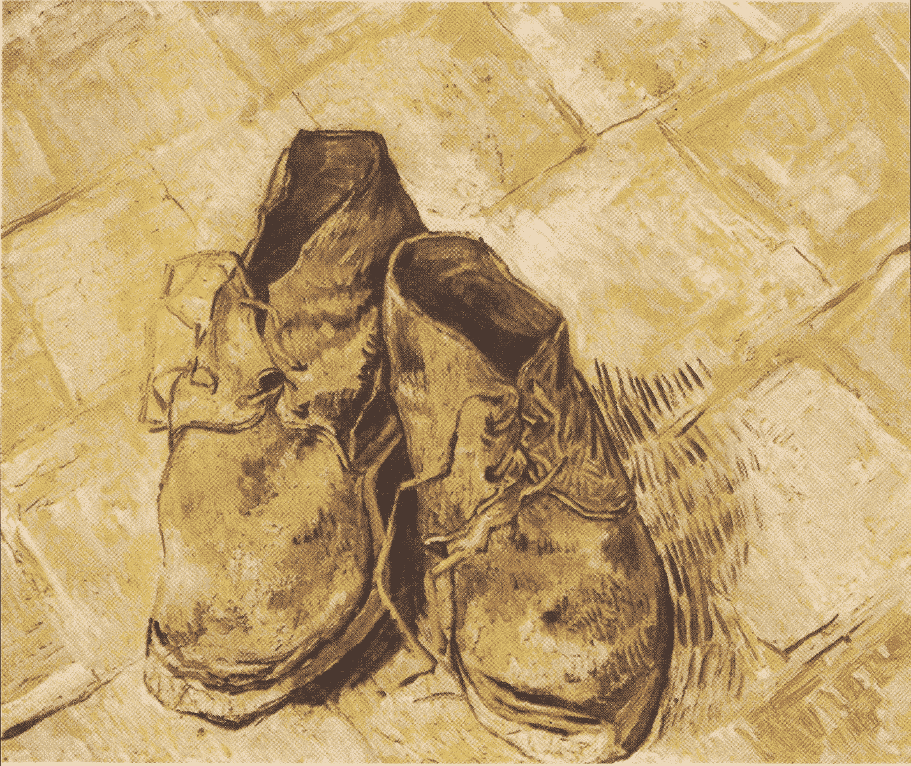

《鞋》，Shoes，1888，纽约大都会艺术博物馆

我们大家都穿鞋，我相信大家在听我这档子节目的时候，脚上也有鞋。

鞋到底是什么？鞋是不是脱离了人的活动的某种的外在的事物呢？它是不是一种叫鞋子的客观对象？这种客观对象可以有各种属性，比如它是多大码的鞋、啥公司生产的鞋、能够卖出多少人民币的鞋子。

不是，鞋子是一种用具。而用具与用具的使用者，处在同样一个存在的场域之中。而画的欣赏者也会领会到这一点，因为画的欣赏者他也穿着鞋。

海德格尔在他的论文《艺术作品的起源》里面，是这样写道的，我来读一下。

只要我们仅仅一般地想像一双鞋，或者甚至在图像中观看这双只是摆在那里的空空的无人使用的鞋，那我们将绝不会经验到器具的器具存在实际上是什么。根据凡高（也译作梵高）的画，我们甚至不能确定这双鞋是放在哪里的。

这双农鞋可能的用处和归属毫无透露，只是一个不确定的空间而已。上面甚至连田地或者田野小路上的泥浆也没有粘带一点，后者本来至少可以暗示出这双农鞋的用途的。只是一双农鞋，此外无他。然而----

从鞋具磨损的内部那黑洞洞的敞口中，凝聚着劳动步履的艰辛。这硬邦邦、沉甸甸的破旧农鞋里，聚积着那寒风料峭中迈动在一望无际的永远单调的田垄上的步履的坚韧和滞缓。鞋皮上粘着湿润而肥沃的泥土。

暮色降临，这双鞋底在田野小径上踽踽而行。在这鞋具里，回响着大地无声的召唤，显示着大地对成熟谷物的宁静馈赠，表征着大地在冬闲的荒芜田野里朦胧的冬眠。

这器具浸透着对面包的稳靠性无怨无艾的焦虑，以及那战胜了贫困的无言喜悦，隐含着分娩阵痛时的哆嗦，死亡逼近时的战栗。这器具属于大地，它在农妇的世界里得到保存。正是因为这种保存的归属关系，器具本身才得以出现而得以自持。

在这段文学性很强的描述里面，他用到了"世界"这个词，世界的德文是 Welt，这个词实际上是来自于胡塞尔。胡塞尔就用过一个类似的词就是"生活世界"，世界就是对于生活世界的缩写。

从现象学的角度上来看，什么叫生活世界呢？生活世界的意思很容易理解，就是日常生活中我们说的你我的小世界，而不是宇宙整体大世界。

我们就想想有些恋爱剧里面的台词："我们还是分手吧，我们不是生活在同一个世界里的。"这里所说的"同一个世界"指的是什么呢？是一种彼此类似的生活方式与价值观，彼此勾连的模糊的综合体。

不过海德格尔虽然用到了胡塞尔的"生活世界"这个词，但是胡塞尔特别强调生活世界的重要性，已经是在自己哲学的晚期了。海德格尔是在他的主要的哲学著作《存在与时间》中就特别强调"世界"这个词了。

这里的世界可以被看成是使得特定的活动方式得以被展开的一个能够被意识到的背景，也可以说是某一类特定人的特定的存在方式。

比如一个商人的生存方式，就能够让他产生对于某种矿藏的商业价值的具体的意向。而一个土著人的生存方式，则使得他不可能产生这种意向。

正因为我们的意向活动当中的 noema 的内容，是被我们的生存方式或者是被我们的生活世界所决定的。所以海德格尔发现，像老师那样仅仅着眼于意识结构是不行的。

他进一步指出，我们要进一步揭露意识结构与特定生存方式之间的互动关系。而对于这种互动关系的发掘，使得海德格尔对于意识这个词也产生了强烈的不满。

因为如果我们要像农夫那样，产生与鞋子的密切关联的话，那么在这里出现的一个重要的人和世界之间的中介，就是用具。（用具包括鞋子，包括锤子。）

但用具并不是与意识发生关联的，而是与肉体发生关联的，意识这个词就显得过于地唯心主义了。

在海德格尔的笔下，如果一个农匠在用自己的农具去进行艰辛的耕耘的时候，或者说一个木工在使用自己的一个锤子在打造家具的时候，如果这样的一个劳动者的确通过他的工具，达到了一种人气合一的这种状态，这种状态就被海德格尔称之为"上手状态"。

在《存在与时间》里面，海德格尔写到有两种态度。

一种态度是观看，也就是说把一个器物当做一个已完成之物在手上把玩，我们可以发现它的形状、质地、颜色等等。

另外一种则是使用，就是我们用器具实际地来进行敲打，而且在器具被用起来的时候，这个器具并不构成我们的对象，而是融入了某种活的事件之中。

前面一种静观的状态就是现成在手状态，后面一种使用的状态则是当下上手状态。只有处在后一状态中，也就是说处在实际的使用过程之中，锤子才真正成其为锤子，从而获得其本真的存在，而它丧失的却仅仅是它的对象性。

好了，海德格尔就通过这种描述，充分体现出了用具的使用人与其环境之间的有机联系。

为了能够强调这种有机联系，他就提出了一个有点冗长的表达式，即：我们的存在方式是此在在世中的存在。

我们碰到了一个新词叫"此在"，此在的德文是 Dasein。这实际上指的就是胡塞尔的意识主体，但是海德格尔很讨厌意识这个词，所以他要用 Dasein 这个词。

Dasein 这个词到底是什么意思？sein 就是 being 或者 to be，da 可以翻译成英文的 here、there，就是此处彼处的意思。

合在一起指的是什么呢？也就是指我们人是一种非常有意思的存在者，他能够就在此处或者彼处对存在有所领会。

说得白一点，我们人是一种非常独特的存在者，我们有自己的价值体系，而且能够透过价值体系体会到周围的那种气场，这是我们人类厉害的地方。

从这个角度上来看，我们每一个个体都是此在，每一个此在都是存在的现象的揭露者，所以每一个个体都是现象学的领会者。

而且这种领会本来就是在一定的生活世界之中展开的，生活世界则是某种被给定的东西。

#### 技术带来的秩序分隔了我们与存在

在这里我们发现，海德格尔已经改变了胡塞尔的现象学悬搁的范围。

作为《观念 I》的作者，胡塞尔倾向于将意识之外的所有东西都悬置掉或者悬搁掉。晚年的胡塞尔也仅仅是在边缘的意义上谈到生活世界。

而海德格尔的现象学悬置则偏向于一种更宽松的执行方法，他试图将我们的生活世界，在现象学悬搁的一开始就予以积极的保留。

不过既然他还是个现象学家，海德格尔毕竟还是主张"我们得悬置一点东西"。到底悬置什么东西呢？

第一点，各种对于外部世界的形而上学设定，实体偶性的设定，各种思维范畴的设定，不一而足。海德格尔在前面提到了现成在手状态与当下上手状态之间的区分，而现成的在手状态显然也在被悬搁之列。

第二类要被悬搁的东西是什么呢？是各种科学技术与商业的设定，因为他们没有办法看到事物的本来样子。

比如一个商业开发家看到了一片大山，他就说下面有很多矿；他看到了一条大河，就说这条大河上可以造个坝把水拦起来，我们可以发电挣钱，我们可以上市圈钱。

这种态度是什么？是一种技术和资本对于自然的暴虐式态度。海德格尔在战后又把拦截大坝之类的技术说成是一种座架。"座架"是一个特殊的德语词，叫 Gestell。Gestell 是海德格尔发明出来的一个词，用以描述技术的本质。

也就是说在海德格尔看来，技术的本质就是通过所谓的 Gestell 被强行地纳入到一种秩序之中。然后每个此在都失去了按照他本来的习惯与世界交往的感性方式，而被纳入到了某种统一的秩序之中，由此我们与存在本身的那种水乳交融的关系就被破坏了。

这比如说在前手机时代，大家跑到一个陌生的城市里面去，我们在小巷里面漫无目的地走，凭着我们的原始的嗅觉，被突然飘来的酒香所吸引，看到旁边有一个小巷边的小酒吧，或者说有一个非常有意思的路边的烧烤摊，我们就随意在那里喝点啤酒，吃点烤串，觉得非常地惬意。

但是现在所有的人都在用手机 APP，看看某些推荐软件，会告诉你哪些店是值得去的，哪个店是米其林评星三星的或者四星的店。

这样一来我们就被技术统治了，让自己的信息处理方式都被纳入了某种僵死的统一的框架，我们由此也就失去了按照机缘来自行追逐美味的这样一种生活的乐趣。

在这里，敏感的读者可能会发现一个问题，我们这些听友恐怕都不是梵高的画里面所描述的那些前现代的农民，我们就是用手机 APP 来听《哲学家的 10 种生活提案》这档子节目的。

**手机已经成为了我们的基本的用具，我们这些此在的生存方式早就被打造成一种数码化的存在了。**

这一点或许会给海德格尔的现象学分析造成麻烦。

如果他承认这些技术用具的基本性的话，他又怎么来批判这些技术呢？

他如果不承认这些技术用具在我们生活中的基础地位的话，他又怎么能够来忠实地刻画我们现代人的生存现象呢？且听下回分解。

公众号懒人找资源，懒人专属群分享

## 100\. 海德格尔的“向死而生”：同情会导致平庸，恐惧死亡才催生真我

### 文稿

各位朋友，大家好，我是徐英瑾。

上面一回内容我们还遗留了一个问题。

我们都知道，从海德格尔哲学的角度上来看，一种现象学上具有原始意义的人与世界的这种关系是一种上手状态。也就是说在上手状态中，我们与用具、以及用具所处理的对象之间的关系是水乳交融的。

但是另外一方面，海德格尔又是反对技术专制的。然而今天我们生活的世界，已经是一个高度技术化的世界了，手机已经成为了我们的基本用具，我们这些此在的生存方式早就已经变成了一种数码化的存在。

这就会给海德格尔的现象学分析造成麻烦了。

他如果承认这些技术用具的基本性或者基础性的话，他又怎么来批判这些技术呢？如果他不去承认这一些技术用具在我们生活中的基础地位的话，他又怎么来真实再现我们现代人的生存现象呢？

#### 具体反对哪种技术，靠情绪来判断

为了摆脱这个麻烦，我们就要引入一个新的现象学概念，也就是"情绪"。你会感觉到，在某些情况下，你的情绪被压制了。

比如在打电脑的时候，你会碰到各种情况：电脑死机了；或者说你在网络上想打出一些字，它就显示不出来；或者说有一些奇怪的商家服务条款，你一定要勾选 ABCDEFG，使得你的隐私向这个商家开放，否则他就不给你用。

这时候你多多少少有一种被侮辱的感觉，很不爽。

或者说你买了一个网络的产品，你想退订，但你找不到退订按钮，这时候你的情绪会很坏。

所以有时候，技术会给我们带来一些很坏的体验，这些体验是在情绪层面上展开的。

但是我们也不能一直对技术抱有这样一种敌视的态度，有时候技术使得我们特别地积极乐观。

在电影《无依之地》里面，女主人公的房车本身就是一种技术工具，但这个工具让她游走四方，亲近自然。

因此，哪些现象是现象学的悬置活动所需要保留的东西，哪些则需要被悬置掉或者悬搁掉呢？

恐怕它的分界线并不在于，这个东西本身是高技术的，还是低技术。它这里面的一个区分的界限，有可能是通过情绪来加以确定。

#### 情绪取决价值取向，同情源于身处相同生活世界

当然，既然我们是在现象学的范围里面来讨论情绪的，我们就要谈谈情绪是如何在现象中向我们呈现的。

在本回中，我们先暂时把海德格尔放到一边，回到胡塞尔去。看看胡塞的情绪理论是什么，再回到海德格尔的情绪理论上面去。在这个过程中我们也会略谈另外一位现象学家舍勒的情绪理论。

在胡塞尔看来，情绪是在认知的基础上产生的。当然更严格的说法是，现象学主体所具有的意向状态、所有统摄的意向对象自身的意义特征，使得此类对象能够激发出主体的特定情绪。

我来举个例子。一块煤炭在一个现象学主体眼中的价值，取决于主体如何在自己的意向状态中认识它。是将其认知为燃料呢？还是将其认知为一块普通的石头？

而这块煤炭在主体那里所激起的情绪，则又取决于它对于主体而言的价值。

譬如在一个缺乏燃料的环境里面，现象学主体对于一块作为燃料的煤炭的价值的认知，就会引起快乐的情绪。

但是假设这个主体他就生活在某一个产煤区，他的所处的环境并不缺乏燃料，在这种情况下，他如果看到了一块新的燃料，他的情绪会非常非常地平淡。

对于意向对象的价值评估，也会牵涉到胡塞尔的生活世界理论。生活世界这个概念上一回我们已经提到了。生活世界可以被视为使得主体的意向投射活动得以可能的、一个更为广泛的背景性的意义结构。

如果我们仅仅考察主体所在的本地化的那个社区的话，这一背景性的意义结构就是使得该社区内的各个主体之间的信息交流得以可能的那个共通的意义结构。

如果我们考虑的是两个民族之间的共通的意义结构的话，这个背景性的意义结构就是使得翻译活动得以可能的某种终极的意义结构。

举个例子来说，一个古人在面对打雷的现象的时候，他会产生一个意向，其内容是天公发怒了。这一点当然是奠基在他特定的对于自然的宗教化的观点之上。这样一种观点可以被他的同世代人所分享，因为这就是他们的生活世界的一部分。

接受了现代科学洗礼的现代人，虽然不会分享他们生活世界中的上述特定的断言，但是我们和他们至少在有一个地方上是相通的，我们都相信打雷现象必有原因。

因此在某种更广泛的意义上，我们与古人仍然身处在某个终极的意义世界之中，这种终极的意义世界也就是某种范围更广的生活世界。

需要注意的是，胡塞尔的现象学虽然有时候给人一种主观唯心论的印象，但是恰恰是在阐述他的生活世界理论的时候，胡塞尔他预设了"人同此心、心同此理"的一种同理心机制的存在。而这种机制，就是同情这种情绪得以产生的基础。

按照上述思路，我们之所以会同情在冬夜中瑟瑟发抖的卖火柴的小女孩，也恰恰是因为我们意识到了，就我和那小女孩都会怕冷这一点而言，我们与她是处在同样一个生活世界之中的。

依据这样的理论去推理，我们不难看出，同情感的缺失在相当程度上，或许便与两个相关主体各自所具有的生活世界之间的差异性有关。

沿此思路，我们甚至可以根据主体之间的共情感的稀疏程度，预判出不同社会组织在整合度方面所具有的等级系统。而这种等级系统的构造，甚至为一种基于情绪现象学的社会理论与政治哲学理论的构建，也指明了大致的方向。

#### 人有五种同情感的区分

在这个问题上，我们可以稍微说一说舍勒的工作。

马克斯\*舍勒也是一位重要的现象学家。1874 年生，1928 年死。他的一件很重要的现象学工作，就是对于同情的本质进行了现象学分析。

举一个例子。他就把不同的情绪，按照它的紧密性的程度进行了不同的区分。大家可以看看文字稿里面所给出的一个表格。

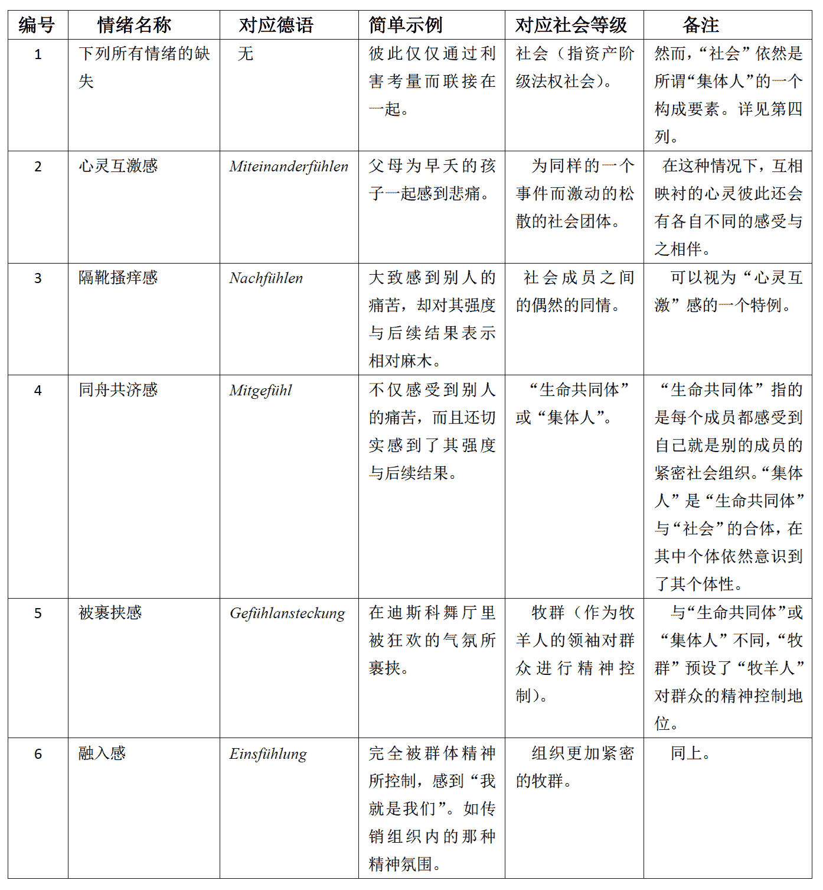

其中最初级的那种同情感叫心灵互击感，比如是为同样的一个事件而激动的松散的社会团体。大家在经过大屏幕的时候，彼此不认识的人看到中国在奥运会上又夺金了，一起欢呼，欢呼完以后大家各走各路，这就叫心灵互击感。

第二种是隔靴搔痒感，也就是说大家能够大致感受到别人的痛苦，但就其强度和后续结果表示相对麻木。举个例子，比如某个人遭遇到不幸了，别的人对他产生出那种偶然的同情，但是这件事情过去以后也就各走各路了。

更高级的一种同情感叫同舟共济感，在这里面我们感受到了彼此是属于一个生命共同体或者是集体人的。比如大家在一起踢场足球的时候，这些队员之间就应该有这样的一种生命共同体的感觉。

更高级的一种感觉叫被裹挟感。被裹挟感指的是什么呢？也就是说有一个牧羊人对整个牧群（这个牧群当然是一个比喻了），也就是说对被控制者进行洗脑，在这种情况下，大家被一种狂热的气氛所裹挟。

这种裹挟最后就达到了一种最高的程度，就是所谓的融入感。在融入感之中，组织的这种紧密性已经达到了"我就是我们，我们就是我"的程度。

好，关于舍勒是怎么对同情感的不同等级进行区分的，我们就介绍到这里了。

#### 如果陷入同情越深，就越有可能成为一个常人

下面再回到海德格尔的例子上去。

我们已经知道了，作为胡塞尔的弟子，海德格尔的此在现象学，在本质上已经完成了对于胡塞尔的意识现象学的两重改造。

第一重改造是什么呢？他把胡塞尔的以意向投射为核心的现象学描述方案，转化为了此在的操持结构，通过这种转换凸显了行为能动者的身体性维度、空间性维度，以及行为主体和外部环境之间的紧密关联。

第二重改造是什么呢？第二重改造是我这里特别要谈的，也就是前面还没有认真地加以触及的一个领域。

海德格尔引入了本真性存在与非本真性存在之间的二元区分，并通过这种区分凸显了此在之存在方式的某种本己性。上面讲的这些话，可能听上去还是非常地令人费解。为了帮助大家理解本真性存在与非本真性存在之间的二元区分，我们再来回顾一下前面已经提到过的一部美国科幻电影，斯皮尔伯格导演的《人工智能》。

在电影中，一对夫妇因为丧子而收养了一个叫 David 的小机器人，以作为原先爱子的替代品。

这样的一台机器人是按照完美的 AI 产品的设计蓝图而运作的。它能够理解人类的语言，产生与人类意向几乎一样的意向，而且分享与人类一样的生活世界的图景。

然而这样的一台机器人，依然难免为自己存在的本己性而苦苦思索。它需要周围的人类将自己确定为一个不可取代的、并且具有唯一性的存在者，而不仅仅是一台可以被随时加以复制、销售、购买与销毁的机器。

这种思索其实迫使 David 走向了某种意义上的形而上学思考，譬如康德对于人之本质的思考。用海德格尔的哲学术语来说，当 David 进入这种哲学思考的时候，它就完成了从非本真状态到本真状态的跃迁。

在这部科幻电影中，David 本身是怎么意识到它自己存在的独特性会成为一个哲学问题呢？

在相当程度上，是因为它自己的机器人身份，以及人类对于它的机器人身份的一种标签化的处理。这种标签化的处理就使它意识到，它对它自己的认识与别人对它的看法之间是有重大的差别。

但问题是，我们并不是机器人，我们是肉人。在思考者本身就是人类的情况下，David 所具有的警觉，往往就会被日常俗务的平庸性所淹没。

在海德格尔看来，这种淹没的结果，就是所有的个别的人都被统一地塑造成所谓的常人，也就是某种缺乏自己的主见，依据集体行动的大趋势而人云亦云的社会成员。

非常明显的是，在海德格尔看来，在舍勒所给出的那些关于同情的情感的表述的等级当中，你如果陷入同情越深，你就越有可能会成为一个常人，因为你被别人的情绪所控制住了。

另外海德格尔所说的常人世界，相当程度上就是我们前面所说的胡塞尔的生活世界。但是当海德格尔在讨论常人世界的时候，又具备了胡塞尔的生活世界概念所不具备的贬低含义。

毋宁说在海德格尔看来，这样的生活世界仅仅是此在结构的一种非本真的显现方式而已。而一种具有本真性的此在显现方式，则是要摆脱这种日常性，而走向对于此在的生存的本己性的揭露。

#### 唯有畏惧死亡，才能活出本真的自己

既然我们每个人都生活在人际关系的网络之中，我们又如何能够摆脱这种庸俗的日常性呢？海德格尔所给出的答案是四个字：向死而生。

向死而生这个概念，经常在中文的微信圈或者说互联网的圈子里面被误解。比如被误解成不怕死，不是这个意思。

在他看来，此在恰恰是意识到了死的不可替代性，以及死对于其所有的生存可能性的终结性意义，此在才意识到其自身的存在方式的独特性。

在海德格尔哲学的语境中，向死而生这一机制的建立，并不是依靠归纳逻辑的运作而导致的。

比如不是因为你看到了张三死了、李四死了，由此你归纳出，我将来也会死。因为在海德格尔看来，无论遭遇到多少死亡案例，我们都无法计算出死亡的确定性。

在海德格尔看来，日常的闲谈对于死亡事件的涉及，仅仅是将死亡当成是一个自然事件来看待，而不是将其视为对于本己的可能性的总的终结。

对于作为自然事件的死亡事件的谈论，它在哲学本质上意味着什么呢？

它恰恰意味着，你觉得你是安全的，你还能活着。

你可以一边在吃面包，一边在喝咖啡，一边听着广播里所说的，在东京发生了一起杀人事件，或者在洛杉矶发生了一次枪击，或者在阿富汗有人被斩首了，等等之类的话。你漫不经心地说"真不行，这世界很乱"。看看表，拿着公文包上班了。

这些事件和你听到一头麋鹿从动物园里面跑出来扰民所带来的感受没有任何的区别，你并不觉得这些事威胁到了你自身的生存。相反，你对于这些事情的讨论就预设了你还有大量的闲暇，可以去讨论与之平行的很多别的事情。

而与之做对比，具有本己性的死亡，却恰恰意味着所有的闲谈的可能性空间的湮灭。如果你自己都会死了，就没有资格进行任何闲谈。

恰恰是在你意识到你自己也会死的这样一种情况下，你才会产生一种具有基础本体论色彩的情绪。这种情绪被海德格尔称之为"畏"，德语是 Angst。

畏这个词语和怕不同，怕是有一个具体的意向性的指向的，比如怕考学失败、怕婚姻失败等等等等。而畏指的是什么呢？畏是一种更基本的情绪。

畏的对象是不存在的，而是使得所有对象被得以展开的整个背景的突然消失，是所有存在的虚无化，是使得所有的体现个体价值的具体行为得以展开的整个幕布的毁灭。

这种恐惧在海德格尔看来，会激发此在认真地反思自己的生存状态，活出一个不一样的自己。

恰恰是因为向死而生的生存状态，让你意识到死这件事是现实的，你死了所有的可能性都不存在了。这样才逼得你反过来想一想，该怎么好好地活着，活出一个不一样的自己。

好了，以上就是海德格尔的向死而生的想法它所体现出的大致的含义。

在这里面我们也不妨来反思一下，在"向死而生"的这种生存论态度当中，技术能够起到什么作用？

我认为能够起到两面的作用。一方面，技术能够让你忘记向死而生这件事情，能够把你长久地陷在常人的状态：人云亦云，跟着别人走，讨论别人讨论过的剧，和大家一起跳广场舞。

但是技术也能够起到别的作用，你可以驾驶房车离开都市，按照自己的意愿来处理自己的余生。

所以技术本身恐怕不是关键，关键是你们任何一个此在都要做到向死而生，活出自己的精彩。

上面的这种向死而生的理论，已经预设了时间的维度。因为处在未来的我们的死亡事件本身，就是在时间之中展开的。所以向死而生的这个理论，自然也会引向了海德格尔的时间的理论。

海德格尔的时间理论的本质是一种关于筹划的理论，这是一种与物理时间观完全不同的形式时间观，而且有着非常明显的人生哲学意蕴。我们下回再来谈这个话题。

公众号懒人找资源，懒人专属群分享

## 101\. 海德格尔的“被抛”与“沉沦”：未来以过去曾是的样子塑造现在

### 文稿

各位朋友大家好，我是徐英瑾。

上一回我们主要谈了海德格尔"向死而生"的概念。这个"向"字本身就意味着某种时间维度的存在，这也就是说"向"就必然是朝向未来，而未来就是时间维度中很重要的一环。

一提到未来就必须要提到过去与现在，这样一来，整道时间的光谱也必须呈现在我们眼前了。所以我们也就很自然地从海德格尔"向死而生"的生存论结构，过渡到了海德格尔的时间观。

时间乃是一个非常重要的人生哲学话题。佛教四圣谛里的苦谛，实际上都涉及到了时间，比如说生、老、病、死、爱别离、怨憎会、求不得和五蕴炽盛，哪一项离得开时间呢？

我现在制作这档子节目，我们的编辑加工、上传我的音频，大家收听我的节目，又回味我的节目，这些事件都是在时间中展开的。

但时间的本质又是什么呢？

在海德格尔之前，有两种时间观值得一说，一种是非现象学的流俗的时间观，一种是胡塞尔的现象学的时间观。

#### 流俗时间观中包含着内部矛盾

我们先来说说第一种时间观，流俗的时间观。这就是我们一般人用钟表所度量的时间观，一分钟、一小时、一天、一个月、一个季度、一年等等。

资本主义的运作就预设了这种时间观。比如这样的表达式：据我所知某女星的日薪是 208 万元。你看时间的可计量化与金钱的可计算化相得益彰，彼此合谋。

那么这种时间关系将时间视为一条可以被无限延长的河流。这河流是从无限的过去开始流淌，从你面前流过去，然后又流向无限远的远方。

而且在这河岸上每隔一段距离都写着一个坐标，这是公元 1998 年，这是公元 2001 年，这是公元 2022 年等等。

不过这种流俗的时间观却包含了一种矛盾，因为它同时包含着两种不同的说话方式。第一种说话方式是基于过去、现在与未来之间的区别的。第二种说话方式是基于年代的历法的，比如公元 1998 年，公元 2001 年，公元 2022 年。

这两种说话方式，实际上彼此之间是有矛盾的。

第一种说话方式包含了某种变化。为什么包含了变化？因为什么是现在你是说不清楚的。

比如 2021 年 9 月 21 日是不是现在呢？这可说不准。2021 年 9 月 21 日在 2021 年 9 月 21 日是现在，但是到了 2021 年 9 月 22 日就变成了过去。

但是在第二种说话方式里面，我们没有看到过去、现在、未来这种讲法，就看到了一些年代历法所标记出来的日子。

那么在这种说话方式中我们就找不到变化了，因为公元 2021 年 9 月 21 日，永远是公元 2021 年 9 月 21 日，公元 2021 年 9 月 21 日永远要比公元 2021 年 9 月 22 日要来得早一天。

英国有一位哲学家叫麦克塔格特，他就把第一类时间，就是基于过去、现在、未来的这种说话方式，他称之为甲类时间，把第二种基于年代历法的时间称之为乙类时间。他认为第一类时间更为根本。

为什么说第一类时间更为根本呢？因为我们总觉得时间与变化有关。如果有一种时间它本身不包含变化的可能性，你觉得这是时间吗？所以甲类时间要比乙类时间来得根本。

这就非常有意思了，甲类时间观显然预设了时间体验者的存在。比如你要说"现在"这个词，你必须要说这到底是谁的现在？

你如果不说一个时间体验者，"现在"这个词就说不出来。只要你说出了这是谁的现在，你就给出了一个现象学的主体。所以甲类时间观预设了一种现象学的视角。

其实在有些语言中，这种特点已经在语言的表达方式中体现出来了。

比如在日语中，现在日语发音是イマ（ima），但这个イマ是带有比较明显的弹性的，可以指一分钟，也可以指五分钟，也可以指二十分钟，不一而足，你需要在语境中体会。那么这个体会者或者体验者就是一种现象学的主体。

#### "现在"仍可进行现象学细分

好了，由此我们就很自然地引向了第二种时间理论，就是胡塞尔的现象学理论，这种理论是鉴于内时间意识的现象学。

不过要讲胡塞尔的现象学理论里的时间观之前，我们先讲讲休谟，因为休谟的思想实际上是引导了胡塞尔。

休谟有句名言：最鲜活的想象（回忆），也比不上最迟钝的知觉。

这句话什么意思呢？我来举个例子大家就听懂了。无论是你回忆吃象牙蚌的感觉，或者是期望明天再去吃象牙蚌的感觉，无论你怎么想，你所得到的体验的真切性，都不如真真切切地吃上一口象牙蚌的感觉。

知觉的重要性就体现了当下的重要性，回忆则指向过去，期望则指向未来。

胡塞尔也有类似的观点。胡塞尔区分了现象学之外的物理时间与他本人所肯定的现象学时间。物理时间也就是现象学的悬搁所要被悬置的对象，那种时间就是前面所说的那种如同河水一样均匀流动而去的时间，这种时间是可以被计算与分割的。

那么现象学时间则是现象学主体的视阈中，自然而然呈现出来的时间样态。

**这里面也有三种模式。第一种叫原初印象，第二种叫前展，第三种叫持留。**

原初印象、前展与持留是不是就分别对应着现在、未来与过去呢？不是。

严格地说，胡塞尔是在我们平常人所说的"现在"这个区域里面，再区分出原初印象、前展与持留，这是一个更加细分的方案。

我来打一个比方。物理时间可以被比作一片黑暗的背景，黑乎乎的，那么广义的现在就是手电筒照在这个背景上的一大块光斑。

光斑里面有一个最亮的区域，这个最亮的区域则叫原初映象。至于光斑里面与代表未来的那块黑暗地带交界的地方，就叫前展。光斑里面与代表过去的黑暗地带所交接的地方，我们叫持留。

这就说明什么呢？这说明在胡塞尔的现象学意识中，有一种在前反思的状态当中我们就可以把握的未来与过去，这种未来与过去是现象学的未来与过去，现象学的未来叫前展，现象学的过去叫持留，这和物理时间里面的未来与过去是不一样的。

我们再举一个女鬼的例子（女鬼例子在本单元出现过很多次了），来说明胡塞尔的时间意识理论是怎么一回事。

如果你期望你看到的背影的确代表了一个女鬼，那么你就会下意识地期望你下面看到的这个女鬼的正面和背面一样，依然是长发飘飘，这种下意识地期望就叫前展。

但是你在转过身试图看其正面的时候，你所看到的所谓女鬼的背面的印象，从某种意义上说还没有退场，这就是所谓的持留。

没有这些基本的现象学的时间意识的这种延伸，我们是没有办法在流畅的运动中完成完整的知觉活动的。失去这种恰当的内时间意识的人他会倒霉。

比如假设一个部队的伞兵，他要训练从高处往下跳，那么他在跳的一刹那就要对落地后的处境要有一些前展。

这种现象学意义上的前展会带来身体方面的一些下意识的微调，没有这些微调的话，士兵很可能就会受伤，比如摔到地上之后脚就崴了。

由此看来，胡塞尔的内时间意识现象学并没有全面的挑战常识，而是更加细致地刻画了常识。

#### 未来可能性的有限敦促了现在的行动

当然，海德格尔的时间观与这两种时间观都有所不同。尽管他觉得他和他的老师胡塞尔一样，也是在做现象学。

正如上一回的节目向大家所呈现的那样，海德格尔的时间观本身就是为一个更宏大的主题服务的，这就叫向死而生。也就是说他希望此在能够通过意识到死的本体性和不可替代性，建立起一种更宏大的期望。

这种期望指的是什么呢？是对于可能性的期望。

大家就说向死而生与可能性有什么关系呢？很简单，你能够向死而生，说明你还没死，说明你的未来还在你前方，而未来就意味着某种可能性。

那么未来为何与可能性相关呢？

我们就脑补一个场景。比如在战场上两个士兵断后，敌人呼啦呼啦冲上来了。这时候其中一个老兵（比如叫老王）对小兵（比如叫小王）就喊："小王快撤，我来断后。你还年轻，你还有未来。要死，让我死吧，我活够了。"

在这里我们就发现未来是代表各种可能性的，娶妻生子、读博士学位、做成功商人，参选成为民意代表等等。面向未来，就意味着你向着这些可能性敞开了自身。

那么为何一定要在向死而生这个框架内，向未来的可能性敞开自身呢？

因为只有向死而生，或者说只有在向死而生的状态中，你才能够意识到你的可能性不是无穷无尽的。类似于阿拉丁神灯，你向神灯许愿总数是有个限度的，一般就三个，用完就完蛋了。

所以你得慎重面对这些选择，这种慎重性，甚至有一点准宗教的维度。

好吧，既然你意识到了人生是非常短暂的，因此你的未来选择的机会窗口是非常有限的，那么你又该做什么呢？

你应该做的就是盘点你的资源，想想从你的资源出发，你能够做什么？

举个例子说，如果你有一个想法："我要成为一名优秀的歌手"，但你也得反过来想想，以前大家是怎么评价我的歌艺的，我过去是不是每一场的 K 歌之王呢？或者大家经常嘲笑我的破嗓子呢？这种回想就让你回到了过去。

所以要展望未来，你就得先回顾过去。

那么你回顾了过去以后该怎么办呢？于是你得行动。那么行动是在什么时候行动呢？就是在现在行动，现在就是连接未来与过去的通道，这就引出了海德格尔的时间观点。

海德格尔的时间观点用他的原文说一下，听上去是比较难懂的，我先来读一下。

"未来其实并不比过去来得更晚，而过去也不比现在来得更早，时间性将自己时间化为这样一种未来，这种未来以过去曾是的样子塑造了现在。"

那么这话我来翻译一下，意思也就是说，时间的流淌的方向并不是从过去流淌到现在再到未来的，而是从未来出发再到过去，然后终结于现在。为什么？因为时间是开始于展望，展望不就是未来吗？以回顾为中介，最后落实为行动。

#### 向死而生的本真，在对抗时间中体现

那么海德格尔的这种时间哲学是有很多有趣的特点的。

如果从胡塞尔哲学的立场上来看，海德格尔的这种时间哲学明显是反现象学的，你要意识到未来选择的可能性，你就必须要理解死这个概念。

但按照现象学的观点，理解一个概念可不容易。你要理解一个概念，必须得具有与这个概念直接相关的体验。

举个例子，从现象学的立场上看，你要真正地理解日本寿司这个短语，你就得去吃日本寿司，最好还要去做做日本寿司。一个从来没有吃过日本寿司、做过日本寿司，甚至从来没有看见过日本寿司的人，怎么可能真正地理解日本寿司这个短语呢？尽管你可以把这四个汉字写下来。

同样这个道理，你要理解死这个概念肯定不是通过学会死汉字，你要有体验。但这里面就导致了一个很麻烦的问题，难道我们要真正的死过才能够体验到死吗？你体验到死了以后，你又怎么想把这种体验告诉别人？

唯一一种可能就是所谓的濒死体验。有一些人可能是得了什么重病，或者受了什么重伤快死了，然后临场被医生给救回来了，那么这时候恐怕是有资格讨论死亡体验的。

不过这种例子是很稀少的，绝大多数人一辈子都碰不到一次，运气这么好，有了濒死体验竟然还能被救回来。

还有一种可能性，这种可能性恐怕是更加普遍。就是看到朋友、看到亲人死了，这使我们感到悲痛。

我们举个例子，在曹操的生命中，他旁边有很多朋友死了，但有一个朋友死了，他是真伤心了。

他有个好朋友叫鲍信，曹操和鲍信一起打黄巾军的时候，曹操没什么事，鲍信在战场上阵亡了，结果他尸体还找不到了。曹操是用重金求他的遗体而不得，只好雇人做了一个木头的遗体，抱着朋友的假的遗体大哭。

从这些史料的记载中，我们可以看到曹操身边的重要人物的死亡，导致了曹操生活世界的暂时崩溃，他暂时地做出了很多匪夷所思的事情。

就能证明，即使向死而生这种体验是存在的，它也不是通过你亲自体验你自己的死而获得的，而是需要一个中介。

这个中介就是你目睹了你至亲的死亡，然后你的大脑系统重装，在这个过程中，你通过移情作用意识到你自个儿也会死，你自个儿的生命是何等短暂。

毫无疑问的是，如果没有这样的生死体验，向死而生的态度是没有办法建立起来的，因而基本上就不太可能会建立这个状态。

少男少女的海誓山盟为何老是爱说一些相爱到老、海枯石烂的话呢？那就是因为他们没有真正的老过，他们没有真正的那种死亡的体验，所以可以轻易地说相爱到老。

三国时候的英雄，比如少年英雄孙策与少年英雄孙权为何早熟？因为他们的生死体验都提前了，他们在小小年龄就有了非常珍贵的生死体验，他们就知道了向死而生的意义。

不过，孙策与孙权的经历对于你我来说属于传奇，这就意味着他们的经历并不是大多数人真实的现象学的体验结构。

由此看来，从胡塞尔哲学的立场上来看，向死而生是一种不具有普遍性的现象学体验，是少数人具有的那种现象学体验。

黑格尔其实是在主奴辩证法里面提到向死而生的体验的。主人能成为主人，就是他不怕死，他有那种向死而生的这种精神，有一种拼死一搏的勇气，所以才能成为主人。

但是根据黑格尔的哲学，很多人毕竟还是要做奴隶的，所以奴隶就没有向死而生的这种体验了。

对于这个问题，海德格尔的态度则有点意思。平心而论，海德格尔也从来没有说过向死而生是谁都能够轻易建立的现象学结构，但他反复强调向死而生是一种本真的此在生存方式。

你若做不到这一点，你的存在方式就是非本真的。或者说白了，如果你的意识结构没有向死而生这个特征你就白活了。

为此他甚至还开发出了不同的术语来处理时间的不同样态，暗示向死而生的本真性。

面向未来的维度就被海德格尔称之为决断。这种讲法里面有基尔凯戈尔的影子，因为我们知道基尔凯戈尔的哲学就是一种决断的选择的哲学。

不过与基尔凯戈尔不同的是，海德格尔在这里没有清楚地谈到上帝在我们的选择中所起到的作用。

海德格尔在这里也谈到了忏悔与良心，这些词听上去很基督教味，但是这些词并不是在基督教的意义上使用。良心在海德格尔那里不是说对别人的良心，而是对自己的选择的良心。

而基督教的选择或者基督教所说的良心，骨子里还是有利他主义文化的影子的。

那么海德格尔所说的未来的维度就叫决断，与过去的关系，用的词就是"被抛"。我们是被抛入这个世界的。这里是在暗指休谟哲学的一个维度，就是按照祖宗的习俗去行动。

在这里被抛的这种状态也被说成是一种接受命运的状态。比如你的母语是德语，你生在德国，这些都是你的命运，你不能修正。

与当下的纠葛，这被海德格尔称之为沉沦，这就是进入所谓的常人阶段，人云亦云，这也就是暗指实证主义的人生观。

#### 唯有超人的"神"能揭示存在的本相

我个人认为海德格尔的这种哲学在很多地方是有可以探讨的地方的。下面我就列出我自己的几点管见。

**第一，海德格尔对于未来的抉择具有伦理内容上的空洞性。**

他仅仅提到我们要意识到抉择的宝贵、生命的短暂。但问题是不同的人会有不同的选择，有人选择舍身取义、有人选择搞恐怖主义。难道仅仅是因为舍身取义的人和恐怖主义者，他们都是向死而生，因此都要被哲学家所鼓励吗？

**第二，在海德格尔的时间哲学里面，当下与未来的关系不是很清楚。**

他对于当下的看法是用一个负面的词叫沉沦，未来他用的是抉择，是带有一个正面意蕴的词。

但是一个具有负面意蕴的沉沦，怎么与一个带有正面意蕴的抉择或者决断发生关系呢？当中的过渡是什么？我没有看得很清楚。

**第三，海德格尔在谈到抉择这个环节的时候，他谈到了良心、谈到了悔恨。**

但悔恨这个词我觉得是非常奇怪的。不管海德格尔所说的悔恨是什么，只要他用了悔恨这个词，那么这肯定是指对于此在过去生活方式的悔恨。

过去生活方式在这里如果被提到的话，这也就意味着未来本身已经预示着过去了。那么海德格尔又凭什么说未来先于过去呢？

**第四点，海德格尔认为对于过去的讨论牵扯出了命运的维度。我的问题是，为什么命运仅仅与过去有关呢？为什么命运不能够延展到未来呢？**

我可以举一个例子，也就是在西方的语言里面说命运关涉到未来这一点也是符合我们的语言直觉的。

我们都知道在南北战争的时候，有场著名的战役叫 Gettysburg 战役，中文叫盖替斯堡战役或者葛底斯堡战役。

在这场战役中，南方的主将李将军在军事部署完成以后说了一句名言：

"先生们，该做的部署都已经做了，现在我们要尽人事而听天命。"

你看，天命这个维度在李将军的口中显然指一个未来的维度，因为当时他还不知道这场战争的结果是什么。

这也就是说未来的场域不是被个体的抉择所占据的。李将军当然会选择我们南军会赢，但是上帝是不是站在南军一边呢？他为什么不站在北军一边呢？

所以天命不但过去在，未来也在。天命在过去、在未来，天命无所不在。

以为未来会被向死而生的个体抉择所占据，这种想法恐怕是尼采的超人哲学对于海德格尔的影响。

我个人认为可能在这个问题上，尼采与海德格尔都错了。

尼采的想法是要通过摒弃奴隶道德来重估一切价值，而海德格尔的想法是要通过向死而生，悬置一切常人状态而走向真正选择的自由。

但他们的这种观点都忽视了天命的影响，而在这个问题上，有可能叔本华比这两位哲学家看得都要更为深刻一点。

有意思的是，在写完《存在与时间》以后，海德格尔的思想就经历了一些转变，他开始降低此在的本体论地位，而开始在一个新的框架中讨论问题。

这个新的框架被称之为天、地、神、人四要素框架。人的地位被降格了，你看有天、地、神三个要素在人的旁边了。

这就有点意思，写完《存在与时间》以后的海德格尔开始敬天谈神了。

一部分人可能会认为这体现了中国哲学思想对海德格尔的影响吧？

有人会说，你看中国的大王的王字怎么写？三横一竖，上面一横就是天，当中一横就是人，下面一横就是地，也就是说谁能贯通天地人，谁就是王。

但是如果你用中国哲学的眼光来理解海德格尔可能有点小失误，因为海德格尔说的天地神人里的神是什么东西？这个神并不是指神学意义上的神（不论你是多神教还是一神教），他指的是伟大的历史英雄，是能够在历史中真实存在的这个东西。那么这个神就有点像尼采所说的超人，并不是个形而上学的对象。

那么这样的一个超人或者这样一个神，它能起到的作用是什么？

就是把被技术手段所遮蔽的存在的本相向我们揭露出来，就是让我们的欧洲文化能够恢复到前苏格拉底时期的古希腊文化的那种状态，我们能够和原始的自然发生这样一种亲密的关联。

在海德格尔看来，欧洲要陷入这种技术化的深渊，恐怕是一个非常大的趋势，这时候恐怕只有一个神才能够救赎我们，这个神就是我们要顶礼膜拜的对象。

好吧，听到这样的一些表达，敏感的朋友是不是会觉得他在这里是暗指希特勒呢？希特勒是不是这样的一个神呢？

这也就向我们暗示了这一点，海德格尔哲学的有些面向，与他选择做纳粹党员的政治抉择是有关系的。关于这个话题下一回我们再详谈，下回见。

公众号懒人找资源，懒人专属群分享

## 102\. 海德格尔浪漫的破碎：纳粹对犹太人的破坏，无法开创一个没有资本的新秩序

### 文稿

各位朋友大家好，我是徐英瑾。

上一回我们提到一种向死而生的海德格尔式的存在论的理论，他在伦理学的内容上是空洞的。

传统的伦理学不管它是什么样的伦理学，一般来说都要肯定利他主义，只不过是就利他主义的产生模式与具体含义有些分歧。

在康德看来，利他主义是起源于绝对的道德命令。休谟与舍勒认为利他主义起源于同情。

叔本华也认为利他主义与同情有关，但是他还会额外地指出，之所以你会同情他，那是因为宇宙意志在你我的身上彼此激荡，构成了某种共鸣。

边沁他不是很关心利他主义的起源，他所关心的是算出大多数人最大程度的快乐是什么，为利他主义方案的执行提供一个可以计算的框架。

不管怎么说，海德格尔是不走这些道路的。因为利他主义的合理性是一种被悬置的内容，他的这种哲学是一种此在出发的以用具为中介的与世界关联的结构，在这个结构当中，他人是个尴尬的存在。

既然常人或者说他人的地位在海德格尔那里如此尴尬，海德格尔就很难以建设性的态度，开发出一种积极的利他主义伦理学。

日本哲学家和辻哲郎在读了《存在与时间》以后，正是出于对于这一点的不满，对海德格尔的哲学提出了严厉的批判，提出了一种新的空间伦理学，与海德格尔的时间抉择学相互对抗。

不过，  
相关的话题我在这里不谈，大家可以去听我在另外一档子节目《暧昧：给日本脑洞一个哲学解释》里面的相关阐述。

#### 此在的现象学，并不必然地走向狂热

有的朋友就会问：海德格尔哲学的缺陷，是不是能够解释他与纳粹的那些不光彩的关联？

我个人认为我们心不能太急，我们得慢慢地想，我们得从哲学理路上来分析。比如这样一个问题：强调需个体选择的个体性，难道就一定会引向纳粹吗？

请注意，纳粹的意识形态里面有大量的内容是与海德格尔的哲学不相融的，比如服从领袖。你必须绝对服从领袖，一个帝国、一个领袖、一个主义。

你不能够自由地选择，我今天听希特勒，明天就不听希特勒了，我后天为什么不听斯大林的，我大后天听罗斯福的，我大大后天听丘吉尔。

而且军国主义的思想让每一个人都要以当兵为荣。我会不会觉得我今天当兵挺开心，明天就不当兵了呢？我做逃兵也是我的自由？不行。

相反，反纳粹的某些主张却是与宣扬自由的哲学相融的，比如萨特。萨特在某种意义上说也是海德格尔的精神弟子，他就参加了抵抗组织。

从上面的分析来看，即使海德格尔的对于此在的生存论的本身结构的分析，并不必然引向利他主义，但这一点也并不意味着他必然会赞成纳粹主义。

纳粹主义是一种狂热的民族主义，而民族主义实际上仍然是一种败坏了的版本的利他主义。

为什么？民族主义实际上是一种小团体的利他主义，他们是把其他的日耳曼人当成人，把其他的日耳曼人当成是我的兄弟姐妹，但是把日耳曼人以外的人不当成人，而在日耳曼人的团体之内，他们还是搞利他主义。

那么海德格尔为什么还是要作纳粹呢？

既然海德格尔的哲学并不必然地导向纳粹主义，那么有人说那就是海德格尔本人的问题了，他趋炎附势，与他的哲学观点本身恐怕没什么关系，就好比说我们都知道牛顿他在私人领域曾经疯狂地迫害物理学家胡克。

不过这一点也不能推出牛顿的物理学与他迫害胡克这件事有什么关系，牛顿的物理学和这件事是没关的。

那么海德格尔加入纳粹这件事情，是不是与牛顿在私人领域迫害物理学家胡克是等量齐观的呢？恐怕也没那么简单。

下面还是有几个证据来证明海德格尔的思想恐怕真与纳粹有一点关联。

第一，最近在欧洲发表了一个新文献叫黑皮书。这是个海德格尔的私人手稿，这个手稿里面有很多反犹言论、种族主义言论。

私人手稿又不是写给别人看的，是写给自己看的，当然就体现了海德格尔的真实的想法。公开场合说的话有可能是希特勒逼他说的，我们未必认为这是海德格尔的真实言论，他私下写的，这就是他的想法了。

第二，海德格尔在战后已经完全知道了奥斯维辛发生了什么事情，也肯定知道了自己的前同事施坦茵女士在奥斯维辛已经罹难了。即使如此，他都没有公开地发表过声明，为当年自己加入纳粹的事情进行全面道歉。

这些事情就引发了其他的哲学家，比如他自己的弟子阿伦特与马尔库塞的激愤。

第三，海德格尔有个作品叫《形而上学导论》，发表于 1930 年。这是纳粹上台之前发表的书，里面有明显的反苏、反美的言论，这就等于把未来的两大战胜国都得罪了。因为这是纳粹没有上台的时候他发表的言论，有理由认为他说的是真心话。

这里面的一个关系应该怎么理？海德格尔到底是不是铁了心的纳粹呢？他和纳粹之间的关系到底是什么？

#### 回归个体与土地的海德格尔，被纳粹的表相所蒙蔽

我个人认为海德格尔有亲纳粹的态度，这恐怕是不假的。不过海德格尔的亲纳粹的态度并不是来自于他对于未来的看法，而是来自于他对于历史的看法。

这就牵涉到了一个很有趣的问题。即使海德格尔没有参与纳粹，我们也可以问这个问题，一种现象学维度中的历史哲学何以可能？

人是历史的动物，不过这一点可以被具有不同政治观点的人所使用。

苏联遭到德国入侵以后，斯大林做了一次全国演讲，他把很多在社会主义苏联建立之前的沙俄历史上的英雄都加以表扬。比如苏洛霍夫、比如说库图佐夫，他希望红军指战员都能够学习这些沙俄的历史英雄，和德国侵略者死磕到底。

戴高乐在组织自由法国的反德武装的时候，也要求战士们不要忘记自己是拿破仑的后人。

墨索里尼则提醒意大利人，自己是罗马人的后代，要继承罗马帝国的遗志，将地中海重新建设为新罗马帝国的内湖。

希特勒作为墨索里尼的后继者，则认为自己是天选之子，第三帝国要建立比历史上的第一帝国与第二帝国更大的功业。

很显然，我们的历史认知决定了我们的生活，决定了我们的未来。

犹太复国运动就是一种被历史认知驱动的运动。古代的犹太国早就灭亡了，但凭什么这些犹太人还说自己是犹太人呢？是靠语言、风俗、宗教和文化的传承，这些东西都是民族认同的关键。而海德格尔恰恰强调语言是存在之家。

不过大家要小心，在海德格尔的这种语境里面，这个语言是特指德语的。

德语有什么特点？它是一种特别形象的语言，它是一种具有现象学意味的语言，是一种带有图像感的语言。

我们可以发现有很多的德国的谚语都有很强的图像感。我们可以举一个例子，比如这句话，Wes Brot ich esse, des Lied ich  
sing.（我吃谁的面包就唱谁的歌，我端谁的碗就服谁管。）

又比如说 Man muss das Eisen schmieden, solange es heiß ist.（我们必须要趁热打铁。）

又比如说 Steter Tropfen hohlt den Stein.（滴水穿石。）

这些所有的德式谚语都给出了很多鲜明的图像式的隐喻。海德格尔的哲学也使用了这些表达方式，Dasein 此在这个词恐怕只能用德语来表达，写成英语的 here  
being/there being 完全是不知所云。

因为中文恰好也是一种非常形象的语言，我自己在阅读海德格尔的书的时候，就发现很多海德格尔的文字翻译成中文，要比翻译成英文更好看。

海德格尔本人对很多拉丁语系统的语言文字都很讨厌，认为古代希腊语的感性特征被拉丁文破坏了，变得机械化了、失去生机了，所以他非常反感任何机械化的、技术化的文字的创作以及相关的技术的设置。

他非常讨厌美国与苏联。因为美国和苏联这两个国家虽然社会制度不同，但是殊途同归。他们都是鼓吹大工业，他们都是机械所代表的那种社会制度。

至于这个制度是资本主义的和社会主义的，海德格尔根本不关心，海德格尔要回到个体与土地的那种原初的联系上去。

听到这一步大家可能还会有点糊涂，就算海德格尔要回到个体与土地的那种原初的联系上去，他为何要和纳粹亲近？

纳粹难道不是一个非常倚重于军火工业的政党吗？纳粹搞的奥斯维辛集中营，难道不是将工业化的流程与大屠杀的可怕行径相互结合的最鲜明的案例吗？

对，大家说的这些都对。但问题是，这不是海德格尔在 30 年代初所看到的纳粹。海德格尔天真地认为他自己对于欧洲历史的认知，就是纳粹党对于欧洲历史的认知。海德格尔对于整个欧洲历史的认知代表的是农民的视角。

请注意，海德格尔是一个从小城镇里面长大的孩子。他的爹就是一个天主教教堂里的宗教人员，所以海德格尔的童年是和农鞋、是和野菜花儿、是和稻香（如果那里有稻子的话，我也不清楚），是和这样的一些事情联系在一起的。

海德格尔为何特别喜欢梵高的《鞋》？因为这作品里面有农民的气息。

农民的生活是保持着巨大的感性的，农民知道自己在干什么，农民知道自己在和什么东西打交道，知道自己在种什么。

你农民你要养猪，也知道自己面对的是猪；你在种向日葵，也知道你种的是向日葵。这和工业是完全不同的，一个工人在流水线上可能根本不知道自己在做什么。

参与二战时候，曼哈顿城的大多数美国工人都不知道自己在做原子弹。世界本身与你是疏远的，这是一个高度异化的世界。

而希特勒在刚刚进行政治动员的时候，他给出的样子是亲近德国底层民众的。尽管在一般民众看不到的角落，他可能和一些德国的军火大亨们还在进行秘密勾兑。

在公开的集会上，他张口闭口瓦格纳，张口闭口讨论北欧神话、欧洲文明道统、民族的使命，给人一种崭新的气象。

如果海德格尔试图在 20 年代后期或者 30 年代初找到他的现象学哲学的政治图腾的话，年轻尚且在野的纳粹党最符合他的胃口。

他恐怕不会喜欢一般的社会民主党的势力。社会民主党的问题是过于布尔乔亚，过于矫揉造作，过于迷恋工业文明。社会民主党很可能是胡塞尔的菜，但不是海德格尔的菜。

海德格尔也不可能喜欢德国共产党，德国共产党虽然也强调团结农工走下层路线，但是德国共产党与苏联的共产国际之间是有着密切的联系的。在海德格尔看来他们根本都不是德国人。

海德格尔恐怕也不会站在保皇党的立场上。保皇党是在魏玛共和国一直存在的一股势力，他们主张复辟威廉二世的统治，但这股力量已经垂垂老矣。

那么在这里我可以安利一部德剧，这部德剧有好几季，题目统一叫《巴比伦柏林》。

这个故事讲的是什么？讲的就是魏玛共和国的时代，也就是 20 年代末 30 年代初，纳粹上台之前的敏感的时期。

男主人公是作为警二代的拉特警探，女主人公是风尘女子出身的女警探夏洛特。两个人双剑合璧，为了捍卫魏玛共和国脆弱的法治，与各种激进的反民主力量斗智斗勇。

事情发生的背景离希特勒上台仅仅五六年。大家看了这部电视剧以后，恐怕会对海德格尔写作《存在与时间》的历史背景有一个更深的认识。

#### 现代技术与金融投机破坏了人与自然世界的原初联系

有意思的是，不管纳粹与工业的态度是不是非常地明显地体现给公众，纳粹可是如假包换的反犹主义，而且纳粹一开始就说自己是反犹主义者。

海德格尔肯定是听到了这个声音，现在看来海德格尔本人也是赞成反犹主义的。这一点如何解释呢？这一点恐怕也能从海德格尔的哲学做一些部分的解释。

大家想想看犹太人为什么被纳粹恨？那是因为犹太人他所从事的职业是什么？他从事的是金融业，他带有投机的成分。

从现象学家的立场上看，特别是海德格尔这样的现象学家的立场上看，金融投机是一种破坏人与自然世界的原初现象学关系的一种罪恶的事业。

**从某种意义上说，海德格尔的现象学是一种德国民粹的意识形态的哲学化包装。**

当然他的现象学的表述技术是从他的老师胡塞尔那里学来的，但是他的世界观可能与他的老师根本就不是一回事。胡塞尔对中产阶级的世界抱有某种温情，痛感理性没有成为欧洲的主流，他的基本的想法就是叫理性、客观、中立。

请注意，从阶级分析法的角度上来看，理性往往是由中产阶级承载的，而非理性的往往是民粹的特征。所以胡塞尔和海德格尔的斗争，实际上是伪装成学术斗争的阶级斗争。

但是不管怎么说，不管海德格尔是如何喜欢纳粹，他毕竟误解了纳粹，纳粹党会根据自己的需要不断变形。

比如，曾经代表民粹的冲锋队队长罗姆，就是因为不听希特勒的招呼，竟然被希特勒自己给杀掉了。

而破坏犹太人的真正目的，也不是像海德格尔想象的那样，开创出一个新的没有抽象资本交易的新社会秩序，或者说是开创出一种现象学的秩序，而主要就是为了获得军备扩张所需要的资金。

海德格尔无论从政治上看有多么迟钝，最后还是发现了他的所期望中的纳粹与真实的纳粹不是一回事，纳粹也渐渐发现了海德格尔与自己的离心离德。

在 1945 年，纳粹快要完蛋的时候，海德格尔被征召入人民冲锋队挖掘战壕，这说明纳粹官方已经将海德格尔视为一个一般意义上的劳动力，或者是炮灰般的存在，而不是体制内的重要人物。

终于海德格尔落得的一个下场是猪八戒照镜子----里外不是人。

有人说经过了这样的一番折腾以后，海德格尔在战后应该悔悟了吧。

我们都知道在二战的时候，有个日本哲学家叫田边元写了一些东西捧日本法西斯的臭脚。但日本一投降，他就写了另外一个哲学的书叫《忏悔道哲学》，对自己做的事情进行道歉。

为什么海德格尔没有像田边元那样进行事后的道歉？

一种可能的哲学的解释是，他虽然已经发现了纳粹不是什么好东西，但是由此出现的新欧洲，就是随着纳粹的败亡而出现的新欧洲，技术的遮蔽更为严重。他并不喜欢战后的德国，没有必要为之欢呼。

当然我自己是觉得海德格尔的这种不道歉的态度肯定是错误的。我个人是能够原谅海德格尔对于纳粹的一种错误的浪漫的想法。人都会犯错，我们要宽容。但是战后了还不道歉，这实在是没有什么可以为之辩解的地方。

讲到这里，我们还要回到前面的一个比较大的问题上去，海德格尔的政治错误是不是能够证明，我们无法建立起一种合理的现象学视阈之中的历史哲学与政治哲学呢？

我的答案是否定的。我认为海德格尔的政治错误推不出我们没办法搞一种现象学的历史哲学。

我前面已经说过了，萨特也是现象学家，但他的现象学是为人道主义与反法西斯主义服务的，现象学是有弹性的。

不过我们无法细说萨特，因为他是下一个单元的主角。

#### 只有走出信息茧房，才能克服现象学的视野局限

现在我们就来看看，在海德格尔的政治哲学里面哪些环节出错了。

不过为了表示出对于现象学的公正性，我想在指出海德格尔的错误的时候，我的批判资源最好也控制在现象学的范围之内。而且为了对海德格尔公允，我先说说海德格尔对的地方。

我认为海德格尔对的地方就在于指出，我们没有办法与历史自身建立起联系，我们要通过对于历史的这种现象学直观，才能够建立起与历史的联系。

举个例子来说，你我都不知道玄武门之变的真相，但是通过唐代的一些文化因素，传承到今天这样一个极致，我们仍然可以在某种意义上说我们还是唐人。

所以历史现象学是基于能够在我们的意识中呈现的历史因素的现象学构建，这并不是历史本身的客观真相。

从这个角度上来讲，你可以建立起一种现象学意义上的历史哲学，这是没有问题的。

但海德格尔好像多了一个重要的附带性的结论，也就是说他认为德语文化很优越，而且他在现象学的直观中直观到了这一点。

这里的问题是，民族语言的优越性难道是一种不可辩驳的现象学真相吗？

我的答案是未必如此。其实每个人都会觉得自己的母语好用，这是废话，因为这是母语。

但是难道外国语的表述不会带来别样的意识体验吗？海德格尔处处说德语怎么牛，这的确不假，德语是一种了不起的语言。但别的语言就差吗？

海德格尔有个很重要的日本学生九鬼周造，他从老师那里学了这一套，但反其道而行之，在他的重要的著作《"粹"的构造》里面，他就说用日语表述审美的现象学体验就是天下独一份。

那么海德格尔对还是九鬼周造对呢？是日语高档还是德语高档？

我甚至可以做出一个断言，如果有一个印第安部落来的一个孩子，他学了海德格尔的哲学，也学了这一套，他也会写本书说俺们部落的土语表达的现象学体验是天下独一份。

我们中国人也会说咱们中文所表达出来的现象学体验天下独一份，你们洋人懂吗？马致远的《天净沙\*秋思》翻译成英文还有那个味吗？

应该看到，如果你只是陷在每个人自己的信息茧房里面来看待你自己的母语的话，你都会觉得别人的语言不如你自己的。但是如果你能走出自己的信息茧房，去尝试一种复杂的生活方式，尝试一些多样化的教育经历，你就会有不同的现象学体验。

叔本华在青少年时期在英国与法国都求学过，他在法国的时间恐怕更长一点，他就觉得德语没什么了不起，这就是一种不同的现象学体验。

实际上叔本华代表的恰恰是德国当时刚刚兴起的中产阶级的意识形态，只不过他走的是非理性主义的路线。胡塞尔则是代表了中产阶级意识形态的理性主义版本。而尼采与海德格尔的想法都是反对中产阶级的。

从这个角度上来看，虽然从现象学的角度做历史政治哲学是可能的，但是从现象学角度做出来的历史政治哲学恐怕有一定的随意性。因为不同的人的政治态度，决定了不同的哲学家、不同的现象学的视角，由此导出了不同的描述。

在我个人看来，并没有一种政治立场中立的现象学历史哲学或者说现象学政治哲学，只有为已经继存的不同的政治立场服务的现象学的历史哲学或者政治哲学。

在这里我稍微要提提海德格尔的另外一位弟子汉斯-  
格奥尔格\*伽达默尔，1900 年生，2002 年故去。伽达默尔就提出过一种很有意思的观点，叫"视域融合"。他主张不同的现象学视角必须通过彼此理解而建立起一个大的公约数。

他的哲学之所以能够提出，是为了符合全球战后和平时代的贸易的需要，这也算是现象学发展的一种可能性。正如体现了同情魏玛共和国立场的德国电视剧《巴比伦柏林》，也是一种基于现象学视角出发的历史重构一样。

今天的我们生活在一个意识形态撕裂的时代，在互联网上非理性的身影日日都在增长。

尽管一些民间哲学家在学术水平上没有达到海德格尔的千万分之一，但是在狂热程度上却可能超过其一千万倍。

我们到底要哪种现象学呢？是民粹的还是理性的？我把这个问题留给大家。

好了，下面就要说到本单元的总结了，下回见。

公众号懒人找资源，懒人专属群分享

## 103\. 走出海德格尔：比死亡更原始的畏惧，是未知、渺小与无力

### 文稿

各位朋友大家好，我是徐英瑾。

这个单元我们主要讨论的是德国现象学，现在我们要对本单元的内容进行一番小结。

#### 悬搁宏大叙事的意义在于，个体的存在被重视

现象学可以说是一种解构宏大叙事的视角的一种哲学。

从电影的语言来说，宏大叙事的视角就体现了上帝的视角。比如同样地反应战争，前苏联拍摄的《解放》系列电影，就是从上帝视角的角度出发的电影。

什么意思？就是摄影机可以随时在不同的层级上突然转换。比如这个镜头是斯大林与朱可夫在讨论军国大事，下面一个镜头是希特勒对手下咆哮，再下面一个镜头是坐在坦克上的两个基层的红军坦克手在唠嗑。

导演凭什么有这样的特权进行这种随意的切换？因为上帝的视角就这样，上帝不要考虑时间和空间的限制，他可以随意切。

而前几年拍的在奥斯卡上获得很多奖项的电影《1917》，则是一部从现象学的视角所出发的电影。他是从一队递送军事邮件的士兵的视角出发来看待战争的。

所以这部片子里面出现的所有的镜头，是不能够逾越主人公的视角的。

很多传统的人生哲学，都有一种宏大叙事的形而上学结构，是形而上学概念先行。

斯多葛主义他的形而上学的结构是宇宙的大火，黑格尔哲学的背景是绝对精神，叔本华的背景是宇宙意志。

现象学则要采取一种广义上的悬置，你要把宏大叙事的给悬置起来，你不要理那些大的框架，你自己所看到的那些事情，进行具有明证性的现象学描述。

这种态度的真实意义是什么呢？

第一就是真切性，你必须根据你自己的现象学明鉴性来描述，不要被各种没有明证性的意见所左右。这是一种在网络化时代保持清醒的能力，要小心那些没有根据的闲谈。

第二是重视个体性。从个体的视角出发所看到的东西，是与从宏大的视角出发所看到的东西是不同的，这里面就包含了对于个体的关爱。

不是有句话现在很流行吗？时代的一粒灰落在你头上就是一座山。

现象学就是从灰的角度看待山的一门哲学，而不是从山的角度看灰的哲学。

现象学从何种意义上说会导向存在主义呢？存在主义从本质上就是一种重视个体视角的哲学。

有人就会说了，是不是所有的从个体视角出发的哲学都是存在主义呢？

笛卡尔不是说过"我思故我在"吗？这个"我思故我在"难道不也是从个体的视角出发的吗？

我认为这是个很好的提问。

笛卡尔也是从个体的我思出发，但他试图看到的是人的普遍理性的一面。

而存在主义的要点，是要看到人的情绪性与焦虑性，是看到人与世界之间的种种不和谐。

为什么现象学的视角是有助于揭露人的这一面呢？这是因为回到现象本身去的哲学态度，会将现象学视角中的一切特征都呈现出来。

现象学镜头中的人生，不仅仅是一种事实性的描述，而且带有明显的情绪特征。

白雪、残阳、孤雁、古道、乌鸦、卷云，到处弥漫的恐怕是游子的乡愁。这些乡愁和你看到的是客观的景物互相交织。

不过有人会问了，这是不是意味着现象学的视角，一定会导向存在主义？

请注意，说现象学的视角，对表述存在主义有帮助，并不意味着现象学的视角，一定就会导向存在主义。这是两个不同的表达。

为什么呢？因为现象学的视角是带有情绪的，这一点不假，但这种情绪未必就是那种会导致巨大的个体不适感的情绪。

比如你可以边吃大闸蟹，边喝雄黄酒，边听评弹，沉迷在江南水乡的温柔之中。与此同时也可能根本就没有意识到，这个世界有任何的危机，真是岁月静好。

"商女不知亡国恨，隔江犹唱后庭花。"

这何尝不是一种现象学体验呢？

但这不是存在主义所要表达的那种体验。

于是我们就看到了胡塞尔的现象学，与海德格尔的现象学之间的分别。很明显，只有海德格尔的此在现象学，才具有了鲜明的存在主义色彩。尽管海德格尔本人是不喜欢存在主义这个名号的。

#### 对未来死亡的畏惧之外，还有更原始的畏惧

为何胡塞尔与海德格尔有分别呢？因为情绪有不同的样态。

胡塞尔认为情绪的产生是认知的随动现象，你对世界有什么认知、有什么期望才会产生怎么样的情绪。

举个例子说，如果你觉得这次数学考试你表现很糟糕，肯定不及格，最后发现竟然得了 65 分，你肯定会狂喜。你若评估自己应该得满分，结果发现是 95 分，你则会悲伤。

很显然我们没有办法预先判断一个现象学主体的情绪一直会怎么样。所以胡塞尔是意识到了情绪与认知之间的密切关系，意识到了现象学视角中的情绪的多样性，由此他就不想预先给现象学情绪定一个基本的调子。

但是海德格尔就是要定调，他认为所有的情绪当中有一种更基本的形态要比认知更基本，这就牵涉到了向死而生的本真性的生存论结构。

由此看来，胡塞尔的现象学与海德格尔的现象学就在两个层面上产生了分歧。

第一个层面的分歧是这样的，胡塞尔的意识结构在海德格尔那里，被处理成了此在的一种操持结构，肉身与用具以及环境之间的相互关系，这些要素被海德格尔所强调。胡塞尔哲学原有的唯心论的色彩则被冲淡。

而在第二个层面上，海德格尔又与胡塞尔有所分歧，海德格尔有一个胡塞尔没有提出的区分，即本真性的生存结构与非本真性的生存结构之间的区分。这种区分是为了实行第二次现象学悬搁。

第一次悬搁当然是要悬搁或者悬置实证科学的自然主义态度，这一步胡塞尔也有。

而第二次悬搁，则是要通过展现向死而生的生存论结构，将常人的态度给悬置起来。然后在本己性的对于死亡的畏之中，建立起本真性的自我。

这个步骤胡塞尔可是没有的。

有人说这是不是意味着海德格尔的哲学比胡塞尔更牛呢？

海德格尔的哲学有一个胡塞尔没有的维度，并不意味着胡塞尔的门徒不会反击。

胡塞尔的可能的反击会说：为什么你海德格尔说的这种向死而生的态度，从现象学的角度上看更具有原始性呢？

而且从现象学的角度上来看，即使谈到了向死而生，有人感到的基本的情绪也未必是畏，或许是一种幸福。

不同的文化会导致不同的死亡态度。有一部老电影叫《祖鲁战争》，在这部电影里面，祖鲁人面对英军的火枪阵前赴后继，我觉得他们也没有什么畏的态度，他们是没有任何反思性地投入到被毁灭的枪林弹雨之中。

换言之，我们就可以这样反问海德格尔：你把以畏为基本情感特色的向死而生认作为是一种最根本的生存态度，这种观点是不是一种文化偏见呢？是不是以偏概全呢？

以偏概全可是胡塞尔所不能够容忍的事情。因为胡塞尔的哲学动机，就是要建立严格普遍的现象学，这里面可不能有任何文化偏见。他认为海德格尔破坏了这样的哲学动机，用今天的话说，海德格尔在现象学里面加私货。

怎么站在胡塞尔哲学的立场上揭露这种私货呢？我们就来看看畏的不同形式。

我们姑且承认海德格尔所说的"畏不是怕"：怕是有明确的意向对象的，你知道你怕的是什么；畏是不知道自己在怕啥。我们就肯定了怕和畏之间的区别。

我们就问下面一个问题，我们第一次感到畏的是什么呢？这个问题当然有点难问了，我已经说过了，畏本身它并不是针对一个对象的。

但是实际上我们还是要说出它好像是针对了一个并非对象的对象，这个并非对象的对象实际上就是黑暗本身。

比如在采集狩猎时代，原始人真正畏的就是黑暗。它不是个对象，因为你不是在害怕黑暗里的老虎、狮子、猛犸象什么的，你不知道怕什么。

但是说它是个对象，恐怕也是因为黑暗也可以成为一个谓词，实际上你是害怕一种不知道的状态。

前美国国防部长拉姆斯菲尔德，虽然他所指导的伊拉克的战争被人诟病，但他偶尔也说过一句在哲学上有点意思的话，这句话是这样：

"有些事情你是知道你知道的，有些事情你是知道你是不知道的，而有些事情是你不知道你是否知道。"

第三种状态是最让人感到畏的。

而要战胜这种畏，于是他们就获得了保持火种的能力，这是人类所掌握的第一项伟大的技术。

很显然这种对于黑暗的畏，并不直接与死亡相关，这就意味着海德格尔一定要把畏和死亡相互联系，这种做法恐怕是过于地偏狭。

我们再来谈第二种畏是空间的畏，这未必也与时间相关。空间的畏就是康德所说的崇高感的来源。

我在小时候看科教片，了解到了银河系是如此地广大，突然意识到自己是很渺小的。我被一种畏给占据了，我意识到我所占领的星球是如此的渺小。

但我也不知道我具体的是怕什么、畏什么。我就是觉得自己渺小这件事情，我感到我不能接受。

不过这种畏是针对空间性的，不是针对时间性的。但是海德格尔的畏，显然是在时间的维度中所给出的，而不是在空间的维度中给出的。

第三种畏它虽然是时间性的，但不是像海德格尔那样是向死而生的，而是指向我出生之前的状态。

我也谈我小时候的事，我去博物馆我看了楼兰女尸，在这时候我就感到一种畏的感觉。

我不是怕女尸本身，我和女尸是待了很长时间，从头看到尾，从尾都看到头，想象着她生前也许是个美女，当时我七八岁。

但是我还是感到畏，我畏的是什么？

我突然意识到在我出生之前发生了这么多的事，有这么多可爱的人生活过，但是我根本无法介入他们的生活，甚至无法理解他们的生活，这一点让我感到非常地畏。

这种畏是不是与对于死亡的畏有点类似呢？我没有办法干涉在我出生之前那些人的生活。

同样的道理，我也无法干涉我死后千万人的生活，我也没有办法阻止在我死后有人误解我的思想，于是我们感到了同样的无能为力感。

好吧，既然看到我出生之前的历史，和看到我死后的人类的未来，我都会感到无能为力。我为何一定要强调向死而生呢？为什么不能倒过来向着我的祖先而生呢？纯粹的过去，遥远的未来，对于我有分别吗？

#### 对历史的追问导致向而生的崩溃

在这里我们看到了两种不同的现象学的图景。

在一种图景中我们分别看到了未来与过去之间是不同的，或者说是未来与过去之间的非对称性。

在另外一种现象学图景之中，我分明看到死后的未来，与我没诞生之前的过去是同样的黑暗，是同样的虚无。这是一种过去未来呈现出对称性的现象学图景。

为何我们一定要强调面向未来的维度，然后建立起一种向死而生的哲学？换言之，我们为什么要接受上述现象学图景中的第一种，而不去接受第二种？

好吧，如果没有强有力的理由去支持我们，采纳一种海德格尔式的这种时间观的话，这就会导致海德格尔自身的向死而生的本真的生存论结构的全面崩溃。这种崩溃会落实为怎样的人生哲学态度呢？会导致存在主义的维度被冲淡。

**请注意，我再说一次，存在主义的本质，是在于你意识到个体的视角与被意识到的周遭环境之间出现了不可调和的对抗。**

在海德格尔那里，这指的就是向死而生的生存论态度与被感受到的周遭的常人态度之间的对抗。

但是常人的态度又可以让向死而生的本真的生存论结构得到了压制呢？这是因为在海德格尔看来，常人的态度吞噬生存的可能性，而向死而生的态度激活了你生存的可能性。

常人态度是什么：年轻人不要尝试新的事情，不听老人言吃亏在眼前。

而向死而生的态度，它给你的一个激励是什么：面对大限、面对必有一死之前景，我们就要在有限的人生中，尝试着去做尽量多有趣的事。

什么时候向死而生的态度则会被冲淡呢？

是当你返回去看你诞生之前的黑暗的时候、当你凝视着黑暗的时候、当你类似古罗马皇帝奥勒留那样，发出如下追问的时候，你就会觉得很多事情没什么意思。

怎样的追问呢？看看过去，多少人曾经有过帝王将相的梦，但最后所有的一切无非都是过眼云烟；有多少伟大帝王的陵墓最后被盗，他们的遗骨被扔的到处都是；有多少佳人最后成为黄土中的白骨；有多少种可能性仅仅最后沦为闹剧。

隋炀帝与尼禄，难道不想在有限的生命中实现更多的可能性吗？但是他们除了灾难又成就了什么？

你看到的这些过去的事情，然后你再带着这样体验去看看你的未来，低头看看你自己发福的肚子，以及发白的头发，你还会觉得你余下的生命，具有如此大的含金量吗？

这种态度最后会导致你对于常人态度的容忍，以及对于雄心的压制。

有人可能会说，这样的一种操作难道不正好又回到斯多葛主义上去了吗？难道斯多葛主义本身不正预设了一种形而上学视角吗？

对，斯多葛主义当然预设了一种形而上学，但是对于斯多葛主义也存在着一种进行现象学改造的可能。

需要注意的是，虽然现象学本身是排斥从一开始就引入宏大的形而上学的图景的，但是宏大的形而上学图景中的某个面向，却可以在个体的现象学视角中被呈现出来。

比如三星堆文明的宏大图景，就可以通过三星堆博物馆的馆藏呈现出来。

所以我们也可以对我们没有诞生之前的人生进行现象学直观，就好比哈姆雷特可以对于骷髅进行现象学直观一样。

好吧，上面的这种带有斯多葛主义气息的现象学的时间理论，其实也可以被处理成胡塞尔的哲学的衍生物。为什么我们就一定要在海德格尔这一棵树上吊死呢？

#### 现在不是沉沦，而是带来生机的偶然

有人就说了，上面所说的是不是仅仅是我的一种主观设想呢？在海德格尔的弟子里面，是不是有人沿着现象学的道路，对海德格尔的时间哲学做了一种修正，而这种修正方向恰恰是反存在主义的呢？

我认为是有的，这位哲学家就是九鬼周造。对于九鬼周造的详细的讨论，是鉴于我在看理想平台上另外一档子节目《暧昧：给日本脑洞一个哲学解释》。在这里我只能够简单地提一提与海德格尔相关的九鬼周造哲学中的有关部分。

九鬼周造写了个博士论文，叫《偶然性的问题》，沿着老师的思路重新讨论了时间问题。

九鬼周造认为过去、现在、未来，乃是时间的三种样态，而这三种样态是与模态的三种样态又彼此相关（模态就是一种关于可能性与必然性的学说）。

过去是代表必然性，是因为你没有办法改变过去，过去的事情它已经被敲定了。

未来则代表可能性，你尚且有机会改变未来。

现在是什么东西呢？现在是必然性与可能性交融的地方，类似于长江口，是江水与海水交融的地方。

这个交融到底体现了哪种模态的状态呢？

**九鬼周造就说，现在代表偶然性，偶然性既是过去与未来的交融，又是必然与可能的交融之处。**

而九鬼周造非常看重偶然性，他认为偶然性才带来了生机。世界的变化，是通过必然与可能之间的阴阳交合而产生的，而阴阳交合所发生的场所，就是偶然性的场所。

所以九鬼的哲学是一种重视当下、重视偶然的哲学，抽象的未来对他来说反而没有那么重要。

这与海德格尔的思路是不一样的，海德格尔是贬低现在，提高未来。在海德格尔的哲学里面，现在所代表的生存样态是沉沦。但是九鬼周造却反对用这样的一种贬低性的这种语言，比如沉沦，对现在进行污名化。

我下面可以给出一个九鬼周造所给出的隐喻，让大家理解九鬼所说的现在或者偶然性到底是什么样子。

在九鬼周造的哲学里面，他把可能性比作一个车轮，可能性的车轮滚滚向前，压过代表必然性的路面。在这个过程中就会产生车轮与路面之间的一个接触点，这个接触点既叫现在又叫偶然性。

你想想看偶然性，或者说现在它是怎么产生的？它需要车轮与地面不断地产生相对运动，这个相对运动本身才能不断地把偶然性产生出来。

而且九鬼周造特别强调车轮的运动是一个圆周运动，因此车轮的运动是循环往复的。

这就意味着在九鬼周造的哲学里面，他通过车轮的这种循环往复的运动的圆周性，在某种意义上是把过去和现在之间的非对称性又重新加以抹平了，也就是说把非对称的东西，又变得没那么非对称了。

这话是什么意思呢？纯粹的可能性的车轮，只要与地面接触过，它就会沾染上了泥土，而当沾染上泥土的车轮的这一面，重新与地面接触的时候，它已经不是纯粹的未来而是某种过去了。

这就意味着我们所接触的未来，可能也是某种意义上的过去，未来是对于过去的重复。历史很可能一直用的是同样的剧本，只是换上不同的名字来进行反复的演绎。

因此如果你认为未来只是代表中纯粹的可能的话，这只是你的幻觉。

那么九鬼周造的这种哲学，它是不支持超人的存在的，也不支持重复一切价值的做法，因为这是不可能的，没人能够跳出轮回。

这样的一种佛系化的改造，构成了对于海德格尔哲学的一种批评方式，这种批评方式显然会削弱其存在主义的向度和色彩。

不过还可能存在着一种反向的对于海德格尔哲学的批评方式，就是要比海德格尔的扭扭捏捏的存在主义，更加存在主义的存在主义。

很有意思的是，竟然这个路数也能够起到否定海德格尔哲学的作用。而且这个路数也可以被视为胡塞尔哲学的变种。

不过这个路数就不是由德国人代表了，而是由法国人萨特代表了，这也就是法国现象学的内容了，我们下个单元再见。

公众号懒人找资源，懒人专属群分享

## 104\. 重塑现象学：先破坏一切，然后恢复它

### 文稿

各位朋友大家好，我是徐英瑾。现在我们已经进入了整档子节目的最后一个单元了，就是法国现象学。

法国现象学是德国现象学的一个后续，时间上要晚了几十年。

比如胡塞尔的主要的著作《观念 I》是第一次世界大战之前出版的，海德格尔的《存在与时间》是 20 年代末的产物。

而法国现象学的代表作品----萨特的《存在与虚无》则是二战期间撰写的，所以很多法国的现象学的代表人物都是德国现象学在精神上的学生。

本单元的枢纽人物是萨特，萨特也是一位横跨文学与哲学的才子性的人物。

本单元还会涉及到另外三位哲学家的思想，他们是加缪、德*波伏娃和梅洛*庞蒂。他们与萨特都属于一个广义的哲学朋友圈，但彼此之间也有差别。

那么导论的任务就是以海德格尔的哲学为讨论的基础，来看看这些法国思想家究竟是在什么地方将德国的现象学变成了法国的现象学。

#### 法国现象学的任务， 就是对海德格尔哲学进行改造

我们现在就从海德格尔的时间哲学开始谈。

海德格尔的时间哲学，按照我们前面讨论已经有的结论，乃是对于此在的本真生存论结构进行反思以后的产物。

在海德格尔哲学那里时间是有三个维度的，过去这个维度就是被抛，我是被抛入过去，被抛入历史的；未来是个决断，现在则是沉沦。

那么海德格尔的观点是，此在的向死而生激活了生存的意义，面向未来的决断则照亮了个体被抛的历史，最后又落实为当下的行动。

所以从现象学的角度上来看，时间的次序不是从过去到现在到未来，而是从未来到过去到现在。

海德格尔的哲学具有两个面向。

一个面向是存在主义的面向，强调个体在向死而生的过程中进行选择的自由。

存在主义的本质就是强调个体对于外部环境的反抗，这种反抗本身是显现了自由。

但另外一个面向则是海德格尔哲学当中的反存在主义面向，这个面向是不可忽略的，否则我们就没有办法解释为什么海德格尔既被别人归类为存在主义，他本人又不太喜欢这个封号。

为什么海德格尔也可以说此在是反存在主义的呢？

第一，海德格尔对于此在在世中存在的操持结构的分析，只要没有分析到向死而生这一步，它就没有明显的存在主义色彩。

相反，当他在谈到此在与用具之间的那种如同庖丁解牛一般的水乳交融的关系的时候，反而让人觉得在这个层面上，此在并没有感受到来自环境的任何压力。

第二点，在此在的本真性存在的层面上，即使此在能够摆脱他人的闲谈的制约而做到向死而生，从海德格尔的立场上来看，这时候的此在也不可能彻底抛弃来自命运的制约，因为我们这些此在是被抛入命运的。

第三，在此在创造历史的过程之中，此在并不是孤立的，而是在天地神人的四元结构当中创造历史的。

不过我已经说过了，这里所说的神并不是基督教意义上的神，而是类似于尼采的超人式的那种具体的存在者，因此它也是具有肉身性的，是在历史中真实的可触摸的对象。这可能也就暗示了某些政治强人如希特勒的存在。

这一点固然能够将海德格尔的哲学引向纳粹主义。但是从哲学角度上来看，对于某个政治强人的服从，恰恰意味着对于基于个体选择的原本的存在主义立场的偏移。

那么法国现象学的任务就是将海德格尔哲学的上述某些面向加以强化，上述某些面向加以弱化。

#### 没有历史的自我，只有纯粹的自由

先来说说萨特的工作。

萨特是怎么样修正海德格尔的哲学的呢？

他的基本修正方案就是突出个体自由、全面减负，和个体自由没关系的那些哲学的构建全部给我拆了。

萨特的减负的基本一刀，就是朝向向死而生的生存论结构的一个基本假设的。

这个基本假设是什么呢？就是自我具有相对稳固的统一性。如果没有这种统一性的话，今日之我就非明日之我，明日之我就非后日之我，减肥之后的我就非减肥之前的我。

那么我为什么还会认为当下之我与未来即将入土之我有重要的关联呢？

如果没有这种关联何以做到向死而生？向谁的死而生呢？

如果向我的死而生，我的死在未来，未来与当下有关吗？若是向着别人的死而生，但别人与我有关吗？

既然在这种情况下没有那种未死的张力，对我产生某种意义上的牵扯，使得我反过来反思我的历史，那么我为什么又要关心我的历史呢？

所以过去这个维度也由此被弱化了。

未来被弱化，过去被弱化。那留下了什么呢？就是当下，那是一种彻底的自由。

**很明显萨特的工作的基本出发点就是进行一种更加严格的现象学的悬置，在一开始就把自我的统一性给悬置起来。**

如果笛卡尔的名言是"我思故我在"的话，在萨特看来应该改成"我思故我思"，没有意识领域之外的自我。

那么相关的观点是见于萨特的主要著作《存在与虚无》发表之前的更早的一部文献，叫《论自我的超越性》。

好了，萨特的这种减负的做法会让很多人觉得他的哲学不如海德格尔的哲学深刻。人怎么可能是一种没有历史性的存在呢？萨特好肤浅。

但需要注意的是萨特的这种对于外部世界的漠不关心的态度，在相当程度上是通过文学手段体现出来的，而不是通过哲学。

在他的重要的戏剧《禁闭》里面，他提出了重要的口号：他人就是地狱。

在这部作品里面，三个亡灵在地狱中相互隐瞒、互相戒备、互相封闭、互相折磨。每个人都是刽子手，同时又是受害者；既成为别人的障碍，又使自己坠入深渊。

这显然就体现了萨特本人的一种生存体验。

萨特与海德格尔具有不同的社会生长背景。

海德格尔的背景是什么呢？我已经说过了，他是个小城镇人，有很强的农民意识，对土地亲密，有点拒绝现代科技，满肚子乡愁，厌恶工业化，但是意识到人与环境之间的关系是不能被破坏的。

萨特是 1905 年 6 月生于巴黎的一个富裕家庭的孩子，是家里的独子。但是他的老爹没有机会教育萨特，为什么呢？因为萨特的老爹在萨特一岁的时候就去世了。

请注意，海德格尔可不是独子，他家里面可是有一个妹妹的，还有一个弟弟，但是萨特是个独子。

这样的一个家庭结构层面上的差异，会产生不同的哲学意识。

所以萨特是个怎样的人呢？他是个大都市人，他没有乡土根基，没有爹爹的管教，所以从小我行我素惯了。同时他都没有兄弟姐妹的制约，家庭观念极为淡薄。

大城市里的人和小城镇里面人会对于人际关系产生不同的观点。

自由在大城市里面的人看来是非常廉价和易得的东西，反正谁也不认识你，所以大城市的人会认为自由是一种天然存在的状态。

小城镇的人不会这么想，小城镇的或者乡村的人会特别关注环境对自己的反应，因为乡亲就这么多，抬头不见低头见。

非常有趣，这样的一种差别在特定的历史条件下，可能会非常巧妙地构成法西斯阵营与反法西斯阵营之间的对峙。

海德格尔为何亲近纳粹呢？因为他是小地方人，他喜欢农村，喜欢乡土气息。担心德国的大城市全部变成像纽约、旧金山那样的城市，他需要有一个强人出台恢复土地与血的传统。

不过萨特是反其道而行之的，它并不是像马克思主义一样扩大海德格尔哲学的历史视域，而是干脆取消海德格尔已经开创出的既有的历史视域，回到个体的纯粹自由。

为什么这种撤退性的策略也会导致反法西斯主义的立场呢？

道理也非常简单，因为既然关于民族与国家的宏大叙事全部取消了，你在这种情况下，你如何强调一个民族有资格去统治别的民族呢？

人虽然是一种历史性的动物，而萨特对于人的历史性的彻底的取消，在哲学上恐怕是站不住脚的，但是不得不承认萨特的这种做法的确在反法西斯战争的具体语境中是暂时具备进步性的。

因为在反法西斯战争的语境中，敌人就是法西斯主义，敌人太明确，他太坏，所以只要你破坏敌人的所有的方案，你做的什么事情都好像是正义的。

#### 政治行动唯一的一贯是没有一贯

但是萨特的这种做法的有效性时间是不长的。

法西斯完蛋了以后，你还用这种放任自我的态度去对付谁呢？在这种情况下谁又是敌人，谁又是朋友呢？你必须得有一个清晰的路线阐述。

但是萨特没有办法有，为什么呢？因为萨特的现象学破坏了统一性，又没有办法引申出一个一贯的政治立场，导致有意义的政治行动。

这里面就引申出一个问题，什么叫政治行动？我自己关于这个问题是有一些管见的。

在本节目的姐妹节目《用得上的哲学》里面，我谈到了一个概念叫"集体意向性"。什么叫集体意向性呢？这是与个体意向性构成的一个对子。

个体意向性它的特点就是提出我要、我想，集体意向性则是说我们要、我们想。也就是说心理动词的主词并不是我，而是我们。

但是请注意，集体意向性是需要构建的，一群乌合之众是不可能产生"我们"的想法。

而且在这个构建集体意向性的过程中，构建者就需要用一贯的话语策略来回答如下这几个问题。

第一，我们是谁？第二，我们从哪里来？第三，我们要到哪里去？

你不能一天换一个说辞，这样你的基本盘就完蛋了。

**而萨特的政治态度是什么呢？他是要向一切人宣战。**

他向法国政府宣战，他反对法国政府在战后打的阿尔及利亚战争，这是一场法国为了保持其在北非的海外省而进行的战争。萨特的立场是不行，这是压迫殖民地人民的战争。

萨特批评美国主导的越南战争，但他也批评苏联人入侵捷克，冷战的两大强国都被他批评了一遍。

他与同样是存在主义者的加缪给闹掰了。尽管从远距离看，萨特与加缪的思想是很像的。

所以萨特的行动态度是一种一贯性的破坏性，是一种一贯性的成事不足、败事有余，是一种一贯性的没有一贯性。

只是在当萨特所破坏的这个事件本身具有非常鲜明的邪恶性的时候，他所做的事情的进步性才能得到最充分的体现。

#### 破坏后的恢复：萨特之后的法国现象学

萨特哲学的这种过于放任自由的缺点，当然得到了其他法国现象学家的关注。

所以就有不同的现象学的变种诞生出来，对萨特的缺点予以克服。

第一个变种是德*波伏娃的哲学。德*波伏娃是萨特的一个情人，也是他的一个伙伴哲学家。两个人保持开放性关系，但最后也没结婚。

德\*波伏娃强调个体的自由并非没有任何概念上的羁绊，至少有一个羁绊必须要重视，这就是性别。

萨特的个体化的自由主义在德\*波伏娃的手里就变成了一种女权主义，她是一个把存在主义与女权主义相互结合的哲学家。

今天有一些保守派的人士总觉得女权主义是一种激进的想法，但是从哲学的角度上来看，如果你的改造对象是萨特哲学的话，你把萨特哲学里面加上女权主义的调料，实际上是把这个哲学变得更加保守。

你加入了女权主义，这就预设了你承认性别的认同，而萨特那里是没有任何自我认同关系的，现在我至少加了一个认同了。

所以这就产生了一种萨特哲学里面不可能产生的一种团结性。在德\*波伏娃那里至少为女权主义者的团结提供了哲学的可能。

第二个变种则是加缪的哲学。加缪哲学与萨特之间的最大区别就是加缪在强调反抗荒谬的现实的同时，他也会凸显反抗的理由，而这个理由应当是具有基本的自洽性的。

而且在内容上，这个相关的理由也必须恢复部分近代启蒙主义的内容，这也是在部分修复被萨特所破坏的自我同一性。

而变种之三则是梅洛*庞蒂的哲学。梅洛*庞蒂的哲学试图全面恢复海德格尔的此在现象学的第一个层次，也就是要强调现象学主体的肉身性。以肉身为中介，强调环境与个体的互动。

这可能是法国现象学中比较接近马克思主义的一个分支，其政治观点也有很多现实的考量，强调具体的历史语境，反对任意自由。

那么本单元的内容就将按照下面的次序来展开。

首先就是导论，导论也就是今天大家所听到的内容。

接下来我会讲述萨特哲学的一个核心命题，也就是说"存在先于本质"。

讲完之后我们要专门讲一回的内容，通过萨特的文学作品理解他的重要哲学命题，"他人即地狱"。

而后我要切入德\*波伏娃的哲学，看看存在主义与女性主义是如何携手并进的。

然后我们要去讨论加缪的哲学，来看看通过《西西弗斯的神话》我们是怎么看到存在主义者的反抗的英姿的。

然后呢，我们要切入梅洛\*庞蒂的哲学，这种哲学被称之为肉身现象学。现象学的主体现在变成一个有肉的存在了，这种有肉的存在的现象学和那种没肉的现象学之间的区别又是什么呢？

讲完了梅洛\*庞蒂之后，我们将进入本单元的总结。

好了，现在就让我们进入法国现象学的世界。我们下回见。

公众号懒人找资源，懒人专属群分享

## 105\. 萨特的“存在与虚无”：行动不自由的悲剧，恰是我们存在的证明

### 文稿

各位朋友大家好，我是徐英瑾。

今天我们要讨论的就是萨特的哲学了。

让-保罗\*萨特，1905 年生，1980 年死，是法国著名的哲学家、作家、剧作家、政治活动家。

我们主要今天还是来讨论一下萨特的哲学，或许会略谈一点他在文学方面的成就。

#### 萨特：总被误解的哲学大师

从哲学角度来看，萨特是一位深受胡塞尔影响的思想家。

不过有意思的是，他第一次知道胡塞尔的名字，很可能是通过日本哲学家九鬼周造。

当时日本哲学家九鬼周造完成了他在德国的一个学业，就到法国去游学，于是就认识了萨特。

他花钱雇佣当时尚且年轻的萨特做他的法语老师，同时也向萨特介绍了一下当时在德国方兴未艾的现象学运动。

萨特立即觉得这事很有搞头，然后就去柏林学习德国现象学了。

我自己也认为九鬼周造的哲学与萨特的哲学，实际上是代表了发展海德格尔哲学的两个方向，而且这两个方向也彼此有呼应。

尽管很少有人意识到当代日本哲学与萨特哲学的这种关系。

不过关于日本哲学这里我不想多谈。因为在我的节目《暧昧:给日本脑洞一个哲学解释》里面有更多的解释。

萨特与他的日本朋友九鬼周造一样，是个风流倜傥、爱搞绯闻的人，他也非常喜欢参与政治活动。

网络上关于萨特的政治、文学绯闻的资料虽然很多，但还没有什么资料把他的哲学名著《存在与虚无》里面的核心观点可以讲清楚的。

要读懂这书需要比较丰富的现象学知识，这比较难搞。你不能光看萨特的文学作品来了解萨特，否则你会低估萨特这个人的思想深度。

我个人认为萨特的哲学是不比海德格尔差的。

有一种说法说，与海德格尔相比，萨特是二流哲学家。

说这话的人很有可能就是根据萨特的文学作品来了解他的，没有认真读他的哲学书。

#### 胡塞尔的生存论：自我建构在现象中

那么我们应该从何处切入萨特的哲学思想呢？

要做到这一点就要有现象学运动的大视角了。

现象学的一个基本方法就是从现象学主体所意识到的现象出发来描述世界。

说白了，世界无非就是被意识到的、被感知到的、被体验到的世界。

不过大家都会发现，不同的现象学主体，他在看世界的时候会有不同的视角。

比如我本人是一个军迷，比较直男，喜欢看各种武器的图片。

但是很多女同胞对兵器的图片视而不见，也看不出这个图片有什么好玩的地方。

反过来说，很多男生对于女生所喜欢的包包也不是特别懂，不了解为什么这个包包有这么多的讲头。

其实无论是女生看战斗机的图片，还是男生看包包的图片，其实双方都没有办法完全体验到对方在看此类物品的时候所体验到的东西。

强调现象体验的现象学，就很容易变成私人之学，而无法变成普遍之学。

实际上胡塞尔本人是意识到这个问题了。

但他主张，无论你是男生还是女生，无论你是欧洲人还是亚洲人，任何人的意向结构都有一些逃不掉的基本特征，就是 Noise-  
Noema 的结构，也就是意向活动与意向相关项之间的结构。

举个例子来说，一个女生如果对包很喜欢的话，她只要看这个包的图片一眼，就说我看出来这是只古驰的包，很多男同胞估计看不出。

但是即使你对包一窍不通，你至少也知道这是一个包，这是一个用具，这是一个奢侈品等等。只是对于这个物件，男同胞一般没有进行细致研究的兴趣。

这就说明什么？这就说明胡塞尔所说的 Noise-  
Noema 这个结构是一个先验的结构，里面有很多的槽口，你可以往这个槽口上插入很多新的配件，但槽口的结构本身是先验的，是所有人都有的。

比如这里所说的古驰的包就是一个 Noema，喜欢包包的女士可以往上插入一些新的配件，比如这样一个谓词，古驰最新款的包。

但是男生是分不清楚古驰的老款式的包和新款式的包之间的差别的。

所以他在看这一个东西的时候，他往 Noema 的槽口里面插的新的插件，恐怕就不会包括古驰的最新款的包这样一个谓词了。他可能会插入比别的谓词，比如说另外一个华而不实的包。

但不管你往里面插什么，先验的框架本身是普遍的，所以现象学可以成为普遍之学。

萨特的哲学就是从这个地方入手，开始追问胡塞尔的。

其实相关的思想并不体现于他在 40 年代完成的哲学著作《存在与虚无》，而是鉴于他在 30 年代完成的哲学论文《论自我的超越性》。

他问胡塞尔一个问题：假设我现在就在看一个古驰的包包，但我在看这个包包的时候，我自己（请注意，我这里说的是我自己）也能够在我看包的体验中被体验到吗？

这个问题问得有点奇怪，这什么意思？

也就是说，个体或者自我的同一性是不是现象学悬搁以后的一个剩余物？

或者我再说得再简单一点，刚才的我、现在的我与未来的我之间总会有一个同一性，我至少知道刚才说那句话的我也是我吧？

这样的一种同一性是被体验到的，还是被思想出来的？

如果你说它是被体验到的，那么这样的一个同一性，就是现象学悬搁以后的剩余物；如果是被想象出来的，它就是应该在现象学的悬搁中被悬搁掉。

**关于这个问题胡塞尔的立场是有过一些游移的，他最后的一个立场是：自我是可以在现象中被呈现出来的。**

按照他的说法，我看这个包包，在这个过程中，我在看包包这一点本身也是被体验到的，我这个个体的同一性本身也能被体验到。

也就是说，你能够在现象体验的层面上真实地感受到，是你，而不是别人在看包包。

你的历史、习惯都会渗透到你对于你的包包的当下知觉之中。

比如，当你看到你想买的第五个古驰的包包的时候，你的大脑就会自动关联到你前面买的前四个包包，而这种联想就必须预设自我的同一性。

换言之，我们是通过历史的透镜来看待现实的。而历史的透镜，则是通过自我的同一性来得到建构的。

这就是胡塞尔的观点。

#### 环境建构自我，现象学的本质是自我的混乱

萨特认为这观点不对，他认为现象里没有自我，自我完全是建构出来的。

乍一看萨特的理论好像很奇怪，我如何在看一个包包的时候，并非自动地知道是我自己在看包包呢？

对于这一点我本人的解读是，萨特的现象学的本质是一种酒精现象学或者说是病理现象学，它并不是正常人的现象学。

我相信朋友们都有喝醉的时候。酩酊大醉的时候，是不是会完全不知道自己是谁？有时候我们是不是会连自己的鼻子在哪都不知道呢？

其实有时候人变得非常劳累的时候，也有类似的体验。

有一次我工作得比较累，去看一部好莱坞大片，我记得是《夺宝奇兵》。

后来我突然发现，我并非很理解画面上的东西是什么。

鸽子并不是作为一只鸽子来被把握的，而是被看成是一团白的在飞来飞去，飞机则被把握为一堆银的在飞来飞去。

那种感觉就类似于在看抽象画，这也就是说在酒醉与劳累的情况下，意向性与意向内容之间的投射机制可能会发生混乱。

这时候别说自我的同一性，连对象的同一性的也会受到影响。

实际上，萨特认为这样的一种现象体验，很可能就是一种基本的体验。由此他得出了"自我的同一性本身是一种超越的对象"这一结论。

"超越"这两个字，这里是指并非是在现象中被体验到的东西，而是被你想出来的。

大家会问了，这种精神状态常见吗？

既然我们把酒醉和劳累视为非正常的状态，为何萨特要以此为基础？萨特自有其道理。

完整的自我同一性的一个构建结果，就类似于造房子的一个积极结果。

但是一个从来没有学过建筑学的人，他如果胡乱造房子，房子大概率是会塌掉的。对于这样的人来说，坍塌本身可能是一种常态。

但是为什么我们不是经常看到房子塌掉？那是因为一般没有造房子资质的人，他们没有机会通过拿到合法的建房合同，以便向世人展现他们的建房能力是如此之糟糕。

反过来说，我们之所以认为房子天然应该是牢固的，这是一种幸存者的偏差谬误，也就是说有能力造房子的人基本上已经受过了专业的训练了。

但是我们忘记了专业的训练是非常的痛苦的，没有人天生会造房子。

同样的道理，自我的建构也是非常非常困难的，他需要他人与自我的复杂互动才能把自我建构出来。

如果没有这些复杂的外部条件的话，自我的建构的失败就会变成非常容易出现的问题了，也就是说，自我的混乱性恐怕才是现象学所要面对的本质。

我们一定要注意到，自我的同一性和它的完整性，并不是被原初给予的东西。

这里我们不妨来思考这样的一个问题：为何自我的建构是如此之困难，我们还是知道我们自己是谁呢？

我先给一句简单的提示。因为这个话题我们在下一回可能还会重新来讨论。

自我的构建很可能是来自于环境的压力。我们周遭的环境持续地给予我们这样的一个暗示，你就是你。

请注意，这种建构力并不是现象学性质的，而是社会学性质的。

你想想看，如果你周遭的权威社会机构、家庭、学校、单位、国家权力机关每天都给你发明一个新身份，今天你叫这个名字，明天你叫那个名字，今天你是老师，明天你是罪犯，你会不会发疯？

反过来说，你之所以没有发疯，恰恰是因为周遭的人都始终用一致的身份来称呼。

这样一来，你就不妨思考一下，你的一致性究竟是来源于你自己还是来源于环境？按照萨特的讲法，那就是环境。

我们不妨设想在另外一个可能世界里面，周围的人每天都发明一个新的身份来称呼你，甚至他们会每天发明一个新的词汇来称呼你所看到的一切。

比如今天古驰的包包还叫古驰的包包，明天周围的人就叫它凯迪拉克。今天的玛莎拉蒂还叫玛莎拉蒂，明天大家就管它叫沙琪玛。

所以你几乎每天都要重新学一遍基本的词汇，你很可能会受不了，很可能会发疯。

在可能世界中的你与现实世界中的你之间还有什么共通的地方？

在萨特看来，还真是有一点事情，能够为这个可能世界中的你和现实世界中的你所分享。

这也就是说，你们这两个人都能够体验到类似的现象，这个现象是那种多少被剥离了意义的现象。

换言之，在这两个可能世界中，这两个你所感受到的东西还都是一样的。

由此反推出，那种充满了社会建构意义的自我，并不是在赤裸裸的现象中能够被言喻的东西。

因为这样的一个自我的意义并不是在所有的可能世界中都存在的，因此不是普遍存在的。

在这个问题上，萨特甚至可以这样得意地说：

我的哲学比胡塞尔的哲学更具有普遍性。胡塞尔的哲学不能说明疯子的世界，而只能说明正常人的世界。

而我的哲学则是基于疯子的现象学世界，反推出正常人的世界是怎样的。因此我的哲学覆盖面更广。

这就类似于一个历史学家要描述爱迪生的发明灯泡的历史。

如果他是一位好的历史学家的话，他不应该仅仅描述发明灯泡如何成功的，而且要描述他为何在前面失败了 99 次或者是 999 次。并且在故事的末了，再说明他为何成功了。

这样的一种更全面的描述，才是一种更普遍的描述。

在这里发明灯泡失败的经历，就可以类比于疯子的现象学世界，而发明灯泡成功的最后的结果，可以类比于在正常人的现象学世界中的自我的出现。

#### 《存在与虚无》：虚无感是自为对自在透明性的遮蔽

上述的观点在 40 年代完成的巨著《存在于虚无》中，得到了全面的拓展。

此书的题目我得解释一下，什么叫《存在与虚无》呢？

存在这个词很多哲学家都在用，海德格尔也用，以前的黑格尔也用。

在萨特的语境里面，存在就是指被体验到的现象。至于这里所说的虚无，并不是那种啥都没有的情况，而是一种否定化的活动。

但是这也是一种与体验有关的否定化的活动。

**存在就是体验，而虚无就是否定。**

我觉得虚无这个词需要更多的解释。

下面就来举一个例子。

假设你去茶室与一个朋友见面，这个朋友已经约好了叫张三。

张三说好 3 点来，但 3 点到了，他还是没有来，3 点半到了，他还是没来。

这时候你就会下一个判断，茶室里没有张三，他今天不会来了。

这样一种判断会导致虚无感的产生。因为你对于与张三见面的体验的期望被环境的现实所打破了，你感到了世界与你的对抗，你感到了某种无助。

但是并非所有的带有否定词的判断都会带来上述的虚无感。前面那句话是"茶室里没有张三，他今天不会来了"。

我们来想想另外一句话，"茶室里没有金钱豹，金钱豹今天不会来了"。

但问题是后面一句话是不会带来虚无感，因为后面一句话是句废话，哪个正常人会期待在茶室里看到金钱豹呢？

所以虚无并不是逻辑否定那么简单，它也许一定会牵涉到逻辑否定，但它会牵涉到更多的东西，这就是一种失望感，有一种挫败的情绪卷入其中。

类似于我听到日本冲绳县的琉球旧王宫被烧毁的消息，当时的感觉就非常挫败。我在那里游玩过，我还是挺喜欢那个旧王宫的。

相比较而言，如果在一个不熟悉的国家里面，有一幢不熟悉的建筑倒塌了，我听上去则相对无感。

听到这里可能有些朋友要反问了，就以前面和张三约会这个例子来说事儿，如果张三没有爽约；再以琉球的旧王宫被烧毁这件事来说事，假设琉球的旧王宫没有被烧毁，在这种情况下，我们不就没有虚无感了吗？

既然在这种情况下，虚无感恐怕是不存在的，虚无感又怎么可能成为一种普遍性的现象学结构的要素呢？

对于上述的问题，萨特的回答是：这时候我们依然有虚无感。

当然，要做出这样一种回答，他就需要对虚无感的意义进行拓展性的解释。

他给出了一个解释：虚无感是自为对于自在的透明性的各种破坏的活动，换言之是自为对于自在的透明性的遮蔽。

这话好像听上去很难懂，它牵涉到了两个关键词，自为和自在。自在的英文是 in itself，自为的英文是 for itself。

什么叫自在？自在就是意识彻底地被给予的透明的状态。

你不依赖于别人，就能够了解到你现在意识到了什么，清楚地看到了你的确看到的，在这个过程中你甚至看不到自我的统一性和持存性。

自为，则是对于你看到的东西的解释，比如你解释了你看到的东西，把它解释为古驰的包包、金钱豹、张三等等。

"自为本身是对于自在的透明性的一种破坏"，这话是什么意思呢？也就是说意向性活动的本质，就要求你不断地把解释添加到你体验到的东西上面去。

请注意，这两者之间是有斗争的。在很多情况下，两者之间它们的吻合不是那么地密切。

比如，你在阴暗中看到了一个人影朝你走来，你觉得是张三。

但是光线不太好，那个人离你还有一段距离，那个人真的是张三吗？

这样的一种自为是不是真的能够解释自在呢？

请注意，这之后有很多假设冒了出来了：为何那个人不是张三的孪生弟弟呢？

对了，张三并没有说过他有或者没有孪生弟弟，所以这个可能性你不能排除。

换言之，当你把模糊的人影感知为张三的时候，你实际上已经下了一个多少带有武断性的判断，也就是将一个不透明的标签加在一个透明的现象上。

请注意，这里的透明性就可以被解释为可体验性。

换言之，你把一个你没有体验到的标签加到了你所真实体验到的现象上，这本身就是对于现象的透明性的一种摧毁。

实际上选择困难症患者或许能够理解这样的一种摧毁所带来的虚无感。请注意，这是一种虚无感，会让你觉得很受挫败。

我们可以臆想出一段对话。

招待对先生说一句话："先生，您要吃啥？"（好吧，这位先生我们就说是张三。）

张三说："让我思考一下。我要牛排，但是羊排也不错，二者各有千秋。对了，这一家店的乌冬面也不错。"

这时候张三在心里面就出现了一种暧昧的体验，在不同的味觉感受之间来回移动，主体能够感受到这种暧昧性，但也因为他感受到了这一点，所以这种感觉对于张三而言是透明的。

招待有点不耐烦了："先生，您能不能快一点？后面还有很多朋友要点餐。"

张三咬牙决定："牛排，就牛排了。"

大家注意到了吗？当张三咬牙决定的时候，他为什么要咬牙？因为他是在忍痛割爱，他割的是什么？

割的当然不是牛排，而是羊排或者是别的东西。

决断本身会带来虚无感，因为你在决断中会破坏你的体验的丰富性。但是意向活动的本质就是带有这种决断性质的，这是一点没法子的。

所以意向活动在萨特那里具有本质意义上的悲剧性。

请注意，关于意向活动，胡塞尔也做了很多的分析， Noise-Noema 这个分析胡塞尔是非常上手的。

但是这个分析在胡塞尔那里是纯粹的认识论分析，在萨特那里自在自为之间的关系的分析，就带有非常明显的悲观主义情绪了，所以它是一种存在主义分析。

**我再说一遍，存在主义这个词一般就是指个体在与世界的对抗当中感到了一种不舒适的情感，揭露这种情感的哲学就叫存在主义哲学。**

不过话又说回来了，这样的一种对抗纵然带有很强的悲剧性，但是从另外一个角度来看又带有一种英雄气概。

比如自为固然会遮蔽自在的可能性，但是自为本身也意味着对于诸种可能性的呈现。

点餐的人在最后决定吃牛排的时候，他至少体验到了在这些可能性之间进行自由选择的心理过程，这种心理过程是非常重要。

#### 生存诞生于行动对意识自由的悲剧性破坏

在这里我们就可以顺便说一下萨特的自由观了。

在一般人看来自由主要就是指行动自由：我能吃牛排，我能选择吃羊排或者澳洲龙虾，我能进行这种选择，我能够按照我的选择去吃东西等等，这就是自由。

萨特关心的不是这个层次上的自由，他认为这种自由是有限的。

比如你不是想吃牛排就能吃到的，是不是？你得有钱，而且你身边的确要有牛排店，如果这些条件不具备你就吃不到了。

萨特关心的是那种无限的自由，也就是意识的自由。

比如我现在没有牛排吃，但我可以想象我能够吃牛排，这是我的自由，而且这种自由本身也可以被体验到。

这样的一种自由是自为的一个积极的面向，因为自为本身就是一种向不同的可能性进行拓展的能力。

有意思的是，现实的行动本身是会破坏这种积极面向的。

类似于我们小时候想做这个或者那个，想做医生，想做海员等等等等吧。

但是无论你选择做什么，你以后的人生道路都是对于你最初丰富的人生设定的否定。

因为人生的道路本身就是一个修剪树枝的过程，一边修剪你，一边否定以前的自己。

尽管自由从意识转向行动的这个过程，是带有这样一种悲剧气息的，但是萨特还是要强调我们每个人在进行行动之前，还是要体验一下意识层面上的那种自由。

不妨我们这样反问自己，当我们做出这个决定的时候，我们是基于自由进行选择吗？还是主要是基于别人的劝说，或者是基于老爸老妈的所谓过来人的建议？

换言之，你需要一个现象学的自我验证。

在这里萨特的观点与海德格尔的观点既有类似点又有不类似点。

海德格尔与萨特都意识到，生存的本真状态都需要生存者自己体验到那种自由与决断的感觉，我们都不能人云亦云。

但是二者之间还是有着明显的分别的。

在海德格尔看来，我们要达到这种本真的生存状态，我们要依靠向死而生的机制，由此建立起这种自由感。

但萨特的哲学并不依赖海德格尔式的向死而生的机制，因为这样的一个机制预设了自我的同一性可以持续到死的那一天。

对于这一点萨特是不同意的。

萨特认为我们可以依赖眼下的现象学资源，来立即意识到自由感。

那么怎样的现象学资源能够帮我们迅速意识到这种自由感呢？这就是自在与自为这二者之间的一种天然斗争。

因为自在与自为，作为意识的两个要素之间，它们具有一种天然的斗争。

我们就可以通过这种斗争意识到不透明的标签化的意义把握活动是如何一次一次地蚕食我们意识的透明性的，而意识的透明性又如何是在这种反蚕食的过程中维持自己的尊严。

这种斗争能够让我们意识到自由感。

这就类似于我听到的一部电影里面的台词："我正因为感到疼痛，我才觉得我活着。"

在这里我们看到了萨特哲学里面出现了两重虚无化。

第一重虚无化是自为的可能性维度，对于自在的现实性的维度的一种虚无化或者否定化。

第二重虚无化是什么呢？是行动的现实性对于自为的可能性体验的虚无化。

#### 强调主观感受，构成对集团精神必要的消解

好了，这样一种哲学能够引出怎样的人生哲学的态度，恐怕大家也能够猜出一二了。

这种哲学显然会强调主观感受，淡化集体观念。

为什么呢？集体的观念会带来一种更大的对于自由的虚无化力量。

请注意，在萨特的哲学里面，连自我的同一性都已经构成了对于我当下体验的暴政了，那么集体的观念显然更是一个带有负面标签的概念了。

这就解释了为什么萨特在二战的时候参加抵抗组织，对抗纳粹。因为他会天然地痛恨纳粹的集体化意识形态。

不过萨特哲学的这个特征，同时也解释了为何他参加抵抗组织以后，与法国共产党等组织之间的关系也若即若离，同时也能够解释撒特为何与加缪、梅洛-  
庞蒂等同道之间的关系也时好时坏。

这道理很简单，因为他的哲学和他的人都有一个特征，就是不愿意受到任何组织的约束，甚至他也不想受到政治立场的同一性的约束，是想一出就是一出，活得开心就好。

从社会构成的角度上来看，萨特哲学的作用是起到了一种针对集团精神的一种消解的作用，但是我并不认为这样一种消解的力量是纯然地没有意义。

有时候错误的集团意识就是需要被消解，这类似于腐蚀剂在工业上的用途，或者说细菌在自然界的用途。

不过话又说回来了，人毕竟是社会的动物，离开彼此协作是没有办法做事情。

萨特日后也意识到了这一点，在其后期作品《辩证理性批判》里面，他在他的哲学里面加入了一定历史唯物主义的要素，强调个体选择的历史社会背景。

不过他还是坚持认为马克思主义是可以与存在主义相互调和的。

这本书其实没有完全被写完。而萨特的相关思想动向其实是被另外一位法国哲学家梅洛-庞蒂所继承了，这以后我们会说。

这一回因为时间关系，我没有细致说萨特的一句名言：他人就是地狱。这样的一句名言能够向我们充分地体现萨特的存在主义是如何破坏集体意识的。

好，关于这一点我们下回再详细谈，我们下回见。

公众号懒人找资源，懒人专属群分享

## 106\. 他人即地狱：人际关系的本质，就是彼此的相互奴役

### 文稿

各位朋友大家好，我是徐英瑾。

上一回我们谈了萨特哲学的大致的样貌，谈论了自在和自为之间的一种微妙的斗争。

在本回我们要细谈萨特的一个有趣的哲学命题，即他人就是地狱。

#### 《禁闭》：自我的存在，在对他者的征服中被补充

这个命题其实是出现在萨特的戏剧作品《禁闭》之中。

《禁闭》是 1945 年创作的一部戏剧。

在这部戏剧里面，萨特详细讨论了人和人之间的一个关系问题，以戏剧的方式重申了他的存在主义观点。

《禁闭》主要描述了三个死后被投入地狱的罪人，实际上是两女一男。

我们先来说这个女的，巴黎贵妇艾丝黛尔，

艾丝黛尔她本身是一个色情狂，而且她犯过杀婴罪，但是为了掩饰这一点，她就诡称自己是一个为了年老的丈夫而断送了青春的贞洁女子。

另外一个女的是邮政局女职员伊内丝。伊内丝是个女同性恋，而且她也努力地掩饰自己的女同性恋的往昔。

那个男的是谁呢？是报社编辑加尔森。

加尔森竭力要让这两个女生相信自己是一个英雄，但实际上他是一个在二战中因为临阵脱逃而被处死的胆小鬼。

同时他又沉湎酒色折磨妻子，是一个虐待狂，其实是一个渣男。

这里我要说一下，这三个人实际上生前都已经犯下了不少罪行，所以他们才下了地狱。

而且由于他们生前恶习不改，尽管他们要对自己肮脏的往昔加以掩饰，但是其真实面目还是迅速地暴露了。

一旦暴露三人便毫无顾忌，而且形成了一种相互追逐，又相互排斥的一种复杂的三角关系。

比如加尔森希望得到伊内丝，但是艾丝黛尔又希望得到加尔森，加尔森就拒绝了艾丝黛尔。

伊内丝则希望得到艾丝黛尔，但她同时拒绝了加尔森。

艾丝黛尔我已经说过了，她希望得到加尔森，但是她拒绝了伊内丝。

三个人的诉求彼此矛盾，无法得到满足。

最后男主人公加尔森，总算领悟到了一条萨特借他之口说出来的话：

"地狱何必要使用烤架来折磨罪人呢？他人的存在本身就是地狱。"

现在我们就利用上一回所给到的哲学分析工具，对这故事进行现象学分析，同时我们还会引入一些在上一回来不及介绍的萨特的理论要素。

在这个戏剧里面，每个人都有一段被自己所否定的过去，所以他们都要扮演另外一个自己。

这就意味着什么呢？这就意味着自我是具有超越性的。

我们就来说加尔森，加尔森的真实的过去，是一个胆小鬼的的加尔森，但是他想扮演的加尔森是一个作为英雄的加尔森。

这两个加尔森之间的自我的同一性，是被建构出来的。

为什么是被建构出来的呢？一个很简单的论证就能告诉我们。

如果这种同一性是被自然给予的，为何加尔森还要努力扮演他希望被人认可的英雄形象，而不是自由地呈现自己的形象呢？努力扮演本身就意味着伪造。

这就说明同一性是一种虚无化的力量，虚无化的力量就意味着它是对于自在的透明性的否定。

但等到大家的伪装都失败以后，情况又发生了戏剧性的转变，每个人的真面目都揭露了。

有人就会问了，在这样的一个情况下，这个真面目本身是不是具有同一性呢？

你说真面目和假面目之间的同一性是被建构出来的，那就真面目而言，所具有的缩小版本的自我同一性是不是也是虚假的呢？

按照萨特的观点，这样的同一性也是虚假的。

因为这种自我同一性需要他者来补充，他者的补充就意味着自为对自在的一种征服。

这里大家就会问了，为什么此类自我同一性，也需要他者来补充呢？我们来看看下面的例子。

艾丝黛尔在戏剧里面本性放荡，喜欢男人。请注意这是她的真面目。

所以她的自我本性就决定了，她需要她身边所能看到的唯一的男人加尔森，这就是意向活动的自然指向。

没有加尔森，她的真面目就没有办法得到满足，所以这种意义上的自我同一性也是需要他者的。

同理，女同性恋伊内丝，她的意向对象则是身边唯一的女人艾丝黛尔。

加尔森他的本性是男人的本性。

男人的本性是什么？在恋爱游戏中，他们更希望得到的是他们难以得到的。

所以伊内丝越拒绝他，他越是要伊内丝。

#### 社会的本质，就是人与人之间的相互奴化

很明显，在人与人的关系当中，最基本的意向内容就是一个人对另外的人的需要，这是一种更具有普遍性的主奴辩证法。

狭义的黑格尔式的主奴辩证法是这个意思：总得有人做奴隶，总得有人做主人。

而广义的主奴辩证法是这个意思：总有人会处在相对被别人控制的地位，由此成为别人的对象；也总会有人在相对的意义上处于上位，并能够更好的控制别人。

说得更简单一点：社会关系的本质，就是一部分人奴化另一部分人的过程，或者说一部分人被另外一部分人所奴化的过程。

即使有人说"人人为我，我为人人"，也可以由此被重新解释为这样一个意思："让我们轮流做彼此的奴隶吧。"

好吧，这里为什么会引申出"他人就是地狱"这个意思呢？

很简单，你要实现自己的欲望，你就要把别人猎物化、要把别人奴化。

但是在这个过程中，别人就不能够把你猎物化和奴化了，所以你就会牺牲别人把你猎物化和奴化的自由。

所以总得有人去做牺牲，由此被别人所奴化。

在《鲁滨逊漂流记》这部小说里面，土人星期五被鲁滨逊遇到的第一件事情，就是被鲁滨逊给奴化了，成为了他的意向活动的执行工具。

在《三国演义》里面，孙策遇到太史慈想到的第一件事情，就是如何将太史慈收为自己帐下的大将，换言之将他奴化。

为此他甚至不考虑自己是江东主子的身份，与太史慈在马上缠斗。

这实际上不仅仅是肉体的缠斗，而且是意志的较量。

这种缠斗具有黑格尔哲学与萨特哲学的双重意义。

就黑格尔哲学而言，孙策是要通过这样的一种缠斗，让太史慈明白谁是主子。

就萨特哲学而言，孙策要通过这样的一种缠斗，让太史慈成为他的意向活动的相关项。

在萨特看来，这种奴化或者被奴化的现实是人类的命运，只是奴化的工具始终在变罢了。

有人通过金钱奴化别人，有人通过美色奴化别人，有人通过权力奴化别人，有人通过谎言和意识形态奴化别人。这都是工具的变化，本质都是一样的。

#### 社会与自我迫使我们学会"自我欺骗"

有人听到这样的话或许会大喊："我并没有感受到自己被奴化，因为我是自愿为老大干活的。"

正如《三国演义》里面的周泰，是自愿为孙权挡刀的，他们难道觉得自己是被强迫的吗？

萨特的解释是，那些自愿为老大挡刀的人，他们的行动是基于所谓的 bad faith，也就是坏的信仰。

不过这个词的翻译有一点问题，实际上大家可以把它理解为"自我欺骗"，下面我会更多地使用"自我欺骗"这个词。

这事为什么会牵涉到自我欺骗呢？

这是因为按照萨特的意识哲学，我们的意识结构是一种双元结构，里面存在着自为与自在的相互的斗争。

但是有些人却偏偏忽略了自己的自为性的一面，忽略了自己的可能性，这是一种悲哀。

由此把自己下降到工具的地步，无法意识到自己可能会有别样的人生。

所以萨特认为这是一种自我欺骗，而这样的一种自我欺骗也是社会机制强加在我们身上的某种精神枷锁。

比如我们从小所接受的教育，就是让我们相信我们一定要做怎么样的人，不能思考别的可能性。士兵只能够思考我要为国家服务。

一个德国纳粹的士兵，是不会被允许做这样的思考的：我应该在怎样的一个合适的场合，投靠对面的英美盟军或者是苏联红军呢？

在这里我还需要指出的是，萨特对于自我欺骗的批判，是与他早期对于自我的超越性的揭露相辅相成的。

他早年的观点是什么呢？基本的体验里面没有自我的同一性。

但是说到这一步，他还欠大家一个解释，自我的同一性又是从哪里来的呢？

关于这个问题我上一回已经提到了，其实是从社会建构里面来的。

现在我要更详细地讨论，为何这样的一种自我的同一性，是从社会建构里面来的，而不是来自于现象自身的。

我们就以耻辱这样一种心理学体验为例子来说明这一点。

其实《禁闭》这部戏剧作品，就大量牵涉到了耻辱的现象学。

在这部戏剧中，每一个人都以自己的过去的经历为耻辱，并且在这种经历的基础上，他们试图构造一种新的身份认同。

但是很明显的是，什么事情是值得耻辱的，乃是社会定的。

在萨特的作品《禁闭》上演的时候，同性恋在当时的法国是一个罪名，不过在今天的法国这就不是罪名。

而在今天的美国，批评同性恋则是一项恐怖的罪名，会让教授丢饭碗的。

换言之，对于《禁闭》里面的女主人公之一伊内丝而言，她如果活在今天的法国或今天的美国，她就根本不用去掩饰她的过去，根本用不着去构造出一个新的自我。

当然话又说回来了，她在今天的美国，则可能会因为完全不同的原因需要去掩饰自己。

比如有一些在当时的法国说说没有问题的话，在今天的美国说就会让你遭受巨大的政治压力。

比如你说同学们考大学主要要看成绩，不能够太在乎肤色，这话在今天的美国就是政治不正确。

不管社会的标准怎么变，基本架构没有变。有奇奇怪怪的林林总总的社会规范，从四面八方向你涌来，强迫你重塑自我。

换言之，你如果要把个体的同一性加以定型，你就一定要预设他人的视角，或者集体的视角，你是通过别人的镜子才知道你自己是谁的。

但这里有一个问题：别人当然没有你所具有的那些现象学体验，并不知道你真正喜欢什么，所以别人的视角对你而言就是暴政。

有多少富家子弟被父母逼着经商，有多少中产的子弟被父母逼着学琴。他们真喜欢经商吗？他们真喜欢学琴吗？

仅仅是因为他们是某某阶层的成员的子弟，这个标签是被别人贴上的。

甚至我们每一个人的名字都是别人起的。

你的名字里面包含了别人对你的期望，构成了对于你的一生的心理暗示。而这种心理暗示一旦内化，你就变成了你所以为的你自己。

#### 自我即是地狱

但是萨特还是向我们反复地强调：在我们基本的现象学体验里面，是没有自我的，自我是他人构建的。

他同时告诉了我们一点：他人对于自我的建构，是一种他人对于现象的暴政。

于是我们就很容易从萨特的哲学中，得出这样一个推论。这个推论或许可以与"他人即地狱"这句话并列，这也就是" **自我也是地狱** "。

换言之，当你按照他人的建构要求，来要求自己的时候，你就为自己做出了一个你自己的心灵的牢房。

这时候你就放弃了自为的一面，变成了纯粹的物件。

自我即是地狱，实际上是我本人在解读萨特哲学的时候想出来的一句话，但我觉得这也能够切中萨特哲学的实质。

关于"自我即地狱"这句话，我想引用另外一个文艺作品做注解。这是 1963 年米高梅电影公司拍摄的一部电影，叫《纽曼军医》。

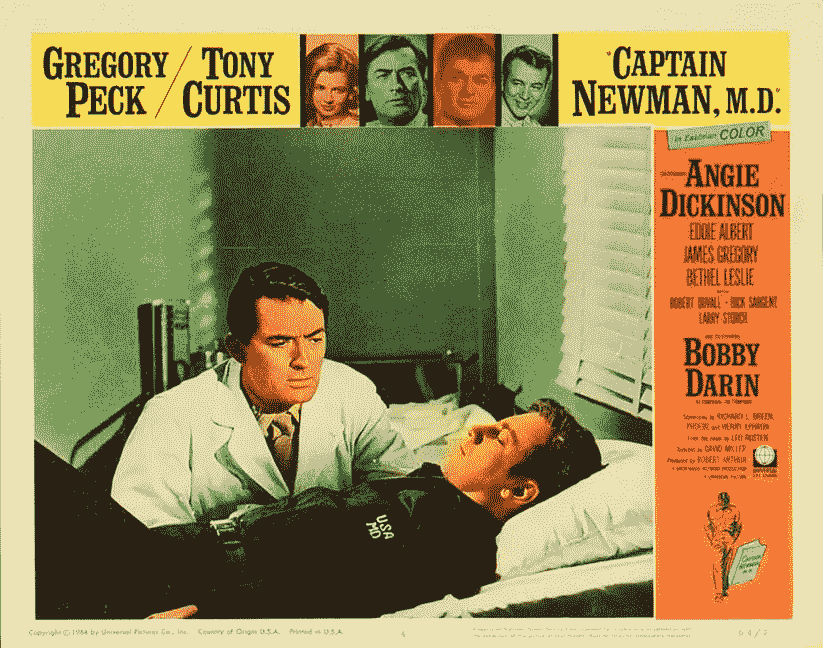

《纽曼军医》剧照

《纽曼军医》是二战末期在美军服役的一位军医，由格利高里\*派克先生主演。

这个军医处理的就是精神病的案例，我觉得这里面有很多案例可以印证萨特哲学。

比如在这部电影里面出现了一位布利斯上校，他是二战英雄，打下了很多敌机。

但是不知道为什么，心里面有点小阴暗，结果在酒吧里面发酒疯，被纽曼怀疑有精神病，就把他关进精神病院治疗了。

后来一查果然心理问题很严重，暴力倾向非常明显。

后来他发病了，甚至他不愿意叫自己为布利斯上校了，他给自己起了个新名字叫未来上校。

纽曼先生问他关于战争中的事情，布利斯就说："这事别问我，你得问另外一个人，这个人的名字叫过去上校。"

然后他又开始突然喃喃自语，回到战争中指挥部队的精神状态，嘴巴里不停喊着部队的番号与下属的名字。

纽曼把他的所有的疯癫语言全部录音仔细分析，然后通过查看相关的军事档案，总算看出了端倪。

原来在布利斯说疯话时候所提到的人名，都是在他的指挥下，因为听从他的命令而牺牲的战友。

现在事情已经非常明了了，布利斯因为无法忍受自己的下属因为自己的命令而死亡这一点，导致了严重的内疚。

为了摆脱这种内疚，他进行了自动切割，将自己的过去称之为"过去先生"或者"过去上校"，由此摆脱过去的自我对于现在的自我的暴政，这是一种自我精神疗法。

其实事情发展到这一步还不是特别地严重。纽曼了解了这一点，也在思考比较恰当的治疗的对策。

但是事情出现了突然的新的变化，因为布利斯是战争英雄，他疯掉的事情引发了政治后果。

华盛顿就派了一群官僚，来看看布利斯是不是真疯了。于是这帮官僚开了个听证会，让布利斯穿着军服，当众受检测。

布利斯当然还是说一套老说词，不承认自己是布利斯，直到纽曼叫他未来先生或者未来上校，他才回答他。

但是这样的一种严肃的场合，还是对布利斯构成了巨大的环境暗示，使得布利斯默默地将未来先生与过去先生，这两个分裂的自我联系在了一起。

这样一来，他曾经为自己设立的某种防止精神压迫的防火墙也失效了。

被过去先生所带来的道德负疚感所折磨的未来先生，在听证会一结束就冲出了房间，爬上了航空塔楼，跳下来自杀了。对此纽曼也是无力回天。

这个故事告诉我们什么道理呢？

第一，负疚感本身当然是军队的教育的产物。

按照军队的教育，每一个长官都需要为自己的下属负责。

第二，所谓的过去先生与当下的状态之间的联系，是通过布利斯上校这个标签来完成的。

而这个标签所起到的作用，需要别人的持续认同，来提供建构的力量。

正是这样的一种联系，使得当下的布利斯先生，没有办法摆脱过去带给他的那种精神折磨。

第三，布利斯的心理自救方法，也就是将过去与未来相互切割。

这本身就意味着萨特所说的那种意识意义上的自由选择，竟然具有如此大的弹性，他竟然连自我都能够切割。

第四，布利斯上校的自杀是一个悲剧，不过这依然体现了他的自由，因为他是在自由的决断中跳下去的。

话又说回来了，华盛顿的那帮官僚的确一点都不懂萨特哲学，他们依然按照军事档案上的布利斯上校来认识当下的这位布利斯。

杀死这位二战英雄的，从哲学角度上看，就是理性主义的哲学。

这种哲学愚蠢地认为，档案上所建立的文字层面上的同一性，竟然可以体现真正的现象学事情。

#### 越少定义，越是自由

不过大家可能会觉得布利斯上校的例子过于极端，自杀也过于可怕。

那么有没有一更加正常一点的案例，来为萨特的哲学做注脚呢？

我认为是有的。我们来看看《三国》吧。

从萨特哲学的标准来看，《三国》的第一哲学英雄或许是吕布。

因为他不停地选择，他体现了萨特所说的自由。

他总是不按照大家的期望来表现自己。

他跟着丁原混，然后突然杀了丁原，跟了董卓，跟着董卓做了一堆坏事。

这时候大家对于吕布的整个人设的设定，是把他定在黑暗一面。

但是他又突然改变了大家对他的黑暗设定，他杀了董卓，结果成了英雄。

吕布总是一个能够给大家带来 surprise 的人。

吕布的哲学本质是什么？他的哲学本质是一个肌肉版的萨特哲学笔下的英雄。

而萨特则是一个弱势版的，不会说汉语却说法语的吕布。

萨特和吕布的政治立场都像走马灯一样，我们很难定义这两个人。

但是这恰恰体现了萨特哲学的一个精髓： **一个人的自由度就在于他难以被定义的程度，你越难你被定义你就越自由。**

这也就是萨特所说的"存在先于本质"的意思。这里的存在指的是那种自由的体验。本质是什么呢？就是那种档案上的盖棺定论的文字。

也就是说我们自己自由的体验，是先于别人对你的盖棺定论。

听到这里大家可能会问，难道人和人之间的关系，就是这样一种紧张的关系吗？

难道仅仅就是这种奴化和被奴化的这种关系吗？难道人和人之间就不能彼此关爱吗？

萨特说你当然可以去爱别人，这是你的自由，但是你要记住你爱别人本身就意味着一种暴政。

多少爱人是按照自己的想法去要求对方的呢？多少分手就是因此所导致的呢？

所以爱情的本质是什么？是施虐狂与被虐狂之间争取奴化主动权的斗争。

大家听了以后会觉得，萨特你看问题太消极了，那么在你的哲学框架之中，我们还能积极地看待别人吗？

萨特说可以，那就尽量少奴化别人。

当然完全不奴化别人是不可能的。少奴化别人、少定义别人，同时不要太爱别人，太期望别人做什么。

对别人期望太高，或者太挂念别人，因为这本身也是一种奴化。

在这个意义上，萨特似乎是重复了康德的重要的道德律令：人不仅仅是手段还是目的。

但是他对康德的道德律令做出了重新的解释。

他的一个新的解释是什么呢？人不仅仅可以被别人所奴化，而且你要始终记住，他们也在奴化你。每一个人都是一个奴化别人的主体。

在这样的一个新的层面上，我们应该意识到一个问题：人和人之间的彼此奴化，会导致作用力与反作用力的相互比拼，这样会导致人际关系越来越紧张。

你想要自由，但你会破坏别人的一个自由。

在这种情况下我们该怎么做呢？我们就要做到彼此尊重对方的自由，尽量减少对于别人的期望。

如果把这种态度延伸到男女关系之上，就会变成了一种怎样的人生态度呢？

那就是前一秒相濡以沫，后一秒相忘于江湖。

基于这样的人生态度，萨特自然也不愿意用婚姻这种社会契约来定义他与他的女朋友德\*波伏娃之间的关系。

好了，下一回我们就该说说德\*波伏娃了，我们下回见。

公众号懒人找资源，懒人专属群分享

## 107\. 波伏娃的存在主义：生来无女性，只是被定义

### 文稿

各位朋友大家好，我是徐英瑾。

前两回我们主要说的是萨特的思想。萨特的存在主义向我们揭露了个体与环境之间的这种紧张的关系。

不过因为萨特本人是个男性，所以他看待问题的视角本身也带有男性的特征。

大家看在他的戏剧《禁闭》里面戏剧的结构，它的人物构成的是二女一男的结构。

男的是加尔森，女的是艾丝黛尔和伊内丝，而加尔森的主角地位也暗示了男性中心主义的立场。

那么如果从女性的立场重新来改造存在主义，又会引出怎样的一个后果呢？这就引出了德\*波伏娃的哲学。

#### 波伏娃的生平

德*波伏娃的名字特别特别地长，有时候我们叫德*波伏娃，有时候叫波伏娃都是可以的。

如果说全了是西蒙*露西*埃内斯蒂娜*玛丽*贝特朗*德*波伏娃。

1908 年生，1986 年逝世。

她与萨特一样，她不仅是一个哲学家，而且是一位斜杠青年，身兼很多重身份。

除了哲学以外，她还是一位优秀的作家，是一个社会活动积极分子，尤其是一个女权主义者。

德\*波伏娃本身的家庭背景也挺有意思。她其实是来自于巴黎第六区的资产阶级的家庭的。

她的老爹叫乔治*贝特朗*德*波伏娃，做过律师，也做过一段短暂的喜剧演员；她的妈咪叫弗朗索瓦*布拉塞尔，是一位富有的银行家的女儿。

本来这个生活相对来说还是比较富裕，但是在一次大战后不久，德\*波伏娃的家庭就遭遇了一次变故。

他的外祖父因为银行业经营不善导致银行破产，然后就使得德\*波伏娃一家的家庭生活都受到了连累了。

德*波伏娃的爸妈就不得不离开了自己本来漂亮的公寓，带着德*波伏娃住进了位于雷恩街上的一栋阴暗狭小又没有电梯的第五层公寓当中。

德\*波伏娃因此她的心灵也蒙上了阴影，目睹着父母之间的关系日趋恶化。

不过她依然受到了非常好的教育。

她知道自己的爹是非常希望有一个儿子，并且把自己的儿子培养成一位理工科的人才。

那么既然自己是个女儿身，就不可能再变成儿子了，但是至少能够满足父亲的愿望，多学一点理工科。

所以德\*波伏娃在理科方面也受到了很好的训练。

在索邦大学的文学院里面，她遇到了很多有抱负的年轻学者，其中有一位就是让-保罗\*萨特。

从认识萨特那一刻，德\*波伏娃就觉得他是一位天才。

从此以后两个人就展开了一段蔓延一生的感情，不过两个人始终没有结婚。

德\*波伏娃和萨特死后是实现了合葬，虽然生时不是夫妻，但死后则同穴而眠。

#### 《第二性》：女性是比男性更他者的他者

德\*波伏娃最有名的哲学作品是《第二性》。

这本书是在 1949 年发表的，曾经因为内容受到争议被梵蒂冈列为禁书。

这也是人类的哲学史上第一部的站在女权主义的角度，对女性的立场进行全面阐述的哲学著作，因此它具有很高的思想史地位。

那么这本书的核心哲学观点是什么呢？

我们还得先从萨特的哲学开始说。

萨特哲学的核心思想就是认为，他人对于自我构成了某种压迫。

"他人即地狱"就其本质而言就是指，他人会对于自我的意识的透明性进行全面地遮蔽。也就是说在他人的视角中，你将不得不被符号化、被标签化。

不过萨特并没有特别提到女性问题的特殊性。他所道的"他人即地狱"，十有八九并不是特指男性或者女性。

至于被标签化的自我是男性还是女性，他也没有专门地说。

而德\*波伏娃就特别强调女性是很容易被标签化的。这也就是说女性很容易被男权文化标签化为一个他者。

这句话是什么意思呢？

假设德\*波伏娃和萨特真结婚了，她就成了萨特太太。在生活中萨特就是太阳，她就是月亮，太太必须围绕着老公转。

有人就说了，这样的一种标签化难道不是双向的吗？

如果说德\*波伏娃成为了萨特的太太，她就失去了自己的名字的独立的命名权，甚至在西方国家结了婚以后，女性就要跟老公的姓，这一点的确是成立的。

但是难道我们不能反过来说萨特是德\*波伏娃的丈夫吗？

这的确还真的是不能。因为在外文里面说某某人是某某人的太太，这个说法是有定规的。

在英文里面你可以说 Mrs. Sartre 作为萨特太太的正式的说法。

但你不能倒过来说某某人是某某人的丈夫，没有固定的表达方式，这就暗示了女性实质上的弱势地位。

从哲学角度看，女性的他者地位就体现出了一种更加彻底的他者地位，是一种要比男性更加彻底的他者。

这也就是说，虽然男性也会被他者化，但是他他者的程度没有那么深。

为什么呢？

因为在男权文化的主导模式里面，一个男性被客体化或者被他者化的消极过程，多多少少可以得到某些补偿机制的反哺。

什么样的补偿机制呢？他可以反过来去客体化别人。

这也是黑格尔的主奴辩证法所告诉我们的：奴隶可以通过对于劳动过程的真正掌握，而成为某种意义上的主人。

但是在男权文化主导的这种氛围中，这样的一种反客为主的游戏，女性就很难操作。

比如老张与老李都是两个男性，他们在辩论一个问题，互相指责对方误解了自己的观点，给自己乱下标签。

在这种争辩的过程中，老张在将老李客体化。但不要紧，老李可以反过来将老张也客体化，这不就扯平了吗？

这时候老张的太太也想插嘴，结果老张就去驳斥自己的太太了，他就说了一句："你是妇道人家，你懂什么？"

这样一来，老张的太太就说不上话了。她想去客体化别人，结果别人不给她机会。

所以这是一种非常专断的话语垄断权。

这种专断的话语垄断权武断地阻止了妇女的上升地位，这也使得男性没有太多的兴趣去想象女性的体验。

#### "事实与神话"：男女不同是事实，女性劣等是神话

从体验出发显然是现象学的传统。在这个问题上，德\*波伏娃当然是和萨特一样，都是从属于现象学的传统的。

也就是说他们要从特定的现象学主体出发，来完成对于外部世界的描述。

而且很明显的是，她与萨特不同，强调了女性的视角。

不过，这也构成了德\*波伏娃对于经典的存在主义立场的一种有趣的偏离，尽管这种偏离的尺度相对来说是比较有限的。

经典的存在主义立场是这样的：其出发点乃是难以被标签化与难以被类别化的自我。

这样的一个自我是一个个体，而不仅仅是某一类对象的下属成员。

德\*波伏娃似乎想更进一步从女性的个体的视角出发去看问题，但麻烦的是女性的个体这个表达本身就带有矛盾。

一方面女性当然是一个个体，但另外一方面女性概念本身却是个类别、是个标签。

这就说明德\*波伏娃必须适当地弱化存在主义的纯粹的个体主义立场，引入某种普遍化的叙事，否则一般意义上的女性概念就无法被建立起来。

我前面已经提到了，德\*波伏娃是一个理科和文科方面都很优秀的才女。

这就意味着当她需要建立上面这种普遍化的叙事的时候，她就有文科和理科两个资源可以运用。

为了建立起这种普遍化的女性叙事，她其实是更倾向于使用理科资源的，特别是生物学的思想资源来建立女性这个概念。

尽管从事实上看，生物学这门学科本身长期也是被男性所占据，德\*波伏娃为什么要用生物学的这些素材来说明女性的本质是什么呢？

她背后的潜台词是，至少生物学所说的是事实，而不是意识形态的偏见。

事实就是她不想否定的事情，而意识形态偏见则是她想排除的东西。

不过这一点很可能也是受到了马克思的影响。因为马克思也在《德意志意识形态批判》里面清楚地区分了描述事实的科学与表达偏见的意识形态。

对于女性而言，哪些生物学事实很重要呢？

在《第二性》这本书的"事实与神话"这一部分里面，波伏娃认为从生物学角度上来看，男性和女性当然是彼此不同的。

比如月经、怀孕、哺乳，当然是女性专有的生理学特征，德\*波伏娃是肯定这些事实的存在的。

而且她也指出：女性的现象学体验，之所以与男人不同，也与女性底层的生物学配置是有一定的关联。

但是她认为如果我们仅仅基于这些事实的话，是不能够推出这样一个结论的：女性比男性劣等，或者说女性需要成为男性的他者。

如果你认为这些事实就能够推出把女性劣等化的观点的话，这就是一种偏见、是一种意识形态、是一种神话，因此是需要破除的。

在这里，我们似乎发现了德\*波伏娃试图对马克思的思想和萨特的思想进行双重的吸收。

她首先引入了马克思的唯物主义叙事，强调女性的物质性构成的特殊性。

然后她又引入了萨特，认为女性的生物学构成的特征不能够导出女性的意识是缺乏自由的维度的。

就意识的自我选择所具有的自由性而言，或者说就自在与自为之间的二元关系而言，女性与男性没有什么本质区别。

而男权文化的愚蠢之处，竟然是认为女性竟然会缺乏意识现象所具有的这种微妙性。

事实或许是反过来的。

恰恰是因为女性的生理结构相对复杂，所以女性的心理系统受到各种因素干扰的窗口也就更多。

所以女性更容易体验到相对透明的自在与相对不透明的自为这两种状态之间的种种纠葛。

**当然了，如果我们仅仅是站在传统的男权哲学的立场上来看女性，女性就很容易被一般化为某种样板的投射对象。**

在这里，我们就看到传统文化提供了很多理想化的女性的样板，无非就是把它定格在两个方面。

一方面，无非就是样板化的母亲形象。比如说像孟母三迁、岳母刺字这些故事里面所体现出来的母亲的形象。

另外则是样板化的妻子的形象。比如说田螺姑娘，或者说像薛宝钗也许是很多人心目中的理想妻子。

这种做法也就是等于将不可能完成的一些理想化的任务交付给了个体的女性，由此忽略了女性的个体性与多样性。

#### 悬搁性别标签，女性生本自由

另外，萨特哲学对于德\*波伏娃影响还体现在萨特的一句重要的哲学名言"存在先于本质"上。

也就是说意识活动的自由性，要优先于他人对于你的意识的盖棺定论。本质本身不是被给定的。

如果站在女性主义的立场上改写萨特这句话的话，那就得出德\*波伏娃的结论：

女性不是生来就是成为所谓的女性的，而是变成为女性的。

这也就是说女性的本质是后天形成的。

当然，这里所说的女性显然是一个文化概念了，而不是一个生物学概念，否则德\*波伏娃就会与她的哲学对于女性的生理学特征的肯定相互矛盾。

这样的一种被德\*波伏娃加以否定关于女性的文化概念，显然是这样一个思想：女性必须服从于男性的权利安排，成为主动的男性的被动的、消极的承接者。

但这样一个做法就等于把女性的自由进行了全面的剥夺。

很多人认为女性的天职就是打理家务、照顾孩子。

如果女性天然就被陷入这些活动的话，她发展出自己个性的时间就会被剥夺，由此无法充分体现自身的自由。

德\*波伏娃的主张就是要对抗这样的一种标签化。而对抗这种标签化的要点，是与各种各样所谓的坏的信仰作斗争。

坏的信仰或者说 bad faith 也是来自于萨特的概念，它的一个更加通俗化的讲法就是自我欺骗。

这些自我欺骗的内容是什么呢？

明明女性实际上是有自由的，但是你陷入了一种自我欺骗以后，却会对自己说自己没有自由。

你会对自己说，把自己的自由让渡给这个男人。"我难道不是很爱他吗？爱他就要消除自我，融入他的生命，以他的事业为我的事业"等等。

而要与这样的一种自我欺骗作斗争，德\*波伏娃认为就要运用现象学悬搁的方法，悬置掉那些社会强迫女性所接受的本质性标签，让自我选择自由性自动地浮现出来。

当然这样说还是有点抽象的。

如果要让女性的自我选择的自由性浮现出来，并且把它落实为一些社会学的主张，那么，德\*波伏娃就主张下面的一些社会改进的措施。

第一，要使得女性的自由选择具有相关的经济基础。

比如要实现女性的劳动权利，使得女性有相关的兴趣自由。这当然又是马克思的历史唯物主义对他的启发了。

第二，就教育本身要淡化男女区别，要强调平权意识。

第三点，也就是婚姻的可靠性需要丰富的现象学体验来加以维持。

若相关的爱的感觉或者爱的体验消失了，那么对于婚姻的制度化保证就会失去意义。

第四，为了更多地解放女性，孩子的养育任务就得走出家庭，由社会进行负担。

#### 女性存在主义的悖论：一边定义女性，一边拒绝定义

现在我转入对德\*波伏娃思想的一个基本的评价。

德\*波伏娃的思想是战后女权主义思潮的一个重要组成部分。

它产生的背景是社会生产力得到了进一步的发展，由此使得的女性能够得到更好的教育，女性的自我意识也开始全面觉醒。女性开始大量进入文史哲这样的男性学科争夺话语权。

而且德\*波伏娃的观点也是萨特的存在主义哲学与这种觉醒了的女性意识相互结合后的产物，可以说是一个水到渠成的后果。

不过这里还有两个问题是需要加以进一步讨论的。

第一个问题是，德\*波伏娃的思想是否还能被算得上是一种正宗的存在主义思想？或者说她是不是已经犯下了存在主义的大忌，将女性问题本身加以本质化了呢？

对于德*波伏娃思想的一个很典型化的批评是，德*波伏娃可能是强化了男女平等的问题，而忽略了别的问题，比如说阶级的问题。

比如我们来看看一个富家的千金与一个穷人家的男孩，当然这里有男女不平等的问题，但这里更多的是一个财富不平等。

到底是富家的千金烦恼多呢？还是穷人家的男孩烦恼多呢？到底是谁的自由更多呢？

面对这样的一个反驳，德\*波伏娃的还击是这样：

那些嘴里口口声声说要为穷人的利益奋斗的男性的法国左翼思想家，实际上在自己的社会活动中，也不愿意与女性参与其中，也排斥女性。

在这样的一个情况下，她认为你不能够仅仅因为自己在为穷人的利益而奋斗，就自动地推导出女性的地位的提高。

但是我觉她的反驳并不是特别的有道理。

因为我们可以找到很多的这种案例，政治权利所带来的优势，可以全面抵消性别的问题。

比如在中国古代，肯定是男尊女卑。

但是我们到长沙马王堆去看一看，去看看辛追的墓。这个辛追只不过是汉代长沙国的一个相的妻子，但是她能够享受到今人所难以想象的那种政治荣誉与经济特权。

这里明显就是个阶级奴役的问题，而不是个性别奴役的问题。

我们再看得深一点，女性本身固然是一个标签，但是这个标签的意义在不同的人身上会有微妙的变化。

举个例子：卖火柴的小女孩是女的，武则天是女的，叶卡捷琳娜二世是是女的，安吉丽娜朱莉是女的，波伏娃她也是女的。

她们虽然都是女的，但是她们所处的时代、经济、地位、职业都非常不同，彼此之间松散的联系仅仅是性别。

但是这个联系真的很重要吗？难道这个联系的重要性不是很容易被别的因素所覆盖，或者所抵消吗？

由此我们就看到了一个哲学悖论。

一方面，萨特的"存在先于本质"的学说的确在波伏娃那里得到了继承。按照这样的一个学说，个体的特殊性是最重要的。

但另外一方面，德\*波伏娃既然把女性的问题单独拿出来加以讨论，她就难免会把女性的问题加以本质化。

而在这个过程中，这种本质化的进程就会进一步破坏女性自身的个体性与特殊性，由此破坏她本人所坚持的存在主义立场。

#### 男女平权，不能等于男女差异的消弭

好，现在我们来讲第二个问题。而第二个问题就是德\*波伏娃的哲学里面出现了两个话语体系之间的斗争：生物学的与文化的。

波伏娃既承认生物学对于女性的本质性的规定，又强调女性的选择自由，但这两者之间真的能够做到协调吗？

问得更加清楚一点，女性以家庭为中心的这种社会角色，在多大程度上是由文化所构成的呢？还是由生物学层面上的一些规定所构成的呢？

我们如果站在采集、狩猎时代的社会分工来看，我们就要问这样一个问题：如果女性更多地为采集进行负责，而男性更多地负责狩猎，这样一种分工它背后的道理是什么？

我个人倾向于认为这种分工很可能是基于演化的，而并不是基于文化的。

为什么呢？大家想一想，采集是一种能够兼顾哺乳的劳动，而狩猎则不是。

如果一个人要同时打猎、同时带娃，那实在是太危险了。

有可能猎物也打不到，娃也有可能在这时候会面临一些危险。

而且你带着娃，你怎么快速地奔跑呢？

所以狩猎者就难以哺乳了。而哺乳的任务就必须要交给采集者了。

因为采集这个活动相对来说，它不需要在短时间内进行奔跑，相对来说比较安静。

哺乳的活动到底应该由谁来承担呢？显然就是女性了，这是由女性的生理学特征所决定的。

既然哺乳和采集这两个活动应该加以合并，而哺乳的活动在生物学上应该由女性来承担，因此这就推出了女性是更多地负责采集，男性则是负责狩猎。

这样的一个分工很显然是与人类的生物学特征相关的。

如果不那么分工，我们人类有可能就会灭亡，而且是生物学意义上的灭亡。

同时我们人类又有一些其他的生物学特点。

我们在婴幼儿时代的时间非常长，我们需要长期的父母的关照。

0 到 3 岁的婴幼儿是非常脆弱的，没有稳定的家庭关系我们就会绝种。

什么叫稳定的家庭关系呢？这就需要男女按照自己的生物学特点进行分工，以便彼此能够扬长避短。

男性就必然会在这样一个分工中更多地承担狩猎的任务，通过狩猎使得整个家庭得到充分的动物蛋白，这也正是对于男性自身特征的善加利用。

请注意，在狩猎和战争之间是有着很深的相似性的。长期以来不仅狩猎是男性的专利，战争也是。

换言之，任何一种暴力性的主动性的活动，因为一些基本的生物学的特点，也就长期地成为了雄性动物的专利了。

这一点不仅适用于人类，也适用于很多哺乳类。

当然我们也必须要看到，随着科技的进步，男女能够承担的工作会越来越相似。

这是因为随着科技的进步，劳动对于体力的依赖可能就会减少，这或许会导致女性的自由选择的空间也会变大。

但是从采集狩猎时代所传来的那些传统依然很难被完全消音，男女之间的职业分工依然存在。

比如对于与狩猎与军事有关的那些行业来说，大多数国家依然会使用男性。女性在这些行业中虽然也有参与，但是并不典型。

换言之，男女平权的思想并没有导致这样的一种后果：我们会自然地认为男性所从事的所有职业，都天然地适合让女性来选择，或者反之。

#### 存在主义的政治哲学，走不出无听众的悲剧

我个人认为平权的措施虽然是势在必行，但是也不能够极端化，必须要平衡职业女性的职业发展要求与传统的家庭价值之间的关系。

同时我们也要小心，不要对女性的所谓弱势地位进行一种本质主义的概括，要注意对不同国家、不同阶层的女性的地位进行细化的分析。

当然，这样的一种比较温和的平权方案，是更多地站在民族与人类的整体的利益上来考虑的，它并不是站在一个个体的、女性的立场上来考虑的。

这样的一种思维方式，显然就不是一个典型的存在主义的思维方式了，也不是一种个体主义的思维方式了。

这也就是说，一种存在主义和个体主义的思维方式，因为思考的问题，它的视野相对地比较的狭窄，所以它很难完成对一个民族的长达百年、千年的一个未来的全局化的思考。

从这个角度上来看，我本人对于一种完全建立在存在主义立场上的政治科学，或者说政治哲学何以可能，我是抱有一定的一种怀疑的。

我顺便就提我自己的一些管见。

如果家庭的价值完全地被所有的女性所放弃，每个人都按照自己的喜好来选择自己的生活，很有可能就会导致出生率的全面的降低。

由此很可能会使一个民族，从长远来看，它没有生物学意义上的未来，这本身就会导致一种很有趣的后果。

一位哲学家他要传播存在主义的世界观，他必须得预设有人在听他说话。

而这些广泛的听众的存在，恰恰是人类过去按照更传统的家庭价值产生了这些听众，才使得这些听众能够听存在主义在说什么。

但是他灌输给这些群众的思想，恰恰是要他们放弃老祖宗所传下来的家庭的价值，这就导致了这些听众本身是没有后代的。

这也就是说，这会从骨子上使得存在主义这种思想的传播，也会成为不可能。

这一点听上去是不是很荒谬呢？

说到荒谬，这就是另外一位存在主义者加缪的关键词，我们下回见。

公众号懒人找资源，懒人专属群分享

## 108\. 加缪的存在主义：你我都是反抗荒谬的西西弗斯

### 文稿

各位朋友大家好，我是徐英瑾。

法兰西的存在主义三杰，让-保罗*萨特、德*波伏娃我们就说了这两个了。第三个就是今天我们要说的加缪了。

#### 萨特与加缪的决裂，一部分是哲学思想的分歧

萨特、波伏娃、加缪这三人的思想关系是什么呢？

请注意萨特与加缪，在职业身份上都是很类似的。

都是兼哲学家与文学家身份，都被视为存在主义者，而且都拿到诺贝尔奖，只是萨特没有去领奖而已。

但是加缪平常不喜欢说自己是存在主义者，而且也很喜欢怼萨特。

至于波伏娃与萨特这两个人，则长期是神仙眷侣，这里面到底是怎么一回事呢？

为什么说萨特和加缪的思想有点像，但彼此之间又有点不对付呢？

这当然是涉及到了一些法国文人之间的一些私下恩怨。

这就类似于在启蒙时代，同是启蒙主义者狄德罗与伏尔泰之间也有些私人恩怨，这很难说清楚。

不过关于加缪和萨特思想之间的冲突，还是有一些哲学上的道理可以说一下的。

萨特的哲学是表面激进。他连自我的同一性都怀疑，但是其实际的意蕴则未必那么激进。

晚年则试图调和存在主义与马克思。并通过向马克思致敬，间接地向马克思的思想源头黑格尔致敬。

这一点让萨特有点像休谟了。休谟表面上看来连因果关系的实在性都怀疑，在生活中却尊奉习俗，反对激进的改革。

萨特的存在主义为何有这样的一个特点呢？从表面上看来萨特主张"他人即地狱"，这种观点是很难引出一种积极的关于人际关系的哲学的。

但是因为萨特哲学的自我概念是通过自我与他人之间的关系重建出来的，这就导致了一个很有趣的后果。

萨特的哲学甚至无法导出一种个人主义的哲学。

这一点就特别好玩了。恰恰是因为萨特对自我的同一性都加以了哲学的摧毁，这就使得他对于他人的地位的摧毁，并不显得那么的醒目了。

那么与之相对应的，萨特通过他人而重建出自我这样的一个哲学操作，就进一步使得他对于他人的消极哲学态度，得到了一种克服。

这样一来，萨特的哲学就具备了与马克思的历史唯物主义进行交流的可能。

波伏娃的哲学也是这样，她对于女性的生物学事实与意识形态神话的区分，其实是要比萨特更加背离存在主义的基本立场。

因为女性的身份标签也好，关于女性的生物学事实也罢，都蕴含了某种本质主义的立场。

#### 加缪的荒谬哲学：自我无意义地活在世界中

加缪的思想则和他们都有点不一样，他的哲学核心词乃是荒谬。

荒谬到底是什么意思呢？

荒谬是指世界与自我的联系出现了问题。

注意这不是指自我有问题，也不是指世界有问题，而是指这两者摆在一起以后两者之间的联系有问题。

这可有点意思，因为世界与自我本来就是应该有密切联系的。

比如按照康德的哲学，世界本来就是自我意识加以构成的一个构成对象。

按照海德格尔的哲学，此在本来就是在世界之中。

而现在加缪却说世界与自我之间的联系出现了基本的问题，这个问题就是荒谬。

好了，我们再问一次荒谬到底是什么意思？

这里有一种浅层的含义与深层的含义。

浅层的含义是我感知到了世界与自我之间的某种不协调与不合逻辑，类似于喜剧所嘲讽的那些古怪现象，比如塞万提斯所讥讽的唐吉诃德。

但这恐怕不是加缪所看中的荒谬的意思。因为浅层的荒谬是预设了某种深层的正常视角。

比如唐吉诃德的荒谬是通过其仆人桑丘\*潘沙的眼光所看到的，而桑丘的眼光则被预设为正常人的眼光，他本人的世界观并不荒谬。

或者类似说我们如果看到某某人的肝脏切片有问题的话，我们必须得预设，显微镜本身在正常运作。

也就是说正是通过一个正常人的眼光，我们才能看到哪些事情是荒谬的。

深层的荒谬是指另外一个意思。

它不仅仅是指不合逻辑，而是指彻底的无意义，就不知道自己为何要在这里。

不管你是堂吉诃德还是其仆人，你都会感到你个体的存在与世界的关系本身就具有荒谬性。

类似于我少年时候的一次体会。有一次我参加一个集体的大型活动，突然觉得在操场上我灵魂出窍，我的灵魂飞离了我的肉体，在操场顶端观察自己的肉体。

我不理解自己为何要在这里，参加这个活动对我有什么意义。

请注意，这不仅仅是萨特所说的"他人即地狱"的那种感觉。

"他人即地狱"是那种感受到了自己在被别人客体化，但是这里所说的个体与世界之间的关系是荒谬的。

是这样的一种感受，也就是说你看到的一草一木都与我无关，不仅仅是他人在将我客体化，而是我对所有的事情都不 care。

我想很多人恐怕偶尔都有这种感觉。

不过加缪的特点也是在将这个问题加以普遍化，这也是存在主义的思想与现象学的视角加以结合以后的必然的理论产物，即将某种特定的视角视为某种普遍的视角。

#### 被隔阂的加缪的一生

加缪为什么会有这样的一种奇奇怪怪的想法呢？这恐怕是与他的家庭背景有关。

我们都知道萨特与波伏娃的家庭背景都是巴黎人出身，要么是公务员，要么是资产阶级。

天然以为自己就是法国的精英，有明显的心理优势。

加缪的情况就有点复杂。

加缪的父亲在一次大战的时候阵亡，随着母亲移居在阿尔及尔的贫民区，实际上他是在阿尔及利亚的阿尔及尔生活。

我们都知道在战后的阿尔及利亚独立战争之前，阿尔及利亚就是法兰西的一个海外省。

海外省是什么地位？就是说你表面上也在法国人的控制下，但实际上在巴黎人看来，你们不就是乡下人吗？你们的地位是很低的。所以这种身份就非常地尴尬。

不过有一点要指出的是，加缪还真的是在阿尔及尔大学攻读哲学的，在那个地方还有哲学学。

在 1935 年他加入了法国共产党，1936 年他毕业。他的毕业的论文就是新柏拉图主义和基督教的思想。

在二战的时候他参与了一些反对德国法西斯地下抵抗运动。

他从 1932 年开始就开始发表各种各样的作品了。

在 1942 年就发表了《局外人》，1947 年发表了《鼠疫》，这都是大家很熟悉的作品。

这里需要注意的是，他所留下的作品基本上都是文学作品，并没有像哲学论文这样的大部头作品。

我们经常所说到的《西西弗斯神话》实际上是一个哲学随笔，它并不是像《存在与虚无》或者是《第二性》那样条理清晰的学院化作品。

1957 年 10 月 17 日加缪获得了诺贝尔文学奖。

不过仅仅在三年之后，也就是 1960 年 1 月 4 日，46 岁的加缪因车祸死亡。

这件事情背后的真相现在依然众说纷纭。

加缪的生活经历为何会促进他本人的荒谬感呢？

当然是个身份认同的问题。自己到底是谁？是阿尔及利亚人？是法国人？

或者说他和法国共产党的关系也是若即若离。

他似乎在任何一个团体里面都能够插一脚，但是任何一个团体又都不能真正地接受他，世界与他之间出现了种种隔阂。

这种隔阂是系统性的，不是针对具体的事件与具体的人的，而是四处弥漫的。

#### 《西西弗斯的神话》：荒谬不息，反抗不止

这也就是使得《西西弗斯神话》的隐喻得以成为加缪思想的标志性隐喻的道理。

我前面说过了，《西西弗斯的神话》是加缪的哲学随笔，于 1942 年完成。

在最后一章中，加缪概述了西西弗斯的传说。

西西弗斯因为惹怒宙斯而遭到了责罚，但他在下地狱之前逃到了人间。

最终他还是被捕获了，被众神处以永远的惩罚。

西西弗斯必须把一块石头推到山上，到石头达到顶部的时候，这石头就再次滚回山下。

西西弗斯又重新开始，周而复始，永远没有尽头。

其实这就是一种对于我们日常生活的隐喻。

我们某种意义上说个个都是西西弗斯。

我们起床，我们挤地铁，我们上班，我们打卡，我们听老板咆哮，我们做 PPT，我们加班，我们回家，我们躺平，我们追剧，我们睡着，我们起床，然后周而复始。

甚至整个人生也是这样的。

西西弗斯在一代人与一代人之间循环。

生老病死，上小学、中学、考大学、毕业、结婚、做房奴、孩奴、老了、挂墙上等等。

面对这种周而复始的情况，就有一个基本的哲学问题冒出来了： **这样做的意义到底是什么？无限的重复这件事本身能够产生哲学意义吗？**

这就有几条出路了。加缪对这个问题就有几种尝试性的解答，以及他对于这些解答的进一步的回应。

第一个解答就是，如果你觉得活着没意思，就自杀。

不过加缪立即否认了这种解释，认为自杀是懦夫的选择。

为何是懦夫呢？因为这是对于生活的抵赖，是对于生活的逃避，而不是对于荒谬的抵抗。

请注意，抵抗在加缪的哲学里具有重要的价值，等一下我们还要说。

不过无论抵抗是什么，这肯定就预设了自己要对世界要有一种扰动。

但你要对世界有所扰动，你必须得活着，你死了就对世界没扰动。

在这一点上我倒是比较赞同加缪的。实际上死是件容易的事，活着才难。

我们不妨就看看安迪\*威尔写的科幻小说《火星救援》，这部小说也拍成了电影。

宇航员马克\*沃特尼被粗心的同伴忘在火星上了，他好几次想在火星上自杀，因为在那样一个艰苦的环境下活着实在太难了，但他还是坚持了下去。

不过这里有一个问题可以深一步地问：马克\*沃特尼在火星上种土豆坚持求生的信念是什么？

很明显，他坚信休斯顿的宇航中心会派人来救他。

这里面就包含着一种积极的人与世界之间的关系，可以说这种信念本身是一种带有宗教维度的信仰。

好吧，那么宗教信仰能够帮助我们跳出西西弗斯的陷阱吗？

加缪却认为不能。

这就涉及到了加缪所提到的第二种面对人生意义的解答方案，也就是宗教。

对他来说，宗教的答案它的本质是什么呢？

是通过一种信仰设置一个超验的世界，让超验的世界或者在其中生活的神，赋予我们的生活以意义，这也是西方社会解决人生意义的传统办法。

连休谟也在实践中对宗教相对友好，尽管他在他的理论哲学中是敢于怀疑上帝的。

很多人也都认为对于这样的设定的消除，会导致人生的彻底的无意义，导致我们人生的价值体系的崩溃。

不过加缪是生活在一个上帝已死的时代，重启上帝程序恐怕已经无效了。

所以他认为诉诸宗教信仰本身是一种自欺欺人。

而且他认为信仰本身就意味着对于理性的追问的终结，这就意味着精神生活的终结，所以这可以被视为一种哲学自杀。

**那么就有第三种可能性了，就是接受荒谬性，拥抱荒谬性，继续活着。**

在这个意义上，加缪认为西西弗斯就是一位荒诞的英雄。

他热爱生活并穷尽生活的各种可能，讨厌死亡，反抗诸神。

当他承认他的任务的无意义和命运的确定性时，他意识到了自己处境的荒谬。

但他直视这种荒谬，通过反抗荒谬感到充实。

需要指出的是，西西弗斯的形象在汉语思想界的影响是很大的，很多人似乎都认可加缪的观点。

面对荒谬，并且以不停生活的方式不停地反抗荒谬，本身就是一种人生意义。

但这里还是有一些问题需要加以深入解答的，比如到底什么叫反抗？

加缪意义上的反抗指的是对于任何侵犯个人尊严的行动的反制性行动。

对于反抗的这一字面意义似乎不难理解。就类似于《水浒传》里面，林冲对于高衙内或者高俅的压迫的反抗。

#### 对个体尊严的维护，会导致超验世界的复归

不过要在加缪的哲学框架里面细想反抗之深意，就会产生两个逻辑融贯性方面的问题。

第一，对于反抗这一价值观的深挖，会不会导致我们重启另外一个超验世界呢？

请注意，如果我们重启另外一个超验世界的话，加缪的哲学就会产生了一个逻辑融贯性的问题。

因为他已经告诉我们了，宗教的选项我们必须得否弃。

有人说了，凭什么说对于个体尊严的维护会导致我们重启宗教的方案？大家听我掰扯掰扯。

你要维护你自己的尊严，就得预设你是有尊严的。

但问题是你有尊严这件事到底是怎么得到辩护的呢？

仅仅是因为世界上仅仅你一个人有尊严而别人没尊严？

还是因为世界上任何一个人类的个体都有尊严，而因为你是一个人类的个体，你自然就有尊严呢？

你显然不能说世界上只有我有尊严，别人没尊严，这样反抗就缺乏了大义名分了，人家会觉得你为什么要比别人更特殊一点。

你当然要说所有人都要有尊严了，这样反抗的哲学精神才值得传播。

换而言之，你必须假设林冲的境遇具有某种普遍性，才能对他产生共情。

林冲只是个符号，他也可以叫李冲马冲，他可以代表任何一个被欺压的弱势人士。

好，你预设尊严是普遍的，这就会导致什么？

你就会引入康德伦理学，也就是说康德的基本思想你就必须要承认：人不仅仅是手段而且是目的。

这就麻烦了，你引入了康德伦理学，你就得引入上帝。因为康德的伦理学是通过他所引入的上帝观念所担保的。

康德与休谟一样，虽然在理论上认为上帝的存在不可证，却在实践上认为上帝的观念不可缺。

这样一来，加缪就不得不接受被他所否定的宗教性的应答了。

也就是对于人生的意义，我们要给予一种超验世界的应答。

这当然是一种矛盾了。

加缪本人的确曾经系统地阅读过奥古斯丁与基尔凯郭尔这两位基督教哲学家的书。

但这里的问题是，加缪是否清楚地告诉过他的读者，一个无神论者是如何接纳这些宗教思想的要素的呢？

我能够想到的唯一的办法就是像康德那样假装相信有上帝。

但是这个选项显然会使得加缪的整个伦理学立场向康德的立场撤退。

但是这种撤退就会导致存在主义的立场，就变成了德国的先验唯心主义的立场了。

这可以说是整个存在主义立场的崩塌了，这是个大问题。

#### 《卡利古拉》与《局外人》：毁灭与冷漠，亦是对于荒谬的反抗

第二个逻辑融贯性问题是这样的。

加缪自己所举出的文学案例，是不是与他对于反抗的哲学意义的讨论彼此在逻辑上是协调的呢？或者说彼此之间会产生一些逻辑矛盾呢？

我个人认为加缪给出的两个典型的文学形象，都不是很清楚地展现了西西弗斯精神里的人道主义意蕴。

第一个文学形象是《卡利古拉》。

《卡利古拉》是加缪于 1938 年为阿尔及利亚的一个戏剧小组所写的一个剧作。1944 年出版，1945 年在巴黎首演。

剧中的主角卡利古拉是罗马帝国历史上的第三任皇帝，以残忍、恐怖著称。

这个作品就对卡利古拉的故事做了一些的改写。

这个作品描写的一开头的剧情是这样的，卡利古拉的情妇兼他的妹妹突然死了。

由此他认识到世界的荒诞，然后就开始了一系列的反对这种荒谬的反抗行动了。

但他反对荒谬的反抗行动是比这个世界更荒谬。

比如他在自己的妹妹兼情妇死掉以后，就给群臣下了个命令，希望他的爱卿们能够为皇上效力，把月亮给摘下来。

他夺走了别人的财产，杀死别人的父亲，强奸别人的妻子，或者把别人的妻子卖进自己所开的的妓院。

凡此种种的，就做了一大堆奇奇怪怪的事情。就怎么荒唐、怎么违背伦理，他就干什么。

他试图一个一个把周围的人视为重要的东西毁灭，把人们心目中的珍贵之物的意义夺走。

由此他试图以这样一种行为艺术，告诉群臣，万事万物的意义都是虚假而短暂的，而未能长久。

他甚至将自己扮演为维纳斯，以一种彻底的亵渎神灵的方法来断绝掉民众通过宗教方案来寻找人生意义的通道。

他的这种行为引起了所有朝臣们的恐惧、反抗和愤怒，最后他在宫廷政变中被杀死了。

在被杀死之前，他把自己的最后的爱人卡索尼娅勒给亲手勒死了。

需要注意的是，加缪在描绘卡利古拉死亡这一场面的时候，他的文笔是非常的优美的，我尝试着简单地来描述这个场景。

这时候王宫内只剩下卡利古拉和卡索尼娅勒两个人。

卡索尼娅勒绝望地问道："陛下，你能不能----哪怕一分钟也好----好好地生活一下。"

卡利古拉听了自己的情人的问话，就说，贯彻他的那些奇怪的想法正是他的生活的方式，并且他说了很多自暴自弃的厌世的言论。

卡索尼娅勒拥抱着他，试图让这个男人重新找回对于生活的热情。

不过正在此时，皇宫外面就响起了阵阵兵器交碰和士兵喊杀的声音。

卡索尼娅勒惊慌又坚定地安慰卡利古拉，不过卡利古拉明白自己大限已至。

在与卡索尼娅勒相互对彼此进行最后一次真情的袒露以后，卡利古拉重新振作了精神，硬起心肠，突然将卡索尼娅勒亲手给勒死了。

卡索尼娅勒死掉以后，卡利古拉失落地将她的尸体放到了床上。

在空无一人的屋内，卡利古拉再度变得脆弱，哭泣着、哀叹着："何处能够止我的渴，谁能赐我一座大湖般的深邃呢？"

这时候舞台一角的赫里功，也就是卡利古拉的近臣，大声警告说："皇上，叛军已进……"

但是话还没有说完，就惨叫一声，死于叛军的剑下。

这时候舞台两侧兵器交鸣，人声大作。

卡利古拉拿起一个板凳砸向镜子，尖叫道："青史留名吧，卡利古拉！青史留名吧！"

当镜子破碎的同时，叛军的首领西庇阿与色瑞亚冲入室内，他们用匕首刺向卡利古拉的脸。

这时候其他的叛变的众贵族随之跟进，每人手里各持兵刃，疯狂地捅着卡利古拉的身体。

在痛苦的喘气、哽咽与笑声中，卡利古拉大喊着："刺我吧，不过我还活着。"

这种死亡描写带有一种凄美的氛围，暗含着这样的一种意蕴，即加缪依然将卡利古拉视为一个哲学英雄。

但是卡利古拉本身的行为是系统性的反人道的，这与加缪关于人的尊严的普遍性的看法就产生了尖锐的逻辑矛盾。

另外一个值得一提的文学人物乃是默尔索。默尔索是中篇小说《局外人》的主人公。

《局外人》的这种写作风格在文学史上被称之为零度风格，也就是说是一种客观记录式的绝对冷酷。

他粗线条地描述了默尔索在荒谬的世界中，经历了种种荒谬的事情以及自身的荒诞体验。

比如他参加母亲的葬礼，莫名其妙就成为了杀人犯，莫名其妙就被判处了死刑。

更有意思的是任何人如果被诬陷了肯定都会很紧张，但是默尔索似乎对一切都无动于衷。

冷漠的理性，但同时又非常非理性地存在着，因为对于自己将死亡这件事情无动于衷是非理性。

默尔索是卡利古拉的对立面。卡利古拉反抗荒谬的方式是胡乱行动，默尔索反抗荒谬的方式是彻底不行动。

而彻底不行动按照一般人的理解，不是反抗荒谬，而是与荒谬合谋。

这就说明加缪笔下的文学形象反抗荒谬的行为具有极大的弹性，这种弹性就使得某些人物的特定行为就很有可能会逃逸出人道主义的光谱。

不过正好处在这一光谱内的文学人物也是有的。

比如小说《鼠疫》里面的医生里厄。

里厄为了拯救人命与荒诞的现实，和那帮庸碌的官僚不停地做斗争，他的作为显然是符合人道主义标准。

不过既然里厄只不过是加缪所描写的反抗英雄之一，因此我们就很难在哲学上概括出一个统一的加缪的伦理学立场，让我们清楚地知道在我们反抗荒谬的时候，我们具体该做些什么。

#### 加缪的哲学悖论，源自其逻辑的不周延

对于这样的一种逻辑立场上的不融贯，有一些别的解释吗？

我认为从浅层来看是有一些解释的。

加缪与萨特不同，没有写过符合专业标准的大部头哲学著作，也许缺乏对于如何一致性地表达自己观点的哲学训练。

而文学的写作又具有某种明显的非伦理性，这也是柏拉图早就意识到的。

而这种非伦理性也在破坏他偶尔表达的哲学观点与文学意境之间的统一性。

不过看得更深一点，还有一个哲学化的解释，即加缪面对荒谬的三个选项的排列是有问题的。

第一个选项我们再来复习，是自杀；第二个选项是投向宗教，第三个选项就是像西西弗斯那样去反抗。

我个人认为这第三个选项的含义很含混。因为它很容易向第二个立场去撤退，也就是说你反抗的伦理学的根据有可能是来自宗教。

既然加缪又否定了第二个选项，这就会导致他最终的伦理学观点会走向混乱。

他三个选项罗列的另外一个问题就是在逻辑上不周延，它是个逻辑学的术语，这一点我在《用得上的哲学》这个节目里已经解释过了。

它的意思也就是说没有把所有的逻辑选项都想到，比如他就遗漏了另外的一些可能的面对荒谬的选项。

他所遗漏的一个重要的选项，就是叔本华的准佛教的选项。

叔本华当然是清楚地意识到了世界的荒谬性，生老病死无限循环。

但是他意识到最大的反抗，是看透这种循环仅仅是世界的表象，并通过与宇宙意志的沟通来跳出轮回。

不过这种抵抗荒谬的方式，就预设了一种叔本华式的宏大的本体论。

而对于该本体论的接受，也就将迫使我们接受一种新的宇宙图景。

在这种新的宇宙图景中，个体的存在是不重要的，这已经不是存在主义的视野所能够容忍的宇宙图景了。

关于萨特身边的两位重要思想家波伏娃与加缪，我们就介绍到这里为止了。

一般认为这三位思想家都是存在主义者，尽管存在主义这一名号未必是这三位思想家都愿意接受的。

比如加缪，不是特别喜欢存在主义这个名号。

萨特还有一位思想同伴，他就是梅洛-庞蒂。

虽然有些材料把他说成是存在主义者，但是我个人认为他不是存在主义者。

不过有一点是可以肯定的，梅洛-庞蒂与萨特肯定都同时属于现象学运动。

下一回我们就来介绍梅洛-庞蒂，再见。

公众号懒人找资源，懒人专属群分享

## 109\. “荤菜素做”的梅洛-庞蒂：对人的关怀，从肉身开始

### 文稿

各位朋友大家好，我是徐英瑾。

前面我们说的三位思想家，萨特、波伏娃、加缪都是广义上的存在主义者，不过今天我们要讲的梅洛-庞蒂并不是个典型的存在主义者。

存在主义者一般要强调个体与世界之间的对立。萨特的名言就是"他人就是地狱"。

波伏娃思想就是，女性的个体很容易被他者标签化、客体化。她的哲学也许能归结为一句话，就是男人就是地狱。

加缪他是更系统性地指出世界与个体之间的联系就能归结为两个字，那就是荒谬。

与上述这些思想家不同，梅洛-庞蒂则更喜欢在积极的意义上谈论世界与个体的联系，这个联系就是肉身，他的哲学也被称之为肉身现象学。

#### 意识的本质，是肉身的活动

1908 年，梅洛-  
庞蒂是生于法国的罗什福尔。1926 年，他进入了巴黎高师，和萨特是同学。和萨特一样，他也当过一段时间的兵，而且在二战中也参与过一段抵抗组织的运动。他与萨特也一同创办过一个杂志叫《现代杂志》，从创刊一直至 1952 年 12 月，担任杂志的政治版的编辑。他最重要的哲学著作是《知觉现象学》，是 1945 年的时候出版的。

1961 年梅洛-庞蒂是死于心脏停搏，享年只有 53 岁，这就使得法国学术界非常的震惊，因为这可以说是英年早逝。

梅洛-庞蒂的哲学的起点其实是胡塞尔与海德格尔。

胡塞尔有大量的手稿是在他死后藏在了比利时鲁汶大学，这一点我们在讲胡塞尔的生平的时候已经说到了。梅洛-  
庞蒂就有幸读到了这些手稿，他就发现胡塞尔生前已经密集地思考了在意识中将肉身加以构造的问题，这就启发了梅洛-庞蒂往这条思路继续往下想。

好，我们就来想想意识和肉身之间的关系到底是什么。

一方面，意识似乎是肉体的主体，肉体则可以被意识所客体化。

这话什么意思？

你的意识可以去思考你的肉体。你可以去看你自己的手相，观察自己掌心的茧子，类似于观察自己的钱包。

另外一方面，肉体则反过来规定了意识。我的身体的位置决定了我看到了什么，我的腹痛则会影响到我在其他方面的知觉或者意识。假设在您的牙疼发作的时候，您能够区分对于牙疼的意识与发生着疼痛的牙龈吗？在牙疼当中，意识与肉体是彼此不可分的。也就是说在肉体的状态中，主客就是混在了一起。

这方面的一种更典型的表现就是左手去摸右手的感觉，这也是梅洛-庞蒂最喜欢的案例。

假设你现在用你的左手去摸摸你的右手。在这个过程中，表面上看来左手是主体，右手是客体，因为左手是摸的，右手是被摸的。但是左手仅仅是主体，右手仅仅是客体吗？错了，右手它也是主体。当你的左手在摸右手的时候，你的右手也在摸你的左手。摸与被摸的感觉交织在了一起，就破坏了主客之间的一切界限。

需要注意的是，肉体的这种介于主客之间的暧昧性，早就被叔本华意识到了，叔本华就认为肉体是意志的直接客体化。

而有了胡塞尔的阅读经验，梅洛-  
庞蒂则进一步指出，肉体的活动模式就是胡塞所说的意向活动的本质。也就是说当你将某种意义投射到某个感知对象上去的时候，你所做的事情实际上是将一种身体模式投射到上面去。我们现在就举个例子。

我们都知道婴幼儿在很小的时候，喜欢做的事情就是舔东西、摸东西。

婴幼儿最原始的意向活动就是将万事万物分成两类，可被吸吮的，以及不可被吸吮的。

但这样的意向活动的分类显然就暗示了两种身体活动模式的分离。

所以在梅洛-庞蒂看来，意义就不是柏拉图所说的那种抽象的理念。

它向我们提供了大量的暗示，以便告诉我们自己的身体是如何运作的。

很明显，如果站在肉身的立场上重新改造胡塞尔的意向性学说，这就会导致胡塞尔学说整个物质化的过程。

不过，梅洛-庞蒂发现，在他之前，似乎没有人像他本人那样对身体问题进行如此全面彻底的讨论。

身体的问题被他的前辈所触及，但没有被深挖。这也就是他自己哲学的价值了。

关于梅洛-庞蒂的肉身现象学，我们还是有一个重要的概念需要澄清的。

他所说的肉身或者身体，与生理学所研究的身体之间的一个关系到底是什么呢？

应该需要指出的是，生理学所研究的身体是作为纯粹的客体存在的。

比如一个肝脏的切片，在显微镜的镜头前面就是一个纯粹的客体。

而梅洛-庞蒂所说的身体是在现象学维度中呈现出来的身体，是你能够真实感受到的你自己的身体。

#### 格式塔：世界呈现的基本样态

不过需要注意的是，也不能说梅洛-庞蒂的研究是与实证科学没关系的。

梅洛-庞蒂在《知觉现象学》这本书里面，特别重视格式塔心理学的研究成果。

格式塔心理学当然是实证科学的一部分，不过他荤菜素做，他还是将科学内容进行了一个现象学的再解释。

那么什么叫格式塔心理学呢？格式塔心理学是由德语世界的一些心理学家，所创立出来的心理学流派。

这些心理学家，包括韦特海默、包括苛勒、包括考夫卡。

格式塔的德文是 Gestalt，它的意思也就是模式、形式、形状、动态的整体等等。

有时候我们也把格式塔心理学翻译成完形心理学。

格式塔心理学的一个基本的原理就是整体不同于其部分的总和，而是要多于其部分的总和，整体是优先于部分。

也就是说我们对于任何一朵花的感知或者是一个物件的感知，并非是首先感知到花的一些部分比如说形状、颜色、大小。

毋宁说说有一种整体的印象，在我们感知到一朵花的时候早就已经起到了一个作用。

那么格式塔心理学就有一些基本的原则，我在阐述这些原则的时候，也希望大家看看本节目的文案所附录的表格，因为其中有一些图也许看了以后就更加的清楚。

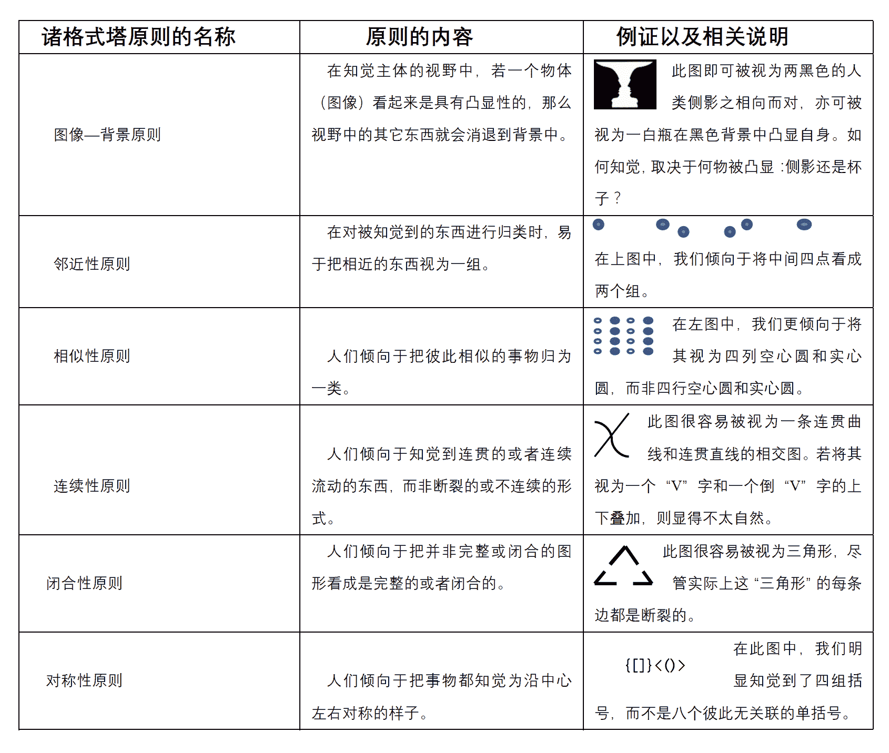

图 1-格式塔诸原则简表

比如说像图像-背景原则，什么叫图像-背景原则呢？

也就是说在知觉主体的视野中，有一个物体或者说一个图像，如果看出来是具有凸显性的，那么视野中的其他的东西就会消退到这个背景之中。

这就被类似于如果在一个黑色的棋盘上，有一个白色的杯子被凸显出来，你这个黑色的棋盘就自动被你忽略了。

但是反过来说，我如果要告诉你这样的一个杯子本身是一个背景的话，那么你的视野中看到的对象就会发生巨大的变化。

而相关的例证可以去看看我在本节目的附录里面所出现的一些图形。

又比如说邻近性原则。

在对被知觉的物体进行归类时，易于把相近的东西视为一组。

我举个例子。你在教室的三楼看着操场上的同学，小张、小王、小方、小李等等大概有十几个人。

但如果这十几个人每三三两两的组成一组在闲谈，一共就构成了五组，你就一下子会把握到五组这个数字，而不会把握到十几个这样的一个数字。

另外一个是相似性的原则，人们倾向于把彼此相似的事物归为一类。

再举同样的一个例子，如果小张、小李、小王他们都在天井里面聊天，你在二三楼打开窗户看着他们聊天，如果谈话者当中有两个人穿的衣服是一样的，你就很容易会把这两个人视为一组。

另外又比如说连续性的原则，我们倾向于知觉到连贯的东西，而非断裂的或者不连续的东西。

这比如说我们在看大型团体操的时候，有 100 个同学组成了一条线。

实际上这 100 个同学之间都是有一定的间隔的，但是我们远远地看过去，会很天然地把他们看成是一条线，会忽略他们之间的间隔。

还有一个是所谓的闭合性原则，我们倾向于把并非闭合的图形看成是完整的或者是闭合的。

还有一个就叫对称性原则，就是我们都倾向于把所有的事物都设想成是对称性，而不会把它们看成是非对称性，这一点我们也很容易去设想。

好了，这里的哲学问题是什么呢？

知觉当中所形成的格式塔的一个本质到底是什么？为什么我们会倾向于按照上述的原则去把握事物呢？

传统的经验主义者认为，知觉的格式塔还是能够被还原为基本的感觉原子，格式塔是一种经验概括的结果；理性主义者认为格式塔则是理性加工的产物。

梅洛-庞蒂认为两者都错了。

**格式塔就是格式塔，它不可以被还原为别的东西，就是世界呈现给我们的基本样态，这恐怕是世界与身体之间的一种共谋的产物。**

也就是说是身体的感知特征与世界的特征在彼此妥协以后，在二者的界面上所产生的一些基础信息。

以视觉为例，视觉领域中出现的格式塔，既反映了我们的眼球运动的特征，也反映了世界在物自体层面上的那些特征。

换言之，假设有一种生物的视觉器官与我们非常不同，我们恐怕也不能保证他们的视觉格式塔是与我们一样。

另外，我们基于我们的经验，也很难设想他们的格式塔是什么样的，除非我们能够对自己的身体进行某种基因改造。

如果有人采取实在论的观点，认为我们可以脱离我们的感知的局限，去了解纯粹的客观世界，这样一种想法是无效的，我们体验这个世界的起点就是格式塔。

需要注意的是格式塔这个表达，因为特别与视觉图形有关，而视觉图形又天然地带有空间维度，所以梅洛-庞蒂的肉身现象学也经常被说成是一种空间现象学。

不过我们也不能忽略他的肉身现象学的时间维度。

他是在某种准休谟的意义上来建立起肉身的时间维度的。

我们都知道休谟的关键词乃是"习惯"，而在肉身哲学的框架内谈论习惯，这就是肉体习惯。

举个例子来说，我在海外生活的时候，我就是吃不惯咖啡，我就是爱喝茶，这就是一个中国人的肉体习惯。

也就是说是肉身还在中国的我，对于肉身目下在美国的我的全面影响，

而肉身本身是天然地带有时间的绵延性的。

一个更极端的例子则是幻肢。

有些士兵在战争中失去了左手，但是在医院里面还是大喊我的左手很疼。

既然他的左手不存在了，他怎么还会感受到不存在的左手的疼呢？

科学的解释是这样，感受到疼痛的其实是大脑，是大脑的核心信息处理机制发出了疼痛指示。

但这里的哲学问题是，为何大脑会保留关于左手的信息呢？

关于哲学问题的哲学解释则是这样，整体大于部分。

正因为如此，人类的身体的整体本身就是一个超级格式塔。

这个格式塔会在自己的部分缺失的情况下，依然假装整体是完好无损的。

现在在幻肢的例子中，整体对于部分的优先性已经被转化为了历史对于现实的优先性。

#### 语言是肉身的表现力

大家听到这里，或许会觉得梅洛-庞蒂的这种哲学好像就是黑格尔的整体主义哲学的袖珍版本，黑格尔所说的绝对精神的整体性现在变成了肉身的整体性。

不过梅洛-庞蒂对于黑格尔的继承也不仅仅是这一点。

肉身在他那里还扮演了在主体和客体之间进行协调的合题的角色。

这样的一种辩证法化了的角色，恰恰是熟悉黑格尔叙事方式的读者很容易辨识出来的。

不过梅洛-庞蒂毕竟是一个现象学家，而不是一个德国唯心论。

现象学家的优势是感性，是注意感知细节，而不是像黑格尔更倾向于从抽象的角度来看问题。

以语言为例，黑格尔讨论语言的时候，他看中的是语言里的范畴，这些范畴又被他说成是思维存在的规定，是将我们将各种的经验的内容加以连接的一种思想上的卯隼结构。

梅洛-庞蒂看中的则不是范畴，而是肉身与语言之间的关系。

为什么说肉身与语言之间也有关系呢？这个关系当然是存在的。

大家想想看发音靠的是什么？用的是你的舌头，用的是你的牙齿，用的是你的嘴唇，用的是你的喉咙。

写字用的是什么？是用你的手。看字用的是你的眼睛。

而且与书写文字相比，这样一种言说恐怕更具有基础性。

看来音韵学很重要，这是个语言学的分支，专门来研究发音所带有的这种音韵特征。

那么从哲学角度上来看，语言的这种音韵学特征就是身体与外部环境进行交流的最基础方式。

大家张开喉咙扯开嗓子，张开自己的嘴震动空气，形成了声音。

在你说话的过程中，手势、音高、汉语的四声、情绪都会渗入语言的意义。

传统的哲学家一直忽略音韵对于意义的影响。

但实际上任何一个学过外语的人都知道，不同的语言，即使句子的字面意思用谷歌翻译翻译出来是彼此一样的，但只要发音一变、你用另外一种外语的语音去说，很多微妙的含义还是改变了。

我们都知道日本人见面都要说初次见面请多多关照，你觉得这句话用中文说和用日文说完全是一回事吗？我认为是有些微妙差别的。

用中文说是"初次见面请多多关照"，用日文说是"はじめまして、どうぞよろしくお願いします"，大家会感到什么呢？

感到了一种不同的节奏感，日语的节奏感会带来一种不同的韵律。

在这个意义上你会发现，语音是类似于音乐的旋律的一种东西。

你可不能说两个旋律不同的曲调的意义是相同的，旋律不同当然曲调的意义就不同了。

因此两句话它的语音不同，也会带来意义上面的一些不同。

但是很明显的是对于旋律的把握，本身就预设了身体的存在，预设了各种发音器官的存在。

语言除了有韵律特征以外，还有身体运动图式方面的信息。

这一点在梅洛-庞蒂之后的认知语言学当中有系统揭示。

认知语言学是当代语言学的一个重要的发展方向，其思想深受梅洛-庞蒂的影响。

认知语言学的一个非常具有代表性的技术概念，就叫认知图式。

从学术角度上来看，图式是指在一系列的语例当中的共通性，在得到强化后所获得的一些抽象的模板。

这些模板往往具有很强的意向性，具有一种前概念的特征，而且具有很强的可视性。

这些术语都比较的抽象，我来举一个例子。

我们都学过，英文当中有个单词叫 enter，就是进入。大家想想看进入这个词该怎么理解呢？

你不能够完全地站在概念的角度来进行定义。进入是一种活动，你要对这个活动本身的一个特征进行把握，而这个特征本身是可以被意象化的。

所以大家就可以看看本次的节目，所附带的文稿里面所出现的一个图。

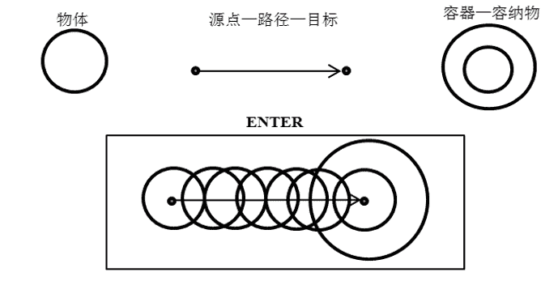

图 2-关于"ENTER"的认知图式形成过程的图示

如果你要讨论到 enter 或者进入这个概念的话，你这个图上要体现出什么呢？你就要体现出一个物体它在运动。

它既然要运动的话，运动的起点是什么呢？路径是什么呢？终点是什么呢？你一定要说清楚。

所以在这个图上就要画出源点、路径和目标。

但这个目标又不是一个一般性的目标，它必须是一个容器或者说是个容纳物，如果它不是个容器或者容纳物的话，你就不能说进入了。

比如说现在我已经从 A 国的国境进入了 B 国的国境，B 国的国境有个界限，所以它更像是一个容器。

也就是说，如果你不把一个对象比作一个容器，你是没有办法使用进入这个词的。

#### 现代技术的渗透，让我们忘记了肉身的有限性

上面说的这些事情，它与人生哲学到底又有什么样的联系呢？

我们都知道人生哲学在相当大的程度上，就关系到了人与人之间的积极伦理关系的营建。

首先可以肯定的是伦理学所研究的社会规范本身，往往就带有身体图式的印记。

大家来想想在生活中所遇到的伦理学表达的具体的措辞。

举个例子，我们跑到某个地方突然看到有个标识：这是军事禁地，禁止入内。

这样的一个标识就预设了，大家是理解"进入"这个词的身体图式的。

又比如说行车时不能够挤占公交车道，这也是条交通法规，这个表达本身也预设了大家是理解了"挤占"这个概念的身体图式的。

还有一句我们经常听到的话，就不许偷窃。不许偷窃，也可以把它展开为另外一个意思，就不许占据别人的财物。

那么占据这个词本身也是一个身体的运作了，就是把别人钱包里的钱挪到你自己的钱包里，就是一个身体的运作嘛。

这也就是说，我们平常所说的各种各样的一些伦理学的规范，背后都预设了大量的身体运作的图式。

如果这些身体运作的图式本身是一种混乱的方式被搭建出来的，由此出现的伦理学规范只能够成为笑料。

举个例子，如果某一个宗教或者某一个国家，提出这样的一些社会规范，会被大家笑死的。

比如人类永远不能够挤占银河系之外的空间，大家都会笑了，现在谁能够飞出银河系之外呢？

又比如另外一个伦理学的规范，永远都不能通过吐口水的方式来淹死长颈鹿，大家又会笑了，谁能够通过吐口水的方式来淹死长颈鹿呢？

从这个角度上来看，我们的道德规范都是建立在身体活动的基本样式之上。

这一点，以前的哲学家----比如说康德----就没有意识到。他认为道德规范都是些抽象的概念，没有意识到它与肉身之间的关联。

那么了解到这一点，会对我们的日常生活产生怎样的一个影响呢？

**第一，你不要对自己与别人提出身体执行力之外的要求，要用自己的肉身尝试一下这事情做得到吗。**

"己所不欲，勿施于人。"

这句话要转化为一个肉身的版本，自己的肉身做不到的事情，就不要让别人的肉身去做。

**第二点，虽然今天的世界是一个高度技术化的世界，但是肉身的有限性依然没有得到消除。**

很多人在生活中都有一个错觉，别人家里买了跑车或者有什么先进的设备，就能够指使他去做这个做那个，这是不对的。

有了这些技术的中介以后，我们的肉身的有限性依然存在。

举个例子，一个女生知道自己的男友有辆跑车了。

如果因为这个男生就有一辆跑车，你就期望这个男生能够以光速跑到你面前接你回家，或者认为他能够在开跑车的同时接 6 个电话，这就显然是太高估人类肉身的活动能力的上限了。

但是技术的全面的高度渗透性，则往往会让人忘记肉身的有限性。

记住这一点大家也就记住了，大家不要随便蹭别人的车。别忘记，从肉身的角度上看，开车是很累的，要对愿意为你提供搭车服务的朋友产生感恩之心。

**第三点，人道主义要落到实处，就要与人的具体的肉身需求发生关联。**

关心人就要从肉身开始，不能够脱离肉身谈论精神。就是送精神营养，也不要忘记肉身。

比如你去关心孤老，送给一个罹患白内障的老人一堆书，你这不是埋汰人吗？

但是他的耳朵好。如果他发现他的耳朵好，就向他推荐我们看理想 APP 上的那些节目，让他通过音频节目和精神世界发生联系。

如果他耳朵不好，给他买个助听器。

所以千万不要认为精神会自动地和人类的心理世界发生联系，我们需要一个很重要的中介，是肉身。

从这个角度上来看，基于肉身现象学的人生哲学观点相对中庸，不像前三位思想家那么惊世骇俗。

梅洛-庞蒂本人的政治哲学也比较中庸，他试图在美式自由主义与苏式国家主义之间找一条中道，因此将他的思想归类为存在主义者，我认为是不合适的。

由此我们也大可不必认为所有的法国思想家都是有点癫狂的。

法国是个文化大国，可谓八仙过海，各显神通。不能从特定的角度来给法国哲学盖棺定论，否则就连法国人所擅长的存在主义这一标签也会被本质主义化。

好了，现在对于法国版本的现象学的介绍也就到此为止了。

下面一回将对我们这个单元的内容进行小结，我们下回见。

公众号懒人找资源，懒人专属群分享

## 110\. 法国风味的现象学：个体自由的相互承认，才是真正的人道主义

### 文稿

各位朋友大家好，我是徐英瑾。

在本单元当中我们已经讨论了四位法国思想家的观点：萨特、德\*波伏娃、加缪以及梅洛-庞蒂。

我们整个单元的题目，是法国风范的现象学和存在主义思想，那么本单元显然就与上一个单元有联系了。因为这两个单元都涉及到了现象学的视角。

现象学视角的本质是什么呢？

是站在个别的存在者的立场上，去看待人生与世界，放弃那种基于上帝视角的宏大叙事。

#### 法国现象学风味在于，文学视角的细致入微

那么法国风味的现象学视角，与德国风味的现象学视角之间的差异又是什么呢？

大家可以发现，在本单元得到讨论的思想家他都有一个特点，就是除了梅洛-庞蒂之外，另外三位法国思想家，都是名副其实的文学家。

比如对于加缪而言，其文学家的地位，甚至要比其哲学家的地位还要来得更加的显赫。

更有趣的是，萨特、波伏娃和加缪这三个人都很擅长写戏剧与小说，而并不是诗歌。

与之相比，在上一个单元里面得到讨论的哲学家，比如说胡塞尔、海德格尔，他们都不是文学家。

胡塞尔的文笔，其实就其哲学讨论的文笔而言，其实都很糟糕，他的书其实是读起来很让人头大的。

海德格尔的文笔我认为比胡塞尔强不少，海德格尔能够写相当不错的哲学散文，他对诗歌也有极强的领悟。

只不过他对于小说和戏曲的谈论，稍微就少了一点。

有一点是可以肯定的，海德格尔虽然文笔不错，但他不是文学家。

因为他写的东西最多只能算散文，或者有一点像诗歌，但没有写过大部头的什么戏剧的剧本，或者长篇小说。

有人说写小说与写诗歌，这两者之间区别是不是很重要呢？我觉得还是比较重要。

诗歌、散文这些作品，它都是独白式的。也就是说你只是直抒胸臆，把你的情感给表露出来。

小说、戏剧就不一样了，你不仅仅要表达感情，而且你得动脑子。

你要设置很多人物，男一号、女一号，男二号、女二号，彼此之间的关系是什么。

在设置这些人物的时候，你又要设置很多其他重要的因素。

比如说你得设置每个人的人格侧写，女一号是什么性格、男二号是什么性格，他们的生活习惯是什么，他们的生活背景是什么。

同时你又要为不同的戏剧人物或者小说的人物，安排不同的语言。

比如说一个出身名门的人，他会怎么说话；一个家境不是很好、没有受过高等教育的人，他又该怎么说话，你都要进行小心的设置。

一个从国外刚刚回来的海归，他说话的时候就会加很多英文单词等等。

同时你又要小心地设置各种各样的戏剧冲突。

也就是说人物和人物之间的性格的对峙，有时候会引发非常严重的戏剧冲突，而正是戏剧冲突能够把小说的或者戏剧的情节往前推。

在讲到这个环节的时候，我们就要讲到三一律了。

三一律是一个古典戏剧创作的规律。它讲的是什么呢？

要求戏剧创作者在创作戏剧的时候，在时间、地点和情节这三者之间保持一致性。

你发生的故事，最好是在一昼夜之内就能完成了，地点最好就是在一个场景，情节是服从于一个主题。

曹禺先生的《雷雨》基本上体现了三一律的要求。

对于三一律基本的戏剧创作原则的尊重，会牵涉到了所谓的个体化原则，我们在讨论尼采的《悲剧的诞生》这部作品的时候已经指出了。

在三一律的框架内，我们在设置戏剧冲突的时候，我们要展现的是什么呢？是偶然性与必然性的对决。

偶然性与必然性对决的场所就是命运，而戏剧又往往是以命运的展开作为自己的母题的。

我个人认为戏剧也好，小说也罢，本质上是对于世界的一种高度简略化的建模，是在电子游戏出现之前的一种非数码化的游戏。

或者说是一种只有一个玩家的剧本杀游戏，这一个玩家就是作家。

正因为这样的创制活动会带来一定的建模成本，这就使得相关的建模者也就是作家，无法回避他对于一个行动者与别的行动者之间的微妙关系的观察。

请注意，这里我们提到的一个行动者和其他的行动者之间的微妙关系，它展开的场所是微观的，而不是宏观的。

为什么呢？我们已经讲过三一律了。它必须要在有限的时空中把故事讲清楚，你不能够超越出舞台所能够提供的时空限制。

即使是影视剧，它也有影视剧的长度，你不能够抽象地讨论某某主人公与历史大潮的斗争。

那历史大潮是谁呢？你必须把它展现为另外一个人物，他也必须是有血有肉的。

这一点也就使得自我与世界之间的关联，以一种具体而微的方式展现在观众的眼前了。

如果一个思想家他长期地受过这样一种小说和戏剧的建模的训练，当他返回去做他的存在主义哲学的时候，他也就会更多地关注到一个特定的个人与另外一个特定的个人之间的各种微观的互动关系。

也正因为如此，所有的有文学创作实践经历的存在主义者，几乎都集体看出了海德格尔哲学的毛病。

海德格尔的哲学毛病是什么？就是抽象地讨论此在与世界的关系，而无法更为细致地讨论这个特定的此在与那个特定的此在之间的微观关系。

而意识到这个毛病的法国思想家就各自开始了自己的探索。

萨特的工作是重新在存在主义的新框架里面，发挥了黑格尔的辩证法思想。

其实黑格尔真是一个哲学高手。他在主奴辩证法的讨论里面，已经初步讨论了不同个体之间微观关系的互动细节，我认为其讨论的水平是在德国古典哲学时代里面最高的。

可惜黑格尔毕竟是一个理性主义者，他认为主奴之间地位辩证性的转换，仍然需要遵循某种必然性的逻辑。

萨特则在新的语境----即存在主义的语境里面----复活了黑格尔的洞见，在同时作为一个存在主义者，他又拒绝了黑格尔式的逻辑必然性。

萨特清楚地看到了他人对于自我的塑造作用，并在相当程度上承认这种塑造作用带有部分的必然性。

但是与黑格尔不同的是，萨特强调的是个体必须要对这种被他人标签化的必然性趋势进行抵抗，由此彰显意识自由的价值。

换言之，在黑格尔看来，本质对于偶然性的意识所具有的自由的那种胜利，乃是一种既不可避免又必须被期待的胜利。

而萨特则认为这种胜利本身是带有偶然性的，我们还有机会和这样的一种被别人标签化的趋势进行斗争。

#### "杀人的不是我，而是偶然性"

我在这里就想举一部文学作品的例子，就是萨特的作品，他的戏剧作品《脏手》。《脏手》就体现了上述哲学观点。

我认为萨特是吃黑格尔的饭，砸黑格尔的锅，用黑格尔的辩证法精神来对抗他所说的那种逻辑的必然性。

这个作品讲的是什么？它是虚拟了在中欧有一个国家，他没有明说，但很多研究者认为可能暗指的是匈牙利。

在匈牙利有这么一个进步政党，这个进步政党里面有两位领导人，一位领导人叫路易，一位领导人叫贺德雷。

路易和贺德雷在政治上有分歧，但总的来说贺德雷的威望更高，好像在政治斗争中是占有上风，路易就决定要痛下杀手，派一个杀手去杀掉贺德雷。

这个杀手是谁？叫雨果。雨果就是我们这部戏的男主角。

特别有意思，也就是说在我们传统宏大的政治叙事里面，我们首先关注的是什么？是政治家之间的故事。

政治家下面的这些具体的杀手，一般来说不会成为故事聚焦的一个重点。

为什么呢？杀手已经被标签化了，已经被工具化了，他不是形式的主体。

但是在这个故事里面，我们故事的男主人公竟然是一个杀手，是一个被大家认为应当成为工具人的人。

这种设置本身就意味着萨特要颠覆那种从帝王将相出发的那种历史观，他要看的就是小人物。

好了，在这个故事里面，我们的男主人公杀手雨果，他要和贺德雷先生相处。

杀人者和被杀人者要相处，要混熟了以后才能找到机会杀掉他。

但在这个过程中，杀手雨果被贺德雷的那种领导者的气质所征服了。

一方面他想不思考，只服从命令把他杀掉，但是他又觉得想无动于衷地把这样一位优秀的政治家杀掉，他好像下不了手。

而且两个人还竟然进行了非常激烈的政治辩论。

在政治辩论中，他隐隐地觉得："我不能杀贺德雷。因为贺德雷的政治观点是对的，路易的政治观点是错的。"

有意思的是，被杀的对象贺德雷也看穿了雨果是一个杀手。

他也不怕，他的想法就是，我可以通过辩论把你拉到我这一边。这听上去有没有苏格拉底的味道？

那么在这样的一个故事里面，我们就看到了个体自由的力量。

一个人可以根据他的自由选择，做杀手或者不做杀手，或者在不做杀手之外，甚而言之，去做本来应该被杀掉的那个人的粉丝。

但是说到这里，有人说这好像并不是存在主义的胜利，这是黑格尔式的理性主义的胜利。

杀手雨果是在辩论里面听到了贺德雷对他的政纲的宣扬，在理性上被他说服了，然后成为了他的粉丝，这仍然是苏格拉底主义或者是黑格尔主义的那种隐蔽的胜利。

不要争，萨特是一个高明的戏剧写手，他只是让黑格尔主义在这一个回合赢，他是有后手的。

故事继续往下说。就在杀手雨果为了答应贺德雷与之合作而走入他的办公室的时候，他看到了一个让他天打五雷轰的场景。

什么场景？就是杀手雨果的妻子捷西卡正在与贺德雷很亲密的样子。

雨果脑子里是一片混沌。他在想，贺德雷明明知道自己要杀他，为什么对自己那么好呢？难道是因为我自己的老婆已经成为了他的玩物，因此他就决定放我一马吗？

在这种情况下，不得不承认雨果的大脑宕机了。

他失去理智，用枪杀死了贺德雷。

在故事发展的另外一条线索里，雨果的妻子捷西卡之所以与贺德雷去套近乎，恰恰是他不想让这两个男人互相残杀。

这就出现了一个非常有趣的反转。杀手最终还是杀死了他本来想杀的目标，但好像并不纯然是基于政治理由，而似乎是男女之情。

这似乎是非常偶然的因素，这让我们不由得想起了认识论里面所讨论的盖梯尔问题，即一个命题是以一种歪打正着的方式成真的。

关于盖梯尔问题，我们在《用得上的哲学》这档子节目里面有介绍，我在这里就不做展开了。

那么再回到雨果的案例上去。

雨果所看到的所谓的奸情，其实也可能是部分的揣测的产物。因为他也仅仅看到了这一个男的和一个女的在一起，背后的故事他并没有看到。

这似乎就印证了萨特那句名言"他人就是地狱"。

每个人都急着按照自己的框架给别人的行为下一个标签，但你在每一次下标签的时候，你就把别人给异化了。

整个故事的反转也是对于理性主义的一次嘲弄，它让我们看到局部场域中出现的一些很偶然的因素，是如何突然破坏全局的谋划。

这同时也是对于充足理由律的一种嘲笑。

按照充足理由律，凡事之发生它背后总有一个充分的理由。

但用雨果自己的话说："杀人的根本不是我，而是偶然性。"

偶然性在这里可以被理解为充足理由律失效之所。

#### 存在主义的本质，仍是人道主义

说到这里故事还没终结。

萨特有趣的地方是他在引入存在主义的叙述方式以后，他会在一个更高的维度，向德国古典哲学的核心思想，即人道主义致敬。

存在主义本身在他看来就是一种人道主义。

但是与康德式的人道主义不同，他并不是像康德一样假模假样地引入一个上帝来担保人道主义的有效性。

在萨特看来，他要通过个体自由之间的彼此承认而共同造就人道主义。

本着这样的一个大的哲学的想法，我们可以看看整个《脏手》的故事的结尾。

雨果杀了人了，但是法官基本上认为这是一个情杀，然后就把他关到监狱里面。

几年以后雨果假释出狱了，这时候他也在不停地思考自己当时为什么要杀死贺德雷，到底是出于男女之情的嫉妒呢？还是出于执行任务的需要的？

好像这两个因素都有，但又都不确定，他的脑子已经糊涂了。

这时候有一个人来看他了，这个人叫奥尔嘉。

奥尔嘉就是最早向雨果布置任务，让他去杀死贺德雷的雨果的直属上级。

奥尔嘉是一个女生，她是一个政治观点非常的坚定、但是心里面也隐隐地有点喜欢雨果的人。

那么现在奥尔嘉代表上边的一些人的意思，对雨果说了下面的话。

现在上面经过讨论以后，想按照这样一个标准来处理贺德雷和雨果之间的这笔历史旧账。

第一，给已经死亡的贺德雷进行政治平反，认定他是个了不起的政治家。

第二，将他的死解释为一场情杀。

那么第三，谁杀了贺德雷呢？当然是雨果了。

既然贺德雷很了不起，那个人就应该死，你要为被杀者报仇。

但是上级决定了不要雨果去死，也就是说找一个假名，让假名去背负雨果的杀人案，然后雨果本人重新换一个名字，继续在整个政党的组织内生活，同时要忘掉这件事。

用奥尔嘉的话来说："雨果是可以被回收的。"

这好像就把雨果当成是一个器具了。

而奥尔嘉与雨果在进行这方谈话的时候，负责销毁雨果的杀手就站在门外。

奥尔嘉的任务是劝说雨果按照自己的剧本走，这样他就能活命。

这个桥段显然让人联想起了柏拉图写的《克里同篇》里面的故事情节。

苏格拉底在被判处死刑之后，在死囚牢里面和克里同进行了一场对话。

克里同劝说苏格拉底跟着自己走，不要去死。

在《脏手》这个片段里面，克里同就变成了奥尔嘉，而雨果扮演的实际上是苏格拉底的角色。

但是就像《克里同篇》里的苏格拉底没有被克里同说服一样，雨果也没有被奥尔嘉说服，他最后选择开门与正准备杀他的杀手对射，然后同归于尽了。

这个戏剧的结尾体现出了怎样的一个哲学的道理呢？

我们来看看苏格拉底之死和雨果之死背后的一个哲学的考量。

苏格拉底为什么选择去死？因为苏格拉底的理性让他认为，用逃跑的方式来对抗司法的不公，是以不公对抗不公，这是不对的。

他作为理性主义者，不能以不公对抗不公，所以他要留下来死。

雨果他是存在主义者，或者说，雨果的创造者萨特是存在主义者，存在主义者为何也不逃命呢？

道理很简单，如果你要活下来的话，就得按照奥尔嘉的剧本去活，背负一大堆你不愿意背负的标签，而这本身就意味着一种自杀。

同时这个做法本身也意味着对于已经死掉的贺德雷的不尊重。

其实雨果在监狱里面反思自己开枪那一刻的动机的时候，一直搞不清楚自己究竟是出于嫉妒还是出于政治理由杀死了贺德雷。

他本人更希望自己真的是出于政治理由杀掉了贺德雷。

因为一个政治家死于政治理由是非常得体的，死于男女之事则是一种侮辱。

雨果觉得如果要对自己为什么杀人这件事情下一个盖棺定论，那就等于对自己或者对贺德雷都进行了标签化。

雨果既不想被别人标签化，也不想标签化别人，于是他最终就选择了打开了房门，在激烈的枪战中与试图杀死他的杀手同归于尽。

注意，这并不是一种典型意义上的自杀，因为雨果是在战斗中死亡的，这种死法本身就暗示了存在主义斗争精神。

#### 对女性气质的克服，并不能走向女性的自由

我个人认为《脏手》这部作品很重要，它可能是理解萨特以外的其他几位法国存在主义思想的一个重要的入口。

比如如何由萨特的《脏手》这个作品出发来理解德\*波伏娃的观点呢？

我们已经说过了，德\*波伏娃在萨特哲学的立场上进一步意识到，女性本身要比一般的男性更容易被别人标签化。

在男权主义文化中女性是纯然的客体，而无法成为具有自主意识的主体。

《脏手》这部作品刻画了两个重要的女性形象。一个是雨果的老婆捷西卡，另外是雨果的直接上级奥尔嘉。

捷西卡心地善良，对人热情，她不受任何概念与原则的束缚，按照自己认为正确的生活方式去生活，她是一种感性的方式生活着的。

不过她与雨果之间的结合并不是太幸福。雨果并不尊重她的存在，完全把她排除在自己的生活之外，她自己只不过是雨果从资产阶级家庭所带来的一个纪念的奢侈品。

因此捷西卡内心是痛苦的矛盾。她爱人类，反对男人和男人之间的相互屠杀。

所以在贺德雷与雨果之间，她进行了巧妙的周旋。并且在这种周旋的过程中，对充满男人魅力的贺德雷产生了感情。

捷西卡的存在是对于男性政治的反讽。她实际上比雨果更加地存在主义，或者至少说更具有德*波伏娃的那种存在主义气味，这是对于德*波伏娃哲学的预报。

奥尔嘉则是另外一位女性。

她满脑子革命的观念，沉着冷酷。

她甚至说过这样的话："如果上级命令我向你开枪（这个你指的就是雨果），我就会立即扣动扳机。"

但与此同时她又是一个女人，她有性格中非常柔弱的一面。她实际上对雨果怀有热烈的感情，只不过这些感情经常被她的扮演的政治角色所压制。

所以在戏剧中她到处都在压制自己的感情，力图用政治原则来战胜她女人的天性。这是一个被高度标签化的女性角色。

但是萨特这种写法本身并不意味着他喜欢标签化女性，因为他对于这种标签化本身持的是一种否定的态度。

奥尔嘉在这个故事里面扮演的角色，是构成了对于捷西卡的一个反衬。

以一种近乎于反讽的方式，让我们清楚地看到了，什么叫对于女性的客体化。

请注意，女性的客体化，并不是指要把女性写成是男人的性对象，或者是贤妻良母。

相反，一个像奥尔嘉那样有着自己的事业，甚至有一定的政治权利的、带有男性气质的女性，也是某种意义上的女性的客体化。

为什么？因为她的心智已经被男性的逻辑所充满了。一个充满着男性的思维逻辑的女性的头脑，是没有自由选择的空间的。

#### 个体真正抵抗的，是弥漫在世界中的荒谬

好了，这部作品不仅向我们暗示了萨特与德\*波伏娃哲学之间的一个关系，同时也向我们暗示了萨特哲学与加缪哲学之间的关系。

加缪哲学的一个关键词是什么？是荒谬。指的就是人与世界之间的种种联系所具有的不可理喻性。

而《脏手》这个戏剧的故事是充满着荒谬。

杀人者喜欢上了暗杀目标。

暗杀目标知道杀人者要杀自己，但依然对杀人者进行系统性地政治教导，最后竟然将杀人者培养成了自己的政治粉丝。

而杀人者在成为了被暗杀的人的政治粉丝以后，却糊里糊涂地把自己的偶像给杀了。

所以你会发现，人要与之斗争的对象恐怕不是别的人，而是渗透在我们世界的各个角落中的种种的荒谬。

我认为这部作品里面的第一男主人公雨果与第二男主人公贺德雷，分别对应于加缪的作品《局外人》里面的主人公莫尔索与他的作品《瘟疫》里面的主人公里厄医生。

实际上雨果也是一个加缪意义上的"局外人"。

他以商人子弟的身份加入了进步的组织，但是他却被其他的组织成员视为公子哥，一直受到鄙视。

因此在这样的一种环境中，他试图做点什么来证明自己，以便证明自己不是局外人。

但是这个故事的情节发展到最后，他好像还是个局外人。

你看看上级在讨论他的那种口吻，"我们认为雨果还是可以被回收的"，就像回收一台家电一样。

贺德雷则像与瘟疫斗争的里厄医生一样，他是按照人道主义的原则来面对荒谬，由此来展现人的尊严，这种精神反过来也影响了雨果。

顺便说一句，在这里我虽然在加缪和萨特之间建立了某种联系，但是很多朋友恐怕都知道，加缪与萨特这两个人在很多具体的政治问题上是有重大分歧的。

我认为这样的一种分歧，实际上是与他们哲学上的那种相互呼应的关系，又是彼此分离的。

什么意思呢？他们在现实政治问题上的分歧与他们在哲学观点上的一个应和，其实是两回事。

这具体说的是什么事呢？

在特定的历史时期，萨特在一些政论里面弱化了自己的存在主义立场，他认为一个政治组织是有权为了自己长远的目的而实施暴力。

这实际上是一种隐蔽的黑格尔式观点，并不是存在主义的观点。

而加缪则激烈地反对这种观点。

抛开加缪和萨特之间的这样一个分歧不谈，我们会发现萨特在上面的这些政论中表现出的这种政治观点，并没有在他自己的哲学之中找到坚实的根据。

这也是法国哲学的一个特征。一个阵营里面的哲学家，会因为非常偶然的原因而成为敌人。

萨特与加缪是这样，启蒙时代的狄德罗与伏尔泰也是这样。

不过，这样的一种偶然性与不可预期性，难道不正好为"荒谬"二字做了注解吗？

#### 人不是理念，而是有血有肉的个体

好了，我们说了加缪，现在总得说说梅洛-庞蒂吧。

我认为，在《脏手》这部作品里面，我们甚至也可以看到这部作品对于梅洛-庞蒂的肉身哲学的暗示，尽管梅洛-庞蒂本人与萨特之间的私人关系恐怕也不是特别好。

《脏手》这个题目本身是什么意思呢？

它的意思也就是说没有那种干干净净的政治理念。你要做成事情，就必须将手扰动到肮脏的现实里面去搅动现实，这才叫政治。

手的隐喻本身就具有非常强烈的具身哲学维度，甚至贺德雷的人道主义本身也有强烈的具身维度。

下面就是我在这个戏剧的剧本里面找到的贺德雷的一段台词。

贺德雷说道：

"而我，我爱的是处于现状中的人，连他们的各种卑鄙龌龊和一切恶习在内，我都爱。

我爱他们的声音，我爱他们劳动的手，我爱他们的肌肤----  
那是世界上最赤裸裸的肌肤，还有他们那忧虑重重的眼睛，以及他们每一个人面对死亡和痛苦时，所进行的那些艰苦卓绝的斗争。

对我来说，世界上多一个人或少一个人是件很重要的事；人是可贵的。

我的孩子，对你，我了解，你是一个毁灭者。

你恨人们，因为你恨自己。

你的纯洁与死亡相似，你所梦想的革命并不是我们的革命，你并不想改造世界，你只想把它炸毁。"

在这段独白里面我们听到了什么呢？

我们听到了贺德雷关注的事项是什么。是具体的人，是具体人的肌肤、眼睛和体温。这些东西是我们的肉身可以切实实地接触到的。

所以人首先不是理念，不是法权主体，而是一种带灵带肉的具体的存在，这就暗示了新人道主义所应该具有的坚实的感性的根基。

好，文学，特别是戏剧与小说，是法国的存在主义哲学的重要思想伴侣。

那么从我们前面的讨论来看，文学与哲学之间的关系实际上就类似于咖啡与咖啡伴侣之间的关系，这就让法国的存在主义思想要比其德国版本变得更为的感性与鲜活。

而存在主义之所以能成为一种具有世界性影响的思潮，法国版本的存在主义可谓功不可没。

讲到这里，本单元对于法国的现象学与存在主义思想的介绍也就告一段落了。

那么在下面一期节目中，我们将进入我们这档节目《哲学家的 10 种生活提案》的最后一期。

在这最后一期，我们要对整个系列节目进行总结。

我们下回见。

公众号懒人找资源，懒人专属群分享

## 111\. 终结亦是开始，愿你以笑容面对一切

### 文稿

各位朋友大家好，我是徐英瑾，现在我带着复杂的心情和大家录制《哲学家的 10 种生活提案》这档节目的最后一回。

在最后一回的节目里面，我们显然就要对整个系列节目进行总结了。

我们这档子节目关心的问题是什么呢？是人生哲学。

人生哲学乃是牵涉到了我们在人生选择过程中所遇到的那些大是大非问题背后的一个哲学根据。

**其实在学哲学之前，我们每个人都是某种意义上的人生哲学家，因为我们的人生选择背后多多少少都有些理由。**

但是与真正意义上的人生哲学家不同，大多数人的选择他虽然并非没有反思，但是他的反思缺乏系统性、全面性。

在学院哲学里面，对于人生哲学所涉及到的那些问题，虽然有系统性的反思，但这个反思则被分散到了伦理学、形而上学、政治哲学等不同的分支之中，缺乏一种贯通。

所以我在本节目中则试图按照我的理解，将这些问题重新梳理一下，以便能够带给大家以一个更全面的人生格局感。

#### 经历了挫折的中年人，心中其实仍有理想

我在本节目一开始就说过，人生困惑的解决方案是林林总总的，我给大家提供的是一个工具箱，而不是对于既定的人生哲学态度的一种灌输。

在这个工具箱里面，我们可以大致看到 10 种不同的人生问题的解决策略，而每个策略又可以分出很多更小的策略。

所以本节目的设计就按照这样的一种思想分成了 10 大板块，我们现在再将这 10 个板块的内容梳理一下。

在梳理的过程中，我想从人生的各个年龄阶段的角度出发，来看看特定的人生境遇与特定的人生哲学立场之间的关系。

这也就是说，不同年龄段的不同性格的工具箱的用户，或许与工具箱中的不同的工具有着彼此更友好的匹配度。

在这 10 个板块里面，我们先说第一个板块，这是苏格拉底与柏拉图师徒所提出的生活提案，这也就是理想主义。

基本的思想是什么呢？

我们要设定天国的理念，要按照天国的理念和道德理想去做事情。

这种观点是属于最高调的人生哲学，这也是属于那些富有正义感的素朴的年轻人的观点。

那就是眼睛里不能够容沙子。一就是一，二就是二，善就是善，恶就是恶，要为理想而献身。

那些刚刚从法学院毕业的学生，对于司法正义往往就带有这样的一种热情，而他们对于人生的复杂性还缺乏了解。

第二个板块里面我们会涉及到什么呢？这就是亚里士多德主义。

亚里士多德主义生活提案的本质是什么呢？是现实主义。

也就是说，亚里士多德主义者认为，我们必须要在现实中得到兑现。

这种观点就属于略微成熟一点的中年人的观点。这些中年人在人生中他遇到过一些不大不小的挫折，经过这些挫折以后，这些中年人就知道做事要靠一个巧劲，不能光有热情。

请注意，我前面所说的，这些中年人所遇到的挫折是不大不小的。

这也就是说他们没有遭遇到重大的挫折，这样的中年人仍然对着世界、对着未来有着美好的希望。这就使得这样的现实主义者仍然带有一定的理想主义的色彩。

#### 躺平，是不想在无谓的奋斗中继续受伤

于是我们就过渡到了第三个板块，第三个板块是古典虚无主义。

在这个板块里面，我们涉及到了很多内容。比如说犬儒主义、皮浪主义、斯多葛主义、诺斯替主义等等。

古典虚无主义是什么呢？这是那些在人生过程中遭遇过暴击的人心灵疗伤哲学。

因为你在人生中遭遇过暴击了，所以你会觉得宏大的人生提案是没有什么意思的。之所以你选择躺平，乃是因为你不想在无谓的奋斗中继续受伤。

说到这里，我们说到了"躺平"两个字，但哲学家躺平与一般人躺平可不一样。

哲学家是需要理由和论证的，需要编哲学故事，让他的躺平活动得以被合理化。

怎么编呢？那就有八仙过海，各显神通了。

犬儒主义的方案是对柏拉图主义进行反讽。它并不认为柏拉图主义说的是对的："在我的感受之外，还有个理念世界"。

在他们看来，在我的感受之外的世界的存在，你将如何论证？如果我的感受是唯一能够被确证的东西，我为什么要在乎一个宏大叙事呢？

皮浪主义沿着这个思路继续往下走。他们的想法就是，我们要对一切本质性的判断进行悬置。

为什么这么说呢？如果你硬是要说这个本质本身是可以论证、可以言说，你就来言说一下。

你只要编出一个故事，我就来戳破一个故事；你编出两个，我来戳破两个。

所有的宏大叙事的故事都被戳破了，我们就必须继续执行我们的悬置策略，紧守现象，不越出现象的范围。

就连斯多葛主义也编出了一套故事，为他们的躺平进行辩护。尽管斯多葛主义是所有的虚无主义立场中最不具有虚无主义色彩的那个版本。

斯多葛主义认为，宇宙本身是一团大火，宇宙本身也会在一团大火中被烧掉。既然如此，你为何要如此卖命地在人生道路上追求你的理想呢？

诺斯替主义更加地邪门了，它干脆认为，我们看到的周遭世界是盗版的。你在这样的一个盗版的世界里那么用功，难道不是吃饱撑了吗？

#### 合格的君主，应有狮子的残忍与狐狸的狡诈

但是并不是所有人的人生都会遭遇暴击。有些人天生力比多分泌过剩，即使身处逆境，还是野心勃勃。

但在虚无主义已经将宏大叙事的价值观摧毁的大前提下，这样的一种野心又会催生出什么哲学呢？

答案是马基雅维利主义，这也就是我们看到的第四个板块的人生哲学。

马基雅维利主义的本质是什么呢？是一种机会主义思想与爱国主义思想的一种混合体。

其实马基雅维利主义也是中年的成熟人的人生哲学，在这一点，它是有点像亚里士多德主义的，但是二者代表不同的阶级定位。

**亚里士多德主义者的阶级定位是什么呢？是那些对于世俗的复杂性有着深刻理解的绅士。**

**而马基雅维利者的阶级定位是什么呢？那是对于世俗的复杂性有着深刻理解的机会主义文人。**

机会主义文人他不是绅士，绅士有自己的文化传统，有自己恪守的一套道德礼仪。

而机会主义文人就是像中国先秦的苏秦和张仪这样的人，从一个国家蹿到另外一个国家，谁如果付给我工资，我就去做谁的走狗。

说的更加哲学化一点，绅士与机会主义文人之间的一个区别是什么？

绅士服务的对象是理想，是理念。

即使是亚里士多德主义者，他主张搞现实主义，他心中还是有理念，因为被打折实现的理想还是理想。

理念本身是具有某种超越于时空的永恒意义的，是剥离于特定的民族视角的。

机会主义文人则不同，他心怀的是什么呢？是他的雇主，也就是君王，而君王则代表了民族国家。

因此马基亚维利就劝说他的君王，利用各种各样的心理学与社会学的知识，把自己武装起来，以达到相应的世俗目的。

在这个过程中理想是可以被牺牲的。这也就导致了一些典型的希腊哲学概念，比如说德性，在马基亚维利那里得到了颠覆性的使用。

比如它对于 virtu 这个词的使用，就不是德性这个词的本来含义。virtu 也就是马基亚维利式的德性，被说成是必须得同时具备狮子的残忍与狐狸的狡诈。

不过马基亚维利毕竟是一位爱国主义者，他对君王的希望至少超越了小我的自私性。

他的思想向我们展现了哲学与民族国家之间的微妙关系，这个关系被以后的黑格尔重新讨论，并在海德格尔那里成为了一个给他带来巨大的政治负担的思想之坑。

#### 假装有理想，然后捍卫它

而康德主义的人生哲学观点则可以被视为在经历了一场虚无主义的大洗劫之后，对于理想主义的一次重建。这就是我们要讨论的第五个板块的人生哲学思想，康德主义。

他的一个核心想法是什么呢？是假装有理想。

为什么要假装有理想呢？这里面可以看到皮浪主义对于康德的影响。

在康德看来，如果我们要对一些宏大的问题进行讨论，比如"时空是否有限"，"世上是否有自由意志"，"万事万物是否有终极原因"，"世界本身是否可以被无限可分"，对于这些问题的讨论不会带来任何积极的结果。

为什么呢？因为这些问题太难，它是不可知的，这些问题超越了人类的知性的界限。

我们非但不知道这些问题的答案究竟是什么，我们而且也不知道那些与这些问题的答案有关的理想是否站得住脚。

比如有这样的一条道德理想，或者说是个道德理念：我们要尊重别人的自由意志。我们是否得按照这条道德理念的要求去做呢？

这好像从论证的角度上是说不清楚的。因为我连是否有自由意志我都搞不清楚，我又怎么能够去尊重别人的自由意志呢？

还有另外的一条与之类似的道德理想，特别对于行政警察来说，这个理想很重要：我们一定要把每一个案子的缘起都查清楚，绝对不能懈怠。

问题是，在知性的层面上，你能够确定世界上万事万物都有因果吗？有些事情如果就没有因果，又该怎么办呢？

对于这些终极的大问题，我们是无知的。

但有意思的是，康德的这种和皮浪主义类似的地方也仅仅到此为止了。康德没有因为我们对于这些终极问题的无知而走向虚无主义，他说，我们至少可以假装有理想。

但是问题就是，假装有理想有意思吗？你自己都觉得自己是在假装，你怎么能够认真地把这种假装进行下去呢？这样做的理由是什么呢？根据是什么呢？

康德的思路非常有趣。他反问我们，如果我们不假装，我们又怎么来维持社会的运作呢？难道我们就要彼此不尊重吗？难道我们就要对任何的事情的起因漠不关心吗？

只要我们认定社会要按照启蒙主义的规划去慢慢进步，我们就要反过来预设一些相关的理想的存在。

很明显，这样一种人生态度带有某种虚伪性，甚至带有部分的自我欺骗的特点。

生活中的康德主义者可能就是这样的人，自己明明觉得上级的命令有问题，但是对自己进行自我催眠：我必须假装认定这样一条命令是有道理的，并且再劝说自己的下级按照上级的命令去做。

#### 一切不合理的问题，都有其理性的依据

这种做法就引发了黑格尔的不满。这就引出了我们在工具箱里面看到的第六种人生哲学，这也就是黑格尔主义。

黑格尔主义可以说是一种已经高度净化的亚里士多德主义。他的基本的想法是，多弯的竹子，我都要用辩证法的工具来给你掰直了。

黑格尔的思路就是要清洗皮浪主义对于康德的影响。怎么清洗呢？黑格尔要彻底破坏现象与本体界之间的二元论，主张现象与本体界是一体化的。

所以，你看到的所有的现象都是本体界的一部分，你看到的所有不合理的社会问题，其实其产生都有其理性的根据。

从人生哲学的角度上来看，黑格尔的这种把万事万物都加以理性化的策略，究竟是如何展开的呢？

我下面就给大家这样的一张路线图，帮助大家复习一下黑格尔的人生哲学。

这路线图的第一步是这样的。首先我们说，人生是需要安定感的，康德式的自我欺骗是不能够带来安定感的，因为这里面包含了一个巨大的矛盾，你要像康德那样去相信，连自己都不知道对错的那些事情。

在黑格尔看来这就是一根非常弯的竹竿，而他要把这根竹竿给掰直了。怎么掰直？他就要把康德眼中的那些人类不知道对错的事情，说成是知识的内容。

由此我们进入路线图的第二步。在这个环节中，黑格尔要应对康德提出的那些质疑。

康德会说：我说有些事情大家不知道，那是因为有些事情实在太大了。比如你怎么知道人真有自由意志呢？你怎么知道时空是否是有限的，还是无限的呢？

黑格尔他没有直接说"我知道"，但他说绝对精神知道，而绝对精神是有绝对知识的。

康德就要问了，你怎么知道有绝对精神的？黑格尔的回答是，绝对精神当然就存在了，绝对精神就在我们四周，因为本体界与现象是一体的。

康德这时候如果反问黑格尔，现象界是有限的，本体界是无限的，这两者怎么一体呢？

黑格尔就会回应，他说这当然是一体的，你不能将一根有限的线段与整条直线相互分离，所以无限就在有限中展现自身。

这个路线图的第三步是什么？是黑格尔引入了绝对精神。

引入绝对精神的一个好处是什么？就是为了留下一个缓冲时间，让理性有机会赢。

用他自己的话说，"密涅瓦的猫头鹰总是在黄昏起飞"。这句话也可以翻译成这样一个意思：让子弹再飞一会儿，以便让我们的绝对精神，在总结陈词之前有充分的准备时间。

举个例子，只要观察一个事件的时间足够长，你总能将本来认为是偶然发生的事情看成是必然发生的，由此导致焦虑感的消失。

这样我们才能对各种各样人生中偶然的胜败都抱有一种平常心，认为这是必然发生的。

黑格尔的这个策略很牛，但他有一个致命伤，一般人不是生活在如此漫长的时间段里。

黑格尔的方案实际上是远水不救近火，这里的远水指的是绝对精神，近火指的就是普通人所遭遇到的种种人生的困扰。

**如果将黑格尔的人生哲学与一个人的精神成长过程的各个阶段相互联系的话，黑格尔的人生哲学就是典型的老人的哲学。**

在老人看来，他已经有一生的智慧，足以了解他在 25 岁的一次冲动背后的动因了。

但这里冒出来的一个问题是，假如我今年只有 25 岁呢？显然黑格尔的方案在这里失效了。

#### 要幸福，就要克己复礼

对于黑格尔主义的不满，导致了不同的人生哲学的修订方案，这就引出了我们工具箱里面看到的第七组非理性主义。

像叔本华这样的非理性主义者，在康德与黑格尔之间反而更同情康德。

叔本华认为，至少康德很认真地意识到了世界的本质（即物自体）是不可知的。在这个问题上康德很诚实，没有撒谎。

黑格尔的问题是，他因为发现康德的哲学有自我欺骗的成分，因此把康德的谎言扯得更大了。

也就是说，康德发现人生的理想并没有建立在知识的地基上，这明明是一条正确的发现。但是黑格尔为了维护知识的地位，发明了"绝对知识"这个概念，来掩饰康德的忧虑。

这就好比说如果有一个查账的财务专家，明明发现了这个公司有财务问题，另外一个财务专家则通过更为疯狂的贷款，来掩盖前者所发现的问题。

与之相比，黑格尔的那种不断地从有限知识攀爬到绝对知识的做法的哲学逻辑，则是坚信理性的盐酸总会消融一切偶然性。

但在叔本华看来，这是一个理性的神话。

叔本华则采用了一种反面的设想来应对康德的挑战。叔本华承认真有一个东西叫物自体，但是他并不想走黑格尔的道路，把物自体看成是那种能够产生确定性的绝对知识的绝对精神。

相反，他把物自体视为充满着种种不确定性的一个大漩涡，他把这个大漩涡称之为"宇宙意志"。请注意，是意志而不是精神。

从表面上看来，仇恨黑格尔的叔本华至少从黑格尔那里继承了一个重要的论点，既现象与物自体之间没有明确的界限。

因此作为物自体的宇宙意志，与我们的感性知识的表象，实际上分别是一枚硬币的两面。

但是因为对于物自体的本性的理解恰好与黑格尔相反，所以叔本华与黑格尔对于人生的看法也恰好相反。

用佛教式的术语来说，黑格尔的态度就是"色即是有，有即是色"，"色"在这里指的是现象界。叔本华的观点是"色即是空，空即是色"。

也恰恰因为在叔本华哲学那里，我们在人生中所遭遇到的种种的"色"，被叔本华理解为"无"，"无"在这里就是指理性所无法把握的东西。

所以我们可以说，叔本华在这里其实是重复了古典虚无主义的人生智慧。

你要幸福，首先就要克己复礼，而不要野心勃勃。

#### 以赤子之心，重估传统，拥抱新生

叔本华的这种消极版本的非理性主义，在尼采那里得到了一种深入的修正。

尼采赞同叔本华，他也认为根本就没有什么绝对精神，用他的话来说，"上帝已经死了"。

但是在尼采看来，人生的价值依然可以得到重估与重塑，重估人生价值的新主体就是超人。

请注意，超人并不是古典意义上的神，而是某种必须在现实世界中可以存在的存在者，而且是某种抛弃了历史负载的存在者。

所以如果说黑格尔的哲学素描乃是一种老人的形象，尼采的哲学则可以被视为一种婴儿的哲学，他需要赤子的形象来重估传统，拥抱新生。

然而尼采的哲学则包含了一种危险，就是他对于超人的期望，很容易被历史中真实存在的野心家所利用。

尼采的妹妹重新编辑《权力意志》，使得尼采留下的文本与纳粹的思想产生了一种历史的关联。

在这里我们也不由得赞叹康德的先见之明。只要将现象与物自体之间的距离拉开，我们就可以始终不将现象界中出现的任何一个人视为道德理想的载体。

这样，哲学家也就永远不用担心在选择超人的现实载体的问题上会压错宝。同样，哲学家也不会因为对于某一个现实的政治家的失望而感到人生目标的丧失。

所以，尼采在与曾被他寄予厚望的瓦格纳闹掰以后，所经历的那种人生痛苦，康德主义者就不会有。

#### 理科人也有人生哲学

这里所讲的非理性主义的人生观，代表的更多的是文艺男或者文艺女的人生态度，这或许会引发理科男和理科女的反对。这就引发了我们下面一组人生哲学，即实证主义。

实证主义的人生观，其实就是具有自然科学思维方式的人的人生观。但需要注意的是，实证主义的观点并非是铁板一块，其中有激进派与保守派的分野。

激进派的思想是我们可以利用科学来指导社会的改良以及个人人生的改善。要做到这一点，我们就需要全社会的个体全部按照科学方案去行动。

孔德与边沁是这种思想的典型，这种人生哲学的特点是相信人生可以被一种科学的计划所控制所指导。

保守派的想法则不是这样。他们认为人生与社会非常复杂。我们对于人生与社会的修正应当尽量减少其修正幅度，以维持习俗的稳定性。

后期维特根斯坦与在他之前的休谟都是这种思想的代表。

表面上看这种思想好像是反科学的，但实际上是科学思维本身的一种变种。或者说实证主义的激进版本和保守版本，实际上是科学圈内部分裂的产物。

举一个例子，关于能源政策，科学家内部就会有激进策略与保守策略的分歧。

激进派的观点是要造更多的核电站，把动静给搞大。保守派的观点是我们要多采用绿色能源，尽量减少对于本地风土的破坏。

其实这两种观点之间的分歧，就是不同的科学家对于科学研究的两面性的不同的体会所造成的分裂。

科学研究的两面性体现在哪里呢？

**科学研究的一面就是证实，另外一面就是证伪。**

证实就是证实某些观点是对的，证伪把某些观点揭露为不对的。

在科学研究中，的确有很多的观点被科学家确证为是大家知道，但是也有很多的观点被认定为是错误的，同时还有更多的事情被认为是未知的。

如果你执着于自己知道的，认为自己知道的事情可以越来越多，那么你就是一个激进派。如果你困惑于未知的，总觉得宇宙和人生过于复杂，你就会走向保守派。

需要注意的是，保守派的观点可以与别的立场相互合流，比如是带有佛系色彩的那些哲学立场。比如维特根斯坦的思想与叔本华的思想之间其实就是有一点隐蔽的关联。

#### 之所以爱人，是因为人值得去爱

科学派的思想，或者说实证主义的思想，虽然与黑格尔的思辨哲学的观点彼此冲突，但还是分享了一个共通点，就是忽略了个体的视角。

对于这一点的克服则引出了存在主义与现象学的视角。

现象学所说的"现象"，并不是以前康德所说的现象界。

康德所说的现象界，更多说的是群体所面对的公共现象，如大家所能够看到的那些事物。

而现象学所说的现象则是个体所面对的个体现象。

而这个问题之所以在 20 世纪被突显出来，也是有特定的时代背景的。

那是因为在高度技术化的现当代，我们每一个个体的人都很容易被资本的这种运作方式处理为一个随意可以被替换的部件，所以个体与外部环境之间的张力就一下子被彰显出来。

所谓存在主义，本质上不是一个事物或者是一堆人的存在问题，而是一个单个的人的存在感的问题。

如果说现象学在胡塞尔那里还仅仅具有技术性的外观的话，那么在海德格尔那里，现象学已经成为了表达存在主义的核心理念的一种哲学工具了。

存在主义的核心理念就是要体现出个体与四周之间的一种紧张关系。在海德格尔那里，这种紧张关系被说成是此在的本真性存在与周遭的常人状态之间的张力。

现象学发展到了法国阶段，萨特则进一步地意识到，我们不能抽象地谈论个体与外部环境之间的紧张张力，而是要更进一步地具体地讨论一个自我与另外一个自我之间的关系。

萨特的出色的文学才能，使得他在自己的戏剧小说里面，积极探索了对于这样一种复杂的自我他人关系的现象学呈现方式。此类努力也积极引导了同样具有文学才能的波伏娃与加缪。

需要注意的是，一些人认为存在主义是一种消极颓废的人生态度，这可能是一种误解。

萨特人生的最重要的核心词是"自我选择"。而且在他看来，只要不同人的自我选择能够彼此达到彼此承认的程度，我们就可能在存在主义的语境中，重新复活启蒙时代的不少价值观。

但是这种启蒙理想不再是一种需要以康德式的假装态度，被虚情假意的肯定的价值观了，毋宁说这些价值观就体现在你我的现象感受之中。

你之所以要爱人，乃是因为人本来就是可爱的。

#### 《好兵帅克》：弱者也能有强者之姿

既然谈到了哲学与文学之间的关系，我想在我们这个节目的结尾，提一个大家既熟悉又陌生的文学文本，既《好兵帅克》。

《好兵帅克》，又被译为《好兵帅克历险记》，是捷克作家哈谢克所写的一部长篇小说。

它的同名电影，也就是 1957 年由捷克斯洛伐克拍摄的一部同名电影，导演是斯泰克利，在我国是颇有影响的。我小时候也是通过看了这部电影，知道《好兵帅克》的故事。

这个故事的主人公是帅克，他是一个参加了第一次世界大战的奥匈帝国的士兵。不过他是一个捷克籍的士兵。

因为奥匈帝国是个多元帝国，里面有奥地利人，有捷克人，有匈牙利人，我们的主人公是个捷克人。

帅克在战前是一个狗贩子，通过给很多不具有优良血统的狗伪造优良血统的出生证来牟利。

这是一个看似愚蠢的，实际上是极富机智的人物。有时候极富正义感，但有时候又带有痞气。

从哲学角度上来看，《好兵帅克》是各种人生哲学态度的一种感性的集合体。

概而言之，我认为帅克的人生就体现了，表面上的弱势者所具有的实质上的强者姿态。

帅克在这个故事里面，他仅仅是一个普通的小兵，还患有风湿病，腿脚也不灵便。

同时他是捷克人，在奥匈帝国里面，捷克人他的存在是非常尴尬的，他显然不像奥地利人那样是一等公民，但是他们又不像匈牙利人那样会闹，也就说他完全没有存在感，完全就是那一种必须时时刻刻小心说话的那类人。

但帅克是以幽默的姿态来进行无声的反抗。他的反抗策略就是处处为长官服务，为上级服务，处处为上级设想，并通过为上级尽力的方式让自己的上级倒霉，由此让奥匈帝国统治秩序的无理性和荒谬性得以暴露。

用他自己的反话来说，"我这个人每次都是好心办坏事"。

比如在部队里面，有一次长官叫他去到库房里面拿一堆小说给军官读。

小说是同一本，但是有很多册。他觉得搬不动，他就动了一个脑筋。他发现这个小说是分上下册，这上册和下册也都很厚，于是他就只拿了上册。

而且他还给出了一个很为军官们考虑的理由：这小说又臭又长，大家读完了上册，我再给你们来送来下册。你光读下册了有可能剧透，看得太快，对不对？

结果就闯了祸了。因为长官要他拿小说的真正目的是要用这个小说做密码本，上册和下册都要用到，拿了半本是没有用的。

等到军官们发现自己没有拿到下册的时候，军事行动已经展开了。所以帅克就一下子破坏了部队的军事计划，害惨了长官，但他主要的目的是为了长官考虑。

又有一次，帅克的一个上级叫卢卡什上尉，对于帅克的狗贩的经历产生了兴趣。说，帅克你既然对狗那么懂，你就给我弄一条狗。

但问题是帅克已经是个兵了，这时候他到哪里去找狗呢？结果他就把上校的狗偷过来送给了上尉。

不知情的上尉就牵着上校的狗出去凡尔赛，到处显摆，结果被上校发现了。结果狗归原主，上尉则被上校臭骂了一通。

上校为了报复上尉就把上尉送向了前线，好兵帅克也跟着一起上了前线了，因为他是上尉的勤务兵。

总之帅克就是通过为主人服务的方式来害惨主人。

在这里大家是不是看到了黑格尔所说的主奴辩证法的影子呢？

明明是作为弱势者的帅克，通过包揽为主子服务的一切细节而掌握了主人的秘密，知道了主人的财政情况，知道主人有几个情妇，然后以微小的方式进行了反抗。

同时他又非常熟悉奥匈帝国的意识形态，知道如何自己在将事情搞砸之后明哲保身。

比如，前面所说的上尉被上校发配到前线以后，他还安慰上尉说：我们一天到晚在后方吃香的喝辣的，没有机会和前线的将士一起为皇帝效忠，这就是对皇上的不忠。现在我们总算得到了为皇上尽忠的机会，难道我们不应该高兴吗？

这话让上尉听了，只能让他吃哑巴亏。上尉明明觉得帅克是在开涮他，但因为他讲的话是政治正确的，所以他不能反驳他。很明显，我们在帅克身上又看到了一种马基雅维利式的智慧。

从存在主义的角度上看，帅克所面对的世界充满着一种系统性的荒谬。

神父带头赌博，军官尸位素餐素餐。根本不会讲德语的匈牙利人与捷克人，被说德语的奥地利人编入部队去做德军的马仔，然后和他们作战的则是根本不认识的那些俄国人。

战争的原因，是在几个月之前，一个塞尔维亚人杀了奥地利老皇帝本来就不喜欢的一个皇储。这都哪跟哪啊。

然而，与加缪的《局外人》里面沉默寡言的默尔索不同，帅克与这种荒谬对抗的方式恰恰是言说。

注意，闲谈与言说在海德格尔哲学里面被视为常人的标记，而帅克与常人状态斗争的策略恰恰是要比一般人更唠叨、说得更多。

不停地言说，最终成为战友们须臾不可离的人肉相声点播机。

帅克言说的目的是什么呢？因为帅克说得足够多，他就能够引导听众们推演得足够多，这样听众们就能够发现长官的灌输是如何的自相矛盾，战友们就更有机会反思自己应该如何在这个荒谬的世界中安身立命。

在这里我们又看到了苏格拉底的影子，因为苏格拉底也是一个外貌好笑的话唠，而他在阿里斯托芬的笔下也是个喜剧人物。不过，对于逻辑的力量，帅克与苏格拉底都是很认真的。

帅克可能还是一个半吊子的康德主义者，因为他认为荒谬的现实总会被不那么荒谬的现实所取代。

当战友们问帅克这场该死的战争什么时候会结束的时候，帅克的回答是：

"15 年，大家再等个 15 年。为什么是 15 年呢？因为我们的民族在历史上已经经历过一次 30 年战争了。今天我们比过去聪明一半了，一半就是 2，所以 30 除以 2 得 15。"

说着说着，帅克笑了起来。帅克的笑容不仅带着对于现实的嘲讽，还带着对于未来的期望。

我也希望朋友们在听完这整档子节目以后，能够用同样的笑容来面对人生中的一切如意与不如意，而且一定要笑得帅一点。

我们的这一档子节目到此也就终结了，或许这种终结本身就意味着一种开始。谢谢大家。

公众号懒人找资源，懒人专属群分享

## 番外：过度在意别人的看法，怎么办？- 纯享版

完整版收听移步👇

18.  
过度在意别人的看法，怎么办？丨王瑞芸、徐英瑾、庞颖、HAKUNA、天真、香芋

### 文稿

各位朋友大家好，我是徐英瑾。

今天我要和大家来说说这样一个问题，有朋友就问我，如果过度在意别人的看法，这该怎么办？有些人总觉得别人的看法一直在变，自己要根据别人的想法的改变调整自己的生活方式，就觉得苦不堪言。

我自己对于这个问题的一个解答是什么呢？

**我们必须要承认一点，从哲学的角度上来看，自我和他人之间的确是有一种非常密切的互动关系的。**

很多哲学家都说出这一点了。

比如说在黑格尔哲学的立场上，你个体的形成就必须要在自我和他人之间的相互纠葛中完成。黑格尔最喜欢提到的就是主奴辩证法，也就是主人和奴隶之间的一个相互的纠葛，通过这样的一种复杂的纠葛，你的自我才能够被塑造出来。这种观点也被以后的马克思所部分的给继承了。

20 世纪的存在主义者萨特在这个问题上也有一些非常有趣的见解。他有一个很有趣的观点：他人就是地狱。这话是什么意思？也就是说你的这种自由的设想，你对于你人生的这种企划，在别人的眼睛里十有八九就会被歪曲，别人十有八九就会用他的这种标签来把你的这种自由意志的丰富性来加以消灭。所以他人在相当大的一个程度上就是地狱。

这些观点林林总总，有些可能是过于强调了社会对于个体的塑造作用，比如说黑格尔；有些是过于的强调了个体的这种自由性，比如说是萨特；我自己则试图走出一条中庸之道。

**首先我人肯定是被他人的眼光塑造出来的。**  
我就举一个例子，你一个小朋友进了幼儿园，到底怎么做才是一个好的小朋友，那肯定是被老师的观点塑造出来的，或者是要通过他和其他小朋友之间的互动。

比如说人要有伦理道德，不能多吃多占，这种事情就是你和小朋友做游戏的时候你就体会得到了。如果你能把所有的玩具都说成是你的玩具，不让别的小朋友碰这些玩具，那么其他小朋友就会团结起来，和你斗争。

你后来发现这样不对，好的玩具应该和大家现分享，这样大家都很开心，他也愿意把他的玩具分享给你，于是对于他人的尊重和一般的伦理道德的一些基本的雏形，就在这个话这样的一种互动中它慢慢的成型了。

所以呢他人的互动的确能够帮助我们意识到我们该做怎样的人，而且即使你要产生一些有独立思考的想法，这种所谓的独立思考的想法，也是需要他人的眼光的帮助的。

比如举个例子，你进行独立思考这 4 个字，汉语中有独立思考这 4 个字也要通过你读书或者是听广播你才能够听到的，否则你都没有独立思考这个概念，这个概念就是来自于别人的。

又比如有些人他觉得我要去当飞行员，要开客机，那是因为你通过和他人的接触，知道世界上有一个东西叫客机，对吧？古人不接触这些东西，怎么知道世界上有客机呢？这也是通过他人的接触才能给予你这些信息，你才能够在这样一个巨大的逻辑空间里面进行选择。你应该做这一个，不去做那个。

这种意义上的这种他人的眼光是不可或缺的。

但是这位朋友就说，有时候我过多的关注了他人的眼光，那么这话是什么意思？

就这里的他人是有特指的，从哲学的角度上来讲，就是某种意义上说，像托尔斯泰和亚里斯多德都是我的他人，这两个人都已经死了，但是我在看他们书的时候就和他们的思想交流了，对不对？所以这些人是某种意义上的不说话的他人，或者说呢是不具有和你进行肉身接触能力的他人，它已经属于人类文明史的范畴了。

但是在日常生活中，我们更多的压力肯定不是来自于亚里士多德或者是托尔斯泰，这些人都已经死了，能给我们什么压力呢？

我们多的压力是来自于那些活着的人，特别是你的这种生活的小团体，这种小团体有时候夫妻或者配偶之间吵架；或者子女和父母之间有些代沟，吵来吵去；或者公司的一个只管你的领导和你之间有一些小的纠葛……这些"他人"对你的这样一个压力是非常巨大的，所谓"县官不如现管"嘛。

那么现在就有一个问题了，遇到这样的一个压力或者别人对你的一个评价的时候，你是不是要特别的关注这样的一些评价呢？

我自己的一个观点是什么？ **你首先要形成一种摆脱他人的这种评价，而对自己进行客观评价的能力。**

很多人觉得这话是自相矛盾的，客观评价就是他人的评价，你对自己的评价怎么可能就是客观呢？

我随便就举个例子，假设你被一个传销集团绑架了，当然我听上去挺倒霉的，用上海讲就是"触霉头"对吧，我只是举一个哲学上的例子。四周的人都在做不义的事情，但是你心里对这件事情做出一个客观的评价，你仍然知道这样做是不对的，对不对？所以你完全可能在不理睬你周围人的意见的情况下，对这件事做出客观评价。

又比如说假设你要参加某场考试，考试的考场里面学生正在发生大规模舞弊，但是呢你知道周围的人都在做错的事，你得根据你自己的这样的一个评判来决定做什么事情是对的。

所以这种意义上的这样的一种客观，就未必是取决于周围人的这种及时的反应了，而是取决于你对某种超越性的道德理念的这种理解。

这就是我们为什么要谈到康德哲学的道理了，因为康德哲学就特别强调，  
**一个人是具有这样的一种良知感受力的，而这种良知感受力是需要我们对于那些超验的道德规则有一种先天的领悟。**

这种先天的领悟和你周围看到什么人是没什么关系的，因为你的确是可能生活在一个周围的人都在做坏事的地方。

但是大家可能讲到这里就会觉得有一个很大的问题了，我怎么知道我的这样的一个道德判断就一定是对的，别人一定是错的呢？

实际上有很多哲学家，比如说像孟子和王阳明，实际上都在这里主张，你按照你的本心去判断十有八九都是对的。

因为有些事情只要你是一个有正常的感知能力的人，你会感知到这样做在道德上是不对的，去坑蒙拐骗是不对的，或者把某一件具有非常的或者把某一件具有非常重大意义的社会真相予以掩盖，不让公众知道，用来掩护某些坏人，你也知道这样做是不对的。

但是你在你在这样的一个日常生活中，这可能是迫于某种外部的压力不得不做这件事。

比如最近有一部日剧是在奈飞上上演的，日剧的名字就叫《调查记者》，调查记者当然是一个架空的故事，但也有可能是对于日本政坛前几年发生事情的一个影射了。

里面就提到了日本的首相府的一些高官，强迫名古屋的一些地方官员伪造一些重要的文书，以便掩护这部电视剧里面出现的日本首相贪污腐化的事情。这样做肯定是不对的，而且是很明显是违背了一个公务员的良心。

但是上级叫他做的事情他又不得不做，到最后在巨大的精神的纠缠下，涉事的名古屋的一个地方干部就上吊自裁了。当然我对他上吊自裁也是反对的，我觉得他应该勇敢地把这件事揭露出来，死了能不能死了，这也并不是解决问题的一个很好的方法。

这就是我举的这种例子，你是自然的就会感受到这样一种道德上的痛苦。

当然关于这个问题，不同的哲学家的想法不一样，比如像荀子这样的哲学家就认为每个人生来都是恶的，你要产生这样一种道德上的一个良知，恐怕要通过后天的教化，我这里就不去讨论怎么和荀子的观点发生一个争执了。

有人说你说的有道理，有的朋友会说，但我现在说的不是这个问题，我不是想说我和朋友和周遭的人之间在大是大非上有冲突，我讲的可能这个层次没有那么高，而是些更细节的事。就类似于就是说周遭对你的看法，比如你的穿衣品位，或者是你的一个言谈举止，别人可能会对你挑三挑四的，你是不是需要这样的一个太多的这种在意呢。

我个人认为这还是需要培养一个比较正常的审美品位，然后要对自己的这方面的穿衣品位进行一些自我的评估。的确穿衣品位这种事情每个人的观点可能是会有差异的，但是康德提出了一个很重要的概念叫  
**" 审美共通感"**，我仍然觉得关于怎样的穿衣打扮是漂亮的，应该是有一个大致的弹性区间的，你不太可能溢出这个区间有太远。

当然以我自己的人生体会，你也得注意以这样一个问题，有些人对你挑剔很可能是故意的，并不是觉得你哪里不好，而是故意要找茬。

比如我举个例子，可能是所谓的职场霸凌，我自己最近在看一部日剧叫《神探夏洛克》里面有一集就提到了有一个公司里面的官二代，对于年轻的员工进行职场霸凌，他做什么都要给他挑挑毛病。在这种情况下，你不妨的多听听几个不同的人对于你的工作成绩的这种评价，以便判断你到底是你自己做的不好，还是某一个人他故意的再给你挑毛病。

那么通过这样的一种审查，你就可以区分出你自己做的不好和别人故意挑毛病这两种不同的这样一个状态了。在这种情况下的确需要更多的信源，以免陷入某种信息的茧房。

总而言之，别人的话到底要不要听，还真不是一个非常容易回答的问题，这得看谁说的话，他在什么场合下说的话，他说这个话本身到底有什么动机，以及这里的别人到底是指几个人，他本身有没有对你的这一方面进行评价的这种资质？

比如在有些问题上别人的话估计一定要听。比如你在学一门外语，另外一个朋友正好是说这门外语是母语的人，所以他会说你发音不准，我觉得十有八九这种事情你不听他的意见恐怕要倒霉。

**但是生活中的确有很多模糊的地带，这个模糊的地带就是我们要在自尊心的把握和善于聆听之间，找到一个非常好的中道。**

我必须得承认我上面说的只是一些抽象的原则，如何在具体的生活中磨练自己这样一种找到中道的能力，就要看各位自己的本事。

也希望大家能够从我自己在看理想上面的一些课程中得到类似的启发，比如我讲的《哲学家的 10 种生活提案》里面，就提供了很多关于自我和他人之间关系的哲学的思考的蓝图。

谢谢大家，我对于这个问题的回答就到这里为止了。

公众号懒人找资源，懒人专属群分享

## 番外：疫情时代如何更好生活？珍视友爱共同体 - 徐英瑾 × 孟庆延 × 何必

### 相关节目：

**《现代世界 500 年：什么造就了今天的我们》**

**《现代的来临：国家和个人的发明》** （第 1 季）已完结，欢迎补番

**《现代的精神：世俗时代到来》** （第 2 季）已于 5.26 上线，欢迎追剧

### 文稿

何必：大家好，我是何必。

今天我们请到了一位新的朋友，和大家来聊一聊一个最近都比较关心的问题，就是 **如何与当下这个时代相处，来自哲学和社会学的建议。**  
这位新朋友就是复旦大学哲学学院的教授徐英瑾老师。此外还有一位大家都比较熟悉的《东腔西调》的老朋友，中国政法大学社会学院的孟庆延老师。

何必：互相交流一下。今天难得徐老师您亲身在上海，就先从两位老师的日常生活里面来讲一讲，在我们当下，对于疫情这样一个非常重要的主流的话题，具体对于两位老师日常生活的影响，以及两位老师在最近一段时间中的生活节奏或者生活状态是什么样的呢？

先请徐老师您聊一聊，特别是您在上海。

### "饥饿记忆"是一种宝贵的抗风险能力

徐英瑾：实际上上海的确是封了比较长的日子，也是超出了很多人的预料。我来谈谈我自己，因为有些历史上的原因，老人有 **饥饿记忆**  
，我自己也比较顺从这种思维，因为我没事就看中国古书。什么建安多少年，什么人相食，什么中原大饥，脑子里老塞这种东西，所以都有一些忧患意识。

我自己可能也是因为学哲学，同时也比较喜欢读历史，孟老师是搞社会学的，我们有很多交叉的地方。所以总是觉得 **人类的幸福是非常非常短暂的** 。

我以前很喜欢看一部电影，这这部电影有点老，叫《飞行器里的好小伙》。讲的是 1910 年的时候，欧洲搞的一次原始飞行器的一场比赛。这个比赛里面很多的各国欧洲的青年都驾驶着古古怪怪的飞行器来，当中有发生了很多很搞笑的故事。

你知道这件故事的悲剧在什么地方吗？就 1910 年的欧洲人，无论你在巴黎、在伦敦、在柏林，你都是岁月静好派。你能想到四年以后就是世界大战吗？咱们凑在一起共同交流，怎么设计更好的飞行器。但是在四年以后，我们就会为各自的军队服务，琢磨着怎么设计更好的飞行器，把对方往死里整。谁想得到？

这个事情就说就来，实际上多看这种电影和片子是有好处的。同时你也得琢磨在这个乱世中不是很多人都活下来了吗？这就是个最大的问题。大家一直觉得碰到一些灾难，就觉得日子就没法过了。

谁说没法过了，你说魏晋南北朝，中国 300 年大乱，大多数人不都活下来了吗？而且你往这个方向来看，从哲学的角度上来看，中国的佛教思想、佛教哲学还是蓬勃发展的。

这样一看你就会发现很多事情，但你不能够仅仅把这种经济不发达或者这种不可预期当成是一个负面的资产。凡是如果都能够翻过去看，你就会觉得里面有很多有意思的事了。

不好意思，我好像有点把后面的有些话题往前提了，但是我想更多地提我自己的生活，所以在这段时间也就是写写文章，我同时还写写小说。

我觉得写小说比写文章更容易缓解焦虑，因为小说是动感情，能够制造颅内元宇宙，能够使得你和当下的情况得到一些区隔，并且它本身有一种精神发泄的这种治疗的功能，可能比写论文更好。写论文可能是越写越急躁，因为它太理性了。

同时在网上看一些自己爱看的东西，或者追一些剧，然后抢抢菜，基本上也就是这么样过日子了。只不过稍微有点糟心的是，身边有一些朋友可能过得不是很好。我也不知道该怎么帮忙，只能安慰了，因为在上海现在转钱也没什么用，因为大家缺的不是钱，是一些具体的解决问题的通道，就这么回事儿。

不是很快乐的日子，但是不要想得很糟，也没那么糟。

何必: 差不多这个学期几乎在学校工作方面来说的话，可能主要都是在线上教学，可能复旦的校园现在也都处于封闭的状态吧？

徐英瑾:  
我觉得线上教学学生是比较倒霉的，因为学生他们现在都是要在寝室里面进行教学，一个寝室里面大眼对小眼，你戴上耳机上这个课，他上那个课，显然是不太舒服的。

何必:  
孟老师，您作为北京这边中国政法大学的老师，可能在工作内容上会跟徐老师也比较类似，北京差不多也是在四月底以来，由于疫情的快速地扩展，可能各项防疫措施都在逐渐地增加，您也住在朝阳区，朝阳区又是这次防控的很重点的一个区域，您有没有体会到这种前后三四月到现在之间的一个快速的转变，以及对您个人生活的一些状况节奏的影响呢？

孟庆延: 我觉得首先影响肯定是有的，我们先从工作上来说，然后再说生活。

其实坦率的说我觉得对于教学来说，线上跟线下还是有比较大的差别。虽然现在技术非常发达了，但是教学的所谓的交互性还是有差距的。在线上我总觉得还是缺了很多东西，特别是跟学生现场的交流和表达上面还会有很多缺损。这是工作上来说的。

如果是工作分为两部分，一个是教学，一个是科研的话，像社会学的研究，以前我经常要去跑跑田野，像我去做所谓历史社会学时候，我要去历史上发生了我研究的某个时间段，或者某个人，或者某个对象，或者是某一个事件，我要去当地去查档案，去看风土人情，去走历史田野，因为符合疫情管控的一些需要和政策的一些要求，这些工作就只能暂时的停下来。我想这不是一个教师这个职业本身的（问题），就是现在各行各业都会遇到这样的问题。

从生活上来说，从我个人上来说，其实我感觉受的影响不是很大，坦率地说不是特别大。因为一方面，目前我所在的社区和情况来看，还没有出现物资短缺的状况。包括北京市政府也在开新发布会来讲，没有囤菜的大家不必恐慌，虽然会出现一些大家囤菜的抢购的状况，但是目前从现实上来讲，北京这边，朝阳这边，我所在这个区域物资供应还是比较充分的。只不过现在社区自从五一之后，大家都开始提倡居家办公，小区里那人就一下子多了起来。

我现在去哪都骑自行车，为什么骑自行车呢？因为我们这是老小区，老小区就没有固定车位，大家谁停上了算谁的。以前大家都是流动性的，你出去把车开走，现在大家都不走了，所以我好不容易有一个车位，我就不愿意把车开出来，我就去哪都骑自行车。这是一个玩笑，一个小插曲。

但是我想说的是其实疫情已经三年了，大家这三年里面会普遍感受到的是焦虑，或者是迷茫。比如说朋友最多问的是，你说啥时候能结束？其实我们都不知道什么时候能结束，因为我们也不是临床医学的专家。即便是临床医学专家，我想可能也未见得能做出非常非常精准的预判。

刚才徐老师讲的我非常认同，我们习惯了一种思维模式，就是和平、正常地发展，正常地工作，虽然工作会出现 996，会出现内卷，但是这些都是很正常的。我到哪定时去上班、出差、休假、旅行，大家朋友闲暇聚会，我们都觉得这个非常正常，国泰民安，世界和平。但是其实这种状态在人类历史中存在的时间并不长，而且比较少。

何必: 对，甚至说从二战结束以后到当下，虽然局部战争不断，但是全人类规模的这种大战，在 80 年里面没有，在世界历史上都是非常少见的。

孟庆延:  
其实非常罕见的，你说前现代国与国之间的交流没那么密切。哪怕有局部性的冲突和战争，它其实也不构成一个世界大战。19 世纪以来经过两次大战，所以我们越是在这样的状态下，我们就越觉得好像这叫什么呢？以前有的是确定性，二战以后这几十年特别是以 70、80、90、00 后这四代人为核心的代际，我们成长在一个确定性逐渐增长的时代，我们大概就觉得这一辈子可能就这样。

我也不会经历战争，也不会经历大的灾难，因为我们的技术也在发展，我们的整体生活水平在提高。我们不会像刚才徐老师讲的，我们这代人，80 后不太有太多的饥饿记忆，但是老一辈人会有，我们会觉得这是一个日常。

我们习惯了这种确定性不断增长的日常的时候，突如其来的不确定性，就会给我们造成很大的不适，这是一个现实问题，包括产生的焦虑等等都跟这个有关。

何必:  
在这种快速地转换，虽然说在人类历史角度来看，它可能是很短暂的一段平静的、不断发展、增长，很确定的幸福时光，但是总体而言，这样的时光在人类一瞬间都是比较短的，但是对于咱们生活在当下的人来说，过去十年、二十年，已经基本塑造了我们对于生活的理解，对于世界的理解，那这段时间我们是非常习惯于发展、增长和稳定的。

在这个过程中，对于个人来说形成了很多生活方式。在我个人感受来说，疫情这三年来，对于个人生活很重要的一个变化，就是出行以及这种旅行对于我的影响，特别是从去年底到今年以来，北京的进出京政策管得越来越严，实际上我很长时间已经没有出过北京了。

但是在 2020 年以前，其实固定的每半年甚至每个季度都会有一个比较短暂的假期，至少还能出京去各地走一走，之前孟老师和我们也录过一期，[外出旅游是不是一个现代人生活必备的日常？](https://www.xiaoyuzhoufm.com/episode/61d56e0d77fdf183af5db94e?s=eyJ1IjogIjVlZjczOTg4ZTkzNDE4MTgwZjE5OTg5MyJ9)但很显然，经历了漫长的居家以后，其实很多人都抑制不住对于外出自由行走的这样一个渴望。

徐老师，您个人现在的生活来讲，您之前是不是一个经常外出旅行的人呢？以及经历过近两个月的这样一个长时间居家以后，您感觉这种出行自由的状态，对于咱们个人来说，特别是对于咱们经历过非常稳定生活的人来说，这样一种出行自由可能会意味着什么呢？

### 出行自由受限制，还可以追求精神自由

徐英瑾:  
我在这疫情之前，我基本上不是出京了，我是出国，每年都会一两次出国玩。上海人比较喜欢去日本玩，已经构成了一个习惯了。甚至有一年，我一看微信圈里面，我身边的朋友全遍布在日本，从北海道到冲绳，从南到北，各县、各道、各府，太有意思了，摊开日本地图都是我同学。上海人还是比较喜欢跑的，新马泰就更是不用提了。所以疫情对上海中产阶级的消费习惯、旅行习惯是构成了一个很大冲击。

我前天晚上还做了梦，梦里面我梦到了一件很美好的事情，我跑到苏州去玩，不用戴口罩，我还在梦里很奇怪，怎么不做核酸呢？然后醒来发现是个梦。因为在五六年前我认为这是基本权利，你想去苏州不是像玩一样。这的确是给我们带来了一个很大的伤感的感觉。

但是话又说回来了，其实我更伤感的不是我自己，因为我毕竟也到不少国家去看过了，将来可能出去的难度会很高。

我现在担忧的是比我年纪更轻的那些人，他们还是因为生得晚，还没有机会出去，他们实际上就被很不公平地剥夺了很多到外面去看世界的机会。

所以想到这一点，我还是赚到了，但是同时又为他们感到有一些失望，有一些遗憾。比较糟糕的就是现在有很多年轻人他从来没去过。

总的来说就是在疫情期间，他的物理行动的自由，受到了一个巨大的限制。但是在这里哲学就很重要了，我就不得不就扯点我自己的话了，就是萨特。我自己在看理想上有个节目，《哲学家的 10 种生活提案》，里面我就讲到萨特了。

萨特就在讨论一个问题，他认为人的自由这种东西是什么都挡不住的。有人就问了，有一个囚犯他被抓住了，关在监狱里，他有什么自由呢？萨特说其实在这种状态下，他也是有自由的，他至少有这种思想的自由。也就是说如果你真心的是把自由视为你的一种人生本质性的追求，这种自由甚至在物理的自由被限制的情况下，你也可以在精神的自由里面寻找自己的新的天地。

可能学者要从事这方面的工作来说，相对来说比较简单一点，尤其是人文学者，相对来说不像有些要做实地调查的，我们主要就是通过读论文，读文献，构造一些思想实验，来讨论一些问题，要做这些事情，你还真的是不用跑到外面去的。

当然话又说回来，像我们看理想上的很多音频节目，本身也可以为大家提供很多通过声音的聆听来获得思想营养的渠道，这也是某种意义上的读书方式。

所以我自己有一种估计，就是在疫情时代，很可能哲学思想可能会有一个小的繁荣。因为在这种情况下，很多人开始思考了，平常大家都是在琢磨怎么吃龙虾什么的，现在吃不到龙虾了，你就会思考一些更深的问题。

这有点就像中国东汉以后进入三国，魏晋南北朝的时候，它出现了一个重要思想的繁荣，这个繁荣实际上是佛教思想的繁荣，翻译佛经和讨论佛学思想就成为了一个趋势。这件事不仅仅和宗教有关、和哲学有关，因为佛教在中国的传播是大大提高了中国传统的世人的抽象思维水平，没有魏晋南北朝以来的这种佛学思想的持续的捶打，是不会有宋明理学的，所以这件事情对中国哲学来说，它发展是好事。

所谓的好事和坏事都要站在不同的角度上来想。疫情期间也是一个很好的机会，把我们这一个匆忙的脚步给放慢，来仔细想想，自己在这个世界上为什么活着？到底有什么目的？

比如我随便就举一个例子，很多人都觉得在上海买个房子是有意义的。好，你现在就知道房子是个空的东西，这个房子成为拘束你的东西了，而且它还不是一般的拘束。我讲的再惨一点，你跑到监狱里面去坐牢，你用不用付给监狱租金，或者是牢贷呢？是不用的。但很多人他要付租金，同时他要付房贷，也就是你出不去，还要花钱。

你仔细想一想，你把房子看得那么重，你整个思维方式是不是出了大问题了？这是个很大的一个疑问。我觉得过了这件事情以后，大家可以用一种更加淡然的态度来看待我们的人生。

我稍微就说一下，西方哲学当中有一个板块，实际上中国人是要好好学学的，我自己在做看理想节目上面的《哲学家的 10 种生活提案》里面有一个板块，就叫希腊罗马时期的虚无主义，讲的是什么？讲的就是犬儒学派，讲的就是斯多葛主义，皮浪的怀疑主义，这些都是在希腊罗马时期的一些比较小的哲学家。但是这些比较小的哲学家讲的观点却对我们当下的时代特别有用。

因为大的哲学家他经常唱高调，柏拉图就喜欢唱高调，因为他是理想主义，要求我们摆脱感性世界，追求永恒的正义，弄得大义凛然，当然他很了不起。但是到了这样的一个激流险滩很多的时代，我们连理想是什么都看不清楚，我们就需要有一种随波逐流的哲学，这种随波逐流的哲学就是皮浪主义。

皮浪主义的一个基本的想法是什么？你看到的现象就是世界的全部，你不要去问现象背后有什么本质，不要去问历史发展的大趋势什么，这都是你的 wishful  
thinking，或者是事后诸葛亮的话，没用的。但是你要学会在这种现象的海洋里面做成一片聪明的浮萍，不要被浪头给打掉，要做到这一点，这也是不容易的。这就是皮浪主义的想法。

我就发现在我们国家，包括的学院的哲学教学和研究方面，这种很有意思的哲学思想，它说的特别的少。所以我也在我的节目里面把这些思想说的相对来说比较多一点，也许对于疫情当中的人们来说，这是一个更好的思想上的良药。

何必:  
谢谢徐老师。孟老师您是做社会学的，社会学在广义上是属于社会科学，和人文学科会有比较大的差异。比较重视社会现实角度，从现实角度社会进入我们人的生活。刚才您也讲到之前您需要经常去做田野，疫情这几年，特别是从去年以来，随着政策的收紧，您的物理出行自由也受到了很多限制。

我还记得去年咱们聊过一期，[出门旅游甚至出门远游是不是现代生活的一种必备品？](https://www.xiaoyuzhoufm.com/episode/61d56e0d77fdf183af5db94e?s=eyJ1IjogIjVlZjczOTg4ZTkzNDE4MTgwZjE5OTg5MyJ9)在这半年的您的个人生活经历，对于那一期节目您现在有没有一些想补充的，或者是对于我们出行的自由有一种新的这种体悟？

### 流动性的阻隔给现代文明带来一系列非意图后果

孟庆延:  
怎么说，就是说我们先把旅行这两个字放下，就是先不说旅行这件事，社会学本质上是一个不叫现实性学科，社会学本质上是一个以现代的来临为契机所变成的这样的一个学问系统。

有了现代这个事儿以后，工业文明出现了，现代启蒙以来的所有现代思想开始出现了，大写的人站起来了，然后现代  
的绝对主义国家开始出现，现在的市场经济、契约、国际法体系开始出现，这叫现代的来临，也是我们做的一个课程。

有了这个才有了社会学，才有了卡尔*马克思 、马克斯*韦伯、涂尔干等等，包括托克维尔我们所讲的这些社会学家。

但是我想说的一个是什么呢？就是其实现代性来临之后，一个核心的 **非意图后果** 是什么？其实就是它客观上现代这个机器要运转起来，它也必然运转起来。

你看上去像一个永动机似的方式，这个永动的动力来自哪？我们都知道物理学上永动机是个不可能存在的，但现在社会中它就是存在的，来自于人与人之间 ，  
**异质性的人与人之间彼此的高度的现实连接** 。这话有点抽象。

过去在前现代的时候，一个人生活圈子就这么大。（何必:可能就一个村。）我不需要去这么多地方，中国人讲耕读传家。这一亩三分地，老婆孩子热炕头，我们叫面朝黄土背朝天，这一辈子就这样，很多文明里都是这样的。

但你看现代社会，你说你上个班，你上的这个班所获得劳动成果不是实物，而是工资，薪水。你需要靠这些薪水去社会系统里进行交易，或者说我们要进行交换，因此货币成为一般等价物，在交换过程中，你所消费的是别人生产所提供的你的生活品。

我们有时候说我的生活没意义，我经常跟朋友说，你别觉得生活没意义，有的朋友说，我工作没意义，估计工作太无聊了，我说，你可千万别觉得你的工作没意义，因为在你看来非常无聊的工作，在别人看来是他的生活必需品的一部分，这是我们的现代的生活状态。

好，随着交通方式的进一步的发展，高铁，马斯克，现在好多人在搞民用火箭，就会更大的缩短我们的时空距离。我们会发现，从进入 21 世纪以后，整个现代社会进入到一个新的节奏里面，在我看来比以前更快的节奏。

就出差这件事情和出行，我们先不说旅游，就出行这件事，物理上的出差和出行变成了一个非常常态的状态。不信我们去看高铁站和机场，你看到多少形形色色的人，匆匆忙忙的，拎着箱子。这跟 10 年前不一样，10 年前很多是务工人员，你看现在都是各种各样的就是白领，或者说看上去穿着很精英的这些阶层，在世界范围内这样来流动。

因此现代文明一个核心其实是不断的促进着物理流动性的加大，同时这个物理流动性也在加速着现代社会往前的不断地进展。而疫情某种意义上给这种流动性和现代文明提了一个新的挑战，突然间就流动性阻隔了。

我们会说，我们有各种各样的技术来解决这个问题，你说线上跟线下差别在哪呢？我觉得还是有很大差别的，而且是目前的技术所无法逾越的差别。这个不是一个单纯靠技术，可能未来能解决，但我觉得现在未见得能够解决得了。加上很多行业必须需要物理的流动才能解决问题。

加上对于现代人来说，他形成一种特别普遍的观念，这种观念在于 **我是我的主宰**  
。我是我的主宰体现在哪？体现在大写的人站起来了。那么他又体现在哪？体现在我有出行的自由。我出行是为什么？不光是为了证明你的自由，我们会说还是为了充实我自己，我走过更多的地方，看过更多的风景，看过不同的风土民情，我就更充实了我这个自我。

某种意义上我们现在会阻隔这种设定，不仅会对我们现实的生产生活造成一定的影响，也会对整个现代的构造提出一个巨大的挑战。人类在面对这样的状态下，还有哪些可能性？如何安放自我？以及如何反思整个现代？我觉得都是时代提出的问题。

所以我不太愿意说我们只是聊旅行。就是我相信目前的状态也不会是常态，总会有解决或者重回流动性的状态。

但是这个疫情其实提醒的，或者说某种意义上，在问我们一个问题：当出现一个不确定性的物理阻隔的这样一个状态的时候，我们能做什么，以及我们会怎么做，以及我们面对着什么？

我讲一个生活的里的例子，我们居家大概有两周还是三周，我从来没有像现在这样了解我的邻居，因为大家每天第一做核酸，经常是能碰见，因为我有时候抽烟，我就会下楼扔个垃圾或者小区里转转。小区里也从来没有过这么多人的时候，带孩子的，然后老人也在那，然后跟我同龄的也在底下，都在底下待着，自然就会有交流，互相会聊聊天，从来没有过这种状态。

社会学家费孝通先生很有名的一本书叫《乡土中国》，里面其实讲中国是个乡土社会，乡土社会指的不是"土"，而是一 个 **熟人社会**  
，熟人社会的核心就是你的异质性不够强，你就是跟同质的这些人，同质性的、血缘的、地缘的，从小长在一个社区里长大的。

甚至我们到了 80 年代的时候，我们都会看到中国的城市里面依然是一个高度熟人社会的状态。为什么？因为那时候单位大院，单位大院这种组织，这种单位制的状态下，人与人之间，就是我小时候邻居就是我妈的同事，大家都很熟悉。

但是你发现从 90 年代以后，整个中国社会的城市里面，进入到一个非常异质性的 **陌生人社会状态**  
，我们长时间的不知道邻居是谁，我们跟同事之间就是个职业关系，没有太多交集。

我们有些职场的规则或者职场的课程，还会说不要跟同事做朋友，对吧？但是我们想想，人这个物种其实需要某些社会连接的，我讲的是普通人，不完全是指思想家。

中国人讲远亲不如近邻，我们现在跟邻居居然互相做完饭互相换，真的就跟我隔壁，特有意思，因为我那天买了菜回来，买多了，邻居是一个独居的 70 岁的老人，子女也不在身边，我就敲他门，我说买多了给你点，他就谢谢我，他自己做完饭给我端过来一盘。

后来就形成这样的状态，大家也有更多的机会去聊天。因为以前上班就走了，就不在这。但是现在太多时间在家待着，跟邻居有了连接。

我讲这个是社会的，我们也说这是疫情所造成的一个非意图后果，我们没想到会有这样的机会。

对于大多数人来说，其实我们会在现代生活中感到一个悖谬，什么悖谬呢？一方面我们觉得生活特别累，我特别希望有在工作之外的自己的空间。另一方面，我又会觉得特别孤独，我觉得我在这城市里没有什么真心的朋友（不是说我自己啊），有时候的场合的我还说我社恐，我不愿意去。

一个社畜，特别社恐、特别孤独、特别渴望有实质性的连接，但是这些捆解上的悖谬，也是现代来临的一个非意图后果。

我不是说我们只有通过疫情才能解决这问题，但反而这个空间让我们想想，我们到底身处在一个什么样的时代，现代性是一个什么样的命运？我们在这个命运里面有哪些自处的可能性？

何必: 我感觉到一个非常重要的现代社会生活的矛盾性的议题需要去直面。

刚才徐老师您特别强调西方思想史上，特别像犬儒学派这样对于个人精神自由的绝对倡导者的这样一些思想流派，之前大家关注的比较少。但同时孟老师又在社会学的角度，去提出我们当下的现代社会它的整个运转，是离不开人与人之间的相互的分工协作，具体的沟通。

您是怎么看待这样一个在精神上绝对个体孤独的人的灵魂，和现实中我们必须每天都要去面对的社会分工协作，种种人与人的交流的呢？

### 高速忙碌的现代分工体系带来自由意志的假象

徐英瑾:  
我觉得这两个方面貌似矛盾，但实际上是相辅相成的。你在这个单位里面工作，执行某一个任务，基本上你是按照某种工作的模板，为了获得你赚钱的工资，然后去做你自己未必很乐意做的事情。

实际上在这种意义上，你是个工具人，你就是一个庞大的经济体系当中的某一个零件，你损耗了就像一个零件损耗一样，算成是劳动力的折损。

所以人和人之间他即使有非常密切的这种交流，这种交流仍然是一种工具性的交流，他主要是为了让经济的机器变得更加的强大起来。

其实前面孟老师讲的挺有意思的，现代的文明它就是要追求快，因为只有快才能使得人和人之间的物理的交往和经济机器的运作就变得越来越便捷了。所以像马斯克这种人就会老去琢磨怎么发明更厉害的交通工具，能够瞬间完成人类的这种移动。

但是你仔细想想看我们开的那些会议，包括很多事情，你仔细想想有多少是真有必要，一定要通过这种快速的物理移动来进行的？我一直在琢磨这事儿，如果人类的整个科技水平一直就停留在美国、英国这种发达国家，在 20 世纪 30 年代的水平就一直停留在那里，难道人类就没法活了吗？

现在增加了那么多信息，难道我们对于整个世界的理解就一定就非常的深入吗？更重要的是我们对于所有的事情的这种无休止的追求，导致了很多的这样的一种能源的这种浪费。

包括我们对于这种手机的更新换代狂热的追求，最近有一句话很流行叫，"这是最后一代了"，如果我们现在用的手机就是最后一代了，又怎么样呢？因为你不停地换手机，这本身也会导致对于这种大自然这一种巨大的剥夺，这样的一种发展方式难道真的是持久的吗？能够让我们这个物种在这个星球上，以这样的一种生活方式进行多少年呢？

这样的一种以经济的高速运作为指向的这种高度的分工协作，会让所有的人都极为地忙碌，忙碌得不得了，都像小陀螺一样，这样就没有什么机会来照看自己的心灵世界。所以这就会导致了在这样一种忙碌的现代生活当中，每个个体的一种高度的精神困扰。我认为这种困扰是和这种忙碌、这种协作是互为表里的。

萨特本人就举了一个例子，他这例子特别有意思，具体可能是有一次他在 1940 年的时候，法国战败了，萨特也是个法军士兵，但是因为他是斜巴眼，他是没办法上前线做那种开枪的兵，他主要是在气象站里面去抄那种气象材料，叫气象兵，但也被德军俘虏了。

他人就扔到卡车上面，送到战俘营，卡车上就有很多其他的这种战友也是被俘虏的。其实大家同是天涯沦落人，应该彼此鼓励才对，但萨特毕竟是个知识分子，和这些文化水平比较低的那种士兵关在一起，其实是有点稍微就觉得自己为什么在这里？他就一直在追问为什么我在这里？为什么你们用这样的眼光看着我？

虽然我们大多数人未必有这样的经历，但是有时候我们坐在地铁里面也会有这种感受，为什么我和这群陌生人坐在一起？我和你们之间到底有什么关系？我在这样一个充满陌生人环境的地下的通道里面，坐在一个铁罐子里面，从一个地方跑到另外一个地方，我的意义在哪里？你有时会冒出这样一些很奇怪的问题。

如果你还是在前清的时候，社会乡土结构里面有所有的这种宗族关系和儒家礼教加以确定，你是谁？你为什么回到这个世界上？在祠堂里面都可以搞得清清楚楚，你也不会怀疑这些事情。比如说《白鹿原》上所有的这种乡约和这种乡情，都是你非常熟悉的。

但城市就完全不一样，它制造出了一种每个人都要为自己的自由负责的这种 **自由意志的假象**  
。这种假象本身是一个社会经济的架构，它必须要设计的，因为它只有赋予每个人这样一种形式上的自由意志，它才能够使得每一个个体都从他自己的乡土结构里面被剥离出来，成为整个庞大的经济机器的润滑剂，成为它的劳动力耗材。

否则你都和你的乡土结合在一起，你怎么样把它变成你的机器里面润泽的这样一个人力的渣子呢？这是个问题。所以它需要一种意识形态的建构，就叫自由意志。每个人都为自己的东西负责，通过这种私有产权观念的配合。

但实际上并不是所有人都配得起这种意义上的自由的，因为这样的一种自由等于要割断了你对于乡土的依恋和你周围可以依赖的所有的这种关系。在一种完全赤裸裸的情况下，和整个庞大的资本机器进行博弈。这表面上是增加了你的自由，实际上是使得你人生的悲剧性指数上升了。

### 钢筋水泥的丛林生活需要一种古典智慧

我随便举一个例子，在上海遭到封城的时候，实际上出现了一个可能北京尚且没有出现的问题，就是团长。我们现在就拿一个电视剧的口号来说，《我的团长我的团》，都是要进行团菜了。团长的责任就非常重大，他需要为整个楼道里面的人来进行团菜，一早就要去抢菜，再来进行分配。

团长就好像类似于古代饥荒时候的开明绅士，把自己的粮仓发出来给大家分粮那种开明小地主的这种角色了。

这可以证明，人类他有一种天然的需要。当秩序不存在的时候，他会通过某种自我救济的方式来产生秩序的这样一些领导者。即使是在城市这样一个充满陌生人的这种环境里，这种钢筋水泥的丛林里，这些秩序的产生依然是一种可能的方式。

但是这样的一种秩序，和千百万年或者是长期的自然的协作所产生的自然秩序相比，它是非常薄弱的、非常脆弱的。一旦正式的这种商品流通关系它产生以后，这些秩序就会消失。

但我仍然认为，我们现在可能面对着一个，我们所熟悉的现代的分工体系很可能会慢慢走向终结的时代。在这样的一个情况下，如果我们恢复一些 **古典智慧**  
，向我们的古典智慧取一点经，在相当大的程度上是能够提高我们在未来社会的对抗风险能力的。

所以我也非常赞成孟老师刚才所言，这种事情落实到具体的环节上，就是要熟悉你的邻居，琢磨出哪些邻居是有本事的，私下里说就是"抱大腿"，要和这里的人打好关系，平常要互相来往，人家有困难你得帮助，这样你有困难了别人也都帮助，要混熟了。

我顺便说一句，这种古典智慧就类似于（《三国演义》里）刘关张他们为什么结合在一起。他们多多少少也就看到了，在这样的一个秩序混乱的汉代的末年，互相志同道合的人应该结合在一起，通过这样的一种捆绑，能够减低未来的一个个体被团灭的风险。所以这种古典智慧是切不可小看的，不要以为这是古人的事，这在现在也是适用的。

何必:  
非常感谢徐老师，其实用社会学的术语，就是说要重新去回到社区共同体，在这样一个共同体的生活里面，人和人有着现实之间的交流、交换之后，不但相互熟悉，也能相互的帮助。

孟老师，您感觉除了像徐老师说找一点古人的智慧，去恢复到那种曾经的社区共同体的生活状态之外，可能还会有什么样的方式，能够缓解我们对于不确定的某种忧虑呢？

### 线性史观并非文明发展的唯一形态

孟庆延: 我觉得是这样，刚才徐老师讲的我特别多想补充的地方，或者说想呼应的地方。

第一个，我觉得第一个特别根本性的问题，就我自己也在经常来想这个问题，进入现代以来，特别是当人类的现代文明结束了世界范围内的大战，开始进入一个所谓的以增长、和平（相对的和平）和发展为核心关键词的这么一个几十年的时期之后，我们会看到这个时代在加速，非常典型的在加速。

我有同样的困惑，我们什么都要求快。量产背后看上去是个数量的逻辑，但我跟你说，本质上是个速率的逻辑，而不只是数量的。

它对我们到底意味着什么？我觉得这个是一个特别重要的事情，也是现代大部分人身处其中而不自知的，因为我们很多人就会讲形势所迫，没办法，我也不想。好像每个人都迫于无奈的快了起来，但我们却很少去想我们为什么要快？快起来意味着什么？

以前我们一起开读书会的时候，我们老一辈老师就会批评年轻人，说你们开个读书会都在那看手机，你把手机放一边，能耽误多少事？你有一个小时、两个小时不刷手机，影响到你生活吗？你发现你真这么做了，它确实没啥影响，因为你也没这么多重要的要务要你实时地去处理。

这是一个特别重要的问题，我们虽然无法回答这个问题，但我们可以想一下它为什么会这样，特别是它造成什么样的结果？人很难从习惯的状态中走出来，逆着自己已经习惯的事情去做事，我们很困难的，但是我觉得应该有意义的尝试一下，逆着一些习惯来做事儿。

何必:  
就通常所谓的走出自己的舒适区。孟庆延:对，未见得是件坏事，我觉得这个是有必要的。我给你讲个真实的例子，我有时候也会玩一些游戏，现在游戏都有社群的功能。我有一个朋友，算是玩游戏的时候一个队友，他就退游了。我就会来问他，我说咋退游了，他说家里有点事，顾不上游戏了，后来这事忙完了，发现不玩游戏也挺好，我有整段的时间看书了，有整段的时间陪伴家人，跟朋友一起从事一些他们的爱好，打篮球之类的。我就讲这种事情，我们有时候身处在这个环境里不愿意去做，但其实有时候是挺有必要的，这是一个。

第二个，我觉得人与人之间的交流，首先我觉得古典的、传统的这些思想，不管是中西方的都是有意义的，也是有价值的。

比如中国二十四史都是一代人修前一代的史，一代人修前一代的史，西方其实也是这逻辑了。它背后其实本质上依然是个 **线性史观**  
，历史是一条直线，我们是在不断的迭代往前发展，就跟这个产品的迭代是一样。

特别是现代人理解历史一定是这样的，而且现代人还是把不同文明放在一条线上去理解，谁更早进入现代谁牛。我们有个政治学理名词叫后发现代化国家，典型的就是线性史观。

但是我讲这话什么意思？历史不见得是线性的，它不见得是一条直线，它可能有多种形态，不同的历史，不同的历史时期，不同的文明，所有的观念和智慧，会以不同的形态在某一个时间段再现，我们不能忽视这些再现。

比如说我们跟邻居，我不觉得是一个完全有用性的逻辑，什么意思呢？我觉得这才是比较可贵的，人当然是彼此之间，"人"字的结构就是互相支撑，这是那个《编辑部的故事》主题曲嘛。"人"字的结构是互相支撑，这是既是一个功用性的支撑，其实本质上也是一个情感上的支撑。

比方说我和我的邻居现在跟楼上楼下都熟了，因为楼下有个烟友，总一块上楼下的小花园里抽烟去。邻居是以前就知道，但是不熟，这次开始熟起来，因为他儿子不住在这个小区，而且住的比较远，他又是个独居老人，老伴去世了，所以有时候时候他家里一些重活，他就找我帮忙，你就去，这看上去是一个功用。

但实际上你发现就拿烟友来说，下去一块抽烟的时候认识的，聊起天，你发现这是一个人的本能。（我不说抽烟是本能，我说与人交流是个本能）很天然的同龄差不多岁数，然后在底下一块儿。一次不熟，不说话，两次、三次总在底下出现，你自然而然就会聊个天点个头，即便我们不讲非功用的这部分。

其实人之所以是高级动物，就是因为有这个本能，而不是有其他的。

我们在快节奏的生活中，我们不仅被现代社会变成了一个工具人，我们也特别容易按照工具人的逻辑来理解他者。

这人对我有什么用，那人对我有什么用？没用的人我不跟他 social，我跟他 social 多累，成本多高、多费劲。我们已经在高级动物里面，多少在我看来有点点退化。所以在这个意义上，我觉得是有必要的，而且回到真实的生活，或者回到人作为高级动物的本能。

### 灾难语境下更需要德性共同体

徐英瑾:  
我也补充一句，这又牵涉到了一个问题，就是友谊的问题，友谊的问题在社会学里面扮演了一个很重要的角色，它解决了一个很重要的人际关系的网络，非血缘和非工作性的人联合在一起，主要靠什么？而且不是以成立家庭的这种两性的，那也就是友谊。但是我们在中国传统的文化里讲天地君亲师，它其实对于友谊的这个问题相对来说比较边缘。因为血缘关系所占的比例相对来说比较高。

但在希腊雅典的城邦生活一直到古罗马，对友谊的问题都很重要。比如举个例子，亚里士多德就很喜欢讨论友谊，西塞罗也很喜欢讨论友谊。我自己在我的节目里面也谈了这个话题，友谊它的一个特点是什么？它是以德性为核心的，有德之人他更容易会变成好朋友，他是一种自然吸引，这可能就像孟老师刚才所说的，  
**功利之友** 和真正的 **德性之友** 是有差别的。

德性之友的这种吸引是因为这个人做事情的方式你欣赏，结果你也想不出你为什么要和他在一起，你就喜欢和他黏在一起，想沾沾他德性的这种光。从个体的角度上来讲，这样的一种做法，它的一个功利指向的确没有进入意识的层面。

但我相信从一个长时间的角度上来讲，有德性的人他互相的结合，会变成一个非常有战斗力的团体。这个有战斗力的团体能够在整个集团在面临各种各样的灾害的时候，他就可以度过这个难关。

也许就从社会学的角度可以解读一部电影，就是《1942》，《1942》里面冯小刚描述了河南饥荒，一大帮人他逃难，这就是一个很典型的灾难性场景。你就会发现有一个核心的问题，就为什么他们最后逃难的团体越来越糟糕，后来就一个个死掉？

这个地主什么的，他们的整个逃难的队伍就是乌合之众，彼此之间有困难相互拆台，彼此之间是充满着彼此的不信任。他们彼此之间造成的麻烦，要比如天上的日本飞机扔炸弹要造成的麻烦恐怕还要大一点，这是最后导致很多人饿死的一个根本的原因。否则这个情况就没有那么的糟。

这就说明什么？它的逃难的团体里面就没有一个德性的力量，把它全部结合在一起。

因为我们现在已经讲到了一个灾难的这种语境了，我就稍微扯一点电影。有些人就跟我说《1942》这部电影这个票房不好啊，是因为这部电影里面死的人太多。

我就跟他说，这也不能这么讲，世界影史上的所有的电影，有哪部电影里面死掉的人超过美国好莱坞拍的灾难片《2012》，是《2012》吧？里面大多数人都死了，对不对？只有少部分人在方舟上活下来，大概就 60 亿人死了，我不觉得有什么电影里面死的人会比它多。

但这部电影确实票房上很成功，为什么？因为在这部片子里面，你多多少少可以看到他的核心的团队是有德性的力量，他们在互相帮助解决困难，当然里面有些坏人了。但是总的来说，你可以看到更多的人是团结在一起要解决问题的。

一部电影它之所以能够卖座，也可能是因为它会满足大家对这种道德英雄的这种渴望。为什么《1942》不卖座？也就是因为这部片子你看下来，好像整部片子你看不到道德英雄，这是因为大家感到失望的一个道理。

当然要做道德英雄它是难度很高的，但是适当提高我们自己的这种德性，这种德性实际上可以落实为提高我们在小团体里面的利他主义行为的这种指数，多帮助别人。

如果你手头有些钱，别的朋友他真的在疫情里面缺，即使有一面之缘的，如果你不是特别缺这钱，他又特别需要，你真的就给他一点，你多了这点钱又怎么样，对不对？这就是我指的这样一种能够以举手之劳来营建自己的这样一种德性小圈子的一些做法。英雄做不了，但是至少可以往英雄的方向迈几步，这就是我的一些想法。

孟庆延: 我接着徐老师说两句，刚才徐老师讲到一个非常重要的问题，就是友谊。我们的一个好朋友也是我们大观学者的另一位 **张新刚老师** ，有一本书的名字叫  
**《友爱共同体：古希腊政治思想研究》**  
，我觉得其实友爱和友谊是一个特别古老的问题，为什么单提出来呢？刚才徐老师讲的是德性的一面，它首先一定是个德性共同体，不是基于功利性的。

但是我想再补充一点，我觉得现代社会，现代性的来临或者叫现代的来临，有一些是我们在看理想的节目上我没讲的，就是还有一些非意图的后果，它使得友爱这个东西在变得稀薄。我讲的是为什么会变成稀薄呢？很简单，你会看到现代社会提供的更多可能性，是在一些后发性的机制里面进行分类，而不是先赋性的。

什么叫 **后发性**  
？你在哪生活，这个有时候和你出生地没什么关系。比如说你和谁是同事？你和谁是邻居？有本书叫《美国大城市的生与死》，是讲陌生人的世界，很残酷的。如果说中国古人也讲义利之辩，刚才我们讲了功利性的一面，也讲了义的这一面，德的这一面，我觉得社会学家，或者叫社会学的研究者，认为还会有其他的类型在这两者之间的。

什么意思？我们经常说，构成一个群体或者构成一个共同体，不见得是利益相通，还可能是什么？还可能是情感相连，还可能是理念共享，还有道义相同。

我们先不说理念，理念是个价值意识的问题。情感，如果说非血缘的状态下，这个情又不是基于男女的两性之好的，非血缘的这种情感哪来呢？不只来自于德性，还来自于很多共同生活的经验和经历。

比如说，何必，咱俩有过一个共同的经历。你记不记得跟我们一起去北京露营，徒步的那个哥们，是当时蓝天救援队的队长，那哥们给我们讲故事，他 2008 年的时候从北京徒步到西藏去，他团了一堆人一块去。他后来讲，这些人走过了这一程，在一起走了这么长时间，虽然有些人中途退出了，但是最后走到一块的人，最后走到西藏的人，这辈子都是深刻链接的朋友，为什么？

你可以说他们德性有高有低，但他们有 **共同生活的经历** 。我们会看到现代生活使得这些都变得极度的稀薄和在稀释掉它，因为不要求你有这些。

我们虽然公司里有团建，大部分人参加都会抱着一种，这是职业生活的一部分的观念和态度来。而你现实中我们讲一个社区，之所以说这个地方觉得温暖，这个温暖一定不只来自于它的景观，而来自于生活在这个社区里的人的共通性，他的某些共同生活。

我小区里面就发现有一群狗友，他们本来不认识，就是因为遛狗，这帮人成群结伙出去遛狗。我讲的是看上去非常的日常，但是这是人现代社会中不能忽视的。我们也是缺少连接点的，其实现在社会从方方面面在稀释这个东西。

我们说德性的共同体是最高的，我们说利他的是另一端，如果是一个光谱的话，中间还有很多光谱，还有很多可能性，其实我们不要放弃去找寻这些可能性的机会。

### 以真实生活里的友爱，面对当下的生活

何必:  
非常感谢两位老师。随着最近疫情防控的政策在不断的调整，大家都会在日常生活里面有着相似的这种迷茫。想请两位老师用一句话到两句话给最后提一个建议，作为这一次咱们对谈的一个结尾，徐老师您先来。

徐英瑾: 我先给一个具体的建议，因为我前面说的都比较抽象，比较哲学。

在疫情期间大家都被管控着，他都没办法物理行动。如果你碰到在你的朋友的圈子里面，有谁碰到困难，要找你倾诉的，甚至倾诉时间比较长，在这种情况下，你要有点耐心，以同理心把他倾诉听完，这对他来说可能要比平常更加的重要。

我希望大家要注意到这一个问题，这是件小事，但对有些人来说可能就是大事，我就想提这么个建议。

何必: 谢谢徐老师，孟老师。

孟庆延:  
我其实不知道提什么建议，但我只是想说，一个人对于自己来说，一辈子特别长。特别是现在医学发达之后，我们会觉得寿命非常长。但是对于历史来说，生命再长也只是历史的一瞬。历史上我们曾经经历过无数类似的事情，而且比这个事情要严重得多，人类都走过来了。

在这样的状态下，其实一个人能做得很有限。我觉得最大的建议就是，不是要求大家像一个八爪鱼一样链接所有人，而是关注和真心的去倾听理解和帮助那些在生命里对自己有非常重要的人、ta 的生命，在这个意义上形成真实生活里的友爱。

何必: 好，谢谢两位老师在这样一个京沪两地都比较特殊的时候，给我们听众朋友们提供的这么好的建议。

公众号懒人找资源，懒人专属群分享

