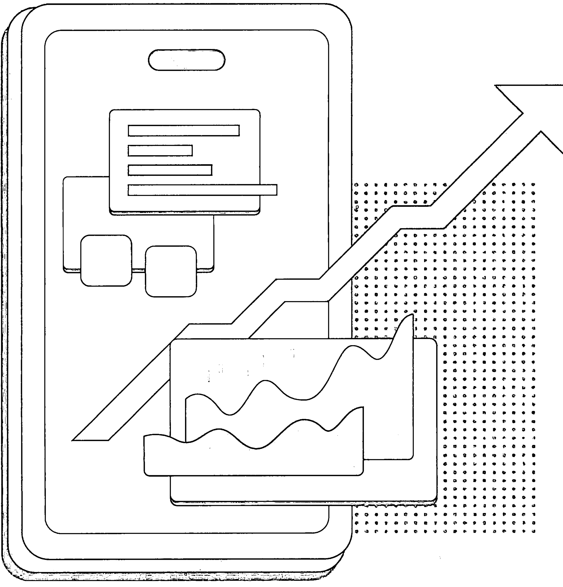
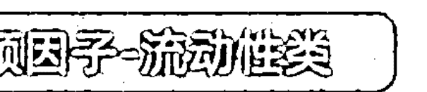
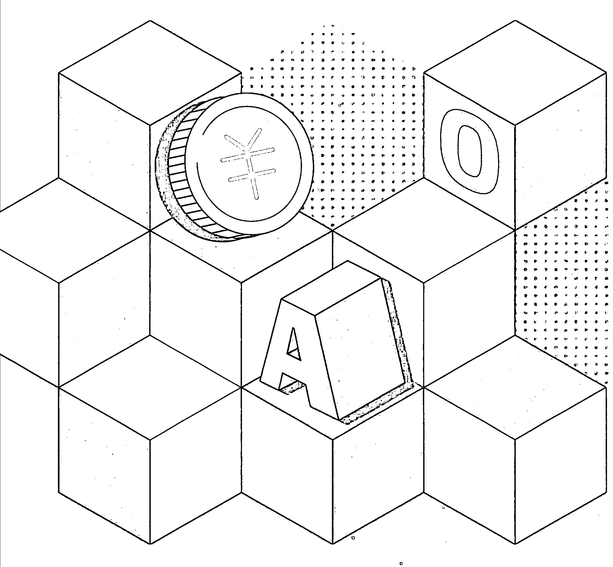
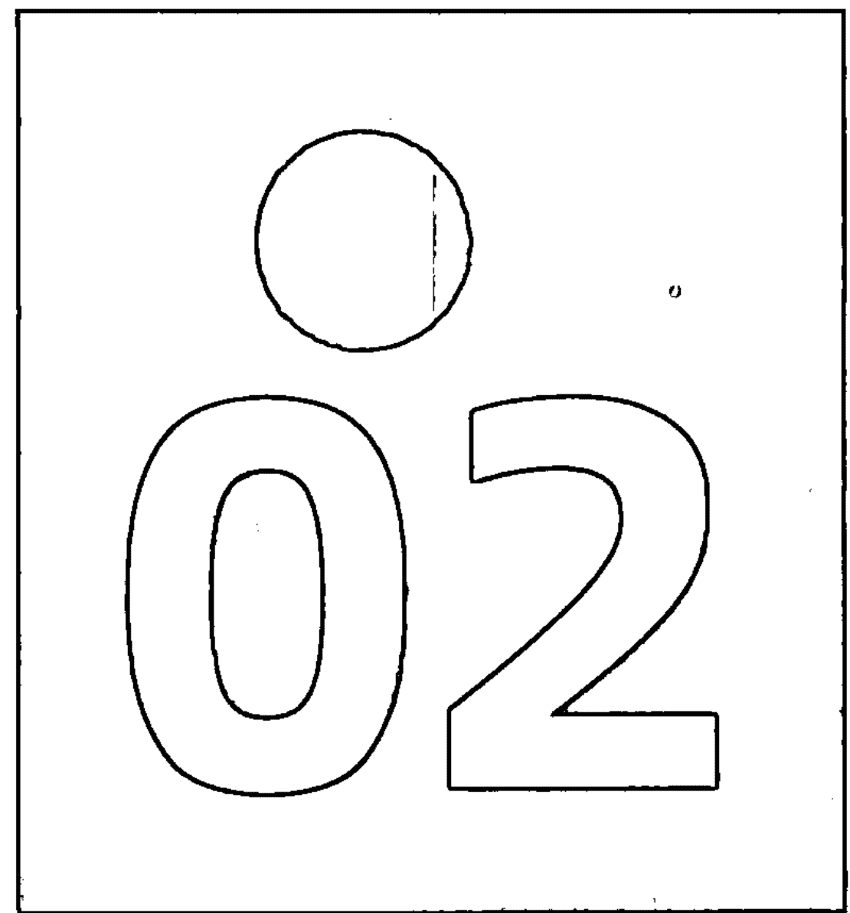
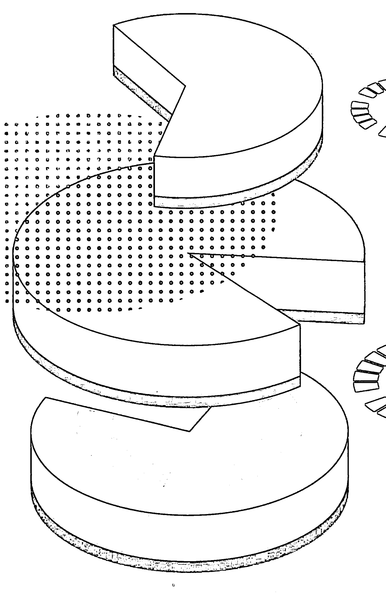
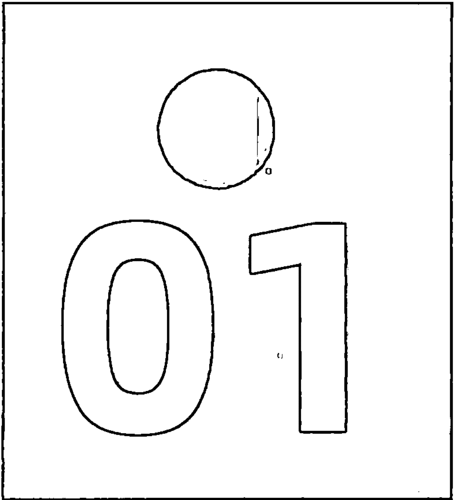
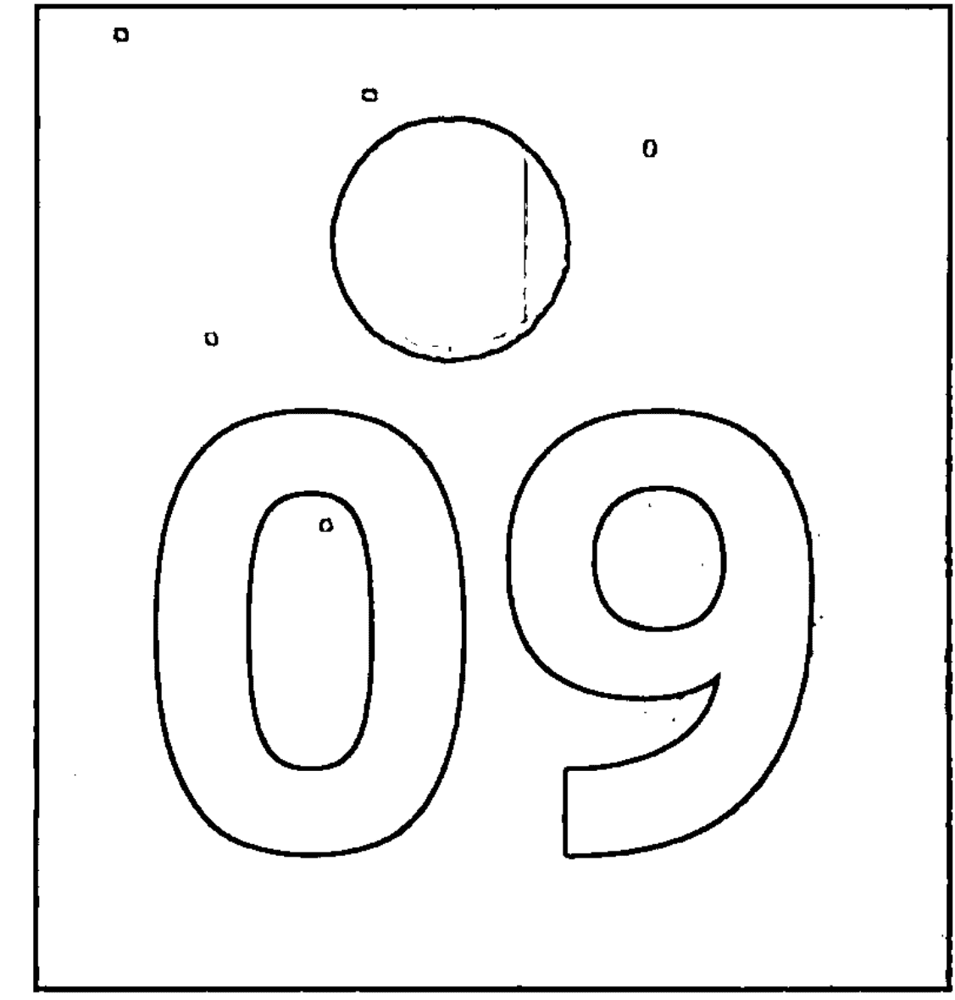
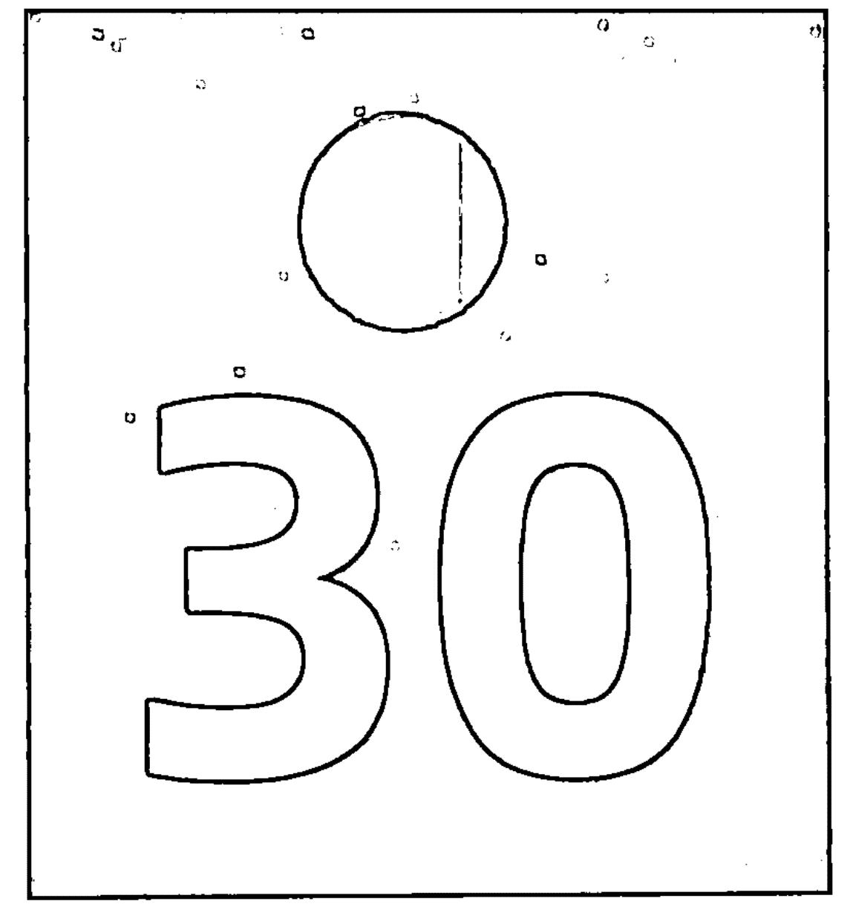
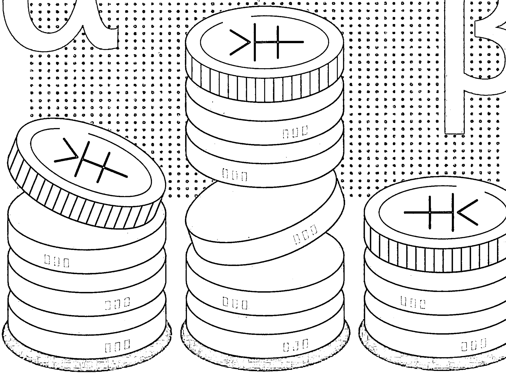
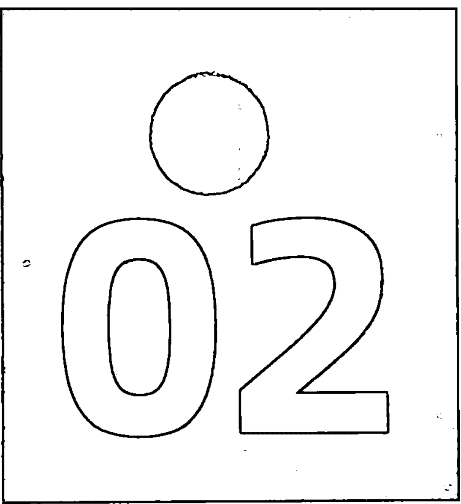

# 因子日历2024


# 无形资产因子
投资因子 估值因子
高频因子
动量因子
流动性因子
分析师因子
另类因子
公司治理因子
流动性因子 质量因子 成长因子
技术因子
价值因子
动量因子

质量 公司治理因子
因子 无形资产因子
财务质量因子 估值因子
因子
波动率因子
波动因子
技术 规模
因子 因子 波动率因子 分析师因子
股东因子 高频因子
成长因子

# QML
量化投资与机器学习

# 1月

January



GML
量化投资与机器学习


Jan.
1月

星期一
冬月二十

# 资本利得突出量


```
RP_t = 1/k sum_{n=1}^{T} ( V_{t-n} prod_{tau=1}^{n-1} (1 - V_{t-n+tau}) ) P_{t-n}
```

```
CGO_t = (P_{t-1} - RP_t) / P_{t-1}
```

# 其中

+ ① V_t 为股票在第 t 周的换手率、P_t 为第 t 周末的股价；
② T=260，为过去 5 年的周数；
③ k 为价格前面权重进行归一化的系数；
④ RP_t 为第 t 周的参考价格 Reference Price。

# 说明

参考价格代表了当前的平均成交价格（价格前基于换手率的权重衡量了股票持有至今仍未被交易的概率），CGO 衡量了当前时点投资者的平均盈亏情况；CGO 与股票未来收益通常正相关（A 股相反），CGO 越大，表示投资者平均盈利越高，卖出股票的倾向越强烈，对股价造成打压，股价更有可能被低估，未来收益更高。

# [参考文献]

① Huijun W., Jinghua Y., Jianfeng Y., 2016, Reference-dependent preferences and the risk-return trade-off, Journal of Financial Economics, 123(2): 395-414.
② Grinblatt, M., B. Han, 2005, Prospect theory, mental accounting, and momentum, Journal of Financial Economics, 78(2), 311-339.


Jan.
1月


星期二
冬月廿一

# 时间加权平均的股票相对价格位置 高频因子-收益分布类

计算股票相对价格位置，即股票当期价格相对区间最高最低价的[user]分位数：

RPP_{i,t} = (P_{i,t} - L_i) / (H_i - L_i)

将股票相对价格位置对时间进行积分，得到时间加权平均的相对价格位置 ARPP：

ARPP_i = ∫₀ᵀ RPP_{i,t} · dt ⇒ ARPP_{i,t} = (∫₀ᵀ P_{i,t} · dt - L_i) / (H_i - L_i)

# 其中

+ ① RPP_{i,t} 表示股票 i 在某一时间区间内的时刻 t 的相对价格位置；
+ ② H_i 和 L_i 为该时间区间内股票 i 的最高价和最低价；
+ ③ ∫₀ᵀ RPP_{i,t} · dt 表示示股票 i 在时间区间 0 到 T 内的时间加权平均价格（即 TWAP），可以用分钟线高开低收均值在时序上的均值作为区间的 TWAP。

# 说明

衡量股票在价格相对高位停留的时间长短，股票在价格相对高位停留的时间越长，因子取值越大。

【参考文献】
宋剑涛, 2020, 基于时间尺度荫影的日内紧纸压力, 东方证券.


# 权利要求项项数平均值

mean(截止日前5年内新生成的有效的发明公开审查中专利的权利要求项项数)

# 说明

权利要求项是发明或者实用新型专利要求保护的内容，可以用于确定专利保护范围，具有直接的法律效力，是申请专利的核心；权利要求项越多的专利，其专利保护的项目也越多，表明专利的质量越高。

[参考文献]
郑兆强, 2022, 专利研究系列四: 专扯全解析, 兴业证券.

# 标准化调整的营业利润

财务质量因子

调整的营业利润(TTM)的当期值 - mean(过去T期调整的营业利润(TTM)) / std(过去T期调整的营业利润(TTM))

# 其中

调整的营业利润 = 营业利润 + 预收账款

默认 T = 6 个季度

# 说明

通过对常规财务数据进行标准化构造的另类成长因子，标准化后的因子与成长和盈利大类因子相关性较高，可以通过回归中心化处理剔除相关性。

[参考文献]

邢春晓, 2018, 基本面因子之经营性标准化成长因子, 申万宏源.

Jan.
1月


星期五
冬月廿四

# 高频下行波动占比

高频因子-波动跳跃类

```
高频下行波动占比 = \frac{\sum_t (r_i^t I_{\{r_i^t<0\}})^2}{\sum_t (r_i^t)^2}
```

# 其中

+ ① $r_i^t$ 为分钟频率下的股票收益序列，如 1 分钟、5 分钟、10 分钟等；
② 在任意选股时刻，因子值为前 N 日指标的均值，如月度选股，计算因子值时使用的是股票过去 20 个交易日的均值。

# 说明

高频下行波动占比与高频上行波动占比相对，衡量了股票价格下跌的特征，通常与未来收益正相关；日内快速下跌的股票，往往具有更高的下行风险溢价。

> [参考文献]
冯佳奇, 袁秋蕾, 2017, 高频因子之价格波动分解, 海通证券.

# 价量相关性波动性因子

高频因子-量价相关性类

+ ① 每月月底，回溯每只股票过去 20 个交易日的价量信息，每日计算该股票分钟收盘价 $v_t$ 与分钟成交量 $p_t$ 的相关系数：

$PV\_corr = corr(v_t, p_t)$

+ ② 每只股票取 20 日相关系数的标准差，做横截面市值中性化处理，得到的结果即为价量相关性波动性因子 PV_corr_std。

# 说明

PV_corr_std 从价量形态稳定性的角度，对反转因子进行了改进，即无论股票价格过去的涨跌，只要每日价量关系维持某种稳定形态，下个月就更有可能上涨；而价量关系在多种形态间频繁切换的股票，下个月更有可能下跌。

> 【参考文献】
高子剑, 2020, 高频价量相关性, 意想不到的逆脱因子, 东吴证券.

# Jan.
1月

# 星期日
冬月廿六


# 单季度销售收入同比增长率

成长因子

最近单季度营业收入 - 上年同期值
abs(上年同期值)

# 说明

+ ① 成长因子是基于股票过去一段时间的各项估值或盈利指标计算得到的增长量或增长率指标，用于衡量公司各个维度的成长性；
+ ② 计算成长因子时，最常用的统计维度有：环比增长率（或环比增量）、同比增长率（或同比增量），计算用的基础财务数据也有“最近12个月TTM”和“单季度”2类，经测试发现：“单季度同比”和“TTM环比”这2个维度下计算得到的因子表现通常相对更优；
+ ③ 至于增长率和增量，表现相差不大，增长率更具可比性，增量更不容易受基础指标取值异常的影响。

[参考文献]

起源商用服务清单。


Jan.
1月


星期一
冬月廿七

# 流动比率

选种因子

最近报告期流动资产合计
最近同期流动负债合计

# 说明

反映企业的短期偿债能力。

【参考文献】
Ludwig B. Chincarini, Daehwan Kim, 2006, Quantitative Equity Portfolio Management: An Active Approach to Portfolio Construction and Management (1st edition), McGraw-Hill Library of Investment and Finance.

# 主动买卖因子

Jan.
1月

星期二
冬月廿八

高频因子-资金流类

+ ① 逐日计算大单和中单总的主动买卖因子 ACT正向t，以及小单的主动买卖因子 ACT负向t：
ACT正向t = [主动买入金额(大单+中单) - 主动卖出金ogenic(大单+中单)] / [主动买入金额(大单 + 中单) + 主动卖出金ogenic(大单+中单)]
ACT负向t = [主动买入金额(小单) - 主动卖出金ogenic(小单)] / [主动买入金额(小单) + 主动卖出金ogenic(小单)]

+ ② 回溯过去 20 个交易日，取收益率最高 λ 比例的交易日，称为高收益日；取收益率最低 λ 比例的交易日，称为低收益日；
+ ③ 对高收益日的 ACT正向t 因子取平均，记为 ACT正向；对低收益日的 ACT负向t 因子取平均，记为 ACT负向。

# 说明

切割后的主动买卖因子，细致的刻画了在市场上涨和下跌的不同情境下，不同交易者主动买卖意愿的差异；测试发现以大户和中户投资者为主的主动买卖因子，在高收益端呈现正向选股效应；而以小户为代表的主动买卖因子，在低收益端呈现负向选股效应。

> [参考文献]
姚生杨, 2020, 主动买卖因子的正确用法, 开源证券.

Jan.
1月


星期三
冬月廿九

# 变动速率

技术因子

```
ROC = (CLOSE-CLOSE[N])/CLOSE[N]
ROCMA = SMA(ROC,M)
默认: N = 12、M = 6
```

# 说明

反映价格变动的快慢程度；趋势明显的行情中，当 ROC 向下跌破零，卖出信号，ROC 向上突破零，买入信号；震荡行情中，当 ROC 向下跌破 ROCMA 时，卖出信号，当 ROC 上穿 ROCMA 时，买入信号；股价创新高，ROC 未配合上升，显示上涨动力减弱；股价创新低，ROC 未配合下降，显示下跌动力减弱；股价与 ROC 从低位同时上升，短期反弹有望；股价与 ROC 从高位同时下降，警惕回落。

【参考文献】
常规通用技术指标.

Jan.
1月


星期四
腊月初一

# 委托成交相关性

高频因子-量价相关性类

使用盘口前 1 档委托挂单数据计算股票 i 在 T 日的净委买变化率：

净委买变化率_{k,t}^T = 净委买变化量_{k,t}^T / 流通股本_T
净委买变化量_{k,t}^T = Σ_{j=1}^k 委买变化量_{j,t}^T - Σ_{j=1}^k 委卖变化量_{j,t}^T

进一步计算 T 日高频收益率序列与净委买变化率序列的相关系数：

委托成交相关性_T^i = corr(r_{T,t}^i, netBid_{T,t}^i)

# 其中

+ ① 委买变化量_{j,t}^T 和 委卖变化量_{j,t}^T 分别为 T 日内 t 至 t+1 时刻的第 j 档委买的变化量和第 j 档委卖的变化量；
② 流通股本_T 为 T 日股票的流通股本；
③ 可将过去 5 日、20 日上述因子的均值作为周度和月度的因子值。

# 说明

委托成交相关性刻画了投资者买入意愿与股价走势间的关系，与未来收益负相关，前期委托成交相关性越低的股票，未来收益表现越好，其中 “股价下跌，净委买上升” 的股票在未来的超额收益最强（投资者托底意愿较强），而 “股价下跌，净委买下降” 的股票在未来的超额收益最弱（投资者托底意愿较弱）。

[参考文献]
高佳省, 姜林青, 2019, 当前股票抛底意愿, 海通证券.


Jan.
1月


星期五
腊月初二

# 异常分析师覆盖

分析师因子

每月底对全市场（中证全指成分股）以分析师覆盖的对数为 Y，同期市值对数、换手的对数、动量因子为 X，进行横截面回归，回归残差即为异常分析师覆盖：

```
ln(1 + COV_{i,m}) = β₀ + β₁ SIZE_{i,m} + β₂ LNTO_{i,m} + β₁ MOM_{i,m} + ε_{i,m}
```

# 其中

+ ① COV_{i,m} 为第 i 值股票第 m 个月底的简单分析师覆盖或分析师总覆盖；
② SIZE_{i,m} 为第 m 个月底的总市值对数；
③ LNTO_{i,m} 为截止 m 月底时过去 3 个月日均换手率对数；
④ MOM_{i,m} 为截止 m 月底时过去 3 个月收益率。

# 说明

作者将分析师覆盖分解为 2 部分：① 能够被市值、换手和动量解释的预期内的分析师固有覆盖 ② 对应残差部分的异常覆盖；异常覆盖更能够反映分析师的选择性偏差等行为，股票的超额收益主要和异常覆盖有关。

【参考文献】

> ① Charles M.C. Lee, Eric C. So, 2016, Uncovering expected returns: Information in analyst coverage proxies. Journal of Financial Economics 124(2):331-348.
② 朱剑涛, 2017, 分析师预报的数据特征与 alpha, 东方证券.


Jan.
1月


星期六
腊月初三

# 高频上行波动占比

高频因子-波动视角类

```
高频上行波动占比 = \frac{\sum_t (r_i^t I_{\{r_i^t>0\}})^2}{\sum_t (r_i^t)^2}
```

# 其中

+ ① $r_i^t$ 为分钟频率下的股票收益序列，如 1 分钟、5 分钟、10 分钟等；
② 在任意选股时刻，因子值为前 N 日指标的均值，如月度选股，计算因子值时使用的是股票过去 20 个交易日的均值。

# 说明

股票高频收益的上行波动衡量了股票价格拉升的特征。假设有两只股票在过去一段时间内有着相同的涨幅，其中一只股票的涨幅由持续稳定地小幅上涨累计带动，而另一只股票的上涨源自于股票短期的大幅拉升，那么后者更有可能在收益上出现反转，而后者在因子值上也会体现出较高的上行波动率。

# 【参考文献】

冯佳睿, 袁轶青, 2017, 高频因子之波动视角分解, 海通证券。

# Jan.
1月

星期日
腊月初四


# 动态知情交易概率

高频因子-资金流类

构建下列自回归模型，计算股票 i 在日内区间 j 内的非预期收益率 ε_{i,j}：
R_{i,j} = γ₀ + Σ_{k=1}^4 γ_{1i,k} D_k^{Day} + Σ_{k=1}^{48} γ_{2i,k} D_k^{Int} + Σ_{k=1}^{12} γ_{3i,k} R_{i,j-k} + ε_{i,j}

计算未预期收益率为正(负)时卖出(买入)交易量占比即为动态知情交易概率：
DPIN_{BASE}^{i,j} = N B_{i,j}/N T_{i,j} * (ε_{i,j} < 0) + N S_{i,j}/N T_{i,j} * (ε_{i,j} > 0)

# 其中

+ ① R_{i,j} 为股票 i 在交易日 t 内区间 j 的收益率，R_{i,j-k} 为自回归的滞后收益率，滞后阶数 k=12；
② D_k^{Day} 为周内效应虚拟变量，当前交易日属于周 k 就取 1，其余取 0；同理，D_k^{Int} 为日内效应虚拟变量，日内区间 j 的 D_j^{Int} 取 1，其余取 0；
③ N B_{i,j}、N S_{i,j}、N T_{i,j} 分别为股票 i 在日内区间 j 的主买成交笔数、主卖成交笔数、总成交笔数；
④ (ε_{i,j} < 0) 为虚拟变量，未预期收益为负，取值为 1，否则取值为 0，反之亦然；
⑤ 自回归的时间窗口可以为从交易日 t 的区间 j 开始回溯过去 T 个交易日，如 5 分钟频率，则回溯过去 T*48 个区间；
⑥ 可以进一步计算日度、周度内 DPIN 序列的均值、标准差等统计指标，刻画 DPIN 的时序特征。

# 说明

DPIN 基于日内交易活动将得知新信息后的反转交易占比作为知情交易概率的衡量指标，同时考虑了知情买入交易和知情卖出交易；知情交易概率指在一段时间内，拥有信息优势的知情交易者提交的订单数量占总委托单数量的比例，用以刻画该段时间内的信息不对称程度，通常与未来收益正相关，取值越大，信息不对称程度越大，投资者要求的风险回报越高。

> [参考文献]
Chang, Sanders S., Chang, Lenisa V., Wang, F. Albert, 2014, A dynamic intraday measure of the probability of informed trading and firm-specific return variation, Journal of Empirical Finance, 29, 80-94.


## 现金与总资产比

无形资产因子

最近12个月的现金及现金等价物 (TTM)
平均总资产

其中

平均总资产 = (期初总资产 + 期末总资产) / 2

## 说明

与现金流和总需求冲击相关性更高的高风险公司有更强的预防性现金储蓄动机，而这种预防性现金储蓄动机意味着预期股票收益与现金持有量之间存在正相关关系。

> [参考文献]
Palazzo, Bernardino, 2012, Cash holdings, risk, and expected returns, Journal of Financial Economics 104, 162-185.


## 每笔成交量差分标准差

Jan.
1月

星期二
腊月初六


高频因子-成交分布类

```
diff_i = volb_i - volb_{i-1}
```

```
diff_mean_day = mean(abs( diff_i / mean({volb_i}) ))
```

```
diff_std_volb = mean({diff_std_day})
```

## 其中

volb_i 为个股日内 240 根 1 分钟 K 线的每笔成交量（成交量/成交笔数），diff_std_day 取过去 20 个交易日数据。

## 说明

上述因子通过计算差分从成交量数据中提取出时间序列信息，是对数据局部峰值的度量，而局部峰值可能是对趋势交易者或知情交易者交易行为的刻画，其参与交易越多的个股在未来一段时间内收益越高，因子表现出正向收益能力。

> [参考文献]
梁川朓, 郑显, 2020, 高频因子(九): 高频波动中的时间序列信息, 长江证券.

## 新闻数量

另类因子

```
nc_{i,t} = 过去 [t - d + 1, t] 天提及过股票 i 的新闻总量
```

## 说明

新闻数量衡量了过去一段时间的新闻热度，负向因子，过去新闻热度越高，越容易使股价被高估，未来收益会变差。

> [参考文献]
从截图看难以清晰识别来源：多维度挖掘另类因子，2022.10 发布于【极度Tech】就馆公众号.

Jan.
1月


星期四

腊月初八

## 累计跳跃绝对收益

高频因子-动量反转类

```
JAR = e^{∑_{t=1}^{D} {|r_t|·I_{jump_SwV,t}}} - 1
```

```
I_{jump_SwV} = I(T_{SwV} > Φ^{-1}_{1-α})
```

## 其中

+   ① I_{jump_SwV} 为表示日内价格是否存在跳跃的示性函数；
+   ② T_{SwV} 为检验是否存在跳跃的检验统计量，具体计算逻辑见相关日历页；
+   ③ r_t 为日度对数收益率；
+   ④ 可以分开累计发生跳跃时的正收益和负收益，也可以不对收益取绝对值。

## 说明

累计跳跃收益类因子是对存在显著跳跃交易日的收益的累加值，衡量了股价对信息冲击的反应。投资者对信息冲击的反应程度，短期内通常反应不足，长期内通常反应过度，对利好信息冲击容易反应过度，对坏信息冲击容易反应不足。

## 【参考文献】

① Jiang, G. J., & Zhu, K. X., 2017, Information shocks and short-term market underreaction, Journal of Financial Economics, 124(1), 43-64.

② 周飞鹏, 罗军, 安宇宁, 2022, 再谈股价跳跃因子, 广发证券.

Jan.
1月

星期五
腊月初九

## 非流动性的变异系数

流动性因子

```
ILLIQ_{i,t} = \frac{|r_{i,t}|}{Amount_{i,t}}
```

```
CVILLIQ_i = \frac{\sigma(ILLIQ_i)}{\overline{ILLIQ_i}}
```

其中

+   ① Amount_{i,t} 为股票 i 在 t 时刻的交易金额；
② r_{i,t} 是股票 i 在 t 时刻收益率；
③ 时间窗口期为过去 20 个交易日。

说明

股票的非流动性的变异系数较高，说明非流动性的波动较大，对于持有该类股票的投资者来说，未来卖出该类股票有着更高的交易成本不确定性，所以由此能够获得更高的风险溢价。

【参考文献】
① Akbas, F., 2011, The volatility of liquidity and expected stock returns. Doctoral dissertation, Texas A&M University.
② 宋剑涛, 2017, 技术类新 Alpha 因子的地貌测试, 东方证券.

## 残差资金流强度因子

计算小单资金流强度：分子为（小单买额-小单卖额）之和，分母为其绝对值；计算大单资金流强度：分子为（大单买额-大单卖额）之和，分母为其绝对值：

```
$S_t = \frac{\sum_{t-T}^{t} (buy_t - sell_t)}{\sum_{t-T}^{t} |buy_t - sell_t|}$
```

分别将大（小）单资金流强度与过去 20 日涨跌幅做回归，得到残差，即为大（小）单残差资金流因子：

```
$S_t = a + b Ret20_t + \varepsilon_t$
```

## 其中

+   ① 将主动大单净流入和主动中单净流入相加，计算主动大中单残差，再和非主动大单强度排序相加，可以改进原始大单残差资金流因子的表现；
② 使用非主动小单净流入计算非主动小单残差，可以提升原始小单残差资金流因子表现。

## 说明

残差资金流因子剥离了涨跌幅对资金流强度的影响，衡量的是在同等涨跌幅（Ret20）的情况下资金流强度的选股能力。

> 【参考文献】
① 魏建榕, 高源, 2021, 大单与小单资金流的 alpha 能力, 开源证券.
② 魏建榕, 骅少成, 2022, 大小单资金流 alpha 探究2.0：衰影响算与高频测算, 开源证券.

## 产能利用率提升

以当天最近 N 个季度的营业总成本作为 Y、以对应季度的固定资产作为 X，进行 OLS 线性回归，回归前需对营业总成本和固定资产进行 Z-Score 标准化处理；回归得到的最近一个季度上的残差 ε₀ 即为 OCFA 在当天的因子值：

```
TotalOperationCost_i = a_i + β_i FixedAssets_i + ε_i
```

其中

i ∈ {0,1,2,...,N−1}，默认 N = 8。

说明

产能利用率反映企业营运效率，刻画了公司将生产设备用于生产工作的利用程度。生产设备作为一种固定成本，不会像原材料等变动成本那样会随着产量而改变，所以对于设备等固定设施的利用率的高低一定程度上决定了最终实际平均成本的高低，利用率越高，摊销到单位产品上的平均实际成本就越低，企业营运效率就越高。

> 【参考文献】
刘均伟, 2018, 创新基本面因子:捕捉产能利用率中的讯号, 光大证券.


Jan.
1月


星期一
腊月十二

## 中间价变化率



```
MPC_{t,k} = (M_t - M_{t-k}) / M_{t-k}    M_t = (P_t^B + P_t^A) / 2
```

## 其中

+   ① MPC_{t,k} 为从时刻 t-k 到时刻 t 中间价 M_t 的百分比变化率；
② 市场中间价 M_t 为买一价和卖一价的平均值；
③ M_{t-k} 为 k 分钟前的中间价，其中 k = 1, 5；
④ P_t^B 和 P_t^A 分别为 t 时刻的买一价和卖一价。

## 说明

MPC 因子衡量了市场中间价的短期变动趋势，刻画了市场交易者的最新交易和挂单撤单行为；如当市场中间价上升时，可能出现了大量的主动买入交易，抬高了卖一价，或是有交易者以高于当前买一价的价格下了限价订单，抬高了买一价，这两种情况都反应了市场交易者对未来股价走势的乐观预期；MPC 与股票未来收益正相关。

【参考文献】
丁剑强, 2021, 高频订单失衡及价差因子, 中信建投证券.

Jan.
1月

星期二
腊月十三

## 总市值

规模因子

当日收盘价 × 当日总股本

## 说明

公司市值与股票收益负相关，存在小市值效应。

> [参考文献]
Banz, Rolf W., 1981, The relationship between return and market value of common stocks, Journal of Financial Economics 9, 3-18.

Jan.
1月


星期三
腊月十四

## 成交量波峰计数因子

高频因子-成交分布类

+   ① 计算全部 240 根 K 线数据的均值与标准差，筛选出大于（均值 +1 倍标准差）的分钟数据；
② 计算上一步筛选出的每一分钟与前一分钟之间的时间差，只有时间差超过 1 分钟（即相隔超过 1 根 K 线）时，该分钟数据才会被保留；
③ 经过上述两步筛选后，剩余的数据全部被视作局部峰值，峰值个数即为当日成交量波峰计数因子的取值，而最终调仓日的因子值仍为过去 20 个交易日因子值的均值。

## 说明

出现日内“放量”现象次数更多的股票可能有更多的趋势或知情交易者参与交易，进而在未来一段时间内有更高的收益率，因子与未来收益正相关。

> [参考文献]
贺川坤, 赵起, 2020, 高频因子(九): 高频波动中的时间序列信息, 长江证券.

Jan.
1月


星期四
腊月十五

## 员工总数增长率-1年

投资因子

```
最近报告期的员工总数 - 上年同期值
------------------------
平均员工人数
```

其中

```
平均员工总数 = (最近报告期的员工总数 + 上年同期的员工总数) / 2
```

## 说明

企业雇佣增长率可以预测未来的股票收益，雇佣增长率较高的企业，未来股票收益相对较低。

> [参考文献]
Belo, F., Lin, X., & Bazdresch, S., 2014, Labor Hiring, Investment, and Stock Return Predictability in the Cross Section, Journal of Political Economy 122(1), 129-177.

Jan.
1月


星期五
腊月十六

## 劳动力效应

咸俊園子

最近12个月的人均销售收入(TTM) - 上年同期值
上年同期值

其中

人均销售收入(TTM) = 最近12个月的营业收入(TTM)
平均员工总数

平均员工总数 = 期初员工总数 + 期末员工总数
2

## 说明

存在劳动力效应，给定销售收入，如果所需要的员工人数有所减少，即人均销售收入有所增长，在投资者看来是一个积极信号。

【参考文献】

Abarbanell, J. S. and Bushee, B. J., 1998, Abnormal Returns to a Fundamental Analysis Strategy, The Accounting Review 73, 19-45.

Jan.
1月

星期六

腊月十七


## 理想反转

高频因子-动量反转类

+   ① 对单只股票，回溯取其过去 20 日的数据，计算每日日内逐笔成交金额分布的 13/16 分位值；
+   ② 13/16 分位值高的 10 个交易日，涨跌幅加总，记作 $M_{high}$；
   13/16 分位值低的 10 个交易日，涨跌幅加总，记作 $M_{low}$；
+   ③ 计算理想反转因子：$M = M_{high} - M_{low}$。

## 说明

早期版本的理想反转因子是以 “每日的平均单笔成交金额（成交金额/成交笔数）” 作为切割标准；作者分析得出 “反转之力的微观来源，是大单成交”，由高分位值较高（即大单成交较多）的那些交易日得到的反转因子，具有更强的反转特性。

[参考文献]

> 樊想检, 2019, A股反转之力的微观来源, 开源证券.

Jan.
1月


星期日
腊月十八

## 价量相关性平均数因子

高频因子-价量相关性类

① 每月月底，回溯每只股票过去 20 个交易日的价量信息，每日计算该股票分钟收盘价 $v_t$ 与分钟成交量 $p_t$ 的相关系数：

$PV\_corr = corr(v_t, p_t)$

② 每只股票取 20 日相关系数的平均值，做横截面市值中性化处理，得到的结果即为价量相关性平均数因子 PV_corr_avg。

## 说明

PV_corr_avg 利用成交量的信息，修正了传统反转因子对股票价格涨跌的判断，即价格涨跌的反转不完全由价格自己决定，还需看成交量的信息，若有量的确认，则月度行情的反转效应更强；若没有量的确认，则月度行情更容易呈现动量效应。

[参考文献]

白宇剑, 2020, 炒股价量相关性,意想不到的选股因子, 东吴证券.

Jan.
1月

星期一
腊月十九

## 盈余可预测性

财务质量因子

```
X_{j,t} = φ_{0,j} + φ_{1,j} X_{j,t-1} + v_{j,t}
```

```
Predictability = sqrt(\hat{σ}^2(v_j))
```

## 其中

+   ① 对年度收益进行一阶自回归 AR(1)，回归的误差方差的平方根即为可预测性衡量指标；
② 年度收益 X_{j,t} 可以取每股收益、净利润等指标；
③ 自回归滚动窗口可以取 10 个财年。

## 说明

Predictability 取值越小，盈余的可预测性越高。

> 【参考文献】
冯佳缘等, 2020, 商频因子的现实与幻想, 海通证券。

Jan.
1月


星期二
腊月二十

## 价格冲击偏差

高频因子-资金流类

```
return_i = gamma^{up} · I_i · MF_i + gamma^{down} · (1 − I_i) · MF_i
```

```
MF_i = MoneyFlow_i / Amount_i
```

```
gammabias = (gamma_{up} − gamma_{down}) / (gamma_{up} + gamma_{down})
```

## 其中

+   ① return_i 分别为第 i 个 5 分钟线的收益率；
② MoneyFlow_i、Amount_i 分别为第 i 个 5 分钟内的主动净流入金额和成交额；
③ MF_i 为主动净买入占比；
④ I_i 为示性函数，当大于 0 时取 1，否则取 0。

## 说明

价格冲击偏差主要表征了股票在某一时间区间上涨或者下跌的难易程度，价格冲击偏差较大（正值）的股票，相同比例的主动订单对其股价向下的冲击小于向上的冲击，股票容易上涨，反之，股票容易下跌。

> 【参考文献】
华创证券, 2016, 非对称价格冲击带来的超额收益, 东方证券.

Jan.
1月


星期三
腊月廿一

## 市价偏离度

高频因子-流动性类

$MPB_t = \overline{TP}_t - \frac{M_t + M_{t-1}}{2} = \overline{TP}_t - \overline{MP}_t$

## 其中

+   ① $\overline{TP}_t = \begin{cases} \frac{T_t}{V_t} & V_t \neq 0 \\ \overline{TP}_{t-1} & V_t = 0 \end{cases}$ 为平均交易价格；
+   ② $M_t = \frac{P_t^B + P_t^A}{2}$ 为买一价和卖一价的均值；
+   ③ $P_t^B$ 和 $P_t^A$ 为 t 时刻的买一价和卖一价；$T_t$ 和 $V_t$ 为 t 时刻成交额和成交量。

## 说明

市场偏离度为平均交易价格和平均委托挂单价格的差值；当市场偏离度为正，交易均价更接近卖一价，为卖方发起的交易，卖压大，未来价格更趋向于下行，即市场交易均价将向市场平均中间价回归，反之亦然。

[参考文献]
丁剑强,段卉伦,2020,高频股市流数据预测模型,中信建投证券.

## 2月

February

QML
量化投资与机器学习

## 盈余持续性

财务质量因子

```
$X_{j,t} = \phi_{0,j} + \phi_{1,j} X_{j,t-1} + v_{j,t}$
```

## 其中

+   ① 对年度收益进行如上的一阶自回归 AR(1)，φ₁,j 即为盈余持续性衡量指标；
② 年度收益 X_{j,t} 可以取每股收益、净利润等指标；
③ 自回归滚动窗口可以取 10 个财年。

## 说明

φ₁,j 取值越高，盈余持续性越强，如果 φ₁,j 接近 1，意味着企业有高度持续的益；如果 φ₁,j 接近 0，意味着企业的收益短暂而不可持续。

[参考文献]

> Francis, Jennifer, Ryan LaFond, Per M. Olsson, Katherine Schipper, 2004, Cost of equity and earnings attributes, Accounting Review 79, 967-1010.


## Amihud 非流动性因子

流动性因子

```
ILLIQ_{i,t} = Avg \left[ \frac{|R_{i,d}|}{VOLD_{i,d}} \right]
```

### 其中
+ ① $R_{i,d}$ 为 t 月内股票 i 的日度收益率；
+ ② $VOLD_{i,d}$ 为 t 月内股票 i 的日度成交额；
+ ③ 通常要求月内正常交易的交易日天数不少于 15 天。

### 说明
预期市场流动性不足会对事前股票超额收益产生积极影响，带来非流动性溢价；取值越高，流动性风险越大，承担风险带来的未来收益越高。

### 参考文献
Amihud, Yakov, 2002, Illiquidity and stock returns: Cross-section and time-series effects, Journal of Financial Markets 5, 31-56.

Feb.
2月

星期六
腊月廿四


## “情绪溢出”因子

高频因子-成变量稀类

+ ① 将股票按照代码从小到大进行排序后，对每只股票计算相邻 n 只股票在过去 T 日的日均换手率，并等权合成为焦点股票 i 的 NBR_tov;
+ ② 将焦点股票 i 的 NBR_tov 对其自身的日均换手率进行截面回归，回归得到的残差即为 “情绪溢出” 因子 RNBR_tov。

### 其中
+ ① 焦点股票 i 的相邻股票数对因子效果影响不大，建议使用较少数量的股票（如 i=10）;
+ ② 日均涨跌幅的计算窗口 T 建议取 5-20 天最为适宜。

### 说明
由于投资者的注意力有限，以及行情软件通常是根据代码顺序依次展示股票信息，投资者会较轻易地关注到与焦点股票相邻的其它股票，出现 “注意力溢出”，焦点股票与相邻股票之间会存在价格与交易情绪的转移；“情绪溢出”对应股票近期引起大量关注时的强烈交易情绪溢出到相邻股票的情况，与未来收益正相关。

【参考文献】
任晗, 麦元凯, 黎世杰, 2023, 基于股票代码有序的 “注意力溢出”, 格雷证券.


## 账面市值比

估值因子

最近报告期归属于母公司股东权益合计 / 总市值

### 说明
为市净率的倒数；用于衡量股价高低和公司内在价值的估值因子，账面市值比高的股票，投资价值相对更高。

> 【参考文献】
Basu, Sanjoy, 1983, The relationship between earnings' yield, market value and return for NYSE common stocks: Further evidence, Journal of Financial Economics 12, 129-156.

## 价量相关性综合因子

高频因子-量价相关性类

价量相关性综合因子 PV_corr 为横截面标准化后的价量相关性平均数因子和价量相关性波动性因子的等权线性相加：

```
PVcorr = (PVcorravg - mean(PVcorravg)) / std(PVcorravg) + (PVcorrstd - mean(PVcorrstd)) / std(PVcorrstd)
```

### 说明
PV_corr 综合反映了价量关系对传统反转因子的修正。

[参考文献]
高子剑, 2020, 高频价量相关性,意想不到的选股因子, 东吴证券.

Feb.
2月


星期二
腊月廿七

## 已实现波动率

高频因子-波动跳跃类

```
RV_t = \sum_{i=1}^{N} r_{t,i}^2
```

### 其中
+ ① r_{t,i} 为某股票交易日 t 内的分钟对数收益率序列，如 5 分钟对数收益率序列；
+ ② N 表示该股票在交易日 t 中特定频率的分钟级别数据个数，如 5 分钟频率通常有 48 个数据点。

### 说明
作者提出的上述方法是利用高频数据估计波动率的重要研究成果；非参数估计，无需构建模型，计算简单，且在一般条件下几乎无测量误差。

> [参考文献]
Andersen, T. G., T. Bollerslev, F. X. Diebold, and P. Labys, 2001, The distribution of exchange rate volatility, Journal of the American Statistical Association 96, 42-55.


Feb.
2月

星期三
腊月廿八


## 异常资本投资

投资因子

```
CI_{t-1} = \frac{CE_{t-1}}{(CE_{t-2} + CE_{t-3} + CE_{t-4})/3} - 1
```

其中

```
CE = \frac{资本性支出}{营业收入}
```

资本性支出 = 购建固定资产、无形资产和其他长期资产支付的现金 - 处置固定资产、无形资产和其他长期资产收回的现金净额

### 说明
异常资本投资为企业最近一年的资本性支出 CE 相对此前三年均值的变化。异常资本投资高的企业，未来收益会更低，而且对于那些有着更大投资自主权的企业（比如有着更高现金流量和更低负债率的企业），这种投资效应更加显著。

> 【参考文献】
Titman, Sheridan, KC John Wei, and Feixue Xie, 2004, Capital Investments and Stock Returns, Journal of financial and Quantitative Analysis 39(4), 677-700.


## 超大单和小单的同步相关性

RankCorr (EL_t, S_t)

### 其中
+ ① $EL_t$ 为超大单（>100万元）过去 20 个交易日的资金净流入序列；
+ ② $S_t$ 为小单（<4万元）过去 20 个交易日同期的资金净流入序列。

### 说明
在资金流同步相关性因子中，上述超大单和小单的同步相关性因子表现最好；但资金流同步相关性因子是“伪动力学”因子，在恒等式“超大单+大单+中单+小单=0”的约束下，该因子的 alpha，可以被两者流入量级所解释，其底层 alpha 来源仍是资金流强度。

> 【参考文献】
褚泓榕, 盛少成, 2022, 新型因子：资金流动力学与散户羊群效应, 开源证券.

## 标准化营业利润

财务质量因子

营业利润(TTM)的当期值 - mean(过去T期的营业利润(TTM))
----------------------------------------------------
                 std(过去T期的营业利润(TTM))

### 其中
默认 T = 6 个季度。

### 说明
通过对常规财务数据进行标准化构造的另类成长因子，标准化后的因子与成长和盈利大类因子相关性较高，可以通过回归中心化处理剔除相关性。

[参考文献]
贾春晓, 2018, 基本面因子之经营性标准化成长因子, 申万宏源.

Feb.
2月

星期六
正月初一


## APM 因子

高频因子-动量反转类

对选定股票，回溯取其过去20日数据，记逐日上午的股票收益率为 $r_t^{am}$，指数收益率为 $R_t^{am}$；逐日下午的股票收益率为 $r_t^{pm}$，指数收益率为 $R_t^{pm}$；

将得到的40组上午与下午（$r,R$）的收益率数据进行回归：$r_i = \alpha + \beta R_i + \varepsilon_i$，得到残差项 $\varepsilon_i$；

以上得到的40个残差 $\varepsilon_i$ 中，上午残差记为 $\varepsilon_i^{am}$，下午残差记为 $\varepsilon_i^{pm}$，进一步计算每日上午与下午残差的差 $\delta_t = \varepsilon_t^{am} - \varepsilon_t^{pm}$；

构造统计量 stat 来衡量上午与下午残差的差异程度，计算公式如下（$\mu$ 为均值，$\sigma$ 为标准差）：$\text{stat} = \frac{\mu(\delta_t)}{\sigma(\delta_t)/\sqrt{N}}$

为了消除动量因子影响，将统计量 stat 对动量因子进行横截面回归：$\text{stat}_j = b \text{Ret}20_j + \varepsilon_j$，其中 Ret 20 为股票过去20日的收益率，代表动量因子；回归得到的残差值 $\varepsilon$ 即为 APM 因子。

### 说明
基于 “知情交易者更加倾向于在每日上午进行交易，上午的价格行为蕴藏了更多可用于选股的信息量” 的想法，构建了刻画了股票上午与下午的价格行为差异程度的 APM 因子；改进的 APM 因子是将个股和指数的上午收益 $r_t^{am}$ 替换成了隔夜收益 $r_t^{overnight}$。

[参考文献]
魏建榕, 2020, APM因子模型的进阶版, 开源证券.


Feb.
2月


星期日
正月初二

## 目标价隐含收益率

分析师因子

```
一致目标价 / 最近股价 - 1
```

### 说明
隐含目标价收益越高，预期未来的收益率也更高。

【参考文献】
① Zhi Da,Ernst Schaumburg, 2011, Relative valuation and analyst target price forecasts, Journal of Financial Market 14, 161-192.
② 朱创涛, 2017, 分析师研报的效应特征与 alpha, 东方证券.

Feb.
2月


星期一
正月初三

## 修正模糊价差

高频因子-成交分布类

+ ① 计算各股票每日的 “日模糊价差” 因子：
“日模糊价差” 因子 = “日模糊金额比” - “日模糊数量比”；
+ ② 每日计算各股票过去10日的 “日模糊价差” 的标准差；
+ ③ 每日将横截面上 “日模糊价差” 为负的 “日模糊价差” 求和得 s1；
+ ④ 将 “日模糊价差” 为负的 “日模糊价差” 除以其过去 10 日标准差，得到 “修正日模糊价差”， “日模糊价差” 为正部分不变；
+ ⑤ 每日将横截面上 “修正日模糊价差” 为负的 “修正日模糊价差” 求和得 s2；
+ ⑥ 将 “修正日模糊价差” 为负的部分加以调整，除以 s2，乘以 s1，使其负的部分数量级与原来保持一致，避免市值行业中心化时受影响。

### 其中
+ ① “日模糊金额比” 和 “日模糊数量比” 因子计算逻辑见相应日历页；
+ ② 每月末可对最近 20 天的上述因子求均值和标准差并将两者等权合并，即得到月度 “修正模糊价差” 因子。

### 说明
模糊价差因子衡量了投资者因厌恶波动模糊而急于出售股票时所付出的流动性成本，与未来收益负相关；上述计算逻辑包含了对该因子的修正细节，识别出了多头组中基本面恶化而不会发生补涨的股票（利用标准差对负的日模糊价差进行调整）。

# [参考文献]
① 曾帅梁, 2022, 波动率的波动率与投资者情绪厌恶, 万沌证券.
② Kostopoulos D, Meyer S, Uhr C, 2021, Ambiguity about volatility and investor behavior, Journal of Financial Economics.


Feb.
2月


星期二
正月初四

## 新闻股票行业共现

异类因子

```
nCO_{i,t} = a_{i,t} - a_{i,t-1}
```

### 其中
+ ① a_{i,t} 为 t 区间内（如一天、一个月），与股票 i 共同出现在新闻中的行业数量；
+ ② 共现行业数量的环比变动即为股票行业共现因子。

### 说明
在新闻中共同出现的行业和公司，存在跨行业或跨公司的关联关系，及显著的收益可预测性，在 A 股市场，股票行业共现因子与未来收益负相关。

> 【参考文献】
Cohen, L. and Frazzini, A., 2008, Economic links and predictable returns, The Journal of Finance, 63 (4), 1977-2011.

## 中间价变化率偏度

高频因子-流动性类

```
MPCskew_{d,k} = \frac{1}{N_d - k - 1} \sum_{t=k+1}^{N_d} \left( \frac{MPC_{d,t,k} - \overline{MPC_{d,t,k}}}{\sigma_{d,t,k}} \right)^3
```

```
MPC_{d,t,k} = \frac{M_{d,t} - M_{d,t-k}}{M_{d,t-k}} \quad M_{d,t} = \frac{P_{d,t}^B + P_{d,t}^A}{2}
```

### 其中
+ ① MPCskew_{d,k} 为 d 日 MPC_{t,k} 序列的标准偏度；
+ ② M_{d,t} 为 d 日 k 时刻的市场中间价；
+ ③ N_d 为 d 日的交易分钟数据。

### 说明
MPCskew 描述了中间价极端变动偏离平均值的幅度，可用于捕捉主力市场操纵行为；长期看市场中间价的极端变动与股票收益显著负相关。

【参考文献】
丁张, 张开悦, 2021, 高频订单冲击及价差因子, 中信建投证券.

Feb.
2月


星期四
正月初六

## 基本面隐含收益

在第 t 月末，对入选的基本面因子计算时间尺度为 L 个季度的移动平均线：
$MA_{i,t,L}^k = \frac{F_{i,t}+F_{i,t-1}+\cdots+F_{i,t-L+1}}{L}$

每月末，使用这些基本面因子移动均值与下一期的收益率做截面回归：
$R_{i,t}=\alpha_t+\sum_{k=1}^{K}\sum_{L=1,2,4,8}\beta_{L,t}^k MA_{i,t-1,L}^k+\varepsilon_{i,t}$

每月末，使用这些基本面因子移动均值与下一期的收益率做截面回归：
$FIR_{i,t}=\sum_{k=1}^{K}\sum_{L=1,2,4,8}E_t[\beta_{L,t+1}^k]MA_{i,t,L}^k$

### 其中
+ ① $F_{i,t-j}$ 为 t 月股票 i 的第 k 个基本面因子在滞后 j 个季度后的取值；
+ ② $R_{i,t}$ 为股票 i 在 t 月的收益率；
+ ③ K 为选取的基本面因子个数，作者共选取了 7 个基本面因子：ROE净资产收益率、ROA总资产收益率、Earnings per share每股盈利、APE基于应计项目的经营性利润比净资产、CPA基于现金流的经营性利润比总资产、GPA毛利润比总资产、Net payout ratio净派息率。

### 说明
FIR 既综合了多方面的基本面信息，又考虑基本面数据的变化趋势。

> 【参考文献】
Huang Dashan, Zhang Huacheng, Zhou Guofu, 2019, Twin Momentum: Fundamental Trends Matter, Available at SSRN: https://ssrn.com/abstract=2894068.

Feb.
2月

# 星期五
正月初七

## 高频已实现偏度

高频因子-收益分布类

RSkew_i = [√N ∑_{j=1}^N (r_{ij} - r̄_i)^3] / RVar_i^{3/2}
RVar_i = ∑_{j=1}^N (r_{ij} - r̄_i)^2

### 其中
+ ① r_{ij} 为股票 i 的 1 分钟对数收益率序列或 5 分钟对数收益率序列；
+ ② N 表示个股在交易日 t 中特定频率的分钟级别数据个数；
+ ③ 在任意选股时刻，因子值为前几日指标的均值，如月度选股，计算因子值时使用的是股票过去 20 个交易日的均值。

### 说明
高频已实现偏度因子刻画了股价日内快速拉升或下跌的特征，与股票未来收益负相关；短期大幅拉升的股票，未来更有可能出现反转；而日内快速下跌的股票，往往具有更高的下行风险溢价。

# 【参考文献】
① 冯佳名, 袁林奇, 2017, 高频因子之股票收益分布特征, 海通证券.
② Amaya D., Christoffersen P., Jacobs K., and Vasquez A., 2016, Does Realized Skewness Predict the Cross-Section of Equity Returns?, Journal of Financial Economics, 118, 135-167.

Feb.
2月


星期六
正月初八

## 小单和小单的错位相关性

高频因子-资金流类

*RankCorr* ($S_t$, $S_{t+1}$)

### 其中
$S_t$ 和 $S_{t+1}$ 都为小单（<4万元）过去 20 个交易日同期的资金净流入序列，但是双方日期错开 1 个交易日。

### 说明
在资金流错位相关性因子中，上述小单和小单的错误相关性因子表现最好；该因子的 alpha 来源是 “散户追涨杀跌的羊群效应”，其中，散户羊群效应可以通过股票 “过去 N 日收益率” 与 “小单未来 N 日净流入” 的秩相关系数数学公式：*RankCorr* ($R_t$, $S_{t+1}$) 来衡量。

【参考文献】
张建梧, 沈少成, 2022, 模型因子：资金流动力学与散户羊群效应, 开源证券.


Feb.
2月


星期日
正月初九

## 研发费用市值比

无形资产因子

最近12个月的研发费用 (TTM)
-----------------------
总市值

### 其中

如果研发费用较为稀疏，可用管理费用代替。

### 说明

研发费用对总市值占比较高的公司可以获得较高的超额收益。

> 【参考文献】
Chan, Louis K. C., Josef Lakonishok, and Theodore Sougiannis, 2001, The stock market valuation of research and development expenditures, Journal of Finance 56, 2431-2456.

## Feb. 2月

星期一
正月初十


## 下行已实现波动率

高频因子-波动跳跃类

```
RS_t^- = \sum_{i=1}^{N} r_{t,i}^2 * I_{r_{t,i} \le 0}
```

### 其中

+ ① $r_{t,j}$ 为某股票交易日 t 内的分钟对数收益率序列，如 5 分钟对数收益率序列；
② $I_{r_{t,i} \le 0}$ 为示性函数，对数收益率小于等于 0 时取 1，否则取 0；
③ N 表示该股票在交易日 t 中特定频率的分钟级别数据个数，如 5 分钟频率通常有 48 个数据点。

### 说明

下行已实现波动率对应资产价格波动中的下行波动；下行已实现波动率较高的股票伴随着较高的下行风险，可以期望未来能获得更高的风险补偿。

> 【参考文献】
Barndorff-Nielsen, O. E., Kinnebrock, S., Shephard, N., 2010, Measuring downside risk: realised semivariance, In Volatility and Time Series Econometrics: Essays in Honor of Robert F. Engle (Edited by T. Bollerslev, J. Russell and M. Watson), Oxford University Press, 117-136.

## 残差反转

高频因子-动量-反转类

计算小单资金流强度：分子为（小单买额-小单卖额）之和，分母为其绝对值；计算大单资金流强度：分子为（小单买额-小单卖额）之和，分母为其绝对值，即：

$S_t = \frac{\sum_{t-T}^{t}(buy_t - sell_t)}{\sum_{t-T}^{t}|buy_t - sell_t|}$

将反转因子（过去20日涨跌幅）与大单资金强度和小单资金强度各自做回归，得到的残差即为得到大单和小单的残差反转因子：

$Ret20_t = a + b * S_t + \varepsilon_t$

### 说明

残差反转因子剥离了资金流强度对传统反转因子的影响，选股效果得到进一步提升。

〔参考文献〕

张建松,高然,2021,大单与小单资金流的 alpha 能力,开源证券.

## Feb.
2月

星期三
正月十二


## 协偏度（系统偏度）

波动率因子

```
CS = \frac{E[\varepsilon_i, \varepsilon_m^2]}{\sqrt{E[\varepsilon_i^2]\,E[\varepsilon_m^2]}}
```

### 其中

+ ① ε_i 为过去 K 个月内，股票日度超额收益对市场日度超额收益进行回归后的残差；
② ε_m 为同一时期内，通过均值中心化后的市场日度超额收益（ε_m = r_m − r̄_m）；
③ K = 1, 6, 12，计算期间内至少有 15 个日度收益率数据。

### 说明

动量效应与系统偏度有关，低预期回报动量投资组合的偏度高于高预期回报动量投资组合，买入低系统偏度的组合能获得超额收益，系统偏度能带来风险溢价。

> 【参考文献】
Harvey, Campbell R., and Akhtar Siddique, 2000, Conditional skewness in asset pricing tests, Journal of Finance 55(3), 1263-1295.

## 中间价变化率最大值

高频因子-流动性类

$MPC\max_{d,k} = \max\{MPC_{d,t,k}, t = k+1, ..., N_d\}$

$MPC_{d,t,k} = \frac{M_{d,t} - M_{d,t-k}}{M_{d,t-k}}\quad M_{d,t} = \frac{P_{d,t}^B + P_{d,t}^A}{2}$

其中

+ ① $MPCmax_{d,k}$ 为 d 日 $MPC_{t,k}$ 序列的最大值；
② $M_{d,t}$ 为 d 日 k 时刻的市场中间价；
③ $N_d$ 为 d 日的交易分钟数据。

说明

MPCmax 描述了中间价的日内最大变动幅度，可用于捕捉主力市场操纵行为；长期看市场中间价的极端变动与股票收益显著负相关。

【参考文献】
丁彩妮, 孙升悦, 2021, 高频订单失衡及价差因子, 中信建投证券.

## 每股净资产同比增长率

最近报告期每股净资产(TTM) - 上年同期
上年同期值

### 说明

+ ① 成长因子是基于股票过去一段时间的各项估值或盈利指标计算得到的增长量或增长率指标，用于衡量公司各个维度的成长性；
② 计算成长因子时，最常用的统计维度有：环比增长率（或环比增量）、同比增长率（或同比增量），计算用的基础财务数据也有 “最近12个月TTM” 和 “单季度” 2类，经测试发现：“单季度同比” 和 “TTM环比” 这2个维度下计算得到的因子表现通常相对更优；
③ 至于增长率和增量，表现相差不大，增长率更具可比性，增量更不容易受基础指标取值异常的影响。

【参考文献】
常规通用财务指标.

## Feb.
2月


星期六
正月十五

## 散户羊群效应

高频因子-资金流类

RankCorr(R_t, S_{t+1})

### 其中

+ ① R_t 为过去 20 个交易日的日度收益率序列，用于表示市场涨跌；
② S_{t+1} 为小单（<4万元）过去 20 个交易日同期的资金净流入序列（前置 1 期），用于表示散户行为；
③ 使用 close_t/open_{t-1} 日内收益，使用小单非主动净流入（开盘至 10 点之间），可以提升原始散户羊群效应的表现。

### 说明

衡量了散户追涨杀跌的程度，与股票未来收益负相关，即股票的散户羊群效应越高，未来预期收益越差。

【参考文献】
① 魏建棨,盛少成, 2022, 另类因子：资金流动力学与散户羊群效应, 开源证券.
② 魏建棨,盛少成, 2022, 大小单资金流 alpha 探索2.0：变形诸葛与高频洞察, 开源证券.

## 动态买卖气指标

技术因子

```
DTM = IF(OPEN<OPEN[1],0,MAX((HIGH-OPEN),(OPEN-OPEN[1])))
```

```
DBM = IF(OPEN>=OPEN[1],0,MAX((OPEN-LOW),OPEN-OPEN[1]))
```

```
STM = SUM(DTM,N)
```

```
SBM = SUM(DBM,N)
```

```
ADTM = IF(STM>SBM,(STM-SBM)/STM,IF(STM=SBM,0,(STM-SBM)/SBM))
```

```
ADTMMA = SMA(ADTM,M)
```

默认:N = 23、M = 8

### 说明

该指标用开盘价的向上波动幅度和向下波动幅度的距离差值来描述人气高低；ADTM指标在 +1 到 -1 之间波动，低于 -0.5 时为低风险区，高于 +0.5 时为高风险区；ADTM 上穿 ADTMMA 时，买入股票；ADTM 跌穿 ADTMMA 时，卖出股票。

〔参考文献〕

常规通庄派技术指标.

## Feb.
2月


星期一
正月十七

## 上行已实现波动率

高频因子-波动跳跃类

$RS_t^+ = \sum_{i=1}^{N} r_{t,i}^2 * I_{r_{t,i} \ge 0}$

### 其中

+ ① $r_{t,j}$ 为某股票交易日 t 内的分钟对数收益率序列，如 5 分钟对数收益率序列；
+ ② $I_{r_{t,i}\ge0}$ 为示性函数，对数收益率大于等于 0 时取 1，否则取 0；
+ ③ N 表示该股票在交易日 t 中特定频率的分钟级别数据个数，如 5 分钟频率通常有 48 个数据点。

### 说明

上行已实现波动率对应资产价格波动中的上行波动；上行波动率较高的股票短期股价出现大幅拉升，未来更有可能补跌，收益出现反转。

【参考文献】

> Barndorff-Nielsen, O. E., Kinnebrock, S., Shephard, N., 2010, Measuring downside risk: realised semivariance, In Volatility and Time Series Econometrics: Essays in Honor of Robert F. Engle (Edited by T. Bollerslev, J. Russell and M. Watson), Oxford University Press, 117-136.


## Feb.
2月


星期二
正月十八

## 独立权利要求项项数平均值

异类因子

mean(截止日前5年内新生成的有效的发明公开审查中专利的独立权利要求项项数)

### 说明

独立权利要求项是指无需用其他权利要求来确定其范围和含义的完整权利要求；独立权利要求项越多的专利，其专利质量越高。

【参考文献】
郑光磊, 2022, 专利研究系列四:专利金分析, 兴业证券.

## 价量相关性趋势因子

高频因子-价相关性类

+ ① 每月月底，回溯每只股票过去 20 个交易日的价量信息，每日计算该股票分钟收盘价 v_t 与分钟成交量 p_t 的相关系数：

```
ρ_t = corr(v_t, p_t)
```

+ ② 将每只股票的 20 个相关系数 ρ_t 对时间 t 回归，取回归系数 β，即 ρ_t = βt + ε_t，其中，t = 1, 2, 3, ..., 20；
+ ③ 将所有股票的回归系数 β 在横截面上剔除市值、传统价量类因子（20 日反转、20 日换手率、20 日波动率因子），得到的结果即为价量相关性趋势因子 PV_corr_trend。

### 说明

PV_corr_trend 越小，即价量相关系数随时间推移变小的股票，未来收益倾向于越高。

> 【参考文献】
高子剑, 2020, 高频价量相关性, 意想不到的选股因子, 东吴证券.

## Feb.
2月

星期四

正月二十


## 股东户数

股东因子

## 股东户数

### 说明

持有该股票的股东人数越多，股票更易流通；如果股票只集中在少数机构手中，该股的流通性会变差，会提高该股票的交易难度。

〔参考文献〕

Ludwig B. Chincarini, Daehwan Kim, 2006, Quantitative Equity Portfolio Management: An Active Approach to Portfolio Construction and Management (1st edition), McGraw-Hill Library of Investment and Finance.

## 3月

March

## QML

量化投资与机器学习

## Mar.
3月

星期五

正月廿一


## 模糊金额比

高频因子-成交分布类

+ ① 对股票 i 计算 n 日内的 1 分钟收益率；计算第 t 分钟的波动率，即 [t-4, t] 区间内分钟收益率的标准差；计算第 t 分钟的模糊性，即 [t-4, t] 区间内上述分钟波动率的标准差；
② 将日内模糊性大于日内模糊性均值的时间段为 “起雾时刻”；
③ 计算 “起雾时刻” 的分钟成交额均值为 “雾中金额”，计算日内所有时刻的分钟成交额均值为 “总体金额”；
④ 计算 “日模糊金额比” = “雾中金额” / “总体金额”。

### 其中

+ ① 计算上述因子时，剔除开盘和收盘数据，仅保留日内交易数据，所以开盘前 9 分钟的模糊性为空值；
② 每月末可对最近 20 天的上述因子求均值和标准差并将两者等权合并，即得到 月度 “模糊金额比” 因子。

### 说明

模糊金额比因子从金额维度统计了投资者在模糊性较大时的成交程度，同样衡量了投资者对模糊性的厌恶程度，与未来收益负相关；投资者对波动率模糊性的厌恶心理会使得投资者急于卖出而产生过度反应，未来很可能会补涨。

> 【参考文献】
① 曾蓉琰, 2022, 波动率的波动率与投资者模糊性厌恶, 方正证券.
② Kostopoulos D, Meyer S, Uhr C, 2021, Ambiguity about volatility and investor behavior, Journal of Financial Economics.


## 规模调整后的ROE

财务质量因子

连续 8 个季度的 ROE(TTM) 序列对相同区间的调整后的总资产序列进行 OLS 回归，取最新一期残差作为因子值，其中仅对总资产的年报进行调整，一季报、半年报、三季报沿用上年年报数据。

### 说明

经规模调整后的盈利因子，更能反映企业真正的内生增长性。

【参考文献】

古翔, 周海涛, 刘均伟, 2020, 规模调整的盈利因子：从盈余公积设想, 光大证券.

## 高频已实现峰度

高频因子-收益分布类

```
Rkurt_i = N ∑_{j=1}^{N} (r_{ij} - \bar{r}_i)^4 / RVar_i^2
```

```
RVar_i = ∑_{j=1}^{N} (r_{ij} - \bar{r}_i)^2
```

### 其中

+ ① r_{ij} 为股票 i 的 1 分钟对数收益率序列或 5 分钟对数收益率序列；
② N 表示个股在交易日 t 中特定频率的分钟级别数据个数；
③ 在任意选股时刻，因子值为前几日指标的均值，如月度选股，计算因子值时使用的是股票过去 20 个交易日的均值。

### 说明

股票日内的价格形态分布特征对于股票未来收益具有一定预测作用，高频收益峰度就是刻画日内价格形态的特征之一；高频峰度因子通常与股票未来收益负相关。

# [参考文献]

① 冯佳裕, 袁林蔚, 2017, 高频因子之股票收益分布特征, 海通证券.
② Amaya D., Christoffersen P., Jacobs K., and Vasquez A., 2016, Does Realized Skewness Predict the Cross-Section of Equity Returns?, Journal of Financial Economics, 118, 135-167.

## Mar.
3月


星期一
正月廿四

## 上下行波动率不对称性

高频因子-波动跳跃类

```
RSJ_d = (RVup_d - RVdown_d) / RV_d
```

### 其中

+ ① $RV_d = \sum_{i=1}^{N_d} r_{d,i}^2$ 为每日已实现总体波动率；
+ ② $RVup_d = \sum_{i=1}^{N_d} r_{d,i}^2 * I_{r_{d,i}>0}$ 为上行已实现波动率；
+ ③ $RVdown_d = \sum_{i=1}^{N_d} r_{d,i}^2 * I_{r_{d,i}<0}$ 为下行已实现波动率。

### 说明

RSJ 衡量了上下行波动的不对称性；RSJ 通常有负风险溢价，短期日内的情绪不稳定的大幅上涨往往跟着未来的补跌（RSJ 越大），短期日内情绪不稳定的大幅下跌也往往跟着未来的补涨。

【参考文献】

> Barndorff-Nielsen, O. E., Kinnebrock, S., Shephard, N., 2010, Measuring downside risk: realised semivariance, In Volatility and Time Series Econometrics: Essays in Honor of Robert F. Engle (Edited by T. Bollerslev, J. Russell and M. Watson), Oxford University Press, 117-136.

## Mar.
3月


星期二

正月廿五

## 换手率调整的日成交量为零的数量

流动性因子

```
Lm^x ≡ [ Number of zero daily volume in prior x months + 1/(x − month TO) / Deflator ] 21x / NoTD
```

### 其中

+ ① x − month TO 为过去 K 个月内，股票的日度换手率之和；
+ ② Deflator = max {1/(x − monthTO)} +1 为平减指数，在横截面上对所有股票样本中取最大值；
+ ③ NoTD 为过去 K 个月内的交易日总天数。

### 说明

流动性是风险定价的重要来源，如果股票流动性较差，价格相对较低，投资者对其预期收益就会较高，存在流动性溢价。

〔参考文献〕

> Liu, W, 2006, A liquidity-augmented capital asset pricing model. Journal of Financial Economics 82, 631-671.


Mar.
3月

星期三

正月廿六


# 乖离率

技术因子

```
BIAS = 100*(CLOSE-SMA(CLOSE,N))/SMA(CLOSE,N)
```

默认: N = 6、12、24等

# 说明

BIAS 通过计算股价在波动过程中与移动平均线出现的偏离程度来判断股价在剧烈波动时因偏离移动平均趋势可能形成的回档或反弹；正的乖离率越大，表示短期获利越大，获利回吐的可能性越高；负的乖离率越大，则空头回补的可能性越高。

【参考文献】

符合通用的技术指标。

# 大单资金净流入率

高频因子-资金流类

```
1/T sum_{n=t}^{n=t-T+1} [ sum_{j=1}^{N} Amt_{i,j,n}·I_{ {r_{i,j,n}>0, j∈IdxSet} } - sum_{j=1}^{N} Amt_{i,j,n}·I_{ {r_{i,j,n}<0, j∈IdxSet} } ] / sum_{j=1}^{N} Amt_{i,j,n}
```

```
平均单笔成交金额 = sum_{j=1}^{N} Amt_{i,j,n} / sum_{j=1}^{N} TrdNum_{i,j,n}
```

# 其中

+   ① $Amt_{i,j,n}$ 为股票 i 在第 n 个交易日内第 j 分钟的成交额序列；
② $r_{i,j,n}$ 为股票 i 在第 n 个交易日内第 j 分钟的收益率序列；
③ $IdxSet$ 为第 n 个交易日内平均单笔成交金额最大的 30% 的分钟 K 线的序号；
④ $TrdNum_{i,j,n}$ 为股票 i 在第 n 个交易日内第 j 分钟的成交笔数序列；
⑤ 月度选股下，T=20 个交易日；周度选股下，T=5 个交易日。

# 说明

平均单笔成交金额较大的 K 线多空博弈激烈，未来的反转效应更强；该因子与股票未来收益负相关。

> [参考文献]
冯佳名, 就石, 2019, 日内分割成交中的玄机, 海通证券.

# 净经营资产变动

投资因子

最近报告期的净经营资产 - 上年同期值
最近报告期的总资产

# 其中

净经营资产 = 股东权益合计(含少数股东权益) + 金融负债 - 金融资产
= 经营性资产 - 经营性负债

# 说明

净经营资产增长过快的企业未来盈利能力会有所下降，净经营资产变动与股票未来收益负相关。

# [参考文献]

> D. A. Hirshleifer, K. Hou, S. H. Teoh and Y. L. Zhang, 2004, Do Investors Overvalue Firms with Bloated Balance Sheets? Journal of Financial Economics 38(1), 297-331.

Mar.
3月


星期六
正月廿九

# 大单推动涨幅

高频因子-动量反转类

$\prod_{n=t}^{t-T+1} \left(prod\left(1 + r_{i,j,n} \cdot I_{\{j \in IdxSet\}}\right)\right) - 1$

平均单笔成交金额 $= \sum_{j=1}^{N} Amt_{i,j,n} / \sum_{j=1}^{N} TrdNum_{i,j,n}$

# 其中

+   ① $r_{i,j,n}$ 为股票 i 在第 n 个交易日内第 j 分钟的收益率序列；

+   ② $Amt_{i,j,n}$ 为股票 i 在第 n 个交易日内第 j 分钟的成交额序列；

+   ③ $TrdNum_{i,j,n}$ 为股票 i 在第 n 个交易日内第 j 分钟的成交笔数序列；

+   ④ $IdxSet$ 为第 n 个交易日内平均单笔成交金额最大的 30% 的分钟 K 线的序号；

+   ⑤ 月度选股下，T=20 个交易日；周度选股下，T=5 个交易日。

# 说明

平均单笔成交金额较大的 K 线多空博弈激烈，未来的反转效应更强；该因子与股票未来收益负相关。

【参考文献】
冯佳峪,晓石, 2019, 日内分时成交中的玄机, 海通证券.


# 分析师共同覆盖关联股票动量

$$CS_{it}=\sum_{j=1}^{N}\frac{n_{i,j}}{\sum_{j=1}^{N}n_{i,j}}Ret_{j,20}$$

# 其中

+   ① $n_{i,j}$ 为共同覆盖股票 i 和股票 j 的分析师数量；
② $Ret_{j,20}$ 为股票 j 过去 1 个月（20个交易日）的收益率；
③ N 为股票池中的股票数量。

# 说明

作者发现分析师共同覆盖是动量溢出效应（经济上有关联或基本面相似的公司，信息是会相互影响的，如果投资者或分析师对关联公司的相关信息存在反应不足，那么就会产生跨公司的收益可预测性）的根源，以“分析师共同覆盖”关联关系构建的关联股票动量因子可以解释其他关联关系（如行业、产业链、供应链、地域等）构建的关联动量。

[参考文献]
Ali U., Hirshleifer D. A., 2020, Shared analyst coverage: Unifying momentum spillover effects, Journal of Financial Economics 136(3), 649-675.


Mar.
3月


星期一
二月初二

# 新闻股票共现

异类因子

```
$w_{ij,t}^{*} = w_{ij,t} / w_{ii,t}$

$aw_{ij,t} = w_{ij,t}^{*} - w_{ij,t-1}^{*}$

$nco = \sum_{j=1}^{N} aw_{ij,t}^{s}$
```

# 其中

+   ① $w_{ij,t}$ 为 t 交易日内，股票 i 和股票 j 共同出现过的那些新闻的数量；

② $aw_{ij,t}$ 为 t 交易日共现新闻数量的环比变动。

# 说明

当同一新闻中提到多只股票时，投资者对单只股票的注意力就会转移到同时提到的其它股票上，从而增加了对所有提到的股票的关注。基于新闻网络的注意力溢出，在存在卖空限制的情况下，可能会导致对好消息的强烈反应，这反过来会导致估值过高，未来表现变差。

> 【参考文献】
Li Guo,Lin Peng,Yubo Tao,Jun Tu, 2019, News Co-Occurrence, Attention Spillover and Return Predictability, Journal of Risk and Financial Management.

Mar.
3月


星期二
二月初三

# SemiBeta（正市场收益&正资产收益） 高频因子-波动脉脉类

```
β̂_{t,i}^P = (∑_{k=1}^m r_{t,k,i}^+ f_{t,k}^+) / (∑_{k=1}^m f_{t,k}^2)
```

```
r_{t,k,i}^+ = max(r_{t,k,i}, 0)
```

```
f_{t,k}^+ = max(f_{t,k}, 0)
```

# 其中

+   ① r_{t,k,i} 为股票 i 在交易日 t 内第 k 个区间的收益率数据；
② f_{t,k} 为市场基准在交易日 t 内第 k 个区间的收益率数据，市场基准可以为沪深 300、中证 500 等指数；
③ m 为交易日 t 内的时间区间数量。

# 说明

基于个股收益和市场基准收益方向的不同，可将传统 Beta 因子拆解为 4 个部分，上述因子即为其中之一，对应市场收益和资产收益同为正的情况，在 A 股市场，该因子的负溢价更明显。

> [参考文献]
① Bollerslev, T., Patton, A. J., Quaedvlieg, R., 2022, Realized semibetas: disentangling "good" and "bad" downside risks, Journal of Financial Economics, 144(2), 227-246.
② 安宇宁, 罗军, 顾展文, 张红东, 2023, 再谈 SemiBeta 因子：高频视角, 广发证券.

Mar.
3月


星期三
二月初四

# 流通股市值

规模因子

当日收盘价 × 当日自由流通股本

# 说明

流通股是指上市公司股份中可以在交易所流通的股份数量，通过统计流通股市值可以直观的体现公司目前流通规模的大小。

[参考文献]

> Ludwig B. Chincarini, Daehwan Kim, 2006, Quantitative Equity Portfolio Management: An Active Approach to Portfolio Construction and Management (1st edition), McGraw-Hill Library of Investment and Finance.

# 资本支出增长率-n年

最近12个月的资本性支出(TTM) - 前置n年的同期值
前置n年的同期值

# 其中

资本性支出 = 购建固定资产、无形资产和其他长期资产支付的现金
- 处置固定资产、无形资产和其他长期资产收回的现金

n = 2年(2*12个月)、3年(3*12个月)

# 说明

资本性支出的增长与股票未来收益呈反比，而且公司增加资本性支出的行为还会影响传统基本面特征（如市值、账面市值比）与股票收益的关系，降低风险暴露。

> [参考文献]
Anderson, C., and L. Garcia-Feijoo, 2006, Empirical evidence on capital investment, growth options, and security returns, Journal of Finance 61, 171-194.

Mar.
3月

星期五
二月初六


# 卖出反弹偏离因子

高频因子-收益分析类

```
LCP = \frac{\sum_i^N \overline{price}_{selli} * I_{p_{selli}<close}}{close} - 1
```

# 其中

+   ① p_{selli}、\overline{price}_{selli}、close 分别为逐笔成交数据中卖单的成交价、所有卖单平均成交价、当日收盘价；

+   ② 可以对该因子进行小单改进和尾盘改进，即只统计小单的占比和只统计 [14:30,14:57) 尾盘区间的占比。

# 说明

卖出反弹偏离因子统计了低于收盘价卖出的价格相较于收盘价的偏离幅度，与未来收益正相关；因子取值越负，卖出后价格反弹越大，根据遗憾规避理论，为了避免产生遗憾和后悔情绪，投资者卖出股票后不愿再次买回的意愿较高，未来买入动力较低，有更低的预期收益；遗憾规避理论认为非理性的投资者在做决策时，会倾向于避免产生后悔情绪并追求自豪感，避免承认之前的决策失误。

> 【参考文献】
高静波, 2023, 基于逐笔成交数据的遗憾规避因子, 国金证券.

# 每笔成交量筛选的局部反转因子

高频因子-动量反转类

```
sum({ret_i|q_j(pvol_i) < pvol_i < q_{j+1}(pvol_i)})
```

# 其中

+   ① ret_i 和 pvol_i 分别为每个时间段的收益率和每笔成交量=成交量/成交笔数，时间段为分钟频率；
② q_j() 为分位数函数，将每笔成交量进行排列，取每笔成交量最大组（位于80%-100%区间）对应时间段的收益率计算反转因子。

# 说明

股价变动在每笔成交量较小的时间段表现出动量效应，而每笔成交量较大的时间段表现出反转效应，所以可以利用每笔成交量对反转因子进行“提纯”，即对于过去 20 个交易日的所有时间段，将每笔成交量较小、表现出动量效应的时间段提取出来，剩余的每笔成交量最大的时间段内反转效应最为纯净，收益能力也较“提纯”前的传统反转因子大幅增强。每笔成交量实际同时衡量了成交活跃程度以及价格的变动，而成交活跃度和价格的变动共同反映了交易异常活跃的程度，交易异常活跃的程度是市场过度反应导致价格变动产生反转效应的来源。

> 【参考文献】
黎川姚, 邓起, 2021, 高频因子(十): 影子关系中的反转微观结构, 长江证券.

# 速动比率

补偿因子

最近报告期速动资产
最近同期流动负债合计

其中

速动资产 = 流动资产 - 存货 - (应付账款 + 待摊费用)

# 说明

反映企业的短期偿债能力。

【参考文献】
Ludwig B. Chincarini, Daehwan Kim, 2006, Quantitative Equity Portfolio Management: An Active Approach to Portfolio Construction and Management (1st edition), McGraw-Hill Library of Investment and Finance.

# 平均单笔流出金额占比

高频因子-资金流类

```
1/T sum_{n=t}^{n=t-T+1} [ sum_{j=1}^{N} Amt_{i,j,n}·I_{r_{i,j,n}<0} / sum_{j=1}^{N} TrdNum_{i,j,n}·I_{r_{i,j,n}<0} ] / [ sum_{j=1}^{N} Amt_{i,j,n} / sum_{j=1}^{N} TrdNum_{i,j,n} ]
```

# 其中

+   ① Amt_{i,j,n} 为股票 i 在第 n 个交易日内第 j 分钟的成交额序列；
② r_{i,j,n} 在第 n 个交易日内第 j 分钟的收益率序列；
③ TrdNum_{i,j,n} 为股票 i 在第 n 个交易日内第 j 分钟的成交笔数序列；
④ 月度选股下，T = 20 个交易日；周度选股下，T = 5 个交易日；
⑤ 还可计算平均单笔流入金额占比，只需将数学公式：I_{r_{i,j,n}<0} 改为 I_{r_{i,j,n}>0} 即可。

# 说明

平均单笔成交金额占比类因子可以捕捉日内大单的交易行为，大单交易会使得股票在当日的平均单笔成交金额占比在全市场中处于相对较高水平。平均单笔流出金额占比因子具有较强的选股能力，与股票未来收益正相关；在股票下跌时，如果单笔成交金额大，说明委买有大单，是一种抄底行为。

> 【参考文献】
冯佳炜, 晓石, 2019, 日内分的成交中的玄机, 海通证券.

# 审查期月数平均

另类因子

*mean(截止日前5年内新生成的有效的发明授权专利的审查期月数)*

# 说明

对于高质量专利，其原创性、创新性较强，专利审查更细致，审查期可能更长；若审查时出现争议，对于高质宝贵的专利，企业也会坚持申请，双方拉锯也造成审查期较长；因此专利审核期越长，专利质量可能也越高。

【参考文献】
郑兆霆, 2022, 专利研究系列四:专利全解拆, 兴业证券.

# Mar.
3月

星期三
二月十一

# 大成交量价量相关性

高频因子-量价相关性类

```
corr_VP_{D,i} = corr(v_{t,D,i}, p_{t,D,i})
```

# 其中

+   ① 将个股在每个交易日的分钟成交量时间序列按照成交量大小排序，将分钟成交量排名前 1/3 的成交量定为 “大成交量”；
② t=1,2,3,...,T 为交易日内相应分钟频率的第 t 个时间区间，此处 T 为大成交量对应的那些区间。
③ v_{t,D,i} 和 p_{t,D,i} 分别为股票 i 在交易日 D 内分钟频率下的成交量和价格。

# 说明

在传统价量相关性因子计算逻辑的基础上加入了成交量大小的信息，大单成交更能代表主力行为，蕴含的信息更多。

> 【参考文献】
文巧钧, 安宁宁, 罗笠, 2021, 高频量化致胜因子化方法, 广发证券.

# 盈余质量

财务质量因子

```
ΔWC_t = b0 + b1 CFO_{t-1} + b2 CFO_t + b3 CFO_{t+1} + ε_t
```

```
ΔWC = ΔAR + ΔInventory − ΔAP − ΔTP + ΔOther Assets(net)
```

```
quality_t = σ(ε_t)
```

# 其中

+   ① ΔWC_t 为流动性营运资本的变动，可以近似等于 “流动性经营资产-流动性经营负债”，应收账款的变动 ΔAR +存货变动 ΔInventory 都是流动性经营资产中的重要构成部分，而 ΔAP 应付账款变动 ΔTP 应交税费变动都是流动性经营负债的重要构成部分；

+   ② CFO 为经营活动产生的现金流量净额；

+   ③ 上述变量在进行回归前都先除以平均总资产进行标准化处理；

+   ④ 对各股票，滚动 10 个年报数据进行回归，回归残差的标准差即为盈余质量。

# 说明

quality 作为残差，衡量了应计项目映射到现金流的实现程度，取值越低，现金流越大，企业盈利能力越可能在未来延续，企业的盈余质量越高。

> [参考文献]
Dechow P., & Dichev I., 2002, The Quality of Accruals and Earnings: The Role of Accrual Estimation Errors, The Accounting Review 77, 35-59.

# Mar.
3月


星期五

二月十三

# 小单的动态知情交易概率

高频因子-资金流类

构建下列自回归模型，计算股票 i 在日内区间 j 内的非预期收益率 εi,j：

R_{i,j} = γ0 + Σ_{k=1}^{4} γ1i,k D_k^{Day} + Σ_{k=1}^{48} γ2i,k D_k^{Int} + Σ_{k=1}^{12} γ3i,k R_{i,j-k} + ε_{i,j}

计算未预期收益率为正(负)时卖出(买入)交易量占比即为动态知情交易概率：

DPIN_{SMALL}^{i,j} = [ NBi,j / NTi,j * (εi,j < 0) + NSi,j / NTi,j * (εi,j > 0) ](STi,j)

# 其中

+   ① R_{i,j} 为股票 i 在交易日 t 内区间 j 的收益率，R_{i,j-k} 为自回归的滞后收益率，滞后阶数 k=12；

+   ② D_k^{Day} 为周内效应虚拟变量，当前交易日属于周 k 就取 1，其余取 0；同理，D_k^{Int} 为日内效应虚拟变量，日内区间 j 的 D_j^{Int} 取 1，其余取 0；

+   ③ NBi,j、NSi,j、NTi,j 分别为股票 i 在日内区间 j 的主买成交笔数、主卖成交笔数、总成交笔数；

+   ④ (εi,j < 0) 为虚拟变量，未预期收益为负，取值为 1，否则取值为 0，反之亦然；

+   ⑤ STi,j 为小单的虚拟变量，若交易日 t 内，股票 i 在区间 j 内的总交易量小于当日各个区间内总交易量的中位数时，赋值为1；

+   ⑥ 自回归的时间窗口可以为从交易日 t 的区间 j 开始回溯过去 T 个交易日，如 5 分钟频率，则回溯过去 T*48 个区间；

+   ⑦ 可以进一步计算日度、周度内小单 DPIN 序列的均值、标准差等统计指标，刻画下单 DPIN 的时序特征。

# 说明

在市场交易不活跃的时段，知情交易者为不暴露自身的信息优势，更有可能选择将大订单拆成小订单进行交易，所以可以进一步筛选出小订单下的知情交易概率；日内交易不活跃时段的小单知情交易概率通常更高，日内因子走势整体呈倒 “U” 型。

【参考文献】

> Chang, Sanders S., Chang, Lenisa V., Wang, F. Albert, 2014, A dynamic intraday measure of the probability of informed trading and firm-specific return variation, Journal of Empirical Finance, 29, 80-94.


Mar.
3月


星期六
二月十四

## 非流动性

高频因子-流动性类

不考虑日内价格变动方向，直接进行无向叠加，求得股价变动的最短路径：

```
shortcut = 2 * (high - low) - |close - open|
```

利用高频分钟 K 线，每日的 K 线最短路径非流动性因子：

```
ILLIQ_t = (1/d) \sum_{i=1}^{d} \left( \sum_{j=1}^{p} \frac{ShortCut_j}{Value_j} \right)_{t-i}
```

## 其中

+   ① ShortCut_j 表示日内频率下第 j 根 K 线的最短路径；
② Value_j 表示日内频率下第 j 根 K 线内的成交额；
③ p 表示日内频率分段个数；
④ d 表示日间移动平均的周期参数。

## 说明

通过使用更高频的 K 线数据提升 K 线最短路径对股票交易时市场冲击的代理精度，大大提升了 K 线最短路径非流动性因子的有效性与预测能力。同时随着数据频率的提高，K 线最短路径定义对经典定义下的非流动性因子提升程度愈加显著。比起经典的定义方式，K 线最短路径能更充分地利用高频数据新引入的信息。

> [参考文献]
刘梦伟, 2017, 基于 K 线最短路径构造的非流动性因子, 光大证券.


Mar.
3月


星期日
二月十五

## 单季度销售成本率同比增长率

成长因子

最近报告期单季度销售成本率 - 上年同期单季度销售成本率
上年同期单季度销售成本率

## 说明

+   ① 成长因子是基于股票过去一段时间的各项估值或盈利指标计算得到的增长量或增长率指标，用于衡量公司各个维度的成长性；
② 计算成长因子时，最常用的统计维度有：环比增长率（或环比增量）、同比增长率（或同比增量），计算用的基础财务数据也有 “最近12个月TTM” 和 “单季度” 2类，经测试发现： “单季度同比” 和 “TTM环比” 这2个维度下计算得到的因子表现通常相对更优；
③ 至于增长率和增量，表现相差不大，增长率更具可比性，增量更不容易受基础指标取值异常的影响。

> 【参考文献】
常规通用财务指标.

Mar.
3月


星期一
二月十六

## 卖单非流动性

高频因子-流动性类

```
r_{i,t} = α + β₁ * S_{i,t} + β₂ * B_{i,t} + ε_{it}
```

其中

+   ① β₁ 为卖出非流动性系数；
② β₂ 为买入非流动性系数；
③ S_{i,t} 为股票 i 在 t 时间区间内的主动卖出金额；
④ B_{i,t} 为股票 i 在 t 时间区间内的主动买入金额。

说明

卖单非流动性衡量了高频数据下主动卖出的交易金额对于股票价格变动的影响；卖单非流动性在控制风险后的 Fama-MacBeth 截面回归对收益率显著，且预测效果要好于买单非流动性，主要是由于投资者存在亏损厌恶的心理。

【参考文献】

> ① Brennan, M. J., Chordia, T., Subrahmanyam, A., & Tong, Q., 2012, Sell-order liquidity and the cross-section of expected stock returns. Journal of Financial Economics 105(3), 523-541.
② 束剑法, 2017, 技术类新 Alpha 因子的挖掘方法, 东方证券.

Mar.
3月


星期二
二月十七

## 价量相关性因子

高频因子-价量相关性类

+   ① 将 PV_corr_avg 和 PV_corr_std 分别剔除反转因子（以过去 20 日收益率），再各自横截面标准化，等权线性相加构建综合因子，将得到新因子 PV_corr_deRet20;
+   ② 将 PV_corr_trend 带来的增量信息叠加到 PV_corr_deRet20 之上，得到 cpv:

```
CPV = (PVcorrderet20 - mean(PVcorrderet20)) / std(PVcorrderet20) + (PVcorrtrend - mean(PVcorrtrend)) / std(PVcorrtrend)
```

## 说明

价量相关性因子综合了价量相关性平均强度、波动性、趋势性 3 方面的信息，对传统反转因子进行了修正，具备良好的选股能力。

[参考文献]

> 周宇航, 2020, 高频价量相关性:意想不到的选股因子, 东吴证券.

Mar.
3月

星期三
二月十八


## 负偏度系数

波动率因子

```
NCSKEW_i = \frac{-(n(n-1))^{1.5} \sum (r_{it} - \bar{r}_l)^3}{(n-1)(n-2) \left(\sum (r_{it} - \bar{r}_l)^2\right)^{1.5}}
```

## 其中

+   ① $r_{it}$ 是股票 i 在 t 时刻收益率；
② n 为过去的交易日数，默认取 n=20。

## 说明

该指标用于衡量股价暴跌的可能性，学界通常认为负偏度系数高的股票有着更高的暴跌可能，也就有着期望更高的风险溢价。

# [参考文献]

> ① Chen, J., Hong, H., & Stein, J. C., 2001, Forecasting crashes: Trading volume, past returns, and conditional skewness in stock prices. Journal of financial Economics 61(3), 345-381.
② 朱剑涛, 2017, 技术类新 Alpha 因子的挖掘思路, 东方证券.

Mar.
3月

星期四
二月十九


## 修正的日内反转

高频因子-动量反转类

+   ① 对股票 i，计算 t 日的日内收益率 = t 日收盘价 / t 日开盘价 - 1；
② 每月末计算当月的日内收益率和日内收益率的波动率，即月末最近 20 天的日内收益率序列的均值和标准差；
③ 对股票 i，若上述日内收益率的波动率小于横截面均值，则将其当月日内收益率取相反数（未来更可能发生动量效应），进而实现了反转的修正。

## 其中

+   ① 上述因子是借助波动率对反转做修正，也可借助换手率来做修正，即换手率变化量（t 日换手率与 t-1 日换手率的差值）低于横截面均值，未来更可能发生动量；
② 可将日内收益率替换成日间收益率，对日间反转做修正。

## 说明

提高投资者对股价未来趋势判断的“可知性”，有助于更清晰的判断股票未来是发生反转效应还是动量效应。波动率和换手率指标可代表股票的“可知性”，低波动（股价走势稳定）或低换手（投资分歧降低）的股票可知性更高，未来更可能发生动量效应；反之，可知性更低，未来更可能发生反转。通过将预判的动量做“翻转”，即可提高反转因子的表现。

[参考文献]
① 曹春良, 2022, 个股动量效应的解构及“球队硬币”因子挖掘, 方正证券.
② Moskowitz T.J. 2021, Asset pricing and sports betting, Journal of Finance, Forthcoming.


Mar.
3月


星期五

二月二十

## 研发费用收入比

无形资产因子

最近12个月研发费用(TTM)
---------------------------
最近12个月营业收入(TTM)

## 其中

如果研发费用较为稀疏，可用管理费用代替。

## 说明

研发费用对营业收入占比较高的公司可以获得较高的超额收益。

[参考文献]

Chan, Louis K. C., Josef Lakonishok, and Theodore Sougiannis, 2001, The stock market valuation of research and development expenditures, Journal of Finance 56, 2431-2456.

Mar.
3月


星期六
二月廿一

## 大单买入占比

高频因子-资金流类

```
1/T ∑_{n=t}^{t-T+1} [∑_{j=1}^{N} 大买单成交额_{i,j,n} / ∑_{j=1}^{N} 成交额_{i,j,n}]
```

## 其中

+   ① 基于逐笔成交数据中的叫买与叫卖单号将逐笔成交数据合成为买卖单数据；
+   ② 根据买卖单分布界定大小单，如可将多日买卖单成交单数据对数调整后的“均值+1倍标准差”作为大单筛选阈值；
+   ③ i、j、n 分别表示第 i 只股票在第 n 个交易日内的第 j 分钟的成交额；
+   ④ 月度选股下，T=20 个交易日；周度选股下，T=5 个交易日。

## 说明

大单类因子刻画了大资金的交易行为，大资金往往具有信息优势，一般受到大资金关注的股票，未来通常具有更好的表现。

# 【参考文献】

+   ① 冯佳容, 姜协清, 2021, 大单制动组织效应与大单因子实证, 海通证券。
+   ② 冯佳容, 姜协清, 2019, 交易单数据中的 Alpha, 海通证券。


Mar.
3月


星期日
二月廿二

## 模糊数量比

高频因子-成交分布类

+   ① 对股票 i 计算 n 日内的 1 分钟收益率；计算第 t 分钟的波动率，即 [t-4, t] 区间内分钟收益率的标准差；计算第 t 分钟的模糊性，即 [t-4, t] 区间内上述分钟波动率的标准差；
② 将日内模糊性大于日内模糊性均值的时间段为 “起雾时刻”；
③ 计算 “起雾时刻” 的分钟成交量均值为 “雾中数量”，计算日内所有时刻的分钟成交量均值为 “总体数量”；
④ 计算 “日模糊数量比” = “雾中数量” / “总体数量”。

## 其中

+   ① 计算上述因子时，剔除开盘和收盘数据，仅保留日内交易数据，所以开盘前 9 分钟的模糊性为空值；
② 每月末可对最近 20 天的上述因子求均值和标准差并将两者等权合并，即得到月度 “模糊数量比” 因子。

## 说明

模糊数量比因子从量维度统计了投资者在模糊性较大时的成交程度，同样衡量了投资者对模糊性的厌恶程度，与未来收益负相关；投资者对波动率模糊性的厌恶心理会使得投资者急于卖出而产生过度反应，未来很可能会补涨。

[参考文献]
① 曾有成, 2022, 波动率的波动率与投资者过度厌恶, 万量谛录.
② Kostopoulos D, Meyer S, Uhr C, 2021, Ambiguity about volatility and investor behavior, Journal of Financial Economics.


4月

April



QWL

量化投资与机器学习

## p 型成交量分布

高频因子-成交分布类

+   ① 计算同价成交量：将日内相同分钟收盘价的成交量累加在一起，得到在当前价格上的成交量总和；
+   ② 将成交量累计最大的价格定义为该股当日的成交量支撑点 Volume Support Price，包含该支撑点的附近区域定义为成交量支撑区域 Volume Support Area；
+   ③ 逐步计算 VSP 周围的成交量累计值（价格由近及远，成交量由大及小），该累计值与全天成交量总和的比值超 50%的最小区域，即为成交量支撑区域 VSA，该区域上限价格为 VSA_High，下限价格为 VSA_Low；
+   ④ 计算下限价格 VSA_Low 与当日最高价之间的差异即得到 vsa_low2max。

## 说明

若下限价格与当日最高价越接近，说明成交量支撑区域越接近日内的高价区域，则该股日内的成交量分布越接近于 p 型成交量分布，预期上涨；当个股价格出现急剧上涨然后盘整，或短期急剧下跌但日内整体处于高位时，通常会出现 P 型成交量曲线。

> [参考文献]
郭光磊, 2022, 成交量分布中的 Alpha, 光大证券.

Apr.
4月

星期二
二月廿四

## 总资产市值比

估值因子

最近报告期总资产
总市值

## 说明

常用的估值因子，用于衡量股票价格是否被高估或低估，与账面市值比类似。

[参考文献]

Fama E. and French K,1992,The cross-section of expected stock returns,Journal of Finance 47(2),427-465.

Apr.
4月

星期三
二月廿五


## 大单的动态知情交易概率

高频因子-资金流类

构建下列自回归模型，计算股票 i 在日内区间 j 内的非预期收益率 εi,j ：

R_{i,j} = γ0 + Σ_{k=1}^{4} γ1i,k D_k^{Day} + Σ_{k=1}^{48} γ2i,k D_k^{Int} + Σ_{k=1}^{12} γ3i,k R_{i,j-k} + ε_{i,j}

计算未预期收益率为正(负)时卖出(买入)交易量占比即为动态知情交易概率：

DPIN_{SIZE}^{i,j} = [ N B_{i,j}/N T_{i,j} * (ε_{i,j} < 0) + N S_{i,j}/N T_{i,j} * (ε_{i,j} > 0) ](L T_{i,j})

## 其中

+   ① R_{i,j} 为股票 i 在交易日 t 内区间 j 的收益率，R_{i,j-k} 为自回归的滞后收益率，滞后阶数 k=12；
+   ② D_k^{Day} 为周内效应虚拟变量，当前交易日属于周 k 就取 1，其余取 0；同理，D_k^{Int} 为日内效应虚拟变量，日内区间 j 的 D_j^{Int} 取 1，其余取 0；
+   ③ N B_{i,j}、N S_{i,j}、N T_{i,j} 分别为股票 i 在日内区间 j 的主买成交笔数、主卖成交笔数、总成交笔数；
+   ④ (ε_{i,j} < 0) 为虚拟变量，未预期收益为负，取值为 1，否则取值为 0，反之亦然；
+   ⑤ L T_{i,j} 为大单的虚拟变量，若交易日 t 内，股票 i 在区间 j 内的总交易量超过当日各个区间内总交易量的中位数时，赋值为1；
+   ⑥ 自回归的时间窗口可以为从交易日 t 的区间 j 开始回溯过去 T 个交易日，如 5 分钟频率，则回溯过去 T*48 个区间；
+   ⑦ 可以进一步计算日度、周度内大单 DPIN 序列的均值、标准差等统计指标，刻画大单 DPIN 的时序特征。

## 说明

通常知情交易者更有可能进行大单交易，也就是说，大单交易区间内的反转交易更有可能来自知情交易者，所以可以进一步筛选出大单下的知情交易概率。

> 【参考文献】
Chang, Sanders S., Chang, Lenisa V., Wang, F. Albert, 2014, A dynamic intraday measure of the probability of informed trading and firm-specific return variation, Journal of Empirical Finance, 29, 80-94.


## 股权集中度（流通）

股东因子

前三大流通股东持股数
流通股股本

## 说明

衡量公司的股权分布状态的主要指标，也是衡量公司稳定性强弱的重要指标，同时也是衡量公司结构的重要指标。

> [参考文献]
常规通用财务指标。

Apr.
4月


星期五
二月廿七

## 买单非流动性

高频因子-流动性类

```
r_{i,t} = α + β₁ * S_{i,t} + β₂ * B_{i,t} + ε_{it}
```

其中

+   ① β₁ 为卖出非流动性系数；
② β₂ 为买入非流动性系数；
③ S_{i,t} 为股票 i 在 t 时间区间内的主动卖出金额；
④ B_{i,t} 为股票 i 在 t 时间区间内的主动买入金额。

说明

买单非流动性衡量了高频数据下主动买入的交易金额对于股票价格变动的影响；买单非流动性对收益率的预测效果不及卖单非流动性，主要是由于投资者存在亏损厌恶的心理。

[参考文献]
① Brennan, M. J., Chordia, T., Subrahmanyam, A., & Tong, Q., 2012, Sell-order liquidity and the cross-section of expected stock returns. Journal of Financial Economics 105(3), 523-541.
② 张贺亮, 2017, 技术类Alpha因子的战役测试, 东方证券.


Apr.
4月


星期六
二月廿八

## 价格自相关性因子（单序列差分）

高频因子-量价相关性类

CDPP = (dP⁺PCorr - mean(dP⁺PCorr)) / std(dP⁺PCorr) - (dP⁻PCorr - mean(dP⁻PCorr)) / std(dP⁻PCorr)

- ① 每月月底，回溯每只股票过去 20 个交易日，每日先将该股票的分钟收盘价序列做一阶差分，整理得到两个序列，ΔPt 序列与 ΔPt+1 序列，其中，ΔPt = Pt - Pt-1 ；
- ② 分别取两个序列中，ΔPt > 0 或者 ΔPt < 0 的部分，计算得到两种相关系数；
- ③ 每只股票分别取两种相关系数 20 日的平均值，做横截面市值中性化处理，即得到价格自相关性的两个子因子：dP⁺PCorr、dP⁻PCorr ；
- ④ 将两个子因子各自横截面标准化，再等权线性组合得到价格自相关性因子（单序列差分）CDPP 。

### 说明

当价格处于高位附近，价格变动较小的股票，未来表现较好；即无论是大幅上涨或者大幅下跌，都希望不要出现在股价的高位上。

【参考文献】
葛子叶, 2021, CPV因子挖掘, 价格自相关性中隐藏的逆服信息, 东吴证券.


## ROE增长减净资产增长

财务质量因子

ROE环比增速 - 净资产同比增速

其中

ROE环比增速 = (本期ROE(TTM) - 上季度ROE(TTM)) / abs(上季度ROE(TTM))

净资产同比增速 = (最近报告期的归属母公司股东权益 - 上年同期值) / 上年同期值

### 说明

经规模调整后的盈利因子，更能反映企业真正的内生增长性。

〔参考文献〕

吉刚,周嘉漾,刘均书. 2020, 证券透明的盈利因子:从盈余公积谈起, 光大证券.

## 隔夜新闻情绪

另类因子

```
senti_i^t = 1/N sum_{j=1}^N (pos_{i,j}^t - neg_{i,j}^t) * (1 - neu_{i,j}^t) * relevancex_{i,j}^t
```

### 其中

- ① 为计算 t 交易日的隔夜情绪因子，选用的是 [ t-1 日15:00， t 日9:25 ] 隔夜区间内的所有新闻情绪数据，新闻数量计为N条；
- ② pos_{i,j}^t、neg_{i,j}^t、neu_{i,j}^t 分别股票 i 在隔夜区间内第 j 条新闻中属于正面、负面、中性情绪的概率；
- ③ relevancex_{i,j}^t 为股票与新闻的相关度。

### 说明

隔夜情绪因子衡量了股票收盘后到第二天收盘前这段时间内的情绪倾向，这段区间的新闻情绪还未被市场所反应，与未来的收益表现正相关，相关性也更强。

> 【参考文献】
隔夜新闻情绪因子测试：如何有效地构造动量因子？ 2022.10 发布于【致库Tech】微信公众号。

## Apr.
4月


星期二
三月初一

## 大成交量已实现偏度

高频因子-收益分布类

```
real_skew_{D,i} = \frac{1}{T-1} \sum_{t=2}^{T} \frac{(r_{t,D,i} - \bar{r}_{D,i})^3}{real\_var_{D,i}^{3/2}}
```

```
real_var_{D,i} = \frac{1}{T-2} \sum_{t=2}^{T} (r_{t,D,i} - \bar{r}_{D,i})^2
```

### 其中

- ① 将个股在每个交易日的分钟成交量时间序列按照成交量大小排序，将分钟成交量排名前 1/3 的成交量定为 “大成交量”；
- ② t=1,2,3,...,T 为交易日内相应分钟频率的第 t 个时间区间，此处 T 为大成交量对应的那些区间；
- ③ r_{t,D,i} 为股票 i 在交易日 D 内大成交区间下的收益率，\bar{r}_{D,i} 为收益率均值。

### 说明

在传统已实现偏度计算逻辑基础上加入了成交量信息，大单成交更能代表主力行为，蕴含的信息更多。已实现偏度刻画了股价日内快速拉升或下跌的特征，与股票未来收益负相关；短期大幅拉升的股票，未来更有可能出现反转；而日内快速下跌的股票，往往具有更高的下行风险溢价。

【参考文献】
文巧韵, 安宁宁, 罗军, 2021, 高频量化效强因子优化方法, 广发证券.


## Sentiment Beta

另类因子

```
$r_t^i = \alpha^i + \beta^i * \left(\frac{CSMS_t}{CSMS_{t-1}} - 1\right) + \varepsilon_t^i$
```

```
$NewSentiBeta = -1 * abs(SentiBeta)$
```

将市场情绪指数变动与股票收益率进行时间序列回归，得到的 $\beta^i$ 即为 SentiBeta，再进一步计算得到 NewSentiBeta。

### 其中

- ① $r_t^i$ 为股票 i 的日度收益率；
- ② $CSMS_t$ 为市场情绪指数值。

### 说明

市场情绪指数对于大盘行情有一定的预测作用，通过时序回归得到的 SentiBeta 刻画了市场情绪对个股收益的影响。股票收益与市场情绪影响 SentiBeta 的绝对大小有关，越容易受市场情绪影响（即 NewSentiBeta 越小）的股票收益越小；越不容易受市场情绪影响（即 NewSentiBeta 越大）的股票收益越大。

【参考文献】
Sentiment Beta: Risk or Alpha? 2021.05.10 发表于【量化投资与机器学习】

## Apr.
4月

星期四
三月初三

## 已实现双幂次变差

高频因子-波动跳跃类

```
RBV_t = μ_1^{-2} Σ_{i=2}^n |r_{t_i}| |r_{t_{i-1}}|
```

```
μ_q = E(|Z|^q) = 2^{q/2} Γ(½(q+1))/Γ(½)
```

```
Γ(α) = ∫_0^{+∞} x^{α-1} e^{-x} dx
```

### 其中

- ① r_{t_i} 为某股票交易日 t 内的分钟对数收益率序列，如 5 分钟对数收益率序列；
- ② k=3，n 表示该股票在交易日 t 中特定频率的分钟级别数据个数，如 5 分钟频率通常有 48 个数据点；
- ③ μ_q 为标准正态分布的第 q 阶绝对矩。

### 说明

积分波动率 Integrated Variance 刻画了股价波动率中股价连续分量的波动水平（非跳跃部分），作者证明了积分波动率可以通过多幂次变差来有效估计，比如常见的已实现双幂次变差 realized bipower variation，已实现三幂次变差 realized tripower variation等。

> 【参考文献】
Baird orff-Nielsen, O. E. and N. Shephard, 2004, Power and bipower variation with stochastic volatility and jumps, Journal of Financial Econometrics, 2, 1-48.

Apr.
4月

星期五
三月初四


## 有形资本回报率环比增长率

成长因子

最近报告期有形资本回报率(TTM) - 上一报告期有形资本回报率(TTM)

abs(上一报告期有形资本回报率(TTM))

### 说明

- ① 成长因子是基于股票过去一段时间的各项估值或盈利指标计算得到的增长量或增长率指标，用于衡量公司各个维度的成长性；
- ② 计算成长因子时，最常用的统计维度有：环比增长率（或环比增量）、同比增长率（或同比增量），计算用的基础财务数据也有“最近12个月TTM”和“单季度”2类，经测试发现：“单季度同比”和“TTM环比”这2个维度下计算得到的因子表现通常相对更优；
- ③ 至于增长率和增量，表现相差不大，增长率更具可比性，增量更不容易受基础指标取值异常的影响。

[参考文献]
常规通用财务指标。


## b 型成交量分布

高频因子-成交分布类

- ① 计算同价成交量：将日内相同分钟收盘价的成交量累加至一起，得到在当前价格上的成交量总和；
- ② 将成交量累计最大的价格定义为该股当日的成交量支撑点 Volume Support Price，包含该支撑点的附近区域定义为成交量支撑区域 Volume Support Area；
- ③ 逐步计算 VSP 周围的成交量累计值（价格由近及远，成交量由大及小），该累计值与全天成交量总和的比值超 50%的最小区域，即为成交量支撑区域 VSA，该区域上限价格为 VSA_High，下限价格为 VSA_Low；
- ④ 计算上限价格 VSA_High 与当日最低价之间的差异即得到 vsa_high2min。

### 说明

若上限价格与当日最低价越接近，说明成交量支撑区域越接近日内的低价区域，则该股日内的成交量分布越接近于 b 型成交量分布，预期下跌；当个股价格出现急剧下跌然后盘整，或者短期急剧上涨但整体处于低位时，成交量分布将出现 b 型曲线。

> 【参考文献】
郑兆鹄, 2022, 成交量分布中的 Alpha, 兴业证券.

Apr.
4月

星期日
三月初六


## 销售收入增长减存货增长

无形资产因子

最近单季度营业收入的同比增速 - 同期单季度存货的同比增速

> [参考文献]
Abarbanell, Jeffery S., and Brian J. Bushee, 1998, Abnormal returns to a fundamental analysis strategy,
Accounting Review 73, 19-45.

## Apr.
4月


星期一
三月初七

## 订单失衡

高频因子-流动性类

```
VOI_t = ΔV_t^{WB} - ΔV_t^{WA}
```

```
ΔV_t^{WB} = { 0                     P_t^{B} < P_{t-1}^{B}
               V_t^{WB} - V_{t-1}^{WB}  P_t^{B} = P_{t-1}^{B}
               V_t^{WB}                P_t^{B} > P_{t-1}^{B} }    ΔV_t^{WA} = { V_t^{WA}            P_t^{A} < P_{t-1}^{A}
                                                     V_t^{WA} - V_{t-1}^{WA}  P_t^{A} = P_{t-1}^{A}
                                                     0                       P_t^{A} > P_{t-1}^{A} }
```

### 其中

- ① V_t^{W B(W A)} = (∑ w_i × V_{i,t}^{B(A)}) / (∑ w_i), w = 1 - (i - 1)/5, i = 1,2,3,4 为衰减加权委托量；
- ② P_t^{B} 和 P_t^{A} 分别为 t 时刻的买一价和卖一价；
- ③ V_t^{B} 和 V_t^{A} 分别为 t 时刻的买一和卖一的委托量。

### 说明

订单失衡因子为委托买入量与委托卖出量之差，衡量了盘口订单的不平衡程度，刻画了交易者的交易意图（如情交易者的信息差异使得订单不平衡）；订单失衡因子短期与收益率呈正相关，长期会出现反转（存在散户的追涨杀跌和主力的短期市场操纵）。

> [参考文献]
丁锦明, 陈升焕, 2020, 高频股票逆向因子初探, 中信建投证券。

## 异同离差乖离率

技术因子

```
BIAS = (CLOSE-SMA(CLOSE,N1))/SMA(CLOSE,N1)
DIF = BIAS-BIAS[N2]
DBCD = SMA(DIF,N3,1)
SMA(X,N,M)为加权移动平均: Y = (X*M+Y'(N-M))/N
默认:N1 = 5、N2 = 16、N3 = 17
```

### 说明

DBCD 的原理和构造方法与乖离率类似，用法也与乖离率相同；优点是能够保持指标的紧密同步，线条光滑，信号明确，能有效的过滤掉伪信号。

> [参考文献]
常规通用技术指标.

Apr.
4月

星期三
三月初九


## 买单集中度

高频因子-资金流类

1/T ∑_{n=t}^{t-T+1} (∑_{j=1}^{N} 买单成交额_{i,j,n}^2) / 总成交额_{i,n}^2

### 其中

- ① 基于逐笔成交数据中的叫买与叫卖单号将逐笔成交数据合成为买卖单数据；
- ② i、j、n 分别表示第 i 只股票在第 n 个交易日内的第 j 分钟的成交额；
- ③ 月度选股下，T=20 个交易日；
- ④ 将买单替换成卖单即可得卖单集中度。

### 说明

成交集中度类因子刻画了日内买卖单成交金额分布的均匀程度，集中度越高，未来超额收益表现越好；买单集中度因子与卖单集中度因子的 IC 方向相同，并未呈现出 “买单集中度看多，卖单集中度看空” 的现象。

> 【参考文献】
冯佳铭, 姜林吉, 2019, 炙卖单成交中的 Alpha, 光大证券。

Apr.
4月


星期四
三月初十

## 预期分歧度

分析师因子

- ① 过去 3 个月各家券商/机构对该股票最新盈利预测的标准差除以均值；
- ② 以 12 月 31 日为节点，仅考察对当年的盈利预测；
- ③ 要求过去 3 个月至少有 5 家券商对相应年份的做出有效盈利预测。

### 说明

预期分歧度衡量了市场对某只股票分歧程度；当市场对某种股票的分歧较大时，股价一般会更加高估，未来预期收益会更低，因为做空限制使得股票价格仅反映了乐观投资者的预期。

【参考文献】
① Diether K B, Malloy C J, Scherbina A, 2002, Differences of Opinion and the Cross Section of Stock Returns, Social Science Electronic Publishing 57(5), 2113-2141.
② 朱剑涛, 2017, 分析师报告的数据特征与alpha, 东方证券.

## 开盘后大单净买入强度

高频因子-资金流类

```
$\frac{1}{T} \sum_{n=t}^{t-T+1} \frac{mean(大买单成交额_{i,j,n} - 大卖单成交额_{i,j,n})}{std(大买单成交额_{i,j,n} - 大卖单成交额_{i,j,n})}$
```

### 其中

- 1. 基于逐笔成交数据中的叫买与叫卖单号将逐笔成交数据合成为买卖单数据；
- 2. 根据买卖单分布特征界定大小单，比如可将多日买卖单成交单数据对数调整后的“均值+1倍标准差”作为大单筛选阈值；
- 3. i、j、n 分别表示第 i 只股票在第 n 个交易日内的第 j 分钟的成交额；
- 4. 开盘后的大单净买入强度用的是 9:30~10:00 范围内的数据；
- 5. 月度选股下，T=20 个交易日；周度选股下，T=5 个交易日。

### 说明

大单类因子刻画了大资金的交易行为，大资金往往具有信息优势，一般受到大资金关注的股票，未来通常具有更好的表现；大单净买入强度因子同时衡量了大单买入强度和大单买入稳健性两方面的信息。

【参考文献】
冯佳奇, 章林岩, 2021, 大单的差异化处理与大单因子重构, 海通证券.

Apr.
4月


星期六
三月十二

## 修正的隔夜反转

高频因子-动量反转类

- ① 对股票 i，计算 t 日的隔夜距离=abs(t日隔夜收益率-横截面均值);
- ② 每月末计算当月的隔夜距离和隔夜距离波动率，即月末最近 20 天的隔夜距离序列的均值和标准差;
- ③ 对股票 i，若上述隔夜距离波动率小于横截面均值，则将其当月隔夜距离取相反数（未来更可能发生动量效应），进而实现了隔夜反转的修正。

### 其中

上述因子是借助波动率对隔夜反转做修正，也可借助换手率距离来做修正，即换手距离=abs(t日换手率变化量-其横截面均值)低于其横截面均值，未来更可能发生动量，其中，换手率变化量=t日换手率与t-1日换手率。

### 说明

提高投资者对股价未来趋势判断的“可知性”，有助于更清晰的判断股票未来是发生反转效应还是动量效应。波动率和换手率指标可代表股票的“可知性”，低波动（股价走势稳定）或低换手（投资分歧降低）的股票可知性更高，未来更可能发生动量效应；反之，可知性更低，未来更可能发生反转。通过将预判的动量做“翻转”，即可提高反转因子的表现。由于隔夜涨跌为“两边差，中间好”的因子，还需要通过"均值距离化"来修正单调性。

> 〔参考文献〕
① 曹春晓, 2022, 个股动量效应的识别及“诡秘硬币”因子构建, 方正证券.
② Moskowitz T J, 2021, Asset pricing and sports betting, Journal of Finance, Forthcoming.


Apr. 4月

星期日
三月十三

## 总应计盈余（常规版）

财务质量因子

```
Accruals = [(ΔCA − ΔCash) − (ΔCL − ΔSTD − ΔTP) − Dep] / AverageTotalAssets
```

### 其中

+ ① ΔCA − ΔCash 对应流动资产部分、ΔCL − ΔSTD − ΔTP 对应流动负债部分；
② ΔCA 流动资产的变动、ΔCash 为现金及现金等价物净增加额；
③ ΔCL 为流动负债的变动、ΔSTD 为流动负债中的借款、ΔTP 为应付税款的变动；
④ Dep 为折旧与摊销；
⑤ AverageTotalAssets 为期初总资产和期末总资产的平均值。

### 说明

从资产负债维度计算的总应计盈余，进而衡量公司盈余管理的程度；可靠性较低的应计盈余会导致较低的盈余持久性，投资者没有完全预期较低的盈余持久性，从而导致重大的证券错误定价。

〔参考文献〕

① Dechow P., Sloan R., Sweeney A, 1995, Detecting Earnings Management, The Accounting Review 70(2), 193-225.

② Sloan R., 1996, Do Stock Prices Fully Reflect Information in Accruals and Cash Flows about Future Earnings?, The Accounting Review 71(3), 289-315.

## 绝对收益与调整后滞后成交量相关性 高频因子-量价相关类

adj_CORA_A = corr(|Ret_t|, adjAmount_{t-1}), Ret_t ≠ 0

adjAmount_t = (Amount_t - μ_t) / σ_t

### 其中

+ ① |Ret_t| 为个股日内第 t 分钟的对数收益率的绝对值；
② adjAmount_t 为个股日内第 t 分钟的调整后的成交额，μ_t 和 σ_t 分别为前 20 个交易日相同第 t 分钟成交额的均值和标准差；
③ 月度因子可使用月末 5-15 个交易日因子的平均值来合成。

### 说明

分钟成交额在日内呈 U 型或 W 型分布，与收益率分布的不对等会影响相关性的计算，对成交额做标准化可以捕捉成交额的相对波动；若存在较多收益为 0 的样本也会使系数偏高，需将其剔除；修正后的因子能捕捉更真实纯粹的量价异动，因子表现大幅提升。

> [参考文献]
朱定奎, 严佳洁, 2020, 俯仰关系的高频探索, 方正证券.

Apr.
4月


星期二
三月十五

## 信息离散度

动因因子

ID = sign(PRET) × [%neg − %pos]

### 其中

+ ① PRET 为过去 12 个月的累计收益率，剔除最近 1 个月的收益数据；
+ ② %neg、%pos 分别为这段时间内下跌交易日的占比、上涨交易日的占比。

### 说明

作者认为“一系列频繁但微小的变化对于人的吸引力远不如少数却显著的变化，投资者对于连续信息造成的股价变化是反应不足的”；信息离散度越低（信息连续性越强）越好。

【参考文献】

> Da, Zhi, Umit G. Gurun, Mitch Warachka, 2014, Frog in the pan:Continuous information and momentum, Review of Financial Studies 27(7), 2171-2218.

Apr.
4月


星期三
三月十六

## 已实现三幂次变差

高频因子-波动战略类

```
RTV_t = V_{2/3, 2/3, 2/3} μ_{2/3}^{-3}
```

```
V_{m1,m2,...,mk} = Σ_{i=k}^{n} |r_{t_i}|^{m1} |r_{t_{i-1}}|^{m2} ... |r_{t_{i-k+1}}|^{m_k}
```

```
μ_q = E(|Z|^q) = 2^{q/2} Γ( (1/2)(q+1) ) / Γ(1/2)
```

```
Γ(α) = ∫_0^{+∞} x^{α-1} e^{-x} dx
```

### 其中

+ ① r_{t_i} 为某股票交易日 t 内的分钟对数收益率序列，如 5 分钟对数收益率序列；
+ ② k=3，n 表示该股票在交易日 t 中特定频率的分钟级别数据个数，如 5 分钟频率通常有 48 个数据点；
+ ③ μ_q 为标准正态分布的第 q 阶绝对矩。

### 说明

积分波动率 Integrated Variance 刻画了股价波动率中股价连续分量的波动水平（非跳跃部分），作者证明了积分波动率可以通过多幂次变差来有效估计，比如常见的已实现双幂次变差 realized bipower variation，已实现三幂次变差 realized tripower variation等。

> 【参考文献】
Barndorff-Nielsen, O. E. and N. Shephard, 2004, Power and bipower variation with stochastic volatility and jumps, Journal of Financial Econometrics, 2, 1-48.


Apr.
4月

星期四
三月十七

## 开盘后大单净买入占比

高频因子-资金流类

1/T Σ_{n=t}^{t-T+1} [ Σ_{j=1}^{N} (大买单成交额_{i,j,n} − 大卖单成交额_{i,j,n}) / Σ_{j=1}^{N} 成交额_{i,j,n} ]

### 其中

+ ① 基于逐笔成交数据中的叫买与叫卖单号将逐笔成交数据合成为买卖单数据；
② 根据买卖单分布界定大小单，如可将多日买卖单成交单数据对数调整后的“均值+1倍标准差”作为大单筛选阈值；
③ i、j、n 分别表示第 i 只股票在第 n 个交易日内的第 j 分钟的成交额；
④ 开盘后的大单净买入占比用的是 9:30~10:00 范围内的数据；
⑤ 月度选股下，T=20 个交易日；周度选股下，T=5 个交易日。

### 说明

大单类因子刻画了大资金的交易行为，大资金往往具有信息优势，一般受到大资金关注的股票，未来通常具有更好的表现。

【参考文献】
① 冯佳铭, 莫振奇, 2021, 大单的精细化处理与大单因子构造, 海通证券.
② 冯佳铭, 凌怀君, 2019, 买买卖成交中的 Alpha, 海通证券.

Apr.
4月


星期五
三月十八

## 惊恐因子

高频因子-动量反转类

+ ① 计算各股票的日度 “惊恐度”：

惊恐度 = 偏离度 / 基准项 = abs(个股收益率-市场收益率) / [abs(个股收益率)+abs(市场收益率)+0.1]

+ ② 对各股票，将每日惊恐度与每日收益率相乘，得到加权调整收益率；
+ ③ 对各股票，每月末计算过去 20 日加权调整收益率序列的均值和标准差，分别称为 “惊恐收益” 因子和 “惊恐波动” 因子，再将二者等权合成为 “原始惊恐” 因子。

### 其中

+ ① 选取中证全指 000985 代表市场水平；
+ ② “偏离度” 衡量了个股收益率对市场收益率的偏离水平； “基准项” 衡量了市场总体收益水平。

### 说明

原始惊恐因子以 “惊恐度” 为权重对改进了传统反转因子。“惊恐度” 刻画了极端收益对投资决策权重的扭曲程度；即使某股票相邻两天收益率相同，但相对市场水平的偏离程度却是不同的，即投资者的惊恐度（过度反应程度、收益显著性）是不同的，对此也应给出不同的投资决策权重。

[参考文献]
① 尚春晓，显著效应、极限收益扭曲决策权重 “草木皆兵” 因子，2022，万得资讯。
② Cosemans M, Frehen R, 2021, Salience theory and stock prices: Empirical evidence, Journal of Financial Economics, 140(2), 460-483.


## 北上持仓因子

流动性因子

北上持仓因子为如下 HoldPER 和 MHoldPER 因子的等权合成：

HoldPER = 月末持仓市值 / 月末流通市值

MHoldPER = mean ( 过去20个交易日的 月末持仓市值 / 月末流通市值 )

### 说明

衡量了北上持仓日均占比和月末占比情况，与股票未来收益呈正比，在横截面选股时，能较好的区分出优质股（多头收益贡献很大）。

[参考文献]
朱剑平, 张惠测, 2020, 从北上资金中提取的系列 alpha 因子, 东方证券.

Apr.
4月

星期日

三月二十


## 市场Beta

波动率因子

```
$\beta_i = \frac{\operatorname{cov}(r_i, r_m)}{\operatorname{var}(r_m)}$
```

```
$r_i - r_f = \alpha + \beta_i (r_m - r_f) + \epsilon_i$
```

### 其中

+ ① $r_i$ 和 $r_m$ 分别为股票和市场在过去 K 个月的月度收益率；
+ ② 一般 K=60 个月，至少包含 24 个月度收益率；
+ ③ 如果使用日度收益率做计算，一般 K=12 个月，至少包含 50 个日度收益率。

### 说明

市场贝塔系数是股票收益对市场收益的敏感度，CAPM 模型表明市场贝塔系数应该与股票收益呈正相关。

【参考文献】

> Fama, Eugene F., and James D. MacBeth, 1973, Risk, return, and equilibrium: Empirical tests, Journal of Political Economy 81, 607-636.

Apr.
4月


星期一
三月廿一

## SemiBeta（负市场收益&正资产收益） 高频因子-波动跳跃类

$$\hat{\beta}_{t,i}^{M-} = -\frac{\sum_{k=1}^{m} r_{t,k,i}^{+} f_{t,k}^{-}}{\sum_{k=1}^{m} f_{t,k}^{2}}$$

$$r_{t,k,i}^{+}=max(r_{t,k,i},0)$$

$$f_{t,k}^{-}=min(f_{t,k},0)$$

### 其中

+ ① $r_{t,k,i}$ 为股票 i 在第 t 期的第 k 个区间的收益率数据；
② $f_{t,k}$ 为市场基准在第 t 期的第 k 个区间的收益率数据，市场基准可以为沪深 300、中证 500 等指数；
③ m 为 t 期内的时间区间数量。

### 说明

基于个股收益和市场基准收益方向的不同，可将传统 Beta 因子拆解为 4 个部分，上述因子即为其中之一，对应市场收益为负但资产收益为正的情况，该因子有相对明显的负溢价。

# 【参考文献】

① Bollerslev, T., Patton, A. J., Quaedvlieg, R., 2022, Realized semibetas: disentangling "good" and "bad" downside risks, Journal of Financial Economics, 144(2), 227-246.
② 安宁宁, 罗军, 蒋原文, 张继东, 2023, 再谈 SemiBeta 因子：高频深层, 广发证券.


Apr.
4月


星期二
三月廿二

## 价格自相关性合成因子
（双序列差分）

高频因子-量价相关性类

```
CDPDP = (dP+ dP+ Corr - mean(dP+ dP+ Corr)) / std(dP+ dP+ Corr) + (dP- dP- Corr - mean(dP- dP- Corr)) / std(dP- dP- Corr)
```

+ ① 每月月底，回溯每只股票过去 20 个交易日，每日先将该股票的分钟收盘价序列做一阶差分，整理得到两个序列，ΔPt 序列与 ΔPt+1 序列，其中，ΔPt = Pt - Pt-1；
② 分别取两个序列中，ΔPt > 0 且 ΔPt+1 > 0 的部分，计算相关系数，同时取 20 日的平均值，得到子因子 dP+ dP+ Corr；取 ΔPt < 0 且 ΔPt+1 < 0 的部分，按相同逻辑计算得到子因子 dP- dP- Corr；
③ 将两个子因子各自横截面标准化，再等权线性组合得到价格自相关性合成因子（双序列差分）CDPDP。

### 说明

价格自相关性合成因子（双序列差分）与价格自相关性因子（单序列差分）的逻辑相通，即：不希望股价连续出现大幅上涨或大幅下跌的变动，因子取值越低的股票，未来收益表现越好。

[参考文献]
高子剑, 2021, CPV 因子迁移散, 你仍自相关注中蕴藏的选股信息, 东吴证券.


5月

May

CWL
强化投资与机器学习

May
5月


星期三
三月廿三

## 操纵性总应计盈余

财务质量因子

分行业分年度进行如下截面回归：

```
TA_{i,t} / A_{i,t-1} = α_{i,1} 1/A_{i,t-1} + α_{i,2} ΔREV_{i,t}/A_{i,t-1} + α_{i,3} PPE_{i,t}/A_{i,t-1} + ε_{i,t}
```

将上述回归得到的回归系数代入下面的方程，即得到非操纵性总应计盈余：

```
NDTAC_{i,t} = α_{i,1} 1/A_{i,t-1} + α_{i,2} (ΔREV_{i,t} - ΔREC_{i,t})/A_{i,t-1} + α_{i,3} PPE_{i,t}/A_{i,t-1}
```

将非操纵性总应计盈余从总应计盈余中扣除：

```
DTAC_{i,t} = TA_{i,t}/A_{i,t-1} - NDTAC_{i,t}
```

### 其中

+ ① TA_{i,t} 为股票 i 在 t 期的总应计盈余，计算细节见相关页；
② A_{i,t-1} 股票 i 在 t-1 期的总资产，用于标准化各财务指标；
③ ΔREV_{i,t} 为股票 i 在 t 期相对 t-1 期的营业收入增加额；
④ ΔREC_{i,t} 为股票 i 在 t 期相对 t-1 期的应收账款增加额；
⑤ PPE_{i,t} 为股票 i 在 t 期的期末固定资产总额。

### 说明

上述计算方法对应的是修正后 Jones 模型，只需去掉应收账款项就能得到原始的 Jones 模型；总应计盈余可以分为非操纵性总应计盈余和操纵性总应计盈余 2 部分，其中的操纵性应计盈余对应的就是企业出于某种动机而进行的盈余管理，其与股票未来收益负相关。

[参考文献]

> ① Dechow P., Sloan R., Sweeney A, 1995, Detecting Earnings Management, The Accounting Review 70(2), 193-225.

> ② Jones J., 1991, Earnings Management During Import Relief Investigations. Journal of Accounting Research 29(2), 193-228.

May
5月

星期四
三月廿四

## 主买占比

高频因子-资金流类

1/T Σ_{n=t}^{t-T+1} [ Σ_{j=1}^{N} 主动买入成交额_{i,j,n} / Σ_{j=1}^{N} 成交额_{i,j,n} ]

### 其中

+ ① 基于逐笔成交数据中的 BS 标志将逐笔成交数据合成为分钟级别的主动买卖金额，B 为主动买入（卖出方先挂单，买入方主动触碰卖单并成交）；S 为主动卖出（买入方先挂单，卖出方主动触碰买单并成交）；
② 剔除了处于涨跌停分钟上的主动买入金额和主动卖出金额数据；
③ i、j、n 分别表示第 i 只股票在第 n 个交易日内的第 j 分钟的成交额；
④ 月度选股下，T = 20 个交易日；周度选股下，T = 5 个交易日。

### 说明

除收盘时段外，主买占比因子呈现出的是动量效应，股票前期主买占比越高，股票未来相对收益表现越好。而使用收盘前（14:27~14:56）数据计算得到的主买占比因子呈现出的是反转效应。

【参考文献】
冯佳裕, 孟林奇, 2020, 基于主动买入行为的选股因子, 海通证券.

## 成交量支撑区域下限与收盘价差异

高频因子-成交分布类

+ ① 计算同价成交量：将日内相同分钟收盘价的成交量累加至一起，得到在当前价格上的成交量总和；
② 将成交量累计最大的价格定义为该股当日的成交量支撑点 Volume Support Price，包含该支撑点的附近区域定义为成交量支撑区域 Volume Support Area；
③ 逐步计算 VSP 周围的成交量累计值（价格由近及远，成交量由大及小），该累计值与全天成交量总和的比值超 50% 的最小区域，即为成交量支撑区域 VSA，该区域上限价格为 VSA_High，下限价格为 VSA_Low；
④ 计算下限价格 VSA_Low 与当日收盘价之间的差异即得到 vsa_ratio。

### 说明

成交量支撑区域是判断个股日内公允价格区域的重要依据，过高/过低于该区域的价格将难以维持；若下限价格与当日收盘价之间差异较大，说明该股收盘后处于异常推动状态，当日大幅跌穿公允价格区域，其未来预计会回到公允价格区域，出现回弹上涨。

> [参考文献]
郑兆禧, 2022, 成交量分布中的 Alpha, 兴业证券.


## 下行贝塔

波动率因子

β⁻ = Cov(r_i, r_m | r_m < μ_m) / Var(r_m | r_m < μ_m)

### 其中

- ① r_i 和 r_m 分别为股票和市场在过去 K 个月的月度收益率；
- ② μ_m 为这段时间市场日度收益率的平均值；
- ③ 一般 K=12 个月，至少包含 50 个日度收益率。

### 说明

由于投资者往往更关注下行风险，在计算市场 Beta 时，剔除了市场收益向上的交易日，只考虑下跌的交易日，下行 Beta 能较好地度量个股的系统性风险，获得明显的下行风险溢价。

【参考文献】

> Ang, A., Chen, J., & Xing, Y., 2006, Downside risk. Review of Financial Studies 19(4), 1191-1239.

May
5月

### 星期日
三月廿七


## 波动率加剧-惊恐因子

高频因子-动量反转类

- ① 计算各股票的日度 “惊恐度”：

惊恐度 = 偏离度 / 基准项 = abs(个股收益率-市场收益率) / [abs(个股收益率)+abs(市场收益率)+0.1]

- ② 计算各股票日内波动率，即对各股票日内的 1 分钟收益率序列求标准差；
- ③ 对各股票，将每日惊恐度、每日收益率、日内波动率相乘，得到加权调整收益率；
- ④ 对各股票，每月末计算过去 20 日加权调整收益率序列的均值和标准差，分别称为 “波动率加剧-惊恐收益” 因子和 “波动率加剧-惊恐波动” 因子，再将二者等权合成为 “波动率加剧-惊恐” 因子。

### 其中

- ① 选取中证全指 000985 代表市场水平；
- ② “偏离度” 衡量了个股收益率对市场收益率的偏离水平； “基准项” 衡量了市场总体收益水平。

### 说明

波动率加剧-惊恐因子在原始惊恐因子上新增了日内波动率权重，因为 “显著效应（投资者会被具有显著收益的股票所吸引，导致它们被错误定价）在波动率加剧时更加强烈”。

【参考文献】
① 曾蓉, 显著效应、复杂收益扭曲决策权衡和 “单木落兵” 因子, 2022, 万...证券.
② Cakici N, Zaremba A, 2022, Salience theory and the cross-section of stock returns: International and further evidence, Journal of Financial Economics, 146 (2), 689-725.


## 成交量自相关性合成因子
（双序列差分）

高频因子-量价相关性类

CDVDV = (dV⁺dV⁺Corr − mean(dV⁺dV⁺Corr)) / std(dV⁺dV⁺Corr) + (dV⁻dV⁻Corr − mean(dV⁻dV⁻Corr)) / std(dV⁻dV⁻Corr)

- ① 每月月底，回溯每只股票过去 20 个交易日，每日先将该股票的分钟成交量序列做一阶差分，整理得到两个序列，ΔVₜ 序列与 ΔVₜ₊₁ 序列，其中，ΔVₜ = Vₜ − Vₜ₋₁；
- ② 分别取两个序列中，ΔVₜ > 0 且 ΔVₜ₊₁ > 0 的部分，计算相关系数，同时取 20 日的平均值，得到子因子 dV⁺dV⁺Corr；取 ΔVₜ < 0 且 ΔVₜ₊₁ < 0 的部分，按相同逻辑计算得到子因子 dV⁻dV⁻Corr；
- ③ 将两个子因子各自横截面标准化，再等权线性组合得到成交量自相关性合成因子（双序列差分）CDVDV。

### 说明

因子取值越低的股票，未来收益表现越好，即：不希望成交量连续出现大幅上涨或大幅下跌的变动。

> 【参考文献】
高宇剑, 2021, CPV 因子移位版, 价量自相关性中蕴藏的选股信息, 东吴证券.

May
5月

星期二
三月廿九

## 单季度毛利率同比增长率

成长因子

最近报告期单季度毛利率 - 上年同期单季度毛利率
abs(上年同期单季度毛利率)

### 说明

- ① 成长因子是基于股票过去一段时间的各项估值或盈利指标计算得到的增长量或增长率指标，用于衡量公司各个维度的成长性；
- ② 计算成长因子时，最常用的统计维度有：环比增长率（或环比增量）、同比增长率（或同比增量），计算用的基础财务数据也有“最近12个月TTM”和“单季度”2类，经测试发现：“单季度同比”和“TTM环比”这2个维度下计算得到的因子表现通常相对更优；
- ③ 至于增长率和增量，表现相差不大，增长率更具可比性，增量更不容易受基础指标取值异常的影响。

[参考文献]
常规通用财务指标.

May
5月

08

星期三
四月初一

## 大单买入强度

高频因子-资金流类

```
1/T sum_{n=t}^{t-T+1} mean(大买单成交额_{i,j,n}) / std(大买单成交额_{i,j,n})
```

### 其中

- ① 基于逐笔成交数据中的叫买与叫卖单号将逐笔成交数据合成为买卖单数据；
- ② 根据买卖单分布特征界定大小单，比如可将多日买卖单成交单数据对数调整后的 “均值+1 倍标准差” 作为大单筛选阈值；
- ③ i、j、n 分别表示第 i 只股票在第 n 个交易日内的第 j 分钟的成交额；
- ④ 月度选股下，T = 20 个交易日；周度选股下，T = 5 个交易日。

### 说明

大单类因子刻画了大资金的交易行为，大资金往往具有信息优势，一般受到大资金关注的股票，未来通常具有更好的表现；大单买入强度因子同时衡量了大单买入强度和大单买入稳健性两方面的信息。

> [参考文献]
冯佳谕, 漆林海, 2021, 大单的精细化处理与大单因子构造, 润通证券.

## 质量因子

通过 Gordon 成长模型分解为 3 个维度；计算各维度细分指标的横截面排序并进行 z-score 标准化，然后加总各指标 z-score 并进行标准化，得到各维度的得分；加总 3 个维度的得分并再次标准化，得到各股票的质量因子。

```
Price / BookValue = Dividend/BookValue / (RequiredReturn - Growth)
= (Profit/BookValue) * (Dividend/Profit) / (RequiredReturn - Growth)
= Profitability - PayoutRatio / (RequiredReturn - Growth)
```

其中

3 个维度分别为：

- ① Profitability 表示盈利能力，包括毛利率比总资产（gross profit over assets, GPOA）、ROE、ROA、现金流比总资产（cash flow over assets, CFOA）、毛利率（gross margin）和盈利中现金的占比（即盈利减去应计项目, ACC）这 6 个指标；
- ② Growth 表示成长能力，用于反映衡量盈利能力指标的变化率；
- ③ RequiredReturn 表示公司的稳定性或者安全性，包括低beta（BAB）、低杠杆率、低破产概率（O-score）和低 ROE 波动率；
- ④ PayoutRatio 表示股东所得红利在总利润中的占比，主要用来衡量公司的偿付能力（作者在 2019 发布的质量因子未使用该维度）。

### 说明

质量因子在衰退期和波动率突然大涨的时期表现最好，在大熊市期间表现也不错，这表明质量因子有助于控制组合的风险。

> 〔参考文献〕
Asness, Clifford S., Andrea Frazzini, Lasse Heje Pedersen, 2019, Quality Minus Junk, Review of Accounting Studies 24(1), 34-112.

May
5月


星期五
四月初三

## 订单失衡率

高频因子-流动性类

$OIR_t = \frac{V_t^{WB} - V_t^{WA}}{V_t^{WB} + V_t^{WA}}$

$V_t^{WB(WA)} = \frac{\sum w_i \times V_{i,t}^{B(A)}}{\sum w_i}$

### 其中

- ① $V_t^{WB(WA)}$ 为衰减加权委托量；
- ② $V_t^B$ 和 $V_t^A$ 分别是 t 时刻的买一和卖一的委托量；
- ③ w = 1-(i-1)/5 、 i = 1,2,3,4,5。

### 说明

订单失衡率因子为买卖委托量差与其和的比值，衡量了潜在买家和卖家在市场上的相对实力；订单失衡率为正，说明市场买压大于卖压，未来价格趋向上涨；订单失衡因子短期与收益率呈正相关，长期会出现反转（存在散户的追涨杀跌和主力的短期市场操纵）。

[参考文献]
丁铭明,陈升剑,2020,高频多价选股因子初探,中信建投证券.

May
5月

星期六
四月初四


## 加速度动量

统计因子

```
$P_{i,t} = \alpha + \beta t + \gamma t^{2}$
```

其中

- ① $P_{i,t}$ 为股票 i 在 t 日的价格，如收盘价等；
- ② $t$ 为时间等差序列， t = 1,2,3,...,n，表示过去的 n,...,3,2,1 天；
- ③ n 估计得到的 $\gamma$ 即为加速度动量， $\beta$ 为价格涨跌强弱。

### 说明

加速度动量衡量了股票历史价格上涨或下跌的速度（对历史价格的 visual pattern 的刻画）；当股票呈现 “价格处于上涨（下跌）趋势且价格走势加速上涨（下跌）” 模式时，更能吸引投资者注意力和引起过度反应，进而获得比传统动量更高的收益。

[参考文献]

> Chen, L. W., & Yu, H. Y., 2014, Investor Attention, Visual Price Pattern, and Momentum Investing, In 27th Australasian Finance and Banking Conference.

May
5月


星期日
四月初五

## 个人投资者交易比-惊恐因子

高频因子-动量反转类

① 计算各股票的日度 “惊恐度” ：
惊恐度 = 偏离度 / 基准项 = abs(个股收益率-市场收益率) / [abs(个股收益率)+abs(市场收益率)+0.1]

② 计算各股票的个人投资者交易比：
个人投资者交易比 = 成交额小于4万元的个人投资买入和卖出金颏a均值 / 个股总成交额

③ 对各股票，将每日惊恐度、每日收益率、个人投资者交易比相乘，得到加权调整收益率；

④ 对各股票，每月末计算过去 20 日加权调整收益率序列的均值和标准差，分别称为 “个人投资者交易比-惊恐收益” 因子和 “个人投资者交易比-惊恐波动” 因子，再将二者等权合成为 “个人投资者交易比-惊恐” 因子。

### 其中

- ① 选取中证全指 000985 代表市场水平；
- ② “偏离度” 衡量了个股收益率对市场收益率的偏离水平； “基准项” 衡量了市场总体收益水平。

### 说明

个人投资者交易比-惊恐因子在原始惊恐因子上新增了个人投资者交易比权重，因为 “显著效应（投资者会被具有显著收益的股票所吸引，导致它们被错误定价）在小市值股票上更为强烈”，而小市值股票的个人投资交易者占比相对更高，更易受情绪影响而出现反应过度。

【参考文献】
① 靳春晓, 显著效应、收益波动决定实践和 “高木风险” 因子, 2022, 方正证券.
② Cakici N, Zaremba A, 2022, Salience theory and the cross-section of stock returns: International and further evidence, Journal of Financial Economics, 146 (2), 689-725.


May
5月


星期一
四月初六

## 新闻动量

另类因子

将上市公司过去一个月内有新闻的交易日的收益率综合计算得到当月新闻动量因子

### 说明

投资者是有限理性的，他们对信息的认知能力有限，进而导致市场反应不足；金融分析师也会根据新闻信息调整个股的收益率预测，但这个过程通常会存在几天的时差，由这些信息导致的股价变动也存在一定程度上的时间滞后，成为新闻动量效应的驱动力之一。

> 【参考文献】
强强晓, 郑义芳等, 2022, 量化投资趋势券(3): 驶向另类数据的信息港湾, 中金公司.

## 成交量分桶熵

高频因子-成交分布类

```
vol_entropy(V) = - \sum_{k=0}^{\min(maxbin,len(V))} p_k \ln(p_k) \cdot 1_{(p_k>0)}
```

### 其中

- ① 对日内分钟成交量 V 序列基于 [min(V_t), max(V_t)] 区间进行等距分桶，并计算成交量 V 序列取值落在第 k 个桶的概率 p_k；
- ② maxbin 为桶的个数，len(V)=T 为日内分钟成交量 V 序列的长度；
- ③ 计算个股分桶熵数值近 20 日标准差以衡量个股分桶熵在时序上的离散程度。

### 说明

成交量分桶熵（标准差）衡量了成交量不稳定性的分散程度，该因子值越大，说明该股在近一段时间内成交量不稳定性的分散程度较大，股价曾经或正在受到知情交易者的带动，此时个股不稳定性极高，整体下行风险较大；日度成交量分桶熵取值越大，日内成交量分布越均匀。

> 【参考文献】
郑兴，做，2022，成交量分布中的 Alpha，兴业证券。

May
5月


星期三
四月初八

## 毛利润增长减销售收入增长

无形资产因子

最近单季度毛利润的同比增速 - 同期单季度营业收入的同比增速

> 【参考文献】
Abarbanell, Jeffery S., and Brian J. Bushee, 1998, Abnormal returns to a fundamental analysis strategy,
Accounting Review 73, 19-45.

## 已实现跳跃波动率

高频因子-波动跳跃类

$RVJ_t = max(RV_t - \widehat{IV}_t, 0)$

$RV_t = \sum_{i=1}^{n} r_{i,n}^2 \to_u QV_t = \int_0^t \sigma_s^2 ds + \sum_{s \leq t} \Delta X_s^2 = IV_t + QJ_t$

$\widehat{IV}_t = \mu_{\frac{2}{3}}^{-3} \sum_{i=k}^{n} |r_{t_i}|^{\frac{2}{3}} |r_{t_{i-1}}|^{\frac{2}{3}} |r_{t_{i-k+1}}|^{\frac{2}{3}}$

### 其中

- ① $r_{t_i}$ 为某股票交易日 t 内的分钟对数收益率序列，如 5 分钟对数收益率序列；
- ② k=3，n 表示该股票在交易日 t 中特定频率的分钟级别数据个数，如 5 分钟频率通常有 48 个数据点；
- ③ $\mu_q$ 为标准正态分布的第 q 阶绝对矩；
- ④ 已实现跳跃波动率 RVJ 整体取值为正，所以需要用 max 对负差值做修正。

### 说明

已实现跳跃波动率刻画了股价波动率中股价跳跃部分的波动水平，可通过已实现波动剔除积分波动率估计得到；跳跃波动率衡量了股价在短时间内发生非连续性、剧烈变动（股价跳跃行为）的波动程度，跳跃行为能较好地动态反映市场情绪和信息冲击。

### [参考文献]

- ① Barndorff-Nielsen, O. E. and N. Shephard, 2004, Power and bipower variation with stochastic volatility and jumps, Journal of Financial Econometrics, 2, 1-48.
- ② Andersen, T. G., Bollerslev, T., Diebold, F. X., 2007, Roughing it up: Including jump components in the measurement, modeling, and forecasting of return volatility, Review of Economics and Statistics, 89, 701-720.
- ③ Bo Yu, Bruce Mizrach, Norman R. Swanson, 2020, New Evidence of the Marginal Predictive Content of Small and Large Jumps in the Cross-Section, Econometrics, MDPI, 8(2), 1-52.

## 加权的盈余调整幅度

- ① 计算过去 3 个月每个机构最后一次预测净利润的调整幅度；
- ② 调整幅度为本次预测净利润相对于 1 个月前 6 个月内的同报告期最新一次预测的百分比；
- ③ 按 Accwt2 方法加权过去 3 个月每家机构的最后一次预测净利润的调整幅度，得到加权的盈余调整幅度。

说明

相比传统的盈余调整度量方法（一般以一致预期净利润的变化率作为盈余调整），加权的盈余调整幅度，考虑了各分析师预测的异质性。

[参考文献]
耿钧洪, 2017, 分析师预报的收益率与 alpha, 东方财富.


May
5月


星期六

四月十一

## 交易量变异系数

高频因子-资金流类

```
$$VCV_{i,\gamma}=\frac{\hat{\sigma}_{V}\{i,t\in\gamma\}}{\hat{\mu}_{V}\{i,t\in\gamma\}}$$
```

## 其中
- ① σ̂_V 和 μ̂_V 分别为过去 γ 区间内（如 1 周）的 5 分钟或 1 分钟成交额序列的均值和标准差；
- ② 也可用成交量、换手率等指标来计算成交量变异系数。

## 说明

VCV 衡量了市场的信息不对称性，市场总会存在知情交易者利用私有信息获取超额收益，VCV 与知情交易比例严格正相关；VCV 为负向因子，取值越大，知情交易者占比越高，股价会偏离真实价值，也更不会被大资金看好，未来更易利空。

【参考文献】
① Lof, M. and van Bommel, J., 2022, Asymmetric information and the distribution of trading volume, available at:https://ssrn.com/abstract=4081052.
② 佚峰, 崔浩源, 2023, 再见知情交易者的踪迹, 格隆证券.

May
5月


星期日

四月十二

## 现金比率

杠杆因子

最近报告期货币资金 + 最近报告期交易性金融资产

最近同期流动负债合计

## 说明

现金比率反映企业的即刻变现能力，或是企业立即偿还到期债务的能力。

> [参考文献]
Ludwig B. Chincarini, Daehwan Kim, 2006, Quantitative Equity Portfolio Management: An Active Approach to Portfolio Construction and Management (1st edition), McGraw-Hill Library of Investment and Finance.

May
5月


星期一
四月十三

## 修正的振幅

高频因子-波动跳跃类

对股票 i，计算 n 日的日跳跃度和日度振幅：

t 分钟跳跃度 = (t分钟单复利差)² - (t分钟连续复利收益率)²

日度振幅 = (当日最高价-当日最低价) / 上一日收盘价

每日计算日跳跃度因子的横截面均值，将日跳跃度小于横截面均值的股票的振幅做修正：即将其这一天的振幅取相反数，其余股票振幅取值不变，由此得到“翻转振幅”因子。

## 其中
- ① 日跳跃度因子日跳跃度为日内所有分钟跳跃度序列的均值，具体计算逻辑见相关日历页；
- ② 每月末对过去 20 天的“翻转振幅”求均值，即得到“修正振幅因子”；
- ③ 也可用日频量价数据计算日间跳跃度，利用日间跳跃度对振幅做相同逻辑的修正。

## 说明

修正振幅因子利用股票日跳跃度对传统振幅的变化过程做了区分；那些未发生跳跃或跳跃程度较小的股票，可能并未吸引到博彩偏好型投资者，股价也未过度反应，可对这些时刻的振幅做反向修正，增强其低波动异象的属性。

【参考文献】

① 邵春晓, 个股股价跳跃及其对振幅因子的改进, 2022, 万证证券.

② Jiang G J, Oomen R C A, 2008, Testing for jumps when asset prices are observed with noise - a "swap variance" approach, Journal of Econometrics, 144(2), 352-370.


May
5月


星期二

四月十四

## 金融负债变动

投资因子

最近报告期的金融负债 - 上年同期值
平均总资产

## 其中

金融负债 = 短期借款 + 交易性金融负债 + 应付票据
+ 一年内到期的非流动负债 + 长期借款 + 应付债券

平均总资产 = (期初总资产 + 期末总资产) / 2

## 说明

金融负债主要包含一些计息债务，会计核算时简洁明晰，可靠性高，盈余操纵空间很小；金融负债的变动与企业未来盈利正相关，与股票未来收益也正相关。

> [参考文献]
Richardson, Scott A., Richard G. Sloan, Mark T. Soliman, and Irem Tuna, 2005, Accrual reliability, earnings persistence and stock prices, Journal of Accounting and Economics 39, 437-485.

May
5月


星期三

四月十五

## 日内信噪比

高频因子-收益分布类

从日内分钟价格序列 P 中，利用经验模态分解 EMD 算法分解出价格序列中的噪音序列 IMF_i(t) 和信号序列 r_n(t)：

```
P(t)=∑_{i=1}^{n} IMF_i(t)+r(t)
```

计算信号序列的标准差与噪声序列标准差的比值的对数，即为日内信噪比：

```
SNR=log( std(r_n(t)) / std(P(t)-r_n(t)) )
```

## 其中
- ① EMD 算法分解详细步骤见参考文献；
- ② 通常分解至二或三层时，信号序列的平滑特性较为明显，能够接近地描述原始序列，通常选二层更佳。

## 说明

日内信噪比因子与股票未来收益正相关，信噪比越大，股票未来收益越高；从行为金融学角度解释，股票存在虚假信息或噪声交易者越多，价格偏离内在价值越频繁或偏离度越高，未来收益越差。

> 【参考文献】
严佳潇, 朱定炙, 信息提纯, 寻找商誉反转因子. 华安证券.


May
5月


星期四
四月十六

## 北上交易行为因子

流动性因子

北上交易行为因子为如下 MHold、DV2DV_STD、DV2Hold_MAXCP 和 DV2ABSDV_MAXVOL 的等权合成：

```
MHold = mean(过去20交易日的日度持仓市值)
```

```
DV2DV_STD = mean(过去20个交易日的日度净流入量) / std(过去20个交易日的日度流入量)
```

```
DV2Hold_MAXCP = mean(股价最高3个交易日的日度净流入量) / mean(过去20交易日日度持仓量)
```

```
DV2ABSDV_MAXVOL = mean(交易量最高3个交易日的日度净流入量) / mean(过去20交易日的日度净流入量绝对值)
```

## 说明

北上交易行为主要是指北上资金的流入流出情况。如果股票的北上资金持续流入较多，且流入量较为稳定，说明该股票受到了理性的北上资金的持续追捧，未来收益可期（DV2DV_STD）；如果在过去股价最高的几天还有北上资金加速流入，说明当前股价处于一个较有吸引力的位置，未来收益可期（DV2Hold_MAXCP）；如果北上资金在股票放量时仍加速进入，说明北上资金看好该股票（DV2ABSDV_MAXVOL）。

[参考文献]

朱剑涛, 张惠浩, 2020, 从北上资金中提取的系列 alpha 因子, 东方证券.


May
5月


星期五
四月十七

## 随机指标

技术因子

```
RSV = 100*(CLOSE-MIN(LOW,N))/(MAX(HIGH,N)-MIN(LOW,N))
K = SMA(RSV,M1,1)
D = SMA(K,M2,1)
J = 3*K-2*D
SMA(X,N,M)为加权移动平均: Y = (X*M+Y'*(N-M))/N
默认: N = 9、M1 = 3、M2 = 3
```

## 说明

KDJ 主要是研究最高价、最低价和收盘价之间的关系，同时综合了动量观念、强弱指标及移动平均线的优点，所以能够比较直观地研判行情，被广泛用于股市的中短期趋势分析中；K 与 D 值永远介于 0 到 100 之间，D 大于 70 时，行情呈现超买现象，D 小于 30 时，行情呈现超卖现象。

〔参考文献〕
常规通用技术指标.

May
5月


星期六
四月十八

## 开盘后净主买占比

高频因子-资金流类

```
1/T sum_{n=t}^{t-T+1} [ sum_{j=1}^{N} 净主买成交额_{i,j,n} / sum_{j=1}^{N} 成交额_{i,j,n} ]
```

净主买成交额_{i,j,n} = 主动买入成交额_{i,j,n} − 主动卖出成交额_{i,j,n}

## 其中
- ① 基于逐笔成交数据中的 BS 标志将逐笔成交数据合成为分钟级别的主动买卖金额，B 为主动买入（卖出方先挂单，买入方主动触碰卖单并成交）；S 为主动卖出（买入方先挂单，卖出方主动触碰买单并成交）；
- ② 剔除了处于涨跌停分钟上的主动买入金额和主动卖出金额数据；
- ③ i、j、n 分别表示第 i 只股票在第 n 个交易日内的第 j 分钟的成交额；
- ④ 开盘后的净主买占比用的是 9:30~10:00 范围内的数据；
- ⑤ 月度选股下，T = 20 个交易日；周度选股下，T = 5 个交易日。

## 说明

刻画了投资者在开盘后 30 分钟内净买入行为的强度，开盘后净主买占比越高，投资者的主动买入行为越强烈。

> 【参考文献】
① 冯佳谷, 袁林岩, 2020, 基于主动买入行为的选股因子, 海通证券.
② 冯佳容等, 2020, 高频因子的现实与幻想, 海通证券.


May
5月

星期日
四月十九


## 成交量自相关性因子 (单序列差分)

高频因子-量价相关性类

```
CDVV = (dV⁺VCorr - mean(dV⁺VCorr)) / std(dV⁺VCorr) - (dV⁻VCorr - mean(dV⁻VCorr)) / std(dV⁻VCorr)
```

- ① 每月月底，回溯每只股票过去 20 个交易日，每日先将该股票的分钟成交量序列做一阶差分，整理得到两个序列，ΔVₜ 序列与 ΔVₜ₊₁ 序列，其中，ΔVₜ = Vₜ - Vₜ₋₁；
- ② 分别取两个序列中，ΔVₜ > 0 或者 ΔVₜ < 0 的部分，计算得到两种相关系数；
- ③ 每只股票分别取两种相关系数 20 日的平均值，做横截面市值中性化处理，即得到价格自相关性的两个子因子：dV⁺VCorr、dV⁻VCorr；
- ④ 将两个子因子各自横截面标准化，再等权线性组合得成交量自相关性因子 (单序列差分) CDVV。

## 说明

当成交量处于高位附近，成交量变动较小的股票，未来表现较好。

[参考文献]
高子剑, 2021, CPV 因子移植版, 价差自相关性中蕴藏的选股信息, 东吴证券.

May
5月


星期一
四月二十

## 业绩趋势

财务质量因子

① 计算业绩增速：归母净利润 TTM 环比增速；
② 计算业绩增长加速度：利用连续 N 个季度的单季度归母净利润，对期数 t 的二次方程进行回归，取二次项系数 α 作为业绩增长加速度的代理变量：

```
NetProfit_t = α * t² + β * t + c
```

③ 先依据业绩增速指标将全市场股票均分成三组，给每组股票打分，增速最高一组得分为 3，增速最低一组得分为 1，中间一组得分为 2；
④ 其次，每一组内依据业绩增长加速度指标进行标准分法打分，加速度越高得分也越高；
⑤ 最后，将两步骤的得分相加得到的综合得分即为每只股票的业绩趋势因子；
⑥ 在使用业绩数据时，除了定期报告外，可以利用业绩预告和业绩快报提高业绩数据的及时性，这也有利于提高业绩趋势因子的选股能力。

## 说明

业绩高速增长的公司往往能带来较高的超额收益。

> 【参考文献】
刘均伟, 周梦霓, 2019, 业绩趋势因子:捕捉业绩加速增长的超额收益, 光大证券.


May
5月


星期二
四月廿一

## 逐档订单失衡率

高频因子-流动性类

$SOIR_t = \frac{\sum_{i=1}^5 w_i SOIR_{i,t}}{\sum_{i=1}^5 w_i} \quad SOIR_{i,t} = \frac{V_{i,t}^B - V_{i,t}^A}{V_{i,t}^B + V_{i,t}^A}$

$w = 1 - (i - 1)/5, i = 1, 2, 3, 4, 5$

## 其中

$V_{i,t}^B$ 和 $V_{i,t}^A$ 分别为 t 时刻第 i 档的委买量和委卖量。

## 说明

SOIR 是对各档订单失衡率的加权，可以避免某一档订单量过大对总体比率的影响；其综合衡量了盘口各档买卖委托量的不均衡程度，SOIR 为正说明市场买压大于卖压，未来价格趋向上涨，且 SOIR 的值越大，上涨的概率越高，反之亦然。

【参考文献】
丁徐翊, 欧升锐, 2021, 高频订单失衡及价差因子, 中信建投证券.

May
5月

星期三

四月廿二


## 员工净流出因子

其它因子

员工净流出 = （月末员工总流出数 - 月末员工总流入数） / 月初总员工数

作者利用 Linkedin 中上市公司员工的简历数据，构建了上述月度员工净流出因子。

## 说明

公司员工的流转信息对于股票的定价包含了其他常用因素中没有考虑到的信息。潜在的员工在加入公司前，一般会从多个渠道了解公司的信息并以此更新薪酬的期望；在职的员工，也会根据公司的经营状况选择是继续或离开当前所在的公司；所以员工净流出的因子能够从一定程度上反映公司的经营状况。而且员工总流出与股票收益之间的关系比员工总流入与股票收益之间的关系更为显著。

> 【参考文献】
Ashwini Agrawal, Isaac Hacamo, Zhongchen Hu, Information Dispersion across Employees and Stock Returns 34(10), 2021.


May
5月


星期四
四月廿三

## 上行跳跃波动率

高频因子-波动跳跃类

```
RVJP_t = max(RS_t^+ - 1/2 \widehat{IV}_t, 0)

RS_t^+ = \sum_{i=1}^n r_{t,i}^2 I_{r_{t,i}>0} \xrightarrow{u} \frac{1}{2}\int_0^t \sigma_s^2 ds + \sum_{s\le t} \Delta X_s^2 I_{\Delta X_s>0}

\widehat{IV}_t = \mu_{\frac{2}{3}}^{-3} \sum_{i=k}^n |r_{t_i}|^{\frac{2}{3}} |r_{t_{i-1}}|^{\frac{2}{3}} |r_{t_{i-k+1}}|^{\frac{2}{3}}
```

## 其中
- ① $r_{t_i}$ 为某股票交易日 t 内的分钟对数收益率序列，如 5 分钟对数收益率序列；
- ② k=3，n 表示该股票在交易日 t 中特定频率的分钟级别数据个数，如 5 分钟频率通常有 48 个数据点；
- ③ $\mu_q$ 为标准正态分布的第 q 阶绝对矩；
- ④ 上行跳跃波动率 RVJP 整体取值为正，所以需要用 max 对负差值做修正。

## 说明

按收益涨跌情况，股价波动可分为上行波动和下行波动，跳跃波动也可据此做划分，上行跳跃波动就是上行波动中的跳跃部分；短期内，上行跳跃波动通常有负的风险溢价。

【参考文献】
Bo Yu, Bruce Mizrach, Norman R. Swanson, 2020, New Evidence of the Marginal Predictive Content of Small and Large Jumps in the Cross-Section, Econometrics, MDPI, 8(2), 1-52.


## 对数总市值

规模因子

ln( 当日收盘价 × 当日总股本 )

## 说明

A股市值分布存在严重厚尾特征，取对数后，会使得因子分布更接近正态分布。

【参考文献】

> Banz, Rolf W., 1981, The relationship between return and market value of common stocks, Journal of Financial Economics 9, 3-18.


聪明钱因子

对选定股票，回溯取其过去 10 个交易日的分钟行情数据，构造指标 $S_t = \frac{|R_t|}{V_t^{0.25}}$，其中 $R_t$ 为第 t 分钟涨跌幅，$V_t$ 为第 t 分钟成交量；

将分钟数据按照指标 $S_t$ 从大到小进行排序，取成交量累积占比 20% 的分钟，视为聪明钱交易；

计算聪明钱交易的成交量加权平均价 $VWAP_{smart}$；计算所有交易的成交量加权平均价 $VWAP_{all}$

计算如下聪明钱因子：

聪明钱因子 = $\frac{VWAP_{smart}}{VWAP_{all}}$

## 说明

聪明钱因子是通过在分钟行情数据的价量信息中识别机构参与交易的多寡而构建的跟踪聪明钱交易的选股因子，而聪明钱的交易是基于 “单笔订单数量更大、订单报价更为激进” 的交易特征来识别的。

> [参考文献]
黎建铭, 2020, 聪明钱因子模型的2.0版本, 国泰君安证券.

Jun.
6月



星期日
四月廿六

## 主买强度

高频因子-资金流类

1/T ∑_{n=t}^{t-T+1} mean(主动买入成交额_{i,j,n}) / std(主动买入成交额_{i,j,n})

## 其中

- ① 基于逐笔成交数据中的 BS 标志将逐笔成交数据合成为分钟级别的主动买卖金额，B 为主动买入（卖出方先挂单，买入方主动触碰卖单并成交）；S 为主动卖出（买入方先挂单，卖出方主动触碰买单并成交）；
- ② 剔除了处于涨跌停分钟上的主动买入金和主动卖出金数据；
- ③ i、j、n 分别表示第 i 只股票在第 n 个交易日内的第 j 分钟的成交额；
- ④ 月度选股下，T = 20 个交易日；周度选股下，T = 5 个交易日。

## 说明

同时刻画了投资者主动买入行为的强度和稳健性，但日内主买强度与未来收益负相关（使用日度数据计算的日间主买强度与未来收益正相关），该因子与市值存在较强的相关性。

【参考文献】
冯佳务, 黄林鸣, 2020, 基于主动买入行为的选股因子, 海通证券.

## 公司治理指数

作者利用 IRRC 的公司治理条款构建了一个代表股东权利强度的 “公司治理指数”， 判断每一家公司的所有治理条款，如果治理条款减少了股东权利，就给指数加 1 分。

## 说明

指数取值越高，代表公司的管理者权利越高，股东权利越低；指数取值越低，代表公司的管理者权利越低，股东权利越高，而拥有更强股东权利的公司具有更高的公司价值，更高的利润、更高的销售增长、更低的资本支出和更少的企业收购。

【参考文献】
Gompers, P. A., Ishii, J. L., Metrick, A. Corporate Governance and Equity Price. Quarterly Journal of Economic, 2003, 118(1), 107-155;

## 多层加权日内信噪比

高频因子-收益分布类

```
新SNR = WeightVol × SNR_layer2 + (1 − WeightVol) × SNR_layer3

WeightVol = 0.5 + (Vol_std − 0.5) / δ

Vol_std = (Vol − min(Vol)) / (max(Vol) − min(Vol))
```

## 其中

- ① SNR_layer_n 为分解至 n 层后计算得到的信噪比，计算逻辑见相关日历页；
- ② Vol 为日内价格波动率，先在横截面上对其做极值处理和归一化处理，然后将标准化后的波动率缩至合适的权重区间。

## 说明

新的日内信噪比因子由日内价格波动为权重对第二层和第三层信噪比因子加权得到；日内价格波动越大，剥离更多噪声，赋予第三层更大的权重；加权后的复合信噪比的表现有所提升。

【参考文献】
严佳炜, 朱定奕. 信息提纯, 寻找高收益反转因子. 华安证券.

## 负债市值比

估值因子

最近报告期负债合计
总市值

## 说明

反映公司建立资产的资金来源中股本与债务比例，是公司财务杠杆的衡量指标。

> [参考文献]
Bhandari, Laxmi Chand, 1988, Debt/equity ratio and expected common stock returns: Empirical evidence, Journal of Finance 43, 507-528.

Jun.
6月


星期四
五月初一

## 企业年龄

无形资产因子

当前时刻与公司IPO日之间的月份数量

## 说明

上市时间久的公司比上市时间短的公司能获得更高的投资收益。

> [参考文献]
Jiang, Guohua, Charles M. C. Lee, and Yi Zhang, 2005, Information uncertainty and expected returns, Review of Accounting Studies 10, 185-221.

Jun.
6月


星期五
五月初二

## 成交量占比偏度

高频因子-成交分布类

```
skew( volume_i / sum volume_i )
```

## 其中

- ① volume_i 为日内分钟成交量，如10分钟等；成交量占比是成交量在个股内纵向可比指标，主要从成交的分布上给出衡量；
- ② 此外也可将成交量占比替换为对数成交量、换手率（全市场个股间横向可比指标，从流动性上给出衡量），计算成交量偏度类因子。

## 说明

成交量偏度类因子均衡量了个股过去一段时间的交易异常行为，与未来收益负相关；成交量呈右偏时，大部分时间段个股交易并不活跃，但存在特定区间成交量骤升的情况，而这类交易异常放量的个股，多头方存在短期筹码调整行为，价格被高估，之后回落至正常水平。

【参考文献】

> 常川栋, 郑思, 2019, 高频因子(2): 高阶高频因子, 长江证券.


Jun.
6月


星期六
五月初三

## 消费指数变动

另类因子

将每个公司一个月的销售额汇总得到每月的消费指数：

```
SALESINDEX(i,t) = \frac{\sum_{\theta_t} DailyTotalSales(i,\theta_t)}{\sum_{\theta_t} DailyAdjustmentIndex(i,\theta_t)}
```

计算月度消费指数的年度同比变动：

```
\Delta SALES(i,t) = \frac{SALESINDEX(i,t) - SALESINDEX(i,t-12)}{SALESINDEX(i,t-12)}
```

其中

- ① DailyTotalSales(i,θ_t) 为消费板块上市公司 i 的每日销售额；
- ② DailyAdjustmentIndex(i,θ_t) 为消费板块上市公司 i 的消费者数量调整指数。

说明

消费数据与公司未来三个季度的盈收正相关，在非必需消费品板块中，这种关系不仅在大盘股中表现明显，在小盘股中表现的更加明显；与股票未来收益正相关。

[参考文献]

> Gupta Tarun, Leung Edward, Roscovan Viorel, 2022, Consumer Spending and The Cross-Section of Stock Returns, Journal of Portfolio Management 48 (7), 117-137.


Jun.
6月

星期日
五月初四


## 主力交易情绪

高频因子-量价相关性类

TE = RankCorr(A_order, C_minute)

## 其中

- ① A_order 为某只股票某个交易内的分钟单笔成交金额序列；
- ② C_minute 为某只股票某个交易内的分钟收盘价序列；
- ③ 滚动 20 个交易日计算 TE 指标的均值，即主力交易情绪因子 MTE。

## 说明

MTE 因子实质上反映了主力参与交易的相对价位，因子值越大，表明主力交易更倾向于出现在高价位，这是 “逢高出货” 的表现，反映了主力悲观态度；而因子值越小，则表明主力交易更多出现在低价位，这是 “逢低吸筹” 的表现，属于乐观情绪。

【参考文献】
鲍建格, 苏良, 2022, 高频因子：分钟单笔金额序列中的主力行为刻画, 开源证券.

## 非操纵性总应计盈余

财务质量因子

分行业分年度进行如下截面回归：

```
\frac{TA_{i,t}}{A_{i,t-1}} = \alpha_{i,1}\frac{1}{A_{i,t-1}} + \alpha_{i,2}\frac{\Delta REV_{i,t}}{A_{i,t-1}} + \alpha_{i,3}\frac{PPE_{i,t}}{A_{i,t-1}} + \varepsilon_{i,t}
```

将上述回归得到的回归系数代入下面的方程，即得到非操纵性总应计盈余：

```
NDTAC_{i,t} = \alpha_{i,1}\frac{1}{A_{i,t-1}} + \alpha_{i,2}\frac{\Delta REV_{i,t} - \Delta REC_{i,t}}{A_{i,t-1}} + \alpha_{i,3}\frac{PPE_{i,t}}{A_{i,t-1}}
```

## 其中

- ① $TA_{i,t}$ 为股票 i 在 t 期的总应计盈余，计算细节见相关页；
- ② $A_{i,t-1}$ 为股票 i 在 t-1 期的总资产，用于标准化各财务指标；
- ③ $\Delta REV_{i,t}$ 为股票 i 在 t 期相对 t-1 期的营业收入增加额；
- ④ $\Delta REC_{i,t}$ 为股票 i 在 t 期相对 t-1 期的应收账款增加额；
- ⑤ $PPE_{i,t}$ 为股票 i 在 t 期的期末固定资产总额。

## 说明

上述计算方法对应的是修正后 Jones 模型，只需去掉应收账款项就能得到原始的 Jones 模型；总应计盈余可以分为非操纵性总应计盈余和操纵性总应计盈余 2 部分，其中的非操纵性应计盈余对应的就是企业无法调整或操纵的那部分应计项目。

【参考文献】
① Dechow P., Sloan R., Sweeney A, 1995, Detecting Earnings Management, The Accounting Review 70(2), 193-225.
② Jones J., 1991, Earnings Management During Import Relief Investigations. Journal of Accounting Research 29(2), 193-228.

Jun.
6月


星期二
五月初六

## 下行跳跃波动率

高频因子-波动跳跃类

```
RVJN_t = max(RS_t^- - 1/2 \widehat{IV}_t, 0)
```

```
RS_t^- = \sum_{i=1}^{n} r_{t,i}^2 I_{r_{t,i}>0} \xrightarrow{u} \frac{1}{2} \int_{0}^{t} \sigma_s^2 ds + \sum_{s \leq t} \Delta X_s^2 I_{\Delta X_s < 0}
```

```
\widehat{IV}_t = \mu_{\frac{2}{3}}^{-3} \sum_{i=k}^{n} |r_{t_i}|^{\frac{2}{3}} |r_{t_{i-1}}|^{\frac{2}{3}} |r_{t_{i-k+1}}|^{\frac{2}{3}}
```

## 其中

- ① r_{t_i} 为某股票交易日 t 内的分钟对数收益率序列，如 5 分钟对数收益率序列；
- ② k=3，n 表示该股票在交易日 t 中特定频率的分钟级别数据个数，如 5 分钟频率通常有 48 个数据点；
- ③ μ_q 为标准正态分布的第 q 阶绝对矩；
- ④ 下行跳跃波动率 RVJN 整体取值为正，所以需要用 max 对负差值做修正。

## 说明

按收益涨跌情况，股价波动可分为上行波动和下行波动，跳跃波动也可据此做划分，下行跳跃波动就是下行波动中的跳跃部分；短期内，下行跳跃波动通常有正的风险溢价。

〔参考文献〕
Bo Yu, Bruce Mizrach, Norman R. Swanson, 2020, New Evidence of the Marginal Predictive Content of Small and Large Jumps in the Cross-Section, Econometrics, MDPI, 8(2), 1-52.


Jun.
6月


星期三
五月初七

## 开盘后净主买强度

高频因子-资金流类

```
1/T Σ_{n=t}^{t-T+1} mean(净主买成交额_{i,j,n}) / std(净主买成交额_{i,j,n})
```

净主买成交额_{i,j,n} = 主动买入成交额_{i,j,n} - 主动卖出成交额_{i,j,n}

## 其中

- ① 基于逐笔成交数据中的 BS 标志将逐笔成交数据合成为分钟级别的主动买卖金额，B 为主动买入（卖出方先挂单，买入方主动触碰卖单并成交）；S 为主动卖出（买入方先挂单，卖出方主动触碰买单并成交）；
- ② 剔除了处于涨跌停分钟上的主动买入金额和主动卖出金额数据；
- ③ i、j、n 分别表示第 i 只股票在第 n 个交易日内的第 j 分钟的成交额；
- ④ 开盘后的买入意愿占比用的是 9:30~10:00 范围内的数据；
- ⑤ 月度选股下， T=20 个交易日；周度选股下， T=5 个交易日。

## 说明

同时刻画了投资者在开盘后 30 分钟内主动买入行为的强度和稳健性，开盘后净主买强度越高，投资者的主动买入行为越稳健。

【参考文献】
① 冯佳霖, 袁栋霖, 2020, 基于主动买入行为的选股因子, 海通证券.
② 冯佳霖等, 2020, 高频因子的现实与幻想, 海通证券.


Jun.
6月

星期四
五月初八

## 趋势占比

高频因子-动量反转类

```
trendratio_{D,i} = \frac{p_{T,D,i} - p_{1,D,i}}{\sum_{t=2}^{T} |p_{t,D,i} - p_{t-1,D,i}|}
```

## 其中

- ① $p_{t,D,i}$ 为股票 i 在交易日 D 内分钟频率下的价格；
- ② t=1,2,3,...,T 为交易日内相应分钟频率的第 t 个时间区间，如 5 分钟频率，T=48。

## 说明

趋势占比可以看作是日内价格位移与路程之比，衡量了日内股价的趋势强度，取值范围为 [-1,1]，通常与未来收益负相关。

> 【参考文献】
文巧匀, 安宁宁, 罗军, 2021, 高频异化数据因子化方法, 广发证券.

Jun.
6月

星期五

五月初九

## 平均真实波幅

技术因子

```
TR = MAX(HIGH-LOW,ABS(HIGH-CLOSE[1]),ABS(LOW-CLOSE[1]))
ATR = EMA(TR,N)
默认:N = 20
```

## 说明

用于表示价格的波动程度，价格波动幅度的突破通常也预示着价格的突破，该指标价值越高，趋势改变的可能性就越高；该指标的价值越低，趋势的移动性就越弱。

【参考文献】
常规通用技术指标.

Jun.
6月


星期六
五月初十

## 上下行跳跃波动的不对称性

高频因子-波动跳跃类

$SRVJ_t = RVLP_t - RVJN_t$

$RVJP_t = max(RS_t^+ - \frac{1}{2}\widehat{IV}_t, 0)$

$RVJN_t = max(RS_t^- - \frac{1}{2}\widehat{IV}_t, 0)$

## 其中

RVJP_t 和 RVJN_t 分别为交易日 t 的上行跳跃波动率和下行跳跃波动率，计算细节可参考相关日历页。

## 说明

将上行跳跃波动率减下行跳跃波动率即可得到上下行跳跃波动的不对称性；短期内，跳跃波动的不对称性通常有负的风险溢价，股价短期大幅上涨，未来更易补跌，股价短期大幅下跌，未来更易补涨。

【参考文献】
Bo Yu, Bruce Mizrach, Norman R. Swanson, 2020, New Evidence of the Marginal Predictive Content of Small and Large Jumps in the Cross-Section, Econometrics, MDPI, 8(2), 1-52.

## 流动性经营资产变动

投资因子

最近报告期的流动性经营资产 - 上年同期值
平均总资产

其中

流动性经营资产 = 流动资产中剔除金融资产相关科目后的剩余部分
≈ 应收账款 + 应收票据 + 预付款项 + 其他应收款
+ 存货 + 待摊费用

平均总资产 = (期初总资产 + 期末总资产) / 2

说明

流动性经营资产中的分项在会计核算时带有较大的主观性，其中的应收款项、存货等都容易涉及盈余操纵，可靠性较低；流动性经营资产的变动与企业未来盈利负相关，与股票未来收益也负相关，容易造成错误定价。

> 【参考文献】
Richardson, Scott A., Richard G. Sloan, Mark T. Soliman, and Irem Tuna, 2005, Accrual reliability, earnings persistence and stock prices, Journal of Accounting and Economics 39, 437-485.


Jun.
6月


星期一

五月十二

## 多层次订单失衡

高频因子-流动性类

```
MOFI_{weight} = \frac{\sum w_i \times OFI_t^{(i)}}{\sum w_i}, w_i = \frac{i}{5}, i = 1, 2, 3, 4, 5
```

```
\Delta V_t^B = \begin{cases} -V_{t-1}^B & P_t^B < P_{t-1}^B \\ V_t^B - V_{t-1}^B & P_t^B = P_{t-1}^B \\ V_t^B & P_t^B > P_{t-1}^B \end{cases} \quad \Delta V_t^A = \begin{cases} V_t^A & P_t^A < P_{t-1}^A \\ V_t^A - V_{t-1}^A & P_t^A = P_{t-1}^A \\ -V_{t-1}^A & P_t^A > P_{t-1}^A \end{cases}
```

### 其中

- ① OFI_t^{(i)} 为第 i 档下的订单失衡因子；
- ② P_t^B 和 P_t^A 分别为 t 时刻的买一价和卖一价；
- ③ V_t^B 和 V_t^A 分别为 t 时刻的买一量和卖一量。

### 说明

MOFI 衡量了不同档位订单失衡的加权累积影响，能更准确量化订单失衡对股价的短期和长期影响。短期内，订单失衡通常与未来收益正相关；中长期内，随着买卖压力失衡的消失，股票的超额收益出现均值回复，与收益相关性会减弱。

> [参考文献]
丁冬明, 张兴锐, 2021, 多层次订单失衡及订单类因子, 中信建设证券.

Jun.
6月


星期二

五月十三

## 成交量占比峰度

高频因子-成交分布类

kurt( volume_i / Σ volume_i )

### 其中

- ① volume_i 为日内分钟成交量，如 10 分钟等；成交量占比是成交量在个股内纵向可比指标，主要从成交的分布上给出衡量；
- ② 此外也可将成交量占比替换为对数成交量、换手率（全市场个股间横向可比指标，从流动性上给出衡量），计算成交量峰度类因子。

### 说明

成交量峰度类因子均衡量了个股过去一段时间的交易极端行为，与未来收益负相关；个股成交呈尖峰时，大部分时间成交在合理范围波动，但存在特定区间交易异常活跃或几乎无成交的极端情况，此时往往多空博弈激烈，个股收益不确定性强。

### 【参考文献】

彭川炜, 郑定. 2019, 高频因子(四)：高频投资因子, 长江证券.

## 月度异常换手率

流动性因子

mean(过去20个交易日的 日度换手率序列)
-----------------------------
mean(过去250个交易日的 日度换手率序列)

### 说明

衡量了过去一个月换手率相对过去一年换手率的变化程度，如果近期换手率有所上升，说明受情绪驱动的非理性投资者对股票保持高度乐观，抬高了股价，降低了未来收益。

【参考文献】

> Liu, Jianan, Robert F. Stambaugh, and Yu Yuan, 2019, Size and value in china, Journal of Financial Economics forthcoming 134(1): 48-69.

Jun.
6月


星期四
五月十五

## 买卖委托价格比率

高频因子-流动性类

```
PIR_t = (P_t^{WB} - P_t^{WA}) / (P_t^{WB} + P_t^{WA})
```

```
P_t^{WB(WA)} = (∑ w_i × P_{i,t}^{B(A)}) / (∑ w_i)
```

### 其中

- ① P_t^{WB(WA)} 为衰减加权委托量；
- ② P_t^B 和 P_t^A 分别是 t 时刻的买一和卖一的委托价格；
- ③ w = 1-(i-1)/5 、 i = 1,2,3,4,5。

### 说明

PIR 为买卖委托价差与其和的比值，从价格的角度描述了买盘的压力。

【参考文献】
邱卉伦, 2023, 高频选股因子分类体系, 中信证券。


## 科技动量

基于各公司的专利分布向量计算各公司之间的科技关联度：

```
TECH_{ijt} = \frac{T_{it} T'_{jt}}{(T_{it} T'_{it})^{1/2} (T_{jt} T'_{jt})^{1/2}}
```

以科技关联度 TECH_{ijt} 为权重，将与自身存在科技关联的公司的收益率进行加权，得到科技动量因子：

```
TECHRET_{it} = \frac{\sum_{j \neq i} TECH_{ijt} \times RET_{jt}}{\sum_{j \neq i} TECH_{ijt}}
```

### 其中

- ① TECH_{ijt} 为公司 i 和公司 j 在第 t 期的科技关联度，该公式中的 T_{it} 和 T_{jt} 为 N 维的专利分布向量，N 为专利商标局科技大类的数目，专利分布向量中的元素为公司 i 在过去五年获取的各类科技专利在这 N 类中的比例；
- ② RET_{jt} 为公司 j 在 t 期的收益率。

### 说明

作者实证发现：目标公司的股票收益率和与其科技关联度相近的公司前期的收益率之间有一种滞后-领先关系，以科技关联度为权重构建的科技动量因子对目标公司未来收益有预测性；一家公司科技的进步具有溢出效应，会影响到有科技关联度的其他公司，改变这些关联公司的基本面，并最终反应回公司的股价中。

> 【参考文献】
Lee, C. M. C., S. T. Sun, R. Wang, and R. Zhang, 2019, Technological Links and Return Predictability, Journal of Financial Economics 132(3), 76-96.


Jun.
6月


星期六
五月十七

## 高频特异波动率

高频因子-波动相关类

在 Fama 三因子基础上加入流动性和反转因子，对过去 21 天个股收益率做线性时序回归，得到新特异率=1-拟合优度 R²：

```
r_t = α_t + β_mkt MKT_t + β_smb SMB_t + β_hml HML_t + β_ret RET_t + β_liq LIQ_t + ε_t
```

计算个股过去 21 天的日内分钟收益率序列（频率控制在 30 分钟内较好）的标准差，得到高频波动率；再与新特异率开方相乘得到高频特异波动率：

```
特异波动率 = √特异率 × 基础波动率
```

### 说明

在 Fama 三因子基础上加入和波动率类因子相关性较高的流动性和反转因子，可以更纯粹的剥离价格变动相对市场的偏离情况，有助于提升因子表现；特异波动率表现出的选股能力是通过个股波动（基础波动率）和个股特异（特异率）的正向关系，杠杆性地加强了个股股价变动的异常信息，个股波动部分用高频数据进行细化，也有助于提升因子表现。

【参考文献】

彭兴瑞, 邓楚, 2019, 高频因子(六): 特异波动下的波动率, 长江证券.

Jun.
6月


星期日
五月十八

## 收益季节性反转

① 在 t 月的月末，计算过去 t-1 月至 t-11 月的月超额收益均值（不包含去年同月的收益），即得到 1 年期的收益季节性反转。

② 在 t 月的月末，计算滞后 2-5 年区间内所有非同月的月超额收益率（不包含同期日历月的收益），取均值，即得到 2-5 年期的收益率季节性反转。

### 其中

滞后的月份数需满足 12 的倍数。

### 说明

收益季节性反转对应的是剔除相同日历月后"其他月份"的收益，同样包含了未来收益的相关信息；这些过去的其他月份的收益负向的预测未来收益，比如：如果其他非 12 月的收益较高，预示着下个 12 月份的收益较低，反之亦然。

【参考文献】
① Heston, S. L. and R. Sadka, 2008, Seasonality in the cross-section of stock returns. Journal of Financial Economics 87(2), 418-445.
② M. Keloharju, J.T. Linnainmaa, P.M. Nyberg, 2021, Are return seasonalities due to risk or mispricing?, Journal of Financial Economics 139(1), 138-161.

Jun.
6月


星期一
五月十九

## 最大涨幅

高频因子-动量反转类

$MAX_t = \prod_{i\in maxprod} (1 + r_i)$

其中

- ① maxprod 为 t 日涨幅最大的前百分之十的分钟涨幅集合；
- ② $r_i$ 为分钟涨跌幅。

### 说明

MAX 为当天前百分之十涨幅推动的股票具体涨幅。短期内，较大涨幅通常由大资金推动，这类“彩票型股票”也更得到投机性投资者的青睐，短期回报较高；长期内，随着投机者离场，股价又会下跌。

> [参考文献]
陈升铭, 2023, 高频换股因子分析系列, 中信建投证券.


# Jun.
6月

星期二
五月二十


## 净委买变化率

高频因子-资金流类

净委买变化率$_{k,t}^{T}=\frac{\text{净委买变化量}_{k,t}^{T}}{\text{流通股本}_T}$

净委买变化率$_{k,t}^{T}=\sum_{j=1}^{k}\text{委买变化量}_{j,t}^{T}-\sum_{j=1}^{k}\text{委卖变化量}_{j,t}^{T}$

### 其中

- ① 委买变化量$_{j,t}^{T}$ 和 委卖变化量$_{j,t}^{T}$ 分别为 T 日内 t 至 t+1 时刻的第 j 档委买的变化量和第 j 档委卖的变化量；
- ② 流通股本$_{T}$ 为 T 日股票的流通股本；
- ③ 一般用前 1 档位数据即可；使用的档位数量越多，因子的选股能力越弱；
- ④ 此外还可计算 T 日内净委买变化率序列的均值、标准差和偏度等分布特征；也可分时间区间计算因子，如使用 9:30~10:00 范围内的数据计算开盘后 30 分钟净委买变化率；
- ⑤ 可将过去 5 日、20 日上述因子的均值和中位数作为周度和月度的因子值。

### 说明

刻画了投资者的买入意愿，委买量的增加代表了投资者买入意愿的增强，委卖量的增加代表了投资者卖出意愿的增强；开盘后 30 分钟的数据更是包含了投资者对于前一天收盘后股票信息的集中反馈，集中反馈越正面，体现出的买入意愿越强，股票未来的超额收益表现越好。

[参考文献]
冯佳铭, 凌林吉, 2019, 捕捉投资者的交易意愿, 海通证券.


Jun.
6月


星期三
五月廿一

## 单季度净利率同比增长率

威...因子

最近报告期的单季度净利率 - 上年同期的单季度净利率
abs(上年同期的单季度净利率)

### 说明

① 成长因子是基于股票过去一段时间的各项估值或盈利指标计算得到的增长量或增长率指标，用于衡量公司各个维度的成长性；

② 计算成长因子时，最常用的统计维度有：环比增长率（或环比增量）、同比增长率（或同比增量），计算用的基础财务数据也有“最近12个月TTM”和“单季度”2类，经测试发现：“单季度同比”和“TTM环比”这2个维度下计算得到的因子表现通常相对更优；

③ 至于增长率和增量，表现相差不大，增长率更具可比性，增量更不容易受基础指标取值异常的影响。

[参考文献]

常见通用的财务指标。

# Jun.
6月

星期四
五月廿二

## 注意力衰减-惊恐因子

高频因子-动量反转类

- ① 计算各股票的日度 “惊恐度”：
惊恐度 = 偏离度 / 基准项 = abs(个股收益率-市场收益率) / [abs(个股收益率)+abs(市场收益率)+0.1]

- ② 计算 t 日衰减后的 “惊恐度”，并将负值替换成空值：
衰减惊恐度t = 惊恐度t - (惊恐度t-1 + 惊恐度t-2) / 2

- ③ 对各股票，将每日衰减惊恐度与每日收益率相乘，得到加权调整收益率；

- ④ 对各股票，每月末计算过去 20 日加权调整收益率序列的均值和标准差，分别称为 “注意力衰减-惊恐收益” 因子和 “注意力衰减-惊恐波动” 因子，再将二者等权合成 为 “注意力衰减-惊恐” 因子。

### 其中

- ① 选取中证全指 000985 代表市场水平；
- ② “偏离度” 衡量了个股收益率对市场收益率的偏离水平；“基准项” 衡量了市场总体收益水平。

### 说明

注意力衰减-惊恐因子对原始惊恐度做了时间衰减，考虑了投资者对短暂连续显著收益的注意力会随时间减弱，过度反应也会逐渐缓解。

【参考文献】
① 曹春晓, 显著效应、股票收益率曲线决策权重和 “单木皆兵” 因子, 2022, 方正证券.
② Cosemans M, Frehen R, 2021, Salience theory and stock prices: Empirical evidence, Journal of Financial Economics, 140(2), 460-483.

Jun.
6月


星期五
五月廿三

## Frazzini-Pedersen 贝塔

波动率因子

```
betaFP = \hat{\rho} \frac{\hat{\sigma}_i}{\hat{\sigma}_m}
```

### 其中

- ① \hat{\sigma}_i 和 \hat{\sigma}_m 分别为过去 K 个月股票和市场的对数收益标准差；
- ② \hat{\rho} 为过去 Y 年的股票和市场日度收益的相关系数，其中日度收益率为重叠了 3 天的对数收益率 $r_{i,t}^{3d}=\sum_{k=0}^{2}\log(1+R_{t+k}^i)$，一般 Y=5 年，至少包含 750 个日度收益率；
- ③ 一般 K=12 个月，至少包含 120 个日度收益率。

### 说明

对传统 CAPM 模型下的 Beta 做了改进，考虑了波动率估计误差的影响。

> [参考文献]
Frazzini, Andrea, and Lasse Heje Pedersen, 2014, Betting against beta, Journal of Financial Economics 111, 1-25.

# Jun.
6月


星期六
五月廿四

## 一致买入交易

高频因子-成交分布类

通过定义实体 K 线，将交易日中的每根 5 分钟 K 线划分为集体一致交易与非集体一致交易：

```
|close − open| <= α|high − low|
```

利用上涨的实体 K 线构造一致买入交易因子：

```
PCV_t = 1/d Σ_{i=1}^d ( ConsistentVolume_{rise} / Volume )_{t−i}
```

### 其中

- ① α 为一致参数，α 越大，K 线一致性越强（上下引线越短，K 线越实体）；
- ② ConsistentVolume_{rise} 为上涨的 5 分钟实体 K 线的总成交量；
- ③ Volume 为当日总成交量；
- ④ d 表示移动平均的周期参数。

### 说明

集体一致交易行为预示交易机会，如果一支股票在一段时间内大部分的交易属于集体一致交易行为，趋势性显著，则很可能这支股票在这段时间内有新信息进入，正在经历市场消化过程（price-in），未来股价很可能产生大幅变化，为交易者创造交易机会。

> [参考文献]
刘均布, 2018, 一致交易因子:挖掘集体行为背后的收益, 光大证券.

Jun.
6月


星期日

五月廿五

## 户均持股比例

股东因子

总股本 / 股东户数
总股本

### 说明

为股东的平均持股数占总股本的比例，一般来说，比例大的股票筹码集中度高，筹码锁定性强，浮筹少，上涨较容易。

[参考文献]

常规通用财务指标.

# 7月

July



G.WL

量化投资与机器学习

# Jul.
7月



星期一
五月廿六

## 负收益非流动性

流动性因子

负的日收益率/负收益的当天的日成交额，按月取平均，即：

```
ILLIQ_{i,t} = \frac{1}{n_d} \sum_{k \in d} \frac{|rd_{i,t-k}|}{Amount_{i,t-k}}
```

### 其中

- ① $rd_{i,t-k}$ 为负的日收益率；
- ② $Amount_{i,t-k}$ 为负收益当天的日成交额；
- ③ $n_d$ 为下跌的天数。

### 说明

负收益非流动性度量了股票收益率为负的时候的流动性，若股票负的非流动性较大，则需要更高的风险溢价来补偿非流动性风险。

# 【参考文献】

① Brennan, M., Huh, S. W., & Subrahmanyam, A., 2013, An analysis of the Amihud illiquidity premium. Review of Asset Pricing Studies 3(1), 133-176.

② 朱剑涛, 2017, 技术类Alpha因子的Registry测试, 东方证券.


## 大的上行跳跃波动率

高频因子-波动跳跃类

```
RVLJP_{γ,t} = min(RVJP_t, Σ_{i=1}^{n} r_{i,t}^2 I_{ {r_{i,t}>γ} } )
```

```
RVJP_t = max(RS_t^+ - 1/2 \widehat{IV}_t, 0)
```

```
γ = α Δ_n^{0.49} \sqrt{\widehat{IV}_t}
```

## 其中

+ ① RVJP_t 为交易日 t 的上行跳跃波动率，计算细节可参考相关日历页；
② γ 为区分大、小跳跃的阈值，Δ_n 为日内分钟数据个数的倒数，如 5 分钟频率的 Δ_n = 1/48，经验参数 α = 4；
③ r_{t_i} 为某股票交易日 t 内的分钟对数收益率序列，如 5 分钟对数收益率序列。

## 说明

跳跃波动率可以根据阈值进一步分解为大、小两个部分，即用于区分信息冲击导致的大跳跃波动和无法用信息冲击解释的小跳跃波动，上行波动率也可以做上述划分；由于大信息冲击更有可能改变投资者对股票基本面的预期，所以大跳跃波动通常比小跳跃波动有更强的收益预测能力。

## 【参考文献】

① Duong, D., Swanson, N. R., 2015, Empirical evidence on the importance of aggregation, asymmetry, and jumps for volatility prediction, Journal of Econometrics, 187, 606-621.
② Bo Yu, Bruce Mizrach, Norman R. Swanson, 2020, New Evidence of the Marginal Predictive Content of Small and Large Jumps in the Cross-Section, Econometrics, MDPI, 8(2), 1-52.

Jul.
7月

星期二
五月廿七

Jul.
7月


星期三
五月廿八

## 供应链地位因子

另类因子

客户集中度 = 前五大客户年度销售额 / 公司年度销售总

供应商集中度 = 前五大供应商年度采购额 / 公司年度采购总额

占资水平 = (应付账款 + 预收账款 - 应收账款 - 预付账款 - 存货) / 营业收入

客户集中度 = 经营活动中产生的现金净流量 / 净利润 + 折旧摊销 + 财务费用

构建上述 4 个细分因子，然后将这 4 个细分因子等权合成供应链地位因子。

## 说明

测试结果表明：客户集中度因子与供应商集中度因子均为反向因子，表明市场相对较为认可上下游分散度较高公司；占资水平和获现率为正向因子；合成的供应链地位因子有较强的选股能力。

【参考文献】
曹春晓, 2019, 上市公司供应链地位因子研究, 中万宏源.


## 日内条件在险价值

高频因子-收益分布类

① 给定置信区间 α∈(0,1)，使用 T 交易日的分钟 VWAR 序列计算 VCVaR：
VCVaR_T = CVaR_α(VWAR_t)
VWAR = (∑ Return_t * Volume_t) / (∑ Volume_t)

② 每日计算左侧 5% CVaR 值，每月末对当月所有交易日的 CVaR 值求算术平均，得到月频的 CVaR 因子。

## 其中

Return_t 和 Volume_t 分别为股票日内的分钟收益率序列和分钟成交量序列。

## 说明

在分钟高频数据环境下，激烈成交的时段往往比稀疏成交的时段更具有价格发现功能。利用成交量加权平均收益率可以淡化成交稀疏的时间段，强化真正由于买卖力量形成的收益率，由此计算的条件在险价值表现更优。

【参考文献】
严佳炜, 2020, 分钟线的尼部特征, 方正证券.

Jul.
7月


星期五
五月三十

## 线性纯化净利润

财务质量因子

```
NetProfit_i = a_i + β₁,i NonOperatingIncome_i
            + β₂,i CashPaidEmployees + ε_i
```

以当天最近 N 个季度的净利润作为 Y、以对应季度的营业外收入和支付给职工以及为职工支付的现金数据作为 X，进行 OLS 线性回归，回归前需对 X 和 Y 进行 Z-Score 标准化处理；回归得到的最近一个季度上的残差 ε₀ 即为 LPNP 在当天的因子值。

## 其中

i ∈ {0,1,2,...,N−1}，默认 N = 8。

## 说明

财务数据中的信息可以分为对未来股价有预测能力的信息（信号）与对未来股价没有预测能力的信息（噪声）。数据的信噪比越大，其作为因子的预测能力就越强。净利润数据中有不少其它财务数据决定的部分就属于噪音项，找出它们对于净利润数据的贡献后，将其剔除，可以提升纯化后净利润数据的预测能力。

【参考文献】
刘均伟, 2018, 创新基本面因子:提纯净利润数据中的选股信息, 光大证券.

## 多层订单斜率

高频因子-流动性类

MLQS_weight = (∑ w_i × LogquoteSlope_t^(i)) / (∑ w_i), w_i = i/5, i = 1, 2, 3, 4, 5

LogquoteSlope_t = [log(P_t^A) − log(P_t^B)] / [log(V_t^A) + log(V_t^B)]

## 其中

+ ① P_t^B 和 P_t^A 分别为 t 时刻的买一价和卖一价；
② V_t^B 和 V_t^A 分别为 t 时刻的买一量和卖一量；
③ 对订单价和订单量取对数是为了使序列更接近正态分布，增加因子平稳性；
④ 考虑订单方向：假设卖为正向，买为负向。

## 说明

订单斜率因子衡量的是订单价差对订单量差的敏感度，是对市场流动性的衡量，因子值越大，代表买卖价差越大，市场流动性越差，因此其长期具有流动性风险溢价，长期表现越好。

## [参考文献]

① 丁容明, 汤丞俊, 2021, 多层次订单失衡及订单斜率因子, 中信建投证券.
② Seppi H D J, 2001, Common factors in prices, order flows, and liquidity. Journal of Financial Economics.
设计思路：

Jul.
7月


星期日
六月初二

## 分析师盈利预测上调的概率

分析师因子

```
FOM = (K - M) / N
```

## 其中

+ ① N 为分析师针对个股当期年报业绩给出的预测报告篇数；保证预测结果的准确性，测试时可以仅纳入过去一年内的分析师报告，且 N>=3，否则视为缺失值；
② K 为分析师预测的净利润比当前最新的分析师预测净利润低的报告篇数；
③ M 为分析师预测的净利润比当前最新的分析师预测净利润高的报告篇数；
④ 如果一天内发布了多篇预测报告，则对每个最新预测值都计算 FOM 指标，再取均值；
⑤ 可以将业绩预告、业绩快报、实际财报披露的净利润值也视作为一种盈利预测，用于计算 FOM，从而可以更加及时全面地反映公司的盈利情况的预期变化。

## 说明

FOM 的取值范围为[-1,1]，FOM 越大说明盈利预测上调的程度越高；FOM=1 意味着过去所有分析师预测的净利润都比当前最新的分析师预测净利润低，盈利预测上调的程度最高；FOM=-1 意味着过去所有分析师预测的净利润都比当前最新的分析师预测净利润高，盈利预测下调的程度最高；FOM=0 意味着过去分析师预测的净利润相比当前最新的分析师预测净利润高低各半，盈利预测与过去一致。

> [参考文献]
洪韵涵, 刘锦润, 2021, 更易显著易涨的分析师盈利上调因子, 东方证券.


Jul.
7月


星期一
六月初三

## 卖出反弹占比因子

高频因子-成交分布类

```
LCVOL = \frac{\sum_{i}^{N} volume_{sell\,i} * I_{p_{sell\,i}<close}}{total\_volume}
```

## 其中

+ ① $volume_{sell\,i}$ 和 $p_{sell\,i}$ 分别为逐笔成交数据中买单的成交价和成交量；
② $close$ 和 $total\_volume$ 分别为当日收盘价和成交量；
③ 可以对该因子进行小单改进和尾盘改进，即只统计小单的占比和只统计 [14:30,14:57) 尾盘区间的占比。

## 说明

卖出反弹占比因子统计了低于收盘价卖出的成交量占比，与未来收益负相关；因子取值越高，根据遗憾规避理论，为了避免产生遗憾和后悔情绪，投资者卖出股票后不愿再次买回的意愿较高，未来买入动力较低，有更低的预期收益；遗憾规避理论认为非理性的投资者在做决策时，会倾向于避免产生后悔情绪并追求自豪感，避免承认之前的决策失误。

> [参考文献]
高智斌, 2023, 基于逐笔成交数据的遗憾规避因子, 固金证券.


Jul.
7月


星期二
六月初四

## 内部创造的无形资产

无形资产因子

t 期末的内部创造的无形资产由知识资本 KC_{i,t} 和组织资本 OC_{it} 构成：

```
INT_{i,t} = KC_{i,t} + OC_{it}
```

知识资本通过累加公司的研发支出 R&D 估算得到：

```
KC_{i,t} = (1 - δ_{R&D}) KC_{i,t-1} + R&D_{i,t}
```

```
KC_{i0} = R&D_{i1} / (g + δ_{R&D})
```

组织资本通过累加部分销售管理费用 SG&A 估算得到：

```
OC_{it} = (1 - δ_{SG&A}) OC_{i,t-1} + θ * SG&A_{it}
```

```
OC_{i0} = SG&A_{i1} / (g + δ_{SG&A})
```

## 其中

+ ① δ_{R&D} 和 δ_{SG&A} 分别为研发支出、销售管理费用的折现率，可取经验值30%、20%；
② θ 为将销售管理费用算作组织资本的比例，可取经验值30%；
③ g 为研发支出和销售管理费用的平均增速，可取经验值10% ~ 20%等。

## 说明

“无形资产”、“商誉”等会计科目更多的是对公司外部获取的各种权利（专利权、商标权等）的资本化；而公司内部创造的无形资产主要指的是公司通过在研发、销售、管理等方面的支出而逐步沉淀下来的研究成果、品牌、人力资源、企业文化等方面的无形资产；公司内部创造的无形资产资本化后，可以用于改进传统的估值因子。

【参考文献】

> ① Dion Bongaerts, Xiaowei Kang, Mathijs van Dijk, 2022, The Intangibles Premium: Risk or Mispricing?, Available at SSRN: https://ssrn.com/abstract=3927990.

> ② Peters, R., L. Taylor, 2017, Intangible capital and the investment-q relation, Journal of Financial Economics 123(2), 251-272.


# Jul.
7月

星期三
六月初五

## 模糊关联度

高频因子-量价相关性类

+ ① 对股票 i 计算 n 日内的 1 分钟收益率；计算第 t 分钟的波动率，即 [t-4, t] 区间内分钟收益率的标准差；计算第 t 分钟的模糊性，即 [t-4, t] 区间内上述分钟波动率的标准差；

+ ② 每日计算上述分钟模糊性序列与分钟成交额序列的相关系数，即为 “模糊关联度” 因子。

## 其中

+ ① 计算上述因子时，剔除开盘和收盘数据，仅保留日内交易数据，所以开盘前 9 分钟的模糊性为空值；

+ ② 每月末可对最近 20 天的上述因子求均值和标准差并将两者等权合并，即得到月度 “模糊关联度” 因子。

## 说明

模糊关联度因子衡量了投资者成交金额随波动率模糊性变化而变化的程度，即从成交额维度衡量了投资者对模糊性的厌恶程度，与未来收益负相关；投资者对波动率模糊性的厌恶心理会使得投资者急于卖出而产生过度反应，未来很可能会补涨。

[参考文献]
① 曹东晓, 2022, 波动率的模糊性与投资者惰弱性厌恶, 方正证券.
② Kostopoulos D, Meyer S, Uhr C, 2021, Ambiguity about volatility and investor behavior, Journal of Financial Economics.

Jul.
7月


星期四
六月初六

## 外资券商关联网络牵引因子

另类因子

```
$Exp_{ave}^A = \frac{1}{N_A} \sum_{i=1}^{N_A} K_i^A * (chg_i - med)$
```

股票关联网络的计算：
① 取外资券商 A 共同持有的股票 a 与股票 b 持仓市值数据，记作 H_a、H_b，以及相应的流通市值数据，记作 MV_a、MV_b；
② 计算 H_a/MV_a，记作 l_a，股票 b 记作 l_b；
③ 定义外资券商 A 共同持仓股票 a 与股票 b 的关联强度指标为: j_ab=min(l_a, l_b)；
④ 将所有共同持仓股票 a 与股票 b 的外资券商得到的关联度指标求和，得到股票 a 与股票 b 的关联度指标 K_ab。

## 其中

+ ① $N_A$ 与股票 A 一起被外资券商共同持有的关联股票数；
② $K_i^A$ 为股票 A 与关联股票 i 的外资券商共同持仓关联度；
③ $chg_i$ 为股票 A 的关联股票 i 过去 20 日涨跌幅；
④ $med$ 为所有外资券商持仓股票过去 20 日涨跌幅截面中位数；
⑤ $chg_i - med$ 即为股票 A 的关联股票 i 的 Alpha 收益；
⑥ $K_i^A * (chg_i - med)$ 为股票 A 的关联股票 i 的 Alpha 锚定值；
⑦ 对所有股票的 $Exp_{ave}^A$ 做截面回归，剔除自身 alpha 和行业因素，得到最终的因子。

## 说明

被同一托管机构持仓的股票，其未来市场表现具有一定关联性，可以通过北向托管机构持仓行为来构建股票关联网络，进而刻画股票涨跌之间的牵引关系。

【参考文献】
张建熠, 王志炎, 2021, 北向关联持仓中的Alpha, 开源证券.


Jul.
7月


星期五
六月初七

## 隔夜收益率

高频因子-动量反转类

```
overnight_ret_{t,i} = \frac{open_{t,i}}{close_{t-1,i}} - 1
```

## 其中

+ ① open_{t,i} 和 close_{t-1,i} 分别为 t 日开盘价和上一日 t-1 收盘价；
② 若要计算周度、月度等频率的隔夜收益率，只需对区间内的日度隔夜涨跌幅求和。

## 说明

传统日度收益率可以划分为隔夜收益和日内收益，其中隔夜收益通常有一定程度的动量效应（对应日度收益率的动量）；隔夜收益与日内收益两者存在显著的负相关关系，对未来收益的预测方向也往往相反，许多研究认为正是双方的反转关系削弱了总收益的表现。

> 【参考文献】
① Branch, Ben and Aixin Ma, 2012, Overnight Return, the Invisible Hand Behind Intraday Returns, Journal of Financial Markets, 2, 90-100.
② Lou D, Polk C, Skouras S, 2019, A tug of war: Overnight versus intraday expected returns, Journal of Financial Economics, 134(1), 192-213.

Jul.
7月


星期六
六月初八

## 单季度成本费用利润率的同比增长率

最近报告期单季度成本费用利润率 - 上年同期单季度成本费用利润率
abs(上年同期单季度成本费用利润率)

## 说明

+ ① 成长因子是基于股票过去一段时间的各项估值或盈利指标计算得到的增长量或增长率指标，用于衡量公司各个维度的成长性；

+ ② 计算成长因子时，最常用的统计维度有：环比增长率（或环比增量）、同比增长率（或同比增量），计算用的基础财务数据也有 “最近12个月TTM”和 “单季度”2类，经测试发现：“单季度同比”和 “TTM环比”这2个维度下计算得到的因子表现通常相对更优；

+ ③ 至于增长率和增量，表现相差不大，增长率更具可比性，增量更不容易受基础指标取值异常的影响。

〔参考文献〕
常规通用财务指标。

## 边际交易成本

高频因子-流动性类

```
MCI_A = VWAPM_A / DolVol_A
```

```
VWAPM_A = (VWAP_A - M) / M       VWAP_A = (sum_i^n P_{A,i} × Q_{A,i}) / (sum_i^n Q_{A,i}) = DolVol_A / sum_i^n Q_{A,i}
```

## 其中

+ ① VWAPM_A 为市价交易成本，即卖单五档报单的报单量加权平均价格；
② DolVol_A 为卖单报单总金额，即所有卖单报单价格乘以报单量之和（共5档）；
③ M = (P_{A,1} + P_{B,1})/2 为限价交易成本，即买一价和卖一价的均值；
④ P_{A,i} 为第 i 个卖单的价格，Q_{A,i} 为第 i 个卖单的报单量；
⑤ 若要计算买单的 MCI_B 需将卖单数据替换成买单数据，并乘上-1；
⑥ MCI 因子的统一单位为 bps/万元。

## 说明

MCI 衡量了市场的流动性；买单的 MCI_B 衡量了发起市价交易的卖方所付出的交易费用，短期内，MCI_B 较大时，卖方要付出较大的费用卖出股票，股票买压更强，较难下跌，与未来短期收益正相关；卖单的 MCI_A 衡量了发起市价交易的买方所付出的交易费用，短期内，MCI_A 较大时，买方要付出较大的费用买入股票，股票卖压更强，较难上涨，与未来短期收益是负关系。可以进一步计算 (MCI_B - MCI_A)/(MCI_B + MCI_A) 来衡量买卖报单流动性的不平衡性。

> [参考文献]
丁源明, 陈升悦, 2020, 实业报单流动性因子的构建, 中信建投证券.


Jul.
7月


星期一
六月初十

# 收益季节性

① t 月的月末，计算去年同月（t-12月）的月超额收益率，即得到 1 年期的收益季节性。

② 在 t 月的月末，计算滞后 2-5 年的相同日历月超额收益率的均值，即得到 2-5 年期的收益季节性。

其中
滞后的月份数需满足 12 的倍数。

说明
作者发现股票收益存在季节性，未来收益可以用过去同期的收益来预测；某只股票在过去某个月份的表现优（差）于其他股票，在下一个相同日历月的表现通常是继续优（差）于其他股票。

> 【参考文献】
Heston, S. L. and R. Sadka, 2008, Seasonality in the cross-section of stock returns. Journal of Financial Economics 87(2), 418-445.

# Jul.
7月


星期二
六月十一

# 成交量 “潮汐” 的价格变动速率

高频因子-量价相关性类

① 对股票 i，计算 T 日内每分钟的领域成交量，即第 n 分钟及其前后 4 分钟（共计 9 分钟）的成交量总和；

② 将领域成交量最高点所在分钟 t 为 “顶峰时刻”；将该时刻之前（第 5~t-1 分钟）领域成交量最低点所在分钟 m 为 “涨潮时刻”，该分钟的领域成交量为 V_m，收盘价为 C_m；将该时刻之后（第 t+1~233 分钟）领域成交量最低点所在分钟 n 为 “退潮时刻”，该分钟的领域成交量为 V_n，收盘价为 C_n；

③ 上述 “涨潮时刻” ~ “退潮时刻” 的全过程记为一次 “潮汐”，计算全潮汐过程的价格变动速率 (C_n − C_m)/C_m/(n − m)；对其计算最近 20 个交易日的均值即得到 “全潮汐” 因子。

# 其中

① 计算因子需剔除开盘和收盘数据，仅考虑日内分钟频数据。

② V_m 和 V_n 大小将 “潮汐” 过程进行强弱拆分，进一步构建 “强势半潮汐” 因子和 “弱势半潮汐” 因子。

# 说明

“全潮汐” 因子衡量了投资者出售或购买股票意愿的强烈程度，与未来收益呈反比关系；在潮汐过程中，若股价快速下跌，表明部分投资者急于抛售，易导致过度反应，未来易发生补涨；若股价快速上涨，表明部分投资者急于建仓买入，同样易导致过度反应，未来也易发生补跌。

> [参考文献]
竺含昱, 2022, 个股成交量的潮汐变化及 “潮汐” 因子构建, 万丰证券.


Jul.
7月

星期三
六月十二


# 佳庆离散指标

技术因子

```
REM = EMA((HIGH-LOW),N)
CV = 100*(REM-REM[M])/REM[M]
默认：N = 10、M = 10
```

# 说明

用于股价的波动情况；一个相对较短时间内的波动率上升意味着市场底部的到来，一段相对较长时间内波动率的下降意味着市场顶部的来到，可以根据波动率预测股票未来的趋势。

> 〔参考文献〕
常规通用技术指标。

# 日内最大回撤

高频因子-动量反转类

```
intraday_maxdrawdown_{D,i} = min_{0<t<T} min_{0<τ≤T−t} \frac{p_{t+τ,D,i}}{p_{t,D,i}} − 1
```

# 其中

+   ① $p_{t,D,i}$ 为股票 i 在交易日 D 内分钟频率下的价格；

+   ② t=1,2,3,...,T 为交易日内相应分钟频率的第 t 个时间区间，如 5 分钟频率，T=48。

# 说明

日内最大回撤统计了股票日内的最大回撤情况，取值范围为 (-1,0]，可用于衡量一天内股价的上涨趋势程度，通常与未来收益正相关；取值越大（越接近于 0），说明日内股价上涨趋势越明显，上涨情绪越稳定。

> 【参考文献】
文马钧, 安宇宁, 罗军, 2021, 高频变化数据因子化方法, 广发证券.

# Jul.
7月

星期五
六月十四


# 开盘后买入意愿强度

高频因子-资金流类

1/T ∑_{n=t}^{t-T+1} mean(买入意愿_{i,j,n}) / std(买入意愿_{i,j,n})

买入意愿_{i,j,n} = 净主买成交额_{i,j,n} − 净委买增额_{i,j,n}
净主买成交额_{i,j,n} = 主动买入成交额_{i,j,n} − 主动卖出成交额_{i,j,n}
净委买增额_{i,j,n} = 委托买单增加量_{i,j,n} − 委托卖单增加量_{i,j,n}

# 其中

+   ① 净主买成交额由逐笔成交数据计算得到，具体可参考开盘后净主买占比/强度等因子；
② 净委买增额由盘口委托快照数据计算得到，具体可参考开盘后净委买增额占比因子；
③ i、j、n 分别表示第 i 只股票在第 n 个交易日内的第 j 分钟的数据；
④ 开盘后的买入意愿占比用的是 9:30~10:00 范围内的数据；
⑤ 月度选股下，T=20 个交易日；周度选股下，T=5 个交易日。

# 说明

净委买变化额刻画了投资者还未释放的买入意愿，而净主买成交额则体现刻画了投资者已经释放的买入意愿，两者结合则得到广义的投资者主动买入意愿；开盘后30分钟内的买入意愿强度越高，投资者的买入意愿越稳健。

【参考文献】
冯佳洛, 姜林奇, 2020, 基于直观感知和机器学习的海量数据低频化应用, 海通证券.

Jul.
7月


星期六
六月十五

# 大的下行跳跃波动率

高频因子-波动跳跃类

```
RVLJN_{γ,t} = min(RVJN_t, Σ_{i=1}^n r_{i,t}^2 I_{r_{i,t} < -γ})
```

```
RVJN_t = max(RS_t^- - 1/2 \widehat{IV}_t, 0)
```

```
γ = α Δ_n^{0.49} √{\widehat{IV}_t}
```

# 其中

+   ① $RVJN_t$ 为交易日 t 的下行跳跃波动率，计算细节可参考相关日历页；

+   ② $γ$ 为区分大、小跳跃的阈值，$Δ_n$ 为日内分钟数据个数的倒数，如 5 分钟频率的 $Δ_n = 1/48$，经验参数 $α = 4$；

+   ③ $r_{t_i}$ 为某股票交易日 t 内的分钟对数收益率序列，如 5 分钟对数收益率序列。

# 说明

跳跃波动率可以根据阈值进一步分解为大、小两个部分，即用于区分信息冲击导致的大跳跃波动和无法用信息冲击解释的小跳跃波动，下行波动率也可以做上述划分；由于大信息冲击更有可能改变投资者对股票基本面的预期，所以大跳跃波动通常比小跳跃波动有更强的收益预测能力。

# 【参考文献】

> ① Duong, D., Swanson, N. R., 2015, Empirical evidence on the importance of aggregation, asymmetry, and jumps for volatility prediction, Journal of Econometrics, 187, 606-621.

> ② Bo Yu, Bruce Mizrach, Norman R. Swanson, 2020, New Evidence of the Marginal Predictive Content of Small and Large Jumps in the Cross-Section, Econometrics, MDPI, 8(2), 1-52.


# 账面杠杆

波动因子

最近报告期总资产
最近同期股东权益合计

# 说明

表示资产总额是股东权益总额的多少倍，作者测试结果表明平均回报率与账面杠杆负相关；Barra中的账面杠杆=最近报告期的（非流动负债合计+优先股账面价值+普通股账面价值）/ 最近报告期的普通股账面价值

> 【参考文献】
Fama, Eugene F., and Kenneth R. French, 1992, The cross-section of expected stock returns, Journal of Finance 47, 427-465.

Jul.
7月


星期一
六月十七

# 成交量占比标准差

高频因子-成交分布类

$std(\frac{volume_i}{\sum volume_i})$

# 其中

+   ① volume_i 为日内分钟成交量，如 60 分钟等；成交量占比是成交量在个股内纵向可比指标，主要从成交的分布上给出衡量；
② 此外也可将成交量占比替换为对数成交量、换手率（全市场个股间横向可比指标，从流动性上给出衡量），计算成交量标准差类因子。

# 说明

成交量标准差类因子均衡量了个股过去一段时间交易活跃度的离散情况，与未来收益负相关；个股成交波动较大时，多空博弈激烈，异常交易显著，个股收益不确定性较强。

> 【参考文献】
廖川桃, 刘起, 2019, 高频因子(四)：高阶熵高频因子, 长江证券.

Jul.
7月

星期二
六月十八


# 流动性经营负债变动

投资因子

最近报告期的流动性经营负债 - 上年同期值
平均总资产

其中

流动性经营负债 = 流动负债中剔除金融负债相关科目后剩余的部分
≈流动负债 - (短期借款 + 交易性金融负债 + 应付票据
+ 一年内到期的非流动负债)

平均总资产 = (期初总资产 + 期末总资产) / 2

说明

流动性经营负债主要指流动性负债中的各类应付款项，对应的是企业的财务义务，可靠性高，盈余操作空间小，与股票未来收益正相关。

> [参考文献]
Richardson, Scott A., Richard G. Sloan, Mark T. Soliman, and Irem Tuna, 2005, Accrual reliability, earnings persistence and stock prices, Journal of Accounting and Economics 39, 437-485.

Jul.
7月


星期三
六月十九

# 每笔成交量收益率相关性

高频因子-量价相关性类

```
∑wᵢ × retᵢ / [std(pvolᵢ) × std(retᵢ)] = corr(pvol, ret)
```

```
wᵢ = pvolᵢ − mean(pvolᵢ)
```

# 其中

retᵢ 和 pvolᵢ 分别为每个时间段的收益率和每笔成交量=成交量/成交笔数，时间段为分钟频率。

# 说明

每笔成交量收益率相关性本质为以每笔成交量与自身均值之差为权重对收益率序列进行加权，是利用每笔成交量对反转因子做了“提纯”，相关系数相比局部筛选保留了全时间段的所有信息。每笔成交量较大、呈现反转效应的时间段收益率的权重大于0，且成交量越大，权重越大，进而加强反转效应；反之，反向加强动量效应。

【参考文献】
骆川姚, 郑超, 2021, 高频因子(+): 量价关系中的反转微观结构, 长江证券.


# Jul.
7月

# 星期四
六月二十


# 开盘后净委买增额占比

高频因子-资金流类

```
1/T ∑_{n=t}^{t-T+1} [∑_{j=1}^{N} (净委买增额_{i,j,n}) / ∑_{j=1}^{N} 成交额_{i,j,n}]
```

净委买增额_{i,j,n} = 委托买单增加量_{i,j,n} − 委托卖单增加量_{i,j,n}

# 其中

+   ① 盘口委托快照数据包含买一至买十的委买量、卖一至卖十的委卖量等指标；
② 委托买单增加量为日内 t 至 t+1 时刻各档的委买变化量之和，委托卖单增加量同理；
③ 一般用前1档位数据即可；使用的档位数量越多，因子的选股能力越弱；
④ i、j、n 分别表示第 i 只股票在第 n 个交易日内的第 j 分钟的数据；
⑤ 开盘后的净委买增额占比用的是 9:30~10:00 范围内的数据；
⑥ 月度选股下，T=20 个交易日；周度选股下，T=5 个交易日。

# 说明

刻画了投资者的买入意愿，委买量的增加代表了投资者买入意愿的增强，委卖量的增加代表了投资者卖出意愿的增强；开盘后 30 分钟的数据更是包含了投资者对于前一天收盘后股票信息的集中反馈，集中反馈越正面，体现出的买入意愿越强，股票未来的超额收益表现越好。

> [参考文献]
① 冯佳音, 蒋林燕, 2019, 描述投资者的交易意愿, 海通证券.
② 冯佳音等, 2020, 高频因子的现实与幻想, 海通证券.


# Jul.
7月


星期五
六月廿一

# 日内跳跃度

高频因子-波动跳跃类

对股票 i，计算 n 日内 t 分钟的单利收益率、t 分钟的连续复利收益率：

```
t分钟单利收益率 = t分钟收盘价 / t-1分钟收盘价 -1
```

```
t分钟连续复利收益率 = ln( t分钟收盘价 / t-1分钟收盘价 )
```

计算 t 分钟的 “单复利差 ”，进而计算 “跳跃度” 因子：

```
t分钟单复利差 = t分钟单利收益率 - t分钟连续复利收益率
```

```
跳跃度 = (t分钟单复利差) * 2 - (t分钟连续复利收益率)^2
```

# 其中

+   ① 计算因子前需剔除开盘和收盘数据，仅使用日内数据；
② 日跳跃度为日内所有分钟跳跃度序列的均值；
③ 日跳跃度因子本质上为单利收益率 x 的泰勒残差项：

```
e^x = 1 + 1/1! x + 1/2! x^2 + 1/3! x^3 + o(x^3)
((e^x -1) - 1/1! x)*2 - x^2 = (1/2! x^2 + 1/3! x^3 + o(x^3))*2 - x^2 = (1/3! x^3 + o(x^3))*2
```

# 说明

跳跃度因子衡量了股价在利好或利空消息冲击下的跳跃程度，与未来收益负相关。正真向好的股票通常是非跳跃的平稳上涨；而那些当前突然跳跃上涨或跳跃下跌的股票，通常伴随投资者的过度反应，未来会出现补跌或补涨。

> 【参考文献】
① ús etc., 个股股价跳跃及其对预测因子的改进, 2022, 方正证券.
② Jiang G J, Oomen R C A, 2008, Testing for jumps when asset prices are observed with noise - a "swap variance" approach, Journal of Econometrics, 144(2), 352-370.


Jul.
7月

星期六
六月廿二

# Dimson 贝塔

波动率因子

```
r_{id} - r_{fd} = α_i + β_{i1} (r_{md-1} - r_{fd-1}) + β_{i2} (r_{md} - r_{fd})
      + β_{i3} (r_{md+1} - r_{fd+1}) + ε_{id}
```

```
betaDM = \hat{β}_{i1} + \hat{β}_{i2} + \hat{β}_{i3}
```

# 其中

+   ① r_{id}、r_{md}、r_{fd} 分别为 K 个月内第 d 日的股票收益率、市场收益率、无风险利率；
② 一般 K = 1、6、12 个月，至少包含 15 个日度收益率。

# 说明

作者通过同时引入领先和滞后的收益率做回归的形式来处理股票非频繁交易带来的贝塔估计偏差问题。

> 【参考文献】
Dimson, Elroy,1979, Risk measurement when shares are subject to infrequent trading, Journal of Financial Economics 7, 197-226.

Jul.
7月


星期日
六月廿三

# 跌幅时间重心偏离

高频因子-收益分布类

基于个股上涨和下跌的 1 分钟收益率序列，逐日统计幅度和时间信息，记为：

上涨幅度: $R_u = [r_1^u, r_2^u, \cdots, r_n^u]$

上涨时间: $U = [u_1, u_2, \cdots, u_n]$

下跌幅度: $R_d = [r_1^d, r_2^d, \cdots, r_m^d]$

下跌时间: $D = [d_1, d_2, \cdots, d_m]$

分别计算日频指标：

涨幅时间重心: $G_u = U R_u^T / ||R_u||_1$

跌幅时间重心: $G_d = U R_d^T / ||R_d||_1$

通过横截面回归，构造 “时间差” 指标，并取 N=20 日均值作为因子：

$G_d = \alpha + \beta G_u + \varepsilon$

$TGD = \frac{1}{N} \sum_{i=1}^{N} \varepsilon$

# 说明

涨、跌时间重心通过分钟涨跌幅对修正的时间戳加权平均得到，反映了股价在日内交易中上涨和下跌的位置，捕捉了股票的交易行为特征，两者的相对位置（时间差）是一个有效的 Alpha 因子，与未来收益正相关；“时间差 Alpha” 是收益率结构和 “低波效应” 的综合。

[参考文献]
张佳烨, 苏良, 张少成, 2022, 日内分钟收益率的序列特征：逆向讨论与因子增强, 开源证券.


Jul.
7月


星期一
六月廿四

## 对数流通市值

规模因子

ln（当日收盘价 X 当日自由流通股本）

### 说明

A股市值分布存在严重厚尾特征，取对数后，会使得因子分布更接近正态分布。

> 【参考文献】
Ludwig B. Chincarini, Daehwan Kim, 2006, Quantitative Equity Portfolio Management: An Active Approach to Portfolio Construction and Management (1st edition), McGraw-Hill Library of Investment and Finance.

Jul.
7月


星期二
六月廿五

## 开盘后买入意愿占比

高频因子-资金流类

\(\frac{1}{T}\sum_{n=t}^{t-T+1}\frac{\sum_{j=1}^{N}(买入意愿_{i,j,n})}{\sum_{j=1}^{N}成交额_{i,j,n}}\)

买入意愿_{i,j,n} = 净主买成交额_{i,j,n} - 净委买增额_{i,j,n}

净主买成交额_{i,j,n} = 主动买入成交额_{i,j,n} - 主动卖出成交额_{i,j,n}

净委买增额_{i,j,n} = 委托买单增加量_{i,j,n} - 委托卖单增加量_{i,j,n}

### 其中

- ① 净主买成交额由逐笔成交数据计算得到，具体可参考开盘后净主买占比/强度等因子；
- ② 净委买增额由盘口委托快照数据计算得到，具体可参考开盘后净委买增额占比因子；
- ③ i、j、n 分别表示第 i 只股票在第 n 个交易日内的第 j 分钟的数据；
- ④ 开盘后的买入意愿占比用的是 9:30~10:00 范围内的数据；
- ⑤ 月度选股下，T=20个交易日；周度选股下，T=5 个交易日。

### 说明

净委买变化额刻画了投资者还未释放的买入意愿，而净主买成交额则体现了投资者已经释放的买入意愿，两者结合则得到广义的投资者主动买入意愿；开盘后 30 分钟内买入意愿占比越高，投资者的买入意愿越强。

【参考文献】
冯健省, 姜林岩, 2020, 基于深度神经机器学习的低频数据低频化应用, 海通证券.


Jul.
7月

星期三
六月廿六

## 现金流市值比（去杠杆后）

财务质量因子

最近12个月的经营性活动产生的现金流净额 (TTM)
当日经营性净资产市值

### 其中

经营性净资产市值 = 金融负债 - 金融资产 + 市值

### 说明

改进后的市现率倒数，对企业估值更合理准确，选股能力显著提高；计算时将“市值”替换成了“经营性净资产市值”，对债权和股权都做了市场定价，分子分母相匹配；而且剥离了企业金融性活动的影响，能更准确反映企业核心资产。

【参考文献】
邓蕴兵, 李林升, 2019, 对估值因子的思考和改进, 国金证券.

## 8月

August

## CIWL

量化投资与机器学习

## 客户动量因子-基于多层客户关系

异类因子

利用供应链的相关数据，结合图网络有关特征，计算如下客户动量因子：

```
cmom_i^{TM} = sum_{l=1}^{L} sum_{(m,n) in G_u} w_{mn}^{centrality} mom_n^{TM}, i = 1,2,...,N
```

```
w_{mn}^{centrality} = c_{mn} / sum_{l=1}^{L} sum_{(m,n) in G_1} c_{πn}
```

### 其中

- ① mom_j^{1M} 为 i 的客户 j 过去一个月收益率；
- ② 权重 w_{mn}^{centrality} 为考虑了多层（L层）客户关系的边中介中心度权重。

### 说明

该因子同样采用了供应链图网络的边中介中心度 Edge Betweenness Centrality 作为权重，而且考虑了多层关系客户（客户的客户）；作者发现对比于只考虑直接的客户，客户的客户能带来更多的增量信息。

### 【参考文献】

> ① Yoshino, T., M. Morita, H. Tsuda, and T. Ohira, 2020, Customer Momentum Strategy: Empirical Study of the Japanese Stock Market, Securities Analysts Journal 58(5), 63-75.
> ② Rei Yamamoto, Naoya Kawadai, and Hiroki Miyahara, 2021, Momentum Information Propagation through Global Supply Chain Networks, The Journal of Portfolio Management 47(8), 197-211.

## 羊群行为

高频因子-资金流类

```
H(i,T)=| B(i,T)/(B(i,T)+S(i,T)) - p_T | - AF(i,T)
```

```
AF(i,T)= sum_{k=0}^{N_{i,T}} (N_{i,T} choose k) p_T^k (1-p_T)^{N_{i,T}-k} | k/N_{i,T} - p_T |
```

```
HB(i,T)=H(i,T)    if B(i,T)/(B(i,T)+S(i,T)) > p_T
HS(i,T)=H(i,T)    if B(i,T)/(B(i,T)+S(i,T)) < p_T
```

### 其中

- ① B(i,T) 和 S(i,T) 分别为股票 i 在交易日 T 的所有买方驱动单数量和卖方驱动单数量；
- ② p_T 为交易日 T 每只股票买单占其交易单比例在该日横截面上的均值；
- ③ AF(i,T) 为调整项，在投资者各自独立进行交易的假设下，其为个股买单比例占比相对所有股票平均买单比例占别的偏离程度的期望值；买方驱动单服从二项分布 B(i,T) ~ B(N_{i,T}, p_T)，其中，N_{i,T}=B(i,T)+S(i,T)；
- ④ 可根据买单占比相对横截面均值的高低，将羊群行为划分为买入羊群行为 HB 和卖出羊群行为 HS。

### 说明

日内羊群行为衡量了股票的日内买卖压力；通常认为短期羊群行为会伴随着价格的反转，即出现买入（卖出）羊群行为时，未来股价可能会下跌（上涨），而且羊群行为越剧烈，未来价格变动的幅度越大。

### [参考文献]

- ① Bikhchandani, S., D. Hirshleifer, and I. Welch, 1992, "A Theory of Fads, Fashion, Custom, and Cultural Change as Informational Cascades", Journal of Political Economy, 10, 92-1026.
- ② Christofersen, S.E. and Y.Tang, 2010, "Institutional Herding and Information Cascades: Evidence from Daily Trades", SSRN Working Paper, No 1572726.
- ③ 尖非非等, 2019, 短期羊群行为的影响因素与价格效应-基于高频数据的实证验证, 金融研究, 469, 191-206.

Aug.
8月


星期六
六月廿九

## 非流动性经营资产变动

投资因子

最近报告期的非流动性经营资产 - 上年同期值
平均总资产

### 其中

非流动性经营资产 = 非流动资产中剔除金融资产相关科目后剩余的部分
≈ 非流动资产 - 长期投资

平均总资产 = (期初总资产 + 期末总资产) / 2

### 说明

非流动性经营资产主要包括无形资产等分项，会计核算时也带有较大的主观性，容易涉及盈余操纵，可靠性较低；非流动性经营资产的变动与企业未来盈利负相关，与股票未来收益也负相关，容易造成错误定价。

〔参考文献〕
Richardson, Scott A., Richard G. Sloan, Mark T. Soliman, and Irem Tuna, 2005, Accrual reliability, earnings persistence and stock prices, Journal of Accounting and Economics 39, 437-485.

## 小的上行跳跃波动率

RVSJP_t = RVJP_t - RVLJP_{γ,t}

RVLJP_{γ,t} = min(RVJP_t, sum_{i=1}^{n} r_{i,t}^2 I_{ {r_{i,t}>γ} })

RVJP_t = max( RS_t^+ - 1/2 \widehat{IV}_t, 0 )

γ = α Δ_n^{0.49} \sqrt{\widehat{IV}_t}

### 其中

- ① RVJN_t 和 RVLJN_{γ,t} 分别为交易日 t 的上行跳跃波动率和大的上行跳跃波动率，计算细节可参考相关日历页；
- ② γ 为区分大、小跳跃的阈值，Δ_n 为日内分钟数据个数的倒数，如 5 分钟频率的 Δ_n = 1/48，经验参数 α = 4；
- ③ r_{t_i} 为某股票交易日 t 内的分钟对数收益率序列，如 5 分钟对数收益率序列。

### 说明

跳跃波动率可以根据阈值进一步分解为大、小两个部分，即用于区分信息冲击导致的大跳跃波动和无法用信息冲击解释的小跳跃波动，上行波动率也可以做上述划分；由于小跳跃波动通常由短期流动性风险导致，投资者预期并未改变，对未来收益的预测能力要弱于大跳跃波动。

【参考文献】
① Duong, D., Swanson, N. R., 2015, Empirical evidence on the importance of aggregation, asymmetry, and jumps for volatility prediction, Journal of Econometrics, 187, 606-621.
② Bo Yu, Bruce Mizrach, Norman R. Swanson, 2020, New Evidence of the Marginal Predictive Content of Small and Large Jumps in the Cross-Section, Econometrics, MDPI, 8(2), 1-52.


Aug. 8月

星期日 七月初一

高频因子-波动跳跃类

Aug.
8月


星期一
七月初二

## 日内收益率

高频因子-动量反转类

```
intraday_ret_{t,i} = close_{t,i} / open_{t,i} - 1
```

### 其中

- ① open_{t,i} 和 close_{t,i} 分别为 t 日开盘价和上一日 t-1 收盘价；
- ② 若要计算周度、月度等频率的隔夜收益率，只需对区间内的日度隔夜涨跌幅求和。

### 说明

传统日度收益率可以划分为隔夜收益和日内收益，其中日内收益通常有一定程度的反转效应（对应日度收益率的反转）；隔夜收益与日内收益两者存在显著的负相关关系，对未来收益的预测方向也往往相反，许多研究认为正是双方的反转关系削弱了总收益的表现。

> [参考文献]
① Branch, Ben and Aixin Ma, 2012, Overnight Return, the Invisible Hand Behind Intraday Returns, Journal of Financial Markets, 2, 90-100.
② Lou D, Polk C, Skouras S, 2019, A tug of war: Overnight versus intraday expected returns, Journal of Financial Economics, 134(1), 192-213.

## 分钟成交额方差

高频因子-成交分布类

```
VMA = \frac{1}{N} \sum_{t=1}^{N} (Amount_t - \mu)^2
```

```
\mu = \frac{1}{N} \sum_{t=1}^{N} Amount_t
```

### 其中

- ① Amount_t 为交易日内的分钟成交额；
- ② N 为日内不同分钟频率下的时间段数量。

### 说明

分钟成交额方差刻画了日内分钟成交额的高阶矩特征；此外，还可对日内分钟序列计算偏度和峰度；分钟成交额高阶矩因子在中心化后的表现一般。

### 【参考文献】

> 尹治权, 2020, 高频视角下成交额强弱的Alpha, 华安证券.

## 极端下行风险

波动率因子

利用个股过去两年 Fama-French 三因子回归的残差收益率月极小值数据，通过极值分布和极大似然估计得到刻画分布尾部厚度的参数，极值分布函数可表示为

```
H(x) = 1 − exp[ −(1 − γ * (x − μ)/σ)^{−1/γ} ]

1 − γ * (x − μ)/σ > 0,  γ ≠ 0
```

### 其中

- ① γ 度量尾部厚度；
- ② μ 为均值；
- ③ σ 为标准差。

### 说明

极端下行风险度量了股票收益率分布尾部厚度，作者在美股市场验证极端下行风险与期望收益率有着显著的正相关关系，但在A股市场表现并不理想。

[参考文献]
① Huang, W., Liu, Q., Rhee, S. G., & Wu, F., 2012, Extreme downside risk and expected stock returns. Journal of Banking & Finance 36(5), 1492-1502.
② 朱剑涛, 2017, 波术类系 Alpha 因子 的挖掘568, 东方证券.

Aug. 8月


星期四 七月初五

## “随波逐流”因子

高频因子-量价相关性类

① 对股票 i，计算第 t 日 “合理收益率”： 合理收益率_t = 1/20 ∑_{n=0}^{19} 日内收益率_{t-n} = 1/20 ∑_{n=0}^{19} (收盘价_{t-n}/开盘价_{t-n} − 1)

② 对股票 i，取第 t 日内 1 分钟价格序列（剔除集合竞价），计算该日第 m 分钟 “相对开盘收益率”： 相对开盘收益率_{m,t} = 收盘价_{m,t}/开盘价_t − 1

③ 计算第 t 日的 “高位成交额” 和 “低位成交额”： 高位成交额_t = ∑_{m=1}^{240} 分钟成交额_m I_{相对开盘收益率_{m,t}>合理收益率_t} 低位成交额_t = ∑_{m=1}^{240} 分钟成交额_m I_{相对开盘收益率_{m,t}<合理收益率_t}

④ 计算股票 i 在 t 日价格处于高位时的相对成交额 - “高低额差”： 高低额差_t = (高位成交额_t − 低位成交额_t)/收盘时流通市值_t

⑤ 对股票 i，每月末，取所有股票过去 20 日的 “高低额差” 序列，计算股票 i 与其余所有股票 “高低额差” 序列间的 spearman 相关系数，对相关系数取绝对值并求均值，即得到股票 i 的 “随波逐流”因子。

### 说明

“随波逐流”因子衡量了个股股价处于相对高位时，其成交额与市场趋势的关联性，与未来收益正相关；当个股股价处于相对高位时，相关系数越大的股票，其成交额更多由市场趋势带动，投资者对其股价的分歧度越小，预示个股未来收益会相对更高。

[参考文献] 曾春晖, 个股成交额的市场跟随性与 “水中行舟”因子, 2023, 方正证券.


Aug.
8月

星期五
七月初六

## 机构持股比例

股东因子

机构持股数量
总股本

### 说明

即除自然人、高管外的机构持股数占总股数的比例。

【参考文献】

常规通用财务指标.

Aug.
8月


星期六
七月初七

## 反向日内逆转的频率

高频因子-收益分布类

```
$NR_{i,t} = \frac{\sum_{d=1}^{T} I_{\{RET\_CO_{i,d}>0\}} * I_{\{RET\_OC_{i,d}<0\}}}{T}$
```

### 其中

- ① $RET\_CO_{i,d}$ 和 $RET\_OC_{i,d}$ 分别为股票 i 在交易日 d 的隔夜收益率和日内收益率；
- ② T 为股票 i 在 t 月内的实际交易天数。

### 说明

当正的隔夜收益后伴随负的日内收益，即出现了反向日内逆转，通过统计月内出现反向日内逆转的频率，可以衡量隔夜交易者和盘中交易者间 “拉锯战” 的激烈程度；与未来收益正相关，反向日内逆转出现频率越高，导致日内价格被过度修正拉低，未来越有可能补涨。

### [参考文献]

> Cheema, Muhammad A., Mardy Chiah, and Yimei Man, 2022, Overnight returns, daytime reversals, and future stock returns:Is China different?, Pacific-Basin Finance Journal, 74, 101809.


Aug.
8月


星期日
七月初八

## 非流动性因子 Gammar

高频因子-流动性类

在每月末，对股票 i 过去一个月的数据进行如下最小二乘回归：

```
r_{i,d+1,t}^e = θ_{i,t} + φ_{i,t} r_{i,d,t} + γ_{i,t} sign(r_{i,d,t}^e) * v_{i,d,t} + ε_{i,d+1,t}
     d = 1, ..., D
Gam_{i,t} = -|γ_{i,t}|
```

### 其中

+   ① r_{i,d,t} 为股票 i 在 t 月内 d 日收益率；
② r_{i,d,t}^e 为股票 i 在 t 月内 d 日的相对市场的超额收益率；
③ v_{i,d,t} 为股票 i 在 t 月内 d 日成交额；
④ 可将日度数据替成分钟数据，计算得到高频的非流动性因子。

### 说明

Gam 更精细地刻画了成交额对股票收益的冲击；指标越小（绝对值越高），成交额对股票收益的冲击越大，股票流动性越差，股票未来预期收益越高。

### [参考文献]

Luboš Pástor, and Robert F. Stambaugh, 2003, Liquidity Risk and Expected Stock Returns, Journal of Political Economy, 111(3), 642-685.


Aug.
8月


星期一
七月初九

## 基金关联网络牵引因子

另类因子

```
Exp_ave^A = 1/N_A sum_{i=1}^{N_A} K_i^A * (chg_i - med)
```

涉及的股票关联网络的计算如下：

+   ① 选取的是有权益持仓的公募基金，基金持仓数据为基金季报披露的前十大持仓数据；
② 取 A 基金最新季报中共同持有的股票 a 与股票 b 持仓市值，记作 H_a、H_b，这些股票过去 20 个交易日的成交额均值，记作 AMT_a、AMT_b；
③ 计算 H_a/AMT_a，作为股票 a 的机构拥挤度 I_a，股票 b 同理得 I_b；
④ 定义 A 基金共同持仓股票 a 与股票 b 的关联度指标为：J_ab=min(I_a, I_b)；
⑤ 将所有共同持仓股票 a 与股票 b 的基金得到的关联度指标求和，得到股票 a 与股票 b 的关联度指标 K_ab。

### 其中

+   ① N_A 与股票 A 一起被基金共同持仓的关联股票数；
② K_i^A 为股票 A 与关联股票 i 的基金共同持仓关联度；
③ chg_i 为股票 A 的关联股票 i 过去 20 日涨跌幅；
④ med 为所有基金持仓股票过去 20 日涨跌幅横截面中位数；
⑤ chg_i - med 即为股票 A 的关联股票 i 的 Alpha 收益；
⑥ K_i^A * (chg_i - med) 为股票 A 的关联股票 i 的 Alpha 锚定值；
⑦ 对所有股票的 Exp_ave^A 做横截面回归，剔除自身 alpha 和行业因素，得到最终的因子。

说明

基金共同持仓行为是股票关联关系的重要来源，由此构建股票关联网络来进一步刻画股票涨跌之间的牵引关系。股票 a 的关联股票的涨跌幅有锚定效应，若当月其关联股票普遍上涨，会提高市场对于股票 a 的涨幅预期；若本月其自身涨幅不高，则预期在次月出现补涨行情。

【参考文献】
骆镇强, 王志强, 2021, 从基金持仓行为到股票关联网络, 开源证券.


## 尾盘半小时收益率

高频因子-动量反转类

```
ret_{14:30-15:00,i} = \frac{close_{15:00,i}}{close_{14:30,i}} - 1
```

### 其中

+   ① close_{14:30,i} 和 close_{15:00,i} 分别为尾盘 14:30 分钟收盘价和当日收盘价；
② 基于相同的逻辑，也可以用来开盘价和 10:00 的收盘价计算开盘半小时收益率。

### 说明

通常股票在开盘后半小时和收盘前半小时的成交相对更活跃，多空博弈激烈，蕴含的信息相对更多，所以可以单独统计这些时间段的量价因子。

【参考文献】
文巧均, 安宁宁, 罗军, 2021, 高频变化致强因子化方法, 广发证券.

## 投入资本回报率变动

最近报告期单季度投入资本回报率 - 上年同期单季度投入资本回报率

### 说明

即投入资本回报率的环比增量。

+   ① 成长因子是基于股票过去一段时间的各项估值或盈利指标计算得到的增长量或增长率指标，用于衡量公司各个维度的成长性；
+   ② 计算成长因子时，最常用的统计维度有：环比增长率（或环比增量）、同比增长率（或同比增量），计算用的基础财务数据也有“最近12个月TTM”和“单季度”2类，经测试发现：“单季度同比”和“TTM环比”这2个维度下计算得到的因子表现通常相对更优；
+   ③ 至于增长率和增量，表现相差不大，增长率更具可比性，增量更不容易受基础指标取值异常的影响。

[参考文献]
常规通用财务指标。

## 修正的净流入率

高频因子-资金流类

① 分别计算主力资金的买入金额 $B_P$ 和卖出金额 $S_P$，即 Wind 的超大单、大单和中单的合并定义为具有市场定价能力的“广义主力资金”：
$B_P = B_{Extra} + B_{Large} + B_{Med}$
$S_P = S_{Extra} + S_{Large} + S_{Med}$

② 利用日涨跌幅来修正主力资金的买入金额和卖出金额：
$ln(B_P/S_P) = α + β × Ret + ε$
$\hat{B}_P = \frac{e^{ε}}{1+e^{ε}} × (B_P + S_P)$
$\hat{S}_P = \frac{1}{1+e^{ε}} × (B_P + S_P)$

③ 计算修正后的主力资金的净流入占比 CNIR：
$CNIR = \frac{\sum_{i}^{N}(\hat{B}_{P,i} - \hat{S}_{P,i})}{\sum_{i}^{N}(\hat{B}_{P,i} + \hat{S}_{P,i})}$

### 说明

从资金流动力学的角度理解，大单资金流与涨跌幅呈正相关缘自主力资金买卖的不平衡，通过选取买入卖出金额比作为代理变量（IMB），并做截面回归的方法，可以剥离反转因素的影响以提纯资金流的 Alpha 信息；具有定价权的主力资金并非仅是 20 万元以上的大单，基于小金额标准（如 2 万元）识别的主力资金因子表现更好。

【参考文献】
骆建铭, 苏良, 2022, 大小单强弱指标与资金流因子改进, 开源证券.

## 流动性冲击

流动性因子

LIQU_{i,t} = - (ILLIQ_{i,t} - AVGILLIQ_{i|t-12,t-1})

### 其中

+   ① ILLIQ_{i,t} 为股票 i 在 t 月的 Amihud 非流动性因子；
② AVGILLIQ_{i|t-12,t-1} 为 Amihud 非流动因子在过去 12 个月的均值。

### 说明

LIQU 衡量了流动性在时间维度上的相对变动。 正的流动性冲击（LIQU 取值为正，流动性提高）对应较低的未来收益，负的流动性冲击（LIQU 取值为负，流动性降低）对应较高的未来收益，因为投资者想要得到更高的风险溢价来补偿非流动性风险，市场对流动性冲击也反应不足。

> [参考文献]
Turan G. Bali, Lin Peng, Yannan Shen, Yi Tang, 2014, Liquidity Shocks and Stock Market Reactions, The Review of Financial Studies 27(5):1434-1485.

Aug.
8月


星期六
七月十四

## 小的下行跳跃波动率

高频因子-波动跳跃类

```
RVSJN_t = RVJN_t - RVLJN_{γ,t}
```

```
RVLJN_{γ,t} = min(RVJN_t, Σ_{i=1}^n r_{i,t}^2 I_{ {r_{i,t} < -γ} })
```

```
RVJN_t = max(RS_t^- - 1/2 \widehat{IV}_t, 0)
```

```
γ = α Δ_n^{0.49} √{\widehat{IV}_t}
```

### 其中

+   ① RVJN_t 和 RVLJN_{γ,t} 分别为交易日 t 的下行跳跃波动率和小的上行跳跃波动率，计算细节可参考相关日历页；
+   ② γ 为区分大、小跳跃的阈值，Δ_n 为日内分钟数据个数的倒数，如 5 分钟频率的 Δ_n = 1/48 ，经验参数 α = 4 ；
+   ③ r_{t_i} 为某股票交易日 t 内的分钟对数收益率序列，如 5 分钟对数收益率序列。

### 说明

跳跃波动率可以根据阈值进一步分解为大、小两个部分，即用于区分信息冲击导致的大跳跃波动和无法用信息冲击解释的小跳跃波动，下行波动率也可以做上述划分；由于小跳跃波动通常由短期流动性风险导致，投资者预期并未改变，对未来收益的预测能力要弱于大跳跃波动。

> [参考文献]
① Duong, D., Swanson, N. R., 2015, Empirical evidence on the importance of aggregation, asymmetry, and jumps for volatility prediction, Journal of Econometrics, 187, 606-621.
② Bo Yu, Bruce Mizrach, Norman R. Swanson, 2020, New Evidence of the Marginal Predictive Content of Small and Large Jumps in the Cross-Section, Econometrics, MDPI, 8(2), 1-52.


Aug.

8月


星期日

七月十五

## “孤雁出群”因子

高频因子-量价相关催化

+   ① 对于交易日 t，计算每只股票的分钟收益率：t分钟收盘价 / t-1分钟收盘价 - 1；
② 计算“分钟市场分化度”，即每一分钟所有股票的分钟收益率的标准差；
③ 计算这一天所有“分钟市场分化度”的均值，找到那些“分钟市场分化度”小于均值的时刻，记为 t 日的“不分化时刻”；
④ 取市场上所有股票在当日“不分化时刻”的成交额序列，然后分别计算每只股票的分钟成交额序列与其余股票分钟成交额序列的 Pearson 相关系数；
⑤ 对上述的相关系数取绝对值，然后分别计算每只股票与其余股票的相关系数绝对值的均值，即为“日孤雁出群”因子；
⑥ 每月末，分别计算过去 20 个交易日“日孤雁出群”因子的均值和标准差，并将二者等权合成，即为“孤雁出群”因子。

### 说明

“孤雁出群”因子衡量了个股在市场分化不明显时时，其成交额与市场趋势的关联性，与未来收益负相关；当市场分化不明显缺乏热点时，相关系数越小的股票，其成交额走出了独立趋势，更有可能在酝酿新的热点。

[参考文献]

谢春晓, 个股成交额的市场跟随性与“次中行舟”因子, 2023, 方正证券.


## 无形资产强度

无形资产因子

```
IAI_{it} = \frac{KC_{it} + OC_{it}}{TA_{it} + KC_{it} + OC_{it} - GW_{it}}
```

### 其中

+   ① 知识资本KC_{it} + 组织资本OC_{it} 为内部创造的无形资产（计算细节参考相关因子页）；
② TA_{it} 为 t 期末的总资产；
③ GW_{it} 为 t 期末的公司商誉。

### 说明

无形资产强度与股票收益有着非常强的正相关，比传统的基本面因子更具有解释力；而且是未来毛利率增长率有有力预测指标，投资者可能会低估无形资产密集型企业的未来增长和盈利能力，从而导致错误定价。

> 【参考文献】
Dion Bongaerts, Xiaowei Kang, Mathijs van Dijk, 2022, The Intangibles Premium: Risk or Mispricing?, Available at SSRN: https://ssrn.com/abstract=3927990.

Aug.
8月


星期二
七月十七

## 买入浮亏占比因子

高频因子-成交分布类

HCVOL = \frac{\sum_{i}^{N} volume_{buyi} * I_{p_{buyi} > close}}{total_volume}

### 其中

+   ① volume_{buyi} 和 p_{buyi} 分别为逐笔成交数据中买单的成交价和成交量；
+   ② close 和 total_volume 分别为当日收盘价和成交量；
+   ③ 可以对该因子进行小单改进和尾盘改进，即只统计小单的占比和只统计 [14:30,14:57) 尾盘区间的占比。

### 说明

买入浮亏占比因子统计了高于收盘价买入的成交量占比，与未来收益正相关；因子取值越高，则投资者当天买入情绪较高，浮亏占比较低，根据遗憾规避理论，为了避免产生遗憾和后悔情绪，投资者存在惜售心理，未来抛压较低，有着更高的预期收益；遗憾规避理论认为非理性的投资者在做决策时，会倾向于避免产生后悔情绪并追求自豪感，避免承认之前的决策失误。

> 【参考文献】
高智敏, 2023, 基于逐笔成交数据的遗憾规避因子, 国金证券.

Aug.
8月


星期三
七月十八

## 博弈因子

高频因子-资金流类

$$Stren = \frac{\sum weight_t \times Vol\_Buy_t}{\sum weight_t \times Vol\_Sell_t}$$

$$Vol\_Buy_t = \sum vol\_buy_i$$

$$Vol\_Sell_t = \sum vol\_sell_i$$

### 其中

+   ① $vol\_buy_i$ 为每日逐笔成交数据中，当前成交价大于上一笔买一价，交易以买方主导的成交量，每日加总得到主买量，用以衡量多空博弈中的多头力量；
② $vol\_sell_i$ 为每日逐笔成交数据中，当前成交价小于上一笔卖一价，交易以卖方主导的成交量，每日加总得到主卖量，用以衡量多空博弈中的空头力量；
③ $weight_t$ 为加权权重，可以等权或 21 天、42 天半衰期等指数加权。

### 说明

博弈因子衡量了多空双方博弈的相对力量，与未来收益负相关；通常买卖双方的短期博弈均存在过度反应的现象，当个股过去一段时间主买量大于主卖量时，买方力量强于卖方力量，多头筹码量增价，个股价格容易被高估；反之当个股过去一段时间主卖量大于主买量时，卖方力量强于买方力量，个股价格容易被低估。

[参考文献]
黎川昀, 郑恺, 2019, 高频因子(五)：高频因子与交易行为, 长江证券.


## 账面市值比（去杠杆后）

财务质量因子

最近报告期的经营性净资产
当日经营性净资产市值

### 其中

经营性净资产 = 股东权益 + 净负债
= 股东权益合计(含少数股东权益) + 金融负债 - 金融资产

经营性净资产市值 = 金融负债 - 金融资产 + 市值

### 说明

改进后的市净率倒数，对企业估值更合理准确，选股能力显著提高；分子分母都使用了经营性资产相关指标，对债权和股权都做了市场定价，而且剥离了企业金融性活动的影响，更准确反映企业核心资产。

> 【参考文献】
郑高兵, 李林井, 2019, 对价值因子的思考和改进, 国盛证券.

## "自信溢出" 因子

高频因子-动量反转类

+   ① 将股票按照代码从小到大进行排序后，对每只股票计算相邻 n 只股票在过去 T 日的日均涨跌幅，并等权合成为焦点股票 i 的 NBR_ret;
+   ② 将焦点股票 i 的 NBR_ret 对其自身的日均涨跌幅进行截面回归，回归得到的残差即为 "自信溢出" 因子 RNBR_ret。

### 其中

+   ① 焦点股票 i 的相邻股票数对因子效果影响不大，建议使用较少数量的股票（如 i=10）;
+   ② 日均涨跌幅的计算窗口 T 建议取 5-20 天最为适宜。

### 说明

由于投资者的注意力有限，以及行情软件通常是根据代码顺序依次展示股票信息，投资者会较轻易地关注到与焦点股票相邻的其它股票，出现 "注意力溢出"，焦点股票与相邻股票之间会存在价格与交易情绪的转移；"自信溢出" 对应投资者因近期获利的过度自信向邻近股票外溢的情况，与未来收益正相关。

[参考文献]
任骏, 麦元勋, 李世杰, 2023, 基于股票代码有序性的 "注意力溢出", 招商证券.

Aug.
8月

星期六

七月廿一


## 估波指标

技术因子

```
R(N1) = ((CLOSE-CLOSE[N1])/CLOSE[N1])*100
R(N2) = ((CLOSE-CLOSE[N2])/CLOSE[N2]*100
RC(N1,N2) = R(N1)+R(N2)
COPPOCK(N1,N2,N3) = WMA(RC(N1,N2),N3)
默认:N1 = 14、N2 = 11、N3 = 10
```

### 说明

估波指标又称为“估波曲线”，通过计算月度价格的变化速率的加权平均值来测量市场的动量，属于长线指标。该指标适合在指数的月线图表中分析，当指标向上穿越零线，预示牛市来临，是中期买入信号，但其不适宜寻找卖出时机，需结合其它指标来进行分析。

[参考文献]
常规通用技术指标。


## 非线性高频波动率

高频因子-波动跳跃类

① 在 Fama 三因子基础上加入流动性和反转因子，对过去 21 天个股收益率做线性时序回归，得到新特异率 = 1 - 拟合优度 R²：
$r_t = \alpha_t + \beta_{mkt}MKT_t + \beta_{smb}SMB_t + \beta_{hml}HML_t + \beta_{ret}RET_t + \beta_{liq}LIQ_t + \varepsilon_t$

② 计算个股过去 21 天的日内分钟收益率序列（频率控制在 30 分钟内较好）的标准差，得到高频波动率 $std_i$；再对该波动率进行横截面归一化和非线性变换：
$norm_i = \frac{std_i - \min(\{std_i\})}{\max(\{std_i\}) - \min(\{std_i\})}$
$std_i^{non\_linear} = e^{norm_i}$

③ 将上述非线性化后的波动率与新特异率开方相乘得到非线性波动率类因子：
$特异波动率 = \sqrt{特异率} \times std^{non\_linear}$

### 说明

原始的高频特异波动率因子因个股波动的头部区分能力较弱导致选股线性较差，以非线性方式改进个股波动部分乘数（加强头部波动率区分，淡化尾部波动率区分），可以保留其空头端的区分能力，同时淡化头部组的分组信息，改进特异波动率因子的表现。

【参考文献】
深川桃, 郑超, 2019, 高频因子(六)：特异视角下的波动率, 长江证券.

Aug.
8月

星期一

七月廿三

## 盈利市值比

估值因子

最近12个月的归属母公司净利润 (TTM)
总市值

### 说明

为市盈率的倒数；用于衡量股价高低与公司盈利能力的估值因子，盈利市值比高的股票，说明公司盈利能力强，当前股价对应的投资回报率高，股价相对便宜。

[参考文献]

> Basu, Sanjoy, 1977, Investment performance of common stocks in relation to their price-earnings ratios: A test of the efficient market hypothesis, Journal of Finance 32, 663-682.

Aug.
8月


星期二
七月廿四

## 一致交易

高频因子-成交分布类

通过定义实体 K 线，将交易日中的每根 5 分钟 K 线划分为集体一致交易与非集体一致交易：

| | |
|---|---|
| |close − open| <= α|high − low| |

利用属于集体一致交易的 K 线成交量，计算一致交易类因子：

TCV_t = 1/d Σ_{i=1}^d ( ConsistentVolume / Volume )_{t−i}

### 其中

+   ① α 为一致参数，α 越大，K 线一致性越强（上下引线越短，K 线越实体）；
② ConsistentVolume 为 5 分钟实体 K 线的总成交量；
③ Volume 为当日总成交量；
④ d 表示移动平均的周期参数。

### 说明

集体一致交易行为预示交易机会，如果一支股票在一段时间内大部分的交易属于集体一致交易行为，趋势性显著，则很可能这支股票在这段时间内有新信息进入，正在经历市场消化过程（price-in），未来股价很可能产生大幅变化，为交易者创造交易机会。

> 【参考文献】
刘均伟, 2018, 一致交易因子:挖掘集体行为背后的收益, 光大证券.


Aug.
8月

星期三
七月廿五

## 营业能力改善

财务质量因子

取当天最近 N 个季度的营业收入（revenue）和营业成本（cost）数据，并进行 Z-Score 标准化处理；

将标准化后的营业收入对营业成本进行 OLS 线性回归，回归得到的最近一个季度上的残差 ε₀ 即为 RROC 在当天的因子值：

Revenueᵢ = aᵢ + βᵢCostᵢ + εᵢ

其中

i ∈ {0, 1, 2, ..., N − 1}，默认 N = 8。

说明

通过营业收入与营业成本线性关系的变化来反映公司营业能力的变化，回归的当季残差项的正负方向代表营业能力的变好与变差，绝对值代表变化幅度有多大。

[参考文献]
刘均乐, 2018, 创新技术面因子：财务数据间线性关系切现, 光大证券.

## 基于排序的动量

Aug. 8月 星期四 七月廿六

R_{i,d} 为股票 i 在 d 天的日收益率，y(R_{i,d}) 为横截面上 R_{i,d} 的升序排名；

计算每日每只股票收益率排名的标准化得分(Wright, 2000)：

rank_{i,d} = ( y(R_{i,d}) - (N_d + 1)/2 ) / sqrt( (N_d + 1)(N_d - 1)/12 )

计算每月每只股票收益率排名的标准化得分均值：

rank_{i,D} = 1/D sum_{d=1}^{D_j} rank_{i,d}

计算因子考察期（T0-N-M到T0-M区间内）内股票收益率排名的标准化得分均值：

rank_{i,d}(N, M) = 1/N sum_{j=t-N-M}^{t-M} (rank_{i,D_j})

### 说明

相比动量的传统构造方式（只考虑区间头尾的价格），RANK 动量考虑到了区间内每日的收益率情况，并且采用 rank 排名来替代收益率绝对大小，可以降低异常股价波动的影响，是一种更加稳健的构建方式。

【参考文献】
① 朱剑涛, 刘焱涵, 2019, 存在于全市场范围内的稳健动量效应, 东方证券.
② Chen T Y, Chou P H, Ko K C, et al. Rank, Sign, and Momentum [J].
③ Wright, J. H. 2000, Alternative variance-ratio tests using ranks and signs. Journal of Business and Economic Statistics 18, 1-9.

Aug.
8月


星期五
七月廿七

## 成交额占比熵

高频因子-量价相关性类

成交额占比熵 = H( amount₁/AMOUNT , amount₂/AMOUNT , ..., amount_N/AMOUNT )

H(p₁, p₂, ..., pₙ) = - ∑_{i=1}^{N} p_i ln(p_i)

### 其中

+   ① amount_t 为 t 时间段的成交额；
② AMOUNT = ∑_{t=1}^{T} amount_t 为整个时间段总成交额；
③ T 为划分时间段的个数，如日内 5 分钟频率的 T=48。

### 说明

以成交额占比作为每一个时间段状态的发生概率，以熵的定义刻画成交的混乱程度，即得到成交额占比熵因子；当因子值越小时，体系越混乱，成交额占比彼此之间存在较大分歧，成交在价格高位较为密集，易造成股价的高估。

【参考文献】
黎光明, 赵冠, 2020, 高频因子(八): 高位成交因子---从弥尔匹配说起, 长江证券.


Aug.
8月

星期六
七月廿八

## 盘口价差

高频因子-流动性类

```
spread = \frac{2 * (a_1 - b_1)}{a_1 + b_1}
```

### 其中

+   ① $a_1$ 和 $b_1$ 分别为盘口委托快照数据的卖一价和买一价；
② 可对上述因子日内序列求均值得到日度因子值，再进行 20 个交易日指数移动平均得到月度因子值。

### 说明

盘口价差反映了卖一价和买一价的距离，与未来收益正相关，盘口价差越大，交易成本越高，市场宽度越大，流动性越差，而流动性较低的个股未来收益表现相对较好。也可对日内盘后价差求标准差，衡量价差的日均匀程度。

> 【参考文献】
胡骁骅等, 2021, 高频视角下的微观流动性与波动性, 中金公司.

## 9月

## September

量化投资与机器学习

## 加权预期收益率


```
WTR = ∑ P_i^e / P_i^0 = ∑ P_i^e × P / P_i^0 / P = ∑ P_i^e / P ω_i = TR × W
```

其中

+   ① P_i^e 为第 i 家机构发布的股票目标价格；
② P_i^0 表示在第 i 家机构发布价格预测前一个交易日的收盘价；
③ P 为月末计算因子时的股票收盘价；
④ N 为发布分析师预期目标价格的机构数量。

说明

加权后的目标收益率，加入了利用后续行情验证目标价格的权重 ω_i，如果股票价格走势能够验证分析师的目标收益率（ω_i > 1），则应给予目标价格更大的权重；反之，给予更小的权重。

【参考文献】
魏建荣, 2021, 分析师目标价的 Alpha 信息, 开源证券.

Sep.
9月

星期一
七月三十


## 单季度总资产报酬率变动

最近报告期单季度总资产报酬率 - 上年同期单季度总资产报酬率

### 说明

即单季度总资产报酬率的同比增量。

+   ① 成长因子是基于股票过去一段时间的各项估值或盈利指标计算得到的增长量或增长率指标，用于衡量公司各个维度的成长性；
② 计算成长因子时，最常用的统计维度有：环比增长率（或环比增量）、同比增长率（或同比增量），计算用的基础财务数据也有“最近12个月TTM”和“单季度”2类，经测试发现：“单季度同比”和“TTM环比”这2个维度下计算得到的因子表现通常相对更优；
③ 至于增长率和增量，表现相差不大，增长率更具可比性，增量更不容易受基础指标取值异常的影响。

[参考文献]
常规通用财务指标.

## 持续异常交易量

计算日内异常交易量：

ATV_{t,i} = 实际交易量 / 预期交易量 = t日第i分钟交易量 / mean(过去一段时间分钟交易量)

在各分钟全市场横截面上，计算每只股票该分钟异常交易量的排名百分位 rank_ATV_{t,i} ；

计算日内持续异常交易量：

PATV_t = mean(rank_ATV_{t,i}) / std(rank_ATV_{t,i}) + kurt(rank_ATV_{t,i})

其中

+   ① 计算预期交易量的 “过去一段时间” 可以为过去 1 个交易日；分钟交易量的频率可以为 5 分钟频率的成交数据；
② rank_ATV_{t,i} 的均值越高，日内的异常交易量相对更高；标准差越小，日内异常交易量相对更稳定；高峰态的数据分布往往更集中。

### 说明

持续异常交易量衡量了股票日内异常交易量的持续性，取值越高，持续性越强，与未来收益负相关；持续异常的高交易量才真正代表了非理性的情绪化交易，当极端情绪持续越长，累计的股价偏差越大，随后的错误定价修正幅度也会越大，反转趋势的确定性才更大。

[参考文献]
任强, 2023, “持续异常交易量” 股票因子 PATV, 招商证券.

## Sep.
9月

## 星期三
八月初二

## 耀眼波动率

高频因子-波动跳跃类

+   ① 对股票 i，计算 t 日内 1 分钟成交量序列的环比差值，将成交量差值大于 “该日差值序列均值+1倍标准差” 的时刻定义为 “成交量激增时刻 n”；

+   ② 利用分钟收盘价，计算股票 i 在 t 日内 1 分钟收益率序列；计算成交量激增时刻及其随后 4 分钟 [n, n+4] 区间内 1 分钟收益率的标准差，即为 “耀眼波动率”；

+   ③ 将 t 日内所有耀眼波动率求均值即为 “日耀眼波动率”；

+   ④ 将各股票的 “日耀眼波动率” 减去该指标的横截面均值再取绝对值，即为 “适度日耀眼波动率”。

### 其中

+   ① 计算因子需剔除开盘和收盘数据，仅考虑日内分钟频数据；

+   ② 可对最近 20 个交易日的日度 “适度日耀眼波动率” 求均值和标准差，并等权合成，即可得 “月耀眼波动率” 因子。

### 说明

“耀眼波动率” 衡量了日内成交量激增所引起的价格波动程度；“耀眼波动率”与未来收益负相关，若成交量激增后的价格波动较小，说明利好消息未被市场广泛认可，适度承担该风险能获得风险补偿；若引起价格波动很大，可能代表投资者已反应过度，未来会补跌。

【参考文献】
鲁春晓, 2022, 成交影响的波动率悖论的alpha信息, 方正证券.

## 客户动量因子-基于单层客户关系

利用供应链的相关数据，结合图网络有关特征，计算如下客户动量因子：

```
cmom_i^{1M} = sum_{j=1}^{N_i} w_{ij}^{centrality} mom_j^{1M}, i = 1,2,...,N
```

### 其中

+   ① mom_j^{1M} 为公司 i 的客户 j 过去一个月收益率；
② 权重 w_{ij}^{centrality} 为： w_{ij}^{centrality} = c_{ij} / sum_{j=1}^{N_i} c_{ij}, i = 1,2,...,N ；
③ 权重公式中的 c_{ij} 为图网络中 ij 边的中介中心度（即网络中经过某条边的最短路径的数量）。

### 说明

常规的客户动量因子是以销售占比为权重，而该因子采用供应链图网络的边中介中心度 Edge Betweenness Centrality 作为权重，有效的避免了销售占比数据缺失问题，研究结果也表明 Edge Betweenness Centrality 与销售占比呈明显的正相关关系。

【参考文献】
Hamuro, Y., and K. Okada, 2018, Predicting Stock Returns Based on the Time Lag in Information Diffusion through Supply Chain Networks, Special Interest Group on Financial Informatics Technical Reports 40-45, Japanese Society for Artificial Intelligence.

Sep. 9月
星期四
八月初三


## Sep.
9月

星期五
八月初四


## 正向日内逆转的频率

高频因子-收益分布类

```
PR_{i,t} = \frac{\sum_{d=1}^{T} I_{\{RET\_CO_{i,d}<0\}} * I_{\{RET\_OC_{i,d}>0\}}}{T}
```

### 其中

+   ① RET_CO_{i,d} 和 RET_OC_{i,d} 分别为股票 i 在交易日 d 的隔夜收益率和日内收益率；

+   ② T 为股票 i 在 t 月内的实际交易天数。

### 说明

当负的隔夜收益后伴随正的日内收益，即出现了正向日内逆转，通过统计月内出现正向日内逆转的频率，也可以在衡量隔夜交易者和盘中交易者间“拉锯战”的强度；与未来收益负相关，正向日内逆转出现频率越高，导致日内价格被过度修正拉高，未来越有可能补跌。

> 【参考文献】
Cheema, Muhammad A., Mardy Chiah, and Yimei Man, 2022, Overnight returns, daytime reversals, and future stock returns:Is China different?, Pacific-Basin Finance Journal, 74, 101809.

## 带条件的流动性冲击


```
ILLIQ_{i,t} = α_{0,i} + α_{1,i} ILLIQ_{i,t-1} + α_{2,i} ε_{i,t-1} + ε_{i,t}
```

### 其中

+   ① ILLIQ_{i,t} 为股票 i 在 t 月的 Amihud 非流动性因子；
② 每个月滚动过去 60 个月的 Amihud 非流动性因子序列拟合上述 ARMA(1,1) 模型，估计方法采用极大似然法，至少需要包含 24 个月的样本数据；
③ ARMA(1,1) 估计得到的 −ε_{i,t} 即为带条件的流动性冲击。

### 说明

带条件的流动性冲击为真实的非流动性与估计得到的非流动性条件均值之差再取相反数，是流动性冲击的一种带参数的衡量方法，与股票未来收益呈反比。

> 〔参考文献〕
Turan G. Bali, Lin Peng, Yannan Shen, Yi Tang, 2014, Liquidity Shocks and Stock Market Reactions, The Review of Financial Studies 27(5):1434-1485.

Sep.
9月


星期日

八月初六

## T分布主动占比

高频因子-资金流类

T分布主动买入金额i = Amounti × t(ret_i / σ_ret , df)

T分布主动占比因子 = Σ_i=1^N T分布主动买入金 worth i / Σ_i=1^N Amounti

### 其中

+   ① t() 为 t 分布的累计分布函数，取值范围在 0 到 1 之间；
② ret_i 为每个时间段收益率，σ_ret 为全部时间段收益率标准差，频率可为 1 分钟、5 分钟等；
③ df 为自由度，针对相同的股价变动，自由度越小，则根据 t 分布得到的主动买入金 额占比越小。

### 说明

原始的批量成交划分法以价格变动作为自变量，做价格变化相对于价格标准差的标准化处理，但价格变化是指数级别上的变动，可以将价格替换成收益率，既保留了价格变动方向和变动幅度上对主动买卖占比的刻画，时间序列上又不会存在受价格高低影响的占比估计误差。

> 【参考文献】
廖川枫, 郑总, 2020, 高频因子(七): 分布估计下的主动成交占比, 长江证券.


## 股票发行数量增长率

投资因子

```
issuance_t = α + βt + ε_t

IGRO = - β / mean(issuance_{t∈{1,2,3,4,5}})
```

## 其中

- ① issuance_t 为年度流通股本；
- ② t = {1, 2, 3, 4, 5}。

## 说明

使用最近 5 年的年度流通股本对时间 t 进行回归，取时间 t 前的系数，除以最近 5 年的年度流通股本的平均值，最后取相反数即得到股票发行数量增长率；若使用过去 n 个季度指标计算因子，得到的是季度增长率。

> 【参考文献】
MSCI, 2018, Barra China A Total Market Equity Model for Long-Term Investors.

Sep.
9月

星期二

八月初八


## 卖盘深度

高频因子-流动性类

ask_depth = Σ| (av_i * mid_price) / (a_i - last_mid + ε) |

## 其中

- ① 使用五档卖单与当下时刻中间价的价差的倒数对卖单的数量进行加权得到卖盘深度；
- ② 当单边所有卖单档位为空时，令市场深度为 0；
- ③ 可对上述因子日内序列求均值得到日度因子值，再进行 20 个交易日指数移动平均得到月度因子值。

## 说明

卖盘深度统计了卖单的挂单量情况，反映了卖单盘口深度，五档卖单中，对报价离中间价越远的卖单的卖量给予越小的权重；与未来收益负相关，因子取值越大，挂单量越多，盘口深度越大，流动性越高。也可对日内该因子序列求标准差，衡量其在当日均匀程度，与流动性负相关。

【参考文献】

胡皓骄等, 2021, 高频视角下的微观流动性与波动性, 中金公司.

Sep.
9月

星期三
八月初九


## 日内黄金分割反转

高频因子-动量反转类

$Ret_{10:00-to-close} = \sum_{t=1}^{20} \ln\left(\frac{Close_t}{Price_t^{10:00}}\right)$

## 其中

$Close_t$ 和 $Price_t^{10:00}$ 分别为 t 交易日的收盘价和早盘 10 点的价格。

## 说明

10:00 的成交价更能反映出当日开盘时投资者的心理预期和价格水平，是理想的黄金分割时点，由此计算的反转因子表现要优于日内收益和日度收益。

> [参考文献]
宋连圣, 2020. 股价分裂: 离散波动与日内反转选股因子, 华泰证券.

Sep.
9月


星期四
八月初十

## 盈余公告回报

公告日当天及前后交易日共3天的个股累计收益 - 对应时间段上的预期累计收益

## 其中

预期累计收益率 = 大盘指数的累计收益率

## 说明

盈余公告回报捕捉了市场对公司盈余公告中包含的意外信息的反应，是 PEAD 效应的衡量指标。

[参考文献]

Brandt, M. W., Kishore, R., Santa-Clara, P. & Venkatachalam, M., 2008, Earnings announcements are full of surprises. SSRN eLibrary.

Sep.
9月

星期五
八月十一


## “午蔻古木”因子

高频因子-临期相关性类

① 对股票 i，用每日 1 分钟收盘价计算得到第 t 分钟收益率序列 ret_t；用每日 1 分钟成交量计算得到 1 分钟增量成交量 voldiff_t；
ret_t = close_t / close_{t-1} - 1
voldiff_t = volume_t - volume_{t-1}

② 对每天第 6 分钟至第 240 分钟的上述数据进行带截距项的最小二乘回归：
ret_t = α0 + α1 voldiff_t + α2 voldiff_{t-1} + ..... + α6 voldiff_{t-5} + ε_t

③ 记上述回归得到的截距项的 t 值为 t-intercept，回归方程的 F 值为 F-all；

④ 对股票 i 在 T 日的 t-intercept 取绝对值，记为 abst-intercept；利用 F-all 对 abst-intercept 做修正，即对 F-all 小于其横截面均值的股票的 abst-intercept 乘以 -1，其余股票的 abst-intercept 保持不变，记得到 “日午蔻古木” 因子；

## 说明

“午蔻古木”因子衡量了市场信息和个股中长期基本面信息对价格的影响程度，且利用突然到来信息对因子做了修正，与未来收益负相关；因子值越小，表明近期突然到来的信息未对股价产生影响（F-all 越小），且噪声对价格的推动力量也越小（abst-intercept 值越大），个股未来越容易产生高收益。

> [参考文献]
鲁春晓, 推动个股价格变化的因素分析与“花脸热锅”因子, 2023, 方正证券.


Sep.
9月

星期六
八月十二


## 尾盘成交额占比

高频因子-成交分布类

```
APL_{t,d} = \frac{\sum_{i=240-t}^{240} Amount_{t,d}}{Total Amount_d}
```

```
APL_t = \frac{\sum_{i=1}^{N} APL_{t,d}}{N}
```

其中

- ① Amount_{t,d} 为交易日 d 内一分钟成交额；
- ② t 为尾盘最后的 t 分钟，如 t=30 对应尾盘 30 分钟；
- ③ N 为日频以上的时间区间内的交易日天数，如 N = 20 对应的月度因子。

## 说明

尾盘成交额占比比早盘成交额占比有更强的收益预测能力。与未来收益负相关，尾盘成交额占比高的股票存在知情交易者比例更多，资金获得利好消息后选择在噪声交易者更少的尾盘买入；取值高可识别为交易驱动型股票，反之为基本面驱动型股票。

【参考文献】
尹治庆, 2020, 高频视角下成交额波动的Alpha, 华安证券。

Sep.
9月

星期日
八月十三

## 价格时滞

波动率因子

在每月月底利用本月交易数据回归如下方程：

```
r_{i,t} = α_i + β_i MKT_t + Σ_{k=1}^{n} δ_i^{(k)} MKT_{t-k} + ε_{i,t}
```

```
PriceDelay = 1 - R²_{δ_i^{(k)}=0} / R²
```

## 其中

- ① MKT_t 为 t 期的市场收益率；
- ② MKT_{t-k} 为滞后 k 期的市场收益率；
- ③ n 表示滞后的期数，通常 n = 3、5；
- ④ R²_{δ_i^{(k)}=0} 表示令 δ_i^{(k)} = 0 时回归方程的拟合度；
- ⑤ R² 表示上述回归方程的拟合度。

## 说明

价格时滞衡量了个股是否及时反应了市场公共信息，如果价格时滞较大，表明投资者对市场公共信息反应不足（相对滞后），过度关注个股层面的信息，刺激过度投机，从而导致股价被高估。

[参考文献]
① Kewei Hou, Tobias J. Moskowitz. 2005. Market frictions, price delay, and the cross-section of expected returns. Review of Financial Studies 18, 981-1020.
② 宋鹤岗, 2015. 投机、交易行为与股价收益（上）, 东方证券.

Sep.
9月


星期一
八月十四

## 自选股占比

另类因子

个股自选股用户数
自选股用户数合计

## 其中

当同一个用户自选股中有多个股票时，每个股票都会统计该用户。

## 说明

自选股占比是投资者对个股内生关注度的度量；自选股股票池在很大程度上代表了投资者对上市公司的主动关注，而非被动接收，是投资者偏好的内在反映，与股票未来收益负相关。

> 【参考文献】
魏理桦, 胡亮勇, 2022, 自选股与点击数：投资者关注度的递归能力, 开源证券。

Sep.
9月

星期二
八月十五


## 置信正态分布主动占比

高频因子-资金流类

置信正态分布主动买入金额$_i$ = $Amount_i \times N\left(\frac{ret_i}{0.1} \times 1.96\right)$

置信正态分布主动占比因子 = $\frac{\sum_{i=1}^{N} \text{置信正态分布主动买入金额}_i}{\sum_{i=1}^{N} Amount_i}$

## 其中

- ① N() 为标准正态分布累计函数；
- ② $ret_i$ 为每个时间段收益率，频率可为 1 分钟、5 分钟等。

## 说明

绝大部分时间段的成交几乎均有买卖双方各自驱动成交的部分，在计算主动买入金额时采用连续性值作为成交额所乘系数可以提高主买卖额估计准确度；此处收益率到主动买入占比的映射函数采用正态分布，而考虑了 A 股存在涨跌停限制，对收益率做了线性变换。

【参考文献】

> 强川悦, 范超, 2020, 炫碳因子(七): 分布估计下的主动成交占比, 长江证券.

## 小的上下行跳跃波动不对称性

高频因子-波动跳跃类

```
SRVSJ_t = RVSJP_t - RVSJN_t

RVSJP_t = RVJP_t - RVLJP_{γ,t}

RVSJN_t = RVJN_t - RVLJN_{γ,t}
```

其中

RVSJP_t 和 RVSJN_t 分别为交易日 t 的小的上行跳跃波动率和小的下行跳跃波动率，计算细节可参考相关日历页。

说明

跳跃波动率可以根据阈值进一步分解为大、小两个部分，即用于区分信息冲击导致的大跳跃波动和无法用信息冲击解释的小跳跃波动；小的上下行跳跃波动不对称性主要对应小跳跃波动的不对称性。

【参考文献】

① Duong, D., Swanson, N. R., 2015, Empirical evidence on the importance of aggregation, asymmetry, and jumps for volatility prediction, Journal of Econometrics, 187, 606-621.

② Bo Yu, Bruce Mizrach, Norman R. Swanson, 2020, New Evidence of the Marginal Predictive Content of Small and Large Jumps in the Cross-Section, Econometrics, MDPI, 8(2), 1-52.

## 非线性市值

规模因子

$LNCAP_{i,t}^3 = \alpha_t + \beta_t LNCAP_{i,t} + \varepsilon_{i,t}$

## 其中

- ① $LNCAP_{i,t}^3$ 为对数市值因子；
- ② 进行横截面上的 WLS 加权回归，回归权重为根号总市值；
- ③ 回归得到的残差 $\varepsilon_{i,t}$ ，对残差 $\varepsilon_{i,t}$ 进行去极值和标准化处理后，即为中市值因子。

## 说明

非线性市值因子也称为中市值因子，用于捕捉到市值与股票收益的非线性关系；A股中长期存在小市值效应，但市值与股票收益之间的关系并不是线性的，随着市值的上升，因子对股票收益的影响会下降，进而高估中盘股的收益；该因子为正向因子，中等市值股票的因子值更低，大小市值股票的因子值更高。

[参考文献]
MSCI, 2012, The Barra China Equity Model (CNES).

## 单一成交额占比熵

高频因子-量价相关性类

单位一成交额占比熵 = H( vol₁/VOL · close₁/CLOSE , vol₂/VOL · close₂/CLOSE , …, vol_N/VOL · close_N/CLOSE )

H(p₁, p₂, …, pₙ) = - ∑_{i=1}^N pᵢ ln(pᵢ)

## 其中

- ① close_t 和 vol_t 分别为 t 时间段的收盘价和成交量；
- ② VOL = ∑_{t=1}^T vol_t 为整个时间段总成交量；
- ③ CLOSE = ∑_{t=1}^T close_t 为整个时间段收盘价之和；
- ④ T 为划分时间段的个数，如日内 5 分钟频率的 T=48。

## 说明

以单位一成交额占比作为每一个时间段状态的发生概率，以熵的定义刻画成交的混乱程度，即得到单一成交额占比熵因子；当因子值越小时，体系越混乱，成交量占比和收盘价占比排序相对一致（单位一成交额占比彼此之间存在较大分歧），成交在价格高位较为密集，易造成股价的高估。

[参考文献]
邹川祎, 郑起, 2020, 高频因子(八): 高位成交因子——从多价匹配说起, 长江证券.

## 大的上下行跳跃波动不对称性

高频因子-波动跳跃类

```
SRVLJ_t = RVLJP_{γ,t} - RVLJN_{γ,t}
```

```
RVLJN_{γ,t} = min(RVJN_t, Σ_{i=1}^n r_{i,t}^2 I_{r_{i,t} < -γ})
```

```
RVLJP_{γ,t} = min(RVJP_t, Σ_{i=1}^n r_{i,t}^2 I_{r_{i,t} > γ})
```

## 其中

RVLJP_{γ,t} 和 RVLJN_{γ,t} 分别为交易日 t 的大的上行跳跃波动率和大的下行跳跃波动率，计算细节可参考相关日历页。

## 说明

跳跃波动率可以根据阈值进一步分解为大、小两个部分，即用于区分信息冲击导致的大跳跃波动和无法用信息冲击解释的小跳跃波动；大的上下行跳跃波动不对称性主要对应大跳跃波动的不对称性。

# 【参考文献】

① Duong, D., Swanson, N. R., 2015, Empirical evidence on the importance of aggregation, asymmetry, and jumps for volatility prediction, Journal of Econometrics, 187, 606-621.

② Bo Yu, Bruce Mizrach, Norman R. Swanson, 2020, New Evidence of the Marginal Predictive Content of Small and Large Jumps in the Cross-Section, Econometrics, MDPI, 8(2), 1-52.

## 基于振幅切割的动量

以 160 个交易日作为窗口期，将振幅较低的 λ% 个交易日的涨跌幅加总，得到动量因子，λ% 取值范围在[50%,70%]。

## 说明

作者从交易行为维度出发，利用日度振幅，从长端涨跌幅中切割出了有效的动量因子；而且测试发现低振幅水平下涨跌幅因子呈现动量效应，高振幅水平下涨跌幅因子呈现反转效应，并且动量效应和反转效应的分布和强度具有不对称性。

> 【参考文献】
姚建辉, 冯聪, 玉志炎, 2020, A股市场中如何构造动量因子？, 开源证券.

Sep.
9月

星期一
八月廿一


## 朴素主动占比

高频因子-资金流类

```
主动买入金额_i = Amount_i × t( (Close_i - Close_{i-1}) / σ_{Δclose}, df )
```

```
朴素主动占比因子 = ( Σ_{i=1}^N 主动买入金额_i ) / ( Σ_{i=1}^N Amount_i )
```

## 其中

- ① t() 为 t 分布的累计分布函数，取值范围在 0 到 1 之间；
- ② σ_{Δclose} 为整个时间区间内，每段时间末截面收盘价的标准差，保证每段时间价格变动相对可比；
- ③ df 为自由度，针对相同的股价变动，自由度越小，则根据 t 分布得到的主动买入金额占比越小；
- ④ 数据频率可以为 1 分钟、5 分钟等。

## 说明

绝大部分时间段的成交几乎均有买卖双方各自驱动成交的部分，在计算主动买入金额时采用连续性值作为成交额所乘系数可以提高主买卖额估计准确度；连续性值在划分主动买卖成交时，价格变动方向对应买卖驱动方向（价格正向变动以买方驱动为主，价格负向变动以卖方驱动为主），价格变动幅度对应驱动力量占比情况（价格变动越大，主要驱动力量占比越大，价格变动越小，主要驱动力量占比越小）。

> 【参考文献】
温川樵, 郑超, 2020, 高频因子(七): 分布估计下的主动成交占比, 长江证券.


## 多空指数

技术因子

```
BBI = (MA(CLOSE,M1)+MA(CLOSE,M2)+MA(CLOSE,M3)+MA(CLOSE,M4))/4
```

默认: M1 = 3、M2 = 6、M3 = 12、M4 = 20

## 说明

BBI 是一种将不同日数移动平均线加权平均之后的综合指标；计算 BBI 时，近期数据利用较多，远期数据利用次数较少，是一种变相的加权计算，既有短期移动平均线的灵敏，又有明显的中期趋势特征。

【参考文献】

lantern通用技术指标.


# 价格弹性

高频因子-流动性类

resiliency = (high - low) / turnover

# 其中

+   ① high、low、turnover 分别 tick 数据中的最高价、最低价和成交额；
+   ② 可对上述因子日内序列求均值得到日度因子值，并计算近期的变化趋势：
(20 个交易日指数移动平均 -120 个交易日移动平均)/120 个交易日的标准差。

# 说明

价格弹性反映了单位成交额下股价的波动幅度，与未来收益正相关，弹性越大说明单位成交额对价格冲击越大，市场流动性越弱，而流动性较低的个股未来收益表现相对较好。

【参考文献】
胡晓飙等, 2021, 高频视角下的微观流动性与波动性, 中金公司.

Sep.
9月

星期四
八月廿四

# 市场杠杆

拣标因子

最近报告期的总资产
总市值

# 说明

① 表示资产总额是总市值的多少倍，作者测试结果表明平均回报率与市场杠杆正相关；
② Barra 模型中的市场杠杆 = (最近报告期的非流动负债合计+总市值) / 总市值。

[参考文献]
Fama, Eugene F., and Kenneth R. French, 1992, The cross-section of expected stock returns, Journal of Finance 47, 427-465.

Sep.
9月

星期五
八月廿五

# 隔夜跳空

高频因子-动量反转类

```
absRet_{night} = \sum_{t=1}^{20} abs\left(\ln\left(\frac{Open_t}{Close_{t-1}}\right)\right)
```

# 其中

Open_t 和 Close_{t-1} 分别为 t 交易日的开盘价和上一日收盘价。

# 说明

隔夜跳空因子是隔夜收益率绝对值的累加（传统隔夜收益有弱动量效应，分组收益呈一定抛物线型），代表过去一段时间内隔夜累计跳空的幅度，与未来收益负相关。隔夜累计跳空幅度越大，未来收益越差，隔夜平开的个股未来收益越好。

【参考文献】
失远矣, 2020, 昼夜分界:隔夜跳空与日内反转因子, 华安证券.

# Sep.
9月

星期六
八月廿六

# 时间重心偏离

高频因子-收益分布类

将涨、跌幅的时间重心单独剥离干扰因子（截面回归中心化处理）：

G_u = f_u(\bar{R}_u, R_1, R_2, R_{overnight}) + \varepsilon_u
G_d = f_d(\bar{R}_d, R_1, R_2, R_{overnight}) + \varepsilon_d

通过横截面回归，构造 “时间差” 指标，并取 N=20 日均值作为因子：

\varepsilon_d = \alpha + \beta \varepsilon_u + \varepsilon
TGD = \frac{1}{N} \sum_{i=1}^{N} \varepsilon

# 其中

+   ① G_u 和 G_d 分别为涨幅时间重心和跌幅时间重心，具体计算方式见相关日历页；
② \bar{R}_u 和 \bar{R}_d 分别表示涨、跌幅较大的 17 根分钟 Bar 的平均涨幅和平均跌幅；
③ R_1、R_2、R_{overnight} 分别为 09:31-10:00 区间涨跌幅、10:01-10:30 区间涨跌幅、隔夜涨跌幅。

# 说明

涨、跌时间重心通过分钟涨跌幅对修正的时间戳加权平均得到，反映了股价在日内交易中上涨和下跌的位置，捕捉了股票的交易行为特征，两者的相对位置是一个有效的 Alpha 因子，与未来收益正相关；剥离收益率结构和极端收益反转效应等干扰因子，可以增强因子表现。

> [参考文献]
段佳烨, 苏良, 盛少成, 2022, 日内分钟收益率的时序特征：逻辑讨论与因子增强, 汇添证券.

Sep.
9月


星期日
八月廿七

# 盈利市值比（去杠杆后）

财务质量因子

最近12个月的毛利润 (TTM)
当日经营性净资产市值

其中

经营性净资产市值 = 金融负债 - 金融资产 + 市值

# 说明

改进后的市盈率倒数，不受企业杠杆的影响，对企业估值更合理准确，选股能力显著提高；计算时将“市值”替换成了“经营性净资产市值”，对债权和股权都做了市场定价，而且剥离了企业金融性活动的影响，能更准确反映企业核心资产；将“净利润”替换成“毛利润”，剔除了容易操纵的销售管理等费用的影响。

> [参考文献]
邓益民、李林朴, 2019, 对估值因子的思考和改进, 国盛证券.


Sep.
9月

星期一

八月廿八

# “朝没晨雾”因子

高频因子-量价相关性类

① 对股票 i，用每日 1 分钟收盘价计算得到第 t 分钟收益率序列 ret_t；用每日 1 分钟成交量计算得到 1 分钟增量成交量 voldiff_t；

ret_t = close_t / close_{t-1} - 1

voldiff_t = volume_t - volume_{t-1}

② 对每天第 6 分钟至第 240 分钟的上述数据进行带截距项的最小二乘回归：

ret_t = α0 + α1 voldiff_t + α2 voldiff_{t-1} + ..... + α6 voldiff_{t-5} + ε_t

③ 记上述回归得到的第 t-1、t-2、t-3、t-4、t-5 分钟的增量成交量的回归系数的 t 值分别为 t1、t2、t3、t4、t5，计算这 5 个 t 值的标准差，即为股票 i 在 T 日的 “日朝没晨雾” 因子；
④ 每月末，计算过去 20 个交易日的 “日朝没晨雾” 因子均值，即得到 “朝没晨雾” 因子。

# 说明

“朝没晨雾”因子衡量了每分钟的前 5 分钟的信息到来的平稳程度，与未来收益负相关；因子取值越小，表示该股票短时间内流入的信息越平稳，越没有突然来的信息，表明该股票相对冷门，投资者对其的关注较少并且相对理智，因此其当前价格可能相对被低估，未来可能会产生较高收益。

[参考文献]
雪春晓, 推动个股价格变化的因素分析与“花园林间”因子, 2023, 方正证券。

# 10月

October


# C.WL

量化投资与机器学习

# 单季度总资产净利率变动

最近报告期单季度总资产净利率 - 上年同期单季度总资产净利率

# 说明

即单季度总资产净利率的同比增量。

+   ① 成长因子是基于股票过去一段时间的各项估值或盈利指标计算得到的增长量或增长率指标，用于衡量公司各个维度的成长性；
+   ② 计算成长因子时，最常用的统计维度有：环比增长率（或环比增量）、同比增长率（或同比增量），计算用的基础财务数据也有“最近12个月TTM”和“单季度”2类，经测试发现：“单季度同比”和“TTM环比”这2个维度下计算得到的因子表现通常相对更优；
+   ③ 至于增长率和增量，表现相差不大，增长率更具可比性，增量更不容易受基础指标取值异常的影响。

[参考文献]
常规通用类别指标.

# Oct.
10月

星期三
八月三十

# 买盘深度

高频因子-流动性类

```
bid_depth = Σ| (bv_i * mid_price) / (b_i - last_mid + ε) |
```

# 其中

+   ① 使用五档卖单与当下时刻中间价的价差的倒数对卖单的数量进行加权得到卖盘深度；
② 当单边所有卖单档位为空时，令市场深度为 0；
③ 可对上述因子日内序列求均值得到日度因子值，再进行 20 个交易日指数移动平均得到月度因子值。

# 说明

买盘深度统计了买单的挂单量情况，反映了买单盘口深度，五档买单中，对报价离中间价越远的买单的买量给予越小的权重；与未来收益负相关，因子取值越大，挂单量越多，盘口深度越大，流动性越高。也可对日内该因子序列求标准差，衡量其在当日均匀程度，与流动性负相关。

> [参考文献]
胡禄昭等, 2021, 高频视角下的微观流动性与波动性, 中金公司.

# 日内异常交易量

高频因子-成交分布类

$ATV_{t,i}= \frac{实际交易量}{预期交易量}= \frac{t日第i分钟交易量}{mean(过去一段时间分钟交易量)}$

# 其中

+   ① 计算预期交易量的 “过去一段时间” 可以为过去 1 个交易日；
② 分钟交易量的频率可以为 5 分钟频率的成交数据。

# 说明

异常交易量通常用于捕捉股票的异常交易活动，与股票未来收益负相关；异常交易量较高时，股票价格会被高涨的非理性情绪化交易不断推高造成错误定价，未来股价会为此出现补跌。

【参考文献】
付晓, 2023, “日内异常交易量” 发散因子 PATV, 塔商证券.

Oct.
10月

星期五
九月初二

# 关注度修正预期收益率

分析师因子

CTR = Rank(WTR) * Rank(C)

# 其中

+   ① Rank(WTR) 为横截面上 WTR 加权预期收益率因子的排序值；
② Rank(C) 为横截面上关注度因子 C 的排序值；
③ 关注度因子的定义为：回看过去一段时间的分析师预期，分别统计覆盖不同股票的分析师数量，结果按机构保留唯一值。

# 说明

关注度修正预期收益率综合了股票关注度对分析师预测的影响：分析师给的目标价格还会受到分析师情绪的影响，而关注度高的股票，会导致研究的同质化，进而减弱分析师情绪的影响。

> [参考文献]
魏建桢, 2021, 分析师目标价的 Alpha 信息, 开源证券.

Oct.
10月

星期六
九月初三


# 跳跃显著程度加权的
上下行跳跃波动不对称性

高频因子-波动跳跃类

```
TSRJ V = \frac{\sum_{t=1}^{D} (T_{t,i}/\Phi_{1-\alpha}^{-1} \cdot SRJV_{t,i})}{\sum_{t=1}^{D} T_{t,i}/\Phi_{1-\alpha}^{-1}}
```

```
SRJV_{t} = RVLP_{t} - RVJN_{t}
```

```
T_{t,i} = \frac{BV_{t}}{N^{-1}\sqrt{\hat{\Omega}_{SwV}}}(1 - \frac{RV_{t}}{SwV_{t}}) \xrightarrow{d} N(0,1)
```

其中

+   ① SRJV_{t,i} 为股票 i 在交易日 t 内的上下行跳跃波动不对称性，计算细节可参考相关日历页；
+   ② T_{t,i} 为检验股票 i 在交易日 t 的跳跃是否显著的检验统计量，计算细节可参考相关日历页；
+   ③ D = 20 个交易日。

# 说明

通过跳跃显著程度加权能提升上下行跳跃波动不对称性因子的表现。

[参考文献]

周  ... 2022，... 高频波动跳跃因子 广发证券


Oct.
10月


星期日
九月初四

# 新闻点击量占比

异类因子

个股的新闻点击量
A股所有上市公司新闻点击量合计值

# 说明

新闻点击量占比是投资者对个股外驱关注度的度量；在浩如烟海的新闻信息中，公司相关新闻信息曝光度更高，更容易受到投资者的关注，被投资者点击的概率更大，与股票未来收益负相关。

> 【参考文献】
强慧彬, 屈竞骄, 2022, 自选股与点击诱惑：投资者关注度的选股能力, 开源证券.

Oct.
10月


星期一
九月初五

# 反向日内逆转的异常频率

高频因子-收益分布类

$AB\_NR_{i,t} = \frac{NR_{i,t}}{\frac{1}{12}\sum_{k=0}^{11}NR_{i,t-k}}$

$NR_{i,t} = \frac{\sum_{d=1}^{T} I_{\{RET\_CO_{i,d}>0\}} * I_{\{RET\_OC_{i,d}<0\}}}{T}$

# 其中

+   ① $RET\_CO_{i,d}$ 和 $RET\_OC_{i,d}$ 分别为股票 i 在交易日 d 的隔夜收益率和日内收益率；
② $T$ 为股票 i 在 t 月内的实际交易天数。

# 说明

当正的隔夜收益后伴随负的日内收益，即出现了反向日内逆转，通过统计月内出现反向日内逆转的频率，可以衡量隔夜交易者和盘中交易者间“拉锯战”的激烈程度；反向日内逆转的异常频率为当月反向日内逆转频率相对过去 12 个月的异常程度，考虑了“拉锯战”的持续性，取值越高，“拉锯战”强度增高，价格修正越过度。

【参考文献】
Cheema, Muhammad A., Mardy Chiah, and Yimei Man, 2022. Overnight returns, daytime reversals, and future stock returns:Is China different?, Pacific-Basin Finance Journal, 74, 101809.

# 佳庆指标

技术因子

```
MID = SUM(VOL*(2*CLOSE-HIGH-LOW)/(HIGH+LOW),0)
```

```
CHO = EMA(MID,N1)-EMA(MID,N2)
```

默认:N1 = 10、N2 = 3

# 说明

佳庆指标是对累积/派发线 AD 的改良；CHO 曲线产生急促的凸起时，代表行情可能出现向上或向下反转；股价>90天平均线，CHO 由负转正，买进参考；股价 <90天平均线，CHO 由正转负时，卖出参考。

> 【参考文献】

常规通用技术指标.

# Oct.
10月



星期三
九月初七

# 跳跃强度

高频因子-波动跳跃类

计算检验是否存在跳跃的检验统计量，原假设为不存在跳跃：

T_{SwV} = \frac{BV_t}{N^{-1}\sqrt{\hat{\Omega}_{SwV}}}\left(1 - \frac{RV_t}{SwV_t}\right) \xrightarrow{d} N(0,1)

\hat{\Omega}_{SwV} = \frac{\mu_6}{9}\frac{N^3}{N-5}\int_{t-1}^t \sigma_s^6\,ds = \frac{\mu_6}{9}\frac{N^3}{N-3}\mu^{ -4}_{3/2}\sum_{i=0}^{N-3}\left(\prod_{k=1}^{4}|r_{t_i+k}|^{3/2}\right)

SwV_t = 2\sum_{i=1}^{N}(R_{t_i} - r_{t_i})

构建用于表示日内价格是否存在跳跃的示性函数： I_{jump_SwV} = I(T_{SwV} > \Phi_{1-\alpha}^{-1})

计算观察期内跳跃强度，如月度的 D=20： JArr = \frac{1}{D}\sum_{t=1}^{D} I_{jump_SwV,t}

# 其中

+   ① R_{t_i} 和 r_{t_i} 分别为为交易日 t 内第 i 个时间区间内的简单收益率和对数收益率；
+   ② Φ 为标准正态分布累计分布函数，α 为显著性水平；
+   ③ 可根据日内收益的正负方向，分开统计正向跳跃强度和负向跳跃强度。

# 说明

跳跃强度为一段时间内出现价格跳跃的天数占比，衡量了股价异常波动的持续性，可以用于刻画信息冲击的强度。

# 【参考文献】

> ① Tauchen, G., & Zhou, H., 2011, Realized jumps on financial markets and predicting credit spreads, Journal of Econometrics, 160(1), 102-118.

> ② 周飞荔, 罗军, 安宁宁, 2022, 再谈股价跳跃因子, 广发证券.


# 未预期税费支出

最近单季度所得税费用 - 上年同期单季度所得税费用
上年同期单季度所得税费用

# 说明

税收支出的季节性差异与未来收益成正相关。税收支出包含有关核心盈利用信息，这些信息会延迟反映股价上。

【参考文献】
Thomas, Jacob, and Frank X. Zhang, 2011, Tax expense momentum, Journal of Accounting Research 49, 791-821.

Oct.
10月

星期五
九月初九

# 盘口平均深度

高频因子-流动性类

```
avg_depth = (av1 + bv1) / 2
```

其中

+   ① av1 和 bv1 分别为盘口委托快照数据的卖一量和买一量，若挂单量为 0，则令盘口深度为 0；
② 可对上述因子日内序列求均值得到日度因子值，再进行 20 个交易日指数移动平均得到月度因子值，也可计算标准差。

说明

盘口平均深度反映了整体市场的深度，因子取值越大，市场整体挂单量越大，市场总体深度越大，市场流动性越高，与未来收益负相关。也可对日内该因子序列求标准差，衡量其在当日均匀程度，与流动性负相关。

> 【参考文献】
胡跋聪等, 2021, 高频视角下的微观流动性与波动性, 中金公司.

# Oct.
10月


星期六
九月初十

# 知情主买占比

高频因子-资金流类

使用股票过去 20 个交易日的分钟逐笔成交数据进行如下时序回归，得到回归残差 εi,j 即为股票预期外收益：

R_{i,T,j} = γ0 + Σ_{k=1}^{4} γ1,k D_{T,k,j}^{weekday} + Σ_{k=1}^{3} γ2,k D_{T,k,j}^{Period} + γ3,1 R_{i,T,j-1} + ε_{i,j}

将预期收益为正的分钟时刻的投资者主动卖出行为定义为知情主卖，对这些分钟时刻的主卖成交额求和得到知情主卖额，计算知情主卖占比：

知情主买占比 = (1/T) Σ_{n=t}^{n=t-T+1} [ Σ_{j∈9:30-14:56} 知情主买成交额_{i,j,n} / Σ_{j∈9:30-14:56} 成交额_{i,j,n} ]

# 其中

+   ① R_{i,j,n} 为股票 i 在 T 日第 j 分钟的收益率，R_{i,T,j-1} 为收益滞后项；
+   ② D_{T,k,j}^{weekday}, k = 1,2,3,4 为虚拟变量，表示星期一至星期四；
+   ③ D_{T,k,j}^{Period}, k = 1,2,3 为时间段虚拟变量，表示开盘后 30 分钟、盘中时段、收盘前 30 分钟；
+   ④ 基于逐笔成交数据中的 BS 标志将逐笔成交数据合成为分钟级别的主动买卖金额，B 为主动买入，S 为主动卖出。

# 说明

可以利用对知情交易的判断，将主买进行过滤，得到知情主买；测试发现，知情主买占比越高，股票未来收益越差，可能是因为知情交易下也存在过度反应的倾向。

> 【参考文献】
冯佳睿, 夸林奇, 2020, 知情交易与主买主卖, 海通证券.


# 客户动量因子-基于销售占比

利用供应链的相关数据，计算如下客户动量因子：

cmom_i^{1M} = sum_{j=1}^{N_i} w_{ij}^{sales} mom_j^{1M}, i = 1,2,...,N

## 其中
+ ① mom_j^{1M} 为公司 i 的客户 j 过去一个月收益率；
② w_{ij}^{sales} 为销售占比。

## 说明

客户股价变动会对供应商股价产生影响：在客户股价表现较好时，买入供应商；在客户股价表现较差时，卖出供应商，该类策略能获得高回报。可以从“投资者有限注意力”这个角度来解释客户动量。

> 【参考文献】
Cohen, L., and A. Frazzini, 2008, Economic Links and Predictable Returns, Journal of Finance 63 (4), 1977-2011.

Oct.
10月


星期一
九月十二

# 成交量比值

高频因子-成交分布类

```
VR_t = 1/d sum_{i=1}^{d} w_{t-i} * (Vol_moring / Vol_afternoon)_{t-i}
```

## 其中
+ ① Vol_moring / Vol_afternoon 为每日上午、下午开盘的前 30 分钟成交量比值；
② w_{t-i} = { (1-α)^{i-1} / sum_{i=1}^{∞} (1-α)^{i-1}, 指数加权
 1, 算术平均 } 为时间权重因子；
③ α 为信息的衰减强度，即 α = 2 / (1 + d)；
④ d 为每月最后一个交易日向前回溯移动平均的交易日个数。

## 说明

上午开盘 30 分钟的成交量越小或者下午开盘 30 分钟的成交量越大，即成交量比值因子的值越小，对于股票次月收益预测的有效性越强。

> 【参考文献】
刘均伟, 2017, 高频因子: 日内分时成交影响策略玄机, 兴大证券.

Oct.
10月

星期二
九月十三

# 市盈率增长率

估值因子

最近报告期市盈率(TTM)
最近12个月归属母公司净利润(TTM)同比增速

## 说明

当市盈率较高时，若市盈率增长率较低，说明盈利增长率较高，由于该股票的盈利增长表现出色，即使该股票当前有较高的市盈率，该股票相对其他股票也可能是被低估的。

【参考文献】

> Ludwig B. Chincarini, Daehwan Kim, 2006, Quantitative Equity Portfolio Management: An Active Approach to Portfolio Construction and Management (1st edition), McGraw-Hill Library of Investment and Finance.

# 凸显性收益

高频因子-动量反转类

计算股票日收益率的凸显性系数 σ，r_{i,s} 为股票日收益率，\overline{r_s} 可选当日全市场收益率中位数：
σ(r_{i,s}, \overline{r_s}) = |r_{i,s} - \overline{r_s}| / (|r_{i,s}| + |\overline{r_s}| + θ)

根据计算的凸显性系数，在时序上对个股当月的日收益率进行排序，排名记作 ω_{i,s}，令凸显性最强的排名等于 1，计算凸显性权重 k_{i,s}：
ω_{i,s} = δ^{k_{i,s}} / Σ_{S'} δ^{k_{i,s'}} × π_{s'}

计算股票收益率序列 r_{i,s} 和权重序列 ω_{i,s} 的协方差即得到凸显性收益 STR：
STR_i = cov[ω_{i,s}, r_{i,s}]

## 其中
+ ① 参数 θ 用于控制零收益率的影响，可取 0.1；
② 参数 δ 用于衡量投资者认知能力，取值范围在 (0,1] 之间，取值越小，投资者越关注凸显收益，可取 0.7；
③ π_{s'} 为日收益率发生的客观概率，可取窗口长度的倒数。

## 说明

凸显理论认为，投资者的注意力更容易被具有 “凸显性” 的收益所吸引；当股票 STR 值较高时，其历史最高收益具有较高的凸显性，此时投资者过度关注其上升潜力，严重高估股价；STR 值较低时，历史最低收益具有明显凸显性时，此时投资者过度强调其下行风险，严重低估股价。

[参考文献]
① Bordalo, Pedro, Nicola Gennaioli, and Andrei Shleifer, 2012a, Salience Theory of Choice under Risk, Quarterly Journal of Economics, 127(3), 1243-85.
② 任峰, 麦元凯, 李世杰, 2022, 行为金融新视角——“凸显性收益”因子STR, 招商证券.

# Oct.
10月

星期四
九月十五


# 尾部风险

波动率因子

先计算每个月整个市场的尾部风险 λ：

$\lambda_t = \frac{1}{K_t} \sum_{k=1}^{K_t} \frac{r_{kt}}{\mu_t}$

再通过时序回归计算个股在 λ 上的暴露 $\beta_i$ 即为个股的尾部风险因子：

$r_{i,t} = \alpha + \beta_i \lambda_t + \varepsilon_i$

## 其中
+ ① $\mu_t$ 为第 t 月所有股票日收益率放在一起计算得到的 25% 分位数；
② $r_{kt}$ 为第 t 月所有股票日收益率中第 k 个小于 $\mu_t$ 的日度收益率；
③ $K_t$ 为第 t 月所有股票日收益率小于 $\mu_t$ 的个数；
④ 时序回归的时间窗口可以为 120 个月，$\mu_t$ 比 $r_{i,t}$ 滞后一个月。

## 说明

尾部风险通常指的是发生负面罕见事件的风险，尾部风险对总市场回报具有很强的预测能力，而且尾部风险负担高的股票比尾部风险负担低的股票能获得更高的未来收益。

【参考文献】
Kelly, B. T., & Jiang, H., 2014, Tail Risk and Asset Prices, Review of Financial Studies 27(10), 2841-2871.

Oct.
10月

星期五
九月十六


# “夜眠霜路”因子

高频因子-量价相关性类

+ ① 对股票 i，用每日 1 分钟收盘价计算得到第 t 分钟收益率序列 $ret_t$；用每日 1 分钟成交量计算得到 1 分钟增量成交量 $voldiff_t$；
$ret_t = \frac{close_t}{close_{t-1}} - 1$
$voldiff_t = volume_t - volume_{t-1}$

+ ② 对每天第 6 分钟至第 240 分钟的上述数据进行带截距项的最小二乘回归：
$ret_t = \alpha_0 + \alpha_1 voldiff_t + \alpha_2 voldiff_{t-1} + ...... + \alpha_6 voldiff_{t-5} + \varepsilon_t$

+ ③ 记上述回归得到的截距项的 t 值为 t-intercept，回归方程的 F 值为 F-all；

+ ④ 每月末，分别计算每只股票过去 20 天 t-intercept 序列与当期横截面所有股票过去 20 天的 t-intercept 序列之间的相关系数的绝对值，并取均值，即为 “夜眠霜路” 因子。

## 说明

“夜眠霜路”因子剥离了 t-intercept 中的市场层面的信息与个股中长期的基本面信息，与未来收益正相关；因子值越大，表明该股票的其他信息中，与其余所有股票的其他信息共同的部分越多(共同部分即市场信息)，即该股票的市场层面的信息占其他信息的比重越大，个股中长期的基本面信息占比就越小（投资者分歧较小），个股未来越容易产生高收益。

[参考文献]
尚春晓, 推动个股价格变化的因素分解与 “花隐林间”因子, 2023, 方正证券.


Oct.
10月


星期六
九月十七

# 存货增长率

投资因子

最近报告期存货 - 上年同期值
上年同期值

## 说明

即存货同比增速，低存货增长的公司表现优于高存货增长的公司。

# 【参考文献】

Belo, Frederico, and Xiaoji Lin, 2011, The inventory growth spread, Review of Financial Studies 25, 278-313.

Oct.
10月

星期日
九月十八

# 均匀分布主动占比

高频因子-资金流类

均匀分布主动买入金额_i = Amount_i × (ret_i − 0.1) / 0.2

均匀分布主动占比因子 = Σ_{i=1}^N 均匀分布主动买入金额_i / Σ_{i=1}^N Amount_i

## 其中
ret_i 为每个时间段收益率，频率可为 1 分钟、5 分钟等。

## 说明

绝大部分时间段的成交几乎均有买卖双方各自驱动成交的部分，在计算主动买入金额时采用连续性值作为成交额所乘系数可以提高主买卖额估计准确度；此处收益率到主动买入占比的映射函数采用均匀分布（对应价格变动对主动买卖力量均匀影响的情况），考虑到 A 股存在涨跌停限制，个股价格变动幅度一般在 -0.1 到 0.1 之间，对原收益率做了从 -0.1 至 0.1 到 0 至 1 之间的线性变换。

[参考文献]
深川雄, 刘冠, 2020, 高频因子(七): 分布估计下的主动成交占比, 长江证券.

# 成交量占比

高频因子-成交分布类

开盘集合竞价成交量占比因子 OCVP：

```
OCVP_t = 1/d sum_{i=1}^{d} w_{t-i} ( 每日开盘前集合竞价阶段成交量 VOL_call / 内个股总成交量 VOL_total )_{t-i}
```

收盘集合竞价成交量占比因子 BCVP：

```
BCVP_t = 1/d sum_{i=1}^{d} ( 收盘前5分钟内个股成交量 VOL_call / 日内个股总成交量 VOL_total )_{t-i}
```

成交量占比复合因子：

```
OBCVP_t = α OCVP_t + (1 - α) BCVP_t
```

## 其中
+ ① w_i 为开盘集合竞价期间不同时间点上的成交量加权权重，可以是等权，也可以是时间衰减权重；
② α 是两大成交量占比因子的复合权重。

## 说明

集合竞价阶段是反映投资者行为信息的重要时点，集合竞价成交量因子能反映多空双方之间的博弈，集合竞价成交量占比越低，股票次月的收益率越高。

【参考文献】
刘均伟, 2017, 见微知著:成交量占比高频因子解析, 光大证券.

Oct.
10月


星期二
九月二十

# 十大股东占比分散度

股东因子

std(十大股东各自的持仓占比序列)

## 说明

刻画了股票十大股东各自持仓的不均衡程度，属于正向因子；十大股东持股越不均衡、股票越集中在前几位大股东手中，该股票后续相对走势会更好。

【参考文献】

胡强聪, 刘均佑, 2020, 股东大数据因子: 探解股东掌握中的多元信息, 兴业证券.

# Oct.
10月


星期三
九月廿一

# 高频成交量波动

高频因子-波动或蛰类

```
σ_day = std({vol_i})
```

```
σ_vol = std({σ_day}) / mean({σ_day})
```

## 其中
+ ① vol_i 为个股日内 240 根 1 分钟 K 线的成交量，σ_day 取过去 20 个交易日数据；
② 除以均值是为了剔除量纲的影响；
③ 可以将分钟成交量替换成成交笔数、高频振幅等计算相应的高频波动因子。

## 说明

上述高频波动因子衡量了 “波动的波动”，其优势在于能够同时刻画日内波动与日间波动；传统波动因子多以日度收益率为基础构建，除股价外，也可用成交量、成交笔数、振幅等指标来度量波动，因为在非理性驱动下这些指标也会呈现与股价相对一致的波动特点；样本区间内，这三种高频波动因子与传统日度波动因子相比，多头组收益更强，信息比和多空夏普比更高。

> [参考文献]
骆川桃, 郑起, 2020, 高频因子(九): 高频波动中的时间序列信息, 长江证券.


# “待著而救”因子

Oct.
10月

星期四
九月廿二

高频因子-量价相关性类

+ ① 对股票 i 在交易日 T 内，将当日成交量最大的 10 个分钟时刻定义为 “海量时刻”；

+ ② 从时间上最靠前的 “海量时刻” 开始，若相邻两个 “海量时刻” 间隔小于 5 分钟，认为第二个 “海量时刻” 大概率仍是上个 “海量时刻” 导致的跟随交易，需剔除这些 “海量时刻”，剩余时刻定义为 “优势时刻”， “优势时刻” 之后的 5 分钟定义为 “跟随时刻”；

+ ③ 计算每个 “跟随时刻” 的成交量总和，并除以对应的 “优势时刻” 的成交量，得到 “跟随系数”；对每只股票，将其日内所有 “跟随系数” 求均值，即为 “日跟随系数”；

+ ④ 每月末，分别计算每只股票过去 20 天的 “日跟随系数” 的均值和标准差，并将两者等权合成得到 “待著而救” 因子。

## 其中

计算该因子时，仅使用开盘后第 16 分钟开始的 1 分钟交易数据。

## 说明

“待著而救” 因子衡量了股票日内普通投资者跟随优势投资者的反应程度，与未来收益负相关；因子值越大，表明优势投资者短时间内大量买入造成的成交量激增将导致普通投资者的明显跟随买入，使得股价短期内反应过度，股价未来更可能出现较大回落。

> 【参考文献】
曹若曦, 大单成交后的跟踪效应与 “待著而救” 因子, 2023, 万正证券.

# 成交额

流动性因子

最近 K 个月日度成交额的均值，即：

```
mean(最近K个月日度成交额序列)
```

## 说明

衡量股票交易流动性的重要指标，如果股票流动性较差，价格相对较低，投资者对其预期收益就会较高，存在流动性溢价。

【参考文献】

> Brennan, Michael J., Tarun Chordia, and Avanidhar Subrahmanyam, 1998, Alternative factor specifications, security characteristics, and the cross-section of expected stock returns, Journal of Financial Economics 49, 345-373.

Oct.
10月

星期六
九月廿四

# 加权收盘价比因子

高频因子-量价相关性类

```
加权收盘价比 = \frac{\sum_{t=1}^{T} \frac{vol_t}{VOL} close_t}{\frac{1}{T} \sum_{t=1}^{T} close_t}
```

## 其中
+ ① $close_t$ 和 $vol_t$ 分别为 t 时间段的收盘价和成交量；
② $VOL = \sum_{t=1}^{T} vol_t$ 为整个时间段总成交量；
③ T 为划分时间段的个数，如日内 5 分钟频率的 T=48。

## 说明

加权收盘价比因子为成交量加权的收盘价求和同收盘价等权求和的比值，刻画了个股在高位成交密集水平；与未来收益负相关，因子值越高，个股在高位成交越密集，因交易中羊群效应的影响，推动股价高估，未来收益会回调。

> [参考文献]
罗川桃, 郑超, 2020, 高频因子(八)：高位成交因子—从弥尔匹说起, 长江证券.

Oct.
10月

星期日
九月廿五

# 知情主卖占比

高频因子-资金流类

使用股票过去 T=20 个交易日的分钟逐笔成交数据进行如下时序回归，得到回归残差 εi,j 即为股票预期外收益：

R_{i,j,n} = γ0 + Σ_{k=1}^{4} γ1,k D_{k,i,j,n}^{weekday} + Σ_{k=1}^{3} γ2,k D_{k,i,j,n}^{Period} + γ3,1 R_{i,j-1,n} + ε_{i,j,n}

将预期收益为正的分钟时刻的投资者主动卖出行为定义为知情主卖，对这些分钟时刻的主卖成交额求和得到知情主卖额，计算知情主卖占比：

知情主卖占比 = (1/T) Σ_{n=t}^{n=t-T+1} [ Σ_{j ∈ 9:30-14:56} 知情主卖成交额_{i,j,n} / Σ_{j ∈ 9:30-14:56} 成交额_{i,j,n} ]

## 其中
+ ① R_{i,j,n} 为股票 i 在 n 日第 j 分钟的收益率，R_{i,j-1,n} 为收益滞后项；
② D_{k,i,j,n}^{weekday}, k = 1,2,3,4 为虚拟变量，表示星期一至星期四；
③ D_{k,i,j,n}^{Period}, k = 1,2,3 为时间段虚拟变量，表示开盘后 30 分钟、盘中时段、收盘前 30 分钟；
④ 基于逐笔成交数据中的 BS 标志将逐笔成交数据合成为分钟级的主动买卖金额，B 为主动买入，S 为主动卖出。

## 说明

可以利用对知情交易的判断，将主卖进行过滤，得到知情主卖；测试发现，知情主卖占比越高，股票未来收益越差，因为具有信息优势的知情交易者不看好股票未来表现。

【参考文献】
冯佳洛, 姜林蔚, 2020, 知情交易与主动买卖, 海通证券.


Oct.
10月


星期一
九月廿六

## 销售收入市值比（去杠杆后）

财务质量因子

最近12个月的营业收入 (TTM)
当日经营性净资产市值

其中

经营性净资产市值 = 金融负债 - 金融资产 + 市值

## 说明

改进后的市销率倒数，不受企业杠杆的影响，对企业估值更合理准确，选股能力显著提高；计算时将 “市值” 替换成了 “经营性净资产市值” ，对债权和股权都做了市场定价，分子分母相匹配；而且剥离了企业金融性活动的影响，能更准确反映企业核心资产。

【参考文献】
刘鹏兵，茅林升，2019，对估值因子的思考和改进，国盛证券。

## 信噪比增强反转

高频因子-动量反转类

```
加强 Reversal_i = Weight_i × Reversal_i
```

```
Weight_i = (SNR_i - min(SNR)) / (max(SNR) - min(SNR))
```

## 其中

- ① SNR_i 为股票 i 的日度信噪比因子，具体计算逻辑见相关日历页；
- ② Reversal_i 为股票 i 的 20 日反转因子。

## 说明

对于高信号趋势、低噪声扰动的股票的反转因子值可以给予更高的信噪比乘数，因为日内信号含量高的股票更有可能反转，而日内买卖力量博弈程度高的股票，未来方向相对更不确定；信噪比带来的增量 Alpha 信息可以修正传统反转因子多头失效的部分。

> 【参考文献】
严佳祎, 朱定絮. 信息提纯, 寻找高质盈反转因子. 华安证券.

Oct.
10月

星期三
九月廿八



## 分析师预测偏差同向的概率

分析师因子

```
FOM = (K - M) / N
```

## 其中

- ① N 为分析师针对个股当期年报业绩给出的预测报告篇数；保证预测结果的准确性，仅纳入公告前半年（180天）内的预测结果，且 N>=3，否则视为缺失值；
- ② K 为分析师预测净利润低于实际公告净利润的报告篇数；
- ③ M 为分析师预测净利润高于实际公告净利润的报告篇数。

## 说明

FOM 的取值范围为[-1,1]，FOM 越大说明业绩超预期程度越高；FOM=1 意味着所有分析师给出的预测净利润都低于实际公告净利润，业绩超预期程度最高；FOM=-1 意味着所有分析师给出的预测净利润都高于实际公告净利润，业绩低预期程度最高；FOM=0 意味着所有分析师给出的预测净利润相比实际公告净利润高低各半，业绩与预期一致。

# [参考文献]

> ① Chiang, Chin-han, Wei Dai, Jianqing Fan, Harrison Hong, and Jun Tu, 2019, Robust Measures of Earnings Surprises, Journal of Finance 74 (2), 943-83.
> ② 朱旭, 刘晓远, 2020, 来自年报季业绩超预期事件的异常收益, 东方证券.


Oct.
10月

星期四
九月廿九

## 财务动量

动量因子

```
F-Momen_{it} = \frac{\sum_{i\neq j} F-link_{ijt} \cdot Ret_{jt}}{\sum_{i\neq j} F-link_{ijt}}
```

```
F-link_{ijt} = \frac{\sum_{i=1}^{10} C_{itk} \cdot C_{jtk}}{\sqrt{\sum_{i=1}^{10} C_{itk}^2} \cdot \sqrt{\sum_{i=1}^{10} C_{jtk}^2}}
```

## 其中

- ① F-link_{ijt} 为公司 i 和 j 在 t 时刻的财务关联度（余弦相似度）；
- ② C_{jtk} 为公司 i 在 t 时刻 k 个因子的取值，k 个因子是从偿债能力、营运能力、盈利能力、企业发展能力四个维度筛选出的相关性低的十大财务因子；
- ③ Ret_{jt} 表示公司 j 在 t 时刻的月度收益；
- ④ 生成的财务动量因子最后要对月度收益率做正交化，剥离月度反转效应。

## 说明

财务动量衡量的是财务能力相似度高的公司之间的股价协同效应，是通过传统数据加工方法的创新化探寻到的新 Alpha。

# [参考文献]

郑兆磊, 2021, 财报季的财务效应研究和因子构建, 兴业证券.

11月

November

010010011

01010101010011

110101011010010111010

α

β



C.ML

量化投资与机器学习

Nov.
11月

星期五
十月初一

## 日内收益波动比

高频因子-波动跳跃类

- ① 对于股票 i，计算 n 日内第 t 分钟的 “更优波动率”，即对第 t-4、t-3、t-2、t-1、t 分钟的开盘价、最高价、最低价和收盘价，共 20 个价格数据求标准差，再除以这 20 个价格数据的均值，最后对该比值取平方；
- ② 计算 t 分钟的收益波动比，即 t 分钟收益率 / t 分钟 “更优波动率”；
- ③ 计算每日收益波动比序列与 “更优波动率” 序列间的协方差，即为日度 “灾后重建” 因子。

## 其中

- ① 计算因子需剔除开盘和收盘数据，仅考虑日内分钟频数据；
- ② 每月末可对最近 20 天的上述因子求均值和标准差并将两者等权合并，即得到月度 “灾后重建” 因子。

## 说明

“灾后重建” 因子衡量了投资者对波动变化反应不足的程度，与未来收益呈反比关系；当股价波动加剧时，人们期初往往对此反应不足，导致收益波动比下降，引起那些偏爱收益波动比高的投资者抛售股票，造成股价下跌，但未来很有可能会补涨。

【参考文献】
① 冯春晓, 2022, 个股波动率的变动及 “剪羊毛” 因子构建, 方正证券.
② Moreira A, Muir T, 2017, Volatility-managed portfolios[], The Journal of Finance, 72(4), 1611-1644.

## 综合股权发行-年度

ln( 当前最新总市值 / 上年同期总市值 ) - 相同时间区间内的对数累计收益率

## 说明

在年度区间内，衡量不归因于该区间内股票收益的股权发行的年度变动情况，与股票未来收益负相关，存在综合股权发行效应；除年度区间外，还可计算季度、过去 5 年等时间区间上的变动。

【参考文献】
Daniel, Kent D., and Sheridan Titman, 2006, Market reactions to tangible and intangible information, Journal of Finance 61, 1605-1643.

Nov.
11月


星期日
十月初三

## 剔除超大单后的普通大单买入占比

高频因子-资金流类

剔除超大单后的普通大单买入占比$_{i,t}$ = $\frac{NormalBigBuy_{i,t}}{NormalBigBuy_{i,t} + NormalBigSell_{i,t}}$

## 其中

- ① 按照委买单号和委卖单号对 level2 逐笔成交数据中的成交金额（已成交部分）进行汇总求和得到当天股票 i 所有买单和卖单的成交金额；
- ② 对股票 i，将订单成交金额占当天总成交额比例超过 1% 的订单定义为超大单（阈值在 0.5%~2% 区间较好），将所有订单成交金额的前 30% 分位数的订单定义为大单；
- ③ $NormalBigBuy_{i,t}$ 和 $NormalBigSell_{i,t}$ 分别为股票 i 在交易日 t 的剔除超大单后大买单和大卖单成交金额。

## 说明

超大单买入因子具有负向 Alpha，剔除超大单后的普通大单买入占比的正向 Alpha 会在原始大单占比基础上得到加强。

> 【参考文献】
宋剑海, 王星星, 超大单冲击对大单因子的影响, 2022, 东方证券.

## 标准化的未预期收入

最近1个季度收入预差
std(最近8个季度收入预差)

## 其中

收入预差 = 当前第t季度的营业收入 - 第 (t-4)季度的营业收入

## 说明

盈余公告后价格漂移效应 PEAD 的衡量指标，当实际收入高于预期收入时，在盈余公告发布后 3-6 个月内能给股价带来正面效应；反之亦然。

[参考文献]
Jegadeesh, Narasimhan, and Joshua Livnat, 2006, Revenue surprises and stock returns, Journal of Accounting and Economics 41, 147-171.

## 单笔成交金额分位数

高频因子-成交分布类

```
S = (A_0.1 - A_min) / (A_max - A_min)
```

## 其中

- ① A 为某只股票某个交易内的分钟单笔成交金额序列，下标 0.1、max、min 分别表示该序列的 10% 分位数、最大值、最小值；
- ② 需要将 A 序列从小到大排序，剔除最大的 10 个样本值（极端值）；
- ③ 滚动 20 个交易日计算 S 指标的均值，即可得到 QUA 因子。

## 说明

单笔成交金额分位数 QUA 本质上刻画了大单相对小单的成交金额偏离程度，QUA 取值越小，双方偏离程度越高，而大单相对小单的成交金额偏离越大，主力（“相对大单”）对于该股票的关注度越高，主力资金参与交易的意愿越强，未来股价表现会越好；单笔成交金额分布形态除了计算分位数外，还可以计算标准差STD、峰度KURT、偏度SKEW 等。

> [参考文献]
魏建格, 苏良, 2022, 高频因子：分钟单笔金额序列中的主力行为刻画, 开源证券.

## 财务质量因子

分别计算下面 4 个指标在所处行业内的百分位数作为各自的因子值，然后再分别进行横截面上标准化，最后加总求和得到财务质量因子：

单季度所得税费用
单季度营业收入

单季度营业费用
单季度营业收入

应收账款周转率同比增量

单季度所得税费用
单季度营业收入 的同比增量

【参考文献】
邵春晓, 2019, 财务造假启示录：财务质量因子研究, 申万宏源.

## 滞后绝对收益与调整后成交量相关性 高频因子-量价相关性类

adj_CORA_R = corr(|Ret_{t-1}|, adjAmount_t), Ret_{t-1} ≠ 0

adjAmount_t = (Amount_t - μ_t) / σ_t

## 其中

- ① |Ret_{t-1}| 为个股日内第 t-1 分钟的对数收益率的绝对值，相比成交额滞后一期；
- ② adjAmount_t 为个股日内第 t 分钟的调整后的成交额，μ_t 和 σ_t 分别为前 20 个交易日相同第 t 分钟成交额的均值和标准差；
- ③ 月度因子可使用月末 5-15 个交易日因子的平均值来合成。

## 说明

分钟成交额在日内呈 U 型或 W 型分布，与收益率分布的不对等会影响相关性的计算，对成交额做标准化可以捕捉成交额的相对波动；若存在较多收益为 0 的样本也会使系数偏高，需将其剔除；修正后的因子能捕捉更真实纯粹的量价异动，因子表现大幅提升。

# [参考文献]

朱运聚, 严佳炜, 2020, 谐尔关系的高频异象, 方正证券.

Nov.
11月


星期五
十月初八

## 单季度经营性活动产生的
现金流净额同比增长率

成长因子

最近单季度经营性活动产生的现金流净额(TTM) - 上年同期值
abs(上年同期值)

## 说明

- ① 成长因子是基于股票过去一段时间的各项估值或盈利指标计算得到的增长量或增长率指标，用于衡量公司各个维度的成长性；
- ② 计算成长因子时，最常用的统计维度有：环比增长率（或环比增量）、同比增长率（或同比增量），计算用的基础财务数据也有“最近12个月TTM”和“单季度”2类，经测试发现：“单季度同比”和“TTM环比”这2个维度下计算得到的因子表现通常相对更优；
- ③ 至于增长率和增量，表现相差不大，增长率更具可比性，增量更不容易受基础指标取值异常的影响。

【参考文献】
常规通用财务指标.


Nov.
11月


星期六
十月初九

## 结构化反转

高频因子-结构化反转类

① 将一段时间内每个时间段的成交量，从小到大进行排序，将成交量小于等于 10% 的时间段记为动量时间段 Rev_mom，大于 10% 的时间段记为反转时间段 Rev_rev；
② 以成交量倒数为权重构建动量时间段反转因子：
Rev_mom = Σ_{i=1}^{period_mom} w_i log(Close_{t-i+1}/Close_{t-i}), w_i ∝ 1/volume_i
③ 以成交量为权重构建反转时间段反转因子：
Rev_rev = Σ_{i=1}^{period_rev} w_i log(Close_{t-i+1}/Close_{t-i}), w_i ∝ volume_i
④ 以动量时间段反转因子和反转时间段反转因子合成结构化反转因子：
Rev_struct = Rev_rev − Ret_mom

## 其中

period 为过去一段时间按一定规则划分时间段的总时间段个数，如过去 21 个交易日的日内 10 分钟频率数据的 period=24*21，period = period_mom ∪ period_rev；大小成交量划分阈值也可选 10%、15%、20% 等。

## 说明

结构化反转因子改进了高频反转因子头部分组收益的线性单调性。多空双方的博弈状态会影响反转效应的强弱；在好坏信息发生初期，多空双方可能几乎不存在博弈，价格呈现很强的确定性，不可逆性强，此时成交量低，动量效应强；随着时间推移，逐渐进入新的博弈阶段，成交量开始恢复，反转效应加强；即存在一个成交量的阈值，小于该阈值时的价格变动呈现动量效应；大于该阈值时的价格变动呈现反转效应。

【参考文献】
蒋川熊, 刘君, 2019, 高频因子(三)：结构化反转因子, 长江证券.

Nov.
11月


星期日
十月初十

## 累积/派发线

技术因子

```
AD = SUM(VOL*(2*CLOSE-HIGH-LOW)/(HIGH+LOW),0)
```

## 说明

AD 指标将每日的成交量通过价格加权累计，用以计算成交量的动量；向上的 AD 表明买方占优势，而向下的 AD 表明卖方占优势，AD 与价格的背离可视为买卖信号，即底背离考虑买入，顶背离考虑卖出。

[参考文献]
常规通用技术指标.

Nov.
11月


星期一
十月十一

## 耀眼收益率

高频因子-动量反转类

- ① 对股票 i，计算 t 日内 1 分钟成交量序列的环比差值，将成交量差值大于“该日差值序列均值+1倍标准差”的时刻定义为“成交量激增时刻 n”；
- ② 利用分钟收盘价，计算“成交量激增时刻 n”的分钟收益率，即为“耀眼收益率”；
- ③ 将 t 日内所有耀眼收益率求均值即为“日耀眼收益率”；
- ④ 将各股票的“日耀眼收益率”减去该指标的横截面均值再取绝对值，即为“适度日耀眼收益率”。

## 其中

- ① 计算因子需剔除开盘和收盘数据，仅考虑日内分钟频数据；
- ② 可对最近 20 个交易日的日度“适度日耀眼收益率”求均值和标准差，并等权合成，即可得“月耀眼收益率”因子。

## 说明

“耀眼收益率”衡量了日内成交量激增所引起的价格变动幅度；“耀眼收益率”与未来收益负相关，若成交量激增后的价格变动较小，说明利好消息未被市场广泛认可，适度承担该风险能获得风险补偿；若引起的价格变动较大，可能代表投资者已反应过度，未来会补跌。

> [参考文献]
曾春晖, 2022, 成交影响的价格泡沫的alpha信息, 方正证券.


Nov.
11月

星期二
十月十二

## 权益乘数

征求图字

最近报告期平均总资产
最近同期平均归属母公司股东权益合计

## 其中

平均总资产 = (期初总资产 + 期末总资产) / 2

平均归属母公司股东权益合计 = (期初归属母公司股东权益合计 + 期末归属母公司股东权益合计) / 2

## 说明

表示总资产对净资产倍数，权益乘数反映了企业财务杠杆的大小，权益乘数越大，说明股东投入的资本在资产中所占的比重越小，财务杠杆越大。

> [参考文献]
Soliman, M, 2008, The use of DuPont analysis by market participants. Accounting Review 83, 823-53.

Nov.
11月


星期三
十月十三

## 主力交易强度

高频因子-成交分布类

TS = RankCorr(A_order, A_minute)

## 其中

- ① A_order 为某只股票某个交易内的分钟单笔成交金额序列；
- ② A_minute 为某只股票某个交易内的分钟成交金额序列；
- ③ 滚动 20 个交易日计算 TS 指标的均值，即主力交易强度因子 MTS。

## 说明

单笔成交金额与成交额之间的相关性强弱，描述的是代表主力的 “相对大单” 对分钟成交额的影响，从资金行为学的角度来看，单笔成交金额与成交额的相关性越强，主力资金主导成交节奏的能力也越强。

> 【参考文献】

梁进容, 苏垠, 2022, 高频因子：分钟单笔金额序列中的主力行为刻画, 开源证券.


Nov.
11月

星期四
十月十四


## 个股点击量占比

异类因子

个股当天点击量
全市场所有个股当天点击量之和

## 说明

个股点击量占比是投资者对个股关注度的综合映射；当前受关注程度更高的个股通常具有更高的点击次数，比与股票未来收益负相关。

[参考文献]
缪建桓,胡荣勇,2022,鱼选股用点事故：投资者关注度的预测能力,开原证券

## 有效深度

高频因子-流动性类

```
effective_depth = min(av1, bv1)
```

其中

- ① av₁ 和 bv₁ 分别为盘口委托快照数据的卖一量和买一量，若挂单量为 0，则令盘口深度为 0；
- ② 可对上述因子日内序列求均值得到日度因子值，再进行 20 个交易日指数移动平均得到月度因子值，也可计算标准差。

## 说明

通过取最优买卖单挂单量的最小者可以衡量市场实际的有效深度，因子取值越大，市场有效深度越大，市场流动性越高，与未来收益负相关。也可对日内该因子序列求标准差，衡量其在当日均匀程度，与流动性负相关。

【参考文献】
胡楚鸥等, 2021, 高频视角下的微观流动性与波动性, 中金公司.

Nov.
11月

星期六
十月十六

## 质量增长

质量因子

① 质量因子的同比增速：

```
质量增长 = (当前最新质量因子 - 去年同期值) / 去年同期值
```

① 或者是质量因子的同比增量：

```
质量增长 = 最近报告期质量因子 - 去年同期值
```

## 说明

中国股市存在显著的正质量增加溢价，即具有高质量增长公司产生的回报率高于低质量增长公司产生的回报。质量增长因子源自投资者对公司质量变化的反应不足。

[参考文献]
Yin Libo, Huiyi Liao, Firm's Quality Increases and the Cross-Section of Stock Returns: Evidence from China, International Review of Economics and Finance 2019, forthcoming.

Nov.
11月


星期日
十月十七

## 异常高波动下的收益波动比

高频因子-波动跳跃类

- ① 对于股票 i，计算 n 日内第 t 分钟的 “更优波动率”，即对第 t-4、t-3、t-2、t-1、t 分钟的开盘价、最高价、最低价和收盘价，共 20 个价格数据求标准差，再除以这 20 个价格数据的均值，最后对该比值取平方；
- ② 计算 t 分钟的收益波动比，即 t 分钟收益率 / t 分钟 “更优波动率”；
- ③ 计算 n 日 “更优波动率” 的均值 mean 和标准差 std，将日内 “更优波动率” 大于等于 mean+1*std 的时刻定义为当日波动率异常高时刻；
- ④ 对当日波动率异常高时刻的收益波动比序列与 “更优波动率” 序列间求协方差，即为日度 “勇攀高峰” 因子。

## 其中

- ① 计算因子需剔除开盘和收盘数据，仅考虑日内分钟频数据；
- ② 每月末可对最近 20 天的上述因子求均值和标准差并将两者等权合并，即得到月度 “勇攀高峰” 因子。

## 说明

“勇攀高峰” 因子衡量了股价对异常高波动提供的风险补偿程度，与未来收益正相关；那些能对异常高波动及时提供风险补偿的股票，往往是持续利好的实力股，此时若能克服对异常高波动的风险厌恶，反倒能获得实力股异常高波动下的充分风险补偿。

> 【参考文献】
① 游杰晓, 2022, 个股波动率的波动及 “勇攀高峰” 因子构建, 方正证券.
② Lochstoer L A, Muir T, 2022, Volatility expectations and returns. The Journal of Finance, 77(2), 1055-1096.


## 成交额波动

流动性因子

最近 K 个月日度成交额的标准差，即：

```
std(最近K个月日度成交额序列)
```

## 说明

衡量了过去一段时间股票成交额变化的稳定程度，取值高，说明成交额波动大，股票的交易流动性风险较大。

【参考文献】

> Chordia, Tarun, Avanidhar Subrahmanyam, and V. Ravi Anshuman, 2001, Trading activity and expected stock returns, Journal of Financial Economics 59, 3-32.

Nov.
11月


星期二
十月十九

## 超大单买入占比

高频因子-资金流类

超大单买入占比_{i,t} = \frac{Super Big Buy_{i,t}}{Super Big Buy_{i,t} + Super Big Sell_{i,t}}

## 其中

- ① 按照委买单号和委卖单号对 level2 逐笔成交数据中的成交金额（已成交部分）进行汇总求和得到当天股票 i 所有买单和卖单的成交金额；
- ② 对股票 i，将订单成交金额占当天总成交额比例超过 1% 的订单定义为超大单（阈值在 0.5%~2% 区间较好）；
- ③ Super Big Buy_{i,t} 和 Super Big Sell_{i,t} 分别为股票 i 在交易日 t 的所有超大买单、超大卖单的成交金额；
- ④ 因为超大单买卖金额在大票中不稳定，所以在计算全天、早盘超大单买入占比因子时，分子、分母均用 20 天超大单金额的均值替代单日的超大单金额。

## 说明

超大单刻画了潜在的过度投机和流动性冲击的负向 Alpha 影响，通常与未来收益负相关，超大买单占比越大，未来反转几率越大，小市值的大单反转更明显。

【参考文献】
朱剑涛, 玉星星, 超大单冲击对大单因子的影响, 2022, 东方证券.

Nov.
11月


星期三
十月二十

## 特异市值

规模因子

m_{i,t} = α_{0jt} IND_{it} + α_{1jt} b_{it} + α_{2jt} ln(NI)^+_{it} + α_{3jt} I_{<0} ln(NI)^+_{it} + α_{4jt} LEV_{it} + ε_{it}

其中

- ① m_{i,t} 为对数市值、IND_{it} 为行业哑变量（如中信一级行业）、b_{it} 为对数净资产；
- ② NI^+ 为净利润绝对值，将净利润拆分成正负两个变量放入模型中；
- ③ LEV_{it} 为杠杆率，如资产负债率；
- ④ 上述截面回归得到的残差 ε_{it} 即为特异市值。

## 说明

上述市值解释模型得到的特异市值代表了市值不可被公司基本面或市场解释的部分，衡量了当前市值与内生市值的偏离程度；因子值越大，说明当前市值向上偏离内生市值越多，市值被高估，股票未来收益越有可能下跌。

【参考文献】

> Rhodes-Kropf, M., Robinson, D. T., Viswanathan, S., 2005, Valuation waves and merger activity: The empirical evidence. Journal of Financial Economics, 77(3), 561-603.

Nov.
11月

星期四
十月廿一


## 正向日内逆转的异常频率

高频因子-收益分布类

```
AB_PR_{i,t} = \frac{PR_{i,t}}{\frac{1}{12} \sum_{k=0}^{11} PR_{i,t-k}}
```

```
PR_{i,t} = \frac{\sum_{d=1}^{T} I_{\{RET\_CO_{i,d}<0\}} * I_{\{RET\_OC_{i,d}>0\}}}{T}
```

## 其中

- ① RET_CO_{i,d} 和 RET_OC_{i,d} 分别为股票 i 在交易日 d 的隔夜收益率和日内收益率；
- ② T 为股票 i 在 t 月内的实际交易天数。

## 说明

当负的隔夜收益后伴随正的日内收益，即出现了正向日内逆转，通过统计月内出现正向日内逆转的频率，也可以衡量隔夜交易者和盘中交易者间“拉锯战”的强度；正向日内逆转的异常频率为当月正向日内逆转频率相对过去12个月的异常程度，考虑了“拉锯战”的持续性，取值越高，“拉锯战”强度增高，价格修正越过度。

> 【参考文献】
Cheema, Muhammad A., Mardy Chiah, and Yimei Man, 2022, Overnight returns, daytime reversals, and future stock returns:Is China different?, Pacific-Basin Finance journal, 74, 101809.

Nov.
11月


星期五
十月廿二

## 时间序列动量

动量因子

```
TSMOM_mi = sign( (1/N) Σ_{j=1}^{12} r̂_{m-j,i} ) * r̂_{m,i} / σ̂_{m,i}
```

## 其中

- ① m 为月份，i 代表股票；
- ② r̂_{m,i} 表示股票 i 第 m 月相时间序列上的超额收益，计算方法为个股收益率减去之前月份收益率的指数移动平均值：
  r̂_{m,i} = r_{m,i} - r̄_{m,i}
  r̄_{mi} = Σ_{j=0}^{∞} (1 - δ) * δ^{j} * r_{m-j,i}
  σ̂_{m,i}^2 = Σ_{j=0}^{∞} (1 - δ) * δ^{j} * (r_{m-1-j,i} - r̄_{m-1-j,i})^2

## 说明

时序动量考虑的是个股本身过去一段时间的收益表现，与未来收益有显著的负相关关系。

## 【参考文献】

> ① Moskowitz, T. J., Ooi, Y. H., & Pedersen, L. H., 2012, Time series momentum, Journal of Financial Economics 104(2), 228-250.
② 宋创海, 2017, 技术类备 Alpha 因子的批培养试点, 东方证券。


## 极端收益反转

高频因子-动量反转类

基于股票 i 的分钟行情数据，每日寻找出日内收益最极端的那根 bar，即 S 最大的那根 bar：

S = |r_{i,t} - median({r_{i,t}})|

每月底，将过去 20 天的每天 S 最高那根 bar 收益率求均值得到最极端收益；同理，每月底，将过去 20 天的每天 S 最高那根 bar 前一分钟的收益率求均值得到前一分钟收益；将两者截面排序值等权求和，即得极端收益率反转因子：

rank(1/20 ∑ r_{i,t_{max(S)}}) + rank(1/20 ∑ r_{i,t_{max(S)}-1})

## 说明

日内，最极端收益前呈反转特性，最极端收益后呈动量特性；切割出的极端收益反转因子具有强反转效应。

【参考文献】
鲍建宿, 盛少成, 苏良, 2022, 日内极端收益前后的反转特征与因子构建, 升源证券.

Nov.
11月


星期日
十月廿四

## 业绩超预期

分析师因子

EarningSurprise = (A - F) / σ

MAD = median_i (|X_i - median_j (X_j)|)

σ̂ = k * MAD

## 其中

- ① A - F = 实际公告净利润A - 分析师一致预期净利润F，即分析师一致预期偏差；
- ② σ 为过去 5 年的年报净利润标准差，但考虑到样本少导致标准差估计不准确的问题，改为采用中位数绝对偏差的稳健估计方法 σ̂；
- ③ k 为比例因子常量，取决于分布类型，对于正态分布数据，k≈1.4826。

## 说明

如果上市公司财报公告披露的实际盈利超过公告前的分析师一致预期值，就认为公司发生了业绩超预期，业绩超预期事件公告前后存在显著的异常收益。

> 【参考文献】
朱创海, 刘锋涵, 2020, 来自年报季业绩超预期事件的异常收益, 东方证券.

## 分钟成交额自相关性

高频因子-量价相关性类

```
ACMA_i = corr(Amount_{t-i}, Amount_t)
```

其中

- ① Amount_t 为交易日内的分钟成交额；
- ② i 为滞后阶数，如 i = 1，对应滞后 1 阶的自相关系数。

说明

日内分钟成交额序列有显著的自相关性；自相关性越强的股票，微观上可理解为股票受到事件刺激频率更高，对信息反应时容易羊群交易，羊群效应显著，未来收益表现差。

> 【参考文献】
伊治茂, 2020, 高频视角下成交额滋养的Alpha, 华安证券.

## 异常毛利润

财务质量因子

当前季度毛利润 - 去年同期毛利润 × 正常增长乘
当前季度末总资产

其中

正常增长乘数 = 最新季度销售商品、提供劳务收到的现金
去年同季度销售商品、提供劳务收到的现金

## 说明

异常毛利润增长通常是有利信号。毛利润增长大于销售增长，说明毛利率在提升，这可能是由于公司产品的市场竞争力提高了，也可能是由于公司成本控制的改进。

[参考文献]
① 汪来飞, 张然, 2018, 基本面分析在中国A股市场有用吗？——来自季度财务报表证据, 金融学季刊.
② 骆春强, 2018, 异常财务指标因子研究, 申万宏源.

## 高频弹性因子

高频因子-流动性类

使用 Hodrick-Prescott 算法将自然对数后的 1 分钟或 5 分钟股票价格分解为基础价格 q_t 和暂时价格 z_t：

```
p_t = q_t + z_t
```

计算 z_t 离散傅里叶变换后的频谱函数 Z_k，其中 k 为频域单位，D 为交易日总天数，i 为虚数单位：

```
Z_k = Σ_{t=1}^{D} z_t e^{-i 2π k t / D},    (k = 1,2,…,D)
```

计算归一化后的频谱函数的幅度 |Z̄_k|：

```
|Z̄_k| = |1/D Z_k|
```

计算暂时价格恢复的平均速度即为弹性因子，其中 D_{i,t} 为股票 i 在滚动窗口中的可用样本天数，符号 [x] 表示取最接近 x 的整数：

```
Resiliency_{i,t} = 1/[D_{i,t}/2] Σ_{k=1}^{[D_{i,t}/2]} 2|Z̄_{k,i,t}| / T_{k,i,t} = 1/[D_{i,t}/2] Σ_{k=1}^{[D_{i,t}/2]} 2|Z̄_{k,i,t}| · f_{k,i,t}
```

## 说明

弹性可以描述为价格从信息优势交易者驱动的暂时价格影响恢复到其基本价格的速度，而该弹性因子直接衡量了暂时价格的恢复速度，即通过频域的频谱分析得到暂时价格的距离和恢复时间，然后用距离除以恢复时间来计算速度；与未来收益负相关，因子值越高，说明股价从先前暂时价格影响中恢复越快，流动性越高。

[参考文献]

> ① Kim J, Kim Y, 2019, Transitory prices, resiliency, and the cross-section of stock returns, International Review of Financial Analysis, 63, 243-256.

> ② 陈原文, 罗军, 安宁宁, 2023, 弹性因子研究-从高频数据说起, 广发证券.

## 在险价值

波动率因子

```
Prob(ΔP < -VaR) = 1 - α
```

## 其中

- ① ΔP 为某一金融资产在一定持有期 Δt 内的价值损失额；
- ② α 为置信水平，通常取95%。

## 说明

VaR 指的是在一定置信水平 α 下，某一金融资产或证券组合价值在未来特定时期内的最大可能损失。

> [参考文献]
G30, G. D. S. G., 1993, Derivatives: Practices and Principles. G30.

Nov.
11月

星期五

十月廿九

## 小买单主动成交度

高频因子-资金流类

```
1/T ∑_{n=t}^{t-T+1} (∑_{j=1}^{N} 小买单主动成交额_{i,j,n} / ∑_{j=1}^{N} 小买单成交额_{i,j,n})
```

## 其中

- ① 基于逐笔成交数据中的叫买与叫卖单号将逐笔成交数据合成为买卖单数据；
- ② 根据买卖单分布界定大小单，将小于多日买卖单成交单数据对数调整后的均值作为小单筛选阈值；
- ③ i、j、n 分别表示第 i 只股票在第 n 个交易日内的第 j 分钟的成交额；
- ④ 月度选股下，T=20 个交易日；
- ⑤ 可将买单替换成卖单，即可计算得到小卖单主动成交度。

## 说明

主动成交度类因子刻画了逐笔买卖单种主动成交的程度；可以对大中小买 卖单都计算成交度，其中小单的相关因子表现最优，无论是小买单还是小买单，主动成交度越高，股票未来收益表现更优。

> [参考文献]
冯伟奇, 姜林岩, 2021, 买卖单主动成交中的隐藏信息, 海通证券.

Nov.
11月


星期六
十月三十

## 绝对收益与成交量相关性

高频因子-个股相关性类

```
CORA = corr(|Ret_t|, Amount_t), t ∈ [1, 240]
```

其中

- ① |Ret_t| 为个股日内第 t 分钟的对数收益率的绝对值；
- ② Amount_t 为个股日内第 t 分钟的成交额；
- ③ 月度因子可使用月末 5-15 个交易日因子的平均值来合成。

## 说明

CORA 代表单位成交额对股价推动的关系（双方通常正相关），与未来收益负相关；因子值过高，表明股票成交额放量时伴随着价格剧烈波动，该类股票投机属性强，资金对价格的扰动多，短期交易过热，该类因子月度上往往具有负向 Alpha。

> 【参考文献】
朱泥委, 严佳烁, 2020, 彩价关系的启发乐章, 方正证券.


# 12月

December


量化投资与机器学习

## 公司治理因子

参考南开指数的构造及2002年1月7日证监会颁布的《上市公司治理准则》中的相关规定，从公司内部治理出发选取公司治理细分因子，并将其加权汇总成公司治理综合因子。因子共涉及股权结构与股东权利、董事会构成、管理层激励、信息披露与合规、激励约束机制5个方面：

```
公司治理因子 = α₁ 第一大股东持股比例 + α₂ 第二至十大股东持股比例
+ α₃ 流通股比例 + α₄ 上市公司股东数量
+ α₅ 独立董事占比 + α₆ 董事会委员数量
+ α₇ 管理层薪酬 + α₈ 管理层持股数
+ α₉ 受证监会、交易所等处罚情况 + α₁₀ 是否实施股权激励
```

### 说明

良好的公司治理能使公司在未来具有较高财务安全性，有利于提高公司的盈利能力，是公司产生潜在价值的源泉。

[参考文献]
刘均伟, 2017, 剥开生面:公司治理因子详解, 光大证券.

Dec.
12月



星期一
冬月初二

## 一致卖出交易

高频因子-成交分布类

通过定义实体 K 线，将交易日中的每根 5 分钟 K 线划分为集体一致交易与非集体一致交易：

|close − open| <= α|high − low|

利用下跌的实体 K 线构造一致卖出交易因子：

NCV_t = 1/d Σ_{i=1}^{d} ( ConsistentVolume_{fall} / Volume )_{t−i}

### 其中

+   ① α 为一致参数，α 越大，K 线一致性越强（上下引线越短，K 线越实体）；
② ConsistentVolume_{fall} 为下跌的 5 分钟实体 K 线的总成交量；
③ Volume 为当日总成交量；
④ d 表示移动平均的周期参数。

### 说明

集体一致交易行为预示交易机会，如果一支股票在一段时间内大部分的交易属于集体一致交易行为，趋势性显著，则很可能这支股票在这段时间内有新信息进入，正在经历市场消化过程（price-in），未来股价很可能产生大幅变化，为交易者创造交易机会。

> [参考文献]
刘均伟, 2018, 一致交易因子:挖掘集体行为背后的密码, 光大证券.


Dec.
12月

星期二
冬月初三

## 单季度净利润同比增长率

最近单季度净利润 - 上年同期值
abs(上年同期值)

### 说明

+   ① 成长因子是基于股票过去一段时间的各项估值或盈利指标计算得到的增长量或增长率指标，用于衡量公司各个维度的成长性；
+   ② 计算成长因子时，最常用的统计维度有：环比增长率（或环比增量）、同比增长率（或同比增量），计算用的基础财务数据也有“最近12个月TTM”和“单季度”2类，经测试发现：“单季度同比”和“TTM环比”这2个维度下计算得到的因子表现通常相对更优；
+   ③ 至于增长率和增量，表现相差不大，增长率更具可比性，增量更不容易受基础指标取值异常的影响。

【参考文献】
常规通用财务指标。

Dec.
12月


星期三
冬月初四

## SemiBeta（正市场收益&负资产收益） 高频因子-波动跳跃类

β̂_{t,i}^{M+} = - (∑_{k=1}^{m} r_{t,k,i}^{-} f_{t,k}^{+}) / (∑_{k=1}^{m} f_{t,k}^{2})

r_{t,k,i}^{-} = min(r_{t,k,i}, 0)

f_{t,k}^{+} = max(f_{t,k}, 0)

### 其中

+   ① r_{t,k,i} 为股票 i 在第 t 期的第 k 个区间的收益率数据；
+   ② f_{t,k} 为市场基准在第 t 期的第 k 个区间的收益率数据，市场基准可以为沪深300、中证500等指数；
+   ③ m 为 t 期内的时间区间数量。

### 说明

基于个股收益和市场基准收益方向的不同，可将传统 Beta 因子拆解为 4 个部分，上述因子即为其中之一，对应市场收益为正但资产收益为负的情况，在 A 股市场，该因子的负溢价更明显。

### [参考文献]

> ① Bollerslev, T., Patton, A. J., Quaedvlieg, R., 2022, Realized semibetas: disentangling "good" and "bad" downside risks, Journal of Financial Economics, 144(2), 227-246.
> ② 安宁宁, 罗军, 阮原文, 张钰东, 2023, 再谈 SemiBeta 因子：高频视角, 广发证券.

Dec.
12月


星期四
冬月初五

## 标准化的未预期盈余

动量因子

最近1个季度盈余偏差
std(最近8个季度盈余偏差)

其中

盈余偏差 = 当前第t季度的每股收益 - 第(t - 4)季度的每股收益

### 说明

盈余公告后价格漂移效应 PEAD 的衡量指标，当实际盈利高于预期盈利时，在盈余公告发布后 3-6 个月内能给股价带来正面效应；反之亦然。

【参考文献】
Foster, George, Chris Olsen, and Terry Shevlin, 1984, Earnings releases, anomalies, and the behavior of security returns, Accounting Review 59, 574-603.


## 知情交易概率

高频因子-资金流类

```
PIN = \frac{\alpha \mu}{\alpha \mu + 2\varepsilon}
```

### 其中

+   ① 假设信息事件发生的概率为 α，且坏消息发生的概率为 δ；
② 假设知情交易者的委托单到达速率为 μ，非知情交易者的委托单到达速率为 ε，上述过程满足泊松分布；
③ 上述参数需通过求解买卖委托单混合泊松分布的极大似然函数估计得到。

### 说明

PIN 是最早对知情交易概率进行直接测度的方法；知情交易概率指在一时间段内，拥有信息优势的知情交易者提交的订单数量占总委托单数量的比例，用以刻画该段时间内信息不对称程度，通常与未来收益正相关，取值越大，信息不对称程度越大，投资者要求风险回报越高。

【参考文献】
Easley D, Kiefer N M, O'Hara M, et al, 1996, Liquidity,information and infrequently traded stocks, Journal of Finance, 51(4), 1405-1436.

Dec.
12月


星期六
冬月初七

## 股东盈余市值比

估值因子

最近12个月的股东盈余(TTM)
总市值

### 其中

+   ① 股东盈余=净利润+折旧摊销+资产减值准备+研发费用+递延所得税费用-维护性资本支出；
② 若使用折旧摊销替代维护性资本支出，则股东盈余=净利润+资产减值准备+研发费用+递延所得税费用。

### 说明

以巴菲特提出的“股东盈余”为基础，结合国内会计准则，对净利润进行调整，由此计算得到股东盈余市值比；在净利润调整过程中，规避了权责发生制下粉饰财务报表问题，同时将公司致力于长期发展的成本支出加回利润能更好地反映公司的盈利质量和发展潜力。

【参考文献】
① 徐寅, 2020, 股东盈余视角下的估值因子研究, 兴业证券.
② Buffett's 1986 shareholder letter.

Dec.
12月

星期日
冬月初八

## 剔除超大单影响后的大单涨跌幅

高频因子-动量反转类

计算每笔成交数据对应的对数价格变动：

```
Δ ln Pᵢ = 当前成交价格的对数 lnPᵢ − 上一笔成交价格的对数 lnPᵢ₋₁
```

对于每笔成交数据中涉及到的买卖双方，将时间上靠后的订单标记为主动订单；计算所有主动订单为普通大单（剔除超大单）的对数价格变动之和即为普通大单涨跌幅：

```
∑_{i∈S₂} Δ ln Pᵢ
```

### 其中

+   ① 按照委买单号和委卖单号对 level2 逐笔成交数据中的成交金额（已成交部分）进行汇总求和得到当天股票 i 所有买单和卖单的成交金额；
+   ② 对股票 i，将订单成交金额占当天总成交额比例超过 1% 的订单定义为超大单（阈值在 0.5%~2% 区间较好），将所有订单成交金额的前 30% 分位数的订单定义为大单。

### 说明

超大单涨跌幅因子具有负向 Alpha，剔除超大单后的普通大单涨跌幅的正向 Alpha 会在原始因子基础上得到加强。

> 【参考文献】
朱剑涛, 王星星, 超大单冲击对大单因子的影响, 2022, 东方证券.

## 综合债务发行-年度

最近1年的总负债对数增长率 = ln( 最近报告期总负债 / 上年同期总负债 )

### 说明

衡量债务发行的年度变动情况；作者发现，过去一段时间的公司债务发行对数增长率与股票未来收益负相关，存在综合债务发行效应；A股中测试发现，统计区间长达5年时，因子与未来收益存在负相关关系；统计区间为年度或季度时，存在正相关关系。

[参考文献]
Lyandres, Evgeny, Le Sun, and Lu Zhang, 2008, The new issues puzzle: Testing the investment-based explanation, Review of Financial Studies 21, 2825-2855.

Dec.
12月

星期二
冬月初十


## 流动性溢价因子-加权

高频因子-流动性类

+   ① 每月底，以 T=21 个交易日为周期，以 n=48、120 次为频率（对应 5 分钟线和 2 分钟线），按日结算，进行评估；
+   ② 分别以每只股票当日成交额的 1% 或当日成交额的开方，配置每日个股资金 $M_s$，并将个股资金按频率等分得到每个交易周期下的资金量 $M_s/n$；
+   ③ 获得每个交易周期下收盘时的买单信息（买一到买五），以撮合机制模拟交易股票的操作。当资金不能以五档的挂单量完全成交时，采用线性插值的方式设置虚拟档进行模拟撮合交易，具体算法见参考文献；
+   ④ 按上述算法得到每个周期下，需求方定价下交易的股票数量 $Vol_{i,need}$，并以当时交易周期的均价得到实际平均交易的股票数量 $Vol_{i,actual}$，再按当前交易周期收盘价计算股票市值，并每日对上述 2 个市值序列求和得到当日总市值：
$Cap_{need}=Sum(Vol_{i,need} \times Close_i,n)$
$Cap_{actual}=Sum(Vol_{i,actual} \times Close_i,n)$
+   ⑤ 每月底汇总过去 T 天的数据，计算指数加权或波动率加权 $weight^t \propto abs(return^t)$ 下的平均相对差距，半衰期为 21 天，即为流动性溢价因子：
$f = \frac{\sum_T Cap_{need}^t \times weight^t}{\sum_T Cap_{actual}^t \times weight^t} - 1$

### 说明

高频流动性溢价因子借助高频挂单数据和模拟撮合机制衡量了需求方定价下交易股票数量与实际平均交易股票数量的相对差距进而刻画流动性风险溢价；理论上，市场的平均成交价高于买单价格（即 $Vol_{actual} < Vol_{need}$），高出部分即为风险溢价，作为持有资产者收益的补偿；时间加权（时间越近权重越大）后的因子有更强的空头区分能力，波动加权（收益变动越大权重越大）后的因子表现更优。

【参考文献】
黎川烨, 郑恬, 2019, 高频因子(一一): 流动性溢价因子, 长江证券.


## 交易量同步的知情交易概率

高频因子-资金流类

```
VPIN = αμ / (αμ + 2ε) ≈ E[|Vτ^S - Vτ^B|] / V
    = Σ_{i=1}^n |Vτ^S - Vτ^B| / (nV)
```

```
Vτ^B = Σ_{i=t(τ-1)+1}^{t(τ)} V_i · Z( (P_i - P_{i-1}) / σ_{ΔP} )
```

```
Vτ^S = Σ_{i=t(τ-1)+1}^{t(τ)} V_i · [1 - Z( (P_i - P_{i-1}) / σ_{ΔP} )] = V - Vτ^B
```

### 其中

+   ① 作者将每日的交易划分为 n 个交易量相同的时间段或交易量桶 volume bucket，每个交易桶的交易量为 V。
+   ② Vτ^S 和 Vτ^B 分别为第 τ 个交易量桶中的卖方和买方交易量；
+   ③ V_i 和 P_i 为某个交易量桶内第 i 笔交易的交易量和价格，ΔP = P_i - P_{i-1} 为价格序列的环比增量，σ_{ΔP} 为当日价格环比增量序列的标准差；
+   ④ Z( (P_i - P_{i-1}) / σ_{ΔP} ) 为每个价格变动的正态分布分位数。

### 说明

VPIN 是知情交易概率的一种非参数估计方法，衡量了等交易量时间段内 volume time（而非物理时间 clock time）的交易量不平衡性；知情交易概率指在一段时间内，拥有信息优势的知情交易者提交的订单数量占总委托单数量的比例，用以刻画该段时间内的信息不对称程度，通常与未来收益正相关，取值越大，信息不对称程度越大，投资者要求的风险回报越高。

【参考文献】
Easley D, Prado M, O'Hara M, 2012, Flow toxicity and liquidity in a high frequency world, Review of Financial Studies, 25(5), 457-1493.

Dec.
12月

星期四
冬月十二


## 异常预收款

财务质量因子

当前季度预收款项 - 去年同期预收款项×正常增长乘数
当前季度末总资产

其中

正常增长乘数 = 最新季度销售商品、提供劳务收到的现金 / 去年同季度销售商品、提供劳务收到的现金

### 说明

异常预收款增长通常是有利信号。一方面，预收账款的异常增长可能预示着公司在供应链中的话语权上升；另一方面，预收账款的异常增长可能是管理层向下盈余操纵的手段，公司延迟将销售收入确认到利润表，转而将其放在预收款作为下一期的盈余储备。

[参考文献]
① 汪英雄, 张然, 2018, 基本面分析在中国A股市场有用吗？——来自季度财务报表的证据, 金融学季刊.
② 潘春晖, 2018, 异常财务指标因子研究, 申万宏源.

Dec.
12月


星期五
冬月十三

## SemiBeta（负市场收益&负资产收益） 高频因子-波动跳跃类

```
$$\hat{\beta}_{t,i}^{N} = \frac{\sum_{k=1}^{m} r_{t,k,i}^{-} f_{t,k}^{-}}{\sum_{k=1}^{m} f_{t,k}^{2}}$$
```

```
$$r_{t,k,i}^{-} = min(r_{t,k,i}, 0)$$
```

```
$$f_{t,k}^{-} = min(f_{t,k}, 0)$$
```

### 其中

+   ① $r_{t,k,i}$ 为股票 i 在交易日 t 内第 k 个区间的收益率数据；
② $f_{t,k}$ 为市场基准在交易日 t 内第 k 个区间的收益率数据，市场基准可以为沪深 300、中证 500 等指数；
③ m 为交易日 t 内的时间区间数量。

### 说明

基于个股收益和市场基准收益方向的不同，可将传统 Beta 因子拆解为 4 个部分，上述因子即为其中之一，对应市场收益和资产收益同为负的情况，在 A 股市场，该因子的负溢价更明显，但在美股市场却相反。

> 【参考文献】
① Bollerslev, T., Patton, A. J., Quaedvlieg, R., 2022, Realized semibetas: disentangling "good" and "bad" downside risks, Journal of Financial Economics, 144(2), 227-246.
② 安宁宁, 罗军, 阮原文, 张绪东, 2023, 再谈 SemiBeta 因子：高频测算, 广发证券.

Dec.
12月

星期六
冬月十四

## 尾部 Beta

波动率因子

尾部 Beta 为市场超额收益超出其 VaR 时 CAPM 模型中的 β_j^T：

```
R_j^e = β_j^T R_m^e + ε_j, R_m^e < -VaR_m(\bar{p})
```

基于极值理论的估计方法得到 β_j^T：

```
β̂_j^T = τ̂_j(k/n)^{1/α̂_m} * VaR̂_j(k/n) / VaR̂_m(k/n)
1/α̂_m = (1/k) Σ_{i=1}^k log X_{n,n-i+1}^{(m)} - log X_{n,n-k}^{(m)}
τ̂_j(k/n) = (1/k) Σ_{t=1}^n 1{ X_t^{(j)} > X_{n,n-k}^{(j)} and X_t^{(m)} > X_{n,n-k}^{(m)} }
```

### 其中

+   ① \bar{p} 为显著性水平，常取取值为 5%，即有 P(R_m^e < -VaR_m(\bar{p})) = \bar{p}；
② VaR̂_j(k/n)、VaR̂_m(k/n) 分别为股票 j 和市场的第 k+1 大损失；
③ k 为 n 个交易日中股票或市场收益损失超出其 VaR 值的天数，所以 k≈0.05n；
④ 令 X_t^{(m)} = -R_{m,t}^e，其中 t = 1,2...,n，n 为计算期间内的交易日天数；将市场超额收益的相反数 X_t^{(m)} 从小到大排序，得到 X_{n,1}^{(m)} ≤ X_{n,2}^{(m)} ≤ … ≤ X_{n,n}^{(m)}；X_t^{(j)}、X_{n,i}^{(j)} 的定义方式同上。

### 说明

尾部 Beta 表示当市场出现极端下跌行情时，个股收益对市场收益的敏感性。若尾部 Beta 越大，表示个股收益对市场的极端负收益越敏感，使得收益率低于尾部 Beta 偏小的股票。

【参考文献】
① 宋剑涛, 2021, 收益率的非对称分布与尾部蕴含的 Alpha, 东方证券.
② Oordt, M. V., & Zhou, C., 2016, Systematic tail risk. Ssr n Electronic Journal, 51.

Dec.
12月


星期日
冬月十五

## 尾盘成交占比

高频因子-成交分布类

```
1/T Σ_{n=t}^{t-T+1} Vol_{i,14:30-15:00,n} / Vol_{i,n}
```

## 其中

+   ① Vol_{i,14:30-15:00,n} 为第 i 只股票在第 n 个交易日内 14:30-15:00 尾盘的成交量；
② Vol_{i,n} 为第 i 只股票在第 n 个交易日的总成交量；
③ 月度选股下，T=20 个交易日；周度选股下，T=5 个交易日。

## 说明

尾盘成交量占比因子和股票未来收益负相关，其较好的选股效果可能源于：1. 尾盘投机度高，容易出现价格操纵行为；2. 非知情交易者（散户）不愿承担日内波动，更倾向于尾盘交易，而知情交易者（机构）则倾向于在早盘交易。

> 【参考文献】
冯佳森等, 2020, 高频因子的发现与启示, 海通证券.

## 绝对收益与滞后成交量相关性

高频因子-量价相关性类

```
CORA_A = corr(|Ret_t|, Amount_{t-1}), t ∈ [1, 240]
```

## 其中

+   ① |Ret_t| 为个股日内第 t 分钟的对数收益率的绝对值；
② Amount_{t-1} 为个股日内第 t -1 分钟的成交额，相比收益率滞后一期；
③ 月度因子可使用月末 5-15 个交易日因子的平均值来合成。

## 说明

该因子衡量了前一分钟量与后一分钟价的协同运动情况，捕捉 “量在价先” 的异常交易行为，与未来收益负相关；取值越大，表示信息的提前泄露程度越高，说明钱在抢跑交易，次月负相 Alpha 越显著。

> 【参考文献】
宋定兴, 严佳洁, 2020, 股价关系的高频异常, 方正证券.

Dec.
12月

星期二
冬月十七

## 梅斯线

技术因子

```
MASSINDEX = EMA(HIGH-LOW,9)/EMA((EMA(HIGH-LOW,9),9)
```

## 说明

Mass Index 主要用于寻找飙涨股或者极度弱势股的重要趋势反转点；股价高低点之间的价差波带，忽而宽忽而窄，不断的重复循环变动，利用这种重复循环的波带，可以预测股价的趋势反转点。

> 【参考文献】
常熟通用技术指标。

## 基于物理时间交易量加权的
知情交易概率

高频因子-资金流类

VW PIN = αμ / (αμ + 2ε) ≈ Σ_{i=1}^{n} w_i |S_i - B_i| / (S_i + B_i)

w_i = Volume_i / Σ_{i=1}^{n} Volume_i

## 其中

+   ① S_i 和 B_i 分别为第 i 个交易时段内的卖单数和买单数；
② w_i 为第 i 个交易时段内成交量占全天成交量的比例，Volume_i 为第 i 个交易时段内的成交量；
③ n 为交易日 t 内的交易时段的数量，比如 5 分钟的频率，则共有 n=48 个交易时段；
④ 若想构建日度以上频率的因子，只需在周期内取均值即可。

## 说明

VW PIN 是一种同时包含了订单数量不平衡程度（如拆单操作）和交易量不平衡程度的知情交易概率的计算方式，可以动态考察因信息不对称导致的逆向选择风险在日内的变化情况；知情交易概率指在一段时间内，拥有信息优势的知情交易者提交的订单数量占总委托单数量的比例，用以刻画该段时间内的信息不对称程度，通常与未来收益正相关，取值越大，信息不对称程度越大，投资者要求的风险回报越高。

[参考文献]
辛平等, 2020, 知情交易概率与风险定价-基于不同PIN测度方法的比较研究, 管理科学学报, 23(1), 33-46.


Dec.
12月

星期三
冬月十八

## 寿命月数平均值

*mean(截止日前5年内新生成的有效的发明公开审查中专利的寿命月数)*

## 说明

质量越高的专利，企业更有愿意维护这个专利，提升专利的寿命，使其发挥应有的价值；而低质量的专利，很难转化为企业效益，维护意义不大，企业也不会过度延长其寿命。

> [参考文献]
张光蕊, 2022, 专利研究系列图:专利全解析, 兴业证券.

## 流动性溢价因子-等权

高频因子-流动性类

+   ① 每月底，以 T=21 个交易日为周期，以 n=48、120 次为频率（对应 5 分钟线和 2 分钟线），按日结算，进行评估；

+   ② 分别以每只股票当日成交额的 1% 或当日成交额的开方，配置每日个股资金 Ms，并将个股资金按频率等分得到每个交易周期下的资金量 Ms/n；

+   ③ 获得每个交易周期下收盘时的买单信息（买一到买五），以撮合机制模拟交易股票的操作。当资金不能以五档的挂单量完全成交时，采用线性插值的方式设置虚拟档进行模拟撮合交易，具体算法见参考文献；

+   ④ 按上述算法得到每个周期下，需求方定价下交易的股票数量 Voli,need，并以当时交易周期的均价得到实际平均交易的股票数量 Voli,actual，再按当前交易周期收盘价计算股票市值，并每日对上述 2 个市值序列求和得到当日总市值：

Capneed = Sum(Voli,need × Closei,n)
Capactual = Sum(Voli,actual × Closei,n)

+   ⑤ 每月底汇总过去 T 天的数据，计算平均相对差距，即为流动性溢价因子：

f = Sum(Capneed,T) / Sum(Capactual,T) - 1

## 说明

高频流动性溢价因子借助高频挂单数据和模拟撮合机制衡量了需求方定价下交易股票数量与实际平均交易股票数量的相对差距进而刻画流动性风险溢价；理论上，市场的平均成交价高于买单价格（即 Volactual < Volneed），高出部分即为风险溢价，作为持有资产者收益的补偿。

> 【参考文献】
梁川, 狄超, 2019, 高频因子(一): 流动性溢价因子, 长江证券.

Dec.
12月

星期六
冬月廿一

## 异常财务因子

财务质量因子

异常F = (当前季度末的F − 去年同期的F × 正常增长乘数) / 当前季度末总资产 × (-1)

正常增长乘数 = 最新季度销售商品、提供劳务收到的现金 / 去年同季度销售商品、提供劳务收到的现金

## 其中

① 财务指标 F 分别取存货、应收款=应收账款+预付款项、其他应收款、预收款项、销售管理费用=销售费用+管理费用、毛利润，通过上述公式分别计算得到异常存货、异常应收款、异常其他应收款、异常预收款（正向）、异常销售管理费用、异常毛利润（正向）6个衍生指标；

② 对这 6 个衍生指标分别进行截面上标准化，然后加总求和得到异常财务因子。

## 说明

异常财务因子是判断公司财务质量的综合指标；对每个季度横截面上异常财务因子标准化得分小于两倍标准差的股票，建议谨慎对待，这些公司可能存在存货、应收账款、其他应收款等异常激增等情况。

[参考文献]

① 江 等, 张 外, 2018, 基本面分析在中证A股市否有用吗？——来自异常财务报表的证据. 企业管理.

② 许本聪, 2018, 异常财务指标因子研究, 由万宏源.


Dec.
12月


星期日

冬月廿二

## 换手率分布均匀度因子

高频因子-成交分布类

每月月底，回溯所有股票过去 20 个交易日，计算当日分钟换手率的标准差：

TurnVolDaily = std (分钟换手率)

分钟换手率 = 分钟成交量 / 当日流通股本

基于这 20 个交易日的分钟换手率序列，计算标准差和均值，然后进行标准化和市值中性化处理得到换手率分布均匀度 UTD：

UTD = std(TurnVolDaily) / mean(TurnVolDaily)

## 说明

换手率分布均匀度因子衡量了股票换手率在日内不同交易时段的分布均匀程度，以及该均匀程度在日间是否平稳，股票换手率在日内及日间越平稳，即因子值越小越好。

[参考文献]

葛子创, 2021, 换手率分布均匀度，基于分钟成交的选股因子, 东吴证券.

Dec.
12月

星期一

冬月廿三


## 成交额波动系数

流动性因子

```
mean(最近K个月日度成交额序列)
-----------------------------
std(最近K个月日度成交额序列)
```

## 说明

在衡量成交额高低水平的同时还考虑了成交额的波动情况，是衡量交易流动性的综合性指标。

[参考文献]

Kewei Hou, Chen Xue, and Lu Zhang, 2020, Replicating anomalies, Review of Financial Studies 32(5), 2019-2133.

## 加权偏度

加权偏度 = \frac{\sum_{t=1}^{T} w_t (close_t - \overline{close})^3}{close_\sigma^3}

其中

+   ① $w_t = \frac{vol_t}{VOL}$ 为正比于成交量的权重；
② $\overline{close}$ 为个股收盘价均值；
③ $close_\sigma$ 为个股收盘价标准差；
④ T 为划分时间段的个数，如日内 5 分钟频率的 T=48。

说明

上述加权偏度是以成交量加权计算的价格分布的偏离程度，在计算偏度时，给成交量较高的时间段更大的权重；与未来收益负相关，负偏态越明显，个股成交集中在价格相对高位的水平，容易造成股价的高估。

[参考文献]
郭帅乾, 2020, 公众号推文(八): 高位成交因子——从货物甄选谈起, 长江证券.

## 盈余公告股票跳动

公告披露后下一日开盘价 / 公告日收盘价 - 1

## 说明

盈余公告跳动反映了盈余公告对股价带来的冲击，正向跳空说明盈余超预期，负向跳空说明盈余低预期。

[参考文献]

> Zhou, H., & Zhu, J. Q., 2012, Jump on the Post-Earnings Announcement Drift (corrected). Financial Analysts Journal 68(3), 63-80.

## 超大单涨跌幅

高频因子-动量反转类

计算每笔成交数据对应的对数价格变动：

Δ ln Pᵢ = 当前成交价格的对数 lnPᵢ − 上一笔成交价格的对数 lnPᵢ₋₁

对于每笔成交数据中涉及到的买卖双方，将时间上靠后的订单标记为主动订单；计算所有主动订单为超大单的对数价格变动之和即为超大单涨跌幅：

```
∑_{i∈S} Δ ln Pᵢ
```

## 其中

+   ① 按照委买单号和委卖单号对 level2 逐笔成交数据中的成交金额（已成交部分）进行汇总求和得到当天股票 i 所有买单和卖单的成交金额；

+   ② 对股票 i，将订单成交金额占当天总成交额比例超过 1% 的订单定义为超大单（阈值在 0.5%~2% 区间较好）。

## 说明

超大单涨跌幅因子刻画了是由超大单主导的已成交订单的涨跌幅，与未来收益负相关；大单是为了找出有信息优势的订单，超大单是为了刻画潜在的过度投机和流动性冲击的负向冲击效应。

> 【参考文献】

朱强龙, 王星宇, 超大单冲击对大单因子的影响, 2022, 东方证券.


Dec.
12月

星期五
冬月廿七

## 持仓机构个数

股东因子

持仓机构个数

## 说明

持仓机构个数统计了持有该股票的机构总数量，有越多机构持仓的股票，越受机构投资偏爱，未来收益会更强。

> [参考文献]
胡铭聪, 孙均伟, 2020, 股东大类因子: 挖掘股东数据中的多元信息, 光大证券.

Dec.
12月


星期六
冬月廿八

## 买入浮亏偏离因子

高频因子-收益分布类

```
HCP = (∑_i^N price̅_buy i * I_{p_buy i > close}) / close - 1
```

## 其中

+   ① p_buy i、price̅_buy i、close 分别为逐笔成交数据中买单的成交价、所有买单平均成交价、当日收盘价；
② 可以对该因子进行小单改进和尾盘改进，即只统计小单的占比和只统计 [14:30,14:57) 尾盘区间的占比。

## 说明

买入浮亏偏离因子统计了高于收盘价买入的价格相较于收盘价的偏离幅度，与未来收益正相关；因子取值越高，投资浮亏越严重，根据遗憾规避理论，为了避免产生遗憾和后悔情绪，投资者存在惜售心理，未来抛压较低，带来更高的预期收益；遗憾规避理论认为非理性的投资者在做决策时，会倾向于避免产生后悔情绪并追求自豪感，避免承认之前的决策失误。

> [参考文献]
高皆政, 2023, 基于逐笔成交数据的遗憾规避因子, 国金证券.

Dec.
12月


星期日
冬月廿九

## 心理线

技术因子

```
PSY = 100*COUNT(CLOSE>CLOSE[1],N)/N
```

默认：N = 12

## 说明

PSY 将一定时期内投资者趋向买方或卖方的心理事实转化为数值，形成人气指数，从而判断股价的未来趋势；通常，指标小于 25 时关注做多机会，大于 75 时关注做空机会，小于 10 为极度超卖，大于 90 为极度超买，市场宽幅振荡时，PSY 也会 25~75 区间反复突破，给出无效信号。

【参考文献】
常见通用技术指标.

Dec.
12月


星期一
冬月三十

## 理想振幅因子

高频因子-波动跳跃类

对单只股票，回溯取其最近N个交易日（默认N=20）的数据，计算每日的振幅（最高价/最低价-1）;

选择收盘价较高的 λ（默认25%）有效交易日，计算振幅均值得到高价振幅因子 V_high (λ)；选择收盘价较低的 λ（默认25%）有效交易日，计算振幅均值得到低价振幅因子 V_low (λ);

计算理想振幅因子：V(λ) = V_high (λ) − V_low (λ)。

## 说明

基于股价将振幅因子进行切割得到的理想振幅因子，考虑了不同价格区间的振幅分布信息差异（高价振幅因子具有更强的负向选股能力），选股能力更强。

[参考文献]

> 顾建峰, 2020, 波动因子的恩威结构, 开源证券.

Dec.
12月

星期二
腊月初一

## 滞后绝对收益与成交量相关性

高频因子-量价相关性类

CORA_R = corr(|Ret_{t-1}|, Amount_t), t ∈ [1, 240]

其中

+   ① |Ret_{t-1}| 为个股日内第 t-1 分钟的对数收益率的绝对值，相比成交额滞后一期；

+   ② Amount_t 为个股日内第 t-1 分钟的成交额；

+   ③ 月度因子可使用月末 5-15 个交易日因子的平均值来合成。

## 说明

该因子衡量了前一分钟价与后一分钟量的协同运动情况，捕捉 “价在量先” 的异常交易行为，与未来收益负相关；取值越大，表示市场交易情绪受股价涨跌的影响程度越高，聪明钱在利用波动频繁交易，次月负相 Alpha 越显著。

[参考文献]
朱定娥, 严佳莹, 2020, 量价关系的商频规律, 方正证券.
