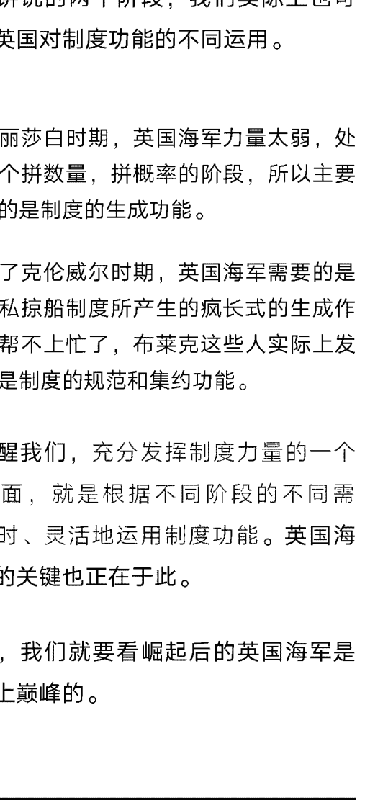

# 大国简史英国篇

## 发刊词 | 向大英帝国学什么？

发刊词 | 向大英帝国学什么？

你好，我是徐弃郁 欢迎你加入《大国简史·英国篇》。

在这个时代，我们每个人都关心这样的问题：

- 如何Anderson在缺乏实际优势的情况下人为创造优势？
如何与比自己强大得多的对手竞争？
如何在多方混战中保持不败？
如何以最低成本实现惊人的扩张？
万一受挫，怎么进行成功的“失败管理”？
一旦拥有优势，怎样把它贯彻到底？

回答这些问题，在历史上能找到的最好案例就是英国，可以说它通过打好一手“烂牌”，上演了一出教科书级的逆袭。这是如何向你推荐这门课的原因。

当然，还有第二个原因：如果有更高层次的家国关怀，关心我们这个国家、民族和共同体的未来，英国是最好的分析样本。

### 英国，唯一的全球大国

你会问，为什么不是美国？今天我们每个人都知道，美国很厉害，现在的国际体系它还是处在中心位置。但在一百多年前，这个位置是英国的。而且，美国不过是超级大国，而英国是人类历史上唯一的全球大国。

大英帝国在鼎盛时期，统治了世界人口的四分之一，是世界历史上面积最大的帝国。有多大呢？将近3500万平方公里，比今天的俄罗斯、中国、印度加起来都要大。现在世界上所有用英语做官方语言的国家，历史上都曾经是英国的殖民地。

我们再说国力。巅峰时期，英国的工业产值几乎占世界工业总产值的一半，而且就集中在英国本土那一点点地方。后来还有谁达到过这个水平呢？只有美国。我们不要忘了，英国只是一个小岛国，美国是一个有着洲际规模的大国。英国的这个成就更不容易。

### 英国，现代世界的“原型库”

再看今天世界上的经济作物分布：斯里兰卡的红茶、埃及的长绒棉、马来西亚的橡胶、西非的可可、南非的烟叶……这些地区特产你可能都听说过，但是我告诉你，这些东西原来根本就不产在那里，全是英国人后来引种的。

可以说，今天世界上的经济作物分布图，相当一部分都是大英帝国当年一手给出来的。

更重要的是，现代世界正常运转所依赖的那些制度，大部分都是英国首先创立的。像西方的议会制度、陪审团制度。即使是我们中国人，今天和我们国家、个人生活密切相关 Nicol的一些制度，追根溯源也可以追溯到英国——第一家股份制公司、第一家现代化工厂、第一家中央银行，都是英国首创的制度。

所以有一位历史学家就讲，你不了解英国，就不可能知道这个世界是怎么来的。

### 英国为什么能成为英国？

当然，这门课不是要讲英国多么重要，而是要回答一个问题，那就是英国为什么能成为这个样子？

论先天条件，英国可以说很一般。你看一下地图就知道，英国不过是地处亚洲大陆西南角上的边缘岛国，而且当时面积比今天的英国还要小，就是英格兰这一块。在当时的欧洲国家里面，它既没有西班牙和葡萄牙抢先发现新航线的先发优势，又没有法国、俄罗斯这些欧洲大陆国家那种人口、领土和资源的优势，可以说是握一手烂牌。

可就是这样一个边缘小国，用了300年时间实现“逆袭”，成为有史以来最大的帝国，占据了世界的中心位置，左右全球的政治经济秩序。

这种成功完全可以用“过分”这两个字来形容。那这是为什么呢？背后最主要的原因或者说秘密你肯定想知道。

这个问题最简单的回答就是四个字：“制度精神”。你可能会说，制度的重要性每个人都知道，但为什么就是大英帝国崛起的最主要的秘密呢？这是因为，英国特别善于运用制度来形成优势，形成力量。这就是超过所有竞争对手的地方，是它压箱底的东西。

### 用“鹰眼”重新解读英国

英国这个发展演化的过程当中，有意思的事情当然不止这些。如果我们继续用高分辨率的历史解读的话，你就会发现，其实对很多我们自以为很熟悉的历史事件，多少多少都存在误读。

### 七口深井绘制英国崛起路线图

那我们怎么来挖掘呢？

这门课我列了七大模块，分别是制度、海外扩张、帝国、工业革命、英国式战争、英国式外交和海权。它们是我们为了发掘英国崛起背后的秘密而打的七口“深井”，你会发现它们有一个共同的底层逻辑，那就是制度精神。

你英国为什么是英国。

最后我再介绍一下我自己——我叫徐弃郁，国防大学的老师。

十几年来，我一直在做大国崛起的历史，关于美国和德国的书已经出版了，哈佛大学还翻译出版了其中的一本。现在我正在做英国的历史，这个课相当于把我研究过程里面，觉得特别重要、特别有意思的东西抽出来，和你用最短的时间分享一下。

另外，我将和得到在未来的一年时间里，继续推进“大国简史”的产品工程，接下来还会推出美国篇、德国篇。

好，我们就先从英国开始，欢迎你加入大国简史的知识旅程。在大英帝国的崛起之路上，我就是你的知识导游，相信你一定会不虚此行。

徐弃郁·大国简史英国篇 课长

## 01 | 为什么从“大宪章”讲起？

01 | 为什么从“大宪章”讲...

所有的大家里面，英国的崛起是最值得研究的。它从一个弹丸小国扩张成世界上历史上最大的帝国，而且影响一直延续至今。这种成功完全可以用“过分”两个字来形容。

但问题也来了——这么过分的成功，英国是怎么做到的？这种崛起背后的动力，或者说秘密到底是什么呢？

对这个问题，我知道很多人都有一个标准答案——工业革命。工业革命使英国崛起，很多书上都是这么写的。但是，我告诉你，这个答案是错的。为什么？

- 第一，因为英国崛起的时间比工业革命早了100多年
- 第二，工业革命开始之前，英国工业已经是世界第一。所以说穿了，工业革命只是英国崛起过程中的一个助推火箭，不是它崛起的主要原因。

### 英国崛起的秘密——制度精神

### 英国制度精神的源头——《大宪章》

### 《大宪章》如何影响英国人？

用户留言

## 02 | 宗教改革：如此特殊，又如此重要

这一讲，我要讲英国崛起之路上的第一个里程碑——宗教改革。

### 为什么要从宗教改革谈起？因为太重要了。

我们中国文化和西方差别很大，所以我们虽然都知道西方历史上的宗教改革，但往往很难理解它的重要性。我先简短解释一下为什么宗教改革那么重要，那是因为在当时，宗教它不光是千千万万人的信仰，而且当时欧洲社会的运行，财产的分配，都和宗教密切相关。

你可能会问，怎么财产分配也和宗教有关？当然有关。当时欧洲最有钱的就是教会，掌握大量的土地和财富，国王贵族和教会比起来都属于穷人。

所以，在当时的欧洲，宗教是中枢。这个中枢发生改革，你想想，会有多大影响啊。

宗教改革是从1517年，一个叫马丁·路德的教士贴出《九十五条论纲》开始的。主张改革的教派就被称为 “新教”，新教和天主教之间的斗争很快就席卷整个欧洲。

其实宗教改革在欧洲各国都发生过，但是英国的宗教改革是最特殊的。为什么这么说？

### 温和的宗教改革

第一个特殊的地方是英国宗教改革没有大规模流血。

我前面说了宗教改革，相当于在欧洲社会的中枢上动刀，那引起的震动绝对大，是要血流成河的。比说法国的宗教改革就发生了叫做 “圣巴托罗缪之夜” 的大屠杀。

那是1572年8月24日的晚上，法国巴黎天主教徒秘密串联好，事先在新教徒家的门口画上记号，半夜的教堂钟声一响，大家就一齐冲进各家去杀新教徒，光一晚上就杀了好几千人。其中还有父亲是天主教徒，把信奉新教的儿子、儿媳都杀掉的事情，非常血腥。

欧洲大陆还有因为宗教改革打仗的。欧洲历史有名的30年战争，就是新教和天主教两派人马对杀，破坏相当大，不少地方都变成了无人区。

说明这场战争的残酷，你记一个名词就够了，叫 “瑞典鸡尾酒”。什么意思？就是当时瑞典军队在30年战争中处决战俘的做法是，把马粪加上泥土，从人的嗍子里塞进去，把人活活填死。

这种残酷的宗教战争和大规模的宗教仇杀当时几乎遍布整个欧洲。只有一个例外，就是英国。

为什么英国那么特殊呢？因为英国宗教改革的方式特殊。英国宗教改革是亨利八世国王发动的，主要内容是两条：

- 第一，英国的教会不再从罗马的教皇，而要听英国国王的。这样英国教会就从天主教会变成了国教会。
第二、剥夺天主教会的土地，归国王所有。这两条改革的力度相当大，但方式和其他国家不一样。亨利八世不像欧洲大陆上的国王和诸侯那样，发布一条行革命令，规定我这块土地上的臣民不信天主教了，改信新教。而是和议会一起合作，通过法律来实现改革。这就是区别：欧洲大陆是权力解决，英国是制度程序解决。所以，宗教改革所爆发出来的巨大能量，实际上大部分被制度，被程序吸收了。

### 妥协的宗教改革

还有一个特殊点是，英国在宗教改革问题上实现了新教和天主教的妥协。

这在欧洲也是独一无二。怎么回事呢？上面讲的亨利八世的改革，主要解决的是宗教权力问题，就是宗教事务听谁的。但是，宗教改革不光是这些，更核心的问题是关系到广大教徒的精神和信仰，这就是教义问题。

新教和天主教在教义上是有区别的，新教教义更加强调纯粹性。什么叫更强调纯粹性？

举个例子——《圣经》上说：除了上帝以外，不存在任何其他神，也不可崇拜偶像。新教特别坚持这点。我们都知道圣母玛丽亚。天主教说：玛丽亚生了耶稣基督，所以大家要崇拜她。但是新教说：玛丽亚是生了基督，但她仍然是人，而人是不允许崇拜人的，所以新教禁止圣母崇拜。那其他的圣徒就更不许崇拜了，他们的画像、雕塑，要统统砸烂。

所以我们去欧洲大陆看教堂的时候，新教教堂和天主教教堂一眼就能分出来：新教教堂里面基本上就是几面白墙；天主教教堂里面装饰啊，雕像啊，特别多，富丽堂皇的。一些出名的教堂，像巴黎圣母院，科隆大教堂，都是天主教教堂。

英国宗教改革开始以后，新教那种强调纯粹的倾向就变得很强烈了。很多新教徒开始攻击、破坏天主教教堂和天主教的仪式，越闹越凶。这就产生了一个问题，原来信仰天主教的那些人怎么办？如果宗教改革过了头，英国国内就有分裂危险。

这时候，英国的制度精神起作用了。我们说，制度精神不光是尊重制度，尊重程序；它还有另一个含义，那就是制度是一种各方的契约，要取得最大公约数。所以制度精神也反对走极端，提倡妥协。

正是因此为这种精神内核，英国在当时天主教和新教水火不容的时候，它却在两者之间走了一条中间道路。一方面，它在核心的问题，就是宗教教义上主要采用了新教的教义；另一方面，英国在宗教仪式上又保留了大量天主教的东西。

这一点从教堂的装饰风格上也可以看出来：

你如果去伦敦，一般都会去一下威斯敏斯特大教堂，这是最主要的英国国教教堂，属于新教教堂，但它可不像一般的新教教堂那么素净，而是和天主教教堂一样富丽堂皇。这就非常直观地体现了英国在宗教改革上的妥协和润和。

说到这里，你就清楚了，英国的宗教改革哪些方面是特殊的，为什么能够这么特殊。

### 重要的宗教改革

我最后要讲一下，英国宗教改革的这种特殊性对英国崛起的重要影响。

首先是政治影响，就是英国真正实现了独立自主。因为宗教改革以后，英国教会只服从自己的国王，不再听从罗马教皇了。英国人的宗教信仰由英国自己决定。

另外，这种特殊的宗教改革也为英国带来了国内的安定。我们看欧洲历史，宗教绝对是一个影响国内局势的重要因素。不同教派之间的斗争往往爆发内讧。但英国却实现了和平，这样它就可以把更多的精力投到海外了。

除此以外，它对英国经济的影响也很大。因为宗教改革之前，教会手里掌握着大量财产，但这些都是固定的、不流通的。而我上面讲了，英国宗教改革的一项重要内容，就是把天主教会的财产，特别是土地划归国王。但是，国王也拿不了多长时间，就抵押出去，赠送出去了。这样一来，教会手里这笔巨额财产就流通起来，从而催生了英国的乡绅阶层，就是中产阶

从而催生了英国的乡绅阶层，就是中产阶级。这对后来英国经济的发展当然非常关键。

最后一点，也是最重要的一点，就是英国这种讲究程序的、和平的宗教改革，最终形成了一个宽容社会。这和欧洲大陆上的宗教冲突形成了鲜明对比，对全欧洲的人才都形成了一种巨大的虹吸效应。

我举个例子：

英国女王伊丽莎白一世统治时期，法国爆发宗教冲突，开始杀新教徒，短短几个月时间，就有好几千个法国新教徒跑到伦敦。这些人可不是一般老百姓，很多是有熟练技术的高级工匠，还有不少商人。他们带的是什么？是英国经济发展所急需的技术和资金。这种由大陆向英国的人才流动可不是这一次，而是持续了几百年的时间。最大的吸引力，就是英国社会的宽容。

我们不要忘了，这些好处，说到底也是英国人的制度精神带来的。当制度精神作用于信仰层次的时候，实际上就为整个国家提供了一种折衷选项，可以远离动荡和极端。

下一讲我们就要从制度的角度来重新解读一下英国历史上的另一个重大事件：英国革命。

## 03 | 革命vs.复辟：原来真正的焦点是制度

对英国崛起来说，发生在17世纪的英国革命绝对是一个重大事件。这场革命可以分为上下两篇，这一讲说的是上篇——内战和复辟。

讲到英国革命，大多数人都会想起以前看到的一个说法，就是“1642年，英国资产阶级革命爆发”。到现在，很多书上还是这么写的。这个说法很好记，但我告诉你，它是错的。

为什么错呢？因为英国革命和资产阶级基本上没有任何关系。

你看一眼革命力量的组成就知道了：革命派的领导层全部是土地贵族，根本没有资产阶级。不光领导层里没有资产阶级，那些参与革命的人里面也没有什么资产阶级。如果从参与者的阶级成分来看，革命派和保王派实际上都差不多，都以农民为主。所以说英国革命和资产阶级根本不相关。

那么你可能会问，英国革命不是资产阶级革命，那它是什么呢？

### 革命为什么会爆发？

回答这个问题之前，我们先看一下英国革命为什么爆发。

在第1讲讲到《大宪章》的时候我就讲过：在很早的时候，英格兰国王的权力就受到了制度的约束。但是，到国王查理一世的时候，他觉得这种约束很难容忍。这个国王就是后来被革命推翻，最后被砍头的那个。

### 第一阶段：克伦威尔推翻国王

我们先来看一下英国前期的内战与革命。这个过程大家都知道：革命派一开始打不过保王派，但在军事强人克伦威尔的领导下，革命派最终取得胜利，国王查理一世被抓住砍头。

### 第二阶段：查理二世复辟

说到这里你也可以理解了，为什么当时克伦威尔一死英国马上就复辟。而且几乎就是当年发动革命并把国王砍头的原班人马，又把国王的儿子请回来重新当国王，称为查理二世。

所以克伦威尔掌握绝对权力以后，就在全国实行军管：不许戏剧演出、不许娱乐、不许喝酒。普通老百姓就觉得有点受不了了。越来越多的开始怀念以前国王统治的日子。所以复辟的时候，伦敦的老百姓也来欢迎查理二世回来。

王，就是这个复辟了的查理二世。

所以我说，复辟时期确实不是一个简简单单的开历史倒车。复辟时期有不少成就，这是肯定的，这也是英国社会经过了革命以后，对自己的一种自我修复。

### 革命尚未结束……

但是我这里还要告诉你，这种自我修复式的复辟注定长久不了。为什么呢？因为制度约束王权这个革命的焦点问题只是缓和而没有解决，时间一长又会出来。

查理二世虽然说人比较随和，但国王就是国王，他一定会想办法扩大王权。而且查理二世比他的父亲要有手段得多，表面上承认议会的约束，实际在重大事情上都成功地绕开了议会。到他去世前五年时间干脆不召开议会了。

所以到这个时候，制度已经约束不了王权，矛盾再次上升。就好像钟摆一样，接近了那个中心点以后又偏离得很远了。在这种情况下，二次革命就变得势在必行。

所以你看，一旦抓住了制度这个焦点问题，或者说英国这段历史的枢纽，英国革命和复辟这两个貌似对立的阶段就统一起来，实际上是一个整体。

这一讲也告诉我们：怎么样通过把握历史的枢纽，来重新解读一个我们都认为很熟悉的重大历史事件。

下一讲我们就要来看一下，制度这个英国革命的枢纽问题是怎么解决的，也就是英国革命的下篇—— 光荣革命。

用户留言

提交留言可与专栏作者互动

## 04 | 光荣革命：英国何以从此告别革命？

04 | 光荣革命：英国何以从... ↓

这一讲我说的就是英国革命的下篇，就是光荣革命。

光荣革命我们以前都学过，就是英国为了限制王权，邀请荷兰领导人威廉带兵到英国当国王。因为整个过程基本上没有流血，所以英国人把它叫做“光荣革命”。

光荣革命对英国崛起可是太重要了：

一方面，它完成了英国革命上篇没有实现的目标，就是上一讲我说的确确实制对王权的约束；

另一方面，更重要的是，它使英国就此告别了革命，告别了内战。这一点其他欧洲大国可都没有做到。

但你也许不知道的是，这么重要的光荣革命很可能是不会发生的。为什么这么说？我们先回到光荣革命前的历史现场。

### 偶然发生的光荣革命

复辟国王查理二世死后，接下来的詹姆斯二世仍然进一步扩大王权，还想在英国恢复天主教的地位。

前面讲宗教改革那一讲我讲过：英国的国教是新教，英国的上层社会和老百姓都非常看重这个国教地位，天主教势力不能卷土重来是一条底线。

所以，詹姆斯二世的做法，不仅碰了英国人的政治底线，还碰了英国人的宗教信仰底线。这就有大问题了。

那是不是英国马上就爆发二次革命了呢？没有。英国人对四十年前的革命和克伦威尔的铁腕统治记忆犹新，真的不想再有革命了。

他们的打算是什么呢？就是熬过去。因为詹姆斯二世即位的时候52岁，按当时的标准已经算老人了，又没有儿子，只有两个女儿。但这两子女都是新教徒。所以只要等他一死，王位一定会传给一个是新教徒的女儿，这样至少国教不会被天主教取代了。那王权呢？英国人认为慢慢地也能限制回去。

所以，原本的历史进程很可能就不会发生革命。我说两个关键事件，你就明白为什么说革命是偶然的。

### 第一个关键事件：神秘男婴

在1688年的时候，就出现了这个神秘男婴事件。

那年，王宫中突然传出消息，说王后生了一个男孩。在绝大多数英国人看来，这事情匪夷所思，国王这么大岁数，怎么会突然要上孩子。而且事情也太巧。这个男婴的出生，正好能够满足国王恢复天主教的意思。

为什么？因为有了这个男婴，王位就不能传给他两个新教徒的女儿，一定是传给他。而国王和王后也一定会把他从小培养成一个天主教徒。这样英国国教就完了。所以大家就怀疑，这个婴儿根本就不是国王的亲儿子，这件事情本身就是国王要恢复天主教地位的一个阴谋。

### 第二个关键事件：英军主帅临阵倒戈

二次革命是英国上层邀请荷兰的领导人威廉率军在英国登陆，这实际上是外围武力干涉。这个时候，英国军队完全可能进行抵抗，如果抵抗，那就是一场持续的战争，历史进程很可能就不一样。

但是这个時候，国王詹姆斯犯了两个愚蠢的错误：

第一个错误是拒绝了最后一张牌，那就是法国的支援。

第二个错误是任命了一个叫约翰·丘吉尔（注：他是后来二战英国首相温斯顿·丘吉尔的祖先）的贵族当英军主帅，率领差不多全部兵力去阻击威廉。

### 《权利法案》和英国君主立宪

接下来，我再讲一下光荣革命最重要的内容——我们都知道，光荣革命最重要的事情，就是通过《权利法案》，奠定了英国君主立宪制的基础。

但是，我这里要说的是，《权利法案》的历史地位虽然重要，但它只是一个总纲性的东西。实际上就是把《大宪章》开始的那些原则、权利汇到一起，以法律的形式加以确认，比如只有议会才可以征税、人民可以自由请愿，等等。

如果只有它这些高大上的原则，下面没有具体的东西作为支撑，那制约王权这个目标，在实践中一定又要打折。所以，比《权利法案》更关键的，实际上是《权利法案》以后通过的某些具体的法律。

有些地方的考虑很深、很实用。我给你简单举几个例子：

- 《兵变法》：规定如果国王征召一支军队的话，只能维持半年，不能再多了。否则议会不拨款。这样一来，实际上国王就没有兵权了。他不可能再用武力来对抗议会。
- 《三年法》：为什么叫《三年法》呢？这项法律规定，一届议会任期最多3年，3年以后要改选。这就是说，议会有了自己的法律程序，到时间自动开会，自动改选。国王不能影响。所以，以前那种国王不高兴就不召集议会，或者动不动就解散议会这种事，从此以后就再没有发生。

## 05 | 征税大事：不得不说的政府钱袋子

我们一般的印象，都是发生革命以后，民众的税收负担会减轻，轻徭薄赋。但英国光荣革命后却出现一个奇异的现象：

革命前，英国的税率虽然并不低，但老百姓却抗拒，一年征收200万英镑已经很不容易了。光荣革命以后，政府征的税却一下子上升到600万英镑，但社会仍然能承受，经济继续发展，老百姓也不抱怨。

这种奇怪的对比说明什么？说明光荣革命以后英国政府的征税能力提高了一个数量级，这使英国对它所有的竞争对手都形成了一个巨大优势。

我们以英国最主要的对手法国为例，法国的面积是英国的2倍多、人口是它的3倍、国家总体财富也更多，但征税的能力不到英国的一半。那样的一种飞跃是怎么实现的呢？还是通过制度上下功夫。

我在上一讲说过：光荣革命实际上是一次系统性的制度重组，而税收制度的改革是其中一项非常重要的内容。这不光是因为税收是国家收入最重要的来源，而且因为征税在英国人心目中的地位非常特别。

### 征税是英国历史上的大事

在英国历史上，所有对国王的武装反抗、暴力革命，它的直接原因，或者说导火索基本上都是一样的，那就是征税。可以说，在英国，征税绝对是天大的事情。

那为什么把它看得这么重？英国人认为，税收的核心实际上是一个财产权的问题。这种看法和英国的历史有关。

英国的封建社会和我们中国的封建社会不一样，我们是“普天之下，莫非王土”，说到底财产权都是皇帝的。他可以没收，也可以赏给你。但英国不是这样的，英国封建社会，国王是大家的头，大家向国王效忠。

在财产权上，大家是分开的。国王你可以赏赐别人，但只能用你自己的地、自己的钱。这样一来，你国王征税不管是出于什么目的，实际上都相当于把别人的合法财产拿走一部分。英国人认为，这就必须要征得被拿走的一方的同意，否则的话，产权最后是要崩溃掉的。

所以我们看到，英国人实际上是把征税作为财产权保护的第一道，也是最重要的一道防线来捍卫的。

但你从国王的角度想，国王也有难处啊。比如打仗，国王说也不是为了我一个人打啊，为了国家、为了大家打仗，这笔额外的钱当然要大家来出。

好，这种情况下，英国发展出了议会制度。贵族和城市代表组成议会，由他来着：这笔钱是不是必要的？如果必须要加税，让大家出。而征什么税、征多少税、征上来的税派什么用途、这些具体事情也要由国王和议会商量着来。

议会对于国王权力的约束，最集中的体现就是在征税问题上的约束。所以我们可以说，英国近代政治制度和法律制度在很大程度上是围绕着征税，或者围绕着财产权发展起来的。

说到这里，你就清楚了，为什么在英国征税是件天大的事情。所以征税制度改革的地位也格外重要。

### 废除包税制

那光荣革命以后英国的征税制度到底发生了什么变化呢？

讲改革之前，我得说一下光荣革命之前的那种征税制度，就是包税制。这种征税制度当时在欧洲很普遍。

什么叫“包税”？比如说，我是国王，我不直接去向别人收税，而是把收税的权力，卖给一个中间商，这个中间商叫包税人。他一次性向国库交清款项后，就可以代表国家向别人征税，收多少都是他的，这就是包税。

这样做有什么好处呢？

- 第一个是省事。这个包税人替政府把活都干了。
- 第二个是风险小。征税是有风险的，花了很多力气还是收不上来怎么办？实际上英国政府吃过不少这种亏。

比如革命之前，国王查理一世不顾议会反对，强征造船税。费了很大力气，连王后都上阵，亲自排演一个芭蕾舞剧来造势，那也没有收上多少，最后这个税相当于烂掉了。

那包税制就可以转移这种风险。为什么呢？因为包税人在开始就把税款一次性给国库了，然后再代表国家去收税，收多收少，这些风险都是包税人的事，和政府没有关系。

但是，这种制度的弊端也特别明显，最大问题就是过程失控。包税人一旦向国库交够了钱，就开始拼命搜刮民众，导致民怨沸腾，甚至引发暴动。因此，废除包税制，建立由专业税务人员直接征税的新制度，成为改革的核心。

## 06 | 英格兰银行：第一家中央银行成立的背后

英国的崛起离不开战争，特别是光荣革命以后，英国进入了一个战争高峰期，一百年多年来一半以上的时间都在打仗。

英国打这些仗有一个和其他国家都不一样的特点，那就是不缺钱。不光有钱装备自己的军队，还有钱去收买别的国家替它打仗，这是它所有的对手都做不到的。那英国的钱袋子为什么这么强大？主要是因为，英国在光荣革命以后，成立了世界上第一家中央银行，就是英格兰银行。

### 央行的建立和国王的钱袋子

那英国怎么会想到要建一个中央银行呢？我得先说一下英国国王的借钱问题。

英国国王，或者说英国政府需不需要借钱呢？当然需要。国王或政府的钱主要靠税收，但是，征税是需要时间的。如果突然打仗或者出现其他急事怎么办？税收来不及，那只能靠借。向谁借呢？那时主要是商人和早期的银行家，他们手里有现金。

但是借钱的关键问题是信用，英国国王的信用记录可是很成问题了。我给你举两个例子：

第一个是国王詹姆士一世。当时英国东印度公司组织第一次远航，千辛万苦弄回一批胡椒，打算卖个好价钱。倒霉的是，国王也正好弄到一批。这么大量的胡椒投到市场，价格一定会下来。国王当时就要赖了，说公司的那批胡椒不许卖，必须等他的那批先卖完。而等他那批货卖完，胡椒的市场价格已经跌了50%。东印度公司只能含泪吞下苦果。

第二个例子就更过分了。那就是查理一世的时候。当时英国的货币是金银币，王室有造币局，很多富人就把金银器存放在那里，相当于存款。但查理一世有一次因为实在缺钱了，居然强行把这些金银器扣押，还让大伙交一笔赎金才还回来。这已经不是什么叫客户存款了，和明抢没有任何两样。

这种事情都有，像借钱不还的事，那就更多了。那国王的信用为什么这么差呢？主要是因为，光荣革命之前，国王权力太大，而权力越不受约束，契约精神一般也越差，也越容易赖账。所以国王要借钱，大家一般都很难答应。

到英国光荣革命以后，形势变了。新上来的是一对夫妻国王，我们前面讲过，威廉和玛丽。他们的权力就没那么大了，受到议会制约。但王室的信用记录仍然摆在那里，商人和银行家对借钱给政府的事还是躲得远远的。而这个时候英国已经和法国开战，政府急需资金。国王还想用原来那种向富商分头借款的方式，结果根本行不通。他开出的最高利息是多少？年息30%！已经是天价了。还是借不到钱。怎么办？

听到这里，你可能已经猜到了，那就是成立一家中央银行，就是英格兰银行。所以成立英格兰银行的直接原因，简单地说，就是国王或者说政府借不到钱。

### 英格兰银行的建立过程

接下来，我再讲一下英格兰银行的建立过程。

国王开出了天价利息还是借不到钱。英国人就又从制度上来求办法了。

当时有一个叫帕特森的伦敦富商，提出来说既然国王向各个富商、银行家单独借款行不通，因为对单个的商人，国王可能就会赖账，那么干脆大家把资金集合起来，用一种制度化的方式借给政府钱。这样就把风险降得最小，具体来说，就是建一个股份制银行。

伦敦的那些富商马上就听进去了，他们最大的顾虑就是怕国王赖账。如果能设计一种制度来保证国王不赖账，他们是愿意借钱的，所以对股份制银行的提议很支持。这个时候，英国最高立法机构，议会也介入了，这是提供法律保障的。

1694年议会通过法案，成立英格兰银行。所以，英格兰银行实际上是商人、国王和议会三方共同搞起来的。

那么英格兰银行具体怎么出钱呢？

首先是大家认股，股本一共120万英镑，这些股票在12天内就被伦敦商人抢购一空。这120万英镑马上以长期借款的形式借给了政府，年利息8%，以政府的税收作担保，这对政府来说代价很低了，非常满意。

那银行得到了什么呢？除了利息，议会还颁布了一份特许状，规定英格兰银行享有经营一些业务的特权，包括印钞票在内，这就是世界上的第一家中央银行。

### 英格兰银行的意义和影响

听完英格兰银行成立的过程，有些人可能会说，这有什么特别了不起的呢？不就是大家搞个银行，把钱借给政府吗？我说，绝对不是那么简单。这里我就要讲一下英格兰银行的意义和影响。

首先，英格兰银行是第一个以政府为主要客户的银行。当时有其他的银行，但是，那些银行都是服务市场，客户主要是商人，而英格兰银行的主要客户却是英国政府和国王，这是最大的创新。这个创新本质上是个什么概念呢？就是把政府和私人资本联系起来了。

说到这里，我要多说几句，有些人对很多国家的中央银行是私人资本这一点不理解。

像前几年很火的书，叫《货币战争》，就把美国的中央银行——美联储是私人银行这事当成一个内幕挖出来，很多人知道后觉得很震惊，觉得里面有什么阴谋。实际上，从英格兰银行成立的过程你就可以知道，中央银行一开始肯定是私人的。为什么？因为政府没钱，要向私人借钱，才产生了中央银行。另外，政府向中央银行借钱，本质上就是一种合同的甲方乙方关系，甲方乙方能是一家吗？不能。因为这样合同就没有意义。所以中央银行一开始必须是私人资本。

我们再看英格兰银行对英国崛起的影响。英格兰银行成立以后，私人资本就找到了一个不会倒闭的客户，那就是英国政府。国家越强大，资本获利的机会就越多，而资本越扩张，国家可以用的钱就越多，这样就是一种良性循环。最后不光是英国人，越来越多的外国人也愿意把钱借给英国政府。

这种情况下，就出现了我在开头讲的，英国打仗不缺钱，我讲一个例子：

1782年，美国独立战争快胜利的一年，英国不光和美国打，还和法国这些欧洲大陆国家打。很多人都认为，英国已经陷入绝境。但这时，英国政府却宣布发行国债，借多少钱呢？300万英镑。市场认购多少钱呢？500万英镑。可见打个招呼，钱就来了。所以英国政府随时可以花别人的钱。英国的那些对手呢？只能花自己国库里的钱，国库空了，就没法打下去了。英国这批国债一发完，当时一位敌国的政治家就说了一句话，打败英国根本没有希望，必须在情况还算有利的时候快点谈判。

### 英格兰银行为何成功？

听到这里，你可能还有问题：为什么英国中央银行这套制度建立以后，就这么灵？这不是魔术吗？

我想说的是，任何制度都不是包治百病的，中央银行也不可能点石成金。我用几句话总结一下英国这个中央银行为什么这么成功。

英国的中央银行制度不是孤立的，而是和其他两大制度相配合的。哪两个制度呢？

第一个是政治制度，就是比较成熟的议会制度。前面讲了，如果没有议会的立法，英格兰银行是建立不起来的。为什么？大家怕国王赖账，有了法律制度保障，大家才有信心。

第二个是国家财政制度。前一讲讲到了英国的税收制度改革，这就保证了政府每年都有可持续的收入，这样政府的信用就有基础，大家才敢借钱。

所以说，是一个整体的制度体系保证了英格兰银行的成功。

讲完英格兰银行，整个制度模块就讲完了。下一个模块将要讲英国崛起最显著的部分，也是很容易被误读的那部分，那就是它的海外扩张。

## 07 | 海外扩张的开局：为什么注定能“逆袭”？

从这一讲开始，我们就进入第二个模块，海外扩张。

我们都知道，英国曾经是日不落帝国，海外殖民地遍及全球。而大英帝国之所以有这样空前绝后的版图，就是由于它300多年的海外扩张带来的。我们这一讲要关注的，是海外扩张的开局。

俗话说，良好的开局是成功的一半。英国海外扩张的开局阶段，可以从1496年英国派出第一支探险队开始算起，一直到伊丽莎白女王一世去世，一共107年，其中主要是伊丽莎白统治的45年。

### “迟到”的大英帝国

那么这个开局到底怎么样？后来大英帝国那种如日中天的样子在这个阶段能否看出来？我说，这里关键就是个视角问题了。

如果看有形的获得，那么英国的开局可以说太平常了。我们可以对比一下同时期的西班牙和葡萄牙：

这两个国家在英国的开局阶段，已经建立起了庞大的海外殖民帝国，它们占据的殖民地都超过了1000万平方公里；而英国当时占了多少？几乎为零。

我们再看财富：

- 葡萄牙找到了东方的香料，控制了当时最赚钱的海上香料贸易；
- 西班牙更是直接找到了金矿和银矿，光是黄金就有20万公斤，白银超过1860万公斤，这还不包括未经政府注册的部分。

那英国找到了什么呢？就找到了北大西洋的纽芬兰渔场，只能去打鱼。你看，你会觉得至少没有空手，可是和其他国家根本没办法比。

所以，如果你从有形的资源来看，英国的开局阶段根本看不出它会成为后来大英帝国。但是如果换个角度，看无形的东西，那英国的开局阶段就非常了不起，后来大英帝国在海外扩张方面的成功已经蕴含在里面了。

### 大英帝国的无形资源优势

这些无形的资源是什么呢？最主要的，就是英国在开局阶段，特别是伊丽莎白女王统治的45年里面，形成了一种新的民族素质，或者说国家禀赋。说到这里我要提一本书，那就是英国人马斯顿在1883年写的《英格兰的扩张》，这本书绝对是讲英国崛起和扩张的权威读本。这本书里说：英国人是从女王伊丽莎白一世的时候，才变成一个商业民族和航海民族的。

那你可能就要问了，为什么英国能够形成这样一种新的民族素质和国家禀赋呢？

首先这里有运气的成分。

这个运气就是英国没有发现什么有形的资源，特别是它没有像西班牙那样发现大量金银。经济史学家有一种说法，叫“金银的诅咒”，讲的就是西班牙。正因为它发现了大量金银，最后才把自己给毁了。什么原因呢？

- 第一，一下子有了大量金银，西班牙就不发展其他经济，要什么直接买，时间一长反而落了后；
- 第二，金银是货币，你想：一个国家突然有了大量的货币会怎么样？对，就是物价上涨。西班牙当时就出现了严重的通货膨胀。

这种金银的诅咒和我们今天讲的资源的诅咒是同样一个道理，像委内瑞拉，还有一些阿拉伯国家，它们石油资源太丰富了，光卖石油就够了，那谁还要发展经济呢？

所以，英国是因祸得福——既然没有发现什么有形的资源，那就只能专注于无形资源。那英国做了什么，才能完成一种民族素质和国家禀赋的重塑呢？我们说，在这个开局阶段，英国做了很多很扎实的工作。我挑几个例子和你说一下：

设立“全民食鱼日”

第一个例子是设“全民食鱼日”，规定每周有一天全国人民都要吃鱼。你听到这里，可能觉得奇怪。立法为什么要管吃不吃鱼这种琐碎的日常小事呢？

稳定英镑

### 专利制度

说完这些，我们再来理解所谓的“无形资源”，就会有完全不同的视角。任何组织在开局阶段，都会有自己的“资源优势”和“资源禀赋”，但是这不代表你就能成功。为什么有些国家、有些公司看上去明明有一手好牌，但最后却打砸了，最根本的原因，就是今天提到的“金银的诅咒”，被存量的资源和优势绑架，反而忽视了更重要的无形资源。

那到底要怎么用好“无形资源”呢？下一讲我就要和你说一下，“无形资源”怎么使英国挣到第一桶金的。这就是著名的“大三角贸易”。要知道“大三角贸易”让英国建立起全球贸易的格局，开启了海外扩张的关键一步，这一切就和它的制度建设也密不可分。

## 08 | 大三角贸易：为什么成了英国的第一桶金？

在英国的海外扩张过程中，大三角贸易的地位特别重要，因为它是英国崛起的第一桶金。

大三角贸易是世界经济史上的一个重要概念，实际上就是16 - 19世纪，欧洲商人在美洲、非洲和欧洲这三个地区之间搞贸易，这三个地区联起来，正好是一个大三角。

大三角贸易里面标准的贸易路线是这样的：

- 第一步，欧洲商人把工业品、朗姆酒、枪支从欧洲运到非洲，这些东西卖了以后，就地换成黑人奴隶；
- 第二步，把黑人奴隶从非洲运到美洲，卖掉以后，购买美洲生产的糖、烟草和白银；
- 第三步，把美洲的东西运回欧洲卖掉，再采购欧洲产品。这样一个贸易循环圈就是大三角贸易。

所以，大三角贸易也被称为“黑奴贸易”，把黑奴当作交易品，这里面有大量的血腥和罪恶。这种罪恶当然是事实，不过我要告诉你，黑奴贸易并不是大三角贸易的主要内容。

### 大三角贸易和英国的“第一桶金”

“大三角贸易”的真正重点是通过向美洲运黑奴，在美洲搞生产，然后把美洲的产品运到欧洲，所以你看这是什么？实际上就是开发美洲，打造近代史上第一个跨洋国际经济圈。英国在这里扮演了绝对的主角，并且捞了大英帝国的第一桶金。

那么，这第一桶金对英国到底有多重要？

我们先看一下大三角贸易在英国经济中的比重。经济学家计算发现，到18世纪末，大三角贸易的出口已经占英国总出口额的60%，大大超过了英国对欧洲其他国家的出口，这个比重就不得了。

我们再看它的利润。英国在大三角贸易的主要时期，利润率超过50%，年均获利将近200万英镑，这在当时是非常大的数字。更重要的是，大三角贸易不光给英国带来了钱，就是所谓资本的原始积累，它还带来了人。

这人不是非洲的黑人奴隶，而是英国自己的人口。一个牛津大学的教授研究发现，正是大三角贸易的繁荣，导致英国出现了一新一轮的婴儿潮。这正好为后来的工业革命培养了劳动力的基础。所以，这是环环相扣的。

大三角贸易对英国来说是名符其实的第一桶金。

### 英国的压倒性优势

听到这里，你可能会问了，既然大三角贸易是欧洲商人在做，不是英国一家。那为什么英国就能在里面拥有压倒性的优势，其他国家为什么就不行？这个问题，其实史学界并没有现成的答案。如果一定要找，那就是我在第一讲提到的，由英国的制度精神延伸出来的，大局观。

蔗糖贸易：英国VS法国

甘蔗园经营：英国VS法国

## 09 | 北美殖民：英国凭什么完胜对手？

这一讲开始我们就要涉及英国海外扩张的重点——殖民扩张。

讲英国的殖民扩张，首先得讲北美殖民，为什么呢？这是因为，我们常说的“大英帝国”，实际上分为“第一帝国”和“第二帝国”两个阶段。

第一帝国阶段，最重要的殖民地就是北美，抓住了这块殖民地的兴衰，也就抓住了英国在这个阶段殖民扩张的主线。

英国的北美殖民什么时候开始的呢？大多数历史书上面都写的是——英国在北美建立的最早的殖民地是弗吉尼亚。我告诉你，这个说法是错误的。

英国在北美第一块殖民地叫做“罗恩诺克”，这个名字可能绝大多数人都没听说过。它在南卡罗来纳州外海，从弗吉尼亚州再往南一点，时间上比弗吉尼亚殖民地早了20多年。不过呢，这块殖民地虽然开发最早，但是不成功。后来的人再次上岸的时候，发现原来的那批殖民者，总共118人，包括11个孩子，居然全部失踪，不见了，整个定居地彻底荒废。到底发生了什么？没有人知道，这是一个历史之谜。

### 英国的特许状制度

什么叫特许状？说白了，就是殖民经营许可证，英国国王或者政府鼓励海外殖民，但不出人，也不出钱。那给什么呢？只给一些商人和探险家发一张“皇家特许状”，授权他们成立私人殖民公司，到海外去开拓殖民。如果你能生存下来，那这块殖民地上你可以开发、经营、贸易，挣到的钱都是你的。更重要的是，特许状规定，只许你这么做，别人不可以，所以是垄断权利。

### 英国的殖民地管理

接下来，问题就来了——在北美殖民的可不光是英国。除了英国以外，还有法国和西班牙，为什么偏偏英国最成功，要知道和竞争对手比实力比经验，英国一点都不占优势。

- 比如说法国，人口是英国的三倍，经济规模也比英国大；
- 而西班牙呢，它在美洲殖民最早，属于赢在起跑线上的。

但到最后，英国可以说完胜另外两家。

西班牙的北美殖民

西班牙在美洲的殖民最早，占的地方最多。但是西班牙的殖民完全是国王和政府搞的，普通人不许随便移民，来了也没有什么权利。我们说，没有权利就没有动力，这是一定的。

法国的北美殖民

那么法国呢？法国比西班牙好一点，但它也是直接的集权式统治，而且压根儿没有去想殖民地的产权问题。所以去美洲殖民的法国人想法就和英国人不一样。他们不愿意搞长期的、艰苦的开垦殖民，因为产权没有保护啊。

英国的北美殖民

和这两个国家一比，英国的殖民地的策略就很不一样了。

- 在移民上，英国政府不设限制，来去自由，甚至其他国家的人也可以到英国殖民地来定居；
- 在政治上，英国殖民地一般实行自治，可以自己建立比较民主的管理机构；
- 在宗教上也比较宽容。

所以这样一来，虽然条件虽然很艰苦，但社会环境很好，甚至比英国本国还要好。这样就有一大批英国人被吸引过来了。

更重要的是，在这种情况下，来殖民的英国人就不是掠夺一趟就走的，而是准备长期经营，在这里扎根的，这一点特别重要。

说到这里，你肯定会问：为什么搞这种农业反而有前途？

战争打起来以后，也是这样。英国的殖民地牢不可破，而法国的殖民地却不断被英国人夺走，最后，法国在北美最大的殖民地，就是今天的加拿大，被英国夺取。英国的北美殖民地连成了一大片，规模空前，大英帝国也进入了第一个鼎盛期。

英国的北美殖民我先讲到这里。我想再总结一下，英国在北美殖民中完胜对手的核心原因，就是它的制度力量，再加上英国的长远规划、长期经营。说到底，这是一种“笨功夫”，但是往往就是这些持之以恒的笨功夫，能够最终使你碾压对手。历史上是这样，现实生活里面也是这样。这种“笨功夫”就是相信可以累积的时间的力量。

好，以上就是这一讲的内容。在下一讲，我要说一下英国是怎么丢掉北美殖民地，又是怎么补救的。

# 用户留言

提交留言可与专栏作者互动

## 10 | 美国独立：英国成功的“失败管理”

上一讲讲到，北美殖民地是当时大英帝国最重要的殖民地，但是，就在英国夺下加拿大，北美殖民地达到顶峰以后不久，美国独立战争开始了，英军打了8年以后被投降，从此丢了美国。

### 英国的最大挫败

这对英国的北美殖民来说，就是“辛辛苦苦几十年，一夜回到解放前”。实际上，这场挫败不只是对北美殖民，我加上两个参照，你看得就更清楚了：

- 第一个是领土扩张，英国从崛起到第一次世界大战，300多年里一直在扩张，它的领土唯一一次大幅度收缩，那就是丢了美国；
- 第二个是战争维度，英国从16世纪打败西班牙的无敌舰队直到第二次世界大战，基本上没有失败过，350年里唯一真正失败的战争就是美国独立战争。

但奇怪的是，经过了这一场大挫败，英国崛起和海外扩张进程基本没有受影响，过几年再看的话，好像这场大挫败根本没有发生过。这是怎么呢？这背后的一个重要秘密就是英国对失败的管理。

### 北美“闹独立”的原因

在讲它管理失败之前，我先简单地说一下，北美殖民地为什么会发生这样的变故。

我上一讲说了，北美13个殖民地当时是英国最成功的殖民地，那它们为什么要独立呢？有人会觉得，这还用问吗？那就是英国对殖民地横征暴敛，人民受不了了，起来反抗压迫，这是我们常见的理解。

但我这里想说的是，事情并没有这么简单。我们中国以前处在半殖民地半封建状态，受了很多的欺侮。所以在我们的语体系里，“殖民”是一个绝对的贬义词，殖民地，我们觉得一定是被奴役，被压榨的。

### 英国的失败和快速止损

面对这样一场前所未有的失败，英国做的最重要的一步是止损。就像好股票投资，这只股票我的损失已经很大，不能再往里投了，割肉出局，损失到此为止，这就是止损。

### 英国的利益格局重建

那么，除了止损以外，英国还做了一件重要的事——那就是重建利益格局。

## 11 | 巨型股份公司：缔造帝国的秘密武器

如果问起英国海外扩张最重要的工具是什么，很多一些人会想到英国海军。你看，我们中国当年就是被英国的坚船利炮打开国门的。

但是，这个回答并不正确。在英国用坚船利炮打开别国的国门之前100多年，英国的海外扩张已经进入一个高潮。在这个过程中，扩张的矛头和工具根本不是皇家海军，而是英国的几家巨型公司。可以毫不夸张地说，没有它们，就没有大英帝国。

为什么光靠这些公司，就有这么大的能力？以及，这些公司背后的商人为什么就愿意为英国进行海外扩张，这就要牵扯到英国创造的一套影响后世的制度——股份制。

### 巨型股份公司有多厉害？

我先来带你看看，英国的巨型股份公司有多厉害，在英国崛起的早期阶段，实际上成立了好几个大公司。

### 第一家公司：莫斯科公司

为什么把它放在第一位？因为它是英国成立的第一家大型股份公司，也是世界上第一家股份公司，1553年成立的。成立这个公司的最初目的，是要开发一条穿越北极，通往中国的航线，它的商船队还带着一封英国国王写给中国皇帝的信。

今天想想很有意思，这些英国人想驾着木头帆船，想从冰封的北冰洋到中国，冒险精神确实很强。结果任务当然失败了，两艘船遇难，但有一艘阴差阳错到了当时与世隔绝的俄罗斯，获得了和俄罗斯通商的权利。后来这家公司就垄断了和俄国的贸易，所以叫做莫斯科公司。

### 第二家公司：利凡特公司

利凡特这个名字是中世纪的名词，指的是地中海东岸的那片地方，包括今天的以色列、黎巴嫩、叙利亚这些国家。

这家公司成立的时候，资产规模比莫斯科公司更大，垄断的是英国和整个中东北非的贸易，实际上，它的贸易还通过陆地进一步向东方延伸，一直到伊朗，甚至到中亚。

### 第三家公司：东印度公司

这个公司1600年成立，成立的时候资产60000英镑，当时已经属于巨额资本。东印度公司垄断的是和东方国家的海路贸易。

如果在地图上看，这三大公司实际上画出了三条平行向东的贸易扩张路线：

- 莫斯科公司走的是北线，从海上到俄罗斯；
- 利凡特公司走的是中线，经过中东，直到中亚，主要是陆路；
- 东印度公司走的是南线，经过红海、印度洋，主要是海路。

这三条贸易扩张路线，一方面把遥远地区的财富和商品不断地吸收回英国；另一方面，又不断地把英国的影响投放到极远之处，英国的海外贸易和殖民就这样迅速地发展起来。所以这几家巨型公司，就是当时英国扩张的主要载体。

### 为什么会出现巨型股份公司？

说到这里，可能你的问题也来了：当时怎么会突然出现这些巨型股份公司呢？

这还得从英国在大航海时代的处境说起。

我前面讲过，大航海开始以后，西班牙和葡萄牙两个国家占尽先机，英国是输在起跑线上的。英国政府和商人也想跟上西班牙和葡萄牙的步伐，但是，海外扩张也好，搞远洋贸易也好，完全是面向一个未知世界，这里面的不确定性可是太大了。

英国政府当时是比较穷的，它的商人也不敢冒太大的风险，因为这种情况只要一次失利，就可能倾家荡产。那怎么办呢？英国人就从制度上去想办法，于是，就出现了“股份公司”这种全新的商业制度，用这种制度创新来应对当时高度的不确定性。

那他们具体是怎么做的呢？我简单说一下——英国人觉得，既然单个的商人不敢把全部家当拿出来冒险，那大家就干脆把资本捆绑在一起。怎么捆绑？那就是设立股份，商人们来认购，然后把集合起来的资本组成一个公司。实际上，就是大家各出一笔小钱，凑起一笔大钱。而有了这笔大资本的公司，就有实力到海外去冒险了；万一有去无回，那每个投资者损失的也只是投进去的那笔钱，而不会倾家荡产。

这就是用制度来分散风险，控制不确定性，今天的股份制公司就是这样产生的。经济史上讲股份公司，最看重的，就是它这种对风险的拆分。

但是我们换一个角度来看，股份制公司不光拆分了风险。它还把不同的目标给聚合起来了。为什么这么说？你想每个投资者的具体目标和需求都是不一样的吧？但是通过股份制这种形式，这些不同的目标被聚合起来，合成了公司的一个目标。这就是聚合。

当时股份制公司还有一种特殊的制度安排，实际上在更高的一个层面上发挥了聚合效应，那就是把公司和政府聚合起来了。这是什么制度呢？就是我在第9讲提到过的特许状制度。

特许状是国王颁发的，一方面相当于今天的经营许可证；但它真正 的关键，是给予公司的垄断权，只许你这么做，别人不可以。有了垄断权，公司一定能赚到更大的利润，那这部分利润哪里来的？实际上就是政府给的。你看，公司和政府的目标不一样，但是特许状就在两者之间制造了一种利益联系，聚合效应发挥出来了。

所以，英国是通过这种有特许权的股份公司，先是把单个投资者的力量聚拢在一起，然后再把私人资本和国家力量牢牢地绑在一起，形成了一种巨型公司作为先锋，国家力量作为后盾的扩张模式。从实践来看，这种模式太成功了，可以说大英帝国就是这样创建起来的。

### 制度创新有多重要？

不过，我今天讲这些巨型股份公司，也不仅仅要说制度创新对英国的海外扩张有多重要，更重要的是帮我们重新理解“制度的力量”。

听了这一讲你会发现，我们通常理解的制度就是命令行禁止，但是，真正好的制度设计，它的作用可不只是给大家一个行为规范，好的制度一定是能够撮合各方利益的最大公约数，所以它能够在无数不同的小目标之间发挥一种聚合作用，形成一个大目标。

就像英国的股份制公司一样，每个投资者的具体目标都不一样，但被聚合为公司目标了，每个公司的具体目标也不一样，政府的目标和它们也不一样，但最终都被聚合成为实现海外扩张这样一个大目标。就像一只看不见的手一样，把国家整体的力量调动起来了。这就是制度的力量。

当然，要真正了解当年股份公司怎么帮助英国实现扩张，最好的办法还是把它其中最典型的案例挑出来，集中解剖。这个案例就是历史上大名鼎鼎的“东印度公司”，我们下一讲就要讲东印度公司的扩张。

## 12 | 东印度公司（上）：史上最牛的公司怎么做生意？

如果谁要问，历史上最牛的公司是哪一家？那答案一定就是英国东印度公司。这个公司可以说是空前绝后，权力太大了。它可以收税、可以铸钱、可以缔结盟约，还可以组织军队，而且这个公司基本上单枪匹马地征服了今天的印度和巴基斯坦，统治过几亿人、武装部队十几万，规模远超过英国的正规军。我们说，这哪里是公司，分明就是个国家。

不讲英国东印度公司的扩张，就理解不了大英帝国的扩张。那为什么一家公司有这么大的能量？这个模块我会用两讲的时间，分别为你介绍东印度公司的贸易扩张和殖民征服。

### 东印度公司有多牛？

在讲它的贸易扩张之前，有一个问题要先说一下：东印度公司的东印度指的是哪里？

因为后来东印度公司征服了印度，所以很多人以为，东印度指的就是印度。这是不对的，这个东印度指的是当时欧洲人说的东印度群岛，也就是今天的印度尼西亚。

1600年，公司刚成立的时候，名字就叫“伦敦商人对东印度群岛贸易公司”，目的就是去东印度群岛做贸易。做什么贸易呢？就是当时欧洲人最渴望的香料。

那么东印度公司做贸易怎么样呢？应该说是相当成功。可能因为东印度公司后来在殖民征服方面太出名了，所以大家一般不关注它的贸易。实际上，东印度公司的贸易扩张非常猛——在10年不到的时间里，它的贸易网络已经覆盖了今天的印尼、泰国、印度、伊朗和红海地区。

我们再看它的资本——刚成立的时候，东印度公司有6万英镑，这已经是巨款了。但运营20年后，它的资本增加了20多倍，达到160万英镑，这在当时绝对是天文数字了，每年给英国政府带来的关税就有2万英镑。

所以有经济学家就说，“东印度公司一家带来的财富，就超过了这个王国其他所有贸易之和”。要知道，这些成果，全是在它殖民征服之前得来的，靠的就是贸易扩张。

### 东印度公司为什么成功？

那它的贸易扩张为什么这么成功？为什么能够超过当时所有其他公司？我告诉你，东印度公司贸易扩张成功的首要秘密，还是它的制度创新。

前一讲我讲到的莫斯科公司、利凡特公司实际上属于早期股份公司，还不是现代意义上的股份制。它们认购股份就是为了 一次远航贸易，这次远航结束，那么连本带利一起分掉，下次远航前再认股，所以它们的资本永远是不稳定的。

东印度公司一开始也是这样，但它很快在制度上进行了改革，规定股份一旦认购就不许退，只能转让，每次贸易捞下的利润也不都分掉，只把其中的一部分作为利息付给股东。这样一来，东印度公司就成为世界上第一家真正的股份制公司。这种新制度带来的最大好处，就是东印度公司的资本从此变成可累积的，每一次贸易都使它的实力更加雄厚，所以它可以把其他公司远远地甩在后面。

但是率先采取新制度只是东印度公司成功的原因之一。实际上它还有其他的秘诀。我就从它第一次远航说起。

东印度公司第一次远航从1601年2月开始，就是到我前 面说的印尼群岛去收购香料。这么远的地方英国商人从未去过，可以说是充满了不确定性。这些英国船除了带白银以外，还带着货，什么货呢？就是英国的拳头产品，羊毛花呢。你想想，东南亚这么炎热潮湿的地方，谁会去穿羊毛花呢啊，所以根本卖不动。

英国人也绝望，于是把船开到马六甲海峡去抢。抢谁呢？抢葡萄牙人，因为两国当时处于战争状态，可以随便抢。抢到一艘葡萄牙大货船后，拉回当地直接开卖。这艘船装的主要是印度产的棉布。英国人发现，棉布在东南亚太好卖了，卖出的钱正好收购胡椒。

这个事情让英国人很受启发。什么启发？那就是亚洲的中国、东南亚、印度之间已经有一个现成的贸易网络，英国商人完全可以利用这种已有的结构，而不是万里迢迢从欧洲运货物过来。

在这一点上，英国人和之前的葡萄牙人就不一样。葡萄牙人只关心香料，所有的注意都围绕着怎么把香料运回欧洲卖。但英国人的重点，很快转向了怎么运用当地已有的贸易结构，而不是只想着在欧洲和亚洲之间来回跑。

这是什么？这就是面对高度不确定的环境时，最大限度地借力，借 博物馆 现有结构。这一点使得东印度公司节约了大量的精力和财力，同时因为利用现有结构，所以风险也大大减少了。

### 东印度公司如何借力？

#### 1.借力不是谁想借就能借的，你自己得有支点

东印度公司的商人每到一个地方，只要生意顺利，就设一个贸易据点。这种据点的名称比较奇怪，英文叫factory，和“工厂”一个词，我们中文把它翻译成商馆。

它这样用了十几年时间，在今天的东南亚，印度的东西海岸，波斯湾都设立了商馆，形成了一个自己的地区贸易布局。

我这里要强调一下，这个布局最大的特点是以海洋为中心。为什么这么说？我举个例子，东印度公司在印度东海岸设了两个大商馆，但这两个商馆不管内陆的事情，东海岸的商馆负责的是整个东面海洋的贸易，几千公里远的那些东南亚的商馆都归它管；在印度西海岸的商馆，负责的是通过海洋向西的贸易，像在红海、波斯湾、阿拉伯地区的商馆都归它管。

这里我要插一句，后一个商馆可能和我们今天的生活还有点关系。假如你爱喝咖啡，肯定知道有一种摩卡咖啡。“摩卡”的名字怎么来的？那就是这个在印度西海岸的商馆，在红海边上一个叫摩卡的小地方第一次发现了咖啡，然后把它运回伦敦。后来人们就把这种口味的咖啡叫做摩卡咖啡。

说到这里，你就知道了，东印度公司当时就是把海洋当中心，沿岸挑选一些地方建据点，最后编织成一张巨大的贸易网，把自己融入了整个印度洋、东南亚和西亚的贸易。这就是它借助当地贸易的支点。

#### 2.要借力，你自己要有实力

有支点就能借力了吗？当然还不行。要借力，你自己要有实力。东印度公司在这一点上绝对没问题。它不光资本雄厚，还有军事实力，东印度公司的贸易和武力从一开始就没分开。你要知道，当时英国商船可不是民用船，都带武装，一艘英国商船上装20门以上的大炮很平常，所以从做生意变成打仗，也是分分钟的事。

但是，当时英国人动武的主要对象还不是当地人，而是葡萄牙人。为什么呢？因为葡萄牙人早到这里了，手里有很多贸易资源，打仗可以把他们直接挤走。另外呢，当地人是怕葡萄牙人的，英国人只要 打败 葡萄牙人，就对当地人产生强大的威慑。

我给你举个例子：前面讲到的第一次开发摩卡咖啡的那个商馆是在印度西海岸的苏拉特。那它是怎么建起来的呢？一开始当地统治者一直不允许东印度公司建商馆，磨了好久，但后来他们和葡萄牙人在苏拉特沿海打了一场海战，当时当地统治者好几千人就在岸上看。结果英国人大获全胜，建商馆的请求马上就被批准了，这就是心理威慑的效果。

所以你看，东印度公司面对一个全新的，高度不确定的环境之所以能在短短二三十年里就形成那么成功的贸易扩张，除了先进的制度设计以外，借力或者说借助已有的贸易结构是它的另一大秘诀。

如果我们抛开历史，抛开英国，讲一般性规律，那么这种最大限度地借助已有结构，确实是面对不确定性的一种有效选择。为什么呢？因为在高度的不确定中，最大的风险就是你的成本失控，这个成本包括时间、人力财力和机会成本，而最大限度地借助已有结构，不轻易撬动重来，另起炉灶，恰恰是控制成本最有效的途径之一。

这一点，我们在下 一讲东印度公司的殖民征服中会再次看到。

## 13 | 东印度公司（下）：一个公司怎么打下印度？

上一讲我介绍了英国东印度公司的贸易扩张，这一讲就要说它真正出名的事情，那就是殖民征服。

一家公司征服了一个几亿人口的印度次大陆，包括今天的印度、孟加拉国和巴基斯坦，在世界历史上可以说是空前绝后。

问题是，我上一讲说过，东印度公司成立的初衷是做贸易，那它怎么会去殖民征服呢？它又是怎么做到征服这么大一片地方的呢？

### 从贸易到征服

有些人认为，英国东印度公司从一开始就计划要征服整个印度，后来只是一步步地实施。

我告诉你，这种说法肯定不对。我查过东印度公司的很多文件档案，不要说这种计划不存在，一开始连这种想法都没有。当时公司总部还不断警告在印度的负责人，不要介入印度当地事务太深，公司的任务是做贸易挣钱，不是征服和统治，等等。

那么东印度公司怎么会想到要去搞征服的呢？这就要说到印度的一个城市——孟买。

今天，孟买可是印度的 视大城市。但在当时是个很小、很破的海边小镇，是葡萄牙的殖民地。后来给英国后，英国国王还看不上，所以又转给了东印度公司，成了东印度公司的第一块殖民地。没想到，东印度公司在孟买经营、搞制度建设、搞市政建设弄得差不多以后，公司开始收土地税。

结果很快他们就发现，这一块地方每年税收居然达到1600多英镑，比做正经生意来钱都快。这就开创了一个全新模式，历史学家叫做“贸易 - 征服 - 收税”模式。东印度公司尝到甜头，就开始琢磨殖民征服。

### “四两拨千斤”

那么凭公司那一点点人怎么能够征服这么多地方呢？

我在上一讲讲东印度公司的贸易扩张时，讲到了它的秘诀之一，那就是借力。英国人在印度从来不 塞手，它的贸易权是从统治者手里要下来，或者买下来的，所以它是在一个已有的权力结构下做自己的事情。

但到了17世纪末，这个当地的权力结构发生了很大变化。原来统治印度大部分地区的莫卧儿帝国迅速衰落，地方势力抬头，内乱越来越严重，有点像我们唐朝末年的藩镇割据。在这种情况下，东印度公司是不是就直接取而代之了呢？没有，它还是借助原来的结构，不过这时的目标已经不再是贸易，而是殖民征服。

那么它具体怎么做的呢？我给你举个例子，东印度公司的部队。英国在印度的部队编制就是一种借力。借谁的力？借印度本地人的力。东印度公司军队的核心是英国军人，但人数并不多。同时公司还从当地招募大批印度人入伍，由英国人训练，这些人有一个专门的英文词叫SEPOY，我们翻译成“印度士兵”。

这些印度士兵编成一个个连队以后，连长全部由英国人担任。同时，一支公司军队一定有一个纯粹英国人组成的连队。英国人搞的这套编制非常管用，既让印度士兵掌握欧洲军队的战斗能力，又能够很好地控制他们，所以打仗起来就是一个整体。

### “双重统治”

那么把地方占下来后怎么办呢？东印度公司也没有直接去统治印度人，而是继续借助原有的统治结构。

有一位英国驻印度总督的话就很有代表性，这个人叫韦尔斯利。他当总督期间，东印度公司军事扩张的速度最快。他是怎么告诉他下属的呢？就是一定要尊重莫卧儿皇帝，要保护好他的财产。这就很有意思了，因为当时，曾经统治大半个印度的莫卧儿帝国已经分崩离析了，皇帝完全就是一个虚名。

东印度公司为什么要这么尊重他呢？原因就是，维持皇帝的权威是为了利用他的权威，英国人就可以花最小的代价来征服和统治印度人。这就相当于我们中国历史上的“挟天子以令诸侯”。

我还要告诉你的是，这种借助原有的统治结构的做法，可不光是在原来莫卧儿帝国的层面上下。东印度公司实际上上从高到低各个层级的印度统治者都是这样。东印度公司征服一块地方以后，不会说把原来的统治阶层一扫而光，然后我自己来统治。恰恰相反，它是最大限度地保留原来的统治结构，那些土邦王公、总督等等，只要愿意合作，公司还是支持他们。在当地人面前，这些人还是统治者，像司法、行政管理这些权力还是归他们，但是军权和财政权由东印度公司掌握。

这种统治形式可以说是东印度公司的一大发明，叫做双重统治，也叫间接统治。对东印度公司来说，这种统治的成本是最小的，另外，可以给当地人造成一种假象，好像仍然是原先的土邦王公在统治，那就减少了反抗的可能，所以风险也最小。

所以，就是这种充分借助现有的权力结构，保证了东印度公司可以一个公司之力，征服几乎整个印度次大陆。从根本上说，这种思路也是英国人制度精神的一种折射。因为制度精神从来就不主张推倒重来，而是要最大限度地利用已有的各种结构。在面对高度不确定性时，这种思路可以有效控制成本、降低风险。

这里我想补充的是，今天我们也完全可能面响这样一种高度的不确定性，比如一家大型企业在一个完全陌生的国家投资，或者你本人突然被派到一个完全不熟悉的国家工作等等，这时最有效的方法就是尽量借助已有的各种结构，把注意力和其他资源集中到你真正的目标上，进行持续的努力。制度精神或者说实事精精神的精髓，实际上也在这里。

讲到这里，我们这个海外扩张的模块也就结束了。这时，大英帝国，或者说第二帝国已经稳稳地站在世界舞台的中央，向着它的巅峰发展。下一讲开始，我们就进入另一个模块——帝国。

## 14 | 自由贸易：强者如何转换心态？

上一个模块我带你经历了英国海外扩张的阶段，从这一模块开始，我给你讲讲大英帝国的巅峰阶段。

英国走上巅峰之路还有2个里程碑，一是完成了工业革命，二是打败了最大对手荷兰。这两个事件都发生在19世纪上半叶，对大英帝国的进一步发展非常关键。

但还有一个往往容易被人忽略的因素，就是英国历史上一次重大的改变，从理论到制度的重构。正是这次重构，激活了英国已有的各种优势，使大英帝国冲上巅峰。

这种重构，就是这一讲的内容，英国从重商主义到自由贸易的转折。

### 英国的重商主义

英国崛起的大概300年时间里，一直坚持重商主义。

什么是重商主义呢？不是说看重商业，而是看重商业贸易带来的顺差，特别是带来的金银。重商主义认为，一个国家贸易顺差越大，积累的金银越多，就越富强。

那么怎么做到这一点呢？那就是政府干预商业，把本国的贸易和其他经济活动保护起来。所以说重商主义的核心特色，就是排他性和垄断性。

### 自由贸易转型

你肯定听说过亚当·斯密这个名字。亚当·斯密一辈子没有结婚，一直钻研经济，53岁的时候，出版了一本书，叫《国富论》，这个人由此成为经济学的开山鼻祖。

### 强者心态下的制度重构

当然，这不仅仅是制度上的变化，而是背后的观念和心态的根本变化。那这种制度重构背后是一种什么心态呢？

这是一种新的强者心态。最后他们往往不成功，会退回去。而英国当时能够迈向巅峰，这种及时的心态切换是相当重要的，而且它是用一整套的自由贸易制度体系来使这种强者心态具体化。

自由贸易理念在英国占统治地位后，它的海外扩张和帝国形态也出现了一种新的变化。这就是我们下一讲的内容——自由帝国主义。

# 用户留言

## 15 | 自由帝国主义：打造“无界帝国”

我们都知道，1840年的第一次鸦片战争是中国近代史开始的标志。不过我还要告诉你，第一次鸦片战争在英帝国史上也是一个重要象征，标志着大英帝国一个短暂但非常重要的时期——自由帝国主义。正是在这个时期，大英帝国走到了它的巅峰。

和之前的300年相比，自由帝国主义阶段英国最大的变化是在海外扩张的方式上。300年来不断殖民扩张的英国，突然不想再多占殖民地了。1865年，英国议会一致通过了一个关于非洲事务的决议，什么内容呢？那就是在非洲“所有进一步扩大领土，或者强占统治权的做法都是不明智的”。

发生这么大的转变，什么原因呢？根子就是我上一讲说的自由贸易理念。自由帝国主义这个古怪的名字就能说明问题。这里面的自由，就是指自由贸易，帝国主义就是指大英帝国的海外扩张。

当自由贸易理念占统治地位以后，英国认为，获得财富和影响力的最佳途径就是自由贸易，而传统的占领大片殖民地的做法成本太高，需要投入大量的人力物力进行管理，还要驻军，反而成了包袱。

所以在19世纪30年代到70年代那段自由帝国主义时期，英国海外扩张的重点就不是占领更多的殖民地，而是强迫别人接受自由贸易，如果遇到抵抗，那就坚决用武力。

这么说你可能觉得有点抽象。我就1840年鸦片战争做例子，来说明一下自由帝国主义阶段英国海外扩张的特点。

### 贸易推动

我们都知道，英国和清政府开战，它打的旗号就是“自由贸易”。但我还要告诉你，从中国方面来看，清政府下决心整治鸦片走私，也和英国转向自由贸易有关系。为什么这么说呢？因为自由贸易的标志，就是取消垄断。

英国东印度公司原来享有向中国贩卖鸦片的垄断权，由于垄断，所以每年鸦片输入中国的数量基本稳定。但到了1833年，东印度公司垄断权被取消后，每个英国商人都可以向中国卖鸦片。这就导致鸦片在几年内突然增加到了触目惊心的程度，道光皇帝不得不下重手治理。当时最出名的两个英国鸦片商人，颠地和麦赞臣，就是属于这种散商。

讲到这里，我再和你补充一个信息：颠地和麦赞臣这两个鸦片商人贩卖鸦片的公司叫“怡和洋行”。这个公司今天还在，总部长期设在香港。香港回归前，怡和洋行撤出中国，但还保留一些业务。今天我们看到的文华东方酒店，就是属于这个怡和集团的。

### 动武坚决

现在有些中国学者找出一些史料，想说明鸦片战争的爆发有很大偶然性。比如说，当时英国国内有反对开战的声音。英国议会两党争论非常激烈，反对派是托利党，说为了保护非法的鸦片贸易而开战，会让英国的形象受损，等等。

但这种说法不对。如果考虑一下英国当时自由帝国主义的大背景，你就可以知道，这场仗非打不可。当时英国首相叫帕麦斯顿，我们译成巴麦尊，这个人我在后面外交模块里还要讲到。有一句话经常用来概括英国的外交，叫“没有永恒的敌人，也没有永恒的朋友，只有利益是永恒的。”这句话就是他的名言。

这个人在武力打开市场的问题上非常强硬。而且英国的真正考虑是，如果不打这一仗，不教训一下中国，那么英国在东亚的市场就永远不可能打开，而且其他亚洲国家也会起来对抗英国。那么英国议会里面反对开战的那批托利党该怎么解释呢？

有一位英国现代汉学家，中文名字叫蓝诗玲，前几年出了一本书，题曰叫《鸦片战争》，就是从英国人的角度来看这场战争的。她明确讲了，托利党当时的态度很大程度上是为了反对而反对，因为另外一个大党，辉格党主张打。所以这种反对是不能算数的。这本书的视角很好，有些材料也很独特。我这里没法展开，你有兴趣的话可以来看看。

### 要点式占领

自由帝国主义时期英国的海外扩张还有什么特点呢？那就是“要点式占领”。这个时期英国不是一概反对再占殖民地，而是尽量少占，要占就占关键地点。

我们再来看第一次鸦片战争。当时打败我们大清以后，英国为什么只占香港？有人说，英国人上岸后遇到了群众的广泛抵抗，所以不敢像在印度那样占大片地方作为殖民地。这种看法有一点道理，但绝对不是全部原因。我们还是要把鸦片战争放在自由帝国主义的大背景下考虑。

我在这里说的开始就说了，当时英国自由帝国主义的氛围非常浓厚，国内明确反对再去抢大片的殖民地。所以当时英国人打鸦片战争的目的很清晰，就是为了贸易，不是为了领土。那么为什么还要抢我们香港呢？

你看一下地图就知道了，香港是靠近珠江口的一个小岛，当时居住人口很少。英国占领这个地方，就是建一个对华贸易的前哨点。这样一个点不需要英国付出多少成本，但是可以辐射整个地区。

这个思路反映出了自由帝国主义扩张的一个核心特点，就是把控要点，以点带面。用最小的成本，获得最大的商业利益。英国占香港，就属于这种要点式扩张。

到这里，自由帝国主义的来源和特点都讲完了，概括起来就三点：贸易推动、动武坚决、还有把控要点。

当时除了对中国，英国对很多地方都用这种方式——不占你大片土地，但必须向我开放，强制自由贸易。我们如果不考虑道德因素，光从大英帝国海外扩张的角度来说，这种强行打开别人国门，但不需要占领大量殖民地的自由帝国主义，确实是很理想的。既获取了实实在在的利益，付出的成本又很低，投入产出比可以说最高。大英帝国也由此达到鼎盛阶段。

### 无界帝国

自由帝国主义的这种扩张思路，本质上讲反映了海洋国家的扩张思路。海洋是流动的，你不可能把大洋像陆地一样切割出明确的边界。这种情况下就要求尽可能地利用资源，而不是完全靠占有资源。

这种不求所有、但求所用的思路，在你有强大实力作为支撑的情况下，正好可以降低你的成本，同时把你的力量集中到真正能带来收益的地方，使投入产出比最大化。

更重要的是，沿着这种道路打造的帝国，是一种无边界的帝国，具有一种强大的渗透力。如果你面对的是一个大家已经建立起确定边界的领域，那么这种不求所有、但求所用的思路，就可以很好地超越这些边界的限制。

这个道理是有普遍意义的。我这里还要插一句，这种思路后来被美国学去了。美国在1890年工业产值达到世界第一以后，很快也采取了这种扩张模式，并且提出了门户开放政策。一个新型的美式帝国由此产生。

我们再看英国。英国确实尝到了自由帝国主义的甜头，但它也没坚持下去。到1870年以后，英国的海外扩张很快又回到了老路。什么老路？就是拼命占大片殖民地的老路。这样一来，“自由帝国主义”这个词里，“自由”两个字就放弃了，只剩下帝国主义了。到这时，英国的海外扩张也走到了它的最后阶段。

讲到这里，新的问题也出来了：英国为什么放弃一条行之有效的新路，又回到已经被认为是行不通的老路呢？其中原因很有意思，我们下一讲“帝国主义时期的扩张”就要解答这个问题。

## 16 | 帝国主义：落入“过度扩张”陷阱

上一讲我们讲了英国的自由帝国主义时期，可是从大约1870年开始，英国开始了新一轮殖民扩张，进入了历史学家所说的帝国主义时期。这个时期是大英帝国扩张的最后阶段，我们说大英帝国顶峰时期的面积是3500万平方公里，那就是在这个阶段达到的。

但是，你别看它的领土面积达到顶峰，这并不是大英帝国实力和地位的顶峰，而是已经开始进入衰落。另外，我还要告诉你，这个最后阶段的领土扩张非但没有给大英帝国增加力量，反而进一步增加了它的负担，是它衰落的一个重要因素。

那领土扩张怎么会反而造成帝国衰落呢？这就得回到上一讲了。

### 安全怪圈

第一个原因，叫安全怪圈。就是你扩张以后，地盘大了，但是新邻居也多了，这就增加了新的潜在冲突点。这种情况下你可能有新的不安全感。那怎么办呢？最直接的办法就是干脆把新邻居也吞并了，就是用进一步扩张来消除不安全感。但是这样做以后，又会有新的邻居，新的不安全感。所以整个过程就再来一遍，最后成为一种怪圈。英国在北非的扩张就是这样。

### 从众心理

### 为了扩张而扩张

### 海洋帝国陆地化

## 17 | 史上最大的帝国怎么低成本管理？

在海外扩张和帝国这两个模块，我们实际上都还在发掘，这么庞大的一个帝国是怎么建立起来的。但是，这就有一个问题：这么大一个帝国是怎么管理的？

我在前面说了，大英帝国的面积在顶峰时期大约有3500万平方公里，比今天的中国、俄罗斯和印度加起来还要大，而且领土分布在世界各地，相互之间远隔重洋。那这样一个帝国怎么管理呢？对任何国家来说，都是个天大的难题。

但是英国人管下来了，而且好像效果不错。在当时所有的殖民地里面，英国殖民地管理得最好，经济状况也最好。

更有意思是殖民地独立以后当地人对英国的态度——我们以前从反帝反殖的角度来看，觉得殖民地和宗主国之间就是压迫和被压迫关系，殖民地人民肯定痛恨英国。但我接触过不少前英国殖民地的人，包括官员、军人、知识分子，还有一般老百姓，发现他们对英国并不讨厌，而且还时不时流露出一些好感。这就很奇怪了。英国是怎么做到的呢？其中的秘密就是英国式的海外帝国管理。

### 非系统性特征

在这方面，英国和当时其他欧洲国家有明显区别。19世纪末有一个德国学者，叫弗里德里希·瑙曼。这个人是鼓吹德国海外扩张最主要的理论家之一，所以他对其他国家的海外扩张、殖民帝国也都下功夫去研究。

瑙曼就总结说，大英帝国和其他的殖民帝国不一样，最重要的就是它的“非系统性特征”。

那么什么是“非系统性特征”？他说英国的殖民地散乱分布在全球各地，整个帝国缺少系统性组织，没有集中领导，但是运转得非常良好。作为一个德国人，瑙曼对这一点特别不理解，但同时又很羡慕。

实际上，瑙曼归纳的这种“非系统性特征”，可以说准确地抓住了英国式海外帝国管理的基本特点。大英帝国确实不是一个整齐划一的帝国，它的管理也没有一个统一的模式。

### 管理模式多元化

这个非系统性特征首先就表现为管理模式的多元化。其他欧洲殖民国家，像法国、西班牙、荷兰和后来的德国，都追求统一管理，各殖民地都要按一个模式来建。

- 比如说德国，德国的殖民地就非常追求单一模式。你看它占了我们青岛以后，就想完全按照德国城市的样本来重建青岛，从地面上的建筑到地下的下水管道，都是这样。你到青岛老城区看一下，这点非常明显。

但是英国人对单一的管理模式可以说从一开始就不相信。它搞殖民地都是因地制宜。像北美殖民地是一种管理模式，印度是另外一种模式，澳大利亚又是一种模式，反正都不一样。到大英帝国的鼎盛时期，英国殖民地分为三大类：

- 自治领，就是像加拿大、澳大利亚这些白人主要人口的地方；
- 印度殖民地，这是自成一体；
- 直辖的殖民地。

我再告诉你，它不光是管理模式多元，帝国内部的法律体系也是多元的。今天我们看起来会觉得很奇怪，大英帝国不存在一个统一的法律体系，有些殖民地实行英国的法律，有些殖民地实行伊斯兰法律，有些殖民地则是当地法律和英国法律的混合。

这种情况对很多国家来说观念上就接受不了，太乱了。但是在英国人看来，多元的就是自然的，不同系统的、不同性质的制度完全可以放在一起。这是什么？这实际上就体现出制度精神的包容性。

### 权力下放

那么，要实现这种非系统性的、多元的管理和法制，就必须权力下放。这也是英帝国管理中非系统性特征的一大表现。那么英国为什么下放权力呢？答案是，当时不下放不行。

英国首都伦敦和殖民地之间远隔重洋，在当时的条件下全靠帆船送信。伦敦向北美殖民地下达个指令，路上至少得花四个月零两个星期，如果对印度的话至少半年。所以要集中统一地管理，是做不到的。

那怎么办？英国人很务实，绝不硬来，开启权力下放，让殖民地当局真正负责起来。这一点，也和法国、西班牙这些国家形成了对比，这些国家是抗拒权力下放的，一定要想方设法来实现集中统一。

但是听到这里，你可能会问一个问题：殖民地本身就是山高皇帝远，权力再下放，那殖民地那些总督不是可以为所欲为了吗？万一自立为王怎么办？

我说，英国的历史上还真没有哪个殖民地的总督自立为王的事情发生，但是这不等于英国对这种风险没有防范。那怎么防范呢？就是权力拆分，权力制衡。这实际上也是一种非系统性特征。在英国殖民地，总督是最高长官，但他只有行政权，司法权是独立的，财权和军权则受到英国国内节制。所以经过这种权力的拆分和制衡，总督的权力就被控制在这样一个程度：管理殖民地足够，但造反远远不够。

- 另外一个例子是在印度，当时掌握最高权力的就是东印度公司，国王的特许给了公司几乎像国家一样的权力，放手让它干。但是当东印度公司控制了印度一个重要地区以后，英国议会马上通过著名的《印度法》，规定英国政府向印度派遣总督，统管印度的行政事务。这是什么意思？就是拆分和平衡东印度公司的权力。

### 影响全球经济作物分布

所以你看，这种非系统性的帝国管理并不简单，不是把各种不同的模式和法律制度放在一起就行了，它的背后是一些很精心的制度设计，加上因地制宜的务实精神，这样才形成一种包容的制度环境。在这样的一种环境里，不但千差万别的殖民地可以得到相对有效的管理，而且经济力量也可以根据当地的自然特点和人文特点自由发挥。

这里面最突出的，就是英国人用几十年时间改写了全球经济作物的分布地图，而且这种分布一直延续到一百多年以后的今天。

我举个例子，爱喝红茶的人知道，除了中国红茶以外，印度红茶和斯里兰卡红茶也很出名。实际上这两个地方先不产茶，是英国人觉得那些地方适合种茶，就把中国的茶树引到那里，从此那里成了世界著名的茶叶产地。

再举个橡胶的例子。橡胶是一种重要的工业原料，主要产地是东南亚，特别是马来西亚。但是，橡胶树原产于巴西和非洲，东南亚原来根本没有。到19世纪上半叶，英国人发明了加工橡胶的办法后，橡胶一下子成了重要商品。在商机的刺激下，英国人就反复试验如何引种橡胶树，怎么割树取胶。到19世纪80年代，英国在它的东南亚殖民地，当时叫马来亚，成功引种橡胶树。1921年，马来亚出口的橡胶就达到了26万吨，什么概念？就是全世界的橡胶有一半以上是马来亚生产的。直到今天，马来西亚还是世界最大的橡胶产地。

这样的例子还有很多：

- 埃及的长绒棉：埃及的优质长绒棉世界闻名，但埃及原来根本不产棉花，谁搞起来的？是英国人。
- 西非的可可豆：我们吃的巧克力是用可可豆做的，世界上最大的可可产区在西非。但是原来那里根本不产可可豆，谁搞起来的？也是英国人。

像南非的烟叶、东南亚的棕榈等等，也都不是原产的，都是英国人搞起来的。可以说，现在全球经济作物生产的分布，大多数都是大英帝国在19世纪配置起来的。

讲完了英国式帝国管理的非系统性，我们实际上对制度的理解也可进一步。一般人会觉得，制度就是要求大家都遵守规则，所以它是一种规范。但是通过这一讲你就知道了，一个好的制度或者说制度环境，实际上是规范性和包容性的统一。做到了这一点，这种制度才是灵活的，各种力量才能充分地发挥它们的作用。这也是英国式的海外帝国管理的真正精髓，真正的力量。

到这里，我们帝国这个模块就讲完了。下一个模块我要讲一下对英国崛起特别重要、我们很熟悉，但又容易被误读的一个内容，那就是工业革命。

## 18 | 工业革命为什么不是一场技术革命？

在和英国崛起有关的各种因素里面，在我们国家最看重的就是工业革命。前几年中央电视台播放的《大国崛起》节目中，英国崛起干脆就被简化成一个标题，那就是“工业革命”。

那么工业革命是不是这么关键呢？当然是关键的。它是为大英帝国提供了一个当时无以匹敌的物质基础。

但我在这里要说一句，我们多数人对工业革命的理解是有问题的。历史书介绍工业革命的时候，介绍的是织布用的飞梭、珍妮纺纱机、瓦特的蒸汽机，然后就是资本主义的高速发展。工业革命好像就是由这些发明创造组成的，是一场技术革命。我这里想说的是，这种认知完全曲解了工业革命。

### 技术革命只是工业革命的序曲

那么，如果说英国工业革命并非是一场技术革命，那它到底是什么？

首先我们承认，技术创新非常重要，英国工业革命就是从技术创新开始的。这个过程我们都熟悉，这里就简单说一下。

第一次革命先是从一个叫凯伊的钟表工人发明飞梭开始，它的发明把织布效率提高了一倍，造成织布用的棉纱供不应求。

过了大概30年，出现了珍妮纺纱机和水力纺纱机，这样一来，纺纱的速度又超过了织布的速度，棉纱大量过剩。

最后等到机械动力的织布机发明以后，这种布和纱之间的矛盾基本解决。

但这里问题又出来了，机械动力的动力怎么办？最后瓦特发明的蒸汽机真正解决了动力问题。英国工业革命就这样一步步展开。

所以，技术革命是踢开了工业革命的头三脚，但它并不等于工业革命。

### 工业革命是一次组织形式变革

工业革命是什么？是整个工业的组织、结构、形态发生革命性变化，实际上是一个系统工程。除了技术革命以外，英国工业革命真正关键的内容，是把工业的组织形式进行了重新制度化，这就是现代意义上的工厂制度。

这种工厂制度的首创者是谁呢？就是水力纺纱机的发明者阿克莱特。这个人很有意思，原来是个理发师，一开始对纺织、机械都一窍不通，后来才开始钻研纺纱机械，居然发明了水力纺纱机。到1771年的时候，他又办起了世界上第一家棉纺厂。这个工厂最大的特点并不是它用了机械，而是把整个工厂像一个机械装置一样，把纺纱机和工人都集中起来统一管理。每个人都要按照统一的标准，统一的节奏来干活，每个人都有自己的明确分工。

这和原来那些手工业作坊、手工工场有了质的区别。手工工场就是一个大家一起干活的地方，实际上是各干各的，想什么时候干，想干多久，都有很大的自由度。所以阿克莱特建立的这个工厂，实际上代表着一种全新的生产组织制度。很快，不光是棉纺织业，别的行业也开始采取这种新的制度。

到这个时候，工业革命才是真正全方位的。为什么这么说呢？因为当时虽然发生了技术革命，开始用机器，但早期的机器太简陋了，只能做那些简单重复的工作。大多数行业只要稍微复杂一些，还是只能用手工操作，没法用机械。

打个比喻，如果说技术革命是阳光，那阳光当时只照到了一小块地方，其他大多数地方根本就没有照到。但是，技术革命没有照到的，制度变革的阳光却都照到了。前面阿克莱特创办的那种现代工厂制度，很快就扩散到其他行业。那些手工操作的行业也采取了这种新制度。结果，技术还是原来那些技术，人还是那些人，但制度变化了，效果就完全不一样。

一个典型的例子就是韦奇伍德瓷器。我们都知道老派的英国人有个习惯，喝下午茶。他们喝茶和我们不一样，我们讲究的是茶本身，他们更讲究搭配的点心，用的茶具。而茶具里面最高档，最讲究的品牌之一，就是“韦奇伍德”。

那么这个品牌是怎么创立的呢？它的创始人名叫乔赛亚·韦奇伍德。这个人开办的陶瓷厂和以前的完全不一样。以前陶瓷制作的时候，一件陶瓷从抟土、制坯、上釉到烧窑这些工序都是一个制陶工人完成。

但韦奇伍德的工厂把这个流程全部拆开，一共有几十道专门的工序，每一道工序都有专人负责。这是什么？这就是精细分工下的流水线。虽然没有用任何新的机械，还是手工操作，但组织形式完全变了。所以在他的陶瓷工厂里面，传统意义上的所有工序都会的制陶工人没有了，只有做坯子的工人，上釉的工人，烧窑的工人。这些人呢，也好像变成一部大机器上的部分，必须按统一的节奏来工作。正是这种新的工厂制度，使韦奇伍德在短时间里就成为全欧洲最优秀的陶瓷工业。这就是工厂制度的威力。

### 工业革命催生新的时间观念

技术革命和工厂制度加起来，英国工业革命大部分都全了。但只是大部分，工业革命这个庞大的系统工程还包括一项内容，那就是交通运输的进步。

早在这项发明出现之前半个世纪，英国就开始了一场全国范围的交通设施大建设，把土路变成公路。到1800年的时候，英国已经有了1600条公路。还有一项交通设施就是运河，从1761年到1800年的40年里就开凿了7000多公里的运河。

这些公路网和运河网为什么这么重要？因为它们把英国全国连成一个整体，货物和人可以很方便长距离运输，就好像把一个人身体里面的经络和血管打通了。没有这些，棉纺织业、煤炭铁行业和新的工厂制度都不能发展起来。

这里就要讲到火车和铁路了。1814年，就是打败拿破仑的那一年，英国工程师史蒂文森建造了第一台真正的蒸汽火车头；10年以后，英国有了第一条联结两个城市的铁路。

从这个时候开始，英国进入了一个铁路快速发展的时期。到1843年，就是第一次鸦片战争打完的第3年，英国已经建了多少铁路呢？3600多公里。

20年以后，伦敦又建成了世界上第一条地铁。今天你去伦敦坐地铁，如果到贝克大街站，就是小说里福尔摩斯住的那条大街，你可以看到一个牌子，告诉你这个站就是1863年建筑第一条地铁时候的站。

和之前的公路和运河相比，这种全国性的铁路网更加重要。不仅仅是因为速度更快，铁路运行还有一个特点，那就是火车是按时开的，准点运行。你可不要小看这个准点运行，它影响的是人的日常生活，影响到人的观念。什么观念？时间观念。

农业时代人们的时间是很灵活的，一般以天来算。但前面讲的新的工厂制度建立以后，要求工人像一个大机器上的组成部分一样，要严格按照时间要求来工作。现在铁路火车运行以后，要求所有的人有一个更加严格的时间观念，时间是按小时，按分钟来算的。时间就是金钱，时间就是效率。这就把整个社会的观念快速带到一个新时代，就是工业时代。

所以，英国工业革命，绝对不仅仅是一场技术革命，还是一场生产制度革命，还是一场基础设施革命，还是一场观念的革命。它是一个综合性的、名副其实的大系统工程。

我这里还想说的是，英国工业革命作为第一次工业革命，实际上是一个观察标尺，可以让我们更好地理解后来的工业革命和技术变革。

比如说今天的人工智能，我们就不光盯着技术，而是要看到，人工智能也是个大系统工程，它一定会改变现有的生产制度、我们的生活方式、观念、甚至是社会伦理。

所以，无论是规划国家的发展，还是设计未来的职业道路，我们必须提前考虑到这种综合性的变化，做好准备。这也是今天重新看英国工业革命的意义所在。

下一讲，我们要看工业革命的另一个关键问题，为什么是英国，而不是其他国家，首先开始工业革命。

## 19 | 工业革命为何在英国开始？

19 | 工业革命为何在英... ↓

这一讲我们接着讲工业革命的第二个关键问题，工业革命为什么在英国开始？

关于这个问题，最常见的有这么三个答案：

- 第一，掠夺说：因为英国已经靠掠夺海外殖民地完成了资本的原始积累，为工业革命提供了必要条件；
第二，圈地说：因为英国搞圈地运动，产生了大量的无产者，正好为工业革命提供了廉价劳动力；
第三，科学说：因为英国的自然科学发展得好，牛顿力学促进了机械的发明创造。

大多数人理解的历史，都是这个样子的。

那么这些理由是否正确呢？我很遗憾地说，一个都不对。

先看第一条，掠夺说。英国的殖民地扩张的确掠夺了大量财富，但是当时掠夺殖民地最获害，获利最多的是西班牙，而不是英国。但是西班牙并没有搞出工业革命。所以掠夺说解释不了工业革命为什么首先在英国发生。

### 需求驱动

### 制度环境

### 阶层流动

那么既然这些原因都不对，那到底是为了什么工业革命首先在英国开始？我们就从踢开工业革命头三脚的那几次重要的技术发明和创新开始讲。

前面说过了，这些重大的发明和创新基本上都是普通的技术工人。像发明飞梭的凯伊是钟表工；发明改进蒸汽机的瓦特是机械工；发明水力纺织机的阿克莱特甚至连技术工人都不是，是理发师出身。那么到底是什么，会促使这些普通的技术工人本来待着好好的，突然去琢磨发明创造？

那首先一定是有需求。如果你每天生产五匹布，只能卖出四匹的话，你是不会去搞生产技术革新的。只有外部的需求足够大，才会刺激这些技术工人去想办法提高生产效率。你可能记得，我在前面“大三角贸易”中提到：

- 大三角贸易为英国创造了一个新的、在地理上大大延伸的外部市场。这
是英国和其他欧洲国家不一样的地方。

正是这个不断扩大的市场，要求英国生产出更多的产品。这就给工业革命，特别是技术发明创造提供了动力。

那么，光有需求就会有技术发明创造吗？当然不是。

有些历史学家指出，英国1688年光荣革命以后，提供了一种宽松的制度环境，大家对未来有一种稳定的预期，这对技术发明非常重要。这种看法没有错。如果再具体一点，和技术发明直接相关的是英国的专利制度。

专利制度的实质，就是一种回报性的垄断，你作出发明以后，作为回报，这个制度保护你可以在一个时间段里面享有垄断地位，只允许你卖，别人不许卖。这对发明创造当然是一种巨大的鼓励。

那英国的专利制度怎么样呢？应该说，英国的专利制度早已有之，到工业革命前夕，英国专利制度是欧洲最完善，执行最严格的。这也是英国人尊重制度的一种体现。所以我们说，那些英国的技术工人这么愿意搞发明创造，是因为他们知道一旦搞出成果，他们自己将首先从中获益。

那别的国家怎么样？别的国家也有专利制度，但不如英国严格。

我给你举个例子。当时发明飞梭的英国钟表工人凯伊，他拿到专利后，后来因为生意上和别人不断打官司，一气之下到法国去发展。结果他发现，虽然法国政府答应保护他的专利权，但法国的制度环境与英国差得太多，很多人都盗用他的专利，他自己根本挣不到钱，最后只好又回英国。从这个例子也可以看出，英国的专利制度对发明创造是多么重要。

再说一个更典型的例子，就是发明蒸汽机的瓦特。很多人一听到英国工业革命，都会想到瓦特发明蒸汽机。有一个在我们国家流传很广的励志故事，说瓦特小时候看到水壶里的水烧开了以后，盖子被蒸汽顶得“嗒呯”直响。结果他就一直琢磨，长大后就发明了蒸汽机。

这个故事是不是真的呢？我可以确切地告诉你，假的，是后人编出来的。而且瓦特也没有发明蒸汽机，蒸汽机之前就有，最早还可以溯到古罗马。瓦特的贡献是改良了蒸汽机，使它可以真正为工业所用。但瓦特之所以能够改进蒸汽机，除了他自己的努力以外，英国专利制度的支持至关重要。没有专利制度，瓦特根本不可能成功。

为什么这么说？我们看一下瓦特的出身，他来自普通工人家庭，非常聪明勤奋，但他没什么钱。在当时蒸汽机可是最先进的设备，瓦特要在蒸汽机上搞实验，他自己根本承担不起，只好借钱。总共欠了多少债呢？大约1000英镑。这在当时绝对是一笔巨款。欠了这么多债，但试验还是没有成功，瓦特基本上就扛不下去了。

这时，一个商人看到了瓦特蒸汽机的价值，决定给他投资，让他继续研究。我告诉你，这可不是因为那个商人心地善良，而是一个典型的商业行为。瓦特不是白拿人家的钱，他有东西可以交换。什么东西？就是他未来的专利权。他们两个人讲好，瓦特将来拿到专利以后，要把专利收益的2/3给这个商人。

所以，瓦特实际上是把他未来的专利收益抵押出去，用来换眼下的资金支持。这里我们可以再追问一句，这种未来的收益为什么可以抵押呢？因为英国完备的专利制度和健全的法制环境，为这种收益提供了法律保护，所以是可靠的，是可以预期的，这样别人才会放心地在瓦特身上投资。

所以，说来说去，最后还是英国的制度环境，或者说是它的制度精神，让工业革命最早从它那里开始了。

这里我还要补充一点，那就是这种制度环境打开了社会阶层的流动性，使普通人有通过努力走上社会上层的可能。那几个成功搞出发明创造的工人就是这样。

我们上一讲提到发明水力纺织机的阿克莱特，说他建立了世界上第一家现代意义上的工厂。那他后来怎么样呢？阿克莱特经营得非常成功，成了英国最富有棉纺厂厂主，用我们现在的话来说，实现了从穷小子到大富翁的逆袭。

但这几个人里面最成功的是应该是瓦特。瓦特改进的蒸汽机后拿到专利，和一个商人合伙开了公司，赚到了大量财富，从此进入士绅阶层。 而且由于他的发明创造，他又成为英国皇家学会院士。所以他和后来美国的爱迪生很像，既是享有崇高社会地位的科学家，又是成功的企业家。他83岁才去世，在当时绝对属于长寿。

像阿克莱特、瓦特这种例子在当时的英国不少，在全社会产生了巨大的示范效应，吸引越来越多的人进行技术发明和兴办工业。所以人的因素，经济因素，政治因素叠加在一起，在制度环境的保护和激励下，使英国的工业革命一波接一波，最后把英国打造成世界上第一工业强国。

工业革命为什么首先在英国发生，我到这里就讲完了。从这一讲你也可以更好地理解制度的力量。

制度除了我们前面讲过的规范作用、保护作用和引导作用以外，还有更高层次的一种力量，那就是赋能，赋予你更大的能量。当时英国良好的制度环境，实现了给技术的赋能，使技术发明转化为大范围的生产，实现了给人的赋能，使一些普通技术工人成为发明家和企业家，最终是给整个国家赋能。这三个层次的赋能，实际上也是制度对英国工业革命的核心功效。

技术的赋能，使技术发明转化为大范围的生产，实现了给人的赋能，使一些普通技术工人成为发明家和企业家，最终是给整个国家赋能。这三个层次的赋能，实际上也是制度对英国工业革命的核心功效。

从下一讲开始，我们要进入一个新的模块，英国式战争。

### 用户留言

提交留言可与专栏作者互动

## 20 | 英国式战争：为什么英国能够百战不败？

20 | 英国式战争：为什么英.. ↓

从这一讲开始，我们进入战争模块。

战争对英国的崛起可以说太重要了，在它崛起的300多年时间里，一半以上的时间英国是在打仗。在这些战争里，英国往往一开始和对手相比并不占优势，手里拿的那副牌很很常，因为英国是个岛国，人口和资源就是这些。但仗打到后来，一开始拿一手好牌的对手反而不行了，英国成了最后赢家。实际上你细数英国在崛起的300多年里的历场战争，就会发现它基本 上没有打过败仗，可以说百战不败。这确实太离谱了，那英国是怎么做到的呢？

### 英西战争

我们先来看一个实例，那就是伊丽莎白一世时期，英国和西班牙之间打了16年的一场战争，这也是英国崛起的首战。

双方实力对比是这样的：

西班牙：当时的西班牙帝国正处于鼎盛时期，它不仅自己拥有了大片殖民地，还合并了当时另一大殖民帝国——葡萄牙，拥有了当时世界上最辽阔的殖民地。在军事上，西班牙的陆军和海军都是欧洲第一，并且刚刚打败了敢于挑战自己的法国，可以说独霸欧洲大陆。

英国：当时才刚刚起步，经济实力、军事实力和西班牙都不可同日而语。

在这种情况下，如果英国按传统的方式，派一支部队和西班牙军队面对面打一场，结局没有疑问，一定是惨败。那怎么办呢？这里实际上就是一个战略构建的问题了，看你资源怎么组织，优劣势怎么安排。

### 英国人当时是重新梳理了双方的优劣势：

英国是个岛国，资源和人力都有限，但有一条海峡把它和欧洲大陆分开，战略上的回旋余地大。

西班牙是个大帝国，资源充足，但面积太大，不可能处处设防，这是第一个薄弱点。第二个薄弱点，西班牙当时已经有两个敌人，一个是被它打败但一心想复仇的法国，另一个是尼德兰。（尼德兰在哪里？就是今天的比利时和荷兰，那里爆发了反对西班牙统治的独立革命。西班牙派大部队进行血腥镇压，尼德兰人殊死抵抗。）

### 英国式战争方式

讲到这里，我就要说这一讲，也是这个模块的核心概念，那就是英国式战争方式。理解了这个概念，你就把握了英国崛起300年的战争精髓。

英国式战争方式是20世纪英国战略家利德尔·哈特提出来的。

关于这个利德尔·哈特我稍微插两句，他在西方战争史上的地位很高，国外军事院校只要讲战略，利德尔·哈特是必讲的。他最出名的著作叫《战略论》，提出了间接路线这个概念，对二战以后西方军队的影响很大。

那他说的英国式战争方式到底是什么呢？他说，几百年来英国战争的成功都因为英国是用一种特殊的方式在作战。那就是英国总是避免把大部队运到欧洲大陆上，和对手主力进行硬碰硬的死磕。它会发扬自己岛国的优势，让小部队登陆，来打击对手薄弱点，同时用海军来大肆掠夺对手的贸易和海外殖民地，掠取好处。这种战争不是靠直接消灭对手的主力，而是靠劫掠来让对手失去平衡，耗尽资源，最后只能屈服。一句话来总结，英国式战争是避免直接进攻敌人的强点，而是以间接打击为主。

## 21 | 英荷战争：预防性的霸权争夺战

这一讲我们讲的是英荷战争。

在英国崛起的过程中，战场上曾经有过三大对手：西班牙，法国，荷兰。在这三大对手中，最早的敌人是西班牙，敌对时间最长的是法国，这两个国家都是传统大国，而且在一定阶段都真正地威胁到了英国的安全。

### 最相似的对手

相比之下，荷兰是一个非常特殊的对手。它是小国，不可能威胁英国安全，而且和英国的共同点最多，都是商业立国，航海立国，在宗教上也和英国一样是以新教为主。

但奇怪的是，英国和荷兰打得非常狠，在所有的对手里面，英国人可以说最恨荷兰人。从英语的习惯用语里你也可以看出来。大多数和荷兰相关的短语都不是什么好词。实际上在国际关系里面，两个国家特别相像可不一定是好事，往往越是相似，互相打得越狠。为什么呢？因为这两个国家的发展道路是重合的，相当于是在一条跑道上赛跑，必须挤掉一个，另外一个才能放开脚步跑。

### 第一次英荷战争

### 第二次英荷战争

### 第三次英荷战争

## 22 | 七年战争：低代价赢得世界霸权

22 | 七年战争：低代价赢得…

在英国崛起的历次战争中，最重要的是18世纪中期的那场“七年战争”。这场战争在欧洲、美洲和亚洲三大洲同时进行，最后英国大获全胜，夺得大量殖民地。

当时一名英国政治家就说，古希腊和古罗马的书可以烧掉了，因为和今天英国的成就相比，它们已经显得微不足道。

后来的历史学家，包括英国首相邱吉尔则认为，“七年战争”是一场为英国赢得世界霸权的战争，是历史的转折。

### 实力对比：英国VS法国

但我要告诉你的是，在“七年战争”刚打起来的时候，甚至没人敢说英国会赢。为什么呢？你看一下战前双方的力量对比就知道了。

敌对方是法国、奥地利、俄国、瑞典和一些德意志小邦组成的一个大联盟，人口超过1亿。而英国的盟友是谁呢？是普鲁士，就是后来统一德国的那个普鲁士，两个国家加起来人口不到1200万。你再看双方在地图上的态势，普鲁士可以说是被敌人包围着的一个国家，英国又孤悬海外，而它们的敌人联成一片。

### 老皮特的战略规划

急了怎么办？换领导。新的英国首相叫威廉·皮特。历史上也被称为老威廉·皮特，因为他有个儿子，也叫威廉·皮特，我们下一下讲要讲到。

### 英国胜利的原因

讲到这里，我们就要看一下英国这种全方位胜利的原因了。最根本的一点当然是因为英国国力强。就拿它给盟友普鲁士的钱为例子，它在七年里给了差不多1000万英镑。这是什么概念呢？光这笔钱就超过了法国、奥地利、俄罗斯这些主要敌人的军费总和。

- 在欧洲，英国和普鲁士联军打了一场开战以来少见的大胜仗；
- 在北美，英军打下了整个加拿大；在加勒比海，英军攻下了法国的主要据点；
- 在海上，英国舰队通过两场海战，摧毁了法国海军的主力。

## 23｜拿破仑战争：英国式战争的升级版

作为战争模块的最后一讲，我们现在来讲英国确立世界地位的一场战争。这场战争打完以后的一百年里，没有谁再敢用武力挑战大英帝国，历史进入了所谓的“英国治下的和平”。这场战争的名字比较长，叫做法国革命战争和拿破仑战争，对手就是一个法国。

### 失效的战争方式

从战争一开始，英国就采取了典型的英国式战争方式，在大陆上组织盟友和法国死磕，它自己的力量集中在海外，攻打法国的殖民地。可以说完全照搬了七年战争的胜利经验。

而且和七年战争相比，它的盟友要强大得多，它是联合了俄罗斯、普鲁士、奥地利这些欧洲大陆上的主要强国一起围攻法国。那领导者呢？领导者也很强，就是当年领导“七年战争”的老威廉·皮特的儿子，小威廉·皮特。这个人的政治能力绝对不亚于他的父亲，头脑非常清晰，24岁就当上了英国首相。到今天为止还是英国最年轻的首相。

你看，英国当时的形势远比七年战争时要好，再加上非常成熟的英国式战争方式，胜利应该不成问题。但事实上，英国的战略这次却没能发挥作用。英国是打下了很多法国殖民地，海上也打了几个胜仗，但好像对法国一点影响也没有。相反，法军对英国的盟友却取得了一连串胜利。

战争第一阶段打了整整10年，英国连续组织两次反法同盟都被打败，只能讲和。

战争第二阶段开始以后，英国又组织第三次反法同盟，出的钱和物资都远远超过前两次，但法国的军事胜利却达到了顶峰。英国的重要盟友普鲁士还差点遭到了灭国的命运。整个欧洲大陆都在法国控制之下。

法国拿破仑还想渡海进攻英国本土，后来由于纳尔逊指挥的英国舰队，在特拉法加海战中取得决定性胜利，才使英国免遭入侵。人们到伦敦，一般都会去特拉法加广场，广场上你会看到一根很高的圆柱，顶上有一个海军将领的雕像，那就是纳尔逊。这些都是为了纪念那场拯救了英国的海战。

讲到这里，你可能会问，仗打到这个份上，英国到底出了什么问题？为什么以前屡屡成功英国式战争方式，这次就不灵了？

这里的关键在于英国的对手发生了巨大变化。经过了大革命以后的法军已经不是原来的法军了。我们说，法军和原来的所有欧洲军队一样，都是职业军队。什么是职业军队？说白了，就是靠拿份级资的，出得起钱才打，没钱了就打不下去。所以以前的历次战争，包括七年战争在内，一个国家一次凑起十几万军队就不得了了，而且一般也不会血拼到底，称为“有限战争”。

而法国大革命爆发以后，用非常残酷的手段扫荡了旧制度，在军事上实行了征兵制，每个公民都有义务参军，这下兵员就源源不断，而且大家不论出身，只要砍打得好就可以当将军，结果又出现了拿破仑这样的军事天才。所以说，法国是靠着一场深层的制度革命，像服了兴奋剂一样，把自己的潜能全部逼出来了，一下成了一个横扫欧洲的超级对手。

### 战争方式调整

在这种情况，英国还要坚持用原来的英国式战争方式就很难奏效了。那怎么办呢？英国开始调整自己的那种成功模式。后来拿破仑入侵西班牙，英国就找到了调整的机会和方向。

在讲它调整之前，我要插一个很重要的背景，那就是大陆封锁。特拉法加海战以后，拿破仑看到不可能从海上入侵英国，就搞大陆封锁，不许欧洲大陆国家和英国做贸易，想把英国饿掉。但这个时候英国已经是个世界帝国，而且工业革命也发展起来，所以欧洲大陆需要英国，远远超过英国需要欧洲大陆。

在这种情况下，大陆封锁肯定维持不下去，西班牙这样的国家开始大量走私，俄罗斯干脆退出大陆封锁。拿破仑为什么打西班牙，打俄罗斯？有人说他野心太大，想征服全世界。我告诉你，不是的，他是想堵上大陆封锁体系上的漏洞，最终的目标还是想迫使英国就范。

那拿破仑打西班牙怎么让英国人看到了机会呢？那是因为，英国人发现当地人的反抗很激烈，所以派了一支3万人的部队过去，和当地游击队一起打击拿破仑。结果发现效果特别好，这支部队牵制了拿破仑将近30万大军。

我顺便说一句，这支英军的指挥官叫韦尔斯利，因为在西班牙打得好，很快被封为威灵顿公爵，这个名字你可能就很熟了，后来在滑铁卢战役打败拿破仑的就是他。这场西班牙战争让英国人总结出一些新的东西。

首先是民族主义。原来欧洲都是从王朝的角度来看问题，一块地方割让给这个国王那个国王，和老百姓关系不大。但法国大革命和拿破仑战争让很多人开始从民族的角度看问题，所以在西班牙人眼里，反抗法军不是传统的王朝战争，而是一场民族解放战争，是大家的事情。这种新变化产生的力量可是不得了的。

其次，英国也看到，自己是不是派大部队到欧洲参战，效果是不一样的。它派大军到欧洲，就说明它的诚意，盟国就会更加实心实意地和它一起打仗。

所以，从西班牙战争以后，原来的英国式战争方式就发生了两个重要的调整。

第一个调整就是英国不再仅仅出钱出物资让盟国替它去死磕，而且自己也派大量部队去欧洲大陆。我这里给你讲个数据，就是英国陆军的伤亡人数。1808年西班牙战争之前，英国陆军每年的伤亡人数是多少呢？也就1000人左右。到1812年，英国陆军每年的伤亡就超过了1万人，增加了10倍。这说明什么？不光说明英国派的兵多了，而且说明英军也开始参加欧洲大陆一些死磕作战。1815年，在滑铁卢战役中，死磕到最后打败拿破仑的就是英军。

另外一个调整就是英国还在战争中打出了民族解放的旗号，利用欧洲掀起的那种民族主义力量。当时英国提出的口号叫“民族性战争”。什么意思？就是打拿破仑不光是为了各国政府和国王，还是为了解放被拿破仑奴役的各民族。这可以说是英国第一次在对外战争中举起道义的旗帜。你不管它是不是真心的，但确实有号召力。从此以后，英国式战争又加上了一个特点，就是要想办法占领一个道义高地。

所以你看，英国式战争方式实际上就调整升级了。这种升级版的战略，再加上英国的实力，决定了拿破仑最后的败局。英国自己又一次成为战争的最大赢家。当时在滑铁卢和英军一起打败拿破仑的那位普鲁士将军布吕歇尔，他就评价说，“大英帝国从这个暴徒（拿破仑）那里得到的恩惠比从地球上其他人那里得到的都要多。正是由于拿破仑的所作所为，英国才得以变得更加伟大，繁荣和富有了。”

说到这里，我们可以来回顾一下这一讲。原来很成功的英国式战争方式对付法国时却不灵了，英国后来的调整实际上是把新的变量、新的资源整合到自己的战略构建当中，让它重新有效。所以我们说，英国式战争方式那种具体的表现并不重要，真正重要的是它的内核，那就是不断在战争的收益和成本上找到一种最佳均衡点。一旦外部条件让这个均衡点发生偏离，就像法国大革命那样，那它就要根据新的变量来修正自己，找到一种新的均衡。那么这种动态的，不断寻求新平衡点的做法，正是它务实主义在战争方面的具体表现。

当然，战争是政治的延伸，英国式战争方式和它的政治外交不可能分开。下一讲开始我们就要进入一个新的模块：英国式外交。

用户留言

## 24 | 英式外交：教科书级的大国外交

大英帝国之所以能成为大英帝国，外交当然太重要了。现在高校里只要讲外交史，英国外交一定是重点中的重点，它是公认的最经典、最成功的大国外交。这一讲，我就是为你解开英国式外交的秘密。

### 最经典的大国外交

讲到英国外交，你可能会想到一个人，就是第二次世界大战时的英国首相丘吉尔。这个人一般被认为是大英帝国外交的最后象征。丘吉尔曾经这样总结过，他说，英国外交最核心的内容就是平衡外交。

他说，几百年来，英国一直努力使欧洲大陆国家之间保持力量平衡，哪边弱了，英国就去帮哪边，哪边强了，英国就去遏制它。只要有这种平衡，欧洲大陆国家之间会自动地相互牵制，英国就可以高枕无忧。

那么平衡外交里面，对英国来说最关键的一点，就是欧洲大陆不能出现一个霸主。不管是哪个国家，只要它变得过于强大，有可能压倒其他国家的时候，英国就联合其他欧洲国家来围攻它，绝对不含糊。英国从最早和西班牙打，到后来和法国打，再到后来和德国打，根子上都属于这种性质。

丘吉尔这个说法影响非常大，后来大多数写英国外交的书和文章，写完平衡外交就完了。但我可以告诉你，这可不是英国外交的精髓，它只是当年英国外交遵循的一条基本准则，丘吉尔根本没说完全。英国外交的真正精髓，是务实主义，就是始终以国家利益为最高原则，因时势而动。

这个话很简单，但如果深入进去，你会发现英国外交处理具体事情的时候，它的理念就和我们的一般理解很不一样。我举个例子，当我们遇到问题时，要怎么对待问题。一般的想法是，碰到问题就要想办法解决。

比如，平时我就老会听到别人评论国际问题，说这个朝鲜问题怎么解决不了呢？中东问题怎么解决不了呢？但英国外交绝对不会这么想。在他们眼里，外交的首要任务不是解决问题，而是实现国家利益。所以碰到问题，你要琢磨的不是怎么解决它，而是怎么来利用这个问题，让自己国家的利益最大化。

就拿对待敌人来说吧，按一般的理解，对待敌人肯定是要把它彻底打垮，我们说的“宜将剩勇追穷寇”，“斩草除根”，都是这个意思。但英国从不这么干，对待敌人击败就行了，还保留着它。为什么？因为你可以用它的力量来牵制别的国家，今天是敌人，明天可能就是盟友。你看，这理念就很特别。

### 务实主义的外交

英国第一次世界大战之前的外交大臣叫爱德华·格雷，这个人在英国外交史上的地位非常重要。他后来写了一本回忆录，叫《25年》。一开头就说了这样一句话，说别的国家都以为英国外交是有个宏大计划，然后按着这个计划一步步地落实。其实完全不对。英国外交如果有什么秘密的话，那就是永远不对遥远的未来作精确打算，永远是根据情况找到当前的最优路线，走一步，看一步。

我们这一讲实际上是对英国式外交作了一个总括式的分析。我再强调一下，英国式外交的真正精髓，就是超越具体的目标，不断地去找到一个最优的均衡点。这有点像下围棋，围棋不追求将死对手，也不追求全面胜利，而是追求一种相对的胜利，是要达到一个最有利的均衡点。正是因为英国外交追求的是这种动态的均衡点，所以它天然就会有下一步，会不断向前移动。当新的要素出现时，它的调整往往也比别人更加灵活，更加强有效。

## 25 | 英式外交为什么能轻易整合新变量？

上一讲结束的时候我们讲到了“维也纳会议”，这个会议实际上不光是英国外交的新高点，也是欧洲传统外交的高峰。

这里我插一句，什么是传统外交呢？那就是几百年来自欧洲外交都是国王和几个职业外交家定的，和老百姓没有任何关系，所以不需要考虑公众感情，也不用管社会舆论，可以完全依据国家利益和实力的精确计算。这就是传统外交，也叫做“内阁外交”，或者“密室外交”。

这种外交在维也纳会议上可以说发挥得淋漓尽致，英国当然是顶尖高手，不过还有一些国家也很难看，比如说奥地利，当时奥地利的首相梅特涅可以说是传统外交的代表，大师级的人物。

### 玩不转的传统外交

不过维也纳会议没过多久，这种传统外交突然开始玩不转了。很多国家的外交遇到了特别大的冲击。梅特涅的外交手段最后起不了作用，他自己也身败名裂，化装成一个老太太逃跑。但我们看英国外交好像什么事都没有，反而又发展到一个新层次了。那这是怎么回事呢？

我们先看一下到底是什么东西让传统外交玩不转了。简单地说，是因为欧洲出现了三大新的要素：

- 第一个是民族解放和民族主义兴起，这个我就不解释了；
- 第二个是公共政治的力度增加，老百姓也关心外交了，这样舆论的影响就越来越大。
- 第三个是欧洲出现了自由主义和保守主义两种意识形态的竞争，自由主义倾向于君主立宪，保守主义倾向于专制。这个时候，国内社会往往会要求政府在外交上支持某一种意识形态。

这三大潮流对传统外交的冲击特别大，实际上是在原来那种精确的外交利益计算之上又增加了几个重大变量。

原来几个重要人物关起门来把事情就定了，现在这种新的情况已经不允许这么操作了。所以欧洲国家的外交都在作艰难调整，梅特涅为什么最后身败名裂？就是因为他的那套外交模式根本容不下这些新变量，对这些新变量，他要么强硬阻挡，要么干脆忽视，所以他只能被潮流淹没。

但英国不一样，英国外交很快就把民族主义、公众舆论和意识形态这些新变量吸纳进来了，适应得非常好。

### 英国的外交转型

这里我们说一下英国外交处理的三件事情。

#### 第一件事情和民族主义有关。

维也纳会议结束以后，英国很快认识到，民族主义是一股强大的潮流，是阻挡不住的。所以它对于欧洲大陆的民族解放运动，不一定支持，但是总是避免站在对立面。

1830-1831年，比利时闹独立，这对英国来说是一件难事。为什么呢？因为当年在维也纳会议上，正是英国力主把比利时和荷兰合并为一个国家。所以比利时要独立，一般的想法英国肯定要阻止。但事实上，英国既没有阻止，也没有马上支持，而是先把几个大国叫来开会商量，摸一摸大家的底牌。结果发现：

- 俄罗斯、普鲁士、奥地利这三个君主制国家反对独立，但受形势制约，没办法军事干预；
- 法国呢，积极支持独立，而且准备军事干预，但它真正的目的要吞并比利时。

在这种情况下，英国决定干脆支持比利时独立，但是一定要让各个大国都赞成。那怎么办呢？

它一方面抓住俄罗斯这些国家没法武力干预的弱点，表示英国和法国都同意比利时独立，那么你们也同意吧；

另一方面，又对法国表示，虽然我们两国都支持比利时独立，但你不许军事干预，否则英国马上宣战。

法国被吓住了，俄罗斯这些国家被压住了，最后比利时按照英国的思路实现独立。英国呢，再一次成为欧洲事务的仲裁人。所以你看，英国是顺应民族主义潮流，但它绝对不是简单地追随，而是利用它来形成一个对自己最有利的结局。

#### 第二件事情和意识形态之争有关。

我在前面说过，英国更同情自由主义，但绝不等于它会提供支持。在美国内战当中，北方代表工业资本，政治上更加自由主义，南方还实行着奴制，使用黑人奴隶。那么如果按照意识形态的话，英国应该支持北方。但实际上英国支持的却是南方。为什么？两个原因：

- 第一个原因，因为英国纺织业用的棉花基本上都来自美国南部，支持北方的话英国就没有棉花可用了。
- 第二个原因在层面更深，因为美国北方的工业潜力太大了，如果北方获胜，那么英国的工业将碰到一个强大的竞争对手。

所以英国给美国的南部各州提供各种援助，甚至还帮着造军舰。在美国南北战争时期，南方有一艘很先进的铁甲舰，叫亚拉巴马号，这是美国海军史上特别著名的一艘舰。它在战争期间单枪匹马就打沉了北方60多艘舰船，北方政府都恨死了。这艘舰就是英国造的。

但是，你要注意，英国对南方的支持有一条明确的底线，那就是绝对不能军事卷入。所以当北方的联邦政府用海军封锁南部各州海岸的时候，南方的棉花就运不到英国了，但是占有着绝对优势的英国海军没有动一个指头去突破封锁。原因很简单，英国认为不值得冒这个风险。

所以，你看，意识形态因素起来以后，英国外交实际上只是把它作为考虑要素之一吸纳进来，充实已有的收益和成本分析，绝对不会被它约束。

#### 第三件事情和舆论有关。

传统外交对社会舆论是很害怕的，因为它会冲击原有的那种利益计算。但英国外交不是这样，它会照顾国内舆论，但不会被舆论推着走。只有觉得舆论和国家利益一致的时候，英国才会真正采取行动。我说的这个例子就是英国外交史上著名的“唐帕西菲科事件”。

- 讲这个例子之前，我先提一下处理这件事情的英国首相帕麦斯顿，我们前面提到过这个人。他在1830年到1865年这35年时间里，当了17年外交大臣，当了11年首相，所以他可以说是这种新形态下英国外交的代表。他处理唐帕西菲科事件非常典型地体现出英国外交是怎么来应对舆论的。

唐帕西菲科，你一听这个名字，就知道他不是真正的英国人。这个人是个葡萄牙犹太人，但有英国国籍，在希腊首都雅典有房产。

1847年的时候，雅典发生了一场严重的反犹骚乱，他家房子被烧，家人被暴徒拷打，当地警察根本袖手不管。那这个人就要求希腊政府赔偿，被拒绝以后，他就跑到英国去求助。

我们会觉得，这个事情本身并不大，而且是个案。但是帕麦斯顿受理以后，居然大张旗鼓地派舰队到希腊沿海去示威，威胁说希腊政府如果不赔偿唐帕西菲科的话，英国舰队就开炮。这让人感觉有点太夸张了。

那帕麦斯顿是怎么解释的呢？他在英国议会一口气作了4个小时的演讲，核心是一句话。那就是，在古罗马时代，一个罗马人只要说我是罗马公民，就可以保护自己不受侮辱。那么英国公民，不论他在异邦的什么地方，也应当确信，英国警惕的眼睛和强健的臂膀将保护他免受任何不公平和不公正待遇。

这样一句话对英国人来说当然是太给力了，国内舆论一片欢呼。但是这个行动和这种说词，真正保护的对象是在国外。是通过这种小题大做，提醒其他国家，英国的实力摆在这里，不管事情大小都不要乱来。这就是与舆论和国家利益一致的时候，帕麦斯顿毫不犹豫出重手。这就是英国外交对待舆论的方式。

从这三个例子你可以看出一个共同点，那就是英国外交实际上是顺势而动地引入那些新的变量。我们上一讲讲过，英国外交不是盯死一个具体目标，而是寻求一个有利的均衡点，本身就是动态的。一旦把这些新变量引进进来，它很快又会移动到下一个均衡点。

新变量引进来，它很快又会移到下一个均衡点。

所以英国外交在面对维也纳会议以后的新情况的时候，它不光能很快适应，而且能够非常务实地运用这些新变量。大英帝国外交就这样迈上了一个新的台阶。

下一讲，我们就要看英国外交这种寻求均衡点的思路，怎么应对另一种全新的、世纪末的挑战。

## 用户留言

## 26 | 《克劳塞备忘录》：基辛格为何如此看重？

基辛格2010年出版了《论中国》这本书，最后压轴的一章写的是中美关系的未来，题目是《历史会重演吗？——“克劳塞备忘录”》。

有些人可能觉得奇怪，《克劳塞备忘录》是什么？基辛格为什么用它作为题目来写中美关系的未来呢？实际上我说清楚什么是《克劳塞备忘录》，第二个问题你自己就会有答案了。

《克劳塞备忘录》是外交史上特别著名的一份文件，是英国外交部官员艾尔·克劳在1907年写的，用了24页的大篇幅分析了英国面对的种种挑战，最后把德国作为英国最大的威胁捞了出来，可以说明确定了英国外交下一步的方向。

我们这一讲从《克劳塞备忘录》开始讲起，就是要看英国外交是怎样来分析并应对那桩世纪末挑战的。

### 英国的世纪末挑战

什么是世纪末挑战呢？就是在19世纪末，看上去如日中天的大英帝国开始面临前所未有的各种困难和挑战。就好像红楼梦里的贾府一样，外面看着很风光，但内部却开始衰败。问题首先是英国自己的发展变慢了，这是根子上的。

其次，它碰上了两个前所未有的竞争者：

- 一个是美国，美国在南北战争以后重新统一，并且开始大规模工业化，1890年美国的工业超过了英国，成为世界第一；
- 另一个是德国，德国的问题实际上更直接，因为德国统一以后就成为欧洲大陆上最强的国家，而且发展非常迅猛，到世纪末的时候德国工业也超过了英国。更重要的是，德国从1897年开始奉行所谓的“世界政策”，大力发展海军，直接挑战大英帝国的基石——海上霸权。

另外，英国在欧洲大陆的两个老对手法国和俄国也不是省油的灯，法国和英国在非洲殖民地上有矛盾，俄国和英国的矛盾更深，它吞并中亚以后继续往南扩张，直接威胁到大英帝国最重要的殖民地——印度。而且这两个国家还结成了联盟。

### 英国的最大威胁——德国

在这种情况下，英国外交的首要任务是什么呢？当然是在众多的矛盾中确定一个主要矛盾。在这个过程中，最有意思的是英国在美国和德国之间的对手选择。

英国看得很清楚，真正有实力把自己从世界霸权位置上搬下来的，就是这两个国家。但对于这两个竞争者，只能重点防一个，两个都防的话，两个都防不住。那么为什么英国选择防德国呢？

有些学者，特别是西方学者说，英国重点防德国，是因为和美国有亲缘关系，都讲英语。这种说法是不对的。

英国之所以把德国当成首要对手，

一方面因为德国很高调很张扬，美国相对低调而且有意避开英国的核心关切，比如对大西洋的控制，美国决不染指。

另一方面是因为美国的实力和潜力太大，基本防不住。

英国一位海军大臣就曾经在他的私人信件里一语道破天机，他说，“只要有一线可能，我们就避免与美国争吵。”为什么呢？因为美国的实力足够，只要他们愿意，很快就能造出和我们一样强大的舰队，然后再超过我们”。你看，英美特殊关系的根源还是英国对实力和利益的精确计算。

那么，英国什么时候明确德国是最大威胁呢？就是从《克劳塞备忘录》开始的。《克劳塞备忘录》和一般的外交文件不一样，不是就事论事地讲一个事件，而是从一个历史哲学的高度，把德国问题放在一个长时段里来考察。

它开篇就指出，英国外交的总体特点是由其经久不变的地理位置决定的。它说，英国是欧洲在大洋一侧的岛国，有广阔的海外殖民地。所以大英帝国的生存依靠两个方面，一个是海上的绝对优势，一个是欧洲大陆的力量平衡。

那么德国呢？它说，俾斯麦下台以后，德国已经不愿意进行任何自我限制，不管有意还是无意，它都在采取一种进攻性政策，破坏欧洲的力量平衡。更重要的是，德国在顽固地追求海上霸权，这就使得英德矛盾不可调和。备忘录里的原文是这样说的：“德国的海上霸权与大英帝国的生存是不相容的”。这就给德国定性了。

### 英国的威胁应对

接下来，我们再来看一下英国外交具体是怎么应对德国威胁的。在这方面，英国外交做得最主要的事情，就是协调和法俄两个老对手的关系。

前面我说过，法俄两国，特别是俄罗斯和英国的矛盾很深。德国在很长一段时间内都相信这两个国家的矛盾不可能克服。但事实上，英国一旦确定德国是主要对手，和其他国家的矛盾就没有不能克服的。

很快英国就和法国、俄罗斯形成了三国协约，我们都知道，第一次世界大战就是英国为首的协约国和德国为首的同盟国之间打的。这里的问题是，协约国是不是同盟？回答不是。因为同盟的话，相互间要有具体的承诺，但英国拉拢法俄形成的对德统一战线，并没有附加任何承诺。

你可以看一下英国和法国的军事关系。

它一方面对法国说，现在形势严峻，我们需要谈好，如果德国进攻法国，英国该怎么出兵来帮你。英军应在哪登陆，在哪里部署，两军之间怎么配合，等等。这些技术层面的事情扎扎实实地谈好。

另一方面它又强调说，这种谈判是没有约束力的，不是说只要德国进攻你，我就一定会派军队。你可能会觉得，怎么这么纠结啊。

但实际上，这是英国外交特别老到，也可以说特别狡猾的地方。它给自己留了足够的空间，英国给法国承诺了没有？没有，因为谈好出兵的细节不等于一定会出兵。但是，所有的细节都谈好了，只要英国决定出兵，那么所有的计划和安排都是现成的，马上就可以做。所以主动权全在英国手里。

所以，它和法俄的三国协约实际上只有细节，没有政策上的承诺，是一种不是同盟的同盟。如果看一眼地图，你就可以发现，法国和德国正好一左一右把德国夹在中间，再加上英国控制海洋，德国实际上被包围了。

那英国外交的任务完成了没有？还没有。它还要巩固这种不是同盟的同盟。怎么巩固呢？绝对不是直线型的，不是说我们形成联盟关系了，我就全心全意支持你。英国用的是拉拢加敲打，相当于我们说的“一阴一阳之调道”。

比如对俄罗斯，一方面给俄罗斯一些援助，而且和它开始军事谈判，一旦发生战争互相支持。这个和对法国差不多。另一方面是敲打。怎么敲打？英法形成协约的第二年就爆发了波斯尼亚危机。危机具体过程这里不需要讲，你只需要知道冲突双方就是俄国和德国。

按一般的想法，英国肯定会支持俄国啊，毕竟前一年协约刚签。但实际上不是。英国觉得俄国还有点三心二意，所以故意作出一副不偏不倚的样子，结果是俄国遇到一次外交挫败。英国就用这件事情让俄国知道，不要以为签了协约英国就一定支持，你如果不积极不听话，我就听任你在德国面前吃亏。

经过这次教训，俄国对英国的话就很乖顺了。到第一次世界大战爆发的时候，法俄作为英国的铁杆盟友，一起和德国厮杀。这种态势又像一百年前英国率领大同盟攻拿破仑一样，结果也还是英国胜利。这场胜利的准备工作，就是英国外交在之前的十年内完成的，再次显示出英国外交的能力。

听到这里，你会发现，我们之前讲的英国外交那种看着最佳均衡点的思路又一次表现出来。而且这次不是把新的变量吸收进来，而是在更高一个层面，把大国间的各种矛盾关系整合进来，形成了一种新的均衡点。

更重要的是，这种均衡点不是要解决矛盾和对立，而是要形成一种对自己最有利的状态，所以英国也可能避开这种均衡点，比如它对法俄不作具体承诺，一定是要给自己留够空间。这种始终着眼于一个动态均衡点的思路，应该是我们今天看英国外交最需要细细体会的东西。

我们整个外交模块到这里也讲完了。从下一讲开始我们进入最后一个模块，那就是英国的海权。

## 用户留言

提交留言可与专栏作者互动

## 27 | 英国海军为什么总是赢得那么过分？

从这一讲开始，我们要进入最后一个模块，讲讲英国的海上霸权。海上霸权对大英帝国的作用我就不多说了，没有海上霸权就没有大英帝国。

那么英国为什么能够夺取并且拥有这种海上霸权呢？美国人马汉写的《海权对历史的影响》可以说是介绍海洋战略、海军战略最重要的一本书，他实际上间接地回答了这个问题，说英国海上霸权的关键在于它的地理位置特别有利，另外人口、自然结构这些要素也比其他国家优越。

那么这样的回答对吗？应该说，马汉是抓住了英国海权成的几个关键原因。但是这些只是英国夺取海上霸权的先天条件。它们解释不了一个最重要的事实，那就是在英国崛起的几百年里，皇家海军几乎是百战百胜，没有这种战斗力，地理位置、自然结构这些先天条件就是零。

### 英国海军有多强悍？

这里我给你说一些数据，你就更加清楚英国海军当时的战斗力有多强悍了。我们前面说过的七年战争里面，

英国海军和法国海军交手十次，英国海军伤亡195人，法国海军伤亡1365人，差不多多是英军的7倍。

到法国革命和拿破仑战争期间，海战规模更大，伤亡数也大多了。

在1793 - 1805年这13年里，英国伤亡5700多人，对手伤亡加伤病36000多人，差不多又快是英国的7倍了。

我这里插一句，为什么只算到1805年？拿破仑战争要到1815年结束的，多出来的10年为什么不算？那是因为，1805年以后，英国海军完全控制了海洋，再也没有什么真正的海战了，所以只算这13年。

这只是人员伤亡的比较，我再说一下双方军舰的损失。

英国在这13年里，一共损失战舰166艘，对手损失多少？1201艘，是英国的7倍还多。更重要的是，英国损失的绝大多数都是小军舰，大的，作为舰队主力的战列舰总共只损失了5艘。对手呢？损失了159艘战列舰，是英国的30倍还多。

### 制度精神造就强大海军

- 后勤保障制度
- 战斗纪律
- 英国海军的战斗条例
- 作战序列
- 抢占上风口

地。

英国海军这种制度设计，不仅是它强悍战斗力背后的真正秘密，也让今天的我们进一步理解如何运用制度来实现自己的目标。

下一讲，我们要通过具体的例子来看英国海军是怎么依赖制度的力量从弱小走向强大的。

# 用户留言

## 28 | 两种相反的制度如何使英国海军崛起

这一讲我们来说一说，英国海上霸权是如何奠定基础的，也就是它的初始阶段。这个阶段延续半个多世纪，最重要的时间点就是开头的伊丽莎白女王时期，和结尾时的克伦威尔时期。我这里要插一句，海上霸权或者说海权是一个大的系统工程，包括很多领域。但是因为时间关系，我们这一讲集中说英国海军是怎么崛起的。

一说起伊丽莎白时期的英国海军，你马上会想到1588年英国以少胜多打败西班牙无敌舰队。因为西班牙的无敌舰队是当时世界上最强大的舰队，所以很多书上都明确写着，这场胜利标志着英国从此取得了制海权，英国海军也从此崛起。但是我要告诉你，这种说法是不对的。

为什么这么说呢？首先，英国海军的胜利并不像我们想象的那么辉煌。因为当时西班牙的海军虽然庞大，但它的战术是非常原始的，就是靠上攻舰，然后再让步兵在上冲，实际上就是把陆战那一套搬到海上。

英国海军虽然规模小，不过它的战术真是海军战术，靠灵活性和火炮来打击对手。

但是尽管如此，西班牙无敌舰队的覆灭并不是因为被英国海军硬碰硬地打沉了多少船，而是它自己指挥混乱，被英国海军打退以后天气不帮忙，绝大多数军舰最后是被风暴刮沉的。

另外，胜利以后英国也未能掌握制海权。美国耶鲁大学教授保罗·肯尼迪，在他的书《英国海上主导权的兴衰》里面，有一句非常客观的总结，那就是“英国和西班牙谁也没能控制海洋”。这本书是写英国海军比较权威的一本，如果感兴趣可以翻翻。我这里不展开了。

所以我们说，打败西班牙无敌舰队并不是英国海军崛起的标志，而是英国海军在初创阶段或者说草创阶段的成果。为什么说草创阶段呢？因为之前英国海军还根本算不上数，这个阶段是英国海军作为一支真正的战争力量建立起来了。那英国是怎么快速把海军力量发展起来的呢？

这里技术和战术当然是很重要的，比如前面讲的英国海军是真正的海上作战，是靠机动性和火炮。这就是英国努力改进造舰技术的结果，1580年英国造出一种新式大帆船，吨位不大，但速度快，装炮多，更重要的是火炮射程有了很大提高。这就使英国海军可以用一种真正海战方式来打无敌舰队。

但和这些相比，更重要的是数量和规模。因为在初创阶段，英国海军真的没有多少家底，所以这个时候的快速增加可能比质的提高更重要。但是英国政府拿不出那么多钱来扩建海军，怎么办？在制度上发掘。这就是历史上大名鼎鼎的私掠船制度。

### 什么是私掠船呢？有人说，私掠船就是海盗，这话不准确。私掠船有三层意义，

- 第一，顾名思义，是私人的船；
- 其次，是带武装的；
- 第三，最重要的，政府要给它发放许可证，允许它在海上打劫和抢劫敌国的船。

所以私掠船实际上是奉旨抢劫敌船的武装民船。它和海盗的区别是，海盗谁抢谁，私掠船只能抢敌国的。

说到这里，我要提醒你一下，私掠船制度并不是英国的发明。不过这么大规模地用私掠船的就是英国，可以说把这种制度发挥到了极致。

当时世界上第二个完成环球航行的英国航海家德雷克就是私掠船船长，曾经成功地抢了西班牙的运宝船，当时满载着从美洲掠夺来的金银。这让很多人眼红，所以英国人踊跃组织私掠船，去海上奉旨抢劫，希望也能大发横财。

这样一来，政府没有花一分钱，英国海军规模一下子大大增加了。迎战西班牙无敌舰队的时候，英国方面主要就是私掠船，正规海军只占一小部分。即使在英国正规海军里面，有不少也是私掠船长出身，像英国舰队的副司令，就是那个私掠船长德雷克。

你不要小看这样一支杂牌海军，它确保了英国海军短时间内有了规模，而且这些私掠船长年在海上漂，打法很灵活。最后英国海军能打败西班牙无敌舰队，这种看上去无法无天、‘杂乱无章’的私掠船制度发挥了关键的作用。

不过我也要告诉你，杂牌部队终归是杂牌部队。草创阶段它很重要，但再往前发展就不行了。就拿和西班牙的战争为例，打败了无敌舰队后，本来英国要乘胜追击，派这支杂牌海军去进攻西班牙港口，结果呢，那些私掠船都忙着去抢东西，不光延误了进攻，还让西班牙人做好了准备，整个行动功败垂成。所以你也可以看到，靠私掠船制度，英国海军可以快速形成力量，但走不远。

### 那么，从什么时候才可能说英国海军真正崛起呢？

那就是我开头说的英国革命，克伦威尔掌权的时候。这个时候的英国海军虽然已经是正规的国家力量，但那种杂牌部队作风还是在的。第一次英荷战争的时候，英国舰队拦截了一支荷兰舰队，结果打输了。回来一找原因，发现是纪律不行，有些军舰打着打着就跑了。

那怎么克服这种问题呢？英国人还是从制度上入手。

当时主管英国海军的将领叫罗伯特·布莱克，这个人本来是骑兵出身，但后来克伦威尔让他去管海军。结果布莱克转型很成功，不光指挥了几次胜仗，还让英国海军从此脱胎换骨，从一支杂牌军风气的队伍，变成一支真正专业化的海军。一个英国海军史专家就说，皇家海军真正的传统就是从这个布莱克开始的。

那他到底做了什么呢？应该说，布莱克的主要贡献就是建立了英国海军的制度内核。我上一讲提到的纪律制度和战斗条例，都是他拿出来的。

英荷战争开始后不久，他亲自主持制定了英国海军第一个纪律条例。今天读起来你会觉得杀气冲天，一共39条，其中有25条都有死刑规定。

比如作战不勇敢，就有可能被判死刑。比如第十四条就规定，“在任何应及时作战的情况下，或逃脱，或后退，或不投入战斗，以及不尽力俘敌，射击，厮杀的”，都都要被判处死刑，可以说非常严苛。

除了严苛以外，这个条例还有一个特点，那就是它不全面用力，而是抓重点。它针对的基本上都是军官，要求海军军官特别是舰长身先士卒，给水手和普通士兵宽绰些。比如舰长和海军军官就不能在战斗中祈求饶命，被杀就被杀，即使投降也要有军官的尊严。所以这种纪律条例不光是禁令，而且还在塑造一种风气和价值观。

说完纪律条例以后，战斗条例我就不多说了。上至已经讲过这个条例的两个核心内容，就是作战序列和抢占上风口。英国海军的第一个战斗条例也是布莱克主持制定的，和纪律条例差不多同一年。

这种制度开始实行以后，英国海军的精神面貌就发生了很大变化。原来杂牌军那种灵活有余，坚韧不足的特点不见了，那种各自为战，散兵游勇式的风气也不见了，英国海军变成了一支敢于死战到底的军队。到这个时候，它的作风和力量都确立起来了，这才是英国海军的真正崛起。

从这一讲说的两个阶段，我们实际上也可以看到英国对制度功能的不同的运用。

在伊丽莎白时期，英国海军力量太弱，处于一个拼数量，拼概率的阶段，所以主要发挥的是制度的生成功能。

而到了克伦威尔时期，英国海军需要的是质，私掠船制度所产生的疯长式的生成作用就帮不上忙了，布莱克这些人实际上发挥的是制度的规范和约束功能。

这也提醒我们，充分发挥制度力量的一个重要方面，就是根据不同阶段的不同需求，适时、灵活地运用制度功能。英国海军崛起的关键也正在于此。

下一讲，我们就要看崛起后的英国海军是怎么冲上巅峰的。

## 29｜冲上巅峰：英国海军如何超越以往成功经验？

29｜冲上巅峰：英国海军如何超...

有一个海军史学家说过这么一句话：“在威廉三世登基的时候，英国海军还是三强之一，但到乔治一世登基时，英国海军已经成为世界第一了。”把这句话用年份标注一下，实际上就是从1688年到1714年，英国海军从三强之一，变成世界第一。这就是英国夺取海上霸权的确切年份。问题是，这个阶段到底发生了什么，使英国海军有了这样一步决定性的飞跃呢？

这段时间最大的事件，就是1688年发生的光荣革命。光荣革命以后，英国实际上进入了一个国家制度的深度完善时期，我在前面都已经讲过了。这种制度环境的发展，使英国海军从此有了稳定的、充分的经费来源，另外工业、贸易、造船和海外殖民地也快速发展。这些都是重要的物质基础。

还有一个关键原因是，海军自身制度在不断完善。上—讲我说了克伦威尔时期的纪律条令和作战条例，实际上这使英国海军从此走上了一条制度化、规范化和专业化的发展道路。

比如说，英国政府成立了海军部，从此海军的事情就有一个专门的部门来统一管理，这在欧洲大陆中也是第一家。除了这种大的方面以外，一些看起来比较小，但实际上很关键的制度也做得更成熟了。

### 什么叫半薪呢？

### 什么累积效应呢？就是英国海军长期在这种良好的制度体系下训练和作战，遵守规则的时间久了，规则就成为习惯，习惯就成为自然。确切地说，到法国大革命时期，英国海军长达一个多世纪的制度优势已经内化了。

### 什么叫内化呢？就是有形的规章制度经过几代人吸收，已经慢慢地变成了一种精神和传统，大家是浸染其中而不自知。最突出的一个表现，就是英国皇家海军在这个时期涌现出一批非常出色的海军将领，英国海军的主动性、进取心和纪律性都到了一个前所未有的高度。大家这时不光是在遵守制度和规则，而且还在不断地超越规则。

用户留言

提交留言可与专栏作者互动

## 30 | 世纪对决：英国海军如何实现不给对手机会？

30 | 世纪对决：英国海军如何实现不给对手机会 ↓

拿破仑战争以后，英国海上霸权的巅峰时期又持续了大半个世纪。但是到了19世纪末，一个几乎没有任何海军传统的一个国家——德国，却对英国的海上霸权发起前所未有的挑战，英国海军很快全力以赴应对这场世纪末的挑战。透过这个巩固海上霸权的过程，我们可以更完整地理解英国的海上霸权和战略思维。

那么，为什么说德国对英国海上霸权的挑战是前所未有的呢？这里最重要的原因，就是德国的工业能力。以往和英国夺取海权的国家，像西班牙、荷兰和法国，它们的工业基础都不如英国，海军力量发展没有后劲儿。但德国可不一样，它不光工业产值超过了英国，更重要的是，德国在化学、光学、电气等当时最先进的工业领域已经处于领先地位。以这样的工业基础，一旦有了扩建海军的决心，那就会成为英国海军的严重威胁。

### 德国的战略

那么德国方面是怎么想的呢？德国19世纪末大规模扩建海军的原因是一个非常复杂的问题，这里没有时间展开。我就说一下德国是怎么考虑和英国进行海上竞争的。

德国在1897年以后的海军扩建中有一个灵魂人物，叫提尔皮茨。我们有的书上称他为德国海军大臣，这不对，他的官职正确的名称是海军国务秘书。

### 英国的应对

英国怎么做的呢？

### 第一条是很快把德国海军确定为主要威胁。

### 竞争的结果
