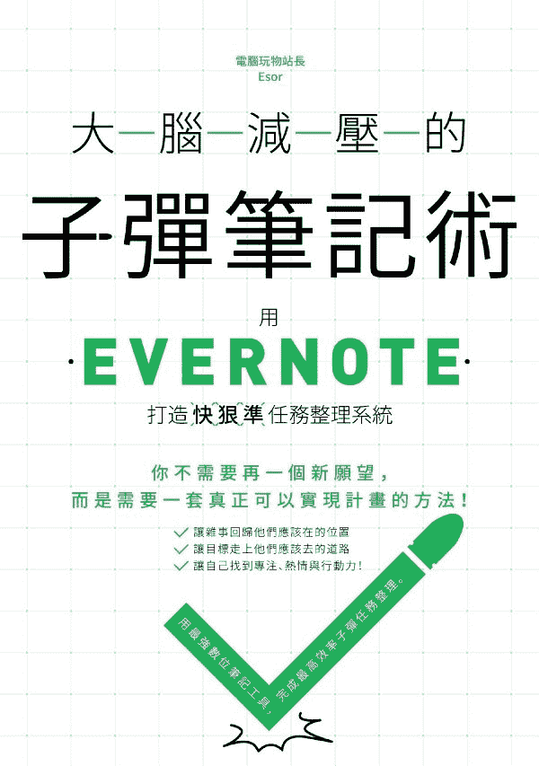

   

 

十年磨一剑，我如何架构出这套时间管理系统？

作者：电脑玩物站长 Esor

部落格：[`www.playpcesor.com/`](https://www.playpcesor.com/)

大概是从三年前开始吧？在自己的时间管理课程、Evernote 子弹笔记术课程中，我尝试从各种角度，跟上课的学员一起演练这本书中所要介绍的时间管理系统。

上过课的学员，往往课后心得中都包含着：“不可思议、惊喜连连、当头棒喝”这类的形容词，还有好几次有人问我说：“Esor，你是花了多少时间，来研究出这样一套思考得非常彻底，架构得非常严谨的时间管理系统呢？”

我总是会这样回答：“我是花了一生的时间来架构出这样的系统。”

这不是夸张的说法，这也不是说这套系统要花很多时间去做练习。刚好相反，这是说在我的核心观念中，我们总是不断的想让自己更有效率一点，不断的希望自己可以去完成更有价值的事情，在这样的情况底下，任何事情都应该是在一个不断调整、不断改变、不断成长的状态，这才合理。

所以我说，我是花了一生时间来架构这样的系统。这个意思其实是说，任何时候，我都在思考着更好的可能性，任何时候我都在追求一个成长的目标，没有完成的一天，直到我入土。

不过这就是时间管理最有趣的部分，真的很有趣！

我们以前的很多时间方法可能搞错了，把自己陷入了行动的焦虑，陷入了做不完事情的烦恼，陷入了更大的压力，但时间管理不应该是这样子！

改变应该是很有趣的，成长应该是要带来成就感，方法应该是符合人性的。

在这本书中，我的时间管理方法有很多的源头，最早可以追溯到 GTD 的时间管理理论，最近则参考了许多近几年风行的子弹笔记方法的思考。但是，这个方法都与他们有所不同，更关键的是，这是一个我自己真实实践，并且现在依然实践的时间管理系统。

不过里面更多的是我的创造、我的修正，目的是希望创建一个真正能够去实践的改变。然后，这个系统架构在我自己最爱用，也最擅用的 Evernote 上。

最后说明一下，这本书前面 1/3 的内容，其实是一套可以用在任何工具上面，并不限于 Evernote 的时间管理系统论述。

 

后面 2/3 虽然会跟 Evernote 的许多功能结合，教你怎么样一步一步把这个系统，在你的工具上面架构起来。但是聪明的读者，也一定可以从这样的方法，拿回去套用到你所使用的不同时间管理工具上面。

 

这本书，可能是我目前写过架构最严谨的一本著作，从头到尾没有多余的篇章，每一篇章之间有前后起承转合的逻辑。因为这一次，我希望帮大家真正的从头到尾架构出一套可操作、可实践，并且真正完成你的计划的任务管理系统。

 

希望这本书真的可以对大家有所帮助！

 

 

## 第一章   
时间管理如何真正有效？

 

 

#### 1-1 为什么尝试各种时间管理方法最后都失效？

在本书一开始，让我们先想想看，自己有没有下面这样的情况。

工作非常杂乱，有许多重要又困难的专案，同一时间在推进，自己常常分身乏术，顾此失彼。而同一时间，工作上依然有着许多的意外，在自己最忙碌的时刻，往往又一件被主管、客户称之为重要又紧急的任务，丢到了自己身上。

而在生活中，那些个人兴趣，或是想要照顾好的家庭关系，往往在这样忙碌的工作氛围下，被自己舍弃在一旁，虽然常常怨叹，但也感受到无能为力去解决时间不够的问题。

在这样工作与生活的双重挫折下，开始进入一个恶性循环，面对任何专案都觉得压力像是山一样的大，每个新任务出现时只想到逃避与排斥，人生的行动失去了乐趣，时间再也不在自己的掌控中，而“我”也没有成为我自己想要成为的那样的人。

好的，先放下上面沉重的回想，喘口气，再让我们进一步想想看，自己有没有尝试解决过这样的问题呢？

可能我们会发现，有的！我们其实都有想解决过这样的问题，我们并非就是想一直摆烂，我们并非只想屈服现状，我们也并非只会怨天尤人，我们确实想要改变。

但是让那些曾经想要改变的记忆继续往下播放，或许，我们又开始觉得喘不过气来，因为我们发现：

为什么那些自己尝试过的时间管理改变，最后还是又回到原本杂乱、高压、拖延与缺乏成就感的状态？

为什么会这样呢？因为，一个有效的时间管理，一个可以让自己快乐的自我实现方法，不能只是依靠方法、个性、想法的改变，而要依靠“一套系统”的改变。

我们太想依靠“自己”解决问题

 

让我举个例子，如果今天我想要去海边浮潜，但我实际上不善于游泳，或是不会游泳，这时候怎么办呢？

我是想尽办法用自己别脚的泳技，拼命去挑战浮潜吗？但这样不仅失败概率很高，事实上还有安全问题。

 

还是说，我先等自己好好把游泳练好，再去享受浮潜的乐趣呢？但那会是什么时候呢？这就好像等退休后再来享受旅行，等工作不忙时再来陪伴孩子一样，不仅实现的那一天遥遥无期，等到真的有办法了，或许实现的价值也已经消失殆尽。

 

当我们困在上面的窘境，觉得自己因为技能不足、时间不够，没办法好好享受浮潜时，却没有发现，简单的方法就在旁边。

什么是简单的方法？就是浮潜不一定需要依靠游泳技巧，甚至不一定要会游泳，只要有教练教你整套操作、应变的流程，然后戴上浮潜设备，依靠指示一步一步执行，就能在浮潜中欣赏美丽的海底世界。

当然，或许游泳高手可以享受更进阶的乐趣，但无碍于一般人可以“依靠一个支持系统”来达成浮潜愿望。而且说不定当你真正能体会乐趣后，就会开始愈来愈上手游泳，甚至更努力去增进泳技。

时间管理，也是同样的道理。

我们不能依靠自己的天性与能力来解决问题，那很容易失控，更容易恢复原本状态，也常常缓不济急。

我们需要的，是一套时间管理的“支持系统”，让任何人都能享受时间管理带来的效率、成就感，甚至不可思议的乐趣。

不需要是一个有意志力的人，不需要是先充满热情，都可以依靠支持系统，获得自己的时间管理效果，甚至进一步的，依靠这样的系统，我们会一步步找到自己的意志力与热情。

 

我们太想依赖“工具”、“技巧”解决问题

但什么是一套支持系统呢？让我再举个例子。

新的一年，总是从一个很漂亮的计划开始，空白笔记本一开始写得井井有条，一起都开始得那么美好，但很快的，我们会发现自己又进入杂乱状态，又开始东墙补西墙，又开始混乱忙碌，哪里出问题就去哪补洞，那些新年的愿望目标，早就丢到九霄云外。

我记得前几年子弹笔记方法刚刚开始流行的时候，有一个朋友实践了子弹笔记方法一段时间，他跑来跟我讨论说：“这个方法没用！”我说，子弹笔记方法全球风行，怎么会没用呢？

朋友那时候是这样跟我说的，他虽然依照子弹笔记方法的说明，列出了很漂亮的行动清单、设计了好看的行事历页面，一开始确实感觉到跃跃欲试，充满斗志。但是没过多久，开始跟之前使用任何时间管理工具或方法一样，行动清单慢慢的只是一大堆做不到、没办法打勾、永远被拖延到第二天的待办事项。

于是就算子弹符号做得再漂亮，行事历画得再精美，但渐渐的大量累积做不到的待办事项，让自己再也不想打开这份待办清单，甚至看到他就痛苦，而这样一来，又累积了大量失控的事务，最后，就宣告子弹笔记方法无效！

但事实上真的是如此吗？

如果深入研究子弹笔记方法，会发现他真正的核心并非只是列出子弹符号，也非只是写出漂亮的行动清单而已。更关键的是，子弹笔记方法要我们用目录、索引，去管理任务跟任务之间的链接，去拆解重要的目标专案，利用这套系统去聚焦重要的事情，并且让每一件事情都可以在笔记本的某一页找到他最适合的摆放位置。最后，我们才会知道在行动清单上如何有效的规划出一个一个子弹。

而我们有“完整的实践”子弹笔记方法的每一个关键环节吗？有依照他的流程的启发，去改造自己的工作流程吗？还是只采用了他写行动清单的技巧？画符号的技巧而已？跳过了那些更关键的支持环节？

 

子弹笔记方法之所以被许多实践者认为有效，关键就在于它不是一个单一的方法，而是一套思考全面的系统，他思考了任务如何发生？人如何去做选择？怎么找到专注？怎么样拆解任务更有行动力？应该如何安排自己的日程？怎么在混乱的事务中找到按图索骥的方向？每一个环节搭配起来，本质的问题才会被解决。

而如果我们只是用了其中几个看起来特别“吸睛”的技巧，却没有看到背后真正的“支持系统”，那么当然最后时间管理还是回到混乱的状态。

 

这也是为什么我们常常看到一些新鲜工具，有些厉害功能，就误以为这样的工具可以改变自己的时间管理，但结果用了工具一阵子，发现自己时间管理依然混乱，就说工具无效。

其实不是子弹笔记无效，不是工具无效，而是我们只操作了功能，却没有创建背后那个帮助功能真正发挥效用的“支持系统”。

看到一个书法名家，用一支名笔写出了漂亮的书法，我们就误以为只要拥有名笔就能写出好书法。看到摄影大师，用某台相机拍出漂亮的照片，我们就误以为只要也拥有那台相机，就能拍出好照片。

当然，名笔、相机、工具、技巧，确实有帮助。但真正能够让最有价值成果诞生的，还是背后那套支持系统，可能是书法名家的架构文字的每一个步骤，可能是摄影大师的构图取景流程，可能是时间管理高手如何整理任务、如何拆解任务、如何建立目标、如何挑选价值的一个完整系统。

100%的系统，而非只是解决眼前问题

知名时间管理方法 GTD（Getting Things Done）的创立者 David Allen 曾说过，如果不是 100%使用 GTD 系统，不如不要用。因为半调子的方法，反而可能更混乱，造成更大压力。

GTD 要求使用者彻底清空大脑，把脑中所有的杂物，放入一个统一的管理系统中，并且做好专案的分类、目标的设定、行动的拆解。

但是如果我们没有去实践那个完整系统，还是一部分的行动在清单上，一部分的行动在脑袋中，甚至还有很多散落的行动在邮件、实时通、笔记本里。其中一部分的任务还没有做好分类，很多目标还没拆解。那么，这么混乱而缺乏系统的流程，只能单纯依靠意志力或聪明才智去执行，要不回到混乱，都很难！

另一位在家居收纳领域十分知名的整理女王近藤麻理惠，着有《怦然心动的人生整理魔法》，她也说过类似的话，她说：只要彻底完成一次整理，就很难恢复混乱的状态。但是，大多数人其实从来没有完成过一次彻底的整理。

我们的整理，常常只是在解决眼前问题，头痛医头、脚痛医脚。只是把眼前的杂乱整理清楚，例如看到书桌乱，就把桌上的东西收到书桌抽屉，眼前看起来是干净了，但是这些东西真的都应该放在书桌抽屉吗？里面有些修理工具是不是应该统一放到客厅工具箱？有些用完的笔记本有没有设定好他们应该归类的位置？

如果只是整理眼前的东西，那么当新的东西出现后，因为没有系统，东西没有决定他们应该摆放的位置，于是就会继续累积多余的东西，更多东西开始恢复更多杂乱，最后只好又在混乱中重新整理一次，日复一日。

但是如果我们有创建“一套系统”，就可以很大程度避免恢复混乱的问题。

不要只是看到床上有点乱，就把床上的衣服塞进衣柜收好。看到衣柜有点乱，就把衣服排整齐而已。这些都只是解决眼前问题，而非创建一套系统。

什么是创建一套系统，以近藤麻里惠的家居整理来看，就是把所有东西拿出来，一个一个决定他们的去留，把不心动的东西去掉，留下的东西则要决定一个固定的整理位置。例如把家里所有衣服拿出来，一次丢掉所有不要的衣服，接着根据自己的分类为每一种衣服决定好位置，这样一来，衣服的系统就创建起来了。

只要做一次这样彻底的整理，那么接下来有新的衣服想买了，我们就可以透过自己的系统，知道自己是否需要这样的衣服，如果买了又应该摆放到哪个固定的位置。即使偶尔乱放一件衣服，也很快可以知道这件衣服应该回归到哪个位置。而且也会明确知道自己工作、约会、出游可以有哪些衣服选择？喜爱哪些衣服？以及这些衣服在哪里？

这都是因为有了系统，以及创建了一个 100%彻底的系统，才能把各种杂乱的问题，轻松的迎刃而解。无论是家居整理，还是时间管理，都是一样的道理。

所以，回到我们一开始的提问：“为什么尝试了各种时间管理方法都无效呢？”

因为不是方法的问题，不是天性的问题，而是我们没有去创建系统。

  

 

#### 1-2 创建系统，看似困难但其实最简单

但是问题来了， 如果一定要创建系统才能做出有效的时间管理， 那是不是反而更难做到？会不会根本就是不可能任务呢？

确实，要创建系统，好像就不是列的行动清单那么简单，看起来好像真的困难一点。但实际上，系统之间环环相扣，这个意思并非只是要顾及每一个环节，而是说，系统本身就是一个头尾相连的流程，必须先把第一步做好，然后逐步推进，整个系统才会完成，最终的成果才会实现。

 

相对来说，也就是做好第一步，自然就更容易推进下一步，然后愈来愈容易，最后价值的实现也能真正落实。

以为是捷径，其实是陷阱

创建系统看似不是捷径，但才是达成目标最有效的方法。

 

反而是如果我们不顾系统，直接从里面某一步跳着做，这样一来因为没有前面步骤的支持，反而要做好这一步更难、更花时间，而且就算好不容易做好其中一步后，也缺乏继续达到最终成果的资源。

例如在养成早起习惯的过程中，我们想说既然要早起，那就直接设定一个闹钟，每天早上六点起床就好啦！如果这样做，结果会怎么样呢？

很可能每天早上闹钟六点响起，我们依然觉得没睡饱，忍不住按掉闹钟继续赖床。然后每天重复这个设定闹钟、闹钟响了按掉、后悔自己又赖床的恶性循环。

你会发现，跳着去做其中一步，以为是捷径，但结果反而是陷阱！

为什么会这样呢？因为行动跟行动之间其实彼此链接，才构成一个能够确实达成任务、目标的流程。

 

以早起为例，设定早起哄钟其实只是整个流程的行动之一，而从整个系统来看，“早起前”需要的是一个充足睡眠的支持系统，以及“早起后”需要一个有趣的目标支持系统。所以如果想要养成早起习惯，只是设定一个早起哄钟，当然很容易就失败。

 

那么应该怎么做呢？我们必须把系统创建起来。为了要在设定闹钟的时间有充足睡眠，需要提早入睡，为了提早入睡需要做好寝室环境改善，以及重新调整自己的工作安排流程。然后为了要在闹钟响起后有值得起床的行动，我们要开始设定早上的目标，或许是晨跑，或许是做早餐，但因此我们可能也要前一天晚上提早做好跑步器材、早餐食材的准备。而为了让晚上有更多时间，我们又回到必须更有效地排定工作流程，减少加班，更高效率完成工作。

你会发现很有趣的一点是，其实任何真正的改变，即使只是早起，都牵涉到一整个生活的改变，也就是系统的改变。

系统的改变才确实，系统的改变也才能带来真正的价值。虽然这可能真的要多花上一些时间。

困难但也最容易做到

不过，这里所谓的多花一点时间，并不是说这件事情很难做到，而是我们需要时间养成习惯。

创建系统，其实就是在改造自己的习惯流程，习惯与流程改变了，我们想要的改变才会发生。

而要改变习惯，当然也看似困难，不过倒是有两个好消息。

第一个好消息是，所谓的习惯，就是只要我们想做，就可以立刻做到。因为习惯只是流程的改变、步骤的改变，不是要我们另外去学会自己原本不会的事情，而是改变自己一系列的作法，都是自己原本会做的，只要改变顺序，或是加入几个步骤即可。所以习惯的困难，不在行动上很难，而在心态、价值观上没有转变。

但我们前面也有提到，当我们误以为是自己的心态、价值观上无法改变时，往往真正的问题只是我们以为要依靠心态、价值观才行，但其实只要改变系统、改变流程与步骤即可。

 

所以第二个好消息时，所谓的习惯，其实不一定要依靠多坚强的意志力去执行，反而应该先明确自己在习惯循环中的每一个步骤，重新调整系统，设定好新系统的流程、步骤，拆解出相对简单易行的下一步行动，然后用前一个步骤推动下一个步骤，让整个系统的环圈运作起来。

我们觉得改变习惯很难，那是因为我们只改变其中一小步，但如果去改变整个系统，反而事情变得相对简单。

然后，当这个行动循环可以开始推进，习惯就会逐步创建，而当习惯累积一段时间后，系统就会更加稳固。

 

而当系统创建完成，虽然人性的弱点总会一一再现，如意志力薄弱、常常失去动力、容易焦虑等问题。或是工作上的意外、繁琐依然形影不离。但只要我们拥有系统，那么就像衣服更容易找到她的位置，充足睡眠更容易帮助我们起床，虽然不一定就能百分之百实现目标，但也可以帮助我们持续保持走在目标的路上，继续往前推进。

 

 

#### 1-3 子弹任务系统想要达成的三个目标

做任何事情之前，我们总要先确认自己到底想要达成什么样的具体目标？这其实也是创建系统的一部分，系统中的每一个动作每一个链接，都朝着一个或几个我们设定的目标前进，透过系统的力量来完成那个最终的价值。

所以第一步，无论做什么事情，我们总应该先设定清楚自己实际想要达成的目标到底是什么？

那么在这本书里，要跟大家介绍的这套任务管理系统，我想要达成什么样的目标呢？我有三个想要达成的目的：

 

・第一个目标：我希望能够创建一套帮助大脑减压的系统

・ 第二个目标：我希望创建一个只需要专注当下下一步行动的系统

・ 第三个目标：我希望创建一个聚焦目标前进的系统

下面让我更进一步的为大家一一来做解说。

创建一个可以让大脑减压的系统

在 GTD 的时间管理系统中也提到，第一步就是要我们清空大脑。

工作生活中，会有很多杂乱的任务，每个任务会有很多琐碎的行动，如果想要用大脑来管理这些杂事，那么最后很难不再重复的陷入混乱中，因为人的大脑或许很适合做决策，却不适合来做这么庞大复杂的记忆与整理。

但是就如同前面所说，我们常常犯了一个错误，不想依靠系统，而误以为只能依靠自己。

 

我们把杂事放进大脑里面去记忆、去管理，结果大脑常常漏掉其中某些关键的细节，做事常常搞错重要的顺序，于是我们的工作产生了更多混乱，更多的混乱带来了更多的焦虑，更多的焦虑创造了更大的压力，于是我们觉得工作是永远忙不完，眼前总是充满了一个一个的困难大阻碍。

然后这样的混乱，其实是源自于我们没有一套系统来做管理。没有一个系统帮助我们把大脑里的混乱，重新归位到不再混乱的地方。

把这样的混乱压力交给我们的大脑，但大脑并没有办法把混乱状态理清楚，于是压力反而越来越大，最终造成工作上充满挫折、没有动力，事情也没办法如期完成的困境！

而且这里说的，是要把大脑所有的烦恼、杂事、压力，全部都放入系统中，任何一点都不要留在大脑里，就像前面所说的 100%系统。不会是有些重要事情在待办清单上，然后有些小事、杂事，以为用自己的大脑就可以管理好。千万不要这样做！也不要这样想！因为这样子依然会再重复的陷入大脑遗忘、搞错、混乱的循环当中，我们必须要彻底的去执行系统的流程，才能真正创造一个大脑减压的系统。

而这个系统，也应该要可以承载所有我需要从大脑移出来的东西：要做哪些事？需要哪些资料？细节是什么？我的想法是什么？

而这是我想创造的时间管理系统的第一个价值目标，利用系统，来帮助大脑减压。

 

创建一个可以专注下一步行动的系统

系统里的每一个行动环环相扣，系统的价值跟价值之间其实也环环相扣。

工作混乱、有很多意外、专案有很多变动，累积着许多别人交代给我做，而我还没有做的杂事，这个现况本身，就算做好了整理，那些还没做的事，依然还没做，这样子真的有办法达到一个专注、快乐、有动力，又轻松的时间管理方法吗？

我们常常误以为时间管理方法是要我们：“把所有的事情全部都做完。”因为我们误以为要把所有的事情全部都做完，我们才会觉得满足、才会觉得快乐、才会觉得轻松、才会觉得没有压力，但事实上并非如此。

从一个反向的角度来思考，当你完全无事可做的时候，你真的觉得自己是轻松没有压力的吗？

仔细想想，这时候你反而会觉得空虚，觉得更加缺乏动力，不知道自己应该采取怎么样的下一步行动，不知道自己接下来可以去创造什么样的价值。我们会发现，所有的事情都做完，其实不是真正有效的无压状态。

那什么是真正有效的无压状态呢？并不是感觉到自己完全不需要再去做任何事情了，真正的无压状态，其实只要能很明确的知道自己现在应该做什么事情、应该以什么样的行动为优先。

当这样的心态产生了，那么即使还有很多没有完成的事情，即使跑出来很多意外的杂事，其实我们依然可以专注，而专注就会帮助我们依然会感到自在与满足，并且帮助我们真正在持续推动任务。

关键就是，我们不需要担心其他事，因为其他事情已经都在系统中，并且更进一步的，系统还可以帮我做出筛选，让我知道自己这个当下最佳的行动是什么。对下一步行动有明确的认知，就能有勇气去选择那一个最佳行动，而执行最佳行动的过程本身，才是真正快乐的来源。

因为在这个当下，我知道自己正在做一个自己需要去做的行动，并且知道这个行动可以创造什么成果，而且知道这是我这个当下最好的选择。其实只要能够明确这件事情，那么就可以称之为一个有效的时间管理系统。

这里的关键就是，我们必须依赖系统的流程，来帮助我们在每一个当下，都能很轻松的选择出这个当下的最佳下一步行动。

不是等到时间到了，才从混乱的脑袋、心情里面去挑选行动。不是等到时间到了，要从杂乱的工作清单里面去挑选行动。不能够这样做，而是要让系统帮助我们作出选择。

这个系统应该可以层层过滤各种杂事，并且最终在每一个当下，帮我自动过滤筛选出那个最佳下一步行动。

当然这个系统也是我们所创建的，就好像我们创建了一套自动化的生产流程，我们构思好他的逻辑，我们建构出他的生产线，让我们的杂事放进去后，在里面不断的加工生产，直到我们需要的那一刻，我们需要的那一个产品，也就是这个当下最佳的下一步行动，就会出现在我们的眼前。

我们去选择这个当下最佳的下一步行动，就能获得时间管理的快乐。

这是我希望自己的系统可以达到的第二个价值目标，利用系统，找到每一刻专注的下一步行动。

创建一个可以聚焦在创造价值的系统

 

我们常常在时间管理上做的行动，都是在逼自己工作。

我们以为自己不会时间管理，所以逼自己去时间管理。我们以为自己没有效率，所以就逼自己花更多时间做更多事情。但是在这样逼迫自己的情况下，我们并没有产生真正的意志力，也没有产生真正的热情，事实上那些逼迫自己的时间并没有带来多高的生产力，反而带来的是更多的后悔和自责。

关键就在于，时间管理并非英雄主义，不需要成为一个有超能力的超级英雄，需要的是背后一个有效的支持系统，用这个系统来推动我们，持续的去专注在某个重要的专案上面。

利用这个系统，让我们保持在某种有生产力的状态，让这个系统帮助自己逐步的去累积、创造属于自己的成就。

虽然我缺乏意志力，但是我不需要依靠自己，为自己开个系统，来帮助我不想做很多事情的时候，还是可以采取一些简单有进度的行动。帮助我想要拖延的时候，还是会去创造一些小的成果。然后这个系统利用这些小小的成果，去逐步建构我的信心，逐步的把困难的专案慢慢变得简单，把不可能的目标慢慢的朝着有可能被实现的结果前进。

虽然我对大多数事情都缺乏热情，但是我或许需要的不是那种天生的热情，我需要的同样是一个支持的系统，这个系统会让我在做各种事情的时候，感受到来自于自己选择的快乐，可以让我在做很多尝试的时候，享受改变、成长的幸福。

 

我不一定要是一个天生对某件事情有着非常狂热、执迷、热情的人，然后我才能把那件事情实现。

我需要的只是透过系统，帮助我乐意开始采取行动、练习小改变，而这些行动本身，就帮助我们可以成为一个不断成长、不断推进目标的人。

 

这就是我想要创建的系统所要达到的第三个价值目标，利用系统，让我们成为一个对自己的人生有热情的人，为人生去推动一些行动，为人生去尝试一些改变。

快、狠、准的任务管理系统

由瑞德.卡洛所发明的子弹笔记法，常常使用快、狠、准当作他的效果说明。

这本书中，我参考了子弹笔记术、GTD 等时间管理方法，并经过自己多年的实践、改造，加上运用到 Evernote 中的改良，最终成为这本书里的系统架构。

 

而上面三个系统带来的好处，其实也可以对应到快、狠、准的解释：

・ 快，就是让大脑减压，用系统帮助自己更快完成工作。

・ 狠，就是专注下一步行动，勇敢去做最佳选择，可以创造快乐。

 

・ 准，就是聚焦在创造价值，把有限精力、时间，投资在最准确的成果上。

而这个系统，就像子弹一样，帮助我们可以完成战略、击中目标、夺下胜利。

请你也为自己的时间管理系统，先设定好最终价值

 

最后要特别说明的是，你也可以为自己想要创建的时间管理系统，设定好你想要追求的目标与价值，而且当然可以跟我不一样。

你可以照着我的思考逻辑去做设定，然后去追求你真正想要达到的不同目的。

 

创建系统很重要，创建系统的流程步骤是我这本书想要跟大家分享的核心，但根据我们设定的目标不同，在同样的步骤下，有可能我们也会打造出相异的系统，不过没关系，因为那反而会是对你来说，最能操作，最能创造成果的时间管理系统。

 

所以，第一步，你应该自己问自己，先设定好：

你希望自己的时间管理系统，为自己带来什么样的价值？

 

 

## 第二章   
应该创建怎么样的任务管理系统？

 

 

#### 2-1 以少驭多，创建你能够驾驭的系统

经过前面步骤，我们设定好要建造的系统的最终目标。

接下来，我们就根据这些目标，来设计这个系统应该具备哪些功能。这样一来，最后就将这些功能一一实现，就能打造出一套流程，这套流程就是我们这本书所要创建的任务管理系统了。

所以接下来我们要问自己，我需要的时间管理系统，要具体解决哪些问题？他的正确流程是什么？应该具备哪些功能呢？

这个顺序，其实也是我们在实现各种目标、专案、一个有价值任务的时候，应该遵循的顺序。

我们不是埋头到一大堆杂乱的事情中去苦干，这样虽然也能可能解决一些问题，但会花上许多时间、浪费很多精力，甚至很有可能走错方向，导致最后感觉自己在瞎忙。

这个顺序非常重要：

・ 第一步，永远都是先设定好自己到底想要达成什么目标。

・ 然后根据目标，进一步设定我们需要什么样的功能，或是需要完成哪些阶段性成果。

・ 然后我们才开始安排我们的行动，去把这些功能、成果逐步的实现。

这样一来，我们才不会陷入杂乱中，最后我们就可以达成或趋近我们想要的，即使可能遭遇什么重大意外失败，起码我们会明确知道自己做了什么，怎么失败的。

为什么我们做的待办清单总是最后失效？

 

那么针对这本书想要完成的子弹任务管理系统，我们第一个要打造的功能是什么呢？

我的设定是，第一个要达到的功能是一个可以“以少驭多、以简驭繁的系统。”

什么是以少驭多呢？让我先从下面这个例子来解释，我们先来看看，一般的待办清单管理方式，可能面临什么样的问题，导致最后我们获得的是一个杂乱、失误、做不到的清单呢？

我们可能平常会这样做，整理待办清单的时候，很自然的会把日常当中随时出现的、需要去做的行动，一一的列在待办清单上。但是，这正是问题所在！

什么？你会说难道不是要这样子吗？待办清单不就是把准备要做的事情全部写上去吗？这样的方法有什么问题呢？Esor 不是说要清空大脑，我们就是在清空大脑，把所有杂事写到待办清单啊？

 

但是，这样做的方法的问题就在于，我们还是停留在管理那些工作、生活中不断出现的杂事的状态。我们在一件一件杂乱的事情上去做管理，在一堆混乱的状态中去做管理，杂乱依然混乱，怎么能够进入高效率的状态呢？

 

这样的待办清单，就算我这个当下暂时先把混乱的杂项事物列得整齐了，只要新的杂事出现，只要新的意外加入，那么这个整齐状态，就会很快的再回到混乱的状态。

这就好像在家里打扫的时候，只把书桌上那些散落的文具、文件，杂物，全部都先塞进抽屉里，把丢在床上的衣服，找最近的柜子、衣柜全部塞进去，让眼前看起来好像是恢复整齐的样子。但是我们都知道，我只是把一堆垃圾，原封不动的摆到另外一个暂时看不到的地方而已。

杂乱还是杂乱，垃圾还是垃圾，一样缺乏系统。

 

于是我们才会发现，书桌、卧室很快的在一两天之内就恢复杂乱，我要用什么文具找不到，新加入的文件继续堆积在书桌上，每天回家之后脱下来的衣服，没有一个简单固定的摆放位置，继续先放在床上、椅子上，很快的床上、椅子上也恢复混乱的状态。我们开始感觉，自己一直在整理，但整理永远只有当下的效果，而且很快就会恢复杂乱。

这不是整理的问题，而是我们只是在整理杂物，而不是在整理系统。

这也就是时间管理上，单纯列出待办清单会遇到的问题。

 

或许我们做到把杂事移出大脑，但是我们没有先创建系统来安放这些杂事，来判断这些杂事应该放入什么位置中。

于是，一堆杂事只是从大脑的混乱状态，原封不动的移到一个外在的清单上，但是依然是混乱的状态。

 

这样确实可以减轻一些大脑的压力，但还不是我这边想要追求的真正的大脑减压！

因为这样做，只会让我们回头去面对那份待办清单的时候，依然是充满压力，依然是混乱和焦虑，而且就像书桌的整理一样，当事情不断的涌现出来，待办清单一定很快的就会进入更杂乱的状态。

我们优先管理专案，而非陷入清单中

仔细的回想看看，这是不是我们自己在现在的时间管理方法上，常常遭遇到的问题呢？

这时候我们需要创建的是一套以少驭多的系统，我们不要在那一群混乱的杂事上面去执行，而是把他们先归结到、关联到、聚焦到那些最终的专案目标上来做整理。

如果杂事有一百件，经过这样的整理后，会发现他们其实关联到三个专案、目标。

我们可以在系统中把这个脉络理清楚，最终我们就只要在三件事情上面进行掌控即可，也就是那三个专案目标，只要管理好这三件事情，那么，那下面关联的那一百件杂事，自然也就管理好了。

你说，是不是这样呢？

而这样的管理系统，将会让你变得更加轻松，变得更加聚焦，同时也变得更加有效率。

 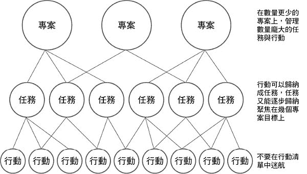 

案例：一个以少驭多的系统

让我来快速展示一下这个系统最终完成的效果。

说个真实发生的故事，之前我和老婆遇过一个情况，某一个月，我们刚好遇到月中要搬家，月底要出国自助旅行，加上我和老婆都是上班族，还有许多工作上的事情要处理。那时候，我们都觉得很焦虑，因为每天感觉都有忙不完的事情，以及不断跑出来的新任务。

如果我们只是任由事情不断跑出来，那我们的任务清单面对的是一个一个杂事，这些杂事之间有些是相关的，也些是不相关的，有些有前后顺序，各自有不同的轻重缓急。

但是他们原本的状态是混乱的，而这样的混乱，其实会让我们没办法做出最正确、最高效率的选择。也根本无法做出判断。

于是那时候，我们找了一个周末，两个人一起坐下来，把我们必须在这个月解决的最重要专案列出来，对我们两人来说，共同的必要专案是：搬家、自助旅行。然后我们也有各自工作上的必要专案，可能是一个课程，或是一个产品开发。

确定好了专案后，我和老婆开始把目前累积的所有待办事项，不是排行动清单，而是先排入专案当中。

・ 这件事情是搬家、自助旅行，还是产品开发专案的事情？

・ 然后把相关的事放在一起、把事情的前后顺序理清楚

・ 发现有些事情不在这些主要专案上，那就是可以稍缓的事情

 

最后根据这个月剩余的有限时间，决定主要专案上的哪些主要事情，应该优先实现？

经过这样的归纳步骤，最后我们非常明确的知道，那个月，我们就是聚焦在那少数几个专案上，而少数专案中又有哪些步骤是一定要完成的，哪些是可以舍弃的。最后，那个月我们真的把搬家、旅行专案都完成，也各自完成工作上的重要专案。

其实说穿了，这是一个很简单的步骤，但如果仔细想想看我们原本的时间管理方法，可能根本没有做这个步骤。

我们可能以为事情已经不断跑出来，多到做不完，赶快有什么做什么，哪里还有时间先从专案开始整理呢？但这就像是我在第一章所说的，以为要创建系统很麻烦，却没有发现，系统才是真正有效的捷径。

如果我们只是在拼命把所有事情都排上待办清单，那么这其中会有很多步骤可能是重复的，于是我们就会多花许多时间做重复工。这其中也可能有很多事情有先后次序，于是我们可能很多时间被忘了先做某个步骤而卡住。我们更不知道，其中哪些步骤是必要的？哪些步骤是可以延后的？

而这些判断，无法在底层的待办清单上做判断，而要在“专案目标”的高度做判断。

所以虽然把杂事逐一归纳到专案上，看起来要花时间，但这样的系统创建起来，最终却会节省我们更多时间。

 

我们还可以搭配一些工具与方法，让把杂事归纳到专案上，变成一个相对轻松、省时间的步骤，这就是我们对任务管理系统的第一个功能要求。

最后我来整理一下，以少驭多，我们需要系统具备下面的功能：

 

・ 可以快速收集各种要做的事。

・ 可以创建一套整理系统，把事情慢慢过滤、分类成专案。

・ 可以从专案的视野，去管理所有杂事。

 

 

#### 2-2 行动关联、任务拆解、专案整合的系统

要创建一个以少驭多的专案管理系统，那么在逻辑上，我会建议尝试区分行动、任务、专案三个层级，了解不同层级的特性，以及他们必须解决的问题。

 

让我继续为大家一一解释。

行动：往往跟其他行动关联

只会列出待办清单，最容易出现的问题，就是行动常常不是单一的，行动往往会跟其他行动关联。

如果一个行动是做完一次就好，结束后跟其他行动不相关，那他通常是不重要的行动。

什么是只做一次的行动呢？例如开会时要打印一份资料，过节时要寄给客户礼品，或者是今天回家记得买菜。这些行动只做一次，然后就完成了，我们就删掉了，但这样划掉就结束的行动，即使一天累积了很多完成，但真的有提升我们的幸福感吗？还是我们更可能觉得自己好像做了很多，但依然觉得空虚？

行动完成就划掉，背后也没有关联到其他行动，这个就是单一次的行动。这种行动做完了，没有办法在未来继续为我延伸出更多价值，或是慢慢累积成为某个更大的成果。那么，这种行动应该要少作为好。因为这就是我们常常觉得自己瞎忙的原因：都是在做一些单一的行动。

但是，这里有一个非常重要的关键，那就是大多数行动我们误以为它是单一的，好像做完就结束了，但真的是这样吗？

 

还是说，其实他是跟其他事情互相关联的，只是有时候，或者说大多时候，是我们自己没有发现行动与行动之间的关联，导致自己做事情都是断裂的？

其实，大多数行动都是有所关联的，只是我们都是断裂的处理他们，导致行动的价值、效率都降低。而这是时间管理系统必须解决的问题，也就是帮行动创建关联。

有时候行动明明跟其他行动有关联，我忽略了去串联他们，于是总会搞得自己一团混乱。例如前面举例的那几件事情，打印开会需要的资料，看起来好像是一个单一的行动？但说不定我是这次会议的主持人，我是要打印自己准备好的会议议程，我希望议程清楚明确，让会议更顺畅。或者，我是这次会议的报告人，我想在打印的报告上花一些巧思，让我的主管、同事或者是客户，因此对我印象深刻。

 

这时候，你应该会发现，“打印开会资料”不再仅仅只是单一一次的行动，而是和其他行动相关，并且这些行动有先后次序，这些行动背后关联到一个很重要的目标，我必须要把这些搞清楚，那么这个“打印开会资料”的行动才能帮我创造更大的价值。

 

如果说这个打印资料的行动，是要打印我的会议报告，背后的目标其实跟我想要在客户、主管面前留下好印象相关。那么，单独针对打印资料这件事情，我是不是可以去思考：

我怎么样把报告打印的更漂亮？

 

是不是要找专业影印店？

有没有需要加个封面？

用什么在纸张与字体看起来最舒服？

你会发现，原本我们不经意的单一行动，当我们尝试去跟其他行动相关联，找出这些行动背后的目标，那么我会把这个行动做得更好，并且在这个行动中真正创造成果，而非只是完成就好。

或者刚才举的那个回家买菜的例子，我也有一个小故事。

在某一次我举办的的 Evernote 子弹笔记方法课程，课后有同学主动寄了回馈心得给我，里面他提到，当他上完课回去之后，她开始思考“自己每天下班都要买菜”的行动，对自己来说一直把它当成一件很烦的琐事，但是这个行动背后，有没有跟其他更有价值的行动相关联呢？

或许就像 Esor 所说，去把很多行动关联在一起，让这些原本看似平淡、无聊、琐碎的事情，最后串联出一个对自己来讲很有价值的目标，这是可能的吗？当他这样思考的时候，他发现既然他每天都必须买菜，那么与其平淡无奇的买菜，不如帮自己设定一个目标，这个目标叫做“帮助家人尝试健康又美味的蔬食晚餐”。

 

于是，买菜这个单一行动，开始跟某个更有价值的目标串联，并衍伸更多有意义的行动。比如说，去研究一下哪些食材营养又新鲜？怎么样可以把这些食材料理得更加美味？蔬食可以变化出哪些每周食谱？是否需要哪些特殊设备？

 

当这样开始串联之后，他发现每天下班买菜，变成一件有趣的事情，并且也变成一件有价值的事情，而且也变成一件有变化的事情，因为每天可以购买不同食材，尝试不同挑战。

透过系统，帮助行动与行动之间产生关连，对我们来说，非常有帮助，也是时间管理必须肩负的功能。

如果可以把行动串联起来，让一个行动，除了本身完成，还可以为下一个行动或其他行动累积价值，那么这个意思就是，在那个时间里，同样的行动量，却累积了加倍或数倍的结果。

 

买了菜，一方面解决今天晚餐，一方面研究蔬食料哩，一方面又让家人更健康。打印一份资料，一来满足开会需要，二来呈现自己效率，三来让客户、主管留下印象。

为什么不这样来管理行动呢？

 

任务，通常需要拆解成行动

我们在待办清单上面常常会犯两种毛病，第一种毛病，就是前一小节所说，我们有什么行动就列什么行动，彼此相关的行动明明是同一个专案的行动，在待办清单上却散落在不同的地方。

 

这就好像家里完全没有任何固定的物品定位，哪些可以塞就放哪里，虽然外表看似整理，但是却会常常找不到自己需要的东西。同样的，在时间管理中，行动彼此不相关，要怎么有效地找到我们真正需要的行动呢？这是第一个毛病。

 

而我们会在待办清单上犯的第二个毛病，就是我们在待办清单上列的，不是一个当下真正可以执行的行动。

什么是待办清单？就是我们希望当想要知道自己该做什么事情的时候，打开待办清单，就能够知道现在可以做什么事情。

 

但是我们却常常在自己的待办清单上，列出我们当下根本就不可能去做的事情，于是导致待办清单上的事情一直拖延，待办清单变成痛苦的做不到清单。

这是什么意思呢？这个意思就是我们常常列的不是“真正当下可做的行动”，而是一个很多行动构成的“任务”，但是任务，不应该列在每日的待办清单上。

有些事情很困难，不可能一次完成的，比如说“写一篇文章”，这是一个任务，而我们很难在一个小时、两个小时的时间里面，就把一篇文章写好、写完。为什么？因为要写好一篇文章，需要很多个行动，有些行动还有前后影响：

・ 可能我要先想清楚我的题目。

・ 可能要先设定好我想解决的问题。

・ 我应该需要去收集一些资料。

・ 我可能要思考一下自己的经验，做一些分析跟反省。

 

・ 我可能还需要列出大纲，确定什么要写？什么不需要写？

・ 说不定我还需要写一些草稿，然后再慢慢修正。

你会发现，像这样的一个“任务”，要完成其实有非常多个“行动”，必须要分次的完成一个一个行动，而没办法或很难一次把所有行动都做完。

但是，我们却常常把这样的任务，直接写在待办清单，而不是任务底下那些必须要一一去执行的行动。

当我们把“写一篇文章”这样的任务放在待办清单的时候，会发生什么状况呢？

 

让我来仿真一下：我有一个小时的空档，想说现在可以来做什么事情呢，我看到上面有件事情叫做写一篇文章，我心里就想，好像空挡没有那么多？不足以写完一篇文章，下次再做好了！

或者，我真的想要开始写一篇文章了，但是我该做什么呢？待办清单上好像并不清楚，看不出来我具体应该采取什么行动。“写篇文章”，是这个任务最终想要达成的成果，但是具体应该采取什么步骤呢？我觉得非常困惑，于是我就想，那么干脆下一次再做好了。

所以一方面，我们要把相关的行动关联在一起，他们可会构成一个任务。但是反过来说，当我们想到的是一个任务的时候，我们应该要具体的去拆解出真正可以执行的具体行动。

把任务里面的一步步具体行动拆解出来，我才能知道什么事情真正应该列在待办清单，并且在看到待办清单时，真正明确的知道自己要做什么。

所以我们需要一个系统，这个系统的功能必须要可以帮助我们去拆解任务的行动。

专案，需要把任务与行动整合成次序

第三个系统的必备功能，就是必须要拥有一个可以把各种行动、任务，甚至是专案相关资料，都整合在一起的专案系统。

这也就是前面 2-1 提到的，用专案的角度来思考，把行动、任务，最终聚焦成一个一个专案。这会带来三个好处：

 

・ 放下焦虑。

・ 排出顺序。

・ 专准选择。

专案系统要帮助我们放下焦虑，因为所有的东西都在他们该在的位子上。

当所有的行动关联成一个一个的任务，当任务组合成一个一个专案，创建起一套以少驭多的流程后，也表示，我们所有应该处理的东西，都已经在系统中，甚至都已经在系统中正确的位置上了。

如果可以有这样的系统，那么我们就可以跟自己的大脑说：不用再焦虑那些还没实现的，不用怕忘记那些需要记住的，不用想东想西，反正照着系统做，就是这个当下最好的选择。

这样的系统，就是可以支持我们，让我们安心，帮助我们循序渐进的系统。

专案系统还要帮助我们排出顺序，决定哪些可以一起做，决定哪些能够稍后做。

有时候，相关联的行动如果可以同时一起执行，那么可以省下许多来回切换工作的时间。

有时候，我们必须确认好哪些可以先做，哪些需要稍后做，才不会在一些明明后面做也可以的步骤上卡关，同样浪费时间。

 

举个故事，之前有一次，老婆和我想要出国自助旅行，我们就很简单的把第一个想到的行动列入待办清单：订国外旅馆。

但是这个行动摆在待办清单上面好几天，我们每天都看到，每天都说要做，但每到晚上我们总是摸东摸西，一直拖延这个行动。你觉得为什么呢？

其实有一个关键原因，那就是在“订国外旅馆”这个行动之前，其实还有许多行动要做，像是我们要先决定旅行请假日期、要先设定好每一天的主要目的地、要先设定好预算，这样我们才能知道自己要订什么时间、什么地点、什么类型的旅馆。

如果前面的行动没有先做，后面的行动就会看起来“很难”。因为没有前置准备，根本不可能完成后面行动。

专案系统要能帮助我们做出专准选择，而不是胡乱选择，甚至无法选择。

 

时间管理的核心目标，不是一个把所有事情都做完的系统，因为本质上我们不可能把所有事情都做完，我们想做、要做的事情，永远多于我们可以做的时间。

所以我们必须做出选择，但选择不会是自由心证的选择，而是要依赖系统，在行动的关联、任务的拆解、专案的整合中，我们将会知道自己可以选择的最佳实践在哪里。

 

 

#### 2-3 主动提示什么时候不要漏做什么事情的系统

前面谈完了我们要创建一个可以区分行动、任务、专案，并将其逐不整合的时间管理系统。接下来，我们还需要的时间管理系统功能有哪些呢？

 

更进一步的，我们需要一套不要遗漏的系统。

什么是不要遗漏？就是这个系统它会告诉我们什么时候该做什么事情，哪个时间、哪个环节，有哪些是一定要做到不能漏掉的，系统都可以一一告诉我。

 

关键就是，这些东西绝对不能靠你的大脑告诉你，依靠大脑最后的结果就是漏东漏西，所以必须让系统来告诉我，而且是让系统主动的告诉我。

那么，要怎么打造出一个会主动告诉我不要遗漏什么的系统呢？

 

如果这个系统只是把所有的事情存进来，就算把所有的事情都做好分类，还是远远不够的，因为储存好的东西，不代表一定会在正确的时间、地点使用它！

我们想想看自己的家居整理就知道了！那些收纳得好好的东西，很多时候反而变成永远不会拿出来用的东西。遇到真的需要什么东西的时候，如果没有系统主动提示我，我一定会忘记可以使用那个东西。

例如今天要去参加宴会，今天穿什么衣服最好呢？其实我有一件宴会衣服，正好适合今天需要的宴会情境，但如果系统没办法主动提示我这件事情，那么通常我也会忘记自己原来有那件宴会衣服，没办法好好利用这个自己的资源。

所以，我们需要的是一个具有主动性的系统，可以主动告诉我们：别忘了这个当下该做什么。这样才会是一个真正有效的不遗漏系统。

 

我们很容易在任务整理时，以为把任务放进系统就够了，但那样还不够，因为我们无法真正在事后自己知道该做什么任务，而需要系统能够自己告诉我。

用时间提醒来主动提示

可以主动提示的系统，通常要具备的基本功能，就是时间的提醒。

有些事情现在出现，但他们确实就是未来才要开始做的任务、专案，这时候，系统需要有时间提醒的功能，把事情延后到真正该做一的那一天。

等到那一天到了，时间提醒的功能发挥作用，主动告诉我今天该做什么。

 

不过，时间提醒要发挥作用，还有一个关键，就是我们必须知道在一个专案里，哪个任务、哪个行动，相对来说应该在哪个时间点开始启动？

例如我礼拜五要完成一篇文章，我设定礼拜四提醒我开始写，这是一个有效的时间提醒吗？应该不是。

 

为什么不是？因为前面也有分析过，写完一篇文章的任务，有很多个行动必须要完成，前一天的提醒，可能不足以让我依序把所有行动都完成。所以我可能要设定一个提前一个礼拜的提醒，让我有足够的时间，也相对没有压力，把这个任务的所有行动逐步完成。

关键就是，系统要先能拆解任务，把专案的任务、行动都排清楚，我们就会知道有多少行动要做？需要提前多少时间做？这样的时间提醒才相对准确。

但是，只有时间提醒功能，对真正有效的时间管理系统来说，远远不够。为什么呢？让我们继续说明下去。

用统一的排程系统来主动提示

大家觉得最好的提醒系统是怎么样的系统呢？

让我们来想想一个简单的问题：“如果明天出门上班时，需要带一个东西到公司，今天晚上，你要怎么设定一个不遗漏的提醒，帮助自己明天一定会带着那个东西到公司？”

可能设定一个待办清单上的时间提醒，但有可能提醒时间到了，也看到通知了，但那时候还没出门上班，心里就想说，我会记得等等真的要出门上班时带上，结果却常常是，真的等到出门时，却也忘了这件事情！

 

这是时间提醒的难题，因为时间提醒，常常很难设定到一个非常精准的时间，但不精准的时间提醒，往往变成另一种干扰。

那要怎么办呢？或许你会这样提醒自己，干脆今天晚上先把要带上的东西摆在家门口，这样明天出门时一定要经过门口，就一定会看到那个东西，然后把他带到公司。

所以，第二个主动提醒的系统功能，其实就是“把行动、任务，放在我需要时一定会经过的地方”，通常就是那个专案里的某个位置，当我需要时一定会经过那，就一定会看到他，就会记得采取这个行动。这是一种什么功能呢？其实就是“排程”功能。

以家居整理来说，如果我希望某一套为了宴会而买的衣服，等到真的要去参加宴会时，一定会记得拿出来穿。最有效的方法，就是把宴会衣服、饰品、鞋子全部集中在一个地方整理，那里就是宴会专案的专区，只要我参加宴会，就一定会打开那个专区，那么就一定会看到那件新买的宴会专用衣服了。

时间管理也是同样的逻辑，在专案中，把专案的每一个任务排出顺序，把每一个任务下的行动排出顺序，并且行动统整在相关任务中，任务整合到目标专案里。

 

这样一来，我就不用去记住要做什么行动，不用记住要完成什么任务。我唯一要记住的，就是我要做什么专案，就打开那个专案的系统，我就会在里面看到现在进行到哪个任务，那个任务进行到哪个步骤，而下一个步骤是什么。

 

以工作上来说，像是开会笔记，就需要用排程的方式来整理。

开会讨论专案的时候，我们在会议上做笔记，笔记中列出了一些开会决议的待办事项，我的笔记写得很好，但我把开会决议的待办事项，只留在那则开会笔记中。这时候，会发生什么问题呢？

这时候，你的设想可能是，等到我要执行那个任务的时候，我就会去打开那则会议笔记，去确认一下有没有漏掉那次开会决议的待办事项。你认为，这是一个好方法吗？我相信不是。

我怎么确保自己下次要执行这个任务的时候，一定会搭配那则会议笔记去查看呢？尤其一个任务，常常开很多次的会议，会有三四则会议笔记，每则会议笔记里面都有一部分这个任务需要做的行动。

我更无法确保自己未来执行这个任务的时候，会同时把每一则会议笔记都打开，然后能清楚确认到每一个行动，这几乎是人无法办到的。就算办得到，也是很花时间，甚至可以说很浪费时间的。

所以开会笔记里的待办事项应该怎么处理？最佳处理法，就是舍弃开会笔记，而是把开会的待办事项，直接排程到他所属的那个任务、专案中的正确位置。前提就是，我们的系统必须如前面所说，创建好一个专案、任务、行动分明的系统。

这时候，我们甚至可以完全忘记这个行动，也不需要设定什么时间提醒，因为只要我们专注在专案上，跟着排程好的任务、行动一个一个去执行，做完前一个，就会自然看到下一个，做到那个步骤，就会看到该看到的行动就在统一的一个地方，这样就相对不会遗漏。

就像是出门一定要经过家门口，就会看到摆在家门口要带出门的东西了。

 

 

#### 2-4 知道每一个当下做什么最有效率的系统

接下来我们要解决的系统问题，就是如何建造一个让自己当下明确知道，可以选择去做什么事情最好的系统。

整理系统相对简单，设定提醒、排出流程也能做到，那么最后，我们要面对的将会是“做出选择”的人性难题。

系统要能帮我们选择优先权重

首先我们需要的是一个可以排出优先权重的系统。

不过这里问题就来了，我们当然都知道要先去做重要的事，老实说，所有的时间管理方法都会教你要去做重要的事情！可是关键在于，我们常常遇到的困境是我们不知道什么是重要的事情？或者是我们很难去判断什么是重要的事？

因为，我们总觉得什么事情看起来都很重要，也因为这样，我们才容易把所有的事情都排上待办清单，因为既然选不出哪个最重要，就干脆想办法什么都做。当然，这样是缺乏效率的。

那么有没有办法利用系统来解决这个问题呢？当然是可以的。

本书一步一步的分析我们想要打造的系统，逐步推演到这里，其实有一个关键的原因，就在于我希望透过前面每一个环节的架构，可以让系统到这一步时，会帮助我决定什么才是最重要的事情，而不是让自己自由心证的决定

怎么说呢？例如我现在眼前有两件事情要做，一个是带小孩去吃早午餐，一个是在家里加班完成某个让我很紧张的工作任务，这时候，哪件是重要的事情，应该优先选择呢？

关键就在于，决定重要性的时候，不是在这两个行动上面去做决定，而是去确认这两个行动背后关联着哪一个专案，然后要确认的是那个专案目标的价值孰轻孰重，这就是依靠系统来选择与判断。

 

当系统中的专案、任务、行动是彼此相关、整合的。

这时候，有可能带小孩去吃早午餐这个行动，背后关联着对我来说一个更大的目标，这个目标是我希望能够跟孩子一起创造更多美好的回忆。那么这可能就是我当下更重要的行动。虽然工作上还有未完成的事情，但在周末的这个时间，和孩子享受一段亲子时光，却是我系统中明确的目标，于是这时候我知道自己应该怎么选择，并且会因为这样的选择更开心、更有成就感。

而单单只看行动时，是看不出重要性的，就像这本书一开始也有提到的，有效的时间管理，必须依靠背后的一个支持系统。

要选择什么是重要的事情也一样，如果我们是当下自由心证的挑选，不是犹豫不决，就是很容易误判真正重要的事情。而当我们无法真正有效地选择出重要的事情，无论我们执行什么样的时间管理方法，都无法获得真正的快乐。

系统要能帮我选择正确情境做正确的事

我们的系统除了要解决如何挑选重要事情的问题外，我们的系统也要能够帮助我们懂得善用各式各样的空档，具体来说，也就是我们的任务管理系统必须要具备“情境判断”的功能。

什么是情境判断的功能呢？就是当各种不同情境的空档出现时，系统可以帮助我们挑选出这个情境最适合采取什么行动，这样就可以帮助我们善用时间管理的最后一哩路，也就是利用那些我们原本无法好好利用的零碎时间

 

在时间管理上，我们其实有大量的时间无法善用，我指的不是那些要用来休息的睡觉时间，我指的也不是那些被要求去开会的时间，更不是那些被强制押着去执行某件事情的时间，甚至我指的也不是那些每天上下班一定要花掉的通勤时间。

 

在这些时间之外，其实我们还有非常多的零碎空档可以利用。

这些零碎时间的空档，隐藏在会议跟会议之间的 20 分钟，隐藏在回到家准备吃晚餐前的半个小时，隐藏在晚上刚洗好澡之后没有人打扰的一个小时，或是隐藏在工作跟工作之间、通勤跟通勤之间某些等待的空档。想想看，这些时间我们通常会怎么利用呢？

我们会发现，自己通常不会去利用这些空档时间！

因为通常我们不会在这些时间安排计划，也没办法用时间表安排。所谓的时间表，像是我十点要开一个会议、下午两点打算专心来写一份计划。那么，事情跟事情之间随时意外出现的空档呢？我们没办法事先做安排，于是在空挡出现的时候，因为我们没有计划，所以我们就利用一些打发时间的方法把它浪费掉，例如上个网、看个脸书、看个影片。

或者也可能是另外一种情况，现在工作中出现了 30 分钟的空档，我打开自己的待办清单，上面有一个要三个小时才能完成的任务，但是我只有 30 分钟的空档，我想自己一定没办法完成那个任务，既然没办法完成，那不如干脆不要做，于是又把这样的空档拿来打发时间。

我们必须要能够善用这样的空档，当这些零碎的空档累积在一起，其实我们会获得非常庞大的时间资源。

但问题是我们要怎么样能够有效的利用这些空档呢？关键就在于创建一个可以利用空挡的时间管理系统。

 

这时候这个时间管理系统不可以只有时间提醒的功能，因为就像前面提到的，我们不可能事先预测每一个时间点会发生的事情，我们不知道自己的空档什么时候会出现，又如何事先安排时间去做什么事情呢？事实上我们自己的时间管理清单也不可能排到每分每秒那么的精准，如果真的要这样排，其实反而会浪费更多的时间，而且最终也不可能百分之百的实现。

这时候我们需要做的，是设计一个情境的管理系统。不是排出准确的时间点要做什么事情，而是事先去计划：

 

・ 如果是只能思考的空档可以做什么事情呢？

・ 如果可以用手机处理事情的空档可以做什么事情呢？

・ 如果 30 分钟的空档出现可以做什么事情呢？

・ 如果只有 10 分钟空档，有没有什么事情是在短时间内就可以采取行动的？

我们的系统应该要具备这样的功能，不只是有时间提醒，也不只是排出事情的顺序，也不只是决定事情的优先权重。

系统还要能够主动的告诉我们：“在当下这个空档情境，最适合采取哪个行动？”同样的关键就在于，要让系统主动告诉我们，而不是我们自己去想。

那么，一个真正可以支持我们的时间管理系统，才算完整地建构完成。

 

 

#### 2-5 为什么我选择用 Evernote 架构这个管理系统？

我们花了两个章节的篇幅，非常仔细的分析如何架构有效的时间管理系统。

我首先提出的关键就在于，不是要改变你的个性，不是需要什么厉害的单一技巧，而是要建构一套完整的支持系统，让系统来支持我们。

看到要架构系统，可能第一时间让人退避三舍，但系统其实是更简单、更有效的方法。

接着我仔细的分析，这个系统想达成的最终价值有三点。

第一点是要建构一个让大脑减压的系统，让人不用去关心琐碎的事情。

如此一来在第二点时，我们才可以相对没有压力的去专注在当下应该采取的最佳行动，即使我们知道还有很多任务没有达成，还有很多行动没有做到，但是因为背后有系统支持我们，所以我们只要专注当下最值得选择的下一步行动，我们就知道事情自然会逐步的完成。

而最后第三点，就在于这个系统能够帮助我们聚焦在那些最关键、最有价值的目标上面，因为时间管理不是要去把事情全部都做完，而是要把事情做得有价值，完成一些会让自己快乐幸福的成果。

而从这样的最终价值与目标回推，我们想为自己打造的时间管理系统，就必须要具备几个关键的功能：

・ 第一个功能，要能以少驭多，要能归纳整理出一个以专案视角，管理所有任务、行动的工作流程。

 

・ 第二个功能，这个系统要能够帮我关联相关行动、拆解困难任务变成更具体的下一步行动。

・ 第三个功能，每一个专案的任务跟行动，甚至包含资料，都摆放在同一个位置，这样子我才能够一次看到所有我需要执行的步骤。

 

・ 第四个功能，这个系统必须要有时间提醒的基本功能。

・ 第五个功能，系统更需要有一个排程顺序的功能，就像一个工厂的生产线一样，只要照着排程一步一步做，就不会漏掉任何一个关键的环节，并且永远知道下一步应该推进哪一件事情。

・ 第六个功能，这个系统还能帮助我们判断优先权重，帮助我经由系统来选择出最重要的目标。

・ 第七个功能，系统能够透过帮我选择出当下这个情境最有价值的行动。

挑选一个符合功能的时间管理工具

 

有了这样的系统方法论，建构完成整个流程，也清楚背后的思考逻辑，但系统毕竟要落实在某一个或某几个工具上，让系统真正地被操作实现出来。

所以这时候，你要帮自己找的就是一个可以满足上述的目标、功能的工具，或几个工具搭配成一套系统。

而对我来说，其实只要一个工具，就可以把上述系统的每一个关键环节建构完成，这个工具就是 Evernote。原因很简单，因为这个工具就能满足我前面开出的时间管理系统功能：

・ 第一个功能，要能以少驭多，Evernote 的“笔记标签、记事链接功能”，可以最终帮我用少数专案笔记，管理上万则任务笔记。

・ 第二个功能，Evernote 的“记事链接功能”可以帮我关联相关行动，“笔记大纲功能”可以拆解困难任务变成更具体的下一步行动。

・ 第三个功能，Evernote 可以统整各种形式内容，于是每一个专案的任务、行动、资料，都能摆放在同一个位置。

・ 第四个功能，Evernote 这个系统有“时间提醒”的基本功能。

 

・ 第五个功能，Evernote 也能利用“记事链接”打造出排程顺序的功能，照着排程一步一步做，就不会漏掉任何一个关键的环节。

・ 第六个功能，Evernote 系统的“标签设计”能帮助我们判断优先权重，经由系统来选择出最重要的事。

・ 第七个功能，Evernote 系统能够透过“标签与搜寻功能”帮我选择出当下这个情境最有价值的行动。

本书接下来，就要开始带大家演练我自己多年来实践验证，对自己真的非常有帮助，一套以 Evernote 为核心工具，搭配前述时间管理系统，所架构出来的“Evernote 子弹笔记术”。

这是一套时间管理方法，也是一套任务笔记技巧，更是一套个人专案管理系统。

现在，就让我们一起来打造出一个，快、狠、准，帮自己实现计划的 Evernote 子弹笔记系统吧！

 

 

## 第三章   
把“任务”演化成“子弹”

 

 

#### 3-1 一个任务，一则笔记，一颗子弹

接下来我们就开始利用 Evernote 打造出自己的子弹笔记方法，以及一套有效的时间管理系统，不过，这边我有一个跟一般子弹笔记方法不一样的切入点。

 

大多数子弹笔记方法，一开始都会教我们开始列出每天的子弹行动清单，这点看起来确实非常的有吸引力，列出每一天的行动确实看起来非常的有成就感，可是就像我们前面两个章节所分析的，这样做很容易让待办清单最终依然陷入那一个“做不到的待办清单”的恶性循环。

列出行动当然重要，但行动跟行动之间有所关联，一系列的行动才能获得一个有价值的任务成果，而关联更多的任务成果，最终才能完成一个真正创造巨大价值的专案目标。

所以我自己的实战经验，认为我们一开始，应该管理的不是立刻就排出我们的每日子弹行动清单，而是先从行动、任务、专案这个系统中，系统的中心点，也就是“任务”开始打造起。

以“任务”作为焦点，才能帮助我们真正拆解出可以做得到的每日行动清单，并且可以帮助我们不要陷入混乱的、分散的行动当中，以及可以创造真正有效的成果。

不是在行动中迷失，而是在逐步创造的成果中推进，更能创造出一个有意义的时间管理系统。

避免瞎忙，就是避免分散行动

让我先用一个故事来说明，这个故事是我从《SCRUM 用一半的时间做两倍的事》这本书上所看到的。

假设周末时间到了，我有一整天的空档，可以来处理一些之前累积很久没有做的家务。这时候，我就想说：

・ 那来整理一下前面的庭院好了。

・ 但是扫了一下落叶之后，我想起来厨房买了一个新家具还没开始组装。于是落叶扫到一半，我跑去开始组装家具。

・ 但是组装到一半之后，我又想起来客厅的墙壁还没刷上新的油漆，于是我开始开始跑去刷油漆。

 

・ 结果油漆又刷到一半，我又想到书房的书柜，还没有把书做好整理，于是我又跑去整理书柜。

・ 整理到一半之后，其实大半天的时间已经过去了，我做了很多事情，也开始觉得很疲累了。

・ 于是我跑到客厅沙发上打开电视，想要放松一下，然后一转眼，一整天的周末时间就过去了！

这是不是很像我们周末、上班日会出现的待办清单？

而当我仔细回想的时候，会发现这个周末过得非常空虚，过得没有成就感，觉得需要更多时间放假让我把所有的事情都处理完成。为什么会这样呢？这种感觉，是不是也常常跟工作上遭遇的忙碌却空虚的感觉很像呢？

因为我当做一个行动时，东做一个、西做一个，没有考虑到行动的相关性，没有考虑到行动背后那些要完成的任务成果，最后虽然做了很多行动，但却没有真正完成一个有价值的任务。

・ 庭院扫到一半的落叶，看起来还是跟没有扫过一样。

・ 厨房组装到一半的家具，依然是一个无法使用的家具。

・ 油漆到一半的客厅，看起来可能还更丑。

 

・ 书房整理到一半的书柜，下一次我可能忘记自己整理到哪里，说不定还需要重新再整理一次。

于是一整天都觉得自己很忙，花了很多力气，但最后没有获得一个真正的成就感，也没有任何一个成果被真正的完成。

 

这其实是时间管理最大的问题，感觉瞎忙，却没有真正完成任何有价值的事情

而这里面的关键，就在于我们只看到行动，却没有看到行动背后真正可以要完成的任务成果，并且，没有聚焦去完成任务成果。

 

我们一开始不能把焦点放在那些零散的行动上面，而应该聚焦在可以带来成果的一个一个任务上面。

所以，我们一开始要学会的，不是列出每天的行动清单。

在时间管理系统中第一件要做的事情，其实很简单，就是锁定好那些有价值的事情，把那些有价值、可以带来成果的事情，变成一个一个任务，然后从任务的角度，开始思考。

Evernote 中的每则笔记，就是一个任务核心

这也是为什么我在时间管理系统的工具选择上，其实很少利用待办清单类型的工具来做时间管理。

因为对我来说，时间管理不是一个一个行动的组合而已，时间管理最核心的价值应该是：锁定、确认、思考我想要创造的任务价值。

Evernote 就可以利用一则一则的任务笔记，来聚焦在任务上，在任务笔记里面，好好先把任务的目标愿景思考清楚，就像写笔记那样，然后才是去拆解行动清单。

我也遇过很多朋友问我，他的 Evernote 使用久了之后，常常笔记变得非常的散乱，资料分散在很多不同的笔记当中，要处理一个任务，因为任务的行动散落在很多不同的笔记，很容易漏东漏西。那么，我们要怎么样把 Evernote 里面的笔记，变成真正好搜寻、好整理，使用起来又非常地轻松、便捷，并且提高生产力呢？

这里我提出一个很简单的原则，那就是：“一个任务、一则笔记。”

 

把任务的目标成果、任务的行动清单、任务相关的资料，都放入同一个任务的同一则笔记当中，那么 Evernote 就会变得非常好整理了。

用任务成果来对焦，会让整理更简单

因为，我们的工作、生活驱动，就是以任务成果为中心。

任务可以创造一个具体的成果，以前面的例子来说，组装好厨房的家具是一个任务，彻底的清扫完成是一个任务，把客厅完整粉刷完成是一个任务。只有真正完成一个任务，一个具体的成果才会产生。

 

而在这个可以达成具体成果的任务底下，可能需要采取多个行动步骤，可能需要准备一些资源，可能有一些参考资料，我们都把它放在同一则 Evernote 任务笔记里面。这样子一来，当我想要完成某一个任务成果的时候，我就会立刻在同一个地方找到、看到我需要的东西。

就算暂时漏掉其他的东西，也没关系！因为回推时间管理的核心价值，无非也就是完成一个个任务成果，所以只要以任务的成果为核心来管理，我们就可以把握住我们真正需要把握住的东西。

 

反过来说，如果我们不是这样子做，会怎么样呢？

比如说，我也看过有些朋友在做 Evernote，或者在做任务管理的时候，是把行动、资料分散在很多不同的地方。想粉刷客厅墙壁油漆，这个想法新增一则 Evernote 笔记，开始找油漆相关资料，又多了好几则油漆资料笔记。要准备购买油漆相关的工具，又是第三则不同的笔记。这样不是以任务成果为核心的管理，最后笔记当然会变得很混乱，而且使用上一样会漏东漏西，要找东西的时候找不到我们需要的东西在哪里。

案例：任务笔记如何引导更好的行动？

接着，让我举一个自己在 Evernote 上的实例。

就像前面的文章也有提到的，有一阵子，我在周末的工作很多，老婆很希望周末我能够带孩子一起去做一些活动，可能是吃个早午餐，或是趁天气好的时候去踏青郊游。

一开始只是一些“想到就做”的分散行动，但是我开始思考，这些行动背后要完成的那个真正的任务成果是什么呢？于是我创建了一则：“好好陪伴老婆与孩子的任务笔记”。

 

我开始在这一则笔记中仔细的思考：我想达成的真正任务成果是什么？并且将他们写入笔记中。

然后在同一则笔记当中，我继续思考，要达成这个任务成果，我可以做哪些行动？我可以带小孩去吃我和老婆也很爱吃的早午餐餐厅、我可以带小孩去踏青，那么有哪些适合亲子踏青的地点呢？或许我不一定要等到周末才能陪伴老婆与孩子，在平常上下班的起床时间、下班回家时间，有没有什么可以和老婆与孩子创造更多美好家庭回忆的行动呢？我把这些行动全部都列出来，变成同一则笔记中的任务行动清单。

然后也在同一则笔记里面，我把那些可以去的早午餐餐厅、适合亲子郊游的地点、想跟孩子一起看的童书、可以帮孩子做的早餐，相关的资料全部都放入或者链接，统一到这则 Evernote 笔记当中。

 

于是，这则笔记就变成了我的一则聚焦在某个人生重要任务成果的笔记。

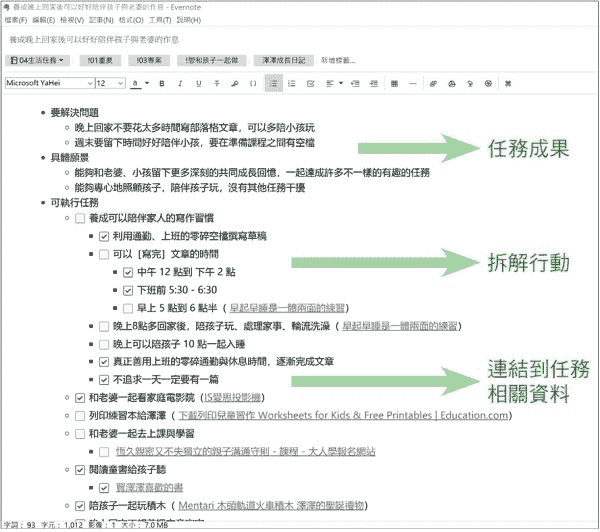 

而更重要的是，这样的笔记方法，帮助我非常聚焦在“真正完成某些成果跟价值”上面，而不是在零散的行动打转。

我会一直看到这则聚焦某个价值的任务笔记，他会提醒我真正要完成的成果是什么，并且打开这则任务笔记，我会很轻松、不遗漏的，找到要完成那个任务成果所需要的行动跟资料。

这则要好好陪伴老婆和孩子的任务笔记，在我真实的生活中发挥过很多次的作用。

我记得有一次，同样礼拜六我要去授课，是下午一点的课程，我本来计划早上好好的备课，中午出发前往上课地点。

但是前一天礼拜五的晚上，孩子忽然有点身体不舒服，老婆说周末的早上可不可以在医院九点开门的时候，先带小孩去看医生。当然，小孩生病一定要带去看医生。不过老实的说，第一时间，我的心里确实产生了一点点不愿意的感觉，或者说产生了一点点有压力的感觉，因为我开始焦虑原本已经准备好要来备课，现在却被意外插入另外一个行动，时间似乎开始不受我的掌控。

但是，这时候我看到了，前面这则“要好好陪伴老婆孩子的任务笔记”，打开笔记，我看到了这个任务我想完成的成果是什么，看到了可以利用时间好好陪伴孩子的各种不同行动。

于是这时候，我想到陪孩子去看医生，也是属于这个任务下的相关行动，而如果要让这个行动可以链接出更大的价值，那么不如把他做得更好，完成得更彻底。

 

我那时候跟老婆说，虽然医院九点才开门，我们不如八点就提早出发，先去医院旁边一家在笔记上还没去吃过的早午餐餐厅，和孩子一起用个简单的早餐，然后再一起去看医生。大家在愉快的心情下面回家，我还是有时间休息一下，准备一下课程，或者我提早礼拜五的晚上先准备一下。

但是这样一来我们在周末的早上，就不仅仅只是完成一个看医生的行动，而是真正完整的完成了一个陪伴孩子、创造回忆的任务，真正产生了我们想要的任务成果！

真正有杀伤力的任务子弹

这时候，一个真正的子弹才会产生。

真正的子弹绝对不会是那些分散的一个一个小行动，因为小行动没有杀伤力。

组装到一半的家具，油漆到一半的客厅，没有完成任何成果，不构成任何攻击的威胁性。要有杀伤力，就是要把任务的成果真正的完成，真正创造出成果出来。

所以只有聚焦任务，才有办法变成子弹。我们应该要在任务上面做好整合跟管理，把它变成时间管理的枢纽。

让我来为大家统整一下：

 

・ 行动很多，我们要以少驭多。

・ 以任务为枢纽，来管理分散的行动。

・ 任务很多，我们继续上升到专案的视野。

・ 继续以少驭多，以专案来管理越来越多的任务。

 

其中，任务这个环节，则担负了起承转合的枢纽作用。

这就是一则笔记、一个任务，它会变成一颗子弹，所能带来的效果。

而如果我们使用 Evernote 来建造这样的子弹笔记系统，他和一般待办清单最大的不同，就是它非常适合用来整合、理清这样一个一个的任务目标。

而事实上，我觉得比起列出每天行动清单，反而是一则一则做得好的任务笔记，才是真正提升生产力的关键。

因为我们不是在管理行动，我们其实真正的目的，是在管理我们所能完成的价值、所能创造的价值。

 

 

#### 3-2 如何在 Evernote 中拆解、整理任务？

下面，让我快速用另外一则自己的 Evernote 笔记，来展示一下如果在 Evernote 中进行一则任务笔记的拆解。

基本上我会用下面三个原则，来架构出一则任务笔记：

・ 想要获得什么具体成果？

・ 拆解出需要做的下一步行动

・ 整合任务需要的相关资料

想要获得什么具体成果？

下面让我来实际解释，目前如何在 Evernote 上进行子弹任务笔记的管理。

 

首先，当我遇到一件事情、需要采取某个行动，或者诞生某个想法的时候，我就会去想，这是不是一个具体的任务？有没有这个任务想达成的某一个具体的成果？如果有，我就开一则新的任务笔记，开始拆解，之后跟这个任务相关的所有事情，都要整合到这则任务笔记上。

换句话说，也有可能是我想到一个行动、想法，发现之前已经有某则任务笔记与此相关，我就可以直接把这个想法、行动，放入之前的任务笔记当中。这样，就可以逐步的做出时间管理系统需要的整合，笔记也不会零散。

 

每当一个新的任务笔记诞生之后，无论他是工作上的专案、任务生活中的事情、个人的兴趣、习惯的养成，或是某个愿望，总之都要先思考一个问题：“这件事情到底我想要达成什么具体成果？”并且把这个具体的愿景描述出来。

 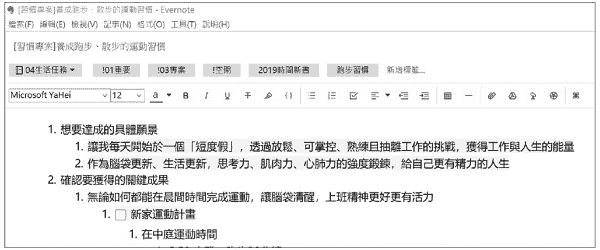 

因为，同样一件事情很有可能因为我设想的具体愿景不同，而会衍生出不同的行动方式。

我们必须要先确认想要达成的具体成果，才能开始知道怎么拆解出有效的行动。

有时候我们的行动卡关，一个很关键的原因就在于我们搞错了，或是没有确认想要达到的具体成果。

例如同样是跑步这个习惯，我原本一直觉得自己必须每天早上空出一个小时的时间来完成跑步，但是我早上根本就空不出那么多的时间，于是这个任务一直卡关在那边。

但是如果重新去设定我的具体成果，说不定会发现，自己想要的成果只是帮早上找一件有趣的事情，或者只是想要让早上更清醒，或是稍微提升一下自己的心肺能力。

而这些成果，其实都不一定要用早上硬挤出一个小时的跑步时间来达成，是我自己把自己卡在那一个根本不需要的行动上面！

如果确认我的成果，我将会发现有很多实现这个成果的可能性。

拆解出需要做的下一步行动

于是当成果被确认后，我就开始在同一则笔记里面，以目前可以想到的，拆解出要达成这个成果需要的下一步行动清单。而且，我指的是要有创意的、全面的去思考符合成果的行动清单。

这是什么意思呢？让我用自己真实的跑步习惯任务案例来做解释。

 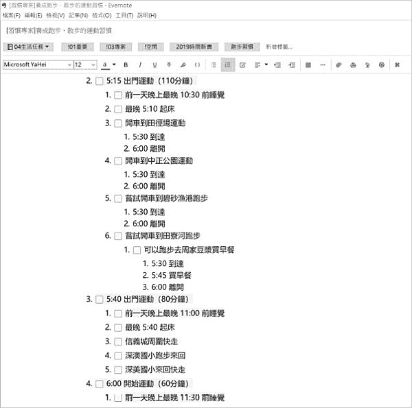 

你可以看到图中，我的跑步计划行动清单是这样设计的，我并非只是简单的决定：“每天早上五点起床去跑步，六点半回家，开始洗澡准备出门上班。”并非只有设定这样单一的行动而已。

 

因为我知道，这种单一、固执的行动，实现的几率非常的低。因为我们会遇到各种意外的状况，可能今天早上赖床了，快六点才起床，心里就想说时间都过了，今天先不要跑步好了。说不定今天起床的时候下雨，想说天气不好，今天不要跑步好了。说不定前天晚上回家的时候很累，想说精神不好干脆直接取消明天的跑步好了！

如果我们的行动很单一，我们实现任务的可能性就会降低，但事实上并不需要如此，我们可以为符合成果的任务，拆解出更多元的行动。

 

例如我会继续去思考，那么如果我五点半才起床，我可以实现什么跑步计划呢？或许就不是像原本一样到体育场去跑步，而是到家里附近的小学公园跑步。我再继续设想，如果不小心六点起床，我可以怎么实现这个计划呢？于是我发现，从想要达到的成果来看，跑步其实不是我唯一可以采取的行动，如果我想提升一下心肺能力或精神，六点起床的时候，我也可以利用一个在家健身的 App，简单练习一些地板伸展动作，同样可以达到我想要达到的成果。

甚至还可以继续想，如果早上临时有事情，我可以利用中午午休时间去外面快走，30 分钟、一个小时，是不是也能达到我的想要达到的成果呢？

于是我就在笔记里面，在那个任务多元可能性的行动清单拆解出来。

不是立刻去列出每天的行动清单，因为固执于每天行动清单，反而真正实现的机会降低了。我是回到每一个具体的任务笔记当中，去拆解出这个任务可能可以实现的“可能性的行动清单”。

然后，无论我遇到什么情况，五点起床、五点半起床、六点起床、早上很忙，我都有办法继续推进这个任务，继续累积这个任务想要达到的成果。

这样一来，困难的事情，就会变得简单，并且我们可以更加地善用时间。

整合任务需要的相关资料

最后，如果这个任务需要一些相关的参考资料，我也可以把那些资料直接剪贴到同一则任务笔记的最下面。

 

如果资料量很多，没办法统一在同一则笔记，那我可以把那个资料笔记，用 Evernote 记事链接的方式，连接到同一个任务笔记的相关处。

关于“记事链接”的方法，在下一章讲到专案整理的时候，我会做更详细的解释，如果不清楚操作功能的朋友，可以统一到下一章查看。

而这样一来，一个像子弹一般的任务笔记，就在我的 Evernote 中建构完成了。

 

 

#### 3-3 拆解下一步行动的具体操作技巧

看完前面，我实际拆解任务笔记的例子，你可能发现这样子的任务管理方法，有两个重点：

・ 第一个重点，聚焦在一个真正值得完成的任务成果上，并且把任务的所有环节，统一在一则笔记当中进行管理。

・ 第二个重点，当任务可以拆解出具体下一步行动清单，这时候这个任务就可以被更有效地往下推进。

这些具体的下一步行动清单，可以帮助我们知道应该怎么执行？知道可以在什么时间去推进？这个任务的成果

 

但是这时候会遇到一个很大的难题，当我们在拆解任务的时候，或许我们还相对容易看到任务的成果，但是我们却不知道怎么拆解出具体详细的下一步行动清单。

要写一份报告，我们觉得就是写一份报告啊？还能够拆解出什么行动清单吗？为什么 Esor 可以从写一份报告，想到需要设定题目、需要搜寻资料、需要研究案例、需要列出大纲、需要写一个草稿、需要画一个图等等行动，我们要怎么样在各种工作、日常事情上，都学会可以快速地拆解出下一步行动呢？

 

这里就让我针对这个问题，分享我的一个具体的作法。

四个拆解行动的思考方向

我的方法很简单，无论如何，我们总可以在一个任务底下，先列出第一个行动吧？或者你就把那个任务要达成的成果，当作第一个列出来的行动。有了第一个行动之后，接着我们往这个行动的上下左右四个方向去思考。

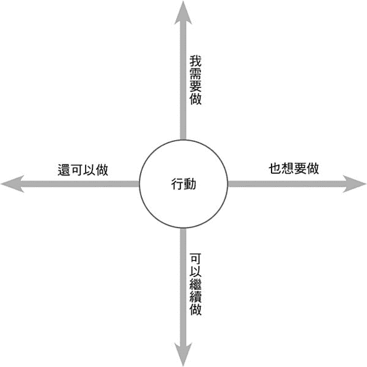 

上，我需要先做什么？这个任务需要哪些前置行动？有哪些前置条件？

往上思考，就是往前回推，如果要做到这个行动，有没有比他更前一步的行动必须先做呢？有没有比前一步行动再更前一步的行动必须先做呢？

 

不断的往前回推，思考出更多前一步行动清单，其实就知道真正的第一步行动是什么，以及下一步行动的清单了。

下，我能继续做什么？完成这个行动后，我还可以继续采取哪些行动？

往下思考，就是往后延伸，如果这个行动完成了，我还能继续采取什么行动，让这个成果变得更好吗？或者有没有其他任务会跟这个行动相关，可以把彼此连接在一起呢？

透过这样方式，让行动创造更多价值，并且拥有更多未来诱因。

左，我还可以做什么？这条路如果走不通，可以换成做什么？

往左思考，就是水平思考，去开展这个行动有没有其他可以替换的行动？有没有其他可能性？如果原本缺省的这个行动走不通，有没有其他可能可以采取的作法？也可以达到类似的成果呢？

透过开放式的水平思考，我们不需要固执在唯一的行动上而裹足不前。

右，我还想要做什么？这个任务我有没有其他想要的成果？

往右思考，另外一种水平思考，如果原本的这个行动走不通的时候，有没有可能替换其他也想要达到的成果，当成果替换，行动也会跟着替换，于是我就可以不用卡在原本的行动上面，继续去利用时间，采取不同的行动，达到类似的成果，而且一样是我想要达到、需要达到的成果。

案例：具体拆解下一步行动

我不是说，每一次在拆解任务的时候，都一定要把这四个方向的行动拆解得非常清楚，不需要这样子，因为这样子也太累了！

我的意思是，如果当你发现任务走不通、卡住、拖延，那么可以从这四种方向里面，去寻找一个方向，或是采用两个、三个方向试试看，有没有可能把行动拆解得更具体、更详细，以及更可能被执行？

让我用一些实际的案例来做示范，让大家更容易理解这四个技巧。

假设我现在有个任务：“想要养成每天回家阅读书籍的习惯”，这时候我怎么拆解出可以帮助自己实现这个任务成果的具体行动呢？

往上思考，往回推，如果想要养成每天回家阅读的习惯，我需要先做哪些行动？

・ 我想到回家之后必须要先有一本可以看的书，所以我要先买好一本书。

・ 但是我想看的书是什么呢？或许先挑出一本我需要的好书。

・ 我一边阅读，想要一边学习，那么可能要为自己准备一个做读书心得的笔记本。

・ 如果我希望阅读的时候很有气氛，那么要准备好一个播放音乐的工具。

 

・ 当然我一定要先想办法空出回家可以阅读的时间。

・ 而这有可能会牵涉到我必须在工作流程上让自己可以准时下班。

你看，光是一个往前回推，马上就列出了几个行动清单。

我们继续往左边想，我可以做哪些替换行动呢？如果我回家没办法好好的待在客厅或书房看书的时候，有没有什么可以替换的行动呢？于是我想到：

・ 如果说不要用看的话，可以怎么看？

・ 可不可以用听的，那要怎么用听的呢？

 

・ 或许可以用买电子书的方式，让电子书 App 朗读电子书给我听。

・ 这样我洗碗、洗澡的时候，都可以播放我想阅读的书。

接着往右边想，有没有其他我也想达到的类似成果呢？这个任务除了养成每天阅读习惯之外，有没有其他我也想要达到的成果呢？或许我想到的是我的工作上效率不够高，我很希望赶快提升我的工作效率，那么把这两件事情连接在一起，我就知道，我不只是要养成每天回家阅读的习惯：

・ 我还必须先去找对工作效率提升有帮助的书。

 

・ 优先阅读这些书，赶快获得更有效成果。

最后往下思考，如果真的养成每天回家阅读的习惯，做到了之后，有没有可能为这些行动再创造更多的延伸价值？我还可以继续做什么？这时候或许我可以想到：

 

・ 可以把我的读书心得笔记，变成一篇网络上的分享文章。

・ 或是干脆剪接成一个 Youtube 的说书影片，它分享出去。

・ 让更多人受益，也为自己创造更多延伸的成果跟价值。

 

你会发现，一个原本单一的任务行动，经由这样上下左右的四个方向拆解，他会找到更多可以推进的行动，任何情况下我都可以采取某种行动来推进这个任务，我会很明确的知道要达成这个任务成果，该做哪些行动与准备，才相对不容易卡关。

 

并且，这个任务会变成更有趣，这个任务可以延伸更多的价值，而我会更想要做这个任务。

其实要把任务拆解出详细的行动清单，没有大家想像的那么难。

我们只要不执着于一定要做某个步骤的想法，而是应该开放自己的思考，从我前面提到的这四个角度重新设想，你也可以为任务拆解出具体、有趣、有效的行动清单，而这时候，任务可以被真正的推进。

 

 

#### 3-4 如何在 Evernote 快速撰写简洁有效的行动描述？

你有没有在做笔记时，遇过这样的困扰？听着老师讲解，或是主管报告，快速把听到的每个重点记录下来，觉得自己好像记了很多，但事后回头看笔记，觉得一团混乱！甚至看不懂自己到底在写什么？或是原本误以为内容丰富的笔记，却很多重复内容，发现真正的重点并没有记到？于是你还要再花很多时间重新整理一次笔记？

经过前面的时间管理笔记方法后，我们发现需要常常在笔记上做“任务拆解”，这时候，要怎么快速“写好笔记”呢？在这篇文章，我想落实在 Evernote 上，分享如何把拆解出来的内容，利用功能整理好。

用主题树状大纲来整理任务笔记

我自己有一个很简单很简单的笔记方法，说出来没什么稀奇，而且立刻就能学会。但我也发现很多朋友做笔记时，没想到用这个逻辑去写，导致“第一次”的笔记常常混乱没有章法。

这个笔记方法，我称之为“主题树状法”。简单的说，就是利用“主题编号、树状阶层”的形式来写笔记。

重点是，并非写一段段的描述文字，也非单纯条例重点，一定要同时符合“树状阶层、主题编号”两个原则。

范例可以参照前面我的许多任务拆解笔记图，这样的“主题树状大纲”，可以很轻松地把思绪整理起来，并且保持下次思考时的延续（因为可能要想好几天、好几个礼拜）。

“主题树状笔记法”要解决的三个问题

为什么要这样做笔记呢？要破解三个问题：“笔记顺序散乱、理路缺乏逻辑、重点混杂不清”，还有因此导致的要重复整理笔记的问题。

 

解决第一个问题，让笔记顺序不杂乱，任务拆解有次序。

如果只是想到什么就流水帐的笔记，很难把前后相关的重点整理在一起，也很难把同类的重点做分类，于是你的笔记里重点可能是七零八落的。

 

这时候，善用“树状大纲”的分层梳理方式，可以在做笔记时，就做好重复重点的整合、相关理路的整理，让笔记不分散。

解决第二个问题，让理路有逻辑，让任务思考有层次。

笔记目的是重点整理，但以前我们刚刚在学校学会写笔记时，都只学会照抄比记的方法。

老师上课或书本阅读时，为了解释清楚会参杂很多额外信息，笔记并不需要把这些全部都写下来。但我们很容易陷入什么都写的迷思，自己不思考，只是一股脑全部照抄的笔记，反而事后自己更难看得懂！

 

这时候，“主题思考”、“大纲分类”的笔记法，可以强迫我们问自己：“主要重点是什么？逻辑顺序是什么？”自然做出有自己思考的笔记。而这也是任务拆解时需要的思考层次。

第三个问题，让重点凸显，明确关键的行动。

 

一个任务、一本书、一堂课，他的知识脉络通常是多线剧情，例如要解决什么问题？采用什么方式？有哪几种策略？这多条线在上课与阅读时，通常是同时多线进行。如果笔记把他们全混在一起，事后就很难梳理。

 

而“大纲阶层”，就能适合同时展开多条线索，每次找到哪一条线索的新重点，就纳入该条线索中，多条线索可以同时整理。

其实真的很简单，只是我们要改变一下习惯，把笔记变成“主题大纲”，而不是单纯描述或条列的笔记即可。

 

如何快速写下行动的重点？

开会讨论时，怎么快速写下有效的下一步行动笔记？不让会议开完后，大家都还不知道怎么行动？

老板、客户跟我交代事情时，如何快速记录对方重点，写得快，而且写得好，没有漏掉关键，甚至当下发现对方遗漏的关键，实时提问，让事情顺利完成？

我自己脑袋中迸出要做的事情时，也能够快速笔记下来，并且事后看得懂自己真正要做什么？

这些问题，其实都可以在“书写方法”上解决，只要在每次笔记任务时，根据下面四个关键字来书写：

・ 行动：具体要做的是什么行动？

・ 对谁：有没有明确要对谁行动？（如果没有，可省略）

・ 成果：具体要完成的是什么成果？

・ 时地：有没有明确要执行或完成的时间地点？（如果没有，可省略）

 

原本可能只是“对方讲什么，我就拼命纪录什么”，或是“脑袋想什么就原封不动写出来”，导致行动愈写愈长，但最后反而看不懂、写不完、有遗漏。

如果改成“只记录四种关键字”，不成句子也没关系，反正是在写行动，不是在写文章。

 

要注意的是，这四个关键字缺省的行动主角是［我］，如果要记录的是他人要做什么任务，那就在开头加上第五个关键字：［谁要做］。

让我举一些例子来试试看，我用大纲的方式，来做出对比。上层是一般任务的描述，仿真他人交代时的语气，或是开会讨论时的内容。下层则是利用“四个关键字”快速书写行动：

・ 要用 Google 文件制作一份协同合作大纲，共享给某位作者，让作者可以一起实时编辑，而且要在礼拜五前完成。

◇共享 某作者 大纲协作 礼拜五前

・ 礼拜四之前需要去公司附近的某某银行领出多少钱。

◇领钱 某某银行 多少钱 礼拜四

・ 要测试某软件的功能，列出要写的文章的大纲。

 

◇测试 某软件 大纲。

透过抓出“行动、对谁、成果、时地”四个关键字，精简原本描述性句子，这样可以节省纪录的时间，而且未来还是看得懂要做什么。

有时候，也不用四个关键字都写，可能不需要对谁，没有明确时地。但通常一定会有某个具体行动，以及这个行动要产生的成果。

你可以在四个关键字之间加上一些符号来区隔，例如逗点、冒号。不过我习惯用［空格］，因为节省输入时间，手机上打个空格也很方便，并且最后也还是看得懂。

 

很多时后讨论一件事情，到了结论，虽然把方向记录下来了，但其实根本不知道要“做什么”，就是因为书写行动时，忘记问这四个问题：

・ 到底具体要采取什么行动？

・ 有没有要对谁去做？

 

・ 具体要完成的成果是什么？

・ 有没有限制什么时候前完成？

你需要学会的 Evernote 大纲、核取功能

最后，我补充一下教学图，看看要怎么在 Evernote 编排大纲，或是插入待办清单的核取方块。

 

这些功能在 Evernote 的手机版、电脑软件上都可使用，我以手机上来示范，其实功能都在编辑工具列上。

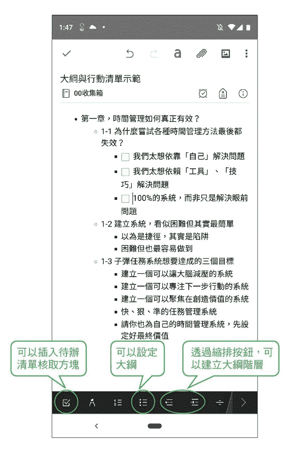  

 

## 第四章   
任务子弹“组织”成专案系统

 

 

#### 4-1 可以专注目标的专案管理系统

经过了前面一个章节的练习，掌握了时间管理系统中最核心的枢纽，也就是一个一个“任务”，透过创建一个包含了具体成果、拆解行动的任务笔记，现在我们可以开始去推动这些任务了。

 

不过，虽然这样的任务是时间管理中的基本单位，但是如果只是在任务层做管理，那还是远远不够。

任务的数量，往往依然会很庞大，我们最终必须要决定，哪些任务要优先完成？哪些任务必须在时间不够的情况下舍弃？什么样的任务这时候去执行最好？会为我自己带来最大的效益？

更重要的是，如何知道自己每一天最应该专注的目标是什么？即使当各种事情不断意外发生的情况下，我们也能够保持在自己的道路上，或者起码懂得如何去修正自己的道路。

 

而这时候，我们就必须要把任务的视野再往上提高一层，进入到专案的视野去做管理。

任务子弹，为什么要从专案视野去管理？

举个例子来说，我要规划一个 Evernote 子弹笔记课程的“课程大纲”，我要设计一个课程的“报名网页”，我要请设计师画出课程的“主图”，我要跑课程后面的“手续行政流程”，我要“测试许多 Evernote 的管理功能”。这些其实都是独立的任务，他们有各自可以达成的成果，需要用一则一则不同的任务笔记来拆解，但是他们背后也关联着一个更大的共同目标，就是希望成功开办：“Evernote 子弹笔记课程”。

或者以生活上的例子来举例，搬家之后我想为小朋友“规划一间游戏室”，今年的连假想要安排一次“亲子出国自助旅行”，有许多预排好的“孩子打预防针时程”，要开始准备小孩子“上幼稚园需要的资料”，这些也都是一个一个有各自成果的任务，但是他们同样背后关联这个更大的专案、更大的目标，也就是：“育儿计划”。

这时候，除了要在任务层管理之外，如果可以直接从专案层管理，那么我们只要能够掌握好“Evernote 子弹笔记课程”、“育儿计划”这两个专案，我们就可以从一个更高的视野去做决定。

这时候我们才能判断，在这两个专案里面，那些任务的轻重缓急是什么？什么应该现在优先做？什么现在可以暂缓？有没有一些任务不在这两个专案中，那么这些任务是不是要先放下，以面干扰最大目标？

我们要打造一个系统的时候，就是想要打造一个可以专注目标的系统。接下来这个章节，我就要来进一步的分享，这样的系统如何在 Evernote 上面来实现呢？

两个 Evernote 功能，搞定专案管理系统

接下来我要应用两个 Evernote 功能，只要应用这两个功能，就可以在 Evernote 大量任务笔记里面，创建起我们需要的专案管理视野。

 

我先以下面这张图，来示范说明最终的效果是什么。

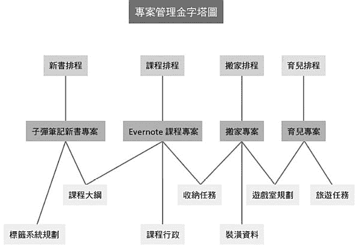 

在图的最下方，就是任务层，表示的是一则一则在 Evernote 中独立的任务笔记、专案资料笔记，这样的笔记数量，即使我遵守着，一个任务一则笔记的整合原则，但是以我使用了十年的 Evernote 之后，我的 Evernote 当中也累积了上万则的笔记。

但是我不担心这会让 Evernote 系统变得很杂乱，因为接下来，大家看到图中间那一层，那就是专案层。

我会利用下面将介绍到的 Evernote“标签”应用的功能，把相关的任务笔记、相关的资料笔记串联在一起，于是一万多则的任务资料笔记，可以归纳成数量更少的“专案分类”。以我的例子来说，这一万多则我十年来执行过、准备执行的任务，最终的分类其实也不过就是上百个专案分类而已。而其中很多是十年来已经做完的专案，有些是还没开始、只是筹备中的专案，真正当下进行中的专案，可能不过是二三十个。

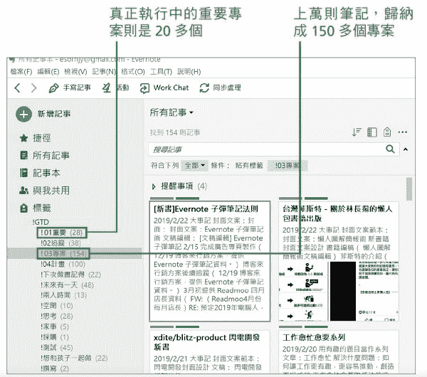 

最后，看到图的最上面那一层，只是把任务跟资料分类到一个专业里还不够，我还要另外创建一则管理笔记，我称呼他为这个专案的：“专案管理主目录笔记”。

在这个专业目录笔记当中，我利用 Evernote 的“记事链接”功能，把属于这个专案的每一个任务笔记，链接到专案管理的主目录笔记当中。

专案目录笔记就好像是一本书的目录页一样，但是这个目录有超链接的功能，当我打开专案目录笔记，我就可以看到这个专案的每一个阶段流程，链接到每一个流程里需要执行的任务，或者是执行时需要的资料。

我只要去掌握，每一个专案唯一的专案目录笔记，我就可以找到我需要的东西、不漏掉我需要的东西

这样一来，虽然笔记有破万则，但是最后一步一步的收纳归类，其实我每天可能只要在 20 几则专案目录笔记当中去做管理，甚至通常只要在五六则专案笔记当中做管理，基本上工作、生活就会在它们的轨道上面。

接下来这个章节，就是要利用 Evernote 具体的功能，实现这样的一个时间管理系统。

  

 

#### 4-2 如何分类专案？Evernote 标签应用

接下来，我们就来说明如何在 Evernote 这样的一个时间管理系统中，去对一则一则的子弹任务笔记进行“专案的分类”。

分类听起来是很简单的功能，但为了解决分类里的某个独特需求，我会建议：

不是用 Evernote 中的记事本功能来分类专案，而是用“标签功能”来分类专案。

为什么呢？让我们一起来思考看看。

 

一个任务常常跟多个专案有关

在分类的时候，其实我们常常遇到一个问题，只是我们可能没有想过要怎么具体的解决。

这个问题就是，一个资料、一个任务常常在多种专案、多种需求下都会需要使用到。

 

例如家里有一台吹风机，但是家里有两间浴室，在 A 浴室洗澡完会需要用那台吹风机，在 B 浴室洗澡完当然也想用那一台吹风机。那么，这时候这台吹风机应该放在哪一个浴室好呢？放在 A 浴室，B 浴室就变得不方便。买两台吹风机，又变成不是每天都会用得到。摆在两个地点中间，变成两个使用起来都不方便。

工作专案、时间管理上，也会面临这样的分类难题。

我有一则任务笔记是：“Evernote 子弹笔记方法测试”的心得笔记，是我不断实验、研究方法、调整技巧，然后获得的任务笔记。这则任务笔记可以用在我安排“Evernote 课程”的时候，能够当做课程大纲。但是这个任务笔记也可以用在我要写一本“Evernote 子弹笔记新书”的时候，当做新书大纲。

这时候问题来了！这则笔记，如果要进行专案分类，我要分类到哪一个专案才好呢？而且这两个专案都还在同步的进行当中。

如果放在课程专案，我在执行写蔬专案的时候，要取用这则笔记就会变得麻烦。

如果把笔记复制成两份，放进两个专案的资料夹呢？问题更大，我在课程构思的时候修改了这个“Evernote 子弹笔记方法测试”任务笔记的内容，那么他的复制体，在新书专案里面的那则笔记，就会变成是旧版本，要不就要花时间也去更新。

这样一来，我的笔记就会变的更加杂乱、版本错乱，而且在实际的执行工作上，很容易遇到错误。

用 Evernote 标签来多重专案分类

Evernote 的记事本，或是传统资料夹的分类方法，都有一个问题，那就是一个萝卜只能放在一个坑。

如果把 A 任务、A 资料，放在甲资料夹当中，这时候，如果 A 任务与资料，也可以在乙专案中派上用场的话，那要怎么办呢？我不能够同时把一个笔记放进两个资料夹。如果只把笔记留在其中一个资料夹中，执行另一个专案时，我就很有可能在另外一个资料夹，漏掉这个任务。

或者，要不然我就干脆复制成两个笔记吧？复制成两则笔记，放进两个资料夹，这样就会面临同步更新的问题！如果在甲专案里面更新 A 笔记，但是在乙专案的那一种复制的笔记，没办法跟着更新，这样我在执行乙专案的时候，可能就使用到一个过期版本的工作内容，而这会造成很大的问题、很大的麻烦。

所以，在 Evernote 中要分类专案的时候，我不建议使用只能一个萝卜一个坑的记事本，要使用 Evernote 的“标签”。

Evernote“标签”的最大特性，就是一则任务笔记可以同时标上很多个标签！意思也就是一则笔记可以加入多个专案分类。

然后我们可以去过滤某个标签，就可以把包含这个标签的所有笔记分类出来。

如果你对标签模式还不是很了解，你可以想想现在社群上很流行的写讯息方式。

 

在 Facebook、Instagram、Twitter 这些平台上，很多人发信息的时候，会在下面加上“#”，作为打卡，例如去台北 101 看烟火写了一段心得，讯息下面加上：“#台北 101”、“#劳瑞斯牛排”、“#新年烟火”。这个用法，其实就是标签，把这则讯息加入上面这些标签，以后搜寻这些标签的朋友，就可以看到你的讯息。其实就是一种讯息分类。

如何在 Evernote 加上标签分类？

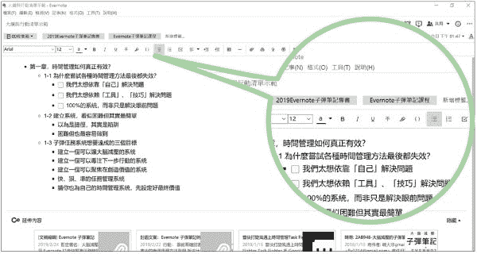 

在 Evernote 电脑端软件的标签列，可以自由添加多个标签。这则任务笔记属于哪几个专案，就把那几个专案的标签加上去。

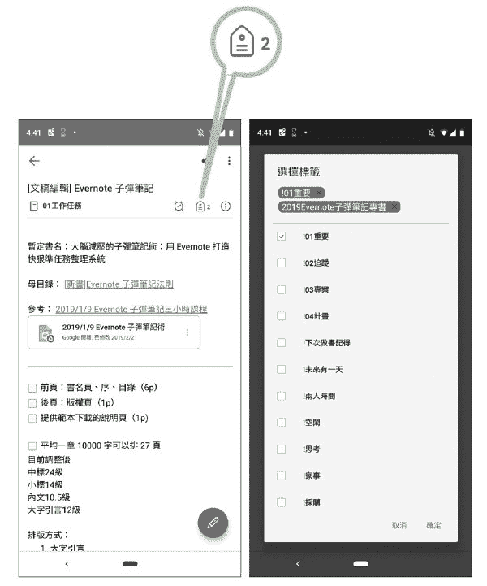 

在手机上，找到“标签”专属的图标，也可以在笔记中添加专案的标签。

如何在 Evernote 过滤标签分类？

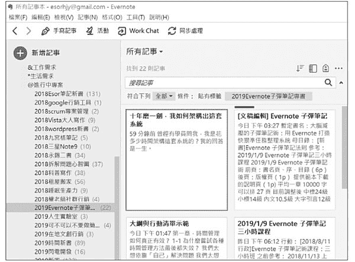 

当任务笔记加上标签后，Evernote 软件就会出现像图中左方的“标签清单”，点选某个标签，就能看到分类里的所有笔记。或者，你可以直接搜寻“标签名称”，也能找出相关笔记。

 

如何命名专案标签？

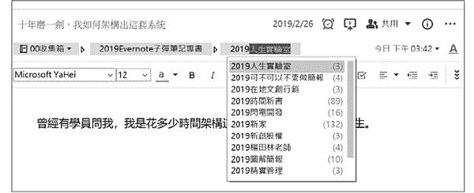 

用标签来分类专案，标签名称自然就以专案名称来命名。不过可以加上一个小技巧，就 是用专案“年份”当作开头，这样一来，要为任务笔记添加标签时，只要输入年份，就可以列出该年所有专案标签，不用自己重新输入（后者很容易输入错误，造成标签重复）。

 

 

#### 4-3 如何安排目标流程？Evernote 记事链接应用

前面我们利用“标签”，让 Evernote 的任务笔记分类可以变得更加有弹性、更加自由，我们不用再烦恼那个任务到底应该放到哪个专门分类好，反正这个任务跟哪些专案有关，我们就把它用标签分类到那个专业上。到时候我们打开那个专案的标签分类，就会看到我们需要的笔记。

但这样的做还是有一个问题，虽然笔记都会出现在他属于的专案分类当中了，但一个大型专案常常会有数十则，甚至上百则的任务笔记。

 

例如一个旅行的专案，里面可能有订旅馆的任务笔记、排行程的任务笔记、机票的任务笔记、购物清单的任务笔记、每一个想参观的景点任务笔记、预定重要餐厅的任务笔记、旅游心得的任务笔记、记账的任务笔记等等。

 

这时候当我们打开某一个旅游专案的分类标签，有可能看到的是五、六十则以上的笔记资料，这样有办法快速找到当下需要的笔记在哪里吗？

每一个专案，一则专案管理目录笔记

如果说现在正在旅途上，我要搭公车转换到下一个景点，我要赶快找到当初规划好的公车任务笔记，结果打开这个专案标签分类，展开在眼前的却是七、八十则的笔记资料，我要开始从笔记的标题、预览文字，去慢慢找出到底那一则公车任务笔记在哪里？这时候我们一定也会觉得还是很麻烦，任务笔记在那个地方没错，但是我却没办法很快的找到他。

这时候还可以做什么进一步整理呢？是不是要再做更进一步的分类呢？

我不建议再进行更多层的分类，因为分类的太多层，就好像你的电脑硬盘里面十几层的资料夹一样，如果你有这样的经验，仔细想想，当资料夹很多层，每次要找到一个资料要打开好几层的资料夹，这是一个节省时间还是一个很花时间的动作呢？我相信这是一个很花时间的动作。

所以我这边建议的整理是，专案的标签分类创建好，这就是我们最后一层的分类整理。接下来，我们要利用 Evernote 的“记事链接”功能来创建每一个专案的目录，我称呼这个目录叫做“专案管理的评论员记”。

我们为每一个专案，多创建一则专案目录笔记，以后我们就只要在专案目录评论员记上做管理就好了。就像我们看一本书，先看目录页，找出我需要的章节在哪一页，然后直接翻开，不用一页页找。

举例：如何用目录笔记管理专案？

回到刚才的旅游专案也是一样，虽然里面有七、八十则不同任务笔记，但是我只要创建一则旅游目录管理笔记，就能好好掌控他。

 

打开某个旅游专案标签，可以看到这次旅行需要的各种任务笔记，都在其中，但我们不要在这堆资料里面去行动，这样不一定有效率。

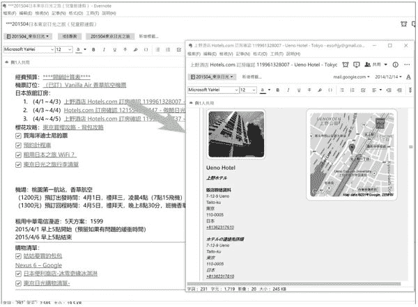 

我会创建一则这样的旅行专案目录笔记。里面每一条笔记链接，都会连到这次旅行需要的笔记。

于是我把机票、旅馆的任务笔记，链接到这个旅行专案目录笔记的开头，并且剪贴了关键信息，因为这是旅行中最常查找的。

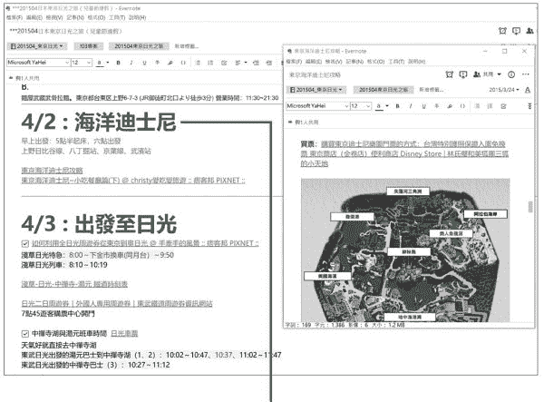 

我在旅行专案目录笔记中，排出这次旅行的行程，每一天要前往哪些地点，这时候如果需要参考哪些交通、地点笔记，一样链接进来。这样一来，我是不是只要看到这则专案目录笔记，照着目录上的规画行动，就很方便了呢？

 

如何创建记事链接？

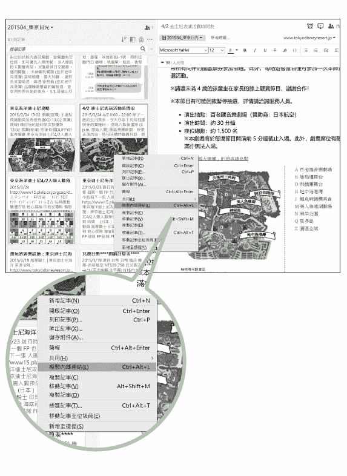 

创建记事链接的方法很简单，在电脑版 Evernote 中，只要在记事清单的某则记事上点击右键，选择［复制记事链接］。然后到另外一则笔记中，想要插入记事链接的位置直接贴上即可。

  

 

如何快速创建大量笔记的目录链接？

像是下面是我的育儿专案中的那一则育儿专案目录评论员记。在育儿专案中的宝宝日记、副食品食谱、婴儿器材、孩子检查资料，虽然都是不同的笔记，但都在这则“育儿专案目录评论员记”中有记事链接，我只要照着目录，就可以找到所有的资料。

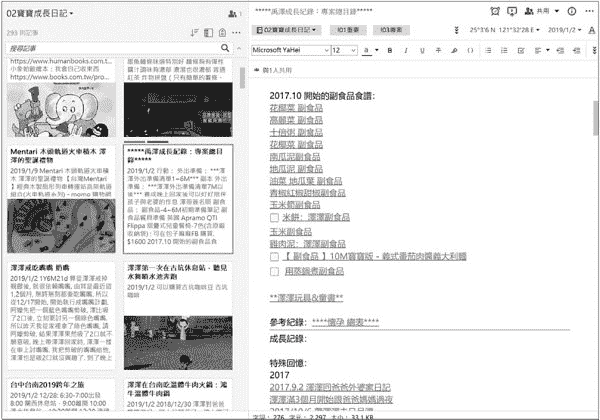  

 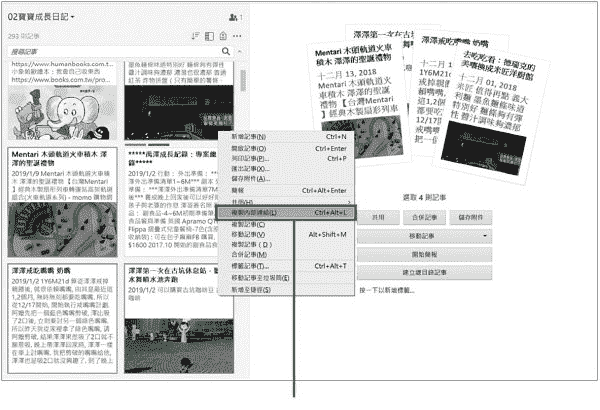 

如果一次要创建多则笔记的记事链接，可以这样做。在电脑版的 Evernote 中，按住键盘［Ctrl］，就可以用鼠标一次选择多则笔记，这时候，在多选笔记的任何一则上点击右键，选择［复制记事链接］，就可以一次复制贴上多则笔记的超链接了。

 

 

#### 4-4 专案的参考资料怎么处理？

透过前面所说的两个功能与应用，我们开始将大量的子弹任务笔记，慢慢以专案的视角重新整理，重新归纳。

我们把每一个任务笔记，都利用标签，关联到跟它相关的专案目标上。这样子我在浏览任何专案的时候，都可以很看到我需要的任务笔记。

更进一步的，我在每一个专案标签分类中，再创建一则专案管理的目录评论员记，透过 Evernote 的记事链接功能，在专案目录笔记当中以目录的概念，做好目录的分类，专案里的任务与资料就在那一则专案评论员记中创建目录。目录会连到每一则笔记，这样一来真正执行专案的时候，不管它是一个旅游专案、育儿专案，还是工作上的专案，都只要去看那个专案的目录评论员记，就可以找到所有的东西。

把资料放入系统中真的要使用资料的位置

不过，这边我要延伸解答一个可能有些朋友会产生的疑惑，这本书讲到现在，都用时间管理的方式来架构 Evernote 的应用，所以我们聚焦的是任务笔记怎么拆解、任务笔记如何分类、任务笔记如何创建目录？

但是一个专案执行的过程当中，一定会出现一些资料，这些资料应该要怎么办呢？

例如我要写一篇文章，我可能会查看一些网页、阅读一些书籍，这些资料要不要纳入 Evernote 的任务管理系统来整理呢？当然要。

 

我在规划一个旅游专案的时候，除了要产生行动的任务外，我也可能单纯需要一些当地景点的介绍文章，这些参考资料要不要也放进 Evernote 的任务管理系统来管理呢？当然也要。

尤其这些资料型的内容，有时候不一定可以直接剪贴到任务笔记底下，这有可能会让那个任务笔记变得太庞大、难以编辑。也有可能就像前面说的，同一个资料，会在不同的任务里面被用到，这时候剪贴到特定任务笔记里面同样会有问题。

所以这时候怎么做呢？利用 Evernote 的这个管理系统，可以创造下面这样的一个系统管理工作流程：

・ 第一步，善用 Evernote 各式各样的剪贴资料功能，把资料用最短的时间，快速的丢入 Evernote 的管理系统当中。（Evernote 作为资料库、知识库的剪贴功能，可以参考我的另一本着作《Evernote 100 个做笔记的好方法》）

・ 第二步，剪贴资料的当下，就要立即思考这个资料哪些专案会用得到？然后立即加上那些专案的标签，这样一来，以后打开那个专案分类，就会看到那个资料。

 

・ 第三步，有时间的时候，利用记事链接的功能，把剪贴的资料，链接到派得上用场的任务笔记的某一个行动上，或者链接到专案管理的主目录笔记的某一个派得上用场的清单上。

善用 Evernote 的快速剪贴、快速标签，以及链接整理，那么这些资料性内容放进系统后，就不会一团混乱，就会在我们需要它的时候，看到、找到、用到那个需要的资料。

关键就跟时间管理的概念一样，我们必须把需要的资料，排入系统当中，放进系统已经预先安排好的、会用得到的那个资料位置上。

 

只有创建一套这样的逻辑，才是一个更轻松更准确的管理方法。

 

 

一则资料笔记，创建时，我就会思考这是哪些专案用得到的？然后添加这些专案的标签，放入那个专案的分类中。

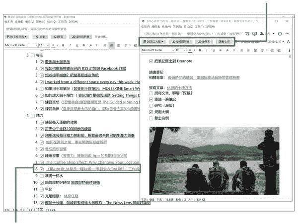 

接着打开那些专案的目录评论员记，看看这则资料应该放入专案流程的哪个位置中？在哪个步骤用得到？就把记事链接插入。

 

 

## 第五章   
如何让这个专案系统不会有遗漏？

 

 

#### 5-1 记得“排程”，让任务、行动出现在该出现的位置

经过了前面四个章节的演练，我们现在创建了一个可以聚焦在专案上，用专案视角去管理所有庞杂任务、行动的系统。

就像我前面提到的，就算 Evernote 中有 10000 多则的笔记，但经过不断的收敛之后，我就会知道，这系统中其实我真正需要掌控的，只是那目前正在推进的 20 多则专案主目录笔记而已。

一万多则笔记，对比 20 几则专案笔记。就可以看到这个系统如何有效的帮助我们以身为一个人，真的可以做得到的管理方式，去掌控自己的任务，真正有效的推进你的目标，而且就像本书书名所说，真正帮助大脑减压。

而在接下来这个章节，主要让我们来为这些系统再做一点修补，把它修补成一个相对来说不会遗漏的时间管理系统。

 

那个你一定会看到那个行动的位置

对应我们在第二章提到的时间管理系统需要的功能，这边我们首先需要补上的就是排程。

每一个专案里面，有非常多要完成的任务与行动，我们同一时间常常同时进行着多个专案，在这种情况下，我怎么确保自己不会漏掉某个专案的某个任务底下的某一个可能要做的行动呢？这时最好的提醒是什么，就是把这个行动摆在我做到某步骤就一定会看到他的位置。

有什么是我一定会看某个行动的位置呢？其实很简单，就是在我们这个系统里，那一则专案主目录笔记所排出来的，属于那个行动的最佳位置。

因为我们一定会照着专案主目录来推进每一个专案，当我们照着专案组目录上面的结构，一步一步的去完成我们排好的行动，当前面的行动完成，自然就会在这个流程清单上看到下一个我必须要做的行动，这就是排程的意义。

而我们要做的很简单，就是两个步骤：

・ 第一个步骤，不只是创建专案主目录，并且进一步用排程概念去调整目录的顺序，你的目录顺序，应该就是你觉得要如何推进这个专案的任务前后次序。

 

・ 第二个步骤，就是当有任何新的任务、新的行动出现的时候，不要把它丢在随便的位置上，我要把这个新出现的任务和行动，摆在我们原本已经有的那个专案主目录，以及目录排程中他真正应该在的那个位置上。

 

排程就是这么简单，最核心的关键就是我必须要把专案的位置准备好。

就像在整理家居的时候，如果可以设定好家里所有东西应该摆放的位置，那么当出现了新的东西，或是不小心被乱丢的东西，我会知道那个东西应该回到哪一个唯一正确的位置上，而以后我就一定会在那个地方找到那个东西，并且不容易恢复杂乱的状态。

时间管理也是一样。我们要创建系统的目的，就是要先把位置设定好，让专案都有一个专案主目录，每个专案主目录上就是所有的任务、行动应该摆放的位置。当这个架构设定好了，任何新的任务和行动出现的时候，我们只做一件事情，就是把它摆进专案主目录的正确位置上。

这样一来，我就不用怕忘记要做什么事，我只要照着排程去行动就可以了。

 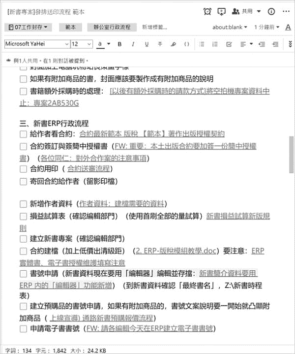 

我的工作专案上面有非常多的行政步骤，同样的在专案的主目录笔记上，我会排出每一个行政任务的流程清单，每个项目的后面则链接到那个行政任务的任务笔记，这样一来，即使行政流程再繁琐，反正我就是照着这个流程清单，一步一步的把它做好，就不怕会漏掉什么步骤了。

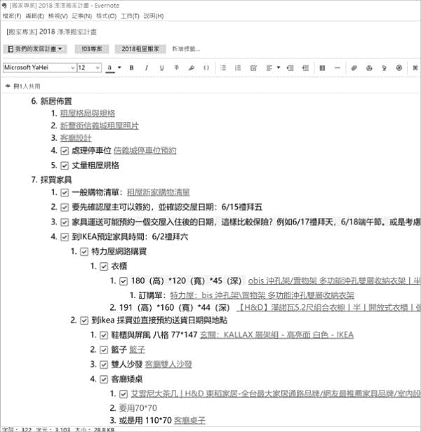 

在我最前面提到的那个解决搬家烦恼的故事中，我其实也就是创建一个搬家专案的专案评论员记，这样一来，搬家所有需要的任务行动流程都会在那这评论员记的排序中，这时候就算有什么临时的任务出现，例如忽然需要买一个什么家具，反正就是把它列入专案排程中该看到的位置上， 这样一来也可以大幅的卸下压力，反正就是照着步骤完成就好。

 

 

#### 5-2 加上“提醒”，如何让时间提醒真的有效？

创建一个排程的专案管理系统之后，你还是可以补上一个时间管理工具常见的功能，就是时间提醒。

确实有些事情就是要在某一个特定的时间点开始做，有些事情就是要在某一个特定的时间点完成，所以这些事情既不需要现在开始做，但是又需要在那个特定时间点到达的时候、或者是之前，记得去展开行动。

而我们的大脑，当然绝对记不住那个时间点，不可能在未来的某个时间点去提醒我该开始去做什么事情。所以我必须依靠一个外在的时间提醒系统。

Evernote 就跟大多数时间管理工具一样，也有笔记的时间提醒功能，可以为每一则任务笔记设定一个时间提醒。

什么是无效、有效的时间提醒？

不过，我们前面也有提到，时间提醒常常无效。尤其是提醒我们几点几分要去做什么事情的时间提醒，失效的可能性最大。举例来说，我想提醒自己，明天下午两点用来写文章，于是到 Evernote 设定写文章的任务笔记在明天下午两点谈出通知，这种思考下的提醒，无效的原因是我并不确定明天下午两点是不是真的有空，可以去完成写文章这件事情。

但是，有无效的时间提醒，也有有效的时间提醒，什么样的时间提醒是有效的呢？

我认为是这样子的，假设六月一号我要进行一个时间管理课程，我创建了一则时间管理课程的任务，拆解出准备这个课程的行动，发现有十几个准备行动必须要完成，我预估大概需要两个礼拜的时间来一一执行这些行动，于是，我把那一则时间管理课程的任务笔记，设定一个五月十五号的提醒。

 

这样提醒的用意是，让他在五月十五号的时候弹出来，提醒我，我该开始采取这个任务里面的某些行动了！

而在这个提醒底下，我还有充裕的时间去慢慢安排行动。

在这个提醒底下，不是叫我当下就去做某件事情，这个提醒的用意只是告诉我有某一件即将到达的事情，而根据我们之前的任务拆解，我必须现在开始进行他的准备动作，这样子那个时间点到达的时候，我的任务和专案才能相对容易的准时完成。

也就是说，我认为有效的提醒，不是当下要做什么的提醒，而是什么时间点应该开始做准备的提醒！

 

 

Evernote 笔记的上方，都可以找到明显的“时间提醒”按纽，点击这颗按纽，就可以设定一个提醒日期与时间。

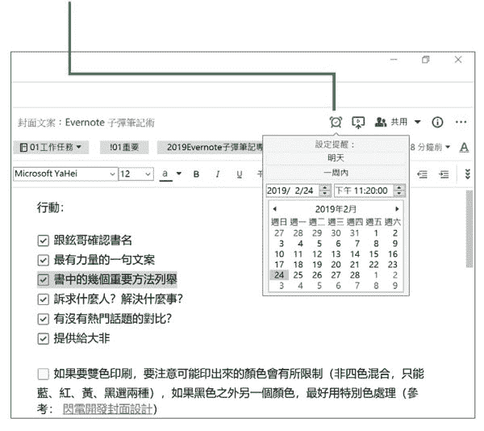 

而我建议的时间提醒设定，就是决定这个任务笔记“应该什么时候开始准备”，然后把那个准备时间变成提醒时间。

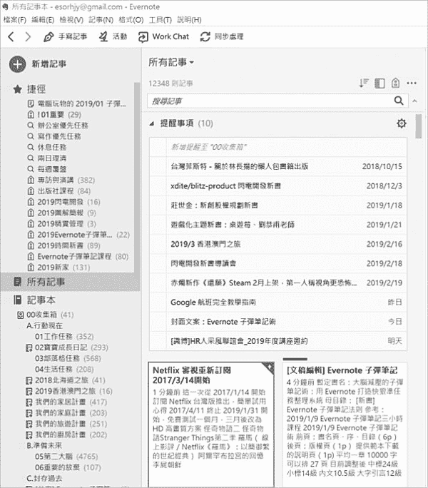 

而 Evernote 时间提醒最棒的设计，不是在他会弹出通知，而是当任务笔记的提醒到期后，会在 Evernote 的记事清单上方，出现一排“提醒事项”的清单，所有到期的任务笔记都出现在这份清单上。这个意思，就是告诉我，这些任务是我现在开始要采取行动、要做准备的任务。

 

 

#### 5-3 这会是一个怎么样的专案管理流程？

演练到了这边，我们应该已经可以在 Evernote 当中，创建一个非常严谨，但是其实也很好控管的时间管理系统了！

让我们来回顾一下，在这个系统开始建构的过程最初，我画了一张管理系统的流程图，现在我们已经把这个流程图需要的每一个环节建构完成了！

最终，这个专案管理系统，可以帮助我们创造下面这样子的工作流程。就让我用这个实际的体验心得分享，作为这套系统的一个阶段性的总结。

 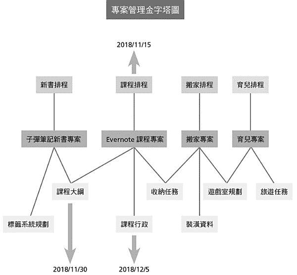 

我每天打开自己的时间管理系统，看到的不会是最底层那些杂乱的任务、行动，或者是资料。

我在这个时间管理系统，将会帮助我看到的是，那个系统最顶端，少数聚焦的专案主目录笔记。

 

而且，我不用担心那些不在视野中的其他东西。因为我知道，我的系统建构的很完整，相对没有漏洞，所以我只要关注这少数几则的专案主目录笔记。基本上，事情就八九不离十。

就算会漏掉一些事情，那一定也是不重要的事情，所以他们才没有出现在那些最重要的专案主目录笔记上面。

有时候，我会需要一些来自于过去的时间提醒，当那些需要提醒的时间到达的时候，我的系统也会告诉我，让我知道现在应该开始推进哪个专案的准备动作、应该开始展开哪一个任务的相关行动。

 

并且，我的系统会帮我留下充裕的时间，主动告诉我现在开始有哪些行动应该要去执行。

所以我要做的很简单，就是每天打开我的系统，相信我的系统，执行系统最顶端推进到我眼前的，那些少数聚焦的专案、任务与行动。

  

 

## 第六章   
如何帮时间管理系统最优化

 

 

#### 6-1 我们可以掌控的是目标选择与时间情境

经过前面五个章节的架构，我们打造了一套金字塔一样的专案管理系统，把事情都一一的安排到这个系统当中，并且创建了一套相对自动化的流程，可以帮助我们把该做的事情，以某种流程的设计自动呈现在我们的眼前，让我专注聚焦的去推动真正要做的行动。

已经打造出这样的系统了，还有没有什么可以进一步优化的空间呢？

让我们回到我常常讲的那个时间管理基本观念，我们想做、要做、该做的事情，永远多于我真正可以用来执行的时间。所以任何的时间管理系统都不是把事情摆上去就结束了，最终依然必须要做出我的选择。

事实上，有时候现实的环境是不可控的，会出现多少数量的专案跟任务，我们也很难在工作上自己全权决定，有些意外也不是我们自己可以完全控管的。这时候，在一个更进阶的时间管理系统里面，我们应该要做的，其实不是管理那些专案、任务跟行动，而是管理我到底要怎么做选择？

我真正可以掌控的是什么呢？从这张图来看，我真正可以掌控的只有两件事情：

 

・ 第一件事，是我为自己勇敢作出的目标选择。

・ 第二件事，是我在各种时间情境下，决定采取什么行动。

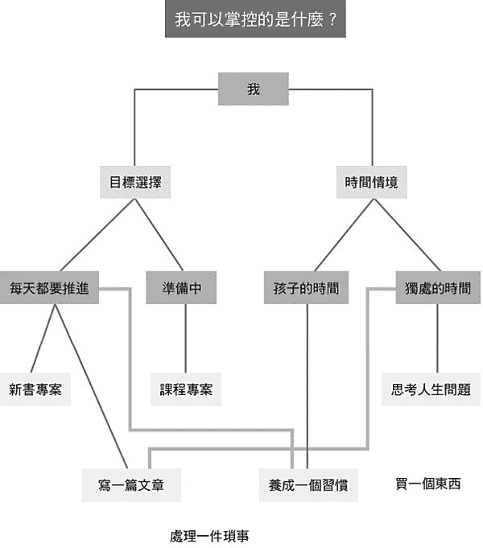 

无论底下的专案、任务再怎么混乱，再怎么有意外，最终所有的路线归结到我这个执行者身上的时候，我能够做的，就是做出我的目标选择，以及我的时间情境选择。

时间管理的价值其实不是在预排出完美的时间表，而是一句很简单的话：“就是去做这个时间最适合做的事，并且逐步的走在自己的目标上面。”

时间管理系统其实是一个自我选择系统，接下来这个章节，我要搭配 Evernote 功能，试试看在这个系统当中，有没有办法帮助我做出这样子的自我选择。

 

 

#### 6-2 真正需要的整理是：什么重要？如何行动？

前一段我们提到了，在时间管理系统的最后阶段，真正要做的整理，其实就是两种选择：

・ 第一种，选择到底什么是重要的。

 

・ 第二种，选择我现在应该如何行动。

所以其实这也回推到我们要怎么整理管理任务，一个最有效的专案管理，不会只是在分类，不会只是结束在排程，而是要能延伸到可以做出上述两种选择。

 

让我从自己利用 Evernote 建构的时间管理系统，举两个相对生活化的例子，来跟大家实际示范一下，我如何在这样子的工具上，进行我的重要性选择，以及行动选择。

如何做出有效的目标重要性选择？

 

我们常常很难判断什么事情重要，一个关键的原因，在于我们没有把“重要”，当作一种进度流程来思考。

这是什么意思呢？比如说，我有两个专案，一个专案还正在跟客户讨论想法的阶段，另外一个专案产品已经有了完整构想，正在紧锣密鼓的制作中。请问，这两个专案哪一个比较重要？应该是那个进入可以制作的专案，是相对重要的目标选择。

如果把事情用进度流程的角度来思考，那么判断重要性，会变成一件相对简单的事情。

那么 Evernote 中，可以把专案任务纳入这样的进度流程来管理吗？可以的。

让我举个例子，我自己有一套称呼为：“购物欲望清单”的管理方式。首先，我把所有想要买的东西都创建一个一个任务笔记。接着，我利用 Evernote 的标签功能，设计出三个进度流程标签：

 

・ 第一个进度叫做：想要，表示这个购物任务还在思考产品的优缺点，还在决定我的需求点，还在判断的阶段。

・ 第二个进度叫做：需要，已经进入了确认要购买的阶段，只是要等待一个适合购买的时机点。例如我想奖励自己的时候。

 

・ 第三个进度叫做：满足，表示这个任务已经进入了完成阶段，而我需要偶尔检验一下，那个已经购买的东西是否实用？有没有什么心得？下次如何判断比较好？

当我为自己的购物清单做出这样子的流程判断。我发现，就可以很清楚的选择出重要的东西是什么。当我想奖励自己的时候，我就排除那些额外的干扰，直接打开我的“需要标签”，去购买那些我已经判断好，真正值得购买的东西。

 

另外一方面，放在“想要标签”的那些笔记，我也可以一定程度卸下还没买他们的渴望，偶尔上去检查一下，思考一下上面的东西是否真的值得我购买。如果最后判断不值得，可以把这个任务笔记删掉。如果最后决定值得，就把想要的标签去掉，换上需要的标签。那么，等到真正要买东西的时候，又可以去购买那些真正判断为重要的东西。

这其实就是用进度思考，来取代重要性思考。

如何让自己知道什么时候应该推进什么任务？

 

尤其，这些所谓的什么时候，指得不是时间，而是各种情境适合做什么事情。

同样的，我来举一个自己真实的例子，看看我的如何利用 Evernote 的标签功能，设计出我的选择情境，来帮助我把某个生活中的专案处理得更好。

 

我在 Evernote 当中收集了非常多餐厅笔记，这些餐厅笔记收集的目的，是为了跟老婆约会、跟孩子一起吃饭的时候，可以去享受更多的美食。

这个专案，也利用我前面的系统整体逻辑，已经整理好了专案、任务、行动的层次，接下来，我需要做的是最终的选择判断：什么时候，我要是跟老婆和孩子去吃哪一间餐厅呢？

这时候我在 Evernote 的标签系统中，创建了下面这样子的标签（只列出一部份来解释）：

・ 重要日子

 

・ 值得再吃

・ 亲子餐厅

・ 牛排馆

这样的标签分类，看起来好像没有逻辑，但是对我来说它背后有我自己为他设定的逻辑，那个逻辑就叫做：“我要如何采取行动？”

在做这个标签分类的时候，我的思考点不是餐厅本身的属性，而是我在思考，我想要在什么情境采取什么行动？

・ 等我和老婆重要纪念日的时候，可以去吃哪些有纪念意义的餐厅？

・ 和朋友聚餐的时候，可以推荐他们什么好吃的餐厅？

 

・ 等我要带小朋友周末出游的时候，可吃什么美食？

 

・ 我和老婆都非常喜欢吃牛排，还有哪些牛排餐厅是我们没有挑战过的，下次我想挑战的时候可以去尝鲜？

我是先思考清楚上述我想要去做的行动逻辑，然后用这样的行动逻辑去设计我的分类标签。

 

这样的标签，就不是一个单纯的分类，而是可以透过标签来指引我应该如何行动。

 

 

#### 6-3 情境标签一：创建工作流程优先权重与进度

有时候当我们排出像是这样的时间表：“明天早上 10 点要写文章，早上 11 点写企划，下午 2 点跑报表，下午 4 点制作简报”，但是常常发现计划赶不上变化，永远无法照着计划执行，这是出了什么问题呢？

时间，本来就是充满了变动。原本以为早上 10 点可以写文章，但是如果客户一通电话过来，写文章的想法与心情就全部泡汤。而当一个时间点有了变动，后面的时间计划就要跟着变动。于是就变成永远无法按照时间表执行，甚至最后因为一团混乱，什么计划都没执行。

老实说，除了那些约好了不会变动，一定要在某个时间与地点执行的“会议”、“约会”，例如早上 11 点要去会议室开会，或是买了下午 4 点的电影票，要不然其他任务，都不适合用时间表来安排。

 

最好的行动，是根据情境来行动

归结原因，排了计划变成只是打击自己，排了计划只是制造混乱，是因为时间背后的情境变来变去，本来排好的时间到了，可能情境不是我们所预想的，于是在不适合的情况下就不想做事、无法做事，或是做了事也是效率低。

那要怎么解决呢？解决办法就是：不要让自己根据“时间”来做事，而是根据“情境”来做事。

让自己在适合的情境，优先去做适合的事情，这样动力最高，效率也最高。

有了前面两篇文章的基础之后，我们知道在 Evernote 建构的这个子弹任务管理系统中，如果我们想要做出有效的重要目标选择，以及有效的行动情境选择，我们可以善用 Evernote“标签”的功能。

我们可以利用 Evernote 标签，为自己的时间管理系统，设计出各种不同的情境

案例：我如何设计专案选择的情境标签？

首先，我们可以为自己的时间管理系统，设计出目标选择的进度标签，帮助我们很快的过滤出那些每天都应该要看到的目标在哪里。

接下来，我跟大家分享我的具体做法，你可以参考我的设计概念，修改成你需要的目标管理情境标签。

以我的工作型态来说，我的专案有三个主要的进度，我分别为这三个进度设计出了：重要、追踪、计划三个标签。

 

重要标签，那些最近几个月截止日就要到的专案，或是我判断为目前这个阶段对我来说最重要的人生专案，我就把他的专案笔记，加上重要这个标签。

这样做的好处是，我每天只要打开重要标签，里面出现的专案，就是我真正应该关注的专案。换句话说，我只要能够掌握重要标签里面的笔记，我的工作进度也大概就八九不离十。

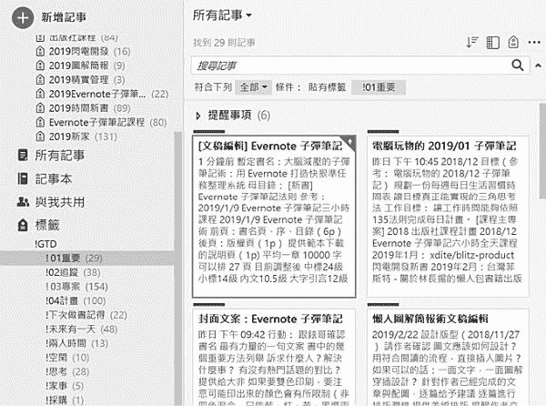 

为什么我的重要标签里面的笔记，可以只有 20 几则呢？这就要归功于前面的整理系统，让我不需要把那些零散的任务笔记也加上重要标签，唯一会被我加上重要标签的，一定是某个专案的“专案管理主目录笔记”。

 

以少驭多，在少数专案中，又把真正重要的，加上标签来判别。那么，我们就可以很快的聚焦在有效的目标管理上。

计划标签，另外还有个进度是计划，有很多专案八字还没一撇，是构思阶段。有些专案，还正在准备中，还没排出真正的专案进度时程。我就加上计划的标签。

这些专案也需要偶尔推动一下进度，但是他们还在计划中，我不需要每天都关注他们，也不需要花上最大的精力，那么就把这些专案加上计划的标签，提醒我偶尔关注一下，看看可不可以多推进一些准备的进度。

 

追踪标签，有些事情已经完成了，但是偶尔也要追踪一下他后续延伸的效益、成果，这是我工作上需要管理的一种流程，我就把这些任务笔记和专案笔记，加上追踪的标签。

因为他们可能没有特定的时间指定我去回顾，而是我自己觉得隔一段时间需要回顾一下，那么这个追踪的标签，会提醒我隔一段时间，或许几个礼拜、或许一两个月，就看一下追踪标签里面的东西，看看有没有任务需要再次关照提醒一下。

案例：我如何设计写作专案的情境标签？

 

再举个例子，部落格写作是我十多年来一直维持的个人目标，我为这样的写作专案，设计了三种情境标签，这三个标签分别是：测试、思考、撰写。

我在 Evernote 系统中，收集了非常多想写的文章题材，每一则文章笔记，都是一个独立的写作任务，但是这些写作任务其实有一些情境、进度的差别。

什么是测试标签？其中有些写作任务，包含一个我很想测试看看的工具，或者很想测试看看的方法，但是要测试就必须要有可以测试的时间与情境。

  

什么是思考标签？有些写作任务，是我正在构思的某个方法论难题，或是正在构思的某种工作问题解法，这些任务需要的是在适合思考的情境，去想出解决这些难题的方法。

什么是撰写标签？然后其中有少数的写作任务，可能已经测试出我想要的某些功能，我可能也把大致上的方法流程思考通顺，这时候这些写作任务，其实进入了最后撰写完成的阶段。

我就把上述三种目标选择的情境，设计成测试、思考、撰写三个标签。相应的写作任务，就加上适合她的标签，帮助作出很有效的判断。

当我在通勤、搭捷运的时候，适合单纯动脑思考，这时我就打开思考的标签，看看有没有哪些写作任务正适合现在拿出来思考一下，例如我卡关的某个问题点。

 

当我在咖啡馆有一个使用电脑的空档，正好适合做一些比较需要操作的测试，那我就可以打开测试的标签，把那些很想要测试看看的工具、方法的任务笔记拿出来，利用这个情境赶快测试一下。

等我来到了每天撰写文章的时间，我想知道有哪些文章可以在今天完成。这时候，我就打开撰写的标签，他会告诉我，哪些文章接近完成了？我可以利用今天的时间、现在这个情境，一鼓作气把这个任务完成，为每一天创造更多真正完成的成果。

 

 

#### 6-4 情境标签二：设计你的空档时间与行动情境

你没办法计划空档时间，但可以设计他！

对生活不满意，感觉时间无法自己掌控，想要实现的计划没有进展，工作、家庭与个人时间混乱与迷茫，却常常在假日、夜晚让时间不知不觉流逝而懊悔。

如果有上述的问题，或许可以试试看这样的解决办法：

・ 时间无法百分之百掌控，那么可以掌控几种基本情境。

・ 对生活不满意，那么尝试把目标选择，放入专案流程中。

 

・ 时间不知不觉流逝，所以更应该事先设定好利用方式。

时间或许每天都会有一些意外、变动，例如我可能今天九点才吃早餐，但平常七点就会用餐。但从更大的视野来看，“每天吃早餐”则是一个相对稳定，并且可以由我掌控的情境。

 

我们或许无法排出精细而不变动的时间表，但可以规划好基本的生活与工作流程。

而对生活、工作感到不满意或迷茫，可能一个关键的原因在于，我们并没有把真正的目标放入这些空档流程中，不是放不进去，而是没有尝试将它们放入。

 

于是，当各种可以利用的情境出现时，我们可能一时之间不知道应该优先做什么，于是就在一些次要、无关紧要的事情上把时间打发掉了。

要实现计划，尤其是个人想追求的计划，其实就是让这样的计划，真正落实在我们每一天的空档时间利用中。

而规划方法在于三个重点：

・ 掌控好自己生活、工作的基本流程与情境。

・ 把目标放入这样的流程与情境中。

・ 为必定出现的流程与情境，规划好利用方式。

我就是从这样的概念出发，在 Evernote 的时间管理系统中，利用“标签”设计出可以利用的情境空档。

第一步，列出自己日常生活中的情境清单：

不使用 24 小时的时间，而是改成真实出现的各种情境。

 

例如我仔细评估后，自己日常生活大概可以归纳出下面这些情境：

・ 早起时刻（通常只有我一个人）

・ 早餐时间（通常是和老婆两人约会）

・ 工作（正常上班时间）

・ 午休（中午用餐与自己可运用时间）

・ 通勤（搭车又可自己利用的时间）

・ 晚餐（回家与老婆孩子用餐时刻）

・ 家人（陪伴家人时刻）

・ 睡前（孩子睡着后的部分时间）

 

这些情境出现的时间，可能每天都有变动，也可能偶尔某一天会少掉某个情境，但大致上来说，这些都是日常循环出现的稳固情境，甚至他们出现的顺序也有规律。

你的情境，当然会跟我不一样。

 

但你可以利用上述思考方法，来找出自己的情境流程表。

第二步，把空档情境结合目标，设计出情境标签：

透过了这样的规划与思考，我也归纳出自己生活中常常可以利用的一些空档情境。

 

接着，把它跟我的长期目标结合在一起，我为自己设计出一些专用情境标签，也提供给大家参考。

“个人空闲”情境，把我想在一个人空档出现时做的任务放入，可能是玩一个游戏。这样当这种情境出现时，立刻打开这个情境分类下的任务，就知道可以优先执行什么。

“两人时间”情境，把我想和老婆一起看的电影、一起讨论的话题放入，当出现这样的情境时，就优先执行这样的任务。

“想和孩子一起做”情境，把想要带孩子一起去的餐厅、游乐园，或是想跟孩子一起读的书，或是想跟孩子一起练习的事情，放入这个任务情境，当出现适合情境时，就优先执行这样的事情。

我们很难为上述任务安排好明确的时间，但或许可以安排好情境，这样时候对了，就可以去做对的事。

 

 

#### 6-5 利用 Evernote 创建任务的“自动透视”

当我们创建了前述的情境标签系统后，我们还可以进一步善用 Evernote 的“搜寻”功能，快速呼叫出某类情境下，我们可以执行的相关任务。

 

可以把“透视”理解为检视工作的“不同视野”。而自动透视，就是可以自动地帮我们切换需要的不同工作视野。

利用“透视”，我可以：

・ 直接筛选出今天在办公室可以执行的下一步行动。

 

・ 还是筛选出休闲时可以做的事。

・ 也可以筛选出我可以立即进行的写作任务。

聚焦在某个情境、某个需求下我所需要的任务，而其他任务先暂时隐藏起来。这就是不同的工作视野，也就是透视。

 

这也是一种专注、深度工作的有效方法。

而在我个人惯用的时间管理工具：Evernote 中，可以自订出属于自己的“透视”效果。

我在办公室时，应该优先执行的任务

在 Evernote 中，我在公司里需要执行的任务笔记，都统一放在“01 工作任务”这个记事本中，其中某些特别重要的任务笔记，我则设定了“!01 重要”、“!02 追踪”、“!04 计划”等标签，来标注不同层级、不同流程。

所以我只要利用下面这个搜寻语法：

 

notebook:01 工作任务 any: tag:!01 重要 tag:!02 追踪 tag:!04 计划

就能找到在工作任务记事本中，正进入重要、追踪、或计划（其中之一）等工作流程的那几则笔记。而其他次要或参考资料的笔记，就会被过滤掉，不成为干扰。

我把这个搜寻语法储存下来，命名为：“办公室优先任务”，放入 Evernote 的捷径工作列。

这样一来，每天进入办公室，打开这个“透视”，就不怕漏掉进度上的关键工作。

 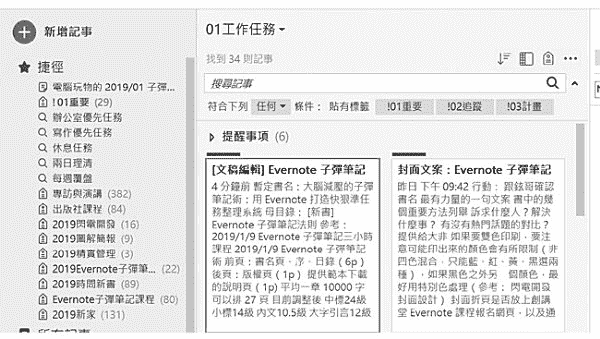 

在适合思考的情境，快速聚焦可以使用的写作素材

我也在 Evernote 中储存了大量写作的素材，同时有许多篇正在进行中的文章大纲、测试、构思，以及撰写到一半的内容，每一篇文章笔记，我也会用［思考］、［测试］、［学习］、［撰写］等标签来标注他们不同的流程。

所以我就使用了下面这个搜寻语法，将这个搜寻语法储存下来，命名为“写作优先任务”：

any: tag:!思考 tag:!测试 tag:!撰写 tag:!学习

意思是所有正在思考中，或是正在测试中，或正在撰写中，或正在学习中的文章题材，都一次找出来让我选择。而其他还没有进入流程的文章笔记与素材，就先过滤掉，不构成干扰。

 

当我遇上空档，准备推进某篇文章进度时，当下想要找一篇最想写的文章，我就会利用这个“写作优先任务”的透视，直接聚焦在我可以推进的文章进度上。

当进入休息情境，可以执行哪些任务？

 

我除了研究工作效率的提升外，也很注重自己休息时间的品质提升，注意生活习惯、保护家人时间，也珍惜自己真正的休息时间。

所以我为自己的各种休息情境安排了各种任务，可能是陪伴孩子的任务，可能是和老婆的休闲娱乐，可能是我自己喜爱的游戏，或是我想练习的食谱，我想看的书。

于是我设计了下面这样的搜寻语法，将其储存为“休息任务”：

any: tag:!想和孩子一起做 tag:$02 需要 tag:!两人时间 tag:!空闲 tag:!练习食谱

当我可以运用的休息时间出现，我就打开这个透视，挑选一个最适合当下，最符合当时心情的任务，将其执行。

Evernote 有强大的搜寻功能，各式各样的搜寻语法。善加利用，其实就是创建起自己的透视视野，可以快速筛选出需要的特殊笔记，来满足自己当下的专注工作需求。

 

 

#### 6-6 收集箱与记事本，如何应用在任务管理？

前面在整理时，我都是利用“标签”，来进行 Evernote 子弹任务系统中的专案、情境分类。

那么，Evernote 中的“记事本”分类要用来干嘛呢？其实也是一样的道理，就我个人的经验来看，记事本最好的用法不是用来分类，而是用来管理。

分类和管理是不同的，“分类”是说我们帮任务与资料找一个存放位置，方便以后找到。“管理”却是我们创建一个可以顺畅工作的流程，一个高效率的作业情境。

 

这篇文章，就要跟大家揭开我目前完整的 Evernote 记事本管理架构，我个人可以说只用了“八本记事本”，来管理所有的个人笔记。其他多出来的分类记事本，则是为了跟工作同事和家人朋友共享，而不得不区分出来的（因为共享记事本的基础是要先分类出一个记事本）。

先来看看我的完整记事本架构。

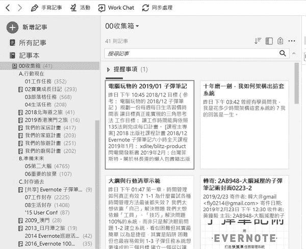 

你可以先看到我把记事本归类为三大堆叠：

・ 行动现在：执行中与准备执行的任务笔记

・ 准备未来：资料库，未来会用到的参考知识

・ 封存过去：执行完成的任务笔记

 

然后我个人主要的记事本其实就是 8 个，依序放在上面三大堆叠中：

・ 00 收集箱：刚收集到的新任务还不知道放到哪个流程好，或还没读而想要稍后阅读的资料，都先放在收集箱，还有我的“每月子弹笔记任务清单”也放在收集箱。

 

・ 01 工作任务：所有执行中与准备执行的工作任务笔记，例如某几本新书专案的所有任务，办公室行政流程上的个别任务，准备公司开会的笔记等。

・ 02 生活任务：所有执行中与准备执行的生活任务笔记，例如我的冲泡咖啡研究，我的旅行计划，我的运动健身计划，我想吃的餐厅我想去的景点等。

・ 03 部落格任务：所有执行中与准备执行的部落格任务，包含所有待写的文章主题，所有讲座课程的规划。

・ 04 第二大脑：所有工作上或生活中的参考性资料都放在这里，包含某本书需要的参考资料（而非任务），所有灵感与心情记录笔记，所有读书与电影心得，所有部落格完成后的文章草稿大纲也放在这里。也就是所有跟未来“刺激灵感”和“链接知识”有关的资料都放在第二大脑。

 

・ 05 重要的放弃：所有必须停止或失败的重要专案笔记，放在这里。

・ 06 工作封存：所有在“01 工作任务”完成的笔记移到这里。

・ 07 生活封存：所有在“02 生活任务”完成的笔记移到这里。

 

至于你看到图中的其他记事本，都是“我和他人合作共享”的记事本，例如一起进行某本新书专案，一起规划旅行。Evernote 是小型合作非常便利的任务与资料共享工具，但为了共享合作，只好分出记事本。

 

要不然，我自己的记事本就是上面这 8 个！用最少的记事本就能完成高效率“管理”。

同样用“行动情境”来设计记事本

我们先把观念转过来，Evernote 是很好的专案管理与人生管理工具，所以不要一直执着在“分类”，我一直追求的都不是所谓的最佳分类法，而是“最佳管理法”。

东西有没有放在整齐的位置不重要，资料有没有严谨的分类不重要，那重要的是什么？重要的是我的整理有没有办法“引导我去行动”，指引我提升工作与人生的方向？创建未来的顺畅行动流程？

所以我的那 8 个记事本是如何思考的呢？其实就是根据我的工作与人生的“行动情境”来创建！

我的情境无非就是要在办公室上班，要照顾家庭生活，要推动我个人的梦想（部落格），既然如此，其实我只需要三种记事本：“工作，生活与部落格”，当我到办公时只要打开“工作任务”记事本就能完成所有工作。当我回到家里或周末时专心打开“生活任务”记事本来完成任务。当我每天早起后就是打开“部落格任务”来写一篇文章或准备讲座，这样是不是更专注？

只是说任务会分成未完成与已经完成，所以当“工作任务”里的任务完成了，就把笔记移动到“工作封存”记事本即可，于是有了对应的封存记事本。

至于“第二大脑”与“重要的放弃”，那是因为会有很多参考性资料，非任务的零散想法与心得，这时候需要一个“第二大脑”帮忙储存，以后才能从中激发灵感。

而“重要的放弃”是因为人生中一定有些现在怎样都无法完成的事情，那就先放到未来，有一天准备好了再来完成。

行动情境最精确，是待办清单，也是专案管理流程

你可能会问，难道不用根据每个专案来分类记事本吗？全部混在一个“工作任务”记事本好吗？当然不用，因为专案的部分，我们已经利用“标签”做好分类，而标签更适合来分类需要弹性的专案。

而记事本以“行动情境”来做，最概括，但其实也是“最精确”的区分。可以让任务、专案笔记，很容易地摆入某个明确的记事本中。

因为我的每一天，一定是可以很好的切割成工作、生活与部落格三大情境，因为我就是会出现在三个不同的地方。那么，其实只要知道我在某个地方或时段，该做什么事情就好，例如到办公室，只要打开“工作任务”记事本，就可以完成所有工作。

这样是不是更精确？绝对不会有不知道笔记应该放到哪个记事本的情况，因为我们自己可以决定，也应该自己决定：“我要在哪种情境完成这则笔记任务？”

是要在办公室完成？书房写部落格？还是未来的参考资料？就放入相应的情境记事本。

这时候情境记事本其实就是我们的“锦囊”，进入该工作情境时打开这个锦囊，里面就是准备执行的“待办清单”，我只要专注完成它们即可。

 

 

## 第七章   
最终选择，每周每日子弹行动清单

 

 

#### 7-1 如何一次排出每周子弹行动清单？

在前面六个章节完成时间管理系统的最优化之后，其实这个系统已经可以帮助我们每一天，甚至每一个情境，都能很快地聚焦在最佳行动上面。

利用这个系统，我们就能知道这个当下有哪些应该专注的专案。并且我会知道这个专案排程中接下来要执行的任务。接着我也会找到这个任务当中，这个当下立即可以采取的行动是什么。

这些时间管理系统当中最重要的事情，其实在前面六个章节的系统中，已经可以实现了。

额外列出每周行动清单可以带来的好处

即使如上所述，但我确实会建议，应该提前列出每周的子弹行动清单，把每周子弹行动清单独立一则笔记，当作最核心的专案指导原则。

 

我的习惯是，在礼拜天的晚上，把下一周七天的每日行动清单列出来。让自己进入工作周的时候，有一个依循的依据，可以更快进入专注在某些重要行动的任务、专案上。

有一份有效的每周子弹行动清单，可以带来几个好处：

 

・ 让大脑减少更多无谓的决策，更有效地清空大脑，达到大脑减压的效果。

・ 可以提前知道下一周会有哪些空档，哪些时间已经被挤满，可以提前做一些调配。

・ 提前计划，可以帮助我们有更充裕时间思考，更好的判断专案重要性，确认任务跟任务之间的关联。

・ 在充裕的时间里面先做出最好的选择，而不要等到混乱当下才做出很有可能犯错的选择。

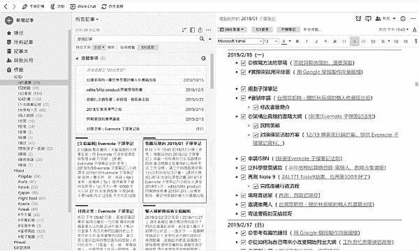 

拥有系统，决定每周子弹行动清单更简单、更准确

更重要的是，要列出每周子弹笔记清单，其实并不难，因为我们的前面六个章节，已经建构了一套完整自动化的时间管理系统，这套系统将可以帮助我们非常快速有效的选择出下一周的子弹笔记行动清单。

我现在，大概每个礼拜天晚上花三十分钟到一个小时的时间，根据下面的步骤，就可以相对准确的排出下个礼拜的每日行动清单。

而且这样设计出来的行动清单，他的达成率会比一般的待办清单还要高上非常的多！

我的操作步骤是这样的，打开我的 Evernote 子弹任务管理系统，然后依序处理：

・ 先看时间提醒：有没有下周特定时间要开始的任务？

・ 看“重要”标签：哪些专案需要推进进度？

 

・ 看“收集箱”：有没有这周收集，还没排程处理的任务？

・ 根据已经排出来的子弹行动清单，看看有没有可以安排的特殊情境任务：空闲、两人时间、思考、测试、撰写、采买、家事。

・ 看“计划”标签：有企划中专案可以推进下一步了吗？

・ 看“追踪”标签：有没有需要回顾的任务？

是的，真的就这么简单，只要从每个步骤中，挑出要执行的行动，排入下周的每日行动清单，那么就会是一个更有效、不怕遗漏的行动清单了。

 

 

#### 7-2 每日行动清单的 123 原则

不过，我在安排每日行动清单时，还有一个挑选的技巧，或者说原则，我称呼他“123 原则”，他会帮我决定每天如何调配不同专案的数量、权重。

为什么是 123 原则？而非单纯的每日时间表排程？因为，只有排程的任务是最无趣的。

其实，我是一个爱拖延，容易恐惧担心，不积极，而常常感觉什么都缺乏动力的人。这种情绪伴随着我，很少因为累积了很多成就而完全消失，总是一而再、再而三的涌现。

这似乎跟时间管理背道而驰，但也因此，我非常能感同身受觉得自己无法管理时间，是什么样的感觉。

但我会尝试透过一个列每周每日行动清单的 123 方法，来帮我改善处在这样情况下的自己。

 

123 的时间调配节奏

这个方法很简单，透过“三种时间节奏”的掌控，就能帮助我自己做出相对有效的时间管理，而这个方法的目的：在于可以帮助我更容易展开行动，于是产生行动的动力，进而得到行动后的满足感。

 

什么是 123 每日行动清单法则？

・ 每天都预先设定一个专属于自我实现的重要目标

・ 每天设定两个专案的推进进度

・ 每天早午晚三个时段，还剩下多少时间处理琐事

 

我会一周前，先列好下一周七天，每一天的 123 行动清单。

下面让我来说明这样做的意义、价值，和我背后的思考逻辑与真实经验谈。

一，每天都预先设定一个专属于自我实现的重要目标

 

人生中有些事情没有人逼你，没有时限，但你为自己选择推进的重要事情。而这是找到成就感，感受到快乐的最佳方法。

或许那对我来说是写完一篇部落格文章，或是和老婆一起看完一部我们都想看的剧集，还是读几本童书陪伴孩子入睡。

 

我会主动的、具体的为自己挑选出这些事情，事先挑选出来，排好一周内每一天要去实现的个人目标：

让每一天有自己就能找到成就感的行动，这会是最好的动力生产机制。

接着，我会利用空档去推进这个每天选择好的个人目标，这可以帮助自己好好把握住那些突然出现的空档，不至于白费。

空档其实常常出现，只是我们当下不知道应该要做什么，但时间不会等人。所以要反过来操作，先为自己设定好空档可以专注的事，那么就能有效的把握零碎时间。

 

这样做，还有另一个效果是，如果自己完全没有动力工作，不想去做所谓的正事，那么不如把时间投注在这些自己想做的重要目标上吧！这样起码和逃避时间、打发时间后的懊悔相比，去做自己有成就感的事，起码在之后会获得更大的成就感。

 

而这样的动力，反而能激励我们去完成那些工作、生活中困难的事。

二，每天设定两个专案的推进进度

专案常常多头并行，事情常常杂乱无序，如果一股脑地栽进去，那么就像没有地图就跑进迷宫，焦虑、烦恼、压力只会增加得更快。

这时候，不如把所有要做的事情摊开来，也把自己仅有的时间摊开来，具体的看看，到底“真正可以排进来完成的”有哪些事情。

是的，我也总会发现事情做不完，无法排进这仅有的时间。但这样可以：

 

・ 督促我去排入真正非完成不可的事情。

・ 提醒我如何提早开始某些行动。

・ 并鼓励我勇敢地舍弃一些行动，专注到最重要的行动上。

放心，也不用真的拿着时间表去排，那样反而更容易做不到，又会花掉许多时间。

我的方法相对简单，我会这样设想，人一天的作息，通常会有两个最有精力的时段。让早上最有精力时段、下午最有精力时段，推进那些有难度的专案进度，知道自己每天最有生产力的时刻，要展开什么具体行动。

 

这样来看，每天推进两个专案的重要进度，或某个专案的两个重要进度，其实就很多了。

最好能预排好未来一周的每日行动清单，这样做的好处是，如果我知道礼拜五要完成 A 专案的某个进度，那么我就知道礼拜一到礼拜四，每一天要推进 A 专案的哪些行动，最后那个进度才会完成。

只有设定好自己想要推进的专案进度，才能知道专案还需要多少时间才能完成。

避免超现实的设想，知道自己要如何提前开始，也知道自己可能必须再多争取多少时间，以及知道自己要排除哪些多余的事情。

三，每天早午晚还剩下多少时间处理琐事

当前面的自我实现、专案进度都已经安排好，我们可以具体感受到，要为自己留下多少时间去处理前面那些更重要的事情。

而这时候，也就可以知道自己每天所剩时间其实不多，自己必须更大幅度的减少琐事，减少旁支事情的干扰。

但确实可以安排一些琐事，或是简单行动，一天早午晚三个时段，需要一些简单琐事来当作调剂。但不要太多，三件当作调剂也就够了，最好更少，因为每天一定还有很多意外、临时状况，会增加我们要处理的琐事数量。

所以有时不如留白，给自己弹性的处理意外琐事的时间。

这样的行动清单，不是只理想化的思考重要性，也不是只把一堆事情压在自己身上，而是真正具体的、现实的，但也感性的、自我理解的，去为自己设计出可以找到成就、可以按部就班、可以找回动力的行动清单。

 

 

## 第八章   
这是一个帮助自己愈来愈有效率的成长系统

 

 

#### 8-1 子弹日记，串连计划、执行与反省的循环流程

前文中，我提到自己不喜欢一般的待办清单软件，因为没有背后的支持系统，是列出来真正有效的行动清单的。

除此之外，我还有另外一个不太爱用待办清单软件的原因，那就是行动完成了就被画掉！你说，这不是很有成就感吗？但是，前面我们有讨论过，如果一个行动做完了，他就结束了，这代表这个行动不重要，或是无法延伸更多价值。

时间管理系统，是专注去创造价值的系统，而不是把清单划完就好的系统。

 

所以，行动、任务、专案完成了，我们需要思考的是，经过了这次系统的流程，有没有可能帮助自己下一次的成长呢？

顺着这样的思考，我也演化出了一套依附在前面每周子弹行动清单的日记系统，我称呼他：“子弹日记”。

 

什么样的日记，是有效的日记？

第一个方法是：“根据目标来写日记”，不是随便乱写，而是写下今天在目标上做了什么行动，即使再小都好，让自己保持在往目标前进的路上。

第二个方法是：“创建闭环”，根据目标写下日记，根据日记继续修正明天的计划、未来的目标，然后再写下执行目标后的日记。这样就是一个闭环，表示自己在循环的过程中，专注在一个一致而没有漏洞的道路上。

而我决定，把这个方法，实践在子弹行动清单上面。

 

每日检视，把行动改写成日记

我本来就会有一个“每日子弹行动清单”。

关键是，这些行动清单背后都在“关注着”近期最重要的几个“目标”，例如我在学习的方法？我在玩的游戏？我在养成的习惯？我在执行的工作专案？

 

既然如此，若要“根据目标来写日记”，我便想说，何不直接在每天完成行动后，直接把行动改写成日记呢？

因为我规划的每日子弹行动，本身就是以目标为依据。而完成了这个行动本身，其实就是日记的一部分，我只要把执行过程的心得与反省补充进来即可。

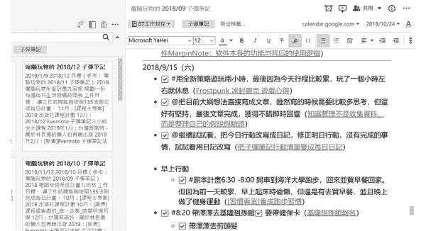 

例如上图中，我原本有个行动是：“用全新策略游玩两小时游戏”，今日完成后，除了勾选完成外，我只要“在这句话之后”，直接补上两句心得即可，就是一则很完整的日记内容。

 

每天晚上（或第二天早上，看我的空档），我会把过去一天完成的事情打勾，并且在行动后面直接补上执行心得，作为一个收尾。

这样累积下来的行动清单，当我回顾时，变得更加生动，更容易回忆起那一天实际的执行状况，并且也会引发接下来如何修正行动的想法。

从日记出发，修正明日行动：

在行动后面，加上几句执行后的心得，花的时间很少，但是当有了这样的思考后，会“更加清晰的”看到自己接下来应该采取的行动。

于是，这样的日记，不再只是行动的“结尾”，也是接下来行动最好的“开始”。

我每天晚上把子弹行动清单改写成日记后，就会把写日记时新加入的想法，安排到明日或未来的行动清单。

我每周进行下周子弹行动清单安排时，也可以直接回顾上一周所有的“行动+日记”，这帮助我更容易掌握下一周还要推展什么，并且更快完成下周行动的安排与发想。

执行时随时修正，工作日志的概念：

而既然每天的行动清单，都已经要改写成日记，那么这份清单也就是“随时都能动态修改”的了。

我们常常做了计划后，很怕修改，但如果外在环境、内在心情都是变动的，那计划又如何能够不修改呢？

反正最后都要改写成日记，那么就更勇敢的在“执行的当下”，也根据情况做各种修改，让行动更好执行，让自己去做能够做的事。

这样执行了好个月后，我发现这是一个更强大的行动清单，也是一份更强大的日记，在“计划与日记二合一”的情况下，为我带来了下列优点：

・ 无论写日记、做计划都更加节省时间，因为各帮对方做好一半工作。

 

・ 更容易做每天的检视，因为就在每天预先安排的计划上，去检视自己的执行结果。

・ 更容易做明天的计划，因为就在每天完成的日记上，去修正明日的行动。

・ 让自己的行动是连贯的，这一点非常重要，表示我每一个行动从日记到计划，从计划到日记，保持前后一致的方向。

如果你也在做子弹行动清单的朋友，或许也可以试试看，不用另外写一本日记，就把你的子弹笔记每天改写成日记吧！

 

 

#### 8-2 子弹时间管理演化哲学

本书进行到这边，一整套 Evernote 子弹笔记方法，以及背后我想要创建的时间管理系统，已经非常完整的跟大家介绍演练完毕。

我非常期待你也能尝试看看这样的管理方法，说不定还可以应用在不是 Evernote，你自己选择的其他管理工具上面，很期待听到大家实践过后，可以给我一些回馈。（你可以透过我的电子邮件帐号，跟我交流问题：esorhjy@gmail.com）

最后，让我为这套 Evernote 子弹笔记方法，做一个总结。这一套方法，可以说是下面五个步骤的逐步演化：

・ 行动演化出任务

・ 任务演化成子弹

・ 任务子弹演化成专案武器

・ 专案武器演化出战略情境

・ 战略情境演化出攻击指令

我们原本的时间管理方法，很容易迷失在杂乱的行动当中，找不到目标，那么所有的攻击都是没有力道的。

所以行动，不会是最好的子弹。我们必须把行动关联起来，找到他背后真正要攻击的目标，也就是一个一个任务要达到的成果，打造出一个有目标、有拆解的任务，这样的任务才会是一颗有效的子弹，具有杀伤力的子弹

但是，子弹也必须要搭配优良的武器，才能发挥最大的攻击力。而专案就是我们真正的武器，把任务关联到专案，就要把子弹上膛。这时候，我们就不会是徒手丢子弹，而是可以利用专案这个武器，集中火力，发挥最大的攻击效果。

可是，乱枪打鸟的话，我们也没办法真正的攻下对方的要寨。所以我们必须要开始思考战略，所谓的战略，就包含了排程、提醒，甚至更高级的战略包含了目标重要性的选择、攻击情境的挑选。如果可以把这些条件思考进来，拟出一份大战略，那么我们真的就可以开始出兵打仗。

而这时候，为了因应战场上面瞬息万变、没有犹豫时间的特性，我们可以拟出一个每周子弹行动的攻击清单，他就是我们优先遵守的攻击指令，帮助我们在每一天的行动当中，做出最快速的决策与攻击。

把这一套系统演练熟练，我们就能成为最佳的时间管理攻击手！

并且，事实上这套系统没有那么困难，也没有那么花时间，其实他还会是一个相对更简单的管理方式，相对更轻松无压的选择系统，相对更准确的行动流程，以及相对可以创造价值，带来成就感的人生哲学。

这本书，希望透过这套系统的练习，帮助大家开始踏出真正有效改变的步伐。