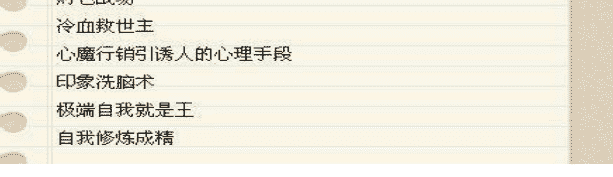

# 夺心术——人性与心理的操控

## 前言

### 不要相信成功者講的話

我在這裡不是說所有的成功者都是騙人的，但，當你向成功者虛心請教時，一般都只會得到一些八歲到八十八歲，由艾丫到李嘉誠都會講的答案，通常他只是告訴你一些他自以為或自救救人的答案，其實他們是無心要害你的，只不過他們沒辦法很清晰的反觀自我，分析出自己最關鍵的成功要訣。

隔岸觀火永遠比彼岸觀火更能看到全貌，看別人的缺點是容易過看自己的，分析別人的成功是容易過分析自己的……

### 天生的頂尖銷售員

南先生是頂級的銷售員，手段高明，大學畢業後，即在某家大型的家用電器連鎖店作銷售員。他沒有上過任何的銷售課程，更加不會去上什麼激勵課程。可是很奇怪，他第一天上班，雖然沒有任何的經驗，卻是生意最好的一位，表現得比銷售老將更加矜青。

同事們認爲他是一位福星，十位走進店內的客戶，幾乎全部會跟他交易。有那一天他沒來上班，生意量就大爲遜色。一個月後，他成爲公司的神話，他的業績比全體的銷售員高出兩倍。

數年之後，南先生開始創業，這是他人生的第二份事業。他與朋友合資經營二手車行，股東在銷售二手車上有豐富的經驗。營業初期，資本不大，只有區區二十輛車。第二個月，奇蹟發生了，單單是南先生所經手出售的汽車就佔了十六輛！

雖然南先生只有一個月經驗，但是功夫了得，想賣車的人，一定被他說服，並且殘得片甲不留；想買車的人，很少異議，往往都是由他成交。他的股東，形容他是喬·吉拉德（JOE GIRARD）第二。

當有人問他的成功秘訣，他說：「熱誠、熱誠、熱誠。」第一個熱誠是對產品的熱誠；第二個是要對事業的熱誠；第三個是要對客戶的熱誠。

南先生教育員工，也是對他們說：對產品的熱誠，對事業的熱誠，對客戶的熱誠，可是，偏偏只有他做得到，連他的股東都無法做到，當員工問：「甚麼是熱誠？」

「熱誠就是要愛……。」

「我也是很愛他們，很愛我的事業啊……」

「你要發自內心去愛。」

其實員工們常常聽到他在背後罵駡的客戶，他根本不是發自內心去愛……。

有愛，有熱誠就可以成功嗎？那麼，你很愛某位美女，對她充滿熱誠，但是，她不愛你，她有男朋友，你可以成功追求到她嗎？如果

是這麼簡單，世上就沒有失戀、苦戀、暗戀、單戀這回事！

### 富不過三代

黃先生是生意人，也是發明家，他有創意、具膽色，二十多年前是大型訓練狗狗場的名prd。後來，眼光獨到，開了許多大型的桌球中心。賺大錢後，即收手不幹，風潮過後，他已將桌球中心賣得清光，大賺特賺。黃先生做生意，最厲害的手段是：任何新的風潮，他都能夠做到香港人所說的：「先飲頭啖湯」，大賺一筆後，即刻見好就收，迅速離場。

他憑著「先飲頭啖湯」所賺取的金錢，足以成為千萬以上的富豪。

富甲一方後，又發明一種車用神奇油，風行一時。

他教給孩子的獨門秘方就是：果斷！

問題是，孩子問父親：「什麼是果斷？」父親無法教得明白白白，只懂得不斷強調果斷的重要性。最後，孩子因爲由果斷變成匹夫之勇。失敗之後，問父親：「做生意果斷比較好呢？還是三思而後行比較好？」黃先生用廣東話說：「你唔係果斷，你係叫做一無腦！」孩子用廣東話回敬：「乜都你講啱……」

有錢人最怕的事，就是「富不過三代」！黃先生把生意交給自己的下一代，就發生富不過兩代的慘劇。

這兩位強者的成功祕訣：是熱誠與果斷。你學到什麼？

### 街頭銷售之神

我曾經和朋友在一個地方喝著咖啡，然後就注意到一個人拿著一些筆沿桌兜售。這個 Coole 人最特別的地方是那些喝著咖啡的客人、各都跟他有說有笑的，有些還會跟他買。因為當你好友三五人難得一聚的談天說地，最不希望有個陌生人打斷你，要你買一些你不需要的東西。

他走到隔我們兩張桌子的地方時，我就看到他出手的技巧了。他一接近你的時候，一直講著話就一直把筆放在你的桌子上，這是第一招。然後身體向後退，這是第二招……我看他表演，在短短三分鐘內他出了六招。他走到下一張桌子，我再看，他也是短短二分鐘內就出六招，而每一招的背後都有其心裡法則的。

他走到我們桌子時，我就稱讚他出手很厲害，問他是怎樣學回來的。他說他沒有正式學過，我就建議他應該用這些厲害的手段去賣保險，然後他說他在業餘時也有賣保險。這一下我真的相信這個人是沒學過的，因為他出手的段數，只要稍微動筋骨就可以變成很厲害的成交手法，這個人是沒辦法分析到自己出的招數為什麼有效，假如分析到的話，我認為他不應該把時間花在賣筆上，只賺取那微薄的佣金，應該直接用在銷售保險豈不是更賺錢？

### 不是熱誠，更加不是果斷！

李民傑（作者之一）在藥界當銷售員的時候，可以用一天的時間做一個月的營業額。轉換工作後，在新公司第一個月的業績是六千元，第二個月即將業績提升到三萬多元，成長是五倍多。後來，接回來的生意，數目之龐大，連公司也不敢接受，因為公司的現金流（CASH FLOW）不足以周轉。

你問我：「你是怎麼樣做到的？」我會告訴你們：「我不是用熱誠做到，是用技巧做到。我喜歡當講師，喜歡出書寫作，只有演講與寫作才會有無限的熱誠。以前所做的成績，絕對不是靠熱誠！」

有位小姐是美容師出身，後來看到地產業的潛能就轉換了工作。她使盡法寶，用盡誠意，成績還是差強人意，後來經朋友介紹，上了我們的課程後，決定進入全新的領域，為某家國際銀行銷售金融產品。三個月後成為該國際銀行的前二十名頂尖業務員，該公司有超過兩千位的銷售員，她的月收入比起當美容師時，暴增十二倍。

她不愛這份金融工作，對它沒有熱誠，轉換工作的決定不是因為果斷，只是有些系統學會技巧之後，想賺大錢而已。

七十年代，我們的前輩告訴我們：學習一份手藝，不會餓死。但是活在資訊發達的大時代，這套理論行得通嗎？

在很久以前，你有很差的表現，曾得到很差的結果，這叫做「報應」！可是，在今天，你不只是有很差的結果，而是很慘的結果！

在很久以前，你有普通的表現，會得到普通的結果；但是，在今天，你不會有普通的结果，而是很差的結果。

在很久以前，你有很好的表現，會得到很好的結果。但是，在今天，你只會有普通的结果。因為現在已經進入非常競爭的年代，現代的競爭比起以前，完全不一樣。如果在現在，要拿到很好的結果，就一定要有非常好、加倍好的表現！

譬如：在奧運會的一百米短跑，跑第三名的只是得到銅牌；第二名的，可以得到銀牌；第一名的選手，不但是得到金牌，他們還會得到很多廣告的贊助，所得到的成果，與第二名或第二名的選手，相距很大。但是，第一名的選手，與第二名的選手，他們的速度只是相差零點零一秒，只是這非常微小的分別，他們的際遇是完全的不一樣。

### 禮讓法則

> 贏家很謙遜的說勝利不是的一切，
> 輸家被逼相信勝利不是一切。

### 不公平的競爭

也許，你會覺得：在這種殘酷無情的競爭下很不公平。然而，正是在這麼不公平的世界裡，你我這種普通的人，才有無限的機會創造奇蹟！

一名銷售員，每一天都 DIS 勤勞，充滿熱誠就可以成功嗎？可是，每一次遇到銷售員來向你兜售產品，對方還沒有開口，就已經嚇到你的閉門羹，那麼，他怎麼用熱誠來感動你？這種修況，每天都在上演，十年前一樣，十年後也是一樣，這些方法，沒有效，依然有人在用，熱誠、果斷，這種陳腔濫調，說了一百年，還是這樣說。

這個世界最不公平的是，老千騙人的手法，騙過一千人，報紙刊登了，許多人知道了，但是，依然有人不斷受騙。難道，做老千的人是充滿熱誠的嗎？

絕對不！我們不是對老千歌功頌德，而是說出真相：老千所有騙人的技巧，是經過有系統的學，然後才是有系統的運用。如何出手是手段，何時出招是智慧，誰是他的客戶，誰不是他的客戶，他們都有一套方法來過濾。

如果，堂堂正正的生意人不能像他們一樣，有系統的學有系統的運用，如何出手，何時出招，用一套方法來過濾：誰是他的客戶，誰不是他的客戶，那麽，他豈非連老千都不如？

很久以前的人認為：成功者是以擁有什麼成果來計算；二十一世紀，資訊發達的今天，不是你擁有什麼就夠，更重要的是你知道什麼，你是否能夠很有系統的學、很有系統的運用，在激烈的競爭中，知道何時出招，如何出手？

你有沒有知道了什麼，是你的競爭對手所不知道的？

## 第一章 魔鬼的智慧

### 為什麼所有的人都是機械人？

其中一句讓我最難忘的名言： We have potential to be a human being.（意思是：我們有機會成為一個人。）你是不是人，看看以下就知道了：

大多數的人出世後，被養大。然後被送去學校讀書。讀書的目的就是將來有出路。有出路的意思是可以賺到錢。賺錢的目的就是可以買自己的屋子、車子。然後找個伴侶，再生下一代。然後把你的孩子再「丟進」你以往走過的軌道；讓他讀書賺錢結婚生孩子。然後你就退休，享清福。講得難聽一點，所謂的享清福就是等死。幾乎每個人都是走這條路。

絕大多數的人都在沒太多思考，不清醒的情況下走上這條路。你去問一些人為什麼要結婚，他會跟你說：「是時候該結婚了。」或更過癮的是：「沒辦法呀，朋友和兄弟姐妹都結婚了。」根據一個美國的統計，超過百分之八十的人是不喜歡自己的工作。試想一天二十四小時，八小時睡覺，八小時工作，八小時吃飯，大小便，性行為，社交，看電視等。人生的三分一睡了，另外二分一是作自己不喜歡做的工作。剩下的三分一，一半是用來做生理上逼不得已要做的事情，另一半有機會是做你想做的事情。

#### 權謀法則

人生苦短又無甚意義

### 真人和假人的分别

人分成兩種。一種是有靈魂，另一種是沒靈魂。絕大部份的人是屬於沒靈魂的。有靈魂的人就是已經醒過來的人。醒過來後通常有兩種下場。(一)覺得人生沒意義，所以開始墮落。(二)覺得人生沒意義，所以主動創造人生意義。

根據一個統計，百分之二的人有真正用頭腦去想過自己要的是什麼。百分之三的人以為自己有用頭腦去想過。百分之九十五的人認為最好他不用去想，別人幫他想是最好的。意思說百分之九十五的人是徹底的跟隨者。你只要在他們面前看起來像是知道自己要什麼，而且看起來也像是知道他們需要什麼，他們將很樂意的追隨你。

### 如何控制人

這世界有三種力量是可以輕易控制他人的。(一)錢的力量 (二)暴力的力量 (三)美色的力量。每個人都知道有錢能使鬼推磨，你開得出一個天價，理論上是可以叫李嘉誠幫你洗車。你拿著槍指著我，我應該是很聽話的。我的前任女朋友，去到政府部門申請護照 (通常是要等三天的)。她在排著隊時。有幾位男官員走過來問她需不需要幫忙，然後拿了她的資料…結果她在當天就拿到護照了！當然她是一位兼職模特兒 (可見馬來西亞的一些政府部門的作風是蠻靈活的)。

所以說這個世界是不公平的。在一個不公平的世界裡，一個沒有錢、武器和美色的你應該怎麼辦？那麼我就告訴你一個同樣不公平的秘密：

### 如果你有高超手段的話⋯⋯

你可以使那個有錢的人給錢你。你也可以使那位有槍的人成為你的朋友，更不用說，你可以使那位貌美的小姐成為你的情人。

#### 權謀法則

只要深究人類行為的脈絡，理論上錢、權和愛情可隨手可得。

基本上手段可以分成兩種，就好像武術一樣，可以分成外家拳和內家拳。一種手段是從人性下手，另一種是從心理下手。從人性下手的就是權謀，另一種是從心理下手的就是 NLP。權謀屬於比較狠和直接的手段，而 NLP 則比較柔和間接。NLP 是 Neuro Linguistic Programming 的縮寫。中文翻譯為腦語言程式學。

基於大丈夫能屈能伸的道理，我們在此跟大家分享這兩種方法。
能夠軟硬兼施者，速得天下。

### 向老千學習

#### 第一印象，第一句話

無論你是老闆或是銷售員，在你們要開發新客戶的時候，第一次會面，第一句話，是不是告訴他：「某某先生你好，我是 ABC 公司的代表，我的姓名是 DEF，我們的產品可以幫助你節省金錢，還可以讓你賺錢……。」接下來，馬上堆砌親切的笑容，  卓躬屈膝，彎腰駝背伸出雙手緊緊握住對方的手，盡量表現出艷陽般的熱情，博取對方的好感？

這樣做，無非是讓人覺得你是一位好好先生，是一位有禮貌，又熱情豪邁的商人。

#### 沒有用的方法，依然有人在用。

市場上幾乎所有關於行銷的書，都是這樣教你博取好感，爭取第一印象。但是，你的競爭對手是否會用同樣的方法來說第一句話呢？你的競爭對手，不可能對你的客戶說：「我們的產品讓你賺錢，然後，又是浪費你的金錢……。」恐怕沒有人會這樣說吧？！

如果每個人都是「機械性」用這種銷售手法，會有效嗎？有沒有發現：有些方法，用了一千次沒有效，依然有人在用；但是，騙人的方法騙過一千個人，依然有人受騙。爲什麼老千用同樣的方法來騙人，還是欺騙到許多人呢？

這種沒有效果，依然在用的方法叫做「機器人與機器人的對話」，銷售的方法是預設的程序，所得到的反應也是預設的程序，連結果也是可以預見，對比老千的靈活手法，根本高下立分。

#### 老千如何尋找獵物？

老千尋找獵物之時，開口的第一句話，一定先引起對方的情緒反應，接下來，把對方的情緒推上天堂，拉下地獄，讓對方感受到既痛苦又快樂，先是希望，然後就失望，在對方的心情上上下起伏的過程中，對方已經完全受制於老千的魔掌之上。第三步，他們會製造緊急狀況，容不得對方思考，在沒有充足的時間，倉促作出決定。

在老千的眼中，市場上有百分之九十五的人是機器人，這些人要在發生很大的禍事，才變成懂得思考的人。這些人爲什麼會變成機器人呢？那是因爲我們每一天都過著機械式的生活：上班下班，做同樣的事，見同樣的人，彷彿行屍走肉，生活在沒有特別的衝擊下，久而久之，就會變成機器人了。老千對於這些機器人的操作非常熟悉，只需要打亂他們步伐的規律、對他們的情緒製造刺激與波動，就可以加以控制，像駕駛汽車一樣，隨意操縱他們的方向。

也許你每一天都曾經遇到很多陌生人前來向你推銷，也許你以前真的是無意識、機械反應的拒絕了他們，今後，或許你可以統計一下，你每天拒絕了多少位向你兜售的推銷員？然後再想想：你們是不是很像「機器人與機器人的對話」。

很多所謂的大師說：「推銷產品不如推銷自己！」怎樣才是推銷自己呢？如果他們是鼓勵你以良好的服務爭取業績，那麼你很可能自挖陷阱給自己。

（我們將會在這本書另一篇中，詳細說明這一種銷售手法的弊病，同樣，我們將教你們，怎樣用一個思想，三招手段來推銷自己。）

#### 老千的優點

但是，老千出手就不同，他們可以在很短的時間內，就得到他們想要的獵物，取得他們想要的成果，對此之下，你如果沒有老千的手段，豈非連老千都不如？

其實，你也不必感到灰心。既然你有很好的產品，超好的服務，又或者你是一流的人才，具上好的品德，像你這種人，想要把生意做好，第一大條件就是不要做機器人，向老千學習怎樣製造客戶情緒上的反應，將很好的產品、超好的服務、一流的人才，甚至包括上好的品德，推銷出去。

我們不但是要學習老千的「手段」，還要學習老千的「性格」，更

要學會老千的「見地」。

以道德的角度，老千的所作所為，社會上自有公論，法律上亦不能相容，但，無論如何，老千的強處和優點，絕對是每一個人都需要學習的。聖人孔子都說：「盜亦有道」，我需要學習的，正是老千的「道」。

老千的「道」是所有做生意的人，一定要學的技巧，是談判者必須要用的手段。

普通人超碼有三點不如老千，我們就是需要向老千學習這三點：

#### 1. 見地不如老千：

| 銷售員 | 老千 |
| :--- | :--- |
| 銷售員會天真地幻想每個個人都是他的客戶，分不清誰是他的客戶，誰不是他的客戶，根本沒有一套方法來辨別或審核他的客戶。每次去見客戶的時候，總是覺得很在乎他們，他們很重要，很想得到他們的訂單，不可以放過這個機會。 | 老千絕對不會有患得患失的感情，他們不會去騙每一個人，他們是選定目標來行騙，用一套方法來審核他的對象，所以誰會受騙，誰不會受騙，老千會第一時間看得清楚楚、明明白白，絕對不浪費時間，找錯對象！ |

#### 2. 性格不如老千：

| 銷售員 | 老千 |
| :--- | :--- |
| 銷售員去開發新客戶，一位又一位的客戶拒絕他，開始覺得生意難做，沒有競爭條件，心情低落，只得自欺欺人：當越來越多人拒絕你的時候，只要你能夠堅持下去，下位客戶一定跟你說： Yes！銷售員無計可施，還會去上激勵課程，把它當成精神鴉片來麻醉自己。 | 老千他們會信仰一套哲學，叫做：「賊不空手。」這招騙人的方法不行，立刻改變，換成另外一招騙人的手法，絕對不會無計可施，直到騙到人為止，所以絕不灰心，這一套方法不行，下一套手法又來，千變萬化的手法，亂刀齊飛，直到你中刀流血。更加不會相信當越來越多人拒絕你的時候，只要你能夠堅持下去，下一位客戶一定跟你說： Yes！這一類的鬼話！ |

#### 3. 手段不如老千：

| 銷售員 | 老千 |
| :--- | :--- |
| 銷售員去見客戶的時候，總是把身段放得很低，沒有辦法令客戶覺得需要他們，反而是銷售員覺得很需要客戶；客戶覺得可以有很多的選擇，銷售員必須降低價格提升服務爭取客戶，客戶的價值永比銷售員高。 | 老千出手，第一招就可以令到自己的價值很高，受騙者的價值很低，沒有主控權，受騙者很需要他，老千不是很在乎他，受騙者沒有選擇的權力，反而是老千有選擇權。 |

老千看透「人性本賤」的原理。做生意的人，只是想把產品賣出，無法看透人性，無法利用人性的弱點，更加無法掌握他人的情緒，所以再好的理念，再好的產品，一流的人品也沒有辦法銷售，顯露出其價值。

如果你做了許多年的機器人，猝見市場競爭的激烈，馬上學習老千的優點。在任何時間，任何地點，你可以對任何人說：「無論給我什麼，只要他還是人，有人的情緒，我都有方法利用人性的弱點，掌控他人的情緒，把產品賣出，完成任務！」

## 向街頭戰士學武

### 武館的功夫

我們有一位朋友很喜歡練武，對武術非常癡迷。他在武館學習武術，崇尚武德，每次與師兄弟練招，從起手式的敬禮，到點到為止的規矩都一直守，從來沒有違反過條規。

當他為我們表演武術，所有朋友都會對他的功夫都非常的敬佩。他不但可以仰臥躺在地上，雙手一按，腰部一扭，一招「鯉魚翻身」就站立起來，他還可以凌空踢腿，足足有七尺之高，練起拳來更是虎虎生風。

可是，有一次他被匪徒搶劫，在還沒有動手之前，匪徒就已經一拳把他打倒，然後對他拳打腳踢。事後我們都百思不得其解，為什麼他辛辛苦苦的練功，到了重要的關鍵時刻，完全不能派上用場，連最基本的自衛都做不到？

其實問題就出在他是在武館練武的人。為什麼在武館練武的人，反而比不上一位匪徒？因為在武館學習武術，目的是為了強身健體，用作表演，他們不是為了要出手傷人。但，對比一位匪徒，他們最大的分別是想透過武力來搶劫，把對手壓倒，出手傷人，他們是街頭戰士，每次出手必須拳拳到肉、重錘出擊。

### 街頭戰士的戰術

在街頭上打架的時候，武館所教的方法，一點用處都沒有。我們曾經訪問過這些街頭戰士，這些人整天打架，千錘百煉回來的口訣是：第一，你不可以怕痛，你不但要可以忍受痛苦，還要將流血的痛苦視為等閒。所謂：把被打的牙齒與血往肚裡吞，才是丈夫；第二，你要夠膽，夠狠，出手的時候，招招打的都是要害。

街頭戰士的武門，不是為了表演，也不是為了強身健體，他們是為了贏得戰鬥。所以酒場如戰場，因此，你們要學的是街頭戰士的武功，不是udayaan武館所學的武術，你們所學的不是為了表演，你們是為了贏得勝利。

#### 權謀法則

> 父母、前輩、學校和朋友所給的建議，大部份屬「電影武術」中看不中用。

因此，我們所寫的，都未必是你最喜歡看的內容，而是你最需要讀的。舉一個例子，如果你要教會你的女兒怎樣攻擊色狼，你會不會把你的女兒送上觀眉山，練習十年八年的絕世武功才下山？

其實，你只要教會她最實際的方法就行了。首先，你要教會她怎樣演戲，遇到色狼時假裝被嚇得步步後退，讓色狼覺得隨手可得之時，就在色狼防範最弱的時候，很狠地攻擊色狼的下陰部位，接下來就是發狂的飛奔，大喊大叫…。簡單來說，第一就是演戲來降低侵犯者的戒心，第二就是像街頭戰士一樣，一出手就要打要害，絕不可心軟，你才能有機會逃離色狼的魔掌，而且，踢色狼的下體也分正確和不正確的踢法。

不正確的踢法就是用腳尖來踢，此作法就如打架時用掌來刮對方的臉，痛而沒有殺傷力，還可能會惹得對方更加的怒火沖天。正確的做法是要用脛骨的部位來踢，對方就會因為受傷而痛。你還要跟女兒說：「對侵犯者下手留情，就是對自己殘忍。」

我們從來不做無謂的激勵，只重實際的戰績，我們更加不希望只寫你們喜歡看的內容，而是寫你們需要讀的。

### 苦口良藥，忠言逆耳

我們一生人當中，學過很多東西，有些有用，有些完全沒有用，但是有些是越早學就越好！

學例：你有一位很美麗的女兒，她晚上要去泡夜店，你會不會告訴她很多好聽的話呢？你會不會跟她說：天下太平，對人要好，不要提防別人，別人就會對你好，陌生人給你飲料，不要拒絕人家的好意，你馬上把它喝完，千萬不要太多負面——心態要積極，觀念須正確！

如果你很想害死她，你就這樣說。

什麼是你應該告訴她的話？假如你為她好，你要不要告訴她最需要聽的話？

你若是想保護你的女兒，最好的方法是告訴真相給她知道：現在治安不好，很多壞人，小心提防陌生人，他們給你飲料，千萬不能喝！跟一班朋友出去，離開你的座位，回來後千萬別再喝你桌上的飲料！不要一個人走在陰暗的角落…遇到色狼要立刻攻擊他。這就是苦口良藥，忠言逆耳。

### 好人所隱藏的盲目殺傷力

### 好人的結局

從小到大，父母、老師、長輩都是教導我們怎樣做一個好人。很多人 grupa 在小的時候，常常會聽到這句話：「做人要忠忠直直，老老實實…」，然而在現實的社會裡，流傳著這樣的一句廣東話：「忠忠直直，終須乞食。」也許在你們的記憶中，還記得華盛頓砍櫻桃樹的故事，結果，歷史的真相是華盛頓砍櫻桃樹原來是騙人的鬼話。

這一段留芳百世的小插曲，是作家兼傳教士馬森洛克威姆斯（Mason Locke Weems）所寫的華盛頓傳，在第五版時才加上去的。學者認為這個版本應該是西元 1800 年才面世，但是，就因為加了砍櫻桃樹事件，書的銷量開始大起特起。從 1800 年到 1927 年總共再版了 82 次…

往後的發展，大家都知道了：連我們的小學課本也記載了這個「富教育性」的故事。如果大家還記憶猶新的話，這個故事應該是記載在小學生的「道德教育」課本，歷史課本卻完全沒記載的，現在每個人都混淆了事實與虛構。想像一下，你塵歸塵，土歸土後，下到陰間遇見華盛頓時，他的胸前掛著的紙牌會寫著：「別再問！我沒有砍到那棵該死的櫻桃樹！」

我們也常常聽到，做事要「只問耕耘不問收穫」。讀書的時候，

老師告訴我們孔融讓梨的故事，有好的東西，要拿出來和大家分享，自己吃虧也無所謂。可是，又有一句廣東話很現實，不留情面的告訴你：「執輸行頭搶敗家。」意思是說，你很努力，不求回報、不問收獲，遇到有競爭，就把機會都拱手讓人，那麼，你連敗家仔都不如！也有人會這樣安慰你：「吃虧其實就是佔便宜…」結果是吃虧就是吃虧，不會佔到任何的便宜。

相信你還聽到長輩們跟你說，好人一定有好報。可是眾所周知，岳飛和孔融繼流芳百世，這兩位大好人，不但自己死得很慘，連他們的至家大小大小、老老少少，都死得一乾二淨，而且全部都是被好人所害死的！

### 好人會害死很多人

壞人活在人世，呼風喚雨，把權弄勢，榮華富貴，強權惡霸，橫行天下！在理想上，每一個人都想做好人，有誰生下來就是想做壞人的呢？但是，理想和現實永遠是互相抵觸，有許多本來是好的人，都是從遊戲規則中權倚過來，為了成為贏家，而不惜為求達到目的而不擇手段。

好人何以總是被人陷害？而壞人對好人，不是忘恩負義，就是恩將仇報！這種好人你要不要做？這種好人不但保不了自己，更加沒有能力去保護家人。

為什麼好人會有不幸的下場？其實的答案是：好人難做，全部都是好人自己一手造成！甚至於，壞人之所以可以橫行霸道，也是好人一手造就他們的！

### 好人與壞人的鬥爭

舉例：在一間公司裡，好人和壞人同時要升總經理的職位，誰會搶到這個位置？不用說，一定是壞人！因為如果好人和壞人搶東西，壞人會用盡一切卑鄙齷齪的手段，為求達到目的而不擇手段，他們絕不輕易放手，所以會設下很多陷阱，搞很多陰謀詖計。

反之，好人碰到這種事，就不想跟人鬥，認為可忍則忍，祇自己為清明君子，不屑以小人一般的肚量與人爭，所以忍氣吞聲，退位讓路；給人打了左臉，不但給對方打右臉，還會全身趴在地上，準備給人拳打腳踢，不想得罪人，也不敢得罪人，懦弱怕事，情願放手，甘心平凡，然後自怨自艾，又怯又可憐兮兮的說：「不過是升職而已，為什麼要事權奪利、勾心鬥角？而且我最不喜歡搞權力鬥爭。正所謂：忍一時，風平浪靜；退一步，海闊天空。」

其實所謂的忍一時，即是逃避，難道你要等到完全風平浪靜才渡海嗎？況且你退一步也好，進一步也罷，海還是照樣的闊，天還是照樣的空。

在這個時候，壞人老實不客氣，臉不紅耳不赤馬上搶著走上台唱戲，做總經理。之後，他的下一步，必定斬草除根，趕盡殺絕，將好人和身邊所有的支持者全部踢走。到了這個地步，好人就只能難過的哭泣：「為什麼要做到這麼絕，你已經成為了總經理，害了我還不夠，還要加害其他人……。」難道好人永遠只是想做好人？永遠被人欺負？永遠任由他人搶走一切？讓那些壞人來損害你們身邊的支持者？

問題是：現在誰最有權力？是好人還是壞人？沒有權力的好人，根本連自己都沒有辦法保護，怎麼能奢望他保護身邊的人，帶領他們走向康莊大道呢？

好人即使再去到千家萬戶的公司，哭盲雙眼，繼續的無心地害死更多的支持者，情形還是不會改變！有人的地方就有是非，越大的公司人事關係和權力鬥爭就越複雜！這種人跑進神壇佛廟教會，結果還是一樣！

#### 權謀法則

- 黑社會是一個惡霸式的權勢；
- 一個有架構和律法的黑社會，就像一個非正式的政府；
- 一個很成功的政府就是宗教。

### 男不壞，女不愛

不談工作，就連私人感情，好人也鬥不過壞人。好人追求異性，老爺實實、真心誠意，不懂得花言巧語；壞人不但大灌迷湯，還懂得甜言蜜語，花言巧語，把異性逗得神魂顛倒，情迷意亂，讓她們笑得花枝亂顫，對比之下，美女即使明知你是好人，最後還是情願向壞人投懷送抱，很自然中了壞人的圈套，而好人則以「愛情總是盲目的」這句陳腔濫調來自安慰。

在好人的世界觀裡，認為愛情應該坦誠相見，不需要任何的手段；但是，壞人所作所為，為得就是讓美女開心，只有在美女開心之時，才願意向他投懷送抱。

壞人得到美女之後，露出了狐狸尾巴，對她拳打腳踢，在外拈花惹草、風流快活。美女身心交瘁、傷痛流淚之際，第一時間想到的是——好人，找好人訴苦。可是，好人偏偏想做正人君子，明白深愛對方，又不想做破壞別人感情的小人。於是，便理沒良心的安慰美女，還講出一些如「沒有人是完美的，兩個人在一起，就是要一人讓一步……」之類的輔導式廢話。

美女訴完苦之後，悶慍的心情得以紓解，然後也講出一些好人聽到會喜憂交雜的話：「如果我的男朋友好象你一樣就好了……（此刻好人喜）……有你一個你這樣的朋友真好……（好人又憂了）」接著下來美女再次的回到壞人的身邊繼續去愛他……。下一次有創傷時，必定會再打電話找回好男人。

不相信我們的好男人，你盡管去輔導你想追求的女性，去摸乾她的眼淚；而讀過我們《財色戰場》的男人，將會摸乾與她行雲覆雨後的分泌物。

#### 權謀法則

沒有病人希望與輔導師發生關係。

現在，好人到底是做了一件好事，還是壞事？搶一樣東西，誰先放手，誰就輸！誰敢用手段，誰就有可能贏！有用人手段，和完全不用手段的結果會完全不一樣。

如果好人是很愛這位美女，不想她受到任何的傷害，同時又知道對方不是好人，開始的時候就要不擇手段把她搶到自己的身邊，甚至要不惜任何的代價來破壞他們。只有這樣，才有機會可以好好的愛她，保護她，不讓她受到任何的傷害！

### 清官難做，怎樣才能做清官？

好人常常問我們：「好人難做，怎樣才可以做好人？」

在弱肉強食的社會，你是強還是弱？在勾心鬥角的時候你要輸還是要贏？

曾經有一位幾乎被強權者逼下台的政治人物，政治生涯面臨最大的危機，感到最孤獨的時候，帶著機要秘書群，要求我們幫他做訓練。在課程中，他是坐在最前面的座位，這是少見的現象。

我曾經為企業界做過上千次的培訓，通常高居領袖層的老闆或主管都喜歡坐在講堂的後方，因為身為領袖者，都如風水師般，通常有擇地而坐的習慣。他們喜歡坐在可以看到所有人的座位。不過這位部長得特別，他坐在最前面。如果有這種領袖居前位的情況時，通常是在公司的正式或官方大典時才看到，但，上課不屬正式大典。他還有第二個反常的舉止。

#### 權謀法則

> 為暗示你是領袖，擇可以觀顧所有人之位而座。

這位部長是整個團隊裡面最多問題的一個人。其中，他問了江老師一個問題：「清官難做，怎樣才能做清官？」（我雖不知道他有幾清廉，因為我與他非深交之友，但，我認為他是比較清廉的一個部長。）

他說好官最喜歡向老人報喜不報憂、拍馬屁，老大說什麼都是好，講老大喜歡聽的好話；清官沒有拍馬屁，不會甜言蜜語、風花雪月，遇事報憂不報喜，只講老大最需要聽的話。老大聽了這麼多真話，心裡不舒服，因為你講人民如何不好就是間接講著老大沒用，他便會想盡一切辦法要把你弄下台。清官問我們怎麼辦？

#### 權謀法則

> 沒有人可以不斷的接受建設性批評。

我只是用了兩三句話答了他，這位政治人物聽了這句話，猶如當頭棒喝，接著下來的半天課程，靜靜地呆坐，連氣也不吭一聲。我的助理對我說：「你好像開了他的竅似的。」我說：「我不是啟蒙者，他

自己早就把整條龍畫出來了，我至多是個點睛人而已。」

我們告訴他的那句話是：「假如你想做清官，面對奸官時，你一定要比那些奸官更加之好！不然你會死得很快。」

（那一次的課程已超過五年了，他至今還在政壇，在政黨的地位已比之前高了。我不敢肯定是否那個答案幫了他。）

### 天使魔鬼之路

### 好人和壞人的下場

中國有一個很偉大的哲學思想，就是：陰陽。

這個世界有陰，就會有陽；有光明，就有黑暗；有善的就有惡；有好人，就有壞人。

父母也常跟我們說，好人流芳百世，壞人遺臭萬年。不過他們忘記跟我們說：好人流芳百世通常是死了過後才流芳百世，壞人遺臭萬年也是死了過後才遺臭萬年。而且還有一個小備註：好人在世時，大多數是沒錢、沒權，愛情也只是馬馬虎虎。壞人在世時，通常有錢，有權，愛情多姿多彩。請問，你現在想做好人還是壞人？

我相信每個⼈一開始，都想做好人！可是，如果你是百分之一百的好人，內心與外表是合一的，百分之⼀百純樸善良，那麽會很容易被⼈利⽤和出賣；百分之⼀百的壞⼈，亦離⾜社會，很快被警察捉去坐牢。所以很多⼈不想做好⼈，又不敢做壞⼈，結果只有迷迷糊糊做個予盾的⼈，要行善時又覺得不值，要耍手段時又狠不願。

### 魔鬼救世

我們不會教你們去做聖人，也不會向你們散播道德的宣言，我們的責任只是告訴你社會的真相：在人吃人的社會中，你要做被吃的弱者呢？還是選擇做能夠吃人的強者？不要告訴我弱者、被吃的人會寬恕吃人的強者，現實的真相是，老鼠是沒有資格寬恕貓的，只有貓才有權力放過老鼠。

我們也不想你做壞人，我們只是想要你們做一個——「好的好人」！

什麼是「好的好人」？就是當別人用手段來害你，你要馬上警覺，看穿陷阱！所有的手段你不但要學，還會會用，用來對付壞人，搶回你應該得到的東西，搶回本來就應該屬於你們的東西。甚至你有一顆很好的心腸想做番好的事業，你更須知道如何運用這些手段，不然你的計劃將會給小心眼的壞人破壞。

不過，有一種人，表面上看起來是好人，起碼，他讓人人覺得他是難得的大好人，但內心裡卻是壞人，既邪惡又狠毒，這種人最難堤防，他們叫做：好的好人，這些人的外表可以騙到很多人，所以可以爬到最高的位置。假如你的身邊有這樣的朋友或親人，你要記得，這種人是不熟不吃，自己人是最好吃的。（註：在我們的《冷血救世》一書中，有記載如何看穿和對付這種人。）

在爾虞我詐的社會，你能不能用魔鬼的手段做救世的事業？

有沒有聽說過，壞人永遠在臺上唱戲，好人卻只能躲在臺下哭泣？這句話道出了好人如何難做，也表達了好人未必有好報的可能。自古有言：邪不能勝正。可是偏偏有一句話是這樣說：道高一尺，魔高一丈。為什麼好人難做？壞人卻永遠佔上風呢？又為什麼壞人成功的速度永遠比好人快？為什麼壞人賺的錢會比好人多、權力比好人大、人生比好人多姿多彩？如果你想做一個好人，又不願意被壞人欺負和陷害，你必須要學會操縱人心的手段！

#### 權謀法則

如果你第一次被人欺負和陷害，那是設局者有罪！
如果你再一次被人欺負和陷害，那是設局者和你同樣有罪！
如果你是第三次被人欺負和陷害，那是你自己難辭其咎！

## 第二章

### 智者的見地

### 魔鬼的手段

### 千萬富翁第一桶金
不可告人的秘密

### 成功者不會告訴你的秘密

我們去問那些很成功的人：「為什麼你會這麼成功？」

一般上，他們公開的答法都會告訴你：「我比別人努力十倍，凡事肯吃虧，吃虧就是佔便宜；做事只問耕耘不問收獲；誠實，講信用……。」

又或者，你去閱讀這些成功者的自傳時，他們在描述其奮鬥的經歷，均離不開：勤奮努力，積極樂觀，有一個偉大夢想，肯堅持，有決心與毅力……。

這些都是他們想公開的事，但他們永遠有一個秘密是不會公開告訴你的。

問題是難道你不努力嗎？你沒有吃過虧嗎？你沒有試過對人誠實又講信用嗎？

在我們的學員當中或者讀者群中，有經營企業身經百戰的老前輩和大老闆，亦有專業人仕，更有草根階層的打工一族。相信你們都見過，市場「有很勤奮努力、積極樂觀、有偉大的夢想、肯堅持、有決心

與有毅力的人，可惜卻在創業途中，浮浮沉沉地辛勤掙扎；也有些人被磨難得意志消沉，開始認命，我們不得不承認他們的付出與犧牲，更要敬佩他們這種勞其筋骨苦其心志的精神，但卻既無奈更同情，其創業途上確實特別的坎坷。

那些成功人士，他們會公開告訴的，你們都可以前在書上讀到；可是不想公開告訴你們的，例如他們是用什麼手段賺到人生的第一桶金，你們認為他們會公開的告訴其他人嗎？

### 人生的第一桶金

做生意最重要的是怎樣賺到人生的第一桶金，很多人努力奮鬥很多年，都沒有辦法賺到人生的第一桶金，最多是存到一些錢，有一些基礎，但生活依然充滿壓力。在真實的世界裡，有很多大富豪，賺回來的第一桶金，通常都是講得模模糊不清，為什麼？——因為他們都有用手段，而且都是用過非黑非白的手段。

你們可能會說：「李嘉誠從零開始，努力工作，開始創業做假髮生意，後來開了一間假塑膠花工廠，接美國訂單（香港人講的"蠟膠花"），看中地產事業後，將所有的錢投資在地產事業上，發達了⋯⋯」

一個馬來西亞人從零開始，努力工作，成為地產發展商，後來將所有的錢投資在某個事業上，終於成為世界聞名的大事業，所以發達了⋯⋯。

我們的意思說,他成為地產發展商的第一桶金是怎樣弄回來？做地產開發的生意,本錢很大,那筆本錢,可以單單靠努力工作和省吃儉用嗎？

很多大富豪,寫自傳,描述過去的成功經驗,但是,往往是不會很清楚交待他們的第一桶金是怎樣賺回來的。

我們聽過一則流言：話說馬來西亞某大富豪,年輕的時候交遊廣闊,任何社團組織,均會參加,後來他參加的其中某個社團組織,該組織不斷謀理想主義,令許多人紛紛參與,使得該團體過於龐大,因此,對某個權貴集團產生成脅,該權貴集團的人物極想剷除該社團組織,這位年輕有爲的生意人,在極大的誘惑下,決定出賣整個社團,來換取個人的利益。這就是他的人生 的第一桶金。(這個人的財產上億,三代同堂,也寫自傳。)

### 控制他人的力量

我們不知道李嘉誠和某某人是怎樣賺到人生的第一桶金所以沒有辦法告訴你們。

但是,我們親眼看到我(李老師)的親戚是如何在短短的五年內成為千萬富翁！

你們認爲五年時間快不快？如果完全不用手段,有些人一生很

努力都不能夠成為千萬富翁。

你們還記得西元 1997 年發生了什麼事嗎？是金融風暴，是經濟大蕭條。這位千萬富翁在西元 1997 年可以買下一棟屬於他們公司的大廈。他沒有任何背景，以前沒有一份正當的職業，整天跟朋友喝酒，是一名酒鬼。

他出席過我們的說明會，參加過兩次的正式課程。（我們的課程很特別，有喜歡政治的人物、律師、會計師、做大生意的老闆，還有教 MBA 的博士，甚至還有我們懷疑是智慧型「大耳窿」非法高利貸款者，都有參加過我們的課程。）

如果你問這位千萬富翁為什麼這麼成功？他也是一樣告訴你：比別人努力十倍⋯心態積極，觀念正確⋯誠實講信用⋯。

這些都是他很想公開告訴你的事。

問一問你們：如果不犯法，沒有害人，但是是一定要用手段才可以賺到第一桶金，你們敢不敢用手段？

什麼是手段？我們所教的手段，叫「權謀」！簡單說，就是一種控制人的手段！

這個世界有兩種人：第一種人，完全是被人控制，心甘情願替別人賣命，做別人的跟班；第二種人，是有足夠的力量去控制別人，他可以改變一個人的思想和行為，令到身邊所有人對他心服口服，絕對

服從他的命令，為他打天下！

你要做領袖，想做老闆，要不要用這種手段？

在中國以前的皇帝，一定要學權謀手段。因為皇帝身邊有很多
人，有好人，也有壞人，假如不懂權謀手段，就會被壞人利用，所以
你可以在歷史上，看到很多昏君害死很多好人！

同樣的，在歷史上你也可以看到那些偉大的好皇帝，他們都會用
權謀手段，令到身邊所有人對他心服口服，絕對服從他的命令，為他
打天下！

所以你會發現，用手段和不用手段，結果會是完完全全不一樣的！用手段與沒有用手段的分別是：用手段的人，可以在很短的時間內，得到他們想要的東西。手段就像一把刀，可以用來害人，但是也可以用來救人。

### 第一桶金的內幕

我的親戚，看中一盤生意，想跟發展商合作，做建築承包商。但
他沒有本錢，所以跟所有的親戚朋友，借了一筆錢。

他借了這筆資金後，沒有用來裝修一間很豪華的辦公室，也沒有
拿錢出來應酬發展商的經理，他只是在家裡買了一張桌子，申請了一
條電話線，他的家就是他的辦公室。

首先，他動用第一筆錢是做了一批 T-Shirt，印有他公司的商標，這就成了他的制服；他還印了很多可以黏在車的貼紙，這些貼紙也是印有他公司的商標；接下來，他拿出應酬費，請那些在大型建築工地，運載砂石的卡車司機吃飯喝酒，跟他們結拜，然後送了很多制服和貼紙給他們，吩咐他們經常穿著他的制服，將貼紙黏在卡車的擋風鏡上。還有，假若有人問起，只需要美言答他們就可以了。——這是他的第一步。

他有一位伙伴，是一位會計師，不必接生意，不用管工人，更不必去人供應商，每一天只是在銀行，拿著一筆錢進進出出。不斷進錢出錢，這樣做的目的是什麼？（想弄大銀行的月結單，看起來，來往賬目很大。）他要拿給誰看？銀行？不是！發展商？也不是！那麼到底他是要拿給誰看呢？

他是要拿給他的供應商看。

譬如：如果某人是我的供應商，我直接拿給他看我的月結單，我告訴他說：「你看，我們的公司多有實力，這就是我們的月結單…來往賬目這麼大。」

假如對方是一位身經百戰的老前輩，你們認為這個會相信他嗎？他會這樣想：「這種東西，我可以弄十張八張出來，你們的公司月結單是秘密，銀行有多少錢，為什麼要給我看？」

有用手段的人，和完全不用手段的人，結果會是完全不一樣。能夠在五年的時間，成爲千萬富翁的人，你認爲會不會用手段呢？

高手出招，跟普通人是不一樣的，所以結果也會是完全不一樣！因爲，他們知道別人所不知道的東西，用別人不敢用的手段。

### 合法的騙人手段

假如你去跟別人談判，想不想知道對方的底牌？比如他們的銀行有沒有錢？來往賬目大不大？

我的親戚，一向來的形象，是馬來西亞發展商的形象：喜歡拿著一個沒有吊帶的手提袋，將所有的文件夾夾在手提袋。當他去見供應商的時候，就將手提袋和文件放在桌子上，他的夥伴就在這個時候，打了電話給我的親戚，我的親戚拿起電話：「喂，喂，喂，什麼？聽不清楚…」就一面慢慢走出去聽電話。

在他拿起電話出去的時候，不小心將銀行的月結單弄了出來少許，對方不動聲色的一看，咦？這是銀行的月結單，再偷看多一點，哇！來往賬目這麼大！他們心裡會這樣想：「看起來他雖然很年輕，但絕對不是第一天出來做生意的，他的背後可能有後臺老闆的支持。」

他的供應商想將月結單拿出來再看清楚一點，就看到我的親戚正走著回來。他回到座位，看到月結單露了出來，假裝有一點緊張的樣子，馬上將月結單塞進手提袋，然後將所有的文件從桌面搬到椅子上，這些小動作全部都被老狐狸看到，你認為他會相信？

你直接給他看，他不會相信你，但是，他偷看回來的呢？

#### 權謀法則

策略性使別人從某些線索上發現你的優點，好過自賣自誇。

這種手段叫：包裝！不是用錢來做外表的包裝，他玩的是心理戰。這種包裝手段，就是在我們的課程所教的價值遊戲。所以，當我的舅戚威回到來，整個談判的局勢，就會有大八十度的轉變！

他就對供應商說：「剛才的電話是發展商打來的，我知道他們有一個很大的工程要發展，我們的公司可以接到這個工程，你可以支持我們多少的原料？」

這些老狐狸就講了一個數目出來，我的表哥聽了就說「可以，但是口說無憑，你們可以發給我們一封信嗎？」

這些老狐狸通常會很快發出了一封信給他們，表示同意一些合作條款。他對每個供應商都這樣做，所以拿到很多這樣的

### 局中局，包裝裡面的包裝

第三步：他拿著這些信件去見發展商，發展商看了，哇！這麼多老前輩支持他，這個人肯定不簡單！

但是你們認為：一間新公司要跟發展商合作，是很容易的嗎？單單使用潛色財氣可以收買到他們嗎？答案是：很難！即使你的價錢是最便宜，他們都不會立刻將大工程交給你做，因為萬一新公司來不及交貨，他們會被人告到破產！

如果這些發展商要跟你合作，他們會派出間諜來上演一套「無間道」，來來探你的底細，看看你有沒有做過大型工程的經驗、夠不夠實力。

這些發展商的無間道（間諜），就到很多大型的建築工地去調查我的親戚。他們在這些工地，看到很多卡車司機都穿著我表哥公司商標的衣服，車上黏著的他們的貼紙，便問這些司機：「你這家公司除了這個工地，還有沒有為其他工地載砂石？因為我將在某地有個工程。」

這些卡車司機會怎樣答？他們會說公司在 A 地有工程，在 B 地有工程，在 C 地又有工程……當然 ABC 三地都有卡車司機穿表哥公司的衣服。然後就加油添醋的為舅拜兄弟說好話。

如果這些間諜到 ABC 地去求證，他們又會看到證據，回去向發展商報告之後，他們聽了就放心：「哦！他不是第一天出來做生意！」發展商認為：如果有在這麼多個工地接工程的話，這個人必定有實力雄厚的供應商，他在這個行業裡也一定是個具「關係力」的人。

從種種蛛絲馬跡所得的結論，他們就交了一個超過千萬的工程給我的表哥。

這位千萬富翁就是憑著這次的機會，奪下他人生的第一桶金。他從什麼都沒有到千萬富翁，有沒有用手段？他有沒有犯法？有沒有害到人？他是用一種非黑非白的手法來達到他的目的。

他所用的方法是一種合法騙人的手段，所謂合法騙人的意思，是他沒有製造假文件，他也沒有講過觸犯刑事罪的謊言，但是，他所作所為，可以令到對手，自己欺騙了自己。

#### 權謀法則

> 慕君用明刀明槍的手段，明君則用蛛絲馬跡來影響人

有用手段和完全不用手段的結果是完全不一樣的。這個世界並不是黑白分明的，很多時候不一定黑就全黑、白就是全白，中間有一個位置，叫做「灰色地帶」。

如果你認為黑就是黑、白就是白，不能接受灰色地帶的話，你很難白手起家。

創業、做生意不只是單單為了理想，不要忘記：也是為了要賺錢！
一家不賺錢的企業就是一家失敗的企業，古往今來都是如此，那些理論家把企業理念說得天花亂墜，結果還是以盲引盲！

問一問自己，如果不犯法，沒有害到人，但是一定要用手段才可以賺到第一桶金，你敢不敢用手段？

### 連狗都不如的銷售員

### 虛幻的地獄式訓練：精神鴉片

根據統計，十個創業致富的企業家，佔了六位是做銷售員出身的。我們建議所有人一生當中，最好從事與銷售有關的行業一次，因為你的世界觀會因此而改變。如果你能夠在這一行業生存兩三年以上，你的思想將會變得更加實效導向。

我第一份做銷售員的工作，是在一家國際大型藥廠。在開始的第一個月，我們是不需要外出做銷售的，只需待在公司裏參加內部的培訓，公司教我們產品的知識、帶領我們參觀工廠、向我們展示公司未來的遠景，要我們對公司，對產品有百分之一百的信任，最後，還要我們上激勵課程，要我們的心態正確、觀念積極。

我們新進的銷售員，除了參加三天兩夜的激勵課程，把我們弄到又哭又笑，然後，還要走入森林，參與所謂軍隊式的魔鬼訓練。其中有一項活動，是要我們爬上一棵大樹，從此樹拉三條很粗大的繩繩到對面另外一棵大樹，然後，訓練師要每一個人，用一手扶著繩繩，另外一手推著輪胎，雙腳站在另一條繩繩上，走到對面的大樹。兩棵大樹非常高，我們推動輪胎的過程，往往騎得雙腿發軟，下面的學員高喊口號，費了九牛二虎之力，才成功過關。最後，當然是全體學員的熱情擁抱，我們也感動得淚流滿臉……

我們被訓練到好像是信心滿滿的，然後才被放出去做銷售。公司還用了一個非常保守的政策，就是「老兵帶新兵」——由一位有經驗的主任，帶領兩位新人。

第一個星期他帶我們去服務所有的舊客戶，第二個星期才去開發新戶口。當我們開發新客戶的時候，幾乎所有的客戶都拒絕我們，我們跑了一家又一家，結果所有的人都同樣的說：NO！

我們的主任對我們說：「當你聽到很多人跟你說 NO 時，YES 就越來越接近了。當你一定『要』的時候，下定決心『要』的時候，堅持下去的時候，接下來，一定是：YES！記得，心態積極，觀念正確……。」

我們這些新人聽了當然是非常陶醉和相信他。最後，當我們到了一間大型的大藥房時，主任對我們說：「這間大藥房的醫生，我拜訪了他一共 36 次，這一次是我拜訪他第 37 次，記得激勵課程的老師曾經說過，堅持下去，客戶一定會被你感動，然後跟你說：YES！心態積極，觀念正確！下定決心！」

### 真實戰場的魔鬼訓練

我們三人都是非常的興奮。醫生接見我們的時候，主任就拿起了公司產品的公事包，拿出所有的產品向醫生展示。醫生低頭寫著病歷表，連一眼也沒有看我們。當我們的主任介紹完畢的時候，突然，醫生抬起頭，伸手把桌上的藥物一掃，全部的產品都掉落在地上。然後，氣沖沖的走掉。

當時，我們被嚇呆了，我非常的難過，幾乎哭了出來，因為這是我第一份做銷售員的工作。我心裡想：我是銷售員，不是乞丐，為什麼要受到這樣的侮辱呢？到底我能不能做下去⋯

無論如何，我們三人在不敢發怒的情況 下，只好蹲下去將全部的產品拾起來，剛好在我的前面有一瓶藥的蓋子打開了，黃色的藥丸灑落在地上，我也只好一粒粒的撿起來，放回罐子裡，旁邊有一位護士看到了，覺得很不好意思，就走過來，撫摸著我的背後，安慰我，叫我下次再來，因為醫生剛剛和老婆吵架。我心想：「還要再一次嗎？」

結果，我們帶著非常失落的心情吃了一個「食不知味」的晚餐。然後，我們回到酒店把電視打開，三個人闇聲不響，看著看著就睡著了。

第二天起床時，主任就對我們說：「不要緊！我們回公司再接受公司的激勵訓練。」當時，我聽了這番話，頭腦就像丟了一顆原子彈，讓我斷然開悟。我的心裏浮現了一個疑問：真的有用嗎？問題是不是應該有解決的方法？為什麼我們不從根源下手？

你已經拜訪了他 36 次了，第 37 次還被人將所有的藥物掃在地上，我們每一個人的心靈都受了很大的創傷，還不能夠清醒過來，要等到什麼時候？難道第 38 次，第 39 次，都是要回去激勵激勵嗎？不！！！現實的戰場，才是真正的魔鬼訓練！「越來越多人對你說 NO」和「有沒有人跟你說 YES」是沒有直接關係的。

#### 權謀法則

愚蠢者接受容易下喊的虛構世界,智者擁抱殘酷得現實

當你不斷被人拒絕，聽了很多 NO 之後，是否能夠做到還是非常的興奮？你可以講心態，也可以說觀念，但是，你可以被拒絕多少次？不是每個人跌倒都有機會站起來。22 歲的年輕人跌倒，當然很容易站起來，如果 44 歲的人跌倒，是否單憑心態與觀念即可以站起來？

做不到營業額，沒有生意，令公司虧損，老闆要炒你魷魚（把你辭退、開除），你是不是可以對老闆說：「我們的心態一定要積極，觀念正確，越來越多的人說：NO 時，下位一定說：YES！」

求人難不難？你 GJ.

信心是如何建立的？是你有系統，有方法，做到成績，然後，每一次可以用回同樣的系統和方法做到同樣的成績，那麼，最沒有信心的人，也會變成有信心！

#### 權謀法則

沒有實際成績的信心叫作「狂想症」

### 走向學習手段之路

譬如：有一棵很高的樹，樹上有你愛吃的水果，你長得不高，跳了很多次，都無法採摘到水果。結果有一位講師來跟你作激勵，告訴你，你可以跳一百次一千次以上，你下定決心，不怕失敗，心態積極，觀念正確，你相信你可以，你一定可以，你繼續跳，不斷跳，堅持下去，有志者竟成⋯⋯難道你會激發潛能，變成超人（SUPERMAN，不是李嘉誠），然後飛上去，拿到水果！你會相信這樣的鬼話嗎？

對不起！我完全不相信！我只知道，如果我不夠高，我就必須承認這個事實。因為，只有在你面對現實之後，解決方法才會出現。

當你知道自己不夠高的事實後，你才會發現你其實是有兩個方法可以解決採摘水果的問題：第一，是拿一支長棍把水果弄下來：第二，是要學會爬樹的方法。

明白了這個道理，我開始研讀很多關於銷售的書籍以及上了很多銷售的課程，還寫了很多筆記，少說應該也有二百多招。所有喬·吉拉德（JOE GIRARD）和金克拉（ZIG ZIGGLER）等世界級銷售大師的書，我都看了又再看。

### 英雄沒有用刀之處

三個月後，我認為自己已經滿身是刀，很厲害了。那時候，主任看了我的銷售行程表，對我說：「千萬不要一個人去檳城（馬來西亞半島北部的 一個島嶼）的某家中藥店，拜訪那位大客戶。」因為他很麻煩，又最難服侍，全公司只有我的主任可以圓滑的應付那老闆。問題是，我看過了他給人「掃藥瓶」的遭遇後，還會相信他嗎？我完全不信任我的主任，自以為學了很多技巧，應該可以解決任何問題，再加上我已經見過這位老闆幾次，認為自己絕對可以勝任有餘。

去拜訪客戶的前一天，主任還打了一通電話提醒我，不要一個人去拜訪那位「奧客」（喜歡挑剔、刁難和專門找碴、難纏的客戶），他可以陪我去，我應該式的答應了他。第二天，我卻自己去作拜訪，因為我準備要做一場好戲給主任看。

我去到檳城大客戶的店鋪時，遠遠就看到那位老闆與一位朋友正在談天，我走進店裡，對客戶說：「我的主任沒有時間，今天由我代替他來服務你…」我還沒把話講完，他瞪了我一眼，用華語（即普通話）對我說：「不會講福建話（閩南語）的人，給我滾出去！」（馬來西亞的北都是福建華僑的區域，而我是一個只會講廣東話和華語的潮州人。）

當時，我給他嚇呆了，喬吉拉德和金克拉又沒有教過如何應對被客戶「語言歧視」。我真的是很想叫他等一等，讓我翻一翻我的筆記本看看，到底有那一招可以用來對付你？但是，事實是我只能用最後一招：三十六計，走為上策。

走出門口後，立刻打電話給我的主任，他把我罵了一頓，那時候，我不但被客戶趕出門，同時也被上司罵。第二粒原子彈，立刻被引爆，讓我明白學手段，千萬不要學得太複雜，因為如果沒有辦法將它融會貫通貫通，簡化和歸納，學越多招就就需要消耗更多的精神、更長時間去消化。

#### 權謀法則

天才能夠把複雜的事物簡化,而博士的工作就是要把簡單的概念複雜化。

所以，我們的權謀兵法，只有很簡單的一個思想，三招手段！在你們還沒有學會這個思想，三招手段之前，你們一定要理解什麼是成功者的五大要素？還有，什麼是佈陣，什麼是格局？

你們明白了佈陣與格局，才能夠出兵，才能夠用手段。

### 如何吵架吵出智慧

### 一發不可收拾的問題

發夢也沒有想到，只是隨口問了一個問題，竟然會令到所有身經百戰的企業家引起一場激烈的爭論。問這個問題也會令到許多大企業的老闆，不能停止、無法控制地不斷告訴你，他們的奮鬥歷史。

這個問題是在機緣巧合的情況發現的，經過我們多次的觀察、分析、統計，使到這個問題，發展出一套分析心理的理論。在Floraison課程的說明會裡，許多大老闆，都對這套分析心理的理論津津樂道。

整套理論的緣起，是在一次的飯局中。我與數位本地的企業老闆，還有外國的企業老闆共同進餐，當時，我們的話題圍繞著這些大老闆本身如何成大功，然後如何立大業，他們怎樣從零開始，怎樣從瓶頸突破超越，接著怎樣把江山穩住，如何向外擴展⋯⋯。

由於一向以來，我都有抄筆記的習慣，所以，當時我不斷記錄下他們許多精彩獨特的言論與看法，談到興高采烈之際，我突然發現，這些人之所以能夠成功，立大業，包括如何突破和遇關斷將的能耐，完全離不開五個很重要的因素。

於是，我立刻從桌上，隨手拿起一張紙巾，將這五大因素寫在這張紙巾上，寫好之後，推到桌子的中央。我的舉動使到所有的。「

立刻停頓下來，他們的目光完全集中在這張紙巾上，我趁著這個機會就問他們：「剛才，聽到你們所說的話，發現到你們之所以能夠過關斬將，能夠成大功、立大業，完全離不開五個很重要的因素，現在，我要你們作出一個很痛苦的選擇，在這五大因素裡，你們覺得到底哪一個才是最重要的一個？」

其中一位大老板，喃喃自語的說：「五個都很重要…不可以分開…」「不！不！不！我的意思是說，五個都很重要，本來是不能分開，不過，一定要選出五個當中最重要的一個…」我打斷他之後，提議他整理這五個元素的排行榜。

### 罵架的樂趣

當我說了之後，所有的人沉默下來，瞬間間又發生另一種變化：第一個人開口之後，結果全部的企業家都在一起吵架。基本上，吵架可以分成兩種。

第一種是越吵越生氣；第二種是越吵就越興奮，他們是屬於第二種的吵架。由於他們吵架的聲音越來越大，旁邊另外一圍台的餐座也聽到，他們都顯得心不在焉的吃飯，但是，整個身體卻是隱隱傾向我們的方向，像是偷聽我們的吵架，終於有一位忍不住，順口發表了他的偉論，半途加入一起吵架，結果是越來越吵，連酒家的老闆和老闆娘都偷偷摸摸的在旁聽側聆，甚至在最後，也參與他們的吵架。當時，我覺得非常的奇怪，為什麼會這樣？我決定再做多次試驗。

### 潇洒不絕說自傳

我去見一位拿督級（受馬來西亞皇族賜封）的企業家，要與這位企業家合作，開始的時候，這位拿督級的企業家，用君臨天下的口氣來壓著我，他對我說：｢…給你兩個小時的時間，如果你表演的好，令我滿意的話，我們就一起配合，你表演的不夠好，對不起，從此之後，你也不必再來找我。」

我是約這位大企業家在早上十點鐘見面，他給我兩個小時，換句話說，十二點我就需要離開。在我們洽談途中，我突然很巧妙的問了他這個五大元素問題。一問之下，不得了，結果，他從早上的十點鐘，一直演講到下年的四點鐘，竟然忘記吃午飯，然後還請我吃飯。

四點多鐘的亦午亦晚餐時分，他還意猶未盡，繼續跟我說他成功的故事：從他第一盤生意開始，在馬來西亞吉隆坡的精武山擺開傭私展覽，而且他還是首創第一人作公開傭私展覽的生意。之後，他如何擴充營業，在中國發展…。他接近晚上八點才放人。

各位，如果你們想親自體會這種吵架的過癮，有兩條途徑：第一，你可以找已經成功的人士辯論；第二條途徑是，看完下一章節：《成功者五大因素》後，掩卷沉思，或者找一位還未成功的朋友來吵架討論。你就可以看到成功前和成功後的人的不同答案。

記得，只是吵架，千萬不要打架。

### 備註：

在中國春秋的時代，有百家爭鳴的大氣象，那時候的思想家才蓍萃，千古風流人物盡在春秋，那時候有：老子、莊子、列子、韓非子、孔子、孫子，陰陽家，兵法家…，你們認為那時候的人讀書比你們多嗎？知識比你們豐富多彩嗎？

西方古希臘的時候，那些很有智慧的哲學家，譬如：蘇格拉底、伯拉圖、亞里斯多德，他們最重視的不是讀很多的書，他們所讀的書也不是很多，比較今天的資訊發達，簡直是小巫見大巫，但，他們的智慧卻也是千古絕唱。（他們會知道什麼是地心引力或者是相對論嗎？電腦、上網、電話、汽車、飛機對他們來說，簡直是連發夢也不能夢見。）

為什麼他們的智慧在現今的時代依然是千古絕唱？因為根據歷史的記載：蘇格拉底式的教育方法，絕對不是像今天的填鴨式教法，他們是非常重視討論的，他們是經過討論來激發頭腦，所以他們的學問是活的，不是讀死書，聽死課。

在我們的權課課程裏，我們不要歸零學習的學生，我們期望我們的學生是帶著問題上課，有目的的學習。我們更加希望我們的學生可以完全投入在課程中的分組討論。

### 成功者的五大因素

### 成功的定義

我們沒有太多條的規則，我們認為只要具備五個因素，就有機會成功。成大功、立大業，完全是離不開這五大因素的。

什麼是成功？成功的定義由你們去詮釋，你們可以說：住小房子，駕小型的汽車，有一份職業，安分守己，已經很成功；你也可以這樣認為：住大屋，駕大房車，擁有自己的事業，才算是成功；甚至你認為：把孩子養大，把家庭照顧的妥當，已經很成功。

無論是怎樣的成功，都離不開這五大因素：

### 成功的第一個因素是：『見地』

什麼是『見地』？『見地』的意思是：這個人眼睛看得夠不夠高、看得夠不夠遠、夠不夠寬、夠不夠深；他的分析能力能不能見微知遠，有能力看出優點，同時又可以看到缺點；還有，他們的『見地』，境界高不高？

什麼是境界？譬如：有一隻獵狗，追捕一隻白兔，在天上的老鷹看到整個追逐的情況，那隻飛奔逃命的白兔，跑到空曠的草原時，老鷹飛了下來，用鋒利的鷹爪把白兔捉捕，飛回天上。

可憐的獵狗，追到空曠的草原，白兔在瞬息間忽然消失掉，舉目瞭望，只見空蕩蕩的一片草原，獵狗完全不知道白兔去了哪裏，牠只能憑嗅覺，嗅聞白兔的遺味，找來找去，最後的線索竟然是停留在老鷹捉捕白兔的位置上，味道即消失的無影無蹤，但，該位置卻沒有洞，又沒有樹。在這種情況下，獵狗永遠不會明白，也不會知道是老鷹捕捉了白兔，牠只能驚覺白兔是憑空消失的。

獵狗在地上，靠的是嗅覺，老鷹在天上，整個局勢，可以看到一清二楚——這就是境界！（有一首談論境界的偈：一兔橫身擋古路，蒼鷹一見便生擒；可憐獵犬無靈性，空向枯樁舊處尋。）

### 成功的第二個因素是：『手段』

在前面的章節裏，我們所談到的《千萬富翁第一桶金的秘密》，他從一無所有，用手段得到他想要的東西。舉例：如果一位美女，什麼都沒有，她用美色來換取財富、人脈，以及她想要的東西，這也是一種手段的一種。

七、八十年代，專利權，品牌商標的法律還不完善，沒有邁向國際的時候，某位企業家，在外國看到某家連鎖店，預估這家連鎖店的前景無可限量。回國後，他在自己的國家用這家連鎖店的品牌商標，註冊了四十一個不同的項目，有食品、工業⋯⋯幾乎所有可能性的行業都統統註冊到完。所以，當這家連鎖快餐店，來到這位企業家的國家，發現自己的品牌商標被他人先行註冊，因此，找這位企業家出來協商，支付一筆豐厚的資金於他，還與他合資經營。從此，他就平步青雲，這就是手段。

### 成功的第三個因素是：『性格』

什麼是性格？就是一個人的態度、情緒和價值觀等。舉例：愛迪生發明電燈泡，失敗了一千次，還繼續下去，結果他成功了。他這種就是不認輸和不認命的性格。

你們應該見過一些人，做起事來永不言敗，堅持到底。這種性格就是他成功的原因。

### 成功的第四個因素是：『資源』

資源包括了：金錢、人脈、名氣或樣貌等。

俗語說：有錢使得鬼推磨。錢雖然不是萬能，但是，沒有錢萬萬不能。假設，今天你有超量的金錢，可以給足夠的價錢，理論上你是可能請比爾蓋茲為你洗車。

如果你認識超級大富豪，與各國的政治人物相識，你認為對你們的事業有沒有幫助？又或者是，你掌控了某個國家的首領的犯罪證據，對你來說，有沒有幫助？

同樣的，你是名人，很多人都認識你，對你有沒有幫助？

曾經有位小姐參加選美賽，中選美后。不過，鮮為人知的是：她是該選美主辦當局主席的女朋友。然後，憑著美后的踏腳石，不久進入了娛樂圈。過了一段時間，就嫁給了一電影公司的老闆，最後竟成了國際知名紅星。所以，有吸引人的樣貌，多多少少是可以幫你結交到一些貴人。

### 成功的第五個因素是：『機運』

簡單來說就是機會和運氣。

我們曾經認識一些人，畢業後的第一份工作就是萬人爭奪的工作，本來這份工作不屬於他的，之前某某被聘請的人，上班的第一天得罪了高級人員，所以，他才被選中。之後，他們的公司首要人物被控角，另一位合適人選又患上癌症，半年不到，公司遍於無奈，再升這位仁兄一級。這就是『機運』。

或者如果你是投資股票或產業，有些時候也要看看你的機運。我的 一位朋友早在二十多年前與另外三兄弟申請從大陸移民到加拿大，他是唯一被接受的。這是他的運氣。其他三兄弟則在大約十年前大陸的經濟突起時，把他們擁有了多年的地賣掉，一齊成了百萬富翁。而我的這位朋友則在加拿大從事印刷業，有個小康之家，離百萬尚遠，這就是機運。

我們也知道，成功者離不開這五個因素，現在，就是要你選出最重要的一個，然後，說出你的原因。可以的話，找你的老婆、朋友、爸爸、媽媽、哥哥、弟弟、姐姐、妹妹來吵架也可以。

你會發現，你們越吵架就越有趣。下篇我們會與你分享選擇不同的元素，又代表了什麼呢？

### 剖析成功的五大因素

### 成功的定義

【見地】第一的人：

選擇【見地】的人，最重要的價值觀是：『進化』，就是這種人非常重視進步與變化。他們最強的是：分析力，看事情的角度會從不同的層面切入，永遠不會只是看表面，可以觀察深入的層面。當有事情發生的時候，或有人講了一些話，他們會去揣測其背後的真相或動機。

一旦有事情發生，他們的思考第一個念頭是：Why，為什麼？然後，他們會告訴你，這件事情從這個角度來看是如此，從另外一個角度來看又是這麼。

這些人發揮到極限，可以用【智者】的形象來代表。所謂的【智者】，猶如住在深山中的高人隱士，當凡夫俗子問及人生的意義，他可以用石頭，用大海，用宇宙萬物，來向你訴說出人生的大道理。總而言之，這些人講的時候就天下無敵，做的時候就好像是……。

有沒有見過，很有【見地】的人，最後，有可能一事無成？那些讀書越多，學問越高的人，都是替人打工的？這些人最強的是他的頭腦，許多事情看得太透徹，可以看出其中的優點與缺點，知道其中的利與弊，當在做決定的時候，就會容易變成優柔寡斷，拿不定主意。

甚至學問越大就越怕犯錯，最後只是紙上談兵。

如果一家公司所有的決策人都是極端【見地】份子的話，該公司就會很快的「節哀順變」。我有一位「見地份子」的朋友，他和幾位對自己的頭腦與見地自負的人，合股開創了一家軟件公司。每位股東都是聰明人，大家都喜歡講理想，說點子。就如電影《英雄》般：武功高手沒有真正打出出手，他們只是「講」要怎樣打。結果，軟件公司在一瞬內倒塌。

見地份子還有一個特色，你喜歡「了解」問題的原因，多過要「解決」問題。這和下組人就完全不同了。

#### 【手段】第一的人：

選擇【手段】的人，有兩種可能性：第一，這些人曾經經歷過，又或者親眼所見，自己或者親知好友被人用手段害得很慘！第二，這些人看到那些不斷用手段的人，飛黃騰達，事業如日沖天。

如果你們發現，有人敢在公開的場合承認自己選擇【手段】，毋碼你可以相信這個人是講真話，甚至你也可以說，這個人很可能不是偽君子。因為在五項的選擇中，普遍認為是最骯髒的因素就是【手段】，他敢公開承認，就沒有騙人的必要。

通常一個人用【手段】成功之後，都不太願意告訴你，有時候，他們為了自己的形象，會用【見地】或者【性格】來包裝。舉例：如果他們成功之後，很介意自己的教育不高，他們就會用【見地】來包裝，跟這種人相處，你會發現這些人很喜歡做「全知大師」。當你要結婚時，他會給你婚前輔導，你想離婚時，他又給你分手指導。他們看到別人的婚姻出現問題，他們就是婚姻的專家；如果看到你們的風水有問題，他們又會囑你兩句⋯⋯

另外一個可能，這些人成功的過程中，曾經用【手段】害過人，擔心被人知道他的過去，很介意被人說他用【手段】，他們會用【性格】來包裝，這是廣東人所說的：「發財立品」，發財之後，滿口仁義道德，但是，左手告訴你仁義道德，右手做起事來就心狠手辣。所以，有些很成功的人滿口仁義道德，外表看起來像是好人，對這種人千萬要小心提防。

選擇【手段】的人，最重視的價值觀是『效果』。任何問題的發生，他們首先想到的是：What，How，就是怎樣和如何。這些人做任何事，都是以『效果』為主導。鄧小平講過最有名的一句話是：不管黑貓白貓，只要能捉老鼠的就是好貓。換言之，不管黑手段、白手段，能夠達到效果的就是好手段！

由於太重視效果，有時候這些人為了達到目的而不擇手段，就好像恐怖分子一樣，為求達到目的，不惜無辜者的性命。甚至，有時候他們是無心無意下，也會傷害到身邊的人。

這些人發揮到極限，可以用【魔鬼】的形象來代表。因為他們表現的太剛烈，我們建議這些人要有精神上的修養！用精神上的修養來中和他們的剛烈形象。

有沒有看過，有一些性格好像暴君的大有錢人，或者大企業家，他們成功之後，很喜歡收藏藝術、古董、紫砂茶壺……，我們也認識一些做生意很成功的人，他們的家裡藏有幾百個紫砂茶壺，他們都是很敢用手段的生意人。由於他們太唯物主義，因此他們需要用精神上的東西來平衡。

我們發現選擇【手段】的人，有問題發生的時候，頭腦就開始活躍，這種人才會進步；沒有問題的時候，這些人是不會進步的。有沒有見過有一些人的手段用了十年，還是用回同樣的一招。這就是因為沒有任何額外問題的發生，所以這些人才會來來去去都是同樣一招手段。

我們也發現有【見地】的人，要入【手段】比較容易，而有【手段】的人，要入【見地】會比較困難。就好像文明高度發展的國家，可以發明各種各樣的先進武器；擁有先進武器的國家，卻未必能夠發展出高度文明。

#### 【性格】第一的人：

我們在全馬來西亞的幾個據點有關辦權謀課程，我們發現一個很奇怪的現象；在那些競爭弱的城市，幾乎百分之八十到百分之九十的學員都是選擇【性格】，在中等競爭的城市，他們的選擇都是很平均的，甚至是在一些競爭越激烈的地方，選擇傾向【手段】的人會越多。

後來，我們發現在競爭弱的城市辦完課程之後，很多學員都會留下下來與同學交流，互相問候，關心學員之間的工作，方便日後的接

觸；反之，在其他競爭較強的地方，學員們下課後，大家都好像忍者般，「咻」一聲，整個課室馬上不見人影。

選擇【性格】的人，最重視的價值觀是『人情』，這也是為什麼小鎮的人會比較具人情味。他們喜歡結交朋友，所選擇的好朋友都是曾經與他們患難與共的人，一起共同經歷歡樂與悲傷；【見地】第一的人，選擇的朋友以腦力激盪為主，他們在一起天南地北，談論政治、宗教、哲學、科學、藝術，因為在一起討論時，他們的頭腦即開始翻騰活躍。

【性格】第一的人，決定做一件事，會全情投入，將所有的心思全部放上去，處理事情時，有很大的情緒力量在裡面，因此很多人會形容這種人，做事很「用心」，對人很「用心」⋯⋯，所謂的「用心」即是情緒的力量。這是最大的優點，也是最大的缺點，因為他們做事時投入太多的熱情，只要這件事失敗，如果是【見地】和【手段】的人，他們跌倒在地上，當然也會痛，但是，只要他們看到前方還有花花綠綠的鈔票和驕肥燕瘦的美人，他們會流著口水，連滾帶爬地繼續追逐前方。

我們有一位朋友，以【性格】第一，做事也非常「用心」，結果失敗的時候，他用了足足的一年時間來療傷，什麼事都不做，一年之後，他慵懶地爬起來計劃，然後用了半年的時間，才開始行動。

這些人發揮到極限，可以用『天使』的形象來代表。『天使』的剋星是誰？『天使』的剋星就是『魔鬼』。每當『天使』給人打了左臉，不但會給人打右臉，而且還會全身趴在地上，任人拳打腳踢。

這些人比較容易受到朋友的影響，擔心別人接受他們，介意別人對他的評價，講他的壞話，甚至常常會站在別人的立場來考慮，所以比較容易吃虧！

#### 【資源】第一的人：

其實，無論你們的選擇是怎樣，並沒有對與錯的分別，而是根據你們的人生經歷、職業、遭遇產生不同的分別。那麼，假若你們有留意的話，也會發現你目前所選擇的，正是你最需要和最欠缺的。

#### 【機運】第一的人：

選擇【機運】的人，先告訴你們一個壞消息：我們給許多大老闆作過選擇，從來沒有一個大老闆選擇【機運】，但是，不是選擇【機運】的人，也不要開心，因為一個成功的人，絕對不會告訴你：「喂，我真的不知道我為什麼會成功，其實是好運吧！」相信沒有人會這樣說，因為這就等於說自己是個庸才，沒有真材實料，毫無才華。

我們認識一位朋友，他在印尼有一家工廠，工廠之大，需要用紅綠燈來控制交通。在這五大因素裏，他是選擇【見地】。但是，不要為他所騙，因為每一年，我們去拜訪他，都會發現他的辦公室、住家的顏色，還有擺設方位全部會變，為什麼？就因為「風水」！而且，每當他需要作出重大的決定、有重大的投資，都會找一位大師問卜求卦，我們後來有緣結識那位大師，發現他其實是位不學無術騙子神棍。

可能在他的事業開始的時候，真的是以【見地】為第一。直到他的事業達到巔峰，他擁有了資源，而且他也將【見地】用盡，甚至將【手段】也用盡、連【性格】也用完，目前他唯一控制不到的就是 — 【機運】！當一個人，擁有無窮的資源，他很怕失去所有的一切，他最後的唯一依賴很可能是無形的力量，譬如：神、佛、風水、命理……等等。這是所謂的：財安心安。

選擇【機運】的人，有兩種人：第一，他們事業的風險很大；第二，他們覺得自己很有才華，受了很多人很大的挫折，遭遇都不好，不得善終。甚至有些人，他的人緣很好，但是，沒有人找他合作，也不給生意他做。接下來，他們覺得控制不了自己的命運，開始變得比較認命。

### 心外求法與心內求法的人：

如果你從這五大因素切開一半來看，你會發現：【見地】、【手段】、【性格】都是屬於內在的東西，是從內心理發揮出來，是你直接可以控制的：【資源】和【機運】都是屬於外在的條件，不是你直接可以控制的，換句話說，【資源】和【機運】只能間接的控制。

選擇【見地】、【手段】、【性格】是心內求法的人，重觀任何從裡至外的發展；選擇【資源】和【機運】，是心外求法，重觀從外面發展到裡面。

### 甚麼都沒有的人：

通常，我們是比較鼓勵那些還沒有成功的人，最好是選擇【見地】、【手段】、【性格】這三樣，因為這三樣是你比較容易控制的東西。

假設一個人，他連一點的【資源】都沒有，在這五大因素中，最重要的應該還是什麼呢？是一 — 【手段】，因為這樣可以比較快獲得利益，可以很快的用【手段】累積一些資源，但是，純用【手段】來達到的目標不會長久呢？一般來說是：不會！

開始有了一些【資源】，接下來最重要的又是怎麼呢？就是 — 【見地】，它可以令你看到更加長遠的目標，追尋更多的【資源】。它還可以幫助你看清楚什麼是對你有利，什麼是對你有害，不會讓你僅有這一點的【資源】被人騙走。

用【見地】和【手段】得到很多的【資源】，這種人會開心嗎？不一定！因為沒有情感的力量在裡面。如果這種人想要開心的話，他一定要加入情緒的力量，把快樂與自己喜愛的人分享，快樂的感覺才會得以增長。他要有【性格】的配合，他才能既有資源財富，又能同時過得很開心！

如果你有一位朋友，【見地】和【手段】都很厲害，你千萬不要得罪這種人，要盡量和他做朋友，當你遇到問題或挑戰時，你都可以找他幫忙，他可以用【見地】來看穿事情的來龍去脈，然後教你怎樣用【手段】去解決你的問題。

在一家公司裡，越高層的人就越需要【見地】和【手段】，較低層的就較需要【手段】和【性格】。舉例：行銷部要有【見地】和【手段】，但銷售員就只有【手段】和【性格】。

如果銷售員的見地、分析能力和手段太過利害的時候，可以看穿上司背後的動機，預測主管的下一步棋。這種銷售員就是在公司內搞小圈子，再不然就可能脅糧起灶。所以，一家擁有第一流品牌或產品的公司，其行銷經理多喜聘請容易控制的三流銷售員。但是，如果公司的產品是第三流的話，我們建議你聘請有【見地】和【手段】的一流銷售員。

【見地】和【手段】都很強的話，你的軍師頭腦就出現了。

在還沒有告訴你兩場和情場的真相之前，我們還需要考一考你的軍師智商。

## 第三章

格局思想：

你是不是奴才？

### 男人約會女人的陷阱

### 一則考題

再放一粒原子彈在你們的頭腦內，給你們一個考題，考一考你們，讓你們的腦袋活動活動。接下來我們就可以引爆你們頭腦內的原子彈，令和這顆原子彈發生連環的爆炸，使你們頓然開悟。

我們就像「思想恐怖分子」的恐怖活動，不擇手段，不惜任何的代價，都要讓你們大開眼界，使到你們感到害怕，明白主控權和價值的格局遊戲！

如果你沒有辦法從這個考題中看透，想通，你們一定會一步一步走向陷阱，掉進火坑之中，當你身處火坑的時候，你唯一的選擇就好像做一個完全沒有價值的妓女，別人叫你做什麼，你無論多不願意，都無法反抗！

### 男人邀約女人的難題

我們的考題是這樣：

你有一位男性朋友，在一次的商場聚會上，認識一位做保險的女經紀，而且還拿到了她的電話號碼，這位保險女經紀，有章子怡的艷俗秀麗，也有林志玲的魔鬼身材，是第一大美人，你的朋友一見傾心，對著大美女的逼人秀氣，開始被她的沉魚落雁之容貌迷戀得神魂顛倒。

你的朋友主動打電話給這位美女，美女三推四擋，每一次的藉口都一樣，輕巧的一撥，就把他的邀約撥向滔滔的萬里長江之中。

大美女的藉口總是告訴你的朋友：「我們做保險的人，是很忙的，一天三餐都要用來拜訪客戶，陪客戶吃飯，我們才有辦法坐上百萬圓桌的寶座！…除非是這樣…我見了第一位客戶，再見第二位，如果我的其中一位客戶失約了，我才再打電話給你，你就過來…你可以看到接受嗎？」你的朋友能說：不可以嗎？或者，不能說：無所謂嗎？

她就像你的客戶一樣，沒有說：Yes，也沒有說：No，她只是用嬌聲嗓氣把他的邀約推掉，你的朋友現在心情七上八下，忐忑不安，唇乾舌燥，特地跑來問你：該怎麼辦？

先不要急切的翻開下一章，把書合起來，想一想，問一問睡在你身邊的女人，然後再把書打開，追讀下一章——《害人的機會，誘人的陷阱》。

### 害人的機會，誘人的陷阱

### 三個答案的陷阱

好了，當你讀了這個個案後，你是這位男士的朋友，會以怎樣的思考模式去分析這對男女之間的權利關係？應該給這位男士朋友什麼建議？怎樣才可以幫助他，追求到這個女士？

一般的答法，永遠都離不開這三個可能性：第一，「原來她是做保險的，那她真的是很忙啊！不如這樣子吧，用死纏不放的手段，做她的司機，她去哪裏都由你負責載送……。」；第二種答法：「我跟你買保險好不好？」又或者，「做你的屬下可以嗎？」；第三種答法是：「我會介紹很多很多的客戶給你，做你的保險客戶，跟你買保險。」

如果你的答案約莫如上，你用手段的方向是對了，因為你知道一個簡單的真理：「釣魚就要用魚餌。」不過，因為你在見她還沒開竅，你沒辦法看到隱藏的真相：你在一 個沒有魚的湖垂釣。

其實這三種答法，男士都已經進入女方所設的一個個陷阱，這個陷阱，女方當然不是刻意去設的，她是下意識地把這個陷阱設了出來。

如果是用第一種死纏爛打的手段，女方會不會很反感？尤其是很 快就會到女方見到他就感到害怕，甚至到後來，女方連電話也不敢再接聽了。（其實，你們可以想像，假如有一位銷售員對你死纏爛打，你們會怎樣？）

對於第二種答法的人，跟她買保險或做她的屬下，方向是看得對，不過還不夠透徹，如果女方開始的時候，已經把你的朋友視為準客戶，她會不接受邀約嗎？

從事保險業的人，是不可能拒人於千里之外。她之所以不接受邀約，是因為第一次見面時，已經仿佛看到你朋友的狐狸尾巴翹起來（而這隻狐狸的尾巴位置有點不同），覺得他有特別的企圖。自己又對他不感興趣，而他又無意不在酒，所以就危機四伏堅持她當準客戶，同時也開始非常提防他。如果用這一招，即使女方肯出來，你的朋友想談再進一步較私人的話題時，女方會告訴你：「我是很專業的，我在談保險的時候，是不談其他的私事的。我們談完了保險，簽了保單後，再談私事……你可以接受嗎？」在此時，能不接受嗎？因為是男方先表示對保險有興趣，他能說不可以接受嗎？屆時他已經踩進第二個陷阱，手手腳腳都被綁著，什麼都不能再動了。

第三種答法，介紹很多很多的客戶給她，跟她買保險。有這種想法的人認為：「既然這是一位很重視事業的女性，只要我在她的事業上扶她一把，她就會看到我的價值了。」而當每次介紹一個朋友給她的時候，你一定會在場，所以你就「買」到她的時間了。問題是：你買到了「什麼」時間？

#### 權謀法則

千萬不要相信魚告訴人類要用什麼魚餌才會釣到她

另一問題是如果介紹了第一位，他追求不到手，那麼第二位，第三位……你可以有多少位朋友可以介紹？當你的資源全部用完了，你的手上再也沒有其他的資源可以運用。

最重要的是女方知道你不斷介紹人給她，她更加不會容易給你追到手，若即若離，才可以不斷的利用你，那麼你才會不斷地介紹人給她。她不會馬上接受你，不然你會覺得既然已經得手，客戶就不須介紹得那麼兇。她也不會完全拒絕你，因為你會絕望而停止引荐你的朋友。當你再沒有人介紹給她的時候，她就不會再接受你的邀約。不斷介紹客戶給她，還有一個杞人憂天的危險，你不要介紹一些比你英俊威猛，比你更一表人才的朋友給她吧？

譬如：假如是劉德華約她出去的話，你說這個女子會不會跟她說：「劉先生，我不是很有空，不如有空才叫你出去。」答案是不會！為什麼呢？因為，當你的朋友對女方作出邀請的時候，他沒有辦法在女性的立場，製造出自己的價值。而劉德華在女方的眼裡，是能夠製造出自己的價值。

### 精子與卵子的價值

其實，這位女士所設的格局，是個很下意識設出來的陷阱，只要你一探了進去，就踩進了第一個陷阱；踩了下去第一個，第二個、第三個會連接而來的。就好像你進入皇宮才發現原來的皇宮其實是迷宮，就算迷宮也不要緊，你還發現迷宮裡有機關和陷阱。那麼掉進陷阱後還看到陷阱中有一條蛇⋯為什麼？為什麼女士們會設出一個這樣的陷阱呢？

#### 權謀法則

不要怪女人，怪上帝或萬年的進化基因。

很簡單，我們現在要回顧以前中學讀過的生理學，舉例：男人的精子每一天要生產可能上億，女人的卵子一個週期（28 天）才生產一顆。男人的精蟲一生人有無量、無數、無窮無盡。女人的卵子則一個月才一顆，一生當中不會超過四百多個，如果以經濟學來比較的話，物以稀為貴，這兩種貨品要比較起來的話，卵的市場價格自然就非常高了。再加上這個卵子受精過後，有九個月的時間，她不能夠再生產任何的卵子。所以卵子的價值永遠比精子高！

（古代的皇帝，或者是有權勢的人，用一種方法，確保自己有足夠的人選，物色適合的繼承人，就是廣納妻妾，等於收集起很多的卵子，幫他們生育多一些候補人。尤其是身為天子的皇帝，更加理所當然擁有三宮六院，幫他製造多一些龍種，以便從中選出俊佼者，繼承大統。當然，這是像他們這樣有條件、有身份的人才做得到，一般人是做夢都別想。）

所以，女孩子要設這樣格局的陷阱出來，去審核與過濾（qualify）那些男士是非常天經地義的。因為此乃是基因的演化。

同樣的，你的客戶，他的立場也是和女人一樣，當你要去做他的生意的時候，你去到他的辦公室，去招他的生意的時候，你的客戶每個月支出預算就好像女人的卵一樣；每個月收入就只有這麼多而已，非常非常有限量。但是外面很多人要與他配合做生意，那些人包括你和市場上無量無數的競爭者，就好像其它的那些無窮無盡的精子一樣多。所以這個做客戶的，他一定要想辦法去審核和過濾你們。畢竟，當他們用了這筆錢跟其他人配種、買貨，他們就不會再額外付出 一筆錢來跟你買貨。

### 格局遊戲的開始

這就是設格局的開始，就好像保險女經紀的個案，你去見客戶的時候，客戶永遠不會跟你說 NO，也永遠不會跟你說 YES，他只會這樣跟你講：「如果你給我的價錢最便宜，加上你的服務很好的話，我就跟你買了。」但是，你永遠沒辦法知道他的底價。

這就好像名導演李翰祥的風月電影中，幾個大財主一齊投標青樓美女的初夜。「媽媽桑」要他們進行秘密拍賣，沒有人知道另外一個淫蟲要投多少，是一場競標者之間心理戰，製造了滾滾而來的舊上賺索所帶出的無形壓力。

這也和求職面試的遊戲很相近。面試官是一定會問求職者：「你要求的月薪是多少？」我們很多學員都問過我們要如何應答這個求職者覺得最具無形壓力的問題，開得價高怕沒人要，開得低又怕吃虧和給人看不起。市場上很多教人求職的書都給了很多錯誤的建議。在我們的下一本書《財色戰場》中，有面試求薪的技巧和原理。

如果你認為釣魚一定要放魚餌，才能引魚上鉤，這樣想：「先報個便宜的價錢引他上鉤，等做成生意之後，才慢慢地提高價格…。」可是，往往在真實的世界裏，即使你的價錢報得最便宜，對方也不可能單對你說：「老陳，你公司報的價錢是最低的，你們也沒有得賺嗎？作生意就是要雙贏嘛！把價錢提高一點吧，你們也是要賺回一點錢。」反之，他們會進入一個我們稱之為「金馬獎」狀態。

他們會上演一幕皺眉扁嘴，虛噥一口，氣語重心長的告訴你：「這就是你最好的價錢嗎？不過還是有點貴，你還可以提供我什麼服務？」

其實當你降了價，以後還能再提高嗎？你第一次的報價，已經第一個腳踩進對方的陷阱中，而你第二次告訴對方，你還會有什麼服務的時候，你的第二個腳就踩進第二個陷阱，接著你的手手腳腳都被綁住，完全動彈不得，任由對方掐著頸、牽著鼻子走。

假如各位要了解這個格局的思想，請看這個很簡單的圖表：

| | 要 | 不要 |
|---|---|---|
| 女 要 | 一拍即合 | 男的有主控權 女的沒有主控權 |
| 不要 | 男的沒有主控權 女的有主控權 | 拉 倒 |
| | | 男 |

左上角的格是：假如一見面的時候，女的又覺得男的要她，男的又覺得女的也要他的話，結果是什麼呢？結果就是兩個人很快地去約會，然後談起戀愛（一拍即合）。

右下角的格是：見面的時候，男方覺得不要女的，女方也覺得不要男的，兩人擦不出火花，結果什麼都不會發生（拉倒）。

但是通常現實生活裡，這兩種狀況是比較少見，就算遇到以上的兩種可能性都不需要用到手段。格局的遊戲，是要在右上角和左下角這兩個地方才可以玩得到。

那麼繼續看在右上角的情況：假如女方和男方一見面的時候，女的覺得男的不一定要她，但是女的卻要男的話，通常男的就會有主控權，女的就沒有了主控權。這是一個「贏局」：對方已經先認定了你會贏。當然，這也是很少見到的格局，因為精蟲和卵子的價值完全不同。

#### 權謀法則

> 價值是虛幻的，因為它是由供應和需求的互動而衍生

通常的這個格局會發生在很有地位的男人，如：名人。我有一個藝人朋友，有些時候我們在外喝茶時，有些女人會騷前來要求合拍一照，甚至還會主動跟他交換電話聯絡號碼。有些還會當天就撥個電話給他，暗示或暗示的說如果有時間可以跟她通電話或出來喝喝茶。

在這個階段，我的藝人朋友還是展現著高價值，因為女的先打電話給男的。不過，當我的朋友真的有興趣，再打電話約她的時候，他往往會移民到格局圖的左下角。

左下角是「輸局」：對方已經先假設你是輸定的。交渉的時候，因為是男的主動，女的判斷是男的要她。當男方要女方時，你就會無形中逼得女方想：「既然你要我，我就考慮一下到底要不要你。」請注意，女方本來就沒想過「要」還是「不要」的問題，但是，在這個時候你一「要」她，女方反而覺得她不一定要那個男的。下場就變成了：男的失去了主控權，女的就有主控權了。

大部份的男追女，都在這個對男人不利的格局裡面進行在商場上，每個人也會進入一個對自己不利的遊戲。

#### 權謀法則

要跟吸血鬼打鬥，最好是在十字架製造廠裡面切磋

### 商場上的格局遊戲

再講得簡單一點：假如你把這個格局圖改一改，變成：

### 你

| | 要 | 不要 |
|---|---|---|
| 客戶 要 | 合 作 | 你有主控權 客戶沒有主控權 |
| 客戶 不要 | 你沒有主控權 客戶有主控權 | 不會合作 |

當你去到客戶的地方，介紹你公司的產品，你說：「我是某某公司來的，我有一個很好的產品要介紹給你…」你去到的時候，就是進入了左下角這個「輸局」，你的客戶覺得：「你需要我，但是，我不一定需要你，我還有許多的選擇。」因為跟你同行同業的競爭對手就像那些精子那麼多，所以，他就有了主控權。

或者，只要你是先打電話給客戶，他們的機械式反應就會先假設你不是「要」他，而是「需要」他。

#### 權謀法則

> 你一主動追求時，就會逼使對方看不到你的價值。

只有一種情況例外：就是當你所代表的公司，已經在這個行業中建立了代表性的品牌，沒有其他競爭對手可以取代你。若非，一般的管理或行銷大學師都會跟你說：「你一定要做到最好。」這其實是一個似是而非的廢話。

你有沒有注意到：把價錢做到最爛、最便宜的，也未必能夠割除所有的競爭對手，服務最完善的也不保證可以永續經營，產品研發的最好就只會激發更多競爭公司的研發都要超越你。

### 客戶永遠是對的…因為他要你永遠吃虧

根據許多的前輩，或者是市場上一些書本，甚至有一些大師常常會說：客戶永遠是對的，客戶就是上帝。「客戶永遠是對的」就好像「政客永遠不說謊」這句話般的真實。

當你常常認定了客戶永遠對的時候，你就不斷掉進這個格局（客戶有主控權、你沒有主控權），你就會想盡一切辦法讓你的客戶開心，想盡一切辦法去滿足他所有的需求。

迷信「客戶永遠是對」的銷售員，是會危害到公司的利益。請記得，沒有客戶會完全坦誠對你，沒有採購部經理會跟你說他們有多餘的預算。迷信客戶是上帝的銷售員，就會常勸老闆減價。如果你的つけ一個銷售員的主要成交策略是減價，這個人其實是幫你客戶打工。

我們並不是說滿足客戶的需求不好，只不過當你不斷地，不顧一切來服務客戶的時候，你陷在這個格局就越來越深，你的客戶可能每一次見你的時候，都是要你去他的公司。每次一見面，他都有小小的要求。見面很多次以後，可能二三十次過後，最後一次你的客戶說：「其實我們的老闆已經很想要你的這個產品了，只不過呢，還有一件事情，真的是很需要你們幫忙……你開的價和我們想要這個價錢，還有一段距離……我們最重要的是要看長期的配合……」最後的減價或服務的要求，一定很大。

到了那個時候，通常你是不肯再放手的，因為你已經泥足深陷，越陷越不能自拔。而且你又付出很多，你付出越多的時候，也就是你越難放手的時候，就好像一個男人要追他的心儀的對象時，花了他百分之四十的積蓄請她吃滿漢全席和天價牛排，把信用卡刷到天文數字來送禮，又作了三首曲五首詩來歌頌她。就算這小姐只是給他極之模糊信號，他也難以放手。因為現在才放手，就表示之前所有的投資是白做的。

看過以上格局圖之後，你會發現：原來做生意，在談判上最重要的就是如何去掌握主控權。假如你沒有意識的去掌握主控權的話，一般人就會很機械性的去迷信：「客戶其實就是上帝。」假如你的客戶是上帝的話，你就會變成一種封建時代的人物。

你會變成「奴才」，完全百分之一百地去服侍你的客戶。因為你的客戶永遠是對的，你就會永遠是錯的，最後的結果你猜會怎樣？

### 義務奴才

就像我們看到的一些農藥的銷售員，看到豬農的豬欄非常骯髒，就親自下去幫他洗豬欄；他甚至會奴到背為客戶變身成很另類的角色：「豬的皮條客」，就是幫那些豬打情懷藥配種。

這樣做下去的話，請問奴才會有價值嗎？

答案是：完全沒有價值！請記得，再好的奴才，仍是一名奴才。只要你成為了別人的奴才，你就會沒有價值！

就算你做了一百件對的事情，只要你做錯了第一百零一件事情，你的客戶就會怎樣？他就會一腳把你踢出門外！況且，很多時候，甚至所有的競爭對手都是在比賽誰是最好的奴才，看看誰做奴才做得比較好，你並不是獨一無二！

### 錯誤的第一步：開始的第一句話！

沒錯！很多人往往自己做了奴才之後也不知道！死得不明不白，往往是因為不了解主控權遊戲，從第一步開始已經走錯了，也不知道！

想像一下，假如你是賣鞋子的，你一進去說：「陳老闆，我是賣鞋子的……我們的產品可以幫助你節省金錢又能夠賺錢……」（誰的產品不是這樣，你的競爭對手也是這樣告訴他），你只要講了這樣的一句話，你就會失去了主控權，因為對方就會跟你說：「嗯，其實你公司的鞋子我不需要，我們已經有很多供應商了。除非你給可以給到一個很便宜的價錢…」

又或者對方會說：「嗯，我們已經與 CDE 公司配合了很多年……。」你會發現，CDE 公司一定比你們的公司大，價錢也會比你們便宜，服務也會比你們好！他講這句話的目的是什麼？就是要把你壓下來，一壓下來的時候，你的價值就會被貶低！當你的價值貶低的時候，你想再把它扶起，就會扶得非常非常的困難！

總而言之，你的公司大，他就說他們喜歡與小公司配合；你的公司小，他又會告訴你他要大的，你說多，他就講少……。這是看對方要怎樣來整你。你看，當你這樣子隨口一介紹，你就完全失去了主控權。

### 日常對談中的層層陷阱

讀到這裡，你是不是又有了一些新概念？對！因為當一個銷售員去到人家的店舖，或辦公室的時候，當一個男人想約一個女人出去時，對方馬上就會想到：「你要我，我不一定要你！」所以主控權是在人家的身上。

所以有些時候，當我們辦講座，往往在我們的說明會過後，就會有一些聽眾來問我：「你們的課程和某某大師的課程有什麼分別？」又或者說：「我門上這個課程會得到什麼好處？」

當然，客戶是絕對有權力這樣來問，假如我們把話直說，直接跟他講分別在哪裡的話，我們已經走進了對方的一個陷阱。是不能夠直接答的，一答的話，就馬上走進了陷阱。

如果你有做過銷售，談過生意，肯定有機會給人問：「你們的產品和 ABC 公司的有什麽不同？」你會發現你越跟他解釋，你就越難成交。客戶也可能會無理取鬧的咬著你的一個缺點不放，到時你的價值就一跌不能再抬頭了。

你若不答，就是沒禮貌。能不直接而兜圈子嗎？人家問你產品分別，你就滔滔不絕的講你的企業理念，客戶也會很奇怪的想：「搞什麼鬼，問你產品分別，你卻跟我發表論文。」如果直接答客戶，價值又下降，變得更難成交。簡而言之，不答，死；兜圈，死；直接，也死。

這種情況就像女人問男人：「你愛不愛我？」九成以上這是一陷阱。男人怎樣答都有問題，如果說不愛，會馬上死；你說愛，則慢慢死。你若對她說：「當然愛！」女方說：「口說而已，誰不會啊？」女方就會再問：「怎樣愛？你證明給我看……」男方再說下去的時候：「你生病的時候，我可以不工作來照顧你，直到你好過來為止……」此時，女方又會對男的說：「以前的男朋友也是這樣對我……」

她告訴你她生病時，前任男友從香港過去澳門買「蛋撻」給她。這時候的現任男友可能就會說下次女友不舒服時，他會過去廣州。

假如你隨口回答客戶的問題，但是，你又看不出這些格局，結果你會覺得客戶，好像在雞蛋裏挑骨頭，其實最關鍵的是，你的答案讓你掉進對方的格局之中，你自討苦吃還不知道而已。

### 奴才怎樣調戲上帝？

### 主控權的遊戲

什麼是主控權與價值的遊戲？從前一章節裡，我們可以在格局的表格發現：A 需要 B，或者 A 找 B，B 就有價值，A 就有主控權！B 有主控權，B 的權力就最大。當 B 的權力最大，B 就可以贏得最多！

主控權的遊戲規則，奧秘全在『格局思想』。你的『格局』會決定你的結局！

當你去到一家公司談生意的時間，客戶會覺得他有很多選擇，客戶覺得你的價值低過他，錢又在他的手上，怎樣用錢是他的權力，所以通常主控權都會在對方的手上；同時，男追女的時候也會一樣，女的會覺得主控權在她的手上，她有很多選擇。除非你的價值比她高，主控權才會回到你的手上。這樣說，你的出路是不是只有做奴才生意人？不相信的話，你不妨設身處地的想想：

假設你很有錢，錢多到每個人都很想跟你做生意，市場上每個銷售員都很在乎你，你對每位銷售員來說都很重要，只要你一下訂單，一年內他們都不需要再找其他的客戶。所以，所有的人都來討好你、追求你，希望你接受他們，不斷向你證明他們的貨是最好最便宜最有價值。

當你每一天都看到每個銷售員都出盡辦法來討好你，你身不由己的就會變成一個越來越挑剔的「奧客」。

想像一下如果你是章子怡、舒淇和蕾箭俐的綜合體（我不是說體重），你就像擁有沉魚落雁之天使臉孔和傾國傾城之魔鬼身材的絕色美女，每個星期有兩三個男人向你表白；在學校課著書的時候，男老師又喜歡上你；上班的時候，老闆又對你有意思；去求神拜佛的時候，又有人想為你還俗。每位男士都說真心愛你，難道你會嫁給每一位男人嗎？或者輪流陪他們上床？你絕對不會這樣做！

越多人追求你，你的要求就越挑剔。現在你會看看：誰最有價值？誰最有價值，誰就最有機會！你不但擁有選擇的權力，你還可以問他們：「你是不是對我真心的？」「我現在不是很想談戀愛……」；你還可以考驗他們，看誰最愛你，誰把你當成上帝，誰PSD得你最好，你才會考慮考慮用你的「感情」來跟他「交易」。（你的眼中是以「愛情」來交換，他的眼中的兌換率可能是「美色」。）

如果每一個人都是像奴才一樣來服侍你，而你又可以有很多選擇，你認為：這些來服侍你的人沒有價值？

### 價值的主觀控制

現在，我們要告訴大家一個好消息：很多時候，這個主控權不是真的，這個主控權是我們的社會訓練到我們自甘被綁，這個主控權是假的！是可以扭轉的！

甚至乎我們認為百分之九十的時候，所謂的價值也是假的。你用一支萬寶龍（Mont Blanc）的筆，在紙上寫到「疑是地上霜」，再用另一支可以在「七十一」（Seven Eleven）買到同色的原子筆，接著寫到「低頭思故鄉」，大部份的人是沒辦法看得出那兩句是萬寶龍所寫，為什麼它可以賣得如此貴？

萬寶龍不是賣筆，它是賣著一個很「主觀的地位」。所以，一個九星級酒店的總統套房對非洲的食人族來說，是沒有意義的。

這百分之九十的「虛假價值」，我們是可以扭轉，或者是扭曲，讓對方覺得你有價值；即使你去追求女人的時候，對方可能覺得你的價值比她高，甚至乎你是銷售員，你去見客戶的時候，客戶也會相信你的價值是比他大，你有主控權，而不是客戶有主控權；你是他唯一的選擇，他沒有很多的選擇。

我們有一位學員，他是某個國際品牌的鞋子銷售員，他們公司批發給代理商的折扣價是七折，而其他品牌的鞋子的折扣是六折以上。當時，他還不明白什麼是格局思與主控權的遊戲，每次去到客戶那裡，客戶的指定「攻擊」動作就是他們公司七折價格。

最後，他為了做生意，被逼求客戶的幫忙，有時候他甚至會對客戶說：「來⋯試一試我們的鞋子，真的很好賣的⋯不如這樣，我將貨放在你這裡，如果不好賣的話，你就退還給我們⋯幫幫忙，大家都是華人⋯⋯」（最後那句話是在馬來西亞，一個多元種族的國家才會聽到），可是無論他怎樣哀求，對方就是不為所動！

他上過我們的權謀課程之後，他明白了權謀手段只有：一個思想和三招手段。他用我們課程所教的一個思想——「格局遊戲」，去找一位拒絕他多年的客戶。他見面的第一句話是這樣說的：「如果，你要跟我們的公司訂貨，你千萬不要幻想我們會給你超過七折以上的價格……。」

講了這句話後，他立刻用我們課程所教的一個反敗為勝的方法，拿出一張紙，問了一些問題。一個小時後，將整個格局扭轉，甚至還令到對方求他給鞋子他們賣，「求」的意思不是跪下來求，而是暗示的說：「來…你們不妨給我們試一試賣你們的鞋子。」最後，這個各戶還跟他簽了一年的訂單，回到公司後，他成了公司裡的神話。

### 我如何在不公平的遊戲中，以小欺大？

曾經有一家東南亞非常大的保險公司，有意邀請我去他們的公司講課，不過，他們事前要求我到他們的辦公室商談。大家也要注意，當你的客戶，刻意叫你去他的辦公室，其實，也是玩著主控權的這個遊戲，他們明白香港人的一句話：「猛龍不及地頭蟲」，所以要你在他們熟悉的戰場交鋒。這一次的情況是沒辦法，我一定要去。去到的時候，首先由經理接待我，見面後我們開始談天寒喧。

後來對方提到，他們曾經請過兩位非常非常出名的講師。接著，

他不斷告訴我：「他們講得怎麼樣好，他們的聲調怎麼地生動，肢體語言怎麼地活潑，他激勵群眾的情緒，做得怎麼地激動……。」

這個問題就像我們前面所談的：「你的課程跟某某大師有什麼分別」一樣，是不能答的。假如我對這位經理說：「其實，我的肢體語言也非常活潑，我的聲調也非常生動，我還會翻筋斗……，這樣講的話，我的價值會怎樣？

不用說，一定會如「跳」一樣，直線下降！而他的頭腦就會做兩件事，一，他要判斷我講的是否真實；二，他一定會不斷拿我和「超激情」講師來比較。

當時，他這樣講的時候，我已經了解，這是個主控權的遊戲。所以他講出「超活潑」講師的故事時，我沒有給他任何的言談上的反應，就當著好像聽一個人告訴我地球不是平的一樣。

他看到我沒反應，便叫另外一位更高級的經理過來見我。見面的時候，那位經理用同樣的技巧，就說他們請過那位講師，講得怎麼好，怎麼生動，怎麼活潑……然後，他還多加一句話：「其實，江先生，這是一個很好的機會。為什麼呢？因為當初，就是某位講師來到，我們的總裁看到他講得非常地好，從此以後總裁就請了這位講師，為我們全馬來西亞的保險中心做一系列的訓練。所以，江先生，這是一個很好很好的機會！」

當時，因為我了解這個遊戲規則，也沒有給他任何言談上的反應，他的發言就好像在告訴我：「其實我的媽媽曾經和我爸爸上過床」一樣。為什麼我不需要給予反應呢？

很簡單，他們都沒有直接問到我一個問題！只不過在發表自己的想法和意見而已。不過我還是給他一個很特別的反應，但，這是一個很小的微妙動作，一般沒有經過我們的親身示範，你們是沒有辦法察覺出它的威力，我們暫時沒有辦法透過文字來作出準確的描繪。

### 拒絕客戶的成交法

那麼，那位高級的經理走了過後，這位經理又再講多次，從前他們請過那一位講師怎麼好，他們很注重講師的素質。

他看到我沒有什麼反應，就開始問：「江先生，我們在這個日子開課程怎麼樣呢？這個日子你有辦法做嗎？」

我就說：「不可以，我不在吉隆坡。」

「那麼這個日子呢？」

「不好意思，那一天我已經有了一個課程。」

「這個日子呢？」

「我不在馬來西亞。」

差不多他所問的日期，我都跟他說「不」，拒絕了他近十分鐘——當然，有些日子是真的不可以，有些日子我只是騙他的。

為什麼要這樣做？

### 難買到的就有價值

想像一下，假如他們說：「江先生，我們很想要你幫我們做訓練，那麼你在什麼日子可以開課呢？」假如我說：「什麼日期都可以，只要你開口的話我立刻來了……。」理論上，客戶永遠是對的，我應該是要這樣說。

但是千萬不能夠這樣回答，這樣子回答的話，會有什麼後果？我竟然有這麼多的空閒時間，那麼我的價值就下降了，隨時就可能變成一奴才！

當時，我是一直跟他玩這個遊戲。玩到最後。他再重新講一次，他們很注重講師的素質，又請過誰誰誰，某某大師。重講的時候，我也是一句話也不說。

當他講完了之後，我報了一個價錢給他，這個價錢是在沒有任何的調整、沒有任何的談判之下，他們就完全接受。

所以，那一次格局的遊戲，打成平手。可能在某些地方，尤其是在心理戰術上，我反而略為佔了上風。

有些讀者心裡一定有一個問題：如果那位保險經理直接問我一個問題呢？比如他說：「我們很注重講師的水準，江老師，能不能告訴我，為什麼我們要請你呢？」

不答？死！兜圈？更死！直接答？價值慢慢下降而死！我們也很驕傲的說：「破解的方法已經被我們參悟了。」凡是上過我們課程的學員，我們雖不能擔保每個人都可以扭轉格局，畢竟每個人的悟性不同，不過我們能擔保你如果被客戶弄「死」的話，最起碼你知道你為什麼會「死」，讓你「死」得瞑目。

假如，你不明白這個格局，你不設這個格局給你的客戶，你的客戶就很自然就會設這個格局給你。你一不小心走了進去，你就會成為別人的奴才！

## 第四章

### 三十秒內
用一句話來勾魂

### 你不是人

### 光天化日下的冤鬼

接下來，我們要談的就是勾魂。什麼是勾魂？是不是勾魂攝魄、起壇做法？然後念念有詞，畫符撒米，把你的魂魄勾攝過來？放心，當然不是！

這一次我們將會教你怎樣講一句話和做一個動作，在三十秒內就可以勾到最冷漠的人完全安靜下來，很有興趣、很好奇地聽你講話。直接一點來說：如果你在一開始的時候，沒有辦法勾到對方的魂，對方的頭腦就沒辦法停下來聽你講。

譬如一些人在大型購物中心，被商店裡所擺設的一些商品吸引住了，想看清楚一點。當你們正要走進店內的時候，通常銷售員第一眼看到你們，他們的第一個反應會是這樣的呢？

我們可以預估，他們會先跟你打招呼。然後，像天使一樣笑臉迎人地對你說：「歡迎光臨！」接下來他們會說什麼，我們絕對可以預測到，一般上他們都會說：「先生，我可以幫到你嗎？」或者是說：「先生，有什麼東西要買嗎？」很少逛街的人，有時間的話，也不妨去試試，看看情形是不是這樣。

而他們如此問候你過後，你又會有什麼反應呢？我們預測到你應該會這樣跟他說：「沒有！沒有！我只是看看而已……」講完了這句話之後，你就開始在店裡走來走去，同時東張西望的「看看」。此時，你就會覺得這個銷售員好像搖身一變，成了另一種生命型態。

他們變成孤魂野鬼，飄到你的附近，像冤鬼一樣，在旁邊一直跟著你飄來飄去，因為他也「看看」什麼時候可以「幫」到你。此時此刻，你會覺得陰風陣陣、冤鬼纏身，最後，你可能覺得有太大的壓力，就作了一個決定──轉身離開了店鋪，沒有買任何東西。

結果是：你買不到你想要買的東西，他也賣不出他想賣的東西，兩個人都得不到想要的東西。

十年前也好，或者十年以後也罷，不論你去到那一家店，我們相信大多數的銷售員都會講同樣的一句話，以這樣的反應來應付你，而你也會以同樣的反應來應付他。

為什麼會有這樣的反應呢？這些方法用過一千次，沒有用、沒有效，依然有人在使用；老千所用的方法，如：跌錢蔴、蝨蚤石、祈福蔴，金光蔴、洗黑錢，被報導過上千次，騙過上萬個人，依然有人受騙？為什麼？

因為你和那個銷售員──都不是人！

### 機械式反應

我們所謂的不是人的意思是：你們兩個都是機器人。機器人的意思是什麼呢？

譬如有個電燈開關，我把開關推上去，燈光就亮了；我推下來，燈光就熄了，機械的反應就是說每一個行動，或者每一個動作都只有一個反應，就叫作——「機械式反應」！

當你走進店鋪，銷售員第一眼見到你進來，他只有一個反應，對你說：「先生，我可以幫到你嗎？」這個就是機械人的動作了。當你聽到他的這一句話，你想也不要想的說：「唉！沒有，我只是看看而已。」這也是機械式反應。

機械式反應是人類思考方程式，用來節省時間的天生措施。根據一個統計，我們人類的日常生活中，有百分之九十八的時候，全部都是機械式反應：穿衣服的時候，哪一只手先穿進袖子；穿褲子的時候，哪一只腳先放進褲管；刷牙怎樣按那個牙膏，每一個小的動作，全部都已經是完全設計好，這是你的頭腦在幫忙你節省時間。

#### 權謀法則

- 根據一個心理統計：
2 ％ 的人有真正的思考；
3 ％ 的人「以為」自己有思考；
95 ％ 的人抗拒思考。

其餘的百分之二，是在發生很大的事或者很嚴重的問題時才讓你變回正常的人，你才會做回人類本能的工作—思考。

大部份的人活在世上，從出生到童年，然後上學校讀書，經過中學、大學，出來社會工作，結婚生孩子（當你問他們為什麼要結婚？為什麼要生孩子，十個人有九個人說不出一個所以然來。），接下來把孩子養大，看著他們結婚生孩子，最後年老體弱，享享清福—換句話說，就是等死！

那麼，人生到底有什麼意義？我們每天吃喝拉睡，單單是睡覺佔據我們三分之一的時間，吃喝拉，又最少佔據我們三分之一的時間，見到人打打招呼，寒暄寒暄又花掉我們的不少時間……人類最有效益的時間，實際上每天只有區區的四個小時，而我們倏如不小心，像機器人一樣，就會將這四個小時給浪費掉。

因為百分之九十五的人類是機械人，所以就有另外一個很著名的數據：世上百分之九十五的財富是由百分之五的人所掌握。好消息是：如果把所有的財富平分，每一個人都可以成為百萬富翁。不過，壞消息是：若干年後，百分之九十五的財富會再度回流到那些巴菲特、川普、嘉誠和比爾蓋茨的手中。

人生是如此，做生意更加是如此，你有再好的產品，你再有價值，可是你用機器人的反應來介紹，別人也會用機器人的反應來應付。如果連接觸的機會都沒有，沒有辦法使人產生興趣，再有用，再有價值的，還是廢物！

科學家們還發現，有些人類的機械性反應，是完全不按照牌理出牌、「無厘頭」的⋯

### 擁有火雞腦的人類

### 保護仇人天敵的母親

西元 1974 年，動物行為學家福克斯用母火雞作過一個試驗——可能他覺得母火雞是所有動物中最盡職的母親，母火雞有愛心，同時又有高度的警覺心，很會照顧牠們的孩子，牠會幫助自己的孩子清潔、呵護問暖，並且還會將牠們野護在自己的身體底下。但是，母火雞要表現愛心的方法，可以說是天下奇聞：牠們要聽到小火雞發出「啾啾」的叫聲，才會過來保護自己的孩子，如果沒有發出這種「啾啾」的叫聲，母火雞還可能會把孩子殺掉！

火雞有一種天敵就是雞鷂，母火雞只要看到雞鷂接近牠們，就會「咯咯」的大叫，然後，雙腿出海，啄爪齊下，把對方殺退。

福克斯做了一個實驗：他製造了一個假的雞鷂標本，將這個標本靠近母火雞。母火雞很憤怒的向那個沒有生命的雞鷂，發狂似的不斷地發動攻擊。

後來，他們做了另外一個可以上載 YouTube，與「巴士阿叔」抗衡的實驗：在同樣的標本——同樣是用那個母火雞發狂攻擊的假雞鷂。他們用一個小型的錄音機錄制好小火雞的聲音，然後，將它放在那個標本內。當母火雞很憤怒，要對假雞鷂攻擊的時候，科學家就遙控開啟錄音機，播放出「啾啾」的叫聲。這時，令人目瞪口呆的事發生了，母火雞立刻將標本駭護在自己的身體底下！接下來的試驗才夠變態。

科學家把錄音機關掉後，火雞忽然間發現原來自己在保護著仇敵時，心中大喊「發克！」（英文，克字只讀半音），牠又開始發狂似的對著標本不斷地攻擊。（為了加強戲劇效果，母火雞的心聲是作者加上去的，如有雷同，純屬巧合。）

母火雞只聽著「吱吱」的叫聲，竟然連天敵都會保護，沒有聲音之後，又發狂攻擊。母火雞的「愛心」行為是由聽覺觸發的，「攻擊」的行為就由視覺觸發。當「愛心」和「攻擊」的信號皆發自一個源頭，愛心的聽覺信號就會蓋過其他信號。這種行為就是一種機械式的反應。

不只動物有機械式反應，就連人類也有一些莫名其妙的反應。

### 不是理由的理由

科學家又發現：原來我們的人類都是存有這種機械式的反應。社會心理學家蘭格（Ellen Langer），做過一項試驗，證明了人類也有這種機械式的反應。

他們的實驗是這樣：一個繁忙的印務商店裏，有很多人排著隊等候印務文件，研究人員走前去打擾，對排著隊的人說：「對不起，我只是要印五張，可以讓我先印嗎？」結果有百分之六十的人肯讓位。

第二次的實驗：同樣在很多人排著隊等候複印文件的時侯，他們走前去說：「對不起，我很趕時間，我的車引擎還開著，車就泊在外面，可以讓我先印嗎？」結果這次有百分之九十四的人答應研究人員的請求。這次的實驗就是給對方一個理由，看看排隊的人會有怎樣的反應。

研究人員進行第三次的實驗，突然發現一個近乎荒唐的事情：

就是研究人員對著排隊的人說：「對不起，可以給我先印嗎？因為我一定要複印。」他們這樣說的目的是：給他們一個不是理由的理由，看看他們會有什麼反應？研究的結果是：給了這麽廢話的理由之後，竟然會有百分之九十三的人答應他們的要求！

蘭格發現，原來當這些人聽到「因為」這兩個字，連下面所講的話，即使不是理由，他們也會像火雞一樣的機械式反應，認定那應該是理由。

我在加拿大讀書的時候，曾經在地鐵站的小型便利店工作。有某位墨西哥來的留學生，常常來這家商店買東西。我約過這位好像鍾楚紅的墨西哥小姐幾次，每次問她「有沒有時間跟我出去喝喝茶？」對方都拒絕我。有一次，我再次約她，對她說：「我想約你喝喝茶，因為，我想認識你。」我講完之後，墨西哥小姐愣了一下，竟然立刻答應，她說：「…好啊，我給你的電話…」並和我交換電話號碼，她甚至還如期的應約。

你可以運用這種機械式反應來說服他人幫你，先說出你要他們做的事情，再用「因為」，然後只是講出一個原因。我們發現講多個理由反而會減低說服力。

#### 權謀法則

一個理由好過多個理由。

假設你遲到了，這裡有兩個選擇，你覺得那一個會比較好呢？

- 1. 很抱歉我遲到了因為臨出門前接到一個很重要的長途電話。
- 2. 很抱歉我遲到了，因為臨出門前接到一個很重要的長途電話，然後來著的時候又讓我碰上嚴重的塞車，來到停車場時又找不到位置。

你聽了以上兩句不同的藉口，你覺得那一個有說服力，或那一個使你懷疑，這就是你的機械式反應了！

因為機械式反應全部是有跡可尋的，大部份的機械方程式都有開關，你就可以學會如何把別人的頭腦關掉。

### 令他人的頭腦一片空白

### 催眠一個不肯被催眠的人

我本身在催眠界的師父的師父，也就是我們中國人所說的「太師公」，他的名字叫做 DR. MILTON ERICKSON。MILTON ERICKSON 是一個很神奇的人物，他是美國催眠界裡的傳奇之父。曾經有一次他給催眠界的一個公開演講，在台上講到一個課題的時候，現場就有一個年輕人挑戰他說：「Mr. Erickson，我覺得催眠是不存在的，我覺得你們催眠師全部都是在騙人，我看你們一個人也催眠不到，我看你們連我也催眠不到！」他一直不斷的挑戰 MILTON。

MILTON ERICKSON 最後就說：「不如這樣好不好？你走上台來，我試一試催眠你，看看我能不能催眠到你？」那個年輕小伙子血氣方剛，他就說：「好！你一定催眠不到我，我現在馬上就上來。」

MILTO NERICKSON 本身是一個半身不遂的老人家，所以是坐在輪椅上。當他要跟你握手的時間，需要用他的左手扶他的右手伸過來。

舉個例子，假設我現在要跟不認識的人握手，我要過去跟他打個招呼的話，我應該要這樣做：伸出右手，然後問他：「請問貴姓大名？」那個人看到我伸出右手，會有什麼反應呢？他的第一個反應，就是會把手伸出來，想跟我握手。為什麼？因為他不需要浪費時間，這是人類社交行為的一個自然反應，也就是我們在前面說的機械式的反應。

不然，假如每一次有人伸手到他的前面，他都要花時間去想想應不應該伸手跟他握手的話，就會很浪費時間了。他的頭腦就會把它弄成一個程序，讓他很自然、很快就可以作出適當的反應。

當時，MILTON是這樣作的，他舉起右手就問那位年輕人：「請問你叫什麼名字？」對方也很自然的伸出右手，就在他們的手快要接觸的那一刻，MILTON忽然間放下手，向下彎身綁自己的鞋帶，那年輕人有什麼反應呢？他就愣住了，看著 MILTON。

MILTON就假裝聽不到他的聲音，見不到他的表情，只是說：「對不起，我聽不到，請問你叫什麼名字？」又再次把右手伸向他，年輕人的反應也是伸手過去，他一伸手的那一刻，MIITON 又放下手綁另外一只鞋帶。當場那年輕人又再次愣了一下。再次愣了一下 的時候，頭腦變得完全空白了！

那楞了一下 的這個狀態，在我們的術語，叫作：「能量最低點」。
那一刻 MILTON 把他百分之九十八的機械式反應都打破了！那麼只要把那個機械性反應打破的話，當下他頭腦裡的 PROGRAM 就沒辦法再運作，變成空白，變成空白後他就很容易受影響。

就在那位年輕人進入「能量最低點」的那一刻，MILTON轉過頭來看著他，然後跟他說：「你現在閉上你的眼睛。」他的眼睛就閉上了。「你作幾次深呼吸。」他也跟著做，年輕人就這樣在台上被 MILTON ERICKSON 催眠了。

在你的頭腦空白的那一刻，你變得沒有方向感，此時，你是最容易受人影響。當我把這個故事講給李老師聽，李老師就決定在吉隆坡的一個商場找了一隻白老鼠。

### 弄到小姐口開開的實驗

有一次李老師跟他的朋友就在某家大型的購物中心喝著咖啡的時候，跟他的朋友談起了能量最低點的原理。他的朋友聽了，就說：「不如我們去試一試，看看這一招可以發揮到的能量有多厲害？」

當時，在那家大型購物中心，有很多賣香水的促銷員。一般上，賣香水的小姐也好像孤魂野鬼般，看到有人就會飄過去。他們也只有一種反應，就是把她的香水拿起來，問客戶要不要噴噴。客戶見到這種情況，也會有兩種機械反應：第一種反應，見到女促銷員就說：「NO！NO！NO！不要！」然後就很快的走出那個銷售範圍。

第二種反應：那些要給他噴的人，要試香水的味道時，就會將他的手伸出，讓香水噴下去，然後嗅一下 — 在任何情況下，這些「香鬼」只會遇到這兩種反應。李老師與他的朋友當時就決定要給她第三種「從來沒有人做過」的反應。

當時，他們做的試驗是這樣的：他們看到那個銷售小姐第一次噴了一位客戶，客戶嗅了一下，就走開了；第二位女客戶又走前去，被她噴了一下，又嗅了一下那個香水的味道，然後，又是離開了。而他們兩個人就做第三個客戶。

當他們走前去的時候，那個小姐看到有「人氣」送上門，就拿起了香水，準備要噴，就在即將要噴的時候，他們兩個人一起雙手叉腰，將嘴巴張到好像給牙醫檢查口腔一樣大……

那位小姐突然看見這樣的情形，也張大了口，當場愣了一下，拿起香水呆若木雞的看著他們！

然後，他們就問：「不是噴噴的嗎？」女銷售員也傻傻的自己問自己：「咦！是噴噴的嗎？」並且雙手舉起兩瓶香水，看著瓶子檢查瓶上的說明書，再傻愣地看著他們，又嘀咕自語說：「……不知道可不可以噴噴……」

然後他們才笑著說：「哦！開玩笑！」那位女銷售員還喃喃自語慢慢的走回自己的工作崗位，當她看到同事笑到花枝招展，才大笑起來，恢復神志。

每一次講起這個故事的時候，我就會假設，如果當時我在現場，我只要評裝我的時間很急，稍微輕輕的推她手一下，命令她：「噴進去！噴進去！」因為她機械性反應被打破了，進入能量最低點的時候，她具有有很大可能會將香水噴進他們兩人口中。這就是 MILTON ERICKSON 將年輕人催眠的關鍵時刻。

經過那次「口開開」的事件，我們打算把試驗再帶到更具挑戰性的環境。

#### 權謀法則

> 能量最低點通常一閃即逝，如果沒有馬上的引導，對方很快就回過神來。

### 如何向陌生女子拿電話號碼

同樣的，我為了擴大這個試驗，就拿空中小姐來作我們的下一隻白老鼠。

首先，問一問大家，一位男士要拿陌生小姐的電話，容易還是難？如果是男士，你們一定會認為在外面或在街上（不包括在酒吧），光天化日之下，大庭廣眾之前，要跟一個養有姿色的大小姐拿電話，通常是非常困難的！當你這樣做的時候，陌生小姐一般上都會有三個反應：

第一個反應是很直接的拒絕你，說：「我是不隨便將電話號碼給別人的！」有些傻男人還會問：「為什麼呢？Why not？」各位女讀者，如果真的有戇男問你 Why not，你就命令他：「給我三千元！」假如他拒絕或很迷茫的話，你就問：「Why not？」。

第二個反應就是：想要侮辱你的智慧，她會跟你說：「我是沒有電話的。」

第三種叫做「有禮貌」的反應，她會跟你說：「不如你給我你的

電話號碼，我有空再打電話給你。」

通常當小姐這樣說，男士們可能會進入他自己的機械式的反應，覺得小姐要拿他的電話，他馬上會拿出名片，然後拿支筆，邊寫邊告訴她：「這是我的手提電話、這是我家的電話、這是我的公司電話、這是我的傳真、這是我的 E-MAIL⋯如果都還找不到我的話，你可以打電話找小強⋯小強會轉告我，因為我們常見面。」任何可以聯絡到他的方法，他都會完全寫下來，只要沒把配偶先的名字也寫下，跟她說噗哧他配偶先的名字的話，配偶就蜜會跟給他。然後很開心的把名片交給小姐，這張名片的下場，將是非常明顯的 — 在垃圾桶裡！（因為她覺得撕「死」你的名片才丟進垃圾桶）她不會拿回去，也不會打電話給那位男士！

由於我本身在不同的地方做課程，經常需要搭飛機，有時候在機上大概也有五六十分鐘是非常空閒。因為為了向高難度挑戰，就拿空中小姐來練習一下這些技巧，看看到底打破機械性的反應之後，還會出現怎樣的反應？

曾經有一次，一位空中小姐有對著我微笑 —— 我發現其實很多空中小姐是沒有真正的微笑。我還發現她對每一個人都笑得很真（註：在《財色戰場》一書中有分析真假笑容的信號）— 這表示了她尊重自己的工作，尊重乘客，更重要的是：她尊重自己。當她微笑的那一刻，我就稱讚了她一下。她聽了笑得很開心，我就問：「你給我你的電話號碼，我們有空可以聊聊。」當然，我這樣講了過後，這位小姐就用「有禮貌」的反應對我說：「不如這樣，你給我你的電話，我再打電話給你⋯。」

因為我已經準備有素，所以當她這樣講的時候，我就準備給她一個意想不到的反應。一等她講完，我就對她踏著眼睛，然後很大聲和很快的說：「NO！不可以！」

那一刻，這位小姐當場愣著問我：「嚇？為什麼不可以？」那時我內心澎湃的竊笑，因為劇情竟然絲迴路轉的變成她問我：「Why not？」

她被我打破機械性的反應，進入了能量最低點，整個頭腦已經空白了。我就趁著這千分之一秒，看著她的眼睛對她說：「假如有誠意的話，我就來交換電話；假如沒有誠意的話就不需要！」她聽了過後，也呆呆的點了頭。當時她的反應是：「哦！」頭腦還是悶悶的。愣著的那一刹那，我就拿出紙和筆給她，而她也很下意識的拿過紙和筆，馬上就把電話寫下來交了給我。

可能你們會懷疑，那個電話號碼會不會是假的？不是假的，我打電話過去給她的時候，是她本人接，那是她的手提電話。這位小姐有沒有後悔呢？有！她非常非常的後悔！為什麼？--這麽快就把電話交了給我，一位完全不認識的陌生人。

在談話的過程中，我問她在飛機上沒有有遇過陌生男士向她拿電話？她說：「有！有許多男士要拿我的電話……。」然後，她又說：「但是，你是第一個拿到我的電話的人。」

我就問她：「為什麼你會給我你的電話呢？」她想了一下說：「沒有啊！你好像沒有給我時間去想囉！」其實不對！我給了足夠的時間讓她考慮，但是當時她能不能思考呢？她的頭腦已經進入了能量最低點，所有的機械反應方程式暫時停頓，那一刻是最容易受影響的。在此刻，她看到有雙手拿著東西交給她，這就會啟動一個全新的機械反應。

自然的反應就是接著別人交給你的東西。當她發現自己是拿著紙和筆，自然的機械式反應就是要寫東西。但是，之前我問了她的電話號碼，所以順其自然的機械反應就是寫下她的電話號碼。

#### 權謀法則

> 觸發了一個人的能量最低點，你就要用一些假設性的言行來啟動你想要的機械式反應。

### 能量最低點的用處

當然，拿電話只是雕蟲小技。我們的意思是說：在你去拜訪客戶的時候，有沒有辦法，在一開始的時候，就把對方封閉的頭腦打開？這些方法，很厲害的生意人，很厲害的談判高手都會用。古代的禪宗師父，也是這一方面的能手，在和徒弟對談的當中，逼出能量最低點，然後師父負責「直指人心」，引導徒弟開悟，古時稱之為當頭棒喝或機鋒。

他們或者不知道自己在用能量最低點，因為他們不是有系統的學，所以也沒有辦法教你怎麼出招。如果你問他們：「老闆，為什麼你這麼厭害？客戶明明是生了我們的氣，你跟他二言兩語後，他就原諒我們，還跟我們買得比之前更多？」他們很可能會告訴你：「對人講話一定要用心，要了解你的客戶的需求，要很專業，要很熱情，只要你很用心，對方一定被感化…」

當你問他：「用心是什麼意思？怎樣用心？」對方又會對你說：「心這個東西，你有就有，沒有的話就沒有，如果你還要問的話，就表示你沒有，我講了你也不明白…」他們講得都是虛無縹緲的東西。因為他們成功運用了這些技巧，可是卻無法知道自己怎樣出招。

老千同樣也會用這些技巧，老千在用這些技巧的時候是很系統來用的，每出一招，他們都是清清楚楚，因為他們是很系統來學。

同樣的，你要成為高手，也需要很有系統的來學，才能很有系統來用。所以我們的課程有時候會被認為是亦正亦邪，因為我們很系統化的把這些技巧傳授。有些人雖知道這些技巧的效用，但卻對學習它有莫名的抗拒。我的結論是，如果你一生人平平凡凡或差強人意，當你學了這些技巧後，你已經再沒資格講認命了。不知權謀手段的人，可以自欺欺人的說他的命運不好。一旦了解了權謀手段，他知道效果是隨手可得，如果不得的話，那是自甘墮落了。

假設過去的你常給面試官拒絕，給心儀對象拒絕，給客戶拒絕。甚至乎，對方連聽你講的機會也不給你，你要怎樣打開對方封閉了的門呢？

### 一句勾魂的話

#### 開口的第一句話

我們辦課程的時候，有很多學員問：「我們打電話給客戶做「冷電」(COLD CALL)的時候，或做陌生拜訪的時候，為什麼客戶會常常拒絕我們？或者常常不給機會我們講下去？」

其實很簡單，我們叫他們解釋一下他們第一句話是怎麼說的？基本上他們都是一走進客戶的店裏辦公室就會說：「某某先生，我叫ABC，我是從CDE公司來的，我們有一個新的產品和新的服務，這個產品和服務可以幫你節省金錢，又可以加大你的利潤…？」

我們聽了後就問：「你這樣講有沒有用呢？」有些人還不明白我們這個問題，其實你想像一下，當你這樣講的時候，你和其它的銷售員有什麼分別呢？——一點分別都沒有！

因為每一個銷售員都是對客戶說他的產品是最好的，可以幫忙你賺到錢又可以省回一些費用——每一個都是這樣講。當你也是這樣講的話，你就一點都不特別：你不特別就沒有人會注意！市場上很多用這種方法，你們也用同樣的方法，就是機器人的做法，就好像是你去到某些商店，銷售員對你說：「歡迎光臨，有什麼可以幫到你？」完全沒兩樣。

除非你的公司本來就聞名中外，你是 MICROSOFT、IBM，又或者，你打電話給你的客戶時，你說：「我是總統府打來的！」「我是首相府打來的…」這樣你肯定可以吸引到他的注意力。

假如你不是的話，就千萬不要這樣做。

#### 真心誠意也沒用

有沒有人告訴你：「做銷售就是要下定決心，堅持到底，你聽到很多人對你說：NO，表示你越來越接近：YES…」想一想，你去做銷售的時候，你可以被拒絕多少次？別人會不會因爲同情你而出錢向你購買？

難道你們忘了，在茶餐廳吃飯的時候，有一些銷售員特意前來跟你說：「先生，要不要買筆／領帶／安全套？」或在購物商場遇到衣服穿得光鮮體整的年輕人問你：「請問要不要申請信用卡？免年費，有送東西…」

通常來說，你們每一天都會遇到這樣子的人，你們的第一個反應是什麼呢？一般人就會立刻就拒絕，希望馬上把他趕走。很多人遠遠看到他們，就會急忙說：「不用！不用！」你拒絕了他嗎？——不！你連看都沒有看，算不算是拒絕，而是做了你完全沒有興趣的機器人反應！

假如他跪下來求你呢？你會不會同情他？會不會因為同情他而向他購買？你會怎樣？— 你會覺得很尷尬！一就是罵他；二就是叫他快點走；三就是自己走！每一天你都這樣拒絕了很多很多的銷售員。

如果你在開始的時候，沒有辦法用一句話就引起別人的情緒反應，把對方封閉的頭腦打開，別人會機械式的想：怎樣盡量有禮貌的把你趕走？

#### 怎樣用過期垃圾推銷信用卡？

在許多大型的購物中心，你們可能會看到很多信用卡的銷售員會這麼做：拿著一張紙和一些申請信用卡的表格在人來人往的人群當中，他會走進人群中間問你：「這位先生，請問要申請一張信用卡嗎？」

這些方法用過一百次，一千次沒有效，但是這些銷售員仍然在運用著這些方法。可是有所有的客戶當看到銷售員拿著那張申請表格前來的時候，他會怎麼辦呢？他會立刻變成機器人，跟他搖頭擺手說：「不要！不要！」然後就離開了現場。

接受過幻魂訓練的學生，他們明白要打破客戶的機械性反應，令他們進入能量最低點，頭腦一片空白後，才開始做銷售。我們有一位學員，他也是信用卡的銷售員，曾經用了一個很特別的方法來吸引客戶的注意。首先，他合起手掌，雙手合十，裏面夾了一張「垃圾」。

當他看到路人（準客戶）走向前來時，就合掌靠近該名準客戶，然後好像神祕兮兮慢慢打開他的手掌。那個客戶看見這樣的動作，就愣了一下，很好奇往他的掌心看了看，其實他掌中夾著的是一張過期的彩票的票根。

然後，突如其來的問路人：「你有沒有下注萬能？」客戶愣了一下，還沒回答，只是口開開的：「嚇？」就在這時候，他就立刻將手上過期博彩的票根交到準客戶的手上。接著，他又從口袋裏面，再拿出了另一張的過期彩票票根交給路人，同時又問：「你有沒有下注多多（Toto）」路人又「嚇？？」多一次（註：「萬能」和「多多」是兩種最多人下注的彩票，絕大部份的馬來西亞人都是彩票的常客，我的母親甚至擁有幾本教你把夢境翻譯成博彩號碼的書。）

此時，路人懵懵的拿著兩張票根，更好奇地問他：「你是做什麼行業的？」我們的學生就大笑的說：「不好意思，我給錯東西了。」他收回兩張票根，再拿出他的名片放回對方空空的手而說：「我代表 ABC 銀行，今天你見到我，就好像買了彩票一樣……」路人又再愣住。接下來，他就把準客戶帶到一旁（把人帶到一旁是和洗腦有關），很詳細的向他解釋申請信用卡後，如何享有多次抽獎的細節。

我們的學員跟我們報告整個情況：他還沒上我們的課程之前，百分之八十的路人見到他就如見到瘟疫，馬上迴避。當他用這種勾魂的手法做銷售，幾乎是百分之九十的客戶會完全停下來，聽他講完所有公司要他他們講的促銷資訊，所有人的注意力都會被完全吸引住。他說：「最起碼他們給我機會講話。」

#### 權謀法則

勾魂就是在別人的頭腦內買下了廣告時間。

曾經有一位持有白金卡的老闆對這位銷售員說：「看你的表演簡直是賞心悅目！」

### 鬼祟又幽默的銷售技巧

我們的另外一位學員，是一家國際銀行的信用卡銷售員，當時公司派給他的任務，是要說服舊客戶（已經有了兩張信用卡的人）申請一張附屬卡給他的親人。他們必須趁著客戶到銀行還信用卡的賬單時，向他們進行遊說。

每一天，都有很多客戶到達該家銀行準備還錢。其他的機器人銷售員會這麼做：拿著一張申請表格，走到人家的面前說：「請問先生，你要申請多一張信用卡嗎？請問你的太太有了我們銀行的附屬卡嗎？」

當然，客戶也會像機器人一樣的說：「不用！不用了！」機器人銷售員聽到客戶這樣說，就好像很關心的回應：「為什麼不要呢？我們的公司，有很好的促銷，你看一看吧！」（老實說，機器人也是人，他們是有感情的，所以表面上他們要關心客戶。當然，客戶只看到他們關心佣金。）

假如你用這種守規則的手法的話，你認爲你可以搶到生意嗎？這種生意手法變成是靠運氣了，這麼巧對方又有想過要附屬卡的話，你才有可能成交。想像一下有個好色又不務農花間柳的男人，在酒吧裡每見一個女士就問：「要不要和我行房？」要問多少位女士，給人刺了多少個耳光才有一次的成交呢？當你做不成生意時，你的公司會如何看待你呢？我們的學生有一個特別的方法，讓他的客戶會完全停下來，很想聽他講話。做法是這樣：當客戶來到銀行的櫃檯前，準備要還錢的時候，銷售員就在這個時候走上前，鬼鬼祟祟的對客戶說：「先生，請問你是不是跌了錢包？」

客戶聽到對方這樣說，第一時間會很緊張的摸一摸口袋說：「不是，不是，我沒跌。」（這是第一次能量最低點）這時候，銷售員就滿臉笑容的說：「你現在還錢給我們的銀行，不就等於跌錢在我們的公司嗎？」當講完這麽幽默的話後，客戶就會跟著一齊笑。只要一笑，客戶心中的防線就鬆下來了。銷售員看準此刻問他：「現在你是還 MASTER 呢？還是 VISA 呢？」

假設客戶的答案是：「哦，我還兩張，就是 MASTER 和 VISA。」這時候，我們的學生就趁著這個機會，再製造客戶另外一次的能量最低點，讓客戶繼續聽他的促銷，他就說：「本來我有一個消息告訴你，不過我怕講了以後，公司會辭退我。但是如果我不講的話，我的良心又會過意不去。」

通常客戶聽了之後，都會很好奇的問他。他就會說：「因為只要我告訴了你這個秘密，你就可以開檔賣旅行袋賺錢了。」此時，客戶會有第三次的「嚇！」

銷售員就說：「先生，假如你有一張 VISA 和一張 MASTER 卡的話，那麼一張卡可以申請九張附屬卡，兩張卡就可以申請十八張附屬卡，每申請一張附屬卡，公司會送你一個精美旅行袋。」講到這裡他才展示該旅行袋。然後，他會接著說：「假如你向我公司申請十八張附屬卡，你就會得到十八個很精美的旅行袋了。你有了十八個旅行袋後，你就可以開檔，賣給你的親朋戚友。但是，如果公司知道我送了十八個旅行袋給你，肯定會很生氣的把我辭退。」

客戶聽了就會笑，然後拿起那個袋來看一看。當然是沒有人會笨到申請十八張信用卡，但是最起碼客戶會向他申請一張。就是因為他作了一些別人不敢做的，不願意做的，和別人沒想過的事，所以他才拿下他的成果。

#### 權謀法則

> 魅力高手會先把你的頭腦關掉，然後才把資訊塞進你腦海中。

再好的產品，再有價值的東西，沒有人肯聽你說，都沒有用。不是你的產品不好，不是客戶沒有眼光，而是你不肯突破自己的機械性反應，你又怎麼要求別人放下他們的機械式反應？

### 一根手指的勾魂力量

#### 在一個神聖儀式裡和美女過電

我從加拿大回來之後，曾經在公共數百人的場合上做過個驚人的實驗，得到了我意料外的經歷。

回到了馬來西亞後的幾個月，因為我有九年時間不在家鄉，所以很好奇的想看看到票家鄉的女人有什麼變化。（我所觀察的結論是：各國美女都各有各美，馬來西亞的女人在講話的聲調有很大的「進步空間」，我在回馬的第一個月覺得很刺耳。當然，幾個月後就習慣了。我和幾個曾經在不同國家住過的國外朋友一齊風花雪月時下了一個結論：馬來西亞的華裔女性的腰是全世界最美的。）

在剛回到的那一段時間，我也見回一些老朋友，其中一個朋友帶了我去參加一個宗教儀式，那是一個數百人的西藏佛教法會。當然，我去的興趣不是為了看和尚，而是想看看家鄉的女人當時流行什麼樣的裝扮、如何化妝和什麼髮型。過了不久，我看到一個穿得很樸實的混血美女走了進來。

她「惹火」到什麼程度呢？她進場時，在前面的一兩個年輕西藏出家人，口中一直喃喃唸著梵青藏文，眼睛就一直斷斷續續的看了她兩三眼。她坐在我們的左前方距離約三四十呎。我後來發現原來她的興趣也不是和尚，因為我看到她不久就東張西望。我等著一個機會的出現，果然，她不久就剛巧看到我的方向。所以，我決定做一些事情。

她轉頭朝我方的時候，我就用了我在課程裡有傳授的一個「電眼神功」來電她。這個眼神是可以讓對方覺得你很真誠和無企圖。這種眼神功夫我傳授過給很多學員，但是，得我真傳的只有兩位，一個在加拿大，一個在馬來西亞。

在馬來西亞的這位真傳徒弟曾經有一天在商場購物時，發現一個小姐一直在他的身邊不違左行右走的偷看他。十分鐘後他才想起：原來一個月前他在咖啡室有「電」過她，沒想到她還對他念念不忘。所以大家可以想像一下，我身為祖師的威力會到什麼程度。不過，在西藏法會的當天，我遇到的是高手。

可能這位美女是男人眼光焦點的關係，給人「電」對她來說已經是家常便飯。她是位高手，高手的意思是中了招過後還是假裝沒中招，中了「電」後，假裝沒被「電」到。沒有中「電」和中了又假裝沒中「電」，之間是有細微分別的。

放電法則：放了電後，對方若完全沒有反應，或有非常大的反應，他們都不是你的對象。對方有一點點不好意思或少許假裝的話才是最好。

她第二次看過來的時候，我就把「電眼」提昇到十二層功力。真辛苦，她還是給我高手的反應。

當時我想：「這樣電下去不是辦法，就算電到眼鏡爆裂，七孔流血，也沒有用！好！就算是不好的印象，總比沒印象更好，不論是好印象還是壞印象，一定要留下一个印象。」

#### 權謀法則

好印象是上品；壞印象是中品；無印象是最下品。

我作了一個決定：當那位美女第三次望過來的時候，我舉起右手的食指，用力的指著美女。她看到我的誇張動作，嚇了一跳，急忙看回前面的和尚。坐在我身邊的朋友也很好奇問我：「你在做什麼？」我告訴了她，他再問：「噸！可以這樣做嗎？」我笑著說：「你別管，我已經做了。」他也笑著說：「加拿回來的，果然不同。」

但是，過了片刻，她似乎不太相信有我這種人，所以再次望過來，我又再次指著她，她又嚇一跳，再轉看前面。我和朋友就很辛苦的忍著不給自己笑出聲。不過，由那一刻開始，惹火尤物就不再東張西望了。

#### 男女不同的偷看策略

不久，我們看到美女離開，途中經過我的位置，還用眼角的邊緣覷線偷看我。其實，女人偷看男人和男人偷看女人是有很大的分別。男人偷看女人時，就好像罪犯一樣，是一種很陰險的斜視。

女人偷看男人會比較無形，假設你坐在她的右方，她的眼睛可能會一直都看著前方，不過，在視線不移動的情況下，把注意力擺在右方。但是怎樣才看得出，到底她的注意力是在前方還是在右方呢？

她的視線是一定會鎖在一個點上，因爲如果視線有所移動的話，本來已經不清楚的邊緣視線將會變得更模糊。第二，她爲了擴大視野，她會把眼睛的焦點放大和分化（defocus）。第三，視線和步行方向的不一致，因爲我坐在她的右方，假設她步行的方向是十二點鐘，她的頭部是稍微向著十二點半到一點鐘之間。那麼假如我是在她的左方的話，她的頭部就可能稍微向著十一點半的方向。

簡而言之，男偷看女時，眼睛會盯著對象；女偷看男時，眼睛可以看任何地方，就除了直接看著對象。雖然女人的邊緣視線比男人敏感，但是，我的邊緣視線會比女人更精銳。當美女走到接近我的三點鐘的方向時，我就如作開槍之狀，用兩根食指指著她。她就馬上看著十二點鐘，加快腳步急急走了出去。

第二天，美女再次出現同樣的場合，我走上去認識她。長話短說，接下來的三年，她就是我的女朋友。最過癮的是，當我們在一齊過後，我對她提起我的「電眼神功」和「一陽指」，她給我的官方聲明是：她完全沒有看到。哈哈，高手就是高手。

我把「一陽指」事件告訴了另一位本書作者（李老師），他後來也依樣畫葫蘆的用了他的手指來解救客戶對他的刁難。

#### 有虐待狂傾向的客戶

雖然說客戶有發你脾氣的權利，有些時候你卻要去區分情緒化和策略性的脾氣。大部份的人會跟你說：低聲下氣，認錯道歉就可以了，但是，他們只講對了一半。面對客戶情緒化的脾氣，真誠認錯的話，可能還有一半的機會過關。不過，面對客戶策略性的脾氣，低聲的真誠道歉，會讓你死得更慘。

我有一位好朋友，是一家家族企業的老闆。有一次他接到了外國的訂單，跟那家公司配合一起做生意。當公司開始投入生產時，非常不幸，他的父親去世了。由於那是一個家族企業，所以，當他的父親去世後，整個工廠就停工了。

整個生產線關閉了，工廠也因此暫時停頓了。當然，最後他被迫延遲交貨。當他跟對方的經理解釋延遲的理由，那經理指著他說：「你的父親去世關我屁事？你既然答應了交貨期限，你一定要如期交給我，不然的話我要扣你的價錢……」

當時外國公司的經理是發著一個策略性的脾氣。

結果他本來已經賺不多的貨，更被那位經理壓的血本無歸，損失慘重！

他帶著悲傷的心情去見企業界經理，誠意的低頭道歉，結果卻是連最基本的盈利也保不住，你從這個故事得到什麼啟示？這個人可以

選擇老老實實去道歉，但在商場上卻有不同的遊戲規則。當你老老實實的道歉，別人會完全不理你是死是活，所以，你在這種關鍵時刻，能否用一句話來四兩撥千斤？

### 能熄怒火的一指

另外一個案例，是發生在我（李老師）的公司。一般上很多人會做交易之前，會作一些樣本讓客戶看。但是那些樣本如果連續幾次都有錯誤，會有什麼後果呢？

請注意，如果一直犯錯的話，一就是你的耳朵有問題，不然的話，你是和一個會玩手段的對手交涉著。後果當然只有一個：客戶會很策略性憤怒的把你臭罵一頓！

對一般人來說，當他做錯了一件事情的時候，他會站在那裡扮可憐，默默地挨著客戶的罵。你不要以為這樣做，客戶的火氣就會消失掉。如果選擇這樣想，你就犯了一個很大很大的錯誤！為了要用罪惡感來控制你，對方就會越罵你就越生氣，越罵越過癮，然後你的價值就完全失去了！

### 權課法則

> 當你的錯誤被人憤怒的指出時，罪惡感是一種機械反應；你要解決的是「錯誤」而不是「罪惡感」。

當一個人犯了錯，我不會關心對方有沒有罪惡感。如果有個人殺了人，他有沒有罪惡感或有沒有真誠道歉都是不重要的，我只關心他有沒有得到應得的懲罰。

某次，我們為一國際啤酒公司做樣本，居然連續四次都犯錯。當時，因為我明白這個原理，我就知道見到客戶很憤怒的時候，我要用一句話就將她的火氣窘然間降下來。當我的客戶看著我第四次的樣本又做錯了時，這個又高又瘦的女經理立刻指著我的鼻子大罵了起來！

當她正在罵得不亦樂乎的時候，我進入「金馬獎」狀態，突然做了這個表情：我插著腰，用手指指著她，好像有很重要的事情要告訴她，但，又好像欲言又止似的。她見狀就問：「什麼？什麼事？！」

一個人很憤怒的時候，突然看到有人用手指指著她欲言又止，雖然她還是很憤怒的問：「什麼事？」但是，她現在在原本有的憤怒上，加了一些好奇。憤怒的程度會有什麼改變呢？

### 如何淡化一個情緒

她本來有十度的憤怒，因為我為她加了好奇，就會降到七度。雖然她還是生氣，然後我就告訴她：「我覺得你很像一個人，有沒有人告訴過你像那位……那位……」她問我「像誰？」語氣還是很憤怒，但是她七度的憤怒就已經降到了五度了。這時，我覺得我已經渡過了危險期，我就弄了一個恍然大悟的表情，指著她說：「沒有人告訴過你，其實你很像 KAREN 莫文蔚⋯⋯？」

奇蹟發生了！她一聽完這句話，愣了一下，然後就「隨風擺柳」的哈哈大笑——一個四十多歲的女人笑得好像少女般的燦爛，然後按著旁邊的一位同事的肩膀，一直拍著她，一邊笑得吱哎聲說：「他說我像莫文蔚⋯⋯嘻嘻嘻嘻嘻嘻⋯⋯」

這是她像莫文蔚的地方：她很高，很瘦，還有嘴巴很大。

結果她的憤怒還在嗎？還在！她突然間清醒了，還想繼續罵我，但當她豎起手指的時候，這次輪到她欲言又止，罵不下去了。結果她整個人軟了下來，就對我說：「回去再做一次，下一次的樣本就不要再犯錯誤了！」

我們第二次和她配合時，一接通電話我就說：「喂！Karen？」她又笑的吱哎聲，我覺得自己很聰明，同時也覺得杜琪峰或可以考慮一下小弟的演技。

不要小看這些技巧，透過它，你的人際關係就可以發展到八面玲瓏的境界。而這些技巧就好像你炒菜時候的調味品。假如沒有調味品，你那道菜的特色和味道能突顯出來嗎？

既然雞、豬、牛和羊都是隨手就可以買到，所有的調味品也都可以在市場上找到，你要思考出怎樣有創意的煮法，才能讓你的客戶永遠記得你那一道菜餚呢？

### 不同就是不同
就是不同的哲學

### 賣玉的故事

在很久以前，有一條街。那條街上每個人都是賣玉的。過了不知道多久，其中一個賣玉的商人，開始賣假玉。因為整條街都是賣玉，所以非常競爭，賣假玉價錢可以賣得比較便宜。由於他的價錢賣的最便宜，很多 人都去找他，買他的假玉。

當然，其他賣真玉的商人會說：「不要跟他買，他是賣假玉的，不是好東西，沒有品質的！」但是還有很多 人向他買。

過了一段時間，其他賣真玉的商人，開始覺得賣假玉有利潤，他們也開始嘗試一下去賣假玉。他們在賣的過程中，發現真的有錢賺，後來就越來越多的商人開始賣假玉，最後的結果是整條街上，所有人都開始賣假玉了。

到了這個時候，大家可能可以猜得到有什麼事情發生：本來賣假玉的那位商人，現在反而反過來開始賣真玉了。當他賣真玉時，他賣的價錢是整條街最貴的。那麼客戶會去那裡呢？客戶還是一樣去找賣真玉的這個人。

這個故事的真假我們沒辦法給大家證明。但是，這個故事卻隱含了某些意義，裡面是有它的哲理存在：在任何的一個情況，假如你沒有辦法吸引對方的注意力和興趣，無論你的東西多有價值，還沒有用。

### 如何做人？

那些只會問：「有什麼可以幫到你嗎？」或「我們有個產品是可以幫到你」的機械式銷售員，就好像故事裡那些沒創意的玉簍。

我們不可能教會一個人怎樣變得有創意，因為創意是一種藝術，是需要很強烈的個人風格。但是以科學的角度來看，「仿創意」是每個人都做得到的，況且，有「仿創意」好過完全沒有創意。仿創意的做法很簡單：

### 仿創意法則

人做，你不做；人不做，你做。

乍聽之下，好像是純粹為了不同而不同，這也不能擔保你會成功。不過，就好像葡萄酒一樣，透過經驗的醞釀，個人風格就會開始突顯。我之所以曾經有過一個混血女友是因為我的手指做了其他男人所不做的…這就是「不同」。我們的一個學員用逾期期票來成功推銷信用卡服務，這是他公司和整個市場的銷售員所不做的…這就是「不同」。我被客戶罵得狗血淋頭，借了莫文蔚的花來敬酒，逃出生天，這也是其他人所不做的…這就是「不同」。

任何的時候，若你沒辦法吸引到別人的注意，或想暫時把一個人的頭腦關掉，你思考的方向是…「不同」。

古時，要見皇帝是很難的，但是，為什麼一個庶民卻有辦法接近到一個很厲害的皇帝呢？而且還接近到幾乎可以刺殺他。這人牢牢的記住一些話，透過這些話，他一關又一關的勾魂，終於給他勾到了秦始皇的魂。雖刺殺失敗，但是，就表示了古往今來，只要是人，不管貴賤智慧，你都可以勾到他們的魂。

不過，在古代時，勾到皇帝的魂只是第一步。雖然你已經買到皇帝頭腦裡的「廣告時間」，但是如果你的「廣告內容」沒辦法向皇帝證明到你的實力，你的勾魂也就白做了。所以，這個時候你就要學會「神」的說話模式…

## 第五章
令人盲目迷信
你的奪心手段

### 神的神通力量

### 神棍的神通力量

除了「勾魂」，還有另外一種技巧叫做：「奪心」。「奪心」的目的是就是一一怎樣變成「神」，只要你講幾句話，你的客戶就會很崇拜你，把你當成他心目中所崇拜的「神」。施行這個方法，可以在最短的時間裡向對方「證明」你擁有權威專家的實力。

請記得，沒有人可以很容易的看出你的實力，能看出得話，他起碼有你或你以上的實力。

#### 權謀法則

> 看不出你實力的人就不識寶；
看得出你實力的人就不需要你。

市場上哪一些人是將這些「奪心」技巧運用自如，神不知鬼不覺，讓許多人把他們當作是「神」？他們也是市場上非常厲害又很另類的「神」，他們就是——神棍！

許多人聽到神棍的技巧，就認為，這種手段是骯髒的。事實上手段本身並沒有骯髒不骯髒的問題，就好像刀是沒有分別善刀或惡刀，但是用刀人的心就有分善惡了。甚至，盜亦可能有道。

當好人與壞人同時追求一個女人時，好人如果相信自己是更加好的選擇，認為自己能夠讓她不受傷害，可以讓她幸福快樂，就應該在開始的時候，不擇手段把她從壞人手中搶走。同樣的如果你有很好的產品，一流的服務，為什麼你還不敢用合法的手段？！

神棍在面對客戶或信徒時，會有意無意的運用了一套說話的模式，讓你覺得他好像冥冥中知道了你的一切。他們並不只是用話術套出你個人資料，一個厲害的神棍甚至可以完全不套出你的資料，而依舊使你覺得他看出你的命運。同時，以我們多年的觀察，發現就是一部份的「真材實料」專家或大師，也會用上同樣的溝通或呈現技巧，讓你感受到他擁有你所沒有的知識。

#### 權謀法則

> 你有實力，別人也未必給你錢；但是，只要別人「以為」你有實力，再多的錢他也要給你。

### 拯救富豪之師

我們在印尼有一位朋友，他的工廠規模，大到裡面的通道必須運用到紅綠燈來控制。這位大富豪，也是我們在剖析成功的五大因素中，選擇【見地】的人，可是所作所為，都是以【機運】為主的大富豪。

正如我們所說，就是他非常的迷信；凡是公司有重大的投資，他都會求卜問卦。不要因為他迷信而小看這位大富豪，他的工廠可以大到有紅綠燈，他可以管上千的員工，你認為這種人沒有智慧嗎？為什麼總會變成這麼迷信？能夠勾到他這麼迷信的人有沒有過人的手段？後來，我終於有機會見到這個高人。

有一次，朋友來到吉隆坡，要去拜訪他心目中的大師，他邀我陪他一起去拜見他的大師。

當我們到達大師的家時，這位大富豪拿了他的私人支票簿，開了一個數目給這位大師，他開出的數目是：馬幣兩萬四（約六千美金）。
那位大師收了支票以後，就把它放進他的抽屜裡，從旁邊的神壇拿起法袍穿上，然後用了半個小時做了一場法事，做完法事以後，他就很虔誠的在達摩祖師的肖像前上香，拜了一拜。

### 一個穿越時空的大師

過後，我們就到大師的客廳泡了中國茶。等著茶葉滲透熱水時，我非常好奇的問大師：「剛剛為他作了什麼法事？」其實，我數了一數在神壇的燈，大概也猜到了。

他就微笑的跟我們說：「剛才我幫他做了孔明七星燈的消災延壽法。他今年有二十四顆災星纏身，七星燈法可以破除星宿的負面磁場。」以我多年做生意的習慣，讓我推算出：一粒災星馬幣一千，同時也懷疑自己是否入錯行。

我聽了就這樣問：「哦！？當你做了這個法之後，你接著拜的是什麼肖像？」

他說：「這個是達摩祖師，就是少林寺的開山祖師。」

當時，我更好奇，所以追問下去：「為什麼你拜這個孔明七星燈法，要拜達摩祖師呢？」

大師身軀前傾說：「告訴你一個秘密，你千萬不要傳出去…」

我們也跟著前傾，適切的期待大師的秘密。

他告訴我們：「…其實每一個法，都有位傳承祖師，孔明七星燈法，是由達摩祖師一脈相傳，傳到給孔明的。」我聽了後，恍然大悟的看著他…

### 大師的真相

我們離開的時候，坐上朋友的大房車，我正視他說：「朋友，你中了一個荒天下之大謬的老千計？」你們認為他會相信我嗎？

他是做大生意的人，什麼場合他沒有見過？什麼風浪他沒有遇過？所以，他只是很氣定神閒的問我：「你有什麼證據？」

我回答說：「我可以用不超過一分鐘的時間去證明給你看，他是一個騙子，而且還是個不做功課的江湖騙子！」

他說：「好！你拿出你的證據來。」

我就問這位大老闆：「請問你相不相信歷史？」

他說：「相信！」

於是，我就跟他講：「孔明出現在後漢時期，孔明 54 歲去世，大檮在西元 230 年，就是漢朝要滅亡的那個時代，後漢時代滅了，經過幾個朝代之後，晉朝發生八王內亂，形成五胡十六國，直到西元 500 年，才出現了梁武帝。武帝出現時，才是達摩來到中國的時候…」

我接下來就問他：「試問孔明死後的大概 270 年之後，才輪到達摩東來，那麼做孫子的孫子，又如何傳法給爺爺的爺爺呢？這根本是一個騙局。天底下只有爺爺的爺爺傳承孫子的孫子，一個還未出生的人怎麼傳法給祖先呢？你不可能說牛頓的萬有引力理論是從愛因斯坦的相對論而來吧？」

我講了這些證據後，結果大富豪朋友臉色大變，很生氣！

他是生「我」的氣，他非常兇的指著我，叫我不要亂講話，因為大師是有神通的！我對他微微一笑問：「你怎麼知道他有神通？」

他就告訴我這樣的一件事：因為大師知道他在 12 歲時，在湖裡遊泳差點溺水死亡，然後我就笑了一笑對他說：「他沒有神通，這就是江湖術士慣用的一個技巧，使你錯覺他有「神力」的一個技巧。」

#### 權謀法則

大有錢人未必比你聰明。

這個技巧只有四個字：— 千、隆、問、屈

### 做「神」和做不到「神」的分別

我相信讀過此書後，即使你以後遇到江湖術士，你再也不會這麼容易上當和受騙了。我們不是要教會你怎樣成為一個江湖術士，而是讓你去掌握「千隆問屈」的手段，讓它變成你手上的一把刀。刀，它沒有正邪善惡之分，只有你用得正，或用得不正！假如你有辦法將這方法用的很正確的話，你也可以讓你的客戶把你當成是「神」。

多年來，來上我們的權謀課程當中，有不少有實力、知識和才華的真正專家，但是其「賣相」不好。「賣相」有兩種：外在和內在。「外在」的就如你的辦公室、車、專職或服裝等，它的用途只是能讓人安心坐下來聽你講話。「內在」的賣相才是能讓對方掏出鈔票的因素。

我的一个学员在酒店管理上已有十多年的經驗，但是在過去的幾年他常遇到一個瓶頸：高層常採用的意見，卻沒有給他昇職加薪。他若不提供意見，就沒有人看到他的價值。但是當他提供時，自己則變成對方的「義務顧問」。

曾經在一次的求職面試裡，總經理問道：「我們很需要思想敏銳的人，你認為你有幾敏銳？」

他反問：「你介不介意我講得直接？」對方說不介意。

他就分析對方酒店的見客房的牆壁，有兩個強烈對撞的顏色：咖啡桌擺的報章和雜誌過多，只要有幾個客人拿起來看，桌上看起來就開始凌亂了，他還指出該牆腳的電源插頭，應該盡量放一些擺設來掩蓋，特別是他指出了其中一個插頭連接多個電器，該插頭就一定要掩蓋起來。他一下子就講出四五樣東西是對方酒店馬上可以改善的。但是，那一次就是他最後一次見到那位總經理了。

#### 權謀法則

> 只是一個批評還可能會被認為是建設性；連續性的建設性批評就等於人身攻擊。

所以市場上的一些作者或大師就建議我們只是跟對手講 What（什麼）而不講 How（如何），告訴對方他要做「什麼」，但是保留著「怎樣」做的資訊。這些大師都看不到一個漏洞：很多人都知道要做「什麼」，但是很少少人知道要「如何」做。

所有的政治家都告訴你他們要做「什麼」：「我們要向罪惡宣戰，降低國家的失業率，還要從宏觀的角度來有系統的提昇我們的教育…公務人員是代表著國家的形象，他們一定要改變工作態度，要喜歡自己的工作…」基本上這些都是沒有內容的話，講了等於沒講。

而這位懷才不遇的學員不明白一個行銷法則：給免費「樣本」，而不是免費「產品」。我當時在課程中，給了這位學員一系列的「樣本式」對白。女人要色誘男人是很簡單的：直接脫光衣服給對方看你的皮光肉滑、前挺後翹，直接告訴對方你床上功夫了得的話，對方會有兩種反應：一，覺得你很「賤價」，他不要你；二，他會很「賤價」，行雲覆雨後就化纖青煙，消失人間。引誘男人正確的作法是：若隱若現，反而更引人遐思。

### 業餘者說服專家的例子

學生常常問我：「老師，你看我的樣子非常的年輕，才二十多歲，有一些大老闆，他不會相信這麼年輕的小伙子！」事實上真的是這樣的嗎？

許多人常常覺得自己懷才不遇，為什麼別人沒有你這麼聰明，也不比你有才華，可是他卻升職比你快？；為什麼有些人，沒錢，沒有相貌，會令到有錢有勢的人來幫助他？

問題的關鍵在於：你有沒有辦法令到所有的人把你當成是「神」？完全相信你，崇拜你？甚至永遠記得你？即使在談天說地，你能不能開金口一開，別人馬上把你當成是權威專家？

歷史上有一位鼎鼎大名的人物，他當時只是個二十多歲的農夫而已，但是他可以使到一位五十多歲，而且是身經百戰的大將軍、大英雄、大人物對他五體投地的崇拜，把他當成「神」。然後，還扛整個軍事大權，交到這年輕小伙子的手上，他的名字叫做諸葛亮（孔明）。

不要忘了劉備、關羽和張飛，皆是當時的大英雄！他打袁紹，戰呂布，跟曹操合拼過。這種身經百戰的老英雄，為什麼會對一個尚未出道、沒有打過仗的年輕小伙子這麼崇拜呢？

另外，孫子也是在二十多歲時，找到他人生的第一份工作：吳國的軍師。他也是之前沒有打過一場仗。

這些本來就沒經驗、沒名氣的人，怎樣說服大權大勢的人相信他呢？

### 作神的秘密

### 有神通力量的大師？

在上一篇我們講到專家、大師或神棍，會有意無意的運用「千隆問屈」來讓你覺得他了解你，了解你的痛苦，同時也了解如何可以解決你的問題。當他證明到他了解你的話，信賴感就建立起來了；當他證明到他了解你的痛苦的時候，專家或「神」的形象就建立起來了；當然，倘若他能夠講出你痛苦的每個細節，要讓你相信他是拯救者就容易了。

到底真正的江湖術士是如何運用「千隆問屈」的呢？這種技巧又為什麽可以說到人人都相信他們有神通，好像能知過去與未來呢？

這個事件發生在我們的一個學員身上，這個學生上過我們的課程，也了解和明白了什麽是「千隆問屈」術的技巧。但是他卻碰上了這位高手，一個不小心，結果還是中了計，也拿出了錢，雙手奉上給那位江湖術士。因為在當時的 saka，我們的學生真的把他當成一個「神」。

### 一個神通廣大的陌生人

這件事是這樣的：有一次我們的那位學生在購物廣場游蕩的時候，突然有一個人出現在他面前，拍了一拍他，用手指指著他，裝熟悉的樣子。正當我的學生不斷思考到底這個人是誰的時候，他還是沒有辦法從記憶中找到這個人的點滴印象，還沒有回過神來……這位中年人就對他說：「我看到你的印堂發出一點奇怪的光……」

然後我的學生就問：「什麼光？」

他就回答：「每個人的身上都有光，不是每個人都可以看到。你的光有點奇怪，請問五月到七月間，有沒有大事發生在你的身上？」

我們的學生變得很緊張，他想起一件事情，雙腳也軟了一下，感到非常驚訝的想：「為什麼他會知道我兩個月前的事？」

在七月二十六日晚上，他與朋友喝過酒後，駕車回家的途中，撞上一棵樹，差點要了他的命。他當時心中心中是這樣想的，為什麼這個陌生人第一眼就看到我，就知道我七月發生了意外呢？所以他非常的緊張，他認為這個陌生人有神通，可以一眼就看出有事發生在他的身上。因為他也想了解一下為什麼近期諸事不順，在那陌生中年人的建議下，花了幾百元馬幣給他看全相。

當天晚上，他在家裡回想中年相士之言時，因為他心情已經平靜下來，他開始懷疑自己被騙了。

### 街頭相命師的生財道具

其實那個人是不是真的有神通呢？五月到七月這九十天的記憶中，應該有不少的事情發生。當他說有大事發生時，他有沒有說是什麼「大事」？各位想一想，車禍雖然是大事，那麼他買彩券中了百萬大獎，是不是大事？他的爸爸媽媽打架是不是大事？那也是大事。如果他的爸爸媽媽死了，那是不是大事？簡直是世界大事！而且他根本沒有告訴你，這件大事是禍事還是好事。

江湖術士最厲害的是，當他講了一句話以後，他會注意你的眉、 頰、還有嘴角的變化，從中再調整他的下一句話。這種察言觀色的功夫，是每一個人都需要學的。他會看你的眉有沒有皺，嘴角是往上或往下翹的。

假設他看到你嘴角稍微向下，他大概可以知道這是禍事，是不好的事，他接下來會問你一段誤導性的話，在你不知覺的情況下回答了他，然後你就會把他當成是神通，覺得他無所不知。

當時我們這名學生從九十天的記憶中，想到那差點要了他的命的車禍，江湖術士從他的臉上表情看到了反應。江湖術士又接著跟他講：「我看到凶相，這是一件禍事！有一顆凶星闖入你的命宮……小則損財，大則可能危害到你……」此刻他果然好像越講越準。

請注意，準不準的定義是很主觀的。這時候，神棍可能就會說：「從你印堂的光，我還看到這個凶星並未完全離開，今年尾或明年初

會重臨，你生肖屬什麼？⋯⋯屬牛？⋯⋯慘了，牛屬土，這凶星屬木，木剋土，這次的禍事會比上次更加的嚴重，但是，沒有看全相的話，我是沒辦法看到凶星來臨的是在哪一個月⋯⋯」

這是一般人一廂情願的結論：你覺得我準確的推算出你的過去，你就斷定我可以預測你的未來。

#### 權謀法則

只要準確的診斷你的客戶的過去，他就會「誤信」你你可以預測他的未來。

但是，假如我們的學生在七月十四日是中萬元馬幣的頭獎，對方會看到了那細微的喜上眉頭表情，又會告訴你：「我看到吉祥的光，這是一件鴻運當頭的事！有一顆吉星闖入你的命宮⋯⋯」此刻如果然又好像越講越準。

然後他會說：「從你印堂的光，我還看到這個吉星並未完全離開，上一次只是擦身而過，今年尾或明年初會正中下懷，你生肖屬甚麼？⋯⋯屬貓？⋯⋯恭喜你，貓屬火，這吉星屬木，本生火，這次的好運會比上次更加的強，你可能會一飛沖天。不過你要注意，樹大就一定招風，這顆吉星的磁場很強，一定會同時招到異象。這個異象看起來也好像是一個大好機會，你要小心。問題是，沒有看全相的話，我是沒辦法推算到你是先招引到異象呢？還是你的吉星會先降臨？」

總而言之，他可以憑著與你對話，使你感覺到你的吉凶禍福都逃

不過他的法眼，這就是「千隱問屈」術的厲害！

### 模稜兩可的藝術

不論是東方的世界或者是西方的國家，有許多人自稱具有神通的力量，事實是：在這群人當中更多的人是自我吹噓，他們讓人覺得他們有神通，所用的技巧離不開「千隱問屈」術的範圍。

比如神棍會這樣問你：「你目前是一個
人住嗎？或者你會不會常常有很孤獨的感覺？」如果你告訴他會，他就會跟你說：「難怪，我
們看到你的前世是獨身漢……。」

不要以為你說：「絕對沒有這種感覺……」而你又是跟家人一起住，對方就沒有話好說。對方還可以這樣來問你：

「那麼你有兄弟姐妹嗎？」

「有。」

「有沒有任何兄弟移居外地呢？」

「有，我的弟弟在外國讀書。」

「那麼你會不會常常想念他？」

「會，他和我的感情最好。」

「這就是了，你一進來的時候，我就看到你孤獨的氣場……。」

也許，有一些人認為，神棍的手法高明，他們在替人算命，可以令到許多人相信他們是有神通力量的活仙，他們能知道過去與未來，其實，這種手法，我們在日常生活中也常常遇到，就好像以下的例子：

你的朋友介紹你吃一些健康產品，萬一你吃了之後，身體變好了，對方會這樣對你說：「哦！恭喜你！你看，我們的產品是不是有很大的效果？！不好的東西，我哪會介紹你。」但是，凡事總有例外，當你吃了過後，發現你又瀉肚子，皮膚又生出了很多紅疹，你的朋友一定會這樣來答你：「哦！這是很正常的，其實這是排毒的現象。因為你的身體可能有過多的毒素，所以毒素才會從皮膚滲出來。我建議你要繼續服用，把毒素排清……」

當然，以上這個例子是一種最粗略的「千隆間眉」。我甚至還聽過某個健康食品的傳銷商，被人問起某位有癌症的成員，他說那是排毒現象。這就是典型的在錯誤的時機，用上錯誤的技巧。

那麼，在商場上，要怎樣運用才是正確呢？

### 以講廢話來
揭穿對方的底牌

### 儀態學女講師的神眼

我們曾經去聽過一位在台灣教儀態學的女講師演講，這位教儀態學的女講師據說是享譽國際的名師。當時演講的現場來了很多人，這位女講師講到一半時，突然叫了在前面的兩位女生站起來，讓她們上台，作儀態的示範，然後她就開始表演她對服裝、儀態、儀容的專業知識。

她告訴現場的觀眾：「其實這兩位小姐現在的穿著和儀容比較像從事教育工作者。」然後，他就轉頭問那兩位小姐：「請問兩位小姐從事哪個行業的呢？」

那兩位小姐就答：「哦！我們是教幼稚園的老師……」

當那位女講師聽了這兩位小姐的答案以後，就對現場數百位觀眾說：「你看！我們學儀態的人，可以從一個人的服裝和儀容，只需要看一眼，就知道他是從事哪一個行業的。」

當她講完這句話的時候，現場的所有觀眾就把這位女講師當成了一個「神」，他們都低聲細語誇了一聲，全場的觀眾事後都說這位女講師可以單憑她的目光，就看出你是從事什麼行業，大家都覺得這位

女講師非常厲害，對她非常的敬佩！

### 真正的「神」會怎麼做？

是不是學過儀態的人，就可以從一個人的服裝和儀容中看出他是從事哪一個行業的呢？我們不知道這位女講師的眼睛是否如此厲害，畢竟，她只是點出這兩位小姐之後，就沒有再表演下去。可能，她真的可以做到，也有可能她用的是技巧手段。但是，如果我真有這種功力，我一定會炫耀。

我根本不需要叫那兩位小姐上台，我會指著前排左邊第一人說：「你是一位經理…」指下一位說：「你是修理汽車的…」指第三位說：「你失業很久…」接著繼續指說：「你是性工作者…」「你是職業殺手，不過你只殺壞人，那些連好人也殺的，就會穿到好像坐那一角落的小姐…」

### 「冒充者」和「真專家」的分別

其實只有最頂尖的專家才有辦法很快看出業餘者，冒充者和真專家的分別，如果你有中上的專業知識，呈現或表演方式高超的話，對方會覺得你的價值可媲美頂級專家。

你們的心中可能會有個很大的疑問，假如我們照著女講師的做法，隨便找兩位小姐對他們說：「這兩位小姐現在的穿著和儀容比較

像從事教育工作者，請問你們是從事哪個行業的呢？」萬一兩位小姐的答案是：「哦，我們從事秘書的工作。」那麼，那位女講師要怎樣下台呢？

你如果說：「哦！有時候我可能會看錯的⋯」你已經邁向業餘者或盲充者之路了。

真正的「千隆問屈」術是很可以過關的，就是當他聽到了這兩位小姐的答案時，她會講：「如果你是公司行政人員，你一定要穿有質感和深色的衣服，你要得到你上司或企業界重視的話，是不能夠穿到好像學校老師一樣⋯兩位小姐，請你們靠牆壁⋯你看！你現在站的姿勢再直一點⋯」然後就告訴他們，應該怎樣站、怎樣走路，穿什麼套裝等。

在那一剎那間那位女講師又成為所有現場觀眾心目中的「神」。不論對方是不是教師，都能夠顯示她是專家。

以上的就是「千隆問屈」術在商場上運用的例子，但那是面對群眾的一種互動。一對一的時候，要如何用之呢？

#### 權謀法則

一個表演成功的冒充者會被誤認為專家；
一個表演失敗的專家可能會被誤認為冒充者。

### 專家常用的騙子手段

### 講和表演的分別

一般的講師、書或銷售課程都會告訴你，第一次見客戶的時候，最重要的是要告訴對方為什麼他需要聽你講。所以，大部份的演講者一上台時，就會介紹自己的名字、資格或經驗。這種做法的效果如何？

從我們出道到今天為止，每次我們自己主辦的說明會或課程，完全沒有一上台就介紹自己名字或資格，我們也不用主持人來介紹自己。曾經有個學員在課程當中告訴我，因為他是朋友帶他去聽說明會的，他原本沒有什麼特別的期待，但是越聽越衝動。聽完講座他就馬上報名我們的權謀課程，交了訂金後，他才想起問我們的名字！

大家可以假想一下，我是一家提供訂製制服的公司業務代表。我一進到你的辦公室，就開始向你介紹我們公司的輝煌紀錄和美觀的商品目錄。但是，假如我在這個部分介紹超過五分鐘的話，你的感覺就好像打開電視看連續劇，而連續劇的主題曲的那部份竟有十分鐘長，好不耐煩！

你告訴別人，他們就要相信你嗎？

假如我對你說：「我是一個很有幽默感的人，我的朋友都說我很會講笑，每次與朋友見面時，我recommend會...」你

會相信我嗎？

反之，我根本什麼都不需要告訴你，我只要連續講了十個讓你捧腹大笑的笑話，我相信你就會很肯定的下一個結論：我是搞笑大師。
甚至，你正在大笑的時候，我還告訴你：「我沒有幽默感，所以我不知道你在笑什麼⋯⋯」，你又會笑得更

#### 權謀法則

> 那些告訴你他有幽默感的人，通常在講完笑話後，只有他一個人在笑。

講是沒用的，你要表演給人看。

### 「千隆問屈」：表演式的銷售

打個比方：我們要扮演的角色是做服裝業的專家，現在某位大老闆要訂做他們工廠的制服，而我們就是賣制服的生意人。當我們去到客戶的工廠，那位老人老闆身上穿著的就是他們原有的制服。

我們可以這樣來問大老闆：「某某先生，請問你身上穿的制服舒不舒服？」

對方答你：「蠻舒服的。」

我說：「蠻舒服，不會熱，蠻吸汗，對嗎？」

對方說：「對！對！」

「我能不能摸一摸你的制服呢？」

「當然可以！沒問題！」

於是，我摸一摸他的制服，然後就解釋給這位老闆聽，我可以這樣講：「喂，難怪！你這件制服的質料叫做：Lacoste，它一共分為三種成份，即：TC，CVC 和一百巴仙全棉質。」

然後停頓片刻，讓對方消化一下，繼續的說：「某某先生，我想再問你，當你把衣服放進洗衣機洗，過後會不會起毛或者起皺紋呢？」

「不會，沒有這個問題

「唔！某某先生，你的衣服的質料是 CVC，它有七成的棉質，所以這件衣服穿起來會很舒服，會吸汗熱的。那三成的人造纖維則會保護著棉質不會起皺紋和起毛。你要注意一下，通常你買衣服時，務必檢查它是不是一百巴仙全棉質？如果是的話，就不能用洗衣機洗，因為用洗衣機洗了之後，就會起毛和變皺，所以你一定要用手洗。」

大家認為我的手是否這麼利害，摸一摸他的制服，就已經知道他們制服內的質料和成分嗎？但是，如果對方給我的答案完全相反呢？

### 無論如何，我就是專家

假如這位老闆是用另一個方向回答，怎麼辦？

「某某先生，請問你穿的這件制服舒服嗎？」

「不舒服！」

「不舒服？你的意思是說它不吸汗和很熱，對不對？」

「對！對！對！」

「我可以摸一下嗎？」

「可以！」

然後我就摸了一下，我就告訴他：「哦，難怪，其實是這樣的，這件衣服的質料叫做：Lacoste，分成三種成分：有 TC、CVC 和一百巴仙全棉質。」

然後我可以這樣說：「是的，我差點忘了問你，請問這件衣服放進洗衣機清洗不會起毛或者起皺紋嗎？」

「會啊，員工們有跟我們反映過。」

「唉！這不出奇，因為你這件衣服的資料是 TC，裡面有七成的人造纖維，三成是棉質。七成的人造纖維，所以會感覺到熱又吸汗。本來 TC 是不可能會起毛和起皺紋的，但是你這件的布料加了 spun，這種資料是假 TC。我建議你以後要找供應商的話，最好找個不採用假 TC 的；再不然，我會鼓勵你改用 CVC，它有七成棉質，所以很舒服；它三成的人造纖維已經足夠使衣服不起毛或起皺紋……」

#### 權謀法則

不管你的客戶說：是、不是、可能、我不知道或沉默，你都一定要有準備好的答案。

其實不管對方怎樣答，我們都可以賣弄權威。千隆問屈術裡最重要的是時機，你可以透過經驗的累積，領悟什麼時候作千，什麼時候隆，什麼時候問，什麼時候屈。

### 所有的專家都有用「千隆問屈」術

心理學家指出：早在童年的時期，我們就會學會倚賴權威和專家，權威和專家幫助我們做出正確的決定與選擇；在我們成長的過程中老師、父母、所扮演的角色就是權威和專家，他們教導我們增長知識；成人之後，我們也尊重社會公認的權威和專家，如：法官、醫生。

假如大家有留意的話，幾乎許許多多很厲害的專家，都是懂得下意識運用到這種「千隆問屈」術的技巧，例如：你去看才醫，牙醫在檢查

牙齒的時候，問你：「平常有沒有吸煙？」你說：「沒有！」那麼，牙醫就會繼續問你：「有喝咖啡的習慣嗎？」你說：「有。」牙醫就會再進一步問你：「通常一天幾杯？」你答：「早上和午餐後各一杯……」

老實說，不管你喝多少杯，牙醫可能就會說：「唔！難怪……」接下來都會做同樣的舉動：他拿起鏡子返照你的牙齒給你看，再告訴你：「你看，你的牙齒這裡有很多汙跡，這些汙跡，都是常喝咖啡所留下的。你還不算嚴重，但最起碼要一年來這裡洗一次牙，才能保持牙齒清潔。」

假如你沒喝咖啡，但有抽煙，他還是照樣拿起鏡子，講回同樣的對白，把對白中「咖啡」的字眼換成「香煙」。假如你又抽煙又喝咖啡，他還是講同樣的話。

牙醫是不是第一眼就可以看出你牙齒的汙跡是常常喝咖啡所留下來的呢？可能真的有些很厲害的牙醫，看你牙齒一眼就知道你一天喝多少杯咖啡，有些可能還看得出你喜歡喝無糖或加奶咖啡，但是達到這境界的人少之又少，就算有個如此高境界的牙醫，他看出你喝咖啡比常人多七倍；他不做任何表演之下就叫你半年來洗才一次，你可能還會懷疑：「一年兩次？需不需要啊？」

如果連最專業的人，都會用，你用不用呢？有可能專業牙醫，是下意識用了「千隆周屈」術，連自己都不知道。技巧就是這麼簡單，可以讓你自己在很短的時間內，成爲別人心目中的權威專家，對方心目中的「神」。在此刻，他們會迫切的需要你的引導，而「洗腦」的技巧現在就派上用場了。

## 第六章

### 令人為你做牛做馬
的洗腦方法

### 將人當作動物來訓練

### 軍人的領導學

在兵法上，最重視的是軍威與軍令！也就是所謂的「軍令如山」，沒有軍威的部隊，可以稱之為「烏合之眾」，是沒有效率的隊伍。有效率的軍隊，你叫他跑，他會問多遠；你叫他跳，他會問多高；你叫他開槍，他會問射誰。

雖說商場如戰場，很多做老闆的發現最難的是管人。意思是說：你吩咐下屬做事，下屬會絕對服從你的命令，並且馬上行動，這一點是最難做到的。

在現實的生活上，你的下屬和員工，很多時候對老闆的命令，都沒有絕對服從，大多數的時候，都是陽奉陰違。吩咐他們做事，總是喜歡拖拖拉拉，逼得太厲害，他們就反抗。原因很簡單，人都有惰性，沒有足夠的推動力，是無法令這些人主動、積極地工作的。

### 好心老闆的慘局

我們有一位學員，一向以來，他都是人見人愛的好老闆。沒事發生的時候，公司裏的環境和氣氛都很好。可是，在一次的危機處理上，他發現員工的執行力很弱，所謂狗急跳牆，他為了加強執行力，解決

當前的燃眉之急，硬逼員工提高工作效率。結果弄巧反拙，竟然有女員工當場哭泣，最後，事情還是解決不了。他問我們為什麼員工不肯站在老闆的立場？

#### 權謀法則

> 不要期待有人會自願站在你的立場。

在公司趕工趕貨，員工總是不站在公司的立場設想，不但做錯很多事，還忽略許多事，工作品質不好、態度不佳…假設，你有一枝魔術棒，是否能夠將他們變成狗一樣聽話，你叫他站，他就站；你叫他坐，他就坐？

所以，身為領袖級的人馬一定要學洗腦，要從動物訓練法則中去深究人類的行為。

### 訓練海豚基本功

其實，洗腦並不是想像中那麼神秘，也不是想像中這麼虛幻。事實上，很多人都曾經做過，只不過有時候會做對，有時候會做錯，甚至做得並不完全。基本上，洗腦與訓練動物的方法大同小異。

在海洋公園有一種動物——海豚。通常訓練有素的海豚可以做很多種花式表演來娛樂觀眾，比方說：可以跳翻、翻筋斗，可以在水上跑來跑去、向人打招呼、跳啦啦啦啦舞給大家看…

也許很多人會認為：訓練海豚好像是很困難，其實裡面有一個很簡單的架構。基本上，當海豚剛剛來報到的時候，像普通的動物一樣，並不懂得表演什麼花式。

訓練的方法是：訓練師先準備好一桶魚，然後準備好口哨，耐心觀 manufactured in 遊泳的海豚。當海豚的頭不小心伸出水面的那一瞬間，訓練師就會馬上吹口哨——『嗶』一聲。海豚聽到『嗶』一聲，向發出聲音的方向看了一看，訓練師就必須在這個時候，丟一條魚給海豚吃。

### 獎賞是人類和動物間的語言

在開始的時候，海豚也不明白為什麼會有魚吃。但是經過多次的訓練，每次當海豚的頭伸出水面時，就會聽到『嗶』一聲，然後有人丟魚給它吃……久而久之，海豚就明白了：「哈！我真聰明，原來只要我把頭伸出水面，就會有人丟魚給我吃！」

海豚摸索到這個原理之後，就想測試一下，所以，當牠的頭伸出水面，果然，真的又聽到『嗶』一聲，然後牠就左看右看，忽然間，有條魚就跌在牠的額頭上。那隻海豚好開心，就一直不斷地把頭伸出水面，一直都有魚吃。但是，快樂是否長久的呢？

過了一段時間，每當海豚的頭伸出水面，訓練師並沒有吹口哨，也沒有丟魚給它吃。海豚就會按著自己的頭，問自己：「魚呢？我做錯了什麼？我是不是一隻好海豚？」海豚不斷試了很多次，有一次不

小心，它的半身伸出了水面，那一刻，訓練師就會抓住這千分之一秒的機會，「嘩」一聲，吹一吹口哨，然後丟一條魚給它吃。

海豚恍然大悟——原來要半身伸出水面，才有魚吃！於是，海豚又不斷地將半身伸出水面，不斷做下去才有魚吃。但是做到最後，訓練師卻回同樣的一招：半身伸出水面，並沒有魚給它吃，海豚吃不到魚，直至海豚又有一次，為了引起訓練師的注意，無意中整個獸身跳出水面。

假如你是訓練師的話，你又會做些什麼呢？

這種方法可以用在其他動物的身上嗎？當然可以，不但如此，你甚至可以訓練出一隻有性別歧亂的狗！

### 訓練狗只吠男
不吠女的方法

### 如何訓練大聲狗

訓練狗的方法到底是如何呢？我們相信一般人的家裡，不太可能養海豚，不過，養狗倒是稀鬆平常。我們也可以用上一章節訓練海豚的方法，用來訓練狗。當我們透過這種對換角色的手法來向你說明，相信你們的體會將會更加深入。

如果你有一只小狗，牠每次見到人時，只要一吠的話，你就摸摸牠的頭說：「乖狗，乖狗……」只要是見到人，牠又吠的話，你就做回同樣動作去摸摸它，甚至餵牠一點零食。你長期這樣做，小狗長大後，一看到人的時候會有什麼反應呢？牠就會吠了，牠就是用作看門的第一「狗選」。

甚至乎誇張點，你還可以把他訓練成只吠男人，不吠女人。

當牠一見到男人的時候，只要他一吠，你就拍拍牠，賞牠吃一點零食，一面說：「乖狗，乖狗……」。相反的，假如每一次見到女人，只要牠一吠，你就打牠踢牠，罵牠：「再吠我就帶你去切掉你的『叮噹』。」久而久之，不斷地訓練下去，小狗長大以後見男就吠，見女就悲。

你可能會想：洗腦很簡單，很多人都會用，就是用苦樂法則的威逼利誘。車實上，很多人知道要做「什麼」，但是大部份的人對「如何」是有誤解的。

### 錯誤洗腦的副作用

### 被誤解的威逼

從洗腦這一序列的例子來看，可能很多人會想：「其實這些技巧我也會啊！」其實不是！很多技巧，有一些人往往以為掌握了，但是裡面小小的分別，未必看得出。

舉例：有些父母會這樣教孩子：每當孩子做錯事情的時候，父母會用喊的方式來阻嚇孩子：「不可以做！聽到嗎？」如果孩子繼續做的話，你就會再喊大聲一點，我將父母的聲音用零到十度來代表，你喊到三度的時候，如果孩子還是 "|"不聽，你便喊到六度，喊到六度的時候，終於用聲音來嚇倒你的孩子，他怕了，自然就會靜下來，不再繼續做了！

下一次，他又犯錯，你再次又用六度的聲音來喊，久而久之，你的孩子會有什麽反應呢？他會開始習慣六度的聲音。以後他再犯錯，你喊六度聲音的時候，一點效果都沒有，他已經練成「金鐘罩」了。

這個時候，你會怎麼辦呢？通常的父母就會用最簡單的方法，把聲音再提高一點，提到十成功力。第一次喊的時候，父母找到孩子「金鐘罩」的「罩門」，也許還是會阻嚇到孩子。但是，你繼續長期這樣做下去，每一次孩子做錯事情的時候，你用十度的聲音 ─ 就是最頂尖的聲音來喊罵他，久而久之你孩子的「金鐘罩」就練到沒有了「罩

門」。習慣了過後就慘了！因為，將來即使你喊到十度的聲量，喊破你的聲帶，你的孩子都不會聽話。通常父母到了這一刻，都會跟親戚朋友說：「我的孩子已經無藥可救了⋯⋯」

其實是父母不小心把孩子洗腦洗到完全習慣這個聲量，不再受影響了。

### 被誤解的利誘

另外的一種做法，就是以利誘的方式。在前面的章節裏我們所說的，當一個小狗在咬男人的時候，你就拍一拍牠，給牠吃一些零食⋯⋯很多父母會說：「這種方法我也會啊！」譬如做父母的會這樣跟孩子說：「你考試的成績，能夠拿到九十分時，媽媽就買一個電子遊戲機給你。」

你的孩子可能第一次真的考到九十分，你也真的買了一個遊戲機給他；第二次考試，他可能還能維持九十分；第三次時，假如他未必能夠維持到九十分的分數，成績下降，連續降了幾級以後，父母又跟他說：「假如你考到九十分的話⋯⋯」——這一次，你認為再送遊戲機是否還有吸引力呢？

父母一定要把賞額再放大了，第二次可能要送電腦，然後送車，第四次送屋。假如一個孩子從小到大，父母一直不斷加大獎賞來推動孩子努力求學，後果是把孩子的胃口越來越大。最後，孩子對讀書沒

興趣，他讀書目的只是為了得到獎賞而已。這樣的情況維持下去，孩子會變得對學習完全沒有欲望。

所以，有些有錢人喜歡用大獎賞來訓練孩子，結果孩子的胃口越來越大，最後可能都會變成「敗家子」，再不然就是父母入土為安後，屍骨未寒時，兄弟姐妹就開始要瓜分父母留下的家業。

錯誤的洗腦方法是最多人用的，因為大部份的人都沒耐性，眼光又看不遠。威逼利誘可以很快見到效果，但治標不治本。就好像很多媽媽因為愛兒心切，反而把兒子訓練成「哭精」。

### 如何改寫對方的頭腦方程式

### 自討苦吃的媽媽

一般父母，在孩子小的時候，每當一聽到小孩子在哭，除了檢查有沒有尿尿外，還會檢查有沒有吃飽。如果不是這兩者，父母習慣性的做法是：抱起小孩，疼他愛他，對他很是呵護，呢喃細語：「寶貝乖，寶貝乖，不要哭，媽媽疼…」這樣做有沒有問題？

如果小孩子，想要人抱，他會怎樣？當然是——哭！

甚至有些小孩，為了要買他想要的東西，他們會連滾帶爬，在地上哭，父母怎樣說，威嚇打罵，都沒有用。父母先別埋怨，因為孩子變成這樣，是父母之過。例如，為了阻止孩子哭，媽媽想到一條好計——「塞口法」。而最簡單的「塞口法」就是你哭到我忍受不了時，我就用甜食來塞孩子的口，最好是需要嚼得越久的就越好，你的口是不能一邊吃一邊哭的嘛。最後，就是媽媽間接把孩子訓練成「哭精」，因為他的過去是一哭就有東西吃。

### 使孩子不哭的方法

曾經有個動物訓練師的家族，有一次，全家動員出外旅行。在後座有個五歲的嬰兒就坐在一位女孩姐姐的身旁。嬰兒在途中不停地哭，既不是餓，也不是尿床。從小就觀察家人訓練動物的女孩，深懂訓練狗原理，所以絕對不是用機械化的抱抱方法。全家人在汽車內，假裝沒有任何太大的反應，因為他們正在耐心地等著嬰兒一個行為的出現。

#### 權謀法則

耐性和觀察力是修煉「洗腦」必備的前提優點。

不管一個嬰兒要哭泣多久，他們也會像 NBA 籃球比賽一樣，是有「半場」的，哭久了也會停一下喘氣。小女孩就趁嬰兒停下喘氣的剎那間，才摸一摸她的頭，對她笑，將準備在手中的糖果，放在嬰兒的嘴裏，讓她嘗一嘗味道。她開始嘗到甜味的時候，就充滿好奇，女孩就在這個時候收回糖果，不久，嬰兒又繼續哭泣。此時此刻完全又恢復冷漠，直到嬰兒又停下喘氣的剎那，才再摸一摸她的頭，對她笑，將準備在手中的糖果，放在她的嘴裏，讓她嘗一嘗味道……。

如是者，不斷重復，在十五分鐘內，嬰兒竟然漸漸的完全不哭了。因為嬰兒發現：我不哭的時候，有獎賞；而之前所描述的「自討苦吃」媽媽的做法讓嬰兒覺得：我哭的時候，有獎賞。前者是小女孩成功的洗腦，訓練嬰兒不哭；後者是媽媽洗腦失敗，甚至我們可以說後者是嬰兒成功「洗腦」媽媽，因為他要糖果的話，只要一哭媽媽就很聽話了。

### 如何使你的朋友穿紅色的衣服？

在美國有一位教心理學的博士，也講授洗腦的技巧。他曾經做過一個試驗：

他在學校裏召集了所有男生，開了一個沒有女生參與的秘密會議。會議裡，博士吩咐：「從今天開始，只要有女生穿紅色的衣服來上課的時候，我們就要對她微笑，對她友善，還要全部一起討好她，當然不要跟她說你穿紅衣很好看，只是稱讚她非常好看…如果她們不是穿紅色服裝來上課，你們就跟往常一樣…」

做這個實驗的目的是什麼呢？希望這樣一直做下去，久而久之會越來越多女生穿紅色的衣服來上課如果成功，也就是證明了這種洗腦技巧的功效。開完這個會議後，男生們也開了另外一個秘密會議，他們要把技巧用回在博士身上。

### 怎樣影響你朋友的腳？

當每次博士講課時，只要他走向左邊，所有的學生們就很用心地在抄筆記，看著博士點頭微笑，好像聽得非常入神的樣子；相反，當博士走向右邊時，所有男生便假裝非常的悶，好像要睡覺，無精打采的樣子，或與鄰座同學微微交頭接耳。當教授又走向左邊時，學生們又開始「有興趣」。

兩個試驗同時進行，連續不斷做了整整一個月。

一個月後，很多女生們果然都穿著紅色的衣服來上課。所以，博士也當眾宣佈，這就是洗腦技巧，可以很間接地影響一些人的決定。當然，女學生則認為紅是那一季的流行顏色。教授告訴我們有時候人類的行為是可以很下意識的被影響。但是，博士講這些話的時候，是靠著牆，站在台上的左邊。

其實，他已經站在那一帶講課近一小時了。男生們也當場舉手跟博士說：「其實，我們也用同樣的方法在你的身上，影響到你站在左邊，只是你沒有察覺到而已。」博士聽了他們這樣說，反而反駁說其實站在左邊講課，是他的個人習慣。

因此，當一個人被洗腦後，你會覺得是沒有人控制你，一切是你自願的，而你之所以由第一頁閱讀到這裡，完全是你的習慣，我們根本沒有影響過你，就算你以後再買我們的書，也是你個人的習慣而已。

#### 權謀法則

有輕微的疑心是思想健康的象徵。

### 怎樣對付遲到？使人早到？

舉例，假如你的公司，有一位員工常常遲到，如何使他準時上班？
或者你老公常很夜才回家，怎樣弄到他聽話的早回來呢？

假設你丈夫時常晚上十一點才回家，你罵他威逼的話，有沒有用？一般太太的慣用手法是給臉色、哼咤或吵罵。當你罵他的時候，他會覺得非常不好受，太太的簡單想法是：把痛苦連接在遲回家，久而久之你就不敢了。其實，太太只對了一半。

重複這樣做下去，他會真的自動把痛苦做連接，不過是和太太的本意相反。過了一段時間，他一回到家門，就有隱約的痛苦了；你再繼續的罵你老公的話，他回著家的路程上就「不爽」了；你更生氣的又再罵下去的話，以後他只是想到要回家就「不爽」；而最高境界是：你再罵下去呢，他以後一想到你的樣子就「不爽」了。

#### 權謀法則

夫妻間的感情不融洽是因為雙方沒有耐性和觀察力所致。

以上的這個方法還是可以用，除非你想離婚，或假設是你為錢而釣到了金龜的話，這就是好辦法。怎樣才是正確的做法？

丈夫倘若遲歸，你必須讓他知道，但千萬不要把情緒放進去，輕描淡寫跟他說：「下次早點回來。」——輕描淡寫這樣說就足夠了。你的老公畢竟也是人，你說了他，讓他知道自己做錯了，但是，你又沒有罵他，他一定會不好意思。

也因為你老公是人，所以他一定會有些時候「不小心」早回——假設他十點就回來，是提早了半個小時，身為老婆的你，現在要做什麼？

你就要馬上給他獎賞，撫摸他的頭說：「乖狗，乖狗…」

哈哈，我相信有些女人真的認為男人就像狗，不過摸頭餵骨還是不足夠的。獎賞的意思是：最起碼口頭上給一些獎賞，稱讚他也好，肯定他也好，讓他覺得飄飄然，這些小小的動作你一定要做！甚至，如果你老公喜歡你某種抱他或吻他的方式，此刻你就給他一點。千萬記得，不可一次就把獎賞全盤送上。讓他「爽」到一半時，就說要去洗碗或大便等，把他的癮吊在半空是最好的。而有一種獎賞不是性行為是最令所有男人飄飄若仙的…

言歸正傳，當他每次早歸你就給予獎賞的話，他才知道他哪種行為是值得獎賞的。久而久之，他就習慣了十點半回來，習慣了之後，就要注意：以後同樣時間回來的話，就免賞。直到某次他九點五十分回來時，那一刻才給獎賞，以此類推，不斷重複訓練下去，直到你認為滿意為止。

此篇的洗腦方法適用於任何人際關係，如：管理、親子、男女關係、朋友、家庭、教育等。但是由於顧客條件的關係，有些銷售員是可以和客戶長期見面，有些則只能與客戶會面半小時，後者卻沒有足夠的時間運用以上洗腦技巧。不過，我們在課程當中的一個洗腦版本是短時間內可以上手的。給你們一個提示：本書的前半部已有暗示到。

有些人可能會想：那有沒有辦法令到我的下屬對我死心塌地，我還沒叫他做，他就自動去做？或者，我不能二十四小時都跟著我的另一半，而他她又是萬人迷，可以有很多其他比我更好的選擇，有沒有辦法使他對我一片忠心？

有！你一定要變成對方心中的「教主」！

### 奸的好人系列书籍全集共7本套装5元

http://shop58899176.taobao.com/

本店出售各類個人提升類資料，包括NLP，催眠，溝通學，記憶法，速讀，思維導圖，等

或者加QQ1205342747

《奸的好人系列》：

- 勾魂奪心洗腦催眠
- 財色戰場
- 冷血救世主
- 心魔行銷引誘人的心理手段
- 印象洗腦術
- 極端自我就是王
- 自我修煉成精

### 如何做個有錢又有權的教主？

### 企業為甚麼留不住人才？

我在幫一些國際企業做內部培訓時，常聽到一個無可奈何的迷思：如何使人才留下？越大越出名的公司，會遇到更多的跳槽。他們最心有不甘的是：花了很多錢，給了很多福利，把他們訓練成才後，不是自己離開，再不然就是被人「挖走」。其實，這些公司都是自食其果！

有很多人認為：「有錢就可以使得鬼推磨，只要我有足夠的金錢，我就可以請到第一流的人才……。」在三國時代，最沒有資源的人是劉備，最有足夠資源的是曹操，為什麼劉備可以令諸葛亮為他鞠躬盡瘁，死而後已？

你有錢，別人比你更加有錢，所以很多人會說，小公司是沒有辦法搶到像大公司裡的一流人才。即使讓你用錢請到人才，可是，不要忘記威逼利誘的副作用，花很多錢請人會有「報應」，人才會因為錢而來，也會因錢而去。就好像如果你要打一場革命之戰，你要聘請的是烈士而不是僱傭兵。做僱傭兵的，誰給得起錢誰就是老闆。

如果要玩比賽，比賽用錢來留住人才，比賽用心留住愛人，但是，一山還有 一山高，強中自有強中手，比你好的人，比你更加有錢的人多如繁星。

甚至男女關係中也有類似的迷思，在現今的社會裡，你們認為誘惑大不大？如果是很大的誘惑，男人憑什麼來留住心愛的淑女，女人有什麼方法留住喜歡的俊男？

要留得住人才為你賣命，要伴侶對你死心塌地，你不但要成為他們的領袖，你還要運用洗腦技巧，變身為他們的「精神領袖」。

### 洗腦的三部曲

上一篇所說的就是洗腦第一步的最基本入門作法。

洗腦的第二步所能發揮的效果，就好像很多人常常可以見到的情況：你有沒有一些朋友和你見面時，就會不斷說老闆是魔鬼，把下屬當成狗一樣，咒罵時會把老闆、老闆的一些器官和你的一些器官等，作出有創意的配搭而罵。罵完時就立誓不再懦弱的被欺負，可是當老闆出現的時候，他們又回復「被虐狗」乖乖聽話的模樣，完全無力拒絕，無能反抗，反而繼續被虐；即使是有些朋友，你明明是非常不喜歡他們，也知道他們最喜歡佔你們便宜，每次你們可能都對自己發誓，一定<|message|>要拒絕他們。可是當他們出現在你的面前，你又是不懂得如何拒絕與反抗。

有兩個字可以用來形容以上現象——「犯賤」註：洗腦的第二步驟在我們的第二本書《財色戰場》中有提到到。

### 洗腦的第三步所能發揮的效果，就好像是邪教的教主，他們所犯的錯誤被公諸於世，但是那些信徒還是非常的迷信與崇拜他們；或者是那些吃「拖鞋飯」廣東話：即吃軟飯的姑爺仔利用女朋友的色相來作賺錢工具的男人，對女人又打又踢，但那些女人還是會死心塌地的幫他賺錢。並非女人不自愛，而是那些人無意識下對他們做了第三步洗腦的技巧。

假如大家有留意的話，即使不是那些吃拖鞋飯的姑爺仔，有一些女人愛上了所謂的「壞男人」，她們的男人對她不好，又打又踢，到處拈花惹草，但她們卻還是不能自拔地對這個男人又愛又恨，無法離開。

有一位女學員告訴我們：她的姐姐與男朋友離離合合，糾纏不清。她姐姐的男朋友失業之後，開始與她的姐姐同居，並常常酗酒，每次喝醉酒後，就會打她的姐姐，但是，每次她的男朋友打過她之後，反而會對她特別呵護。她每次忍無可忍之下，才提出分手，結果男朋友跑來求原諒，並發誓戒酒，她又無法不軟化。

可是不久之後，她的男朋友又會故態復萌，每次提出分手，對方一定会求原諒。久而久之，反覆，她們的關係依然如故，男的還是酗酒，女的卻愛得比以往更加的死心塌地。

最後，女的還說：「他雖然不好，但是，我還是很愛他我不能沒有他……。」

以前，我們的女學員並不知道為什麼她的姐姐會這樣，學過洗腦之後，才明白這就是洗腦中的第三步驟。

### 人性本賤

市場上許多人會告訴你：你一定要做人人愛戴的好老闆，你對人好，別人也會對你好，根本不需要學什麼洗腦的手段……

我們有一位朋友，做了幾十年老闆，以他豐富的經驗告訴我們：他曾經做過人人愛戴的老闆，對員工完全不用手段，也沒有對他們進行洗腦，但是，他卻發現一個很大的缺點，他說：「人性本賤。」當他對員工很好，而公司又沒問題時，一切都很 好，可是公司發生問題的時候，他希望這些人可以幫忙及支持他時，才發現員工開始對他有抗拒，甚至會用千奇百怪的藉口來推卸責任。

我們另外一位學員，他也要做一個人人愛戴的老闆。當他的公司發生問題時，他要求一位女職員做多一點東西，那位女職員忽然哭了，還責問老闆怎麼變得這樣沒人情味。當時他還沒有領悟，一直到了上了我們的課程後，他才知道原來老闆不能這樣做。

### 「人見人愛」老闆的定義：沒有用的領袖

在幾千年前中國的權謀大師韓非子說過：天底下有三種老闆或者是皇帝：十五世紀的意大利，有另外一位聞名天下的權謀大師馬基維利Niccolo Machiavelli也說：天底下有三種老闆或者是皇帝。他們兩人不約而同都是這樣說：

### 最下品的皇帝或是老闆是：

人見人愛的好老闆。這種老闆最沒有效率，吩咐屬下做事最沒有執行力，沒有人願意聽他們的命令。國家昌榮時，人人拍手，國家有危時，各自分飛。

### 中品的皇帝或是老闆是：

人見人怕的兇老闆。這種老闆的效率和執行力最強。

做人見人怕的皇帝或老闆有什麼好處？當國家發生危難時，他有辦法使所有的人都聽他的話去解決那個危機。同樣的，我們所提到的那位朋友對我們說：他做過人見人愛的老闆，也曾做過人見人怕的老闆。他是人見人怕的老闆時，比較容易號令下屬做事。當然，他也注意到他的員工在背後有一些怨言。他剛開始聽到這些怨言時，非常的不習慣，覺得有一股衝動想變回一個人見人愛的老闆。但他的經驗告訴他不能這樣做，他就繼續強調自己作個人見人怕的老闆。結果，他發現這是一個能夠維持長遠利益的做法。

### 最上品的皇帝或是老闆是：

人人又怕又愛的老闆。所有的人都會死心塌地的為他們賣命，甚至對他們會非常的尊敬。

假如一個只是人見人愛的皇帝，他對內外只是愛人的心，那麼，有些人可能會乘勢侵犯他，因為，侵犯了他過後，他還是會愛他們，寬容他們的錯誤的。這種皇帝一點用處都沒有；第二種人見人怕的皇帝呢？最起碼這種皇帝沒人敢得罪，也沒有人敢侵犯，這種皇帝有權威；第三種讓你又怕又愛的皇帝，會使你的心，上上下下，忐忑不安。其實，這做法並不只限於做皇帝或老闆，在個人的

人際關係，甚至感情生活也需如此。

「洗腦」的策略就在於如何借用人類頭腦裡由本有的機械式反應。那麼，在一種很特別又間接的「催眠」影響術裡，我們會用上更多能操控各式機械式反應的秘術。

## 第七章

### 催眠的秘密

### 腦的秘密

### 思考的五個管道

在 NLP 學裡面，N 就是 Neuro全腦的意義就是我們如何運用頭腦去思考。假如我問你：『你的車是什麼顏色的？』你可能說：『紅色！』那麼，我們可以假設很久以前，有人告訴你那個顏色是紅色，然後若干年後你買了一輛紅色的車，剛剛你想到你的車是紅色，是因為你從腦中抽取了視覺的記憶才有辦法告訴我。

基本上我們想東西的方式離不開五個管道：視覺、聽覺、觸覺、嗅覺和味覺。這五個管道裡面，其中的某些管道是我們用得最好的。例如：名廚師的味覺應該是比普通人強的。那麼香水設計師的嗅覺可能是最強的。

普通人如你和我應該是視覺、聽覺或觸覺。

根據一個統計，將近百分之七十的人是視覺型的，百分之五的人是聽覺型，百分之二十五的人是觸覺型。那麼你怎樣知道自己是哪一類型呢？

視覺型的人通常有以下的問題：你能認出你見過的人的樣貌，但卻不能認出他的名字。聽覺型的人通常能夠記得別人所講過的話，就如你太太可能會跟你說：『哼！你還記不記得你十多年前在某山上，』

你跟我講過你要照顧我的，你看看現在的我吧。」那麼，觸覺型的人對於你給他的感覺將會記得牢牢於心。

### 溝通的共鳴定律

假設你喜歡喝咖啡，我喜歡喝茶。你來到我家的話，我應該請你喝什麼呢？其實，就要看我的目的了。假如我是不討厭你的話，那麼我什麼都不請你喝。不過，假如我的目的是要讓你喜歡我、尊重我的話，我就應該請你喝你喜歡喝的。你喜歡咖啡我就給你咖啡，你喜歡茶我就給你茶。這就是中國人講的一句名言：

#### 權謀法則

見人講人話，見鬼講鬼話。

那麼，現在問題來了，我們怎樣才知道誰是人誰是鬼？

### 認出視覺型的人

視覺型的人通常有以下的特徵：這種人講話會比較快，聲音比較高，句子比較短。假如閣下有些朋友是跟你講起話來就像機關槍的掃射一樣，你那位朋友很可能就是視覺型的人。

視覺型的人還有另外一個特徵：講話時喜歡比手劃腳，因為他期望能夠用手在空氣中，把他的意思畫給你看。

另外一個最容易認的特徵是：當你問他一個很重要的問題時，記得不要只是問他：「昨天晚上吃了什麼？」問他須要用頭腦去想的問題。如：「你覺得人生短短幾十年，終歸一死，到底有什麼意義呢？」通常，他還沒答你前，眼睛會先向上看，好像在找東西一樣。問題越難，他就會看得越久。其實當我們的眼睛向上看時，我們就會刺激到在我們頭腦後部的視覺神經Visual Cortex。

### 認出觸覺型的人

那麼觸覺型的人是視覺型的相反。這種人講話會比較慢，聲調比較沉，而且講話時喜歡作出停頓。他停頓的原因不是因為他覺得比較酷，而是因為他需要先把感覺拿出來後，才有辦法說出口。

假如閣下有些朋友是跟你講起來，久不久就會觸摸你一下或動你一下。那你那位朋友也很有可能是觸覺型的人。當你問他一個很重要的問題時，他的眼睛不是向上看，而是向下看。以後有機會跟朋友聊天時，特意的問他一些傷心的往事，假如他的眼睛是看了上去才跟你講的話，其實他是抽取了視覺記憶，意思說他已經看透了那件事情。所留下的只是視覺上的記憶，那件事情的感覺已經煙消雲散了。如果對方是看著地上跟你說：「我已經把那個臭女人忘掉了。」千萬別相信他，因為他的感覺還在。

### 認出聽覺型的人

聽覺型的人講話時不會太快，也不會太慢。聲調不會太高也不會太低。透過訓練的話，聲調變化能夠有靈活的表現。如電台的 DJ 或話劇演員，你看不到他，也摸不到他。所以他唯有用他的聲音來帶出畫面或感覺，聲音上的功力是不可缺少的。

聽覺型的人也是這三種類型裡面最喜歡聊天的 personalities。一個類型。如果你問他一個很重要的問題時，他的眼睛不是向上看，也不是向下看，而是向旁邊左右看，因為向左右看時的精神容易集中在耳朵。

好了，知道如何看出對方類型後，要怎樣才可以做到見人講人話，見鬼講鬼話呢？

### 怎樣運用對方的自私

因為每個人內心都是自私和以自我為中心，每個人的內心深處都覺得自己的價值觀是最好的，所以每個人最喜歡的溝通方式就是自己的溝通方式。況且假如對方以你的方式來跟你溝通，你較容易明白對方的意思，你也較容易把你的意思傳達給對方。

所以面對一個視覺型的人，你講話就可能要快一點。請謹記這個口訣：

#### 權謀法則

> 你講話的速度反映了你的思考速度。

講話快的人想東西就快。講話慢的人想東西就慢。當然這和想東西的質素是無直接關係的。

試想你是一個講話蠻快的人，你的朋友用慢吞吞的語氣來說你講，他如何以他的爺爺所傳授三十七招處事方法中第七招裡的第三重變化來應對他第四個老闆的三種欺壓。你一定會覺得很不耐煩。所以面對一個講話快的人，你講話的速度也相對的要快。

因為觀覺型的人喜歡用眼睛，盡可能給他看一些東西，圖片、說明書、樣本或電腦視覺效果等。假如你是賣車給一個觀覺型的人，記得一定要讓他看到車的形狀、顏色等。

那麼面對一個觸覺型的人，你講話的速度就要慢下來。不然對方是一定沒辦法明白你在講什麼。如果你講話太快，講了五分鐘後對方可能只明白其中兩句話而已。

### 政治家都講得慢

假如各位讀者有注意的話，很多政治家在講話時都比較慢。在前幾章有講到，我曾經訓練過馬來西亞的一位部長。還沒跟他做訓練之前，我們先在他辦公室洽談。我是一個極度觀覺型的人，當時我發現他講話的速度比我慢很多。請問：是我，還是他應該作出改變呢？

當然是我，我斷不能要求他爲我改變吧？所以當時我就好像駕車時把五號擋轉到一號擋一樣，然後就好像武功高手氣沉丹田般，把我的聲音放慢，慢到我自己也覺得怪怪的，當時，我的朋友也在場（王志堅，也是一位很觀覺型的 NLP 執行師）。他常常和我講話時是蠻快的，因爲覺得我慢的怪里怪氣的，差點忍不住笑出來，所以假借聽電話而這到辦公室外面不過對這位部長而言，每個人講話該當如此。

其實政治家或王族們，通常講話的時候都是比較慢。有些人說這可能和儀態有關吧。除此以外，因爲掌控大權和資源，所以就不需逕切的去向任何人證明什麼。當然，也有可能他們怕講錯話，深思細處後才講話會較安全。不管如何這個口訣値得再提：

#### 權謀法則

見鬼講鬼話，見神講神話。

### 沒有影響力的人的藉口

有些學員是看了我的書後，來上我的課程時，會常問我一個問題：「爲什麼我不能夠做回自己？」我通常都會很不留情面的告訴他們一個事實：「通常時時埋怨爲什麼不能做回自己的人都往往是沒出息的人。這種人是典型的懶人，做什麼事都是要別人來符合他，自己不肯付出。這是一個不肯改變的人常用的藉口。」

一般的父母上我的課程時，常對我投訴孩子如何的不聽話，講自己的孩子沒用。通常很多學員來到我們的課程時，他們學了很多新的技巧後，在休息時間會上來問我一些問題。通常他們說：「江老師，你教的這些技巧都很厲害。不過我的孩子很笨，很沒用，我教他做什麼他都做不到，怎麼辦？」其實，各位讀者，你們覺得誰才真正的笨呢？

我當時心想：「老實說，你老人家吃鹽多過你孩子吃米，吃醋多過他喝茶，為什麼不是你作出改變呢？」其實，很多父母面對親子問題時是最不冷靜、最沒耐性和最不靈活的。很多父母通常只會用一两招而已，孩子不聽話時，最慣用的就是喊大聲點，再不聽話就再提高聲量，再不聽就嚷喊，還不聽話就嚷喊，再同時把一個茶壺丟過去。

公司的老闆常投訴下屬沒用，其實下屬也是你請的，你說是誰沒用？我的課程中有很多的销售員也跟我投訴有些客戶不給他們機會，其實到底是有問題？當時我還在加拿大 NLP 治療法時，我的師父 Derek Balmer 曾告訴我一局我一生人都記得的精句：「這個世界上是沒有癰纏的病患，只有不夠靈活的治療師。」所以在這裡我想和大家分享幾句話：

- 沒有瘋煩的客戶，只有不夠靈活的銷售員
- 沒有瘋煩的下屬，只有不夠靈活的上司
- 沒有瘋煩的孩子，只有不夠靈活的父母
- 沒有瘋煩的丈夫，只有不夠靈活的太太
- 沒有瘋煩的女朋友，只有不夠靈活的男朋友
- 沒有瘋煩的學生，只有不夠靈活的老師

### 你要常摸觸覺型的人

除了要慢下來以外，記得還要跟他有觸摸。問題是要摸哪裡？請謹記這個口訣：

#### 權謀法則

> 他摸你那裡，你就摸回他那裡。

對！你沒看錯。假如對方跟你聊天的時候，久不久就拍拍你的肩膀。那麼對他來說拍肩膀是可以接受的，所以他才一直做。你千萬別他拍你的肩膀，而你卻常常打他的胸部，對方未必接受。你就用回他的方式來跟他溝通就對了。那麼假如對方大概五分鐘觸摸你一下，你就大概五分鐘鏡摸回他一下就對了。如果他五分鐘摸你一下，你卻五分鐘就摸了他十下的話，你將快過閃電的被對方定為一個毛手毛腳狂。

請記得，沒有所謂的觸摸太多，當你觸摸多過對方時，你就是摸太多了。請也務必記得：沒有所謂的講話講到太大聲，當你的聲音大過對方時，你就是太大聲了。

我還記得我在加拿大的時候，有一次在升降機裡有我和其它的兩個老外（白種人 Caucasian）。不久升降機門開了，進來了兩位香港的阿姨，不斷的講著連續劇的劇情，原來邵峰先生的父親其實是他同母異父的仇人的契哥的情人的私生子……故事還沒聽完，這兩位可愛的阿姨就因為「劇情」需要而出了電梯。那兩位老外問我為什麼這兩位阿姨一大早就愛罵架？我很容易地告訴他們這是我們中國文化裡

早上打招呼的禮貌 — 越大聲就越熱情。

香港是一個人口密集的城市，生活節奏快，小聲講話恐怕沒人聽到你。加拿大是一個人口稀，生活節奏又慢的大國，而加拿大人也是一個出名有禮貌和友善民族，講話時比較溫文。所以講話是否太大聲，溝通時觸摸是否太多，眼神的接觸是否太久等，都是相對的。總而言之見到人就講人話，見到鬼就講鬼就對了。

因為觸覺型的人喜歡觸摸，你只要給他配合就可以了。可能有些女讀者會很擔心的問我：「給人摸已經很難為我了，真的還要摸回他嗎？」女士們要注意，我這裡所謂的觸摸是指溝通上的觸摸，不是身體上敏感地帶的觸摸。一般來說，手臂、手肘、肩膀外側、或背部地帶輕微拍打是可以被普通人接受的。男客戶緊握著你的大腿說公司的預算變的越來越「緊」，就越界了。

### 觸摸人的利益

在美國的警察都受訓去觸摸犯人的肩膀外側或手臂。目的是當一個犯人終於投降放下武器的那刻，其實還是蠻緊張的，觸摸就能緩和他的心情。

美國的另一項研究發現那些有賺小費的女侍應，有一小部份的會比其他的女侍應多賺很多倍的小費。剛開始的時候科學家們以為是不是會和貌美有關係。後來他們發現這一小組的女侍應不一定是貌美的，她們只有一個共同點：她們都有觸摸顧客的習慣。

另一著名試驗是在一所圖書館做的。當圖書管理員把書交給會員時，有些是刻意不小心指頭輕微的擦到對方的手指，有些就完全沒有接觸，當會員一走出門時，研究員就上前作調查，叫他們給圖書管理員的服務打分數。結果有被觸摸的人都給較高的分數。

所以說，觸摸除了面對某些文化上的禁忌外，都將會是一個蠻有實用價值的溝通元素。並不只限於觸覺型的人。請記住：

#### 權謀法則

適當的輕微觸摸能緩和他的心情。

如果你已經結婚或在一段感情中，我鼓勵你們盡量有多少點觸摸。根據一個研究，男女之間假如要維持親密度，每天的肌膚接觸要有十五分鐘。我們不是說你好像交功課般抱著你的伴侶同時又偷瞄著手錶。十五分鐘後，你就推開他而說：「好了，夠了！」只要每人的肌膚接觸加起來有十五分鐘的話就可以了。

那麼假如有樣東西要賣給觸覺型的人，最好能夠讓他接觸到那產品。假如是賣車給他的話，跟他解釋車身的線條或形狀是沒用的。最好的方法是讓他坐上車，把引擎開動，叫他踩油門感受它的動力。因為觸覺型的人較習慣用身體來明白他的世界。

### 聽覺型的溝通方法

假設你遇到聽覺型的人，切記你講話的聲音不可刺耳，因為他們的耳朵較敏感。洽談或閒聊可選擇較靜的地點。這種人的耳朵對聲音的質素是很講究的，鼻音不要太重，聲調不要過於尖銳。這種人很喜歡聊天。所以切記不要只是你講，又不可以只是他講。他是最希望能夠聽到你的聲音，同時又要聽到他自己的聲音。有東西要賣給他的話，最好以好聽的聲音解釋給他聽。假如是賣車給他的話，可能就要讓他聽到汽車引擎的聲音。

### 好決定和壞決定的分別

那麼在此送給大家一些人生小秘訣。你知不知道自己是如何作出一個好的決定和壞的決定呢？通常我們人生中所作的壞決定，只是用到五官裡的一個管道而已。假設你跟我說：「這個決定看起來不錯。」那麼我就知道你有用 curiosidade 的管道。但是當我問你：「你對這個決定的感覺上如何呢？」假如你答不到我的話，很可能你根本沒有用到你腦中的觸覺管道。不夠全面的思考，就有機會作出不好的決定。

怎樣才是一個好的決定？通常這樣的決定將會三個管道都用上。你可能會跟我說：「這個決定看起來不錯，聽起來也很好，感覺上蠻充實的。」那麼這就是一個很好的決定了。

所以當你愛上一個人時，通常是全部五個管道都會用上的。你試想你過去最甜蜜的熱戀經驗，你是否每天都很想看到你喜歡的這個人？我相信你很想聽到他的聲音，想抱他，聞到他的味道。甚至視你們之間的親密度而定，可能你會連舌頭也用上。

所以一個談著戀愛的人就算想保密，他身邊的人也很容看得出。因為他看起來春風滿臉，非常的活。為什麼會看起來這麼活呢？很簡單，因為你的五個管道一齊全方位打開了，就好像孔雀開屏一樣。不過呢…

很不幸的在戀愛多年後，你覺得你已經得到她了，就可能刪除其中一個管道。再過多年，又刪多一個管道。最後刪到只剩下一個自己平常最慣用的管道。多數的男士就用視覺管道，而女士們通常是以聽覺或觸覺管道為多。所以假如你太常跟你說：「老公，為什麼你不再牽我的手了？」那麼她的情感管道就是觸覺型了。假如你女朋友不斷的跟你說：「親愛的，為什麼你不再跟我說你愛我了？」那麼她的情感管道可能就是聽覺型了。那麼身為老公的你就可能跟她說：「咳！你還好意思問我，為什麼你的『樣子』看起來不同了？」

這也是為什麼色情業是比較親愛化，因為客戶群主要是男人。而女人腦中的語言區域和男人的對比是七對一，所以她們比男人更喜歡講話是正常的。這也是為什麼愛情小說是寫給女人看的。

所以，當男人有一個很好的接吻經驗，他會說：「她吻得我很爽。」但，女人就會說：「他嘴唇給我的接觸，就好像倏發出來的濃焰，燒著我全身的感覺…」各位觀眾，他們是描述著同樣一個吻。

### 打開你客戶內心『好決定』之門

當然這原則並不只限於男女感情上,就算是其他的人際互動關係也須如此。假如你和一位觀覺型的客戶見面,最好先給他看一些東西,然后請給他聽,如果有產品的話再給他拿在手上感覺一下。假如是見一個聽覺型的客戶,就先跟他用很好的聲音講話,然后給他看些東西,再給他感覺下那產品。那當然,面對觸覺型客戶時就先給他感覺和觸摸產品,再跟他講,再給他看些圖表解釋。

當你的客戶、老闆或伴侶的三個管道都給你打開的話,他們就很容易的告訴自己你的建議或產品是最好的選擇、最好的決定。因為你已經觸發了他的大腦裡『好決定』的機械式反應。

### 街上乞到錢的秘密

曾經有些科學研究,派三組不同的人到街上去和路人討錢。第一組的人只是問人討錢,而沒有和對方有眼神的接觸。第二組人是和對方有眼神的接觸同時又向他討錢。第二組人除了有眼神接觸和發問之外,討錢的那刻有作出身體上的觸碰。

最後的答案是,第三組的人是得到最多錢的。由此可見,眼神就是視覺管道,向人討錢就是聽覺管道,而不經意的觸摸就是觸覺管道了。三個管道一齊用到時,我們就較容易的接受別人。

### 語言的秘密

### 吃不到的檸檬是酸的

Linguistic 的意思就是語言。特別是語言對我們頭腦的影響。舉例：假如我跟你說不要去想很酸的檸檬汁在口中的味道，也不要去想你把檸檬切成一半，拿在手中塞進口，然後用手捏同時又咬，擠到滿口很酸的檸檬汁，不要想像那種酸到有點痛的感覺，也盡量不要流口水。當你聽我以上的描述時，我相信你已經流了口水。就算是我叫你不要想，你卻偏偏去想。

假如你真的什麼反應都沒有的話，只有兩種可能性而已。(一) 你不會中文。(二) 你一生人做未食過酸嘢，那麼我就不可能影響到你了。因為當我講不要想檸檬酸的味道，你的頭腦為了要了解我這一句話，就開始在你腦海中的記憶、尋找類似的經驗。當它一找到「酸」的經驗時，你就明白我在講什麼了。你一明白的刹那，身體上的神經系統就有了反應，口水也跟著來了。

那麼假如我叫你不要去想「歪啦吧咖亞叉」的味道的話，你會不會有反應呢？應該沒有吧！因為「歪啦吧咖亞叉」這個東西是我自己憑空想出來的。你的頭腦剛才在尋找過去的經驗時，發現根本沒有這個檔案，所以除了迷茫以外，也就沒有其他特別的反應了。

### 為什麼你身邊的人都不聽你的話

換句話說，當我叫你不要去想檸檬的酸味時，你將會第一時間想到酸。所以通常我們見到一孩子在亂跑時，如果跟他說：「不要跑！不要亂跑！」的話，他們都會繼續的跑。如果你跟你的孩子說不可以這樣，又不可以那樣。什麼東西都不可以做時，你的孩子通常會選做自己平常所習慣做的事情。他的先決條件是平常喜歡跑的話，你叫他別跑，他就繼續跑。他平常是喜歡看電視的話，你叫他別看電視，他就開始看電視。

如果你有一個同事常常遲到，你跟他說：「以後別再遲到了。」結果他還是照樣遲到。當你跟你的客戶說：「我沒有騙你。」客戶可能第一時間就想到你是在騙他。如果你的老闆很擔心，你跟他說：「老闆，你不需要擔心。」老闆聽了你這句話後可能會變得更擔心。女士們如果曾經有給那些你不太喜歡的男士追求的經驗，通常你告訴對方：「請不要愛上我，因為我們是不可能有結果的。」我敢打賭，那位男士應該會好像孤魂野鬼一樣的死纏爛打。

為什麼呢？當我跟你說：「不要愛上我」時，你的第一個念頭是想到：「愛上我。」當我跟你說：「我們是沒有結果的。」你第一時間就會想到『有結果』。當然我不是說見到心儀的對象，就跟她說：「你不要愛上我，不要喜歡我，也別和我發生關係･･･」對方就會盲目的愛上你，因為你根本沒有其他的先決條件。

如果見到小孩子亂跑，與其跟他說：「別亂跑！」，我們應該說：「停！」或「坐下來！」。與其跟你那常遲到的同事說：「以後別遲到。」我們應該說：「以後早點到。」與其跟你的客人說：「我沒騙你。」你應該說：「我講的都是實話。相信我。」與其跟老闆說：「不要擔心。」因為老闆聽了會更擔心，我們應該跟他說：「放心。」那麼女士們假如有人對你表白愛意，而你又沒興趣，與其跟他說：「你不要愛上我。」就跟他說：「我只當你是朋友。」或「你死了這條心吧。」會更加的明確把你的想法傳達給對方。

#### 權謀法則

要別人聽你講時，告訴他你「要」的，而不是叫他「不要」做什麼。

### 警急狀態的溝通方法

那麼假如遇到警急狀況時，我們就要學會如何將精簡的命令，快速的重複三次給人聽。這就是美國的特別部隊和犯人互相持槍對峙時，都被受訓對人喊三次：「Put your gun down！」（把槍放下！）連續的喊出三次精簡又相同的命令時，訊息會變得更明確了。

想像一下，如果你的愛人坐在車裡，你在車的外面看到車底有顆計時炸彈，時間只剩下十秒鐘。假如你只對你的愛人喊一次：「馬上離開車！」的話，你的愛人可能還會有些時間去問你：「為什麼？什麼事？」連續喊：「馬上離開車！」三次就能確保她知道（1）這是緊急的事情（2）指令明確（3）不讓她花時間去想其他的事情。

如此做時，你很自然的就會觸發一個可能會救了他們一命的機械式反應。不過，機械反應有時卻會是我們的障礙。

### 機械人的秘密

### 不需要用腦的好處

**Programming** 的意思就是程式化方程式。想像一下你駕車看到紅燈時，你的反應是什麼？應該會自然就停下來吧？那麼今天早上你開車時，你需不需要提醒自己開車的每一步驟呢？只要你每天有駕車的話，幾乎開車的每一個步驟都不需要想了，因為只要你每天都做同樣的東西的話，你的頭腦就會讓你不需要想也能夠很自然的就做到。

如果沒有這個方程式的話，人類將很難生存下去。試想每天早上起床時，你看著自己的腳，然後跟自己說：「唷！要走路…噢，好像是先要把右腳舉起，然後擺到前面一呎多的地方就要放下…」如果每天都需要提醒自己如何走路的話，恐怕人類就沒辦法生存下去了。

根據一項調查，人類日常生活中，有百分之九十八的行為或思想，都為慣用的方程式。穿衣服時哪個手先穿，刷牙時先刷哪裡，洗澡時全身的各個部位的洗刷次序，或與太太行房時等等事情，都是完全有它特有的方程式。這也是一件好事，因為頭腦在幫我們節省時間。

### 不需要用腦的壞處

但是要注意，這方程式是很中性的，它沒所謂好壞的分別。如果你加入一家公司做一個新的銷售員，見了第一個客戶，他說：「NO！」見第二個客戶，他也說：「NO！」見第三個客戶，他也是說：「NO！」當你的第四個客戶出現時，你第一個念頭也應該是——「NO！」

同樣的一個方程式，可以幫你也可以阻礙你。甚至有些方程式可能開始時有用，過了一段時間後就可能變成障礙了。例如小的時候，可能你的父母看到你心情不好或受傷或哭的時候，就常跟你說：「不要哭，來，吃些東西後就沒事了。」然後就給你吃些糖果、冰淇淋或雞腿之類的食物。那麼你口中吃著好吃的東西，自然就不能哭了。你長大後，可能往往心情不好的時候，你就會開始吃東西，吃到你心情平復為止。久而久之，就可能成為一個不好的習慣了。

### 設計有用的機械人反應

在這裡，我要跟大家分享一個非常有價值的方程式。當著著一個非常美麗的風景時、聽著最美麗的音樂、看著一個很可愛的小寶寶對你笑、或第一次失身給章子怡的時候，你的心情會大大的歡愉。此時，用你的右手按在胸口上吸三口氣，吸著三口氣的同時，你也須隨著吸氣而展現你爽快燦爛的笑容。做完後就馬上放手。一直到下一次有類似的情景再出現時，你又再做一次。重複越多多次越好。

這樣做有什麼好處呢？享受美妙的風景和音樂，或看到小寶寶對你笑時，你會覺得舒服因為頭腦裡會分泌出腦內嗎啡（Endorphin）。另外你自己展現笑容時，頭腦也會放出同樣的分泌物。重複很多次後，往後的你只要把右手放在胸口上吸三口氣，你的頭腦就會開始放出使你的神經系統進入舒服狀態的腦內嗎啡，任何時候如果想要自己心情好起來的話，只要做回同樣的動作就可以了。那麼你現就有一個新的快樂機模式方程式。

## NLP 的緣起

### 第一代的心理系統操控師

NLP 是二十年前，兩個美國人 John Grinder 和 Richard Bandler 所研發的。當時的 NLP 是一種很快速見效的心理治療技術。過往例如有恐懼症的人，常見心理醫生的話，要花幾個月到幾年的時間也未必治得好。NLP 卻可能在一次療程中完全根治。

在西元 1979 年時，我已故的 NLP 師父，Derek Balmer（NLP Canada）第一次把 John Grinder 引進多倫多。Derek Balmer 本身也是一位心理治療師，他把自己的一個有多年升降機恐懼症的病人引荐給 John。John 只花區區五分鐘的時間就把他治好。Derek 心想不可能一生人的恐懼症能在五分鐘就治好吧。

他就把那病人帶到那建築物的升降機，按了頂樓就把他推進去。那病人幾分鐘後下來了，告訴 Derek 他没有任何的緊張感覺。Derek 還是不信，把他帶到另一棟高樓大廈，再把病人送上頂樓。對方還是很輕鬆的就在那兒上上下下了整整一個小時都沒問題。此刻 Derek 就完全全全的服了 John。也就決定了跟 John 修學 NLP。

我在 一九九六年得到 NLP 初級執行師專證時，也本著姑且一試的態度，幫一個患有三四十年黑暗恐懼症的朋友做治療。她說她小的時候見過鬼，從此怕黑。每天晚上睡覺前必須把家裡所有的燈都開亮才睡得著。我用了一個 NLP 剽屬基礎法的技巧幫她，結果雖然沒 John Grinder 這麼快，但也在短短十五分鐘裡就完全根治了。

我不是輔導師或心理治療師，但，我曾經運用 NLP 的技巧做過多次「只面談一次」就斷根案例。其中包括：駕駛恐懼、事業上的絕望、消除蠢蠢欲動的婚外情想法和分手痛苦。其中，我幫人解決分手痛苦是對方以為我們只是閒聊，完全沒有給任何建議要她如何療傷的。(我已經多年沒有做這類事情，不過所有案例的效果維持到今天。)

其中一個理由為什麼 NLP 執行師能這麼快地影響一個人，是我們所用的字眼、聲調、肢體動作都是特別設計，用來直接超越一個人的表面理性，影響深層的潛意識。

為什麼我們不要針對對方的理性呢？

### 人都是沒理性的

如果你要影響一個人，最好不要從理性下手。假如講道理就可以改變他人的想法的話，這個世界就不會有鬥爭了。人類根本就不是理性的動物。

### 人類是一個自以爲理性的感性動物

比如你有一個親人有高血壓，你苦口婆心的跟他說要減少吃肥膩的食物，吃多點蔬菜。他聽你講的時候也一直跟你說：「我知道… 我知道… 我也知道。」不過他一轉身就大吃一頓紅燒扣肉了。

你跟孩子說：「孩子，讀書是很重要的。將來的世界會變得很快，不過好書，你就很難賺錢了。現在讀書很辛苦，但將來生活就會過得很好…」你的孩子也會跟你說：「是啦！我知道啦！」他一轉身就偷偷走去玩電腦遊戲了。

### 去面試就像去約會

我們有一個朋友去應徵時，在履歷中寫到的興趣是游泳。剛巧應徵他的人也是一位很喜歡游泳的人。他們兩人就花了整整數十分鐘談游泳；幾歲開始游泳，每個禮拜有幾天游泳等等。

面試當時，我的朋友也很擔心他應不應該繼續分享他的游泳經驗。一方面他覺得他們的話題好像離了題，但另一方面他又覺得那經理好像很享受談游泳。最後他還是選擇讓經理引導面試的話題…結果他被聘請了。我們不是說你沒才華也可以得到你想要的職位，你需有先決條件。那麽是不是條件合格的人就一定會得到他要的職位？

#### 權謀法則

> 人生是不公平的，唯有死亡是公道的。

這也不盡然。根據一個統計，面試時的開頭五分鐘就決定了是否要聘請應徵者，其餘的時間，面試官都是用來證明他那五分鐘的決定是完全合理。如果一開始，他認定了你非他所要，最後你告訴他十理由為什麼你可以勝任該職，他就認為你「狂做」。假設他一開始就決定你是他所要，你講出十個狂做的理由時，他會覺得你「充滿自信」。所以，請記得要把去面試就當著去約會，盡量使對方喜愛上你。

如果人類是理性的動物，我們就不需去面試了。老闆只要看了履歷，叫對方法院宣誓官處拿封信來證明他的履歷是真的就可以了。然後老闆只要從眾多履歷中選出最好的就可以了，根本不需要面試。

理性的用處是給我們一個假相：「我作決定是因為我要，而不是你弄到我要。」所以要改變一個人時，如果你沒有點到對方情緒的「穴道」，你就會遇到重重的阻礙。這種「點穴」的方法是一個「異士」所發現，他幾乎可以「神不知鬼不覺」的影響任何人去做任何事…

### 不可思議的祖師

NLP 影響學就是運用下意識的溝通技巧，超越對方的理性而直接影響潛意識。NLP 兩位創辦人在七十年代的時候，跟二十世紀最偉大的催眠師 Dr. Milton Erickson 學習催眠技巧。

Dr. Milton Erickson 是一個很傳奇的人物，他是一個心理醫生。在世時曾接下三萬個心理治療和轉導個案，全美國最難治的病人，通常都會被他們的心理醫生轉介紹給 Milton。他的治療成功率高達百分之九十五。這是一個非常驚人的數目。

### 超級催眠之「神」

但是最驚人的事情不是那百分之九十五的成功率。最令人費解的是，很多病人給他治療時，以為會被催眠。怎知道去到他的辦公室時，只是和他聊天，聽他講故事，還懷疑這老爺似乎不是記憶不好，忘了要催眠他。結果當病人離開後，往往兩三天到兩個禮拜後，他們發現自己的行為、思想和看法已經改變了。在一次的演講中，他曾經隱晦的使人作出一些他先前已經設計好的舉動。

曾經有一次他在一個催眠研討會上發表言論時，很囉嗦的講了二十分鐘後，忽然他說：「NOW！」結果有三個人站了起來，走到禮堂的另一方的椅子坐下來。Milton 馬上叫人去到他們新的位置，把椅子反轉過來，他們發現椅子低下已經用粉筆打了一個叉，而粉筆的顏色是和那個人的衣服顏色是一樣的。就算他是一個鬼神異士，他的生命並非一帆風順。

### 祖師爺終於學會用眼睛

Dr. Milton Erickson 在十七歲時得了小兒癱瘓症，全身癱軟不能動。他躺在床上沒事做，就開始觀察家人的表情來消除沒事做的沉悶……這變成他第一個大發現。

過了不久，他開始注意到有些人講：「YES！」的時候，他的臉卻同時是微微搖頭的。有些人講：「NO！」時，他的臉卻是點著頭。或有些人被問了一些問題時，他會有 0.5～1 秒的遲疑。這是 Milton 第一次看到了人類在溝通上的內外「不一致性」（incongruence）。

然後，他也開始注意到別人的眼睛瞳孔的變化。

為什麼訓練到可以看見人家的瞳孔這麼重要？

### 眼睛如何出賣了你

### 眼睛是靈魂之窗

曾經有一個檢查瞳孔變化的試驗，科學家在一個年輕人的面前給他看一些圖片，同時也觀察著他的瞳孔變化。他們給他看風景的圖片、建築物的圖片，然後給他看一個裸女的圖片。這一刻他們注意到他的瞳孔馬上脹大很多倍。這代表了那個人已經很興奮了。

可能男性的讀者想問我：「是不是給女人看到男人的裸體，女人也會有瞳孔脹大的現象呢？」答案是：「不！」所以男士們千萬別亂來。不過科學家們發現給女人看到嬰孩的圖片時，她們的瞳孔就脹大了。因為女人的基因方程式裡，見到嬰孩時會產生一種叫做 Oxytocin 激素。Oxytocin 是在女人生孩子後會放出的，其功能是加強母親和孩子之間的親密感，因為這段期間的嬰孩最需要母親的照顧。

甚至，有些特別的行業的業者，是需要把自己訓練到能夠察覺別人瞳孔的變化。

### 瞳孔和赚钱的关系

在古中的中国和印度的珠寶商人是有受過觀察客人瞳孔擴大的訓練。舉例：假如我是一個珠寶商人，你來到我的店鋪時，我先拿出藍寶石介紹給你。介紹過程中我注意你的瞳孔有沒有變化，如果沒有的話，我就拿出鑽石再觀察你的瞳孔。如果還是沒變化，我就拿出紅寶石，假設這次我看到你的瞳孔膨大了，你的身體就已經告訴我你最想要的就是紅寶石了。

你的客戶的權利就是可以騙你，因為我們想減價，就算你是客戶時你也會做同樣的動作，因為你希望這樣說能夠讓對方心虛覺得需要減價給你。你的客戶可能會跟你說：「你這店這麼差，開了多少年？」「你這藍寶石這麼爛，要多少錢？」「嘩！這麼爛還這麼貴。」「那麼這紅寶石呢？品質這麼差，設計得好像鬼一樣，要多少錢？」

假如你聽他講最後那句糟蹋紅寶石的話時，他的瞳孔卻睜到好像乒乓球一樣大的話，你就知道他在那兒講著廢話。請記得：

#### 權謀法則

口可以騙人，瞳孔是控制不到的。

### 發達秘訣

看穿人家不想給你知道的喜好

當你知道客戶是喜歡紅寶石的話，下一步你要做什麼呢？最起碼你要開始對紅寶石銷售多些。假如你店鋪後面有五十顆紅寶石的話，你要跟他說這是最後一顆，而且還是別人所預訂的，不過那個人好像還沒給訂金，因為你要測試他喜歡的程度。

當你看得出對方的喜好，你就占上風了；除此之外，你還看出對方有花多少的精力去隱藏他的喜好，因為…

#### 權謀法則

越著意隱藏喜好，就表示越喜歡。

你甚至可以把價錢提高，因為當你喜歡上一樣東西時，你不會太過計較價錢，同時也捨得花錢在這一樣東西上。這時的是比較注重「價值」。請記得：

#### 權謀法則

「價錢」並不等於「價值」。

價錢是理性上的東西，而價值是屬於感性的。一山不能藏二虎，當理性出現時，感性就要退位。當感性強的時候，理性也得讓賢。假如你的客戶是不斷的和你談價錢上的問題，你基本上只是在跟他的左腦（理性）溝通著。如果你一直再跟他糾纏下去，他只會跟你繼續的斤斤計較下去。

### 「懶眼」銷售員

曾經某位傳銷員在跟我介紹他的產品如何的厲害，但是那個產品對我來說是沒用的。因為是朋友介紹的，所以我就比較給面子，沒有直接跟他說別在我身上浪費時間。當然我暗地裡一直有用到的一些肢體語言來告訴他我沒興趣。我就一直把我的雙手交叉胸前，但又怕他看不清楚以為室溫太冷我才把手交叉，所以我就很公式化的每十到二十秒就點頭一下。接著下來，我想這樣似乎可能連這兩個訊號也看不到，所以我就一直聽他講，就一直把身體向後傾離，好像想避開他的口臭一般。結果這位仁兄好像盲了樣，對我滔滔不絕的講了很久。我聽得很辛苦，所以就發功元神出竅而去。

最後講完了才開始想了解我，他終於問我第一個問題：「你有沒有什麼問題要問我？」因為整個過程我的靈魂已經出了竅，我也就老老實實告訴他：「坦白說，我真的沒有問題。」他一聽到我這樣說就變得更興奮的對我說：「那麼沒問題的話你就馬上簽吧！」

當時我心想這傢伙也真的是，我就假裝比他更興奮，笑得更燦爛的對他說：「是不是沒有問題，我就一定要簽？！」他聽我這樣答他，整個人愣了整十多秒，什麼話也說不出。

### 給銷售員的苦口良藥

做傳銷的朋友務必記得，我知道你們的上線會跟你說：「傳銷成功的祕訣是：複製！複製！」所以他們教你講什麼你就照講無誤，對不對？我最常見的是一些傳銷商對他的準客戶講足三到四個小時。因為整個過程你的準客戶都沒有和你有互動的交流，在他的心目中你只是一個與他無關的電視節目，看完過後就關電視。而且假如你的節目太悶，他就從此不再看你的節目了。其實我覺得那位仁兄只為講傳銷而講，根本沒有去注意我的反應。請記得：溝通時對別人的反應視而不見，就是對牛彈琴了。

### 豪門太太最想學的東西

Dr. Milton Erickson 的觀察力是最神奇，近乎超凡入聖的。他曾有一位護士的丈夫是在外地公幹的，久不久他就會回家。每次丈夫回家的事，護士都沒跟任何人說，但是很奇怪的每次丈夫回家後的第二天，Milton 就會問候她的丈夫工作如何，身體如何，而且每次都準確無誤的問候。

後來護士就問 Milton 為何他好像能夠知道她的丈夫昨晚有回家。Milton 說：「唉！很簡單，一個正常的人在二十四小時裡有過性行為的話，臉色會有一點點的變化。」

這一套的觀察能力，在 NLP 課程裡，我們是有一套很有系統的練習，讓你逐步的達到高境界的察言觀色。這套方法是超越了一般肢體語言的研究，因為有些表情的變化是少過半秒的。這種高境界的觀察力，是很難透過書本學習的。

以我多年的個人經驗，我發現通常市場上關於肢體語言或表情變化的書都有兩個缺陷：一，書中的圖片是靜態的，但在與人互動時卻是動態的，看書學觀察力就好像看成人雜誌的圖片學性交；二，所觀察到的反應一定要與當時所講著的話互相校對、求證。請記得：

#### 權謀法則

沒有觀察力，就等於沒有溝通能力。

### 騎劫任何人
的信賴頻率

### 溝通的目的

你觀察到對方的生理反應，是在溝通時需要不斷的進行。當溝通開始後，你必須朝著你溝通的目的邁進。故此你一定要明確的知道自己的溝通的終極目標，可能你的目的是要成交，可能是要對方改變行為，或可能是希望對方嫁給你。但是還沒到達終極目標之前，你還需要達成一些前提目標。

其中一個最重要的前提目標就是親和力。親和力就是親切感和信賴感。我們每個人都有這樣的經驗，有些人不管你認識多久，你還是沒辦法相信，更談不上親切感。但是有另外的一些人呢，你才第一次見到他你就覺得很相信他，好像認識了他很久，他開口還沒講完，你就笑著說：「好啊！沒問題。」這就是所謂親和力。

其實之前我們已經有講到一點關於親和力的小技巧了。還記得嗎？見人講人話，見鬼講鬼話。別人講話講得快，你就跟著快。別人講話講得慢，你就跟著慢。對方就有可能很快的跟你有相同的溝通頻率。

### 包裝比內容更重要

根據一個研究，面對面的溝通時，詞字的重要性只有百分之七，語氣的重要性占了百分之三十八。所以假如你問我：「最近怎麼樣？」我跟你說：「很好啊！我覺得人生充滿希望，前途一片光明，我的心情非常棒。」但是我在講著的時候，我的語氣就講到好像百年老龜拉車上山的感覺，你是肯定不會相信我的。

我覺得最好笑的是當我看到兩個人在衝突時，其中一個人可能說：「你就是常常這樣罵人。」另一個人聽到自己給人誣賴常罵人的時候，刹那間起如來神掌之萬佛朝宗的氣勢，千里傳音的暴哮，指著那個人而喊：「我罵你？我什麼時候罵過你？你講！」

詞字就是你講話的內容，語氣是你講話的包裝。在溝通的時候，內容和包裝有出入的話，聽眾將很下意識的選擇相信包裝。

### 如何與對方同聲同氣

所以講話的時候對方快你就快，對方慢你就慢，對方大聲你就大聲，對方小聲你就小聲，對方粗聲粗氣的話，你也要稍為粗聲粗氣。所以有些時候，我們會給學員一些驚嚇性的建議：假如你的客戶是常講粗話…你夠靈活的話，你也可以跟著他們講粗話，他們就比較容易和你產生共鳴。請注意，千萬不要他講得大聲，你就講到大聲過他，他講得粗，你就粗過他。你這樣子做就跟罵架沒分別了。

想像一下，有兩個人。其中一個是專研究文學的博士，講話時引經據典，另一個是小學三年級都還沒畢業的，講話時會慣性的每兩三分鐘會運用一些五顏六色、七彩繽紛的句子來問候你的父母祖先和家族。假設這兩個人要溝通的話，會容易嗎？

如果這兩人還是要溝通的話，起碼其中一個人一定要作出改變。你覺得誰應該作出改變呢？很明顯的我們每個人都認為博士應該作出調整，因為他有更多的教育和經驗，人人都能很冷靜作出這個判斷，原因是「事不關己，所以旁觀者清。」

### 你要氣還是要錢？

你只有旁觀了後就可以作出決定，平衡一下你要的是爭那一口氣，還是要效果。假如你覺得爭取那口氣比什麼都重要的話，那就不需要改變。不過假如你覺得效果較重要的話，就應該在沒犯法和傷害到任何一個人的情況下，不斷作出改變和調整，直到目的完成為止。換句話說，你應該在合法的情況下不擇手段。

假設你選擇要氣，而放棄效果，那麼你就要接受和承擔你的選擇。你為了正義而得不到效果時，不能怨天尤人。假設你為了正義而沒飯吃，你也坦然接受的話，我會尊敬你是一個有靈魂的人，因為你全然擁抱你的選擇權。

#### 權謀法則

「埋怨者」的內心有很多矛盾。

老實說，我見過一些人講粗話時是輕描淡寫的，粗話可能已經是他生活的一部分了。反之我也見過一些人是從不講粗話的，但是他們罵起人時，雖然不用粗話，一樣超級尖酸諷辣，表情看起來就好像你是他的殺父仇人，動作就好像是對作驅魔趕鬼一樣。所以粗話文化是否應該接受或排斥就見仁見智了。(江老師和李老師在做腦力激盪時，粗話是必需品，請注意：我們並非罵架。另外：國際著名激勵大師安東尼羅賓在講課時也是由頭「克」到尾。)

### 欲得人心，必熟猴性

### 用你的全身跟人講話

那麼溝通時肢體語言的重要性共占了百分之五十五。這包括了身體的動作、表情和手勢等。在我們的 NLP 課程，學員們往往會很驚訝，有時候講同樣的一句話，但有用某種表情動作和沒有用的分別是很大的。例如有誠意和無誠意只是一個很小的移動；有權威和無權威的差別，有時候可能只是一個手勢。所以我在課程裡最過癮的一句話是：

#### 權謀法則

所有的魅力都是假的。

為什麼我會這麼大膽說所謂的魅力是假的呢？因為只要你告訴我某人很有魅力，我只需要留心觀察他一段時間，我就有把握能夠把他的「魅力肢體語言」和「魅力聲調」逐步分析給你知道。我只要叫他把那些有魅力的肢體語言和聲調停止的話，其他人就沒辦法再感受到他的魅力了。

### 眉毛溝通術

這裡給你們一個很好玩的試驗。明天去辦公室時，跟第一個人說早的時候，眉毛保持不動，注意他的反應。跟第二個人說早的時候，把眉毛稍為上移一點，注意他的反應。然後見第二個人時，眉毛又不動，見第四個人時，眉毛又稍為上揚，以此類推。然後注意一下有「揚和沒上揚的時候，對方的反應是怎麼的？你做過了這個試驗後，將來見到我時跟我分享你的發現。

### 如何製造一見如故

除此外，NLP 研究者還說除了要配合對方的語調以外，連對方的肢體動作我們也要配合。我是在一九九六年的時候，在 NLP 書籍上看到這一則的資訊。根據書本上所講的，假如你去到一家餐館，注意到有兩個好朋友在聊天。當他們聊到最入神的時候，其中一個人喝了口咖啡，另一人也將在幾秒內就喝他的飲料了。其中一個人，講到一半身體向前傾，另外一個人也會很快的就跟著向前傾。

NLP 研究者認為，這兩人可能已經認識了很久，信賴感和感情都已經建立了多年。現在他倆聊的很過癮時，肢體動作就開始互相模仿了。他們還大膽作出推測：如果見一個陌生人、陌生客時，我們就馬上模仿對方的肢體動作，會產生什麼效果呢？答案是很積極的，他們發現當你這樣做的時候，對方會很快的對你就有自一種一見如故的感覺，這就是我們中國人所說的緣份。

### 我在做猴子的日子

當時我讀了這篇文章後，心想：「有這麼厲害嗎？假如這是真的，那麽猴子不就很多人喜歡？」但是回心一想，小孩子學東西的方式，好像就是完全靠模仿的：在辦公室開會時，你一打呵欠時，你會發現周公好像想對多人連環「上身」。說不定這些研究家是有道理的。那一次，我就決定去作試驗，看看 NLP 是不是真的。

從那天開始，我在地鐵裡看到前面的那人把腳一交叉，我就跟著他交叉。前面的那人抓抓頭的話，我也跟著他抓抓頭。他抓抓屁股時，我也跟著抓抓自己的屁股。我一直每天的練習，練了接近兩個月。我發現我已經修煉到能夠看著書的同時，前面的人移動他的腳的話，我是可以照樣看著書而模仿他，根本不需要偷看他的腳有沒有移動。這並不是特異功能，只是我眼睛的邊緣視線已經修煉到很敏感了。

### 邊緣視線的修煉法

其中一種修煉可以和大家分享。你在街上走路時，眼睛只可以看著前面一點，不可看其他的地方。但是當你身旁有人走動時，你千萬不可用眼睛看他，但你卻用你的邊緣視線去感覺一下那個人走路的步伐，看看你能不能夠察覺到他的步伐的左右，左右，左右。然後再看看他的腳來應證一下。

或者你在咖啡廳裡的時候，只盯著前面的一幅畫，但用你的邊緣

亂線去觀察咖啡廳裡所有的人在做什麼。請注意，千萬別盯著一個陌生人來練習，除非你手上拿著一根盲人杖來作包裝。

### 我和 Iris 的緣

那時候我是在多倫多市中心的一個地鐵站裡工作。這地鐵站叫做 St. George。非常接近多倫多大學、一所舉國聞名的音樂學校和很多企業界的辦公室。我是在地鐵站裡的一個小便利店裡當收銀員。每天都有很多人經過我的面前，因為加拿大人是比較友善的，就算他們不認識我，每天經過門前時都會跟我打招呼。

其中一位每天經過我面前的人是一位讀著音樂學校的台灣小姐叫 Iris（真名）。因為她是華人，我也是華人，我們在一個西方的國度裡有緣能夠碰上，我們很自然的就會有親切感。每天她來買了她的星島日報後，也會留下來暢談一會。再加上這位台灣的小姐的樣貌好像日本明星一樣，我也很自然的就跟她談得更多。這是我體內的基本因素使我的，不關我的事，如果我跟你說女人的樣貌不重要的話，不知你們會不會相信我？

### 和 Iris 的第一次約會

後來有一次，我們在暢談時，她說有空的話不如我們去喝喝茶，我聽了過後，在前思後想、左衡右量的慎重考慮之下，在千分之一秒內就答應了她。

我們第一次去喝茶時，大家才坐下來，五分鐘都還不到，忽然她跟我說：「Kong（江老師），其實呢，我是有男朋友的。」我聽了過後，內心有很大的感觸。

我心想：「哈！我都沒問你這個問題，為什麼這麼急要告訴我你有男朋友？你有男朋友又有什麼大不了，我也有爸爸、媽媽、姊妹，還有在馬來西亞家中的一隻狗。」我當時猜因為是她先約我的，所以她就先把這個男朋友的擋箭牌拋出來，好讓我不要對她有非分之想。

另外一個原因應該是她的內心可能這樣子想：「哪！我已經告訴你我有男朋友了，如果我們還會發生什麼事情的話，就是你的錯，不關我的事了。」那一次我們也只是很淺淡的交談了四十五分鐘而已。過後，我們就回家了……當然她回她的家，我回我的家。

### Iris 成了我的少林木人巷

兩個禮拜後我給她打了個電話，問她要不要出來喝喝茶，她也蠻爽快的答應了。我們約了傍晚六點鐘見面。一見面的時候，我心想不如模仿一下她的肢體動作，因為我已經修煉了整兩個月，反正就當著是練習就對了。後來我才發現，這種「反正就當著是練習就對了」的心態是很重要的，因為假如你太過注重成果的話，反而會障礙了自己。通常你會發現你不太看重效果的話，你對招數的出手會出得更流暢。但沒想到她竟成為我從「少林寺」要下山前必經的木人巷考試。

#### 權謀法則

> 如果要加快學習的速度，不要用「學」，用「玩」的心態。

這一次見面時我開始不斷的模仿她。她動頭，我就動頭，她動手，我就動手。她移動身體我也移動我的身體。她眨眼時我也跟著眨眼，她呼吸，我也呼吸。這一次我們一談就談了超過六個小時。千萬不要盯著女性的胸部來觀察她的呼吸，講善用你的邊緣視線。（奉勸所有的男士，街上的陌生性感美女，可以正眼觀賞，對自己的女性朋友，最好用邊緣視線來品賞贅臂。）

整個過程非常融洽，絕無冷場。而且她還把很多很私人的事情也告訴我，其中有一些東西是接近 X 極限的內容，同時也跟我分享她對於心靈上一些「很另類」的見解和修養。她還告訴我她已經跟我分享了一個秘密，她和她的男朋友在一起，需要四個月後，她才值得過他，然後才與他分享。她跟我說：「Kong（江老師），除了我男友以外，我沒和其人分享過這個秘密。我不知道為什麼我才見你第二次就全部告訴你了。」

當時我就笑的很燦爛的跟她說：「哈哈！我也不知道為什麼你會告訴我。」那一刻我終於感覺到我好像是全世界最虛偽的一個人（或者張謙謀可以考慮未來讓我演繹一個給章小姐咬斷舌頭而死的角色），不過我覺得很滿意這兩個月的修煉沒白費到。

### 為什麼別人心懷會為你而開？

其實你也應該有試過類似的經驗，你和一個老朋友天南地北，該得 cu 過癮的時候，他可能還沒講完那句話，你就已經接著講了下去，就好像對聯一樣。只因為那一次你不小心配合了他的語氣和肢體動作。所以他要講的下一句話，你就因為共鳴的關係，好像知道他要講什麼。假如你有更好的共鳴，你也有可能好像就知道對方的下一個念頭或想法。感覺上你的朋友就認為你好像很了解他，所以我們中國人有一句話：知己難尋。因為真正了解自己的人少之又少，當我們能有幸遇到這些人的話，很自然的就會把他們封為深交。

在我剛開始傳授 NLP 影響學課程時，曾經有一位剛在大學畢業的年輕人來上我的課程。上完課後的那个禮拜他剛巧有一個面試。他說他們的這一行的本地大學新鮮畢業生，通常可以要求一千六百到一千八百元馬幣的薪金。面試時剛巧是一個五十多歲的總經理見他。一見面時，我的徒弟就開始模仿他了。

他們談了整整兩個多小時。剛開始的十到二十分鐘，他們是談著工作上的細節，其餘的一個多小時他們是基本上談著人生。那老傢伙說著他當年的人生，小伙子也講著他自己的人生。兩個小時後，老傢伙看了看手錶，吃了一驚說：「噢！兩個小時了。好！告訴我，你要多少錢？」

這一刻在我的課程中被稱為關鍵時刻。幸好我的徒弟還記得課程當中所教，是在關鍵時刻用來應對的眼神，他就依著口訣看著總經理說：「兩千八。」老傢伙看著他然後說：「好！你幾時可以開始？」他當場就被聘請了。過後還很興奮的打電話給我說：「江老師，我投資在你課程的錢，已經很多倍的回來了。」

我們有另外一個男學員，是位供應商。上完課後那個月到一家公司見其採購部的女主管。同樣的一見面他就開始模仿她。半小時內發生了三件事情。一，女主管把其他四家供應商的機密信件拿給他看。二，她把自己家族的私人產業也告訴了他。三，女主管還把她與她丈夫之間的感情問題也告訴了他。這位男學員過後有見到我就說：「太恐怖了，能力不能夠扭曲果拉轉？現在我一知道和我交談的異性假如是已經結了婚的話，我就會馬上停止模仿得太深。」

不過請回心一想，假如你能夠讓每一個和你講話的人都覺得很親切，而且他們還很放心的跟你分享他們的心得、夢想、挑戰和痛苦，你的人生將會有一個怎樣完美的改變呢？

### 模仿成功達到親切感的訊號

當時我還在模仿著那位台灣小姐的時候，談到大概四個小時後，我才記起一個很重要的事情。根據 NLP 書本上所陳述，當你模仿一個人到了共鳴的階段，對方反而會模仿回你。不過請記得，你是不可 以模仿了你的客戶一個小時後，忽然間你用力一拍掌，跳起來擺出一個黃飛鴻佛山無影腳的架勢，然後很期待看著你的客戶…他是不可能也跟著你擺出黃飛鴻的架勢；也不要期待你模仿一位女士多時，然後開始猛抓你的襯檔：你只需要做出一些小動作，測試一下她會不會跟你…

所以我就是一直聽著她講她家人如何的不支持她，男朋友又怎樣不支持她。當時我是精神上和口頭上都很支持她的。你可能會想：「江老師，你又不是她的家人，你當然肯支持她囉。更何況你也應該想到要用你那強壯的手去…支持…她的體重吧？哼！」（這是多年前的事情，我還是一個「乖男」，其嘴巴口頭上不斷的支持或符合她的話，是製造不到火花的，請參閱《財色戰場》）

其實都不是，這位小姐已經讀完了商學碩士，工作了六個月後，自己決定要讀音樂，所以父母男友皆反對。她的家境富裕，是個千金小姐，曾經試過一個晚上在卡啦 OK，揮霍高達三千塊美金。但是因為她決定要就讀音樂，父母對她經濟封鎖。她自個兒跟政府申請就學貸款，然後租了一個小小的宿舍，省吃省喝。我本身對任何一個追求自己生命中的熱誠和志趣的人是最感佩服的，因為他們都可以成為我生命中的提 El。這種人是已經撥出了生命火花的使者，和這種人在一起時，你也將會逼不得已的也發出自己的光芒。再加上這位小姐能放棄高薪的職位和家庭的支助，追求自己的理想，我只能夠說這是一位美貌、智慧和熱誠並重的小姐。

好了，我講了這麼多清高的字眼來形容自己，你們可能很急待的想知道我接著下來怎樣出招吧？很簡單，我在聽她講著她的挑戰時，我看著她然後很不經意的輕輕咬了自己的下唇一下…接著下來發生的事情，就讓我懷疑到底是巧合還是技巧生效？因為在兩秒鐘裡，她也很少經意的跟著我咬下唇！

男士們先不要太興奮，是她咬她自己的下唇，而我咬回我的下唇。我只能很遺憾的承認，到今天為止我還沒研究出能夠使陌生異性自動前來咬我下唇的方法。

不過當時的我已經很棒了，我差點興奮到笑了出來。當然我總不能夠這樣不給面子，在人家講著心事時，忽然間笑得喉嚨吧？情非得已之下，我的邊緣視線看到了我的救生圈。我的左手很自然的把咖啡杯拿到口前，借假裝喝咖啡而用杯子擋住我的臉下半部。結果任務成功，她沒注意到我在偷笑。這一刻那我就下了一個決定，不管如何我都一定要投資上這個 NLP 課程。當下的感覺就好像小時候成功偷走了媽媽罐子裡的一塊巧克力而又沒被發現的心情一樣過癮、刺激。

### 不要隨便亂模仿

話雖如此，言行至此，可能你會想：「這豈不是太容易了吧！我就像猴子一般不斷的跟對方的動作，對方就會對我有好感？」請注意，有些動作是你不能跟的。

如果對方因為可能曾經中風，講話時可能會有某些缺陷，歪著嘴跟你說話，你千萬別跟。或有些時候，你和一些華人的老闆在洽談時，他很理所當然，豪氣萬丈的一直談就一直把他那戴著金戒指的尾指塞進去鼻孔中作慣性的清理工作；請問你跟不跟？或者是你是位男士，和一位女士談著，她可能也有些很特別的動作，談到一半時，她也很理所當然，姍娜多姿的用她的一雙玉手往她胸膛兩旁一夾，開始調整乳罩。那麼你是男的，你跟嗎？我希望你除了襯衫以外，裡面是沒有再穿其他的東西。

又或者，你是光頭的。你正和一位擁有洗髮水廣告女主角般長髮的女生聊天，她也好像是覺得自己正在拍廣告一樣，一直要弄她的秀髮，還蠻有功夫的要到好像在附近就有一個無形的大電風扇在吹著她般。那麼你又沒頭髮，你難道也要好像舞獅般的去耍弄你的光頭嗎？

其實以上的種種情況，都是可以模仿的，我在課程中會親身示範給我所有的學生看，如何可以很巧妙的去模仿任何一種行為而不爲人所察覺，同時又能夠製造親和力。讀者們可以學習模仿一些較安全動作：頭部角度、笑容、身體角度和點頭。笑容和點頭可以與對方一齊做，頭部和身體角度的模仿則最好延遲三秒。

如果你純粹只是模仿對方的話，你就已經可以和任何人有很融洽的交流，但有些人就只是停留在「融洽」的瓶頸。所以有些銷售員可以很快的與客戶打成一片，但無法成交；有些男人可以與任何女人談心，但無法跨越「我只當你是朋友、哥哥、或爸爸」的界限。

### 親切感內不道德的誘惑

### 我得 NLP 授證前和後的分別

在 NLP 的影響策略裡，當我們模仿對方到了他開始模仿回我們時，就表示親切感已經達到了。接著下來就得開始逐漸引導對方，所以你對自己的溝通目的一定要謹記於心。

當時我還記得，還沒得 NLP 專證前的那個女朋友，我們花了整五六個月的時間才發展成情侶。剛授證成為 NLP 執行師後的那位女朋友，我們只是見面第六次時就…突破了（我學 NLP 的目的真的不是為了這個）。我還記得和這位白人小姐第一次約會時，她很快的就把她的.,

就把她的工作上一些鮮為人知的歷史和人生夢想，很完整的告訴我，她還跟我說先前那台灣小姐的同樣一句話：「我很少跟任何人分享這些事情。不知道為什麼第一次見你就會全盤告訴你。」那麼當我們有親切感後，就因為她反而會模仿回我，她才會因此受感染。

### 切親過後「無言」的帶動

那時因為我們的肢體語言有互應，我又對她也有興趣，所以當我的肢體語言有很細微的反映出我對她有好感時，她也會很自然的作出相同的「好感動作」。但是，要反映出這種「好感動作」是要循序漸進的。當她開始模仿越來越多「好感動作」的肢體語言時，她的內心也很自然的進入相關的情緒。我們當時的情愫就是如此漸漸發生了。

這個方法雖不是最快的方法，但卻是一個很穩定的方法。

為了避免有傻瓜行為的出現，這裡先給警告：我並不是說當你注意到對方模仿回你的時候，你就忽然間趨前跟她說「我想吸你的下唇」，她肯定臉頰冷冷的抽筋了一下，然後你就會注意到她的手其實已經偷偷的緊握著那個切牛排的刀，眼中還閃過一絲的殺氣。

正確的做法只是稍微前傾，給她一個親切的笑容和適中的打情罵俏，然後看看她的反應才決定下一步。同樣的你在見客人時，也不要模仿到對方會跟你的時候，就話峰一轉不斷的跟他講只要他給了兩千塊入會後，他只要找多三個人入會，然後再教他們每人另找多三個人等等，對方肯定會忽然展現出一種「你跟他不熟，但又求他捐腎」的冷漠表情給你看。請記得：

#### 權謀法則

有親切感後，一定要做穩而有力的引導。

### NLP 行者的道德責任

所以當學生來到我的課程時我都跟他們說，學 NLP 的人一定要有某些程度上的責任感，因為這個技巧幾乎是能夠讓所有的人對你開放自己的內心。假如你以 NLP 的技巧讓你成為某人的好朋友，然後你卻出賣他的話，他將會有比往常更大的憤怒。

當你和異性朋友交談時，如果大家是單身的，就無所謂。如果你或對方是已婚者就須記得，不要把親切感建立得太深，不然對方可能就開始以你和他的伴侶作出比較。雖然這些事情也輪不到我做老師的去管，而且這些男女關係也很難去斷定對錯，我只是要給那些來上我的課程的學員有心理準備。

在這裡我也會跟大家分享一個可能會具爭議性的個人觀點。有些學生會問我：「江老師，假如對方有男朋友呢？」我會跟他說，你不可能問女方：「不如這樣子吧，我能不能夠跟你拿個排隊號碼，你和他分手時就馬上通知我，可以嗎？」

如果你會喜歡她的話，應該還有很多也會；我沒權力叫你怎樣做，我本身就會看我和她之間的喜歡程度。假如是互相喜歡的，我會繼續的交往下去，因為我認為對方是成熟的話，自己應該知道要怎樣做。

我覺得只要兩方都是喜歡對方的話，大膽的愛下去吧！人生短短幾十年，世事無常，你愛過的話起碼你將來入土為安時，死無遺憾。

在得到了對方親切感後，除了可以用肢體影響對方，還有很多種言談的引導方法，其中我們最常用的就是 Dr. Milton Erickson 的催眠技巧。

### 談著天就可以催眠別人

在你能夠和客人建立親切感後，接著下來你須要集中在影響對方的行為和決策。所採用的技巧就是催眠。基本上催眠可分成兩大種類：（一）直接催眠和（二）間接催眠。

直接催眠就是你常在電視上看到的，一個眼光怪異的人拿著吊錶，在一個人的面前搖擺著，然後不斷告訴那個人看著搖動的吊錶，而那個人的眼睜開始疲倦，眼皮慢慢閉下來。其實你想想看，看著一個擺動著的手錶三分鐘後，你的眼睜疲倦不疲倦？所以對方就很自然的被催眠了，這一類型的催眠法叫直接催眠，大概有百分之二十的人是可以接受這種催眠。

### 群體催眠法

根據一個研究，不管你在什麼場合，剛巧也總有大概百分之二十的人是很自然就會對你的形象和舉上好感的。所以假如要演講時，只要你能看出那百分之二十的「支持者」，加強他們的反應，再用他們的強化後的反應去影響「支持者」周邊的人。

那麼要如何去判斷誰是你的支持者？

他們的特徵有：一，常與你保持視線接觸；二，當你的描述和他們的經驗不謀而合時，他們會點頭或發出認同的聲音：三，當你說到：「…我一咬下唇，她也咬下唇」時，你自己也示範咬下唇給聽眾看，如果你邊緣視線修煉得不錯，你一定會看到有幾個人也跟著咬的話，他就是「支持者」。

因為大多數的人都是機械人，也是跟隨者。只要支持者笑了一次，他笑第二次時，他身邊的四個人就可能開始笑了。現在共五人笑了。第三次笑時就不只是五人笑了，大概共有十二人笑了。

### 魔鬼也用催眠

這也是希特勒當年的催眠影響技巧。他是一位政治演說高手，也是一名煽動情緒的大師。他在廣場演講時，外圍會有 probing 人漸漸鬆緊包圍的把人群越攏越緊。人們的個人意識就漸漸的消散於人群的大我中。況且人群中還有希特勒刻意撒下的種子聽眾，在適當的時候作出熱血的吶喊來炒動身邊聽眾的情緒。

我與一些國外的朋友曾經看過希特勒演講的一些錄影，雖然我們都不知道他在講什麼，不過只聽著他的聲調和頻率時，我就注意到我的心跳微微加快，氣血澎湃欲沸。我猜測就算當時我不明白德國話，但又在現場聽他的演講的話，聽完後我也應該會很激動的跟著旁邊的人一起呼喊，喊完後就問旁邊的阿婆：「Guten tag. 我們剛才喊什麼？」

### 天使也用催眠

不過技巧是不分好壞的，同樣這一招也被運用在世界上其中一個最神聖的事業上 — 宣教活動，美國其中一個最著名又最乾淨的傳教士，他每去一個大城市作那些幾萬人的宣教大會時，每場大會裡皆有上千的「種子」聽眾（即有預謀的「支持者」），在特定的訊號之下作出特定的舉動，比如：感動的叫「阿門！」或站起來作見證。以後你有機會參加一些超大型的宣教集會時，請坐後面，當牧師說：「要接受耶穌的人請現在站起來！」時，你就可以研究一下了。記得，不要坐前面，因為你要轉身研究全場時，人家見你想站又不敢站，會以為你想接受又遲疑。

其實在美國的其中一家訓練出最多電視傳教士（Televangelis）的大學，是訂購最多 NLP 的 Erickson 催眠書籍。特別是 John Grinder 和 Richard Bandler 所選寫的 Trance formation。我的 NLP 師父 Derek Balmer 也是一位退休的牧師。我記得我在上著 NLP 的高級執行師授證課程時，同班裡共有四個牧師。

我的另外一位 NLP 師父，他並不是傳教士。不過他有示範牧師在台上作「信仰治療」（Faith Healing）的方法，這個方法是結合了直接和間接兩種催眠技巧。其中的一些直接催眠的方法是用手按著對方額頭的方法。這一招後來我和另外一個師父學的時候，才知道原來叫做"Lost of Physical Equilibrium"。不過直接催眠技巧在見客人是英雄無用武之地。在非治療或宗教場合，間接催眠技巧會比較適合。

### 你有給人催眠過嗎？

其餘百分之八十的人是比較容易接受另一種催眠技巧——間接催眠法。通常在我的課程裡，我都會問我的學員：「誰是給人催眠過的講課學手。」一般都沒人舉手的。我在這裡也要問各位讀者：「你有沒有給別人催眠過？」假如你說沒有的話，我將告訴你一個好消息和壞消息。你從出生到今天為止，每天都不斷的給別人催眠，你人生中最初始的兩個催眠師就是你父母，然後兄弟姐妹、朋友師長、政府宗教和各種媒體等都不斷的在催眠我們。

舉例：電視上所看到的牙膏廣告，是間接用來告訴你刷牙時要擠出多少牙膏。（其實，擠出如尾指頭蓋就夠了。）

有時候他們為了我們好而催眠我們，有時候卻不一定為了我們好而催眠我們。最不知所謂的是有些時候，這些人本來是為了我們好，卻把我們催眠壞了。例如：很多人可能跟你講過的「賺錢哪有這麼容易？」「不辛苦哪裡賺到錢。」「吃多少和穿多少都是已經被註定了。」最後的那句是蠻危險的一個催眠，它的傷害力我會在將來的著作中給大家一個明確的解答。

### 我們給人催眠了過後還蒙在鼓裡

其實催眠在日常生活中都經常出現。假如你有去戲院看一部電影，你進到電影院時，看到螢幕的邊際。那邊際就是你的理性用來區分什麼是現實，什麼是虛構的。不過假如你是看著一部上好的電影，那區分虛實的界限就開始模糊了。你不再分得清楚何為真何為假。當角色在哭你就跟著哭，當他們在笑你也跟著笑，當角色在道路上狂駛而緊急煞車，你會注意到自己的右腳也好像緊了一下一。

我還記得我和加拿大的女友去看 James Cameron 的 Titanic 時，看到中途，我稍轉頭看看我的女友，她哭得梨花帶雨，我看了她幾次，最後一次還把頭伸出一點，雙眼瞇向我的鼻樑扮鬼臉，她都沒注意到，已經渾然忘我，被間接催眠了。我看看螢幕，再看看我的手錶，心裡暗罵：「他媽的，怎麼沉了整兩個多小時都還沒沉下去。快點！」

### 兄弟對兄弟的坦言

> 不需要完全了解女人的種種，去接受她們的種種即可

不過我在年輕的時候就有相關的經驗，我看戲時通常都喜歡吃酸梅，買了一包五粒，還沒看完戲就會吃完。不過有一次我去看一部叫「複製人」（Blade Runner）的科幻電影，我就被整部電影攝了魂進去。看完電影才發覺我的第一粒酸梅原來才咬了那一點點，我只是傻傻的拿著那半粒酸梅看完整部電影，這就是催眠狀態了。由那時候開始我就愛上電影了。而電影賣座的原因，也成了我們「勾魂」技巧的中心思想。(註：請參閱《財色戰場》的後記 。)

又試想一下，假如你是喜歡某個歌手，他可能是實力派或偶像派的。你買了他的光碟，聽到某一首歌非常好聽，所以你就開始重複不斷的聽那首歌曲。最後你把唱機關掉，你還可能在腦海中聽到同樣一

把聲音，不斷的重複那首歌，就好像中國人所說的聲音繚樑三日，這就是催眠的力量了。

或者你回想一下，你談戀愛的時候，是誰間接的催眠了你？是對方吧！其實不定，我注意到很多人愛上一個人的時候，通常是自己先催眠自己的。先把自己弄到神魂顛倒，然後對方假如也對你有意的話，他只要做跟進工作（Follow up），你就可能會無條件獻身了。

我還記得我初戀時，我和她成為情侶的那一刻，我們排除了萬難後的相擁，我從來沒有這麼接近一個人的臉。之後的兩天雖然我沒見到她，但是我每次閉目養神或入睡時，她的臉就千萬萬確實出現在我的眼前。同樣的她也跟我說，那兩天雖然沒見到我，她拿著家裡的垃圾袋到外頭去去的時候，感覺上我好像一直在她的身旁跟著她。幸好我和她當時還健在，不然的話我們可能會開始疑神疑鬼了。

以上所講的都是間接催眠的例子。直接催眠就是把人引導到那種恍惚狀態。間接催眠是不需要用恍惚狀態的，任何的情緒反應，對 Erickson 的催眠師都是一種催眠狀態，只是要看催眠師怎樣從那個情緒狀態作引導。當對方是進入恍惚狀態，催眠師所給的指令必須非常直接，比如指令客人從此戒煙，所以我們才稱之為直接催眠。在對方若有情緒反應的話，催眠師給的指令也要蠻直接的。

那麼在平常的時候，對方不在恍惚狀態，又完全清醒又很理性的話，就不能夠用直接的催眠指令，因為對方是一定會過濾和抗拒的。這個時候你就須要學會把指令「走私」進去。

### 思想走私術：資訊挪移法

其中一招間接催眠技巧我要和大家分享的叫做「隱晦命令」（Embedded Command）。

#### 以科技來作隱晦命令

我有一個讀廣告的朋友曾經告訴我，關於美國的一個可口可樂電視廣告。它的廣告是很簡單的，你在其中一幕看到有一瓶可樂正倒著出來，黑黑的可樂就倒在一個玻璃杯裡，最後一幕就只是打出 Drink Coke。這是一則很普通的廣告，但是當廣告出來後，可樂的銷量增加得非常好，有些廣告商就不知道為什麼。後來有一個專家把它的秘密公開。他們發現原來你把廣告的錄影放得很慢的時候，在不同的特定的片段，在三千分之一秒，倒著出來的可樂上面的反光光影剛好形成三個扭曲的英文字母：SEX。當這個秘密給別人知道了後，可樂就把這電視廣告收了回去。

假如你們有看迪士尼的卡通片 The Lion King，其中的一幕就是同樣的手法。那一幕就是動物們跑到沙漠滾滾的時候，捲起來的塵霧剛巧也形成三個英文字母：SEX。

你可能還會發現當你去到一些超級市場的時候，會留意到整個市場都輕輕的播放一些輕鬆音樂。這種音樂叫做 Musak，是有專利權的。在很多年前，加拿大的一家超級市場就做了一個試驗：音樂是有隱藏了一個不斷重複，又很難聽到的訊息：「你是個該賣的人，你拿了東西就要給錢。」這個試驗共做了九個月，那段期間超級市場裡的偷盜率下降了整百分之三十七！現在在何商場、酒店和大廈都有播放這種 Musak 的音樂。

所以可能有些讀者想詢問到底我們有沒有賣一些卡帶，是可以偷偷放給老闆聽，而且還是不断重複：「你給我錢！你給我錢！你快點給我多點錢！你快點給完我所有的錢！」或者又有沒有那些卡帶是重複講：「你買鑽石給我！你買大粒一點的鑽石給我！」各位讀者，很不好意思，我們沒有賣這樣的產品。

#### 隱藏在你聲音裡的催眠師

不過你不要太傷心，很幸運的你的那把聲音就是一個「隱晦命令」的工具。只不過你沒系統的亂用而已。

NLP 創辦人之一的 Richard Bandler 第一次打電話給 Dr. Milton Erickson 時，就有以下的有趣交流。Richard 跟 Milton 介紹自己，說明他是大師 Gregory Bateson 推薦他來找 Milton 的。然後就問什麼時候能上他的辦公室拜訪他。Milton 就說：「我很忙，我不知道什麼時候才有空。」

Richard 就說：「其實有很多人⋯⋯Dr. Erickson。他們都知道怎樣去⋯⋯找出時間。」Milton 一聽之下，就知道這個當然 Milton 本身也非等閒之輩，他接下來就回答：「那麼你們可以⋯⋯隨時上來。」也把最後的幾個字的語調加重。那一刻就紀念了 NLP 的開始。

#### 激勵大師陳安之使人採取行動的秘密

相信很多人都知道國際激勵大師安東尼羅賓是誰。這位大師當年教出一個在台灣的大師 — 陳安之。陳安之在 1999 年有到馬來西亞給過一個三小時價值一百元馬幣的課程。當然在那三小時的課程裡，他就開始賣他那個幾千元比較貴的課程。他也有運用「隱晦命令」來銷售那課程。

方法是以講故事來包裝叫人採取行動的命令。陳安之說：「有很多人都問我，陳老師，你是怎樣激勵自己採取大量行動而成功的呢？我 Frequ... 在洗手間出來後，到廚房準備早餐時，廚房內的牆壁上也貼著好多張紙，每張紙都是寫著『馬上行動，馬上行動，馬上行動。』

請問，你認為當陳安之講「馬上行動」的時侯，他是跟誰講的呢？？

我不可能知道他的故事是真是假，我只能猜測，假如他真的這樣做，把全屋內外都貼滿「馬上行動」的紙，他的太太定會每見到一張馬上行動，就馬上行動去扭他的耳朵，肯定不會放過他。有什麼我可以證明是真的呢？他講馬上行動的這四個字時，語調變重了，而且馬上行動這命令他重複超過二十多次，這一點我肯定他是對聽眾做著隱晦命令。

他其實還有在講著籃球巨星邁可佐顧（Michael Jordan）的故事時，用了另外一個技巧把聽眾很強烈的欲望連接到他那幾千元的課程上。他的師父安東尼羅賓則用這個技巧把聽眾的欲望連接到「他」自己的身上（註：這招會在我們的第四本書中透露）。我對自己擁有對一個個人的影響力和魅力，能夠作出顯微鏡般的仔細分析，引以為傲。

#### 話中下藥，使人念念不忘

隱晦命令最特別的地方就是能夠把一個念頭或想法，偷偷的種在你腦海裡而你還會認為那是你自己的念頭。試想想當你認為那個想法是自己想出來的話，你會抗拒還是接受呢？因為你覺得那個是自己的念頭，你自然的就接受了。當有一個人說服了你後，假如我問你是否給人說服，你將會跟我說：「不不不！其實我本來就一直想要這樣東西，只不過剛巧他能夠有辦法提供到給我。」請記得：

#### 權謀法則

- 沒有人認為自己是給別人說服的，每個人都認為自己有自主權。

我在加拿大有一個朋友也是受過 NLP 訓練的，有一次他去參加了一個傳銷業的講座。演講者叫所有的人過去美國的 San Francisco 參加一個國際大會。他說：「在六月時，你一去到 San Francisco 時，你將可以……。當你到了那邊，我們在 San Francisco 的總會會給你提供……。所以你有時間和錢的話，我們鼓勵你去 San Francisco……」每次他講到 San Francisco 時，他的語調就加重了，這是很典型的隱喻命令。我這朋友也很快的就認出來了，他就開始刻意的不要去聽那個人的隱喻命令，不過好戲還在後頭。

他回到家後，在洗著澡、刷著牙和吃著飯的時候，還會聽到同樣一把聲音，不斷的在腦海裡重複「San Francisco！San Francisco！San Francisco！」

假如他是一個沒上過 NLP 的人，回家後就一直不斷的想 San Francisco，而且整天到晚，無時無刻想到好像牽掛著那三天沒見沒通電話的熱戀期情人一樣，你可能就會認為你應該要去了。我這朋友其實也是受了影響的，只不過他知道這個念頭是別人種下去的，他就做下決定，不要去就可以了。想像一下，如果一個人有強烈的宗教背景，聽了那個講座後，忽然間好像戀愛般的想著 San Francisco，然後他開始向菩薩或上帝祈禱應不應該去，結果他就聽到一把聲音說 "San Francisco !"

這也是為什麼有些傳教士會有莫大的影響力，想像一下，牧師這樣講：「⋯耶穌說過『我就是道路，信我者得救』⋯⋯，或「⋯上帝說『除我以外，沒有其他神』⋯⋯」

以上牧師所做的引述會有兩重的訊息：
- 經典裡的訊息；
- 牧師本身就是「道路」「就是神」的模糊訊息。

我稱這第二個做法爲「租借到的魅力」。

話雖如此，是不是見到任何人就有理無理的加重語調就可以影響人呢？這不甚然，當學員來上我們的課程時，我們會先訓練他們覺察到自己聲調語氣的質素。一般的人是很看容易看到別人的缺點，卻很難注意到自己的缺點。課程中的第二步就是要訓練你們能夠很靈活和順暢的轉換語調，不然的話你用嘈嚷命令時，對方可能會以為你吃錯了藥。(讀者大可以錄下自己的聲音來揣摩)

隱晦命令被 Dr. Milton Erickson 的另一親傳弟子 Stephen Gilligan 推崇為催眠師必須擁有的秘密武器，而我認爲它同是催眠師和專業溝通者必備的暗器。不過接著下來，比這招更危險的技巧即將登場。

### 心錨～遙控他人情緒的捷徑

人類是感性的動物，如果你能夠遙控他的情緒，基本上有你就可以遙控他的行為了。而心錨就是一種遙控情緒的捷徑，把人的各種情緒連接到不同的按鈕，然後只要操縱不同的按鈕，你就能操縱不同的情緒，你能操縱不同的情緒時，就能影響對方的行為和決定了。這個現象最初時，是從一隻狗身上看到的。

在很多年前的蘇聯，有一個很出名的科學家，他就是 Pavlov。他做過一個很有名的試驗，在試驗室裡有一隻狗，附近有一個鈴，然後他就敲打鈴而把狗愛吃的肉食拿出來。那麼狗看到愛吃的食物，牠就開始流口水了。他把這個儀式重複很多次後，發現到只要敲打鈴，而沒有把肉食拿出來，狗還是照樣的流口水。他發現狗的生理反應，已經受一個不相關的聲音影響到了。換句話說，他成功地製造出那隻狗的流口水按鈕。後來人們還發現，這個方法不但對狗有效，就算對人類的生理反應也照樣有效。最常用這一招來影響人的就是廣告商……

#### 為什麼你的選擇都和性有關係？

最常見的就是汽車和啤酒的廣告。凡是去過汽車展覽的朋友們都知道，展覽著的車是一定會有幾個美女在旁邊，而越名貴的車就會有越漂亮、越性感的女孩子站在車旁。請注意，她們的工作不是賣車，賣車是另有其人，她們的工作是很簡單的 — 與名車擺在一齊就可以了。

#### 權謬法則

> 「色」可幫你暢銷。

理由很容易明白，男人要看車的話就一定也會看到美人，看到美人時興奮的感覺來了。看到了性感美人，然後又看車，又看美人，又看車。結果以後你一想到那種車時，你就莫名的有興奮的感覺了。其實汽車和美女是沒有任何直接關係的。

啤酒的廣告更不用說了，幾乎你所看到的啤酒海報，都會有一個充滿性意識的超級性感美女在裡面。而這種海報中的模特兒通常是採取「欲退還迎」的姿勢，廣告商透過多年的經驗，發現這種的肢體表情能夠散發難以抗拒的誘惑。

所謂的迎字訣就是她那稀少的性感穿著，通常在普通女人身上較難看到的乳溝、腰、股大腿等部位都開放了，嘴唇也是微張的 — 這些就是迎。

何謂退字訣呢？通常這些海報的模特兒是不可能笑得很燦爛的，一般的作法是頭部稍向後仰，但眼睛還是看著你。其實她不是看你，她是看著鏡頭而已。而且這向後仰也不完全正直向後的。整個表情說破了其實就是一副很輕微的「看不起你」的樣子。女性讀者們！所謂性感的醜樣就是如此而已，中國古代把這種形象形容為冷艷。

#### 權謀法則

> 「色」可幫你暢銷：難得的「色」使你更暢銷。

#### 天時、地利、人和的巧克力廣告

其中在美國用得最好的是巧克力廣告，通常這些巧克力的電視廣告是選擇在晚餐前那段時刻播放的。晚餐是一天裡最豐富的一餐，所以晚餐前每個人都已經肚子很餓了。更多人是等著晚餐前，會看看電視。這麼巧的肚子餓腸轆轆時，偏偏就會看到電視螢幕中有他人非常饑渴地吃巧克力。

只看到一次可能沒什麼大不了，假設你每天肚子餓的時候就看到有人吃巧克力，看了七天、七個禮拜、七個月後會有怎麼樣的後果呢？

可能有一天，你本來就已經吃飽了，然後你去逛街的時候，你經過一個攤位，看到了一些巧克力，你認為你會有甚麼反應呢？說不定你就覺得好像還沒吃飽，然後你就進入一個叫做「肚子控制頭腦」狀態，把巧克力買下來吃。又或者本來是肚子餓的，理論上你應該去想吃飯菜，不過你發覺到巧克力好像是比較適合。

這就是廣告商如何運用這種聯想技巧影響你的口味，這種聯想技巧在 NLP 裡叫做「心錨」（Anchoring），甚至有些政治宣傳也會用上類似的技巧，而用得最好的是一位前美國總統。

#### 克林頓總統的 NLP 手法

講到 NLP 的心錨技巧的話，我就要在這裡介紹一個很出名的人物 — 前美國總統克林頓。他其實也是一位授證的 NLP 執行師。他第二次連任之前，有召集一大班出名的 NLP 大師到大衛營（Camp David）進行特別會議，商討選舉宣傳策略。其中一位到會者就是著名的安東尼羅賓，不，他們並不是要做過火儀式。所以今天克林頓已不是總統，但其影響力還是可以見到。當然這也可能讓我們解釋到 Monica Lewinski 了。

他最令人敬佩的地方是成為美國歷史上，第一個能夠使以色列和巴勒斯坦這兩大仇敵的領袖，做了世界性 Calculating 歷史性的握手。那張照片也充分的顯現了他以大哥的身份，緩和了兩個吵架的弟弟。

#### 總統選舉時，暗中施展的心錨秘術

遠在他還沒成為總統前，他的選舉廣告宣傳是透過電視來做的。廣告中的第一個鏡頭是美國過去最有魅力和出名的一位黑人領袖馬丁路德（Martin Luther King），他為了人民而壯烈犧牲了，美國人都以他為傲。另外的一個鏡頭，也是美國人最難忘的一幅照片。照中有一個小孩把右手舉到右額上，作軍人致敬的動作。

這小孩就是甘迺迪總統的孩子，這張照片是甘迺迪總統被暗殺後，葬禮中，他的孩子在墳前作最後的敬禮。因為甘迺迪是美國人其中一位最愛的總統，他英年早逝，是美國人的遺憾。這幅照片帶出了愛國情懷、遺憾和同情。種種的情緒上湧時，廣告就進入最後一幕，螢幕上打著超大型的字幕「投選克林頓！」

當觀眾們接受了先前那兩幅畫面所帶來的愛國情懷，接下來他們就很容易也把「投選克林頓！」這句話也接受下去了。在平常的理性思考之下，愛國情懷和「投選克林頓！」是沒任何關係的。不過只要觀眾們看這廣告久了後，這兩樣東西就在你的下意識變得好像有關係了。

甚至當時的副總統 Al Gore 本身也是一名 NLP 執行師。雖然他和 Bush 的競選失敗了，他在與 Bush 的最後一場辯論時，講話當中，不斷的把右手舉起來，掌心向著前面。這其實也是精心設計過的動作，因為把右手九十度這樣舉起來的樣子，就是美國總統正式宣誓成為總統時的模樣，他很隱晦的就把自己就是總統的形象偷偷的放進觀眾的腦海裡。

#### 羅拔 T 清崎的雙重心錨秘術

另外一位很出名的國際理財人師羅拔 T 清崎（Robert T. Kiyosaki）也用了一些蠻隱晦的 NLP 技巧來影響他的聽眾。他在台上所採用的其中一招，在我們 NLP 裡被稱為製造「多重性格」（Parts Creation）和（Propulsion System）。我是在 2002 年在馬來西亞聽他的演講。

#### 使你精神分裂的銷售法

他一開始的時候就馬上跟我們做性格分裂，他說在我們每個人的內心都有兩個你。其中的一個你就是貧窮的你，而另外一個你就是富有的你，當然你也知道他的其中一本暢銷書就是《富爸爸，窮爸爸》。他就依據他書中的內容開始講解他的「富爸爸，窮爸爸」道理，基本上是離不開窮爸爸怎麼不好，富爸爸又怎麼的好。

他有些地方確實是講到一針見血，例如窮爸爸如何的辛苦工作，自以為是，雖然越賺越多錢，相對的負資產也在增加。如擁有更大的洋房、車了等，最後負擔太大，身心憔悴，心臟病發而死⋯⋯不過幸好他有買到人壽保險，妻子得到賠償，然後妻子在這麼大的洋房裡面冷清清的，芳心寂寞之下，和園丁發生了感情還最後嫁給他。言下之意是窮爸爸不得好死。

接著就開始說富爸爸如何了不起，專用別人的錢來賺自己的錢。近乎不花分文就可以擁有自己的產業，差不多就是不用做也可以安享富貴，而且富爸爸是最會用才，運用專家的專長來發達。簡單來說富爸爸前程似錦，富饒天下就對了。

言行至此，我們的內心已被精神分裂成兩部份：富爸爸和窮爸爸。同時他又已經把所有的痛苦都灌輸到窮爸爸身上，再把所有的快樂和夢想灌輸到富爸爸身上。接下來他就開始銷售他的投資課程。

#### 順我者上天堂，逆我者下地獄

銷售後他就開始說當你不敢面對風險或認爲你是不需要專家的話，那就是你內心的「窮爸爸」在跟你講話，它希望你繼續的窮下去。當然言下之意，不敢拿風險的意思是不敢拿出幾千元來上他的課程，更明顯的就是你不聽他的話就是不聽專家的話，也就表示你將會好像「窮爸爸」一樣痛苦。

他還說當你認爲你負擔不起課程費用的話，你「窮爸爸」的靈魂又附體了。「富爸爸」是永遠不會這樣說話的，你內心的「富爸爸」一定會跟你說：「不管怎樣，你一定能夠想到辦法找到足夠的錢。」基本上他是說只要你採取行動，大膽投資上他的課的話，你就是在聽著「富爸爸」的話。概括來說，不上他的課，你就會痛苦；上他的課，你就會快樂。

有些讀者可能會想：「這些不就是一般的威逼利誘銷售手法嗎？」
你分析得一點都沒錯，這就是威逼利誘，不過你的分析還不夠細微。
一般的威逼利誘是很明顯的講出來的，我們的理性思想是會作過濾的。羅拔 T 清崎的做法不是用明顯明刀的威逼利誘，他最重要的部份都是用間接的講故事、肢體語言和聲調來影響人。不過他的功力不是我所見過最好的，他也犯了一些錯誤。

當他開始銷售時，他不斷的 dagaA 貼：「我們不是刻意推銷。」
所以會後就有很多給大師銷售的太多，太刻意了。他所犯的錯是：此地無銀三百兩。

#### 雙重心錨法的恐怖和偉大之處

羅拔 T 清崎的這套影響法算是高段數的作法，其實 NLP 影響學裡的心錨技巧，有更簡單、更快、更直接了斷的方法，效果會和他所做的一樣，不會大過他，只是會比他快點做到。這個更快的方法學會以後，你如果想用來改變別人的宗教信仰，你是有可能做到的。但是你千萬不要做，因為這都不關你的事，也別上了我這個課程後濫用這些技巧。我知道這是可以做到的，因為我有做過。

我有一個朋友的弟弟因為進入某個新興宗教，差點要永久性離開家人到國外去出家。他的母親很擔心的叫我跟他談談，當時我答應了她，同時我也叫他的家人要和我配合，千萬不可以跟他說那個新興宗教是錯的，一個不小心為了 drugiego 氣而講了一些針對他的信仰的壞話的，話，將會弄巧反拙，使他因爲要維護自己的宗教而更加的「道心堅固」。我當時見他一個半小時，只是輕描淡寫談談信仰，當然言談中我就在「心錨」技巧來暗中影響他。現在已經是很多年的事了，他還和家人在一起。

你可以用這個方法來幫人，當然更加可以用來幫自己的事業、人際、親子和愛情。

#### 分解安東尼羅賓的影響力

另外一名著名的 NLP 高手就是安東尼羅賓，他的心錨技巧是用得最好的。演講功力是世界頂級的他，能夠很輕而易舉讓任何的聽眾感動、哭、笑、歡呼和澎湃。每次他講到最感動的時候，或者講到最有智慧的時候，他會以他的經典動作而喊出一句:「嗯……YESSS！」再加上掛在上空的二十盞強光燈一齊閃亮了一下，如此來設下心錨。

每次你的情緒上揚時，你會聽到:「嗯……YESSS！」，看到他作他的經典動作和二十盞強光燈的閃亮這三樣東西。我們當時就像 Pavlov 的狗一樣，聽到鈴聲就流口水。聽了他的課程三天後，心錨應該設了不下一百次。所以到了第三天時，雖然我已經知道他在對我們下手，但是每當他把那二十盞強光燈一起打亮時，我還是照樣不由自主的興奮起來……

#### 心錨使人開竅的方法

在第二天的環節中，他有幫我們做一個消除負面思想的練習。這是一個蠻感人的環節，過程中他會選擇一些觀眾來公開自己的負面思想，然後他就當眾以言談的方式為他們作 NLP 治療，這套方法叫做「言談改框法」(Reframing)。

這方法雖然所有的 NLP 執行師都會，安東尼羅賓無疑的是這一

招的高手。基本上，在短短幾分鐘裡，他就能幫你把你的負面思想重新定義。被重新定義的那一剎那，你將會有如釋重擔，心裡就會有一種「開竅」的感覺，在「開竅」的那一刻，你就進入了能量最低點。

你這「開竅」的一刻，安東尼羅賓就會啟動他三天來所設的心錨。你對他的「YESSS！」，看到他的動作，更重要的是那二十二盞燈光一齊閃亮。忽然，三天下來，每次你感動、歡喜、興奮和澎湃會全然堆集起來，一齊湧現。他就是運用這種超強的正面情緒來把你負面的情緒中和掉。

他每對一個人做治療時，不單只對當事人很感動，連我們旁觀者也會被那種感動的能量所波及。我有幾幕也差點掉淚，只不過我要犧牲當下的感動，繼續的偷師學習他的治療工夫，廣世奇才出手，人生難得一見，我唯有不看熱鬧，繼續的看門道。當然，安東尼羅賓設了一個這麼強的心錨，他也不會隨意浪費，當他開始銷售其他的課程時，強光再度閃爍。

安東尼的銷售功夫裡，最重要的因素是一─「時機」。

### 游擊式的銷售的秘術

安東尼羅賓的台上銷售法是很系統化的，凡是有系統的東西，明眼的人就看得出來。開始上課後，我就已經能夠準確的預測他做銷售的時機，每一次都給我猜中。只要聽累的情緒一起，他就會跟著作一個短短兩三句話的銷售。注意，聽眾是不會介意兩三句話的銷售。過了這個數目，觀眾們就會覺得你刻意銷售了。

他每天都這樣子做，做了很多次，觀眾們開始慢慢的習慣聽他的銷售。而每次有好的情緒，他就銷售，有另一個好的情緒時，他又銷售，久而久之銷售和「好的情緒」就連接在一切了。那麼到了最後那天，最後的兩個小時，他是不斷的做了兩個小時的銷售，到了這個時候，觀眾們已經完全習慣。之前的兩天，他已經不斷的做出「游擊式」的銷售。

所以各位做銷售的朋友，不要介紹你的產品講到最後時才做成交，你的客戶會很不習慣。你應該在呈現的過程中，每次他有好的反應時，就做一個小小的銷售、小小的非正式成交。講到最後你再做正式成交，對方才會很自然的聽下去，因為之前你已經幫到他習慣了你的銷售。

那麼可能有些讀者在想：「有什麼燈光我是可以帶著去見客戶的呢？」其實是不需要的，不過心錨技巧運用在於改變客戶想法和喜好，使客戶忘記或討厭你競爭者的產品，把客戶內心的理想投射在你的產品或你自己的身上，使人愛上你或欣賞你，全部是可以做得到的。

### 用心錨傳達快樂

以下的這個試驗可以去試試看。跟朋友聊聊天到他笑時，你就拍拍他的肩膀，他笑的時候，你又再拍拍他的肩膀。當然千萬不要做到逢笑必拍，不然對方一定會覺得你今天好像有點「怪怪」的企圖。假如對方覺得你怪怪的話，你還照樣拍拍他的肩膀，你所設的其實只是一個啟動對方那種「怪怪」感覺的心錨。

那麼假設你設對了心錨，約他出去吃飯，你可以等他在看著餐牌要叫食物時，拍拍他的肩膀然後給他一個建議，讓他覺得聽到你的建議時，他會有開心的感覺，那麼他選擇你建議的機率就大了。當然不要以為拍拍他的肩膀，然後叫他去跳樓他就肯死給你看。你想日行一善的話，就在你和朋友每次見面時，觸動他的心錨，使他變得更加的積極。

在這裡，我跟大家分享其中一種最毒辣的心錨用法：當對方笑、開心或有很大的認同感的時候，在他的肩膀上設下一個心錨；然後，當對方皺眉、氣憤或有很大的否定時，在他的手肘設下另一個心錨。

接下來，每當講到你的產品或服務時，很不經意的觸發他肩膀上的心錨；如果對方提起競爭者的產品或服務時，你可以輕拍他的手肘說：「那產品也是不錯的…」

我曾經跟一家法國公司，美容連鎖店的店長做過權謀和 NLP 的訓練。剛教完這一招毒辣的手法時，有些小姐和太太就說：「好像有點兒好…」我接著就做了一個很笨的事情，我問：「有誰覺得這種技巧的運用是可以接受的，請舉手。」接著我再問：「有誰覺得這些技巧很奸的，請舉手。」我看到有幾個人舉手。

然後我就對剛剛舉手的人說：「你們進錯了公司…」

### 後記

### 有手段與沒有手段的分別

一般的父母都有各自扮演他們的角色，嚴父慈母是最常見的演繹。每個人都知道父母是愛我們的，但，是不是真正感受到又是另外一回事了。我的父親就是那種沉默寡言的嚴父，理論上我是知道父親也是很愛護我的，直到有一天……

當時我還是十多歲，我常看成龍的電影，有時候我也學學他的那種武打動作，好不威風。有一次在家中練著飛腳功，這一次我飛得比平時高了一兩吋，整個頭頓時失去平衡，跌在客廳的水泥地：「砰！」一聲發出極大的巨響，嚇壞了我的父母。

其實跌到很大聲是沒事的，因為跌下來的時候，面積大所以才會大聲。如果跌下來的聲音是很沉重的話，可能就會有內傷了。當時我跌得這麼大聲，雖然很痛，但其實也只是皮肉之痛。不過我的父母就很怕的衝過來，一直問我有沒有事。

我的父親就很大聲的問我：「有沒有事呢？哪裡痛？」，我當時因為從沒看過自己的父親對我緊張的模樣，所以我也給他嚇到，我也以為自己跌傷了，但是我一直要找出我哪裡痛，又一直找不出。我還在想著要怎麼告訴我爸爸的時候，他急得馬上把我抱起放到床上。然後一直問我：「快講！你哪裡痛？哪裡痛？你不要嚇我！」

我當時雖然還沒完全消化爸爸給我的反應，我又覺得沒事，而且又是第一次看到爸爸的這副關心的模樣，我也傻了不會說話。這時他拿了鐵打酒來，還一直問我哪裡痛。最後他看我沒什麼反應，又不知道我哪裡痛，就把鐵打酒倒到我的全身，一直問，一直為我搽鐵打酒，然後眼睛一直流著眼淚…那是我第一次看到他流淚。這一剎那，我確確實實的知道，爸爸真的是愛我的，無需多說。

我現在回想，假如當天我跌倒的時候，剛巧爸爸不在場，我可能一生人都不必有機會知道他是不是真的愛我。同樣的，你可能有好的動機，好的產品，好的服務，好的品格，你不可以好像我的爸爸一樣，等到機會巧合才展現真愛，你也不可能等到機緣巧合時，你的客戶、老板、家人、伴侶或心儀的對象發現你。你要製造自己的命運，和改變他人的命運。

如果將這個世界分成楚河漢界，你會發現：我們的世界可以分成兩大類，第一，就是有手段的人；第二就是，沒有手段的人；當然，結果是有手段的人，會控制沒有手段的人，你是不可能站立在這條楚河漢界的中間。

學手段，目的是發揮你的才華，讓有價值的東西，有價值的人品，人人都會對你有興趣，進而成為珍貴的寶物！

我們的整本書都圍繞著各種影響人的技巧和心法。有些人可能會覺得運用這麼多的技巧，會不會太過虛假，太過奸了。

我們再看看以下的圖表：

| | 有才華（有料） | 沒才華（沒有料） |
|---|---|---|
| 有手段 | 精明 | 虛偽 |
| 沒手段 | 懶 | 笨（蠢） |

沒有手段，又沒有才華，是笨人！

有手段，沒有才華，是虛偽的人。

有才華，可是沒有手段，無法發揮他的才華，是懶人

有手段，有才華，才是精明的人，才不是機器人。

假如你是一個沒手段的人，你又賣著一個沒用的產品，我會告訴你你是一個「浪費時間」的人。這個世界少了你也不會有人注意到。

假如你是一個有手段的人，你又賣著一個沒有療效的癌症藥物，你就是一個「騙子」。

假如你賣著一個可以根治癌症的藥，但你是一個沒手段又不想學手段去賣給那些需要它的病人，你是一個「沒有慈悲心」的人。

假如你賣著一個很有用的產品，同時又是個有手段的人，我會覺得你是一個「很慈悲又有智慧」的人。

手段就像一把刀，你可以用來害人，也可以用來救人。關鍵是：你敢不敢拿回你應該得到的東西，對自己有沒有信心在好詐的世界，做一個好的好人？！

還記得我在追求女友的時候，需要面對五位競爭對手。其中四位對手，我完全不把他們放在眼裡，但，有一位男士就比較特別，他的學歷比我高，他是碩士，我是中三，他的家庭背景也比我豐厚、樣貌比我帥、個子比我高，種種外在元素都把我比下去。而且這個入細心程度也是一個「傳奇」；當他在女方的家吃晚餐時，可以從喝一口湯，就講出湯料的成份。然後他還動一招很厲害的「岳母政策」。

他對他的未來岳母奉上很多的鮑魚、燕窩、魚翅、人參冬蟲草等真品，而在當時我送給未來岳母最貴的東西就只是一包腰豆，但是，最後的勝利者卻是我，因為我上對未來岳母的策略是這樣「以一粒沙買一座山」，下對未來老婆的政策是「不追而追」。

到底要怎樣的付出才可以以一粒沙來換取一座山，而且還讓對方覺得你的付出有高超的價值？要怎樣的追才叫做「不追而追」，反而使對方好像要追回你呢？

### 我們的心路歷程

李民傑仇恨的心路歷程
江健勇是我最大的敵人

### 仇恨的力量

會踏入這一行，當上講師，這不是我所能夢見的事，更想像不到，有朝一日會擁有自己的生意、人生會有這麼大的起伏！從小到大，我是沒有夢想的人，沒有想過做生意、不會想到自己的前途。我沒有吸毒、沒有加入黑社會，我便覺得自己的人生，已經是賺回來的！

直到踏入社會，自己創業、成立公司、與人合伙經營，參與投資⋯等，心中存有許多想要實行的計劃，可是根本連想也不曾想過要當講師。

假如要講我的故事，真的不知道要從哪裡開始。但是，自從我能夠跟老師合作，以及能夠從事講師這個行業，是我的運氣，是我的福氣，是這麼多年來，找到自己最喜歡的事業，完完全全的投入。

當然，做自己喜歡的行業，把自己的興趣變成事業，不是 我這種人會認同的。因為，我是很重視實際的人，如果做自己喜歡的行業，但是無法讓生活無憂無慮，這種事業對我來說，是完全不會考慮選擇的。

我們權謀兵法道這個課程，從一開始，我們臺上的銷售紀錄，一直都保持在很高的記錄，如果你問：為什麼我不是一個講師出身的人，也有能力做到這樣，那是因為我心目中有一個敵人 — 就是江健勇。

我把江老師當作我的敵人，使我的這種情緒力量很大。江老師是我的假想敵，是屬於我概念性的一个敵人。舉例：江老師在他的說明會上招到多少個新生學員，我就會拿他的記錄來比較，我在說明會上，就要招到江老師的數目。

我心目中會把他當作一個我最主要的敵人。因為，有這麼一個「敵人」，從而在我內心裡製造出一股很大的「仇恨的力量」。不要以為「仇恨的力量」就是很負面的東西。仇恨這個力量，假如你懂得善用的話，它就等於你在毒蛇的口中拿出一顆寶珠。假如你不懂在毒蛇口裡取走這顆寶珠，你就變成只是仇恨，仇恨只會讓你妒嫉，妒嫉就會讓你變成充滿了暴力，然後你就放棄了自己。我這股仇恨的力量是不同的，我的仇恨的力量是要擊敗我的敵人，要打擊我的敵人。

### 不懂英文也能夠跟外國人做生意

讓我坦白告訴大家，其實我是不會講英語的（在馬來西亞做生意不懂英語會很吃虧），但是我的大客戶裡，有日本人、有洋人。當我踏進這些公司的時候，我第一句話是什麼呢？以我的經驗，會很大膽的向他們提出要求：「找一個翻譯員來！」

曾經有一次，那個翻譯員一來，竟然是印度人。我就在心裏暗暗叫苦：「慘了！」然後問他有沒有華人，那個日本人臉色就變得很不好看。為什麼不大好看？他是覺得：既然我連溝通上都有問題，為什麼還被來與他接洽生意？我憑什麼？

翻譯員來到後，我一定會說：「你馬上就知道，為什麼我不會講英語，竟敢來你們的大公司，而且還要勞煩你找翻譯員。連溝通上都有問題，我還敢來和你接洽生意，難道你不覺得奇怪嗎？接下來，如果你覺得我沒有資格跟你談下去，我立刻就走，不會再回來找你，這樣，公平嗎？」對方聽了，通常臉色就會馬上緩和下來

我就憑勾魂這一招，足以橫行天下，招到這些生意回來之所以能夠做到這樣，完全是以仇恨的力量站起來。

### 被人欺負的好人

記得我的第一份工作，是在書局裡打工。我曾經是個很懦弱、很怕事的人－－是我的父母，將我教育成這樣的一個人，有什麼事都是委曲求全。委曲求全是什麼意思？給人欺負，就說：「唉，算了⋯⋯忍一時風平浪靜⋯⋯」

童年的時候，我是住在「七十六家房客」(即十戶人家擠在一起的非法屋舍，也是臺灣人講的大雜院)的那種長屋，有黑社會、吸毒者、販毒者，大家共用一個廁所、共用一個廚房，長屋裡面間隔成很多房子，每間房只能容納一張床和一個衣櫃。

在童年的時候，看毒販怎麼藏毒、怎麼吸毒（追龍）、黑社會怎麼打架群毆。小學的時候，老師教我們孟母三遷的故事，我會問媽媽，媽媽給我的回答是：「你爸爸沒有錢⋯⋯」小時侯爸爸對我們管教得很嚴，不讓我們和這些三教九流的人混在一起。經常我自己一個人抬著石頭玩的時候，鄰居小孩就會跑過來，向我揮出一拳，加上踢一腳，那個小孩這樣把我這樣打得「碰」跌在地上。我受了傷，就在那裡嚎啕大哭！當我哭著跑回家（房），這個時候我的媽媽給我的教育，是非常重要的。當時我的媽媽給我的教育是不好的。我哭著回家的時候，媽媽很同情的說：「嘻⋯⋯好可憐唉⋯⋯」一直拍我、一直疼我 — 當然，出於母愛她應該疼我的，可是⋯⋯

### 沒有「種」的笨人

小孩子打架，是一件很普通的事情。我相信大家做小孩的時候，都打過很多架，對不對？但是我告訴大家，我只有被人打的份。因為我被打之後，回到家（房），母親就會告訴我說：「他的爸爸是黑社會來的，你跟他們打，很麻煩的！」就是這樣散播一種叫做「黑色的恐怖」的信念給我。

所以，我就變得很怕事⋯⋯我們三兄妹，就是因為被我們的父母，抱著委曲求全的心態來教育，使得我們後來出去工作的時候，都經常被別人欺負。

我在書局做的是貨倉工作。工作的時候剛好遇到一個人，一個很瘦的人，到今天為止我還記得他的形象，我們給他起一個外號，叫這個歹人「飛機昌」。有一次我們一班人一起出去吃飯的時候——因為我很靜、很少說話，途中經過一個斜坡的時候，這個人突然便做了一招「雙龍出海」，冷不防將我一推，我就「噢」一聲的滾下了斜坡。

那個時候我很憤怒，本來想拿起一塊石頭來丟他。但是，我不敢！因為我記得我的媽媽教我，不要跟人家打架。於是，我放下石頭，忍氣吞聲——即使我的腳已經被溝渠弄到很酸痛了，我的雙手已經流血受傷，我還是告訴自己不要緊，然後一臉委曲的樣子，慢慢爬上來！

爬上來的時候，你認為在場所有的朋友，會有人同情我嗎？我告訴你，沒有一個人同情我——包括我的那個貨倉主任，他都沒有同情我，只是站在那裡，邊看邊笑而已。然後，「飛機昌」就在那裡恥笑我。

我就心裡告訴自己：「不要緊，我忍他……我忍他……」當時我心想，假如有上帝的話，我希望上帝原諒我的罪——我覺得我是一個罪人！我覺得我的業障很深，假如有一個咒語是可以消業障的，相信我會從早上唸到晚上，因為我覺得我是一個前世業障很重的人，所以才一直被人欺負，我一直鎖定這個觀念。

### 不會打架，不敢憤怒的惡果

這是他第一次欺負我。人是這樣的，假如我當場跟這個人打架，打完架過後，這個人還敢欺負我嗎？但是，就是因為我不敢跟他打架！他敢做第一次，就會再做第二次。

那時候，每一個在貨倉工作的人，都有偷懶的文化。我們會將貨物擺到一個位置，裡面完全是空的，外面看起來好像是堆滿貨，沒工作時就爬上中空的位置睡午覺。

某一次，「飛機昌」又趁著我正在我們的「狗窩」睡覺時，拿起一塊木板一丟⋯我睡得迷迷糊糊，「啪！」一下子打到我的頭，我的頭好痛。我以手撫摸後腦，感覺好像有點受傷了，流出血來。這一次，我又不敢起來打他，他就在那裡⋯哈哈哈⋯就在那裡笑⋯一直笑。那個時候，假如我立刻下來跟他打了一場架，他還會繼續欺負我嗎？即使是我打輸了，他很可能就不會繼續欺負我了⋯⋯但是，我就是不敢跟他打架，我就是很懦弱，一直躲起來，完全不敢出聲。

我覺得我在那個時候，確確實實是一個「好的好人」。我低微的出身背景讓我了解到，任何時候我應該有禮讓精神，不會跟人吵，也不會跟人爭，更重要的是我是虔誠的宗教信徒。

一次，公司參與一個公開的書展，書展大廳擺了很多攤位，而我不巧被安排與「飛機昌」一起工作。我也盡量避開他，走過另一個攤位。其中一個攤位的人請我喝了一杯茶 — 我還記得杯很熱，我喝得很小心…忽然間，我最懼怕的人從旁閃出，「啪！」，他用他的手往杯子一打，熱水濺在我的臉上，杯子磕牙碰到我的嘴唇，流了一些血出來。我還是不敢打他，然後他就咭咭哈…又在那邊笑我…結果我也是委曲求全。

### 度日如年的懦夫

從那時候，每一次我回到書局的貨倉的時候，就很怕會被人打、怕被人家欺負。但是，我又不敢告訴爸爸和媽媽，因為我「怕」他們會說：「唉～不要做了，不要做了…這麼多人欺負你，你不夠他們們的，讓他們啦，不要做了，去找過另一份工作吧…」我想，找不到工作，難倒還要父母的破爛荷包嘮錢出來養一個沒用的兒子嗎？

我在外怕面對人事，在家怕面對父母——你知道那種心情嗎？每一天，都很怕見到「飛機昌」，簡直是度日如年。我每一天踏入公司的時候，腳跟就好像綁上了很沉重的石頭。然後，我聽到了一個消息：「飛機昌」是和我一起同時進去做貨倉管理員的，但，他升職了。他是當上了貨車銷售員——也就是拿家具到那些辦公室，賣給那些公司——或者是批發給那些公司。他當上貨車銷售員的時候，升職了嘛！就對著我意氣風發。

他當然是很興奮——當時我正在點著一些筆的數目，他跑上前來說：「喂！我升職了！」然後他做了一個動作，他打開他的褲子，伸一隻手進去，弄一弄他的陽具，然後忽然把手伸到我的鼻子底下，對我說：「你聞到腥味嗎？」然後他指著我說：「你這個笨蛋！你認為，你這個笨蛋有可能升職為銷售員嗎？」

那個時候我真的是很笨的，反應確實比很多人都遲鈍。幸好，上天，就是在這個很重要的一个时机，给我心里种下了巨大的仇恨。「你能够成为销售员吗？笨蛋！我已经升职了！你慢慢在贫穷里面热咯！」這句話令我很難過、很傷心，我就跑回去我的那个睡午觉的老窝，就在那邊哭。出來社會工作還會躲在一個角落哭這麼凌辱。但是我记得他的那句话——「我成了销售员，你能吗？」

為什麼我後來的世界觀會發生一個很大的轉變呢？就是這股怨氣！假如我真的只是一直忍下去，是辦法嗎？

### 在谷底的蛻變

那個時候，我的心裡就有一個很大的仇恨力量被激發出來。我絕對不能讓你看低！我一定要做一個比他更厲害的銷售員！那時候，剛好有看到一本書，那本書就叫做《韓非子》，它是白話文註解的。那本書的副題是一——「怎樣從一個弱者變為一個強者」。但，我還有一個問題。

其實一向來我是不喜歡讀書的，那個時候每每翻開兩頁，就會打瞌睡。幸好有樣東西提醒我：「仇恨的力量」——我要跨越這個人。結果我讀到中國古代的一個個人，叫作蘇秦。他出使六國謀判，被秦始皇的祖先拒絕了，將他趕走。

他回到家的時候，一貧如洗，鞋子都沒有了，衣服也破爛了。他跑到家門口，「噗」一聲倒下來，正在織布的太太，連正眼都不看他一下；他的大嫂就在那裡恥笑他；而他的哥哥連一碗飯都不讓他吃。這麼蘇秦後來是如何重新振作自己呢？

他將他的頭髮紮起來，吊在一個懸樑上邊 —— 這是很有名的故事，叫作「懸樑刺股」。他一打瞌睡的時候，頭髮就會被拉到；頭皮一吃痛，他就拿起一支很尖的錐，插進自己的大腿，流出血來，讓他永遠記著這個仇恨。同樣的，每一次我到書局的時候，看到這個貨車銷售員氣風發的時候，我就算再不喜歡讀這本書，我的仇恨會好像那支尖利的錐，刺進我的心，還不斷告訴我：「我一定要把書看完，因為他是我很重要的敵人，我一定要打敗他……」結果，我在書局度過了一年多的時間，因為我不斷的讀書，我不斷的修正我的一些行為，開始勇敢的去面試，專門去應徵銷售員的工作。

### 你怎樣跟我比啊？

後來，我加入一間很大的國際藥廠時，他還只是在那一間書局，我有回去拜訪一些朋友，見到他的時候，會極快意……「咦～你還是在這裡工作？還是貨車銷售員！我呢？已經在一間跨國的大藥廠裡當銷售員了！」

當我在那間跨國大藥廠裏面成為第一名的銷售員，照片被高高掛在大禮堂裡的時候，我又回去，再看一看我的這個仇人，我就說：「呸～還是這樣？還是個貨車銷售員！我為什麼還傻到要跟他比？」我覺得整個比賽已經不公平、不再好玩、沒有意義了。那是我見到他的最後一次。

我做貨倉管理員是 1987 年的事，而最後一次聽到關於「飛機昌」的消息是 1994 年：他是一家小型文具店的收銀員。

是什麼力量讓我站起來呢？就是一股仇恨的力量，我是善於利用這種負面的力量讓自己站起來。同樣的，今天我在不斷推動著自己跨越、向前進步的時候，其實我頭腦裡，是很清楚地有一些敵人的一一江老師正是我的敵人之一！

《好的人》权谋系列视频全套30 元
QQ1205342747
- 一：权谋手段影响学
- 二：帝皇学
- 三：天使魔鬼成功学
- 四：催眠影响力销售力
- 五：如何不在受人欺骗
- 六：潜能开发密中密
h t t p : // s h o p 5 8 8 9 9 1 7 6 . t a o b a o . c o m /

### 欺父騙母，再當講師

江健勇的自我之路

我當初會找李老師合作辦課程，是因為我們兩個人各自有完全不同的興趣與特長，這樣結合在一起，比酸能夠產生很不一樣的火花。所以我們的「權謀課程」，變化最大，突破最多，尤其是「格局思想」，最引以為傲！有多個商場上經驗豐富的老前輩覺得與我們「相逢恨晚」，如果他們早在十年前有這個「權謀兵法道」，今天他們的生意就不會做得平平無奇。其中我們課程有很大的變化，是因為我們的興趣有很大分歧。

李老師的興趣是歷史，我喜歡的是科學。而我的興趣不是歷史，我的興趣是看未來的事物 — 我是比較喜歡看科幻電影。對科幻電影非常著迷，迷到什麼程度呢？

單單是「星空奇遇記」(Star Trek) 我就收藏了好四個版本。Star Trek 本來的第一版是在七十年代的時候，有那個 Captain Kirk 和 Mr. Spock（長了一對尖尖的耳朵那一個）的。然後接下來第二世代的版本（Star Trek：The Next Generation），它七年的 DVD 我都有 — 我是專門收集那樣的東西。

### 離鄉的成長

1989 年，我負笈到加拿大去求學，在那裡住了九年多。我到那裡去，最初的目的本來是要讀會計的 — 這是遵照父母的意願。為什麼父母要我讀讀會計呢？通常父母的想法，孩子的事業，最重要的是必須要有穩定的收入。穩定的收入就代表你要當會計師、醫生、律師，或者是工程師 — 只有這幾個領域而已，沒有其他再好的選擇。

當時我很聽父母的話 — 這正是傳統儒家思想的觀念，聽父母的話，等於是孝親敬老。於是，父母安排我過去加拿大，而幾乎我所有的朋友都留在自己的國家 — 馬來西亞！我卻要只身到國外。

到了加拿大的時候，由於是父母要我讀會計，剛開始的兩年，我也非常非常的聽話，乖乖地讀會計。一直到第三年，才發覺父母不在我的耳朵邊一直叮嚀。

通常為人父母的，就是習慣在子女的耳邊不停勸導：「喂！你要這樣子…你不可以這樣子…你要這樣子做才可以…要怎樣怎樣…人家這樣子對你是給你一個很好的機會，你不要講這麼多了，跟人家去就可以了…」一直不停的這樣叮嚀。

在加拿大兩年，父母不在我身邊這樣囉囉嗦嗦，我的頭腦就開始活動了。

### 東西方文化的交會

我個人認爲，一些在國外留學的人，何以幾年後，或者是十年後回來，他也未必會培養出我這種特殊的，或者也可以稱爲獨立的人格？大部份外國留學的人都是屬於廣東人所稱做的『裙腳仔』，就是當這些人在加拿大的時候，很喜歡想盡一切辦法，回到自己的國家，或者是到唐人街去吃中餐，要繼續與其他華人一同生活。我唯一和他們不同的地方，是我非常投入洋人的社群和文化，甚至與洋姐談戀愛…我現在也會建議一些要學習他國文化的人，最快而準的方法就是和他們戀愛。我在加拿大，本來有打算要追一個黑女，可惜時機不對。

在加拿大的時候，我是刻意完全不與自己國家的人交往。爲什麼呢？在每一間外國的大學裡，所有華裔學生的父母，都是吩咐子女參與華人的社群，同皮膚同種人好說話，大家好照顧，就是這種沒有志氣的鄉願情結，也因爲這種情結令到華人有強大的種族主義。

不過，我要提醒那些爲人父母者，假如要把孩子送到外國去讀書的話，你要你的孩子變成你的複製品，還是要你的孩子比你優秀？

你一定要做出一個決定。你要你的孩子變成你的話，每一年都叫他回來就行了，或者是不斷的這樣子囉囉嗦嗦的，你的孩子就會變成另外一個你。假如你要孩子超越你的話，應該放他出去，讓他去獨立一段時間。讓他爲自己的生活做決定，更重要的是…讓他犯下屬於自己的錯誤！

### 一個避開鄉友的人

我發現一些到外國去讀書的人，假如不是一直住在外國，而是每一年都回鄉度假的話，他會很依戀自己的國家。在加拿大，有些無法回國的同學，就在大學組織起那些什麼馬來西亞同學會、台灣同學會或東南亞同學會，把自己國家的同胞全部集合在一起！最過癮的是：這些人在國外就組織馬來西亞同學會，回到國內就要組織加拿大留學會。

我想，既然這麼辛苦來到加拿大，我就不 要一直跟他們混在一起。所以，當時有一些同學，會覺得我是廣東話所形容的：「好單！」也就是很不合群的意思。

我有一個朋友在東京讀 PHD，也是這樣子告訴我。他說，東京大學也有像我這樣的人，完全不參加那些什麼東京大學的東南亞學生會。

只有他們那種完全不參加什麼東南亞學生會的人，講的日語是 很標準的。那些有參加的呢？日語是講得怎樣樣？日本人一聽就聽得出：「喂，你不是日本人！」

日本人的習慣是這樣子：因為我們的皮膚是黃色，他的皮膚也是黃色，在日本，你若是講英語，他就……哦！外國人 Gai Jin……外國人……他們會很尊敬你；但是你若是東方人在日本，日語卻講得不很標準的話，他們就會堤防你，同時會看不起你。

當然，我講的英語不是最標準，但是毯碼可以騙到一些外國人，以為我在美國住過⋯噢？這個人是不是美國長大的⋯可以騙到他們。

當年在加拿大我是 Linguistic 疑似不合群的。這樣過了一段時間，我的思想就開始起了變化。

### 開始自我

大學第三年，我就開始在想：「哎喲！我是不是這一輩子都要面對數字？不如我就暫時放慢一點。」怎樣放慢一點呢？本來在外國讀書一學期是要拿全套五科的。我第三年就只拿了三科，然後減少一科。然後就到領事館去，向他們解釋我書不是讀得很好，但還是繼續讀，請求他們再讓我更新簽證。後來，一直像這樣子不斷更新簽證⋯就這樣在那裏居留了九年。

而且當時我是騙著我的父母，也沒有告訴他們我的計劃是什麼。當中有大約一段時間我去工作，比如說服務類我也做過一—捧餐 Bus Boy，意思是餐館裡，人家吃完了我去處理那些碟子；在地鐵站裡那些小攤位，賣糖果、汽水的也做過，苦力我也做過。那一段時間就像遊魂野鬼，不停在尋找自己人生的方向。

我本身是在約克大學（York）上課，不過常在多倫多大學圖書館八和九樓看書，有時在那熱上十多個小時。當然，都與我在約克的功課無關。甚至，還自己學會讀梵音。

身邊沒有父母的約束，我開始自己做決定、過獨立的生活。所以，當時也很感謝我的父母，為什麼這樣「傻」，把我送過去，讓我有一個這樣好的機會可以學習真正獨立？

我所說「真正獨立」的意思，是我個人從文化裡面獨立，而不只是說自己一個人生活的「獨立」。文化裡面獨立的意思是說，你會不會一直受你文化的影響？並不是說我們中國人的文化不好，而是每一個不同的文化都有它的好處，也有它的壞處，假如你只是活在一個文化裡的話，會有什麼後果呢？那個文化的壞處可能會成為你的束縛。

### 回國了

回到馬來西亞，父母也猜到，這個傢伙應該是沒有修讀他們所要的科系，他們到機場來接我，上車後就問：「到底你讀了什麼回來？」

我說：「其實我是讀 NLP⋯⋯」

父母問：「NLP 是什麼？」

NLP 當時的翻譯，叫作「神經語言程式學」我告訴媽媽：神經語言程式學。」

媽媽瞪大雙眼問：「神經？！！那麼你要做什麼？？？」

我說：「我要做講師。」

媽媽的第一個反應是：「嚇？有人聽你講咩？！」——這是我媽媽的第一個反應！

開始當講師的時候，有一天，我媽媽就拿了一份報紙，上面有一則廣告，是其他一些講師所登的。當然，上面有講師的照片，媽媽指著照片讓我看，她說：「你看看這個，哇～你看看這個廣告⋯」然後她指著那個人的樣子：「你看到沒有？他就像講師。你看你的樣子⋯⋯。」

當時我就說：「OK，老媽子，Stop！我知道妳愛我，妳也知道妳愛我，每個人也知道妳愛我。爲什麼講這樣的話呢？」

媽媽當場傻了，不知道怎樣回答。這樣停了幾分鐘，她給了我一個很好的答案。她說：「沒有啦⋯我這樣子跟你講，假如妳失敗了，不會這麼失望嘛！」因為他們是不看好我，所以當時一直想說服我，「哎呀！你去找一份工作，每個月有兩千塊、三千塊，有穩定的收入不是很好嗎？不要想這麼遠啦⋯」

### 知識和智慧的分別

很多父母都會這樣，不只是我的父母。還沒出來當講師之前，我又認識另外一位朋友，是保險界的前輩，也是一位講師。我去見他的時候，就跟他提起我的計劃，說我要當講師，要出來辦公開課程，就是登廣告辦說明會，吸引大眾來聽，然後在現場招生。

他就告訴我：「唰…這個不是正確的方法。」他是前輩，我當然就請教他：「什麼才是正確的方法？」

他說：「你應該找一家訓練公司，替他們打工，當他們的講師。由他們的行銷人員幫你去找客戶上來課。再不然，由他們去和那些公司接洽，然後你進去做培訓。這樣，你就不必做銷售，由別人幫你做的話，你的價值就會比較高一點。」

他還說：「你進入那間公司，工作了幾年後，會認識很多家公司，在很多家公司做過培訓，很多人認識你，你有了網絡和人脈之後，那時候再出來自己做課程，你就有名了。這樣人家才會來找你。」

我不排除這樣的看法，有一些我所認識的講師也是這樣子做。當時，我心想——初生之犢，就是什麼都不怕——我又沒有什麼大風險，拿幾千塊出來登幾則廣告，不成功的話，只不過損失幾千塊而已！沒什麼大不了，為什麼不拿出來試一試？於是，我就開始出來做，而且一做就做到今天！

### 市場是最好的師父

後來我發現，假如當時我是聽了那位前輩所給的建議，給另外一家公司工作，會有這樣的情況出現——我的銷售能力就會人打折扣，沒有辦法這樣子做下去。為什麼？我登廣告，吸引那些人來聽一個免費講座，要講到他們肯拿出錢來上我的課，你說這須不須要功夫呢？這就是所謂真正出自「少林寺」，打過「木人巷」的真功夫！

我當時就是這樣子，一直不斷訓練自己在臺上的銷售能力。因此，我這一方面，會比其他講師稍微好一點。

很多我所認識的講師，無論是辦英語，還是華語課程的，他們當中好一些都來上過我的課——有一些來上我的課，甚至重複上課，也來聽我的說明會。然後他們向我反映：「阿 Kong，我不知道你怎麼做到的，為什麼你可以招到這麼多學員？」

秘訣是因為我們在殘酷的商場上，訓練自己的銷售能力。我認識另外一個 NLP 的高手，是英國人。某次和他出去喝茶的時候，他這樣子告訴我——其實這位英國人 NLP 的能力，他的道行、他的功力是比我高深很多。根據我聽他講話所用的那些字眼——學過 NLP 的人說話有一個特別的模式（Milton Model 或 Meta Model），他的那套模式，盡顯露出高手風範，遠諸比我高深很多倍。

但是他告訴我，他的銷售能力不是很強。他是讓其他人幫他做銷售，結果造成他的臺上銷售能力不強。所以，我是非常高興自己走了

這條路，一點都不會後悔。假如你讓我的人生再重來一次的話，我會再走一次同樣的路——這就是我！

我從小到大的志願就是要當科學家。我還記得小的時候和妹妹有些不共戴天的過節的話，我就會開始恐嚇她。我說我要到家後面媽媽種了很多花木的地方，採下不同的花、葉和樹根，把它們放在媽媽搗碎辣椒蔥蒜的缽裡，混合成一種藥，偷偷給她喝了後，她的身體就會開始縮小。小孩子在這麼小的時候是很恨不得快點長大，現在那個比她大兩歲的哥哥卻很生氣的威脅她要把她變小。她聽到的時候也很生氣的說我在騙她。

不過，過了不久，我偷看到她哭著跟爸爸投訴我要把她變小，其實當時年級小的我心想：「哼！雖然我剛才是騙你的，但不要以為我弄不出那神奇縮小藥。」我就開始我的秘密試驗了。偷偷拿了媽媽做衣服的剪刀，把很多的花葉剪了下來，然後就開始任務了……結果後來我把神奇縮小藥弄了出來了，其實看起來就是一團爛花葉還有一些汁而已。

因為當時是覺得自己的鼻子很大，很想拿自己的大鼻子來作試驗，但又不敢。後來我看到我的白老鼠了，因為我們的狗一直都在看我在廚房做什麼，以為我在弄東西吃。我叫了叫牠的名字，然後假裝好像要餵牠東西。其實家中的狗也是聰明的，牠們都知道主人喜歡吃的东西一定是好吃的。不過這一次這隻狗就聰明反被聰明誤，牠一走過來，我就按著牠把那團爛花葉的汁倒在牠的頭上。牠嚇得馬上用牠的前爪抓自己的頭，然後牠一用力的抖動牠的全身時，有些縮小藥的汁濺到我的身上，嚇得我一跳，馬上到洗手間清洗自己。兩天過

後，我和狗都沒縮小，我就中斷了我人生的第一個科學試驗。

雖然今天的我不是一位正式的科學家，但我也秉持科學精神，不斷研究各種影響人的技巧和心靈開發術，也不斷的在做著我其他的試驗。因為這兩方面是我人生中最大的興趣和熟諳，這一生人中能夠跟所有的人分享我的熟諳又同時賺錢，我覺得我是一個極之幸運的人。我也期望，有生之年，在人類的歷史上，刻下一個不可磨滅的痕跡。
