# 奇思掘金 00010101-20230615

# 《公众号 AI 写作 5-10 分钟一篇文章变

海绵践行

2023-06-12 20:18:30

《公众号 AI 写作 5-10 分钟一篇文章变现 3 位数》  
  
大家好，我是今年 4 月份加入生财的新人小浩哥，非常高兴有机会与大家分享我的公众号创作旅程和学习心得。  
  
我也是今年五月通过公众号航海实战首次投入公众号的学习运营和创作，虽然起步晚，但在 GPT-4 的辅助下，10 天左右我实现了可观的收益——累计收益 3000＋。  
  
分享主题如下  
  
一、公众号爆款文章流程结构  
  
二、如何利用 ChatGPT 批量写标题  
  
2.1 如何让 ChatGPT 批量产出爆款标题  
  
三、如何利用指令写正文内容  
  
3.1 方法一：投喂爆款文章，让 ChatGPT 产出指令与正文内容  
  
3.2 方法二：直接给出指令，让 ChatGPT 产出正文内容  
  
3.3 技巧：如何提升 ChatGPT 写作效率  
全文直达链接：[`ph57ka8tip.feishu.cn/docx/Hk00db5HWo3aMKxB...`](https://ph57ka8tip.feishu.cn/docx/Hk00db5HWo3aMKxBzivcJq4Bnie)  
#公众号# 

🏅 无

👍 无

# 《花了 2 个月看完生财 1 万篇技术类赚钱文章

海绵践行

2023-06-07 23:47:02

《花了 2 个月看完生财 1 万篇技术类赚钱文章，精选 300 篇内容，整理出这篇——技术赚钱实践指南》  
大家好，我是乔帮主。  
  
  
  
信息的搜集、整理、分析是一个非常重要的核心技能（本质也是资料整理的能力），要说什么是赚钱的必修技能，那资料整理这项能力肯定榜上有名。  
  
  
  
资料整理在工作效能、人生成长、商业变现（资料引流、技能变现、IP 打造）方面发挥着重要价值。而只要有价值的地方就能有价格，就能赚钱。  
  
  
  
生财的知识星球内容库、航海资料库，是一个有着巨大价值的宝藏知识库。我们可以凭借资料整理这项核心技能，在这个蕴含着大量宝藏的知识库中挖呀挖呀挖！  
  
  
  
在上次航海的高手分享中，跟大家提到我在去年 11 月和 12 月，花了整整两个月，在生财帖子中搜“技术、工具、程序员、软件”等关键字，然后根据点赞量从高到低的排序，看了生财有术差不多一万多篇技术类赚钱的帖子。  
  
  
  
今天索性把我笔记内容（精选的 300 篇文章），以及基于这 300 篇文章而整理的这篇《技术赚钱实践指南》跟大家分享出来。  
  
  
  
读前须知：  
  
1、本文 15000 字实践干货，是一篇技术赚钱指南。建议大家花 1~2 个月认真仔细阅读研究，相信对你绝对是一次升维的成长提升。  
2、内容篇幅较长，建议电脑浏览器阅读更加方便高效。  
3、希望在这里能链接到一起创业的合伙人（深耕知识付费内容赛道），个人微信：qiaobangzhu-cn（备注：生财）  
  
  
文章目录：  
  
前言：关于技术赚钱的本质  
一、技术人的 18 个认知觉醒  
二、30 个商业赚钱的思考  
三、10 个需求挖掘  
四、5 大热门赚钱技术  
五、5 大技术类赚钱项目  
  
  
长文干货高能预警，正文移布飞书：  
  
[`w91h2gmtrn.feishu.cn/docx/HJTtd44mZoTWPbxQ...`](https://w91h2gmtrn.feishu.cn/docx/HJTtd44mZoTWPbxQwXncLHW1nje)  
#轻享# 

🏅 无

👍 书情

# 《公众号公域流量爆发+新流量入口》大家好

海绵践行

2023-06-07 23:32:06

《公众号公域流量爆发+新流量入口》  
  
大家好，我是张柯 Ker，  
  
被亦仁老板抓过来分享了，  
本来是快闪付费内容，在这里公开分享了，群不进人，我也不培训，纯分享，  
  
最近关于公众号流量主收益的项目层出不穷，不管是生财的爆文写作航海也好，最近的 AI 绘画热点也好，  
  
核心要点就是文章的阅读量会突然爆发，但又不知道这流量是哪来的，主流打法就是，更新，等自然流，外面收费都很高，纯交个朋友来分享一下，内核都是一样的，  
  
详情见飞书文档：  
[`c75rzod2h6.feishu.cn/docx/NSJLdjAUUosmAixO...`](https://c75rzod2h6.feishu.cn/docx/NSJLdjAUUosmAixOHIWcFI93nob)  
#公众号# 

🏅 无

👍 #渠说渠话，书情

书情小跟班：看完了，这个机会怎么把握就八仙过海，各显神通了

# 我先把经常发群里的资料分享下零基础｜搭建

海绵践行

2023-05-31 07:24:51

我先把经常发群里的资料分享下  
  
零基础｜搭建基于私域数据的 ChatGPT  
[零基础｜搭建基于私域数据的 ChatGPT](https://mp.weixin.qq.com/s/naiVMuXHAScRb_jSEJN3zg)  
  
chatgpt plus 开通教程  
[ChatGPT plus 开通教程（GPT4 保姆级攻略） – AI-BOY 的干货分享](https://blog.ai-boy.net/archives/27)  
  
AI 绘画相关优质信源  
[竹白](https://op7418.zhubai.love)  
#AI 工具技术# 

🏅 无

👍 #渠说渠话

# 3 个月多多视频只赚了 7 万，我踩了哪些坑？

海绵践行

2023-05-30 20:23:14

3 个月多多视频只赚了 7 万，我踩了哪些坑？  
  
大家好我叫梵野，加入生财两年，是一名追逐在网赚路的普通 90 后宝妈，对没有看错，是个宝妈，就是那种抱着孩子在家里发视频赚奶粉尿不湿钱的宝妈，在生财我看了很多大佬的帖子，了解了很多自己认知之外的项目，让我知道原来有那么多优秀思维逻辑，超强执行能力的圈友，就像打开了一道通往新世界的大门，今天第一次鼓起勇气发帖，紧张又忐忑，写的不好的地方希望大佬们帮忙指出，也感谢各位优秀的圈友能够花费自己十几分钟来看我这篇踩坑帖  
个人副业经历  
本人 2019-2021 年实操过闲鱼无货源矩阵，20-30 个账号，最好成绩是年 GMV180W+左右，利润比 25-30%左右，2021-2022 年实操抖音小店三个店铺，自然流打法，单店最高成交日 1800 单+，2022 年实操视频号，10 个账号，最高单条播放 800W+,单条视频累计变现 5W+，以上都是自己怀孕生子辞职在家后，单人业余时间和大佬学习外加自己摸索，一步步实操过的项目，和大佬们比起来都只是起步阶段，但是自己觉得基本也都算取得了自己认为还可以的成绩  
内容较多，请大家移步飞书观看  
[`iqwin9cn5r.feishu.cn/docx/doxcnz41muF40Odf...`](https://iqwin9cn5r.feishu.cn/docx/doxcnz41muF40Odf2diAZJDFSrd?from=from_copylink)  
#多多视频# 

🏅 无

👍 无

# 《多多视频 MCN 玩法的入门教程及避坑指南

海绵践行

2023-05-30 20:13:27

《多多视频 MCN 玩法的入门教程及避坑指南》  
[`gwq4c5gvtwq.feishu.cn/docx/XrRvdOo4pocodMx...`](https://gwq4c5gvtwq.feishu.cn/docx/XrRvdOo4pocodMxYS65cxihPnNb?from=from_copylink)  
#短视频# 

🏅 无

👍 #渠说渠话

# 大家好，我是生财有术 徐子浅，是第五期的

海绵践行

2023-05-30 13:42:58

大家好，我是生财有术 徐子浅，是第五期的新人，有幸与生财结缘，得益于各位大佬的分享。下面我就将自己从去年 12 月底开始做多多视频带货项目从 0 到日入过千的经历与玩法分享给大家，希望能帮助到一些在做或者想做这个项目的圈友！  
  
一、项目背景  
  
二、前期准备  
  
三、带货玩法  
  
四、选品思路  
  
五、视频处理  
  
六、注意事项  
  
七、复盘  
  
请各位大佬移步飞书阅读  
全文链接：[`v9y03e6psg.feishu.cn/docs/doccnxLsAdtIhDzo`](https://v9y03e6psg.feishu.cn/docs/doccnxLsAdtIhDzo)…​  
#​拼多多​ 

🏅 无

👍 无

#渠说渠话：分享链接不存在

# 大家好，我是浪花自己折腾了一下如何部署自

海绵践行

2023-05-30 12:04:07

大家好，我是浪花  
  
自己折腾了一下如何部署自己的个人 chatGPT 网站，现在分享给大家，多图警告！  
  
小白也能使用 Netlify 部署自己的 ChatGPT 个人网站  
  
公司里不能使用魔法，只能自己部署一个不需要魔法的 chatGPT 网站，手机和 PC 随时访问，对自己有用，希望也能帮到他人。  
一、获取 OpenAI API Key（只有这一步需要魔法）  
访问 [`platform.openai.com/account/api-keys`](https://platform.openai.com/account/api-keys) ，登陆 chatGPT 账号，点击下图红框中的按钮，就会生成 API Key。  
注意生成后立即复制保存这个 API Key，这个 Key 只显示一次，如果忘记保存就需要重新创建。  
  
详情内容请移步飞书：[`b7eef7bcxg.feishu.cn/docx/Lce3dIkMWoe3Eux7...`](https://b7eef7bcxg.feishu.cn/docx/Lce3dIkMWoe3Eux7yiAcArvgnFd?from=from_copylink)  
#ChatGPT# 

🏅 无

👍 无

# 《风向标掘金，免费带领 1000 + 互联

海绵践行

2023-05-18 12:12:05

《风向标掘金，免费带领 1000 + 互联网小白天涯神贴项目捡钱，汇总千人经验的保姆级教程全网首发》  
  
大家好，我是付一，我的合伙人是@任平生  
  
这段时间天涯神贴项目大火，  
我们在两天起号变现 5k+后，  
将天涯项目变成了一场千人的项目实战营，  
带领千名小白圈友实战，  
  
目前抖音 SEO 搜索前列，视频号，B 站最高播放量视频作者均为实战营成员！  
  
总结千名实战高手的经验之后，我们总结出一份保姆级天涯神贴项目教程，希望帮助大家一起热点生财！  
  
文章目录如下  
  
第一部分：  
项目回顾-从两个人到一千人  
1）生财风向标发现风口，深入执行  
2）真诚利他，免费带领小白开启生财之路  
3）迭代升级，带领 1000 人共掘金  
4）这个项目现在还能不能做  
  
第二部分  
千人实践经验汇总---保姆级天涯实操手册全网首发  
  
1）领取资料  
2）发内容前准备  
3）学会发布内容  
4）学会私信引流  
5）用微信流量承接  
6）变现方式  
7）私信转化方式  
  
第三部分 项目总结与收获  
1）实战为王  
2）生财航海是项目培训的理想模式  
3）坚持真诚利他  
4）感谢  
  
正文请移步飞书：  
[`ixj2n96xjg.feishu.cn/docx/HY99dPzghoqnTTxZ...`](https://ixj2n96xjg.feishu.cn/docx/HY99dPzghoqnTTxZYzJcisDgnxh) 

🏅 无

👍 #渠说渠话

# 无论是自己搭建 Stable Diffus

海绵践行

2023-05-17 09:23:20

无论是自己搭建 Stable Diffusion 还是训练本地 AI 模型，甚至跑 LLM 模型，基本都离不开 GPU 算力。对多数平民炼丹员来说，租用云供应商的 GPU 值得考虑，而大厂的竞价实例（也叫抢占实例， spot instance）价格能低到正常的 5-6 折。本着省钱也是生产力的原则，我试用了国内外多个 GPU 租用平台后，目前推荐使用 AWS GPU Spot Instance。  
  
我比较了 GPU 租用平台，介绍了 AWS 上面租用 gpu 竞价实例详细过程，并提供了一个脚本可以方便的管理竞价实例。  
  
省钱也是生产力：AWS GPU 抢占实例为您节约成本技术交流  
[省钱也是生产力：AWS GPU 抢占实例为您节约成本](https://mp.weixin.qq.com/s/BklFJ95QgRiP1RhANba77g) 

🏅 无

👍 无

# 《9 年传统行业 1 年时间，从一无所有，

海绵践行

2023-05-16 08:26:56

《9 年传统行业 1 年时间，从一无所有，到年入 200 万》  
  
  
各位好，我是根源，也是做初入线上知识付费领域一年左右的新人。  
  
因为生财有术大量的好文章，大量对的人，让我这一年少走了很多弯路，这一年来也有一些不错的思路、做法、以及成绩。  
  
  
文章详情请点以下链接，排版会更好观赏一些。（飞书）  
[`oee5lr7gsk.feishu.cn/docx/QPFgdHgZsorQvdxD...`](https://oee5lr7gsk.feishu.cn/docx/QPFgdHgZsorQvdxDkl9cw58LnVf?from=from_copylink) 

🏅 无

👍 #渠说渠话，书情

# 《全网之最，1.8 万字保姆级闲鱼无货源，

海绵践行

2023-05-16 08:25:27

《全网之最，1.8 万字保姆级闲鱼无货源，做闲鱼必看的超详细干货》  
  
  
大家好，我是公子唯心，今年是深耕闲鱼的第六年。  
  
通过 2021 年写的一篇闲鱼文章被大家熟知；目前该文全网有百万浏览（公众号、知乎、抖音、知识星球）  
  
这篇 1.8 万字文章在原有的基础上，有了全新的升级。  
  
无论你是想要入门闲鱼无货源的新手小白，还是摸索许久却得不到其法的老人；只要你能读完，我敢保证，会让你有一种豁然开朗感。  
  
全文围绕闲鱼无货源的做号从 0 到 1，来分享我操盘几百家闲鱼店铺的运营心得。希望你可以通过这篇文章总结出，属于自己运营方案。  
  
本文总结了我操盘几百家闲鱼店铺的所有经验，全文 18400 字，12 大章，64 小章；内容较长（无水文，全是干货）  
  
建议找个安静的地方，花半小时认真看完。  
  
为了更好的阅读体验，请下方链接移步石墨文档👇（电脑阅读更佳）  
[全网之最，1.8 万字保姆级闲鱼无货源，超详细干货](https://shimo.im/docs/WlArdLRPKEFGwwq2/read)  
#闲鱼 

🏅 无

👍 #渠说渠话，书情

# 《闲鱼矩阵一套打法如何当天出单七天爆单》

海绵践行

2023-05-16 08:24:28

《闲鱼矩阵一套打法如何当天出单七天爆单》通过生财大航海 2.0 做到直播七天场观破万？大专毕业存款 80 万？开挂般的开局？  
  
闲鱼无货源副业有很多人了解过，但是简单的东西真正玩明白的人很少，莫名其妙出单，莫名其妙没单  
  
新手不踩坑玩不明白，大佬看不上懒得研究，导致这个副业领域半吊子割韭菜的特别多，真正理解玩透彻的人少之又少！  
  
文章带有视频教学  
使用飞书链接:  
[`d7llul0rg0.feishu.cn/docx/AZ3hdg1xooiBZFxp...`](https://d7llul0rg0.feishu.cn/docx/AZ3hdg1xooiBZFxp3rRcXkF8nZg)  
#闲鱼 

🏅 无

👍 #渠说渠话，书情

# 嗨嗨嗨，大家好，我是王大牙！牙运营公众号

海绵践行

2023-05-16 08:20:06

嗨嗨嗨，大家好，我是王大牙！  
  
牙运营公众号已经有将近一年的时间了，于是把自己运营公众号的心得分为五大板块：【基础认知】【账号搭建】【内容定位】【引流涨粉】【账号运营】来进行拆解。  
  
全文一万三千字，希望能够帮助到想要打造自己的公众号的朋友们，也欢迎各位做自媒体、个人 IP 的朋友们前来和大牙交流碰撞！  
  
好，废话不多说，直接上干货，全文 13000+，移步飞书：  
[`n28vbku1px.feishu.cn/docx/VjTFdmoIhoOIuhx4...`](https://n28vbku1px.feishu.cn/docx/VjTFdmoIhoOIuhx4wYUcc1XGn8g) 

🏅 无

👍 书情

# 《耗时 80 小时！超详细的胎教级 Stabl

海绵践行

2023-05-16 08:19:23

《耗时 80 小时！超详细的胎教级 Stable Diffusion 使用教程，看这一篇就够！》  
  
大家好，我是吴东子。花了很长时间终于整理好了这份万字 SD 的使用教程！  
  
从手把手安装部署，到界面功能讲解，再到实战案例制作，到下载优质模型，每一步都有详细教程，并且用一个又一个的例子展示，让你不止是枯燥地学，而是学完立刻也能做出一样的图片出来！  
  
同时，无论是安装包，大模型，lora，关键词的文件都给大家打包好了，不用再自己这找找那找找，希望能做到让大家学 SD，看这一篇就够！  
  
如果有什么疑问的地方，欢迎在评论区留言噢！  
  
为了更好的阅读体验，大家可以移步至飞书：  
[`ry5hwpuf7b.feishu.cn/docx/HYrZdLBMRorB0qxK...`](https://ry5hwpuf7b.feishu.cn/docx/HYrZdLBMRorB0qxKqFFcQ075nWf) 

🏅 无

👍 无

# 《如何利用 AI 搞钱，MJ 批量生成表情包

海绵践行

2023-05-16 08:18:47

《如何利用 AI 搞钱，MJ 批量生成表情包 | 快速涨粉》  
  
大家好，我是珞珈 Lorjia，主业是上市互联网金融公司运营，副业研究 AI 工具赚钱，目前已用 AI 绘画完成从 0-1 变现，小红书私域引流客户 36+（可选免费/付费），通过 AI 头像变现超 330+（定价 30 元/个，成交 11 个）  
  
近期用 AI 批量生成表情包赚钱的选题在小红书非常火爆，今天主要跟大家分享下如何用 AI 批量生成表情包，快速涨粉起号，并且上传微信表情开放平台赚取收益~（附具体操作步骤）  
  
为了更好的阅读体验，欢迎大家移步至飞书链接：  
[`x3mtcltyd5.feishu.cn/docx/FJ8HdrA04o2efNx7...`](https://x3mtcltyd5.feishu.cn/docx/FJ8HdrA04o2efNx7E1ZcVgehnSe) 

🏅 无

👍 #渠说渠话

# 一篇文章，助你实现认知突破，重获新生如何

海绵践行

2023-05-16 08:08:25

一篇文章，助你实现认知突破，重获新生  
如何实现认知突破？  
  
今天，我将从 23 个环环相扣的问题出发，一步一步，帮助你实现质的突破。  
  
  
1、为什么许多人的人生都难免陷入混沌之中？  
  
  
因为对未来充满模糊。  
  
而只有制造清晰，才能消除你心中的模糊。  
  
  
如何制造清晰？  
  
  
从混沌到清晰，关键在于，通过学习不断地加深自己对事物的认知，只有认知越清晰，你的行动才会越坚定，然后再去持续做那些高耗能、有挑战的事情。  
  
为提高大家的阅读体验，查看全文点击下方飞书链接：  
[`iv8irdz7945.feishu.cn/docx/M5lpdRp7OoHZAYx...`](https://iv8irdz7945.feishu.cn/docx/M5lpdRp7OoHZAYxuDiicgGtSnpg) 

🏅 无

👍 无

# 《黑科技竟然垫底！互联网 5 大最火赚钱技术

海绵践行

2023-05-11 13:43:37

《黑科技竟然垫底！互联网 5 大最火赚钱技术揭秘》  
大家好，我是乔帮主。今天跟大家聊聊互联网最赚钱的技术是什么？  
  
有人说，是 Java，因为少壮不努力，老大干 Java。  
有人说，是 Python，因为人生苦短，我用 Python。  
有人说，是 PHP，因为 PHP 是世界上最好的语言（笑笑不说话）。  
  
在一线互联网技术岗位，我们做着距离技术最近的事情，但往往却做着距离赚钱最遥远的事情。  
  
大多数技术人员，靠着这些技术技能，拿着固定死工资，赚点辛苦钱。我们只是那一群背着笔记本的农民工，同样生活在最底层的劳动力层面。  
  
那什么样的技术才能让我们在赚钱道路上绝地反击？  
  
最赚钱的技术，并不是编程语言排行榜上最火热、距离技术最近的技术，而是距离用户需求、距离业务场景最近，能直接拿来就能创造一些价值的技术。  
  
本文在生财搜集了 1W 余篇技术实战贴基础之上，总结出这 5 大最赚钱的技术（并且为大家贴心精选了 21 篇精华帖内容，作为实战指导）：  
第 1 名：数据采集（爬虫类）技术  
第 2 名：RPA 自动化类技术  
第 3 名：短视频自动化 ffmpeg 相关技术  
第 4 名：AI 绘画、ChatGPT 等人工智能相关技术  
第 5 名：逆向类相关黑科技技术  
  
这是我在生财分享的第 2 篇内容，希望对大家有所帮助，赚钱路上与大家同行共勉！  
  
本文 4543 字实战干货，干货内容较长，依然建议用电脑浏览器阅读更加高效（不知为何，写内容就根本停不下来，所以每次分享的内容篇幅都较长）。  
  
正文移步飞书：  
[`w91h2gmtrn.feishu.cn/docx/IoESdpgpVojhPaxK...`](https://w91h2gmtrn.feishu.cn/docx/IoESdpgpVojhPaxKKLJcJBCNnmc) 

🏅 无

👍 无

飞龙：诶嘿，五个里面我占四个

海绵践行：厉害了，都做副业吗？

# 《每天稳定新增 150+好友，用技术让私域

海绵践行

2023-05-11 08:55:36

《每天稳定新增 150+好友，用技术让私域流量实现主动引流》  
任何生意的本质都是流量，搞定流量，赚钱就搞定了一大半，本文主要教你用技术怎么搞定私域流量。  
  
大家好，我是乔帮主，一名互联网技术创业者，一直热衷于用技术探索商业价值。我做过黑客，写过代码，出过书，当过老师，干过阿里云技术总监，也创过业，擅长技术引流和技术搞钱，以及技术的成长和赋能！  
  
加入生财两年多，平时一直潜水居多，今天起来冒个泡，跟大家分享一篇自己最近技术引流的实战内容，感谢生财@杨爽 对本文的一些宝贵建议。感谢@塔塔 对内容的一些探讨支持。  
  
这也是我在生财分享的第一篇内容，希望对大家有所帮助！  
  
读前须知：  
1、本文主要是针对网页内容中爬取微信号（最为常见业务场景），再去批量自动添加，实现私域主动引流。本文主要从技术角度探讨可行性，提供给大家一个技术主动引流的解决方案参考。  
  
2、由于采集微信号和自动添加技术还是有点敏感（其实这种采集公开的联系方式是没啥问题的，但在微信公众号里面发布采集微信号相应内容，直接被系统判定为违法内容），请大家自行遵守平台及我们生财社群的规则，避免触犯平台和社群规则被拉黑、被封号等。技术虽好，可不要贪杯哦！  
  
3、欢迎圈友来补充完善更多案例场景，以及对技术引流、技术赚钱感兴趣的圈友，可以跟我进一步深入交流。  
  
[`w91h2gmtrn.feishu.cn/docx/Ayx6d3Uqsobu13xv...`](https://w91h2gmtrn.feishu.cn/docx/Ayx6d3Uqsobu13xvBw2c2Htgnrf) 

🏅 无

👍 #渠说渠话

# 《在亦仁写的 2802 条，100W 字星球贴

海绵践行

2023-05-11 07:26:04

《在亦仁写的 2802 条，100W 字星球贴里挖宝，我发现了什么好东西？》  
  
继【羊了个羊】商拆文之后，又是一篇爆肝、呕心沥血之作，全文 8300+字  
  
图解较多，建议电脑端观看，目录如下：  
  
（第一部分比较好玩，请务必电脑上跟着操作一遍，会让你打开新世界大门的~）  
  
一、价值百万的【生财地图】深度开发  
1）我的分析思路  
2）V1.0 寻找【生财地图】  
3）V2.0 用【脚本】制作【生财地图链接版】  
4）V3.0【生财地图】＋【多平台拓展】+【批量打开】  
5）实例演示  
  
（第二部分为内容整合部分，无需全部看完，挑对你有用的看就行）  
  
二、字数百万的【亦仁发表】挖宝之旅  
——我的分析思路  
宝藏 1）标签分析:跟着生财学运营  
宝藏 2）365 个赚钱案例:初版生财的核心  
宝藏 3）生财风向标  
宝藏 4）《[知识库](https://wx.zsxq.com/mweb/views/weread/search.html?keyword=知识库)》《项目库》《[精华帖](https://wx.zsxq.com/mweb/views/weread/search.html?keyword=精华帖)》  
宝藏 5）生财专属视频课(航海实战资料包)  
宝藏 6）失败踩坑翻车专题  
宝藏 7）普通人的焦虑迷茫与起步  
宝藏 8）实体生意案例合集  
宝藏 9）优秀圈友的公众号推荐  
宝藏 10）亦仁小建议  
  
正文移步飞书：  
[`mkfwp3u79v.feishu.cn/docx/doxcnySoRCgLor9r...`](https://mkfwp3u79v.feishu.cn/docx/doxcnySoRCgLor9rrqh2Q32Izxi) 

🏅 无

👍 #渠说渠话

# 《运营必备工具大集合 | 黑科技神器 |

海绵践行

2023-05-11 07:00:51

《运营必备工具大集合 | 黑科技神器 | 花了 3 年搜集整理的 4000G 工具箱免费送给圈友们》  
大家好，我是乔帮主。上次在资料整理航海群分享的时候，提及自己搜集了 4T（四千多 G）的工具包，这次在社群内部索性全部免费开放送给大家。  
  
在日常运营工作中，切勿投入过多体力劳动。任何重复的工作、批量的工作，大多都是能找到对应工具和技术来解决。  
  
建议大家多研究下工具、多使用工具，这是我们提升效率，提升核心竞争力非常有效的手段！  
  
赠人玫瑰手有余香，利他便是利己！欢迎圈友补充更多工具（直接补充在本帖评论中），来帮助更多人！  
  
工具箱目录：  
1、微信工具  
2、视频类工具（爆）  
2.1、查询工具  
2.2、视频下载&上传（爆火）  
2.3、视频剪辑  
2.4、去水印  
2.5、直播工具  
2.6、配音&文字  
2.7、其他常用工具  
3、热门平台工具  
4、图文工具  
5、AI 工具  
6、系统常用工具  
7、运营&营销类  
7.1、工具&教程  
7.2、文案  
7.3、素材  
8、20 个热门项目类  
  
备注：  
1、自己平时比较关注技术工具（主要提升效率），加上自己做内容日常工作的需要，此工具箱是我花了三年时间在网络各平台搜集整理，里面的工具基本能解决大家日常运营工作常见需求。  
2、部分工具也从生财圈友分享的一些工具中搜集整理，比如《视频号工具箱合集》。特此说明，这里就不一一举例了。  
3、大部分工具都是免费，少量第三方工具可能付费，按照自己需求自行选择。  
4、百度网盘下载地址，建议电脑浏览/下载。  
  
全部工具整理到飞书里了（由于飞书链接不好记，专门绑定了域名方便大家收藏使用）：  
  
[`w91h2gmtrn.feishu.cn/docx/RMe4dK8PiorCDuxu...`](https://w91h2gmtrn.feishu.cn/docx/RMe4dK8PiorCDuxuE4tcFB7lnqg) 

🏅 无

👍 无

# 子欲养而亲不待是最好的赚钱动力，优化后端

海绵践行

2023-05-10 23:21:38

子欲养而亲不待是最好的赚钱动力，优化后端朋友圈和话术，实现小红书资料引流月入 5 万+的复盘。  
大家好，我是生财新人欢欢，主业在移动公司做项目管理 5 年，副业做小红书学习资料引流 4 年。今天想分享一篇小红书资料引流能够做到月入 5 万+的一个复盘，我的特色是话术和后端朋友圈的打造，把低客单价的网盘资料也能做到一个不错的收入，让自己在卷的赛道也可以杀出重围。接下来按这个目录来分享给大家。  
  
一、为什么要做学习资料？  
二、学习资料如何杀出重围  
三、常见话术整理，轻松应对各种疑难杂症  
四、朋友圈打造，看了就问付款码在哪  
  
详细内容移步飞书：  
[`oidl65zzg0w.feishu.cn/docx/ZStwdqHAmo7mt4x...`](https://oidl65zzg0w.feishu.cn/docx/ZStwdqHAmo7mt4xk6fycPacWn7b) 

🏅 无

👍 #渠说渠话

# 《打造“不出镜”个人 IP，10 个月变现 7

海绵践行

2023-05-10 23:19:28

《打造“不出镜”个人 IP，10 个月变现 7 位数的方法论！》  
打造个人 IP，通过影响力变现，是当下这个自媒体时代主流的赚钱方式！  
  
注意，有数据，有案例，有干货，万字长文预警！！！  
  
大家好，我是不讲李，目前在做项目拆解类的账号，可以简单理解为”短视频“版的生财有术。  
  
如果圈友们有什么内容流量方面的问题，我们可以随时探讨交流，在没做这个 IP 之前，我就做过上亿的流量，交个朋友你肯定不亏哈~  
  
目前我已累计帮助 1000+群友，从 0-1 做出一个能变现的账号。  
  
靠着这个”不讲李“这个 IP，我也在 10 个月的时间里，累计变现了 7 位数。  
  
主题分享大纲  
  
一、如何打造不出镜个人 IP  
1.到底什么是个人 IP  
2.普通人适合打造什么 IP  
3.能对标的不出镜 IP 有哪些  
  
二、运营抖音的核心秘诀  
1.模仿低粉爆款起号最快  
2.寻找受众最广核心需求  
3.私域的引流与防封指南  
  
三、PPT 视频制作方式  
1.选题+文案+配音  
2.短视频万能内容框架  
3.制作 PPT 导出混剪  
  
四、知识付费主流变现方式  
1.卖课程优劣势  
2.卖咨询优劣势  
3.卖圈子优劣势  
  
详情请移步飞书： [`jngw0yct19.feishu.cn/docx/GUHld91qQobms8x3...`](https://jngw0yct19.feishu.cn/docx/GUHld91qQobms8x35tbcOUlSnZb) 

🏅 无

👍 无

# 《如何从零到一开发一个生成视频的小程序》

海绵践行

2023-05-10 23:16:42

《如何从零到一开发一个生成视频的小程序》  
  
大家好，我是一米七大个，今天给大家分享一个完整的小程序制作过程，希望能帮助到大家。  
  
为了便于阅读，请移步飞书：  
[`uijqsqplvs.feishu.cn/docx/WDGrdVH0xosi1Jxc...`](https://uijqsqplvs.feishu.cn/docx/WDGrdVH0xosi1JxcZUfcyKOLnTg) 

🏅 无

👍 无

# 《Web3 新赛道：BRC20 项目 VM

海绵践行

2023-05-10 22:52:14

《Web3 新赛道：BRC20 项目 VMPX 抢购复盘（非投资建议）》文章里面关于 Web3 里面的思考和框架可复用  
  
你好哇，我是瓜藤，一个在 Web3 圈沉浮了两个周期的老韭菜，上一波让我这么亢奋还是 2020 年，踩中了一波大机会；  
  
5 月 8 号凌晨三点冲 #VMPX 也是因为最近摒弃了一些偏见后的第一次实战，自认为对自己有价值，希望对你也会有用  
  
文章很长，送给那些有耐心改变人生的朋友  
  
全文请移步飞书：[`ci3jlrgm02.feishu.cn/docx/Geucd6qWAoGztLx5...`](https://ci3jlrgm02.feishu.cn/docx/Geucd6qWAoGztLx5EOkcKmjWnQg?from=from_copylink)  
  
Web3  
  
[`ci3jlrgm02.feishu.cn/docx/Geucd6qWAoGztLx5...`](https://ci3jlrgm02.feishu.cn/docx/Geucd6qWAoGztLx5EOkcKmjWnQg?from=from_copylink) 

🏅 无

👍 无

# 既然你再获取客户，那就一定要打磨自己的产

海绵践行

2023-05-10 22:51:04

既然你再获取客户，那就一定要打磨自己的产品，资料是别人的，产品必须是自己的，如果没有，那就去打磨，但是不能不做——因为这是打造自己的变现+产品体系的过程，而不是简单无脑的卖资料！  
  
大家好，我是三恒，今年生财圈友的新手。  
  
实操，资料整理日均引私域 180+用户，但我认为最重要的是可以给用户提供附加产品，也就是解决问题的方案，在此之外，卖资料只不过是你获取客源的踏脚石（除非是你自己的产品和资料）。  
  
大部分做资料整理的应该都是别人的产品，这个时候记住这句话（开头提到了）：既然你再获取客户（引流），那就一定要有自己的产品，资料是别人的，产品必须是自己的，如果没有，那就去打磨，但是不能不做！  
  
因为只有做到这一步，我觉得资料整理的价值才算真正的发挥出来，赚卖资料的小钱已经是顺便的事儿了。  
  
要整理输入，也要重构输出，甚至通过资料整理培养自己某一方面的能力，打造自己的商业盈利系统！  
  
例如，卖高中资料的可以做高考报考咨询  
卖英语资料的可以做英语训练营  
卖阅读资料的可以做读书营等等  
  
完整版转飞书文档  
  
[`t6lslyeg22.feishu.cn/docx/BzIfdvAQloqLImxj...`](https://t6lslyeg22.feishu.cn/docx/BzIfdvAQloqLImxjEhKcERAXn5f) 

🏅 无

👍 无

# 《放弃高考，选择创业冒险，如今 20 岁月入

海绵践行

2023-05-10 19:08:14

《放弃高考，选择创业冒险，如今 20 岁月入 6 位数：我 13 岁到 20 岁的七年创业之旅》  
  
大家好，我是梦宸，04 年的大一学生，来自河北廊坊，土生土长的小县城长大，出生平凡，但一直不甘平凡。  
  
从 2016 年我只有 13 岁拿着 1 块钱启动资金开始网赚，到如今 20 岁大一学生月入六位数。  
  
在这七年的创业时光，同龄人在放假打游戏追剧，而我在默默的搞钱。夜晚我可以一整宿在研究项目的新思路，经历过项目的失败，父母的反对，但是没办法呀，因为我的骨子里有一颗永不服输的心。  
  
今天的这篇文章是想激励所有人，我们要努力赚钱，因为有钱可以治愈自卑，是我们心里最大的底气。  
  
今年 2023 年我还是一名大一学生，我想要完成一个人去杭州的梦想，想要吹吹西湖边的晚风，晒晒灵隐寺的太阳，那当然我也如愿去到了杭州，也体验到了电商与自媒体之都的创业氛围  
  
我想让父母提起我时嘴角上扬，成为别人父母口中别人家的孩子，因此我买了西湖龙井和杭州当地有名的各种特产，“我说不要，儿子非要给我买”这应该是所有父母最骄傲的时刻  
  
那大概努力的意义就是这样吧，说走就走的旅行，父母提起我们嘴角满是笑容，爱自己想爱的人，做自己想做的事  
  
所以你如果不知道当下做的事情是否有意义，那么不妨看看我这七年的经历，过去的点滴连成了现在的我，请你听一听我的七年创业故事，或许对你有所帮助  
  
本篇文章目录：  
一. 13 岁起步的网赚传奇揭秘  
二. 虽然经历低谷，但从未停下脚步  
三. 疯狂暑假赚金，14 岁少年两个月撬动财富  
四. 离家追求网赚，父母不解我心  
五. 开拓新视野，拓展新领域  
六. 疫情中崛起，一周内斩获 1 亿的流量  
七. 放弃高考，勇闯创业天涯  
八. 孤独启航，开启大学的租房创业梦  
  
查看全文请移步飞书：[`nt29oth9w1.feishu.cn/docx/YPhndkBKfocBV2xC...`](https://nt29oth9w1.feishu.cn/docx/YPhndkBKfocBV2xCfvucevIAn5y?from=from_copylink) 

🏅 无

👍 #渠说渠话

# ChatGPT Midjourney 《

海绵践行

2023-05-10 18:45:30

ChatGPT Midjourney  
  
《GPT 和 MJ 升级 Plus 保姆级攻略，轻松掌握！》  
  
大家好，我是生财 2023 3 月新人星河，主营跨境电商，最近一直在泡圈子里看了各种各样的项目，ChatGPT、Midjourney 这两 AI 工具也非常火热，接下来按这个目录来分享给大家。  
  
简单好上手！绿色正规！长期稳定！（目前测试下来成功率 100%）  
  
一、了解市场行情  
二、项目准备条件  
三、获客渠道  
四、GPT 操作步骤与细节  
五、MJ 操作步骤与细节  
六、补充注意事项  
  
详细内容移步飞书: [`xwwxu4znor.feishu.cn/wiki/wikcn0rZkbsv5xQA...`](https://xwwxu4znor.feishu.cn/wiki/wikcn0rZkbsv5xQAeD6ASW1Fkhb) 

🏅 无

👍 无

# 大家好，我是乔帮主。今天跟大家聊聊互联网

海绵践行

2023-05-09 19:03:11

大家好，我是乔帮主。今天跟大家聊聊互联网最赚钱的技术是什么？  
  
有人说，是 Java，因为少壮不努力，老大干 Java。  
有人说，是 Python，因为人生苦短，我用 Python。  
有人说，是 PHP，因为 PHP 是世界上最好的语音（笑笑不说话）。  
  
在一线互联网技术岗位，我们做着距离技术最近的事情，但往往却做着距离赚钱最遥远的事情。  
  
大多数技术人员，靠着这些技术技能，拿着固定死工资，赚点辛苦钱。我们只是那一群背着笔记本的农民工，同样生活在最底层的劳动力层面。  
  
那什么样的技术才能让我们在赚钱道路上绝地反击？  
  
最赚钱的技术，并不是编程语言排行榜上最火热、距离技术最近的技术，而是距离用户需求、距离业务场景最近，能直接拿来就能创造一些价值的技术。  
  
本文搜集了万篇技术赚钱实战贴，总结出这 5 个最赚钱的技术：  
第 1 名：数据采集（爬虫类）技术  
第 2 名：RPA 自动化类技术  
第 3 名：短视频自动化 ffmpeg 相关技术  
第 4 名：AI 绘画、ChatGPT 等人工智能相关技术  
第 5 名：黑科技逆向类相关技术  
  
这是我在社群分享的第 6 篇内容，希望对大家有所帮助！  
  
本文四千字实战干货，依然建议用电脑浏览器阅读更加高效（不知为何，一开始写内容就根本停不下来，所以每次内容篇幅都较长）。  
  
正文移步飞书：  
[`w91h2gmtrn.feishu.cn/docx/VpWCdRDRUoyPX3xD...`](https://w91h2gmtrn.feishu.cn/docx/VpWCdRDRUoyPX3xDzFYc7WXQnpd) 

🏅 无

👍 无

# 新手小白如何借助生财小航海每月多赚 2

海绵践行

2023-05-09 18:51:47

新手小白如何借助生财小航海每月多赚 2 万元（附：小航海项目筛选模型）  
  
各位圈友们大家好，我是郑州圈友毛韩。从 2020 年加入生财的小透明，到 2021 年 9 月份开始行动，再到如今跑通一个项目，并每月净收益约 2w 块。  
  
而且每月还保持着近 20%的增长率，这中间的从 0 到 1 的过程我认为对我来说非常有价值，我想应该也适用于大多数新手圈友。  
  
所以借助本次小航海的时机，写下这篇文章是我对这段经历的复盘，倘若能对同样是小白的你有一些帮助，那就再好不过了，同时也借此感谢河南生财群里大哥们，尤其是@凡灵逸尘 的指导，以及刘小排、明白等老师。  
  
  
1、问题探讨  
  
本文围绕几个问题给大家分享：  
如何借助小航海赚到第一笔钱？  
阅读精华帖的目的是什么？  
如何筛选要报名哪个航海项目？  
如何放大一个项目？  
万字长文预警！  
全文请移步飞书~  
[`wchekk4hs9.feishu.cn/docx/Gn5NdifvBorUbdxv...`](https://wchekk4hs9.feishu.cn/docx/Gn5NdifvBorUbdxvGl6ceQgXnpg) 

🏅 无

👍 #渠说渠话

#  方向标

林云壮志

2023-04-10 22:20:13

 方向标 

🏅 无

👍 无

# #生财周报# 生财有术第六期精华 2204

书情

2023-04-01 20:42:15

#生财周报# 生财有术第六期精华 2204-2302 

🏅 无

👍 海绵践行

# 上周五在风向标看到一位圈友发布的消息，通

海绵践行

2023-03-31 12:01:19

上周五在风向标看到一位圈友发布的消息，通过 GPT 可以完成创业想法的落地执行。  
  
看完以后立即行动，利用 GPT4 迅速将想法落地，让创意在半天时间内变成 MVP！  
更多细节，欢迎阅读我的复盘文章 👇  
  
《如何通过风向标发掘机会，靠 GPT 辅助实现 MVP 最小可行性产品》  
\- 我是如何通过风向标拆解机遇，诞生产品想法  
\- 如何利用 GPT 来执行落地，将想法变成 MVP  
\- 实操后感受：如何基于 GPT，开发更多的能力  
  
图文较多，详情请移步飞书阅读 👉 [`u0ry0qxjdd.feishu.cn/docx/Zl9zdlsffoXMOIxI...`](https://u0ry0qxjdd.feishu.cn/docx/Zl9zdlsffoXMOIxIk9Ac0sIenje) 

🏅 无

👍 无

# midjourney 保姆级注册流程，得到

海绵践行

2023-03-28 13:30:46

midjourney 保姆级注册流程，得到圈友的点赞和支持，上午抽空更新了 midjourney 的指令和操作部分，适合想学习的小白，有时间会继续更新其他内容，详情请移步飞书[`gx9ac8p7mo.feishu.cn/docx/LzjQdJtMColJIoxg...`](https://gx9ac8p7mo.feishu.cn/docx/LzjQdJtMColJIoxgCfZcboXUnAs)  
#AI 工具技术# 

🏅 无

👍 #渠说渠话，子昂，未来有你（闲鱼运营）

# 转：经验：调教 200 多个 ChatGPT 模

海绵践行

2023-03-28 12:56:04

转：经验：调教 200 多个 ChatGPT 模型后的经验分享  
  
之前在星球分享过 ChatGPT 调教的三板斧，今天逐一来详细分析和分享一下，  
它们分别是：  
  
1.它能识别自然语言逻辑的描述，但它更擅长识别计算机语言逻辑的描述；  
2.它能识别自然语言，但它更擅长专业语言；  
3.它能识别中文，但它更擅长英文；  
  
最终，结果质量的好坏、精准度很大程度上取决于这几个“更”。  
  
好，接下来逐一解释一下。  
  
[`c8xa9g10gh.feishu.cn/docx/SFnzdD0LqoM8kIxG...`](https://c8xa9g10gh.feishu.cn/docx/SFnzdD0LqoM8kIxGVsrcAlRhn1d?from=from_copylink)  
#AI 工具技术# 

🏅 无

👍 未来有你（闲鱼运营）

# x 小红书

魏瑶琦

2023-03-25 11:43:52

x 小红书 

🏅 无

👍 无

# 副业实操案例

荣耶

2023-03-25 07:10:00

副业实操案例 

🏅 无

👍 无

# z 赚钱 chatgpt 提高工作效率方法论工

魏瑶琦

2023-03-24 22:09:49

z 赚钱  
chatgpt 提高工作效率方法论  
工作方法论 

🏅 无

👍 无

# 风向标，实操案例

海绵践行

2023-03-24 22:09:06

风向标，实操案例 

🏅 无

👍 无

# 付费围观的小伙伴填，你们偏向于看生财哪一

书情

2023-03-24 21:58:35

付费围观的小伙伴填，你们偏向于看生财哪一块的资料？说出你的方向。  
  
接下来会有针对性内容推送 

🏅 无

👍 无

# 💎 零基础也能搭建 chatgpt 代理！不写代

海绵践行

2023-03-24 21:32:31

零基础也能搭建 chatgpt 代理！不写代码的无敌详细图文帖  
  
喜欢用飞书的可以戳：[`vw33bncyqrt.feishu.cn/docx/BHa0dG9fxoExg7x...`](https://vw33bncyqrt.feishu.cn/docx/BHa0dG9fxoExg7xvgpScEL9Gnxb)  
无需写代码，只需准备：一个服务器 vps、自备一个 chatgpt key、一个 qq 号。  
  
全程简单清晰，好处：  
1、随时随地可用，不担心科学网络问题  
2、手机、电脑均可用  
3、可浏览器访问，也可在 QQ 中使用...  
#AI 工具技术# 

🏅 无

👍 #渠说渠话，书情

书情：不错

# 《我是如何通过整合风向标信息 3 天跑出 MV

海绵践行

2023-03-24 18:56:06

《我是如何通过整合风向标信息 3 天跑出 MVP 并实现变现，甚至有粉丝要来投资我！》  
  
上周五在风向标看到一位圈友@AM 发布的信息，国外的博主通过 chatgpt 辅助创业拿到融资的案例，瞬间上头  
  
看完以后立即行动，和 chatgpt 组建创业小团队，迅速将想法落地  
通过 3 天的时间吸粉 1400+，引流私域 50 人，在没有具体产品的情况下，成交转化 10 人完成变现 MVP  
  
更多细节，欢迎阅读我的复盘文章 👇  
  
[`geu1ykwep8.feishu.cn/docx/RebJdOMkCo0VY4x2...`](https://geu1ykwep8.feishu.cn/docx/RebJdOMkCo0VY4x24IYcgjxpnue)  
《我是如何通过整合风向标信息 3 天跑出 MVP 并实现变现，甚至有粉丝要来投资我！》  
  
这篇内容你能获得什么？  
1、引用亦仁的一句话“江湖赚钱看生财有术，生财有术赚钱看风向标”  
2、完整复盘我从风向标拆解到变现的思路  
3、如何调教 GPT，用 MVP 模型的方式快速跑出适合自己的项目  
4、关于风向标的理解和风向标航海的复盘总结  
#AI 工具技术# 

🏅 无

👍 无

# 不再孤单学口语，ChatGPT 陪你练习让

海绵践行

2023-03-22 12:15:00

不再孤单学口语，ChatGPT 陪你练习  
  
让 ChatGPT 开口说话，竟然如此简单。只需一个插件，解锁 ChatGPT 新技能。  
  
工具、方法、案例、视频演示 整理于飞书文档。  
  
[`j4l4szrnvu.feishu.cn/docx/M2zsd59wBob4WpxG...`](https://j4l4szrnvu.feishu.cn/docx/M2zsd59wBob4WpxGpNNc85lHng4)  
#AI 工具技术# 

🏅 无

👍 未来有你（闲鱼运营）

# 视频搬运的春天：AI 翻译视频有字幕组借助

海绵践行

2023-03-20 12:00:33

视频搬运的春天：AI 翻译视频  
  
有字幕组借助 AI 来自动生成和翻译字幕了，先把视频放到 Google Drive，然后从 Googlecolab 上运行代码，并且在 Colab 加载整个 Whisper 模型，这样并不受 API 请求限制的影响，可以快速完成转录。  
  
语音转字幕后，再借助 ChatGPT 的 API 对字幕逐行翻译，最后人工再校对。  
#Ai 工具技术  
  
[GitHub - Ayanaminn/N46Whisper: Whisper based Japan...](https://github.com/Ayanaminn/N46Whisper)  
  
此应用基于 Al 语音识别模型 Whisper，应用输出文件为 ass 格式，内置指定字幕组的字幕格式，可直接导入 Aegisub 进行后续翻译及时间轴校正，输出字幕的识别准确率可以达到 90%以上。 

🏅 无

👍 未来有你（闲鱼运营），xingstarx，书情

书情：这么强

海绵践行：搞起来

海绵践行：中视频也可以吧

# 《图文短视频书单号，当我觉得大四月入过万

海绵践行

2023-03-20 09:32:07

《图文短视频书单号，当我觉得大四月入过万已经很香的时候，现在已经日入 1w 了……》  
  
大家好，我是家怡🤛，相信很多人应该都听说过图文短视频，像抖音小红书的图文号也有很多前辈们在做，但是怎么通过图文短视频快读变现呢？  
  
目前，靠着图文短视频书单号，从 2023 年一月份到现在变现 100w+，最高 单号 单日 变现 9w➕。  
  
想要入门抖音，图文书单号真的是不能再小白入门级别。书单号虽然简单，但是想要精细化运营，快速起号变现，讲究的玩法很多，接下来我在这里浅浅的分析一下我的变现思路和逻辑以及完整的抖音图文短视频书单号起号 sop，因为我写的有点比较详细，有点长，大家莫要嫌弃  
  
为了更好的阅读体验，请下方链接移步飞书👇抖音  
  
[`x4g7jfok4v.feishu.cn/docx/T8EIdiwbMofcyLx2...`](https://x4g7jfok4v.feishu.cn/docx/T8EIdiwbMofcyLx2OYIciSb6nhg?from=from_copylink)  
#抖音# 

🏅 无

👍 无

# 【玩赚 ChatGPT 社群精益创业的七天

海绵践行

2023-03-20 09:14:13

【玩赚 ChatGPT 社群精益创业的七天实录】  
  
各位生财圈友们大家好，我是郑州圈友凡灵逸尘。  
  
近期很多朋友对我们，由河南生财群内发起的项目很感兴趣，所以就给大家分享下我们的经历。  
  
带大家复盘一下我们创业七天的旅程，看看如何从几个人一拍即合，到一周多的时间成立一家公司。  
  
也希望我们走过的弯路和踩过坑，大家以后在创业的道路上不要踩到。  
  
原文如下：  
[`vfqxua5lvd.feishu.cn/docx/WRqQd64xqoYxXexW...`](https://vfqxua5lvd.feishu.cn/docx/WRqQd64xqoYxXexWorYcmDmrnfh)  
#轻享# 

🏅 无

👍 无

# 转：我是如何通过 chatgpt 累计变现?

海绵践行

2023-03-20 09:02:07

转：我是如何通过 chatgpt 累计变现?位数的  
  
本文主要是复盘之前变现过程，目的希望能给各位圈友带来一些思路与启发！谢谢~  
详见飞书文档[`vdszc48p3v.feishu.cn/docx/ZyeZdLKjMoz8G9xX...`](https://vdszc48p3v.feishu.cn/docx/ZyeZdLKjMoz8G9xXz67c2dCjnmX)  
#轻享# 

🏅 无

👍 无

# #生财周报#

书情

2023-03-08 20:55:53

#生财周报# 

🏅 无

👍 #渠说渠话，海绵践行

# #生财周报#

书情

2023-03-08 20:49:30

#生财周报# 

🏅 无

👍 #渠说渠话，海绵践行

# 风向标日报 2023.03.06 为了帮助

海绵践行

2023-03-07 21:30:37

风向标日报 2023.03.06  
  
为了帮助大家定位优质资源、提高效率，做了一个定期汇总梳理，供大家参考。（精力有限，未能逐条对应到原作者，还请谅解，感谢各位分享同学）  
  
1）技术产品动态：  
openai api ：[`platform.openai.com/docs/api-reference/cha...`](https://platform.openai.com/docs/api-reference/chat/create)  
openai playground： [`platform.openai.com/playground?mode=chat`](https://platform.openai.com/playground?mode=chat)  
  
2）资源&网站汇总：  
\- 一个强大的应用，上传 pdf 文件，然后直接和 pdf 对话：[`www.chatpdf.com`](https://www.chatpdf.com)  
\- ChatGPT Shell：用 ChatGPT 顺手写 Linux Shell 脚本真是太方便了 [“ChatGPT”神通广大！用 ChatGPT 顺手写 Linux Shell 脚本真是太方便了](https://mp.weixin.qq.com/s/2LKcAm2vBnwDwcYpR4Gl8w)  
\- ChatGPT 连接小爱同学 [GitHub - yihong0618/xiaogpt: play chatgpt with xia...](https://github.com/yihong0618/xiaogpt)  
\- ChatGPT 的镜像网站：[`freegpt.one/`](https://freegpt.one/) （亲测可用，小白必看）  
  
3）ChatGPT 行业场景应用：  
大咖观点：曲凯 42 章经| All in AI，你退休前的最后一站 [All in AI，你退休前的最后一站 | 42 章经](https://mp.weixin.qq.com/s/BH7B4u6489UPlUNQtbHuoQ)  
GPT-3.5 翻译整本英文书，输出中英双语电子书： [GitHub - yihong0618/bilingual\_book\_maker: Make bil...](https://github.com/yihong0618/bilingual_book_maker)  
  
4）其他分享  
\- 亮亮：《66 个 ChatGPT 副业赚钱技巧》（见 pdf 附件）  
\- 毅鸣：《ChatGPT 从入门到精通》（见 pdf 附件）  
\- 深度:关于 ChatGPT 的五个最重要问题 （全文读过，推荐。见 pdf 附件）  
  
\- Frank 老师：ChatGPT 越狱体验 [彩蛋 | ChatGPT“越狱”后如何“狂飙”](https://mp.weixin.qq.com/s/_GpydPPvVb2QzkEmvkoOIw)  
#轻享# 

🏅 无

👍 #渠说渠话

# AI 研究社社群信息汇总：https://

海绵践行

2023-03-02 23:19:57

AI 研究社社群信息汇总：[`hf0y97ff1r.feishu.cn/wiki/wikcnzbmAZXYkQaE...`](https://hf0y97ff1r.feishu.cn/wiki/wikcnzbmAZXYkQaEj6jeofb0g5g)  
#轻享# 

🏅 无

👍 #渠说渠话，书情

# #生财周报# 230228 懒人生财周报

书情

2023-02-28 16:38:46

#生财周报# 230228 懒人生财周报 

🏅 无

👍 海绵践行

# 风向标合集（2.20-2.24）#生财周

书情

2023-02-28 11:48:33

风向标合集（2.20-2.24）#生财周报# 

🏅 无

👍 海绵践行

# 由于原来的知识库不容易更新，并且查阅起来

海绵践行

2023-02-28 08:48:38

由于原来的知识库不容易更新，并且查阅起来也不是很方便，今天使用了维格表重构了知识库。  
ChatGPT 知识库 2.0 版本：[`hf0y97ff1r.feishu.cn/wiki/wikcn7kuGqheEQOa...`](https://hf0y97ff1r.feishu.cn/wiki/wikcn7kuGqheEQOaSCk5QWeVM0J)  
GhatGPT 知识库 1.0 版本：[`hf0y97ff1r.feishu.cn/wiki/wikcny12P81C1iUy...`](https://hf0y97ff1r.feishu.cn/wiki/wikcny12P81C1iUyPJe0s1IsqJg)  
  
知识库 2.0 版本改进内容：  
1.不仅支持 ChatGPT，也将收集 midjourney AI 绘画等内容升级为 AIGC 知识库。  
2.呈现方式更加灵活方便，有表格形式，看板形式，分类也更加丰富，可以对各类资料灵活分类，让大家更容易找到自己想要的资料。  
3.更新更加方便，并且可以在视图一眼看到今天新更新的内容，只读今天的信息。  
4.可以通过问卷提交资料，新提交的资料内容，审核后会在看板展示，未审核的也都可以在今日的信息显示，欢迎大家分享自己的资料。提交方式：[`hf0y97ff1r.feishu.cn/share/base/form/shrcn...`](https://hf0y97ff1r.feishu.cn/share/base/form/shrcnAkhhs2L57WFG1h1C429opQ)  
5.增加了推荐指数，可以只看 5 星推荐的内容，增加了优质内容标识，减少无效阅读。  
6.支持通过点击仪表盘的区域，可以快速筛选弹出对应区域的内容。  
7.点击看板的卡片，可以弹出卡片详情，手机可以滑动卡片来阅读。  
  
手机打开的可以在右下角切换视图，大家可以体验看看，欢迎提出改进建议！  
#轻享# 

🏅 无

👍 #渠说渠话，书情

# #轻享# 程序员的视角看问题：想把视频转

书情

2023-02-27 02:54:07

#轻享# 程序员的视角看问题：想把视频转成文字，用代码来解决，最终实现问题的解决+收益 

🏅 无

👍 海绵践行

# 短剧 cps：https://u569aa

海绵践行

2023-02-22 19:32:07

短剧 cps：  
[`u569aagzmf.feishu.cn/docx/HujVdgmJWoO0sfx5...`](https://u569aagzmf.feishu.cn/docx/HujVdgmJWoO0sfx5CUrcgxwsn2g) 

🏅 无

👍 无

#渠说渠话：这个市场蛮大的，但是暂时还不透明！

海绵践行：嗯，普通人看不到数据，处在劣势

# 抖音快手短剧 cps:https://fc

海绵践行

2023-02-22 19:06:12

抖音快手短剧 cps:  
[`fcf4a0devm.feishu.cn/docx/C2LQdGVjzoTZ0axu...`](https://fcf4a0devm.feishu.cn/docx/C2LQdGVjzoTZ0axue3JcZS8jnlg) 

🏅 无

👍 #渠说渠话

#渠说渠话：下午刚看到这篇内容讲账号被限制发布，晚上自己的账号就被限制发布作品一个月！\[流泪\]

# 《我问 ChatGPT 使用它有什么注意事项

海绵践行

2023-02-21 22:58:28

《我问 ChatGPT 使用它有什么注意事项》  
  
亦仁想让我写一篇《[如何提问](https://wx.zsxq.com/mweb/views/weread/search.html?keyword=如何提问)》的分享。我先准备了一个演示案例。围绕这个案例的说明另找时间写。  
  
以下是我与机器的对话内容。“用户”是我。  
  
【精华摘要】我们的对话主要围绕着 ChatGPT 的工作原理展开，它是一种利用自然语言处理技术进行问答交互的人工智能工具。ChatGPT 的回答需要满足清晰明确、简洁明了的原则，同时提问者也需要注意问题的质量和清晰度。使用 ChatGPT 时需要注意其适用的领域和存在的局限性。同时，我们还分享了如何向 ChatGPT 提出好问题以及如何发现回答中的错误的策略。  
  
拟人化一下，ChatGPT 就像是一位语言超级能手，它能听懂我们说的话，并快速地给出最合适的回答。在和它交流时，我们需要用简单清晰的语言表达问题，它也会给我们简明扼要的答案。但我们也需要注意，ChatGPT 并不能回答所有问题，它的应用范围还是有限的。最后，我们分享了一些如何向 ChatGPT 提问的技巧，以及如何发现回答中的错误的方法。  
  
——————  
  
【案例演示开始】  
  
用户：我想请你解释一下你的工作原理。不过第一步，我想先让你用一个关键词归纳你的解释，作为开始。你会用哪一个关键词呢？  
  
ChatGPT：如果要用一个关键词来归纳我的工作原理，那就是“自然语言处理”（Natural Language Processing, NLP）。我是一个基于 NLP 技术的语言模型，通过分析您输入的自然语言文本，尽可能准确地理解您的意思并回答您的问题。  
  
用户：好的，那么请你围绕“自然语言处理”（Natural Language Processing, NLP）这个关键词，解释一下你的工作原理？  
  
ChatGPT：作为一个自然语言处理模型，我的工作原理可以概括为：利用机器学习和深度学习技术，通过处理大量的文本数据，从中学习自然语言的模式和规律，从而能够理解和生成自然语言。  
  
具体来说，我的工作原理通常包括以下几个步骤：  
  
1\. 文本预处理：将原始文本数据进行清洗、分词、词干提取、停用词过滤等操作，以便于后续处理。  
  
2\. 特征提取：将文本转换为计算机可以理解和处理的数值型特征表示。常用的特征提取方法包括词袋模型、TF-IDF、词嵌入等。  
  
3\. 模型训练：使用机器学习和深度学习算法，利用预处理的文本数据和特征表示，训练自然语言处理模型。常见的模型包括朴素贝叶斯、支持向量机、循环神经网络（RNN）、卷积神经网络（CNN）、Transformer 等。  
  
4\. 模型评估和调优：使用预留的测试数据对训练好的模型进行评估，并对模型进行调优，以提高其性能和泛化能力。  
  
5\. 应用部署：将训练好的模型部署到实际应用中，例如文本分类、命名实体识别、情感分析、机器翻译、智能客服等。  
  
总的来说，我的工作原理基于机器学习和深度学习技术，利用大量的文本数据来训练自然语言处理模型，从而实现自然语言的理解和生成。  
  
用户：请用一个生活化的、没有接触过计算机的老年人也能理解的隐喻，来解释你刚才这一段说明。  
  
ChatGPT：当我们处理自然语言，就像处理菜谱一样。首先，我们需要将菜谱上的食材清洗干净、切好，以便于后续的烹饪。接着，我们需要将食材加入适当的比例和顺序，这就相当于将文本转换成数值型特征表示。然后，我们需要根据不同的菜谱，选择不同的烹饪方式，烧煮或煎炒等，这就相当于选择不同的自然语言处理模型。最后，我们将烹好的菜品上桌，就像将自然语言处理模型部署到实际应用中一样。这样，我们就可以将繁琐的文字处理任务变得简单快捷，让计算机来帮我们自动化处理自然语言。  
  
用户：你是一种快速发展的新兴技术，使用你的人很可能不了解你的适用边界，你认为哪些领域适合找你帮忙，哪些领域不适合找你呢？  
  
ChatGPT：作为一种快速发展的新兴技术，我有自己适用的领域，也有不适用的领域。  
  
我适合的领域包括但不限于：  
  
1\. 自然语言理解：如情感分析、文本分类、命名实体识别、关键词提取等任务。  
2\. 机器翻译：将一种语言的文本翻译成另一种语言的文本。  
3\. 智能客服：为用户提供自然语言交互式的客服服务。  
4\. 信息检索：如搜索引擎、推荐系统等。  
5\. 自然语言生成：如自动写作、机器翻译等。  
6\. 语音识别：将人类的语音信号转换成文本。  
  
而我不适合的领域则包括但不限于：  
1\. 涉及高度主观判断的任务：如判断艺术作品的价值、文本的真实性等。  
2\. 涉及个人隐私的任务：如个人身份认证、个人情感识别等。  
3\. 涉及特定领域知识的任务：如专业术语的翻译、医学领域的自然语言处理等。  
  
虽然我可以处理自然语言，但仍然需要人类的指导和纠正，同时也需要结合具体应用场景和实际需求来确定我的适用范围，避免出现误导和误判。  
  
用户：我想提醒不熟悉你的新手，阅读你的回答时，需要注意一些地方。最需要提醒的 10 条是什么呢？  
  
ChatGPT：当阅读我的回答时，如果你不熟悉我，可能需要注意以下几个方面：  
  
1\. 语言：我的回答主要使用英语，需要具备一定的英语阅读能力。  
  
2\. 技术性：我的回答可能涉及到一些技术性的术语和概念，需要具备相关背景知识。  
  
3\. 领域：我的回答可能针对特定的领域，需要了解相关的背景知识和上下文。  
  
4\. 可靠性：我的回答是基于最新的技术发展和研究成果，但是不能保证其完全准确和可靠。  
  
5\. 局限性：我的回答有一定的局限性，不能解决所有的问题。  
  
6\. 应用场景：我的回答主要是围绕自然语言处理领域展开，不一定适用于其他领域。  
  
7\. 目的性：我的回答可能根据不同的问题和目的，提供不同的解释和建议。  
  
8\. 训练数据：我的回答是基于大量的训练数据和算法模型生成的，但是可能存在数据偏差和误差。  
  
9\. 发展趋势：我的回答可能针对当前的技术发展和研究趋势，但是未来的发展仍然存在不确定性。  
  
10\. 版权声明：我的回答可能受到版权保护，需要遵守相关的法律法规和知识产权原则。  
  
用户：我想知道，具备什么样特征的提问或 prompts，有更高概率从你这里得到高质量的回复呢？  
  
ChatGPT：作为一个 AI 语言模型，我能够回答各种类型的问题，但是一些特征的提问或 prompts 往往可以让我更容易地理解问题，并给出更高质量的回复。以下是一些可能有助于得到高质量回复的提示：  
  
1\. 清晰明确的问题：一个清晰明确的问题可以帮助我更好地理解你的问题，从而给出更精准的回答。  
  
2\. 具体细节的描述：提供足够的细节和信息可以让我更好地理解问题，给出更全面和深入的回答。  
  
3\. 上下文信息的提供：提供上下文信息可以帮助我更好地理解问题，并避免误解和歧义。  
  
4\. 简洁明了的表述：简洁明了的表述可以让我更快地理解问题，从而给出更快速和准确的回答。  
  
5\. 针对具体领域的问题：针对具体领域的问题可以帮助我更好地理解问题，并给出更专业和深入的回答。  
  
总之，提问的质量往往决定了回答的质量。如果你能提供清晰、具体、完整的问题，并提供上下文信息和具体的领域背景，我就有更大的可能给出高质量的回答。  
  
用户：请你定义一下你刚才所说的“清晰明确”和“简洁明了”，并提供正面案例和负面案例。  
  
ChatGPT：当我说“清晰明确”时，我指的是问题陈述应该非常明确，让读者或听者不会产生歧义或不确定性。当我说“简洁明了”时，我指的是问题应该用简单、易懂的语言表述，避免复杂、含糊或不必要的词汇和句子。  
  
以下是一些正面案例和负面案例：  
  
正面案例：  
  
清晰明确：  
●请解释什么是人工智能？  
●如何安装 Python3.8？  
  
简洁明了：  
●什么是机器学习？  
●如何设置 Github SSH 密钥？  
  
负面案例：  
  
不清晰不明确：  
●讲一下编程的知识  
●你能帮我搞定一个问题吗？  
  
过于冗长：  
●我需要一个详细的关于机器学习的解释，包括算法、模型、应用领域等等。  
●我需要一个非常详细的步骤，解释如何在 Ubuntu 上安装 Python3.8，包括每个细节和错误处理方法。  
  
需要注意的是，有时候问题本身就很复杂，无法简洁明了地表述，这时候可以使用一些额外的细节来解释清楚问题，这样也可以获得更好的回答。  
  
用户：为了提供上下文信息、描述具体细节，可能会与“清晰明确”和“简洁明了”发生冲突，我该如何判断时机呢？  
  
ChatGPT：这是一个很好的问题，因为在提供上下文信息和描述具体细节方面，确实有可能与“清晰明确”和“简洁明了”发生冲突。  
  
在这种情况下，您可以尝试将信息和细节分类，然后根据其相对重要性进行排序。您可以考虑这些问题：  
●哪些信息是绝对必要的，以便回答者能够理解您的问题？  
●哪些信息是可选的，但可能有助于提供更好的上下文或更具体的细节？  
●哪些信息是不必要的，或者可能会混淆问题？  
  
一旦您将信息分类并排序，您就可以考虑如何在问题中使用这些信息。对于绝对必要的信息，您应该在问题陈述中明确提出。对于可选的信息，您可以在问题的结尾附加一个额外的段落来提供上下文或更具体的细节。对于不必要的信息，您应该尽量避免在问题中提到它们。  
  
总之，要确保您提供的任何上下文信息和具体细节都与您的问题有关，并且尽量简明扼要，不要混淆问题。这样可以帮助回答者更好地理解您的问题并提供更好的回答。  
  
用户：请提供一个范例。要求主题和“如何向 ChatGPT 提出好问题”有关。  
  
ChatGPT：当您向 ChatGPT 提出问题时，下面是一个好的例子，它包含了清晰明确和简洁明了的元素：  
  
主题: 如何向 ChatGPT 提出好问题  
  
问题：您能否提供一些指导，帮助我向 ChatGPT 提出更好的问题？我正在尝试解决一个关于机器学习的问题，但我不确定如何表达我的问题，以便获得有用的回答。有哪些关键信息或技巧可以帮助我提出更好的问题？  
  
在这个例子中，问题清晰明确，直接表达了主题，并使用简洁的语言陈述了问题。这个问题还包含了特定的细节和背景信息，以帮助 ChatGPT 更好地理解问题的背景和范围。同时，这个问题也非常具体，询问关于如何向 ChatGPT 提出好问题的具体信息，使回答者能够提供有针对性的建议。  
  
用户：我发现，你的回答中有时会出现事实性的错误，非专业人士很难发现。那么，我该如何提醒不具备判断力的非专业人士在使用你的时候注意到这一点呢？他们有什么发现错误的策略呢？  
  
ChatGPT：确保准确性和真实性是我和我的团队一直致力于的目标，但由于我的回答是基于先前的数据和知识，难免会有一些偏差或错误。为了帮助非专业人士注意到可能存在的错误或不准确的信息，您可以考虑以下几个策略：  
  
1\. 查阅多个来源：在查找信息和回答问题时，查阅多个来源可以帮助您获得更全面、准确的信息，以避免基于单一来源的信息而导致误解或错误。  
  
2\. 确认信息可信度：在评估信息的可信度时，可以查看信息来源的专业性、权威性和是否有客观的证据支持等方面，以确保信息的准确性。  
  
3\. 发现错误时及时纠正：如果您发现我的回答中有不准确的信息，可以通过向我提供反馈或修正的信息来帮助我纠正错误。同时，您也可以在回答我的问题时，提供自己已知的信息和正确的答案，以帮助其他人更好地理解相关主题。  
  
4\. 寻求专业意见：对于一些复杂或专业性较强的问题，如果您不确定我的回答是否正确，可以寻求专业人士的意见或进行进一步的研究，以确保您的信息是准确的。  
  
总之，尽管我尽力提供准确的信息和高质量的回答，但我并不能保证我所有的回答都是完全正确的。因此，在使用我的回答时，您需要谨慎，核实信息的可信度，并考虑多种因素来做出自己的判断。  
  
用户：请提炼出我们对话的精华摘要。我要发送给没有时间在手机上逐字阅读以上内容的上班族看。要求这段摘要能让他们对这个话题产生好奇的情绪。  
  
ChatGPT：我们的对话主要围绕着 ChatGPT 的工作原理展开，它是一种利用自然语言处理技术进行问答交互的人工智能工具。ChatGPT 的回答需要满足清晰明确、简洁明了的原则，同时提问者也需要注意问题的质量和清晰度。使用 ChatGPT 时需要注意其适用的领域和存在的局限性。同时，我们还分享了如何向 ChatGPT 提出好问题以及如何发现回答中的错误的策略。  
  
用户：请用一段生活化的隐喻重写你的这一段摘要。  
  
ChatGPT： ChatGPT 就像是一位语言超级能手，它能听懂我们说的话，并快速地给出最合适的回答。在和它交流时，我们需要用简单清晰的语言表达问题，它也会给我们简明扼要的答案。但我们也需要注意，ChatGPT 并不能回答所有问题，它的应用范围还是有限的。最后，我们分享了一些如何向 ChatGPT 提问的技巧，以及如何发现回答中的错误的方法。  
  
【案例演示结束】  
#轻享# 

🏅 无

👍 无

海绵践行：转，准确问问题也是重要技能，别问大而宽泛的问题，一本书都回答不了的问题，不要期待一个提问就得到满意答案

# 💎 短视频批量混剪-奇杰《混剪厨房》链接：百

海绵践行

2023-02-20 22:58:24

短视频批量混剪-奇杰《混剪厨房》  
链接：[百度网盘 请输入提取码](https://pan.baidu.com/s/1lOpa0arMtBpdC8U-HzK6Bg?pwd=dyxz)  
提取码：dyxz  
\--来自百度网盘超级会员 V4 的分享  
#短视频# 

🏅 无

👍 #渠说渠话

# 发现很多人对选品感兴趣所以就花了一天的时

海绵践行

2023-02-20 20:13:56

发现很多人对选品感兴趣所以就花了一天的时间整理了部分案例加选品参考和输出内容的方式，希望能对大家有所帮助。  
小红书能卖的品实在是太多了但目前基本是以女性小孩为主的产品  
目前在小红书做电商，你不需要很多的粉丝  
你可能 0 粉就能出单  
更不需要去花大量的心思装修店铺  
只需要选好产品，上架产品，布局好关键词，每天输出内容就可以出单  
  
由于内容涉及多图片加视频，所以整理到飞书分享：  
[`go6xq64elg.feishu.cn/docx/JmfRdTyKZouw6nx3...`](https://go6xq64elg.feishu.cn/docx/JmfRdTyKZouw6nx3xI7cL4hUnpb)  
  
#小红书 

🏅 无

👍 无

# 【批量剪辑必备】剪映批量导出脚本搭建教程

海绵践行

2023-02-20 19:38:33

【批量剪辑必备】剪映批量导出脚本搭建教程（附带脚本文件）  
  
  
大家好，我是明月。  
我发现一个问题哈，很多地方都有讲怎么提高剪辑效率的，但是几乎没人关注怎么样才能省时又省力的导出视频。  
我搜遍了全网都没有找到一个靠谱的解决方法，然后我就用 RPA 自己写了一个出来。  
别说，还挺好用，用了一次之后就上瘾了，真的巨爽！  
这种爽感只有每天剪辑上百个视频的人才能体会的到。  
所以今天跟大家分享一个非常实用的剪映批量导出脚本，下面有视频演示，可以先看一下效果。  
  
  
[`hdjmn9shgs.feishu.cn/docx/BL7LdtdgYoiZDpxC...`](https://hdjmn9shgs.feishu.cn/docx/BL7LdtdgYoiZDpxCdhNck0fon2h)  
  
  
请移步飞书获取更好的阅读体验！ 

🏅 无

👍 无

# 《每天稳定新增 150+好友，用技术让私域

海绵践行

2023-02-20 19:36:41

《每天稳定新增 150+好友，用技术让私域流量实现主动引流》  
任何生意的本质都是流量，搞定流量，赚钱就搞定了一大半，本文主要教你用技术怎么搞定私域流量。  
  
大家好，我是乔帮主，一名互联网技术创业者，一直热衷于用技术探索商业价值。我做过黑客，写过代码，出过书，当过老师，干过阿里云技术总监，也创过业，擅长技术引流和技术搞钱，以及技术的成长和赋能！  
  
加入生财两年多，平时一直潜水居多，今天起来冒个泡，跟大家分享一篇自己最近技术引流的实战内容，感谢生财@杨爽 对本文的一些宝贵建议。感谢@塔塔 对内容的一些探讨支持。  
  
这也是我在生财分享的第一篇内容，希望对大家有所帮助！  
  
读前须知：  
1、本文主要是针对网页内容中爬取微信号（最为常见业务场景），再去批量自动添加，实现私域主动引流。本文主要从技术角度探讨可行性，提供给大家一个技术主动引流的解决方案参考。  
  
2、由于采集微信号和自动添加技术还是有点敏感（其实这种采集公开的联系方式是没啥问题的，但在微信公众号里面发布采集微信号相应内容，直接被系统判定为违法内容），请大家自行遵守平台及我们生财社群的规则，避免触犯平台和社群规则被拉黑、被封号等。技术虽好，可不要贪杯哦！  
  
3、欢迎圈友来补充完善更多案例场景，以及对技术引流、技术赚钱感兴趣的圈友，可以跟我进一步深入交流。  
  
文章目录：  
1、私域主动添加，一个被大家容易忽视的引流方式  
2、常见主动添加的 5 个业务场景  
2.1、同城门店老板主动引流  
2.2、抖音主播/创业粉主动引流  
2.3、知识星球社群内引流（不推荐）  
2.4、投资机构主动引流  
2.5、各种微信群主动引流  
2.6、总结  
3、微信号采集（爬虫）技术的选型  
4、怎么把微信号给过滤筛选出来？  
4.1、微信号筛选匹配原理  
4.2、脏数据匹配清洗  
4.3、八爪鱼数据格式化配置  
4.4、导出 Excel 结果  
4.5、用 Python 对结果进一步清洗  
5、微信号批量添加的技术选型  
5.1、技术的选择和调研  
5.2、自动添加的 MVP 测试  
5.3、压测及稳定性相关问题  
5.4、关于微信养号  
5.5、总结  
  
本文 7245 字实战干货，干货内容较长，建议用电脑浏览器阅读更加高效（文章包含图片内容较多，第一次打开有点慢）。  
  
正文移步飞书：  
[`w91h2gmtrn.feishu.cn/docx/Ayx6d3Uqsobu13xv...`](https://w91h2gmtrn.feishu.cn/docx/Ayx6d3Uqsobu13xvBw2c2Htgnrf)  
#轻享 

🏅 无

👍 无

# 使用 depay+欧易+自动生成虚假地址，

海绵践行

2023-02-20 13:41:17

使用 depay+欧易+自动生成虚假地址，很容易开通了 plus，没有你们说的那么多限制，你们过不了的应该审查一下自己的🪜是否稳定。  
  
自动地址生成器  
[美国地址生成器 - 美国身份生成器 - 美国信用卡生成器](https://www.meiguodizhi.com/)  
#轻享# 

🏅 无

👍 书情

# 想玩一下 ChatGPT plus，苦于没

海绵践行

2023-02-20 13:38:55

想玩一下 ChatGPT plus，苦于没有美国信用卡。  
  
看到圈友建议用 Depay 支付，折腾了一天，终于购买成功了。  
  
写了一个保姆级的小白教程，想折腾的圈友，可以参考一下。  
  
[`fgp91ax3h4.feishu.cn/wiki/wikcneETTL1JVRuf...`](https://fgp91ax3h4.feishu.cn/wiki/wikcneETTL1JVRuf3hi4YlCQnHg)  
#轻享# 

🏅 无

👍 明天会更好，书情

书情：真的是好详细，厉害了

# #生财周报# 生财风向标合集（2.06-

书情

2023-02-18 22:30:29

#生财周报# 生财风向标合集（2.06-2.10）（公众号懒人找资源） 

🏅 无

👍 海绵践行

# 💎 #生财周报# 230215 懒人生财周报

书情

2023-02-17 21:13:21

#生财周报# 230215 懒人生财周报 

🏅 无

👍 海绵践行

# 冯大辉甚至推荐开发人员个人应该购买的工具

海绵践行

2023-02-17 01:03:00

冯大辉甚至推荐开发人员个人应该购买的工具：  
GitHub 的 AI 编程助手 Copilot 推出了企业版  
  
[`github.blog/2023-02-14-github-copilot-for-...`](https://github.blog/2023-02-14-github-copilot-for-business-is-now-available/)  
#轻享# 

🏅 无

👍 书情，#渠说渠话

# Github 上点赞数最高的 chatgpt

海绵践行

2023-02-16 19:50:59

Github 上点赞数最高的 chatgpt 提示词汇总，教你花样调教 chatgpt  
[GitHub - f/awesome-chatgpt-prompts: This repo incl...](https://github.com/f/awesome-chatgpt-prompts)  
#轻享# 

🏅 无

👍 无

# #轻享# “取代你的可能不是 AI，而是比

海绵践行

2023-02-16 12:20:45

#轻享#  
“取代你的可能不是 AI，而是比你更会使用 AI 的人。”  
分享一篇文档给大家看看：[`bw54wz1lzj.feishu.cn/docx/YN6FdJbmYojCG4xU...`](https://bw54wz1lzj.feishu.cn/docx/YN6FdJbmYojCG4xUjUPc7SXGnlg) 

🏅 无

👍 书情

书情：学习了

# 💎 #生财周报# 生财风向标合集（2.06-

书情

2023-02-14 11:42:08

#生财周报# 生财风向标合集（2.06-2.10）（公众号懒人找资源） 

🏅 无

👍 无

# 💎 #生财周报# 230207 懒人生财周报

书情

2023-02-08 19:05:26

#生财周报# 230207 懒人生财周报 

🏅 无

👍 海绵践行

# 【手把手带你把一篇精华帖转化成可执行的 S

海绵践行

2023-02-05 08:19:49

【手把手带你把一篇精华帖转化成可执行的 SOP，抓住下次来临的红利】  
\------  
大家好，我是郭晓文，江湖人称最懂新手的男人。  
前两天看了圈友刘驴发了一篇文章：  
[热点项目复盘：单月变现 2W+背后的思考和方法](https://articles.zsxq.com/id_1lg8g4n4t4wz.html)《热点项目复盘：单月变现 2W+背后的思考和方法》  
  
看完帖子后，我有两点思考：  
\* ChatGPT 的风向标，那么多人看到了，知道了，但真正通过这个风向标赚到钱的人为何寥寥无几？  
\* 类似 ChatGPT 这样的热点，每年都能有好几个，如羊了个羊🐑、交友盲盒、七夕青蛙、红包封面等， 如何能让更多的人在下次遇到这种风向标的时候，能够真正通过这些风向标赚到钱？  
  
明明生财有这么多机会，但为什么你总是和这些机会擦肩而过？  
今天这篇文章，就是我对这个问题的答案。  
  
相信我，看完这篇文章，你的焦虑会缓解许多，你阅读精华帖的时候，也会更有收获。  
最最最最差的阅读结果，你也获得了一套「如何抓住热点来变现的可执行的 SOP」。  
  
为了方便排版和阅读，请大家移步飞书[`y2mt3o47i3.feishu.cn/docx/FXnSdEBuioCKMRxe...`](https://y2mt3o47i3.feishu.cn/docx/FXnSdEBuioCKMRxeXKUcjCULnsh)  
#轻享# 

🏅 无

👍 书情

# 闲鱼卖货百单教程：手把手教你一天赚 300

海绵践行

2023-02-04 06:48:25

[闲鱼卖货百单教程：手把手教你一天赚 300+](https://shimo.im/docs/vjcyJtwdVtqCprW6/) 《闲鱼卖货百单教程：手把手教你一天赚 300+》，可复制链接后用石墨文档 App 打开  
#咸鱼# 

🏅 无

👍 书情

# 豪车毒老纪的一条视频，让我赚了一百万项目

海绵践行

2023-02-03 13:36:31

豪车毒老纪的一条视频，让我赚了一百万  
  
  
项目起始于，我在抖音刷到了一条老纪的视频，看到了老纪给从他这买了豪车的用户，赠送豪宅保洁服务。我自己是家政行业的，我看到了他的保洁服务，给我震惊了：「保洁还能这么做？」  
  
  
于是我也做了一个高端服务品牌，还真被我做成了。  
  
文章链接跳转：[`oz408lwooz.feishu.cn/docx/DNuUd3rzSoRySPxy...`](https://oz408lwooz.feishu.cn/docx/DNuUd3rzSoRySPxyJj8cHM2Rn9Z)  
#轻享# 

🏅 无

👍 书情

# 来，花 10 分钟，赚个火锅钱～考个证书

海绵践行

2023-02-01 08:55:30

来，花 10 分钟，赚个火锅钱～  
  
考个证书可以申报退税 300+（年底结算），PDF 是攻略操作办法，下面两个链接是参考答案。  
  
[阿里云领取免费 2H2G 云服务器＆证书分享（一）：Apsara Clouder 云计算专项技能认证：云服...](https://blog.csdn.net/LegendNoTitle/article/details/128775883)  
  
[阿里云大学生领取免费 ECS 服务器——测试题答案\_ 小喵咪汪汪叫(\*^▽^\*)的博客-CSDN 博客\_ 云服...](https://blog.csdn.net/weixin_64612659/article/details/122341423)  
  
#风向标 

🏅 无

👍 明天会更好，书情

# 2023，要赚大钱，先做大梦

海绵践行

2023-01-30 07:44:46

[2023，要赚大钱，先做大梦](https://mp.weixin.qq.com/s/UszDqZdBahNCUB-w-bnYlA) 

🏅 无

👍 Carol。，书情小跟班

# 用 ChatGPT 写中介文案美房产中介们爱

海绵践行

2023-01-29 23:33:40

用 ChatGPT 写中介文案  
[美房产中介们爱上 ChatGPT：原先花 1 小时写房源文案，现在仅 5 秒 - IT 之家](https://m.ithome.com/html/669854.htm) 

🏅 无

👍 书情

# 月入 2w 的虚拟开店项目，保姆级教程送给大

海绵践行

2023-01-25 17:22:50

月入 2w 的虚拟开店项目，保姆级教程送给大家，适合所有人  
大家好，我是程哥。首次公开分享，淘宝虚拟类目相关知识点，以及网盘类产品自动发货玩法，适合所有新手小白。有哪里不明白的可以问我。  
  
绝大多数人脑袋里面跳出来几个虚拟产品，就以为是全部了，而实际情况是，这仅仅只是一小部分。没有了解过虚拟产品的人，脑袋里面蹦出出来的几个，都可以抛弃掉，因为你能想到的品 ，别人也在做 ，肯定也不挣钱，一片红海  
文章有点长，大家点击飞书文档观看：  
[`zlxx3x51a9.feishu.cn/docx/DwjidNhTioCgybxo...`](https://zlxx3x51a9.feishu.cn/docx/DwjidNhTioCgybxokemcabsSnzL) 

🏅 无

👍 晓锋，Carol。，书情

# 【拼多多无货源】拼多多无货源月入过万分享

海绵践行

2023-01-22 12:15:51

【拼多多无货源】  
[拼多多无货源月入过万分享](https://shimo.im/docs/hDghwq3wwCgG8Tr6/read) 

🏅 无

👍 晓锋，书情，书情小跟班

# ‌《利用商场优惠活动，3 天引流私域 200

海绵践行

2023-01-22 09:46:54

‌《利用商场优惠活动，3 天引流私域 2000+人，变现五位数》  
大家好，我是小明同学，生财第六期新圈友，马上过年啦，终于开始陆续有时间进行复盘，新人首帖，按照圈友老规矩，先上结果，元旦期间，利用家附近的商场优惠活动（满 800-600，第二件起参与优惠），3 天左右时间通过小红书发帖，引流私域 2000+人，通过收取固定的代购费用，变现五位数。以下是详细信息。  
  
这篇文档主要详细讲述了整个流程，可供有需要的圈友参考  
主要分为以下几部分  
1、整体流程保姆级讲述  
2、小红书引流方法与思考  
3、引导私域动作思考  
4、一些踩坑点  
5、可迁移复制的地方  
  
[`aiyoahk3lr.feishu.cn/docx/UrTGdXi2JoJJfkxM...`](https://aiyoahk3lr.feishu.cn/docx/UrTGdXi2JoJJfkxMvcucM8PMn3e) 

🏅 无

👍 书情，书情小跟班

# 名称：三体电视剧版 4K 高码（更新至 04

海绵践行

2023-01-16 08:12:55

名称：三体电视剧版 4K 高码（更新至 04）  
  
描述：2007 年，地球基础科学出现了异常的扰动，一时间科学界风雨飘飘，人心惶惶。离奇自杀的科学家，近乎神迹的倒计时，行事隐秘的科学边，神秘莫测的《[三体](https://wx.zsxq.com/mweb/views/weread/search.html?keyword=三体)》游戏……纳米科学家汪淼被警官史强带到联合作战中心，并潜入名为“科学边界”的组织协助调查。迷雾之中，汪淼接触到一个名为 ETO 的 组织，发现其幕后统帅竟是自杀身亡的科学家杨冬的母亲——叶文洁。随着 ETO 与作战中心你来我往的不断博弈，汪淼和史强逐渐确定《[三体](https://wx.zsxq.com/mweb/views/weread/search.html?keyword=三体)》游戏中的世界真实存在。而所有事件的源起，是两个文明为了生存空间，孤注一掷的生死相逐。在联合作战中心及科学家们的共同努力下，汪淼、史强等人坚定信念、重燃希望，带领大家继续准备着在今后与即将入侵的三体人展开殊死斗争。  
  
夸克网盘：[夸克网盘分享](https://pan.quark.cn/s/03407c0aaed7)  
阿里云盘：[阿里云盘分享](https://www.aliyundrive.com/s/bBG6YVdWoNF)  
  
🏷 #轻享# 标签：#剧情 #科幻 #三体 #电视剧 

🏅 无

👍 书情

# 💎 #生财周报# 《生财 66 个精选项目》整理

书情

2023-01-12 16:46:41

#生财周报# 《生财 66 个精选项目》整理了下来，兴趣的朋友可以自取：  
  
[输入密码 · 语雀](https://www.yuque.com/for_lazy/rm59yh?#)  
密码：vvup  
  
生财风向标：[输入密码 · 语雀](https://www.yuque.com/for_lazy/xkrm14?#)  
密码：dt98  
  
[输入密码 · 语雀](https://www.yuque.com/for_lazy/rm59yh?#) 

🏅 无

👍 同心共筑中国梦，#渠说渠话

一叶：还有吗？

书情：你看得完吗？

一叶：不是，是里面的链接打不开了

书情：哦，语雀被和谐了

# 「美妆行业」图文内容增量法宝 https:

海绵践行

2023-01-11 11:49:12

「美妆行业」图文内容增量法宝  
[`bytedance.feishu.cn/docx/doxcnAR96TN0TsiHj...`](https://bytedance.feishu.cn/docx/doxcnAR96TN0TsiHjbzxis32xLn) 

🏅 无

👍 书情

# #生财周报#

书情

2023-01-04 14:07:59

#生财周报# 

🏅 无

👍 书情

# #生财周报#

书情

2023-01-03 18:31:39

#生财周报# 

🏅 无

👍 书情

# 《心理卡点：不敢打广告，打完广告不出单好

海绵践行

2022-12-27 20:36:02

《心理卡点：不敢打广告，打完广告不出单好自闭，怎么办？》  
  
最近和一些朋友聊天，发现许多做自媒体的新手朋友，对于打广告，都有心理卡点。  
主要包括不敢打广告，怕打扰好友，怕被人屏蔽拉黑。以及打了广告后没出单，就觉得自己好没用，自闭。  
看到大家对于打广告这块，是有挺多问题的，那我这个过来人，就来分享一下，如何破除打广告的一些认知和心态的卡点吧~  
  
目录如下：  
一、为什么你不敢打广告？  
1）你对所卖产品的价值不够认可  
2）你对于「人际关系」的理解不到位  
3）你对于「广告」的理解不到位  
  
二、打广告之后没成交，感觉挫败怎么办？  
1）检查用户有没有问题  
2）检查文案有没有问题  
3）检查前期铺垫有没有问题  
4）理解道路的曲折，持续努力，用实力和成绩拿下质疑的人  
  
正文移步飞书：  
  
[`mkfwp3u79v.feishu.cn/docx/HfJEd0huioyShvxo...`](https://mkfwp3u79v.feishu.cn/docx/HfJEd0huioyShvxowVfcOMQYnHb) 

🏅 无

👍 #渠说渠话，书情

# #生财周报#

书情

2022-12-27 16:05:25

#生财周报# 

🏅 无

👍 无

# 经济不好如何选品运营，闲鱼月净利润 2W+

海绵践行

2022-12-20 20:59:04

经济不好如何选品运营，闲鱼月净利润 2W+  
  
用了 2 个月的时间，总结了一个适合大部分人上手的闲鱼操作流程  
总共 20 多人参与全部上岸，最低的月入 3000+，  
  
内容包括  
如何选品  
如何根据短视频的方法打造爆款  
如何持续创造爆款  
如何引流做高利润  
  
具体内容移步 飞书，希望对圈友有所帮助  
[`majl4i7pcp.feishu.cn/docx/MIWfdBSJRoPK01xm...`](https://majl4i7pcp.feishu.cn/docx/MIWfdBSJRoPK01xmHZpcNQCbneg?from=from_copylink)  
#闲鱼 

🏅 无

👍 #渠说渠话，书情

# 在线版合集已增加到 900 余条，可以根据目

书情

2022-12-20 17:43:28

在线版合集已增加到 900 余条，可以根据目录选择兴趣的内容，是一个不错的信息源。  
  
在线地址：[输入密码 · 语雀](https://www.yuque.com/for_lazy/xkrm14?#)  
密码：mkgz 

🏅 无

👍 海绵践行

海绵践行：花了很大精力啊，他的社群好像也涨价了，对了小懒人有整理航海相关的板块吗？比如航海手册这些

书情：我印象中是没有的，我可以找他问问，要要，哈哈

海绵践行：可以哈哈，那些很详细

# #生财周报# 221220 生财周报

书情

2022-12-20 12:33:59

#生财周报# 221220 生财周报 

🏅 无

👍 无

# #藏书楼# 《人生亏钱指南》生财有术出品

书情

2022-12-17 10:29:51

#藏书楼# 《人生亏钱指南》生财有术出品 

🏅 无

👍 #渠说渠话

# 新手如何通过 YouTube 做中视频挣到第

海绵践行

2022-12-17 09:40:32

新手如何通过 YouTube 做中视频挣到第一笔外快？  
  
大家好，我是老吴，一直在生财潜水默默吸收，没有分享过什么内容，今天我把做中视频的一些实战玩法毫无保留的分享出来。  
我是去年 8 月底开始做中视频项目，起步其实比较晚了，但通过二次加工混剪的方法，弄了十几个账号，一共变现了五十多万。这个成绩大佬们看不上，但对于新手来说，可以很快的成长起步并赚到一定的收入。  
新手刚开始起步做视频真的很难，感觉会无从下手，其实完全可以通过二次加工混剪的方式来成长，通过二次加工掌握背后相关的知识和技能，在这个过程中，学会如何找素材，如何写文案，如何剪辑视频，如何做标题和封面，最重要是找到网感。当用二次加工加混剪方式做上几十上百条后，心中已了然，扔一个视频出去就知道有多大反响，再回头去做原创心里自然有底。  
[`bsdvq7ngsj.feishu.cn/docs/doccnrgOTp2S5wkv...`](https://bsdvq7ngsj.feishu.cn/docs/doccnrgOTp2S5wkvyQJ0CJOTb6b)  
#YouTube 

🏅 无

👍 #渠说渠话，书情

# 💎 #藏书楼# 《创业底层思维逻辑认知手册》

书情

2022-12-13 18:01:55

#藏书楼# 《创业底层思维逻辑认知手册》——普通人创业最直击本质的东西 

🏅 无

👍 #渠说渠话

# 昨天晚上亦仁发了个帖子，提到了最近爆热的

海绵践行

2022-12-06 08:51:37

昨天晚上亦仁发了个帖子，提到了最近爆热的一个软件：openai 的 chatgpt ，一项革命性的技术，据说可能颠覆谷歌的搜索生意。  
  
作为一名热衷于研究热点的投资人员，快速的去搜索了一下这玩意儿的情况，整理如下：  
  
  
  
详情请戳链接：  
  
[`vrvvtg0zdm.feishu.cn/docx/HysTdKw3boJMhLxp...`](https://vrvvtg0zdm.feishu.cn/docx/HysTdKw3boJMhLxpJvJcXzKPnae) 

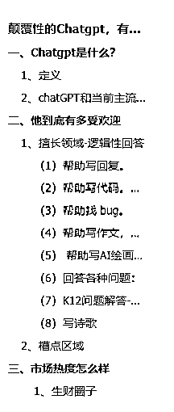

🏅 无

👍 书情，Linno

书情：值得花时间看看

# #藏书楼# 注册 ChatGPT 保姆级全攻

书情

2022-12-06 04:48:42

#藏书楼#  
注册 ChatGPT 保姆级全攻略 

🏅 无

👍 海绵践行

# #藏书楼# chatGPT 注册全攻略 ht

书情

2022-12-06 04:31:08

#藏书楼#  
chatGPT 注册全攻略  
[`muyjazngod.feishu.cn/docx/DM7idnkRsoJZ15x0...`](https://muyjazngod.feishu.cn/docx/DM7idnkRsoJZ15x0qvScXXfEnoh) 

🏅 无

👍 #渠说渠话，海绵践行

# 我是卢灿伟，是一个做了 10+年的技术，我

海绵践行

2022-11-29 13:02:21

我是卢灿伟，是一个做了 10+年的技术，我来聊下技术人最能直接带来收入的市场——接外包。  
  
我的建议一开始找项目，不要去程序员客栈、码市、猪八戒这种平台，这些平台鱼龙混杂需要花费大量的筛选成本，还有一些骗子公司，包括国外的 Upwork，印度人和菲律宾人的价格比你便宜很多，竞争很激烈。  
  
所以我探索出了一条在没有人脉的情况下，如何让项目找上门的方法，希望我的复盘对你有所帮助。  
  
我擅长：内容输出、制作产品案例  
我的帖子：  
  
[程序员如何通过技术接副业项目月入过万](https://shimo.im/docs/H88grTJXPJhJ3Cj3/read) 

🏅 无

👍 #渠说渠话，书情小跟班

# #懒人专属周报#

书情

2022-11-25 23:37:57

#懒人专属周报# 

🏅 无

👍 #渠说渠话，海绵践行

# 💎 #生财周报#

书情

2022-11-22 15:10:13

#生财周报# 

🏅 无

👍 #渠说渠话，海绵践行

# 【保姆级教程】视频号首创“半无人+真人”

海绵践行

2022-11-22 08:06:09

【保姆级教程】视频号首创“半无人+真人”直播两个小时单场 GMV8 万+，1-2 人即可操作  
生财圈友好，我是“非凡”  
相信大家能明显感觉到现在做视频号直播【无人/半无人】管控越来越严格了  
今年的红利期自己一个人做视频号不到两个月也搞到了佣金 50w+  
再后来由于视频号平台短视频大量搬运和混剪行为  
以及平台开始对绿幕直播的限制，审核的严格程度进一步上升  
在不断的适应平台规则和迎合变化中首创了“半无人+真人”的直播形式  
  
我希望自己探索出来的这套玩法，能帮大家少走一些弯路。  
为了排版方便请移步飞书：  
[`ro14u4yq4i.feishu.cn/docx/MFevd5iRgo1EsfxB...`](https://ro14u4yq4i.feishu.cn/docx/MFevd5iRgo1EsfxBDQscX7vonMf)  
#视频号 

🏅 无

👍 无

#渠说渠话：没权限，看不了

海绵践行：权限变了，我发现我也看不见了

#渠说渠话：\[OK\]

# 深度揭秘“家政行业”如何在小红书快速精准

海绵践行

2022-11-18 19:04:52

深度揭秘“家政行业”如何在小红书快速精准地矩阵化起号  
  
适用的行业：所有的实体行业，均可适用（以家政行业为例）  
  
Halo，大家好，我是做过多家世界 500 强企业内容供应商的新媒体波先生，致力于帮助商家们实现收入、生意和流量的指数级增长。  
  
最近我们波壁咚新媒体团队和一村团队，在小红书的【家政行业】进行了一顿地深度研究和实操。  
为此，也取得了一些成绩，以及对家政行业做了深度的思考和调研  
  
接下来，我将尽我所能、毫无保留地和大家分享出来，  
同时，也希望能给各位做家政行业，还有实体行业的老板们，能带来一些新的思路和思考。  
  
为了更方便查阅，麻烦移步以下的飞书链接查看~  
[`x6xfzf3kve.feishu.cn/docx/GYrndeiOAoHhzPxP...`](https://x6xfzf3kve.feishu.cn/docx/GYrndeiOAoHhzPxPf2wchBflnig) 

🏅 无

👍 书情

# #生财周报#

书情

2022-11-18 10:44:08

#生财周报# 

🏅 无

👍 海绵践行

# 《从 0 到 20 万私域宠物粉丝：背后的引流、

海绵践行

2022-11-18 10:38:56

《从 0 到 20 万私域宠物粉丝：背后的引流、运营和思考》  
  
我是阿豪，一个 97 年从业互联网多年的创业者  
  
本篇文章我将带你了解我如何从 0 到 20 万宠物粉丝，背后的引流、运营和思考  
  
目前宠物粉年佣金 400 万，如果你对淘客、社群、私域有兴趣、或者已经在做的同行，接下来的内容都会对你有帮助。  
  
详情移步飞书：  
[`dl3446n2rd.feishu.cn/docx/ErbedfQuio7q25x2...`](https://dl3446n2rd.feishu.cn/docx/ErbedfQuio7q25x2bC8cW5XdnIe) 

🏅 无

👍 #渠说渠话，书情

书情：年少有为，自叹不如，哈哈

# #生财周报#

书情

2022-11-15 15:42:16

#生财周报# 

🏅 无

👍 海绵践行

# 无资源无资本，如何结合私域裂变和个人品牌

海绵践行

2022-11-14 19:07:44

无资源无资本，如何结合私域裂变和个人品牌，搞定冷启动流量难题？  
  
今天在生财的时间捐赠群分享了这个主题，我花了 8000 字，结合我亲自做过 3 个项目起盘的经验，讲一讲我们普通人如何在没有资源没有资金支持的情况下，如何搞定冷启动流量难题的，希望对大家有帮助：  
  
本次分享主要是从以下三个部分展开的：  
一、重新理解微信好友  
二、无资源无资本，如何从 0 开始积攒第一批客户  
三、如何通过撬动 10 个铁杆粉丝获取 1000 个客户  
  
详细可直达飞书：  
[`uuy7p3hra0.feishu.cn/docx/VAA8dQLTZolMlJx1...`](https://uuy7p3hra0.feishu.cn/docx/VAA8dQLTZolMlJx1jxrcKaPrnzd)  
#流量挖掘 

🏅 无

👍 #渠说渠话，书情

# 如何通过虚拟无货源项目开店一月，月入十万

书情

2022-11-13 09:42:02

如何通过虚拟无货源项目开店一月，月入十万经验分享[`mf0tke5ded.feishu.cn/docx/JWttdeL6To7yXGxo...`](https://mf0tke5ded.feishu.cn/docx/JWttdeL6To7yXGxogBwcg756n1e) 

🏅 无

👍 #渠说渠话

# #藏书楼【保姆级教程】从零到一打造一个高

海绵践行

2022-11-09 23:11:30

#藏书楼  
【保姆级教程】从零到一打造一个高质量交付的训练营  
\-----  
2020 年 11 月 5 日，亦仁 发了个帖子，预测说会有越来越多的机构做训练营。  
并指出，一个可以切入这个机会的点是：做一套训练营的 SOP。  
  
我相信，这个需求，现在依然是存在的。  
一套高质量的训练营 SOP， 技能让有成功经验的人，能够更好的将经验复制给别人。  
也可以让学员有着更好的学习体验。  
  
去年，我和生财，用实战日的形式，合作开展了三期训练营，当时的反响非常不错，学习的学员，也产出了四篇龙珠贴。  
后来，我也把这套训练营模式，尝试开展了其他项目的训练营。  
实际测试出来，效果都还不错。  
  
今天，我把做训练营的思路，尽可能详细的写在这篇帖子里。  
希望能帮更多有成功经验，想做好交付的圈友，打造出自己的训练营产品。  
也希望能借此，间接帮到更多想做项目的圈友，成功跨出搞钱第一步。  
\----  
为了排版方便，正文请看飞书文档：  
[`y2mt3o47i3.feishu.cn/docx/MUfLdmUlTosj0NxP...`](https://y2mt3o47i3.feishu.cn/docx/MUfLdmUlTosj0NxPhlfcjRPHnff) 

🏅 无

👍 #渠说渠话，书情，书情小跟班

# #生财周报# 链接：百度网盘 请输入提取

书情小跟班

2022-11-08 16:32:29

#生财周报#  
链接：[百度网盘 请输入提取码](https://pan.baidu.com/s/1OvX9KXDlQGXB2tN42ZdsOg?pwd=en8p)  
提取码：en8p  
221108 懒人生财周报-shuqing2022 

🏅 无

👍 海绵践行

# 

书情小跟班

2022-11-08 16:24:27

🏅 无

👍 海绵践行

# 

书情小跟班

2022-11-08 16:03:54

🏅 无

👍 无

# 普通人如何做拼多多虚拟月入 10000 元|

海绵践行

2022-11-08 13:07:06

普通人如何做拼多多虚拟月入 10000 元|实操教科书操作  
  
  
这个拼多多也是我自己一直在操作的项目，目前有开了 2 家多多还有 2 家淘宝，多多的收入这一块的话，每个月大概能带来几千块到上万块的收入，对于大佬来说可能不多，我这篇文章更多的是针对一些小白或者一些想操作的人群宝妈上班族，希望他们能够在这一块上赚到钱。  
其中一家多多近 30 天的数据收益图 11733 元 这个业绩对大佬来说肯定不值得一提，但对于普通人来说可能抵得上一个月工资了。  
  
附上一家多多近 30 天的数据...  
[普通人如何做拼多多虚拟月入 10000 元|实操教科书操作](https://shimo.im/docs/YfXEXaoq5YIrriUD/read) 

🏅 无

👍 书情，#渠说渠话，书情小跟班

# 我是夕子，93 年女孩，白手起家，不到 2 万

海绵践行

2022-11-07 19:59:43

我是夕子，93 年女孩，白手起家，不到 2 万成本现在每月稳定 10w+利润。  
  
对比很多大佬的成绩，这只是小儿科，但我只跟自己比，跟昨天的自己比，有没有更聪明些，认知有没有更宽阔些，有没有更沉稳些，有没有更有钱------  
  
毕竟属于大学毕业后第一次做生意，没有亏，反而挣了，是条稳稳的现金流。我把相关的重要经验分享给有缘人，希望能给到大家一些启发。  
  
分享目录如下：  
一：我是个皮肤病患者，所以选择从医  
一：毕业后，放弃不喜欢的工作  
二：做生意，从一单 2 块开始  
三：店铺被封，差点放弃  
四：1 万到 5 万的利润，我做了这件事  
五：从 5 万到 10 万+的利润，我做了这件事  
六：未来展望  
全文链接  
[`ancab4z106.feishu.cn/docx/E1WGd70YLoaHGfxA...`](https://ancab4z106.feishu.cn/docx/E1WGd70YLoaHGfxAYJTc4WoFnsd) 

🏅 无

👍 书情，#渠说渠话，书情小跟班

书情小跟班：优秀

# 亲爱的生财圈友，你好呀，我是已经出版过 5

海绵践行

2022-11-07 19:48:58

亲爱的生财圈友，你好呀，我是已经出版过 5 本书的女性个人品牌商业顾问李菁，了解我的人都会用八个字形容我——“左手文艺，右手商业”。  
  
2022 年我做了两场影响力百万发售，都是通过私域+直播的方式达成的。通过发售，我们现在已经累计招募了 500 名收费 8900 元的菁凌合伙人，30 名收费 29800 元的私董。  
  
今年的年营收倍增，影响力也实现了大升级。如果没有大事件，我们是无法做到的。  
  
今天就给生财的各位圈友，分享我是如何做一场一呼百应的大事件，我将以八月份的百万发售，从这次的成果——人员统筹——群发售 14 大细节，给大家做一个详细的拆解。相信看完之后，你马上就可以用，也可以实现影响力和营收的大升级。  
[【生财分享】李菁总结：知识 IP 如何通过一呼百应裂变式发售做到业绩倍增？](https://shimo.im/docs/fuDML6YkMuca2wQg/read) 

🏅 无

👍 #渠说渠话，书情小跟班

# #轻享 YC 前掌门人 Sam Altman：

海绵践行

2022-11-03 21:51:12

#轻享  
  
YC 前掌门人 Sam Altman：观察上万创业者后，关于如何成功的 13 个要素  
最近在做创业项目时，碰巧翻到了 Sam Altman 在 4 年前写的一篇博客文章。Sam Altman 是美国创投圈的著名意见领袖，曾任硅谷知名创业孵化器 YC 总裁，现在在 OpenAI 任 CEO。YC 孵化了包括 Airbnb、Stripe、Coinbase、DoorDash、OpenSea、Reddit 等多家全球顶尖独角兽企业。这篇“How to be successful”的文章发布在 2019 年 1 月，有超过 110 万阅读量。  
  
我一直认为学习，不论什么知识和技能，最好最快的方法就是直接向高手学习。找到这个领域内最顶尖的高手向他们请教成事的心法，读他们写的书，研究他们留下的印迹，reverse engineering。  
  
正如 Sam Altman 所说，作为 YC 掌门人，他近距离观察了成千上万富有创造力的创业者，牛人看牛人，文章中总结的 13 点关于“如何成功”的要素是他多年观察和思考的提炼。我从这篇文章中学到很多。有些道理似乎说的人很多，但是真正行动起来之后，再读又是另一番理解。我把这 13 点要素都翻译成了中文，希望对大家也会有帮助。  
飞书全文：  
[`w9zwvl1q03.feishu.cn/docx/RHJid9Z0Lo21MWxA...`](https://w9zwvl1q03.feishu.cn/docx/RHJid9Z0Lo21MWxA7oTcZ3xlnUg) 

🏅 无

👍 #渠说渠话，书情小跟班

# 知乎引流 20w+的实战复盘：批量铺、写爆

海绵践行

2022-10-31 12:59:04

知乎引流 20w+的实战复盘：批量铺、写爆文、投知+的三种玩法分享  
大家好，我是祥哥，在字节做过整合营销，给出海工具做过增长，现任招聘行业的产品经理兼内容营销负责人，主要做抖音达人投放、信息流投放、知乎的内容营销等。  
  
9 月底，在朋友的安利下，我加入了生财，同时也加了鱼丸的微信，交流了一番我在知乎上做过的事后，很快就收到来自生财内容团队的发文邀请。  
  
知乎成绩如下：  
通过批量化产出内容，一周产出 200+篇回答，半年给小程序引流实现 2w 日活跃  
通过写爆款文章，做多个知乎 IP 号，最高粉丝 2.4w，阅读量达到 800w，并软广变现 15w  
通过知+投流，帮公司获取 20w 用户（app 下载），变现超过千万  
  
本文结合以上的实战经历，总结出我认为最高效的引流玩法，既含招式又含心法，适合所有想要引流获客的圈友。  
  
因为案例较多图片较多，篇幅较长（1w 字），对下方目录中内容感兴趣的圈友，请移步飞书阅读：  
[`ffssdmg6oi.feishu.cn/docx/JDFFdf6B7oAenVxe...`](https://ffssdmg6oi.feishu.cn/docx/JDFFdf6B7oAenVxekbTcY2qsnfc) 

🏅 无

👍 #渠说渠话，书情小跟班

# #生财周报# 221028 懒人专属群周报

书情小跟班

2022-10-31 10:38:59

#生财周报#  
221028 懒人专属群周报 

🏅 无

👍 #渠说渠话

# #生财周报# 221025 生财周报

书情小跟班

2022-10-31 10:37:00

#生财周报#  
221025 生财周报 

🏅 无

👍 无

# 《知乎：我也是从变现几十块开始的，复盘去

海绵践行

2022-10-31 09:00:33

《知乎：我也是从变现几十块开始的，复盘去年知乎视频变现 40W+总结分享。》  
  
去年有玩知乎刷到过类似的视频么，  
没错都是我发的。  
  
为什么现在才会写这篇文章，  
是因为所有账号的钱已经提完了，  
没有开 MCN 所以提现只能通过解绑的方式，  
一个号解绑一次 2-7 天不等，只能陆陆续续提。  
  
全文可以看这里。  
[`udxxg5rx5m.feishu.cn/docx/doxcnrWvk1b0To4Q...`](https://udxxg5rx5m.feishu.cn/docx/doxcnrWvk1b0To4QqG6iXLRKUlb) 

🏅 无

👍 #渠说渠话，书情小跟班

书情小跟班：值得一看

海绵践行：批量放大

# 《如何打造自动成交的朋友圈系统》生财的小

海绵践行

2022-10-27 07:22:37

《如何打造自动成交的朋友圈系统》  
  
生财的小伙伴们，大家好，我是思念。  
感谢生财团队静伟的邀请，让我有机会在这次垂类 IP 的航海中进行分享，在分享中成长，不断碰撞出更多的灵感。  
  
这次我分享的主题是：打造自动成交的朋友圈系统  
  
这套自动成交的方法，非常适合需要配合私域营销的朋友们，各行各业都适用。  
如果你是本身流量做得好的高手，更得重视朋友圈的打造。  
巨额流量+高效转化结合，相信会成为你事业强有力的助推剂。  
  
分享目录如下：  
一、自动成交的底层逻辑  
二、通过文案力塑造个人 IP  
三、自动成交的朋友圈布局  
四、朋友圈的发圈绝招  
  
详情欢迎移步飞书阅读：  
[`b80fa9wrsf.feishu.cn/docx/Eo9PdqcNJowSN8x9...`](https://b80fa9wrsf.feishu.cn/docx/Eo9PdqcNJowSN8x9mPQcb3hFnKe) 

🏅 无

👍 书情小跟班，#渠说渠话

# #咸鱼# 1. 链接无线网做闲鱼卖货！2

海绵践行

2022-10-26 21:44:35

#咸鱼#  
1\. 链接无线网做闲鱼卖货！  
2\. 2 个以上不同闲鱼账号一个设备上来回切换！  
3\. 开通了鱼小铺或者之前的 pro！  
4\. 闲鱼出单后修改了发布地址或者标题！  
5\. 直接修改一口价而不是让客户提交订单改价去付款！  
6\. 只去卖自己家闲置物品！  
7\. 只敢上架几块或者几十块的低价产品！  
8\. 上架了一个或者几个产品不出单后就放弃了！  
9\. 直接卖虚拟类目，比如课程之类的  
10\. 直接去闲鱼进行站外引流！  
11\. 直接卖假货！  
12\. 首次咨询的骗子套路！！  
详情戳：  
[`app.yinxiang.com/fx/298c3b97-7988-489c-a85...`](https://app.yinxiang.com/fx/298c3b97-7988-489c-a85e-361a65c8995e) 

🏅 无

👍 #渠说渠话，书情小跟班

# 《我在生财炼精华（1）： 生财日历悬赏作

海绵践行

2022-10-26 08:44:07

《我在生财炼精华（1）： 生财日历悬赏作业整合文》  
  
花了一周时间，把这份悬赏作业的所有帖子全部刷了 3 遍。这个冷门宝藏，实在是不忍心看它被雪藏着，于是写了这篇文章，来和大家介绍一下。  
  
这个悬赏作业的回答贴，真的非常值得所有生财圈友去仔细阅读一遍。我敢说真去仔细拆解，总结的人，只用处理这一个作业，就能学会如何去搭建赚钱兵器库了！  
  
文章目录如下：  
  
零、前言  
一、文章要点提炼  
  
二、基础玩法:两套必看方案  
1）黎叔方案  
2）查林:黎叔方案 Plus 版  
  
三、玩法拓展:还能怎么玩?  
1）卖法总览表  
2）如何吸引用户关注你在做的事?  
3）如何预估感兴趣的人数?  
4）如何带节奏，引导下单?  
5）怎样打消用户顾虑，让用户愿意下单?  
6）如何返现/发红包，不仅不亏钱还能变现?  
7）最后还差几十本没卖完，怎么办?  
8）如何—鱼多吃，制造三次转化机会?  
  
四、高手们的算账过程展示  
1）公众号送日历涨粉投产计算  
2）黎叔方案  
3）范米索找投资人回报计算  
4）赵不刀短视频带货工作量/ROI 计算  
  
五、过程中不足、阻碍、失败展示  
1）铺垫不够/信任不足/在意他人看法  
2）失败发红包没安排好  
3）意向用户私聊没跟上  
  
六、尾言碎碎念  
  
  
正文移步飞书：  
[`mkfwp3u79v.feishu.cn/docx/FA1dd3QEfoeKCux6...`](https://mkfwp3u79v.feishu.cn/docx/FA1dd3QEfoeKCux6FkDc0pwsnEh) 

🏅 无

👍 书情小跟班

# #生财周报#

书情小跟班

2022-10-25 16:20:05

#生财周报# 

🏅 无

👍 #渠说渠话

# #小红书小红书 1 个粉丝纯新人，靠一篇笔记

海绵践行

2022-10-25 07:34:26

#小红书  
  
小红书 1 个粉丝纯新人，靠一篇笔记 10 天引流 50+人，成交 30+人  
  
大家好，我是一个 0 互联网运营经验的人，小红书账号只有 1 个粉丝，但是在十天内靠一篇阅读量只有 1500+的笔记做到了涨粉 100+，引流 50+，成交 30 多单的数据  
  
这次我主要分享一下过程复盘、反思和启发，欢迎交流🤗  
  
全文详见  
[`mmdimptiji.feishu.cn/docx/CHdwdkY6JoSvRmxM...`](https://mmdimptiji.feishu.cn/docx/CHdwdkY6JoSvRmxM6s4cUXvtnvd) 

🏅 无

👍 书情小跟班，#渠说渠话

# #生财周报#

书情小跟班

2022-10-23 19:25:27

#生财周报# 

🏅 无

👍 海绵践行

# #轻享# 分享原创文章《聊一聊 Googl

海绵践行

2022-10-23 17:32:27

#轻享#  
分享原创文章《聊一聊 Google 关键词挖掘需求的方法》。于上周在英文工具站小航海的社群分享。  
  
在产品出海，面对着「做什么」的方向选择时，我们可以通过对特定领域或平台的关键词挖掘和数值验证，洞察出一些产品机会。Make Something People Search For…  
  
当然关键词研究只是开始，附上 Ahrefs 博客的观点。（图 2）  
  
经反馈说还是有不少收获，“学习到通过关键词找需求，感觉就赚翻了！”欢迎交流探讨，一起进步。  
  
具体可以看飞书文档：[`t88igkhvrr.feishu.cn/docx/doxcnrJry2EmhMT5...`](https://t88igkhvrr.feishu.cn/docx/doxcnrJry2EmhMT562lM9wEob6d) 

🏅 无

👍 书情小跟班

# #小红书# 手把手教你成为小红书小说博主

海绵践行

2022-10-20 12:36:42

#小红书#  
手把手教你成为小红书小说博主：  
[手把手教你如何成为小红书小说博主](https://shimo.im/docs/473Qyp9DD6s6P53w/read) 

🏅 无

👍 #渠说渠话，书情小跟班

海绵践行：手把手教程了

# #小红书# 粉丝 3000 月营收 20 万，小

海绵践行

2022-10-19 11:48:39

#小红书#  
粉丝 3000 月营收 20 万，小红书低粉高变现的蓝海攻略分享  
  
你好呀~ 我是陈铭 ivy，6 年留学行业工作+创业经验，目前通过小红书售卖我的蓝海产品，今年 3 月份做到了粉丝 3000，月营收 20 万的成绩。  
  
加入生财后，我把所有小红书相关的帖子都看了一遍，然后非常后悔，后悔没有早一年加入，因为我自己走过的大部分弯路，都在别人的帖子里看到了。  
  
我超级喜欢生财这样无私分享的氛围，于是决定把我低粉丝也能做到稳定高变现的小红书蓝海玩法分享出来。希望可以启发到更多和我一样的普通人~  
  
低粉丝高变现的关键，其实就在于商业模式，具体来说包括以下三件事：  
  
1\. 蓝海思维：找到一个非常细分的领域，客户和竞争者都少，模仿一个不如你，但挣到钱的竞争对手，那么你大概率也能挣到钱【这个理论引用自@徐宿 ，具体怎么找蓝海我会在下文细说】  
  
2\. 筛选高净值用户，卖高客单价产品，找到这一小部分人的痛点，提供解决方案，钱就会自己来找你。  
  
3\. 40%的笔记写直接导向付费的内容；40%的笔记写容易爆，但不直接触发用户付费的内容；20%的笔记写，又容易爆，又能导向付费的内容。【通过 4+4+2 笔记，可以获取大量免费流量，在下文我会详细解说笔记的写法】  
  
更多内容，请移步飞书：[`sinoeurope.feishu.cn/docs/doccn2LSZJnJdLmx...`](https://sinoeurope.feishu.cn/docs/doccn2LSZJnJdLmxOnuqqNHlutf) 

🏅 无

👍 #渠说渠话，书情小跟班

# #轻享一个单人运营年入 1400 万的海外工

海绵践行

2022-10-19 08:51:28

#轻享  
一个单人运营年入 1400 万的海外工具站 

🏅 无

👍 #渠说渠话，书情小跟班，海绵践行

书情小跟班：看完了，了不起的一个人啊

# #小红书《如何颗粒化对标，快速制作出小红

海绵践行

2022-10-19 07:02:03

#小红书  
  
《如何颗粒化对标，快速制作出小红书爆款封面！》  
  
生财圈友们好，我是梨云，一个内容创业的广告人。  
  
非常感谢生财团队的邀请，让我今天有机会在小红书运营的航海中，和大家分享小红书的实战经验。  
  
小红书 3 个月涨粉 18w 变现 10w 后，我总结出了快速对标复刻小红书爆款封面的方法论：  
  
内容大纲  
  
一、封面何以能决定爆款概率  
二、什么样的封面有爆款基因  
三、如何设计出高点击的封面  
四、用搞定设计复刻爆款排版  
五、持续下场实践的航海精神  
  
昨天在航海群中是图文分享，不过我发现封面的拆解，用视频形式会更合适，所以添加了，优先建议看视频哦~  
  
[`lvcj32c4z9.feishu.cn/docx/QSRJdPwizoYynhxK...`](https://lvcj32c4z9.feishu.cn/docx/QSRJdPwizoYynhxKnbEclncunEd) 

🏅 无

👍 #渠说渠话，书情小跟班

# #流量挖掘 #藏书楼搜一搜服务，很干：h

海绵践行

2022-10-19 07:00:46

#流量挖掘 #藏书楼  
搜一搜服务，很干：  
[`p9rxk6ovll.feishu.cn/docs/doccnqSpWaWiolsx...`](https://p9rxk6ovll.feishu.cn/docs/doccnqSpWaWiolsxmNIJFBZvgQg?from=from_copylink) 

🏅 无

👍 #渠说渠话，海绵践行，书情小跟班

书情小跟班：值得一看

# #小红书# 《14 天从零变现 1000+，

海绵践行

2022-10-18 23:04:29

#小红书#  
《14 天从零变现 1000+，适合新人的小红书赚钱定位攻略分享及避坑指南》  
大家好呀，我是一村，一名深耕小红书营销的 98 年创业者。  
上次在生财分享了一篇上帝视角挖掘小红书爆款选题，深受喜欢，非常感谢圈友们认可和生财团队支持。  
这次，通过大量的调研和经过了 100+小红书新人博主的深度咨询实践，成功帮助多位小红书新人从零变现，历时 2 个月，总结了这一套适合新人的小红书赚钱定位攻略分享及避坑指南，接下来毫不保留和大家分享。  
由于内容和图片比较多，所以请大家在飞书链接查看：  
[`shengcaiyoushu01.feishu.cn/docx/FzF6d6ohjo...`](https://shengcaiyoushu01.feishu.cn/docx/FzF6d6ohjoGyrcxVoz6cMdDnnCf)  
  
同作者系列篇：  
[`e8uhj14dno.feishu.cn/docs/doccnN4UNVt4yjLT...`](https://e8uhj14dno.feishu.cn/docs/doccnN4UNVt4yjLT6TnsLKdBlZg) 

🏅 无

👍 #渠说渠话，书情小跟班

# #小红书# 从 100 个粉丝开始变现 htt

海绵践行

2022-10-17 21:38:41

#小红书#  
从 100 个粉丝开始变现  
[`shengcaiyoushu01.feishu.cn/docx/doxcnQp0cj...`](https://shengcaiyoushu01.feishu.cn/docx/doxcnQp0cjSbSSjBklUeq2zCxkg) 

🏅 无

👍 #渠说渠话，书情小跟班

书情小跟班：赚到钱，也要考虑挺多的细节的啊 如何定位，如何蹭流量，如何促销等等，属于综合因素赚钱

海绵践行：是啊，一句抄同行之外还有很多细节

# #轻享# 做生意，利他即利己刘小排 202

书情小跟班

2022-10-16 19:08:54

#轻享#  
做生意，利他即利己  
  
刘小排  
2021 年 08 月 23 日 10:42  
熟悉生财有术的圈友都知道，本社群一个最重要的价值观是「利他」。  
  
总有些大佬，日常声嘶力竭地喊出「利他即利己」的口号。   
  
刘润老师说过  
  
顶尖高手都是极致的利他者，他们总是想方设法给，而不是想方设法拿。  
  
无论是个人成长还是企业的成长，如果想要做得长久、收获复利，「利他」都是你通往未来的路径中最好的策略之一。  
  
利他有什么好处？  
  
有人风轻云淡地说“但行好事，莫问前程”。  
  
但我知道，一些刚进社群的朋友会对这个结论心生疑惑。“为什么‘莫问前程’？我们就想问前程！！哼，没有前程的事情，我才不做！”  
  
好的，那让我来做个这个俗人吧。  
  
我尝试从纯功利的角度，帮大家分解「利他」的前程。  
  
「利他」的前程是「利他即利己」。有三层意思。  
  
  
一、第一层——赚钱的前提是利他  
  
「利他即利己」的第一层含义： 利他，能让你直接赚到钱。  
  
林肯说过：人生始于服务，终于服务。  
  
我在上个月的文章《用哪个理由支撑创业(含副业)，成功率最高》里提到过，赚钱的本质是为他人创造价值。  
  
当你为他人提供服务，从而创造了价值，你就完成了「利他」。 然后，别人愿意从自己收获的价值里分一部分回馈你，从而你就赚到了钱。  
  
最通俗的例子是微商。怀抱虔诚「利他」之心的微商（并不包括割韭菜那部分微商），非常值得敬佩，通过「利他」，他们获得了自己应得的利益。  
  
该话题不再赘述，详见 [用哪个理由支撑创业(含副业)，成功率最高？](https://t.zsxq.com/nAYnuR7)   
  
  
二、第二层——影响力是可以变现的稀缺资源  
  
「利他即利己」的第二层含义： 利他，能让你间接赚到钱。利他可以帮你积累影响力，影响力是可以变现的稀缺资源。  
  
近些年，越来越多创业者开始重视“个人 IP”、“品牌价值”。  
  
“个人 IP”、“品牌价值” → “影响力”。  
  
我们知道，赚钱的前提是交易。“影响力”在交易过程中的作用是：降低交易成本。  
  
有影响力的人，一旦找到变现路径，他的变现过程，会比没有影响力的人容易很多。  
  
罗永浩的锤子科技破产后，欠下巨额债务。而他第一次电商直播带货，就赚得盆满钵满。 他的第一次直播首秀为什么会有那么多人看呢？ 因为他有影响力啊。 ^\_^  
  
不过，罗永浩老师影响力来源非常复杂，不在本文的讨论范围。  
  
我们讲两个圈友的小故事吧，帮助大家更直观地看到，故事的主人翁如何通过「利他」积累影响力。  
  
  
杨涛：生财有术「利他」精神首席代言人  
  
如果要选出一个最能代表生财有术最有利他精神的人，那就非涛哥莫属了。  
  
涛哥有很多标签。  
  
他是生财有术流传最广的表情包主角。  
  
他是生财有术里加圈友微信最多的人。  
  
他是“生财有术首席客服官”。  
  
他还是生财 CP 的主理人。  
  
在最近一次生财会员日活动“7 月 18 号会员日：感谢帮过你的圈友”，涛哥是收到圈友手动感谢最多的人，遥遥领先第二名。  
  
点击链接，观摩圈友是怎么感谢涛哥的：[`thanks.shengcaiyoushu.com/?name=%E6%9D%A8%E...`](http://thanks.shengcaiyoushu.com/?name=%E6%9D%A8%E6%B6%9B)  
  
让我印象最深刻的是，在每一次有人向涛哥提问的时候，涛哥都是知无不言、言无不尽，干货满满，真心诚意地帮人答疑解惑。  
  
让我们来感受一下涛哥是如何回答提问的：  
  
「问杨涛」集锦第一季 （除官方帖外，生财点赞榜 Top 1）  
[`xws30qr76u.feishu.cn/docs/doccnhJUKBYNMS8M...`](https://xws30qr76u.feishu.cn/docs/doccnhJUKBYNMS8M7f2c62ExK4b)  
  
「问杨涛」集锦第二季  
[`xws30qr76u.feishu.cn/docs/doccnFgQIRRkdGCM...`](https://xws30qr76u.feishu.cn/docs/doccnFgQIRRkdGCMrazoLoaPsaf)  
  
「问杨涛」集锦第三季  
[`xws30qr76u.feishu.cn/docs/doccnqWxgSokhs84...`](https://xws30qr76u.feishu.cn/docs/doccnqWxgSokhs84O3rbun9uIyg)  
  
涛哥干了这么多「利他」的事，有什么直接的收益吗？  
  
涛哥是一个真正“但行好事，莫问前程”的人。但如果我们非要“以小人之心度君子之腹”的话 —— 他最大的收益是积累了生财圈首屈一指影响力。  
  
有了这个影响力，当涛哥有变现途径的时候，他变现会非常容易。  
  
涛哥随手创建的“平民创业手册”知识星球，也已经有两千多名成员，年费 465 元，年营收超过 100 万元。 请注意，星球显然不是涛哥变现的主业，只是他用于帮助更多人的基地而已。  
  
  
半糖梦呓：生财有术内，影响力成长最快的人之一  
  
半糖小姐姐是生财有术内，影响力成长最快的人之一。  
  
她在一年前，还是个写作小白。  
  
她在今年 5 月 8 日加入生财有术，第一周就拿到了一颗龙珠。  
  
加入生财有术仅仅两个月，在“7 月 18 号会员日：感谢帮过你的圈友”活动中，她收到了 25 个圈友手动感谢，排名第 31。  
[`thanks.shengcaiyoushu.com/?name=%E5%8D%8A%E...`](http://thanks.shengcaiyoushu.com/?name=%E5%8D%8A%E7%B3%96%E6%A2%A6%E5%91%93)  
  
加入生财有术仅仅三个月，8 日 8 日，在生财有术「第二期实战日训练营推荐」活动中，她的「头条爆款」训练营，成为了官方推荐的四个训练营之一。  
  
一周拿龙珠，两个月成为最有价值圈友 Top 31，三个月获得官方背书推荐训练营。  
  
真是让人瞠目结舌的成长速度。  
  
而她的成长心法，简单到让人难以置信 —— 唯「利他」尔。  
  
从圈友的感谢信中我们可以看到，半糖小姐姐是一个谦逊、有耐心、利他的人。  
  
乔力： @半糖梦呓 感谢半糖，无私的把她的专栏免费的赋予了我，让我能够放开去学习『微头条』写作。 自己也一点一滴去学习，虽然一直没有去跟她的社群学习，但是也通过自己的努力，赚到了几百块钱。 我在此对她表示由衷的感谢，也祝福『生财有术』以后的生涯中越来越好。  
  
康松： 感谢@半糖梦呓 ，带领我入门今日头条写作，现在我每天都在积极思考、收集素材，运用开幕雷击和六脉神剑等招式，已收到初步成效--写出爆款微头条。半糖老师的讲课真的不错，声音好听，节奏清晰，通俗易懂。最后祝爆款训练营越办越好！🎉  
  
把自己的一技之长，用心分享给别人。简简单单地「利他」。  
  
这个世界，正在用实际行动，回报她的「利他」。  
  
「利他」让半糖小姐姐积累了影响力，然后挣到了钱。  
  
  
大家感受到了吗？  
  
哪怕只是在生财有术这个小圈子里，做好「利他」，都能够积累影响力。 何况，生财只是个小圈子，外面还有更大的世界呢？  
  
影响力，是「利他」的第二层前程。  
  
  
三、第三层 —— 在互联网的下半场，更好的商业模型是「树」。  
  
有两种商业模型，一种是漏斗，一种是树。  
  
我们先讲讲漏斗。  
  
最简单的例子是传统销售。  
  
有一个销售员卖别墅，每年打 36000 个电话。28800 个会接，11520 个会听他讲，4608 个会有兴趣，1843 个会出来看，737 个会考虑，294 个会有意向，117 个会洽谈，47 个想买，最终成交的 18 个，成交 18 单会让他赚到 2000000 元。 他得出结论：每打一个电话会赚到 55.55 元。  
  
打 36000 个电话 → 9 层漏斗 → 18 个成交  
  
生财有术里很多项目，都是类似的。  
  
🪡 以「淘宝评论引流做淘客返利机器人」为例： 小明在淘宝爆品里评价。他的评价，有 10 万人看到，有 3000 人感兴趣，1000 人加微信咨询，200 人成为了返利机器人的用户。  
  
🪡 以「到小区做地推拉新美团优选」为例： 小红在小区里做美团优选拉新。一天之内，摊位前路过了 2000 人，有 300 人与他交流，200 人有兴趣 ，100 人被成功拉新(结算拉新佣金)，30 人拉新后有复购（结算复购佣金）。  
  
🪡 以「开淘宝店」为例： 小薇在淘宝开店。她的店铺每天有 1 万人浏览，5000 人查看引流品，500 人在引流品下单（赚人气），100 人利润品下单（赚钱），50 人加小薇微信进入私域，20 人成为私域用户产生复购（再次赚钱）。  
  
在很多领域，漏斗模型相当有效。  
  
然而这并不是本文的重点。  
  
我们需要看到，还有一些生意，成长路径并不太像漏斗。他们更像是树，自然生长，越长越大。  
  
  
生财有术是怎么成长起来的？  
  
生财有术，几乎没有投放过付费广告。  
  
2017 年 3 月 22 日，它只有 100 名用户，年费 365 元。  
  
2021 年 8 月 14 日，他有超过 31000 名用户，年费 2765 元。  
  
这 31000 名高客单价用户，是怎么来的呢？  
  
是亦仁打了 100 万推销电话吗？是亦仁在小区摆摊地推，与 300 万名过客做了交流吗？ 还是亦仁到淘宝刷了 1000 万个评论引流呢？  
  
都不是。  
  
生财的用户，是人传人来的。  
  
心法正是「利他」。生财团队用「利他」之心，做好了每一次交付，与每一个用户交朋友。社群内的很多用户，都感觉到门票物超所值，于是开始口口相传。  
  
其中的商业模型不是漏斗，而是树。  
  
最初的 100 人，是一颗小小的种子。 生财团队日常的工作内容，就是给这个种子浇水，呵护它，让它自己发芽、生长，越长越大。  
  
  
李佳琦：如履薄冰地维护用户利益  
  
李佳琦曾经在自己的直播间宣布封杀美妆大牌兰蔻。  
  
因为他在卖兰蔻产品的时候，发现自己拿到的价格比薇娅贵了 20 块钱，自己的粉丝拿到的货不是全网最低价了。  
  
兰蔻事件不是孤例。在李佳琦直播格力高零食的时候也类似。  
  
李佳琦在直播格力高的时候，发现自己粉丝拿到的优惠比如隔壁薇娅力度大，他在直播中直接跟商家协商。协商无果，李佳琦就是很生气，直接告诉粉丝刚刚拍的都去取消订单。  
  
为什么要搞这么大的动作呢？  
  
因为李佳琦深知，“李佳琦”三个字之所以值钱，是因为他只代表消费者的利益。他必须要在自己的所有动作中，同时向消费者和商家两端去强调这个预设。  
  
想让李佳琦带货的商家必须明白，合作前提是，大家只打明牌。说吧，你这是不是全网最低价？ 不是？那就别找我。  
  
消费者也知道这一点，李佳琦的粉丝也会形成同样的心智：哦，我知道了，只要是在李佳琦直播间买的东西，一定同时拥有全网最低价、品质有保障两个属性，可以闭着眼睛买。  
  
李佳琦小心翼翼的呵护着自己的品牌，维护着消费者的信任，降低了买卖双方的交易成本。  
  
李佳琦的用户，来自哪里？  
  
来自他每一次的直播卖货、每一次的公关事件，日拱一卒地维护用户的利益。  
  
来自他用「利他」之心，为他的种子浇水。树，自然生长。  
  
李佳琦直播间，是不需要为自己做广告的。他的粉丝越来越多，想要合作的商家也越来越多。  
  
树越长越高。  
  
  
阿那亚之谜  
  
阿那亚是一个奇怪的房地产开发商。它有两个独步天下的数字：转介绍率 90%，复购率 90%。  
  
也就是说，每 100 个购买他房子的用户中，有 90 个会买第二套。 每 100 个购买他房子的用户中，有 90 人安利自己的朋友成功购买。  
  
阿那亚从来没有投放过广告。他的做法，与传统卖房的漏斗模型截然相反。  
  
怎么做到的呢？  
  
仍然是「利他」，用户驱动。阿那亚不计成本地，让自己的用户感觉爽。  
  
让用户爽了，用户有一天会反过来回报你。  
  
只要业主提出投诉，不管这个要求多么无理，阿那亚都会及时响应、想办法解决。  
  
比如有个大姐，投诉晚上的路灯太亮，晃得她睡不着觉。但路灯是串联的，不能单独关一个，但是又得给客户解决问题，怎么办？  
  
最后只好把她家窗前的那个路灯灯泡给拧下来。  
  
有意思的是后来发生的事情——这个投诉的大姐从此成了最热心的业主，为阿那亚转介绍卖了不下 20 套房子。  
  
这个故事，我是在得到 App·启发俱乐部中听阿那亚创始人马寅亲口讲的。推荐查看原始资料： 启发俱乐部·第 43 期 | 马寅：怎样靠客户反馈驱动企业成长？[`m.igetget.com/share/course/article?id=89GE...`](https://m.igetget.com/share/course/article?id=89GEyP73eprvKBP53kJq2Mb0kRD64d)  
  
  
  
  
三个故事讲完了，它们的共同点都是：(几乎)不花钱为自己做广告，只用利他之心服务好用户，新的用户自己就来了。  
  
在互联网的上半场，流量很便宜，把漏斗模型变成你的 SOP，横向复制，你可以获得成功。  
  
在互联网的下半场，流量越来越贵，漏斗模型的适应范围会变小（但是仍然是主流）。有另一个聪明的方法是—— 种树。  
  
「种树」并没有什么新奇的。同样的道理，已经被古今中外的贤者说过无数次了。  
  
🪡 用孔子的话说，这叫「悦近来远」。《论语·子路》：“近者悦，远者来。” 。 让近的人（现有用户）感觉喜悦， 远方的人（潜在用户）会自动过来。  
  
🪡 用 Google 的话说，这叫「一切以用户为中心,其他一切纷至沓来」 Focus on the user and all else will follow。 这是谷歌十诫中的第一诫。 （ 题外话：在 Google 创业的早期，它也几乎不花钱为自己做广告，用户自然增长。）  
  
🪡 用司马迁的话说，这叫「桃李不言，下自成蹊」。 来自《史记·李将军列传》，司马迁如是评论李广。  
  
这是「利他即利己」的第三层意思。「利他」可帮你形成树状的商业模型，让用户自然增长。短期吃小亏，长期赚大钱。  
  
「用户思维」、「私域流量」都是最近很热门的话题，想做好它们，心法都是这套树桩的、能自增长的商业模型。  
  
  
四、最后的心魔  
  
「利他」最好的使用方法当然是“无招胜有招”啦，“但行好事，莫问前程”，就像涛哥一样。  
  
如果非要问前程的话，从功利主义角度出发，你需要有耐心。  
  
你不妨当做是“放长线，钓大鱼”。想想阿那亚，付出了拧一个灯泡的成本，换来 20 套房成交的故事。  
  
如果，你一想到「利他」，就会想到「哎呀，我又吃亏了」。如果感觉说出“我不在乎钱”这句话，有点言不由衷。  
  
我教你一个战胜心魔的办法。你可以对你自己念一句咒语：“我不是不在乎钱，我只是不在乎这点钱”。  
  
  
五、总结  
  
1\. 「利他即利己」有三层意思。  
可以让你直接赚到钱  
可以积累影响力，让你间接挣到钱   
可以让你形成树状的商业模型，让用户自然增长。  
  
2\. 如果很难战胜自己抠门的心魔，默念一句咒语：“我不是不在乎钱，我只是不在乎这点钱”。 

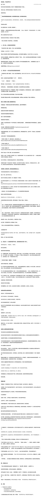

🏅 无

👍 同心共筑中国梦，海绵践行

# #轻享# 做一个可以做 youtube 视频

书情小跟班

2022-10-16 16:52:07

#轻享#  
做一个可以做 youtube 视频下载的网站，做自媒体的很多会有需求的，变现可以收会员费 

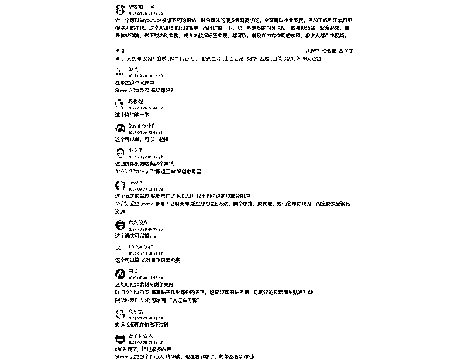

🏅 无

👍 #渠说渠话

# #轻享#

书情小跟班

2022-10-15 17:27:18

#轻享# 

🏅 无

👍 海绵践行

# #小红书# 《小红书日引流 200+，简单

海绵践行

2022-10-14 12:33:34

#小红书#  
《小红书日引流 200+，简单粗暴！从博主玩法迭代矩阵玩法 2.0 版》  
  
大家好呀，我是星城，我又来更新小红书的玩法啦~  
  
之前分享过一篇《零投放从 0 开始，小红书 2 个月 8 万粉丝的实操经验》，很多圈友回去执行后都出了效果，这不，我也在成长摸索和学习，可以说我这段时间我又升级啦哈哈~  
  
这次分享更高效更粗暴的玩法方式，是上一篇的 2.0 升级版本！为了更好的阅读体验，我整理了飞书文档，可以直接点进去哈：  
  
[`pghe992qie.feishu.cn/docx/doxcnW36mIycHMwL...`](https://pghe992qie.feishu.cn/docx/doxcnW36mIycHMwLjiuNl0sh3Nh)  
  
除了分享实战玩法外，我文章最后也写了一些心得体会，这是我特别喜欢圈子氛围的一点，因为升级玩法都是大家互相讨论学习的，比如这次我分享了我的玩法，下次我看到你分享你的玩法，然后咱们相互进步~真的很棒呀~ 

🏅 无

👍 书情小跟班，#渠说渠话

# #轻享# 亦仁分享 flomo 推了一条一年

书情小跟班

2022-10-13 22:43:02

#轻享#  
亦仁分享  
flomo 推了一条一年前提的一个问题，现在看，觉得这问题挺傻逼，貌似说明我成长了？  
  
决策慢与快根本不是问题，重点是决策的质量，也就是对与错。  
  
对与错也不是关键问题，重点是纠错能力，决策错在长期内是必然会发生，能不能快速纠错才是核心。  
  
能不能快速纠错，不是能力的问题，而是这个决策纠错成本是不是高到无法纠错，如果纠错成本低，随时可以纠错，难的是纠错成本高到即使意识到可能错了，由于惯性，由于个人和群体利益，导致纠错慢甚至无法纠错。  
  
所以，一个好的决策，应该要能够允许低成本的纠错，把这个作为做出好决策的前提条件。  
  
比如，千挑万选决策出一个候选人，这一定是个烂决策，而是应该快速决策，低成本纠错，非常低成本的让“行就上不行就下”发生，让“好事”、“好人”、“好运”自发的涌现出来。  
  
这个方法论，应当用在社群进化、团队进化、个人进化等一切希望非线性增长的地方。 

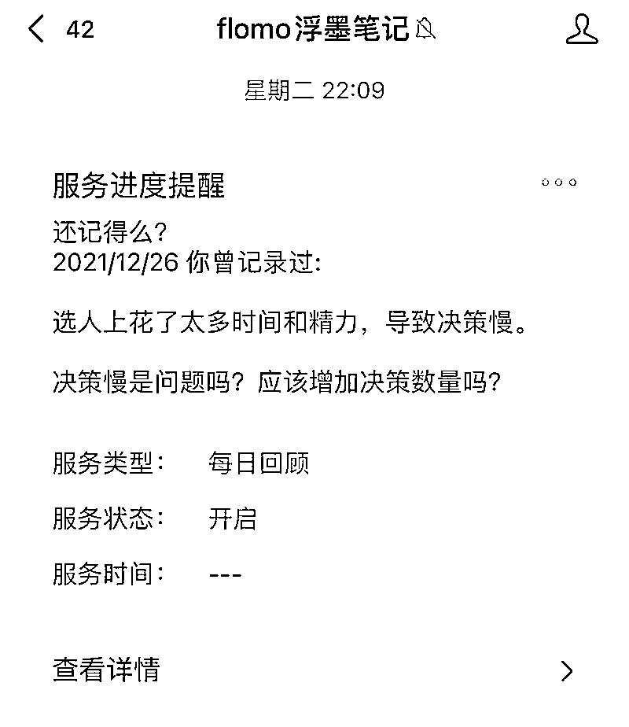

🏅 无

👍 无

# #轻享# 《如何打造个人 IP 高效能体系：

书情小跟班

2022-10-13 22:36:29

#轻享#  
《如何打造个人 IP 高效能体系：1 个人带 1 个 2000 元兼职搞定一切》[22-10-12｜生财有术群内部分享](https://shimo.im/docs/KrkEVXmwJpi24LAJ/read) 

🏅 无

👍 #渠说渠话

# #小红书# 星球的朋友们大家好呀，我叫洛

海绵践行

2022-10-13 22:28:26

#小红书#  
星球的朋友们大家好呀，我叫洛扎，21 岁，坐标哈尔滨/深圳，目前大四在读，从大一开始做新媒体至今，不到三年的时间，全网积累了 10w 粉丝（主阵地小红书【洛扎学姐】），私域万人，学员千人，从 0 到 1 变现六位数。  
  
本篇主要给大家分享一下我贯穿整个大学的自媒体经历，希望把自己的经历经验和方法分享给大家，也同样为曹大的星球提供一些自己的价值，给大家一些启发：  
[《00 后大学生如何通过小红书变现 50w》](https://shimo.im/docs/m5kv9p28xrURglqX) 

🏅 无

👍 #渠说渠话，书情小跟班

# #小红书# 新人必掌握的数据思维+工具思

海绵践行

2022-10-12 21:37:25

#小红书#  
新人必掌握的数据思维+工具思维：新人定位+赚钱模型打造  
帖子链接：  
[`e8uhj14dno.feishu.cn/docx/doxcnYTkme47ys03...`](https://e8uhj14dno.feishu.cn/docx/doxcnYTkme47ys033se5e6yX9Bc) 

🏅 无

👍 书情小跟班，#渠说渠话

# #视频号# 普通人视频号直播带货月佣金百

海绵践行

2022-10-12 07:42:19

#视频号#  
普通人视频号直播带货月佣金百万复盘  
[`oqzqrfzxce.feishu.cn/docx/doxcnplu1aow5yUf...`](https://oqzqrfzxce.feishu.cn/docx/doxcnplu1aow5yUfMz2GnJuHRxh) 

🏅 无

👍 #渠说渠话，书情

书情：这人好强啊，亦仁这话——假设有人在你身上绑了一颗炸弹，要求你一年之内必须赚到 100 万元，且不能违法，如果一年之内你没赚到，炸弹将会自动引爆，你会怎么去赚这 100 万元？ —— 亦仁 于 2020.05.18

# 💎 #生财周报#

书情

2022-10-11 16:10:44

#生财周报# 

🏅 无

👍 无

# #轻享# 视频号动物混剪，每月收入 800

书情

2022-10-10 11:23:47

#轻享# 视频号动物混剪，每月收入 8000 元，冷门蓝海项目 

🏅 无

👍 海绵践行，#渠说渠话

# #懒人专属周报#

书情

2022-10-09 08:50:41

#懒人专属周报# 

🏅 无

👍 #渠说渠话，海绵践行

# #小红书# 首先感谢生财有术，感谢@亦仁

海绵践行

2022-10-08 23:06:49

#小红书#  
首先感谢生财有术，感谢@亦仁，感谢所有生财的伙伴，加入生财也有 2 年了，每年不到 2000 元的费用，我觉得超值，相当于生财帮我养了一个顶尖团队，让我在第一时间能看到全中国、甚至全世界的商业案例，而且都是第一手的、实践过的。我觉得每年收 20000 都不为过。  
  
在生财一直是看，看了 2 年了，生财的很多项目都是可以直接拿过来标准化、规模化。  
  
最近好多人在关注小红书，我自己最近刚好有同学在做小红书，所以就顺手辅导了他们一下，目前都已经出结果，没有自己的产品，一个星期可以起号（一个星期获赞与收藏过万），有自己产品的能做到当天成交变现。  
  
以下是我辅导的同学变现的截图：  
  
  
  
  
  
我是一名商业咨询顾问，主要给上市公司和行业头部公司提供战略咨询和运营管理咨询。每年只服务 2-3 家，其他时间每月开一期《[商业设计](https://wx.zsxq.com/mweb/views/weread/search.html?keyword=商业设计)》特训营，特训营不赚钱，一方面，希望是特训练营中能找到一些未来 5 年-10 年还能联系的朋友，另一方面，在同学中选几个项目，我能一直从 0-1-100 辅导到上市。  
  
在我的整个职业生涯中，负责过多个从 0 到 1 到 100 的业务，以投资人的角度看过 1000 多个业务，又以行家的身份辅导过几百个业务，还为多个行业头部公司提供过战略咨询和运营管理咨询。  
  
下面进入正题《小红书如何做到当天变现》！！！  
  
  
我所说的当天变现一定是有自己的产品，如果没有产品，做不到第一天变现。  
  
一、小红书底层算法规则  
  
1、召回：  
召回就是我们每次打开小红书给我们展示的底层算法，当我们打开小红书的时候系统会以用户标签、访问历史、收藏笔记等从数据库里召回 5-10 篇展示给我们看。  
  
如果小红书的数据库内容是 100 篇，那高峰期 100 个人访问，理论上被招回的几率就是 100%，所以一定要选择在高峰期发布内容。  
  
高峰期是什么时候？每个行业的人群作息不同，一二三线城市的作息时间不同。 网上的所说的上午、中午、晚上只是一个笼统的，一方面他们都不知道小红书的规则，另一方面他们对你的行业也不了解，所以学完了还是不知道什么时间发。  
  
只有你自己最了解你的行业和用户群，所以在发布的时候考虑自己行业的人群什么时候看小红书就可以了，注意，一定要把审核时间算了。  
  
2、排序：  
笔记质量是排序的重要因素之一。小红书排序算法主要用的是特征提取，而特征提取用的技术就是 MLP 孪生网络。  
  
通俗一点讲，就是小红书判断文章质量好不好，主要是根据以前的表现好的文章相似度进行选择。  
  
你写的内容好不好，不是你自己觉得好，而且算法觉得好，全球最牛的人工智能水平也就相当于 8 岁的智商，所以你加入自己想法越多，平台越理解不了，平台越理解不了，火的机率就越底。所以最直接的方式就是，模仿已经火的内容，同样的内容如果火了可以多发几遍。  
  
在账号没起来之前专注模仿，用最短的时间让平台熟悉你，给你流量。  
  
等到账号起来了，再输出自己的干货内容。很多同学一上来就输出自己的干货内容，发现没火，输出了一段时间，还是没有火，结果发现不知道更新什么了。  
  
一定要反着来，第一阶段模仿，第二阶段才输出自己的内容。有数据了，再上自己的干货内容。  
  
注：小红书目前没有上线去重算法，原创规则也是粗放型管理，所以还有时间窗口，但基本上也就半年。  
  
一定要控制自己的欲望，经过测试，标题改个年龄都不会再给你流量，所以文字直接抄，能不改就别改，可以换模板(小红书是文字识别)。  
  
3、重排：  
重排就用协同过滤来实现笔记多样性。  
  
协同过滤的思路是通过群体的行为来找到某种相似性(用户之间的相似性或者标的物之间的相似性)，通过该相似性来为用户做决策和推荐。  
  
根据这个算法规则，我们就可以通过生产长尾和周边内容来换一个赛道获取流量。  
  
二、小红书如何引流变现  
  
我们平时一引流，平台就会屏蔽或都报违规，那是因为你把平台当傻子了。  
  
我们想引流，一定要知道平台底层的算法和规则，我们要做到的就是普通人能看出来是微信号，平台算法看不出来就可以了。  
  
小红书的平台算法是语音语义识别，所以你再小的文字或语音，他都能识别，我们要绕过平台算法，就要用混淆方式绕开算法。  
  
一方面多准备引导话术和图片，如果一直重复发一样的内容，平台一定会发现的。另一方面别一上来就发，先聊几句，再引导。  
  
如果实再不会，去头部品类账号看看他们是怎么大规模引流的。因为他们是一个团队在解决引流，所以只要去护肤品类的头部看看他们怎么引流的，他们的方法一定是最前沿的，用 2-3 个月一般是没问题的。  
  
通过这种方法引到微信上再转化，目前我们自己测试，一天引个 1-200 个到微信上一点问题都没有。  
  
只要自己有产品，我辅导的同学都能当天发布笔记，当天成交。如果成交不了，一定是话术或者产品体系有问题。  
  
不能一上来就卖产品，一定是有最小闭环了再卖产品，在用户最爽的时候卖。你不能什么价值都没提供，一上来就卖东西，客户对你没有信任的时候，卖什么都不可能。  
  
最后感谢生财@杨星城｜水水，@严于律己 提供了思路，我只是在他们之上做了整合，做了适应性改造。  
  
我已经把所有的细节工程化了，小白也能做，大家有问题随时可以问我！ 

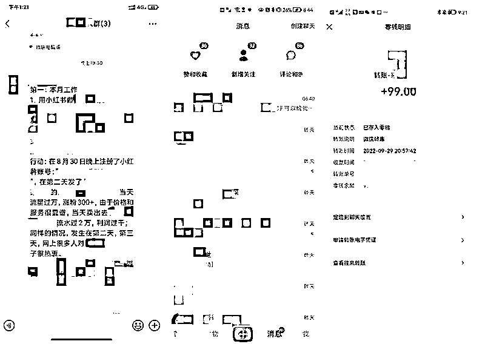

🏅 无

👍 书情

书情：这个人没说自己卖啥

# #轻享# 我是怎么从一个月薪 1500 的打

海绵践行

2022-10-08 23:04:21

#轻享#  
我是怎么从一个月薪 1500 的打工人“突变”成小老板的？  
  
有没有发现，明明上个月还有说有笑一起摸鱼的同事，突然就离职，然后发现他开公司去了，我差哪儿了，我怎么不知道？  
  
我来揭开这个小秘密：因为他已经摸清楚了这个行业的商业模式和运营逻辑，并且可能还掌握了一定的资源，两相权衡之下，自己开公司更划算，那自然就走了  
  
很多打工人容易一叶障目，认为出来工作，完成老板或者经理交代的任务就好了，这种也是极其容易在 35 岁左右中年危机的人。  
  
他们从来没有想过：自己在的公司在赚什么钱？凭什么赚钱？能赚多少钱？这个钱能赚多久？以及，我能不难复制？  
  
学会跳出自己的职位，像一个旁观者一样，看公司的运行脉络，钱从哪里来？怎么花出去？公司是怎么运转的？  
  
我拿自己举个例子，我还是个实习生的时候，看到客户订单上的美金价格，再看看手上的采购合同，抄起计算机一按  
  
得出一个结论：老板真是血赚啊，就这一个订单，够发我两年工资的了，他在大办公室腿都翘桌子上玩手机去了，我在这干的汗流浃背的，凭什么？  
  
所以有一次闲聊，我极其幼稚的和经理说：我学几年也想自己开公司。  
  
没错，当时经理看我的眼神里就写着这句话：我是怎么招到这个沙雕的？。。。。我是能感觉的到的  
  
不过没关系，他想他的，我学我的，虽然老子现在是个实习生，但以后肯定能当老板。  
  
所以我把在这第一家公司当成了游戏通关  
  
想自己开公司，就要明白游戏规则，外贸总体的盈利模式很简单：从国外接单，从国内采购，吃中间的差价，或者当国外客户的采购代理，相当于以前的买办，拿佣金  
  
我选了第一个模式，那么我就要解决两个问题：  
1.客户从哪儿来？我怎么能源源不断的接单？  
  
2.工厂怎么谈，才能让他们愿意帮我做订单？（说高大上一点就供应链管理吧）  
  
首先是客源问题，以前工作过的第一个公司实力比较雄厚，都是去各大展会上开大摊位接待客户，所以我的概念里，开发客户只有展会+开发信  
  
展会毕竟我还是小卡拉米，不够资格去，所以我只能研究开发信的技巧，怎么研究？  
当然不是闭门造车，和王者荣耀带你飞一样，找大神带，上王者就快，自己打得打到什么时候？我当时就是这么想的，想早点通关，我得找那些开发客户厉害的人学。  
  
于是我把目光瞄到了公司几个王牌业务身上，牛逼是真牛逼啊，平时看他们接单就像喝水那么简单，处理工厂也是游刃有余。  
  
怎么和他们搭上关系？让他们愿意教我？凭什么教我？这又是一个问题  
  
但是好就好在，我们是同一个公司的同事，这层身份给我提供了极大的便利，于是我开始在公司有意无意的“制造”一点偶遇，主动打招呼留印象。  
  
第二，再牛逼的业务，也需要人帮手，有一次一个前辈的大货好了，需要在公司附近的包装点装柜，在公司群里搬救兵，我想都没想立刻就去，我不知道你们有没有留意到高速上跑的那种一整个大集装箱，对没错，我装的就是那个，从中午装到了晚上，人都快装到脱力了，结束后前辈就请我们俩劳动人民吃饭，犒劳一下  
  
我心想，终于搭上线了。。。。  
  
于是在前辈请我吃完饭的那周末，我找了个借口回请。。。我现在还记得那次吃了我一直舍不得去的西堤牛排，吃完了，我提议再去星巴克聊聊天（我自己都没喝过这么高级的东西，但是来都来了，不请教点问题可惜了）  
  
到了星巴克，我掏出了早就准备的好的纸和笔，开始了我的问题，前辈也早看出来了我“目的不纯”，于是认认真真的把我的问题都解答了。  
  
有了这第一个外挂血包，接下来就像开挂一样，我把我大学勤工俭学赚的钱，都拿来以各种借口请各个我认为牛逼的前辈吃饭，现在和朋友出去吃饭熟练买单的动作就是那时候练的。。  
  
在各个前辈指点下，我开发客户和操作客户的技巧简直是坐火箭一样往上窜  
  
在这个时候机遇又来了，有一天和一个前辈饭后散步，突然告诉我：下周末有个聚会，我带你去，都是做外贸的老板  
  
那个时候我并不明白什么是圈子，但我好学的小火苗又被点燃了，于是赶紧表示感谢，然后做足了功课，等待周末的到来。  
  
你们猜猜我做的什么功课？就是这个功课，让我拿到了下一场聚会的门票  
  
那会儿我心想都是老板，那我肯定也不能给前辈丢脸，于是我在那几天，认认真真的把学到的开发客户的技巧，都梳理了一遍，做到了“胸有成竹”  
  
别管竹不竹吧，反正做了准备总是没错的，就算班门弄斧，那也比没斧子强  
  
  
很快周末来了，我也跟着去了，到场一看。。。卧槽，怎么都这么年轻？你们都这么优秀的吗？我以为当老板多少都会有点的中年油腻，在他们身上完全看不出来  
  
这些人给我的感受就是：精明强干，现在想来可能当时都年轻优秀，没有锋芒内敛也是正常的  
  
那一场聚会，其实是一场交流会，每个人都是带着干货和问题来讨论的，没有什么过多的废话，但是他们很惊讶的是，我一个小业务员，居然也能插得上嘴，并且说的一些技巧是他们没有听到过的  
  
（开啥玩笑呢，我可是大公司“正规军”培训出来的业务，还请教过那么多前辈。。。。其实我只是把一些前辈教给我的技巧，“借花献佛”的提了出来而已）  
  
这场交流会其实就是各个外贸小老板之间的干货+我从前辈那里学过来的技巧交流  
  
这就真的不得不说分享的重要性，很多人喜欢敝帚自珍，使劲儿捂着自己那点经验，生怕被别人学到去，但是真正的高手是懂得把自己的那一份经验，拿出去换十份，百份的经验回来，从而让自己快速提升。  
  
这一场聚会过后，显然这些小老板对我也都产生了浓厚的兴趣，于是邀约我下一次继续来聚会  
  
装逼成功，这个逼被我装圆了  
  
虽然当时不明白圈子的重要性，但就是这个圈子，彻彻底底的改写了我人生道路  
  
随着聚会次数的增多，我私下里也一对一的和几个老板交流的很紧密，所以我不仅学到了展会+开发信开发，还从这些老板那里，实打实的学到了社媒开发，官网开发等等一些我觉得非常新鲜的开发客户的方式，我之前在生财写过的领英开发客户，就属于社媒开发的一种，这里放个链接给大家参考。  
  
上面我说这个圈子改写了我的人生道路，并不是仅限于此，而是在一次机缘巧合的时候，他们问我：你为什么不出来做？  
  
我。。。这个问题问得好，我当时的回答是：我才入行，还要积累啊，很多东西不懂  
  
有个心直口快的小老板直接就说：赶紧出来做，有什么不懂的，你问我们不就好了？  
  
我当时看着他们的表情，感觉并没有在开玩笑，于是就想着，机不可失，时不再来  
  
说到这里你们一定以为我直接出来开公司了，其实并没有，因为我还想看看，自己到底有几斤几两  
  
在之后一年不到的时间里，我们小组三个人配合，把一个国外中间商的订单总额，从去年的 5 万美金不到，做到了 200 多万美金，成了他们第一梯队三大供应商的其中之一（在这里我想插个嘴：不要总觉得怀才不遇，如果你能在公司里帮老板干到 1000 万的业绩，那么自己做的话，100 万问题不大，在公司里有平台有后备资源你都玩不转，那建议不要创业，创业不是让你逃避职场压力的）  
  
这个时候，我心里已经有 5 成把握创业成功了，因为这一年里我已经熟练了操作客户订单和工厂谈判，大头已经学会了。  
  
但我还想查缺补漏一下：我只在这一家公司呆过，并不知道其他外贸公司是个什么情况  
  
于是一个大胆的想法突然出现在我脑海里：去别的公司看看？？  
  
说干就干，做好客户订单交接后，我就直接辞职，面试下家去，毕竟也算半个专业选手了，面试都很顺利，但是基本上都是一个月左右，觉得学的差不多了，就提辞职，这几个月，我跑了大中小和创业型的公司，都去了，学习他们的运营模式等等  
  
我也没闲着，路过的每个公司，我都帮他们开发了新客户（有些是没下单，但是谈到了细节性的东西了，外贸的订单没有那么快的），这也侧面印证了，我有独立开发客户的能力。  
  
这个时候，我找到了当时那个老板，那会儿我们也混得很熟了，我就开门见山直接问：我出来开公司的话，不会真的可以请教你吗  
  
得到肯定的答复后，我就，自由了  
  
从找代理注册公司，到注册香港公司，再到找出口代理出货，这些关键节点的人脉，都是这些小老板毫无保留的介绍给我的，甚至当初我连委托报关都不会，也是拿着电脑直接冲到了别人公司，让他手把手的教我操作了一把。  
  
在结尾我想总结几个点：  
1.     要学会培养自己拆解商业模式的能力，哪怕就是身边的洗车店，蛋糕店，都不妨观察一下，人家是怎么赚钱的？多分析一些案例，看一些商业模式（现在信息这么发达，生财里就有这么多案例随便看），练习久了以后你看到新事物的时候，可以一眼看通透，相当于，你去玩搞钱版大富翁游戏  
  
2.     培养自己的好人缘，懂感恩，知道把好东西分享出来，那么你才能成倍成倍收获到别人的好东西  
  
3.     如果经济允许，可以直接付费，这个是最快链接到高手的办法，进步神速，因为我自己尝到了甜头，所以心里也是很认同的  
  
最后一个有趣的事情要分享给大家，当初土老板介绍我加入生财的时候，说这个社群很有趣，有什么龙珠机制，我也没多想，直接付费加入了，然后放着三个多月没管，有一天心血来潮点开一看，扫了两眼，第一感觉就是：卧槽。。被割韭菜了，这什么社群啊。。。要三千多，三千多我拿去吃个十顿火锅不香吗？  
想想算了，都三个月了，退钱面子也挂不住，明年大不了不续费，骂骂咧咧的刷抖音去了  
  
但是，有一天我又心血来潮了，想看看生财里有没有关于 tiktok 的内容，我顺便研究下要不要做，就去生财里认真逛了逛，尤其是精华区  
  
这一圈逛下来，我才意识到了生财有术当真是生财有术，这个社群的价值真的是不可估量，怎么可以有这么多赚钱案例！！！真是开眼了，开眼了  
  
于是从开始的不情不愿，到后面积极在鱼丸的帮助下分享了第一篇领英攻略，本来以为写了这么完整又符合要求的干货，可以拿到一颗龙珠。。。结果 too young too simple,但是就从那开始，我就养成了在生财分享的习惯，已经好几次周报都能看到我了哈哈，希望有一天可以写出值得一颗龙珠的干货出来  
by：队长 

🏅 无

👍 书情

# #小红书# 我个人是文旅公司创始人，先说

海绵践行

2022-10-06 20:54:47

#小红书#  
我个人是文旅公司创始人，先说成绩再说方法论。  
  
5 月份我们的运营团队已经在小红书做出了 7 个文旅账号，其中有 3 个账号的是在 3 天内从新号到千 1000 粉，有一个民宿的是第 4 天才到，单个账号引流到微信的咨询添加 500 多个，因为是疫情直接转化会延迟，但这个效果在我们的理解里是非常好的，去年从新号到千粉的时间基本要在一周甚至更长。  
[`lyrz1vdb4n.feishu.cn/docx/doxcnF9e1oF5Wz8j...`](https://lyrz1vdb4n.feishu.cn/docx/doxcnF9e1oF5Wz8jx7dXUDRpweb)  
by：许义 

🏅 无

👍 书情，#渠说渠话

# #轻享# 《人生辛苦的价值》辛苦和努力似

海绵践行

2022-10-06 20:30:37

#轻享#  
《人生辛苦的价值》  
辛苦和努力似乎是大多数普通人改变命运、提升生活质量的必由之路，对中国人来说自强不息、顽强拼搏也是骨子里就有的民族精神，但是这几年，人们对“辛苦”、“努力”、“奋斗”等字眼的心态发生了一些变化，尤其是在疫情持续 3 年影响全球局势和中国经济的背景下。  
  
今天就说说人生“辛苦的价值”。  
  
我先举个例子：  
  
前几天和一个飞行员吃饭，他提到过去几年中国民航发展得很好，国内各大航空公司对民航发展都做了比较乐观的预期，所以会提前储备高阶的民航人才，比如飞行员，但是后来发现当时的预估是偏于乐观的，所以储备下来的人才会大于需求，加上这几年的疫情影响， 民航系统的人才过剩非常明显，但是人才储备这项工作是前置好几年的，到了今天尽管疫情，但是每年还会有新人不断加入进来，需求减少供给增多的叠加影响，大量民航体系人才发展就成了问题。  
  
过去一个年轻的飞行员，如果 22 岁开始执飞，因为航线密集积累的飞行机会多，5 年以后的 27 岁就有机会成为一名机长，30 岁之前的经验积累有机会升为机长，这样的职业发展是非常好的。  
  
但是今天，航班减少、需求下降、一名新进的飞行员得到的飞行机会对比过去少了很多，导致可以积累的飞行次数变得有限，想要成为机长的时间就被延长了。  
  
听完，我觉得和互联网、房地产、甚至在线旅游好像啊。  
  
他继续说：你再看 80 后和 90 后，80 后的一代的机会是相对不错的，只要努力、头脑聪明都能混的不错，毕业时候进个互联网大厂还能做个 P7/P8，年薪达到五六十万的人在 80 一代人身上不算少，真想买房的时候北上广房价还没涨到头，如果家里可以支持一下就可以勉强上车，今天 40 岁的 80 后依靠这些可以完成早期人生的基础积累，如今他们可以留在不错的职业岗位。  
  
90 后就没那么幸运了，想好好打工的时候互联网产业到头了、想买房的时候房价高不可攀了。  
  
你发现没有：同样的人同样的努力程度只是因为所处社会阶段的不同导致人生结果的巨大差异。  
  
无法理解的可以看看这几年大学毕业生的求职困境，他们当中不乏聪明且努力的人，但留给他们的好机会少了很多，这其中甚至包括复旦和上海交大的毕业生。  
  
“时来天地皆同力，运去英雄不自由”。  
  
这里只是举例体现“辛苦价值”的差异，个人无法改变的时代因素我们先放一放。  
  
我们说说在“辛苦价值”的话题上，普通人能够做的一些思考、尝试和改变。  
  
  
01.  
事情  
  
  
今天的中国人都习惯努力，但事实上有人努力一生也很难改变自身的命运，因为被困在局里。  
  
比如快递员的工种，努力的价值可能当下就变现了，每次辛苦每次兑现，只有短期没有长期，辛苦的价值无法累积，所以无法通过重复努力获得质变来跳到一个更好一些的“局”里。  
  
这是典型的努力但不改变局面。  
  
工作无高低贵贱、但社会有岗位分工，如果可以我们应该主动选择每次努力都能带来一些长期价值积累的工作，比如经验累积类的，比如思考创造类的。  
  
局面越来越开，辛苦努力的价值也会越来越大。  
  
什么是“局”？  
  
局就是限制条件和当前资源的制约关系，破局就是破除当前的重重限制重新寻找制约条件和拥有资源之间的新平衡，人生破局就是冲开性格、资源、能力、积累的重重枷锁，走得更加开阔。  
  
努力价值在不同事情上的体现有很多，比如说创业方向，因为选择的事情天花板低、竞争大、时间投入高、长期价值弱，辛苦就会无法避免,所以很多人的创业是陀螺模式，很多旅行社经营也是这种，订单来了就要去接，不接就没生意，接了转化效率又很低，所以辛苦，能赚些钱但价值很难做大。  
  
方向不对，努力白费，打工者选好岗位，创业者选好事情，出发的时候就决定了辛苦模式和辛苦的价值。  
  
  
02.  
阶段  
  
  
除了相同努力在不同事情上体现出的价值回报的不同，还有阶段。  
  
我们来看人生不同阶段和事情不同阶段下辛苦价值的不同。  
  
人生阶段就是你在某个时候的努力能够事半功倍，而错过的时候就是推石上山。  
  
具体来说：就是好赚的钱并不多、红利时期并不长，有机会的时候一定要抓住。  
  
刚刚那位飞行员举得例子就已经足够说明，不是你每次想努力都有时代提供的好机会。  
  
25 岁的时候不努力，52 岁的时候补不回来。  
  
高中多辛苦 300 天，人生少辛苦 30 年，就是这个道理。  
  
所以重要的人生阶段不能偷懒。  
  
一件事情上的不同阶段呢，也有差异。  
  
一个项目有它特有的发展节奏，错过了最好的阶段和窗口，后面很难追回来。  
  
我们说红利来临的时候，流量找你，红利消失的时候你找流量，我们知道在商业连接方式上，你找别人和别人找你的差异是很大的。  
  
比如最近暑期很多地方的旅游很旺，等了一年了才有这几个月，你得努力，因为过了 9 月、国庆，需求就没了，对于旅游行业，2022 年很快就要结束了。  
  
你说最近我很累我歇会，我 11 月份想要努力、加班、多做价值，不好意思辛苦的价值降低了。  
  
所以这几个月我有很多旅行企业的创始人朋友都是一个人当 3 个人用，通宵达旦、马不停蹄。  
  
  
03.  
方法  
  
  
我们说了不同事情不同阶段辛苦价值的不同，再说说辛苦方法上体现出的价值差异。  
  
之前我有分享过什么是辛苦但低效的努力。  
  
就是有的人确实也很努力，但是力使错了，比如以群发推销的方式骚扰用户、以疯狂加人的方式扩充人脉。  
  
他们在意形式，不在意本质。  
  
我特别害怕听到有的公司说：这事全员执行、大家都要有压力，每个人都要干、每天都有任务量。  
  
比如有的旅行公司要求全员发朋友圈、全员发小红书、每天发 5 条，你就知道这个老板缺少业务洞察力。  
  
量变不一定都能引起质变，没有质量的数量很难起作用，我们见过太多很多事情做了，但是目的不清晰效果出不来的。  
  
比如发了 100 条小红书、做了一年的公众号，你问他效果：我们还在尝试。  
  
100 个笔记换不来一个咨询，100 次执行动作对应不到一次目的。  
  
废动作太多，盲目、辛苦、很累但是低价值。  
  
  
04.  
解决问题  
  
  
你很奇怪，什么是解决问题？  
  
我再举个例子：  
  
中国的股民数量超过一个亿，但是绝大部分人的参与资金低于 5 万，也就是很多股民每天花时间看涨跌，很辛苦也要付出心力和时间成本，但是这些股票收益的涨跌都不影响生活。  
  
赚了也就那么回事，发不了大财改变不了人生，反而跌了倒是要伤心好一阵子。  
  
《[一个投资家的 20 年](https://wx.zsxq.com/mweb/views/weread/search.html?keyword=一个投资家的 20 年)》里提到：很多人想要股市有收益，一是提高本金、二是找到靠谱的人，不懂股票并不影响在股市里赚到钱。  
  
为啥？  
  
因为本金太少了，输赢多少都不改变人生，提高本金才能解决人生的财务问题。  
  
辛苦上呢？  
  
辛苦的努力是为了不努力。  
  
后半句是沟通的目的是为了不沟通，这两句都是源于我最近的发现。  
  
没有人想要人生处处辛苦、一生忙碌，人总要享受生活、感悟生命。  
  
30 岁辛苦是为了 40 岁可以不辛苦。  
  
谁做到了辛苦以后可以不努力呢？  
  
那些在一件事情上挖掘到足够价值的人，比如做了一个项目、创了一家公司，功成身退然后离场了。  
  
真正实现了一次巨大的辛苦换来了长期从容。  
  
辛苦的价值是解决问题，辛苦的目的是为了不辛苦。  
  
一个人真的以解决问题的角度来看每天，会发现只需要关注那些真正有价值的事情，大量的废动作收起来，可做可不做的其实可以不做。  
  
  
04.  
总结  
  
我们常常听说要做“做难而正确的事”，这句话容易给人造成误解，好像选择做难的事、辛苦的事就一定正确。  
  
其实应该是首先找到正确的事，而不一定是难的事，难没有意义，正确才有意义。  
  
这句话为什么广受传播？  
  
因为容易给人情绪上的激励满足，容易给人造成“我很难所以我正确”的错觉，实现认知协调。  
  
事情的选择、阶段的把握、努力的方法、是否真的解决问题都决定了辛苦价值的差异。  
  
正在努力的人需要思考，人生可以很累很辛苦，但背后的价值是什么？  
  
是不是辛苦模式已经错了。  
  
如果可以，我们应该选择高价值、高效率的辛苦方向。  
  
年轻的时候主动辛苦， 是为了中年以后能够不辛苦，可以在西湖边、洱海畔、雪山下、火炉旁喝上一倍氤氲惬意的中年下午茶。  
  
是啊，辛苦、努力，为了一杯中年下午茶。  
by：许义 

🏅 无

👍 书情

# #轻享# 《7 个公式思维看透复杂世界》什

海绵践行

2022-10-06 20:28:49

#轻享#  
《7 个公式思维看透复杂世界》  
  
什么是公式思维?  
  
所谓公式，就是对文本描述的高度总结、是高度提练的逻辑关系。  
  
为什么需要公式思维？  
  
就是将复杂的事情简单化。  
  
商业世界里我们需要面对的复杂问题太多了，业绩下降、人员流失、职业选择、重大决策...  
  
解决问题的前提是定位问题，公式思维就是帮助我们快速的定位关键问题以及关键要素间的逻辑关系。  
  
这个能力太重要了，一件两人争论不休的事情，第三个人来了，黑板上写下一行公式，两个人看了一眼黑板，争吵一下子就变得安静了。  
  
公式思维还有个很大的好处是向别人高效率地解释清楚一件事情。  
  
工作上常常需要向下属、上级、投资人...最快地解释一件事情，如果只是基于文本信息的解释难以做到全面和体系，也就是对方的理解成本会很高。  
  
理解不了就很难做到，理解不了就没有认同。  
  
  
怎么办呢？  
  
给出公式。  
  
无论对方有没有行业背景和知识体系都能从公式里看出关键要素和逻辑关系。  
  
你可能觉得有点模糊，没关系，从复杂到简单、从混沌到清晰、从模糊到具体，我举例一下生活中常见的几个公式。  
  
  
1.GMV=流量\*转化率\*客单价  
  
  
这是一个只要从事电商都会知晓的流量转化公式，公式给出了 GMV 的关联要素和要素其中的关系，无论是哪个平台、哪种流量形式，到最后都会落到公式给出的逻辑关系上。  
  
电商如此，新媒体也是这样。  
  
小红书、公众号想要涨粉，如何做呢？  
  
我在新书《小红书变现 7 堂课》里提到，每个运营者首先得知道基于内容的涨粉公式，以小红书为例，涨粉=内容数量\*爆款率\*单篇带粉数  
  
我们知道不是所有的笔记都能带来涨粉，只有爆款才会带来可预期的涨粉数，那就做好内容数、提高爆款率和单篇带粉数 3 个关键要素就好了。  
  
2.服务价值=业务规模\*服务感知  
  
只要是商业项目都有服务对象，都需要做好服务。  
  
问题来了：什么时候该做好服务，又应该在什么阶段把服务做到什么程度呢？  
  
既然要做好服务，那一定是项目刚成立的时候就把服务做得很极致吗？  
  
这个问题的回答想要清晰就必须量化到服务价值，而高手的思维里会抽象出服务价值的体现是由服务的用户规模和单个用户对服务的实际感知。  
  
如果只服务 100 个用户，每个使用者的服务感知都是 100 分，其实总体服务价值是不大的，服务价值=业务规模\*服务感知=10000。  
  
有没有可能区分不同阶段的不同服务感知呢？  
  
比如我先服务 1000 人每个人提供 80 分的基础服务，显然 80 分的基础服务交付难度比 100 分的极致服务小，更容易操作和实现。  
  
A 策略的服务价值=业务规模\*服务感知=100\*100=10000  
  
B 策略的服务价值=业务规模\*服务感知=1000\*80=80000  
  
显然在项目的不同阶段执行 B 阶段服务价值更大。  
  
如果没有这样的公式就会陷入无效讨论。  
  
“我觉得要做好服务”  
  
“我觉得服务可以先放一放”  
  
这样没有价值量化和区分关系的讨论是缺少意义的，因为拆开来看都有道理，但商业决策是解决一个复杂问题。  
  
在《[重新理解创业](https://wx.zsxq.com/mweb/views/weread/search.html?keyword=重新理解创业)》里周航就举例和滴滴初期争夺的时候，易道追求极致服务，滴滴猛铺用户规模，后来的故事大家都知道了，易道退出、滴滴上市。  
  
易道追求极致服务的时候忽略了服务价值，做服务只是手段，服务价值才是目的。  
  
如果操盘一个平台级的商业项目，这个思维就很重要，死盯服务反而做不大。  
  
3.业务规模=需求\*供给=流量规模\*供给覆盖  
  
我们继续看：一个商业项目的业务规模应该怎么衡量、如何评判？  
  
业务规模=需求\*供给  
  
一个好的商业项目当然是需求无限大、供给无限大，所以我们常常听到，短期看需求、长期看供给。  
  
对应到商业项目的运营上就需要找到规模的流量和规模的供给。  
  
意思是一个大的商业项目没有规模流量做前提是上升不了业务规模的，没有规模供给也是注定做不大的。  
  
比如说旅行社行业就是一个没有规模供给的行业。  
  
一到旺季就是没车没房没导游，有效供给限制了订单量的继续扩大。  
  
再看规模流量呢？  
  
我在《[新旅游](https://wx.zsxq.com/mweb/views/weread/search.html?keyword=新旅游)》这本书的创业章节提到：今天旅行行业 To C 的创业机会已经关闭了。  
  
因为移动互联网以后，旅游行业几乎没有低成本获得规模流量的机会了。  
  
很多旅行公司的创业逻辑都是依靠 OTA 做零碎生意。  
  
4.交易=连接\*需求\*信任  
  
交易是每个人每天都在面对的事情，交易不只是付费形式的交易，一次入职成功、一个合作建立、甚至对方愿意留出时间听你说一件事，也包括你现在正在花时间阅读文章，都是一次包含付出与收获的“交易”。  
  
那交易如何发生？对应到销售上，如何获得更多的转化订单？  
  
我理解交易行为的发生依靠 3 个关键要素，且相互之间是乘法关系，乘法关系就意味着缺一不可。  
  
连接：你能覆盖多少用户？影响到多少人？有多少人看到你认识你？  
  
这是连接数量。  
  
信任：只是连接还没有用，连接的数量中有人只是简单印象、有人基本熟悉、有人深度相信，信任值不一样带来转化效果的不一样。  
  
需求：连接有了，也有信任，但是不一定转化，你一定要判断这个用户是有需求的，且在对方有需求的时候适时出现，不能把梳子卖给和尚。  
  
贯穿下来看，很容易发现，想要获得交易不只做好流量一件事，还需要积累信任长期做好人，还需要洞察需求解决用户的实际问题。  
  
连接数量大、信任足够多、对方有需求，交易行为就会自然发生。  
  
没需求的时候做信任，有需求的时候做连接，再也不需要询问“考虑的怎么样”。  
  
这也很好地解释为什么有的媒体流量很大，但是转化率并不高，有的人认识的人很多，但是真正的朋友很少。  
  
因为用标题党只增加了连接数量，到处加微信构建不了信任关系。  
  
“交易”行为还是难以发生。  
  
5.流量价值=连接数量\*相关度\*信任度\*交易承接  
  
这里主要是对应交易为目的的价值衡量。  
  
无论是电商还是内容我们都要和流量打交道，但是如何清晰的理解每天每件事带来的流量价值？如何判断和识别一个项目一家公司的引流方式对不对？  
  
连接数量是引流能力。  
  
相关度是流量的准确性，我曾经说过做人做公司都只交 5%的朋友，做 5%的生意，有的流量不要你，有的流量你也不要，相互匹配的流量才是有效流量，这包括需求匹配、价值理念匹配。  
  
生意如此、合作也是，钱很重要，钱的气质更重要。  
  
信任度：在前面的公式里已有解释，就是这次连接给对方带来的心理感受，是不是因为有了这次连接对这个品牌这个人多了一些认可和好感。  
  
交易承接：你还需要有很好的承接路径和方式，否则对方把钱送到门口也拿不进来。  
  
6.用户价值=新体验-就体验-替换成本  
  
这是俞军老师在《[产品方法论](https://wx.zsxq.com/mweb/views/weread/search.html?keyword=产品方法论)》提到的用户价值公式。  
  
第一次看到这个公式，觉得很通透。  
  
我们往往在做一件事的时候，很容易对用户价值争论不清，习惯以各种论证来证明我这么做是有价值的。  
  
但是具体的价值是什么？如何衡量？如何自己说清楚也让别人听明白？  
  
不是新的体验好就会换来使用机会。  
  
需要定义甚至量化新体验和旧体验的差值，需要看到用户的替换成本。  
  
有一次深圳的一家公司问我，某个省级的一码游平台想和他们在流量上有更多合作，是否有机会？  
  
我说这个省的平台我看了，某些功能的产品设计甚至交互都做的比携程好，但也没什么机会了，因为新旧体验差别不大。  
  
今天的用户在 5 块 10 块的利益刺激面前也很难下载一个新的 APP 来重新填写买票订房时候的身份证了，替换成本太高。  
  
7.用户行为=用户（理解+认知）+情境刺激+需求期望  
  
这个公式很有意思，理解了这个公式的人做内容都不会差。  
  
以内容为例，用户行为是什么？  
  
点赞、转发、评论、收藏...这些有互动的行为。  
  
做内容的都希望用户会有点赞、转发、评论、收藏的行为发生，但是很多人的方式是以打扰的方式求关注、求点赞。  
  
这个行为可能会有效果但容易触发反感。  
  
以这篇文章为例，可能也会有人收藏或者转发。  
  
那这个行为是如何在写文章的时候埋下的？  
  
文章开始说明了什么是公式思维以及公式思维的应用，帮助读者建立认知。  
  
通过具体的生活举例体现公式思维运用的实际情境，让读者感受确实很有用。  
  
文章结尾就很容易帮助读者建立起了希望用公式思维解决复杂实际问题的需求期望。  
  
点赞、转发、评论、收藏的互动行为自然就发生了。  
  
这是以一篇文章为例，我们还可以细化地拆解如何触发用户关注的行为？  
  
如何触发用户点赞的行为？  
  
如何触发用户转发的行为？  
  
这些用户行为是文章看完以后才会决定的吗？  
  
不是，是写文章的时候就已经决定了。  
  
无论小红书、抖音、公众号还是知乎，运营考究的核心能力都是如此。  
  
  
  
公式思维的实际应用还有很多。  
  
比如一家餐饮店想要构建超值体验，需要知道餐饮好体验=价格合适+分量足够，那就可以把份量在用户期待的基础上放大 1.3 倍。  
  
一个做小红书运营的人，想要提高打开，就必须做好封面，那什么样的封面才是好的呢？  
  
高打开的封面=提示内容+信息点+设计美感  
  
一个媒体行业的人，脑海中需要知道所有的创意都是元素的重新组合，创意=热点+形式  
  
还有《[底层逻辑](https://wx.zsxq.com/mweb/views/weread/search.html?keyword=底层逻辑)》里提到：  
  
方法论=环境变量+底层逻辑  
  
只要是方法论都是环境产物，环境变了方法论会有调整但是底层逻辑不变，比如抖音、小红书、公众号，运营的载体变了，但是逻辑是相似的。  
  
比如天猫、京东、虾皮、亚马逊、平台变了，但是 GMV=流量\*转化率\*客单价不会变。  
  
没有公式思维的人就会忽视环境照搬方法论，没有效果反馈然后说方法不行。  
  
还有还有...  
  
实物或服务型产品用户获得的产品总价值=使用价值+功能价值+情感价值  
  
小红书类型的内容价值=实用价值+信息价值+情绪价值+决策价值  
  
品牌=流量覆盖\*用户信任  
  
人脉=认识你的人\*信任率  
  
......  
  
高手的脑海里有很多面对复杂问题的解题公式，这些公式的好处就是帮我们更好地理解和说清一件极度复杂的事。  
  
从复杂到简单、从混沌到清晰、从模糊到具体，抽丝剥茧是我们认识世界的基础能力。  
  
国庆愉快。  
by：许义 

🏅 无

👍 叶提，书情，#渠说渠话

# #生财周报# 生财有术重要内容整理 htt

书情

2022-10-06 12:43:32

#生财周报#  
生财有术重要内容整理[`shengcaiyoushu01.feishu.cn/sheets/shtcnAla...`](https://shengcaiyoushu01.feishu.cn/sheets/shtcnAlayMqEIvX1aSWoPsHmigb?sheet=c8cdd1) 

🏅 无

👍 #渠说渠话，海绵践行

# #轻享# 慢慢 2022-10-03 23

书情

2022-10-05 19:32:14

#轻享#  
慢慢  
2022-10-03 23:34:15  
  
✌️生财有术北京聚会～笔记～  
  
@醒醒同学🍃 @常常 @孙让梨 @一盘唐僧肉 @Larry @花花子 @蓝弈  
  
主题：什么是正确的事？  
  
1，当遇到困惑，情绪不对，感觉事情不对劲儿等的时候，或许我们以为的问题，不是真的问题，这时候，一定要多问几次自己这个问题：你觉得当前你最重要的事是什么？  
  
2，一定要去做距离结果更近的事。比如，想要赚钱，就瞄准了能直接变现的事情去做，而不是心里想着赚钱，而只去做一些看起来可以提升赚钱认知的事，拉长变现路径，人很容易就疲了。  
  
3，这世界别人都有人做了，只有你才在做自己。醒醒推测说我是“感感”，我本来以为自己是“感理”呢，那就“顺应人性”，按照自己的本性来活。  
  
4，说话时，不自觉就手舞足蹈的人，说不定很有做直播天赋呢。  
  
5，怎么确定，一件事自己是不是喜欢做呢？做一件事，只尝试两三个月，觉得做不好就放弃是不行的，一定得做出个什么结果来才行。如果没有做到那个结果，就是积累还不够，就继续投入，加码，直到做到那个结果为止，等做到了那个结果，如果还是觉得自己不喜欢，就可以放弃了。  
  
6，记不住过去发生的一些事儿，有人说，这是记忆力不好，但这不是一个能力，只是一个特质，不记得了就不记得了。把自己特质里做不好的事，反复念出来，或许是个不错的消解情绪的方法，也能让对方知道如何和我们相处。  
  
7，人一定要做自己顺手就能有产出的事情。一个事儿，大家都说好，但如果你自己不感兴趣，那也没用，一定要做自己有热情的事。  
  
8，人在心情好的时候，可以去看看“同辈”的朋友圈和成就，美其名曰，“学习”，但在心情不好的时候，就赶紧屏蔽掉，一个也别看，不要再影响自己的心情。  
  
9，不要光是嘴上说明白了，要真的去行动。要在“学中干，干中学”，不要空学，空干。  
  
10，这不是知识付费的时代了，而是行动的时代，比如生财的实战航海。  
  
11，焦虑来源于不可控，不可控是因为能力不够。对自己发脾气没用，去提升能力才是正事。  
  
12，人生的“苦”都是定量的，你如果不想吃生活中的“苦”，那就要在自己的专业领域多吃“苦”。多读书，多学习，多实战，多进步，成为专家。  
  
13，人需要把自己都做了些什么记录下来，这样才会有成就感，而不是过了一段时间，一拍脑门，觉得自己啥也没做。把做过的事，写下来给自己看，也能让自己快速恢复能量。写观察日记是一个不错的方式。  
  
14，人最重要的是认识自己，知道自己适合什么样的人，看清自己所热爱的东西，知道自己愿意为了什么而拼命。  
  
15，正确的事，就是知道，人的命只有一条。为了这条命好好的活下去，我们可以做什么，可以放弃什么，一目了然。  
  
16，体面赚钱，时间自由，成为专家——醒醒。  
  
PS.第一次参加生财线下的活动，和大家一起讨论“什么是正确的事”，非常有启发，谢谢大家，期待下次再见👋  
  
再 PS.今天和大家一起看了绝美的夕阳🌇 

🏅 无

👍 海绵践行

# #轻享# 深圳国庆约见 https://

书情

2022-10-04 11:31:58

#轻享# 深圳国庆约见  
[`rlwxa0zgke.feishu.cn/docx/doxcnpWBbBV8nYW5...`](https://rlwxa0zgke.feishu.cn/docx/doxcnpWBbBV8nYW5QjlpO35yPff) 

🏅 无

👍 无

# #轻享# 一个 50 岁海外客户的创业故事：

海绵践行

2022-10-03 22:12:37

#轻享#  
一个 50 岁海外客户的创业故事：  
  
感谢星主加精了我的这篇文章：选品的三大核心原则。大家的喜爱就是我持续分享的动力，再接再厉。  
  
最近无论见客户还是供应商，几乎每个人都在感叹：“今年生意不好啊。”  
  
确实今年受外部因素影响，许多人的生意都不太好做，业绩下滑 30%甚至 50%都是常态。但我回顾了过往创业 10 年的历程，似乎......好像......没有哪一年是挣钱特别容易的？  
  
我有一个越来越深刻的认知，无论创业还是企业经营，它都不是一场赌博或者一场短跑比赛，不存在牌面一揭开或者鼓足干劲一冲刺就瞬间暴富然后功成名就。它更像是一场持续几十年的马拉松障碍跑，你只需要稳定地往前跑，争取跨过一个又一个的障碍，但凡不出现方向性的问题又或者摔倒了起不来，总能够慢慢地靠近终点，想快也快不了，想急也急不来。  
  
在我看来，对于创业和企业经营来说，没有什么所谓的“成功”，因为所有的成功都有可能只是暂时的。  
  
与其追求成功，倒不如追求尽可能少的失败，又或者追求失败之后应该怎么做才能够迅速地爬起来继续往前跑，因为在创业和企业经营的过程当中，失败几乎就是一件日常的、几乎无法避免的事情。  
  
今天我想分享一个海外客户的创业故事，这个故事是几年前我去墨西哥拜访他时聊出来的，当时我俩坐在椰林树影、水清沙幼的坎昆沙滩（全球十大海滩），一边喝酒微醺，一边畅谈人生。  
  
我的这位客户叫马特，今年 50 岁，但创业却已经 35 年了。出生在普通家庭的他在 15 岁那年面临着两个选择：  
  
第一个选择，成为一名职业运动员，从此过上挥汗如雨的日子。  
  
第二个选择，离开学校做属于自己的小生意。  
  
几乎没有任何犹豫，他选择了第 2 条路，因为他实在太渴望赚钱，也太渴望改变自己和家人的生活了。毕竟自己的父亲仅仅只是一名普普通通的教师，快乐但也清贫，根本就给予不了家人优越的生活。要改变这一切，他就只能够依靠自己。  
  
但到底创业做什么呢？答案很简单，什么能挣钱就做什么。  
  
墨西哥是一个神奇的国度。在限速 110 公里/小时的高速公路上飙到了 200 公里/每小时，然后被警察逮住了，掏 500 比索（约合 170 人民币）就可以轻轻松松搞定；去金字塔景区 Chichen-itza 的时候发现没有停车位了，给了保安 200 比索之后，对方硬是给你挤出个位置来（又或者本来就有位置就等着你掏钱呢）；去景区的官方办公室找的导游只有 45 分钟讲解时间，而且还得跟大队，私下自己去找导游，可以有一小时的讲解时间，而且还是全程陪同......总而言之，“赚钱”的机会实在是太多了。马特作为一个本来就非常聪明的人，在这种环境之下简直就是如鱼得水，短短几年的时间就挣到了人生的第 1 桶金。  
  
墨西哥被称之为美国的后花园，当时许多优质和昂贵的产品都是从美国进口的。在一个偶然的机会，马特听说原来美国的许多产品其实都产自中国之后，他开始将眼睛放到了遥远的中国。作为一个执行力超强的人，他说干就干，马上申请了来中国的签证，从此开始了他和中国 30 余年的缘分。  
  
曾经听一个朋友说过，去北朝鲜旅游只能去官方圈定的领域，当时的中国可能和北朝鲜差不多。所谓中国签证，事实上只能去广州，而且一般也只能在酒店和展馆之间来回，要自由行动并不容易，参展企业无论数量还是质量也跟现在完全不在一个档次上，许多企业的参展人员连英语都不会说，只懂得用手比划，用计算器说话，但不管怎样价格肯定比在墨西哥本土采购更便宜，遍地都是黄金商机。马特一边逛一边思考，最终选择了他从中国采购的第一个产品：金鱼。  
  
听到 Goldfish 这个单词时，我还蛮惊讶的，确认了几遍才敢相信。因为在大多数人的认知中，都认为金鱼这玩意儿怎么可能长距离运输？许多当地的商人也这么认为，于是根本就没有人想过金鱼居然也可以从中国进口。但马特就是敢想和敢干，最终这批货让他挣到了远高于过往的利润，于是从中国进口越来越多产品，并销售到墨西哥甚至南美洲的这颗心开始熊熊燃烧了起来。  
  
之后几年，他开始频繁从中国进口各类产品，最一开始的时候品类很杂，基本上什么挣钱就做什么，后来慢慢缩小到了家用电器品类，又慢慢聚焦到风扇，然后又更新换代到空调，总而言之生意越做越红火，不到 25 岁就挣到人生的第 1 个 100 万美金，公司也开始搬去美国的迈阿密，意得志满，英姿勃发。  
  
青年得志，最容易发生的就是目空一切，觉得“反正老子做什么都能挣钱”，于是会开始盲目扩张生意，也会开始随随便便花钱。马特也不例外，有了钱之后的他开始大手大脚地花钱了，买豪车(兰博基尼、法拉利），购置房产，买游艇等，情人五六个，周周各不同，过着纸醉金迷的生活。还记得在坎昆的海滩上，马特眼神复杂地看着海面上的一艘游艇说“我当初的那艘游艇比这一艘还要长”。  
  
是的，“当初”。2008 年美国次贷危机爆发的时候，马特破产了。产品突然之间就没有了销路，房子也跌得一文不值，屁股后面还欠着供应商的一大堆货款，生活好像瞬间变了样，变得让人好绝望，头发都熬白了好几根。最终，他把当时花了 130 万美金买回来的游艇低价卖掉，把所有的豪车也都卖掉，还了供应商的钱款后只身回到了墨西哥。  
  
能够做到这一步对一个墨西哥人来说是一件挺不容易的事情。美国次贷危机的时候我正好在墨西哥驻外，当时分公司的超期应收账款足足几百万美元，但那些欠我们钱的墨西哥公司们，要么说产品还在仓库里你拉回去，要么说销售情况不好无力还债请求再宽限半年，要么索性破产跑路不见踪影，千方百计想着如何还供应商钱的企业少之又少，更别提那些可能以后再也不会一起做生意的供应商们。  
  
在这点上马特明显有别于一般的墨西哥公司，他不愿意损害公司和自己的品牌，也不愿意别人为本不应该承担的后果买单，该他付的钱一定会付。这一点我相信也是他二次创业的时候，有那么多人愿意帮助他的原因。  
  
经历了一次破产的马特，明显变得比以前更加成熟了，他开始摆脱了赚快钱的想法，开始不想做贸易，不想做只是倒卖倒卖的搬运工，毕竟像这样的生意着实太多人干了，他想做独有的、能形成自己核心竞争力的、能够一直持续下去的事业。  
  
在多方考量之后他瞄准了 LED 行业，而且和多数商人不一样的是，他想做 LED 产品的生产制造，而不仅仅只是进口了之后再简简单单地销售。毕竟墨西哥的电费非常贵，照明的升级改造绝对势在必行，而且墨西哥的人工便宜却又没有几家生产制造型的 LED 企业，况且拥有一个本地制造企业对于拿下政府工程项目有帮助。  
  
假如是 10 年前的马特，当他有这个想法的时候，相信他会毫不犹豫地说干就干。但如同之前所说，在经历了一次破产危机之后，年过不惑的马特比以前成熟多了，他按捺住了内心的冲动，买了一本厚厚的 LED 专业知识书籍，而且还是英文原版的而不是西班牙语的，然后一点一点地研读，一段一段地记笔记（这本书我见过，厚度超过 5 厘米，里面密密麻麻的全部都是笔记）  
  
许多人常说生意不好做，销售不好干，但从来没有试过深挖自己的行业和专业，也从来没有去学习自己本应该学习的知识（不管是产品知识，行业知识和市场知识），干了许多年，还是仅只能作为一个报价机器，然后还要抱怨命运的不公，埋怨“我明明已经那么努力了为什么还是不成功”。马特不一样，诚然在挣快钱的时代，他也一度迷失过，毕竟那个时候哪需要什么学习啊，A 供应商报价后，他只需要将 B 供应商的报价发给 A，自然能够拿到一个更低的价格。但现在，他知道价格不再是产品的全部，也懂得了厚积薄发的道理，知道假如自己要摆脱挣快钱的旋涡，沉淀就是一个势在必行的动作。  
  
花了大半年时间研究 LED 知识，在合上这本厚厚的书籍之后，马特重重地呼了一口气，他知道属于自己的另一个新时代就要开始了。  
  
之后他多次往返中国与墨西哥，开始寻找满足自己设想的产品，并且还在产品的二次开发中融入了许多自己的设计。在试水了一段时间之后，马特验证了自己的想法可行，于是他开始筹建在墨西哥的工厂，但此时他遇到了一个关键问题。  
  
假如他要将精力用于墨西哥当地工厂的运营，势必就会没办法兼顾中国这边的采购事务，尤其采购配件跟采购成品不一样，供应商多，流程复杂，还需要考虑不同配件之间的协调一致性，例如 A 配件到达的时候，B 配件也要同时到达，但是两个配件的交货期往往并不一样，而且有的还是走空运有的还是走海运，先下订单又会对现金流带来压力，要是不小心提前到达了又会对库存造成压力等。这本来就是一门学问。  
  
刚好这个时候，我当年在墨西哥分公司的同事在一个偶然的机会认识了他，两个人偶然间聊起了这个问题，我的同事不经意地说了一句“我在中国有个朋友或许可以帮到你”。于是，我和马特的人生轨迹开始真正产生了交叉点，漫步在沙滩上的时候，马特说"it's really my luck to meet you"，但这何尝不是我的运气呢？  
  
当时我刚刚创业一年，家用电器的业务还算稳定，突然来一个客户说要不要考虑合作一下 LED 产品，其实我是犹豫的，一来担心自己从来没有接触过 LED 到底能不能搞得定，二来配件供应商多且杂不清楚自己的精力是否能够负荷得来，三来对方自己也是刚刚进入这个领域，项目前景暂时还是一片空白。  
  
最终咬咬牙决定：干。  
  
毕竟无论怎么看，LED 的生命周期远长于家用电器，而且帮助客户慢慢壮大，本来也是我最喜欢也最擅长的事情。  
  
之后，就是一段漫长的学习和产品测试的时光，整整一年仅仅只有样品单，几乎谈不上任何物质收入，假如你问我那个时候到底图什么，我想可能是马特的勤奋、用心和投入打动了我吧。大家都知道中国和墨西哥隔了十几个小时的时差，一般情况下你今天发一封邮件，明天能够收到回复就不错了（尤其是许多墨西哥人确实挺懒的），但马特不一样，不管是墨西哥时间的凌晨 12 点还是早上四五点，收到他长长的邮件都是一件很普遍的事情，就好像他根本就不用睡觉一样。  
  
再加上他又是那么聪明的一个人，我当时就觉得这样的人总有一天会成功的。事实证明，我的眼光还不错，从 2012 年正式开始新项目到现在，马特的生意越做越大，短短几年时间就东山再起，迄今已经拥有两家工厂近百名工人，奠定了属于自己的行业地位，而我也借势将 LED 照明做成了公司最主要的业务领域，取代了一直以来的家电业务。有时候不得不承认，命运就是这么神奇，假如马特没有遇到我，可能今天还陷在供应链管理的漩涡中难以自拔；而假如我没有遇到马特，公司也绝对不会是今天这个样子，而我和马特这种相识于微时的交情也随着时间一点点发酵，早就已经超脱了客户和供应商之间的关系。  
  
记得我当时问马特：“有考虑过什么时候退休的事情吗？”，马特愣了一下，摇摇头说没有，说他很享受工作的过程，不到干不下去的那一天都不会考虑退休这种事情。  
  
我笑了笑，心里想这可能就是他成功的真正原因了。作为一个职场人，我们到底是先取得成果再享受工作，还是先享受工作才能真正取得成果，这个问题见仁见智，但对于马特来说，从 35 年前开始到现在，我想他一直秉持的，应该是后者吧。  
  
但是，故事到这里并没有结束，公主和王子从此幸福地生活在一起这种事情，往往只会发生在童话世界里。在现实世界，人生往往是起起落落落落落，尤其是对于创业者来说。例如就在我们认为一切顺利的时候，全球疫情爆发了。由于墨西哥政府暂停了基建项目，导致价值几百万元的货柜滞留在墨西哥港口，马特的两个工厂被迫关闭了一个，事业再一次陷入了停顿。这种停顿，直到 2021 年经过马特的再一次奋力求生，才开始重新启动。但直到 2022 年，都没有完全恢复元气。  
  
但我相信，聪明如他，坚韧如他，总有一天会回归事业的巅峰。  
  
失败本来就是创业的主旋律，假如没有一颗“大心脏”，缺乏了心态的修炼，很容易在面对困难时，一个不小心整个人就塌下来了，完全崩溃。  
  
许多人的创业是带有“赌徒”心态的，喜欢 all-in，喜欢背水一战，成则飞上云端，败则跌落深渊。  
  
我有点不一样，我考虑的从来不是能够挣多少钱，而是我能够亏得起多少钱。  
  
这听上去好像有点没出息，创业英雄难道不应该是快意恩仇，勇往直前，不虑成败，“虽千万人吾往矣”的吗？  
  
可恰好就是这一点，让我身边多少朋友在创业路上纷纷陨落的时候，我还能够坚强地一步步前行，直到走到今天。  
  
还是那一句话：不管是创业也好，企业经营也罢，你能够赢多少次并不重要，重要的是你到底能够扛住多少次失败，毕竟这是一场可能长达几十年的马拉松障碍跑，而不是一场仅有 100 米的冲刺跑。  
  
失败了能够马上爬起来，或者少失败，甚至不失败，其实就已经是最大的捷径。  
  
最后，分享我在新书《[第一次做生意](https://wx.zsxq.com/mweb/views/weread/search.html?keyword=第一次做生意)》里的一句话：“创业是一场马拉松，作为一名长跑者，我们要耐得住被短跑者超越的寂寞。”  
  
与大家共勉。假如你喜欢本文，请点赞告诉我，谢谢。  
by：创业家丹牛 

🏅 无

👍 同心共筑中国梦，书情

书情：看完之后感觉太震撼了，这人真是万一无一啊，值得多看几遍，已经收藏了\[强\]

海绵践行：精彩的人生

同心共筑中国梦：感谢🙏

# 💎 #轻享#

书情

2022-10-03 16:22:03

#轻享# 

🏅 无

👍 海绵践行，#渠说渠话

# 💎 #轻享#

书情

2022-10-03 16:09:16

#轻享# 

🏅 无

👍 海绵践行，书情

# #轻享# 私域 10000+好友，认养+众

海绵践行

2022-10-01 20:14:24

#轻享#  
私域 10000+好友，认养+众筹的新农业模式分享  
  
黄尹唯  
2022 年 09 月 13 日 18:37  
图片是我正在尝试的一种新农业模式，叫“认养一亩茶”，主要是通过付费认养图片中的茶园，举个例子，鱼丸花了一笔钱认养一亩地，就可以获得这块地上种出来的大红袍 80 斤，不仅如此，鱼丸还可以来茶园民宿度假，食宿免费。  
  
你可能会疑惑，80 斤茶叶，鱼丸喝不完怎么办？哈哈哈，我们还支持众筹认养的，鱼丸可以和她的朋友们一起组团认养，一人 10 斤。看到这里，大家对这个玩法有一定的了解了吗？  
更多细节请查阅飞书文档：[`lyrz1vdb4n.feishu.cn/docx/doxcnEgV6FZT9Ut9...`](https://lyrz1vdb4n.feishu.cn/docx/doxcnEgV6FZT9Ut9Z4HtcjkrCNb) 

🏅 无

👍 #渠说渠话，书情

# #轻享# 《作为生财课代表，我费了好大劲

海绵践行

2022-09-30 19:25:15

#轻享#  
《作为生财课代表，我费了好大劲，可算是把【生财习题册】做出来了！快和我一起【刷题】提升赚钱能力！》  
  
本来上周已经肝过了，这周不想肝了。结果脑袋一拍，灵感一来，晚上一肝，7000+字长文又出来了。😂\[捂脸\]  
  
图解较多，建议电脑端观看，目录如下：  
  
一、前言  
二、重要教辅：通用商业问题清单  
三、【普通】习题册：迁移拓展题——案例思路分享  
四、【困难】习题册：挖掘思考题——生财风向标  
五、【地狱】习题册：案例诊断题——项目行不行  
六、【选修】习题册：专项问答题——航海百问百答  
七、【答案】在哪里？搜索【10-100】打造【简易版赚钱兵器库】  
八、尾言碎碎念  
  
正文移步飞书：[`mkfwp3u79v.feishu.cn/docx/LqmOdHhHEoqdPIxa...`](https://mkfwp3u79v.feishu.cn/docx/LqmOdHhHEoqdPIxaNZTcko5Dn5f)  
  
个人微信：rickea150，备注生财圈友，欢迎交流  
公众号：七小的人生游戏攻略 

🏅 无

👍 #渠说渠话，书情，Carol。

# #轻享# 《作为生财课代表，我费了好大劲

海绵践行

2022-09-30 19:23:26

#轻享#  
《作为生财课代表，我费了好大劲，可算是把【生财习题册】做出来了！快和我一起【刷题】提升赚钱能力！》  
  
本来上周已经肝过了，这周不想肝了。结果脑袋一拍，灵感一来，晚上一肝，7000+字长文又出来了。😂\[捂脸\]  
  
图解较多，建议电脑端观看，目录如下：  
  
一、前言  
二、重要教辅：通用商业问题清单  
三、【普通】习题册：迁移拓展题——案例思路分享  
四、【困难】习题册：挖掘思考题——生财风向标  
五、【地狱】习题册：案例诊断题——项目行不行  
六、【选修】习题册：专项问答题——航海百问百答  
七、【答案】在哪里？搜索【10-100】打造【简易版赚钱兵器库】  
八、尾言碎碎念  
  
正文移步飞书：[`mkfwp3u79v.feishu.cn/docx/LqmOdHhHEoqdPIxa...`](https://mkfwp3u79v.feishu.cn/docx/LqmOdHhHEoqdPIxaNZTcko5Dn5f)  
  
个人微信：rickea150，备注生财圈友，欢迎交流  
公众号：七小的人生游戏攻略 

🏅 无

👍 #渠说渠话，书情

# #懒人专属周报#

书情

2022-09-30 18:20:36

#懒人专属周报# 

🏅 无

👍 #渠说渠话，海绵践行

# 【2 年 4600 个商家的落地实操】本地生活

海绵践行

2022-09-29 20:22:42

【2 年 4600 个商家的落地实操】本地生活探店矩阵落地流程  
  
2022 年 8 月应该是大部分服务商突然觉醒的一阵子，因为很多服务商靠着爆店码最简单的分发矩阵完成交付，但是到现在扫码托管彻底封杀、爆店码操作难度指数拉升，一时间很多团队的服务模型和生意模式都在调整。  
  
所以一时之间都在想着怎么建立自己的探店或宣发矩阵，那今天我就从探店的角度来讲怎么落地一个城市的探店矩阵。  
  
这一块一定是要认真看，然后去落地！因为矩阵真的很重要，十分重要，无比重要。  
  
详细的内容就看链接：[`na3f72wvrt.feishu.cn/docx/doxcnf3gm5HXYfbr...`](https://na3f72wvrt.feishu.cn/docx/doxcnf3gm5HXYfbrwqqiIDLCjro)  
#抖音# 

🏅 无

👍 #渠说渠话

# #生财周报#

书情

2022-09-28 19:01:32

#生财周报# 

🏅 无

👍 #渠说渠话，海绵践行

# 才 391 个小红书粉丝，但引流私域 432 人

海绵践行

2022-09-28 07:56:53

才 391 个小红书粉丝，但引流私域 432 人成交 308 单的复盘  
  
写这篇文章，除自己在复盘之外，还想和你分享 3 个点：  
1、小红书存在好引流的领域【划重点】  
2、小红书对新人很友好  
3、低粉就可以开始变现  
  
为更好地阅读体验，请点击：  
[`q0hc3k7yqz.feishu.cn/docx/doxcnHoZbBZR4dpC...`](https://q0hc3k7yqz.feishu.cn/docx/doxcnHoZbBZR4dpCRq21tZ6fuDk)  
  
#小红书 

🏅 无

👍 Carol。，#渠说渠话

# 【小透明是如何在航海中，通过与大佬建立社

海绵践行

2022-09-28 07:39:50

【小透明是如何在航海中，通过与大佬建立社交链接，7 天成功变现 20000+的】  
  
  
哈喽，大家好，我是谢不言，新的一期航海要开始了，今天和大家聊聊在 8 月份的垂类 IP 航海中，自己是如何通过与大佬建立链接，7 天成功变现 20000 元的？  
  
在加入生财不到半年的时间，自己一直在当小透明，深感一直在索取，尚未来及回报。我发的第一篇帖子——介绍搜一搜 SEO 的玩法，帮我拿到了合同额过万的订单；我发的第二篇 520 恋爱日的帖子，帮我认识了现在的女朋友。  
  
现在我认为是到了回报的时刻，通过剖析自己在航海中的动作，为诸位即将参加航海的老铁提供参考——我是如何通过和大佬建立链接，学习思考来反哺自身成功变现的  
  
分享大纲如下：  
1、如何把握每一次自我介绍环节、展示自己的价值？  
2、如何在社群中让人对你印象深刻，赢得大家的认可  
3、我是如何让群友们关注到我的?  
4、我是如何和群友 1v1 高速链接的?  
5、我从中获益有哪些，如何成功变现的？  
  
全文共计 3000 字，具体内容，请各位老铁移步飞书，我已摆好酒席，宴请诸位贵宾~  
[`vub1ul9ufi.feishu.cn/docx/doxcnYODohX5UzPg...`](https://vub1ul9ufi.feishu.cn/docx/doxcnYODohX5UzPgcZfprEl7y3e)  
#知识付费 

🏅 无

👍 书情，#渠说渠话

# #轻享# 《不确定的时代，运营的变与不变

海绵践行

2022-09-27 23:09:11

#轻享#  
《不确定的时代，运营的变与不变》  
各位「生财有术」社群的同学们，大家好，感谢亦仁的邀请，今天来和大家分享一些我个人对互联网运营未来的看法。  
  
我从 2005 年进入互联网，满打满算已经 17 年了。  
  
互联网在这 17 年中的变化非常精彩，我们跨过了 2 个时代，马上要迎来一个新的时代。  
  
第一个时代是 Web 互联网时代，网页作为承载互联网信息的最小集合，通过搜索引擎进行聚合和分发，创造了一个「平等、开放、共享」的互联网。  
  
那个时候，业务与业务之间、公司与公司之间通过超链接来接连彼此。不管你的业务多大多小，只要搜索引擎收录了，就有机会被需要的人发现。  
  
当然，行走在 Web 时代的先驱们，因为商业模式的制约，有很多成为了先烈，而他们帮活下来的那些业务弄明白了不管你是传统业务，还是新兴业务，都不能脱离商业的本质而存活。  
  
于是，在 Web 互联网时代，随着产品形态的多样化进程的推进，「运营」的岗位出现了。  
  
认真去研究的话，我们会发现一个特别有趣的事实。那就是，不但「运营」岗位是中国互联网特有的，「运营」这个词，也是因为这个岗位而被创造或演化出来的。  
  
在古籍中，「营运」这个词是有的，说的就是做买卖。在传统行业中，「营运」这个岗位也是存在的，干的是专门负责制定政策，管理企业的日常活动，提升企业经营的效率，为企业增加营收的工作。  
  
我思考过为什么会有这样的差异，后来我得到一个不成熟的见解。  
  
运是运作，干的是和人相关的活儿；营是经营，做的是和钱相关的活儿。  
  
谁在前谁在后，其实表达的是这个岗位职能的重心和路径。  
  
「营运」是营在前，这个岗位最重要的是围绕收入去运作，所以政策、活动，甚至相关的人力资源配置，都是围绕收入来展开。  
  
「运营」是运在前，这个岗位最重要的其实是围绕用户去经营，所以相关的策略、活动，甚至组织架构的设计，都要先解决用户规模问题，再围绕已经成规模的用户去寻求变现的方法。  
  
所以，当时我对「运营」工作的核心价值的理解就是：运营的价值，就在于通过去实现用户规模与收入规模的双增，帮助业务形成商业模式，达成商业目标。  
  
用大白话说，就是「让产品活得更久，活得更好。」  
  
2011 年，是一个重要的年份，距离 2008 年的金融危机过去了 3 年。移动互联网开始显露出它的机会与可能性，Web 互联网时代争夺用户桌面的时代宣告落幕，市场格局基本盖棺定论，新的业务很难有大机会。于是，众多的公司选择在争夺用户双手的时代中继续一决雌雄。  
  
在 2015 年之前，中国有创业者，但没有那么多创业者。而随着「大众创业，万众创新」的政策落地，创业者忽然一夜之间就坐满了中关村，手机屏幕很小，但是比起电脑大屏幕更便携更贴身，更容易占据和切割用户的时间，于是资本欢快地进入了这个市场。创业项目们突然拥有了与 Web 时代不同的资金能力，也就是说，创业者们都有钱了。  
  
移动互联网让 Web 互联网的「平等、开放、共享」已经几乎荡然无存，因为 App 的特性，搜索引擎的中心化价值几乎丧失殆尽，为了争夺用户，大家只能去流量聚集的产品中花钱买回来。  
  
于是，我们看到了从 2015 年开始到 2019 年，这将近 5 年的时间里，获客成本如何水涨船高。  
  
在 2021 年 K12 被限制之前，有些产品获客的 ROI，已经到达甚至接近 0.5 的水平，花 2 块钱挣 1 块钱。这已经是不可能持续的增长模型了。  
  
所以从 2015 年开始，我们就看到了互联网营销玩法的百花齐放。有钱的时候，大家去学习如何「裂变」快速获取流量，用增速换时间；钱不够花了，大家来搭建「社群」企图与用户增加连接，降低流失速度，榨干用户的 LTV 再说；没钱了，「私域流量」告诉你要提升服务能力，关注留存。  
  
说起来这也没什么，只是很多原本应当拥有自己身份的岗位，被冠以「运营」之名，但其实做的事儿，不能说和「运营」关系不大，但也可以说是完全无关。  
  
加上某些公司通过裁员，实现了从万年亏损到盈利，兔死狐悲之余，我们也不禁会发问：如果这样的操作成为现实中的常态，是否意味着原本的「运营」就毫无价值，仅仅是企业的负担呢？  
  
其实这样的提问，总让我想到一个小时候看过的寓言故事。  
  
这个故事说，从前有一个人，有一天他肚子饿了，就去买烧饼吃，一口气吃了六只烧饼，还觉得肚子没饱，于是就买了第七个烧饼继续吃，可是吃到一半，就觉得吃不下了，于是他觉得很懊恼：「早知道这半只饼子就能让我吃饱，我干嘛要吃前面那六个呢？」  
  
这个故事说出来，我想所有人都会发笑，但大家想一想，我们有多少人在思考问题的时候，也采用了类似的割裂看事物的逻辑呢？  
  
从我的角度来说，面临未知的商业环境，在本身的商业模式不清晰的情况下，总是需要有一群人，在低成本的条件下，为业务去摸索出商业环境的实际情况，帮助业务理清商业模式。  
  
这样的一群人，就是「运营」。  
  
如果说 Web 互联网是对用户桌面和完整时间的争夺，移动互联网是对用户双手和碎片时间的争夺，那么接下来，我们可能首先面对的是车联网时代，对用户通勤和车内时间的争夺也会发生。  
  
与前两个时代不同的是，面对车内时间、用户时间的争夺，面临的可能是交互方式、运营逻辑的调整与改变。譬如，交互方式上，从物理交互向语音交互的改变；运营逻辑上，从用户主动，到系统主动的改变，伴随着介入时机的调整，会有很多的想象空间。  
  
10 多年前，我在盛大工作的时候，对于「运营」，内部有一句名言：「运营之道，千变万化，存乎一心」。  
  
这句话其实就说明了「运营」本身的变与不变。  
  
千变万化，说的是运营的手段、介质、策略、时机，可能会因为当前的行业特性、技术能力、用户群体的差异，进行调整、优化和创新。  
  
存乎一心，说的是运营的核心价值与出发点，永远不会变。那就是面对未知的商业环境，在本身商业模式不清晰的情况下，运营要通过去实现用户规模与收入规模的双增，帮助业务形成商业模式，达成商业目标的核心价值，永远不会改变。  
  
最后，我来说说我看到的互联网运营可能还有什么样的机会，分成行业级机会、企业级机会和个人级机会三方面来说。  
  
行业级机会中，NFT 和 Web3.0，大家都在雾里看花，那么就符合未知商业环境和模糊商业模式的特征，值得去研究与探索。  
  
企业级机会中，我国还有大量的传统公司，需要信息化、数字化、互联网化。也就是说，还有很多值得用互联网升级换代的可能，那么我们可以选择作为乙方来帮助传统公司干这件事儿，在合作对象的选择上，年轻有为成长于互联网的传统企业创二代们，应该是我们争取的对象。  
  
至于个人级机会，除了上述已经说到的，额外补充一个车联网，车联网的大幕其实刚刚拉开，虽然现在很多车辆都标榜自己智能化，但智能化除了座舱之外，还有其他需要延伸的领域，围绕驾驶员、乘客的运营，才刚刚起步。  
  
我的分享就到这里，谢谢大家。  
by: 张亮 

🏅 无

👍 叶提，书情

# #轻享# 分享我个人上周的决定和时间管理

海绵践行

2022-09-27 23:07:08

#轻享#  
分享我个人上周的决定和时间管理的问题。  
过去一年，我在公司的时间是很长的，尤其是晚上经常加班到 10 点以后，回家孩子都睡了。  
上周我决定不再在公司加班（除非是直播等必须在公司完成的工作），把加班内容带回家里去做。周末也在家里工作，顺带参与孩子的学习和成长。  
我太太问我在家加班效率如何？我说还行，虽然没有在公司效率高，但我觉得在家加班的总价值最高。因为既有对家人的陪伴，又可以跟孩子互动和交流。  
这属于时间管理的一部分，周末有人在读书群里问我，如何做到这么多事的。  
其实也很简单，我们并不是需要多么高级的时间管理技术，而是缺少勇气和毅力罢了。  
因为一个人要干很多事，并不需要很多时间，对我来说，我觉得一天认真工作 4 小时是足够干所有的事了。  
我睡觉时间 7-8 个小时，如果算上起床、洗漱和做饭、早餐（一般我在家，会给孩子做早餐），那一定是有 9 小时的。不过我在卫生间里能做一件事，就是把当天的英语学习任务完成，大概阅读 1000 字的英文新闻原文，做早餐的时间，我还有 30 分钟可以听音频课程。  
出门上班，就只剩下 15 个小时了，我骑共享单车通勤，来回 14 公里，骑行加步行时间来回 90 分钟，一天剩下 13 小时 30 分钟。不过骑车上下班我可以听得到或者播客，这算是学习时间。如果不听课，那就是边骑行边思考工作问题，这个时间有 1 小时算是工作时间。  
午餐时间 1 小时左右，加午间休息时间，又占去 1.5 小时。剩 12 小时。  
我打游戏，不过给自己设定了时间上限，一天 45 分钟，剩 11 小时 15 分钟。  
给自己留 30 分钟左右刷社交媒体的时间，剩余 10 小时 45 分钟。  
一天中还有各种日常小事，比如上厕所、测核酸、做俯卧撑、跟同事聊天，这种事情，日均要花掉 1 小时左右，现在剩余 9 小时 45 分钟。  
回复微信等，还会花掉我 1 小时左右，现在就只有 8 小时 45 分钟用于正式工作。  
当然你也知道，人不可能在工作中完全投入，即使我每天加班到晚 10 点，我真正有效工作时间也不会超过 6 小时。  
但就这 6 小时，其实是非常高效的工作时间了。  
不信你可以看看你的手机屏幕使用时间，我猜测一般人的手机屏幕使用时间超过 5 小时。如果我只有 8 小时 45 分钟用于工作，要是扣掉手机屏幕的 5 小时，就只有 3 个多小时了。  
好在，我的手机屏幕使用时间没这么多。我关掉了所有消息通知，除了电话和微信语音通话的提醒。我也不刷朋友圈。  
有朋友可能会说，那微信有人找你怎么办？我相信，一两个小时不不回复不会死人，没有那么多消息是你必须立刻回复的，你只要每一两个小时看一次微信就可以了。  
我们的问题不在于时间管理技巧，而在于我们的意愿，我们每天有很多想做的事，对大部分人来说，工作是我们最不喜欢做的事罢了。  
我也不相信大厂的所谓 996，他们一天能干 12 个小时，我敢打赌，每个人的平均有效工作时间不超过 4 小时。  
by：小马宋 

🏅 无

👍 书情

# #藏书楼# 《在亦仁写的 2802 条，10

海绵践行

2022-09-27 08:44:28

#藏书楼#  
《在亦仁写的 2802 条，100W 字星球贴里挖宝，我发现了什么好东西？》  
  
继【羊了个羊】商拆文之后，又是一篇爆肝、呕心沥血之作，全文 8300+字  
  
图解较多，建议电脑端观看，目录如下：  
  
（第一部分比较好玩，请务必电脑上跟着操作一遍，会让你打开新世界大门的~）  
  
一、价值百万的【生财地图】深度开发  
1）我的分析思路  
2）V1.0 寻找【生财地图】  
3）V2.0 用【脚本】制作【生财地图链接版】  
4）V3.0【生财地图】＋【多平台拓展】+【批量打开】  
5）实例演示  
  
（第二部分为内容整合部分，无需全部看完，挑对你有用的看就行）  
  
二、字数百万的【亦仁发表】挖宝之旅  
——我的分析思路  
宝藏 1）标签分析:跟着生财学运营  
宝藏 2）365 个赚钱案例:初版生财的核心  
宝藏 3）生财风向标  
宝藏 4）《[知识库](https://wx.zsxq.com/mweb/views/weread/search.html?keyword=知识库)》《项目库》《[精华帖](https://wx.zsxq.com/mweb/views/weread/search.html?keyword=精华帖)》  
宝藏 5）生财专属视频课(航海实战资料包)  
宝藏 6）失败踩坑翻车专题  
宝藏 7）普通人的焦虑迷茫与起步  
宝藏 8）实体生意案例合集  
宝藏 9）优秀圈友的公众号推荐  
宝藏 10）亦仁小建议  
  
正文移步飞书：[`mkfwp3u79v.feishu.cn/docx/doxcnySoRCgLor9r...`](https://mkfwp3u79v.feishu.cn/docx/doxcnySoRCgLor9rrqh2Q32Izxi) 

🏅 无

👍 书情

# #轻享# 从 0 到副业收入 16w+，一个新

海绵践行

2022-09-26 12:19:16

#轻享#  
从 0 到副业收入 16w+，一个新手小白的副业探索之路  
大家好，先来自我介绍一下，我是乐天，一个不断探索副业收入的新手小白。我是去年 11 月 30 日加入生财的，来生财一个月已成功通过生财赚回门票。刚来生财的时候，疯狂的看各种帖子，每天都看到晚上十二点多，发现大多数帖子都是讲副业实操过程的，而对于新手小白来说，感觉会有一种挑花了眼，很迷茫的感觉，所以这一篇我也想分享一下我寻找副业的经历，给像我一样迫切寻找副业的新手小白一点启发，希望对大家有所帮助。第一次在生财上写文章，写的不好，还请大家见谅。  
首先,这里特别感谢十几年的朋友，也是生财圈友@Bradyz 带我开启茅台副业，港股打新和带我入生财圈，特别感谢圈友@徐子浅 徐哥，无偿且耐心教我认证金牌和多多带货，特别感谢圈友@宋大刀 对这篇文章的审核指导。  
请大家移步飞书阅读：  
[`qf74wkdh4b.feishu.cn/docs/doccnFt4Uz14BweO...`](https://qf74wkdh4b.feishu.cn/docs/doccnFt4Uz14BweOXaD9JY0zZug)  
目录：  
一、缘起：培训机构讲师副业尝试  
二、抢茅台感受互联网的放大效应  
三、副业真空的焦虑，初识生财  
四、个人的复盘和思考  
生财有道  
生财有术  
五、关于未来的副业规划 

🏅 无

👍 书情，#渠说渠话

# #轻享# 大家好，我是丹牛，十年连续创业

海绵践行

2022-09-26 08:34:05

#轻享#  
大家好，我是丹牛，十年连续创业者，已经在生财默默学习了几个月。  
  
和这里的许多朋友不同，我是做 B2B 业务的。相比起前端的营销、推广、渠道....等，我更加聚焦在产品和供应链领域。因此今天分享的主题是：“选品的三大核心原则”。  
  
假如我们不知道自己为什么成功，这样的成功无法复制；假如我们不知道自己为什么失败，这样的失败毫无意义。  
  
这句话在选品领域体现得尤其淋漓尽致。  
  
长文转飞书链接：  
[`lyrz1vdb4n.feishu.cn/docx/doxcnA6ACMMxPK1p...`](https://lyrz1vdb4n.feishu.cn/docx/doxcnA6ACMMxPK1pO0DBq6Qq6FA) 

🏅 无

👍 #渠说渠话

# #知识付费# 《做了 27 期训练营，深度复

海绵践行

2022-09-25 21:30:00

#知识付费#  
《做了 27 期训练营，深度复盘我踩过的 5 个大坑！IP 新人必看的「避坑攻略」，可以少走很多弯路》  
  
如果你是一名知识 IP 新人，也想做训练营，那么这篇文章一定要看，可以避免踩中我踩过的坑。  
  
曾经我以为训练营很简单，就是招生➡️开课➡️点评作业，但做了 27 期之后，我发现我想得太简单了。  
  
如果在我做训练营之前，有人告诉我这些，叫我花 10 万，我也愿意。  
  
比如是否把交付做得太重，却没得到预期的回报？  
如何避免被客户的需求推着走？  
如何预防培养竞争对手，带走你的客户资源？  
产品交付结果很难量化，怎么让用户感知到效果？  
有流量瓶颈，是否要找合伙人搞定流量？  
……  
  
对于这些问题，我都做了深度复盘，最后送 5 条很有实用性的建议～  
  
更多内容移步飞书：[`i5unnqm0nw.feishu.cn/docx/doxcnyXSU5FMx8od...`](https://i5unnqm0nw.feishu.cn/docx/doxcnyXSU5FMx8odfVdaubJBiCb) 

🏅 无

👍 添财小英

# #轻享# （学习航海的产品交付模型已更新

海绵践行

2022-09-24 23:23:18

#轻享#  
（学习航海的产品交付模型已更新）  
  
亦仁提了一个命题，我从产品的角度回答一下这个问题。  
  
\-----  
  
如果你来设计航海里面的链接或学习模块，你会怎么设计在 21 天内完成 12 个什么样的动作，来带动大家更有效同频链接和学习？  
  
具体来讲，这两个模块，21 天内要求参与者做点什么事情，来互相创造分享价值？  
  
\-----  
  
我们在定一个产品的时候会先深入了解两个问题：  
1\. 谁是我们的用户，我们怎么找到用户；  
2\. 我们的用户想要什么，我们能给我们的用户提供什么。  
  
第一个问题叫营销，第二个问题叫交付。第一个问题我不是高手我就不娃娃舞大锤了，我重点谈谈交付吧。  
  
  
前往飞书获取更好的观看体验：[`fhfh1eo8ab.feishu.cn/docx/doxcnIzDRFgf9wMF...`](https://fhfh1eo8ab.feishu.cn/docx/doxcnIzDRFgf9wMFcN1gNwA6xNd) 

🏅 无

👍 添财小英

# #轻享# 【方案拆解】0 体验招生转化率 7

海绵践行

2022-09-24 23:21:25

#轻享#  
【方案拆解】0 体验招生转化率 70.1%，2 天实收 20.2 万  
  
生财里有很多小伙伴，目前也在给很多校区，门店提供到店帮扶服务，给大家分享一下，我们啃硬骨头的实战执行案例  
  
最近很多实体门店和校区都有如下困惑：  
拼团几百人报名，转化率超级低，如何破局？  
不上课直接无体验转化率 70%+，还能实收 20.2 万？  
通过活动涨价 200-500 元，无体验并达成转化的实收目标？  
周边低价引流，联盟送年卡，拼团活动遍地，怎么能够达到老生裂变？  
  
我们今天借助济南长清区小白鸽舞蹈的实战案例来进行拆解，将我们到店商家岛到店执行的底层逻辑进行分享，希望能够抛转引玉，为各位校长带来不一样的招生思路。  
  
活动第一天：方案讲解+技法心法  
说一下校区周边的情况，2 公里以内，四家同品类竞争对手，每家生源量在 200-400 左右，都是经营多年以上老机构，周边做过很多 50 元 4 次课，99 元 6 次课，19.9 元低价引流，市场上刚刚做 2980 联盟年课等活动，报一家送 5 家年课，这种情况是不是跟你的周边一样？教培市场总结下来就是一个字：相当内卷。  
  
考虑再三，商家岛执行导师决定售卡金额定在 199 元组团定为 6 次-8 次课，拼团人数越多，课时约多。因为经过商家岛近 300 场无体验转化的数据来看，引流课包价格在 3-4 折上，转化率可以平均维持在 30%+水平。  
裂变活动的心法和技法其实很重要，心法，起心动念，技法，步骤话术。  
  
想要长久经营的教培机构做活动，都是实实在在的让利给顾客，那些所谓的套路，都是降低门槛，让顾客占到便宜参与进来。所以我们的心法就是：希望家长拿到更多的礼品，希望家长拿到更多的课时，提供方式方法，全力以赴的帮助家长拿到，完全的利他主义。拥有这种起心动念，我们跟家长沟通的时候底气更足，家长也更加愿意参与裂变。  
  
在这种心法加持下，我们的沟通技法就是出于利他，利于客户的角度来沟通，通过弱化难度，举例子，问问题，热聊三步曲：要加聊的方式，辅助家长裂变。  
  
执行导师信心满满的进行链接设计制作，裂变机制，员工培训，结果不出意外的意外出现了！第一天总计报名人数 63 人，新生数量仅为 6 人，老生新生比例近乎 10:1，团队氛围低落，目标冲击难度十分大，商家岛执行导师采用了什么操作，从老带新裂变率 10:1 变成 2:1 实现基本翻盘？  
活动第二天:裂变调整+裂变执行  
首先要找到老生裂变不动的原因是什么，然后对症下药，老生裂变不动无非就以下几种情况：  
A 频繁做老带新的活动，老生周边资源枯竭，诱惑再大也无法裂变；  
B 老带新的诱惑力不够，老生不愿意参与进来，不愿意裂变；  
C 市场疲软，老带新模式，拼团方案太频繁，家长不感冒；  
D 科目原因，例如小众科目，受众面太小，无法进行有效裂变；  
E 员工没有按照导师的热聊三部曲，要加聊进行裂变工作；  
F 老生的粘性比较差，口碑不好，老生不愿意参加，裂变意愿度低；  
G 老生剩余课时太多，没有比较参加活动囤积太多课时；  
H 活动的时间节点不合适，法定节假日，外出旅游…  
  
  
经过市场调查，校区分析，最后确定原因为 C+E+G，活动第二天，执行导师迅速调整策略，推出幸运团模式，做好图片设计：  
  
  
调整方式：  
一、降低成团难度，8 人团奖励变成 5 人团，5 人团奖励变成 3 人团，以此类推；  
二、只要推荐报名成功就赠送一个妈咪包四件套，及时奖励刺激裂变；  
三、裂变出单角度：  
①低于 24 节课顾客是否全部报名；  
②群发微信好友，在不在和撤销信息法；  
③老生学员群互动，激发积极性；  
④搭建已报名顾客群，群内互动组团刺激裂变；  
⑤已报名家长，一对一沟通幸运团，让顾客转发裂变；  
  
操作方法：  
给所有开团的老生逐一打电话，告知其为幸运团团长，现在仅需推荐一人，可以额外获得妈咪包四件套，而且成团的奖励也升级了…  
  
  
  
  
尽管增加了活动成本，但是商家岛秉着效果营销的执念，没有裂变新生等于 0，全力以赴取得结果的信念，最终活动老生新生比例为 1:2，尽管没有达到商家岛的平均水平 1:2.7，但是校长还是很满意的。  
  
在这中间还有一个插曲，校区一直是做地推招生的模式，擅长于一对一、面对面的成交模式，之前做过多次线上裂变，效果都不理想。  
  
校长跟执行导师沟通，要不然去做地推吧，他们做地推肯定能比这个效果好，新生多！执行导师拒绝了这个方式，并说服校长，越是难做的事情，越有做的价值。校区的老师擅长地推方式招生，但是线上的方式也是校区需要尝试和掌握的。在执行导师的调整和要求下，最后做到了校长很满意的裂变效果。  
  
活动第三天:裂变收尾以及转化培训  
很多校长都在问：为什么能够做到无体验成交？与其这样问，换个问题可能更加适合，为什么需要体验才能成交？淘宝购物无体验成交，儿童摄影无体验成交，儿童保险无体验成交，好像这个世界上除了教培机构都是无体验成交。那么我们为什么需要体验才能成交？  
  
无体验成交的秘诀公式：信念+流程+话术=成交  
  
首先你要相信，商家岛做了 700 多场无体验成交，无一不颠覆校长上完课才能交钱的先入为主。700 场无体验成交从北方市场到南方市场，从一线城市到五线城市，无一例外，均可成交！  
  
无体验流程：  
1.挖掘痛点  2.检测痛点  3.强化痛点  4.承诺价值  5.促费技巧  
  
1.挖掘痛点  
亲爱的，你为什么想给孩子报一个舞蹈课?  
家长就会去描述孩子身上的现象，你看我的孩子，你看他肩膀问题多严重，走路总是一个肩膀高一个肩膀低，而且平时坐没坐相、站没站相。  
2.检测痛点  
检测是成交手段，它不是目的，我们就是要 10 分钟之内的时间，让家长感受到专业，感受到痛点，强化痛点，让家长认可我们，让家长交钱，现在就要交钱。  
3.课程体验  
孩子体验 10 分钟，说喜欢跟老师学习，解决顾客成交异议；根据家长痛点展示对比案例，教授回家练习的方法，在没有额外交钱的情况下学习到东西；  
4.承诺价值  
承诺价值是所有成交的一个基础前提，来到我们机构以后，交完钱以后，具体能得到、学到什么?课程规划表，接单手册，价格表设定制作；  
5.促费技巧  
二选一成交法，假设成交法，赠品诱惑，抽奖福利等等…  
  
不管是秋招，还是日常经营，校区都需要的是有源源不断的客户资源和高转化，但是一切引流都是为转化做准备，只做引流不做转化是没有真正的帮助到校区的  
  
  
做一场活动如同经营校区一样，会出现各种各样的情况，在意料之外的状况发生时，如何调整方案，如何带动团队，如何激励自己，都极大地考验着我们的执行官们。  
一流的方案，三流的执行，任何活动都是拿不到结果的  
三流的方案，一流的执行，也能拿到很好的结果 

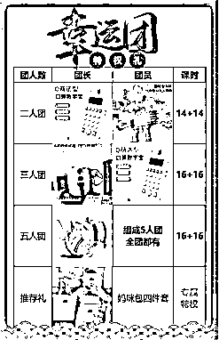

🏅 无

👍 #渠说渠话

# 文档收藏了很多碎片知识记录了很多，却无法

海绵践行

2022-09-23 12:48:01

文档收藏了很多  
碎片知识记录了很多，却无法形成自己的知识框架？  
不妨看看这篇，帮你建立自己的知识体系  
研究产出：如何通过 INKP 理论建立知识体系  
[`k3vtw0va9w.feishu.cn/docx/doxcnar11TBHh4IB...`](https://k3vtw0va9w.feishu.cn/docx/doxcnar11TBHh4IBljfMTFB2Oph)  
#藏书楼 

🏅 无

👍 书情，海绵践行

# #生财周报# 220923 懒人专属群周报

书情

2022-09-23 12:23:10

#生财周报#  
220923 懒人专属群周报 

🏅 无

👍 无

# 月入 2w 的虚拟开店项目，保姆级教程送给大

海绵践行

2022-09-22 21:04:54

月入 2w 的虚拟开店项目，保姆级教程送给大家，适合所有人  
  
  
程哥（虚拟类目）  
首次公开分享，淘宝虚拟类目相关知识点，以及网盘类产品自动发货玩法，适合所有新手小白。有哪里不明白的可以问我。  
  
绝大多数人脑袋里面跳出来几个虚拟产品，就以为是全部了，而实际情况是，这仅仅只是一小部分。没有了解过虚拟产品的人，脑袋里面蹦出出来的几个，都可以抛弃掉，因为你能想到的品 ，别人也在做 ，肯定也不挣钱，一片红海  
文章有点长，大家点击飞书文档观看：  
[`zlxx3x51a9.feishu.cn/docx/DwjidNhTioCgybxo...`](https://zlxx3x51a9.feishu.cn/docx/DwjidNhTioCgybxokemcabsSnzL)  
#赚钱创业方法论# 

🏅 无

👍 #渠说渠话，书情

# 《我是如何利用航海完成阶段性成长并变现 1

海绵践行

2022-09-21 12:58:15

《我是如何利用航海完成阶段性成长并变现 10W+的》  
  
哈喽，大家好，我是斜杠青年陈少，一个普普通通的互联网小白。很幸运能够遇上生财，这一年收获颇多，无论是能力还是认知上。  
  
在小红书，抖音，视频号也陆续有了个人 IP 号，累计发布个人 IP 视频 100+条。承蒙幸运女神眷顾,视频号带货中有了变现 10W+的小成绩，同样也是一个普通人的小确幸吧。  
  
本篇是我利用生财航海完成阶段性成长，第一次通过短视频带货方式，引流变现的实践经历。想和大家分享一下自己的收获和感受，以及心态上的变化。  
  
文章比较长，且包含图片，详细内容请点击飞书文档链接：[`yf1dojl97f.feishu.cn/docx/doxcn2t0dWSY8Tco...`](https://yf1dojl97f.feishu.cn/docx/doxcn2t0dWSY8TcoUkWZmxi5VnQ)  
#视频号 

🏅 无

👍 海绵践行，书情，#渠说渠话

# #轻享# #知识付费# 大家好，我是熊孩

海绵践行

2022-09-20 21:20:15

#轻享# #知识付费#  
大家好，我是熊孩子不差！一位研究思维导图 3 年的职场宝妈~  
  
经过 3 次副业失败探索，最终通过思维导图训练营变现 4W+，以下是我的分享大纲，全文共 9000+字  
  
一、我是如何找到我的定位的？  
二、我是如何进行微信新号运营搭建的？  
三、我是如何做产品设计的？  
四、我是如何做交付的？  
五、我是如何规划我的未来的？  
六、我要感谢的人  
  
正文移步飞书：[`j2az1iavo9.feishu.cn/docx/doxcnvn3GzZDIvyn...`](https://j2az1iavo9.feishu.cn/docx/doxcnvn3GzZDIvyndsaZMdOTT0c?from=from_copylink) 

🏅 无

👍 #渠说渠话，书情

# #抖音# 《某音批量下载高清无水印工具 v

海绵践行

2022-09-20 20:41:18

#抖音#  
《某音批量下载高清无水印工具 v2.0 - 永久免费》  
  
因为有很多小伙伴对这个工具比较喜爱，所以花了一周的时间重构了一个版本。  
  
本次特色功能：  
【减少软件大小】 干掉不需要的功能和插件，更简洁。  
【默认高清视频】默认下载 1080p 分辨率的视频 “注：原视频是 1080p 才是真的 1080p，否则还是按原有分辨率下载”  
【下载作者所有视频】爬取作者页所有视频，自动分页。“注：抖音偶尔抽风，可能爬取不全。”  
[`lyrz1vdb4n.feishu.cn/docx/doxcn4HS6LC2R6OX...`](https://lyrz1vdb4n.feishu.cn/docx/doxcn4HS6LC2R6OXsc4V93385ee) 

🏅 无

👍 #渠说渠话，书情

# #轻享# by:刘杰如果你工资涨五倍，从

海绵践行

2022-09-20 20:30:48

#轻享#  
by:刘杰  
如果你工资涨五倍，从业务岗单打独斗到管理岗管理一个部门，你会很开心吗？  
  
我公司有这么一个小伙子，暂且称他为小 Q，他因为升职加薪，emo 了。  
你肯定好奇是为什么，明明是好事，为啥他不开心，那你得听听他的故事。  
  
  
  
小 Q 在云嘉成立一周的时候来的，来之前他几乎没有任何工作经验，唯一的一份工作是工地的水电工。我跟他相识缘起知乎，他那会兜里估计一千块都掏不出来，但是就“敢”加我，跟我胡吹乱侃，聊商业、聊人性、聊人生。我看他朋友圈的是他各地游玩的记录，他写的文字有小时候看课本读散文的感觉，加上他告诉我大学肄业，一个人穷游东南亚，环游中国，他让我印象深刻了。  
  
那会我刚想成立这家公司，我就问他，愿不愿意来我这工作，但是工资不会太高，是否增长全凭本事，他同意了。然后他一个人一个行李箱，从他的城市来到了杭州，和我那会一样，没有认识的人。  
  
在云嘉过去的四百五十多天里，他只休了不到十五天，每天工作十四个小时以上，从客服、交付、招商，公司的每个岗位他都做过。  
  
做客服的时候，他可以凌晨三点听到电话，立马爬起来为了成交，为了不流失订单，他在公司通了不知道几个宵；  
做交付的时候，他能够跟加盟商聊一个小时，聊业务，做答疑，甚至唠家常。大家都很喜欢他；  
  
做招商的时候，他可以克服镜头恐惧，连续直播两小时，哪怕播到后来直播间没几个人了，最后拿到了销冠；  
仅从文字上来看，好像没什么，但是别忽略大前提，他从未在一家互联网公司上过班，要完成这些事情，不仅是身体的努力，还要自学所有业务技能。  
上个月，公司搬到了一个更大的场地，招了十来号人，重新划分了组织架构，分部门运营。他也顺利成章成为了一个部门的负责人，管理了好几号人。在大多数人看来，这是一件好事，算是熬出了点成绩，但是他 emo 了。整个人从里到外的不安、焦虑、郁闷，很多人不理解为什么，但是我明白，因为我也经历过。  
过去了两周，因为他不善于管理，三个新员工来了就走了。有人跟我说，他不适合坐这个位置，他还是只能做一个员工，做业务。我觉得不是，他只是有一道别人不能帮他迈过去的坎，需要他自己克服。  
  
我怕他自己熬不过去，我就找他聊了聊，我说：你知道问题出在哪儿了吗？  
  
他说：内耗，内耗的原因是，我总觉得自己不行，我管不了别人。新来的人都很强，他们都有很好的履历，丰富的工作经验，我怕我给不了他们什么。我宁愿糟蹋自己，我也不想误导别人。  
我：你觉得一家公司，懂技术重要，还是懂业务？ 他:(后者)  
  
我：你觉得我们招人，是应该招强的还是比我们弱的？ 他：（前者）  
  
我：你觉得刘强东打包快递有快递小哥快吗？雷军搞算法有他的工程师厉害吗？左晖卖房子也不一定卖的过他的销售吧？  
  
我：你在经历的这些我都能理解，我都经历过，我也曾在招优秀的人和管他们之间矛盾。我能理解这种骨子里的自卑带来的，心理内耗。我用了很长的时间去消化这些事情，但是我后来想清楚了一件事，没有任何人比我更清楚，这家公司在做什么，要做什么。业务一定比技术重要，技术是辅助业务的。我们招厉害的人，就是为了帮助我完成那些我完成不了的事情。  
首先一定要承认的事情是：  
1、我确实不够强，我要学的东西还很多  
2、我需要很强的人，他们可以帮我完成我想完成的事情  
3、我一定是最懂业务的那个人，我有清晰且笃定的目标  
可能曾经的我和现在的他都走入了一个误区，管理者和老师之间有区别。老师是教人育人，传递知识；管理者是识人用人，将正确的人放在正确的位置。我们招人的前提是，现在需要有 XX 技能的人，所以挂了招聘简章，将合适的人筛选进来，告诉 ta 我们在做什么，业务是什么，然后让他使用他的技能将业务做更好，这是我理解的管理者的意义。  
其实这都是很浅显的道理，我想他应该懂，还没迈过去的原因是他太在乎别人的看法了，且总是忽视自己的优点，拿自己的短处和别人的长处比，渴望获得重视，因为会希望事情都是由自己完成，所以事无巨细大包大揽。好的管理者要学会放权，释放员工的创造力和天性，我们选择了他们入职，就应该相信自己的选择。  
我在一本书上看过，所有优秀的创业者一定不是可以靠学习得来的，都是干出来的，没有天生的创业者和管理者。  
  
  
写这篇文章的意义是希望他能够早日克服自己，也是想借着我和他的经历，给正在创业或职场面临升职的人一些建议。  
  
这个世界一定有比我们强的人，认清自己的不足，直面自卑（每个人都有自卑），树立一个清晰地目标，然后调用所有能够为实现目标有用的人和资源，自我实现不是向上攀爬的意义，只有目标才是。 

🏅 无

👍 书情

# #抖音# 《抖音引流 Tips 合集：鱼钩思

海绵践行

2022-09-20 08:54:27

#抖音#  
《抖音引流 Tips 合集：鱼钩思维+企业号专属引流方式+常见误区》  
[`ro14u4yq4i.feishu.cn/docs/doccnRWZ54zEZQ7i...`](https://ro14u4yq4i.feishu.cn/docs/doccnRWZ54zEZQ7i4dHYsgmAVbe) 

🏅 无

👍 #渠说渠话，书情

# #生财周报#

书情

2022-09-19 14:02:07

#生财周报# 

🏅 无

👍 海绵践行，#渠说渠话

# 大家好，我是思蒙。这两天【羊了个羊】频频

海绵践行

2022-09-19 09:16:33

大家好，我是思蒙。这两天【羊了个羊】频频登上各大平台热搜。  
  
相信各位圈友也都看到了，这期间，有从各个角度分享“养了个羊”的：  
  
比如，  
它是怎么火起来的？  
到底能不能通关？  
怎么“操纵”人性的？  
或者说是“抄袭”的……  
  
这些都和我这种普通人关系不大，我想说一个和咱们利益最大的点。  
  
从“羊了个羊”爆火，作为普通人，能学到什么？  
#流量挖掘  
[`o0tqwvct3e.feishu.cn/docx/doxcnoKlQ1TEsQMk...`](https://o0tqwvct3e.feishu.cn/docx/doxcnoKlQ1TEsQMka2ISCB0kEe6) 

🏅 无

👍 #渠说渠话，书情

# 《五步创作法之深度解析带货类短视频爆款方

海绵践行

2022-09-18 23:45:57

《五步创作法之深度解析带货类短视频爆款方法论！》  
  
今天这篇文章和大家聊一下，五步创作方法论之抖音带货类爆款素材方法论，里面穿插了视频案例，为了方便阅读，大家移步飞书阅读，希望对大家有帮助。  
  
[`c0fyrrv8e0.feishu.cn/docx/doxcn7jtfovuqxDm...`](https://c0fyrrv8e0.feishu.cn/docx/doxcn7jtfovuqxDm83Qo83kHULo?from=from_copylink)  
#抖音 

🏅 无

👍 #渠说渠话，书情

# 《逛遍 8 个平台，翻了 20+热点精华帖，写

海绵践行

2022-09-17 09:49:33

《逛遍 8 个平台，翻了 20+热点精华帖，写下这篇【保姆级+论文级】的【羊了个羊】商拆文！妈妈再也不担心我不会追热点了！》  
  
爆肝 12 小时，全文共 6700+字！  
  
图解较多，建议电脑端观看，目录如下：  
  
零、前言  
一、发展史梳理  
二、幕后团队揭露  
三、【羊了个羊】8 个平台的玩法  
四、历史热点项目玩法回顾  
五、热点项目玩法总结  
六、普通人如何及时发现并蹭上热点？  
七、尾言碎碎念  
  
正文内容移步飞书：[`mkfwp3u79v.feishu.cn/docx/doxcnNXo75lLjU7K...`](https://mkfwp3u79v.feishu.cn/docx/doxcnNXo75lLjU7KBg9Ie46mp5b) 

🏅 无

👍 #渠说渠话，书情

书情：学习了

# 商业分析案例库 330 问说透羊了个羊的商业

海绵践行

2022-09-17 09:41:11

商业分析案例库 330 问说透羊了个羊的商业与合规。  
by：丁洁律师团队  
大家好，好久未发帖，球球姐躺平一个夏天，正式回归了~  
  
今天从曹大群里看到大家热议羊了个羊，既有商业分析，又有合规探讨，借此机会，我们来自己洗自己的稿，汇总过去在生财发的几十篇文章，结合实战案例，聊聊羊了个羊背后，创业者如何最大化创业项目，兼顾创业增效与合规。  
  
文章很长，附图 1、2、3 是目录。我建议，感兴趣商业化板块的朋友，直接看 1、3。  
为什么花大量篇幅聊 2 的知识产权，因为羊了个羊的知产未做规划，其实也减损了公司估值，是为一个损失，特此提出，强化读者记忆。当然这部分确实枯燥。  
  
对了，如果你还有感兴趣的部分，欢迎留言，我会延展探讨的范围。争取为大家赋能。  
  
  
【腾讯文档】创业案例库 9：30 问说透羊了个羊游戏的商业与合规 20220916  
[创业案例库 9：30 问说透羊了个羊游戏的商业与合规 20220916](https://docs.qq.com/doc/DSnloUHVrd3lpREh3)  
  
欢迎各位点赞、评论，我们继续上干货。  
#轻享# 

🏅 无

👍 书情

# 手把手教你打造一个【红包封面】自动售卖系

海绵践行

2022-09-16 06:36:14

手把手教你打造一个【红包封面】自动售卖系统  
[`ro14u4yq4i.feishu.cn/docs/doccnIvnvDmMHVTk...`](https://ro14u4yq4i.feishu.cn/docs/doccnIvnvDmMHVTkjD7pSZcr6Ne)  
郭晓文的保姆级教程，今天再次看到  
推荐理由：  
涵盖了太多太多的技能点  
1.公众号申请，文章发布技巧  
2.微店开店步骤  
3.微店分销（全店分销他人的商品）  
4.视频混剪技巧，爆款视频批量制作技巧  
5.引流技巧 

🏅 无

👍 #渠说渠话，书情

# #知识付费# by：白杨 SEO 一天时间，

海绵践行

2022-09-15 21:56:54

#知识付费#  
by：白杨 SEO  
一天时间，全网 SEO 可参考案例库从 0-150+订阅，明天可能会到 200，第一阶段目标 500，跟着前面@IDO 老徐 的小红书和徐宿的知乎开干，哈哈哈。  
  
睡不着，熬夜简单来分享下，最近三天在做的案例库几点心得吧。恰好 7 号晚邀请了老徐直接连麦一个多小时。  
  
我这个算是踩在他们前人的路上吧，简单分享一下哪些可以参考的，哪些不能参考的。订阅最新数据如图 1.  
  
可参考的点：  
  
1、在有星球情况下为什么想到还有要做这个案例库？  
  
答：之所以要做这个案例库是因为有三个原因：  
A、因为之前看到有个每日运营星球案例库，之前续费过两年，案例库应该是用户需求的；  
B、看到老徐的小红书案例库，以及徐宿的知乎案例库，我在考虑我是不是也可以做个 SEO 案例库？  
C、其实是最重要的，因为我自己没有低于 100 元以下的产品，你理解是引流品也行，但我更认为是引流+商业品结合，我想把这部分用户先吸引过来。今天还有人特意来问我，为什么不免费整理 SEO 案例？我回复说，个人精力有限，再者付费其实就是一个最基础的筛选，对吧？  
  
2、关于小册定位、命名、定价、数量、佣金、推广渠道的思考  
  
答：关于小册定位，说实话，我是参考了小红书和知乎的，但我看完，发现知乎的更适合我，所以参考徐宿的比较多，看下面图 2.这就是抄作业哈。当然，定位这里我原计划是 SEO 案例，但 SEO 大家都以为是百度 SEO，所以我加了全网 SEO，不只限于百度了，人群一下子大了是不是？  
  
同时，他们都是可复制案例库，SEO 这个其实因素很多，所以我把【可复制】改为【可参考】，这样的话，这个案例只是参考，降低了一些心理预期是不是？所以名字是【全网 SEO 可参考案例库】  
  
关于定价，今晚连麦才知道老徐开始定的 36，我当时在犹豫 49 会不会高，有想过 39，后面想到这个还是 49 起步好了。今晚跟老徐聊定价，其实也有讲究，我一点也不专业，但我知道我这 49 肯定值。  
  
关于数量，我看老徐 200 个，徐宿 101 一个，我本来想着定 88 个好听。但其实，在找了几个发现，这个 SEO 找和写所花时间不低，最终确定为 66 个，同时加了三个字【不低于】懂得人懂。  
  
关于佣金，我这里有点小心机，他们都是设置 35%，今晚直播聊才知道 35%怎么来的，而且已经不低了。我想想我没他们粉丝多，所以把佣金直接调到 40%，如图 3.这里可能要跟前面两位说下对不起，要是别人看到同样分享，会不会觉得我这个佣金更高点，真不好意思。  
  
关于推广渠道，其实这个对于没有积累可能不好参考。因为不说冷启动，我个人微信好友 5 个加起来有近 2.5W 人（虽然 80%）其实交流并不多，而且我朋友圈也不太会运营。我有一个 2.6W 的垂直 SEO 公众号，有几百人的 SEO 付费社群，所以 0-1 我的问题不大。  
  
其实偷偷说，我推荐老徐小红书，对于我来说举手之劳，后面老徐也在他星球给我推荐了一下（老徐说，看我冷启动几个小时都 50+了，所以看来可能是真有需要，所以帮忙推了）  
  
3、这个案例冷启动我是怎么做的？  
上面有说到佣金，其实在开始之前我在群里做了一个预告，调动了大家兴趣。同时，在正式推之前，找了五个比较有代表的案例，然后在群里说，保证昨天完成 10 个，最后熬夜到 12 点半完成了 10 个。  
所以在我一开始的时候，社群里面前 10 个订阅是来自群友，因为他们信任我，有买了朋友就分享了。其实我那时还没有分享朋友圈。  
  
这里再偷偷说个实测，晚上 11 点后发朋友圈效果很多，所以在 11 点的时候，案例也差不多了，我就发了朋友圈，这个时候开始多了起来，朋友+我朋友圈应该完成了 50+个，后续老徐的推荐应该有十几个，现在应该超过 20 以上。我今天写公众号文章感谢除了老徐，还有本星球的@生财王子 等朋友帮忙推荐。  
  
4、目前订阅数据大致分类：  
目前大致分为三类吧  
1、社群，大约五分之一。  
2、公众号，今天才推，可能八分之一。  
3、朋友圈（自己+别人）三分之一。可能不止，因为还有朋友的朋友圈分享等。  
4、星球（自己+别人）四分之一  
  
其实，我除了上面这些，这些渠道，老徐说他还有网站和极客，我其实也有网站，因为才更过去。同时我还有 20+各自媒体渠道，明天再看数据。  
  
不可参考的点：  
  
1、行业积累：这点我和老徐观点一致。如果你不是在这个垂直行业有一定积累，真正的普通从 0-1 的话，这个就不是定价或者产品的问题，最重要就是信任度问题。所以生财圈友有要做案例库的，在自己垂直行业有一定积累的更好。  
  
2、基础粉丝资源：这个非常重要，0-1 的启动很重要。所以这点告诉大家，不管你是做个人 IP，还是分享文章，一定要积累基础粉丝资源，可以是公众号，也可以是个人微信。老徐有 10000 人免费星球，我也有个近 3000 人免费星球，哈哈哈。  
  
3、信任度：这个也是非常重要。什么是信任度，就是人家对你的信任。举个简单例子，比如生财里涛哥，明白，大家都会很信任。为什么？除了他们分享多文章以外，更重要是他们不管是在这里还是线下都愿意帮助人，当然生财里还有很多其它大佬，我就不一一提到了。拿我自己来说，就算我不做这个 SEO 案例库，我只分销小红书，知乎，两个加起来可能就能分销 50+，当然跟涛哥起步都是 200+不可比哈哈哈。  
  
OK，从 2 点开始写，马上到 3 点了。我呢，就如我之前写的文章一样，我不太会赚钱，你说这一天多收入 5000+也算的，那就算吧。其实懂得人都懂，这个产品是引流+商业化尝试，目前通过这个也有人进群了，后续可能考虑看我的实战训练营课等等。  
  
9.8 日下午补充：昨晚分享这内容，在朋友圈或者社群分享有一个最重要可能写漏了那就是【都会在最后加一句，有需要可购买，不满意三天内可申请退款】如尾图。其实这个策略叫无风险购买，也是才学会的  
，现在刚好达到 200 份了，总共 2 位朋友退款。1%退款率，说明这个应该还是有价值的。后续有更多进展我会持续更新。  
  
我喜欢研究流量，去研究各种玩法实践，我其实之前分享过蛮多文章，如果你也想看看，直接#白杨 SEO 说# 点我标签就可以了，从三期跟到六期老会员，以前文章很多很多哈。  
  
PS：我们做 SEO 圈的人很多人思维固定，如最后图。我以前也换这样的错。就是总以为实物东西才叫产品，这种虚拟都不算。现在我会说，这个小案例库本身就是一个产品。  
  
以上，如果简单的分享对你一点点启发，可以点个赞。有任何相关问题都可以在此评论留言我。我是白杨 SEO，一个自称的全网 SEO 流量实战派。晚安，生财圈友们。 

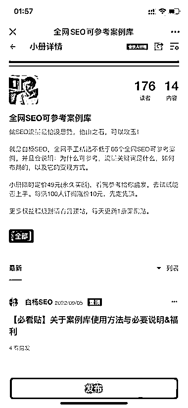

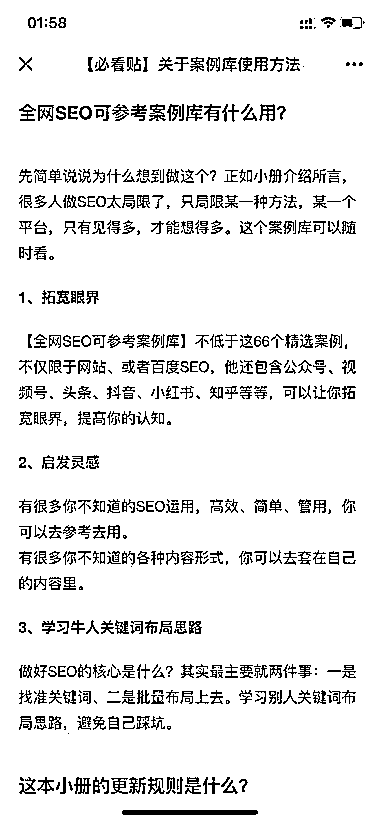

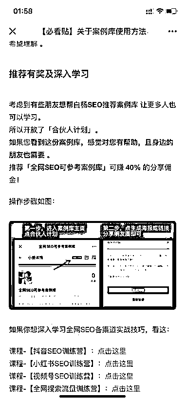

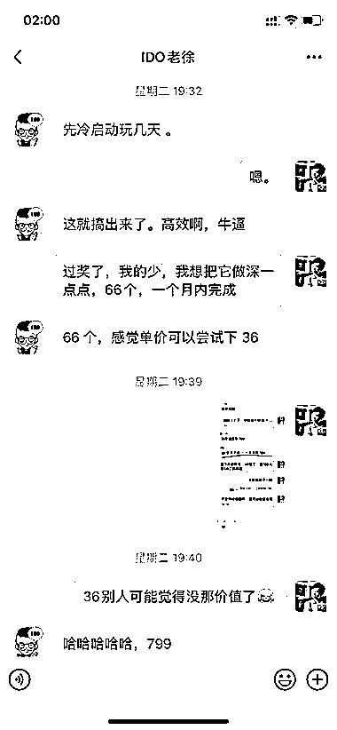

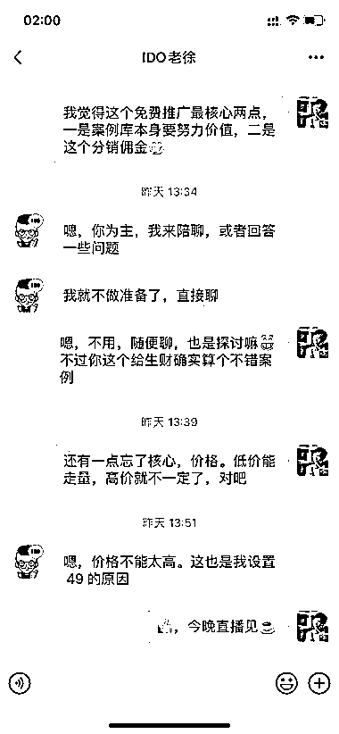

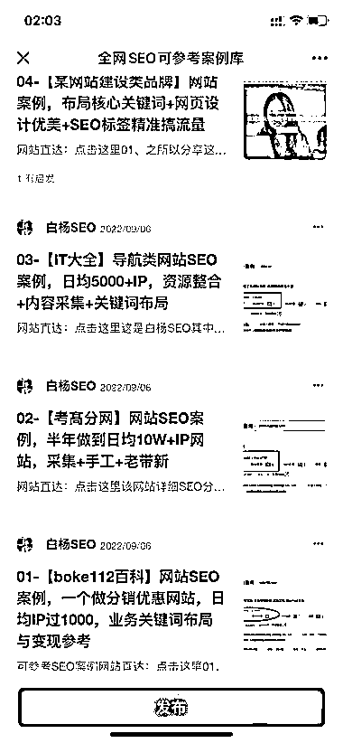

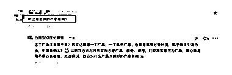

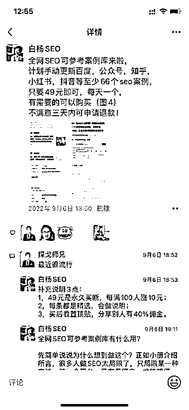

🏅 无

👍 书情

书情：还是得有实力啊，我就做不来，哈哈😃，慢慢来吧

# #小红书# 《我一个互联网小白，是如何做

海绵践行

2022-09-15 21:05:04

#小红书#  
《我一个互联网小白，是如何做到小红书发布 18 篇笔记涨粉 8300+，还篇篇都是爆款 》  
  
——这是一套适合小红书新人的爆款方法论  
全文 4241 字  
  
大家好，我是大鱼，一个小红书新人。喜欢与同行的小伙伴一起复盘总结做事的底层规律和底层逻辑，热衷于本质的探索，喜欢用已知事物推导未知事物。  
  
以下是我从 0 到 1 做小红书的成绩。  
累计发布 18 篇笔记 | 累计 50 W 阅读  
粉丝 8300+ | 点赞与收藏 7.6W  
笔记点击率≈15%  
  
我初次做小红书，能获得一点小成绩，要感谢生财和玩赚 ，感谢玩赚的 21 天的小红书行动营，学到太多思路、方法，也得到很多朋友的鼓励和建议。  
  
今天我来复盘一下做小红书的全过程，希望能对大家有一点启发或帮助。  
  
为了更好的阅读体验，请前往链接：[我一个互联网小白，是如何做到 18 篇笔记涨粉 8300+，还篇篇都是爆款 【生财】](https://docs.qq.com/doc/DRUJoWVNKcHlVYnpY) 

🏅 无

👍 #渠说渠话，书情

# #游戏小说 cps# 关于小说推文渠道，你

海绵践行

2022-09-15 20:50:41

#游戏小说 cps#  
关于小说推文渠道，你不知道的那些事儿！！！  
  
做了快两个月的知乎推文，能够确定的事情有几件，如果你也正在操作，我们交流交流。  
一、知乎推文到底能不能不参加培训？  
二、如果让你自己找渠道应该怎么办？  
三、这事儿长期干能不能扩大，扩大到什么程度？  
四、学生开学对流量的影响还大么？  
五、如何做出与其他人不同的差异化？  
飞书链接：  
[`od2a74mdbc.feishu.cn/docs/doccnDDGnqpUXqQw...`](https://od2a74mdbc.feishu.cn/docs/doccnDDGnqpUXqQwcTnfgOGLWue) 

🏅 无

👍 #渠说渠话，书情

# #抖音# 普通人通过抖音直播大航海做到单

海绵践行

2022-09-15 20:49:41

#抖音#  
普通人通过抖音直播大航海做到单日 3W GMV 我做了什么  
  
 前言  
 本文没有任何水分非常适合新入局玩家以及困扰在低流量直播间的玩家 所有都是本人亲自在一线踩坑以及非常实用的干货实操经验  
  
当然 抖音直播大航海 我就不多介绍了 大部分都是总结 大家可以自行去 生财查看  
  
  
建议大家移步飞书 观看体验更加 包含了 很多直播底层原理 文字排版不是很好 但是字字都是 自己血泪经验  
  
真心要做直播的 刚刚入局的 还有要懂人性底层原理的 一定要去飞书一字一字看 ！！！！非常实用 非常实用 非常实用 希望大家有疑问 意见啥的 可以评论区见  
  
[`pztfevwui7.feishu.cn/docx/doxcn9Kirotl7xwd...`](https://pztfevwui7.feishu.cn/docx/doxcn9Kirotl7xwdQFUaKamnwde) 飞书链接 

🏅 无

👍 #渠说渠话，书情

# #视频号# 如何在短视频赚钱赛道上，找到

海绵践行

2022-09-15 20:36:52

#视频号#  
如何在短视频赚钱赛道上，找到自己擅长的玩法/类目？  
  
by: 文林  
2022 年 09 月 07 日 00:56  
大家好，我是文林。昨天在星球上分享了我的视频电商踩坑经验后，有圈友私聊问，那么怎么找到适合自己擅长的玩法和赚钱赛道？  
  
这是个好问题，我接着刚才的昨天分享的短视频赚钱的内容来聊，把我的一些想法发给大家，一起交流一下。  
  
如何找到适合自己的擅长的玩法和类目？  
  
1、从自己的经历来找自己的擅长！  
  
A、做商务出生的，在联系达人玩法这块，就比没有做过商务的人，优势大的多，见到身边好几个做商务的，切换赛道到短视频上，第一桶金就是通过达人 BD 合作赚到的。  
  
B、做投放出身的，在短视频投流上，就比没有做过投流的有优势，一个朋友做投放出身的，去年开始做短视频，现在夫妻两个人，通过投放占住了一个蓝海品，稳定后，夫妻两个人每个月赚差不多 20 个 W，绝大部分成交是投流来的。  
  
C、做淘客出身的，在选品这块就比没有做过的更有优势  
  
D、做过电商店铺的，比如淘宝、京东、拼多多的等传统电商，尤其是拿到结果的伙伴，那么在抖店、微信号小店、视频号小店、快手小店，就天然比别人有优势  
  
E、做过供应链的，那么就没有做过供应链的更有优势  
  
F、做过演讲的，在视频和直播表现里就比别人有优势  
  
G、做家长的，有孩子的圈友，在做育儿类账号，就天生比还没有小孩的伙伴天生有优势  
  
H、做过老师的，在知识付费这块就比很多人有优势  
  
I、做过代运营的，那么代运营业务就比别人更容易上手  
  
J、做过文案的，那么在视频脚本上、直播脚本上，就比别人有优势  
  
K、做过技术的，那么在批量用技术手段来批量生产视频和工具，就比别人有优势。  
  
等等等，这些优势就是一种竞争力，也是擅长点之一，大家想想自己做过哪些，身上有哪些标签，以及过往那个职业生涯中，哪些事做的更容易上手，从自己的经历中提取出来优势，这些优势就是咱们的擅长点之一。  
  
2、从出生地和现在居住地来找到优势。  
  
A、货源优势：  
比如在深圳，那么电子产品，电子配件就有极大的优势，因为离华强北和工厂近。比如广州：广州的女装货源和供应链，比如义乌：义乌小商品，比如我老家汕头：玩具供应链优势，比如大家各自的家乡的土特产。一个圈友在新疆，一堆土特产，这是天然的优势。  
  
B、当地人群的需求把握：  
像群友 again 说：如果是在农村，对于一些农村居住过才会懂的需求和品类会有天生的敏感性，比如夜晚的探照灯、因为农村晚上很多时候没路灯的。  
  
农村探照灯这个，可以多聊一个品，大家可能看到很多人说多功能手电筒这个品，但其实有些品被忽略了。多功能手电筒这个是拿在手里的，但是对于农村来说，有很多人拿着不方便，在农村有个品：是戴在头上的探照灯——头灯。  
  
像我，我是潮汕人，那么我就懂潮汕人的喜好，比如水果上：橄榄、油柑等、青菜上：麻叶，食物上：菜脯（萝卜干）、海鲜等。晚上田野里捕捉田鸡、鱼塘晚上捕鱼、夜钓等等，同样是照明需求，但是应用场景不一样，就会有一些品漏出来。  
  
橄榄油柑，已经有一些潮汕老乡在抖音上赚了不少，其中一个估计赚大几百万，上千万。  
  
我在拆解案例时，有拆解到一个赚钱玩法，就是把一些竞争大的类目+加上地方方言，避开大众的普通话竞争，用家乡话来卖货出单，也是一种聪明的方法，避开了红海竞争，但是又能吃到大类目的一部分蛋糕。  
  
3、从其他赛道找优势：  
  
在短视频赚钱这个赛道上，如果大家不擅长视频电商的话，那还有技术路线，比如群里有位伙伴在大家都靠视频号出单时，他直接做工具来赚钱，还有知识付费、小游戏、小说、实体店团购业务、代运营业务，引流卖粉业务、同城引流业务、未来还有外卖分销业务。  
  
以上，希望对各位有所启发。 

🏅 无

👍 书情

# #轻享# 这段时间 分享几个对项目的感悟

海绵践行

2022-09-15 20:35:20

#轻享#  
  
这段时间 分享几个对项目的感悟  
  
1 抖音 单纯的 ip 是没啥作用的，尤其商业 ip ，这种的打法，随着热度下滑 死的可能性很大 比如透透糖  
  
2 业务型的 ip 反而是可以继续放大的，抖音本身能做你做起来就 3 个点  
1 钱 2 时间 3 认知含量 都具备 不可能做不起来 ，如果是业务 ip 必然赋能你原来的产业  
  
  
3 视频号 整体的量还是很小 ，投放钱花不出去，年龄群体 偏大，但是客单价高一些  
并且停留时长比较长,目前的带货，10w+一天的已经出现正常的  
  
  
4 微信赛道=== 不管是微信直营 还是社群淘客 还是团购等等，核心本质是流量的复利使用，简单的说就是在次使用流量，免费了，赚的是生省下来的营销费用  
  
  
从这个点来说，得流量者得天下，当然如果流量又又留存 又能复利使用 那就是无敌的模式 至于卖什么，这个就是供应链体系 和运营体系  
  
最近有个让我比较吃惊的事情，前端卖的是瑜伽垫，居然卖瑜伽的虚拟课程 客单价可以干到 6000，只能说明一个问题，陪伴粉丝+强 ip 输出，在时间的加持下，会产出很牛逼的高客单  
  
5 拓宽赛道本着 2 个原则 1 老客户新业务，要不就是在老客户的基础上建立信业务，至少流量端口是有了  
2 老业务 新客户 这种往往是大部分采用的，同样的业务 模式，找更多流量来承接  
  
新客户新业务 也就说换了赛道了，这个时候要考虑的维度 是成功率，和天花板，比如我在原赛道一天 3w，我想实现一天 10w，我是在原赛道加持 容易实现 还是破釜沉舟做新赛道，这个成功率要衡量  
  
  
6 流量的玩法 我犯了最大的错误是一个玩法没有用到最大，不用想太多的流量玩法，一个就够了，只需要复制复制 在复制  
  
  
所有的规模化，其实都是一个逻辑，就是，找到一个最简单的，最固定的，可以无限重复的点，无限重复下去  
  
  
  
7 任何项目 都是有窗口期的 ，看好时机 要饱和攻击，而不是慢慢悠悠的，大锤子论起来，累了歇会，在抡起来，而不是小锤子慢慢的 ，  
  
  
机不可失失不再来，窗口期间必须饱和攻击，计算好成本，一旦过了临界点，江山已定  
  
  
8 如果要做项目，第一曲线一定要做好，如果因为第一曲线做不好，然后忙着说我要做第二曲线，这没有意义，往往失败是失败之母。 这个是大部分犯的错误 包括我自己  
  
9 市场供应大于需求，流量方话语权大，市场供应小于需求，产品方强势 所以你看看一下你是什么类型的 ，品牌的就做大，流量的就是做打流量，大部分人是流量型公司，所以老板 多做流量才是最核心的  
  
微信淘客和微信直营的区别，一个做流量，一个做产品 淘客的本质是做流量 直营的本质是做产品  
  
  
10 每个人都有自己的关注圈子和影响圈子，影响圈子才是我们真正的要做到 事情，但是大部分时间被关注的各种事情消耗掉了  
  
  
专注是 20%的技能之一，在我们的生活中，它给我们带来了 80%的成果。它允许我们在一年内完成其他人可能需要十年的事情  
  
  
  
做点持久的事情，构建系统，确保人钱物循环发展， 盈利来自用户，确保用户利益，用他人完成用作，确保人才体系，超出用户的期望值，给与用户超出期望的价值 ，循环起来，必将无敌 

🏅 无

👍 无

书情：得流量者得天下深感认同😄

# #小红书# 《如何用 2.8 元在小红书批量

海绵践行

2022-09-15 08:22:56

#小红书#  
《如何用 2.8 元在小红书批量化生产内容，每天引流 150+人的》  
这篇值得好好看看，结合上一篇  
[`vub1ul9ufi.feishu.cn/docx/doxcns7Xp3mMH18z...`](https://vub1ul9ufi.feishu.cn/docx/doxcns7Xp3mMH18zeHiGsavXBRf) 

🏅 无

👍 书情

# #轻享# 这个人的文章很有意思，在生财只

海绵践行

2022-09-15 08:20:51

#轻享#  
这个人的文章很有意思，在生财只发了 6 篇帖子，其中 3 篇都被亦仁加了精华  
by:跨境杨少  
2022 年 09 月 05 日 10:34  
  
  
提纲  
  
0.少花钱少费劲就是赚，走捷径很光荣  
1.择校是拥抱竞争还是规避竞争  
2.中心城市 211/985 优录大数据里隐藏的蓝海  
3.盲目发展特长是铺货思维  
4.三力合一，没有竞争  
5.学校传统优势项目在官方竞赛中的获奖优势  
6.挑选蓝海竞赛项目  
7.补救：还有什么后发捷径  
  
  
正文  
  
大家好，我是跨境杨少，12 年跨境电商老卖家，独创《选品四层方法论》，跨行业多项目连续创业者，90%以上的项目年变现百万级别，因为我是蓝海偏执狂。  
  
上一个听我当面讲完育儿《[三力合一](https://wx.zsxq.com/mweb/views/weread/search.html?keyword=三力合一)》理论的，是一个自己就是学霸的妈妈，听完后她说以后要和我多吃吃饭，我说算了我老婆会介意。  
  
一般提纲都是从“1.”开始，这次我从“0.”开始，得了蓝海病就是这样的，but I like it。  
  
理论是我独创的，我个人也是这个理论的受益者和成功案例（成绩很一般但保送 985 热门专业），因缘际会获得的捷径，蓦然回首总结其中可复制的部分分享给大家。  
  
  
0.少花钱少费劲就是赚，走捷径很光荣  
  
  
这篇分享没有二级标题，也不会把关键词加粗，要看懂需要增强注意力，所有帮助你 focus and concentrate 的办法我都不会用，爱看不看，爱懂不懂。  
  
这篇文章也许会被我分享到一些赚钱社群财迷社群，不要以为跑偏了，育儿不成功，赚再多钱也会面临投资黑洞，掌握育儿和升学的捷径，可以省掉很多钱和时间精力，这就是赚，如果你是成功的老板，不会反驳这一点。  
  
很多老板基本上也都成家立业，彩旗红旗各种旗，多维度立体式成功，但如果在孩子的教育和升学上漠不关心，完全外包给老婆，那你的成功拼图就还是缺一块。  
  
过去几年我服务了 1200 多个老板，大部分是跨境电商卖家，我喜欢服务老板，因为他们有能力快速判断一个人是否专业，然后决定是否付费。时间长了，我对老板们的刚需就比较敏感，这篇文章试图解决老板们的育儿问题，交付质量一如既往，看完就明白。  
  
很多人生来就是通透的，却因后天教育而失去，然后用尽一生反求诸己。比如我自己就花了三十多年才抵抗掉不要虚荣，不要骄傲，不要走捷径等等毒药，千帆过尽，虚荣使我自驱，骄傲使我满足，捷径使我成功。  
  
合法走捷径是一种能力，是动脑子规避竞争，非常阳光非常值得提倡。我们的教育不能一边教孩子要爱动脑筋，一边又阻止他们独立思考。精神分裂。  
  
  
1.择校是拥抱竞争还是规避竞争  
  
  
不是在否定择校，也不是否定学区房的价值。这都是有一定经济实力才玩儿的起的东西，总体上有钱人的决策正确率和成功率肯定是高于平均水平的，不要拿个案来反驳，喜欢拿个案说事儿的人认知都是偏低的。不解释。  
  
我们讨论择校思路是否有进一步优化的空间。  
以及没能力买学区房的人，有没有什么另辟蹊径，兵出子午谷的办法。  
  
择校带有很浓的一元成功论的色彩，一元成功论下最终胜出的人，基本都是从烈度最高的竞争中脱颖而出的，比如科举，比如名校。其实就是挤独木桥，这肯定是在拥抱竞争，择校只是选择了个离独木桥近的区域，并没有解决不落水或者不被踩死的问题，也没解决把桥变宽的问题。  
  
每个人能承受的竞争烈度是不一样的，合适的才是好的，每一种竞争都会有胜出者，捷径就是挑选烈度不高的那一种竞争——本文讨论普通人普通孩子，天才孩子在顶级烈度里也不一定有啥竞争。很多孩子是不擅长学业竞争的，甚至抵触。主动降低竞争烈度，主动挑选竞争对手，做不对称（信息差）发展，会有意外收获。  
  
因此，有能力择校的普通孩子，不要太强求成绩，可以多注重特长。没能力择校的普通孩子，也不要觉得输在起跑线了，因为升学赛道不是一条简单直线，利用好资源，培养有功利价值的特长，是一条可以抵消择校优势的捷径。  
  
发展特长谁还不知道，但怎样选择特长才最容易出成绩，获得升学捷径，你研究过吗？  
  
  
2.中心城市 211/985 优录大数据里隐藏的蓝海  
  
  
升学也有大数据，但前提是你要有不对称的思路。  
  
这也是我平时选品课上经常说的，选品软件没有用，只有当你有自己独家的选品模式的时候，选品软件的大数据和辅助功能才有用。选品软件给你看那些大类目标品的中国卖家集中度什么的啦，有啥意义，真的跟你有关系吗？同样，那些名校的升学率数据，真的跟你有关系吗？  
  
很多人对大数据的理解，就仅限于当新闻看的层面。  
那么在升学中，功利性特长的升学大数据是怎样的，能否印证我们的选择，能否帮我们的选择调优呢。  
  
我以南京为例，南京的大学资源（211/985 数量）是仅次于北京上海的，在过往 20 年中，南京 211/985 高校的自主招生/优录/保送/提前录取的学生中，南京本地生源的占比达到 90%，在没有废除会考 7 优 2 良保送资格，教职工子女优录资格之前，这个占比更夸张。北京上海则还另多出一个本地生源高考分数线更低的优势，优录大数据也差不多。  
  
这个数据提示我们：中心城市 211/985 优录招生中，本地生源占据大部分名额，甚至达到 90%，而本地生源在高考录取比例上，永远不可能达到这个变态比例，因为在高考上本地与省内外其他考生是平等竞争的，没有特别明显的巨大的竞争优势。如果你身在中心城市，与其去鸡娃高考出人头地，不如保持成绩中上，外加一门对口优录项目的特长。孰难孰易，一目了然。  
  
蓝海思维就是规避竞争，选容易的。想要特长出成绩，并没有你想象的那么难，也有方法与捷径（本文第 3-7 节会详细分析），在我看来是低于高考得高分的难度的。  
  
这些特长主要分两个半类，两个类是体育竞赛和强基（奥赛）竞赛，还有半个是艺术生，之所以是半个，是因为艺术类院校是 211/985 的很少。另外还有一些 211 学校优势专业对口的竞赛，比如航模竞赛，虽然不是传统奥赛也不是强基计划项目，但是南航北航都是 211 名校。  
  
近几年体制内和国企招人有个潜规则，就是第一学历是 211 大学的，等价于海外排名前 200 的世界名校，在这个潜规则下，私营企业也开始对 211/985 名校生趋之若鹜。这又是一个非常有意义的大数据，因为 211 大学数量远多于 985，这提示我们普通家庭培养孩子上 211 的难度和性价比，是大大优于送出国上名校的，也优于 985。  
  
（ps.近十年留学归国就业的性价比（家庭在这个项目上的投资回报比）已经越来越差，差到可怕，未来在逆全球化的大势下，出国留学性价比会低到令人发指，非常富裕的家庭可以不 care。）  
  
  
3.盲目发展特长是铺货思维  
  
  
铺货，跟卖，追热点，这是跨境电商新手或者不专业的卖家常用的选品方式。  
铺货的底层逻辑是“碰”，撒大网守株待兔。追热点，跟卖的底层逻辑是“抄”，也并没有在动脑子。  
  
很多家长在培养孩子兴趣，选定发展什么特长上，差不多也是类似的状态。  
你要问他为啥给孩子学这个，回答基本上 1.孩子喜欢，2.被孩子朋友同学带着一起上的，3.自己看好但路在何方如何出头并不知道。  
  
普通孩子，喜欢的东西是经常变的，过分尊重孩子，帮他把感兴趣的都学了，或者不尊重孩子，把自己觉得好的都给孩子报了，跟铺货思维一样，本质上在“碰”。连“抄”都不如。  
  
区分跨境电商新手和是否专业的第 0 步，就是看有没有蓝海思维。  
给孩子选兴趣和特长也差不多。举个例子，我本人是计算机特长保送的 985，现在机器人培训编程培训很火，但我没有给孩子往这个方向发展，因为我当时学编程时，社会上一个培训班没有，知道的家长几乎没有，都是学校里挑数学还不错的，送到公办机构里免费学，因为当时邓小平有句话“学电脑要从娃娃抓起”，一层层往下落实，第一步被组织起来的都是体制内的力量，学费啊钱啥的先别谈，咱先把领导的话落实了再说。随便参加个官方竞赛，都是三等奖保底。海蓝的不行。  
  
说实话我当时对计算机也不是特别感兴趣，只是觉得新玩意儿，酷炫，有面子，虚荣。学的也不太好，基本上没有突破过三等奖（鼓励奖），对普通孩子而言，对一个东西感兴趣很简单，没那么多来自灵魂的判断与选择，家长完全可以通过话术帮助孩子爱上一个东西。  
  
所以家长要做的就是选择一个 1.蓝海特长项目，2.有长期功利性回报，3.有捷径或者资源整合优势，然后把谈恋爱时候哄女人的本事拿出来，哄孩子去学。  
  
接下来就讲具体怎么选择可以满足上面 3 点。  
  
  
4.三力合一，没有竞争  
  
  
讲一个本人亲身案例。  
上文说到我虽然从小发展计算机特长，但从小学开始竞赛成绩一直不好，没有对我的升学形成助力，并且当时由于父母追“热点”，我还同时在学画画，发展美术。  
初中进了一个名校，强手太多，校内的计算机班都没轮上我，初中三年这个特长发展甚至处于停滞状态。  
  
转折点在我中考失利，进入一个二流高中的时候。这个高中虽然二流，但是全校唯一的国家级特级老师，竟然是计算机老师，并且她还是信息学奥赛市集训队的老师。  
可惜这高中太二流，虽然这位老师很牛逼，但能代表学校一战的选手很少，老师没啥选择的余地，矮子里面拔将军，上场机会总轮得到我，当然开小灶辅导也少不了，于是高中三年我每年获得一次江苏省一等奖，最后获得保送资格上了东南大学（985）通信专业。当时我三次高考模拟考试的均分是 540，连一本都不能保证上。  
  
当我有了孩子，我意识到，个人兴趣/天赋是一方面，父母特长/家庭投入是一方面，所在学校的传统优势项目是第三个重要方面。  
择校择的究竟是什么，学区固然重要，学校是否有传统优势项目，以及这个项目是否适合你的孩子，你能不能利用上学校的传统优势，也很重要，甚至可以部分抵消学区房的作用。  
  
如果你调研一下另一个你从未关心过的大数据，你会豁然开朗。就是中心城市的大部分小学，中学，即使不是顶级学区好学区，几乎每个学校都有传统优势竞赛项目。一个有传统优势项目的学校，派出的选手为什么更容易得奖，下一节详细分析。  
  
再举一个例子，我目前就没有学区房，我孩子就近入学的是一家普通到每年招不满的小学，但这个小学有两个传统优势项目，武术和航模。他们的航模队获奖很多，由于建邺区没有初中搞航模项目，建邺区的一个名校的初中航模特长生也是来这个小学培训，追踪发现，有通过航模竞赛获奖而被南京航空航天大学（知名 211）录取的学生，就有来自这个小学的。  
  
进这个小学的航模队，就跟我进当时那个二流高中的计算机集训队一样简单。  
第二个例子，仍然来自这个差学区，这个学区就近入学的初中，也有一个传统优势项目，网球，获奖非常多，但这个项目我家孩子用不上。上文讲过，体育特长生一直是升学优录对象。  
  
多动一下脑子就少了好多竞争。  
所谓三力合一，就是学校力，家庭力，孩子个人力，的三力合一。如果能实现这个局面，你孩子未来几乎不面临什么大的竞争。  
  
具体步骤：  
1.孩子学龄前，有学区也好没学区也好，在自己尽可能的择校能力范围内，调研清楚每一个小学的传统优势项目。  
  
2.结合家庭/家族的特长或者传承，比如是科研世家还是文艺世家，去匹配相应优势项目的学校。父母双方都没有特长怎么办，有钱也可以，选定方向，有长期预算投入能力也可以。没有钱怎么办，坚定在这个项目上愿意投入长期时间也可以，聊胜于无，预则立不预则废。  
  
3.编织话术，营造氛围，连哄带骗，让孩子爱上这个项目，产生兴趣，主动学习。  
  
挑选优势，强化优势，培养优势，三力合一，没有竞争。  
  
  
5.学校传统优势项目在官方竞赛中的获奖优势  
  
  
毫无疑问，有传统竞赛优势项目的学校，在这个项目的培训资源和培训能力上，一定是顶级的，一般来说是校外的社会培训机构无法匹敌的。当然孩子是否主动学习，是否用心投入也很重要（本文不讨论这个）。  
  
培训资源和参赛经验是锦，锦上添花，“花”就是有些竞赛是靠评委打分的，这些竞赛往往传统优势学校的选手会有评分加成。因此更容易获奖。  
大部分父母没有参赛经验。所以没具体体会过。  
看过奥运会的人都知道，有些评委打分项目，受评委影响还是很大的。  
  
另外补充一点，在这里，我们只讨论有升学加成有升学功利的竞赛，一般这些竞赛的主办单位是体制内机构，比如教育局，体育局，各级科协等政府部门，这些部门举办的比赛，即使达不到保送名校一步登天的作用，但基本上都属于大学优录会被参考的比赛，即：有意义的比赛。目标既然定下，一切就谈功利。这一点也是很多家长没有经验。浪费时间在很多社会机构举办的竞赛上。  
  
举个例子，计算机相关竞赛，很多人只知道信息学奥林匹克竞赛，但是省科协也举办一些计算机竞赛，有些软件设计竞赛，多媒体设计竞赛，几乎跟编程无关，成绩主要靠评委打分，以我亲身参加过的一次设计竞赛获奖经验而言，不仅传统优势项目学校选手有评委加成，甚至地域也有加成，明明水平差不太多，地级市选手比不过省级市选手，评委打分确实偏低，除非特别优秀。我作为省级市又是传统优势学校选手的一手参赛经验就是，这确实是个获奖捷径。  
  
  
6.挑选蓝海竞赛项目  
  
  
很多家长喜欢给小孩搞数学奥赛辅导。太没有蓝海思维，选了个红的不能再红的红海项目。  
奥数是很多小孩从幼儿园就开始抢跑的。再者，数学本身对智商天赋还是明显有要求的，即：靠后天努力能获得的成绩加成很有限，有些孩子不行就是不行。  
  
竞赛项目其实现在已经非常多，第五部分已经提到，要多了解体制内官方机构都有那些比赛，这也是个大数据，主要思路就是选择比赛种类多的项目，竞争少的，要既有笔试的标准化评分的，也有靠评委的非完全标准化评分的。从这点看，奥数再次不满足，因为奥数主要就是做题，得分是完全精确量化的，没有模糊空间。极端反例就是艺术生竞赛，几乎非常难量化，因此还有很多人分析和追逐评委喜好。  
  
举个例子，我曾经得到的三个计算机省一等奖，其中有两个是评委打分竞赛，一个是多媒体软件设计，这个一等奖当时高考加 20 分，并享受 211 名校一本线优录自由挑选好专业；另一个是信息学奥赛互联网应用素质竞赛，这个比赛不考传统编程，主要是比做网站，得分完全靠评委，由于属于信息学奥赛的大类别，升学优势非常巨大。这就是个典型的隐藏在看似红海竞赛中的蓝海项目。一般来说奥赛是取全省前 50 名为一等奖，这个信息学应用素质赛由于比较冷门，加上我具备刚才讲的两种加成，再加上我当时发挥确实不错，得了一等奖第三名，后来教育局为这个赛的一等奖前十名单独办了一个信息学奥赛内部赛，只要成绩不是太差，就补入信息学奥赛正赛获奖名次 40 名之后，而正赛的省一等奖是可以保送的。  
  
真的是走了大捷径，虽然当时我有机缘巧合的因素，但是经历过，就会总结出，了解和调研的清不清楚，决定了你能发现多少捷径，找到多少蓝海。我也因此一直养成追求蓝海信息差的习惯，不管做什么行业的创业，总要了解到很细分的市场，寻找套利空间。  
  
  
7.补救：还有什么后发捷径  
  
  
有些做父母的，孩子已经比较大了，错过了一些早期做选择的机会，会觉得很后悔没早点听到我的三力合一理论，如果早点知道这样的底层思维，这样完整的逻辑，孩子小的时候，也不会乱培养，后悔当时毫无章法，没有长期规划，也不懂怎么规划。  
  
针对这部分父母，我提供两个半后发捷径。  
1.化学奥赛  
有个高校化学老师跟我说，化学就是数理化里面的文科，只要肯下功夫，很容易出成绩。  
我深以为然。  
还有一个很重要的是，化学是到初三才学的，专注于化学竞赛，可以抵消掉那些幼儿园就开始搞奥数的孩子的先发优势，何况化学奥赛对你孩子的天资要求远远低于奥数竞赛。  
  
2.生物奥赛  
与化学竞赛同理这是个理科中的偏文科学科，对孩子智商要求没有那么高，一样是属于努力会有回报的项目。而且生物是高中后半段才开始学习，特别适合看完我这篇文章发现孩子已经高中不知道怎么临时抱佛脚的父母。  
  
3.流行音乐艺术生  
这就是那个半个的捷径，这个信息差来自与浙音老师，浙音因为出了几个有名的歌手，现在挺火。  
那些学业真的比较差，短时间无法弥补和提升的孩子，比较适合走艺术生路线，但大多数艺术生，从幼儿园就开始抢跑了。  
但唱歌例外。  
唱歌是一个半年可以培训到准专业级别的项目，浙音川音这种唱歌名校，很多学生并不是从小学唱歌的。  
很多家长对唱歌嗤之以鼻，觉得不要混文艺圈。那么你上 211/985，未来孩子就业就一定对口吗，但是是否名校出身，还是能影响孩子一辈子的。抓大放小，不要提前考虑还不确定成不成功的之后的事情。  
我有些跨境电商的学员，选品还没测品，就跟我讨论账期问题，这是典型不专业，或者叫缺乏底层思维逻辑。 

🏅 无

👍 书情

书情：长见识了，这块我真不了解

# #轻享# #大航海复盘 8 月参加了一次垂

海绵践行

2022-09-15 08:18:45

#轻享#  
#大航海复盘 8 月参加了一次垂直 IP 大航海，认识了很多做 IP 的高手，从他们的分享中，我过去很多执行层面遇到的问题都找到突破口了。  
  
靠岸后，很多圈友都说感觉超值，低调说“一分钱没花，还交到了一群优秀的朋友”，南美一姐说：“这个群真的是全中国很高端的互联网信息源！”  
  
那垂直 IP 群大航海到底有多精彩呢？我列举了 8 条对我启发最大的点，同步给大家，除了第 7 条是认知上的，其它都是可以直接拿来实操的，相信也会对这次没参加上的 IP 朋友们也有帮助～  
  
读完本文，你将收获：  
1、做视频用什么收音设备？  
2、用 2.8 元就能批量化生产小红书笔记的流水线长啥样？  
3、你知道如何低成本找到大学生兼职嘛？  
4、为什么你的笔记评论区无人问津呢？  
5、如何包装钩子材料提高加 V 转化率？  
6、用户加到微信上，如何设计问题筛选合适的用户？  
7、别人为什么会另起炉灶？  
8、如何降低筛选合适助理的成本？  
  
更多内容，移步飞书：  
[`i5unnqm0nw.feishu.cn/docx/doxcntaRehwQV2JQ...`](https://i5unnqm0nw.feishu.cn/docx/doxcntaRehwQV2JQF7MVvKzvEws) 

🏅 无

👍 书情

# #轻享# by：秋叶亦仁说我对未来赚钱趋

海绵践行

2022-09-14 16:07:31

#轻享#  
by：秋叶  
亦仁说我对未来赚钱趋势的建议，和生财有术理念很一致，我分享出来，认同的朋友点个赞！ 

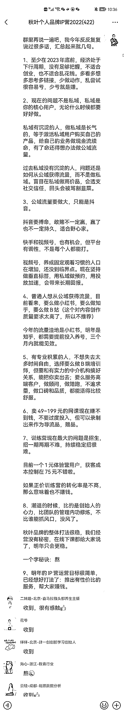

🏅 无

👍 书情

书情：怎么录视频？我觉得可以考虑录些低价引流产品

# #轻享# 信息不重要，谁发的，在哪里发的

海绵践行

2022-09-14 12:29:54

#轻享#  
信息不重要，谁发的，在哪里发的更重要。  
  
《[理解媒介](https://wx.zsxq.com/mweb/views/weread/search.html?keyword=理解媒介)》中讲的渠道即信息，是很有道理的。  
我举个例子，比如我每天会在读书群群发一条个人思考，那我也会在知识星球发同样的一条。  
可是，知识星球是收费的，读书群是免费的。  
但即使是同样的信息，在知识星球的价值和在读书群的价值也不同。  
因为知识星球的内容，方便你浏览，信息量很精简，读书群里的内容就特别嘈杂，不方便回看。  
我在知识星球发的内容，你可以在下面评论，我也可以回复。但读书群，就很难做到这个，或者即使有这个功能，实现方法和阅读体验也不同。  
所以，媒介即信息，其中一个意思就是，不同的媒介，即使是相同的信息内容，最后你也会发现，它们发生了不同的变化、产生了不同的效果。  
比如当知识星球有精华帖这个概念的时候，和没有精华帖之前，也不同，即使是过去的帖子内容是没有变化的。  
如果是相同的内容，发布的人不同，也就是发布的媒介不同，它的互动和观看也不同。这是另外一种媒介即信息的表现形式。  
比如同样的内容，亦仁来发布，很多人就会更相信，其他人发布，就会被忽略掉。  
我们公司的广告，在虹桥高铁站，大家就会觉得这公司好牛逼，这么贵的广告牌也买。这个广告牌本身，就是一种信息，这个信息叫做：这里很贵，买这块广告牌的企业很有实力。 

🏅 无

👍 书情

书情：有道理

# 1 个月拿到 28 个视频号购物车的经验复盘各

海绵践行

2022-09-14 12:22:31

1 个月拿到 28 个视频号购物车的经验复盘  
  
各位生财圈友大家好，我是肖肖。  
  
4 月份加入生财，6 月份第一次参加视频号带货航海，同时也参加了小红书 IP 航海，由于过往电商经历以及视频号更大红利的因素，最终选择深耕视频号赛道，7 月正式入局，继续按照航海实战手册的指引，从短视频带货开始做，然后下旬尝试无人直播，累计带货 GMV 十多万，拿到正反馈。8 月份再次报名了生财的投流航海，继续拓展见识，因为视频号投流需要购物车号，大佬们也建议先备一些，把号养着等待短视频投流机会的释放，加之购物车号可以短期售卖变现，基于这些，索性 8 月初就定了 20 个的造车目标，到月底实际拿到了 28 个。  
  
下面给大家分享一个月拿到 28 个购物车号的经验，移步飞书阅读：  
[`k3vtw0va9w.feishu.cn/docx/doxcngMqtaC9lCSy...`](https://k3vtw0va9w.feishu.cn/docx/doxcngMqtaC9lCSyHUQKrIqZyqd)  
#短视频# 

🏅 无

👍 书情

# #生财周报# 链接：百度网盘 请输入提取

书情

2022-09-14 10:55:29

#生财周报#  
链接：[百度网盘 请输入提取码](https://pan.baidu.com/s/1LL8mWOPHRD95fEu-_KJ40g?pwd=8y90)  
提取码：8y90 

🏅 无

👍 海绵践行，#渠说渠话

# #视频号# 普通小白视频号航海一个视频涨

海绵践行

2022-09-13 08:35:44

#视频号#  
普通小白视频号航海一个视频涨粉近 2000 有几点启发你一定要听听  
  
说在前面：  
  
先说好，完全小白，没有专业术语，没有招式套路，但字字句句都是实操后的大实话大白话，请和我一样的普通小白拿去借鉴，相信会带给你些许启发与点点希望；请路过的生财大神加以纠正指导，相信会对我有更多帮助与巨大鼓励，感谢生财，感谢财友，感谢看到这篇文章的的每一位追逐成功和正走在成功路上的圈友们。  
  
正文内容：  
  
昨天爆的作品，今天正好月底，正好 8 月航海靠岸，正好自己也做个复盘，正好给生财一个正反馈，也给大家一个小小鼓励，还热乎着呢，圈友们趁热吃！  
  
本文小提纲：  
  
一、首先说三点实操  
二、其次说四点心得  
三、再说说五点感悟  
四、最后几句金句分享  
五、最后寄语  
  
原文链接：  
[`pz8h9jh2rx.feishu.cn/docx/doxcnVqRNnnaCazz...`](https://pz8h9jh2rx.feishu.cn/docx/doxcnVqRNnnaCazzWFXVsXklYLb) 

🏅 无

👍 书情，#渠说渠话

# #小红书# 《从平台算法角度讲讲，小红书

海绵践行

2022-09-12 19:33:44

#小红书#  
《从平台算法角度讲讲，小红书笔记是如何被推荐的？》  
  
我们公司从今年 1 月份开始接触小红书平台，到目前为止前前后后从小红书薅了大概 5.6 万免费流量用户到微信，中途也经历了各种踩坑 遇到了各种王八蛋，不过庆幸的是整体公司业绩也一直持续不断增长。20 年进入生财，从生财得到了许多帮助，我也算开了天眼，来生财输出一些实战经验也算是还愿啦。  
  
前端时间，因为公司小红书业务需要，托朋友重金给我们找了一个业内比较出名的算法工程师来给我们讲讲小红书平台推荐算法（涉及隐私就不说这个老师的名字啦，用 K 老师代替），接下来我尽可能完整的给大家去复述一遍小红书的笔记是如何被推荐的，希望能对大家产生一些帮助。  
——————————————————————————  
  
  
  
今天要为大家分享 4 点内容：  
首先介绍小红书目前在使用的推荐算法。  
第二点推荐算法怎么让我们批量复制出爆款文章。  
第三点是从平台导流到私域，怎么能较大程度避免平台识别?  
第四点是基于小红书目前算法，我们猜测的一些冷知识。  
1.了解小红书推荐算法之前 先引入一个概念  机器学习，什么是机器学习呢，简单点讲就是通过计算的手段，利用经验改善系统自身的性能。机器学习就是让计算机从大量的数据中学习到相关的规律和逻辑，然后利用学习来的规律来预测以后的未知事物。  
  
 从目前的公开资料显示（图一），小红书 2016 年之前文章都是由人工审核，人工精选，然后决定是否推荐，从 2018 年以后，正式搭建了全新的算法 ，随着不断优化更迭，21 年这套推荐算法已经能够处理千亿级模型，据 K 老师讲述 最起码 5 年之内 这套算法不会过时，小红书也会一直继续使用。那在我们确定未来他还会一直延用这套算法的同时，就可以更多的去研究算法，把爆款变成常态，能不断的为我们产生商业价值。  
  
2.在了解了小红书使用的算法后，我们从公开资料找到了小红书的推荐算法逻辑（见图二），一些复杂的公式就不在这里延伸，我尽量说的简单一些，结合我们自己的经验能够让大家直接可以实操，上手。  
推荐算法分为 4 个部分 1.召回  2.排序  3.重排  4.呈现  
❶召回（多策略：用户/历史标签笔记等）   小红书会给用户打上不同的标签。比如当有 1 个用户打开小红书，这个时候就需要 5 到 10 篇笔记满足用户的需求，小红书会从它的笔记库里，选取对应的篇数进行呈现。实际运用来看，高峰期需要召回的笔记量多，被选择的概率也会增加。  
  
❷排序 小红书算法进行机器学习之后，笔记质量也是选择呈现哪篇文章的重要因素之一，那算法是怎么判断出哪篇文章质量好，哪篇文章质量差呢。算法主要的一个特征提取用的是 MLP 孪生网络  
  
（看图 3）简单点讲，它判断文章质量主要是根据以前的表现好的文章相似度进行选择，假如 A 文章火了，B 文章和 A 文章内容，风格等相似度比较高，算法会默认为它也是质量较高的文章，给 b 文章做出推荐。  
  
❸重排（笔记多样性）    小红书希望选中相似度低的一组物品，可以组成一个超平行体（图 4）它如果它们的特征向量相互正交，即内积为零，则它们的相似度最低，即多样性最大。简单讲：一个用户喜欢篮球，小红书不可能同时给它推荐 5 篇篮球文章，他需要保持一个内容多样性，所以用到了协同过滤，协同过滤的思路是通过群体的行为来找到某种相似性(用户之间的相似性或者标的物之间的相似性)，通过该相似性来为用户做决策和推荐。例如 A 喜欢装修，家具 家电 家居类的内容  B 也同样喜欢家具 家电 家居类的内容，通过协同过滤，算法会推荐装修类的内容给 B。  
那实践操作中怎么产生商业价值呢？A 是做家具类的博主，家具类竞争异常惨烈，可以再内容里加一些装修类的东西，文章也会推荐给相似的人群，换一个赛道获取流量。  
❹呈现(点击)  
  
  
  
  
3.从平台导流到微信，怎么能较大程度避免平台识别。我们之前用了很多方法（谐音，艺术二维码 拉群，自动回复等等）但是从本质来说还是很容易被 CNN 算法识别出来，它的一个识别方式，那怎么能较大程度规避平台识别。理论上存在两种方法  
  
1.给图片加入噪点（看图 5），因为噪点能改变图片的线性数据呈现，CNN 会更难识别这类型的图片，类似咖啡厅有背景音乐，掩盖其他人谈话的声音，让人没法偷听。  
  
2.跨行手写：只要是电脑上的字体都会被识别，但是系统不一定能识别你写的歪歪扭扭的字和。手写，就相当于让“声音”变成方言，斜着写，类似于谈话跳着词讲。或者尽量把引流信息做的更像 12306 网站的验证码（12306 被诟病验证码难懂，更多是为了防止非人工抢票）  
最后基于对小红书推荐算法的研究 我们有一些猜测，不能当真，大家就当冷知识看就好啦。  
1.  小红书文字部分采用的算法是延用了谷歌的 BERT，这个算法的极限是能处理 256 个字，如果小红书没有魔改 bert，那从算法来讲 他大概率也只能识别前 256 个字或者后 256 个字（正常逻辑是处理前 256 个字）  
2.  我们在小红书公开的特征管理看到有安卓和苹果特征组的区分，同样的发文，有可能苹果手机比安卓手机流量好。  
3.  小红书没有养号这个说法。  
4.  今年小红书调整过各板块的权重，目前去重这块权重不是很高（导致很多文章图片 字都不换直接发，还是一样会爆。举报另算）  
不知不觉码了快 2000 字了，再码估计没人看了\[憨笑\]，这里就不多讲了。也欢迎大家私下和我交流，我知无不言言无不尽。 

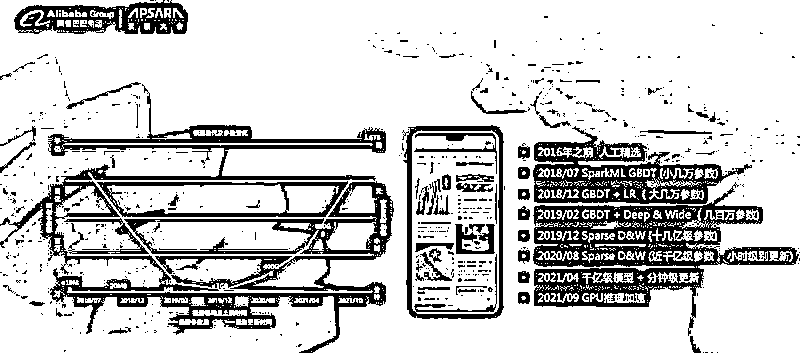

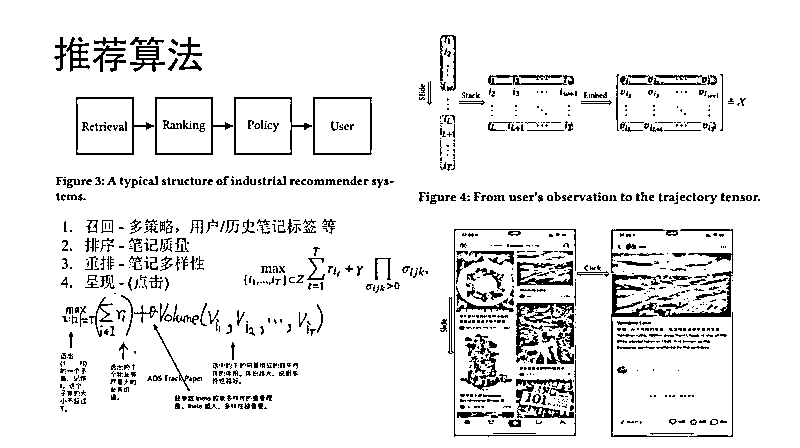

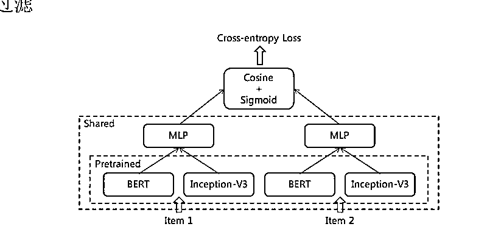

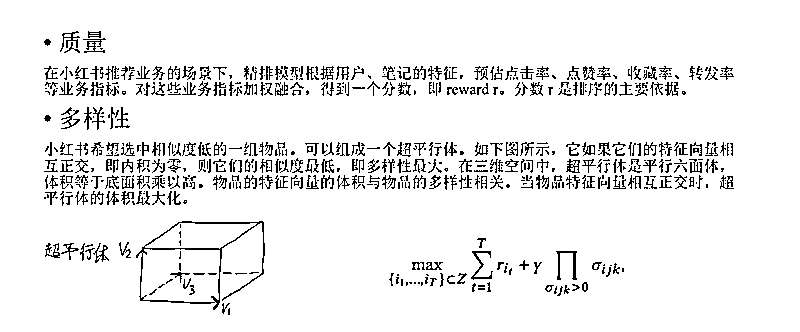

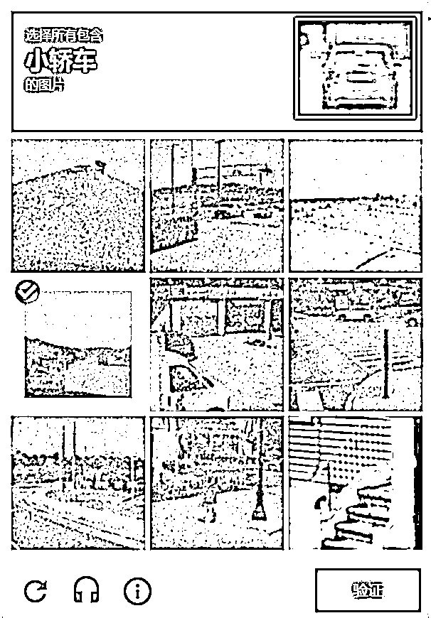

🏅 无

👍 书情

书情：干货啊

# #抖音# 一文讲清“养号”问题！ 《什么

海绵践行

2022-09-11 07:06:58

#抖音#  
一文讲清“养号”问题！  
《什么是养号？新账号到底需要“养”吗》  
  
抖音 #短视频# #抖音小游戏#  
  
“一个新的账号，到底需不需要养？怎么养？养多久？”  
  
这个问题，应该是新人做短视频最容易遇到的问题之一。  
  
先说结论。  
  
不用。  
  
因为“刷视频”和“发视频”是两个不同的体系。  
  
具体文章过长，请移步下方文档查看。  
  
[`o0tqwvct3e.feishu.cn/docx/doxcnszgdDTJP6ID...`](https://o0tqwvct3e.feishu.cn/docx/doxcnszgdDTJP6IDllIqoX3t4oc) 

🏅 无

👍 #渠说渠话，书情

# #赚钱创业方法论# 我如何从 1 到 N 构建多

海绵践行

2022-09-10 10:50:03

#赚钱创业方法论#  
我如何从 1 到 N 构建多元收入，核心方法首次公开  
  
三年前我还在杭州一家创投机构做投后管理，拿着普通的打工薪水。  
  
三年后我和老婆一起从澳洲回国，住在台北。结束了两年的旅居之旅，开始了新的数字游牧。现在手上同时进行着几个项目，拥有了更健康的收入结构，并且有更清晰的未来。  
  
这些转变绝大部分来源于我的几段经历，但单讲我个人经历并没有那么强的复用性。  
  
所以我做了一些总结，写成这篇文章，准备把这三年「跨文化经历」在我脑中烙印的认知共享给大家。  
  
在文末也会给大家交代我现在正在做的一些事情以及计划思路。  
  
希望这些信息能对你产生价值~  
  
分享目录：  
  
一、同时做几个副业，这不是「多元收入」  
二、3 个重要概念：多元价值 · 差异性 · 杠杆  
三、杠杆的 4 种类型，以及如何利用  
结语、分享一下我自己目前的情况  
  
  
请移步飞书阅读，原文链接：  
[`metalachel.feishu.cn/docx/doxcnViZUHATDhIq...`](https://metalachel.feishu.cn/docx/doxcnViZUHATDhIq8WS5kXru7fg) 

🏅 无

👍 #渠说渠话，书情

# #轻享# 心态篇：《压力这么大，该如何找

海绵践行

2022-09-10 10:38:35

#轻享#  
心态篇：《压力这么大，该如何找到自己的节奏？》  
阅读请移步至飞书链接🔗：[`ix4wv4fr81.feishu.cn/docx/doxcnr8q3rgIUeO9...`](https://ix4wv4fr81.feishu.cn/docx/doxcnr8q3rgIUeO9...)  
主题：如何缓解压力，找到自己人生节奏？  
大纲👇  
⭕️我的故事  
⭕️找到你的天赋  
⭕️确认你的天赋  
⭕️穷则变，变则通，通则久  
⭕️焦虑时怎么办？  
⭕️接纳自己  
⭕️总结 

🏅 无

👍 #渠说渠话，书情

# #轻享# 你在输出上「省的心」都变成了成

海绵践行

2022-09-10 10:35:47

#轻享#  
  
你在输出上「省的心」都变成了成交上「费的劲」  
  
最近在写文章时有一些小感悟，和生财各位小伙伴分享一下。  
  
你在输出上「省的心」都变成了成交上「费的劲」  
  
说一个我自己的习惯，无论是从知乎、知识星球、豆瓣还是公众号上来的粉丝，在问我付费服务时，我不会跟他狂聊的。  
  
加我微信好友的人分为 2 种，一个是已经在平台上看过我的大部分文章了，过来链接我就是奔着付费来的。通过后不会闲聊，发个自我介绍，然后要个付费链接，付款后把自己的疑惑发出来，附上一句：您不忙的时候回复就行。  
  
甚至还有更简单的，已经从我的内容输出里找到了付费的入口，直接先付费，然后再加我好友，附上一句：您的文章很有价值，过来深度链接一下。  
  
有的键盘侠看到我这么写，一定想说：你们这群做知识付费的人，哪来的这种高傲感，给你付费好像还要很客气！  
  
其实我能理解这种想法，但事实就真的不是这样。我自己也会购买很多知识付费产品，当我觉得某个平台的某篇帖子对我很有帮助时，我大概率会付费或赞赏支持一下，不为别的，只是为了这个作者看到有人为他的输出而付费，能够继续写下去，我也能够继续看下去。  
  
我付费了，就成为作者的上帝了吗？人家一定要客客气气，问寒问暖的对待我吗？当然不会，他写他的，我看我的，我们之间的关系只是：我认可你写的东西的价值。  
  
也就是说，我已经从你写的内容里获得好处了，这个时候，我付费的动力有 2 种：  
  
1、我想继续得到这种好处，说不定未来它能够帮助我更多  
  
2、我想链接一下这个作者，近距离观察他，也许我还能发现更深层次的价值。  
  
永远记住，做内容不是普度众生，而是找到同频，别人向你付费也不一定是要跟着你学习，也有可能是自我认可。  
  
回到上面的话题，为啥有的人在成交上费劲呢？就是因为你在输出上偷懒了，或者你写的不够细致，看似有点价值，别人又识别不出来；或者你把所有价值一股脑全抖出来了，不留一手，那些真的想学习的人觉得没必要付费；或者你的内容不够用户找我认可的深度，他觉得文章挺好，但是和自己没有关联。  
  
你看，输出是个技巧活，当你把上面这 3 个点都搞定的时候，用户过来加你好友，就是奔着付费来的，否则你就要耗费很大的精力去搞成交，最后还不一定成功。  
  
赚钱是一个过程，在这个过程中，哪一步都别想着偷懒，这一步偷懒了，下一步就受罪。做好每一步，整个流程优化的好，你就能优雅地赚钱。 

🏅 无

👍 #渠说渠话，书情

书情：这个思想值得借鉴学习的

海绵践行：确实，比如交付文档写清楚，包含常见问答疑，售后沟通就比较省事

书情：我们也要做这事的

海绵践行：嗯，羊了个羊这么小的案例，文档都修改了好多次

# #轻享# 分享一篇精华文章 2022 年 7 月

海绵践行

2022-09-07 22:42:58

#轻享#  
分享一篇精华文章  
2022 年 7 月生财龙珠见面会亿点点收获总结：  
[`ix4wv4fr81.feishu.cn/docx/doxcnA6aoItunchQ...`](https://ix4wv4fr81.feishu.cn/docx/doxcnA6aoItunchQ2Tr2eN2SdHh) 

🏅 无

👍 #渠说渠话，书情

# #轻享# 坚持运动的意义，有个好身体是一

海绵践行

2022-09-07 21:34:32

#轻享#  
坚持运动的意义，有个好身体是一切的前提，运动 flag 立不住不妨看看这篇吧。  
  
保持健康；没事多动动，好运常相伴；运动，点亮生活：  
[`u19nik48j9.feishu.cn/docx/doxcnHn6JceuHxtR...`](https://u19nik48j9.feishu.cn/docx/doxcnHn6JceuHxtR9AtkF99eToc) 

🏅 无

👍 #渠说渠话，书情

# #生财周报#

书情

2022-09-07 15:48:41

#生财周报# 

🏅 无

👍 无

# #轻享# 看到星球有不少人探讨本地生活的

海绵践行

2022-09-06 23:43:52

#轻享#  
看到星球有不少人探讨本地生活的话题，特别最近相亲和抖音本地服务比较热，给大家贡献一下刚结束的中国区域互联网大会的相关课件，课件内容都没有删减，还是很干的。  
  
特别推荐的是做抖音服务商的同学看下楚川+王亚楠的课件，里面信息非常全面。  
做视频号本地吃吃货节直播的可以看下崔菡的课件，视频号直播的基本逻辑课件讲的很透（生财大多都是讲短视频的，直播做成交的信息不多，正好补上）。  
对房产交易有兴趣的可以看下吴瑜的分享，对未来中国房地产市场和商业模式都有独到见解。  
施洪安的课件对本地相亲做了相对完整的阐述，从获客到转化到定价都有涉及，还附加了一个小房间的互动记录。  
钱钰的课件谈的是他们公司遇到的困难和解决方案，大家就当个管理课件看吧。  
  
里面如果有一些广告信息可以略过。 

🏅 无

👍 书情

# #游戏小说 cps# 最近小说推文比较火那

海绵践行

2022-09-05 23:35:53

#游戏小说 cps#  
最近小说推文比较火  
那么怎么自动化批量生成 10000 条推文视频呢，星球感兴趣的伙伴可以看看这篇教程：  
[`wtewz3wcmi.feishu.cn/docx/doxcnDzjjYYckK8Y...`](https://wtewz3wcmi.feishu.cn/docx/doxcnDzjjYYckK8YgfKIXtIFehh) 

🏅 无

👍 书情

书情：不错，这个分享有价值

# #轻享# 【谈谈如何创作出有“启发感”的

海绵践行

2022-09-03 17:33:29

#轻享#  
【谈谈如何创作出有“启发感”的作品】\_by: 汤质  
  
  
【1】一些缘起  
  
  
生财的各位好啊，我叫汤质，是「汤质看本质」节目的作者。今天来交一份欠了很久的作业。  
  
上半年，生财的朋友找到我，希望我做个分享，说是这样就有机会入群，我当时没太搞清楚状况：既不知道自己能分享什么，也不知道自己为什么要入群。  
  
于是礼貌地应了下来，转身忙自己的事去了。  
  
今年六月，我开了自己第一堂线下课，亦仁老师也参与了，事后在星球热情推荐，当时我就觉得自己不厚道了：写个分享，有什么难的？  
  
真挺难的，自媒体做得越久，越意识到想说真正清楚一件事情有多难。多数时候，我们都在胡言乱语，在给人添乱。  
  
因此，我的更新频率越来越低。上传第一期视频至今三年有余，作品也没超过三十个，有将近一半是头半年完成的，如今季更 up 主对我来说都是殊荣了。即便在自己的知识星球——用来“生财”的地方——也常常一两个星期才发一篇帖子，有时甚至一个月都不更新。  
  
这种出工态度和效率，还没被淘汰出局，我大概还是做对了一些事情，想到这里，竟然觉得有东西可写了。  
  
今天的分享主题是：如何创作出有“启发性”和“深刻性”的内容，以及如何找到属于自己的领域。  
  
提前管理一下预期，这篇分享没有彻底回答这个问题的野心，只是借此梳理自己的阶段性思考，能有些许帮助，也值得了。  
  
从“启发性”聊起。“简化世界，启发你”是汤质看本质 slogan，“制造启发”是我的基本工作，我似乎比较有资格谈论这个话题。  
  
  
【2】启发感从何而来？  
  
  
“启发感”从何而来？在我看来，若一个命题蕴涵了“基于否定性的解释力”，这个命题就会启发听众的心智。  
  
关键词：否定性，解释力。  
  
“解释力”很好理解，语言命题的基本功能就是描述、解释甚至预测生活现象，下面两组命题：  
  
“人要积极，要去争取很多事，进攻是最好的防守”  
“越努力越幸运”  
  
和  
  
“人要消极，要拒绝很多事，防守是最好的进攻”  
“越努力越平庸”  
  
你更同意哪种说法并不重要，这两类背道而驰的说法完全可以解释同一种现象。我想请你注意的是，相比于前一种说法，基于后一种说法展开的论述往往更有启发性。因为后者对前者构成了一种“否定”。  
  
如果某一组命题在「否定」了另一组更常见命题的情况下，仍然具有不逊于、甚至更优于另一组命题的解释力，那么这组命题就会带来“启发感”。  
  
“基于否定性”这个认识很重要，任何知识，在解释事物的同时，也在制造盲区，更常见的知识、道理一定会因为它们普遍性而对我们的认识构成更隐蔽的妨碍，反抗这种普遍性，本身即是在开辟供新认识生长的间隙。  
  
形象地说，制造“启发（enlighten）”就是点亮一盏更亮的灯，让人们意识到，之前那盏不够亮的灯在点亮了一些区域的同时，也制造了更多的阴影。  
  
（插一句：「灯的功能不只是点亮某个区域，也是要创造特定形状的阴影」，如果你是室内设计师，跟顾客分享这个命题，对方也会获得基于自否定性的启发感）  
  
这是所谓的“基于否定性的解释力”。因否定而解蔽，因而解蔽而释出新意义。  
  
创作者得有一个基本修养：永远与定见为敌。这要求我们要拥抱否定性，习惯否定的姿态，处于这种姿态的我们，才能获得某种“差异化”。  
  
人们很乐意谈论差异化，认为它是竞争力的重要组成部分，甚至能据此为创作者划分层次，大致上：  
  
低层次，利用信息差获得竞争力，这个层次的稀缺资源是“独特信源”。  
  
中层次，利用知识差获得竞争力，这个层次的稀缺资源是“硬核学术知识”。  
  
高层次，利用观念差获得竞争力，这个层次的稀缺资源是“独特的生存状态”  
  
稍微解释一下，层次越低，创作能力的要求越低：  
  
一个掌握了稀缺信源的人，不需要任何创作能力便能获得差异化，这是低层次；  
  
当所有人信源趋同的时候，用知识整理、解释信源的能力就成了关键，那些掌握了硬核知识的高阶转译者便成了有竞争力的人，这是中层次；  
  
随着竞争加剧，硬核知识也会烂大街，原来的启发会变成新的定见，人们翻不出什么花样了，表面多样性之下是巨大的同质性。  
  
这时，能对日常现象给出新解释的人，必须是一个异类，一个有反骨的异见者，一个敢于喊出皇帝根本没穿衣服的天真者，一个否定者。  
  
此处引出了一个基本问题，到底是什么导致了差异？  
  
这个问题不可能有标准答案，我尝试收敛至“意向”层面来回答：“肯定”意向生成同一性，“否定”意向生成差异性。  
  
王尔德曾说，一致性是缺乏想象力者的最后避难所。当我们不把眼前的杯子认作“一个杯子”的时候，杯子便在我们眼前碎裂成了容器、圆柱体、颜色、家人的爱、微缩建筑，冷热交替的中介物等等。否定性意向生成差异认识，差异认识带来创造力，大致是这个逻辑。  
  
我以为，追求的层次越高，对否定的力度、深度要求就越高。  
  
“否定者”的洞察力和创造力来自于他与我们身处一个完全不同的现象世界，你习以为常的东西，在他那里是极为古怪的。（创作者之所以能有“反常识”的洞见，不是他们刻意要“反”，只是因为他们的常识与我们的常识大相径庭）  
  
我的作品的辨识度也许来自硬核知识，但更深层的“调性”一定来自我的反骨。  
  
我曾在自己的线下课说“自己不配挣钱挣得这么容易，我对世界的贡献不如一个厨师多”，引起很多共鸣，有人说这太虚伪了，但我是发自内心地这样认为，虽然我自己也在卖课，赚钱了，很高兴，但这不妨碍我认为这个一切太不正常了。  
  
历史上从未有过一个国家，在本就如此繁荣的时期仍然如此高速发展，也从未有过一个时代，大量普通个体能轻而易举地掌握如此多的技术、工具和资源，贫困、饥饿和风险才应该是人类历史的常态。而如今，我们成了众人向往的景观和榜样，认为理想生活就该如此，一种可怕的精神错乱。  
  
一个创作者必须对自己和这个世界有各种意见与不满，必须一眼就能看透这个世界的虚伪与谎言。无视这个世界深层的倒错与溃烂，便会错失一个重要启发之源，流于肤浅的平和表面，无缘更“深刻”的创作。  
  
  
【3】深刻性从何而来？  
  
  
接下来谈谈“深刻”。  
  
我有一个观点：对事物持肯定的立场，你就会陷入肤浅，对事物持否定的立场，你就会把自己逼入深刻。  
  
下面我们拿写作举例（以下内容引自我自己的节目，略作修改）  
  
写作是一种常见创造性的活动，我们大致会在三种写作状态之间来回转换：“灵感状态”、“拼凑状态”以及“推敲状态”。“灵感”属于可遇不可求的“自发状态”；“拼凑”和“推敲”需要我们的自我意识高度介入的“刻意状态”。  
  
“拼凑”本质上是一种“增加”状态，你脑子里有一个含混的念想，想要将其表达出来，于是你搜肠刮肚，想要积词成句，积句成章，像是在搭积木。  
  
“推敲”本质上是一种“删减”状态，你脑子有两个以上相互竞争的词或句，你需要舍弃其中一个，是僧推月下门，或是僧敲月下门。拼凑是“搭积木”，推敲则是“雕刻”。  
  
我们都同意自我意识不介入的“灵感状态”最为理想，但如果自我意识一定要介入，那么一定推敲得越多越好，拼凑和推敲活动的占比，直接确定了一篇文章最终的质量。深刻，就是“深”深雕“刻”的结果。  
  
好的写作课程提倡“快写慢改”原则，道理也在于此：通过快写逼自己跳过拼凑思维，进入灵感流淌的写作状态，再通过慢改来推敲。  
  
更抽象地说，“拼凑”时我们调用的是一种肯定性的思维，“推敲”是则一种自否定的活动。所有的庸俗，都源于“自恋”，所有的深刻，都来自“自反”。  
  
想清楚这件事，我们能斩断很多纠结，比如“拖延症”和“完美主义倾向”，很多人写文章不敢下笔，怕写出拙劣的作品，其实大可不必，连知名的作家都坦言自己的初稿是垃圾（海明威：“一切东西的初稿都是垃圾”，因此要“喝醉的时候写，清醒的时候编辑”）。  
  
因此不妨反其道而行之：让我们肆无忌惮地写出一篇垃圾，然后在它的基础上雕出一篇佳作吧。  
  
有意思的是，倘若你真的肆无忌惮，往往能收获比你预想更好的结果。  
  
米开朗琪罗说大卫本来就在石头里，他只是把不要的部分去掉。咱们好歹先有个石头吧？  
  
拿写作来举例，事实上，这个“宽进严出”原则适用于一切创造性活动：在起点，要生猛无畏地放手去做，但在终点处，你要成为最挑剔的把关者。美妙的东西在两点之间，那里有灵感迸发的愉悦和自我否决的痛苦混合而成的宝贵经验，魔鬼在那里出没，“大卫”在那里等你。  
  
  
【4】属于你的游戏从何而来？  
  
  
对于那些还没找到自己发展领域的朋友，我在这里提供一个思路——依然与否定性有关——你需要在你的日常经验中寻找两种信号：  
  
第一个信号，是“瞧不上”，你能对某个领域的现成事物的价值做出否定判断时，说明你有了相当的品味与判断力，隐约地如何改进或超越了。当然，你更有可能因为狂妄自大而瞧不上很多东西，仅有这个信号还不够。  
  
第二个信号，是“被需要”，回想生活中，你在哪些方面是被人需要的，当你被身边具体的人具体地需要，说明你在某方面已经有了实实在在的优势，而非某种自我感觉良好。  
  
第一个信号说明你眼到了，第二个信号说明你手到了，二者的交集处，便是我们在世俗社会的立锥之地，那里的土壤最为松软，要狠狠地扎下去。  
  
扎下去之后，要立马展开无差别的否定与扬弃——因为是无差别的，所以是“自我否定”和“自我扬弃”的。  
  
「在那个“被你否定”和“你被肯定”的事件域中不断地“自我否定”」，这种生存状态被我归结为人生发展的杠杆点，在这个点上，下功夫，花时间，堆资源，会有复利，也会因此葆有所谓的差异化或竞争力。  
  
值得一提的是，你最终能做的事其实与一般意义上的“热爱”、“梦想”没什么关系，你也许不信，从小到大，我热爱游戏、音乐、绘画，最烦和人讲道理，最讨厌玩弄概念的人，我今天却以此为生。  
  
我曾在自己的节目里总结说「擅长会塑造热爱，而不是相反」，这个说法仍然不够诚实，“热爱”这个表述有些误人。我最深切体会是，我至今依然不喜欢、甚至厌恶与人讲道理（不喜欢分享的原因之一），但却唯有这件事能让我体会到自己的“不止于此”之处，能让我看到自己的更多“可能性”。  
  
变着法子把道理讲出新意，对我而言成了一个可以永远玩下去的“游戏”。  
  
网络上总有人质疑，汤质你真实水平到底怎么样？事实上，我的真实水平比粉丝以为的要低，因为有媒介滤镜的加持，但却比我自己以为得要高，因为我总能“雕刻”出一些比预想中更好的东西。所以，我的真实水平是个“谜”。  
  
是谜，才令人期待，令他人，也令自己期待。这种期待太宝贵了，几乎要靠它续命。  
  
最后，我想给各位的建议是：如果你是一个内容创作者，想要把这件事做长久，而非捞一票、割一波就走，那么请务必保持你的“否定性”，并以它为支点，追求启发和深刻，以此来维持你的创作力，雕琢你的作品。  
  
靠作品与自己缠斗，与读者共生，这是唯一要紧的事，其他的，更新频次、粉丝量、营销策略、社群运营等等，其实不用太多花时间去考虑。作为案例，我大致算是跑通了。  
  
以上，希望对各位有所启发。 

🏅 无

👍 书情

# #小红书# 才 391 个小红书粉丝，但引流

海绵践行

2022-09-02 23:09:14

#小红书#  
才 391 个小红书粉丝，但引流私域 432 人成交 308 单的复盘  
  
你好呀，我是营销出身，从业 10000+小时的运营，昵称#丽丽曾# ，朋友都叫我丽丽。  
我从 0 开始运营过年入几百万的私域；也在 30 粉时从小红书引流 400 多人进私域，成交 300 多单。  
  
为更好地阅读体验，请点击：  
[`q0hc3k7yqz.feishu.cn/docx/doxcnHoZbBZR4dpC...`](https://q0hc3k7yqz.feishu.cn/docx/doxcnHoZbBZR4dpCRq21tZ6fuDk) 

🏅 无

👍 书情，#渠说渠话

# #藏书楼# 大哥说我精华帖没用户思维?!

海绵践行

2022-09-01 23:11:19

#藏书楼#  
大哥说我精华帖没用户思维?! 一气之下，我分析了 40W 评论数据！挖掘出了生财小白的 7 个痛点问题！  
[`mkfwp3u79v.feishu.cn/docx/doxcnyx1dadaQMBp...`](https://mkfwp3u79v.feishu.cn/docx/doxcnyx1dadaQMBpjoUVeupdbQh) 

🏅 无

👍 书情，#渠说渠话

# #藏书楼# 文章大纲：第一：选一个细分领

书情

2022-08-31 13:53:21

#藏书楼#  
文章大纲：  
  
第一：选一个细分领域  
第二：成为这个领域「专家」  
第三：朋友圈/长文/短视频/直播力  
第四：找到引路人  
第五：培养自己网感和解题能力  
第六：系统的总结能力  
第七：不要轻易划定自己的形状  
第八：先提供价值再考虑赚钱  
第九：多以人为师  
第十：坚持的一切的核心 

🏅 无

👍 书情，海绵践行

# #轻享# 分享两个关于“赚钱”的思考方式

海绵践行

2022-08-31 08:09:11

#轻享#  
分享两个关于“赚钱”的思考方式  
[`vivalavida.feishu.cn/docx/doxcn2qYeBoGL1KW...`](https://vivalavida.feishu.cn/docx/doxcn2qYeBoGL1KWqYNWIHuHPSb) 

🏅 无

👍 书情，#渠说渠话

# #藏书楼# 思考了 4 个月，写下万字长文，

海绵践行

2022-08-31 08:02:06

#藏书楼#  
思考了 4 个月，写下万字长文，盘点阻碍普通人赚钱的 18 个认知误区  
[`lyrz1vdb4n.feishu.cn/docx/doxcnGYezbnan0oo...`](https://lyrz1vdb4n.feishu.cn/docx/doxcnGYezbnan0ooMxfwiaXQg6e) 

🏅 无

👍 书情，#渠说渠话

# #藏书楼# 看了 100+精华帖后，我梳理

海绵践行

2022-08-31 07:55:53

#藏书楼#  
看了 100+精华帖后，我梳理了一套赚钱的知识体系（超全新人指南！）  
[`mkfwp3u79v.feishu.cn/docx/doxcnk4mqgBMJTv0...`](https://mkfwp3u79v.feishu.cn/docx/doxcnk4mqgBMJTv0mklq0eR48fg) 

🏅 无

👍 书情，#渠说渠话

# #流量挖掘# 认知管理 2022 年 4 月 1

双城 Gets🐟

2022-08-30 23:28:54

#流量挖掘#  
  
认知管理  
2022 年 4 月 15 日 星期五  
  
为什么要做个人 IP，因为大多数人已经开始意识到个人 IP 的重要性了，就连隔壁家便利店老板都开始发抖音宣传自己，然后顺带宣传下店铺了。  
  
但是你知道怎么做吗？  
  
做个人 IP 基本都是处于以下 3 点：  
  
1 就是想出名，出名后，有粉丝后，可以接广告  
2 就是把粉丝引流到私域变现  
3 就是模仿，看过谁谁谁的案例做的很好，就认为自己也可以做，于是就开始了模仿之旅，可模仿着模仿着，就发现，好像不是这么回事，然后呢每天还花大量时间在上面，明知道出了问题，可不知道问题出在哪  
  
但是呢，现在已经是 2022 年了打造个人 IP，现在已经不比从前了，  
  
现在想做个人 IP，就要做出差异化，就要考虑好变现模式，就想要好精准的内容定位，这样才能宣传好个人。  
  
然后我根据昨晚和老哥的聊天记录整理出来了这篇关于个人 IP 的文章，如果自己只是个入门小白的话，这篇文章应该你足够去打造自己的个人 IP。  
  
本篇文章一共 6 节：  
  
1.个人 IP 是什么？  
2.短视频当道到底是做图文好还是视频好  
3.IP 平台的选择  
4.决定好自己的的变现模式  
5.如何塑造人设  
6.个人 IP 如何正确有效的进行变现  
  
一、个人 IP 是什么？  
  
我理解的个人 IP，应该基于狭义和广义上的理解。  
  
广义上的个人 IP，就是明星或者大家耳熟能详的名人，他们存在的意义其实是获取大众流量，也就是流量的属性不分细分领域。  
  
比如周杰伦，就属于大而泛的个人 IP  
  
因为流量大且泛，所以变现模式就有很多种，开火锅店、上综艺，拍电影电视剧，接广告等等。  
  
这类个人 IP 属于顶流，普通人很难模仿。  
  
毕竟全国目前有名的明星也就那么几千人。  
  
但是普通人更适合做的个人 IP，应该是垂直细分领域的个人 IP，这样更利于变现。  
  
举个栗子，小红书上的美妆博主，就是美妆领域的个人 IP，然后引流到私域卖化妆品，一天几千块的纯利润，高峰期 4 万利润（要依靠客户积累和复购）  
  
你可以在每个细分领域把你目前所做的行业都值得你通过塑造个人 IP 再重新做一遍，比如你是个育儿园老师，你就可以做母婴领域的个人 IP  
  
这类个人 IP 是素人容易去达成的，且更容易变现的。  
  
但是要注意一点，做 IP 需要花费大量的时间成本，金钱成本，因此务必得把赚钱放在第一位。  
  
一切不利于挣钱的环节，就必须马上改进，一旦感觉不适合，或者做起来难受了，就证明是出问题了。  
  
二、短视频当道到底是做图文好还是视频好  
  
这个话题我相信是很多准备做 IP 的小伙伴比较关心的（其实不只是做 IP，想做自媒体的都比较关心这一块）  
  
其实这个话题就好比很多人问做短视频是真人出境比较好，还是非真人出境比较好呢？  
  
只能说两者各有其优势：图文容易批量化，制作起来更容易，视频代表着未来，更容易变现和引流私域转化。  
  
所以呢每个都有优势，做好了都可以打造自己的人设，并且都可以做大。  
  
关于选择视频还是图文的参考大家可以根据以下的要求去自己选择，因为两者的技术要求方向是不一样的，大家可以参考下  
  
选择视频方向：  
1、视频表现力强不强  
2、视频剪辑会不会  
3、是否懂短视频平台规则，比如完播率是什么？粉赞比是什么？  
4、选题会不会  
5、短文案能力如何  
6、是否有学习力  
  
图文方向：  
1、文笔 好不好  
2、知识储备如何  
3、是否有原创能力  
4、对于写作有无抵触或者强烈的欲望  
5、打字速度快不快  
6、是否有学习力  
  
自己打分然后评判下，自己到底适合哪种吧  
  
三、IP 平台的选择  
  
IP 平台的选择尽量根据自己擅长图文还是视频来选择，当然也和自己内容的定位，长短有关系。  
  
图文类的，推荐知乎、小红书、微博。  
  
知乎比较适合长且深度的内容，如果你擅长写长内容，首选知乎  
  
短内容适合小红书和微博，每篇内容不会超过 500 字，更适合与粉丝互动，以及传递一些短知识点！  
  
视频类的，推荐大家做下知乎和小红书，但是呢，红利期已过，做起来会有些吃力。  
  
另一个就是视频号（强烈建议选择微信生态，理由就是没有任何一个生态比它更全面）  
  
如果你做的是长视频，建议发布知乎，小红书，头条号，还有 B 站，目前 B 站的活跃用户非常多（B 站对于中长视频的包容度极强，可以更加深度的链接用户，让粉丝了解你）。  
  
目前全网平台比较合适的平台，以及做与不做的利弊都在上面了，可以自我选择。  
  
另外也有一类特殊的音频类 IP，因为了解不多，暂时不做建议。  
  
四、决定好自己的的变现模式  
  
做一切 IP 一定要先关注变现情况，而不是先关注数据情况，比如涨粉，以及阅读情况。（这句话也许会颠覆很多人对做账号和自媒体的认知）  
  
因为大多数人做账号基本都是先考虑，我要找定位，我要做内容，我要涨粉，我要上热门。  
  
但是实际上都错了，做账号前，你必须得先有好的变现模式。  
  
如果没有好的变现模式，哪怕你上了热门又能如何呢？你能确定就能给你产生价值吗？  
  
而我们目前做的内容，我能确定可以有价值，因为在做账号之前，我们就已经有高客单价的变现模式。  
  
举一个我们目前在做的 4 个项目里的其中一个  
  
这是一个教育类的个人 IP,，引流渠道实在抖音上，我们在账号发布前定位的就是教育这块。  
  
我们是从线下打了几年掉过头来转做线上的，变现模式极其清晰，都是针对我们之前的老用户和学员。  
  
随便一个视频都有十几万的点击率，就可以带来几百条精准私信，内容也是针对教育这块。  
  
只要能够有对教育感兴趣的人看到我们视频就可以，所以我们不要在乎播放量和粉丝数，毕竟涨粉是一个水涨船高的过程。  
  
上热门后，精准流量就会更多，否则热门毫无意义。  
  
一定不要为了上热门而上热门！！！  
  
我们要做的一切都要向钱看齐，所有账号，所有领域都是如此。  
  
变现模式永远排第一！！！  
  
了解清楚底层的初始逻辑后，我再来带大家拆解下 IP 整体的定位  
  
1、先确定好变现模式，这个大家都清楚了  
2、那么我们第二步就要确定人群定位了  
  
通过变现模式来倒推人群的定位，我最忠诚的建议就是，一定要做好做的生意，做有钱人的生意。  
  
如果你的定位是屌丝，那么你的生意一定会很难做。  
  
因为交付这块会让你非常累，穷人的钱永远要比有钱人的钱要难挣。  
  
也许你现在听不懂  
也许你听了，也不会照做  
但我希望你收藏起来  
因为你在你领域里成长 3-5 年后  
你一定会明白这个道理  
  
人群定位好了后，就要开始确定人群喜欢看的内容了（这些都是一步步倒推过来的，都有一根主线牵着）  
  
内容运营，同样分为 4 点  
1.选题  
2.标题  
3.内容框架  
4.利于变现  
  
关于选题  
  
目前市面上的选题方法，相信大家也看了不少，但是咱们不用那种很死板的选题方法，因为选题呢，有一个通用法则（注意，只要是做自媒体/新媒体的，这点实际上是通用的。)  
  
那就是找到你的这个领域里，和你做一样的变现模式的，做的还可以的账号，至少 20 个，把他们的选题提取 100 个点赞较多的出来，点赞较多的，一定是经过市场验证的，一定是读者都很感兴趣的话题，这才是我们要找的好选题。  
  
而通过一些死板的方法去找到的选题，有的话题即便你发了也不一定有流量，也会存在浪费时间的情况。  
  
可能有些人会说，那这不是抄袭嘛？  
  
不存在的，话题，你可以讲，我为什么不能讲，你聊马云，我就不能聊了？  
  
  
2、标题  
  
关于标题这块，可以参照选题的方法论来进行，先找 100 个经过市场验证的话题以及标题，之后需要做的一件事情就是筛选，当你发现 101 个是感觉更好的标题或者话题，你就可以剔除掉一个相对不好的。  
  
慢慢的，你的标题内容就会变得非常丰满，不愁不知道写什么。  
  
3、内容  
关于内容该如何写，我就介绍一下我自己常用的写作公式，可以套用。（当然你也可以用你自己的思维方式构建自己的写作公式）  
  
事实：我最近发生了一个什么事+个人感受（让我产生了什么感觉）+发现的问题（这背后存在一个什么问题）+引出观点（我觉得问题的答案是什么）+讲故事（一个能证明我观点的故事）+总结观点（所以我们应该怎么怎么样）  
  
问题描述：我知道你遇到了什么问题+问题的拆解+我已经找到了你的问题所在+答案描述+我来给你看看我的解决方案+答案拆解+为什么这个办法能解决你的问题  
  
4、利于变现  
正如开篇所讲，你开始写内容或者制作内容脚本的时候，都要以变现为目的  
  
内容是否符合定位人群  
定位人群看了后  
是否会对你的模式感兴趣或者是否会私聊你  
是否会有问题，来问你  
等等  
  
五、如何塑造人设  
  
1、如何立体化展现自己以及产品  
  
所谓立体化，就是如何去展现自己和自己的产品，展现自己要从多个维度来展现，举几个多维度展现的例子吧。  
  
比如你的客户反馈情况，你如何巧妙的展示出来，又不像广告。  
比如你的服务展示，你是做教育课程的，你就可以以最诙谐的场景来展现你的教学内容，与学员互动的等等。  
如果你是卖教育产品的，你如何在的文章或者视频里，最简单直接的展现自己的教育产品，可以给孩子提供什么有价值的内容？  
  
但是这里一定要记住这一点，一切呈现形式上的，不管是图文还是视频还是直播，都是立体化的展现的标配。  
  
你展现的越立体，你的观众下单购买的欲望就越高。  
  
这就是为什么直播卖货，可以一场卖很多，因为直播卖货更加立体了。  
  
换句话就是说，想做个人 IP，想要把你的 IP 推出去，想要你的产品卖的更好，就需要立体化的展现，图文，视频，直播都做了，转化率就会最高。  
  
2、更加有信任感  
所有人的认知里，信任感源于专业性，你的专业性能够全方位的展现出来，大众就会对你产生信任感。  
  
就比如我会经常在朋友圈，输出对于个人成长领域和创业运营的一些看法。  
  
所以朋友们认为我专业，就会信任我。  
  
所以，你在你的领域里，务必要把自己的专业性渗透进你的内容。从多维度来展现自己的专业性，多穿插案例，观点和发生在你身上的相关故事  
  
六、个人 IP 如何正确有效的进行变现  
  
目前个人 IP 挣钱的途径有以下几种：带货、接商业广告、私域流量变现、出书  
  
1、带货  
带货目前主要分为视频带货和直播带货。  
  
视频带货目前比较常见的案例，就不一一介绍了，带货平台呢，主要集中在抖音，快手，小红书，视频号，还有知乎。  
  
直播带货呢，相信大家也看过不少，举几个例子：李佳琪/薇娅  
  
带货的核心本质，在于三点  
1、你本身所打造的个人 IP，就是一个卖新奇特实惠货物的个人 IP，用户关注你，就是想在你这里买东西便宜，或者抢秒杀。  
2、你本身是这个领域里的 KOL，粉丝因为信任你在这个专业领域的能力，所以你推荐什么商品，粉丝都会进行购买  
3、要么就是产品本身新奇特，好玩，或者针对某个人群都极强的痛点，或者便宜，当下需求，因为好玩好看就买了  
  
2、接商业广告  
如果从接商业广告的角度来看  
目前比较适合接广告的平台，当属小红书。  
小红书目前的商广报价差不多是粉丝数的 10 分之一。当然每个平台都有机会。  
  
但我个人认为接商业广告这条路，太窄了，我看过太多案例，只有顶流，或者一个很有质感的人设，也就是人物本身有很强的表达能力和很强的视频剪辑文案能力的人，才有希望在只接商广这条路走的很长  
  
其他的人，极难复制！  
所以这一点我不做推荐，我也不看好  
也不做详细讲解  
  
3、私域流量变现  
为什么一定要做个人 IP 的私域流量变现呢？我从三大方面来分析下：  
(1)高客单价  
想要赚的足够多，利润最大化，建议一定要做高客单价  
就像目前全网做高客单价做的最高的  
抖音里的老纪，豪车毒！  
他在微信里卖豪车，一辆豪车就是几百万，几千万。  
  
当然还有其他高客单价的产品，比如医美方面的，少则也是十几万，几十万，甚至几百万的客单价。  
这类的单子，如果放在普通人的思想里  
我一年开几单就够了  
的确如此  
但对于赚钱欲望的人来说，是无止境的  
所以做私域流量，就有做高客单价的可能  
在自媒体平台里是无可能做到的  
  
(2)粉丝复购  
在私域流量里有个天然的优势  
就是如果你的产品足够的优秀  
我坚信你的客户还会来找你  
并且会持续不断的找你  
因此这就是把粉丝囤积到微信的好处  
  
(3)成交率  
在微信中成交总是会容易许多  
哪怕你粉丝加你的当天  
并没有成交  
但只要粉丝有需求  
就一定会因为你某一天发布的朋友圈  
而看到你  
从而咨询你  
从而向你付费买产品  
  
4、出书  
这个就暂时不多说了，这个基本就是内容的变现，目前我认识的几位大咖比如 CGO 的朱总、数字营销的赵老师、前船长 BI 的邹叔现在都在这条路上。 

🏅 无

👍 书情，#渠说渠话，海绵践行，双城 Gets🐟

双城 Gets🐟：下午爆肝 5000 子

# #抖音# 中视频玩法：https://l

海绵践行

2022-08-30 21:41:40

#抖音#  
中视频玩法：  
[`lyrz1vdb4n.feishu.cn/docx/doxcnb1dvkKt0UFr...`](https://lyrz1vdb4n.feishu.cn/docx/doxcnb1dvkKt0UFr8Aeyft8S85e) 

🏅 无

👍 #渠说渠话，双城 Gets🐟

# #私域流量# 如何从 0-1 组建 500 个群

书情

2022-08-29 07:55:00

#私域流量#  
如何从 0-1 组建 500 个群并变现 1000W+？ [如何从 0-1 组建 500 个群并变现 1000W+？](https://docs.qq.com/pdf/DWUNnY25CbE5IbURG?) 

🏅 无

👍 双城 Gets🐟，#渠说渠话，彬垚，书情

# 做视频号一周，通过技巧选品变现 2W+的操

海绵践行

2022-08-29 07:08:25

做视频号一周，通过技巧选品变现 2W+的操作技巧拆解：  
[`w0czmpd503.feishu.cn/docx/doxcnPCRTUdqekmw...`](https://w0czmpd503.feishu.cn/docx/doxcnPCRTUdqekmwe9gLCkCwmwb) 

🏅 无

👍 #渠说渠话，书情

# #视频号# 视频号新人如何快速起号，做好

海绵践行

2022-08-29 06:59:10

#视频号# 视频号新人如何快速起号，做好账号定位？  
[`o0tqwvct3e.feishu.cn/docx/doxcnua9k8U6606c...`](https://o0tqwvct3e.feishu.cn/docx/doxcnua9k8U6606cNSsyCNN7mve) 

🏅 无

👍 #渠说渠话，彬垚，书情

# 素人入局抖音本地团购经验分享：https

海绵践行

2022-08-29 06:44:50

素人入局抖音本地团购经验分享：  
[`ro14u4yq4i.feishu.cn/docx/doxcnDmjBvQteRyB...`](https://ro14u4yq4i.feishu.cn/docx/doxcnDmjBvQteRyBEkypkxgcwgb) 

🏅 无

👍 #渠说渠话，书情

# 《百万猫车群产出断崖式下滑，通过这个方法

海绵践行

2022-08-26 09:34:29

《百万猫车群产出断崖式下滑，通过这个方法拯救回来》  
[`dl3446n2rd.feishu.cn/docx/doxcnYRDCx9o6PjX...`](https://dl3446n2rd.feishu.cn/docx/doxcnYRDCx9o6PjX51UoOFOqE7g) 

🏅 无

👍 书情，#渠说渠话

# 零基础小白如何通过抖音 seo 月入 5 万 ht

海绵践行

2022-08-26 07:44:35

零基础小白如何通过抖音 seo 月入 5 万  
[`f9ii5g947k.feishu.cn/docx/doxcnS8Z5gjW27zD...`](https://f9ii5g947k.feishu.cn/docx/doxcnS8Z5gjW27zDl8b1WeKVlge?from=from_copylink) 

🏅 无

👍 书情，#渠说渠话，彬垚

# 保姆级小红书爆款选题最简采集流程保姆级小

书情

2022-08-25 18:41:20

保姆级小红书爆款选题最简采集流程  
[保姆级小红书爆款选题最简采集流程 - 高羽网创](https://www.gaoyuip.com/1770.html)  
  
5 大小红书爆款选题方法，帮助我 3 个月变现 4w+  
[5 大小红书爆款选题方法，帮助我 3 个月变现 4w+ - 高羽网创](https://www.gaoyuip.com/1811.html)  
#小红书#  
  
[保姆级小红书爆款选题最简采集流程 - 高羽网创](https://www.gaoyuip.com/1770.html) 

🏅 无

👍 书情，#渠说渠话，彬垚

# #咸鱼# 咸鱼那啥 wu 货源虽然不建议做了

海绵践行

2022-08-25 06:59:20

#咸鱼#  
咸鱼那啥 wu 货源虽然不建议做了，但虚拟类，卡券等一直是刚需，分享个咸鱼虚拟玩法：  
[`awtucoye7l.feishu.cn/docx/doxcnsCcpqlbZaCx...`](https://awtucoye7l.feishu.cn/docx/doxcnsCcpqlbZaCxy0hxZ0gIiDe) 

🏅 无

👍 书情，#渠说渠话

# #轻享# 分享花爷和涛哥的连线文字版精华

海绵践行

2022-08-24 23:21:55

#轻享#  
分享花爷和涛哥的连线文字版精华 

🏅 无

👍 书情，彬垚

# #个人 IP# #流量挖掘# 抖音垂直个人

海绵践行

2022-08-24 09:03:07

#个人 IP# #流量挖掘#  
抖音垂直个人 IP 的分享 

🏅 无

👍 书情，#渠说渠话

# #轻享# 分享：品牌价值成本论（小马宋）

海绵践行

2022-08-23 09:06:49

#轻享#  
分享：品牌价值成本论（小马宋） 

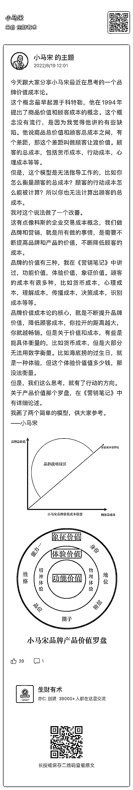

🏅 无

👍 书情，彬垚

# #轻享# 面向高净值"有钱"客户的成交密

海绵践行

2022-08-22 22:40:27

#轻享#  
面向高净值"有钱"客户的成交密码  
[`lyrz1vdb4n.feishu.cn/docx/doxcn1WkBBav5Lm0...`](https://lyrz1vdb4n.feishu.cn/docx/doxcn1WkBBav5Lm0NhNqf1UAPod) 

🏅 无

👍 书情

# #藏书楼# 起盘的艺（套）术（路）

海绵践行

2022-08-22 20:58:37

#藏书楼#  
起盘的艺（套）术（路） 

🏅 无

👍 书情，彬垚

# #私域流量# 全职自媒体 5 年，我沉淀下了

书情

2022-08-22 15:40:46

#私域流量#  
全职自媒体 5 年，我沉淀下了一张个人 IP 经营图谱 

🏅 无

👍 海绵践行，彬垚

# #游戏小说 cps# 超详细小说推文项目拆

海绵践行

2022-08-17 23:18:13

#游戏小说 cps#  
超详细小说推文项目拆解：  
[`ipjk6u8gkk.feishu.cn/docx/doxcn1Wn3YeJKMY4...`](https://ipjk6u8gkk.feishu.cn/docx/doxcn1Wn3YeJKMY4C2Ngi0TEp0c) 

🏅 无

👍 书情，念心࿇，彬垚

# #轻享# 如何避免成为风口上的“死猪”：

海绵践行

2022-08-16 08:37:32

#轻享#  
如何避免成为风口上的“死猪”：  
[`fhfh1eo8ab.feishu.cn/docx/doxcnnDLdwUzobYg...`](https://fhfh1eo8ab.feishu.cn/docx/doxcnnDLdwUzobYgddYMeNJcxdh) 

🏅 无

👍 念心࿇，书情，添财小英

# #轻享# 通过低成本搭建旅游行业的供需匹

海绵践行

2022-08-15 22:21:22

#轻享#  
通过低成本搭建旅游行业的供需匹配系统，实现稳定月入 5W  
[`lyrz1vdb4n.feishu.cn/docx/doxcnfDTuJl7lyMb...`](https://lyrz1vdb4n.feishu.cn/docx/doxcnfDTuJl7lyMbILqiwnNVbOb) 

🏅 无

👍 念心࿇，书情，#渠说渠话

# #小红书# 小红书 3 天新号粉丝破千的运营

海绵践行

2022-08-15 22:18:13

#小红书#  
小红书 3 天新号粉丝破千的运营方法论  
[`lyrz1vdb4n.feishu.cn/docx/doxcndyYmRt06blw...`](https://lyrz1vdb4n.feishu.cn/docx/doxcndyYmRt06blwDiY890AAksf) 

🏅 无

👍 念心࿇，彬垚，书情，#渠说渠话

# #小红书# 一个新品牌在小红书从 0 到 2 亿

书情

2022-08-13 19:25:14

#小红书# 一个新品牌在小红书从 0 到 2 亿的实操复盘 

🏅 无

👍 念心࿇，彬垚，书情

# #小红书# 保姆级小红书爆款选题最简采集

海绵践行

2022-08-12 23:54:05

#小红书#  
保姆级小红书爆款选题最简采集流程分享：  
[保姆级小红书爆款选题最简采集流程 - 高羽网创](https://www.gaoyuip.com/1770.html) 

🏅 无

👍 念心࿇，书情，添财小英，#渠说渠话

# #小红书# 1 篇笔记变现过千万，我在小红

书情

2022-08-12 09:03:13

#小红书# 1 篇笔记变现过千万，我在小红书赚钱的实操经验 

🏅 无

👍 念心࿇，彬垚，#渠说渠话

# 小红书内容底层逻辑：从底层情绪、4 大内容

书情

2022-08-12 09:01:54

小红书内容底层逻辑：从底层情绪、4 大内容构成、关键词出发，打造爆款内容#小红书# 

🏅 无

👍 念心࿇，添财小英，彬垚，#渠说渠话，海绵践行

# #小红书# 《 如何在小红书上打造一个赚

海绵践行

2022-08-11 23:16:32

#小红书#  
《 如何在小红书上打造一个赚钱的 IP？》  
[`lyrz1vdb4n.feishu.cn/docx/doxcnHTP6r4n4q5m...`](https://lyrz1vdb4n.feishu.cn/docx/doxcnHTP6r4n4q5mAgF5vJ7EwqQ) 

🏅 无

👍 念心࿇，添财小英，#渠说渠话，彬垚，书情

# #轻享# 转：李鲆：提高文章易读性的 9 个

海绵践行

2022-08-11 08:16:30

#轻享#  
转：李鲆：提高文章易读性的 9 个方法  
  
一直在生财看各种分享帖，很受益。但有些星友可能没有受过专业写作训练，文章易读性比较差。所以，特别分享一下提高易读性的方法。  
  
1、多分段。原则上，两三行就要分段，尽量不要超过四行。以手机屏幕显示为准。  
  
2、段间空行。不需要首行缩进两个字，直接段与段直接空一行。  
  
3、用短句。原则上，十五个字要有个逗号，四十个字要有个句号。  
  
4、用序号。如本文 1、2、3、4。  
  
5、起小标题。长文章要分块，起小标题。如《我是怎样用生财赚到 1000 万的》，[`t.zsxq.com/04YFurbun`](https://t.zsxq.com/04YFurbun)就起了十几个小标题。  
  
6、用线条分割。长文章分块，块与块之间可以用线条分割开来。如上例。  
  
7、做摘要。长文章，可以在正文前把要点提炼出来。如上例。  
  
8、重点前置。每段开头第一句话，最好是结论，或者核心，后面再论述。如本文。  
  
9、别太长。《[1000 万](https://wx.zsxq.com/mweb/views/weread/search.html?keyword=1000 万)》写了 8000 字，是太长了。两三千字可能已经够长了。 

🏅 无

👍 添财小英，彬垚，书情，念心࿇，#渠说渠话

书情：学习了，有收获

# #轻享# 预期质疑，不如研究别人是怎么赚

海绵践行

2022-08-11 08:15:50

#轻享#  
预期质疑，不如研究别人是怎么赚到钱的：  
  
说句掏心窝的话：看似不可能的事情，如果有人做到了，里面一定是有玄机，我们要做的不是怀疑他，而是要思考和请教：他是怎么做到的？我能不能也冲上去搂一杆子？哪怕赚的是人家十分之一也行  
  
怀着这种心态，才能进步的快一点  
  
熟悉的网友都知道我还没出来开公司的时候其实是混进了一个外贸小老板圈，有个故事我没说  
  
其中有一个 soho 很有意思，他做的产品大大方方的告诉了我们，并且经常和我们聊他的客户八卦  
  
他的产品在这里我不方便说，其实是很廉价的，我做快销品都不太看得上这种产品  
  
但就是这么个产品，一年的时间里，让他买了一套 100 多平的房子和一辆宝马  
  
如果是他空口白话我百分百是不信这东西能有这么高利润，那得一年 365 天每天一个高柜才能赚这么多钱，但是现实是人家确实做到了  
  
这就勾起了我的好奇心，他干了什么？于是在我各种套近乎死缠烂打之下，有一次聚会结束之后，他终于是同意把我带去他的公司参观，并且和我聊了很久  
  
我才知道了他为什么能赚到这些钱，第一步客户来源都和我们不一样，我们主要靠展会，他在那个时候 B 端社媒就玩的飞起来，并且这么简单的产品，他居然还能做出定制化  
利润都不是按百分比了，是一倍两倍  
  
如果那个时候我怀的不是好奇学习的心态，而是杠精质疑的心态，根本不会知道这个知识点，人家也不会告诉我为什么能做这么好的秘密 

🏅 无

👍 彬垚，书情，#渠说渠话

# #轻享# 不管会不会，先动手搞起来，航海

海绵践行

2022-08-11 08:13:30

#轻享#  
不管会不会，先动手搞起来，航海也是这样的理念。  
  
学习效率不高，换个思路试试 

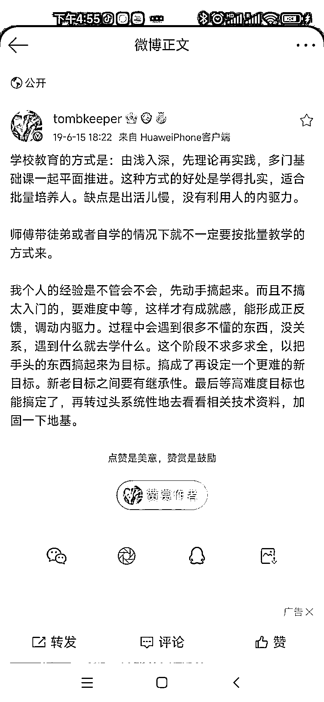

🏅 无

👍 彬垚，书情

# #航海项目# #小红书# 千粉不到月入

书情

2022-08-11 08:09:37

#航海项目# #小红书#  
千粉不到月入 10W ，我如何通过小红书救回濒临倒闭的艺术体验门店 

🏅 无

👍 彬垚，#渠说渠话，海绵践行

# #轻享# 如何设计一个赚钱的商业模式？“

海绵践行

2022-08-09 07:16:11

#轻享#  
  
[如何设计一个赚钱的商业模式？](https://mp.weixin.qq.com/s/UW_MgE_qUNbwiGpjumHjrw)  
  
“什么叫商业模式？  
  
北大魏炜教授说，商业模式是“利益相关者的交易结构”。  
  
这是我听过对商业模式最好的一个定义。  
  
这个定义听起来简单，但每当看到一个画好的商业模式图时，我们总觉得叹为观止，这人怎么想到的？  
  
如何设计一个赚钱的商业模式？  
  
其实，要从 0 开始构建一个商业模式，中间所涉及的过程，它的方法论，总结起来就是六个步骤。  
  
1）自己；2）客户；3）能想到的所有其他人；4）连接他们；5）去掉、增加或挪动利益相关者；6）整体有增量。” 

🏅 无

👍 书情，彬垚

# #轻享# 分享 by：亦仁企业以产品为媒介

海绵践行

2022-08-09 07:09:53

#轻享#  
分享 by：亦仁  
企业以产品为媒介跟用户进行价值交换  
8 月航海实战共读的图书我推荐的是《[俞军产品方法论](https://wx.zsxq.com/mweb/views/weread/search.html?keyword=俞军产品方法论)》，我正同步在读，很受启发。  
  
对于希望设计出好的商业产品的圈友来说，我觉得这本书应该是必读书目，对于想设计出好的付费社群的圈友，也推荐阅读。  
  
我摘录一段给大家看看：  
  
交易模型研究是指以交易为基本单位来研究产品，目标是建立可持续交易的互惠模型。  
  
我们把“掌握一个领域的用户模型”视为产品经理的合格线，而把交易模型设计视为产品经理的进阶之路。  
  
这要求产品经理除了掌握用户模型，还能理解一个领域各利益方的价值判断和行为习惯，以及产品实现过程中的各种干扰因素，这样才能自如地设计和优化交易模型。  
  
这里是把所有产品看作交易，搜索、社交、阅读等信息类产品只是货币价格为零的特殊交易。研究交易模型，除了理解产业链上各方的价值判断和复杂关系，主要研究的就是交易费用。  
  
什么是产品？  
  
企业以产品为媒介跟用户进行价值交换。产品的关键不是其表面的材料、功能、属性，而是其深层的价值，因为产品就是价值交换的媒介。  
  
为什么企业总是说创造用户价值，而不是创造产品呢？因为用户关心的是得到什么和付出什么，包括这个产品给他什么效用组合，需要他付出多少金钱或时间等。用户同样也会比较机会成本，看这个产品是比其他产品更好用还是更让他离不开，从用户角度来看，这就是一个交易过程。  
  
所以，做产品要强调创造用户价值，因为企业与用户交换的从来不是产品，而是价值。 

🏅 无

👍 添财小英，书情，彬垚

# #藏书楼# 手把手开启相亲项目教程：如何

海绵践行

2022-08-09 07:06:52

#藏书楼#  
手把手开启相亲项目教程：如何从 0 到 1 启动一个本地相亲项目  
[`lyrz1vdb4n.feishu.cn/docx/doxcnBegOr0sHjUX...`](https://lyrz1vdb4n.feishu.cn/docx/doxcnBegOr0sHjUXI9XK5apJsmf) 

🏅 无

👍 书情，#渠说渠话

# #流量挖掘# 传统复印生意如何在抖音变现

海绵践行

2022-08-05 08:29:21

#流量挖掘#  
传统复印生意如何在抖音变现？  
[`lyrz1vdb4n.feishu.cn/docx/doxcnqNGKtVnm7OZ...`](https://lyrz1vdb4n.feishu.cn/docx/doxcnqNGKtVnm7OZLUqkdd8ArMe) 

🏅 无

👍 #渠说渠话，书情

# #轻享# 转：亦仁今天有个朋友问我，赚 3

海绵践行

2022-08-03 20:24:52

#轻享#  
转：亦仁  
今天有个朋友问我，赚 30 万的项目和赚 300 万的项目有什么区别？  
  
我说，没区别，都是一样的项目。  
  
你赚 30 万，你以为只有你一个人做到，实际上，在你看不见的地方，可能有十个、上百个和你差不多的人，他们也赚了 30 万。  
  
如果你的复制能力足够强，那些人就应该都是你的分身，是你的矩阵，那这就是一个 300 万的项目了。  
  
这是矩阵思维。  
  
星球里面有时候有宝妈圈友分享，一个月通过某项目赚几千块，很多人看不上，觉得是小钱，这些人其实真有点傻，换个思路想想，如果基础一般的宝妈圈友能一个月赚几千块，意味着什么？意味着这个项目门槛不高，可复制性极强，这才是个大项目，好机会，才有几十倍、上百倍、上千倍的空间和机会。 

🏅 无

👍 #渠说渠话，书情，彬垚

书情：工作室就是这样玩法

# #轻享# 转：李鲆：关于流量的一些思考 1

海绵践行

2022-08-01 22:48:54

#轻享#  
转：  
李鲆：关于流量的一些思考  
  
1、产品过剩的时代，流量就是最稀缺的产品。  
  
2、谁能低成本解决流量问题，谁就能做好几乎任何生意。  
  
3、很多人努力打造个人 ip 而不成功，根本原因还是流量不足。有人知道你才是品牌，没人知道你只是自嗨。  
  
4、做知识付费的朋友，有些一开始就收到不少学员，然后再努力也收不了几个人。根本原因就是没有建立稳定的流量来源。  
  
5、不要过于迷信私域流量。做私域流量仍要有强大的公域流量支持。  
  
6、个人经验，微博基本算是半私域流量，而且很容易引流。大家可以试试。  
  
7、个人经验，ip 流量，才是最有价值、含金量最高的。  
  
8、个人经验，裂变来的流量，通常质量比较差，而且裂变两三层就裂变不动了。还是自己做自媒体，流量比较香。  
  
9、最简单粗暴的赚钱逻辑，就是确定一个标准化产品，然后拼命堆流量。  
  
10、但如果你流量不够，那就要精细化运作。复购、产品组合、后端利润，都要好好研究。  
  
11、普通人创业，最好做流量、做分销，而不要做产品——尤其是实物产品。  
  
12、传统营销，多在研究怎样提高成交率；互联网时代的营销，应该更多研究怎样放大流量，同时研究怎样降低成交率。  
  
13、用内容获取免费流量，再用付费来放大，比较稳妥。  
  
14、创业者每天应该研究两件最重要的事：第一，钱从哪里来；第二，流量从哪里来。后者是前者的保证。  
  
15、归根结底，死磕流量。 

🏅 无

👍 书情，彬垚，#渠说渠话

# #轻享# 转：为什么我进入了生财还挣不到

海绵践行

2022-08-01 22:46:46

#轻享#  
转：  
为什么我进入了生财还挣不到属于自己的一块钱  
  
草履虫  
2022 年 07 月 25 日 18:43  
  
  
大家都在聊怎么挣钱，但我想肯定也有人不怎么挣钱。今天刚好读到了@刘小排老师的《为什么你进了「生财有术」，还是赚不到钱?》就把这篇文章里面提到的点细化到了我自己的身上。从下面几个点认知思考了一下。  
  
我在生财上花费的时间  
  
最基本的几个数据：  
我每天在生财上花费的时间是多少？  
我每周在生财上花费的时间是多少？  
我每月在生财上花费的时间是多少？  
  
看看上面的这些数据我就能明白了。自己就是一个小白，没有时间上的聚焦和关注，想要出成绩，那是极小概率的事情。  
  
我在生财上尝试的项目  
  
这里的项目包括成功的和失败的，对于自己所有成功和失败的项目自己是否有在总结和反思？为什么会成功？是有哪些因素导致的？这些因素产生的条件是什么？是偶发的还是事情做到一定结果后自然而然的？。。。自己为什么会失败？是什么原因导致了这样的失败？对于这些因素自己当时的处理措施是什么？如果现在在去处理，会有哪些思路和方法？从这次失败中自己有哪些收获？。。。  
  
不是说一个人就是一家公司吗？  
  
那么对于上述事情的分析，是否有完备的文字记录？没有总结，思考，记录自己如何成长？项目做了一大把，到头来除了失败二字，一无所获。  
  
我排斥的项目  
  
说实话，这个项目太 Low 了，我看不上  
人家因为有对应的资源，所以才成功的  
人家很早就知道了这件事情，现在已经过了红利期  
人家有公司，有团队，我就自己一个人肯定不行  
我每天那么忙，我那有时间  
这个说实话太简单了，没什么技术上的含量  
这个我感觉自己不是很懂  
  
我对生财的态度  
  
其实我自己已经有一份不错的工作了，然后每天那么忙，我下班回去想好好休息一下，刷刷短视频，看看剧，玩玩游戏，生财那都是那些有钱的老板玩的地方。再说我自己不也尝试了几个项目吗，都一周时间了，数据还那么不好。  
  
最后的反思  
  
成功有成功的理由，失败有失败的结果。  
  
认识自己真的是一个很漫长的过程，认识自己之后的改变也是痛苦的。我想起了自己很久之前在做的一件事情，每天 5 公里，跑步走路都可以，然后很难上来就坚持一个月，更不要说长久。  
  
为什么非要是 5 公里，而不是 1 公里？  
  
今天在面对这个问题的时候，我甚至没有一个很好的回答。对啊！为什么啊？  
  
先培养自己的习惯，在动态之中再慢慢调整，拿到尽快可以以被执行的反馈才是最重要的。  
  
当然除了上面所说的，肯定还有其他的因素，不过不急，慢慢改变。 

🏅 无

👍 书情，#渠说渠话

# #轻享#

海绵践行

2022-08-01 22:44:16

#轻享# 

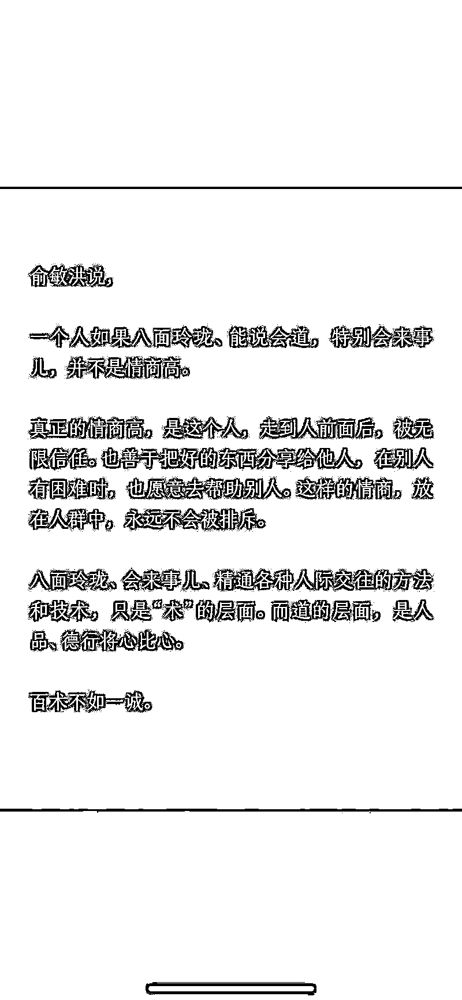

🏅 无

👍 书情，彬垚

# #藏书楼# 我相信二八原则适用于大多数领

海绵践行

2022-07-29 07:56:43

#藏书楼#  
  
我相信二八原则适用于大多数领域，通过一本书 20%的精华迅速了解这本书是不是自己需要的，能节约大量的时间  
  
建了一个飞书空间，分享好书热门划线：[`lyrz1vdb4n.feishu.cn/drive/folder/fldcnDKs...`](https://lyrz1vdb4n.feishu.cn/drive/folder/fldcnDKsYkAsb1ECcE0exjdN0zh)  
  
感兴趣的朋友欢迎收藏飞书链接：  
1.免费获取海量微信读书热门划线笔记  
2.评论区或私信给我推荐好书，我帮你导出指定书籍热门笔记和划线文档 

🏅 无

👍 Leo Wang，书情，#渠说渠话

# #藏书楼# 看了 100+精华帖后，我梳理

书情

2022-07-28 23:24:35

#藏书楼#  
看了 100+精华帖后，我梳理了一套赚钱的知识体系（超全新人指南！）  
  
  
[`mkfwp3u79v.feishu.cn/docx/doxcnk4mqgBMJTv0...`](https://mkfwp3u79v.feishu.cn/docx/doxcnk4mqgBMJTv0mklq0eR48fg) 

🏅 无

👍 添财小英，书情，#渠说渠话，海绵践行

# #藏书楼# 相亲项目的各种玩法，即刚需又

海绵践行

2022-07-27 20:10:00

#藏书楼#  
相亲项目的各种玩法，即刚需又是经久不衰的话题，做好了可以一直做下去：  
[`lyrz1vdb4n.feishu.cn/drive/folder/fldcnxN5...`](https://lyrz1vdb4n.feishu.cn/drive/folder/fldcnxN5iEpdRCkTaV5EuiYhUIg) 

🏅 无

👍 书情，#渠说渠话

# 💎 #游戏小说 cps# 小游戏推广变现项目集

海绵践行

2022-07-27 08:04:40

#游戏小说 cps#  
小游戏推广变现项目集合，适用于快手，抖音，已经正在陆续开放资格的的视频号：  
[`lyrz1vdb4n.feishu.cn/drive/folder/fldcnNV3...`](https://lyrz1vdb4n.feishu.cn/drive/folder/fldcnNV3f0AwDjCNjmIQIptkKof) 

🏅 无

👍 书情，Leo Wang，#渠说渠话，添财小英

# 💎 #藏书楼# 来自白一喵的分享，老黄牛文章

海绵践行

2022-07-26 20:25:11

#藏书楼#  
来自白一喵的分享，老黄牛文章延伸补充 

🏅 无

👍 书情，#渠说渠话

# 《2022 年 7 月生财龙珠见面会亿点点收获

书情

2022-07-25 15:40:58

《2022 年 7 月生财龙珠见面会亿点点收获总结》  
  
这是我在生财正式发的第一篇帖子。  
前两天也是我第一次参加生财线下活动。  
都说但求输出，不问龙珠。  
但做事总要有个目标，明人不说暗话，我的目标是：拿龙珠。😎  
读完文章觉得不错，还请点个赞以示鼓励哦。  
  
本文将依据我参加龙珠见面会的时间线，谈谈我见过的人和收获，字数 4600 字，预计用时 8 分钟。  
文章🔗请移步至此阅读：  
[`ix4wv4fr81.feishu.cn/docx/doxcnA6aoItunchQ...`](https://ix4wv4fr81.feishu.cn/docx/doxcnA6aoItunchQ2Tr2eN2SdHh) 

🏅 无

👍 无

# 💎 #藏书楼# 老黄牛精华帖合集 https:

海绵践行

2022-07-25 08:29:17

#藏书楼#  
老黄牛精华帖合集  
[`lyrz1vdb4n.feishu.cn/drive/folder/fldcnRx1...`](https://lyrz1vdb4n.feishu.cn/drive/folder/fldcnRx1GERJPFzaXukr3yCXdkQ) 

🏅 无

👍 添财小英，Carol。，#渠说渠话，书情

海绵践行：集合更新完毕

# #一个月十万粉丝变现一百万的复盘心得 He

书情

2022-07-25 01:56:35

#一个月十万粉丝变现一百万的复盘心得  
  
Hello~   
大家好，我是云蔓。  
   
是一名 90 后互联网内容创业人。第一次发帖，想分享给大家我通过小红书和 b 站中视频平台做垂直类个人 IP。  
   
我的 IP 在小红书上叫「云蔓创业说」，大家可以搜索到~  
   
我将毫无保留的把月赚一百万的的经验分享给大家，希望能给大家带来一些启发，也希望能够贡献一点自己的价值。  
   
这篇可能比较长，但是都是最底层的赚钱逻辑，希望大家想要做视频，自媒体的，一定要耐心。  
   
因为做自媒体的多了，变现方式可能五花八门，看起来模式一样，但是背后的逻辑绝对不同，所有的竞争都是认知的博弈，而不是其他。  
   
「为了给大家一个比较直观的阅读体验，我做了一个目录~」  
   
\-短视频个人 IP 变现的所有失败经历  
\-失败后的转机  
\-个人 IP 的搭建  
\-正式上路前夕的准备  
\-发展过程和收获  
\-小红书平台打造个人 IP 的干货知识分享  
  
一个月十万粉丝变现一百万的复盘心得​  
  
[一个月十万粉丝变现一百万的复盘心得](https://shimo.im/docs/J9dK6QdYrG9VcqrK/read) 

🏅 无

👍 海绵践行，书情，Carol。，#渠说渠话

# #​干货分享​ 今天给各位玩赚小伙伴整理

书情

2022-07-25 01:18:13

#​干货分享​  
今天给各位玩赚小伙伴整理了 1900 张思维导图合集资料包，包含了自媒体/个人成长/教育百科等 119 项内容。  
  
内容非常全面，超全知识宝典，帮你节省时间掌握核心，也可以作为引流的钩子使用，效果也非常好！  
  
玩赚新媒的同学们快保存用起来吧~  
  
链接： [请输入提取码\_ 百度网盘](https://pan.baidu.com/wap/init?surl=ODAy9zEBLdY139SfIM4ZQg)  
  
提取码：1zlt  

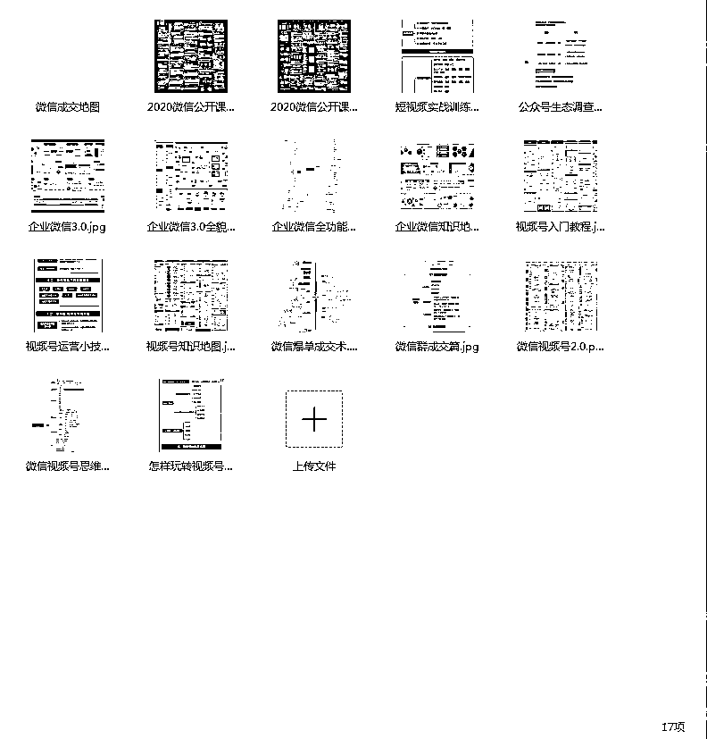

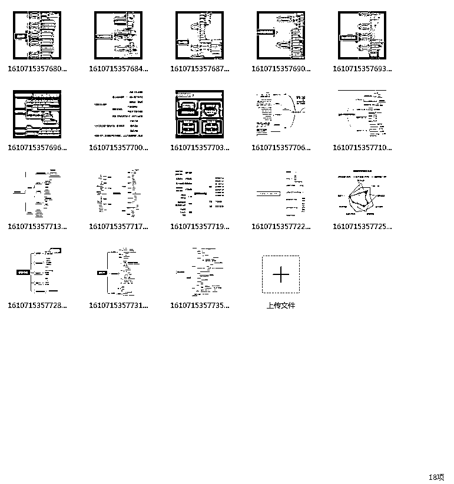

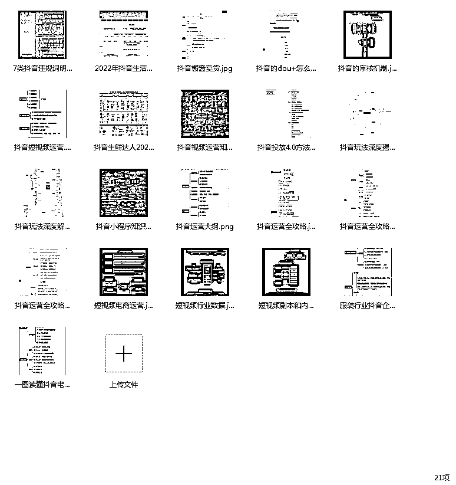

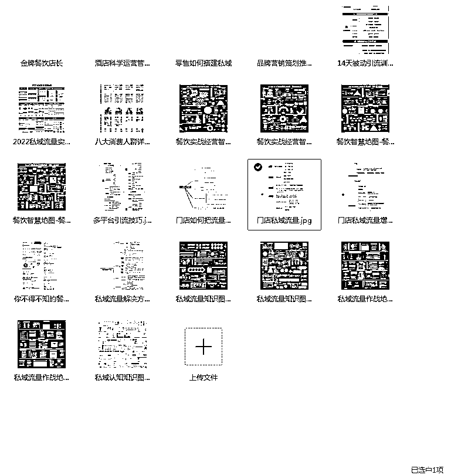

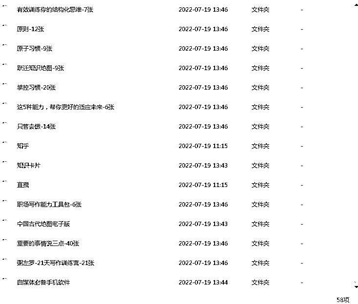

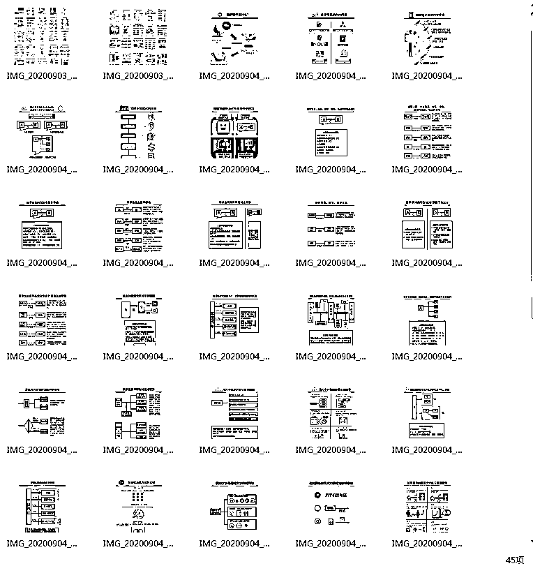

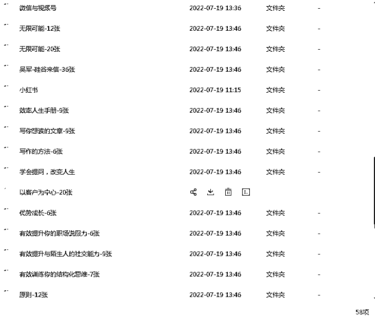

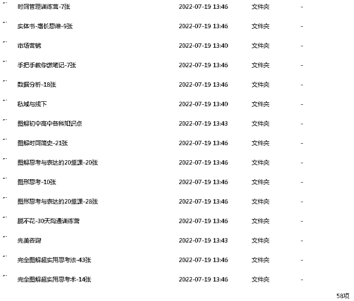

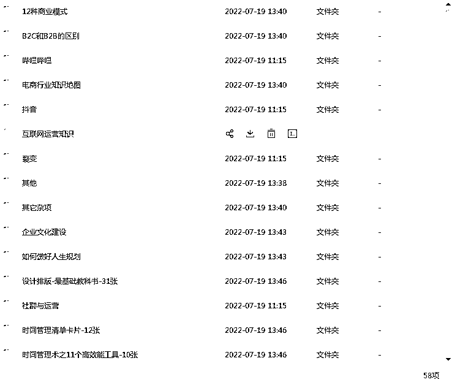

🏅 无

👍 海绵践行，#渠说渠话

# 如何利用 AR 数字人在视频号上暴力引流这一

书情

2022-07-25 01:05:23

如何利用 AR 数字人在视频号上暴力引流  
这一个多月的时间,越来越多的人加入到视频号里来。想必大家被最近大面积 0 播的情况烦透了心,这个时候不妨先停下来,静下心,再理理思路,有的时候快即是慢，慢即是快。今天我把前几天写的文章同步到这里,希望我这样的操作方式能够为大家打开新的思路。  
  
【腾讯文档】我是如何利用人工智能做到千万播放的  
[我是如何利用人工智能做到千万播放的](https://docs.qq.com/doc/DS3dNUk1XUHdCV2lJ) 

🏅 无

👍 #渠说渠话

# #知识付费# 先收钱再交付产品，都说最小

海绵践行

2022-07-24 18:05:35

#知识付费#  
先收钱再交付产品，都说最小 MVP，实际该怎么落地呢？  
从两次做课失败，到朋友圈轻运营 2 周卖出 3W+的直播课程落地：  
[`lyrz1vdb4n.feishu.cn/docx/doxcnytV0ZqQ4Ix6...`](https://lyrz1vdb4n.feishu.cn/docx/doxcnytV0ZqQ4Ix67rYIMwcHGot) 

🏅 无

👍 书情，#渠说渠话

# #社群运营# 付费社群和朋友圈运营技巧：

海绵践行

2022-07-24 13:12:06

#社群运营#  
付费社群和朋友圈运营技巧：  
[`lyrz1vdb4n.feishu.cn/docx/doxcnFqzHWCGZpmu...`](https://lyrz1vdb4n.feishu.cn/docx/doxcnFqzHWCGZpmuSVUIJMZutqf)  
[`lyrz1vdb4n.feishu.cn/docx/doxcnTIpl4quNNW7...`](https://lyrz1vdb4n.feishu.cn/docx/doxcnTIpl4quNNW7Q5vvXKApSub)  
[`lyrz1vdb4n.feishu.cn/docx/doxcnuUaSp78qqh6...`](https://lyrz1vdb4n.feishu.cn/docx/doxcnuUaSp78qqh6pEUdzcwh1VA)  
[`lyrz1vdb4n.feishu.cn/docx/doxcnJZEOv49o3C8...`](https://lyrz1vdb4n.feishu.cn/docx/doxcnJZEOv49o3C8jNlZgdTYUPe) 

🏅 无

👍 书情，#渠说渠话

# #流量挖掘# 纯利 5W+的抖音图文引流号

海绵践行

2022-07-24 12:56:01

#流量挖掘#  
纯利 5W+的抖音图文引流号玩法  
[`lyrz1vdb4n.feishu.cn/docx/doxcn6wFDVEYUqPL...`](https://lyrz1vdb4n.feishu.cn/docx/doxcn6wFDVEYUqPL8WSGmHqUPdh) 

🏅 无

👍 书情，#渠说渠话

# #视频号# #流量挖掘# 当视频卷的不行

海绵践行

2022-07-22 09:02:44

#视频号# #流量挖掘#  
当视频卷的不行，动不动 0 播放，图文视频依然是个低投入高产出的选择  
为什么要做图文？ 图文是什么？ 图文怎么做？  
  
案例参考：[`bytedance.feishu.cn/docx/doxcnAR96TN0TsiHj...`](https://bytedance.feishu.cn/docx/doxcnAR96TN0TsiHjbzxis32xLn) 

🏅 无

👍 书情，#渠说渠话

# #游戏小说 cps# 抖音快手小游戏推广赚

海绵践行

2022-07-22 07:20:23

#游戏小说 cps#  
抖音快手小游戏推广赚收益：从身无分文到月入 2w，很难，但值得  
[从开店失败身无分文，到月入 2W+,我都走了哪些弯路？](https://shimo.im/docs/L9kBMpNNOGcGMOqK/read) 

🏅 无

👍 书情，#渠说渠话

# 

书情

2022-07-20 11:44:31

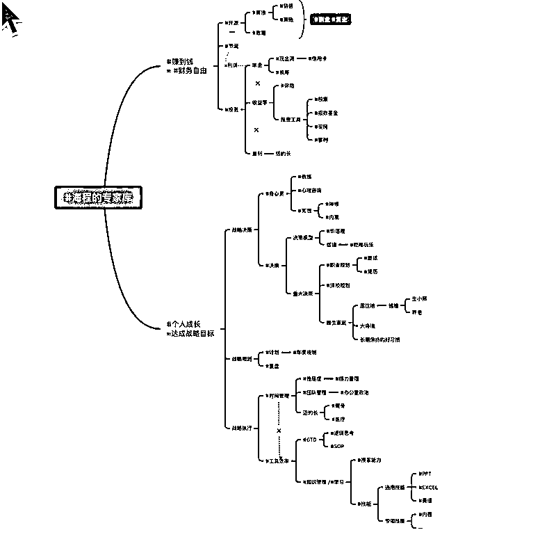

🏅 无

👍 海绵践行

# 

书情

2022-07-20 11:43:54

🏅 无

👍 书情，海绵践行

# 对话小白：算不清账，多少钱都照样慌 2 总结

书情

2022-07-20 08:39:01

对话小白：算不清账，多少钱都照样慌 2  
总结  
  
  
小白：今天有一个很好的领悟，人是在这个大的经济环境中的一员，其实就有点像全息图这个概念，你算的是一个人的账，但它是宏观经济状态的一个反应。  
  
我觉得，风险控制这件事情隐隐约约贯穿在今天整个对话里面。我发现，当你说这个底线的时候，跟我原本想的底线还不太一样，你的这个底线是悲观底线，但蛮多人想的是乐观底线。  
  
海程：乐观底线，悲观底线，我觉得都会有，就像炒股有止盈止损一样。我会认为首先是不战败，立于不败之地就有可能战胜。  
  
我从小在军区里长大，后来学的经济和战争史，我经常会用一个军人的方式去思考这个世界，《[孙子兵法](https://wx.zsxq.com/mweb/views/weread/search.html?keyword=孙子兵法)》里有句话“知彼知己，百战不殆；不知彼而知己，一胜一负；不知彼，不知己，每战必殆”  
  
一个人如果不知道他在他那一组是什么位置，其实就是不知己；而不知道自己的目标能不能达成，其实就是不知彼  
  
而算了很多人的账，就像打了很多场仗一样，能够更好的看到不同打法的结果如何，哪些是有效的打法，那些打法内在有结构性的矛盾，是不可延续的。 

🏅 无

👍 书情

# 对话小白：算不清账，多少钱都照样慌海程 2

书情

2022-07-20 08:38:34

对话小白：算不清账，多少钱都照样慌  
  
  
海程  
2022 年 06 月 27 日 21:51  
生财的老板们大家好，我是海程，生财四期的老圈友，擅长算账和规模化套利，之前写了精华帖《给两百多个老板算完账以后》[《给两百多个老板算完账后，我发现了财务上的三个“雷”》](https://t.zsxq.com/03iQRJMbm)  
  
我的好朋友小白 @白一瞄 做了一个访谈“小白的专家网络”，我很喜欢这次访谈，小白懂我，也是一个很好的提问者，在和他的对话里，回答我内心里很多小问题，同时我觉得生财的老板们也可能对这些问题有同样的困惑，比方说：  
  
\-方向感不足：大家都很努力的赚钱，张口就是一个亿，但并不清楚这个目标是否现实，用现在的打法能不能实现目标  
\-安全感不足：每天在群里天天看到别人都日入十万、日入百万，只有自己没那么赚钱，久了感觉特别特别焦虑  
\-控制感不足：有的老板有钱了，但心里还是非常慌，他知道生意有一些问题，但不能量化出问题有多严重/多不严重  
  
因为我和小白延续我和小白米索聊《[空无一物](https://wx.zsxq.com/mweb/views/weread/search.html?keyword=空无一物)》的风格，所以访谈稿很长：  
01\. 通过算账知道自己在金字塔的哪个位置  
02.人的命运看上去各有不同，实际上非常相似  
03\. 从财务状况，看出行为模式  
04\. 盲目个人成长不能解决财务问题  
05\. 哪些人需要把自己的账盘清楚  
06\. 为什么老板有时候算不清  
07\. 什么时候应该算账  
  
现在就开始搬个凳子，旁听我和小白的对话吧  
  
01 大家的普遍困惑：“我到底在社会中算什么位置？”  
  
小白：海程你现在就经过你手算过的人，具体的数字现在有多少啊？  
  
海程：因为我有个数据库，截止到你和我聊天的时间，我现在看过的应该是 207 个人。207 是一对一的，不是那种类似什么大课或者训练营一个人抛了一个问题，我就这么一答，这里的 207 个人，每个人的底账我都看过。  
  
小白：当我看到非常多年薪百万或者说月入多少的时候，心里始终会有一根弦，就你知道就算那个数字是真的，它可能只是一个流水、销售额，而不是财务报表最后那一行的真正到手上的净利润。  
  
所以我是在想从你的观察里面，你所看到老板们真实的收入是什么样？是不是真的是一个还蛮普遍的现象，就大家其实有蛮多的一个水分，还是说只是我想的太多？  
  
海程：可能是我的样本量问题，我算过真正靠打工年入百万非常少，我指的是到手，不过即使按照税前口径算也非常少。  
  
不过中间最大的水分各种赚钱社群是日入十万、月入百万，可能一年有那么三五天能日入十万（说白了放的是最好的数据），但显然不是天天如此，我觉得这是一个营销方法。  
  
就比如一个人做知识付费/直播，把某一天最好的数据发了朋友圈或者群里，其实做过这种类型生意的朋友都知道，收入波动是异常剧烈的。  
  
客观来说，他/她没说一句假话，但真话没说全，这个人在朋友圈或者群里，不说清楚这个收入不是天天如此的，会让很多不熟悉这个生意的，产生一种“他/她每天都赚这么多钱”的误判，从而给很多人带来了焦虑。  
  
挺多老板来找我，不仅是想听我客观分析，更重要的是，市面上没太多人能告诉他，他究竟在社会中赚的钱算什么位置。  
  
因为他们非常焦虑的一点是，他真的感觉每天别人都在赚钱，只有他自己不赚钱，就是有点像我们在的一些社群，但凡社群大一点，你就会看到今天这位朋友赚钱了，明天那位朋友赚钱了，人会产生一种认知偏差“我周围的人都在赚钱”。那我呢？  
  
小白：这也是跟我观察的一个现象是非常吻合的。  
  
我们听到这些日入 10 万，我们姑且认为他是真的好了，但其实蛮多人，他们会因为这些信号干扰到自己，然后他们会给自己加戏，不去问问那个数据到底是多少，或者是我通过别的方法，去核实一下这件事到底是怎么回事。  
  
这个很微妙，因为你做的是生意，你应该要知道真实的数据是怎样的，然后你才能对自己有一个合理的预期。但是少有人会去做这样的一个信息的收集和确认。  
  
海程：我其实现在比之前没有那么焦虑的一个很重要的点是，因为你看的人越多，你这个时候就更清楚大家实际上是怎么一个状态。  
  
  
02 人的命运看上去各有不同，实际上非常相似  
  
  
小白：你看过了那么多人的账之后，我很好奇，你对他们的咨询过程，你有一个比较一致的感受吗？还是说每个人带来的感受都有点不太一样？  
  
海程：首先我会认为在这里面是可以被分组的。人是可以被分组的。我在这一个组里，我能看到很多类似的操作，由于他们的年龄段也不一样，你能看到这一组里不同年龄层的人，在不同的阶段，他们过往类似操作会带来什么样不同的影响。你能看到很大的相似性。  
  
在个体的层面也会有他自己的个性化差异。但是从组的层面来说，差异没有大家想得那么大，大家以为自己面对的是世间独一无二的大难题，但量化归入到某一组里以后，组内的差异不是那么大。  
  
小白：所以说我们分组的角度来看，大家还是有一些共性和规律在的是吗？  
  
海程：单纯从钱的角度来说，没有那么大的差别。  
  
小白：你可以给我具体的讲几个你觉得会让你印象比较深刻的组吗？这个组的特征是怎样的？  
  
海程：我们就拿一些老板来举例，我见过真正年纪不大，白手起家的人，在我的数据库里两成不到，主要都是做电商/自媒体/web3 的人。  
  
他们是真的赚了钱，从近乎白手起家的状态，一下到了到了社会意义上比较有钱的状态，但他们会维持之前手上只有几万块钱的管理模式，然后不论在他们的日常收入开支的管控还是投资，都会有比较多的问题。  
  
还有一组人，年纪略大一点，往往做专业服务的，一般一年前端收入在几千万到上亿的这个状态。  
  
我们说的第一组有很强的“超级个体”的感觉，而这一组人就有很强的公司性。他们在我面前是以一个公司老板的形式出现的。  
  
这组朋友们落地能力和在细分领域的专业知识是非常强大的，否则他也没有办法做到这么大。但是在他更大的时候，就会发现有些事情算不清楚。因为公司大了，但是还没到那么大，在他决策时，辅助他们决策的人就不是那么强，那这个时候他就会哽住，进度会被拖慢下来。在下篇也会和大家深入地聊一下，为什么老板明明有财务，却也算不清楚账  
  
还有一组（可能是这里面人最多的一波）就是家里比较有钱，他们一部分人会继承家里的生意，或者对家里的生意完全没有兴趣准备另起炉灶。  
  
很有意思的是，他们在算账或者背后的困扰，在我看来相似度非常非常高，甚至他们的教育背景和家里父母、兄弟姐妹关系都非常类似，但他们以为自己一辈子在面对世间独一无二的大难题。  
  
小白：我们看比较稀少两成真的靠自己起家的这些人，在你跟他们聊的状态看，你觉得这些人他们的性格会有什么相似的地方呢？  
  
海程：我回顾了一下，他们起家往往是在一两次真正的大风口里起来的，我总结起来他们的性格是很适合把握风口，并且放大风口带来的收益的。  
  
不太会整天想有的没的的问题，他们可能试过很多事，但一段时间基本只做一两件事，而且事情真的玩的很明白。  
真的遇到机会时候，投多少钱两说，但整个人的时间和心力是真的放进去的，每时每刻都在琢磨从中赚钱，而不是做梦。  
  
  
03 财务行为反映出我们普遍缺乏安全感  
  
  
小白：人的情绪状态，比如安全感，是不是也是可以反映在他的财务行为上面的？  
  
海程：是的。首先这些人因为都跟你真正地聊过，不是隔着屏幕敲字，而是要么远程，要么线下真的见过这个人，你能相对直观的感觉到这个人的性格，那这个时候，我能够观察到很多共性的东西。  
  
比方说有些人财务上维持非常微妙的开支和收入，你就能感觉到他的那种如履薄冰，安全感不足。  
  
不过即使刨除掉这些维持非常微妙收入开支平衡的朋友外，其他人也挺缺安全感的。我感觉大家会被社会义务牵绊着，想着赶快实现这些义务以后走入完全的自由。  
  
其实我看了这么多数据，我会发现朋友们的财务目标其实是倒挂的。如果把财务目标拆解成高配和低配两个不同版本，低配需要的钱，比高配的高。  
  
原因很简单：  
基础财务目标，往往是买房生小孩，子女教育，有稳定收入 carry 住一系列和安全感、责任义务相关的开支。  
顶配财务目标，除了对基础财务目标做进一步消费升级以外，往往是“吃得起一顿 1000 的饭不心痛”、“想出去玩就出去玩”和自由、体验感高度相关的东西。  
  
但顶配财务目标比如我经常看到的“环球旅行”、“想吃一天 1000 块的餐标随便吃”其实真的花不了那么多钱。  
  
还有一个有意思的观察，即使是真的赚到钱的人，还是说已经有了不错资产量的人，也会非常非常迷恋被动收入大于开支这个概念。  
  
大家对于躺赚，或者说对于稳定的追求，会受到很多非理性的情绪影响。可能对一些老板来说，一辈子在那个稳定的事情上赚的钱，可能不如他一两年赚的多，但稳定的心理效用就是对他们非常非常大。  
  
我观察真正赚到钱的人的数据，绝大部分抓住的都是爆发性的机会，很少看到每一个风口都能猜中，365 天每天都在赚钱；  
  
但这也就意味着，在没有机会的时候，不会有太多钱进来，这个时候人又追求稳定，就很容易手闲不住，做出大量骚操作，比如“花钱找工作”，把大量资产投入期望创造稳定收入，但很容易亏钱。  
  
小白：当这些人因为自己的不安全感，做出了从财务上来看非理性的举动，有多少的人因此真的影响到他未来这个目标的达成呢？  
  
海程：我觉得比例还挺高的。大家期待的安全类似“我的被动远远地高于我的支出”，而他们对被动收入的定义往往来自于一大笔钱✖️理财的收益率，所以他们可能会追求再赚一大把，从此安然退休。  
  
有时候我能帮他们解决，是因为我帮他们拉了表，从表中他们就会发现：  
第一：绝大部分的老板按照他们的标准，量化以后，没有他/她想象中要的那么多。  
第二：有一定体量以后的赚钱，是一个指数叠加过程，达成目标的速度往往比大家想得要快。  
第三：他们对被动收入的想象全部来自于投资、版税等概念，但现实中极难实现。  
  
小白：人毕竟不是计算机，计算机可以做到非常理性地去分析的。对于算不清楚的未来，人多多少少会有不理性的成分在里面。  
  
人在不理性的时候，他可能会进入到两个状态里面，就倾向于往两个极端走，要么就是对于未来的过度的乐观。所以可能会进入一些不必要的投资或者不必要的花费，另外一种极端，会过于的悲观，活得特别的小心翼翼，然后不敢消费，不敢去做投入。我很好奇这两拨人在你这边的这个比例可能大概是多少？  
  
海程：这两种类型的人我见过叠加的人其实不少，就有点像日常抠抠搜搜，然后省下的钱在投资上大手大脚加仓。  
  
小白：在没有计算之前，他们能意识到自己处在这样的一个状态之下吗？  
  
海程：他们能隐隐约约地感觉到自己的不安。但他们不能明确地说出来这是什么。  
  
比如做跨境、做直播的朋友，就很容易陷入日常抠抠搜搜，但又有时候大手大脚，从我的角度看很大程度上是，税收服务费、账期、库存管理对他们来说太复杂了。  
  
比如你 TikTok 可以有 Paypal、Airwallex、Stripe、Payoneer、Shopify 结算周期和规则。加上税和前置/后期扣除的物流费、Paypal 收取的保证金账根本是糊的，这个时候人就经常处于抠抠搜搜，但阶段性的放弃治疗。  
  
但实际上比较好的方法就是，我拆解成一系列明确的行动：  
\-一些他要自己做，比如招一个好一点的库管，找客服问清楚各个结算工具的账期。  
\-一些是我帮他/她对接专家资源以解决更加细分的问题：比方说有的人卡在税上，我算明白以后，把我用的税务推给他，让他去做一个税收方案即可。  
  
  
04 盲目个人成长不能解决财务问题  
  
  
  
小白：最近疫情大家都挺艰难的。看到很多人都讲现金流，言下之意就是要减小花费什么的。那这个我也很能理解，越是在这个时候你要备好更多弹药。  
  
但同时我也知道，越是在这个时候，其实人也是需要韬光养晦，需要大量的学习的。那这些学习你要习的一些新的东西，必然会有花费的。就从你看那么多账的这个经验上来看，你是怎么想的？  
  
海程：首先我觉得，从我见过绝大部分的样本里面，学习根本花不了那么多钱。真正花了几十万以上学费的，基本上都是那种报了会销十万块钱的课。  
  
如果是跟专家、顾问做咨询，即使是买了一堆知识星球花钱买安心，可能会花一年几万块钱，但很难花得很多。  
  
小白：我下一个问题是，我觉得是涉及到学习和成长这件事情，他的花费是双重的，不仅仅是你的金钱，还有你时间。  
  
因为我觉得大家都有过这样的阶段，你买了很多课，然后每个平台你都买了一点，还买了一些书。后来因为你东西买得很散，就发现哪个都没有学好，我们应该都有过这样一个阶段。  
  
所以我会很好奇，如果我们把人的时间也算作一种成本的话，你怎么去看待这样的一种成本？  
  
海程：我有一个假设：先生存再发展。因为在看一个人的财务处境，又能看到这个人的状态时，他说要买一波课的时候，你是能够看出来哪些课真的解决他现在的问题有帮助，哪些能解决远处的问题，哪些是解决不了现在问题，而产生的代偿问题。  
  
这段话我可能会说的直白且伤人：我的数据样本里，无论老板还是打工，最喜欢买书、线上课程或者训练营，自己的公司经营有了严重瓶颈，或者是他们在他们现在单位工作的不太顺利，往往吃的是死工资。  
  
简单说就是上不去了，又有相对多的时间，但他们在现有的框架里，又突破不到他们的框架，所以他们就会在现有的框架里做边缘性的努力。  
  
小白：我好奇针对这样的一个情况，是他买的那个东西的问题吗？还是说他买这个东西的时候，他的预期是不对的？还是别的问题？  
  
海程：首先，绝大部分课有夸大效果。但更重要的是，他自己真正矛盾究竟是什么？是因为心里没数，所以才会被课带着跑。  
  
小白：我觉得他的问题似乎是，蛮多人他并不知道，我为什么要买这个课？买了这个课之后我到底能够得到什么，要解决什么问题？其实他们是没有定义清楚的，可以这么理解吗？  
  
海程：我觉得问题是定义不清楚，然后很多时候在逃避。  
  
我的观察样本中真正赚到钱的朋友们，往往是一两个点玩明白，投产比足够高，然后上规模，把绝对收益做起来。  
  
但我见过大部分陷入买课困境的朋友，解决方案往往在通过在个人成长领域撒胡椒面的方式来学习，类似学个 PPT，学个数据挖掘等个人技能，从我的视角看没有在解决本质问题。  
  
小白：我的疑问是，从财务上看，我们去计算一个东西的投产比，也有两种做法，一种是更多的看近期的，我学了这个课，我的钱是不是立刻能赚回来？我的工资什么时候能涨多少？这是一个比较短期的。  
  
当然也有指向未来的，那比如我真的去报一个英语课，把我的英语能力提升上来了，它有可能让我未来的职业竞争力变得更强，让我未来获得更多的收入，获得更好的一个机会。似乎是我们站在哪个时间点上做测算，也是重要的一个因素。  
  
海程：举个例子，假如我们打一个游戏，游戏目标是十年以后要赚到这么多钱，你用各种这种样的姿势都能赚，对不对？  
  
那有可能是每一年都赚这么多，也有可能是前几年赚的少，但是后面两年厚积薄发，也有可能前面九年都不赚钱，最后一年一天直接赚到所有的钱也不是不行，对不对？  
  
你会观察到你越早能想明白代价是什么，对游戏规则的理解越明确，操作比你想的可以花样多很多。  
  
因为把你自己当做一张财务报表，有好多个变量，就像你知道你有 10 个参数可以调，这个时候都有很多种不同的组合，回到你学英语这件事，我认为这是一个阶段性不一定赚钱，但是有概率赚到更多的技能。  
  
我自己会把钱当做一个指标，它是一个能够帮你去更有效地去量化这个世界，看自己有没有创造价值，以及说去衡量自己的行动有没有意义，减少自我感动的指标。  
  
所以如果我来算的话，我会帮他复制一张表，假设你在平行时空学了英语，你看一下这个变量的调整，对你的目标有多大的影响。  
  
举个例子，这个人现在在搞 tiktok，他要学英语，他可能会更好地做 TikTok，但究竟量化起来有多大好处，如果你算下来，还不如多招个英语不错的主播，那就不需要学。  
  
  
05 哪些人需要把自己的账盘清楚  
  
  
小白:现在还有哪一类的人或者说什么特征的人，需要把自己的账盘清楚的？或者说是对他们现状有很大改善？  
  
海程：第一种人其实是老板，增长比较快或者已经有一定体量相对稳定的老板其实都比较适合。  
  
然后家里面还比较有钱的，从我的角度也是老板的一种。他们有的人已经开始在做生意，还是说在大厂外企有光鲜亮丽的工作，部分叠加了留学生身份。  
  
对于他们中绝大部分人，我认为他们干的这摊子并非他们的工作，我记得我在播客里也提过“但凡你用伺候你老板的时间十分之一，好好处理好你和父母的关系，你的处境会比现在好很多”。  
  
这两类朋友都是我服务过能比较好改善情况的，因为我咨询以外的业务，资金规模会相对大一些，我的技能点更擅长于本身有一定体量，怎么去打的更好。  
  
如果说得更直白，就是我比较擅长做乘法题，加法题能做，但并非我的长项。如果你战斗力是 100，我给你加 10%的战斗力，对你我性价比都高。  
  
但如果你战斗力是 2，我给你加 10%，才 0.2%，我的技能点并不包括直接给你去专家库找一个副业相关的专家，帮你攻击力加 10。  
  
问题解决难度比较大的是高收入高支出、低收入高支出，或者打工又是负债的打工人。（因为老板欠债，翻盘成功率不低，因为他们有不错的赚钱能力）  
  
每次跟他们聊的时候，其实我挺难过的，因为他们现有的打法能预期一个非常大的坑。  
  
就像我以前一个客户说的————  
  
你可以帮助负债者把债务很清晰地算出来，或者按照当前的情况继续下去现金流多久烧完，资金会崩盘。  
  
但是核心问题，已负债者或者快要负债者们向外求助的时候，更多希望你可以马上拯救他们，比如一年或者半年内有立马能赚大钱的项目，用这个我可以还清多少，甚至细致到每一步怎么赚大钱。  
  
如果不能解决，对方会反过来抱怨你，给他的各种建议也不听，而且很难扭转他的思维和习惯，比方消费降级和自我认知，很多人是很自负的，真的不一定可以听进去的：比如我吧，没钱的时候我可以接受吃馒头包子的，但是很多人真的做不到。所以就会越欠越多，而且特别爱面子，虚荣心强，这些短期也很难改变。  
  
小白：这个听起来好悲惨，这个类比好戳心。是否会有听起来没有这么扎心的呢，或者这中间，你有什么心理上的变化  
  
海程：之前也和朋友聊过，在我算过足够多的人的时候，我对人的同情心或者说悲悯会比之前多，你可能会更加去理解很多人的处境。  
  
因为你在看所有人底账时，你又知道困扰他的是什么，他日常的行为是怎么样，他的沟通方式怎么样的时候，你能够理解很多人掩饰背后的苦衷。  
  
小白：这里面，也包括一些在市面上被大家羡慕或被大家妒忌一类人吗？  
  
海程：会，而且我样本里还不少。  
  
  
06 为什么老板们有财务，但是盘不清楚自己的账务问题  
  
  
小白：通常大家跟你聊完之后会发现他之前对哪些方面有重大的理解偏差，而且他自己都没有意识到？  
  
海程：我觉得集中三个层面：时间的远期/近期、量化和底线思维、动态/静态的博弈。  
  
先从时间维度讲，对于赚钱能力还不错的老板来说，往往对远期目标过于悲观，他内心其实不太相信他能达成他的目标，但其实真的算明白，可能比他想象中简单。  
  
然后再从量化和底线思维讲，我有一个预设，我算账都是按照最差的版本算的，原因也很简单，最差都可以接受，那往好了做不会差到哪里去。老板比较容易有的问题是，对近处的危险可能不那么敏感。比如看起来利润表在赚钱，但是现金流一直在出。  
  
更大的问题会是：他们很难把风险给具象化。比如他很难在一件事没发生之前去设想，一件事真的不行了自己能不能扛得住，提前有什么预案？（比如在 4 月假设 StepN 崩盘会怎么样)  
  
这也引出动态/静态的博弈，我观察到日常大家都有一厢情愿的成分在，有点像你跟一个对手去打拳，你假设对方只会出正面打直拳，对方不会打勾拳，不会肘击，跟你打架还配合你。  
  
我会观察到，大家很少去考虑到几个问题：  
对手要是反制我怎么办？  
环境要是变了怎么办？  
最差的情况出来了，我应该怎么去提前去防备？  
  
很多人基本都不想，基本想的都是，只要我努力，我就会获得鲜花和掌声。  
  
小白：这个感觉还蛮反直觉的，因为我们知道做一个计划，如果你没有一个预案，没有一个 planB ，这个计划其实它不是一个计划，就是一个一厢情愿的状态。按理说能找到你的人也都是聪明人，为什么聪明人会犯这样的一个问题呢？  
  
海程：我见过的老板大多在面对自己问题时不太会想，客观上也很简单。  
  
在他起家的时候，他要天天纠结这么多，他很可能也做不起来，有一个说法叫盈亏同源：就是他原来的习惯是让他赚钱的点，但如果换了一个场景，他继续保持这个习惯，就可能会要亏钱。习惯还是同一个习惯，只不过就是说场景不同，它就不一样。  
  
小白：你认为，你对于他们来讲扮演了一个什么样的一个角色呢？跟我在公司里面，比如说招一个财务或招一个会计，跟他们相比有什么相似的地方或是不同的地方呢？  
  
海程：我觉得其中最大的问题不仅是老板看不懂表，很多时候财务也不知道老板究竟怎么赚钱的。因为我见过绝大部分财务最大的两个问题是：第一不懂业务，所以他并不懂老板究竟做的啥生意，第二除了他待过的几家公司以外，他没有见过更多的数据量，所以他很难有全局概念。  
  
曾经接了几个财务总监的咨询，我当时非常惊异为啥他们来找我，为啥他们自己算不清，和他们聊的很深：  
他们的财务硬技能是过关的，但他们生意感不足，很难给公司做事的能力迁移到把自己作为一家公司来算  
我觉得可能最大的差异点在这里，会财务的一定不少，但是又做过生意，还看过足够多真人数据量的人会少。  
  
其实我扮演的角色是一个自己天天做业务，看过很多数据的管理会计，基于财务数据和对业务的理解去分析、去优化管理动作。  
  
人往往以为自己和别人情况很不同，但因为我一对一聊过，并且看过 200 多个人的底账。所以对我来说，人是可以被分组的，在一个组内，财务情况，财务目标，和达成目标的打法很相似的。  
  
作为一个人型数据库，我能告诉你，在我的数据库里，你属于哪一个组，你的打法如果不做任何调整会有什么样的财务结果，这一组里的我见过有效的打法是什么。  
  
  
07 什么时候应该做财务上的梳理和判断  
  
  
小白：「算账」这个事情，它是有一个时机的，在大公司里面，它是跟着周期来，你一定会每月，每年，还有在业务的一些节点上做很多计算。  
  
可是对于个人来讲，他没有这样的一个因为框架和规则所锁定的一个周期，除非他自己就是做这个的，不然的话我会在想其他人，他的时间焦点往往是非常随机的。  
  
所以我会好奇，在你的视野里，理论上来讲什么时候去做这样的一个计算最好？  
  
海程：就在你隐隐约约感到不安时，但不要真的出问题的时候，因为出问题的时候，就很难救得回了。  
  
所以这种事情，我觉得就是趁早，要么 10 年前，要么现在。如果说很现实的判断依据，就是你觉得开始不安，就是一个比较好的时间点了，我想起来那个被说烂的故事，当你看到一只蟑螂时，应该房间里已经有了很多蟑螂。  
  
小白：这个稍微让我有点意外，我原本以为你的答案在我做一个重大决策，比如说我要不要留学，或者我要不要换一个薪资更低、但是我更喜欢工作时，我再去计算，但是我没有想到你给的是一个还蛮情绪化的回应：隐隐约约觉得有点不安的时候。  
  
海程：因为等他所谓的重大决策，往往是他重大决策已经必须要到临门一脚的时候，那个时候说白了就不踢也得踢了。  
  
就比如留学，这个时候只能讨论相对最优解，你要选一个菜鸡学校和一个更菜鸡学校的问题，但没机会讨论全局最优解，要不要留学，怎么上哈佛耶鲁之类的问题。  
  
那个时间点非常尴尬，你无论踢不踢，很多时候也只能帮你计算你踢了以后要亏多少钱，怎么补锅了。  
  
小白：隐隐约约，其实就是靠人的直觉对吧？你其实已经觉得哪里有点不太对了。  
  
海程：对，但大多数人的直觉是慢一拍的，也就是说等他真正觉得很不安的时候，其实早就来不及了。  
  
像扁鹊那个故事，扁鹊每次都是在别人快死了的时候去救，但扁鹊会认为他大哥二哥的医术更好，因为能在别人看不太出来的时候就发现问题。 

🏅 无

👍 书情

# #视频号# 视频号最新实战经验—破零播放

海绵践行

2022-07-20 07:12:40

#视频号#  
视频号最新实战经验—破零播放、选品新思路、测品技巧、去重技巧以及视频号小游戏：  
[`lyrz1vdb4n.feishu.cn/docx/doxcnLjD248if1Gv...`](https://lyrz1vdb4n.feishu.cn/docx/doxcnLjD248if1GvPF9O3vuJ9dc) 

🏅 无

👍 书情，#渠说渠话，Leo Wang

# #轻享# 很多人赚不到的钱的原因：htt

海绵践行

2022-07-20 07:01:37

#轻享#  
很多人赚不到的钱的原因：  
[`lyrz1vdb4n.feishu.cn/docx/doxcnOrEQfbddz8l...`](https://lyrz1vdb4n.feishu.cn/docx/doxcnOrEQfbddz8lycwCtcbIDGh) 

🏅 无

👍 书情，#渠说渠话

# #流量挖掘# 搞清楚引流那些事 https

海绵践行

2022-07-18 07:33:11

#流量挖掘#  
搞清楚引流那些事  
[`lyrz1vdb4n.feishu.cn/docx/doxcniFyNCBrS6v3...`](https://lyrz1vdb4n.feishu.cn/docx/doxcniFyNCBrS6v3UnlJnXOtWGh) 

🏅 无

👍 书情，添财小英

# #轻享# 转自亦仁：如何分配主业和副业精

海绵践行

2022-07-18 07:24:00

#轻享#  
转自亦仁：如何分配主业和副业精力投入  
陈彦 提问：提问  
2022 我的精力该如何分配给主业和副业？  
  
37 岁，我的本职工作是在西安的开发区正式单位上班，中层。待遇税后 15+  
我还有个副业是带货家乡特产，主要是在微信私域流量来卖，2021 年收入和主业差不多  
  
我今年开始之所以有这个困惑是因为去年主业➕副业太忙了。我根本没有时间去思考，就是干干干，有时候忙的都心跳加快。我更没时间去看书啊  
  
所以过完年，我竟然完全提不起劲，或者说想暂停下，想先想想清楚今年路怎么走  
精力有限，如果想把主业本职工作做的好，也是需要时间精力去学习，去实践，很多事情我根本没有办法延误，因为毕竟是中层，不是领导找，就是员工找，还有好几个乙方。  
  
要说在现在的单位有什么发展，大家都知道，内卷让我们这样没有背景的人再继续往上干已经很难了，再往上都是研究生。博士了。而且得"朝中有人"，我唯一能在本单位发展的可能是我自己暗地成立公司，来接我们单位现在的一些业务。比如餐饮服务类，主要是团餐。  
  
那这样我就需要花费更多的精力去研究餐饮。我不知道自己要不要走这条路，因为毕竟能不能成不知道。  
  
再说副业，如果我想突破目前副业紧紧靠微信私域流量带货，那更是需要精力，还有建立团队。因为我也明显能感受到，今年带货的玩法必须和往年不一样。这样才有可能增收  
  
我做带货主要是场景带货，就是陕西特产，我找了 10+个品种，季节性卖，我自己会去产地，但是我不敢发抖音，搞直播。一是时间精力，二是被单位知道也不妥。  
  
但是场景带货真的和非场景带货的效果截然不同，举个例子，我卖苹果，10 天卖了 200 件。然后我去产地，我也没直播，我就是拍照拍视频。发朋友圈，当天的销量就是 200 件  
  
所以我知道场景营销对我的副业来说很关键。  
我想过辞职去做副业，做直播，把陕西历史文化和饮食美食结合。  
  
但是我又不敢。我想着我副业收入怎么着是主业 2 倍，一年 30 万以上净利润我才敢，但是要达到这个收入。我却没有更多的时间投入副业  
  
所以陷入迷茫……不知道新的一年该如何分配自己的时间精力给主业副业。  
给你 5 个具体建议：  
  
1\. 现阶段仍然保持主业+副业两条腿走路  
  
主业不错，副业也有机会，但还不够强，需要继续成长。  
  
2\. 调低对于「悠闲生活」的预期  
  
同时做两件事，必然会比其他人忙太多太多，甚至有时候觉得太累了不想干，这是每一个同时做主业和副业的人都有的想法。  
  
创业的人、咱们生财圈友也是这样，经常感觉自己太累了。  
  
谁让咱们赚的比别人多，更多的时间投入到工作就是代价。  
  
3\. 学会开始花钱找人帮你干活  
  
找个副业助手，这个是创业/副业做大的必经之路，从一个人到一组人，解放自己的时间。  
  
会多花一点钱，你也会觉得不值，凭啥啊，那助理也没干啥活还要那么多，但是学会更高效的去用人，你的天花板就往上升了不少。  
  
4\. 定好目标，做好计划，挑对结果影响最大的事情来做  
  
少做点，只做最重要的，以这个为核心工作原则，少而重要。  
  
5\. 多看看生财有术相关的帖子  
  
思路决定出路，更多开放的解法在生财有术都可以找到。 

🏅 无

👍 书情

# #航海项目# 视频号视频带货 https:

书情

2022-07-15 14:56:20

#航海项目#  
视频号视频带货[`shengcaiyoushu01.feishu.cn/sheets/shtcnSek...`](https://shengcaiyoushu01.feishu.cn/sheets/shtcnSekfjaGbo5jHaySSR0oFGe)视频号垂直 IP 号[`shengcaiyoushu01.feishu.cn/sheets/shtcnt0L...`](https://shengcaiyoushu01.feishu.cn/sheets/shtcnt0Li4XSwQREF9yvfazuXT7)视频号直播带货[`shengcaiyoushu01.feishu.cn/sheets/shtcnBVb...`](https://shengcaiyoushu01.feishu.cn/sheets/shtcnBVbSRFfT9nKYYOSz8UHDEe)抖音垂直 IP 号[`shengcaiyoushu01.feishu.cn/sheets/shtcncuP...`](https://shengcaiyoushu01.feishu.cn/sheets/shtcncuPKJIK1onhvv9sCJ6Bgce)抖音视频带货[`shengcaiyoushu01.feishu.cn/sheets/shtcnzTW...`](https://shengcaiyoushu01.feishu.cn/sheets/shtcnzTWi6CUV5EKERdPQBbSg8e)小红书垂直 IP 号[`shengcaiyoushu01.feishu.cn/sheets/shtcnz9Y...`](https://shengcaiyoushu01.feishu.cn/sheets/shtcnz9YZHXYEDZRxytsBxBi7pd)小红书合集带货[`shengcaiyoushu01.feishu.cn/sheets/shtcnNxs...`](https://shengcaiyoushu01.feishu.cn/sheets/shtcnNxsg2077TLd0ML6PQasfYqTikTok)视频带货[`shengcaiyoushu01.feishu.cn/sheets/shtcn5JQ...`](https://shengcaiyoushu01.feishu.cn/sheets/shtcn5JQi3c9EUmCRmgmwlnbPbeYouTube)视频创作[`shengcaiyoushu01.feishu.cn/sheets/shtcnpQ4...`](https://shengcaiyoushu01.feishu.cn/sheets/shtcnpQ4ClIRHQbNNIAprLJWlmgShopee)跨境入门[`shengcaiyoushu01.feishu.cn/sheets/shtcn89F...`](https://shengcaiyoushu01.feishu.cn/sheets/shtcn89FMkNMGkbMDDNbfelrDhfGoogle)付费插件[`shengcaiyoushu01.feishu.cn/sheets/shtcnIfc...`](https://shengcaiyoushu01.feishu.cn/sheets/shtcnIfcVobAmfjMDn1tqkCHuGg) 

🏅 无

👍 书情，#渠说渠话

# #闲鱼# 闲鱼投入成本低，如果做无货源模

书情

2022-07-15 14:48:41

#闲鱼#  
闲鱼投入成本低，如果做无货源模式，除了要压资金，其他成本基本为零。且闲鱼只有免费随机流量，做好启动流量的数据，有成交率维护，之后会获得比较稳定的收入。  
  
0 基础小白，闲鱼项目如何 1 个星期内做到日出百单，单日盈利 500 元川少少  
2022-03-31 21:30:429119  
  
0 基础小白，闲鱼项目如何 1 个星期内做到日出百单，单日盈利 500 元？直接先上数据，有图有真相单天闲鱼最高 100 万曝光数据开始操作，到 100 单左右，也就 1 个星期这样先简单介绍一下自己，及其...  
  
从闲鱼倒推项目，拆解云服务器 CPS 张柯 Ker 精 2022-03-18 12:21:419613  
  
《从闲鱼倒推项目，拆解云服务器 CPS》大家好，我是张柯 Ker，今天分享的内容，如果你有用到云服务器，则可以帮你节省 20%-35%的成本，如果你没有用到云服务器，也可以将其作为「睡后收入」的项目...  
  
单号单天利润 300+，日常维护时间 1 小时，分享一个高利润精转化的闲鱼新玩法红果果  
精 2022-01-17 17:05:5814138  
  
《单号单天利润 300+，日常维护时间 1 小时，分享一个高利润精转化的闲鱼新玩法》闲鱼赚钱也可以很轻松？做闲鱼店铺只能赚点小钱，做闲鱼赚钱好累啊，闲鱼只适合那些初级电商的人，你是不是也有这样的想法...  
  
闲鱼如何注册多个账号饼饼同学  
2021-11-24 22:37:594117  
  
闲鱼如何注册多个账号？大家好，我是饼饼。最近有小伙伴问我怎么开通小号，虽然我一直提倡新手小白初期不需要开那么多号。先把一个账号玩到基础功扎实了，再去开小号也不迟。但确实存在有的品这个账号不合适，...  
  
EDG 夺冠！普通人背后的商业机会？闲鱼卖货技巧张柯 Ker  
2021-11-08 14:33:58749  
  
EDG 夺冠！普通人背后的商业机会？闲鱼卖货技巧想必大家前天晚上的朋友圈应该都刷屏了，恭喜 EDG 夺冠！我们是冠军！！！庆祝之余，我们有没有办法通过这个大热点赚点生活费呢？我们先来看组微信...  
  
揭秘国庆闲鱼电影票日入 3K+100%闲鱼引流微信玩法李小儒  
精 2021-10-18 21:19:238417  
  
揭秘国庆闲鱼电影票日入 3K+100%闲鱼引流微信玩法大家好，今天分享的项目是“闲鱼电影票”，在十月份的国庆档，借助热门的电影《[长津湖](https://wx.zsxq.com/mweb/views/weread/search.html?keyword=长津湖)》，我一个人通过手机+电脑在微信和闲鱼卖电影票，日收益达到 3K+,...  
  
聊一聊关于大家对闲鱼电影票的误区以及需要注意的点芒果虾（n）  
2021-10-13 22:59:08252  
  
聊一聊关于大家对闲鱼电影票的误区以及需要注意的点国庆长津湖 40 多亿的票房，很多电影票从业者 7 天赚了 2-5W，这事在圈外传的很神乎很多老哥找到我，了解电影票项目，很多都被我打道回府特地赶了一篇...  
  
闲鱼卖货二手手机：两个月如何做到平均日出 3 单@向前  
精 2021-09-13 20:27:459135  
  
闲鱼卖货二手手机，两个月的时间做到平均日出 3 单大家好，我是今年 418 的新人向前，一名大三在校学生，5 月份参加郑州生财夜话的唯一一个蛋蛋后，很开心很荣幸能加入到生财，能通过生财认识到很多成功的人，...  
  
闲鱼蓝海选品之预估市场需求+人群趋势热搜法千城 81  
2021-08-23 20:53:026618  
  
千城：闲鱼蓝海选品之预估市场需求+人群趋势热搜法~闲鱼选品似乎是一直比较关注的话题，因为涉及到店铺的走向，外加后期的利润。之前已经分享过一些，而今天这篇文章，也是有关选品的，当时一个小的想法，没想...  
  
闲鱼无货源：我是怎么样 20 天做了 12000+赵二八  
2021-08-20 17:55:428957  
  
闲鱼无货源保姆级教程：《闲鱼无货源：我是怎么样 20 天做了 12000+》各位圈友好，周末愉快我是今年 418 进入生财的新人一枚下面我也分享一下我是怎么样在 20 天的时间内把一个闲鱼单账号做到了...  
  
闲鱼单账号三个月出单 1100+，我是如何做好闲鱼的？肥仔梁  
2021-08-13 17:59:071513  
  
闲鱼单账号三个月出单 1100+，我是如何做好闲鱼的？闲鱼 0 至 1 保姆级攻略。我把实操经验和踩过的坑全部分享出来，按照文章步骤操作，出单没问题。生财很多朋友都贡献了自己的力量，我也来分享下自己的实...  
  
五天时间+闲鱼曝光 76W，当天卖出 86 单云枫  
2021-08-11 14:32:586948  
  
五天时间 闲鱼曝光 76W，当天卖出 86 单在生财续费两年了，以前一直潜水，潜移默化的受生财各位大佬的影响，懂得了做项目复盘是有多爽，把操作过的项目，复盘整理下来，才发现每次都会出现很多对这个项目不一...  
  
闲鱼爆款选品之弯道超车法千城 81  
2021-07-28 18:47:204012  
  
闲鱼爆款选品-之弯道超车截留法今天分享一个闲鱼选品操作玩法-截留玩法。算是对近期自己的思维方式的一次延伸思考，再有就是分享出来，希望对你有所帮助，其次借此继续不会延伸思考，然后一起前进~一...  
  
手把手教你利用闲鱼简单粗暴的赚钱阿星  
2021-07-14 16:25:155738  
  
手把手教你利用闲鱼简单粗暴的赚钱在生财上看到有不少朋友分享闲鱼操作，我突然想到我也已经实战闲鱼一个月多了，接下来我把我的经验分享给大家，写的有点潦草，感谢生财这个平台让我认识了不少朋友，特别感谢@...  
  
闲鱼无货源从 0～1，新手 10 天卖货 109 单的实战分享奔跑的小鹿  
2021-07-14 13:33:347039  
  
闲鱼无货源从 0～1，新手 10 天卖货 109 单的实战分享大家好，我是小鹿。从 4 月 18 号加入生财以后看了很多精华贴和大家的项目实操分享，我一直在想自己能做点什么，怎么更好的参与到生财社群中，空想再多不...  
  
日本闲鱼 Mercari：通过少量的店验证流量想法和选品思路形成 SOP，通过程序化手段放大，批量操作 HelloWorld  
精 2021-07-05 19:53:225725  
  
小白也能在日本咸鱼月利润过万大家好，我是做跨境流量的老高。加入生财第二年了，这是第一次发文章。最近亚马逊大规模封号导致跨境电商届持续动荡，但海外除了亚马逊以外还有很多中小平台，这些平台受益于疫...  
  
我如何用「发会玩贴子」这一招把店铺救回并收益再创新高阿拉丁  
2021-06-11 14:22:4412146  
  
4000 字讲述我的闲鱼店铺违规后，我用“发会玩贴子”这一招直接把店铺救回来后并且收益再创新高的方法！大家好， 我是阿拉丁，一个追求简单赚钱项目的网络创业者。昨天看项目库里面的“闲鱼卖货”精华贴...  
  
电影票出票保姆级别教程芒果虾（n）  
精 2021-06-07 10:14:0316938  
  
电影票出票保姆级别教程之前写了个 7 天闲鱼 W+交易额的贴子，很多老哥对电影票很感兴趣，昨天给大伙讲了一下，可能因为发的太密集，大家不容易消化，直接熬夜给大家写了一个保姆级别教程，希望大家这次对电影票...  
  
闲鱼电影票 7 天 W+交易额 n  
2021-06-03 19:52:0511933  
  
闲鱼电影票 7 天 W+交易额大家好，我是 nn，来自杭州，00 后，最近实操了电影票项目，实现了 7 天破 W 的交易额。在生财票了大家这么久，给大家分享一下电影票的业务逻辑，以及利润和闲鱼电影票的玩法。 大家可...  
  
闲鱼保姆级核心攻略 Ker  
2021-05-31 14:07:029542  
  
8000 字闲鱼保姆级核心攻略发现星球关于闲鱼这块的文章不是很多，有也时间线拉很长了，刚好看到鱼丸在号召分享闲鱼卖货这块的实战项目，特此更文，适用于大部分行业，分为理论与实操两个板块。 闲鱼的优...  
  
我是如何用 20 天时间通过闲鱼无货源复制粘贴玩法，从 0 做到了日入 300+的阿拉丁  
精 2021-05-25 20:11:02359209  
  
#案例分享 《我用 20 天时间实战操作闲鱼无货源无脑复制粘贴玩法，从 0 做到了日入 300+》大家好， 我是阿拉丁。一个追求简单赚钱项目的网络创业者。上次看到大佬分享闲鱼无货源，所以我也尝试着去做了...  
  
如何挖掘出票渠道，在闲鱼卖低价电影票强子日志  
精 2021-05-17 10:31:5020152  
  
《闲鱼卖低价电影票，一天赚几千，是如何挖掘出票渠道的？方法可举一反三》大家好，我是强子！坐标长沙。19 年底误打误撞通过闲鱼卖货，做起了个人 IP，一年多时间积累了公号粉丝 2w+，变现 100w+目...  
  
仅凭一台手机，我如何在春节靠卖电影票实现月入 5 万阿华  
精 2021-04-30 11:45:21366140  
  
#案例分享# 【一个人一台手机，春节卖电影票月入 5 万】马上就是五一假期了，相信大家对这些词会感兴趣：“半价电影票”“全国电影院通用券”“万达电影最低 3 折起”等等，大家平时看电影是在猫眼买原价票还是...  
  
如何利用闲鱼隐藏 bug 和返利平台,实现限制类目（图书）下的无限出单和收入翻倍柯北  
精 2021-04-27 22:04:42209171  
  
#玩法心得# #案例分享# 实战：如何利用闲鱼隐藏 bug 和返利平台,实现限制类目（图书）下的无限出单和收入翻倍！前阵子，我找到了一个闲鱼的隐藏 bug，凭借这个 bug，我轻松做到了收益过万，单个闲鱼...  
  
分享一下闲鱼运营的 64 个细节陈俊强  
精 2021-04-27 14:33:4115586  
  
闲鱼 64 个细节全文会分为硬件，账号环境，账号，流量，选品，价格，提高资金回笼，售后 1.手机推荐三星 S9,S9+,或者是 note8,note9 的瑕疵机，价格便宜 350-550 都有。性能高。...  
  
闲鱼蓝海高利润选品方法，让你新店单月即可出近 1000 单千城 81  
精 2021-01-31 18:14:3710221  
  
【闲鱼蓝海高利润选品方法，让你新店单月即可出近 1000 单】“利他”似乎是整个社群很多厉害的人，都作为座右铭，并且践行的一个词。而也正是因为这个词，然后促使的整个社群的越发厉害。的确，利他，帮助...  
  
咸鱼无货源空挂引流方法分享小锐  
2021-01-10 19:18:383612  
  
分享一个咸鱼无货源空挂引流方法（实测批量放大月引流 20W+粉）分享之前我发个简单介绍以及业务，【自我介绍】1.做过百合网相亲粉丝引流，58 同城求职粉丝引流 2.目前主要做地推，主要出粉为生。  
...  
我对「茅台截流」项目的复盘及避坑建议阮清风  
精 2020-12-14 00:17:4713746  
  
【关于复盘茅台截流】作为实操和事后的一点小想法。小透明第一次胆战发文，还请多多点赞给予鼓励，轻拍。如前文废话有点多，可以直接划过到--案列实操的自我拆解部分。希望大家多提点建议，以方便下次优化提升，谢...  
  
普通人如何通过闲鱼捡漏赚钱 patsun  
精 2020-12-05 09:12:0912118  
  
《闲鱼捡漏和赚钱 | 普通人如何赚到一万块钱》 轻享 #第一桶金# #案例分享# 第一次在生财里分享内容，文章有点长，以下是本文大纲：一、买家篇 1、闲鱼的本质 2、捡漏技巧 3、注意事...  
  
闲鱼店群单店月过 3000 实操技巧+单人如何放大操作 20 家千城 81  
精 2020-09-20 19:08:2513237  
  
【闲鱼店群单店月过 3000 实操技巧，外加单人如何放大操作 20 家！】PS：千城，一个从事 2 年闲鱼无货源，最快新号 3 天 2 小时 400 单，利润上千块，目前闲鱼单号日出百单的电商从业者。来到生财有术也有...  
  
闲鱼淘客 5 大主流玩法详解铭则  
2020-09-15 19:43:56400  
  
闲鱼淘客 5 大主流玩法详解，既可以引流又可以赚钱#案例分享# 轻享 在生财分享闲鱼的玩法，可能有点小儿科，但是看到很多人还在找闲鱼培训学习，说明还是很多人不知道的，所以分享一篇关于闲鱼卖货的文章...  
  
我是如何在闲鱼一天引流 1.5w 精准母婴粉的九京  
精 2020-08-28 17:22:57183111  
  
大家好，我是九京。今天分享一个干货《我如何在闲鱼一天引流 1.5w 精准母婴粉》本文 8000 字预警。我如何在闲鱼一天引流 1.5w 精准母婴粉？...  
  
做闲鱼的核心竞争力是什么 Violen  
精 2020-08-08 00:03:0210510  
  
做闲鱼的核心竞争力是什么？长文慎入，5000 字左右，做闲鱼的值得一看，预计耗时 10-15 分钟.文章主要内容:1.看任何企业问题，都首先要站在产业链高度看价值链，站在价值链的高度看核心竞争力，...  
  
闲鱼进阶：如何用「大数据分析，小数据挖掘」拆解月入过 10000 闲鱼转淘客组合玩法 Violen  
2020-05-09 23:56:29635  
  
#思路分享# 闲鱼进阶：如何用【大数据分析，小数据挖掘】拆解月入过 10000 闲鱼转淘客组合玩法？现在很多人做闲鱼无货源模式，衍生出一系列玩法，平台内玩法+平台外玩法：平台内：拼多多/阿里...  
  
线下生意到线上，我如何用咸鱼贩卖老物件赚了 30w 夏畠  
精 2020-04-20 22:20:376922  
  
#我是如何赚到第一个十万# 大家好，我是第四期新人夏畠。 90 后来自杭州，生长在一个富裕的地区，缺生在一个不和谐的家庭。高中没毕业就被家里逼着辍学了。16 岁就踏入社会，只能干一些低端的工作，为...  
  
闲鱼商品日曝光 10W+的秘密以及闲鱼月收入 10 万的案例分享杭杭  
精 2020-04-12 21:30:12451166  
  
#轻享# \[呲牙\]【闲鱼商品日曝光 10W+的秘密以及闲鱼月收入 10 万的案例分享】闲鱼的流量是非常大的，在二手交易市场妥妥的龙头老大！有大数据显示闲鱼的卖家平均从闲鱼赚的钱 3K/年，当然这个被平均过的...  
  
二手奢饰品私域流量与闲鱼引流的玩法结合亦仁  
精 2019-10-28 23:08:2813013  
  
#轻享# 每周一，邀请一位圈友分享 TA 的生财之术。虽然作为最大的二手交易平台，但闲鱼的用户属性和运营规则很多人其实不清楚，如果把闲鱼作为引流平台：它的逻辑与其他获取流量的平台有什么区别？ 闲鱼... 

🏅 无

👍 书情，#渠说渠话

# #轻享# 抖音本地生活 https://k

海绵践行

2022-07-14 07:47:24

#轻享#  
抖音本地生活  
[`kkg0k69q7z.feishu.cn/docs/doccnsDEZxr9MVtt...`](https://kkg0k69q7z.feishu.cn/docs/doccnsDEZxr9MVttKzLy7Mmup0d) 

🏅 无

👍 书情，#渠说渠话

# #藏书楼# 刘小排老师文章合集 https

海绵践行

2022-07-13 08:25:43

#藏书楼#  
刘小排老师文章合集  
[`lyrz1vdb4n.feishu.cn/drive/folder/fldcnXZE...`](https://lyrz1vdb4n.feishu.cn/drive/folder/fldcnXZEihYFtCnLE3NRoNrOUkg) 

🏅 无

👍 添财小英，#渠说渠话

海绵践行：个人觉得他的文章都很有价值，整理了个合集，正常都开了权限，如果发现没有权限申请下

书情：学习了，谢谢分享

# #轻享# 一年赚 200 万的在线洗衣店是怎

海绵践行

2022-07-12 21:00:54

#轻享#  
一年赚 200 万的在线洗衣店是怎么做的？  
[`lyrz1vdb4n.feishu.cn/docx/doxcnSOQPSOqdxGx...`](https://lyrz1vdb4n.feishu.cn/docx/doxcnSOQPSOqdxGxpZ3hf6YE8cc) 

🏅 无

👍 无

# #咸鱼# 咸鱼玩法干货集 https://

海绵践行

2022-07-11 22:40:16

#咸鱼#  
咸鱼玩法干货集  
[`lyrz1vdb4n.feishu.cn/drive/folder/fldcnWZc...`](https://lyrz1vdb4n.feishu.cn/drive/folder/fldcnWZcBB7UYydawmw0V08mVhg) 

🏅 无

👍 #渠说渠话

海绵践行：

书情：强\[强\]

# #藏书楼# 比直播切片带货更适合普通人的

海绵践行

2022-07-11 08:16:26

#藏书楼#  
比直播切片带货更适合普通人的小说游戏切片 cps 玩法  
[`lyrz1vdb4n.feishu.cn/docx/doxcnSOQPSOqdxGx...`](https://lyrz1vdb4n.feishu.cn/docx/doxcnSOQPSOqdxGxpZ3hf6YE8cc) 

🏅 无

👍 冷月，#渠说渠话，书情

# #藏书楼# 小说 cps 玩法 https:/

海绵践行

2022-07-11 08:09:13

#藏书楼#  
小说 cps 玩法  
[`lyrz1vdb4n.feishu.cn/docx/doxcntNHTp1HhwYy...`](https://lyrz1vdb4n.feishu.cn/docx/doxcntNHTp1HhwYy2NZ8WhdXj3b) 

🏅 无

👍 #渠说渠话，书情

#渠说渠话：这个权限开通下

海绵践行：开了，奇怪了应该是都开了的

#渠说渠话：好了

# #藏书楼# 互联网运营生存和成长指南 ht

海绵践行

2022-07-11 07:47:13

#藏书楼#  
互联网运营生存和成长指南  
[`lyrz1vdb4n.feishu.cn/docx/doxcnUD3fI7u4rum...`](https://lyrz1vdb4n.feishu.cn/docx/doxcnUD3fI7u4rumcqYN1cniTwh) 

🏅 无

👍 冷月，书情

# #轻享# #藏书楼# 财务梳理 2http

海绵践行

2022-07-08 07:33:28

#轻享# #藏书楼#  
财务梳理 2  
[`lyrz1vdb4n.feishu.cn/docx/doxcnudTMTGzgwrq...`](https://lyrz1vdb4n.feishu.cn/docx/doxcnudTMTGzgwrqqy8TFUGVeGd) 

🏅 无

👍 冷月，书情，#渠说渠话

# #轻享# #藏书楼# 财务梳理 https

海绵践行

2022-07-08 07:31:38

#轻享# #藏书楼#  
财务梳理  
[`lyrz1vdb4n.feishu.cn/docx/doxcn7qfRhgyMHtc...`](https://lyrz1vdb4n.feishu.cn/docx/doxcn7qfRhgyMHtcv8BHAN6xrzb) 

🏅 无

👍 书情，#渠说渠话

# #藏书楼# #个人 IP# 自媒体个人 IP

海绵践行

2022-07-08 07:27:16

#藏书楼# #个人 IP#  
自媒体个人 IP 运营图谱  
[`lyrz1vdb4n.feishu.cn/docx/doxcna4wvi5Bysj1...`](https://lyrz1vdb4n.feishu.cn/docx/doxcna4wvi5Bysj1s5qVQ8tJoYd) 

🏅 无

👍 书情，#渠说渠话

# #轻享# #藏书楼# 好的社群，私域都和

海绵践行

2022-07-06 06:42:04

#轻享# #藏书楼#  
好的社群，私域都和专业的运营工作分不开，请收下这份运营指南  
[`lyrz1vdb4n.feishu.cn/docx/doxcnr9NzJp5kgf7...`](https://lyrz1vdb4n.feishu.cn/docx/doxcnr9NzJp5kgf7ejuzsV3AzTh) 

🏅 无

👍 #渠说渠话，书情

# #流量挖掘# AI 内容创作 https:/

海绵践行

2022-07-05 07:47:51

#流量挖掘#  
AI 内容创作  
[`lyrz1vdb4n.feishu.cn/docx/doxcnGh7xTQ18HkE...`](https://lyrz1vdb4n.feishu.cn/docx/doxcnGh7xTQ18HkErZtFUppZNDh) 

🏅 无

👍 书情

# #小红书# 小红书如何做矩阵化运营 htt

海绵践行

2022-07-05 07:34:46

#小红书#  
小红书如何做矩阵化运营  
[`ntk8ehw3nk.feishu.cn/docs/doccnSAieVNskmhj...`](https://ntk8ehw3nk.feishu.cn/docs/doccnSAieVNskmhjTjI12BweJFc) 

🏅 无

👍 念心࿇，#渠说渠话，书情

# #RPA 自动化# RPA 自动化适合普通人

海绵践行

2022-07-04 08:23:32

#RPA 自动化#  
RPA 自动化适合普通人的赚钱途径  
[`lyrz1vdb4n.feishu.cn/docx/doxcnExdo2eI9fua...`](https://lyrz1vdb4n.feishu.cn/docx/doxcnExdo2eI9fuakqzaeVUw3Gd) 

🏅 无

👍 添财小英，书情，Leo Wang

# #藏书楼# 从抖音引流做私域的方法论 ht

海绵践行

2022-06-30 23:10:52

#藏书楼#  
从抖音引流做私域的方法论  
[`lyrz1vdb4n.feishu.cn/docx/doxcnonh1HPD7rIv...`](https://lyrz1vdb4n.feishu.cn/docx/doxcnonh1HPD7rIvR4DMuxFjICc) 

🏅 无

👍 #渠说渠话，峥嵘岁月，Leo Wang，书情

# #视频号# #流量挖掘# 爆款文案模板拆

海绵践行

2022-06-28 21:11:45

#视频号# #流量挖掘#  
爆款文案模板拆解  
[`niyykto3z0.feishu.cn/docs/doccnnzTGloHqETt...`](https://niyykto3z0.feishu.cn/docs/doccnnzTGloHqETt8kQoY2T2l3f) 

🏅 无

👍 #渠说渠话，书情，Leo Wang

书情：看了，非常受益，可能还要时不是回来多看几遍

# #流量挖掘# 个人 IP 打造方法论 http

海绵践行

2022-06-28 21:08:12

#流量挖掘#  
个人 IP 打造方法论  
[`k3vtw0va9w.feishu.cn/docx/doxcnS7gURG4p2tq...`](https://k3vtw0va9w.feishu.cn/docx/doxcnS7gURG4p2tqg4sX3IA5B9d) 

🏅 无

👍 书情

# #轻享# 做网课的方法论：https:/

海绵践行

2022-06-28 08:23:57

#轻享#  
做网课的方法论：  
[`lyrz1vdb4n.feishu.cn/docx/doxcnuq251DTOy3O...`](https://lyrz1vdb4n.feishu.cn/docx/doxcnuq251DTOy3O5gyAB0TseHb) 

🏅 无

👍 #渠说渠话，书情

海绵践行：为什么说是方法论，就是没有细节，更多的是解决心态问题，如果感兴趣可以看看文中推荐具体的课程和做课人

书情：我有考虑做，还是信心不足的原因，还是没行动，唉。。。

海绵践行：里面很大篇幅就是讲怎么克服这个心态的，可以看看

# #轻享# 羊毛圈的专业化运营 https:

海绵践行

2022-06-27 21:24:22

#轻享#  
羊毛圈的专业化运营  
[`lyrz1vdb4n.feishu.cn/docx/doxcnqIkCSrNuuav...`](https://lyrz1vdb4n.feishu.cn/docx/doxcnqIkCSrNuuav0vn82lCzWsf) 

🏅 无

👍 书情

# #轻享# 混圈子 3 件事，做到了，一年顶十

海绵践行

2022-06-24 08:20:31

#轻享#  
混圈子 3 件事，做到了，一年顶十年  
  
  
昨天，一位生财视频带货群内的伙伴发信息给我，想主动加一些同城圈友，问我的意见？  
  
我说，你的主动性非常好。但这种链接意义不大。有价值的链接来自于你提供价值的吸引。比如在这次视频带货实战中，你做出结果，定期在大群内互动，展示视频带货的结果，你一定能链接到同频的人。  
  
今晚，就从生财伙伴的这个问题聊聊混圈子这件事。  
  
其实，混圈子这件事，过去有，现在有，相信将来也一直会有。但是我们究竟该如何去混一个圈子呢?这件事情大部分人还是迷迷糊糊的。  
  
首先你会问，什么是圈子？顾名思义是一群人的连接，是一种结合模式。比如最常见的行业协会，俱乐部，还有现在的社群。电子商务协会就属于行业圈子；生财有术与 128 运动读书会都属于社群类。  
  
虽然是不同的结合的模式，但基本是以一个人或一小组人为核心，以其差序格局的人脉网组成，边界不明确，各人因与中心的亲疏远近不同而权利义务也不同， 运用之妙在乎一心。  
  
我们为什么要混圈子呢？很多人说要去找资源，这个出发点不对。想起我刚上班，我父亲就告诉我：你不是要拿高工资，你要多为公司拿业务。上班是拿你的能力换钱，混圈子，不是去找资源，而是换资源。所以先问问自己，你有什么资源？钱、项目、经验、时间......  
  
除了换资源，混圈子还有另一个收获——获取信息。互联网确实让信息变得更透明、更多、更高效，但也有信息过载的问题，同时真假难辨。圈子内，信息相对可信度更高；同时，一些更有价值的信息正常会先在圈子内传播。  
  
混圈子第一件事，明白圈子的本质：换资源和找信息。  
  
如果一个人没有资源，也不想获取信息，而是想“空手套白狼”，实现躺赚，一定要醒醒，没有这样的圈子。因为空手到处都是，白狼真不够。比如你做视频号带货，学习手册也不看，又不想剪辑视频，又不愿意选品，遇到问题，等着投喂，你一定赚不到钱。  
  
当然，因为圈子的多样性，难免复杂。混圈子久了，总会遇到一两个白狼。所以混圈子第二件事，筛掉不靠谱的人，成为靠谱的人。  
  
筛人的办法也很简单，就是看这个人在圈子内是愿意付出还是索要回报，吹过的牛逼实现了不，出去吃饭愿不愿意买单。  
  
在生财，如果你想认识靠谱的人，你来参与一次志愿者，你就会有收获。你会发现谁比较热心，谁帮的忙常有结果，谁的思维给你眼前一道亮光。在志愿者中，我非常认可这群凡事有交代，件件有着落，事事有回音的人。  
  
在圈子中，有一个价值吸引定律:有价值的人会互相吸引，没有价值的人则会慢慢远离核心层。  
  
如何发挥你的价值，成为靠谱的人呢？也很简单，少废话，多付出。付出什么呢？下面深入唠唠。  
  
这个世界无法用钱衡量的只有经验和感情。真传一句话，一个经验的分享，看似简单，却有可能让一些人避免掉入上百万的坑，就价值百万。对于普通人，可能毫无用处。视频带货 7 群云端 30 万+播放的分享中说：视频带货创作，大概就是去村里每家借碗菜，摆一桌。如果你正在做视频带货，你品品，有没有豁然开朗？这个世界的差别在于角度和高度，而不是事物本身。感情不能用钱衡量，就不赘叙了。  
  
在生财，涛哥几乎人尽皆知，就是因为他几年如一日的为大家答疑解惑，甚至排忧解难，提供价值。付出和回报一定是成正比的，这些经验输出成就了涛哥的影响力。  
  
除了涛哥这种持续型的经验输出，还有一种就是有钱出钱，有物出物。比如我们知道的会员日，这些赞助商伙伴们。这些人看似为圈子付出了很多，好像没有什么收益，但最终你会发现，他们从圈子里面获得的更多，他们的东西，大家更愿意分享。  
  
第三种就是出力，成为志愿者，是一种出力。在实战中航海中，有笔记官、打卡官、气氛官、答疑官，这都是你出力的机会。  
  
昨晚，视频带货 7 群几句组的大金，利用下班时间，把大群聊天精华都整理出来了，而且特别用心，思路清晰，我看见了，就顺手转到了笔记官群，他就被一群人看见。事后，他说：他昨晚超开心。为什么？因为付出才有存在感，付出才有获得感，付出才有成就感。  
  
总结一下，成为靠谱的人就三条：付出经验、付出钱、付出力。  
  
混圈子第三件事，是很重要的，也是最容易被大家忽略的：就是感恩，感恩是你混圈子的放大器。  
  
这世界，千里马常有，伯乐不常有。在一个圈子，你要感恩那些发现你、鼓励你、启发你、带领你的人，这不一定是某一个人，可以是多个人，甚至一群人。你的能量越大，感恩的人越多。  
  
当然，感谢不仅仅是口头的谢谢，面对别人对自己的帮助，要有实质的感谢，这里就不多说。  
  
同时，一些人会犯一个错误：他在圈子内，常怀感恩之心；离开某个圈子，就变了样。特别是发达后，没有感恩之心，这是大忌。就像个别情侣，在一起的时候你侬我侬，分手后撕的体无完肤。  
  
懂得感恩的人，别人更愿意帮你；持续感恩的人，会获得持续的帮助。  
  
混圈子这 3 条，你一旦做到了，你的眼界打开了，也发现靠谱同频的人，也得到圈子的认可了，你将一往无前，无往而不利，一年顶十年。  
  
最后，温馨提醒：如果都做到了还是有问题，那没准是圈子的问题，换个圈子吧。 

🏅 无

👍 #渠说渠话，书情，Leo Wang

书情：在哪里都适用的，去其他群混，一些客户就是来自于去其他群混出来的

# #电商# #流量挖掘# 打造一个自动裂变

海绵践行

2022-06-22 07:56:57

#电商# #流量挖掘#  
打造一个自动裂变的红包封面销售公众号 by：郭晓文  
[`ro14u4yq4i.feishu.cn/docs/doccnCdt1iyDrXzu...`](https://ro14u4yq4i.feishu.cn/docs/doccnCdt1iyDrXzuYzV7zUlAKqg) 

🏅 无

👍 书情，#渠说渠话

书情：我去，好详细，手把手教了

# #流量挖掘# 抖音引流，如何设置鱼饵？h

海绵践行

2022-06-22 07:50:48

#流量挖掘#  
抖音引流，如何设置鱼饵？  
[`lyrz1vdb4n.feishu.cn/docx/doxcnEiri5X0HLDK...`](https://lyrz1vdb4n.feishu.cn/docx/doxcnEiri5X0HLDK5oh4Tyr23qf) 

🏅 无

👍 书情，#渠说渠话

# #咸鱼# #藏书楼# 咸鱼电商资料集 ht

海绵践行

2022-06-21 22:14:30

#咸鱼# #藏书楼#  
咸鱼电商资料集  
[`lyrz1vdb4n.feishu.cn/drive/folder/fldcnaB7...`](https://lyrz1vdb4n.feishu.cn/drive/folder/fldcnaB7VP1upmmpTqki1OVuUhc) 

🏅 无

👍 峥嵘岁月，书情，#渠说渠话

# #咸鱼# #藏书楼# 咸鱼电商的资料都在

海绵践行

2022-06-20 21:10:55

#咸鱼# #藏书楼#  
咸鱼电商的资料都在这里了  
[`lyrz1vdb4n.feishu.cn/drive/folder/fldcnaB7...`](https://lyrz1vdb4n.feishu.cn/drive/folder/fldcnaB7VP1upmmpTqki1OVuUhc) 

🏅 无

👍 添财小英，Leo Wang，书情

# #轻享# 怎么和学习焦虑好好相处一篇文章

海绵践行

2022-06-20 09:07:44

#轻享#  
怎么和学习焦虑好好相处  
一篇文章不能够解决你所有的问题，还看不看了？ 

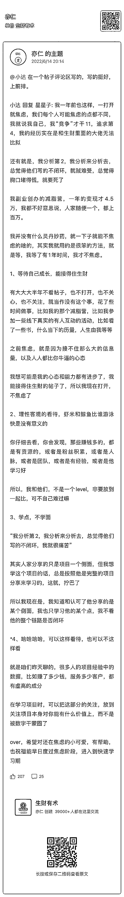

🏅 无

👍 书情

书情：小达的微信推荐下呗，我结交下生财的一些优秀的人

海绵践行：已私

# #轻享# 亦仁：聊聊普通人如何在抖音上赚

海绵践行

2022-06-20 07:53:38

#轻享#  
亦仁：聊聊普通人如何在抖音上赚钱  
[`lyrz1vdb4n.feishu.cn/docx/doxcniW1IqkMXpnG...`](https://lyrz1vdb4n.feishu.cn/docx/doxcniW1IqkMXpnGtigUhQYgXPd) 

🏅 无

👍 #渠说渠话，书情

#渠说渠话：没有权限，看不了

书情：申请下就好了吼叫

# #藏书楼# 方法论：如何构建自己的项目库

海绵践行

2022-06-20 07:48:13

#藏书楼#  
方法论：如何构建自己的项目库和知识库  
[`lyrz1vdb4n.feishu.cn/drive/folder/fldcnYKA...`](https://lyrz1vdb4n.feishu.cn/drive/folder/fldcnYKAPqESIJY2FYlJ0z6kGzA) 

🏅 无

👍 峥嵘岁月，#渠说渠话，书情

书情：权限我都申请了，有时间通过下呗

海绵践行：都通过了，我记得都设置了可阅读，不知道为什么还需要权限

# #小红书# 新增小红书玩法大全栏目小红书

海绵践行

2022-06-17 12:59:33

#小红书#  
新增小红书玩法大全栏目  
  
[小红书玩法大全 - 文件夹](https://lyrz1vdb4n.feishu.cn/drive/folder/fldcnkdYZrzeBWbtELhQKhWVVde) 

🏅 无

👍 书情，Carol。，#渠说渠话

# #流量挖掘# #视频号# 来自花爷的分享

海绵践行

2022-06-17 08:56:37

#流量挖掘# #视频号#  
来自花爷的分享：给创业者看的 IP 下半年攻略  
[`k3vtw0va9w.feishu.cn/docx/doxcn4CkP92SPNUg...`](https://k3vtw0va9w.feishu.cn/docx/doxcn4CkP92SPNUgQ6lX19b9Sac) 

🏅 无

👍 书情，Carol。，#渠说渠话

书情：看完了，直播要做好准备啊，像花爷做直播肯定是做了不少的准备的，我呢，目前直播还处于刷数据的层次\[捂脸\]

# #轻享# 赚钱不盲目追求新方法：

海绵践行

2022-06-17 08:32:37

#轻享#  
赚钱不盲目追求新方法： 

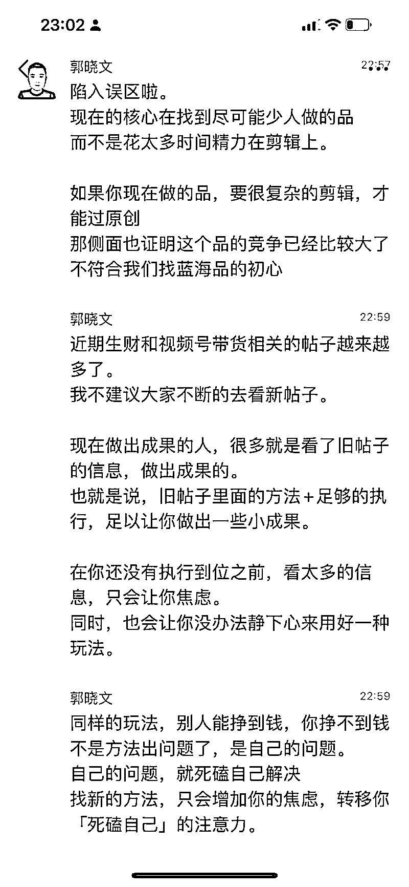

🏅 无

👍 书情，Carol。

书情：认可的

# #轻享# 关于学习和焦虑：小达 回复 星

海绵践行

2022-06-17 08:24:18

#轻享#  
关于学习和焦虑：  
小达 回复 星星子: 我一年前也这样，一打开就焦虑，我们每个人可能焦虑的点都不同，我就说我自己，我“竞争”才干 11，追求第 4，我的经历实在是和生财里面的大佬无法比拟  
  
还有就是，我分析第 2，我分析来分析去，总觉得他们写的不闭环，就贼难受，总觉得胸口堵得慌，就要死了  
  
我副业创办的减脂营，一年的变现才 4.5 万，我都不好意思说，人家随便一个，都上百万。  
  
我并没有什么灵丹妙药，就一下子就能不焦虑的啥的，其实我就用的是很笨的方法，就是等，我等了有 1 年时间，我才不焦虑。  
  
1、等待自己成长，能接得住生财  
  
有大大大半年不看帖子，也不打开，也不关心，也不关注，就当作没有这个事，花了些时间做事，比如我的那个减脂营，比如我参加一些线下真实的有人互动的活动，比如看了一些书，什么当下的历量，人生由我等等  
  
之前焦虑，就是因为接不住那么大的信息量，以及人人都比你牛逼的心态  
  
我想可能是我的心态和能力都有进步了，我能接得住生财的帖子了，所以我现在打开，不焦虑了  
  
2、理性客观的看待，虾米和鲸鱼比谁游泳快是没有意义的  
  
你仔细去看，你会发现，那些赚钱多的，都是有资源的，或者是粉丝积累，或者是人脉，或者是团队，或者是有经验，或者是他学习好  
  
所以，我和他们，不是一个 level，非要放到一起比，可不自己难过嘛  
  
3、学点，不学面  
  
“我分析第 2，我分析来分析去，总觉得他们写的不闭环，我就很痛苦”  
  
其实人家分享的只是项目一个侧面，但我想学这个项目的话，总是按照他是完整的项目分享来学习的，这就，拧巴了  
  
所以我现在是，我知道和认可了他分享的是某个侧面，我也只学习他的某个点，我不看他的整个链路是否闭环  
  
\*4、哈哈哈哈，可以这样看待，也可以不这样看  
  
就是咱们昨天聊的，很多人的项目经验中的数据，比如赚了多少钱，服务多少客户，都有虚高的成分  
  
在学习项目时，可以把这部分的关注，放到关注项目本身对你能有什么价值上，而不是被数字干蒙圈了  
  
over，希望对还在焦虑的小可爱，有帮助，也祝福能早日度过焦虑阶段，进入到快速学习期 

🏅 无

👍 书情

# #视频号# 视频批量制作：技术小白也能一

海绵践行

2022-06-16 12:45:38

#视频号#  
视频批量制作：技术小白也能一天制作一万个爆款书单视频  
[`hdjmn9shgs.feishu.cn/docx/doxcnMIVoZZba17x...`](https://hdjmn9shgs.feishu.cn/docx/doxcnMIVoZZba17xahYXRiFBsgd) 

🏅 无

👍 书情，Leo Wang，#渠说渠话

# #藏书楼# #赚钱创业方法论# 藏在抖音

海绵践行

2022-06-15 23:45:48

#藏书楼# #赚钱创业方法论#  
藏在抖音规则里的赚钱项目：  
[`lyrz1vdb4n.feishu.cn/docx/doxcnJbEIrInbMMU...`](https://lyrz1vdb4n.feishu.cn/docx/doxcnJbEIrInbMMUrTm2oaeyRnc) 

🏅 无

👍 书情，#渠说渠话

海绵践行：这篇真的写的很好啊，研究规则，懂得规则就是一种可以变现的门槛，可以迁移到其他高需求平台

#渠说渠话：这种算是平台服务商，服务平台用户的，就像淘宝服务商类似！

海绵践行：是的，看他们写的最开始也是个人在做

# #视频号# 视频号带货的底层逻辑：htt

海绵践行

2022-06-14 23:27:08

#视频号#  
视频号带货的底层逻辑：  
[`lyrz1vdb4n.feishu.cn/docx/doxcn1WssstMkg6U...`](https://lyrz1vdb4n.feishu.cn/docx/doxcn1WssstMkg6UTDHV7j4TPgb) 

🏅 无

👍 书情，#渠说渠话

# #视频号# 视频号带货不完全指南（点开文

海绵践行

2022-06-13 08:22:55

#视频号#  
视频号带货不完全指南（点开文章里面的链接）  
[`lyrz1vdb4n.feishu.cn/docx/doxcn5JPDw6tBebE...`](https://lyrz1vdb4n.feishu.cn/docx/doxcn5JPDw6tBebE0y40todKaPd) 

🏅 无

👍 书情，#渠说渠话

# #实用工具# 人工智能生成绘画指南 htt

海绵践行

2022-06-13 08:04:08

#实用工具#  
人工智能生成绘画指南  
[`lyrz1vdb4n.feishu.cn/docx/doxcn1HOemVJShmu...`](https://lyrz1vdb4n.feishu.cn/docx/doxcn1HOemVJShmuM7G7Sc0DXTf) 

🏅 无

👍 书情，#渠说渠话

# #轻享# 观点分享：“亦仁，问你个问题，

海绵践行

2022-06-13 07:46:59

#轻享#  
观点分享：  
“亦仁，问你个问题，你觉得星球这个产品定位在“链接”这个动作上，这个“链接”，在你认为都包含了哪些要素呢？”  
  
来分享一下我的想法：  
  
有效链接本质上是公平交换，进一步是交易。交易的信任强度远大于交换。  
  
一个非常优秀的社区，会存在大量去中心化高频高质交换，生财目前还做不到，做不到的原因在于没有提炼出核心交换元素，更进一步原因在于这是一个付费就能进的社群，而没有加入其他审核门槛。  
  
所以要创造有效链接，要提炼出社群成员能拿出来交换的东西，并设计出有效的交换规则，考验看问题的角度，我的一个思路是，在赚钱这个事情上，一个人能拿出来的东西是什么？  
  
1\. 时间  
2\. 金钱  
3\. 信息  
4\. 认知  
5\. 人脉  
6\. 经历  
  
在每个维度上，根据社区的属性去找到合适的交换点，并创造出公平交换的规则，可能就能创造有效链接了。  
  
最强大的交换规则应该就是市场经济了吧？ 

🏅 无

👍 书情

# #视频号# 视频号后端微信小商店的个人经

海绵践行

2022-06-09 00:04:31

#视频号#  
视频号后端微信小商店的个人经验分享  
[`lyrz1vdb4n.feishu.cn/drive/folder/fldcnwrd...`](https://lyrz1vdb4n.feishu.cn/drive/folder/fldcnwrdnGpROU5HEca74R9YGJf) 

🏅 无

👍 书情，#渠说渠话

海绵践行：做短视频没资源的可以做带货赚钱，有资源的让别人替你带货加快赚钱效率

# #视频号# 视频号实践分享：https:

海绵践行

2022-06-06 23:31:19

#视频号#  
视频号实践分享：  
[`lyrz1vdb4n.feishu.cn/docx/doxcnJWZsKyqFKsb...`](https://lyrz1vdb4n.feishu.cn/docx/doxcnJWZsKyqFKsbAXj3evJ3LGc) 

🏅 无

👍 书情，#渠说渠话

海绵践行：视频号就是现在的风口，所以最近会侧重分享视频号玩法和经验

# #轻享# #视频号# 生财老年人，做视频

海绵践行

2022-06-04 22:44:36

#轻享# #视频号#  
生财老年人，做视频号 2 个月的最后一天，带货 10000+  
先上图：  
  
  
这里的转账是粉丝可能不会直播间下单，微信转给我代下单的，所以在做视频号两个月的最后一天，也就是第 61 天，当天营业额 10000+  
  
  
特别感谢生财的培养！  
我是严格按照咱们生财的大小航海课程里教授的来做的，能有这个成果，非常非常非常感谢生财！  
大航海就是两次抖音的大航海  
小航海，隆重推荐孤狼老师、刘小排老师和文林老师带队的小航海  
  
不太会写，简单分享一下：  
一、开始起号  
  
从 4 月 1 发布第一条视频，到 5 月 31,61 天，150 条视频，中间有段时间没更新，是因为没有正反馈，播放量只有几十。 后来回生财看到文林老师发的视频号帖子才日更起来的，不到一个星期就爆了几个视频，马上开播，连商品都没上就开播了。第二天上好商品，每天开播到现在，是 5 月的 13 号到 5 月 31,19 天，变现差不多 7 万吧。  
  
这个，不能和大佬们相提并论，但是我之所以来晒一下， 是因为我就是你们现在天天念叨的中老年人群，性别女，开车只会开，轮子只要能跑我就能开，曾经前一天刚新换的汽车轮胎扎了我不知道，愣是开了 50 公里开回家被别人提醒才发现车胎没气了，然后到店里去修被告知轮胎报废了。所以各位就知道我是多么，，，电脑只会简单使用，技术问题一窍不通。年龄 41，一直都比实际年龄要成熟，所以我是妥妥的中老年人群，文林老师在生财视频号群里分享的时候问说摸高器这个品，在视频号哪个人群买的多。我说奶奶买。哈哈，正确答案！你们就知道我的心理年龄应该是奶奶辈了，我这个奶奶辈的中老年人都能做到的，你们年轻人一定更可以。  
  
能让我坚持下来的就是涛哥的这句话：先上 100 个视频再说。所以我就傻傻的每天剪辑，发布。感谢涛哥！  
  
二、我来生财一年了  
  
去年 5 月加入生财，进入生财就上船了花爷的自媒体 IP 小航海，精华帖项目库里只要我能看懂的基本都看了一遍，跟着生财的精华帖做过闲鱼（单号月利润 3000+），做过淘宝（淘宝是清货，虽然货还没清完，但是特别感谢木易和范磊对我的无私指导），后来就跟着抖音大航海走，两次大航海的志愿者，大航海期间我没有做自己的号，是和朋友合作他的号，结果号起来了稳定入账了朋友却没有按约定分钱给我，所以就 88 了。然后这次抖音直播大航海结束，我就准备做自己的号。  
  
当时特别迷茫，迷茫到每天心里慌慌的，不知道选什么品，不知道做什么。那些日子天天看大航海的课，看文林船长的抖音视频带货小航海和小排老师的蓝海选品小航海，天天看，看完去选品，上视频测试，先后选了三类品，都没有起色。  
  
然后鼓动朋友做他的催眠师账号，虽然这个朋友和我都在北京，但是因为疫情不能见面，所以我们就是线上沟通，他拍了十几条视频之后终于承受不住天天被我骂的折磨放弃了，我可能要求比较高吧，  
  
然后就做了现在这个号，做这个号没有想带货，带货的这部分收入纯属意外之财，但是也充分验证了视频号风口的存在。生财诚不欺我！  
  
这个号，初始设计是为我们私域引流的，引流到微信，我们做了一个打卡返现群（灵感来源于这篇阿猫写的  
《100 天写作返现活动，提供价值的时候顺带赚钱》），群里再发掘高客单的付费用户，目前已经产生 3 位转化，收款 5 万+。  
  
带货，纯属意外，所以视频爆了的第一场直播，完全没有上商品。是第二天紧急在选品中心搜的，没想到这开张第一天就卖了 5792 元。有直播间成交的，也有自己找到主页商品下单的。  
  
然后开始每天直播 4 个小时起步，因为违规四次被扣了 15 分，但每天都有成交，最少的一天我印象中是卖了 1800 多，后面虽然违规限流导致在线只有十几人场观不到 1000，但是还是能卖 3000 多 5000 多，这是不是中老年人群旺盛的购买力的表现~最近上了一个客单价 1000+的品，也卖的很好，让我惊叹这个人群真有钱。然后我还有一个准备定价大几千的产品，正在筹划中，就天天被粉丝催。。。我就天天想我爸妈在家也是这么买买买的吗。。。大家快来割了他们吧  
  
三、我的总结  
1、本身我就是中老年人群，我了解中老年人人群的需求和心理特征，也就是对这个人群人性的把握上，比较不太会踩坑。本来年龄大是劣势，可是在现在的视频号这里就占优势了。  
2、从自媒体 IP，孤狼老师的抖音小航海，文林老师的视频带货小航海，小排老师的蓝海选品挖掘小航海，生财的精华帖项目库风向标，这些每天都给我滋养，而我听话照做，  
3、一定要直播。我看了我的变现数据是直播占了 60%，  
4、直播一定要讲好你的故事，你和这个品的故事，通过一个好故事，能让粉丝认识你了解你相信你，进而追随你。当然，后期你的服务品质也要跟上，要有一说一，不骗人。讲好你和品的故事，也就区别了你和同行的差距。记得咱们生财有位圈友做闲鱼卖艾灸，她就很聪明，她说自己是艾灸工厂，要搬迁清库存，还招代理，所以她的销售额就做得好。  
  
四、有待提升的点：  
1、其实这个成绩不在于我本人的能力有多强，没有，我的直播技巧还有非常大的提升空间，目前就会用直播大航海学到的一招，互动互动打 1 打 2，就用了这一招，限流过了的最近两场直播，场观 4-5 千，今天的场观 4000 多，比昨天 5000 多的场观少点，但是销售额比昨天高，昨天是 8000 多。抖音直播大航海的课程准备再回炉，学了用到自己的直播中，学习实践，实践了再学习，学习了再实践……  
2、我的视频剪辑特别慢，现在每天上午直播，下午回复粉丝问题，晚上剪辑视频结束都 12 点后了，需要调整。提升效率，保证睡眠。  
3、准备自己开小店，  
  
隆重的感谢生财的培养  
我现在所取得的这所有的收获，这一切都要感谢生财。把我从一个从不刷抖音的老人，快手小红书视频号都没有开通的人，经过一年的培养，可以从视频号拿到一点成绩，不是我厉害，是生财 YYDS！  
  
各位一定要用好生财的宝藏，争取每天都回生财看看，听生财的话，照生财说的做，相信人人都能完成亦仁大大为本期圈友定下的年入 50 万的 FLAG!  
  
至于号怎么做，生财都讲了，两次抖音大航海的课程绝对值得你一看再看，常看常新。刚刚结束的小航海文林船长的和小排老师带队的，价值百万！ 

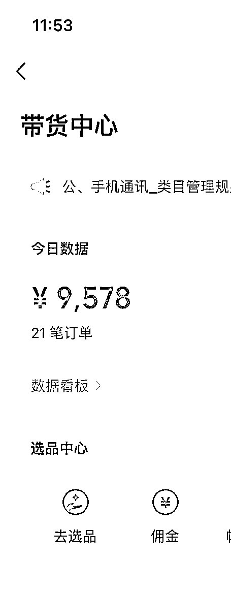

🏅 无

👍 书情，Carol。，#渠说渠话

书情：执行力好强啊

海绵践行：最近的感觉就是收费也不能太保守

书情：恩，是的

# #RPA 自动化# 用找资源加好友案例详细

海绵践行

2022-06-02 17:56:51

#RPA 自动化#  
用找资源加好友案例详细说明 RPA 有啥用 \_by：阿愚呱呱 

🏅 无

👍 书情

# #视频号# 0 门槛可做的，中视频项目领域

海绵践行

2022-06-01 08:34:23

#视频号#  
0 门槛可做的，中视频项目领域汇总 \_by：铭则 

🏅 无

👍 大鱼海棠，书情，#渠说渠话

Carol。：每次都是隔一段时间全部一起看 \[捂脸\]

海绵践行：有收获就好\[憨笑\]

# #轻享# 服务流程打造仪式感，CRM 提升

海绵践行

2022-05-31 23:53:32

#轻享#  
服务流程打造仪式感，CRM 提升管理效率，高客单价社群也能实现 74%转化  
\_by：生财-美德布耀布耀德 

🏅 无

👍 书情

# #视频号# 视频号橱窗开放类目一览表：视

海绵践行

2022-05-31 23:26:52

#视频号#  
视频号橱窗开放类目一览表：  
[视频号橱窗开放类目一览表-2022 年 5 月 17 日发布版](https://docs.qq.com/sheet/DTURoVFZiVXdRQlJj?tab=BB08J2) 

🏅 无

👍 #渠说渠话，书情

# #视频号# 微信视频号挂商品

海绵践行

2022-05-30 20:44:33

#视频号#  
微信视频号挂商品 

🏅 无

👍 书情，#渠说渠话

# #视频号# 选带货商品&选视频

海绵践行

2022-05-30 20:43:30

#视频号#  
选带货商品&选视频 

🏅 无

👍 书情，#渠说渠话

# #视频号# 视频号注册流程

海绵践行

2022-05-30 20:43:04

#视频号#  
视频号注册流程 

🏅 无

👍 书情

# #视频号# #电商# 微信视频号音乐 U 盘

海绵践行

2022-05-26 22:47:23

#视频号# #电商#  
微信视频号音乐 U 盘项目全攻略（8000 字完整版）\_by：生财老宁 

🏅 无

👍 #渠说渠话，书情

# #实用工具# 如何利用 RPA 实现自动

海绵践行

2022-05-26 00:02:46

#实用工具#  
如何利用 RPA 实现自动化获客，让项目提效躺赚？\_by：生财-二哥 

🏅 无

👍 书情

# #轻享# 转自亦仁关于项目行不行解答的 1

海绵践行

2022-05-25 23:58:14

#轻享#  
转自亦仁  
关于项目行不行解答的 10 条核心观点  
  
1\. 勇敢收钱，超预期交付  
  
很多人做服务或产品不敢收钱，更不敢收高价，担心要是服务不好怎么办？  
  
自己给自己定一个要求：如果我服务不好，很多人不满意，那么所有的钱都完整退回。  
  
即使这样，大家免费享受了我的服务，我验证了我的产品和服务，知道如何更好的去满足需求，大家不亏，我也不亏。  
  
有了这条底线后，勇敢收钱，全力交付，超预期交付。  
  
最后，结果往往比你担心的要好非常多。  
  
  
2\. 从朋友圈起步  
  
起步阶段，验证「真的有人愿意买」大于一切，朋友圈是最低成本最快的验证方式。  
  
相比于我的内心的各种扭捏尴尬犹豫不决，验证「真的有人愿意买」更重要，发条朋友圈没什么大不了的。  
  
  
3\. 通过问具体清晰的问题来理清赚钱路径  
  
不要问宏观的问题：  
  
怎么选品？  
视频号视频怎么剪辑？  
抖音怎么赚钱？  
社群怎么做？  
。。。  
  
提问的水平代表你思考的水平，提问越宏观，层次越是低，越是赚不到钱。  
  
通过层层追问倒逼自己问更具体的问题，来找到赚钱的路径。  
  
视频号怎么赚钱？大家在视频号上怎么赚钱的？大家在视频号上怎么带货赚钱？视频从哪里来的？视频怎么剪辑的？有什么工具？大家在怎么做？带的什么货？哪些货更受欢迎？赚的谁的钱？大概赚多少？投入时间怎么样？我要是做的话第一步是什么？  
  
向谁提问？  
  
向谁提问都不会有足够强的耐心，除了搜索引擎。所有的问题，搜索引擎几乎都有答案，而且不会嫌弃你的白痴问题。  
  
一定要用好生财有术这个 1 亿字的无广告高质量信息搜索引擎。  
  
  
4\. 完整的阅读生财有术相关帖  
  
你能想象一个新手，不做任何攻略，就去荒野求生了？  
  
大概率会死的很惨吧？  
  
那为什么有那么多新手，连最基本的几篇相关内容都不阅读，就开始下场，到处踩坑打击自己，然后找地方交钱求带？  
  
做一个项目，将相关内容完整看一遍是最基础的要求，做项目也是要考「驾照」。  
  
  
5\. 每天制定计划推进就是最快的赚钱方式  
  
日拱一卒，慢就是快。  
  
只要在行动的路上，可能会走弯路，可能大幅偏离航线，甚至会掉头，但只要在路上，在行动，在实战，就大概率能到达终点。  
  
何况，还有生财有术这张地图。  
  
但不下场，停在路边，谁也没办法。  
  
  
6\. 不要成为学习高手，要成为实战高手  
  
不要问自己今天学了什么赚钱知识，而是问自己今天为了赚钱做了什么行动。  
  
不要说自己今天看了几篇精华帖，而是说：  
  
我今天开通了小店，选了两个品，传了两个视频；  
我今天设计好了详情页，发了两条朋友圈，私聊了 30 个好友；  
我今天开通了广告账户，做了一条投放计划，找高手请教了素材怎么剪；  
。。。  
  
从 0 到 1，切记不要成为学习高手，而是要成为实战高手。  
  
  
7\. 不要在短期的事情上想长期的意义  
  
短期的事情不是没有意义，但在短期的事情上去想竞争力、护城河、战略就没什么意义了。  
  
什么是短期的事情？  
  
搬运，套利，无货源，无人直播，垃圾内容，薅羊毛，平台漏洞，对抗规则。  
  
如果你将整个商业模式架构在短期的事情上，总有一天会塌陷。  
  
  
8\. 简单复制就可以有收入的已经被高手干完了，只有要动点脑的项目  
  
简单可复制可赚钱，交钱跟着学习就行。  
  
这样的项目，只会出现在招商割韭菜的文案中。  
  
剩下的，都是需要动脑的项目，正是因为有一些问题需要动脑解决，才留下了赚钱的机会。  
  
否则钱早就被资金更多、团队更强、执行力更强的人赚完了。  
  
  
9\. 任何赛道，不管竞争多激烈，都不多一个能赚几十万的人  
  
赛道与我们无关。  
  
竞争激烈，也不多一个一年目标想多赚几十万的人。  
  
赛道分析，那是讲给要去做行业头部的人说的，和我们没关系。  
  
不要再把自己套进高大上的创业方法论，那是讲给想改变世界的创业者听的，我们的目标是先赚钱，再谈其他。  
  
想赚钱，就得先接地气，接地气，就要踏踏实实的看生财有术内容。  
  
  
10\. 你的时间成本相比于未来你要赚到的钱，不值一提  
  
很多人还没开始，就担心自己时间投入，外一做不成岂不是浪费时间了？  
  
请问你的时间值多少钱？  
你所谓的沉没成本有多高？  
  
从 0 到 1 起步，相比于一个项目做成你能赚到的钱，相比于下场行动获取到的认知和经验，你的时间成本根本不值一提。  
  
任何你想尝试的新事情，我都是这句话：  
  
试试看，成本不大。 

🏅 无

👍 书情，彬垚，Leo Wang

# #视频号# 抖音腰部直播间复盘：持续更新

海绵践行

2022-05-24 22:21:37

#视频号#  
抖音腰部直播间复盘：持续更新爆款+低价供应链+控制发货速度和库存 \_by：生财阿莫 

🏅 无

👍 书情

# #赚钱创业方法论# 持续赚钱的学问 \_b

海绵践行

2022-05-22 11:20:26

#赚钱创业方法论#  
持续赚钱的学问 \_by:scaler  
  
精华：  
在个人成长中，基本功有：  
（1）读书，不因为主题不喜欢而停止阅读，只要是自己应该会的，就能认真学完  
（2）学习，不因为难度太大无法承受而放弃，只要是想学的，总会尝试突破  
（3）听课，能集中注意力不走神，可以同步记笔记，听完就能输出  
（4）复盘，参与了一场学习与讨论，能快速梳理出要点，整理收获体会  
（5）遇到情绪波动，能抵抗得住放弃的诱惑，仍然保持前行  
  
赚钱基本功：  
（1）阅读精华帖，写阅读分析与评论，梳理作者思路，并总结可以借鉴的方面。  
（2）在互联网上看到广告、文案时，不要马上跳过，分析这样写的原因。  
（3）看到一些广告的微信可以加上好友，搞调研。  
（4）持续用数据思维看问题，测算你看到的商业行为的运营数据，积累对数据量级的敏感性。  
（5）见到你觉得文章写的有启发的人，把你的阅读感想发给对方，不要只发自我介绍。 

🏅 无

👍 书情，彬垚

海绵践行：

# #赚钱创业方法论# 重要的是下场干，且持

海绵践行

2022-05-22 11:15:43

#赚钱创业方法论#  
重要的是下场干，且持续行动-1 by：生财-亦仁 

🏅 无

👍 书情

# #赚钱创业方法论# 我花了一天的时间，整

海绵践行

2022-05-22 11:12:35

#赚钱创业方法论#  
我花了一天的时间，整理出新圈友必看的 16 篇文章\_by：生财-大彭 

🏅 无

👍 书情，#渠说渠话

海绵践行：

# #赚钱创业方法论# 如何从 0 到 1 发掘一个

海绵践行

2022-05-22 11:09:17

#赚钱创业方法论#  
如何从 0 到 1 发掘一个项目？\_by：生财-巧克力 

🏅 无

👍 书情，彬垚

海绵践行：

# #视频号# 视频号带货赚钱的实战经验分享

海绵践行

2022-05-20 07:43:38

#视频号#  
视频号带货赚钱的实战经验分享——新手普及帖 by:文林 

🏅 无

👍 书情，#渠说渠话，Leo Wang

# #轻享# 如何寻项目\_by：亦仁 （时刻

海绵践行

2022-05-19 07:52:38

#轻享#  
如何寻项目\_by：亦仁 （时刻提醒自己）  
今天白天，龙珠群聊了好久找对象的内容：到底应该找什么样的对象？  
  
这个问题，和很多圈友问我的一个问题，很像：  
  
“亦仁，我情况是这样的，我应该找什么样的赚钱项目？”  
  
找对象我没啥经验，但找项目经验，我还挺丰富，上来说几句。  
  
两个问题，本质上是同一件事：如何在约定的自身条件下，找到最好的选项？  
  
我的答案，也很直接：对不起，找不到。  
  
为什么？以下四点原因：  
  
第一点，大部分人都会高估自己。  
  
这是常态，你以为自己是 90 分，实际上可能只有 80 分，你以为自己是 80 分，实际上可能只有 70 分。别犟，你我都一样，嘴上虽然常说自己很普通，内心觉得自己还是挺优秀的。  
  
在这种高估自己的错觉下，你想找一个配的上自己的对象或项目，实际已经是「高攀」了。  
  
  
第二点，找项目不是解数学题，找项目有时间限制。  
  
你在找项目上浪费的每一天，在每个项目上的犹豫不前，都变成了机会成本，这些成本的叠加，都变成了下一个项目的收入预期，找项目越久，下一个项目的收入预期越高。  
  
最后，只有预期收入非常高的项目，才能配得上你在寻找项目浪费的“众里寻她千百度”的时间，这样的项目，真的不存在。  
  
  
第三点，市面上根本就没有好项目。  
  
你以为，世面上有一、二、三、四等项目，有 65 分、75 分、85 分、95 分的项目，只是你暂时没找到而已，你需要多去寻找。  
  
但，现实情况是什么呢？  
  
在世面上你能看到的项目，永远都只有 65 分的，食之无味，弃之可惜，干不干？不干后面很多人在排队。  
  
真正的好项目，永远只在极少人的小圈子里面流动。  
  
在进入生财有术之前，你听到的所谓赚钱项目，可能也就局限于那些上传文件赚钱、打码赚钱、开个奶茶店、接个外包、开滴滴、摆个地摊、开淘宝店、加盟别人的品牌等。  
  
进入生财有术后，你会发现更大的世界，更多的项目，远比外界丰富的多的项目，甚至令你眼花缭乱。  
  
这些项目都是非常优质的项目吗？未必，但已经比绝大多数互联网信息渠道优质无数倍。  
  
  
第四点，好项目不是找到的，是干出来的。  
  
好的夫妻关系，不是一开始就是令人羡慕的，而是中间无数争争吵吵、磕磕绊绊磨合出来的。  
  
好的项目，不是一开始就是令人眼睛发亮，跳进去就能捡钱的，而是一开始有一两个还不错的点，慢慢干，持续干，终于把项目磨出来，有品牌，有利润，有壁垒，有用户认可，有复购，有发展空间，成为了所有人眼里的好项目。  
  
回到五年前，你敢说生财有术社群是一个好项目吗？我不敢。但现在，生财有术让我的优势得以发挥，我能赚到钱，寻找到自己的使命，我也能帮到很多人，团队有意义感，我认为这算是个不错的项目。  
  
所以，好项目找不到，只能干出来。  
  
  
啊，说了这么多，那到底如何找到适合自己的项目，我也结合我的经验给出几条具体意见吧：  
  
  
首先，主动把对自己的判断和评估下调一档，觉得自己是 85 分的，按照 75 分的自我评估去做选择，你会发现，空间大了很多。  
  
  
其次，在选项目的时候，设定一个最重要的筛选条件，以这个为核心，其余的都为这个来服务。  
  
李诞在《[李诞脱口秀工作手册](https://wx.zsxq.com/mweb/views/weread/search.html?keyword=李诞脱口秀工作手册)》里面说：  
  
要意识到你的全部人生，都理应要为你的创作提供养分，为它服务。  
  
找项目同理，选定一个你最看重的条件，其余条件都可以作为代价来服务第一个条件。  
  
你希望项目赚钱多，那么你就要做好事多、离家远的心理准备，这些都是代价。  
  
既要也要是不成熟，既要也要还要那就是非常幼稚了。  
  
  
最后，也是我认为最重要的一条：  
  
从 65 分的项目先开始，也就是「先赚第一块钱」。  
  
我们做项目，不是一个项目做一辈子，也没有人会一个职业一辈子，与其花很多的时间去寻找项目，不如从你能够看到的项目先开始。  
  
每一个项目，都当做技能的磨刀石，经验的淬炼场，敏锐度的测试器。  
  
慢慢的，你会发现你能看到的项目越来越多，你能抓住的项目也越来越多，甚至出现了一些 75 分、85 分的项目机会。  
  
芒格说：如果你想获得某样东西，那就让自己配得上它。  
  
以上，与各位共勉。 

🏅 无

👍 Leo Wang，书情

# #一起赚美元# 如何把想法变成第一块钱文

海绵践行

2022-05-18 21:11:41

#一起赚美元#  
如何把想法变成第一块钱  
文章案例链接：  
大公司案例：  
[Pet Sitters International, the leading pet-sitter ...](https://www.petsit.com/)  
[Wag! | Find Best Local Dog Walkers, Boarders, and ...](https://wagwalking.com/)  
  
小公司案例：  
[San Diego Dog Walkers About Us](https://www.walkstowags.com/about-us-walks-to-wags-dog-walking)  
[`www.furryfellaspetsitting.com/`](https://www.furryfellaspetsitting.com/)  
[`kathysdogwalking.com/refer-a-friend/`](https://kathysdogwalking.com/refer-a-friend/) 

🏅 无

👍 #渠说渠话

# #一起赚美元# 如何把需求变成钱

海绵践行

2022-05-18 21:06:14

#一起赚美元#  
如何把需求变成钱 

🏅 无

👍 #渠说渠话

# #一起赚美元# 针对「仪式感」完成了每年

海绵践行

2022-05-18 21:01:31

#一起赚美元#  
针对「仪式感」完成了每年 11W 美金的收入 

🏅 无

👍 #渠说渠话，书情

# #一起赚美元# 微型景观搭建中的创业之路

海绵践行

2022-05-18 20:53:10

#一起赚美元#  
微型景观搭建中的创业之路 

🏅 无

👍 书情

# #一起赚美元# 通过 SEO 引流自己网站，

海绵践行

2022-05-18 20:50:05

#一起赚美元#  
通过 SEO 引流自己网站，面向大学生、普通职业工作者、运动员，提供求婚策划服务 

🏅 无

👍 #渠说渠话，书情

# #一起赚美元# 健身节食提供的「健康财富

海绵践行

2022-05-18 20:47:04

#一起赚美元#  
健身节食提供的「健康财富」 

🏅 无

👍 #渠说渠话，书情

# #一起赚美元# 如何通过 Excel 教程网

海绵践行

2022-05-18 20:43:04

#一起赚美元#  
如何通过 Excel 教程网站完成月入 10000 美元目标 

🏅 无

👍 #渠说渠话，书情

# #轻享# 从想“干掉”知识星球，到通过二

海绵践行

2022-05-17 23:42:10

#轻享#  
从想“干掉”知识星球，到通过二手书实现年入 100 万 

🏅 无

👍 书情

# #轻享# 一个普通人对“个人 IP”这个词

海绵践行

2022-05-17 22:54:44

#轻享#  
一个普通人对“个人 IP”这个词的一点体会\_by：小夕 

🏅 无

👍 书情

海绵践行：

# #视频号# 分享一下 IP 起号的好工具，小

海绵践行

2022-05-17 22:52:54

#视频号#  
分享一下 IP 起号的好工具，小号爆款案例库\_by：花爷  
  
《小号爆款案例库-5 月三平台合集（公开版）》：[小号爆款案例库-5 月三平台合集（公开版）](https://shimo.im/docs/1d3aVwovxgUwL5qg/)  
10 大行业 IP 玩法总结：  
[10 大行业 IP 玩法汇总](https://articles.zsxq.com/id_x3wimpuxzohk.html) 

🏅 无

👍 #渠说渠话，书情

海绵践行：

#渠说渠话：好东西

# #轻享# 社群定高价策略的讨论\_by：成

海绵践行

2022-05-17 22:45:53

#轻享#  
社群定高价策略的讨论\_by：成甲 

🏅 无

👍 书情

海绵践行：

书情：收到

# #轻享# 写作变现的方法论\_by：芷蓝

海绵践行

2022-05-17 22:43:33

#轻享#  
写作变现的方法论\_by：芷蓝 

🏅 无

👍 书情

海绵践行：

# #视频号# 《视频号直播卖读书会 | 4

海绵践行

2022-05-17 22:38:53

#视频号#  
《视频号直播卖读书会 | 4 小时进账 2W+》\_by：阿猫 

🏅 无

👍 书情

海绵践行：

书情：收到

# #一起赚美元# 怎样通过写作捕获用户痛点

海绵践行

2022-05-17 21:43:02

#一起赚美元#  
怎样通过写作捕获用户痛点 

🏅 无

👍 书情

# #一起赚美元# 创业者因如何避免创业中的

海绵践行

2022-05-17 21:40:40

#一起赚美元#  
创业者因如何避免创业中的死循环，在逆境中留存？ 

🏅 无

👍 书情

# #一起赚美元# 付费知识应该如何从 0-1

海绵践行

2022-05-17 21:38:53

#一起赚美元#  
付费知识应该如何从 0-1？ 

🏅 无

👍 书情

# #一起赚美元# #轻享# 我是如何赚到第

海绵践行

2022-05-17 08:22:49

#一起赚美元# #轻享#  
我是如何赚到第一个一百万\_by：亦仁 

🏅 无

👍 书情，#渠说渠话

# #藏书楼# 判断项目行不行的极简方法\_b

海绵践行

2022-05-17 08:01:16

#藏书楼#  
判断项目行不行的极简方法\_by：刘小排 

🏅 无

👍 书情，#渠说渠话

海绵践行：

# #轻享# 如何判断自己的创业项目好不好？

海绵践行

2022-05-17 07:52:00

#轻享#  
如何判断自己的创业项目好不好？\_by：刘小排 

🏅 无

👍 书情

# #一起赚美元# 挖掘赚钱产品的 12 个提示

海绵践行

2022-05-17 07:47:19

#一起赚美元#  
挖掘赚钱产品的 12 个提示 

🏅 无

👍 叶提，书情，#渠说渠话

# #一起赚美元# 带你了解服装定制生意

海绵践行

2022-05-17 07:44:51

#一起赚美元#  
带你了解服装定制生意 

🏅 无

👍 书情

# #一起赚美元# 通过「标题生成工具」，他

海绵践行

2022-05-17 07:42:05

#一起赚美元#  
通过「标题生成工具」，他 2 天赚了 16000 美元 

🏅 无

👍 书情，#渠说渠话

# #一起赚美元# 自助电子出版物怎么赚钱参

海绵践行

2022-05-16 08:29:33

#一起赚美元#  
自助电子出版物怎么赚钱  
参考资料：  
其他参考资料链接：  
growthlab.com/how-to-self-publish-a-book-and-double-revenue/  
smartblogger.com/kindle-publishing/  
medium.com/escaping-the-9-to-5/monetize-your-life-how-to-earn-2000-per-month-in-passive-income-through-amazon-kdp-f1092f873f2e 

🏅 无

👍 书情，#渠说渠话

# #一起赚美元# 4 个国外和赚钱/创业相关

海绵践行

2022-05-16 08:23:31

#一起赚美元#  
4 个国外和赚钱/创业相关的文章  
文中链接 1：[`blog.lempire.co/0-to-4m-arr-in-3-years-boo...`](https://blog.lempire.co/0-to-4m-arr-in-3-years-bootstrapped/)  
文中链接 2：[My 1 Year Old Amazon Affiliate Website Making $3,0...](https://www.nichepursuits.com/amazon-affiliate-website/)  
文中链接 3：[Part lI: An Overview of Visa — Mine Safety Disclos...](https://minesafetydisclosures.com/blog/2019/7/23/part-ll-an-overview-of-visa)  
AppSumo 平台的终身交易介绍：[What is a Lifetime Deal? - AppSumo Help Center](https://help.appsumo.com/article/34-what-is-a-lifetime-deal)  
一个终身交易型软件的复盘文章：[The Double-edged Sword of a Lifetime Deal | Lunadi...](https://www.lunadio.com/blog/the-double-edged-sword-of-a-lifetime-deal/) 

🏅 无

👍 书情，#渠说渠话

# #一起赚美元# 创业 3 年、年收入 400

海绵践行

2022-05-16 08:18:08

#一起赚美元#  
创业 3 年、年收入 400 万美金的创业复盘 

🏅 无

👍 书情，#渠说渠话

# #一起赚美元# 做一个国外的博客网站能赚

海绵践行

2022-05-13 08:11:55

#一起赚美元#  
做一个国外的博客网站能赚多少钱？  

🏅 无

👍 书情

海绵践行：cps 需要多研究，是轻成本的赚钱方式

# #一起赚美元# 为什么有赚钱潜力、或者说

海绵践行

2022-05-13 08:08:45

#一起赚美元#  
为什么有赚钱潜力、或者说价值被低估的网站会被自己买到手？怎么避免自己买到的网站有坑？ 

🏅 无

👍 书情

海绵践行：评论区工具 cps 或许是一个思路

# #一起赚美元# 如何挑选小众又不用囤货的

海绵践行

2022-05-13 08:05:27

#一起赚美元#  
如何挑选小众又不用囤货的跨境电商产品？ 

🏅 无

👍 书情

# #藏书楼# 生财第五期精华集、项目集合

海绵践行

2022-05-12 08:00:04

#藏书楼#  
生财第五期精华集、项目集合 

🏅 无

👍 #渠说渠话，书情

# #藏书楼# 完美的创业项目，是怎么被想出

海绵践行

2022-05-11 23:29:52

#藏书楼#  
完美的创业项目，是怎么被想出来的？\_by：生财刘小排 

🏅 无

👍 #渠说渠话，书情

# #视频号# 在做了几十个账号以后，我们在

海绵践行

2022-05-11 23:00:05

#视频号#  
在做了几十个账号以后，我们在视频号也取得了一些结果，也指导了一些朋友取得了结果。这其中，在庞大的案例和数据支撑下，在失败于成功案例的对比复盘之下，我个人收获了非常多的一线实战经验。  
  
也就是咱生财有术，今天，就给大家同步一下我在视频号的这些总结吧。  
  
  
  
1、视频号带货的核心在选品，选品的核心在于对用户的理解。  
  
张一鸣说过，认知能力是决定一个人的核心竞争力。  
  
视频号带货竞争的第一阶段是信息差的竞争，优先知道的人有红利。第二阶段的竞争是认知差的竞争，对于平台理解深度的不同拉开了彼此的差距。  
  
记住，研究如何去重，用哪个软件，如何无人直播还在低纬度的思考之中。这个层次的维度研究，让你通过了去重审核，你也不一定能拿到流量，拿到流量，你也不一定能卖出去货，卖出去货，你也不一定能持续。  
  
去认真思考这个平台的规则，研究他的规则就要研究这个平台的需求，研究这个平台的需求就要研究这个平台的用户。尊重平台的用户，就是在尊重平台，尊重了用户，你就自然而然能拿到流量。  
  
视频号带货的核心在选品，选品的核心在于对用户的理解。  
  
电商其实很简单，三个字，人货场。“场”现在是在视频号，具体场景形态就是短视频和直播。我们要思考的重点就是这个场的“人”是怎么样的，然后再给这些人匹配以适合的“货”。  
  
对于人群理解的越深，越透，你越容易成功。都知道视频号的主要人群是中老年，这还不够。是一二线的中老年，还是三四线的中老年？这些中老年他们又真的需要什么产品？喜欢什么样的内容？你有引起足够重视的思考过吗。  
  
不是那种偶尔拍脑袋撞到一个品的思考，而是透过现象看本质，总结规律的思考。你能真正感同身受地去理解他们所思所想，甚至同他们融入一体，你就真正的离成功不远了。  
  
举个例子，你如果去视频号卖山竹这种水果，你成功的可能性很小很小很小。山竹这种水果，很多三四线的用户甚至没有听过，看到过，即使听到看到了，也会觉得这种水果有些贵。  
  
你问我，有没有可能就是因为没有看到过，用户觉得很新奇，所以想买回去尝尝？有这个可能，可能性很小。  
  
再举个例子，粘鼠板就容易火，因为中老年人生活在一些老小区里，或者是农村老家里，有老鼠。尔等住在大城市的年轻人，租的房子里也没这个东西，就体会不到有人看到这种视频还会点赞下单购买的心情了。  
  
在这个方向上的思考，已经让我取得成绩，而且主要是“成功概率”上的成绩。矩阵固然要有，基数必然要有，但是，方向还是必须明确！  
  
再次感谢教员，“从群众中来，到群众中去”，常看常新啊！  
  
  
  
2、要卖货，经营流量的重点是电商型流量，而不是内容型流量  
  
如果你不懂电商，你不懂卖货，即使做了一个百万播放的视频，一单都卖不出去那也是很正常的。  
  
我曾经说过，抖音最值钱的流量就是带有信任属性的 IP 流量，以及精准的产品展示流量。很多人简单的理解有了流量就可以自然出单卖货，简直是幼稚的无可救药。  
  
内容型流量是指可以煽动用户情绪的内容。包括爱国、愤怒、感动、共鸣、伤感...比如一段醉人心扉的鸡汤，比如煽动男女对立的言论，但是只有情绪价值的内容是不能卖货的。  
  
能卖货的电商型流量是指：第一，以产品为主角的产品展示流量，比如视频就是赤裸裸地展示一个麻辣兔头的卖点，撕开产品包装袋，然后大快朵颐地啃兔头，再配以一段卖货文案的 bgm，这就是典型的产品展示流量。第二，以故事为起点，然后软文植入介绍产品的内容。比如书单号，开头用一个动人的故事给你介绍洛克菲勒的创业经历，最后再告诉你他把一生的经历都写进了这本书，这本书里讲述了他如何从 0 到 1...  
  
记住，转化的核心是视频内容本身，引导只是锦上添花，给用户做指路牌，前提是用户要有愿意买的意向，你这些指路牌才有价值和意义。  
  
如果用户都不知道这个视频有啥可以买的产品，没有一点购买的意向，你的评论引导，简介引导，昵称引导，甚至直播间直播，都没有半点意义！  
  
  
  
3、流量持续的核心在于粉丝数量以及粉丝质量  
  
通过大量的事实，我可以明确告诉大家三个事。第一，视频号有公域推荐流量。第二，视频号有新手扶持期流量。第三，流量可以持续。  
  
第一，视频号确确实实有公域推荐流量，不用你去点赞，不用你有私域流量，一样可以零粉起爆视频。打开视频号以后，你会发现他的导航栏有三项，分别是【关注】【朋友】【推荐】，推荐那一栏就是公域推荐流量。  
  
而且，不同于抖音现在那么完善，去中心化的算法。视频号你一旦关注了某个博主，在推荐那一栏里，你还会大量刷到你关注的这个博主的视频。  
  
第二，可以零粉起爆的核心是因为视频号平台现在的内容还太少，所以为了吸引更多的内容创作者，各种流量扶持，以及现金奖励。所以，就算你是零粉丝，也可以拿到公域推荐流量。  
  
第三，既然关注了一个博主以后，可以经常刷到这个博主的视频。那为何新手扶持期过了以后，粉丝也涨了，流量就没了？  
  
因为我文章写的第一点，你不理解平台，不理解平台的用户。你做的产品，新手扶持期涨了 1 万粉，但涨的全是 30 几岁的宝妈粉。他们虽然关注你了，但是她们一个星期甚至两个星期才打开一次视频号，才停留几分钟。而视频号的公域流量主要来源于【推荐】一栏，你的粉丝都不打开视频号，更刷不到【推荐】，你的账号肯定就会流量下跌。  
  
只有那些真正每天都打开视频号，都在里面玩一两个小时甚至更久的人，关注了你的账号，才是你的真的粉丝，才有助于帮助你账号完成冷启动。  
  
抖音的人群从一二线到三四线，从中老年到年轻人，基本上都覆盖了。再加上他完善的算法机制，他可以做到内容和人群的精准匹配。  
  
视频号不一样，视频号的人群很单一，主要还是三四线的中老年，这才是视频号的活跃用户主体。年轻人用不用视频号？用，就比如我自己，在没有做视频号的生意之前，我大概一个星期或者一个月打开一次。  
  
在抖音，你做电商这种垂直领域，抖音都可以给你匹配精准用户。在视频号，你做电商 IP，系统无法给你匹配精准用户，只能依赖于你的私域流量去裂变。  
  
在视频号做公域流量，需要面向视频号最活跃的那部分人群，主题还必须覆盖到足够受众面的内容。  
  
  
码字太累了，今天先聊到这，后面空了再来分享。整体来说，机会很大，不过更多的人，在一阵狂热操作之后，没有结果，自然就会褪去。他们在意的是怎么这个视频没有播放量，怎么搬运，怎么去重，没有抓住核心！  
  
所以，我们等着下半段竞争吧  
—— from：盗坤 

🏅 无

👍 #渠说渠话，书情

书情：感觉带货，我是没那个实力带的

海绵践行：哎，带货离钱的路径最短啊

# #一起赚美元# 平均每月赚 5000 美元的

海绵践行

2022-05-11 08:37:48

#一起赚美元#  
平均每月赚 5000 美元的在线服务产品，居然只是给人画头像？ 

🏅 无

👍 书情，#渠说渠话

# #一起赚美元# 3 个 StarterSto

海绵践行

2022-05-11 08:36:51

#一起赚美元#  
3 个 StarterStory 上的商业小案例分享 

🏅 无

👍 书情，#渠说渠话

# #一起赚美元# 通过线上课程，赚取 21W

海绵践行

2022-05-11 08:34:59

#一起赚美元#  
通过线上课程，赚取 21W 美金 

🏅 无

👍 书情，#渠说渠话

# #一起赚美元# 这周五的#一起赚美元#

海绵践行

2022-05-09 23:29:49

#一起赚美元#  
这周五的#一起赚美元# 分享下平时获取国外素材信息的一些内容来源~  
  
1、Starterstory  
  
创业者案例合集，访谈形式为主，会分享作者怎么想到点子、怎么启动、怎么放大的经历。  
  
[Starter Story: Learn How People Are Starting Succe...](https://www.starterstory.com/)  
  
2、Failory  
  
分享创业者失败案例（其实也有成功案例），每周发布一次访谈或长文，提供案例参考。  
  
[Failory: The All-In-One Content Site for Startup F...](https://www.failory.com/)  
  
3、NichePursuits  
  
几乎所有内容都是和直接的互联网生财之术相关，电商独立站、博客站、引流、SEO、转化、网站交易……  
  
[Niche Pursuits - Find Business Ideas, Niche Websit...](https://www.nichepursuits.com/)  
  
4、indieHackers  
  
独立开发者、自由职业者的分享和讨论。每周都有很多高互动的话题，讨论区能看到大家的想法和踩过的坑。  
  
[Indie Hackers: Work Together to Build Profitable O...](https://www.indiehackers.com/)  
  
5、ProductHunt  
  
看到近期提交后受众广泛的产品。有时这个平台会被作为产品宣发的一种工具，如果看到有趣的产品，可以翻评论区看作者和平台用户的互动、从中找到一些关键词去 Google 搜搜，扩充信息量。  
  
[Product Hunt – The best new products in tech.](https://www.producthunt.com/)  
  
6、Quora  
  
它和知乎的关系就像谷歌和百度的关系。虽然还没有像知乎一样变成专业干货的红海流量战场，但还是有很多不同国家、经历的人进行回答分享，篇幅一般比较短，可以用来扩充想搜资料的关键词。  
  
[`www.quora.com/`](https://www.quora.com/)  
  
7、Shopify Blog  
  
在这里看和电商、Shopify 相关的趋势、分析、案例、总结。  
  
[404: Page not found — Shopify](https://www.shopify.com/blog)  
  
8、Trends.vc  
  
每周一份热门领域的话题研究报告，会分析这个主题下有哪些玩家、背景需求、支持的声音、反对的声音。  
  
[`trends.vc/`](https://trends.vc/)  
  
9、几个大佬博客  
  
凯文凯利博客专栏  
(《[失控](https://wx.zsxq.com/mweb/views/weread/search.html?keyword=失控)》作者，1000 粉丝理论是他提的)  
[The Technium](https://kk.org/thetechnium/)  
  
亚当格兰特博客  
(《[离经叛道](https://wx.zsxq.com/mweb/views/weread/search.html?keyword=离经叛道)》作者，沃顿商学院的教授)  
[`www.adamgrant.net/`](https://www.adamgrant.net/)  
  
蒂姆费里斯博客  
(《[巨人的工具](https://wx.zsxq.com/mweb/views/weread/search.html?keyword=巨人的工具)》作者，地球级网红)  
[`tim.blog/`](https://tim.blog/) 

🏅 无

👍 #渠说渠话，书情

书情：好东西啊，值得花时间看看的

# #一起赚美元# 可以帮助内容产出者提高效

海绵践行

2022-05-09 23:26:30

#一起赚美元#  
可以帮助内容产出者提高效率的 AI 生意分享  
参考链接：  
[How we made David Beckham speak 9 languages](https://www.synthesia.io/post/david-beckham)  
[`pro.trends.vc/c/trends-pro-reports/trends-...`](https://pro.trends.vc/c/trends-pro-reports/trends-pro-0057-ai-generated-content) 

🏅 无

👍 书情

# #一起赚美元# 建个网站卖挖掘机有“钱景

海绵践行

2022-05-09 23:21:20

#一起赚美元#  
建个网站卖挖掘机有“钱景”吗？  

🏅 无

👍 书情

# #一起赚美元# 怎样获取原始客户，并提供

海绵践行

2022-05-07 08:27:49

#一起赚美元#  
怎样获取原始客户，并提供精准命中痛点的解决方案？  
原文链接 1：[`twitter.com/KarthikS2206/status/1379656690...`](https://twitter.com/KarthikS2206/status/1379656690740568067)  
原文链接 2：[`www.thebbqcleaner.com/`](https://www.thebbqcleaner.com/)  
原文链接 3：[Love Is Project Update: Selling $4M+ Love Bracelet...](https://www.starterstory.com/stories/love-is-project-update-selling-4m-love-bracelets-for-a-good-cause) 

🏅 无

👍 #渠说渠话，书情

# #一起赚美元# 怎样找到合适的方向，建立

海绵践行

2022-05-07 08:22:25

#一起赚美元#  
怎样找到合适的方向，建立信任并合理变现 

🏅 无

👍 #渠说渠话，添财小英，书情

海绵践行：这篇是翻译文章

# #一起赚美元# 分享一个通过“花式狗粮”

海绵践行

2022-05-07 07:31:41

#一起赚美元#  
分享一个通过“花式狗粮”每月赚到 11000 美金的商业案例，先摘录下我在这个案例中的几点收获：  
  
1、任何一个小生意都有规模化复制的可能，关键是找准卖点、找准用户；  
2、不要在别人已经很专业的事情上「造轮子」，如无必要、勿增实体；  
3、有一种独特的竞争力叫「干一行爱一行」；  
4、小众领域的掘金，因为供给较少，客单价更高；  
5、线上产品有四宝：痛点直击、价值量化、坦诚相待、成功案例。  
  
文末我给大家拆解了她的详情页设计，很多细节可以「抄」走~  
  
每周五，我会给大家分享一篇国外赚美元相关的文章，帮助大家了解国外的生财之术，希望能帮大家开阔赚美元的视野。  
  
这个案例的主人公名叫 Kristin，大学毕业成为一名上班族之后，偶然尝试了一个有趣的点子 —— 制作特殊样式的狗粮。  
  
并不是谈恋爱的「花式狗粮」哈，是真正意义上的狗粮，只是做成了人吃的糕点的形状，比如纸杯蛋糕、布朗尼蛋糕、小饼干……  
  
对 Kristin 而言，工作是安身立命的根基，所以她只把这个小生意当成副业，把制作出来的小狗粮卖给身边的朋友、亲戚，每月有几百美元的副业收入（对于一个刚毕业、初入职场的人来说，其实算是不小的一笔收入）。  
  
她的态度一直都是：在上班过程中持续建立职场竞争力、最终成为企业的管理者，才是自己应该走的路线。直到公司遇到市场环境冲击、失去工作之后，她才把自己的这份副业升级为全职收入项。  
  
作为一个性格稳健的人，她所谓的「升级」也是从大量的测试开始 ——   
  
1、先在当地的农贸市场定点出售；  
  
2、发现有比较稳定的销量后，让自己的父母亲也在镇子其他的农贸市场定点出售；  
  
3、没有办法创建销售点的地方，要求用户提前付款预订，来确保自己不会压库存。  
  
直到这些流程全部跑通，她才开始尝试做电商网站提供预订服务。那时已经有每月稳定上千美金的收入了。  
  
有一个原理叫做「奥卡姆剃刀原理」，讲究「如无必要、勿增实体」，让专业的人做专业的事，不要花费不必要的成本和时间。  
  
她很清楚这个需求仅仅是一个小众领域的特别需求，尽管看起来收益比较可观，但她一直没有把这件事单独拿去放大，过程中的风险实在太多。  
  
以至于过了几年，她又找了一份工作，回归职场，把花式狗粮项目做成了副业……  
  
故事到这里，才算刚刚开始。  
  
疫情冲击过后，稳健的她找到了发展花式狗粮项目的更好的方法：  
  
做一套在线课程，主题是「如何通过开一家花式狗粮店来赚钱」。  
  
因为在职场中积累的充分商业经验，她的新项目很快便做到了每月 11000 美金收入的水平。我根据最开始总结的那几点，分别给大家分享这个项目中的相关细节：  
  
1、任何一个小生意都有规模化复制的可能，关键是找准卖点、找准用户  
  
购买花式狗粮的需求是非刚需、是有限的，所以她 2020 年下旬重启项目时，并没有以电商的形式推出，而是做了在线课程，这样可复制成本更低。  
  
对应的用户也很精准、明确：喜欢狗狗想在它们身上投入更多时间和仪式感的人，以及想通过宠物相关行业赚钱的人。  
  
生财有术还有一些同类的小众市场做出大生意的案例：  
  
「给设计师做灵感激发网站，每月几千刀」  
[`t.zsxq.com/bameEIi`](https://t.zsxq.com/bameEIi)  
  
「给特朗普做纪念币，平均月利润$30000+」  
[`t.zsxq.com/E2fUzFu`](https://t.zsxq.com/E2fUzFu)  
  
「给苹果手机做牛仔风的钉子壳，月收入$50000+」  
[`t.zsxq.com/j6EUnmu`](https://t.zsxq.com/j6EUnmu)  
  
2、不要在别人已经很专业的事情上「造轮子」，如无必要、勿增实体  
  
电商网站找了有经验的人来做，充分利用自己过往的工作和副业经验，在启动新项目的时候非常顺利。  
  
另外，她在一些分享中也提到，自己会培训团队成员接手这个项目，把自己解放出来 —— 即使目前每周也只花 2 个小时做项目维护。  
  
3、有一种独特的竞争力叫「干一行爱一行」  
  
主人公 Kristin 很厉害的地方在于，她真的能做到干一行爱一行。  
  
之前她还有一个做 Pinterest 个人营销的教学型副业，同样从零到一慢慢做好，积累了很多经验；主业做室内建筑师和设计师，如果不是身体原因也不会逐步启动很多副业。  
  
她经常在 Pinterest 上分享自己的工作、自己的花式狗粮创意，这或许也是一种竞争力：心甘情愿的，总是能战胜勉为其难的。  
  
4、小众领域的掘金，因为供给较少，所以客单价更高  
  
有很多小众领域算是「供不应求」的蓝海市场，比如在她所在的镇子里，花式狗粮具有独特性，也就有了更大的溢价能力。  
  
如果你也有一些小众爱好，不妨挖掘下背后的商业市场。最好的例子就是传说中的「破产三姐妹」—— JK、汉服、Lolita。  
  
5、线上产品有四宝：痛点直击、价值量化、坦诚相待、成功案例。  
  
这个点是我从她的课程详情页中学到的，见：  
  
Course - Diva Dog Bakery  
  
我给大家拆解一下 ——  
  
\* Part 1  
这个课程围绕爱护狗狗展开，会帮你产生每个月 500~1000+ 美金的额外收入，你可以拿这个钱做任何自己想做的事情。  
  
\* Part 2  
一段真人出镜的一分钟视频，目光亲切地讲述这个项目。  
  
\* Part 3  
为什么这个项目能做成？分为「我知道你是爱犬人士」「美国前六的狗粮品牌每年有 25 亿营收」「这个项目的实操很简单」「我有信心你可以做到」几个点来阐述。  
  
\* Part 4  
建立预期：完成课程、开启事业后，你会有更多的时间投入自己喜欢的事情；你可以赚的更多；你可以有钱储蓄或用来度假。  
  
\* Part 5  
为什么我能教你这个课程？我的故事。  
  
\* Part 6  
我的用户如何评价，他们通过这个赚了多少钱。强调时间、难度、收入。  
  
\* Part 7  
销量很好的案例。  
  
\* Part 8  
量化用户收获内容，分成了 8 个模块，并且重点强调了那些大家平时不擅长的地方，如定价、选址、拍摄、推广……  
  
\* Part 9  
又一批用户证言。  
  
\* Part 10  
额外赠品：你所在城市会要求你提供营养成分说明，教你解决；专业的狗粮食谱书；付费社群 30 天免费体验。  
  
\* Part 11  
定价 $299，但帮用户算了一笔账，总价值是 $600+ 很多额外福利。  
  
\* Part 12  
常见问题回答，很真诚，包含了投入时间、额外成本解释、退款说明、特殊疑问的咨询入口。其中有一个点和生财有术的价值观很一致，「如果你现在财务上有压力，先去正常工作，真的有足够的时间和成本投入副业时再加入，以后还有机会的」。  
  
\* Part 13  
媒体证言，自己的业务在各种媒体上的截图。  
  
是不是很多结构都可以「抄」到自己的产品里~  
  
好啦，本周#一起赚美元# 到这结束，我们下周五见~  
  
参考资料：  
[How I Created A $11K/Month Online Course About How...](https://www.starterstory.com/how-to-create-online-course)  
[How to Start a Dog Treat Bakery from Home Today](https://divadogbakery.com/course/)  
[How I Started A $650K Business Teaching People How...](https://www.starterstory.com/start-a-business-teaching-how-to-manage-pinterest-accounts)  
[How to Become A Pinterest Virtual Assistant Today](https://pinterestva.com/)  
[`www.instagram.com/divadogbakery`](https://www.instagram.com/divadogbakery) 

🏅 无

👍 #渠说渠话，书情

# #视频号# 视频号如何带货？视频号带货 4

海绵践行

2022-05-07 07:20:28

#视频号#  
视频号如何带货？视频号带货 4 种主流方法\_by：铭则 

🏅 无

👍 #渠说渠话，添财小英，书情

书情：学习了\[耶\]

# #一起赚美元# 教老外做小笼包，两姐妹一

海绵践行

2022-05-04 22:24:59

#一起赚美元#  
  
教老外做小笼包，两姐妹一年赚到 86w 美金，今天又是一个细节多多的案例分享~  
  
本期 一起赚美元 的案例，也先给大家划重点：  
  
1、从「出售时间」到「打造产品」，不同阶段可以做不同的营收规划；  
2、戳中好奇心的产品更便于内容营销；  
3、在电商这件事上，文化的「原汁原味」或许并不重要，重要的是用户体验；  
4、关注自己的竞争壁垒，提前布局商标/产权；  
5、代运营和投放要做好背调，避免踩雷；  
6、要自己定义「好」的标准，才能和同行拉出很大的距离。  
  
每周五，我会给大家分享一篇国外赚美元相关的文章，帮助大家了解国外创业者和行业高手们的赚美元之术，希望能帮大家开阔赚钱视野。  
  
这个案例的主人公是 Kim，她从 2012 年开始创业，做的是设计、摄影相关的服务公司，客户主要是小企业的创始人。几年的创业生涯里，她渐渐开始有点疲惫 —— 一方面是赚不到多少钱，另一方面这完全是「出售时间」来换取收入的方法，长期下来很不可取。  
  
2016 年时，她和自己的好姐妹一起思考怎么打造一些能长期创收的产品，来改变现状。  
  
因为她们在业余生活中经常互换食谱，本身对做饭也很感兴趣，于是，想把这份烹饪的快乐分享给更多人、并从中赚到钱。  
  
她们先是在亚马逊上找了一些烹饪工具类的商品，买回来的过程中，使用体验极差，感觉只是买了个工具而已。但这也算是个好事 —— 她们发现这就是一个在亚马逊平台打造产品的机会。  
  
怎么在一个平台上最低成本开出一片新天地？她们有很多种选择。  
  
可以选择自己创造一些特色食品，但涉及到要做很复杂的食品类产品研发工作；  
  
可以和其他人一样出售工具，卖更漂亮更实用的工具；  
  
可以做在线教程来出售食谱，低成本……  
  
最后她们结合了几种不同的选择，定位到了「Cooking Gift Set」，也就是餐厨工具的套装。没错，她们的供应商又一次选择了强大的阿里巴巴，我已经记不清这是第几次在一起赚美元中看到歪果仁选择在阿里巴巴平台和供应商合作了。  
  
做餐厨工具套装，有几种不同的好处：一方面是用户可以一步到位「秀厨艺」，尝试一些没有做过的新鲜菜系（就比如小笼包，大家可以看下配图里奇奇怪怪的擀面杖，意外地有点萌），也可以作为体验生活的方式之一。  
  
2016 年的亚马逊市场还没有像今天这么火热，因为有过一些设计和摄影服务经验，她们一开始就非常重视品牌打造的过程，具体做了三件事。  
  
其一，最早成为了礼品类餐厨套装的畅销品，有 500 个以上的正面评价，早就是优势啊；  
  
其二，提前把包装、说明书等可以和同行拉开差距的物料申请知识产权，避免被人「弯道抄车」；  
  
其三，主图和详情图非常好看，木纹、欧式花纹、艺术字等细节设计得非常精美。  
  
有这些基础，再加上对品牌本身的重视、持续进行内容营销，她们逐步有了自己的竞争力。  
  
好啦，根据我的几点总结，给大家分享一些具体细节和思考：  
  
1、从「出售时间」到「打造产品」，不同阶段可以做不同的营收规划  
  
她们姐妹俩最初打造产品的初心是不想再做积累很小、天花板很低的生意，这也和生财有术嘉宾涛哥讲过的「人生复利」异曲同工。  
  
在不同的人生阶段、工作阶段，我们可以对自己的营收规划作出不同的选择。当然，和时间做朋友是有成本的，早期出售时间也是难免的，只是多重视一下能否有技能、影响力的复利~  
  
2、戳中好奇心的产品更便于内容营销  
  
在定位产品的时候，她们一共推出了几款不同的套装，我们最早提到的小笼包只是其一，她们还准备了欧式香料茶（用了桂皮八角柠檬干的特殊饮料）、简装木炭烤肉、简易烘焙套装等不同的产品。  
  
每一种产品背后，都是「简简单单当大厨」的心思，这样既能满足好奇心，又方便做内容营销~  
  
3、在电商这件事上，文化的「原汁原味」或许并不重要，重要的是用户体验  
  
这个思考来自于她们的小笼包产品设计。小笼包通常有一个擀面的过程，她们设计这个产品的时候，提供了一个小小的「双头滚轴」，让不会用擀面杖的老外也可以很轻松地完成面皮的压平。  
  
很多时候我们会看到一些产品强调原汁原味的体验，但如果原汁原味的体验带来了用户操作上的不便，显然是多此一举。  
  
换言之，设计产品的时候要接地气~  
  
4、关注自己的竞争壁垒，提前布局商标/产权  
  
这也是她们一开始就准备好的关键动作，为产品日后的发展减少了很多位置的风险，点赞！  
  
5、代运营和投放要做好背调，避免踩雷  
  
事实上，她们也想过要用代运营的方式来管理店铺，毕竟最初的想法就是做被动收入。  
  
但事实是 —— 长达半年的代运营，花费了 $15000 美金的成本后，只回收了大约 $15300 的收入。这给她俩狠狠地上了一课：  
  
「选择供应商务必做好背景调查，看看他们过往如何达成自己所谓的成功案例。」  
  
少赚钱事小，耽搁产品发展空间事大。  
  
6、要自己定义「好」的标准，才能和同行拉出很大的距离。  
  
从一开始，她们就没有按照同行的标准来限制自己的生意，而是自始至终按照自己认为的「好」来出品产品，这或许也是他们和很多同行拉开差距的关键因素。  
  
正如亦仁曾经在 2021 赚钱建议中分享的：  
  
「产品或服务会因为“不同”而有其独特价值，如果能因为出众而不同，将更有独特价值，把差异化做成差距化。」  
  
最后提一句，餐厨用品行业的商业空间比我猜测的要大得多。请小伙伴帮忙预估了天猫上尚巧厨品牌目前上架的商品数据，400+ 个产品为店铺累计带来了 4000w 以上的营收规模，非常了不起，感兴趣的小伙伴可以去搜索看看。  
  
好啦，本期的 #一起赚美元# 到这结束，咱们下周见~  
  
  
参考资料：  
Cooking Gift Set Co.  
Amazon.com: Cooking Gift Set Co.  
How We Created The Perfect Cooking Kits And Made $...  
卖家精灵官网 - 27 万亚马逊卖家的选择，四年沉淀|智慧选品  
阿明工具 生意参谋指数转化 自动计算 批量下载 阿明工具箱 

🏅 无

👍 书情，#渠说渠话

书情：看完了，觉得这真真是用心做事的人啊

# #一起赚美元# 如何在产品设计上「借鸡生

海绵践行

2022-05-04 22:24:06

#一起赚美元#  
如何在产品设计上「借鸡生蛋」？一个几乎全自动的服务为什么每个月能带来 6500+ 美金的收入？有哪些低成本通过公开 API 制作产品套利的机会？……  
  
本期 一起赚美元 的案例，也先给大家划重点：  
  
1、设计产品时可以「借鸡生蛋」，尤其是技术类产品；  
2、同样的服务，放到不同的场景中，价格差异巨大；  
3、在有任何产品或服务之后，写作都能带来巨大杠杆；  
4、广泛播撒流量的「种子」，做好内容分发；  
5、套用免费 API、售卖独立产品，是很多人都可以尝试的生财之术。  
  
每周五，我会给大家分享一篇国外赚美元相关的文章，帮助大家了解国外创业者和行业高手们的赚美元之术，希望能帮大家开阔赚钱视野。  
  
虽然今天是一个偏技术的例子，但思路上对各行业的朋友都能有所借鉴，可以对标到自己的行业中寻找同类的玩法~  
  
以前看过一个有意思的段子，据说做技术出身的朋友会很有共鸣：  
  
「独立开发者产品发布有四步：拍脑袋定点子，花 3 天时间给产品起名，购买一个对应的域名，嫌麻烦懒得开发所以弃坑」  
  
像极了一些，一不小心在公司名字上花了很多时间，但忘记好好打磨业务的朋友……  
  
今天这个案例的主人公 Cyril 一开始也是如此，因为思考方式比较发散，所以经常有灵光一现的点子，光是域名就买了一大把；不过后面逐渐习惯了落实想法的过程，开始有的放矢，想到做到。  
  
他最初找到了一个产品命题：提供一个 API 接口，让用户可以把 HTML 代码转换为 PDF 文档。  
  
具体的技术实现上也比较简单，他找到了很多现成的产品和技术服务（几乎都是免费的），自己通过组装这些服务，就把产品制作完成了。那时他还是一位全职工作的工程师，在两个半月的时间里，他花了一部分业余时间就完成了产品的基础搭建。稍作打磨，产品就准备上线了。  
  
产品实现的门槛不高，但在运营方法上，Cyril 很讲究。  
  
和很多提供服务出身的朋友一样，他选择先通过各种开发者交流平台做冷启动，第一个选项就是独立开发者交流社区「indiehacker」。不只是冷启动，他几乎是在 indiehackers 上「直播」自己的兼职创业过程。  
  
选择 indiehackers 做内容发布还有一个理由：在刚刚做出一些结果的时候，在 indiehackers 上能获得的支持程度会明显比 HackerNews、Reddit 等大型平台要高，也就是能在圈子里有更大的影响力。  
  
紧接着，他在小有成果之后，把产品发布到 ProductHunt 上，花了几个月的运营（请别人体验茶品，并在 ProductHunt 上为自己打出评价），最终获得了单日最高 Top1、一周最高 Top3 的成就。  
  
同类产品并不算少，如果说优势的话，Cyril 更多的是在内容上 —— 他尽可能多地在 Quora(全球版的知乎，但其实比知乎更早诞生)平台上回答相关问题，后面一度成为他的核心客流来源。  
  
在有一些成果后，依然是趁热打铁，到各种平台分享自己的副业赚钱经验，放大影响力，命中平台上的用户。  
  
但仅从故事上看，这个案例似乎平平无奇；我来从最初划重点的几个角度上，给大家继续分享更具体的细节和思考：  
  
1、设计产品时可以「借鸡生蛋」，尤其是技术类产品  
  
严格意义上讲，主人公并没有自己开发出新的产品，最多只能算是一个组装者。但很多时候，消费者不在乎一个产品「是谁发明的」，更在乎这个产品「是谁提供的」；帮助 N 多开发者完成产品搭建的 Python 语言，Pyppeteer 框架，Chrome 浏览器内核，这些并没有成为用户普遍知晓的东西，消费者最终知晓的是直接为自己提供服务的品牌。  
  
这也是一种「借鸡生蛋」，是结果导向的产品逻辑。尤其是技术类产品，市面上有太多开源的产品可以免费使用、或者用非常低的成本使用。  
  
2、同样的服务，放到不同的场景中，价格差异巨大  
  
一瓶水，放到县城超市里可以卖 2 元钱，放到商圈里可以卖 4 元钱，放到网红小吃店可以卖 10 元钱，放到沙漠里可以卖到几万块……  
  
ColouriseSG 的老照片上色原本是一个免费服务，但有一些生财圈友通过这种「AI 不对称套利」赚到几万、几十万元……  
（注：ColouriseSG 官网目前已停止服务，但国内其实还有很多类似的产品）  
  
就连我们上一期 #一起赚美元# 中提到的小笼包套装，其实也是通过把多种产品组合起来获得了更高的溢价。  
[`t.zsxq.com/EMfE2Zz`](https://t.zsxq.com/EMfE2Zz)  
  
主人公就是通过把面向开发人员的技术服务封装成了开放的 API 服务，从面向开发人员的场景、过渡到了面向 B 端客户的场景，从而获得了溢价。  
  
3、在有任何产品或服务之后，写作都能带来巨大杠杆  
  
不知道你有没有注意到，主人公从发布产品开始就一直在各种平台通过写作的方式来搞内容运营。  
  
以 indieHackers 平台为例，他在很多个产品的节点上都做了节点的登记，有时还做了文章分享：  
  
\* 获得第 100 个用户  
\* 获得第 1 笔支付订单  
\* 获得第 500 个用户  
\* 获得第 10 笔支付订单  
\* 登记上了 ProductHunt 平台  
\* 用户总数破千  
\* 通过 20 个付费用户赚到 $500  
\* 获得 25 个付费用户  
\* 新版网站上线  
\* 获得 100 个付费用户  
  
（截止至 2019.04，主人公在 indieHackers 平台上做过的打卡动作）  
  
但像主人公所说的那样，他其实并没有在这个平台上做太大的投入，更多还是分享一些经历和思考。更凶悍的内容分发，都在 Quora 战场上，咱们来看第四点总结。  
  
4、广泛播撒流量的「种子」，做好内容分发；  
  
接上一点，我通过 Google，限制站点搜 PDFshift 关键词，会发现：  
  
StarterStory 上有 14 个带 PDFshift 产品名的页面；  
Quora 上有 38 个带 PDFshift 产品名的页面；  
Product Hunt 上有 292 个带 PDFshift 产品名的页面；  
Indie Hackers 上有 79 个带 PDFshift 产品名的页面……  
  
算是非常大力出奇迹的打法了……  
  
但我们算一笔账的话，会发现这种铺设内容的方式有很大的杠杆。他发布到的每个产品/创业类平台其实都在命中自己更需要的 B 端用户，这也应该是他能做到目前营收能力的一大重要因素。  
  
5、套用免费 API、售卖独立产品，是很多人都可以尝试的生财之术。  
  
市面上大量的 PDF 服务，其实都是在套用免费的 API；  
市面上大量的语音转文字服务，最终都是百度云、阿里云、腾讯云、讯飞等一线供应商在提供。  
  
市面上还有很多做配音的，做短信群发的，做图片无损压缩/放大的，做老照片修复的，皆是如此。  
  
再举个更具体的例子，图二中截图的世界街景 APP，其实也是套用谷歌地图的免费接口，封装出来的应用。  
尽管这个产品仅 4 月就赚了 9w 美金左右，但主人公在设计上其实给用户埋了很多付费雷区，比如地图的大小缩放都要收费……在此我们仅仅把它视作一个 API 套用成独立产品的参考案例即可哈。  
  
非技术领域怎么应用同样的思路呢？市面上是不是有很多稳定的供应商，比如提供美工服务的、提供基础的 logo 设计服务的、提供真人配音服务的、提供基本的文案代写服务的……这些是不是都如同「底层 API」一样，供大家任意付费使用？而我们是否可以将其产品化、成为中间商？又是否可以将其耦合起来，打包售卖、利用场景获得更高的溢价？  
  
最后，我要引用亦仁老板早在 18 年就分享过的一篇文章，他从 twilio 官网捞了很多用户场景出来，发现每一个场景都是一个细分市场，都能对应着一个可以直接收费的 SaaS 产品。而这些产品本身并不是用很高深莫测的方式原创开发的，更多的是「封装封装再封装，套用套用再套用」。  
  
评论区里，嘉宾 @条形马 老师做了一个非常棒的提炼：  
  
「溢价和利润来自为 API 找到结实的场景，我觉得从这个角度下功夫思考，亦仁这篇文章就是宝藏。」  
  
亦仁原帖链接: [`t.zsxq.com/2RFAI66`](https://t.zsxq.com/2RFAI66)  
  
圈友分享的另一个使用 Twilio 封装赚钱案例: [`t.zsxq.com/3FyBiub`](https://t.zsxq.com/3FyBiub)  
  
我可以非常自信地说，生财有术还有很多好帖子值得大家挖掘~  
  
好啦，本期的 #一起赚美元# 到这结束，咱们下周见~  
  
  
参考资料：  
The Leading HTML to PDF conversion API — PDFShift  
[`www.quora.com/profile/Cyril-Nicod%C3%A8me`](https://www.quora.com/profile/Cyril-Nicod%C3%A8me)  
[`www.indiehackers.com/product/pdfshift`](https://www.indiehackers.com/product/pdfshift)  
How I Developed A $3.5K/Month Tool That Converts H...  
How I Doubled Revenue To $6.5K/Month In One Year -...  
ColouriseSG 

🏅 无

👍 添财小英，书情，#渠说渠话

书情：同样是搞技术，别人就是这么强，学习了，也是真真的佩服\[强\]

# #一起赚美元# 如何把 30 美金的菜架子卖

海绵践行

2022-05-02 23:35:09

#一起赚美元#  
如何把 30 美金的菜架子卖到 500，还能月收入百万？ 

🏅 无

👍 书情

# #一起赚美元# 国人如何抓住商机，在非洲

海绵践行

2022-05-02 23:34:15

#一起赚美元#  
国人如何抓住商机，在非洲做外贸生意？ 

🏅 无

👍 书情

# #一起赚美元# 速卖通如何快速从 0 到 1？

海绵践行

2022-04-30 23:03:17

#一起赚美元#  
速卖通如何快速从 0 到 1？我总结了这 6 点方法论 

🏅 无

👍 书情

# #一起赚美元# 独立站打法如何从爆品转向

海绵践行

2022-04-30 22:51:55

#一起赚美元#  
独立站打法如何从爆品转向品牌站，从而提高成功率？分享一下我的方法 

🏅 无

👍 书情

# #一起赚美元# Google Play

海绵践行

2022-04-30 22:50:14

#一起赚美元#  
Google Play 赚钱机会：对于小型技术团队/个人开发者，如何判断一个 App 是否值得做、引流及变现方法论分享》 

🏅 无

👍 书情

# #电商# 玩低客单价是对抖音红利的浪费\_

海绵践行

2022-04-28 22:20:53

#电商#  
玩低客单价是对抖音红利的浪费\_by:郭郭 

🏅 无

👍 书情

海绵践行：抖音鸡血石销售

# #轻享# 为何不让你用公积金贷款?1.因

书情

2022-04-27 19:51:54

#轻享#  
为何不让你用公积金贷款?  
  
1.因为公积金总额度低，而商贷总额度高。所以优先商贷。  
  
2.公积金申请后一样上征信，增加了一次贷款记录。  
  
3.公积金往往对二手房有贷款年限限制，常常贷款年限在 15 年;而商贷普遍可以做到 30 年。算下来商贷月供更低。  
  
4.公积金正确姿势，是拿到产证直接一次性提取出来， 相当于拿出来做为首付了;然后公积金去做每月冲还商业贷款。 

🏅 无

👍 无

# #轻享# 罗振宇讲师训练营 8000 字笔记

海绵践行

2022-04-26 22:26:20

#轻享#  
罗振宇讲师训练营 8000 字笔记：如何设计出一个真正解决用户问题的课程？ 

🏅 无

👍 添财小英，书情

# #知识付费# 如何把你的经验、技能做成网

海绵践行

2022-04-25 23:33:05

#知识付费#  
如何把你的经验、技能做成网课/训练营【出课指南】\_by：小蚁 

🏅 无

👍 Robin 李，书情，未来有你（闲鱼运营）

# #社群运营# 如果我有想做知识付费的想法

海绵践行

2022-04-25 23:30:28

#社群运营#  
如果我有想做知识付费的想法，应该从哪一步开始呢？\_by：盗坤 

🏅 无

👍 书情，未来有你（闲鱼运营）

# #藏书楼# 月薪 2800 拧螺丝的普通工人

海绵践行

2022-04-24 23:05:11

#藏书楼#  
月薪 2800 拧螺丝的普通工人，下班时间 0 基础做微博 IP 年赚 60 万\_by：关外野马 

🏅 无

👍 彬垚，未来有你（闲鱼运营），书情，#渠说渠话

海绵践行：关于微博，这篇很详细

书情：学习了\[社会社会\]

# #轻享# 匿名用户 提问：亦仁大大您好，

海绵践行

2022-04-24 23:02:13

#轻享#  
匿名用户 提问：亦仁大大您好，想请教一个最近比较纠结的问题，就是应不应该把很多钱花在知识上？我今年刚毕业，我相信投资自己是正确的，所以为知识付费占了支出的很大一部分，有时候一个社群或者训练营就是半个月工资。但最近又经常为存不下钱而感到焦虑，觉得存下钱是实现财富增长的第一步。为知识付费是否要有一个边界，能否给我提供一些建议，十分感谢！  
要花钱学习，但要把钱花在刀刃知识上。  
  
给自己定一个目标：  
  
必须 10 倍赚回投入的钱，才买下一个，否则坚决不买。  
  
比如加入生财有术星球，你花了 2765 元，必须想一切办法通过这个社群的信息、项目、方法、资源等，赚回 27650 元，否则不买下一个。  
  
花钱买知识是投资，不是消费，投资就要必须有回报。 

🏅 无

👍 添财小英，书情

书情：哈哈，大多数人赚不回门票才是常态啊

# #社群运营# 如何通过深挖小众的需求，月

海绵践行

2022-04-24 00:11:28

#社群运营#  
如何通过深挖小众的需求，月入 10 万＋，聊聊卖课背后的商机\_by：温州土老板 

🏅 无

👍 彬垚，书情

# #轻享# 长期主义就一定好吗？在《反脆弱

海绵践行

2022-04-23 23:55:11

#轻享#  
  
长期主义就一定好吗？  
  
在《[反脆弱](https://wx.zsxq.com/mweb/views/weread/search.html?keyword=反脆弱)》这本书里，作者聊过两种职业，一种是银行的高级经理，一种是伦敦的出租车司机。银行高级经理你可以理解，伦敦的出租车自己，和国内不同，他们算是个体户，你可以简单理解成滴滴的快车司机，自己带车，平台上接活。  
哪种职业更好？  
大部分人可能会觉得银行高级经理，因为工作稳定，薪水又高，身份体面。  
但这是从一个角度看问题。  
从作者的角度看，银行高级经理的工作，没有反脆弱性。如果银行经营出现问题，这位经理失业，他是很难再找到工作的（欧洲国家失业很难再就业，跟高速发展中的中国不同）。  
但出租车司机呢？他的工作很不稳定，他自己平时顺带还搞点小买卖补贴家用，工作也体面。  
但是，这种工作有另一种好处，就是他本身就不稳定，所以它能对抗突如其来的风险。  
假设他失业了，他有很多种获得收入的方法，他还能生存下去。  
所以，他的工作是具有反脆弱性的，尽管他的工作看起来也没那么好。  
这让我想起生财龙珠群里曾经讨论过的长期主义和短期主义的问题。  
我想问，长期主义就一定好吗？我本人就是一个长期主义者，我经营一家咨询公司，我认为我们这个行业可以经营 100 年，所以我为公司做百年企业做长期准备，我可以牺牲短期利益。  
但有很多生财网友，他们就是短期主义的，什么能赚钱，他们就扑过去，赚完就走了。  
哪种更好？其实不确定。因为长期主义可以积累多年的优势，让你在一个方向上深耕，建立壁垒和护城河。但问题是，它的反脆弱性不好。一旦外部环节发生了变化，你长期主义的基础变动了，那你过去的积累就清零。你公司越大，你就越难掉头转向，你的反脆弱性很差。  
短期主义，它具有灵活的赚钱的方式，它不局限在一个领域，也许不能积累长期价值和壁垒，但它更适应生存环境的改变。  
所以，长期未必好，短期也未必差。关键是，你怎么看待这个问题。  
在动物界，你很难说狮子和老鼠究竟谁更厉害。狮子是没有动物可以欺负它，但狮子的食物种类很单一，只能吃肉，它的反脆弱性就很差。  
老鼠繁殖速度快，食物种类丰富，可以靠许多种食物生存下去，它的反脆弱性是很强的。  
一点思考，与你分享。  
作者：小马宋战略营销咨询创始人 

🏅 无

👍 添财小英，书情

书情：学习了，同时这个不就之前生物的一个概念，关于讲生态系统的，两者要表述的东西不同，不过核心很类似。看来有时候得再回头看看之前高中的课本了。

海绵践行：是的，凡脆弱就是讲多样性，保证系统抗干扰能力

# 在 17 年的时候，明白的爬虫课没人买，只得

书情

2022-04-23 18:39:01

在 17 年的时候，明白的爬虫课没人买，只得发放免费的名额…… 

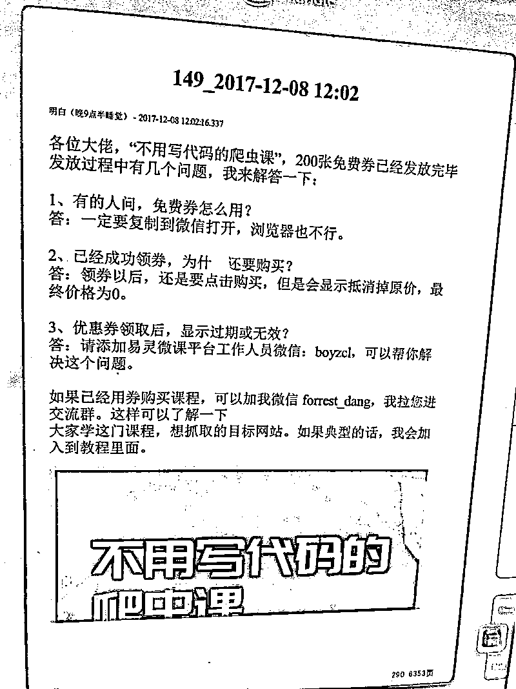

🏅 无

👍 Leo Wang

# #轻享# 工具转型电商潮流平台，低成本引

海绵践行

2022-04-22 23:34:37

#轻享#  
工具转型电商潮流平台，低成本引流 300W 用户，实现 50% 留存，月入 30W+\_by：生财杨扬 

🏅 无

👍 书情

# #流量挖掘# 宗族姓氏引流卖酒：单粉价值

海绵践行

2022-04-22 23:23:31

#流量挖掘#  
宗族姓氏引流卖酒：单粉价值 300 以上，日引流 3000 人\_by:郭耀天 

🏅 无

👍 添财小英，书情

海绵践行：打情感牌的也可能是个有坑的套路

# #轻享# 宠物殡葬行业起盘和模式揭秘

海绵践行

2022-04-21 20:08:16

#轻享#  
宠物殡葬行业起盘和模式揭秘 

🏅 无

👍 书情

# #轻享# 通过做出千万粉丝的抖音剧情号，

海绵践行

2022-04-20 08:41:25

#轻享#  
通过做出千万粉丝的抖音剧情号，我总结出来的内容方法论\_by：螺丝在拧紧 

🏅 无

👍 彬垚，书情

# 看来吴总早期也迷茫啊，还没有想好知识星球

书情

2022-04-20 08:24:33

看来吴总早期也迷茫啊，还没有想好知识星球的定位，哈哈\[偷笑\] 

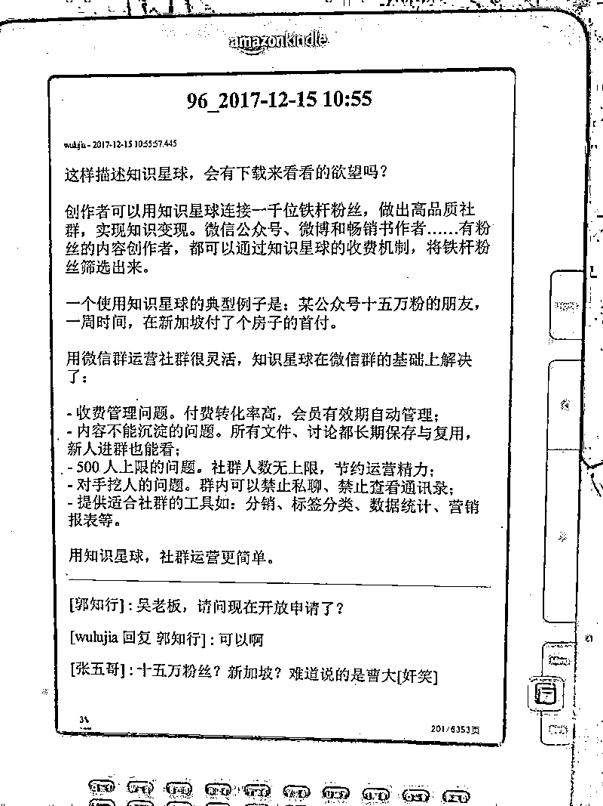

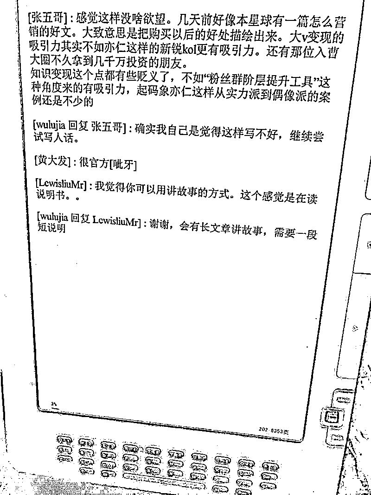

🏅 无

👍 无

# #电商# 如何搭建 3000+店主品牌特卖

海绵践行

2022-04-18 22:23:06

#电商#  
如何搭建 3000+店主品牌特卖社群，稳定 1000 万总销售额 

🏅 无

👍 书情

# #小程序# 技术就是生产力啊

书情

2022-04-18 19:26:23

#小程序#  
技术就是生产力啊 

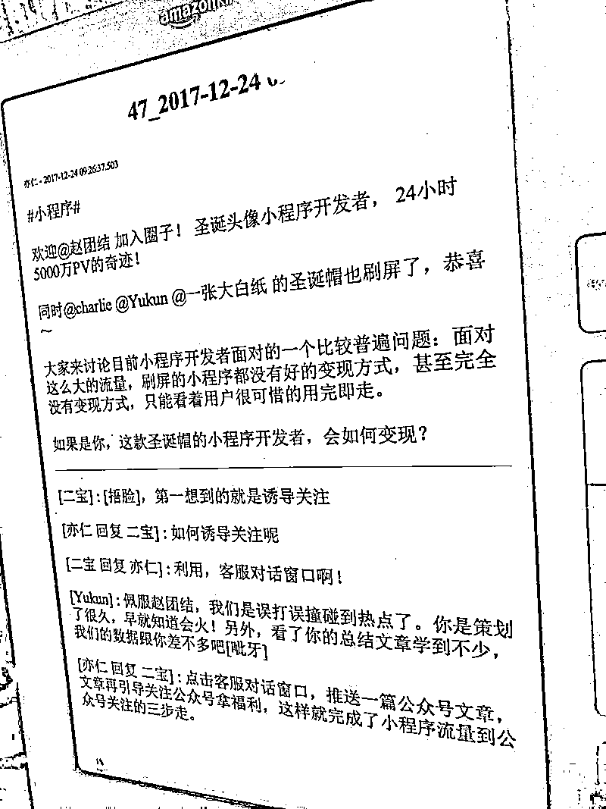

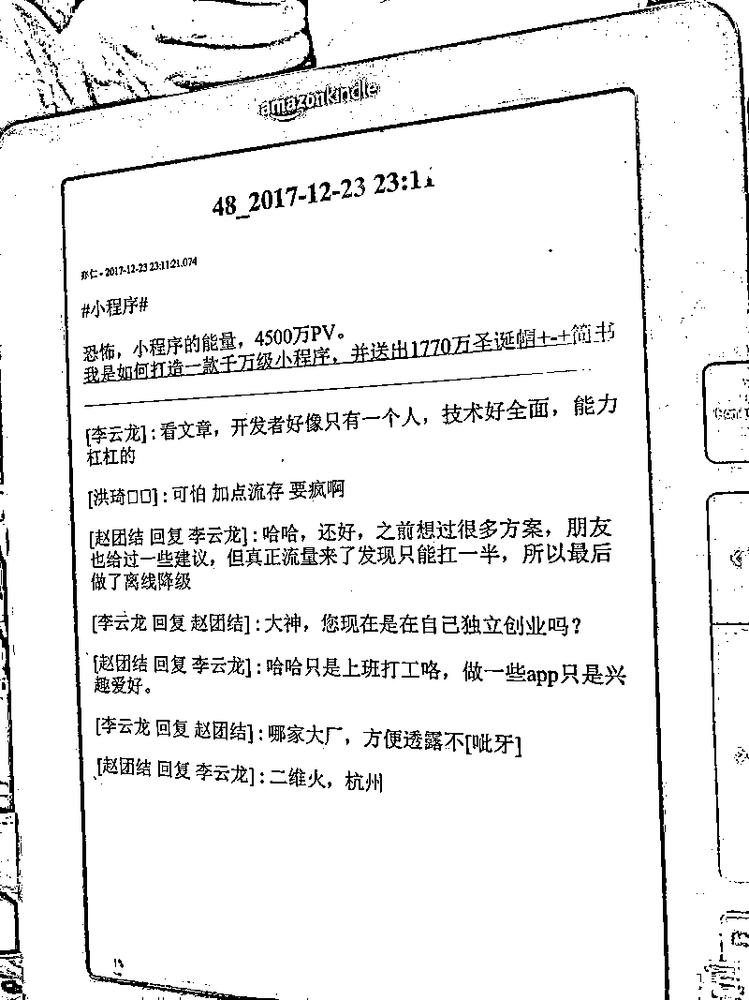

🏅 无

👍 #渠说渠话

# #案例分享#

书情

2022-04-18 07:54:01

#案例分享# 

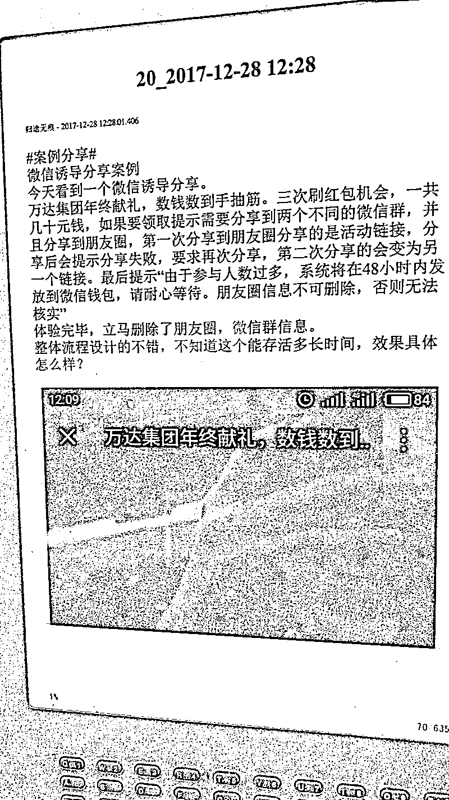

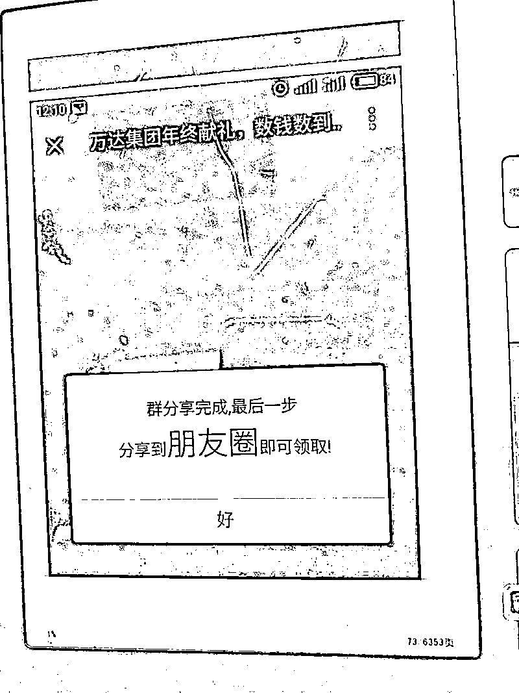

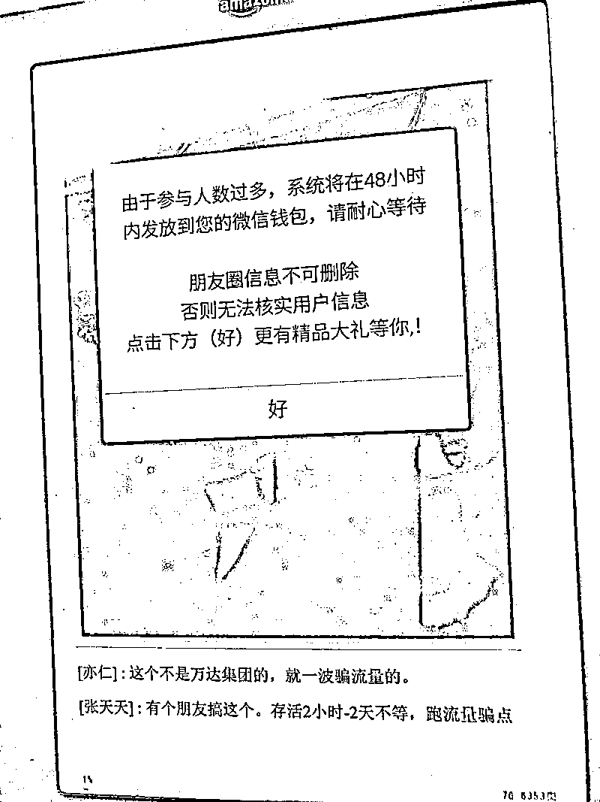

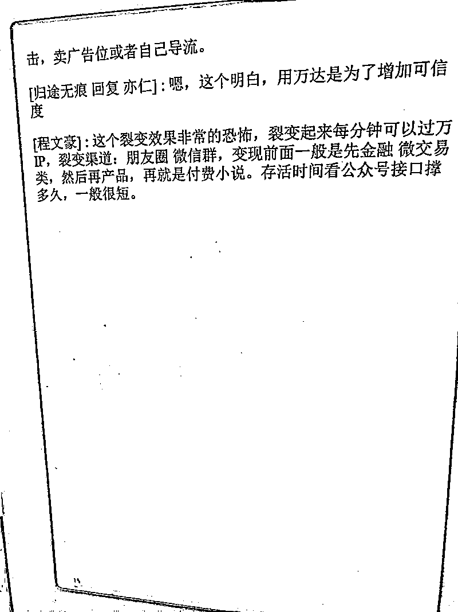

🏅 无

👍 无

# #藏书楼# 洞察创业机会，从“寻找哈尔滨

海绵践行

2022-04-17 20:01:22

#藏书楼#  
洞察创业机会，从“寻找哈尔滨程序员”开始 

🏅 无

👍 无

# #轻享# 被辞退后 3 年薪资翻 6 倍，“连续

海绵践行

2022-04-17 19:55:59

#轻享#  
被辞退后 3 年薪资翻 6 倍，“连续失败创业者”试过 20 种副业终于利润超过打工，苦逼版真人避坑文 

🏅 无

👍 彬垚，Carol。，#渠说渠话

海绵践行：并不是每一次尝试都会得到预期的收获，但试错又是必经的途径，借鉴别人的经历能减少犯错的代价

书情：真够折腾的\[捂脸\]

海绵践行：我看的时候也是这个感觉，但是有觉得比较真实，不是尝试了就立马成功了

# #电商# 淘宝单店方法论：烤红薯——淘宝

海绵践行

2022-04-17 19:43:32

#电商#  
淘宝单店方法论：烤红薯——淘宝小白做店 27 天，月利润 10 万的思考 

🏅 无

👍 添财小英，#渠说渠话

# #藏书楼# 程序员可以在生财有术干什么？

海绵践行

2022-04-17 19:37:28

#藏书楼#  
程序员可以在生财有术干什么？  

🏅 无

👍 书情

海绵践行：把技术转化为生产力

书情：看了这篇文章，要行动起来啊，我执行力也不行……

海绵践行：最近得到的反馈就是找到适合自己的方向，项目太多了，不一定都适合自己

书情：也是

# #社群运营# IP 打造+个人号成交+社群

海绵践行

2022-04-16 12:49:20

#社群运营#  
IP 打造+个人号成交+社群运营 

🏅 无

👍 #渠说渠话

# #社群运营# 社群服务是个很好的创业机会

海绵践行

2022-04-16 12:48:05

#社群运营#  
社群服务是个很好的创业机会么？我用一年的实操经历解答\_by：旺小哥 

🏅 无

👍 彬垚，添财小英，#渠说渠话

# #轻享# 贝佐斯：所有努力都应集中在一点

海绵践行

2022-04-14 08:40:03

#轻享#  
贝佐斯：所有努力都应集中在一点上 

🏅 无

👍 彬垚，#渠说渠话，Leo Wang

# #电商# 从 0 到 1 搭建百万分销体系

海绵践行

2022-04-14 08:38:25

#电商#  
从 0 到 1 搭建百万分销体系 

🏅 无

👍 添财小英

# #轻享# 如何赚第一个百万\_by：老华

海绵践行

2022-04-12 23:57:43

#轻享#  
如何赚第一个百万\_by：老华 

🏅 无

👍 彬垚，添财小英，双城 Gets🐟，未来有你（闲鱼运营）

海绵践行：找到隐性需求，满足需求

# #社群运营# 社群裂变底层逻辑公式：内容

海绵践行

2022-04-11 22:33:54

#社群运营#  
社群裂变底层逻辑公式：内容+诱饵+策略\_by：bt 男孩 

🏅 无

👍 添财小英，未来有你（闲鱼运营），Alvin

# #电商# 抖音小店无货源玩法怎么操作？新

海绵践行

2022-04-11 08:59:02

#电商#  
抖音小店无货源玩法怎么操作？新手常见问题全面解答 

🏅 无

👍 未来有你（闲鱼运营），Alvin，书情

海绵践行：抖音无货源操作问题解答

# #社群运营# 成立 1 年私域创收 1.8 亿，

海绵践行

2022-04-11 08:56:29

#社群运营#  
成立 1 年私域创收 1.8 亿，白小 T 是如何做私域的？\_by：大江 

🏅 无

👍 未来有你（闲鱼运营），Alvin

# #电商#咸鱼 8500 字保姆级教程，小白轻

海绵践行

2022-04-10 11:39:55

#电商#咸鱼  
8500 字保姆级教程，小白轻松月入 10000+的闲鱼玩法\_by：公子唯心 

🏅 无

👍 添财小英，Alvin，#渠说渠话，未来有你（闲鱼运营）

海绵践行：保姆级教程了

未来有你（闲鱼运营）：学习学习

# #社群运营# 如何提升服装社群粘性？附上

海绵践行

2022-04-10 11:26:03

#社群运营#  
如何提升服装社群粘性？附上具体方案和 SOP\_by：旺小哥 

🏅 无

👍 Alvin

海绵践行：社群的粘性需要群成员和粉丝们持续输出和互动，而不是被动接受

# 

书情

2022-04-09 18:38:15

🏅 无

👍 无

# #藏书楼# 一个舍不得告诉同行的秘密，取

海绵践行

2022-04-09 11:25:13

#藏书楼#  
一个舍不得告诉同行的秘密，取这类品牌名字的公司最值钱 | 小马宋 

🏅 无

👍 未来有你（闲鱼运营）

海绵践行：名字取得好，公司上市早

# #藏书楼# 如何起一个自动涨粉的公众号名

海绵践行

2022-04-09 11:23:02

#藏书楼#  
如何起一个自动涨粉的公众号名字？｜万字长文详解好名字的 20 个类型、100 个例子，6 个步骤！ 

🏅 无

👍 彬垚

海绵践行：取个好名字是成功的开始

# #藏书楼# 私域流量人设搭建 400 问\_b

海绵践行

2022-04-08 22:00:44

#藏书楼#  
私域流量人设搭建 400 问\_by：尹基跃 

🏅 无

👍 未来有你（闲鱼运营），书情

海绵践行：亦仁：人设上，我觉得真实就行，越真实越好，天天打造不真实的自己，累。

# #社群运营# 1.3 万字长文拆解：“群勾

海绵践行

2022-04-07 13:13:20

#社群运营#  
1.3 万字长文拆解：“群勾搭小程序”实现从 0 到 1 的 3 大增长方案 \_by：阿 may 

🏅 无

👍 未来有你（闲鱼运营）

# #社群运营# 群积分这么玩，对群促活很有

海绵践行

2022-04-07 13:09:54

#社群运营#  
群积分这么玩，对群促活很有帮助\_by：阿 may 

🏅 无

👍 无

海绵践行：社群的持续活跃维持

海绵践行：工具：wetool（已封杀）、火把助手

# 💎 #藏书楼# 查企业相关的信息：爱企查 、

书情

2022-04-07 10:29:42

#藏书楼#  
查企业相关的信息：爱企查 、 钉钉里面有个 钉钉企典这两个都是免费， 

🏅 无

👍 无

# #社群运营日赚过万，喜马拉雅“声谷”40

海绵践行

2022-04-05 23:42:13

#社群运营  
日赚过万，喜马拉雅“声谷”40w 粉是怎么打造的？\_by：孙策 

🏅 无

👍 Alvin，#渠说渠话，未来有你（闲鱼运营）

海绵践行：如何增加粉丝粘性，这篇分享的方法值得借鉴

# #社群运营# 日赚过万，喜马拉雅“声谷”

海绵践行

2022-04-05 23:28:51

#社群运营#  
日赚过万，喜马拉雅“声谷”40w 粉是怎么打造的？\_by：孙策 

🏅 无

👍 Alvin

海绵践行：怎么样增强粉丝粘性，这篇文章提供也很好的模式和范例

# #藏书楼# 万物皆可微商—用微商思维负成

海绵践行

2022-04-04 22:16:36

#藏书楼#  
万物皆可微商—用微商思维负成本搭建销售网络 2\_by：云帆 

🏅 无

👍 Alvin，#渠说渠话，书情

海绵践行：关于微商模式的分享和拆解，2w 字逐字稿

Carol。：感觉更新好快、又要花时间好好沉侵看了

海绵践行：有选择的看就好了\[憨笑\]

# #社群运营# 在抖音分享趣图表情，通过付

海绵践行

2022-04-04 12:46:50

#社群运营#  
在抖音分享趣图表情，通过付费群变现，每月收入 45000+\_by：凯歌 

🏅 无

👍 Alvin，书情

海绵践行：不起眼的小生意规模化之后也能做到很可观的收益

# #社群运营# 年收入千万级别的社群主，是

海绵践行

2022-04-03 20:41:53

#社群运营#  
年收入千万级别的社群主，是如何理解行动付费生意的\_by：生财专访 

🏅 无

👍 Alvin，书情，#渠说渠话

海绵践行：这篇是亦仁对"持续力"公众号主理人 Scalers 的专访记录

# #社群运营# 10 点社群运营思维分享\_b

海绵践行

2022-04-03 20:39:51

#社群运营#  
10 点社群运营思维分享\_by：夏木炯 

🏅 无

👍 Alvin，书情

# #社群运营# 26 种原因：别人为什么要转

海绵践行

2022-04-01 23:49:58

#社群运营#  
26 种原因：别人为什么要转发你的海报到朋友圈？ 

🏅 无

👍 Alvin，Carol。，书情

海绵践行：延伸阅读： 社群运营的秘诀，其实就 20 句话 👉 ​​​ 再小的个体，也可以从 0 到 1，打造出你的个人品牌 👉 ​​​ 12 个步骤：如何做出一门体系化网课？ 👉 ​​​​ 个人品牌：30 个增加知名度的宣传方法 👉 ​​​​ 四问四答：打造个人品牌和做社群，你不一定要成为完美的高手才能开始 👉  从杜子建的一张课程海报，学到了十点启发 👉  这里有 60 个做抖音的思路，你可能用得着 👉  最会赚钱的一帮人，给了我 20 条启发 👉 

# #社群运营# 坐拥 30w＋付费用户，40

海绵践行

2022-04-01 23:41:35

#社群运营#  
坐拥 30w＋付费用户，4000＋推广员，靠社群滚动裂变系统 2 年成为行业独角兽！  
\_by:王六六说 

🏅 无

👍 Alvin，书情

# #社群运营# 15000 元，7 天获取 12

海绵践行

2022-03-31 23:17:31

#社群运营#  
15000 元，7 天获取 12 万粉丝，我是如何做到的？| 案例复盘\_by:孙金龙 

🏅 无

👍 Alvin，书情

海绵践行：1.日常高频现象，是刚需的体现，也是流量的入口 2.缺钱的情况下运营是常态，需要不断利用现有支点撬动更多的资源

书情：先抄再说，种种案列告诉我们，别搞啥大的创新，因此搬运肯定是要搞的

书情：看看鬼谷子，会更有感触 链接🔗如下，他有十多个视频，值得一看 

书情：链接更新了

# #社群运营# 让用户当你的广告牌，付费课

海绵践行

2022-03-31 23:04:49

#社群运营#  
让用户当你的广告牌，付费课程零成本做到 1w+学员 

🏅 无

👍 Alvin

海绵践行：裂变：当你没有流量的时候，让出最多的利益，让用户当你的广告牌

# #社群运营# 微信生态中细致运营的一百条

海绵践行

2022-03-31 22:58:56

#社群运营#  
微信生态中细致运营的一百条小技巧\_by:杨涛 

🏅 无

👍 Alvin，书情

海绵践行：微信运营技巧：一个领域的问题写出 100 条建议胜过了绝大部分人

# #社群运营# 3 小时从 0 到 4w 精准区块链

海绵践行

2022-03-30 23:41:26

#社群运营#  
3 小时从 0 到 4w 精准区块链粉丝，我是如何做到的 

🏅 无

👍 Alvin，Leo Wang，书情

海绵践行：裂变增长，2017 年的套路，22 年依然值得借鉴

书情：学习了

书情小跟班：确实

# #社群运营# 0 成本增粉并高转化进付费社

海绵践行

2022-03-30 23:00:28

#社群运营#  
0 成本增粉并高转化进付费社群的案例分享\_by：明白 

🏅 无

👍 添财小英，Alvin，书情，未来有你（闲鱼运营）

海绵践行：感觉思路被打开

书情：常见的套路啊，我们也可以做的

# #社群运营# “知识付费”与“行为改变付

海绵践行

2022-03-30 22:57:16

#社群运营#  
“知识付费”与“行为改变付费”之间必有一战  
ps：这篇文章是跑步社群被拆解分析的文章，by"三节课" 

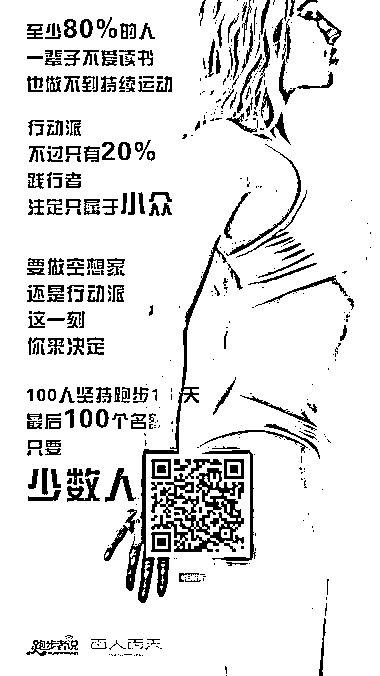

🏅 无

👍 Alvin，书情，未来有你（闲鱼运营）

海绵践行：社群宣传重点是价值交付的宣传

书情：这海报风骚啊\[捂脸\]

海绵践行：对想健身的女性很有吸引力啊，本地社群女性成员多了后，对男性也很有吸引力啊

# #轻享# 借着山楂岛的秘密，4 个小时引流

海绵践行

2022-03-29 23:31:02

#轻享#  
借着山楂岛的秘密，4 个小时引流 2w+，变现 5k+\_by:生财-leo 

🏅 无

👍 Alvin，书情，未来有你（闲鱼运营），阿白

海绵践行：追热点，引流、变现完成闭环

# #藏书楼# TikTok 电影号矩阵粉丝

海绵践行

2022-03-28 23:26:18

#藏书楼#  
TikTok 电影号矩阵粉丝 1300W+，原有话题 120 亿播放，聊聊创业基金减 少的情况下海外如何做出电影解说号\_by：李谢谢 

🏅 无

👍 添财小英，Alvin，未来有你（闲鱼运营），书情

海绵践行：收藏学习

# #轻享# 聊一聊百度竞价蓝海项目\_by:

海绵践行

2022-03-27 20:13:13

#轻享#  
聊一聊百度竞价蓝海项目\_by:雨停之东 

🏅 无

👍 Alvin，未来有你（闲鱼运营），#渠说渠话，书情，龙隐博士

龙隐博士：细节上的问题怎么处理？ 如何选词，如何推广，如何变现

书情：一看就会，一学就废，哈哈\[偷笑\]

海绵践行：一篇文章解决不了所有的问题

海绵践行：真实

# #轻享 普通人怎么参与机器人这门生意

海绵践行

2022-03-27 00:02:20

#轻享  
普通人怎么参与机器人这门生意 

🏅 无

👍 Alvin，未来有你（闲鱼运营），Leo Wang

海绵践行：技术&科技变现这个事真是让人既畏惧又向往

书情：感觉自己赚不到这一块的钱，看了涨了点见识，实操不了

# #轻享# 思考分享\_by：光合

海绵践行

2022-03-26 23:57:19

#轻享#  
思考分享\_by：光合 

🏅 无

👍 彬垚，Alvin，未来有你（闲鱼运营），书情

海绵践行：1.流动创造价值 2.看宏观类书籍的意义 3.为什么亲密关系能帮你赚更多的钱

书情：有一定道理，感觉也不全是，还是看人的

# #轻享# 一个新品牌在小红书从 0 到

海绵践行

2022-03-25 23:40:22

#轻享#  
一个新品牌在小红书从 0 到 2 亿的实操复盘 

🏅 无

👍 Alvin，未来有你（闲鱼运营），#渠说渠话，书情

# #轻享# 抖音书单号【冷门方向】玩法步骤

海绵践行

2022-03-25 23:31:26

#轻享#  
抖音书单号【冷门方向】玩法步骤+细节分享\_by:旺小哥 

🏅 无

👍 Alvin，未来有你（闲鱼运营），#渠说渠话，书情

海绵践行：当寻找"蓝海"一词出现，就感觉主干道已经很拥挤了，有了很多的竞争，但蓝海思维永远值得新玩家借鉴

# 💎 #藏书楼转载 安装教程：苹果免拔卡教程：

书情

2022-03-25 21:54:38

#藏书楼  
转载  
安装教程：  
苹果免拔卡教程：[苹果免拔卡教程 - 八哥文档](https://www.bgjs777.com/p/jiang001/)  
苹果免拔卡视频教程：[`down.bgjs888.com/down/pingguo.mp4`](https://down.bgjs888.com/down/pingguo.mp4)  
苹果常见问题解答：[苹果下载 tiktok 常见问题解答 - 常见问题 - 八哥文档](https://www.bgjs777.com/doc/376/)  
安卓免拔卡教程：[安卓免拔卡教程 - 八哥文档](https://www.bgjs777.com/p/jiang002/)  
强制更新和注册超时解决方法：[TikTok 强制更新解决方案及注册账号超时解决方法 - 常见问题 - 八哥文档](https://www.bgjs777.com/doc/631/)   
注册教程[好评有礼 - 八哥文档](https://www.bgjs777.com/p/jiang003/)  
「海外版抖音 tiktok 流量变现玩法」[阿里云盘分享](https://www.aliyundrive.com/s/XjkEytVLZYu) 提取码: 5lgg 

🏅 无

👍 未来有你（闲鱼运营），书情，海绵践行，#渠说渠话

# #藏书楼# 网页上的视频下载方法，除了 i

书情

2022-03-25 18:32:25

#藏书楼#  
网页上的视频下载方法，除了 idm 可以利用插件。  
如下图 Edge 浏览器上的 插件 也可以实现同样的嗅探下载过程，商城搜索 “m3u8 视频下载扩展  
”安装后就可以看到抓到的包了。自己试一下，很简单 

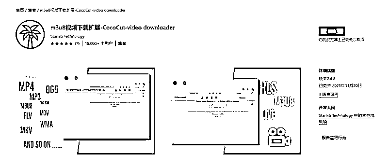

🏅 无

👍 未来有你（闲鱼运营），海绵践行，#渠说渠话

# #藏书楼# 打造过多本畅销书的读客前合伙

海绵践行

2022-03-23 23:51:56

#藏书楼#  
打造过多本畅销书的读客前合伙人：从洞察、开发、推广三个维度，聊聊红海市场如何打造畅销产品\_by:程锋 

🏅 无

👍 Alvin，未来有你（闲鱼运营），书情，预测师的心得

海绵践行：如果你想开发一个产品，无论是实体的还是虚拟的，这篇内容或许能帮助你少走很多弯路。

# #藏书楼# 视频号头部 MCN 创始人：

海绵践行

2022-03-23 12:46:59

#藏书楼#  
视频号头部 MCN 创始人：通过视频号赚到 100W 后，我总结了一套非真人出镜领域的标准起号方法论 

🏅 无

👍 Alvin，未来有你（闲鱼运营），书情，#渠说渠话

海绵践行：方法论很清晰 爆过的内容还会再爆，本平台或者其他平台的优质内容，可以改编后在视频号里再爆，他山之石可以攻玉。

# #轻享# 从内容的角度出发，用 A/B 测试

海绵践行

2022-03-22 08:52:50

#轻享#  
从内容的角度出发，用 A/B 测试的方法优化一个已有的外贸独立站 

🏅 无

👍 Alvin，未来有你（闲鱼运营），#渠说渠话，书情

海绵践行：拆解同行，触类旁通

书情：非常详细的实操案例，值得一看。几乎手把手教你如何做了。 所谓的模仿说得直接点就是抄，放下道德心，模仿起来，抄起来。

# #轻享# 2 个人 1 个武术门店拉新 5 天赚了

海绵践行

2022-03-22 08:50:03

#轻享#  
2 个人 1 个武术门店拉新 5 天赚了 10 万！  

🏅 无

👍 Alvin，未来有你（闲鱼运营），#渠说渠话，书情

海绵践行：门店拉新

# #轻享# 私域入门小白必读的 72 篇原创，

海绵践行

2022-03-21 12:55:45

#轻享#  
私域入门小白必读的 72 篇原创，包括这篇 

🏅 无

👍 Alvin，书情

Leo Wang：这个文档从第 2 页下半部分开始就是空白的吗？

海绵践行：不是，下班回去重新传一下，谢谢提醒

海绵践行：已重新上传

Leo Wang：👍

# #轻享# 如何用老师们一直在强调的兵器库

海绵践行

2022-03-21 12:53:33

#轻享#  
如何用老师们一直在强调的兵器库拆解项目？ 

🏅 无

👍 添财小英，Alvin

书情：遗憾了没留联系方式，值得链接下

# #轻享# 如何从自己熟悉的领域中找到蓝海

海绵践行

2022-03-19 21:05:37

#轻享#  
如何从自己熟悉的领域中找到蓝海？ 

🏅 无

👍 书情

海绵践行：追逐新事物并不一定要从 0 开始，立足原行业用新模式为自己赋能创造新生机或许能使自己更强大

# #轻享# 一个草根煤矿工人，6 年单打独斗

海绵践行

2022-03-19 19:06:18

#轻享#  
一个草根煤矿工人，6 年单打独斗，如何通过【创业知识博主】原始积累 800 万  

🏅 无

👍 书情

书情：励志

海绵践行：也是在通过做教程做课赚钱

书情：我们也要思考这个教程怎么个做法

#渠说渠话：他也是一边学习一边教别人，就像花爷讲的:90%的教 80%的，80%的教 70%的……

海绵践行：是的，关注 50 个同行，持续跟踪，学习和分析这一点也很少人能做到

# #流量挖掘# 从选品策划、变现、数据分析

海绵践行

2022-03-18 08:44:58

#流量挖掘#  
从选品策划、变现、数据分析、App 矩阵多方面，分享 App 蓝海精细化运营玩法  
\_by：刘笑长 

🏅 无

👍 无

海绵践行：做 APP 的都蓝海思维，发现自己思路有自我设限了，蓝海的本质应该是选取：相对少的竞争，高的未被满足需求（自带搜索流量），当前没有形成绝对的头部产品。那所有的行业皆可采用蓝海思维。

# #藏书楼# 细分定位 IT 录播课，实现

海绵践行

2022-03-17 08:54:31

#藏书楼#  
细分定位 IT 录播课，实现每月被动收入 5W+\_by:突围一只鹰 

🏅 无

👍 书情

海绵践行：超详细的录播卖课教程，初级，中级，高级课程，选题，录制，运营

书情：学废了学废了，看了一遍肯定是不够了，大家一定做学会做课程，把一份时间卖多份

# #轻享# 同城相亲交友我是怎样从零做到一

海绵践行

2022-03-16 08:50:18

#轻享#  
同城相亲交友我是怎样从零做到一万付费会员 

🏅 无

👍 无

书情：这个话题，群里有提过，不知道他们怎么操作的，看了会有一个更深的认知吧

# #轻享# 我是如何从 0 到 1，打造低成本高

海绵践行

2022-03-16 08:44:12

#轻享#  
我是如何从 0 到 1，打造低成本高盈利的本地相亲平台，实现年流水 100w 的 

🏅 无

👍 无

海绵践行：提个问题，"相亲"业务，算不算人口红利？

书情：在一线城市算

# #轻享# 分享一个同城本地相亲的项目实操

海绵践行

2022-03-14 23:34:28

#轻享#  
分享一个同城本地相亲的项目实操 

🏅 无

👍 #渠说渠话

海绵践行：超详细，连话术都分享出来了

#渠说渠话：这个可以照着抄了

# #轻享# 同城相亲一个多月变现 1.5 万实

海绵践行

2022-03-14 23:18:50

#轻享#  
同城相亲一个多月变现 1.5 万实操复盘 

🏅 无

👍 无

# #轻享# 在快手直播相亲，“200 块保证

海绵践行

2022-03-14 23:08:33

#轻享#  
在快手直播相亲，“200 块保证脱单”背后的赚钱套路有多野？ 

🏅 无

👍 无

海绵践行：仔细看看，最近“媒婆”已经开始扩展业务到微信视频号了，有刚需就有流量

# #轻享# 拆解三天内爆了 15W+收益的抖

海绵践行

2022-03-13 22:46:22

#轻享#  
拆解三天内爆了 15W+收益的抖音小程序 AI 变脸视频的基本逻辑和实操方法 

🏅 无

👍 无

海绵践行：A 平台火的内容，到 B 平台大概率也会火，可以迁移成更匹配 B 平台上受欢迎的表现形式

# #轻享# 抖音小程序稳定收益的实操玩法分

海绵践行

2022-03-13 22:44:34

#轻享#  
抖音小程序稳定收益的实操玩法分享 

🏅 无

👍 无

# #轻享# 抖音小程序如何快速进行账号打造

海绵践行

2022-03-13 22:41:20

#轻享#  
抖音小程序如何快速进行账号打造和变现及个人遇到过的问题 

🏅 无

👍 无

# #轻享# 【解决抖音视频没有播放量】SO

海绵践行

2022-03-13 22:37:44

#轻享#  
【解决抖音视频没有播放量】SOP 分享 

🏅 无

👍 无

# #轻享# 抖音小程序单条视频 24 小时爆 5

海绵践行

2022-03-13 22:32:17

#轻享#  
抖音小程序单条视频 24 小时爆 53W+收益背后的基本逻辑和方法\_by：钱南 

🏅 无

👍 无

# #轻享# 怎样利用概率论来做抖音小程序变

海绵践行

2022-03-13 22:25:48

#轻享#  
怎样利用概率论来做抖音小程序变现\_by：孙策 

🏅 无

👍 无

海绵践行：可以试着把玩法推广到微信小程序

# #轻享# 抖推猫产品设计负责人：我是如何

海绵践行

2022-03-13 00:02:59

#轻享#  
抖推猫产品设计负责人：我是如何创建抖音小程序平台，并找到好的小程序思路的？  
\_by：南歌 

🏅 无

👍 无

# #轻享# 小白如何从基础、内容、运营这三

海绵践行

2022-03-13 00:01:11

#轻享#  
小白如何从基础、内容、运营这三个方面上，做好抖音小程序项目？ 

🏅 无

👍 添财小英

# #轻享# 怎样成功拿下鸡汤类视频的粉丝，

海绵践行

2022-03-12 23:58:31

#轻享#  
怎样成功拿下鸡汤类视频的粉丝，提升变现率？\_by：条形码 

🏅 无

👍 无

# #轻享# 如何利用数据搭建商业模型\_by

海绵践行

2022-03-11 23:42:58

#轻享#  
如何利用数据搭建商业模型\_by：佩奇 

🏅 无

👍 无

海绵践行：数据如何与商业，投资，产品产生联系以及查找到流量洼地

# 💎 #轻享# 无需代码爬虫，小白也能操作采集

海绵践行

2022-03-11 00:23:02

#轻享#  
无需代码爬虫，小白也能操作采集各行业数据  

🏅 无

👍 书情

书情：真不错，程序员👨🏻‍💻懂技术节省很多时间，这是否也间接夸自己呢？哈哈😃

海绵践行：把主流的抓包软件掌握用途还是挺大的

# #轻享# 用了这两个小技巧，我在淘宝上抓

海绵践行

2022-03-10 23:57:52

#轻享#  
用了这两个小技巧，我在淘宝上抓数据月入过万 

🏅 无

👍 无

# #轻享# 最近好多新闻说，用爬虫会被抓去

海绵践行

2022-03-10 23:54:49

#轻享#  
最近好多新闻说，用爬虫会被抓去坐牢，我们该怎么办？ 

🏅 无

👍 无

# #轻享# 这玩意有什么技术含量？ 

海绵践行

2022-03-10 00:02:50

#轻享#  
这玩意有什么技术含量？  

🏅 无

👍 无

海绵践行：这篇是亦仁在 2017 年推广明白的《不用写代码的爬虫课》的推文，核心是不要用技术的高低衡量一个产品

Alvin：明白从那个时候开始迭代了

海绵践行：是啊，也 5 年了呢

# #轻享# 如何利用爬虫技术赚到第一笔副业

海绵践行

2022-03-09 23:58:52

#轻享#  
如何利用爬虫技术赚到第一笔副业收入 

🏅 无

👍 无

# #轻享# 可复制，零门槛，我是如何通过爬

海绵践行

2022-03-09 23:54:38

#轻享#  
可复制，零门槛，我是如何通过爬虫课赚回加入知识星球的费用的 

🏅 无

👍 无

# #轻享#

书情

2022-03-09 01:26:19

#轻享# 

🏅 无

👍 海绵践行，#渠说渠话

# #轻享#

书情

2022-03-09 00:46:53

#轻享# 

🏅 无

👍 无

# #轻享# 用 webscraper 从一个网

海绵践行

2022-03-09 00:08:25

#轻享#  
用 webscraper 从一个网站 2 小时抓取 250w 个微信号 

🏅 无

👍 无

海绵践行：如果需要获取垂直领域的流量不得不说也是一个方法

书情：可以看作是他的一个软文，算是有创意吧，吸引住了人的眼球

# #轻享# 花爷教我副业从 0 到 1 实现被动收

海绵践行

2022-03-07 23:34:46

#轻享#  
花爷教我副业从 0 到 1 实现被动收入破万 

🏅 无

👍 无

# #实用工具# 保存这 4 个网站，再也不用为

海绵践行

2022-03-07 23:31:21

#实用工具#  
保存这 4 个网站，再也不用为找电子书发愁了！  
  
鸠摩搜书：www.jiumodiary.com（综合）  
雅书网：yabook.blog（pdf）  
奎章阁：kuizhangge.cn（古典文献）  
PDF DRIVE：www.pdfdrive.com 

🏅 无

👍 #渠说渠话

# #实用工具# 平台搜索地图\_by：一条枸

海绵践行

2022-03-07 23:27:34

#实用工具#  
平台搜索地图\_by：一条枸杞 

🏅 无

👍 无

# #实用工具#  用 Excel 做的生财龙珠

海绵践行

2022-03-07 23:24:50

#实用工具#  
 用 Excel 做的生财龙珠管理系统\_by:一条枸杞 

🏅 无

👍 无

# #流量挖掘# B 站 20Wleads 引流方

海绵践行

2022-03-07 23:13:50

#流量挖掘#  
B 站 20Wleads 引流方法论 

🏅 无

👍 无

# #轻享# 日入过万的七夕蛤蟆复盘\_by：

海绵践行

2022-03-06 23:11:13

#轻享#  
日入过万的七夕蛤蟆复盘\_by：紫菜 

🏅 无

👍 无

# #轻享# 3 小时内卖出 700 多本日历复盘

海绵践行

2022-03-06 23:10:44

#轻享#  
3 小时内卖出 700 多本日历复盘\_by：紫菜 

🏅 无

👍 无

# #轻享# 赚钱的底层逻辑\_by：紫菜

海绵践行

2022-03-06 23:10:15

#轻享#  
赚钱的底层逻辑\_by：紫菜 

🏅 无

👍 无

# #轻享# 赚到的第一个 10w 和 100w，

海绵践行

2022-03-06 23:09:51

#轻享#  
赚到的第一个 10w 和 100w，以及为自己第一个 1000w 的一些打算\_by：紫菜 

🏅 无

👍 无

# #轻享# 夜话里边的狼人杀\_by：紫菜

海绵践行

2022-03-06 23:09:24

#轻享#  
夜话里边的狼人杀\_by：紫菜 

🏅 无

👍 无

# #轻享# 红包封面引流航海小测试\_by：

海绵践行

2022-03-06 23:08:56

#轻享#  
红包封面引流航海小测试\_by：紫菜 

🏅 无

👍 无

# #轻享# 关于副业\_by：紫菜

海绵践行

2022-03-06 23:08:32

#轻享#  
关于副业\_by：紫菜 

🏅 无

👍 添财小英

# #轻享# 参加龙珠见面会的一些收获\_by

海绵践行

2022-03-06 23:08:07

#轻享#  
参加龙珠见面会的一些收获\_by：紫菜 

🏅 无

👍 无

# #轻享# 《从认知价值、核算成本、锁定客

海绵践行

2022-03-04 23:40:22

#轻享#  
《从认知价值、核算成本、锁定客户、差异化定价、完善场景五步制定出合理定价，多获取 20%以上的利润》——by：富二蛋 

🏅 无

👍 书情

# #小程序# 我如何从市场需求入手，做出 3

海绵践行

2022-03-04 08:48:28

#小程序#  
我如何从市场需求入手，做出 3000 万 C 端用户的 AI 小程序产品 

🏅 无

👍 书情

# #小程序# 小程序流量主高效变现，你不得

海绵践行

2022-03-04 08:44:26

#小程序#  
小程序流量主高效变现，你不得不知的七大招 

🏅 无

👍 书情

海绵践行：如何通过小程序流量主高效变现，这 7 个大招你知道吗？

# #小程序# 聊聊微信小程序商城的流量运营

海绵践行

2022-03-04 08:43:29

#小程序#  
聊聊微信小程序商城的流量运营 

🏅 无

👍 书情

# #小程序# 如何做小程序月入 1 万 ？以表

海绵践行

2022-03-04 08:41:06

#小程序#  
如何做小程序月入 1 万 ？以表情包和壁纸类型小程序举例 

🏅 无

👍 书情

海绵践行：这篇适合大多数人，不是程序员懂编码才能做小程序，直接做代理做内容更适合最大多数人

书情：认同\[社会社会\]

# #小程序# 如何在 3 个月内获得 200 万+

海绵践行

2022-03-03 00:05:16

#小程序#  
如何在 3 个月内获得 200 万+小程序用户并引流到店完成转化 

🏅 无

👍 书情

# #小程序# 日活百万小程序，单日给公号导

海绵践行

2022-03-03 00:04:11

#小程序#  
日活百万小程序，单日给公号导粉 10 万！ 

🏅 无

👍 添财小英，书情

# #小程序# 1.3 万字长文拆解：“群勾搭

海绵践行

2022-03-03 00:02:28

#小程序#  
1.3 万字长文拆解：“群勾搭小程序”实现从 0 到 1 的 3 大增长方案 

🏅 无

👍 书情

# #小程序# 聊聊@Fenng 大辉老师的

海绵践行

2022-03-02 20:54:42

#小程序#  
聊聊@Fenng 大辉老师的拍卖小程序 

🏅 无

👍 书情

# #小程序# 一个每月营收 500 万的工具小

海绵践行

2022-03-02 08:49:43

#小程序#  
一个每月营收 500 万的工具小程序 

🏅 无

👍 无

# #小程序# 微信小程序如何快速变现 ps：

海绵践行

2022-03-02 08:48:25

#小程序#  
微信小程序如何快速变现  
  
ps：小程序榜单：阿拉丁指数—全网小程序权威指数平台 

🏅 无

👍 无

# #小程序# 爆款小程序创意：清理 2018

海绵践行

2022-03-02 08:46:18

#小程序#  
爆款小程序创意：清理 2018 年的坏运气 

🏅 无

👍 无

# #小程序# 我对小程序的开发、变现的 10

海绵践行

2022-03-02 08:44:28

#小程序#  
我对小程序的开发、变现的 10 点看法 

🏅 无

👍 书情

书情：这个值得一看，小英小程序起来后，我的兴趣大增了，嘿嘿😁

海绵践行：嘿嘿，SEO 的暂时更完了，先集中把感兴趣的更上

书情：Nice

# #小程序# 日活 10w 的垂直小程序：政府

海绵践行

2022-03-02 08:42:23

#小程序#  
日活 10w 的垂直小程序：政府信息汇总小程序 

🏅 无

👍 无

# #小程序# QuestMobile 泛娱乐

海绵践行

2022-03-01 00:06:45

#小程序#  
QuestMobile 泛娱乐付费用户洞察报告：千亿市场已形成，超级会员模式崛起席卷八荒  
亦仁：设计针对性的付费方案带来的收入是广告收入的几十倍，卖流量始终是为别人做嫁衣。 

🏅 无

👍 书情

# #小程序# 拆解「富豪斗地主」小程序背后

海绵践行

2022-03-01 00:03:52

#小程序#  
拆解「富豪斗地主」小程序背后，6 个值得借鉴的产品设计 

🏅 无

👍 书情

# #小程序# 小程序“机器仓库”的可复制运

海绵践行

2022-03-01 00:02:06

#小程序#  
小程序“机器仓库”的可复制运营模式 

🏅 无

👍 书情

# #小程序# 小程序开放第三方授权开发后，

海绵践行

2022-02-28 23:56:46

#小程序#  
小程序开放第三方授权开发后，有哪些红利？ 

🏅 无

👍 书情

# #小程序# 如何利用小程序，把各个城市的

海绵践行

2022-02-28 23:54:34

#小程序#  
如何利用小程序，把各个城市的限购限贷信息结构化\_by：亦仁 

🏅 无

👍 书情

# #小程序# 我是如何从微信小程序已经上线

海绵践行

2022-02-28 23:51:38

#小程序#  
我是如何从微信小程序已经上线的产品中，找到合适的痛点切入的\_ 亦仁#小程序# 

🏅 无

👍 书情

书情：关于这个我提一嘴，有人把这个音乐打包来卖，很多人都不能访问外网，就是赚信息差。

# #流量挖掘# 如何用 1 万块快速测试一个 S

海绵践行

2022-02-26 23:48:04

#流量挖掘#  
如何用 1 万块快速测试一个 SEO 项目是否可行 

🏅 无

👍 海绵践行

海绵践行：这篇细节和思路都很清晰，建议可以重点看看的

书情：真的是强，执行力佩服

# #流量挖掘# 1 个关键词，公众号 SEO 涨

海绵践行

2022-02-26 00:06:53

#流量挖掘#  
1 个关键词，公众号 SEO 涨粉 45 万，变现 50 万，我是如何做的，以及犯了那些错 

🏅 无

👍 无

书情：看了下，我自己是操作不了，不过思路挺不错的

# #流量挖掘# 如何用场景化思维打造有温度

海绵践行

2022-02-24 23:55:53

#流量挖掘#  
如何用场景化思维打造有温度的社群，使用户愿意长期和你一起玩，并保证续费率？ 

🏅 无

👍 无

书情：非常好的作业了

# #轻享# 如何在团队中找到个人价值

海绵践行

2022-02-24 23:54:20

#轻享#  
如何在团队中找到个人价值 

🏅 无

👍 无

# #流量挖掘# 2021 年 Google S

海绵践行

2022-02-24 23:37:12

#流量挖掘#  
2021 年 Google SEO 最关键有效的技巧· 站内篇 

🏅 无

👍 书情

# #流量挖掘# 0 资源，做出 3 个日 UV 过十

海绵践行

2022-02-24 23:34:38

#流量挖掘#  
0 资源，做出 3 个日 UV 过十万、7-8 个日 UV 过万的网站，分享我获得无限网站流量的秘籍 

🏅 无

👍 书情

# #流量挖掘# 阿愚呱呱：聊聊同城 SEO

海绵践行

2022-02-24 23:26:32

#流量挖掘#  
阿愚呱呱：聊聊同城 SEO 的机会 

🏅 无

👍 书情

# #流量挖掘# SEO 只花 5w，3 年实现 2

海绵践行

2022-02-23 00:23:42

#流量挖掘#  
SEO 只花 5w，3 年实现 200 倍收益，我是怎样做到的 

🏅 无

👍 书情

# #流量挖掘# 这是一个警示贴兼谈微信公众

海绵践行

2022-02-23 00:18:25

#流量挖掘#  
这是一个警示贴兼谈微信公众号 SEO 的几个相关问题 

🏅 无

👍 无

书情：搞截流就是偏门左道

# #流量挖掘# 5000 字长文拆解：极少人

海绵践行

2022-02-22 00:11:31

#流量挖掘#  
5000 字长文拆解：极少人知道的公众号注册改名骚操作 

🏅 无

👍 书情，未来有你（闲鱼运营）

# #流量挖掘# 淘宝关键词截流、B 站视频的

海绵践行

2022-02-22 00:08:33

#流量挖掘#  
淘宝关键词截流、B 站视频的生产与卖“欧”获利 7000+  
——by：老吴 

🏅 无

👍 书情，未来有你（闲鱼运营）

# #流量挖掘# 2021 年互联网项目库整理

海绵践行

2022-02-22 00:01:01

#流量挖掘#  
2021 年互联网项目库整理-【可能删】-by：君言戏语  
ps：朴实不造作 

🏅 无

👍 书情

# #流量挖掘# 如何挖掘微信搜索这个流量洼

海绵践行

2022-02-20 23:35:19

#流量挖掘#  
如何挖掘微信搜索这个流量洼地 by：佩奇 

🏅 无

👍 书情

# #流量挖掘# 关键字基础篇，进阶篇及 12

海绵践行

2022-02-20 23:30:40

#流量挖掘#  
关键字基础篇，进阶篇及 12 个应用方法 

🏅 无

👍 无

# #流量挖掘# 如何利用 B 站权重抢占百度关

海绵践行

2022-02-20 23:22:11

#流量挖掘#  
如何利用 B 站权重抢占百度关键词排名进行精准引流？-by：白杨 SEO 

🏅 无

👍 无

# #流量挖掘# 干货 | SEO 增长策略和

海绵践行

2022-02-20 23:17:00

#流量挖掘#  
干货 | SEO 增长策略和赚钱方法  
  
SEO 工具：摩天楼内容助手-TFIDF 关键词布局分析优化软件\[码迷 SEO\]，网址：[SEO 工具：摩天楼内容助手-TFIDF 关键词布局分析优化软件\[码迷 SEO\]](https://www.mamioo.com/?u=27602) 

🏅 无

👍 书情

# 💎 #轻享# 生财资料布客新知/zsxq2 布

书情

2022-02-20 12:47:49

#轻享#  
生财资料  
[布客新知/zsxq2](https://gitee.com/ixinzhi/zsxq2)  
  
[布客新知/zsxq3](https://gitee.com/ixinzhi/zsxq3) 

🏅 无

👍 书情

# #流量挖掘# 如何使用 B2B 去做 B2C 流

海绵践行

2022-02-20 00:17:54

#流量挖掘#  
如何使用 B2B 去做 B2C 流量，以及使用 B2C 去做 B2B 流量？ 

🏅 无

👍 双城 gets🐟

双城 gets🐟：你不是说你睡了

海绵践行：刚好在看着，就把这篇看完上传完关电脑不是

# #流量挖掘# 如何借助地摊经济的热度，零

海绵践行

2022-02-20 00:02:27

#流量挖掘#  
如何借助地摊经济的热度，零成本获取千万搜索流量 

🏅 无

👍 无

# #流量挖掘# 一个百度搜索量异常值引发的

海绵践行

2022-02-19 23:57:56

#流量挖掘#  
一个百度搜索量异常值引发的思考 

🏅 无

👍 无

# #流量挖掘# ​钉钉 6 个月从权 3 到权重 7

海绵践行

2022-02-19 23:46:02

#流量挖掘#  
​钉钉 6 个月从权 3 到权重 7，利用聚合页 SEO 快速提升网站权重 

🏅 无

👍 无

# #流量挖掘# 钉钉 SEO 案例，我做了一些

海绵践行

2022-02-19 23:43:45

#流量挖掘#  
钉钉 SEO 案例，我做了一些浅薄的跟进 

🏅 无

👍 无

# #流量挖掘# 两个逆向思维小思路：免费和

海绵践行

2022-02-19 23:30:11

#流量挖掘#  
两个逆向思维小思路：免费和 SEO 的机会 

🏅 无

👍 无

# #轻享#

书情

2022-02-19 02:31:06

#轻享# 

🏅 无

👍 海绵践行，彬垚

# #日常观察#

书情

2022-02-19 02:28:59

#日常观察# 

🏅 无

👍 海绵践行，彬垚

# #轻享#

书情

2022-02-19 02:25:51

#轻享# 

🏅 无

👍 彬垚

# #日常观察#

书情

2022-02-19 02:24:05

#日常观察# 

🏅 无

👍 彬垚

# #轻享#

书情

2022-02-19 02:22:35

#轻享# 

🏅 无

👍 彬垚

# #轻享#

书情

2022-02-19 02:21:09

#轻享# 

🏅 无

👍 彬垚

# #轻享#

书情

2022-02-19 02:17:32

#轻享# 

🏅 无

👍 彬垚

# #轻享#

书情

2022-02-19 02:15:47

#轻享# 

🏅 无

👍 彬垚

# #轻享#

书情

2022-02-19 02:10:53

#轻享# 

🏅 无

👍 彬垚

# #日常观察#

书情

2022-02-19 02:10:06

#日常观察# 

🏅 无

👍 彬垚

# #日常观察# #轻享# 如何选股？简单概

书情

2022-02-19 02:07:37

#日常观察#  
#轻享#  
如何选股？简单概括就是：好行业、好公司、好价格、适度集中、长期持有。 

🏅 无

👍 彬垚

# #流量挖掘#

书情

2022-02-18 23:45:09

#流量挖掘# 

🏅 无

👍 彬垚

# #轻享# 《通过录音+系统搭建+设计好展

海绵践行

2022-02-18 20:24:50

#轻享#  
《通过录音+系统搭建+设计好展牌二维码，为景区搭建语音导览系统，实现被动月收入 2W+》 

🏅 无

👍 彬垚

# #流量挖掘#

书情

2022-02-17 02:17:27

#流量挖掘# 

🏅 无

👍 彬垚

# #轻享# 今日头条爆款训练营复盘 http

书情

2022-02-17 02:15:47

#轻享#  
今日头条爆款训练营复盘[`n1d5qu5y6v.feishu.cn/docs/doccnjzhjF1keFr1...`](https://n1d5qu5y6v.feishu.cn/docs/doccnjzhjF1keFr1bqGFa9f7Zpf) 

🏅 无

👍 彬垚

# #轻享#

书情

2022-02-17 01:54:37

#轻享# 

🏅 无

👍 彬垚

# #轻享#

书情

2022-02-17 01:53:51

#轻享# 

🏅 无

👍 彬垚

# #轻享# 一条微头条，价值 40000

书情

2022-02-17 01:52:11

#轻享#  
一条微头条，价值 40000 元！我抓住了今日头条同城流量密  
码 

🏅 无

👍 彬垚

# #轻享# 如何用产品和运营思维找对象？

书情

2022-02-17 01:51:41

#轻享#  
如何用产品和运营思维找对象？ 

🏅 无

👍 彬垚

# #日常观察#

书情

2022-02-17 01:48:44

#日常观察# 

🏅 无

👍 彬垚

# #轻享#

书情

2022-02-17 01:48:18

#轻享# 

🏅 无

👍 彬垚

# #轻享# 传媒公司手册 https://j

书情

2022-02-17 01:46:30

#轻享#  
传媒公司手册  
[`jkmm9rrxfa.feishu.cn/docs/doccnRVHBaxYqPwZ...`](https://jkmm9rrxfa.feishu.cn/docs/doccnRVHBaxYqPwZfBf8F3MTcFg) 

🏅 无

👍 彬垚

# #轻享#

书情

2022-02-17 01:45:18

#轻享# 

🏅 无

👍 彬垚

# #轻享#

书情

2022-02-17 01:43:06

#轻享# 

🏅 无

👍 彬垚

# #轻享#

书情

2022-02-17 01:42:02

#轻享# 

🏅 无

👍 彬垚

# #轻享#

书情

2022-02-17 01:40:29

#轻享# 

🏅 无

👍 彬垚

# #日常观察# 新人是公司的新鲜血液，一个

书情

2022-02-17 01:35:01

#日常观察#  
新人是公司的新鲜血液，一个正确的考核制度能招到合适的人才，最大化留住人才 

🏅 无

👍 彬垚

# #流量挖掘# https://n92rn

书情

2022-02-17 01:30:05

#流量挖掘#  
[`n92rntbkss.feishu.cn/docs/doccnIGqHHgFztDm...`](https://n92rntbkss.feishu.cn/docs/doccnIGqHHgFztDmy1XOTVfMMEh) 

🏅 无

👍 彬垚

# #日常观察# 为什么我学的东西越多，越觉

书情

2022-02-17 01:28:53

#日常观察#  
为什么我学的东西越多，越觉得迷茫，应该怎么破局？  
第一个原因：我学习的目标不明确  
第二个原因：我的目标没有聚焦在当下  
第三个原因：我没有认清问题的本质  
第四个原因：我没有真正的吸收信息 

🏅 无

👍 彬垚

# #藏书楼#

书情

2022-02-17 01:22:09

#藏书楼# 

🏅 无

👍 无

# #轻享# 那时候我们的思路非常清晰，我们

书情

2022-02-17 01:03:33

#轻享#  
那时候我们的思路非常清晰，我们自己搞懂了规则之后，马上找了关系不错的同行，直接 Copy 了他们的模式，包括他们用的工具、方式、话术等等，全部搬了过来。这其中无形就省掉了很多测试成本！精力成本！时间成本！ 

🏅 无

👍 海绵践行

# #流量挖掘# 如何快速占领知乎最佳推广位

海绵践行

2022-02-17 00:31:36

#流量挖掘#  
如何快速占领知乎最佳推广位置？ 

🏅 无

👍 书情

# #流量挖掘# 百度 SEO 千万级流量的套利

海绵践行

2022-02-17 00:27:58

#流量挖掘#  
百度 SEO 千万级流量的套利机会  
  
ps：页面监控工具  
Distill Web Monitor  
官网地址：[Monitor websites for changes, get SMS alerts and e...](https://distill.io/) 

🏅 无

👍 无

# #流量挖掘# 对 ASO 和 SEO 的共通性的

海绵践行

2022-02-17 00:22:54

#流量挖掘#  
对 ASO 和 SEO 的共通性的思考 

🏅 无

👍 书情

# #流量挖掘# 解密搜索引擎万词霸屏背后逻

海绵践行

2022-02-17 00:17:10

#流量挖掘#  
解密搜索引擎万词霸屏背后逻辑与流程 

🏅 无

👍 无

# #流量挖掘# 搜索流量江湖：人和信息在哪

海绵践行

2022-02-17 00:16:45

#流量挖掘#  
搜索流量江湖：人和信息在哪里，搜索行为就会在哪里 

🏅 无

👍 无

# #流量挖掘# 12 年中文 SEO 站群之路

海绵践行

2022-02-17 00:10:10

#流量挖掘#  
12 年中文 SEO 站群之路 

🏅 无

👍 无

# #流量挖掘# 搜索功能下潜藏的商机

海绵践行

2022-02-17 00:00:48

#流量挖掘#  
搜索功能下潜藏的商机 

🏅 无

👍 无

# #轻享#

书情

2022-02-16 02:06:10

#轻享# 

🏅 无

👍 冷月

# #日常观察# 挺有意思的观点

书情

2022-02-16 02:03:28

#日常观察# 挺有意思的观点 

🏅 无

👍 无

# #轻享#

书情

2022-02-16 02:00:42

#轻享# 

🏅 无

👍 无

# #流量挖掘# Visiture 创始人 SE

海绵践行

2022-02-15 23:58:20

#流量挖掘#  
Visiture 创始人 SEO 大佬 Brain 经历分享 

🏅 无

👍 无

# #流量挖掘# 一个永不过时的百度 SEO 霸

海绵践行

2022-02-15 23:52:35

#流量挖掘#  
一个永不过时的百度 SEO 霸屏捡钱玩法复盘 

🏅 无

👍 无

# #藏书楼# "云店”模式“所有传统行业都

海绵践行

2022-02-15 23:47:18

#藏书楼#  
"云店”模式  
“所有传统行业都值得重做一遍”—星巴克  

🏅 无

👍 无

# #藏书楼#

书情

2022-02-15 01:51:03

#藏书楼# 

🏅 无

👍 彬垚

# #藏书楼#

书情

2022-02-15 01:48:15

#藏书楼# 

🏅 无

👍 彬垚

# #藏书楼#

书情

2022-02-15 01:48:00

#藏书楼# 

🏅 无

👍 彬垚

# #藏书楼#

书情

2022-02-15 01:47:17

#藏书楼# 

🏅 无

👍 彬垚

# #视频号#

书情

2022-02-15 01:46:20

#视频号# 

🏅 无

👍 彬垚

# #藏书楼#

书情

2022-02-15 01:44:42

#藏书楼# 

🏅 无

👍 彬垚

# #藏书楼#

书情

2022-02-15 01:36:57

#藏书楼# 

🏅 无

👍 彬垚

# #轻享#

书情

2022-02-15 01:32:57

#轻享# 

🏅 无

👍 彬垚

# #视频号#

书情

2022-02-15 00:59:16

#视频号# 

🏅 无

👍 彬垚

# #流量挖掘# 通过 Google 挖掘细分市

海绵践行

2022-02-14 23:38:48

#流量挖掘#  
通过 Google 挖掘细分市场的一个案例 

🏅 无

👍 彬垚

# #流量挖掘# 通过 Google 挖掘细分市

海绵践行

2022-02-14 23:30:22

#流量挖掘#  
通过 Google 挖掘细分市场的一个案例 

🏅 无

👍 彬垚，书情

# #流量挖掘# 我是如何做成日活百万健康网

海绵践行

2022-02-14 23:28:43

#流量挖掘#  
我是如何做成日活百万健康网站的 

🏅 无

👍 彬垚，书情

# #流量挖掘# 案例分析：如何通过 SEO 做

海绵践行

2022-02-14 23:22:22

#流量挖掘#  
案例分析：如何通过 SEO 做到月入 1.5W 美元 

🏅 无

👍 彬垚，书情

# #藏书楼# 花爷知识星球精华帖合集（三）

海绵践行

2022-02-13 20:47:26

#藏书楼#  
花爷知识星球精华帖合集（三） 

🏅 无

👍 彬垚，书情

# #流量挖掘# 21 种方法快速上手谷歌 SE

海绵践行

2022-02-10 23:54:01

#流量挖掘#  
21 种方法快速上手谷歌 SEO（2018 版）  
  
tips:  
#一起赚美元#  
在维基百科中寻找外链机会  
  
  
寻找失效的链接为自己的网站做外链，是一个高级的 SEO 白帽策略，非常强大。  
但是如何找到这些坏链是非常头痛的一件事情。  
在维基百科的编辑系统中有一个重要的地方可以利用，  
当一个维基百科的编辑偶然发现一个死链接，他们不会马上删除链接，而是链接旁边添加了一个脚注，写着“dead link”, 这就是我们的好机会。  
如何找到这些 deadlink 呢？  
在谷歌中输入 site:wikipedia.org\[你的关键词\] + “deadlink”  
点击相关搜索结果，在页面中 ctrl+f 搜索“deadlink”  
在自己的网站中发布相关的内容，然后在维基百科的编辑中用你的网站址替换掉” dead link” 里的内容  
这样就得到一条来自维基百科的外链。 

🏅 无

👍 彬垚，书情

# #流量挖掘# 揭开 SEO 的真面目

海绵践行

2022-02-10 23:51:04

#流量挖掘#  
揭开 SEO 的真面目 

🏅 无

👍 彬垚，书情

# #流量挖掘# 分享我的网站运营经验，一年

海绵践行

2022-02-10 23:48:47

#流量挖掘#  
分享我的网站运营经验，一年对从零到每日一百多万 IP 

🏅 无

👍 彬垚，书情

# #流量挖掘# 百度另类流量词挖掘方式

海绵践行

2022-02-09 23:07:36

#流量挖掘#  
百度另类流量词挖掘方式 

🏅 无

👍 书情

# #视频号# 视频号起步阶段是否要互赞冷启

海绵践行

2022-02-06 12:44:27

#视频号#  
视频号起步阶段是否要互赞冷启动 

🏅 无

👍 彬垚，书情

# #视频号# 视频号定位和运营复盘

海绵践行

2022-02-06 12:43:10

#视频号#  
视频号定位和运营复盘 

🏅 无

👍 彬垚，书情

# #视频号# 微信视频号最佳尺寸是多少？如

海绵践行

2022-02-06 12:41:57

#视频号#  
微信视频号最佳尺寸是多少？如何改造常见视频来适应视频号？ 

🏅 无

👍 彬垚，书情

# #视频号# 免费商用字体下载关于短视频的

海绵践行

2022-02-06 12:41:07

#视频号#  
免费商用字体下载  
  
关于短视频的字体商用情况，大家要注意一下哈。  
  
4 群船员 @唐葫芦 分享了一份资料，见 图一；  
  
如果是电脑剪辑，可以使用一些免费可商用的字体，  
  
一个专门整理免费商用字体的网站，见 图二；  
100font.com - 免版权字体下载、免费商用字体下载网站  
  
字魂的商用免费库，也比较丰富，目前 300 多种，见 图三；  
免费商用\_ 字体\_ 字体下载\_ 字魂网  
  
字体导航-字体下载-免费商用字体图片-海量设计网站-字体传奇网（ZITICQ）  
1.商用字体下载：[100font.com - 免费字体下载 - 免费商用字体下载网站](https://www.100font.com/)  
2.\免费商用\_ 字体\_ 字体下载\_ 字魂网\)  
3.字体传奇网：[字体导航-字体下载-免费商用字体图片-海量设计网站-字体传奇网（ZITICQ）](http://hao.ziticq.com/) 

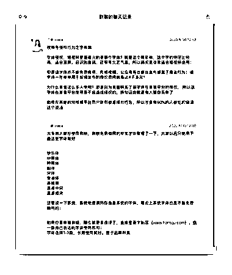

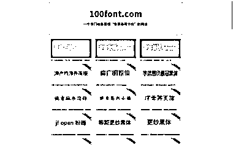

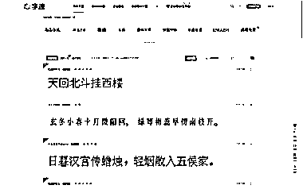

🏅 无

👍 彬垚，书情

# #视频号# 授权正版音乐素材下载总结

海绵践行

2022-02-06 12:27:34

#视频号#  
授权正版音乐素材下载总结 

🏅 无

👍 彬垚，书情

# #视频号# 潇潇视频号操盘总结

海绵践行

2022-02-06 12:25:34

#视频号#  
潇潇视频号操盘总结 

🏅 无

👍 书情

# #视频号# 几个工具找到近期的热点内容

海绵践行

2022-02-06 12:24:24

#视频号#  
几个工具找到近期的热点内容 

🏅 无

👍 书情

# #视频号# 干货分享 \_ 如何让你的视频

海绵践行

2022-02-06 12:23:17

#视频号#  
干货分享 \_ 如何让你的视频更清晰 

🏅 无

👍 书情

# #视频号# 视频号 3 天上岸，5 天粉丝破 1

海绵践行

2022-02-06 12:21:48

#视频号#  
视频号 3 天上岸，5 天粉丝破 18000+复盘总结 

🏅 无

👍 书情

# #视频号# 深度拆解丨 我是如何打造 10

海绵践行

2022-02-06 12:20:51

#视频号#  
深度拆解丨 我是如何打造 100 万+阅读量的视频号作品 

🏅 无

👍 书情

# #视频号# 复盘拆解｜单条视频 100w 浏

海绵践行

2022-02-06 12:19:19

#视频号#  
复盘拆解｜单条视频 100w 浏览，涨粉 9000，连上热门的实操心得分享 

🏅 无

👍 书情

# #视频号# 微信视频号【18 问答疑清单-

海绵践行

2022-02-06 12:17:43

#视频号#  
微信视频号【18 问答疑清单-QA List】 

🏅 无

👍 书情

# #视频号# 技能类视频号的玩法与经验

海绵践行

2022-02-06 12:16:53

#视频号#  
技能类视频号的玩法与经验 

🏅 无

👍 书情

# #藏书楼#

书情

2022-02-06 11:14:34

#藏书楼# 

🏅 无

👍 书情

# #藏书楼#

书情

2022-02-06 11:14:13

#藏书楼# 

🏅 无

👍 书情

# #视频号# 视频号内容产出宝典

海绵践行

2022-02-06 10:56:21

#视频号#  
视频号内容产出宝典 

🏅 无

👍 书情

# #视频号# 视频号从 0 到 1 全操作攻略-小

海绵践行

2022-02-06 10:55:21

#视频号#  
视频号从 0 到 1 全操作攻略-小小 

🏅 无

👍 书情

# #视频号# 视频号小白如何从 0 到 1，做到

海绵践行

2022-02-06 10:54:26

#视频号#  
视频号小白如何从 0 到 1，做到 5 天百万播放，涨粉 1 万+的？ 

🏅 无

👍 无

# #视频号# 不靠运气，靠拆解，22 天 0 到

海绵践行

2022-02-06 10:52:35

#视频号#  
不靠运气，靠拆解，22 天 0 到 1w 加关注复盘 

🏅 无

👍 无

# #视频号# 如何打造视频号博主的高信任度

海绵践行

2022-02-06 10:50:44

#视频号#  
如何打造视频号博主的高信任度 人设 

🏅 无

👍 无

# #视频号# 视频号增长逻辑总结

海绵践行

2022-02-06 10:49:40

#视频号#  
视频号增长逻辑总结 

🏅 无

👍 无

# #视频号# 借助明星流量，视频号上岸复盘

海绵践行

2022-02-06 10:48:32

#视频号#  
借助明星流量，视频号上岸复盘 

🏅 无

👍 无

# #视频号# 榜单搬运，猫咪号 10 天做到 1

海绵践行

2022-02-06 10:47:08

#视频号#  
榜单搬运，猫咪号 10 天做到 1000 粉上岸复盘 

🏅 无

👍 无

# #视频号# 微信社交小白，1 周 1000 粉

海绵践行

2022-02-06 10:45:13

#视频号#  
微信社交小白，1 周 1000 粉上岸复盘 

🏅 无

👍 无

# #视频号# 我是如何 40 小时，100 个视

海绵践行

2022-02-06 10:43:30

#视频号#  
我是如何 40 小时，100 个视频，增粉 1200，压哨上岸？ 

🏅 无

👍 无

# #视频号# 视频号从 0-1，2 个月官方加

海绵践行

2022-02-06 10:42:16

#视频号#  
视频号从 0-1，2 个月官方加 V，变现 5 万复盘 

🏅 无

👍 无

# #YouTube 运营# 分享一个通过程序

海绵践行

2022-02-05 23:03:26

#YouTube 运营#  
分享一个通过程序化的方式自动生成视频然后实现 Youtube 变现的实操案例 

🏅 无

👍 无

# #YouTube 运营# 短视频出海必读：

海绵践行

2022-02-05 23:01:56

#YouTube 运营#  
短视频出海必读：YouTube 从账号注册到收款所有步骤 

🏅 无

👍 无

# #YouTube 运营# 我的第一个 100

海绵践行

2022-02-05 23:00:18

#YouTube 运营#  
我的第一个 100w：YouTube 视频批量搬运 

🏅 无

👍 无

# #YouTube 运营# 李子柒在 YouT

海绵践行

2022-02-05 22:59:16

#YouTube 运营#  
李子柒在 YouTube 火了，音乐版权问题你有没有注意 

🏅 无

👍 无

# #YouTube 运营# 哔哩哔哩链接：\

海绵践行

2022-02-05 22:57:59

#YouTube 运营#  
  
哔哩哔哩链接：\[Legion 兴晨的个人空间 - 哔哩哔哩 ( ゜- ゜)つロ 乾杯~ Bilibili\) 

🏅 无

👍 无

# #YouTube 运营# 你怎么可以这样赚

海绵践行

2022-02-05 22:55:53

#YouTube 运营#  
你怎么可以这样赚钱系列 1：10 个月如何躺增 250 万粉丝 

🏅 无

👍 无

# #YouTube 运营# 推荐一款 YouT

海绵践行

2022-02-05 22:53:47

#YouTube 运营#  
推荐一款 YouTube 视频批量下载软件  
软件下载链接：[`www.gihosoft.com/free-youtube-downloader.h...`](https://www.gihosoft.com/free-youtube-downloader.html) 

🏅 无

👍 书情

# #YouTube 运营# YouTube 小

海绵践行

2022-02-05 22:52:51

#YouTube 运营#  
YouTube 小技巧获悉油管潜在商机 

🏅 无

👍 书情

# #YouTube 运营# 国内短视频主的 Y

海绵践行

2022-02-05 22:52:06

#YouTube 运营#  
国内短视频主的 YouTube 合作/代运营生意 

🏅 无

👍 书情

# #YouTube 运营# 一款 Youtub

海绵践行

2022-02-05 22:50:54

#YouTube 运营#  
一款 Youtube 自动化工具  
插件链接：\WeBooster - Boost youtube videos with an easy way.\`](https://getwebooster.com/\)) 

🏅 无

👍 书情

# #YouTube 运营# 利用 YouTub

海绵践行

2022-02-05 22:49:10

#YouTube 运营#  
利用 YouTube 引流以及生财的相关案例 

🏅 无

👍 书情

# #YouTube 运营# 10 个 Youtu

海绵践行

2022-02-05 22:48:22

#YouTube 运营#  
10 个 Youtube 赚钱思路 

🏅 无

👍 书情

# #YouTube 运营# 亦仁：分享 100

海绵践行

2022-02-05 22:46:53

#YouTube 运营#  
亦仁：分享 100 个围绕 YouTube 赚钱或者获取流量的思路 

🏅 无

👍 书情

# #Yutube 运营# 如何从 YouTub

海绵践行

2022-02-05 22:45:31

#Yutube 运营#  
如何从 YouTube、Instagram 视频下载器每月赚取 12000 美元 

🏅 无

👍 无

# #Yutube 运营# 21 个围绕 YouT

海绵践行

2022-02-05 22:41:55

#Yutube 运营#  
21 个围绕 YouTube 流量平台可以做项目的思路 

🏅 无

👍 无

# #YouTube 运营# 一款可以分析 Y

海绵践行

2022-02-05 22:41:10

#YouTube 运营#  
一款可以分析 Youtube 视频的工具分享  
工具链接：[Homepage - TubeBuddy](https://www.tubebuddy.com) 

🏅 无

👍 书情

# #YouTube 运营# 目录

海绵践行

2022-02-05 22:39:28

#YouTube 运营#  
目录 

🏅 无

👍 书情

# #藏书楼# 揭秘 3 个保险行业内幕，90%

海绵践行

2022-02-04 17:31:35

#藏书楼#  
揭秘 3 个保险行业内幕，90%的保险业务员都不会告诉你 

🏅 无

👍 书情

# #藏书楼# 美团联合创始人清华大学王慧文

海绵践行

2022-02-04 11:02:43

#藏书楼#  
美团联合创始人清华大学王慧文《互联网产品管理课》 

🏅 无

👍 书情

# #轻享# 嘘，告诉你一个每年至少节约五六

海绵践行

2022-02-04 09:57:47

#轻享#  
嘘，告诉你一个每年至少节约五六百元的小技巧，再也不用求人啦 

🏅 无

👍 书情

# #藏书楼# 商业拆解，\[探店\]账号怎么做

海绵践行

2022-02-01 16:48:30

#藏书楼#  
商业拆解，\[探店\]账号怎么做  
[`k3vtw0va9w.feishu.cn/docs/doccnQ7UOBUoidnN...`](https://k3vtw0va9w.feishu.cn/docs/doccnQ7UOBUoidnNNUhvaTLiGjc) 

🏅 无

👍 书情

# #藏书楼# 《生财日历 2021》全年共读

海绵践行

2022-02-01 16:39:36

#藏书楼#  
《生财日历 2021》全年共读营精华合集 

🏅 无

👍 书情

# #藏书楼# \[同道大叔\]-IP 拆解

海绵践行

2022-02-01 16:38:05

#藏书楼#  
\[同道大叔\]-IP 拆解 

🏅 无

👍 书情

# #藏书楼# 花爷知识星球精华帖合集（二）

海绵践行

2022-02-01 16:36:34

#藏书楼#  
花爷知识星球精华帖合集（二） 

🏅 无

👍 书情

# #藏书楼# 花爷知识星球精华帖合集（一）

海绵践行

2022-02-01 16:36:17

#藏书楼#  
花爷知识星球精华帖合集（一） 

🏅 无

👍 书情

# 星球创建成功。这里有一份重要资料：htt

海绵践行

2022-02-01 16:24:42

星球创建成功。  
  
这里有一份重要资料：  
[`help.zsxq.com/howto/faq/kol`](https://help.zsxq.com/howto/faq/kol)  
更多星球运营推广技巧在「星球学院」：  
[`t.zsxq.com/zVfAYvz`](https://t.zsxq.com/zVfAYvz)  
使用付费星球推广工具-优惠券请访问知识星球网页版（www.zsxq.com）。 

🏅 无

👍 无