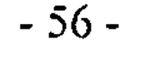

# 奸的好人12-出位硬要世界看重我

# 序言：卑微者的传奇，高尚者的堕落

在马来西亚，我是一个毫无竞争力的人，我不懂英文、也不会马来文（即马来西亚的国语），这种人正是广东话说的「废材」——意思是指没有用，只能拿来烧菜的木材。

我听过一句话：「卑微者可以高尚，但也可以继续永远卑微。」

西方有一个故事说，一位大画家，想画一双天使的眼睛，他找了三年，终于找到一个六岁的女孩，她那双灵动善良的眼睛，不正符合了天使的眼睛吗？

于是画家得到六岁女孩父母的同意后，终于完成天使的双眼，他欣赏着自己的作品流露出会心的微笑：「这是史上最完美、最善良的眼睛！」

一年之后，画家想以这幅画参展，可是这时，他却觉得作品不够味道，感觉上这幅画总似乎欠缺了什么神采……但他想破头，就是找不出原因。

三年过去了，画家某日经过贫民窟，突然醒悟：原来，天使的眼睛实在太完美了，不符合人生的真相，因为自古以来总是正邪对立，贫富也对立，这个社会就是交错重叠着是非与黑白，人性也总是因为各种情景而交错重叠着善良与邪恶，这叫做交织的人性。因此，他想在这幅画里头多画一双邪恶的双眼，与这天使的双眼重叠交错地对立。

他寻找了五年，甚至到监狱探访囚犯，却始终无法找到他所想要的充满邪恶的双眼：因为邪恶的人总有一丁点善良的部份，而且这些人多半是被环境所逼才沦落至此。了解这一点之后，画家对他们产生了怜悯之心。

又过了一年，有一次，他在毒窟碰到一个吸毒的妓女，她以狠毒的眼神瞪着路过的画家——因为这个妓女将自己三个月大的亲生婴儿扼死，刚刚才将婴儿尸体丢弃在大垃圾堆里——所以当画家与她的双目交会时，他感到，全世界最邪恶的感觉就从妓女的双目「喷射」出来。他当下决定付钱给妓女，要求她当模特儿。

妓女来到画家的住所，当了一阵子的模特儿。看到画家画完，她就想看看画家完成的作品。当妓女看到画家的作品时，她突然蹲在地上啜泣起来，画家趋前慰问，妓女投入画家的怀中哭着说：「你所画的那双天使之眼，其实就是六岁时的我……」

卑微者固然可以高尚，相同的逻辑，高尚者也可以变得很卑微，端视他身处于怎样的舞台与机遇。

我经常想，一个人能否成大功、立大业，在于他站在怎样的舞台上，而当他站在舞台的那一刻，他具备了演好角色的「演技」吗？

我的出身很卑微，所以对我而言，机遇总是少之又少，可是当机遇来临时，我会告诉自己千万不要放过：在应该「出位」和「上位」时，我会极力争取，用尽周身所有资源极力发挥，在这个机遇中想尽办法、用尽手段得到最大的效益。

如果你要我阐述这本书的特色，我会告诉你，这是一本包含着我和郑教主人生观里「出位」和「上位」的书。

有人说李民杰与郑匡宇很红，但我们两人都不认为如此。我之所以和郑匡宇相遇，我认为这是一个很好的机遇，我会用尽周身所有的资源发展这个机遇，想尽办法得到最大的效益。

因此，我必须将我所知，所识的权谋手段与策略，用最赤裸、最坦白的方法呈现出来。

# 前言：看搭讪教主与权谋大师如何脱衣服

## 十七天的奇迹

2009 年 10 月 28 日到 2009 年 11 月 15 日，在这十七天里面你做了什么？为什么我要特别强调着十七天的时间呢？

理由是：10 月 28 日这天是市场开发王李民杰大师与搭讪教主郑匡宇脑力激荡后，发出第一篇文稿的日子。

在 10 月 19 日，郑教主在我的个人脸书（Facebook）上留言说：「李老师，近来可好？我透过邮件通知，知道你在脸书上找我，于是直接加你好友了，也从你的部落格知道你即将有 baby 的消息，真是恭喜了，看来我也该加把劲啰！」

于是我们就在 10 月 23 日谈妥一切，就此展开了这段合作的缘分。

第一次阅读郑教主的第一篇文稿，我立即被吸引住，因为他谈到如何在演讲会当第一位提问者、如何超前与演讲者搭讪交流：同时他以自身经验告诉我们，他是怎样与詹宏志先生「发生关系」等等……接着，他教导我们如何做好发问的准备，即使心不在焉也能做到偷吃步的手段，在最后又卖关子，提到：「透过搭讪，认识世界知名音乐家谭盾，混进他们的晚宴，并认识有力人士，替伟忠筹措到台币两百万就学基金，前往中国大陆念博士学位的精彩故事。」

哇勒，郑匡宇到底是怎样的人……我简直被他的文章勾了魂，当时我心里咕哝：「他那种搭讪精神与勇气，我有没有？」我先「脱光衣裤」（毫不隐瞒）地给你知道：我未必有这种勇气！

他告诉我们，他透过搭讪而认识谭盾，且附上照片，又说替好友筹措到台币两百万就学基金，我惊讶地叹道：「这么厉害？！」我充满期待等着看他下一篇文章，很急切想知道他葫芦里到底是卖什么药？

当我们进行了五场的对谈之后，我不得不由敬佩郑教主，我发现他行文的最大特色就是：文中所述，几乎全都是他自身经验，我必须告诉大家：「哇，郑匡宇根本就是狂人！」

## 当狂人与狂人相遇

此后，我狂性大发，郑教主写了一篇文稿给我后，我无论驾车时、走路时、看书时、做任何事都好，无时无刻都想着到底要如何写下一场的对谈。因为这一切耗费我太多的精力，那时我就对太太说：「如果在古代，遇到郑匡宇这个狂人，若我不能成为他的盟友，最好是将这个人杀了比较好！」

太太回答说：「不好吗？郑匡宇这狂人激发了你的狂性，现在不正是狂人与狂人的对对碰吗？你们两个大狂人就脱光衣服、裤子，表演给大家看一看，你们衣服底下藏的是什么吧！」

是的，只有依照郑教主的提议，我们要脱光衣裤让大家看清楚我们的「裸体」——让粉丝们知道我们是怎么想，怎样被对方的文稿激发情绪，如何引起一连串的思维变化，又因为不想被对方比下去，脑筋如何急转弯，写新的文稿来回应……将内心的这些冲击全都赤裸裸写出来，才能完成一本类型新颖、话题特殊，又震撼读者心灵的好作品。经过十场对话之后，我可以用八个字来形容郑教主：「毛遂自荐，脱颖而出。」

这里先说一个故事给你们听：话说春秋战国时期，赵国的平原君想找出二十位门客，前往楚国游说楚王，好商量并接受联合抗秦的「合纵」计划。平原君严格筛选人员之后发现，选来选去，就只有十九位门客够资格。正在伤脑筋时，有一位叫做毛遂的家伙突然跳出来，向平原君推荐他自己，平原君哪看过自己的门客有如此的胆量？因为这位毛遂已经是他的门客，一直以来吃他的、住他的、用他的，现在老板我没选你，你自己竟然大言不惭主动介绍自己？于是想为难他，便说：「先生是我的门客吧？请问先生待在我这里有多久了？」毛遂说：「报告老板，有三年的时间了。」

平原君为了让毛遂明白他的话中有话，便做了这样的比喻说：「我听说过，一个有才能的人就像很尖锐的锥子，只要你将锥子放进袋子里面，锥子最尖的地方一定会刺穿袋子冒出头来才对啊！」

毛遂是何等人物，自然明白这句话中话。老板的意思不过是说：我才智平平，所以在老板门下当食客三年之久，仍然默默无闻，这不是摆明了说我毛遂没有任何「突出」的地方吗？

没有被老板的质问吓退的毛遂，以镇静的态度，坚定的眼神，对平原君说：「那么，老板，请您今天就把我放进袋里面吧！如果老板一开始就把我放进袋里，我早就脱颖而出了。」这句话无非是埋怨老板：是你从没把我放进袋里面啊！是你三年都没看到我的才华，所以我毛遂才会自己推荐自己，要你给我机会脱颖而出啊！这就是「毛遂自荐」、「脱颖而出」的出处。

## 大胆赌一把

每次看到这个故事，我就油然发怀古之思，想想历史中那样的画面：二十位说客来到楚王那里，从日出谈到日落，都谈不出什么成果，这时毛遂又开口说话了：「楚王先生，为什么我们要联合起来抗秦呢？其实两句话就说明清了……」毛遂边说话的时候，边走到台前拜了一拜楚王，继续说：「我们从早上谈到现在，都还没有结果，是因为大王不知道我毛遂是谁的缘故。」楚王很看不起毛遂这个被平原君斋养的食客，不客气地说：「下去、下去！我跟你主人平原君谈话，关你这个下人什么屁事！」毛遂立刻手握宝剑，再往前走几步，大声说：「大王你敢骂我，是因为你倚靠人多势众，加上这里又是属于你的地盘；虽然如此，我仍然可以在十步之内，举剑杀死大王，你们人很多没错，但一时之间却也救不到你……」之后，毛遂说出当年秦国名将白起如何轻而易举打败楚国的故事，接着口气放软下来，说：「其实联合抗秦，说穿了是自己不够强大，才需要合作，否则大的吃小的、强的吃弱的、快的吃慢的……」

各位粉丝们，你们有没有想过，毛遂是一个狂人，是一个狠角色，所以他才敢做这种举动：先是「硬要」引起平原君的眼球注意他，接着又「硬要」楚王看重这次的会谈，最后以半软半硬的口气「硬砸」地成功说服楚王联盟抗秦。你有才华，觉得自己不平凡，想脱颖而出，但在没有人注意你时，你敢不敢毛遂自荐？如果机会来到你身边，你能否狠狠地大胆赌上一把呢？

我是一个很喜欢比较的人，尤其喜欢找比我更强大的人比较，当我看到他们的书销量比我好，我就会问：「为什么？」我不会想：他用了多少年的时间才有今天的成就？而是看：到底他做了什么，才有今天的成就？然后我直接模仿他，或者直接向他学习就对了！例如：搭讪教主郑匡宇在台湾颇有名气，我翻查过资料，虽然与我们的销量成绩不相上下——以《勾魂夺心洗脑催眠》三万本的销量，对比《搭讪圣经》三万本的销量——但是，如此的成绩，其实就是比不上郑匡宇。我们的书在马来西亚、新加坡、香港、台湾四地发行，而郑教主的《搭讪圣经》是台湾发行，也就是说：光一个国家的销量，便等于《勾魂夺心洗脑催眠》在四个国家总销量的总和。

我的比较逻辑是：即使我在亚洲颇有名气，然而，对比于在台湾取得实际亮丽成绩的郑匡宇，又有什么用？即使我在马来西亚排名第一，但郑匡宇光在台湾一地的成绩，就与我们四地的成绩不相上下，请问谁比较厉害？请问，谁赢了？如果你与一千人比较，你拿冠军，在你后面有九百人；但，若你与一万人比较，你是排名第二千人，实际在你后面的则有九千人。因此，我情愿与一万人比较，即使我排名第二千人，也不愿意在一千人群中，排名第 1。

我个人的偏见是：郑教主的总成绩赢了我们，我需要他这位盟友兼「脑友」，需要他的脑力激荡，透过与他合作，看清楚他写书的套路；我要当《天龙八部》的星宿老妖，用吸星大法吸收郑匡宇的功力，需要与他交换资源。

有人问我：「要是将来，郑匡宇的成就比你更强大呢？」

我说：「那时候，我也会跟着壮大起来：郑匡宇即使将来比我更红，有什么关系？我希望拉着他的衣角，沾一沾他的大红大紫。而且你永远不要忘记，我和郑教主因为这次的合著，他越红，相对的我也能因而起舞。虽然可能有人在背后笑我是配角、妈或是老二，为人作嫁，这又有什么关系呢？」

各位粉丝们，你看到了我的裸体吗？没有穿衣服的裸体（赤裸告诉你，我想与郑匡宇合作的算盘），的确很难看，但脱光衣裤的勇气，是郑匡宇教主带给我的勇气。

## 戏剧化的说话术

所有的事情都发生在这十七天，十七天的时间我们写成一本书。

你们想一想，这对我而言，岂不又是一个全新的尝试？这十七天，是我做出版人以来最大的突破，无需一个月就写好一本书。但你们也许会问：「有素质吗？质量够吗？」

各位粉丝们，我说：绝对有料！因为这是一本脱光衣裤教你权谋手段的书，让你在学校权谋手段的过程里，看到我们是如何「思维」出招的。

现在我们要教你第一招的权谋手段是：「戏剧化」讲故事（这个故事必须是真实的故事，不能用骗的）。

戏剧化的说话术，首要条件是故事一定要有起伏、有转折，用「主观镜头」描述情景或强化感受，配搭「客观镜头」描述情景强化感受，二者重叠。

二者交替重叠的例子如下：「……我看到一个年轻人从门口进来，坐在我隔壁的小花发出惊叹道：『哇，搭讪教主！』然后小花推一推小芬的手肘，向小芬低声说：『他就是鼎鼎大名的搭讪教主郑匡宇，我很怕他来搭讪我，我怕受不了他的诱

“……”小芬说：“他可能搭讪的人是我……”我心里想：搭讪教主是谁？我在美国十三年，根本就没听过谁是搭讪教主。我看到搭讪教主对着小芬与小花微笑，她们两人就像融化了一样。这时，子怡与冰冰都放下手上的工作，看着搭讪教主，互相耳语著……我用眼角注意到，在场所有的女人既防备又期待，而所有的男性都以来者不善的眼神瞪著搭讪教主的举动。当他走到我的面前，伸出手说：“你好，我叫做郑匡学……”所有的男人都呼出一口气，但，所有的女人都却流露出失望的眼神……”

你与其跟同事说：“老板今天脾气很坏，大骂陈课长，小心别惹他们两个……”还不如说：“今天，老板一进办公室，我立即感觉到气氛不对，看到他眉头紧蹙，我连说话的声音也变得很小。老板来到我的位子，我向他打招呼，他却好像什么都听不到，只看到他用手指著陈大文课长。他们两个进了老板的办公室，我们在外头听到突如其来很大声的『碰』，陈课长就气冲冲走出房间，老板办公室外的秘书也吓得低下头，连泡好的咖啡也错端给我喝了。课长的属下成员，今早全部都不说话，专心工作……”（注意，后者的说法不是下结论，认定老板「骂」陈课长，但，经过主客交替描述后，我们都意识到，今天千万不要招惹老板和陈课长。）

修炼这个心法的粉丝们要留意，不是每件事都需要这样描述，大多数的情况是，你要简单说「老板今天心情很坏」，只有少数的事件需要用这个手法。

## 戏剧性的转变

「戏剧性的转变」是第二个要修炼的心法。

戏剧性的转变，暂定两个方向：

- 第一个方向，「硬要」让他感觉世界不一样了——先进行误导、窄化视野、播放噪音，然后推翻前论，这时他就像看到一个新世界，因为我们透过主观镜头让他以为是样，结果真相并不是这样。
- 第二个方向，让他很想知道隐藏的秘密——在主观与客观交替重叠时，将关键信息隐藏起来，如章回小说般，欲知后事如何，请听下回分解。

第一个方向的目的，是让你说自己的故事时，表现出功劳过于人，让对方记得你的付出（这本书的重点，将集中说明这个方向）。

第二个方向的目的，是让人对你好奇，表现出你是权威专家，使人有兴趣听你说下去。（譬如：郑匡学来到李民杰身边说了五个字，李民杰当场傻了，他问自己：为什么成为千万富豪这么多年，却从来都没有想过这五个字？李民杰遇到马应九时，李民杰也对他说这个五个字，马应九拍了一下自己的额头发说：「妈的，为什么我没有想到呢？」刚好郭志铭经过，听到这五个字，就转身对李家诚转述。李家诚分析了有做这五个字和没做这五个字的差别——各位，这五个字到底是什么？就是我刻意隐藏起来的信息，因为你向我到底是哪五个字时，就表示我已经成功了。这个架构之后的演练，可以参考《心魔行销》第三章（一本很奇怪的书）第 107 页（以及《勾魂夺心洗脑催眠》之《如何吵架吵出智慧》。）

我用《看穿女人心，迷惑男人阵》这本书的封面做例子（第一个方向）：我想将这本书的封面「神化」，对象是江健勇老师念力班的学员，因为江老师的念力课程「紫花冥想」有很多种迹。

假设真相是：设计这本书的封面时，我们根本没有想过用江健勇老师念力课程的「紫花冥想」来设计。我们从三个封面中，选择了这个有紫色玫瑰的封面，当书出版之后，某位粉丝在我的部落格留言说：「李老师，你是不是运用江老师的「紫花冥想」来做封面的呢？」

哇，我是行销人，这句话触动我的行销头脑，于是我开始找数据，将这个封面的故事戏剧化。加上这本书印好之后，我强迫朋友购买一本，放在餐厅内，发生过一些故事，我把这些经验全部串联在一起，改编了一个具有戏剧性的故事。各位粉丝们，我只是提供这个故事当作教学案例，如果想用这个故事，前提条件是：你必须是讲给自己的粉丝听。

### 封面故事戏剧化的包装

《看穿女人心，迷惑男人阵》出版之后，我在朋友的餐厅做了一个实验：在餐厅内，我特地将我们的书摆放在杂志堆里。根据以往的经验，顾客进了餐厅，第一时间一定会在杂志堆里拿最新的杂志来翻阅。这次，我发现大家都不看杂志，而将这本书拿在手上翻阅。我观察到这个现象后就就想，是不是因为杂志堆里只有一本书，所以才会特别吸引人呢？（脱光衣裤的解释：我描述大家在杂志堆里，第一时间拿书而不拿杂志，这就是客观镜头「描述」的情景。）

于是我就做了第 2 次的实验。我另外拿一些两性关系的书，都放在杂志堆里，这些人还是一样什么书都不拿，只拿《看穿女人心》翻阅。（脱光衣裤的解释：这就是一个起伏转折的排布。真相是：我送了五本封面又破旧的两性关系旧书给他，强迫他做这个实验，当然没有人愿意看陈旧封面的书，我只是给自己制造一个自欺自人的证据。）

最过瘾的是，他们不是静静一个人看书，而是看了之后，就用手一指指身边的人，还将其中一页翻给对方看说：「哇，你很像不像你？」（脱光衣服解释：我描述少数人的反应，目的是要让我的粉丝们觉得：我成功地将大多数人的故事写进书里，因此读这本书的人深有共鸣，感觉好像在看自己或朋友的故事。）

这时我就想：嗯，一定是书名很吸引人，所以那些人连杂志也不看了。（脱光衣服解释：进行误导观众，说出主观的感受：书名起得很好！）

于是我和太太、岳母三个人，又开始做了另一个实验，我们跟朋友说：「最近我写了一本书，叫做《看穿女人心，迷惑男人阵》……」

我们发现这些人一听，第一时间，第一句话的反应，一定是：「哇，这么厉害？看穿女人心之后，又可以迷惑男人，哇！犀利！」

那时候我们心想，这可能是年龄层的问题，这话题对 17 岁到 30 岁的人都很 有吸引力。但是我岳母那边的实验结果更吓了我一跳，因为当我的岳母一提到看穿 女人心时，那些大婶大叔也是哇哇大叫：「厉害，看穿女人心之后，什么都可以做了， 呵呵；迷惑男人之后，我就可以拿到很多钱了，哈哈……」

于是，我和太太很确定的认为：「这就对了，我们的书名起得很好！」

接着，我那位开餐厅的朋友却开口反驳说：「你错了！你的书名根本没有力量！ 如果不是我碰到那个印度人，不是他的那句话，我也会以为是书名取得好，结果我 发现不是书名的力量……」（我推翻这个书名的说法，误导你们的是我，推翻的人也 是我。）

不是书名的力量，又是什么力量呢？为什么我的朋友持反对意见呢？

我的朋友告诉我，有一天，他看到一个很有名气的印度算命师走进餐厅，当他 走过杂志堆，突然像被磁石拉住般，一下子停住脚步，他慢慢转身，后退数步，转 向右后方四十五度的方向，眼睛注视着杂志堆里的一本书。接着他完全转身，两三 步走向杂志堆，将《看穿女人心》这本书拿在手上，一直看着这本书的封面，微笑 点头，闭起双眼深深吸气，然后又睁开双眼，注视着封面露出微笑，接着又闭起双 眼深深吸了一口气……印度人的举动，吸引了朋友的注意，他很好奇地用英文问那 位印度人：「你懂中文吗？」

印度人说：「不！我只是看到封面这一朵紫色的花：它很吸引我，这朵紫色的花 有迷人的力量，对增长人缘运有很大的帮助，里面隐藏着每个人见到你就会喜欢你 的神秘力量，我看了这本书的封面，连我也想跟你买这本书……」

哦，那时候我恍然大悟，原来我们是沾光了「紫花」神秘的力量……就在同一天的晚上，偏偏这么巧，我在部落格看到粉丝问我：「李老师，这本书，你是不是用了紫花的秘密……」

我心想：哇！有这么巧合吗？我的朋友竟然与这位学员同一天做出这本书最大力量的是紫花做封面的评论；他们两个人在不同的地方，竟然产生相同的想法，我很不服气：「紫花有没有这么神？」后来我回想起，当我们确定采用这个封面后，发生在我们身边的神迹（接下来，就是报告一个比一个更厉害的神迹）…

简单来说，这种铺排是推理小说的模式，进行很多主观的描述，窄化你视线的客观证据，让你误以为是这样，答案揭晓时，却并不是你所认为的那样。你有没有想过，你如何将这个方法用在你的职场呢？

如果你是采购员，以超低价格谈成一笔买卖（大功劳或新记录），你用以上的模式进行的误导是：你收购这家企业时，你和团员以及其它的竞争对手，一直以为要提高价格，而你每次看到你们价钱时，企业主嘴角一定有一个动作，后来你经过洗手间，发现他们走廊上的几幅画，你才看穿了企业主的心。你回到会议室，放弃用提高价格的战略，只是说出我们公司的前景与梦想，告诉企业主我们总裁的为人，他曾经在太湖见过南怀瑾老先生，所以才决定加入这个行业，这番话果然使得企业主放下心防……而我们便以比市场低三倍价钱，收购了这家企业。

如果你是销售员，你靠郑匡学教主的「一字真言」谈成大买卖，而这个顾客三年前，课长拜访过、主任也拜访过，五个销售员都拜访过，大家都以为要卖很低的价钱，提供很多服务；结果，你却用高价格、少服务谈成这笔生意。你进行误导的方向是：开始时，你用问题来找出顾客的需要，但看了《印象洗脑术》，用了「盗雷术」做开场白，聊天时以 NLP 用手指指自己就变成神的做法，再配搭权威一挡解说产品，以阴阳二分毒害竞争对手；就是这个转折，你成功以高价格谈成——真相是，这些手段你都用过，但顾客是因为你用「一字真言」，时机到了，才真正有了这个「需要」。

## 众生不要听真话

各位粉丝们，你有没有想过为什么李民杰要这么做？何必将真相经过包装，变成戏剧化的真相呢？

因为这是帮助你踏上舞台，让你有「演技」告诉「导演」与「编剧」，你是时候「上位」了——大多数人都喜欢听戏剧化的故事，你没有「出位」的演技，如何能成功「上位」呢？

很多时候，大多数的人往往不是要听真话，而是要听经过戏剧性包装后的「真话」！但很多人不会想，一百个故事里面，可能只有一个很经典的故事，可是人类就有「神话情结」，忘掉了九十九个很平实的故事，奢望每天上演很经典的故事。

各位粉丝们，当你看懂了如何戏剧性包装你自己的故事，明白了这个架构后，我们预计你会走火入魔，以后你看到书本、讲师述说具戏剧性的故事时，你的「疫苗」对戏剧化的故事便产生「抗体」或「免疫」作用，举凡是戏剧性的故事，你头脑就会自动过滤：到底有多少是平实的「真相」？因此，一听到有「演员」懂得这种「出位」演技，你将会像我一样想；「大哥，你只不过是将存活偏概率的故事变成戏剧化的故事而已，我还不知道你其它九十九个『平实』的故事，我要看你最『平实』时的表现是什么……」这时，你会产生一种极端的「偏见」：我不要听太多，我只是要看最后的成绩单——今天你可以戏剧化地成交这个案子，我会继续给你机会，问题是，若你一年的总成绩比不上最平实的销售员，于我而言：这个人就不是「人才」！

我认为，当你倾向于以冷酷无情的眼光，看待「平实」与「戏剧」演出的走火入魔态度，是一件好事，因为你看到我的启蒙师父老胡之勾魂手段，确实会让你大开眼界，可是一年后他的总成绩为什么比不上老老实实的陈大文呢？你的头脑就会判断：老胡不过如此，言过其实！这时，为了让你自己不惹人厌，你只需要收敛你逼人交出「总成绩单」的态度即可。我知道我这样写会害了自己，你要是只看总成绩的话，你会问：「既然李民杰这么厉害，为什么他的书本销量总成绩，比不上很平实的龙应台？」

最后你过度极端、走火入魔，当你听到「陈宝发人际关系魅力学」，戏剧化地告诉你陈宝发如何用了八法则则将敌人变成朋友，将顾客变成忠实顾客，你的头脑首先会想：「我现在不喜欢你，郑匡宇与李民杰也不喜欢陈宝发，放马过来，令我们喜欢你！你总不能将你少数的例外、意外、偶然，就当作是号令天下的通行证吧！」市场的总成绩还是证明，你有用陈宝发人际关系术，或没有用，结果还是有人喜欢你、有人不喜欢你，有人会记得你、也有人忘记你。学陈宝发人际关系魅力学真的很多余！从此，你不会轻易相信戏剧化的成功故事，你开始从宏观多角度分析与着眼。

在真实的世界，即使你学了很多权谋手段，本身也在职场上要了很多手段，可是你会很冷静地看到，为什么一年下来，自己的总成绩比不上那个不会手段，只懂拼命做、拼命试、拼命实验的陈大文呢？果真如此，你在该平实时就平实，因为在人生的争斗中，你必须变成像陈大文一样，在大多数的情况下你都需要平实。我的比喻是：你买了手枪不是要经常开枪的，你学过武功并不需要天天打架的，大多数的时间，你、我、他都是很实在的人，你「要」有戏剧化说故事的能力，但，你不一定「需要」这种能力，你最需要的是陈大文的精神——正如你看香港黑帮电影，难道你真的认为，香港每天都上演着满街都是黑帮火拼的「戏剧」吗？

各位粉丝们，你读这本书是因为你变了，你可要明白，这个世界还是有很多 人需要听戏剧化的「真相」（包括你的老板、顾客），你运用权谋手段，就是在「必要 时」开枪对付这些人。

但你一定要留意郑匡宇式的精神，他那种精神，才是你需要一并修炼的，如果 你经过，这个戏剧化的免疫系统洗礼，你还看不到郑匡宇的精神，我真的无话好说 了，你只好继续喜欢你的戏剧化吧。讲残忍一点，你很有可能继续耗费了很多无谓 的精神，在厨房翻了十八个筋斗，打了十八招雷火神掌，用了半小时炒出一碟炒饭， 可是残酷的现实将会是：你、我、他都可以用十分钟时间，炒一碟一样好吃的炒饭。

虽然如此，千万不要以为戏剧化的演技不重要，如果你的机遇只有廿分钟，你 认为平实的手段，可以「便要」让你的偶像看到你的存在吗？

## 第一场对谈：用「五指山」与「英雄」行销法得到偶像的「恩宠」

李民杰：如果你只有廿分钟

### 你与英雄有缘无份

如果你有机会与偶像相见，但你却只有短短廿分钟，请问你打算怎样做才能吸引他的注意？

我所说的梗要让人注意到你，是指你的偶像此后会对你有深刻的印象。我说的偶像，是指你最想模仿与崇拜的对象。比方说：你想成大功、立大业，而你觉得在世界上最能代表成大功、立大业的人物就是李民杰与郑匡宇，这两位是「出位」达人殿堂级的代表人物，李民杰与郑匡宇就是你的偶像。

现在我要求你拖卷沉思：你只有一次机会见李民杰与郑匡宇（你的偶像）——但你只有廿分钟，你若要好好利用这短暂的时间，请问，你该怎样梗要让李民杰与郑匡宇的眼球看到你，然后答应与你合作写书呢？

难道你会跟他们戏剧化展示你的能力？但，你回想一下，李民杰与郑匡宇是华人世界非文学类畅销书最火红的作家，你没有写过一本书，敢班门弄斧吗？

你或许有两个策略可以施展，第一就是戏剧化展示高价值；第二就是戏剧化展示低价值。到底何者为优呢？

### 让偶像爽死，有用吗？

采取展示低价值的人会很平实地想：「还是争取时间向他请教成功之道，然后很谦虚地聆听偶像的教授。即使他看不到我、或对我没印象，我还是可以在他身上学到东西，这样比较符合成本效益。」

于是开始谈话时，你会说：「哇！李大哥、郑教主，我很佩服你们两位这本合着的新书，这本书写得太棒了，而你们俩出过的书，我全部都买了，天天都在背诵……你们两位一直是我心目中的神。我想写书，想要像你们一样出名、出位，请问我应该如何写一本很出位的畅销书？」

如果你想模仿李民杰大哥做市场开发王，或者你想变成搭讪教主郑匡宇，你开口第一句话问：「大哥、教主，请问如何成为市场开发王与搭讪达人二者合而为一体的无敌综合体呢？我想学李民杰式与郑匡宇式的谋诀与偏见，学如何出位、上位……」你再细心想想，换了你是李大哥和郑教主，有办法在十分钟内，将所有的知识与经验，全部传授给这位没有写过一本书的年轻人吗？

你看，这句话是先给我们高帽戴，让我们爽死，他直接吐露我们是他要模仿的偶像，他是我们的追随信徒。但，偏偏太多人给我们戴高帽了，正是多他一位不算多，少他一位也不会少；他以这种虚怀若谷的精神来向我们请教，会导致我们对他产生两种印象。

第一，因为他问的问题涉及范围很大，不是一时三刻能说完，因此你只是逼我们以「门面话」来回应：「哦，要出位的话，最重要是你要懂得如何戏剧化包装真相，接着，你要透过五指山行销术窄化对方的选择，用英雄法则让对方喜欢你，以「买死千里马」来布局，当「立木为信」之后……最后，你为了抢你同伴的功劳，你可以用『我』和『我们』交替运用……」——朋友，我们重复了本书观点，暗示这位年轻粉丝：我们的书不是说得很清楚了吗？因此读《出位一硬要世界看重我》越多次就越好，因为你会看到李民杰与郑匡宇脱光衣服裤子，赤裸裸地看清楚教权谋策略与手段，将内心世界最赤裸的情绪变化、思维脉络全都写出来，你只需吸收完，再消化变成自己的偏见，照着做就对了……

李民杰与郑匡宇 Q&A 的任务完成了，不过我根本看不出这位年轻粉丝会在我们头脑留下什么深刻的印象，再直接一点：我们对他根本不会有任何印象，因为 Q&A 之后，我们都各自回饭店睡觉了——如果这位年轻粉丝只是「示低价」地问爽，我们的关系就到此为止，但他是怀有目的与意图，「示低价」是为了想与我们合作写书或收他做接班人，这种做法无异是鬼鬼祟祟、扭扭捏捏地浪费时间！

如果你真的想要与我们合作写书，就不要拐弯抹角，直接说：「李大哥、郑教主，你们两位是我最崇拜的狂人，我想要与你们合作写书……」你当然可以这样说，但不符合「出位」手段。

### 把英雄吓坏，让他进入能量最低点

如果要出位，选择「示贱价」更加会让我们印象深刻。假设你在演拼会之后，勇敢走到我们面前，在数百人面前立刻跪下来猛叩头，李民杰与郑匡宇虽然都是「出位狂人」、「上位达人」，不过看到此情景，肯定进入「能量最低点」，被出位你出位技吓傻了……接着我们两人会扶你起来说：「有话好说、有话好说，起来再说…」

你继续勇敢地「示贱价」说：「大哥、教主, 我默默无闻, 现在想要成名与出位, 我不知道该怎样做, 看了你们《出位一硬要世界看重我》这本书, 我知道只有你们能教我, 所以我现在只有两条路可走, 第一, 就是与你们合作写书; 第二, 求你们收我为接班人, 教我如何成名出位……」(注: 跟你们开玩笑, 千万不要跟着做, 否则后果自负。)

好了, 印象固然会留下, 但我们会会有后续的发展吗？

答案是: 看这位小弟后续的动作如何。

如果你既不想「示贱价」, 也非意图与我们合作, 或成为我们的谁是接班人, 你只是纯粹想跟我们交流, 但, 你要留取印象, 该怎样做到呢? 在没有教你招数前, 你先看一看以下两个具有「暗示」教你该怎样做的策略。

### 「五指山行销术」

「你可以没有相貌、没有金钱、没有地位(名气), 无需口才、不要勇气、不必坚持、不需努力, 我只要教你三招肢体语言, 你就可以使得有钱的富豪送钱给你, 有地位的给你地位…」（这是不符合现实真相, 夸张式的宣传伎俩, 已经极大化了手段的功用）

这句话行销的话术, 我一说出来, 你们已经逃不出我的魔掌, 因为听了这番话的人肯定会蠢蠢欲动, 毕竟你的选择已经被窄化了, 第一你相信, 第二你不相信, 第三你半信半疑……注意一下, 在我没没这句话之前, 你根本不会想我是谁? 说了之后, 你现在只有三个选择, 这根本就是西天如来的五指山, 任你是孙悟空也逃不出这五指山也!

但如果我如实告诉你：「成功没有快捷方式，靠得是累积你的资源、努力、坚持……」我相信你会阻止我说下去：「不！不！不一李大哥，这些理论我听过了……你有什么权谋手段让我一步登天呢？你说那些靠努力、有资源才有格局的理论，我也会了……」

我会跟你说：「哦？我当然有一步登天的方法，不给钱来上我的权谋课程，我是不会教你的！」

这时，你又有三个选择，第一，无可奈何之下交钱上课；第二，很愤怒地骂李民杰是江湖郎中；第三，不相信李民杰能教你什么，李民杰要求你付钱上课只是想

多赚你的钱，而其实李民杰所有的料都已经写在书里，你只需要读完李民杰的书就足够了，自己可以根据书里教的招数，慢慢磨练成才。

其实你有没有发现，我有三分之二的赢面，你很愤怒地骂我是江湖郎中，等于承认了我有方法让你一步登天，只不过是将这些信息用来贩卖，不是免费帮助人成功。即使你选第三个判断，李民杰也是赢家，因为你说我有方法，只不过是写在书里。孙悟空又逃出五指山！

读了以上这两则话，我猜读者会想：「嗯，我明白了，我只要极大化偶像的光环，或极大化自己的成就，针对人性的【贪】念，或针对人性的【痴】念下手，不就行了吗？」

（你不贪、不痴，没人可以骗你）

嘿嘿，你知道我为什么不直接教你这招，而需要转折暗示教你这招呢？道理很简单，我怕你拿捏不好，把自己吹嘘过头而招致反效果，会回来抱怨我教你这些招数不对。要学这招，请留意郑教主是如何吹嘘自己的成就，但郑教主是没有讲过一句谎言的吹嘘，而且拿捏得很精准。

其实当你看了「五指山」的行销话术之后，你有没有发现，越戏剧化的东西越容易让人印象深刻？例如《看穿女人心，迷惑男人阵》引述了西方恋爱专家的分析：「男人跟女人说话只要三十秒的时间；女人只需要三十秒就可以判断，要不要与这个男人继续交往下去。」各位粉丝们，这段文字得到了许多女读者的回响，但是你们细心想想，三十秒合理吗？这是真实世界发生的事情吗？

再比如，我经常说：「在权谋课程，我可以教你一种方法毒害你的竞争对手，让你的顾客仇恨你的竞争对手！」（注：这个说法，已经被我将某些信息锁在保险箱内，我极大化了这一招的成就，或者是利益）

真实的世界是如此吗？我是有毒害竞争对手的招数，但如果价钱没有竞争力，产品品质不如人，顾客暂时没有这个需要，你认为我毒害对手的招数有用吗？再加上，在真实的世界即使我毒害了我的竞争对手，结果还是有一些顾客继续跟我的竞争对手交易，但我不说出整个客观条件，如价钱的竞争力、产品的素质，我为了凸显毒害对手的招数，将之片面极大化到很戏剧性，所以让人错觉：即使价钱没有竞争力，产品质量不如人，顾客暂时没有个需要，顾客与竞争对手关系很好，我还是成功毒害了对手。

是你不够平实才会被骗！如果你够平实，你会问：「李大哥，你成功的案例是九十九个平实故事里面，只有一个经典的故事吧！？」你也会说：「哦！当然啰，要是李大哥的权谋手段这么厉害，李民杰已经是世界第一了，因为他已经没有了竞争对手，既然他那么厉害，只需要在消费者面前毒害他的竞争对手，令我们只买他出版的书，而不买其它出版社的书，他就是世界第一了！李民杰还想要在作家面前毒害其它出版社，令全台畅销书作家都投靠你的出版社，李民杰做给我看！」各位，当你变得如此极端平实，凡事都要看总成绩的话，我会老实告诉你，我没这么厉害的手段。

是不是平实的话术就是很好的策略呢？

请你再看以下的销售话术，用来对比上游的话术，看哪个比较有吸引力：「如果你的产品素质够好，价钱有竞争力，你具备了一切客观条件后，你来学我们权谋课程毒害竞争对手的手段，虽然不是每个顾客都会中招，但你还是有机会，在小部分不是智能型的采购员面前毒害你的竞争对手，只要你的顾客跟竞争对手关系不好，这招还是能取得效果。」喔！老天，你不会对这招存有任何幻想空间吧！

你认为隐藏客观信息的话术，比较让你有幻想的空间，还是老老实实的话术有幻想空间？

听了老老实实的话术，不但没有幻想，还延伸出很多问题，如：「李大哥，我要搞好我的产品、价格、服务、关系……我做好了这些，才来上你的课程好吗？」各位粉丝，事实证明了，我没有用「五指山」压住「孙悟空」，他跑出来在各位粉丝的头脑「大闹天宫」了，同样的道理，请问你如何收服顾客的「孙悟空」？完了、完了，这是平实但绝对失败的销售手段！

戏剧化的话术，可以让你看到你自已幻想出来的画面，因为大脑内的「孙悟空」被压在「五指山」下：顾客会忘了回归平实，顾客会忘了毒害对手的手段只是给那些具备客观条件的人一个「顺风」的加持。

在真实的世界，根本不会有最犀利的杀戳手段，可以让你的竞争对手死得消光，从此之后在你面前就是一片蓝海，杀出无人竞争的市场——你会有这个幻想，就是你不够平实，你在痛苦的厮杀场面里希望出现一把「神锋利器」，帮助你取人首级于万里之外。

人类喜欢走进小说、电影的世界，为的不是想看世界真实的模样，而是想看到另一个世界——我说一句很绝的话，在课程里，你听了我们的故事，你学了我们的手段，但在你的行业用不到，可是你还是会很心满意足，这就是人类的「需求」。

人的头脑就是需要被戏剧化的东西荼毒！没有多少人是理性的。

在这里我必须负责任地告诉你，如果你要在偶像，如郑匡宇与李民杰面前极大化你的成就，说：「我是五百年来华人世界里最疯狂的末来作家！」千万要小点心的，你要多做功课，否则你会得到反效果，「死」得更惨！因此，你一定要知道郑教主是如何「膨风」得合理。

当然，我已经知道你将走火入魔的症状是，一旦你听到一个很犀利的信息时，你会想：到底有没有极大化了成就？到底有多少信息是被藏了起来？然后你会从宏观面检视这些犀利的招数，你会用总成绩来衡量一个人说的行销话术。用你的权谋手段毒害微软，你会取得胜利吗？要是这招这么厉害，李民杰早出来竞选总统了！

但我希望你明白这就是喜欢上课堂之人之「通病」，讲师越是用平实的内容教人，学员就会骂讲师没有料，很多人不是喜欢「吃」激励课程的「精神鸦片」（其实「你就是自己的激励达人」，就是「迷恋」上手效果被极大化后的「手段迷幻药」（其实「做实验就是成为手段达人的快捷方式」）

### 「英雄」行销法

如果你说，只是想与郑匡宇和李民杰聊天，最好是用「英雄」行销法。

- 第一步，你先有识英雄重英雄的手法——如果对方是李民杰与郑匡宇，你必须要说：「大哥、教主，你们教我的『立木为信』与『买死的千里马』的策略，让我在权力斗争中赢得最壮观的胜利，看到你出版的动态，我发现（说出你发现的行销策略）……原来就是根据这两个原则，现在我才知道大哥与教主的胸怀与远见，不过我还发现到，你有一个对比法测与羊群心理的法则没有写出来，但你却将这两大法则运用得出神入化。」这时，我们可能会被你吓了一跳，因为我们的行销策略确实是有这两招权谋手段。
- 第二步，故意讲错他的想法，让他滔滔不绝地纠正你——你说：「大哥、教主，你们救场功劳的手段，如何活用『我们』与『我』的说话术（说出错误的招数，但只能是小小的差错）……这时，我们可能会滔滔不绝地纠正你，但前捉条件是你必须先让我有识英雄重英雄的感觉。
- 第三步，如果你真的是他的信徒，你应该表现你对他的熟悉度有多深，对偶像熟悉的表现是多用偶像常引用的比喻，或书里独特的术语，而且还要点出一些系独一二的观点。例如李民杰在《有钱人的偏方》用「捧在阳光底下的信息」，李闽杰在脸书与出版的行销布局，且猜透李闽杰的意图与远大的目光，这时可以像「谋略」（一位网友的昵称）那样说：李闽杰现在写脸书和出版这本书，就是「摊在阳光底下的暗箭」，高明！

李闽杰心底里肯定会感叹：「知我、识我者，『谋略』也！」

不过，为了对得起你买这本书，我还是老实告诉你：即使你能达到这个境界，做到这个效果，你只不过是跟对方开展了一段「一夜情」，但你心中的偶像，他背后三千佳丽等着他，暂时还轮不到你。

我当然知道权谋学员心里会想：在这短短 20 分钟的时间之内，我对偶像做「天堂地狱」法，就有很大的机会得到皇上「恩宠」了。但，如果你是沒有资源的人，未必对你往后有任何作用，问题是沒有资源的人（沒有相貌、没有金钱、没有地位（名气）、没有口才的人），又该如何做追踪的动作呢？

答案是：又不能控制的「对比法则」，与能够控制的「一字真言」。

## 不能控制的「对比法则」

什么是不能控制的「对比法则」？我先说一个故事：

清朝慈禧时代，有一位很有美丽的皇室成员，他有远见、具谋略、有性格，这位政治家叫做恭亲王。据说本来道光皇帝要选择这位排行第六的孩子当太子，但道光皇帝为了公平起见，特意安排了两个场合来筛选太子。

第一个筛选的考验是众皇子要在道光皇帝面前打猎，看谁的箭法与骑马技术最高明。众皇子都知道打猎对六皇子来说简直就是强项，于是四皇子的老师就对他 说：「千万不要硬碰硬，每个皇子为了展现体育精神，必定尽力表现自己的实力，因此他们会保持输了也光荣蛮参的态度，记得当所有入卖武德，你就是要卖仁慈……」。

结果第一场比试，四皇子故意在众皇子冲进森林打猎时，向道光皇帝报告：「父皇，此时正值春天，正是许多小动物孕育的季节，孩儿实在不忍杀生。」道光皇帝乍听之下，觉得第四皇子很仁慈。道光虽然很喜欢六皇子，但又很担心六皇子仁德不够，于是开始在四皇子与六皇子之间拿捏不定。

接着等啊等，一直等到道光皇帝病重之时，才进行最后的考试。当每个皇子都摩拳擦掌准备应考时，唯独这位四皇子说：「爸爸啊，爸爸，我不想考试，我只希望您健康起来……」

这一招冲击性更大！道光皇帝看到每个皇子都只顾太子位，没有这份孝心，而惟独这四皇子不但仁慈又没有野心，甚至还有孝心啊！六皇子固然是有才，但品德显然比不上四皇子！因此道光皇帝就这么决定，传位给四皇子咸丰皇帝。

当你们听完这个故事之后，你们会说：「我明白了，《勾魂夺心洗脑催眠》一书说卖玉的故事，当所有人卖真玉，你要卖假玉，当所有人卖假玉时，你要卖真玉……」结果你就想：如果每个人都称赞李民杰与郑匡宇的《出位一便要世界看重我》，我要引起他的注意，我就偏要贬低、攻击他们……

你认为这个出位的策略正确吗？

我劝你还是看完《出位一便要世界看重我》再说，因为李民杰与郑匡宇要不要起用攻击他的人合作写书，要看他们是在什么位置，所以我才说，「对比法则」有太多不能控制的因素存在。

至于什么是「一字真言」呢？

当你继续看下去时，你自然会看到郑教主是如何发挥这「一字真言」的威力。

各位粉丝们，无论你对谁展开了一个成功的搭讪，并让他产生一个初步的印象，但你面对位阶比你高，资源比你多的人，若你选择「展示贱价值」，只会让对方应酬与附和，因为他只是想打发你离开；如果你要「展示低价值」，他会忘掉你是谁；如果你想「展示高价值」，随时有可能引起对方的反感；如果你使用不能控制的对比法则，万一赌输了怎么办？因此你唯一的办法是谈下去，慢慢看这市场开发王与搭讪教主如何脱光衣裤，从中领悟与变化出属于你个人的风格！

### 郑匡宇：把你的「亲戚」推出来当枪靶

### 郑匡宇与詹宏志「发生关系」

遇到自己崇拜的对象，或者是面对上司老板的时候，想让对方看见你，正如李老师所说的，有两种方式。展现低价值，献上你的崇拜，猛拍对方的马屁，当然也是一种方法，不过效果有限。因为这时，对方就像一位集合三千宠爱于一身的正妹，又多被一个阿宅称赞了一句，根本无关飧痒，也不会记得你说了或做了什么，留下的只是一种很爽的感觉罢了。但在他（她）心中，那种爽的感觉，又完全跟提供感觉的那个人分开，所以这绝对是种最不值的付出或投资。

至于展现高价值的部分，李老师提到了识英雄重英雄法（让他觉得自己不可一世，而你也是个独具慧眼的英雄），故意讲错对方论点法（让他可以滔滔不绝地再次阐述自身论点），以及提出独一无二观点法（让他觉得眼前一亮，彷佛你是个颇具潜力的新星），都是非常实际又有效的做法。为了让读者们能够更加融会贯通，我提供几个自身的经验与做法，让大家在职场和生活中都能灵活地运用。

各位熟悉我的读者们都知道，我除了时常到处演讲之外，也喜欢参加其它知名人士的演讲，目的是为了吸收新知，同时拓展人脉。和我一样前往现场的听众，大多也对讲者有着些许的崇拜，希望能和对方多多交流。但问题是听讲者众，到底要如何才能从中脱颖而出，对方记得你呢？

有几个偏方在这里教给各位。首先，要是现场主持活动的单位，没有为讲者提供休息，而让他在正式开场前先坐在第一排的贵宾席时，请你一定要趁着其它人还搞不清楚状况之前，一个箭步，走上前去跟他嘘寒问暖，毛遂自荐！之前，我参加一个由台湾《Smart 智富理财杂志》举办的趋势论坛时，就是用这样的方式，成了全场第一个认识知名趋势家詹宏志先生的人。当然，聊天的时候除了讲重点之外，最好还能「攀亲带故」，加深对对方对我们的印象。例如，我就特别提到我的书正是在他一手创办的「城邦集团」之下出版的，还顺便提到他以前几个同事的名字，于是他马上把名片给我，说他对我的书也有印象（谁知道是不是客套？），也告诉我随时都可以和他联系。

## 心不在焉偷吃步之抢锋头法

另外一个跟主讲者建立起特殊连结，或者迅速让对方对你产生印象的方法，就是在讲者演讲结束后，主持人询问大家是否有问题时，当那个第一个举手的人！为什么当第一个举手的人如此重要？因为人很奇怪，特别是我们华人，受了过分温良恭俭让思想毒素的侵害，总觉得第一个举手问问题，好像太爱出风头了；于是按照习惯，都喜欢看看是不是已经没有人要问问题，之后才当那个举手的人。问题是，你要不不当第一个举手的人，根据我的经验，之后你也很难问到问题了，因为大家都开始踊跃发问，接二连三，轮也轮不到你！而当第一个发问的人，既可以被主讲者记住，又可以训练自己在大众之下被注目的勇气，何乐而不为呢？

除了第一个举手问问题外，如何问出一个好问题也相当重要。要是有不会或不敢问问题的朋友，我也可以提供一个简单上手的做法。那就是，请你在进会场开始听讲的时候，就开始找问题！例如，当讲者只讲了十五到二十分钟左右，你发现他有个地方说得不够清楚，或你针对那个论点有不同的意见时，请马上用纸和笔把那个问题记下来。又因为你以前也许发言的经验不多，怕举手问问题的时候会紧张到不知所措，结结巴巴，你干脆就低下头来，开始猛背自己写下的问题，不必管台上的人在讲什么了。

就这样，全场演讲六十分钟，你花了剩下的四十分钟来背诵自己的问题，当演讲结束后马上第一个举手问，我不相信你还会结结巴巴。而且，正因为你是第一个问问题的人，除了讲者对你比较容易有印象之外，再加上你又问了一个准备充分的好问题，于是，即使你和其它听众一样，在结束后打算和他进一步交流，你也会是最容易被记得，或者被接受度最高的那位。跟各位讲，真正心机重的人，也许根本在听演讲之前，早就已经熟读讲者的著作和言论，也老早就把问题都准备好了呢！我的一位读者，就是用了这样的方式，进了某家知名的投顾公司，跟着一位经验丰富的老师（前花旗亚太金融并购部门的总裁），在中国的未上市公司中淘金，寻找类似像「阿里巴巴」或「比亚迪」那样的明日之星。

于是，在职场上想要被老板注意到的你，应该知道怎么做了吧？那就是，不管你开会的时候有多么心不在焉，昨晚的宿醉有多严重，还是可以运用这种偷吃步，听了几句开会的内容或看了议程数据后，盘算出想要问的问题，然后在大家讨论发问时，说出你的问题或观点。这样即使你根本有很认真，老板也会觉得你很认真，这比起旁边那些怯怯不讲话的一员工，你在老板心中的印象，要来得突出又有能得多！

下一篇再和大家分享我和好朋友李伟淳，如何在参加音乐会时成功搭讪认识世界知名音乐家谭盾，混进他们的晚宴，并认识有力人士，替伟淳筹措到台币两百万就学基金，前往中国大陆念博士学位的精彩故事。

## 第二场对谈：数风流人物要看朝廷

### 李民杰：厉害的手段，吊诡的无用

#### 见面三分情

在马来西亚，我是颇有名气的出版人与职业演说家，而我出版的《好的好人》系列作品，《李民杰作品集》、《权谋派系》作品都是马来西亚畅销书前五名。因此我出席公众场合？都会碰到不少人前来向我搭讪与毛遂自荐。除此，也有人会透过电邮，或在我的脸书上向我毛遂自荐。

我发现一个现象：面对面时，我碰到大多数人都采取示低价的策略——可能是见面三分情吧；但，在网络的世界，我收到的电邮，几乎统统都是示高价。你不妨想一想，对方既然前来向你搭讪，没理由第一时间就挑战你，如果他当面挑战你，等于他什么都没有。

我记得在唐纳川普的电视节目「谁是接班人(The Apprentice)」某一集里面，当他淘汰参与者时，有一位女性黑人讲话很毒舌，很容易得罪人。这位黑人女性即使是赞美他人，也会说：「这个没有品味又不入流的女人，今天终于让我看到她有一点的才能……」

川普看到黑人女性如此一说，马上问被黑人女性贬低的当事人：「你对黑人女性的印象怎样？」

这位女士说：「我很喜欢她……」

川普打断这位女士说：「你的喜欢很‘假’。如果是我，黑人女性说我没有品味又不入流，我不会喜欢她。我相信好的组织中没有人会喜欢她。」(川普说的全中，组织内的确没有人喜欢这位黑人女性，每个成员都希望她被川普赶走！)

我想告诉大家，任何人刻意在面对面时踩低你，那位踩你的仁兄肯定得不到欢心，得不到欢心就等于他没有任何机会，甚至极有可能，周遭的人会将这位仁兄视为「异类」，他既得不到众人的欢心，也赢不了掌声，所以没有多少人会冒这个风险。(注：除非现场这位仁兄有支持者）

### 徒弟教师父如何令读者买一本书变成两本书

各位亲爱的粉丝们，你们千万不要冲动；我之所以会称呼你们为粉丝，的确我们是用「五指山行销术」来窄化你的头脑，现在你只剩下三个选择：第一是承认自己是粉丝，然后不断合理化你是我们的粉丝；第二，你不是我们的粉丝，这时你就要重新考虑到底要不要做我们的粉丝；第三，你怀疑自己是不是粉丝……

在这一刻，你恍然大悟，突然明白了为什么我们许多书本，本来不需要用李民杰与郑匡宇做例子，行文可以用梁文道，也可以用龙应台或李敖做例子，但我们的书总有李民杰与郑匡宇的名字不断出现，这当然又是「五指山」的行销布局了——你头脑中重复很多次李民杰与郑匡宇，读完这本书，我相信你们会记得我们叫做李民杰与郑匡宇，这就是为什么你读过很多本书，但就是无法记起作者的名字，但你读了我们的书，你不但会记得我们的名字，还会收集我们所有的书。

这里要带出的信息是：你即使对陌生人不是进行踩低对方的价值，而是当好心人给对方意见时，也会收到反效果的。

话说每次我们在演讲大会摆摊位卖书时，我的计算机恩师林奕融都会过来帮忙，林奕融是分析力很强的人。有一次卖书时，他告诉我他所观察到的现象：「李大哥，你有没有发现，假如是准新读者，来到你们的摊位，当他手中拿着《勾魂夺心洗脑催眠》或《心魔行销》时，他不知道要选择哪一本，这时你若给他建议说，你是新读者，先看《勾魂夺心洗脑催眠》，这位准新读者会将两本书都放下离开现场……为什么？」

我当时心想，可能不是每一位准新读者都这样吧！但林奕融既然有这个想法，一定有他独特的观点。听大多数人的意见，跟少数人商量，一个人说了就算，是我做生意的座右铭；于是我问：「如果是你呢？你是准新读者，摆摊的卖书人向你建议，你先看《勾魂夺心洗脑催眠》，你会怎样？」

林奕融说，他会两本都放下，理由很简单，他不知道该不该相信你？而那时又想撂取现金，看有没有其它更好的选择。林奕融继续分析说：「如果对方已经拿着《心魔行销》付款，然后你再建议他多买一本，对方往往会两本都一起买。」

因为林奕融的激发，我将摆卖摊位的手法定了一个模式。

- 第一，凡是来到摊位手中拿着《心魔行销》与《勾魂夺心洗脑催眠》，不知道该选哪一本书时，销售员系统化的说法是（如果对方先拿《心魔行销》）：「《心魔行销》这本很好，如果你连《勾魂夺心洗脑催眠》配搭一起看就更加好……」

因为对方先拿《心魔行销》这本，我们这样说的目的是告诉对方的下意识，你拿的是对的，而你第二本拿《勾魂对心洗脑术》也是对的。对方即使没有钱也会选购气质一般，总比两本都不买好的多。

- 第二，已经准备买《勾魂夺心洗脑催眠》，而从钱包拿出钞票时，就跟对方说，如果你配搭《心魔行销》一起买会更好加好。

虽然不一定推销成功，但有一半的机会是多销售一本书。换句话说，这个策略是你一定要先顺着对方的意思。

先说我的感受，在公众场合向我示低价者，我碰到的大多数是想找我出版的小弟弟，他们开口第一句话都是说：「李大哥……我想写书交给你出版……」

在我的立场，既不能给他任何承诺，也不想拒人千里，因此我只好说：「好的，继续努力，多写、多读就可以了，你写好后之后，再电邮给我吧，我很乐意阅读……」

我碰过很多想出书的小弟弟，我几乎每次都说同一句话来响应，我已经很麻木了；我还可以很准确的告诉大家，这些小弟弟根本不会有后续的行动，也就是他们会拖拖拉拉，然后，过了数月你你还是看不到他们一篇文章。请你想象一下，要是其中有一位小弟弟说而言起而行，果真将文稿寄过来，你说我对他有印象吗？

这里又向你宣告：你搭讪之后的后续动作很重要！

如果你可以像郑教主般让对方将名片交予你(当然有联络电话)，还多说出一句：「你随时可以联络我……」这表示你有了成功的开始，接下来就看你后续的动作是什么，因为你心中的偶像已经将门链打开了一点，关键就在于第二步：你如何一脚踢开这没有上锁的大门。

如果你没有后续的动作，一样是得不到任何效果。

不过，你千万不要误以为，郑教主教你听演讲时第一个举手，在 Q&A 的环节第一个发问，然后再上前搭讪这个不重要。毕竟没有这个第一步，哪有第二步呢？

换句话说，郑教主已经提供了一个让你训练与强化自己的舞台，就是要多去参与作家的新书发表会或演讲，然后第一个举手发问，结束时，也第一个上前搭讪。

只要你做得越多，你搭讪与市场开发的功力就会越好。这就是你的生活习惯，正如我和太太享受二人世界出国旅行时，我们要节省金钱，通常我们俩夫妇都会在饭店打听四处搭讪陌生人，目的是凑足人数之后，我们租车的金钱就能节省回来。没有这个生活习惯，你大可想象一下，你有勇气做搭讪王？如果没有搭讪的习惯，如何做市场开发王呢？

## 打开保险箱，脱衣服

对于示高价的电邮，我一向都不会回复。有一次一位读者来信向我示高价，指导我该如何写书之后，话锋转变，威胁我说：「李民杰，我写了一本书，我先考虑将书交给你出版，因此我只寄一篇文稿给你看，你看了之后，尽快回复我，因为如果你不出版我的书，我也能自资出版……」我没有回复他的电邮，我心想，你当然可以自资出版。

你说你自己行，也要使得出版社说你行；出版社说你行，你也要有大集团的连锁书店说你行；就算大型连锁书店看你行，但最后最大的考验是，读者得认同你才行，否则只有你自己说自己行，你还是不行！

这些想示高价的人，无非是看了《极端自我我就是王》，误用了书中所教的心法。因为极端自我就是王，「王」与「亡」往往是一线之隔，极端自我之后，你若没有资源、没有位置，最后将变成孤家寡人，那就是你了。

因此要人看到你，其中一个心法就是要不亢不卑，意思就是「态度」上你是示低价，「举动」上你是示高价，然后制造出识英雄重英雄的印象。

正如练老板听了我们的演讲之后，他主动接触江老师说：「听了你们的演讲，我发现香港、新加坡、马来西亚众多讲师都没有你们课程那么厉害，也教不出你们两位的辣妹，甚至没有看过这么精辟深入的内容…」

听到这番话心情固然甜丝丝，轻飘飘……但练老板话锋一转就说道：「不过，为什么到了今天，你们还冲不出马来西亚呢？」

那一刻，我们的情绪马上起了波动，是一阵又一一阵的痛。对啊！我们从 2002 年开办权谋课程，现在已经是马来西亚第一，但为什么第二、第三、第四的讲师都冲出了马来西亚，我们还留在马来西亚呢？

在这里我必须说清楚一个锁在保险箱的信息：是不是练老板的方法用对呢？

真相是：练老板与我们的关系是 20 年的朋友，所以一拍即合。

但，如果练老板出招之后，就摆起高姿态，不做追踪后续的行动，我们根本不会跟他合作这六套演讲光盘，有可能是跟西门李合作，也可能跟理查德杨合作……

这里又看到一个很吊诡的信息：完全没有触动情绪的勾魂搭训招数不行，但成功做了具勾魂力量的搭训，只不过是一个开始而已，还没有胜算。

（留白思考：如果我们不是练老板多年朋友而是陌生人，他以这番话对江老师说，你猜我们会推出六套光盘吗？但，练老板即使是陌生人，如果他不是找江老师，而是找李民杰说这番话，你认为结果又会如何？）

我做生意的精神是：做实验！

我们来一个是吊诡的可能性思考：老兄，如果你个人很菲瑶，没有亮丽的搭训招数，一见面即说：「郑教主，李大哥，我们一起合作写书吧！」

接着他有郑匡宇武的权谋，每天固定寄一篇文稿给我们，虽然可能我们不会理睬他，但你不要忘了，他这样做，也有可能我们会注意到他了，正所谓「花无百日红，人无千日好」，一旦我们碰上「朝廷正值用兵之际」，我们的头脑第一时间想到的，就是这位每天坚持寄一篇文稿的仁兄。

我知道自以为聪明、没有行动力的人会耻笑这一招，这只是不过他们的头脑看不到一个事实：「你肚子饿时，才会想到去餐厅吃东西吧？」（你听懂这句话吗？）

但你肚子饿时，你可以选择吃西餐、中餐、越南河粉、日本料理、韩国菜……选择是多样化的。如果你家里的信箱，每月都收到临近一家韩国餐厅寄米的优惠通知，虽然你每次看了都随手丢了，不过有一天，你一定会跟老婆说：「太太，我们去试一试那家韩国餐厅吧！」（你不知道为什么那天特别想吃韩国菜，但又不想开车到更远的地方）

各位粉丝们，这就是「朝廷正值用兵之际」——我想到这家韩国餐厅吃晚饭，是他们每个月寄来我随手丢弃的优惠通知，在我脑内留下的印象，到底这笨方法算不算有效呢？

我估计到，当我们这样说，已经走进火魔的粉丝们又看不起这招了，派传单这等事，你当然可以不做，但做足了「功夫」之后，你有什么损失？除此之外，我们从没说，不能将传单的宣言写得更加有吸引！

你有没有想过一个很恐怖的画面：如果有一天，你跟老婆去韩国餐厅吃晚饭，接着夫妇走出韩国餐厅的大门即吐口水说：「妈的，又臭又难吃，去死吧！」

粉丝们，你明白了吗？这里留了许多空间，如：宣传手段第一流，普通好吃，但价钱很贵；普通宣传，普通好吃，但你觉得物超所值……你们继续往留白的地方去思考各种可能性，然后想想到底是怎样经验一门生意，经营生意有没有笨手笨脚呢？

## 郑匡宇：两百万的搭讪故事

### 与名人的“错乱”关系

的确，很多人看了李老师的《极端自我就是王》之后，容易误用他介绍的心法，向自己崇拜的对象，或正经及社会地位比自己高的人，展现所谓的高价值。

这也正像许多看了《把妹达人》或《把妹达人之迷男方法》的读者一样，以为学会了“打压法”，就可以用里头的方法来打压正妹，引起对方的青睐一样。但是他们都忘了（同时迷男也没有在书中告诉大家），要能够妥善的把打压法使用出来，也得你是真的具有高价值的男人才行得通啊！

否则，说完那一两句展现高价值的话，然而你自身或者后续的动作无法继续呈现高价值，那么正妹一样会把你当成虚有其表的“逊咖”，连理都懒得理你。

因此我不得不说，只有坚强的实力，才是让你真正受对方瞩目，也能持续吸引对方关注你的基础。

在这里，就说说我和我的朋友舞蹈王子李伟淳是如何认识音乐大师谭盾，而伟淳又是如何拿到那两百万台币的私人奖学金吧。

谭盾是世界知名作曲家和指挥，关于这点，应该不必多做介绍了。正因为他实在太有名了，因此当「LXX 科技发展基金会」邀请他在 2009 年 1 月来台湾表演时，现场除了粉丝众多之外，更是冠盖云集。包括台湾的副总统萧万长先生，当时的行政院院长刘兆玄先生，都受邀前来欣赏那场精彩的音乐会。

### 浑水摸鱼的秘密口诀

我和伟淳是买票来听音乐会的众多观众之二。但我们俩一直有个很不好的习惯，什么习惯呢？那就是我们两人总是喜欢在类似这种大型的表演结束之后，想办法认识台上的表演者，特别是男女主角；更喜欢参加主办单位在表演结束后，帮表演者和特别来宾举办的晚宴。

可是，身为一般观众的我们，到底要怎样才能顺利进入那个晚宴呢？这得要靠方法了，而我们的方法，就是搭讪！

我们最初的想法是，因为在节目还没开始之前，已经遇到了同意身为特别来宾，也是谭盾好朋友的吴与国老师。吴与国老师是台湾知名的表演艺术家，和他的夫人林秀伟老师成立了“当代传奇剧场”，有时候还会客串电影演出，大家在《赌神 2》这部电影里头，能看到他精湛的演技。

不过，为了保险起见，最好还能找到更有力的人士，来保障我们的进出。于是伟淳在表演开始前，便埋伏在大厅的出入口，看着能不能认识什么位高权重的人士。

突然，一位慈眉善目，玉树临风的老者出现在我们的眼前。他和其它几位先生女士们站在门口，等着迎接即将到场的萧副总统和前行政院长刘兆玄先生。我们一眼就可以看出来，他是当时现场地位最高的人。于是趁着大人物们还没到场，我拉着伟淳，一个箭步上前，立刻向他毛遂自荐起来。我介绍自己是在韩国教中文的匡宇，之前取得了一个舞蹈博士，而身边的则是青年艺术家伟淳，我们希望可以认识眼前这位老先生。

老先生露出笑容，和我们寒暄了几句，询问我们一些简单的背景和信息，然后拿出名片给我们，还嘱咐我们往后记得多多和他保持联络。看了名片才知道，眼前的老者，正是这次邀请谭盾来演出的「LXX 科技发展基金会」的 Y 董事长！几句对谈结束之后，我们便告退，前往观众席坐好。表演一结束，我们马上直奔晚宴厅…。当门口的小姐问我们是谁时，我们泰然自若地拿出董事长的名片说：「我们是 Y 董事长的朋友！」

就这样，不费吹灰之力，我们进入了会场。Y 董事长又看到我们，显得非常高兴，把他的侄儿侄女辈以及员工介绍给我们认识，当然也拉来了谭盾。然后，我们在里头左右追逐，吃得酒足饭饱，跟现场所有人哈拉得不亦乐乎，包括谭盾邀请来演出的几位日本女性音乐家们，我和其中最漂亮的那位到现在都还有联络。因为她没问，所以我们当时也没讲，他们应该到现在还搞不清楚我们是怎么杵混进去的吧？有些秘密，就永远让他们成为秘密咯！

我想，当时老先生愿意和我们寒暄，还把名片给我们，除了是一种礼貌以外，我还可以感觉出来，更是一种对年轻人的欣赏，或者说是鼓励。他大概对我们的毛遂自荐印象深刻，又对我们的谈吐感到满意，于是愿意和我们多多聊聊。

故事到这里还没结束……

话说认识了 Y 董事长以后，因为我平时在韩国教书，一年之中有一半的时间在国外，因此要和 Y 董事长碰面，并不是那么容易，于是这个保持联络的担子，就交到了伟淳手上。

## 台湾舞蹈王子向贵妇们借五十万？

伟淳他呢，虽然是个自封「台湾舞蹈王子」的青年艺术家，也着实做过几场很棒的演出，但因为身处台湾这个芝麻绿豆大的艺术市场里头，再加上名气不够，在经济方面实在过得非常辛苦。不过辛苦归辛苦，他的志向可不小。拿完台北国立艺术大学的舞蹈表演硕士后，还想去北京艺术研究院进修博士。问题是，平时早已负债累累的他，如何负担得起一年加起来大约台币五十万的学费和生活费呢？

他为了筹钱的事情，可说是伤透脑筋。伟淳过去几年也搭讪认识了不少贵妇，原本期望跟十位左右的贵妇借钱赞助（一人五万，十人不就五十万了吗？大家别笑，以前的梵谷和高更等艺术家，也是靠企业家以及贵妇们的赞助支持，办沙龙维生，才能苟延残喘，持续创作的）。不过，联系了一轮之后，没有一位贵妇响应他。

于是，他又把目标转向企业家。但同样地，所有企业家旗下的基金会，都表示目前没有这种赞助研究生到大陆攻读舞蹈博士的前例与经费。伤透脑筋的伟淳，想到了谭盾音乐会上认识的 Y 董事长，决定联系看看，毕竟这是他最后的希望。

Y 董事长的秘书收到伟淳的 email 后，立刻安排了他们两人的会面。Y 董事长看到伟淳很高兴，两人天南地北地聊了起来，伟淳也把这几年努力的心路历程，以及未来的规划，包括想攻读博士，和成立台湾舞蹈博物馆的构想，都告诉了董事长。

会谈快结束的时候，Y 董事长说：「伟淳，关于你去大陆拿博士学位的事情，基金会这边是没有办法赞助的。」就在伟淳感到一阵晴天霹雳，陷入绝望的时候，Y 董事长接着说：「但是我个人出资，给你三年一共两百万的经费，你去那里好好读书吧！我下礼拜一就先把一部分的钱汇给你。」

伟淳一听，差点当场飙出泪来。在他启程前往大陆读书的前三天，他去了 Y 董事长家。伟淳把他到目前为止的演出光盘和海报，送给了董事长，而董事长也现场给了他一万美金。

就这样，拿不到政府公费、基金会赞助或者是贵妇们支持的伟淳，拿着 Y 董事长的“私费”，开开心心的前往北京就读！

## 不卖屁股卖什么？

大家看到这里一定很疑惑，难道天底下真有这种好事？Y 董事长没有要伟淳拿什么东西来换取；

告诉各位，身为伟淳的好朋友，我比你们更关心这个问题！于是我非常谨慎小心地向伟淳：「你确定你没有把自己的屁股卖出去？」

「而且干爹还说（Y董事长马上变干爹了），等我学成归国，看是要搞舞团还是成立舞蹈博物馆，他都会找朋友们帮忙出资赞助。他说：台湾需要真正有心从事艺术工作的年轻人！」伟淳接着讲。

可见，世界上真的有一些人，是非常懂得爱才惜才，也愿意将时间与金钱投资在自己看好的人身上的。他们不怕赞助你，只怕你没有那个勇气向他们开口，或者没有那个能力赢得他们的信任。伟淳和Y董事长的故事，就是一个最好的例子。

看到这里，许多人一定对我们搭讪的成效感到震惊，也兴奇莫名地想要效法一下。不过我得提醒大家，搭讪固然很好，不过一个成功的搭讪，更是你自身实力的展现！

你想想，要是我和伟淳在和Y董事长搭讪的时候，说话结结巴巴，或者因为紧张，手不知道往哪里摆只好搔痒乱动，又因为平时没有什么文化素养，嘴里吐不出个象牙，你认为老先生还会理会我们？会把名片给我们吗？有可能在晚宴的时候把他的子侄辈、员工，以及谭盾大师介绍给我们吗？又可能在后来给伟淳免费奖学金，让他顺利一圆留学的梦想吗？

答案当然是否定的！因此我要说，在看书的各位粉丝们，权谋和方法固然重要，使出那些权谋和方法的基本功更加重要，而那些基本功的来源，正是你每天生活的累积。

你平时看什么书，做什么事，过什么样的生活，就会在你遇见别人时几乎完整地呈现出来，就算偷吃步能让你暂时瞒天过海，往后过程中还是容易露出破绽，前功尽弃。

反观我和李民杰老师的合作出书，联合宣传也是一样啊！要是我没有在过去几年持续不断地写作，不停地创造话题，成为在台湾和大陆小有名气的作家，李老师会愿意和我联系吗？同样地，要是李老师没有大胆地喊出「好的好人」这个口号，并且努力不辍耕耘他在台湾、香港和马来西亚的市场，我有可能跟一个默默无闻，毫无未来性可言的海外华人作家合作吗？

当然不可能！我们两人的结合，就是为求能够互相帮忙开拓出更大的市场，发挥影响力改变更多的人。与其说是权谋手段相互利用，还不如说是一种强者间的良性竞争与合作。我们未来还会有更多惊人的作品呈现给大家，保证精彩可期！

## 第三场对谈：无事化小事，小事变大事

李民杰：用兵之际与多兵之秋的，「错乱」

这么简单，人人不是都发达了吗？

在权谋术策略里有句话叫：「立木为信。」这是一个经典的故事。当年商鞅为秦国立法，在南边的城门立了一根三丈高的木柱，写了一张通告说：「谁要是能将这根木柱搬到北边的城门，赏十金。」

所谓重赏之下必有勇夫，只要有力气谁都能搬动木柱，而且这一根木柱不会很重，只要是男人就有力气搬动。但通告发出之后，却没有人来搬木柱。理由很简单，很多看到通告的人都不相信，他们都防备其中有诈，认为天下哪有这等便宜之事；每个路人都这样想时，接着人性正常的反应就是：「你看，要是这么简单，早就有人搬走了，就是不会有这种奖赏，所以才不会有人搬嘛！」

各位粉丝们，其实这就是「先有鸡还是先有蛋」的争论。人性就是这样，当我跟你说：跟我合作写书吧！你会想，权谋大师会做这等事吗？就想再看清楚一点再说……其实，你要知道会不会有赏金，先搬动了再说，你不搬永远就不知道答案；你肯搬，就知道会不会有赏金，即使被骗，你搬动木柱也不会有什么吃亏吧！

正如我告诉你，做业务不是学什么古灵精怪的花招，而是要老老实实、脚踏实地去拜访顾客，多见、多做、多学（注意顺序），你有跑业务，肯定会有生意回来……嘿嘿，以我办权谋课程多年的经验，固然有学员异想天开，天马行空地告诉我：「李老师，要是如你所说的这么简单，每个人都这样做，不是人人都发达了吗？」

### 如何制造焦点话题？

商鞅就是看穿人性本质，立刻将赏金加码，再发通告：「谁要是将将这根木柱从南边的城门搬到北边城门，赏五十金。」顿时，这赏金变成了全城的焦点话题；问题是，谁相信啊？

根据人性，大家都是你看看我，我看看你，就是没人愿意去试。彼此都热热闹闹地讨论：这是真的吗？你看，十金都没人搬，现在五十金，难道「真的」会有人搬吗？

自作聪明的人看到这个故事，一定又说：「这证明了多等一会儿，是一个正确的做法！」我告诉你：「放屁！」这个立木为信是一个案例，你只要将之变成我上述跟你说的李民杰找你合作写书，结果你多等一会，要看再看，可是当李民杰、龙震天、郑匡宇成功合作写书，结果这三个人大红大紫时，机会还会轮到你吗？

李民杰、龙震天、郑匡宇即使要接受你，你肯定要被更严格地挑战与过滤，因为门槛提高了。

商鞅提高赏金，有两个目的：

第一，是制造话题——正如李民杰与龙震天写两性书，所有的粉丝们都沸腾讨论：李民杰与龙震天根本不是两性专家，凭什么写这个？当李民杰与龙震天写两性书提醒女人，没有钱，一切都免谈时，几乎所有男读者都骂我们；而当李民杰与郑匡宇合作写书，又引起另一场讨论，为什么与搭讪教主合着不写两性关系的书，而写权谋职场学？这两位狂人还脱光衣裤啊！各位粉丝们，这就是我们免费的话题。让我们看证据与效果：《看穿女人心，迷惑男人阵》两个星期，即在马来西亚与香港卖到缺货了，而这本书又开创新的记录。各位粉丝们，当你看到李民杰与郑匡宇在十七天内写成一本书时，你又会哇哇怪叫了……这就是话题！

第二，是树立奖励的信誉——正如将来平凡企管图书出版的作家都成为名牌畅销书作家，新作家只要加入平凡企管，或者待在写作工作室两年，就会成为当红作家。这时，你幻想一下，你想当作家，你会投靠最大的出版集团，还是投靠一个专门制造名牌作家的出版社呢？——对了，你看穿了商鞅的意图，如果五十金没有人试，商鞅会继续将赏金提高到一百金，他就是要做到只要一个人肯搬，他就会得到赏金，因为商鞅很清楚：这一次送出赏金之后，就会有很多人相信。

现在我要求你以局外人的立场，试一试这个思考题：只要你有这个力气搬动木头，为什么不试一试呢？你不试永远不能得到赏金，你试过了，还有一点可能性的机会。但是，因为你看过商鞅立木为信的权谋策略，你的立场是民众，你会不会想：多等一会，商鞅一定会提高赏金的……对，你说得不错，看得也很准，但你看不到郑教主搭讪精神的「深度」，因为你只是站在主观的角度想：如果你不搬，所有人都不搬，商鞅会再提高赏金；但，在真实世界，你永远控制不了其它人会在什么时候搬，可能是十金的时候，可能是五十金的时候，如果你控制不了的陌生人在十金时搬，当真那一位仁兄已经到达「见山还是山」的那种「深度」，就有郑教主的搭讪精神——「第一位举手」（看到了通告，立即搬）。如此一来，你这位看穿商鞅用意与策略的「智者」，碰上郑教主的结果却是连十金也得不到，因为「第一个举手的人」已经搬走木柱，拿到赏金了！

「看山是山」的人，看到「看山还是山」的人，会嘲笑对方没有「深度」；可是，当到达「你看山不是山」的境界，一旦看到对方「看山还是山」时，你必然发出一声惊叹的赞赏！

这就是我为何很欣赏与敬佩郑教主的特色，尤其当我知道伟淳与教主的两百万搭讪，我更加不得不敬佩教主这种精神。

我在《有钱人的偏方》说过，做好「必然的因素」的功夫，等待「偶然的因素」机遇出现，在你不能控制的情况下，要把握好你能控制的范围，凡事要试，你不试永远没有机会。在《有钱人一定有偏见》我也告诉你，我们有做和没做是有分别的，这两百万的搭讪就是最好的典范案例。

商鞅为秦国变法的第一招，就是用「立木为信」来教育大家+启发发大家，站在民众的角度，你要去试，站在老板的角度，演这戏合的目的就是要你相信，还有，让你看到一个事实！

根据历史记载：有一个人真的肯将木柱搬到北边的城门，商鞅马上赏此人五十金，商鞅的威信传遍全国，因为民众看到了这个「事实」。

你碰到心中的偶像，出示高价，态度傲慢，极端自我，说话居高临下，刻意与他唱反调，或许老板会因为「立木为信」而用你，为什么我说「或许」呢？答案就是你控制不了这一项：你永远不知道，你的偶像是不是处于「朝廷正值用兵之际」。

请认清楚一个事实：「朝廷正值用兵之际」是会起用那些「不可一世」，极端自我的员工，因为这是权谋手段，树立大老板有宏大「器量」的策略。

所以，用「不可一世」、极端自我的手法，等于你是见山不是山！你以为这一招，是一个万能通行证，这种思考模式是以窄化后的主观立场来思考。如果你看清楚这个形势，即能明白，为什么真正的高手不常采用「极端自我我就是王」招数呢？为什么李民杰会虚怀若谷，不断接受有用的建议呢？

李民杰在等待一个机会，就是，让无事化小事，小事变大事！

因为只有当你发生无数的小事，你从中挑选几个经典的小事，透过戏剧化的包装，用五指山行销极大化你的功德，这件小事就能变成「大事」，变成「大事」之后，用来「立木为信」！

## 一定要出名

在这里，李民杰与郑匡宇又再次脱光衣裤告诉你一个真相：在10月22日，李民杰与郑匡宇开始「眉目传情」，产生了联合写书的念头，我想问大家，你认为当时李民杰与郑匡宇是不是先知先觉地知道，我们会在十七天内完成这本震撼人心的书？

真相是：没人知道，我们都不是上帝，没有先知先觉的能力！

但在拟好大纲，10月28日彼此交换了第一篇文章后，李民杰因为被郑匡宇一篇文章引得狂性大发，双方拳来脚去，仅仅在十七天就写成一本书。

这永远是一个最真实的「战绩」！

各位粉丝们，这，已经是一个「立木为信」的证据了，你不挺身而出大肆宣传，谁会知道？

假如李民杰与郑匡宇是某国际出版社的作家，这时，李民杰与郑匡宇就要脸皮很厚，用（前言：看搭讪教主与权谋大师如何脱衣服）所教的戏剧性说话术，包装我们合作的过程。记得，你要采用的数据最好全部都是真实的，没有虚构，但你要将之戏剧化，你就用惯这戏剧化的方法，只要一见到人就「刻意」说出来。注意，只要是「人」，你也可以很无厘头突然「刻意」说出来，总之就是你要无事化小事，小事变大事……

你知道我们在你头脑内重复了多少次，我们用十七天就写好这本书，只要十七天就写好的这本书，能开创出我们出版所有的书最快速的记录，你猜我们会怎样呢？

我知道你会问，如果碰到李敖与刘墉，他们会笑你，十七天写好一本书，这没什么了不起啊！

但你管不了这么多，这世界上有多少位李敖和刘墉？他们都是稀有动物，可以不理，我再重复：如果你不说出来，谁知道？

我再问大家：你认为李民杰与郑匡宇是不是每本书都用十七天写成？

李民杰与郑匡宇会扪心自问：希望如此！

当你看到这里已经明白了，即使你只有一次的光辉战绩，只要你会戏剧化地说出来，其实就等于窄化了他人对你的印象。他只剩下佩服你，不知道要不要佩服你，或者讨厌你（不佩服你，你过度的炫耀，太令人反感了）。但你说十七天写成一本书，讨厌你的人能反驳这一点吗？

不能！他们是根据你说的「十七天写成一本书」来抨击你。「哦，有什么了不起，很多人都可以在十七天写成一本书！只有华人才喜欢用十七天写好一本书来自满，老外绝对不会做这等事！」

细心想一想：即使这位仁兄拾老出来压你，或者拾前科来压你，请问你这个宣传成功否？（讨厌你的人都得承认这个事实，他只是看到你突出，想借他人之力来打你。用话术让人错觉，他可以做到，只是不做而已，这等小事根本不值一嗬！）

我再重复：你是需要像郑匡宇式的搭讪，不断去做，管他的，做得越多越好，在「多」当中应该可以选一两个经典的故事，用戏剧化的手法来包装。如此类推，你会有越来越多厉害、犀利的战绩，你快要被这些戏剧化的故事包装到成为神了！你看懂那个顺序了吗？

还是要先有故事（战绩）才能包装。记得，你不说那些丑事，谁知道？但，如果你已经熟练了戏剧化的包装，你做过的丑事正好用来包装你的威风史。

你还记得《勾魂夺心洗脑催眠》里，医生将我放在他桌子上的药全扫在地板上吗？记得就好了。你再回头看《勾魂夺心洗脑催眠》的铺排，这不是将丑事变成：「我现在教你权谋」的姿态吗？

各位粉丝们，李民杰虽然身经百战，但你们仔细想想，如果李民杰拜访过五百位顾客，你认为那五百个开发市场的故事是不是每个都那么精彩呢？

不可能！这些精彩故事都经过我们筛选，然后将小事变成大事渲染。

例如李民杰写了一本权谋派系书，搭讪教主郑匡宇开了一个搭讪卖书网，如果李民杰的书，在搭讪教主的网站销售量排名第一，即使只是卖了区区的二十本书，你认为李民杰是不是要将之小事变大事般渲染呢？

各位粉丝们可能会问：「李大哥、郑教主，我······我······我没有战绩怎么办？」

用心读一读第十场会谈，看如何用「我」和「我们」抢人家的功劳！

## 原谅敌人与消灭敌人的策略

我再以一个例子来说明：A 在一家国际企业工作——在权力斗争中头破血流才当上执行长的，由于担心位置坐不稳，他要进行「立木为信」的策略，最好的方法就是起用敌对派系有才能的人。这招是宣告天下自己的器量大，而让其它人都往这个方向去想：「哇，以前陈大文这样对 A，A 还起用他，证明了 A 的器度啊！（大家的思想都被 A 窄化了，而合理化解释 A 的用人策略）」

起用敌对派系有才能的人，也隐含另一个意思：「只要你有才能，肯投靠 A，你就有机会。你看，像陈大文献计他老板，几乎弄到 A 下台，A 也不计较，A 是一个识才、爱才之好老板。」

当大家往这个方向想时，众人（尤其是自认有才华的人）就会对 A 产生一种幻想：「嘿嘿，以前我这么支持 A，以我的才能，他必然也会赏识我、重用我。」——注意哦，A 是真的是明白这招策略的背后意图，这时也要马上起用一个曾经支持他而有才华的人，A 若没有做这个步骤，他就会引起组织的不满，而且 A 起用陈大文的策略也要看当时的情况，如：要「重用」、「关键用」、「实用」、「先用后冷」，都需要检视自己手中的资源。

这个策略还有一个好处：本来与 A 作对的组织，也会开始被分化，A 亦因此而拉拢到：敌对派系里的某些成员。

你从这里看到衍生的权谋策略，即明白为什么有时候权谋家希望「乱」、「斗」、「争」、「是非」出现，因为他是等着「洗牌」的机会，在「乱」、「斗」、「争」、「是非」的过程中，才有机会取得不一样的资源，准备要当老大的人在洗牌时，也要懂得如何演戏，什么时候是演激情的，什么时候是演冷静的，什么时候是演退缩的，权谋策略家都要知道如何拿捏。

现在我们再看看，「朝廷正值多兵之秋」的情况。

B 为了要攀上执行长位置，B 队大获全胜，这时 B 就不能用 A 的策略，因为 B 不是「朝廷正值用兵之际」，而是「朝廷正值多兵之秋」，如果在「朝廷多兵之秋」还起用示高价、态度傲慢、极端自我、说话居高临下、刻意与你唱反调、回避进入主流派系的人，B 组织成员必会起哄，原因很简单，他们会想：「岂有此理，我们如此尊敬你（B），张小明每次开会必跟你唱反调，态度傲慢，我们组织内没人吗？为什么偏偏要起用态度嚣张的外人？」

B 这动作隐含了「原来我们是不需要对你客气的，只要我跟你唱反调，你才会注意我」的意思。

根据权谋的策略，原谅你的敌人或起用你的敌人，要看你的位置在哪里。

曹操是量大的人吗？当他开始打败袁绍时，他烧了曾经与袁绍眉来眼去的骑墙派下属的信件，他原谅骑墙派的人，原谅出卖过他的人。但曹操在「朝廷多兵之秋」时，他会杀掉该杀的人，换句话说，老板已经拥有很多资源时，他的门坎就要建高，可以不必起用示高价而嚣张的人。

至于伟淳和 Y 董事长的故事，我认为伟淳做到三个很关键的要素：第一，Y 董事长很欣赏伟淳；第二，Y 董事长对伟淳有信心；第三，Y 董事长对伟淳有惺惺相惜的感受。

正如我当年贫苦出身，离开世界书局的仓库，立志当销售员，后来在驻马的台湾永信药厂成为顶尖销售员时，我看到一个年轻人也是贫苦出身，为了向我学销售，不惜每天下班后，花四十五分钟的车程，来到我的宿舍以求与我亲近，然后又耗费四十五分钟回家。我看到他的热诚，很欣赏他，也生起惺惺相惜之感，最后决定全心全意教他——各位粉丝们，冷静想想：这是示高价，还是示低价？

套用激励讲师的话：是那位年轻人感动了我。以我当时的资源，我可以不必教他。

正如我有一位女性朋友，她想投身药界，经朋友介绍之后，到一家〔学名〕药厂当销售员。在面试过程中，面试官要她说出三个雇用她的理由时，她觉得自己的应对方式很普通，于是她问我太太：「为什么这家学名药厂会请我呢？」

我分析，即使她应对面试官的理由普通，这位面试官也可能会请她，理由是她是经受过朋友介绍的。同样的理由，我中学未毕业，讲话结巴，根本没有资格进入永信药厂；为什么永信会请我？

因为有人介绍，有人帮忙推荐的话，等于建立了一点信心。我希望你记得郑教主说，表演一结束，我们马上直奔晚宴厅。当门口的小姐问我们是谁时，我们泰然自若地拿出董事长的名片说：「我们是 Y 董事长的朋友！」——这句话不就是解开信心门坎的钥匙吗？也就是说，对你这个陌生人建立了一点信心。

当时我进入永信药厂工作，只是一个开始。因为我有拼搏的学习精神，虽然我讲话结巴，但我或许感动了我的企业父亲老祖宗老胡，否则我跟老胡非亲非故，他为什么要将他做销售的绝技传授于我呢？

我相信老胡也许是欣赏我「主动出击」的拼劲精神，而认为孺子可教也（他对我有信心），甚至生起惺惺相惜的感觉，才会将绝技传授与我，没有老胡这位师父，我不会成为日后的市场开发王。

记住，如果你是沒有资源与履历的小伙子，格局和主控权不会在你手上，不要幻想极端自我，刻意唱反调，乱示高价，以为这样就能被赏识。其实最关键的还是：我不知道你是谁？

正如你没写过一本书，我不知道你是谁，你冲上来说要跟：我李民杰或郑教主合作写书，我们很自然会想：「你是谁？你能不能写呢？」

虽然我对这位菲撞青年的能力质疑，但他无意中成功用了五指山行销术，但这是一个起步。你不主动出击，我就不会怀疑你，一旦你主动出击，我开始怀疑你了，我被你窄化了，现在我只有三个选项，第一，相信你；第二，怀疑你；第三，不相信你。

各位粉丝们，想清楚一点，出版社也是需要新作家的，只是你做了窄化思考的第一步，你没有走第二步、第三步，虽然这个笨笨菲撞的行为没有勾魂的力量，但只要他有后续动作，一定会窄化我的视野，他应该考虑第二步怎样走，而不是回头学第一步。从这句话，你又会发现，第一步真的很菲撞也行吗？我会告诉你，起码你窄化了对方的思考，因为「立木为信」已经预估了一定有人不信，就是不信，我才要「硬要」让他看到，进而去相信。

如果第一步，你态度嚣张，极力争取主控权，刻意唱反调，与我们俩抬杠，一开始我对你就不会有好感，而我又不是面临「朝廷正值用兵之际」，也无需「立木而信」的权谋策略，你认为我会起用你这个人吗？

你若能采取不亢不卑，无需刻意示高价，也不要示低价，不必取悦我，但更不能与我抬杠而令我不想理睬你，你应当想办法取得我惺惺相惜之感。

当然，你们多想一步，你们会问：「其实我示高价，对方的思想也被窄化了……」

对，不过你忽略了一件事，我可以不爽你，不喜欢你，因为我不爽你，不喜欢你而不给你机会！

## 郑匡宇：我是安东罗宾，他是黎智英

### 做一个不要面子的人

看到这里，相信很多人都已经感受得到，李老师和我都鼓励大家采取行动，把握机会。去试和不去试的人最大的区别就在，试了的话，还有那么一点机会，不去试的话，一点机会都没有。

也正因为如此，熟悉我的读者们都知道，我最常摆在嘴边的话，就是：Nothing to lose。

拿搭讪这件事来说，不就是这样吗？去搭讪的你，本来就没有男朋友或女朋友，搭讪失败，对方不鸟你，也不过就是回到原点，没有女朋友你继续没有女朋友罢了嘛——有什么损失吗？没有嘛！

对于刚出社会寻找工作，或者遭遇金融海啸后被裁员的人也是一样。没有工作的你，本来就该积极地到处投递履历，参加公司提供的面试机会。试得越多的人，也就越容易找到自己能做也想要做的工作。即使运气不好，你还是没有工作，根本没有什么损失。一再被应试的公司拒绝，原本就没有工作的你还是没有工作，根本没有什么损失。

这个时候别告诉我，你损失了面子。老实跟各位讲，在你还没有成名，还没有做出什么惊人的成就时，你的面子根本不值钱！

李老师在《有钱人的偏方》里头曾经讲到类似的论点，在此容我用另外一个例子，再来阐述一下自己的观点。

我们华人都崇尚所谓的「温良恭俭让」，也就是做人一定要谦虚。不过，基本上我认为，谦虚是成功者的专利！什么都不会、什么都没有的人，没有资格在那边讲谦虚，因为你的谦虚是没有价值的。

为什么我会跟传统的观念唱反调呢？

### 谦虚的专利权

大家想想，如果华人圈的头号音乐才子周杰伦，在结束大型演唱会后，接受记者访问时说：「今天的成功不是我的，是属于所有工作团队的，我要感谢我的经纪人杨峻荣大哥、帮我伴奏的乐队和负责灯光及音响的工作人员、我的舞者们，还有身为观众的你们。如果没有大家，就没有今天的我，我的成功是你们给我的，谢谢！」

所有人一听他这样讲，必定对他的谦虚印象深刻，更加喜爱他的表演和音乐，觉得他这个人实在了不起。

但要是今天是一个路边素人小郑，其貌不扬，毫无歌唱才华可言，大家聚会时拱他上台唱歌，他唱得不好，也直接告诉大家：「我唱得不好，请大家多多包涵！」台下的人会怎么想？

「没错，你就是唱得不好，还好你唱完了，快下来吧你！」

同样是谦虚的话语，却会造成完全不一样的效果，这是为什么呢？完全就是因为讲那些谦虚话的人自身的实力啊！

因此我才要说，谦虚是成功者的专利！只有他们的谦虚才有意义，也才有那个价值；还不是成功者的你和我，不要被谦虚给限制了自己的脚步，反而要更积极地加强自己的专业，疯狂地开发能让自己在能力和事业方面向上发达的机会，这才是我们应该做的事。

### 大事变小事，小事化无事

另外，许多人不管是在搭讪还是在业务开发上，也许想要有所作为，但又害怕自己的行动也许会导致失败，担心周遭的人都在看你，还会笑你。这个论点又相当令人玩味了。

大家想想，要是有一天你到一家餐厅吃饭，突然听到在结账的柜台那里，传来了吵架的声音，是一位中年男子，大概是怀疑餐厅多算他菜钱的原因，和柜台经理吵了起来。请问当你回到家，要是想和家人提到今天有人在餐厅发生的事，你会怎么描述？

「哦，就是有个大叔和餐厅经理吵架！」

没错，就只有一句话而已！你不可能知道那位大叔的名字，不会记得他说了什么，更不可能记得他的长相，原因是：他不出名！

注意，如果你念兹在兹，觉得你一定要出名，就表示现在你还不够出名，所以你应当站在你不出名的角度来思考。从不出名的位置出发，而不是站在很出名的角度去思考：那家餐厅所有人记得我怎么办？大叔不出名，群众是没办法记得他的。半年之后，你在同一家餐厅吃饭，又是同一位大叔和柜台经理吵架，我猜有可能，你已经忘掉了半年前大叔吵架的事件了——你要是印象深刻的话，除非是这家餐厅发生了「妈妈唠叨」的情形，也就是你每次来餐厅吃饭，每次都有大叔和经理互骂，我肯定你会印象深刻，即使你去到别家餐厅，看到另一位大叔又吵架，这时，你的头脑肯定会回忆起第一位大叔吵架的餐厅。（注：要知道「妈妈唠叨」的秘密，请继续看下去）

同样的，去搭讪还害怕丢脸的你也是一样！就算有人目睹了你搭讪失败，回家之后跟朋友提起来想嘲笑你，也顶多就是：有个人今天在公交车上搭讪被拒绝。如此而已。没有人会知道你是谁，也没有人会记得你的脸——你不出名啊？！

不出名的人，什么都好，假如引不起话题，还是继续不出名，没有人知道你谁；半出名或很出名之后，才会有人记得你！（你听懂这句话另一个涵义吗？）

更何况，你这么在乎所谓旁人的眼光，那么请问，这些所谓的路人，会主动帮你介绍女朋友吗？不会嘛！他们不会主动给你帮助，又会在你失败时打击你，请问这种人有理会的必要吗？

完全没有！

坚定信念，采取行动，你才是自己人生最好的保证！

而且，许多人都把失败的定义给搞错了，将努力尝试后没有达到预期目标这件事情，看作是失败。

但其实，事情不是这样的。

去尝试但遭遇挫折的人，比什么都不做而停留在原点的人，表面上看起来好像所处的地位一模一样，但其实内在的实力天差地远。

尝试过的人，借由一次又一次的失败，渐渐能摸索出成功的方法，他知道哪些方法不可行，哪些方法可以让他跟目标更靠近。他的下一次永远都是无限可能的开端。于是，不管在爱情上还是事业上，你都应该把拚拙精神衍生出来的毛遂自荐，充份地发挥运用出来，机会还没降临的时候，按部就班每天充实在自己的实力；机会来临时，像饿昏的疯狗一样，紧紧咬住那难得的机会。把那些说你太爱现、笑你太贪婪、骂你不谦虚的屁话，全部抛在一边，用你的实力和勇气，去赢得你应得的机会，迈向属于你的成功。

### 我是安东尼罗宾，他是黎智英

刚才李老师还提到，我们在倡导的所谓「奸的好人」、「权谋做人」，以及「积极搭讪」、「毛遂自荐」等观概念，真的有这么简单吗？要是每个人都像我们这样去想去做，那么不是大家都发达，都能开创爱情与事业上的双赢了吗？

我很老实的告诉各位，观念和方法，我们都和大家讲了，但是很多人就算听了也不信，信了也没有真的搞懂，搞懂也不愿意实际去采取行动，就算采取行动了，也没有保持一颗开放的心去接受可能的变动，或相信自己的热情与能力可以解决未知的难关。

于是，永远就只有那 20%的人能够爬到顶端，而底下 80%的人继续庸庸碌碌。

而且，李老师读者群中的某些人，果然和我读者群中的某些人一样，都幻想能在我们书中学到什么完美必胜的话语和心法，能够一语迷惑客户，一搭讪就让妹妹爱上你……

而我们也很明白地在书中说了，所谓必胜成交话术和搭讪必杀绝句，都是狗屁！

我们当时用出来，或者某些人用出来，能够一举擒得，马到成功，那是因为我们过去许多年累积的经验，以及培养出来的实力所造成的结果；一个毫无业务经验、对产品不熟悉、或者完全没有搭讪过的人，就跟随我说出一样的话来，还是达不到应有的效果。

你只要想想，同样一句台词和动作，由获奖无数的梁朝伟说出来和演出来，跟由初试啼声，从歌唱跨足演戏的王力宏表现出来，会有多么大的不同，应该就能了解我们在说什么了。

不过看到这里也千万不要觉得气馁。积极思考的人，就会付出更多的时间和努力，在事业上冲刺来攀登高峰，利用有限时间阅读书籍来增加自身底蕴；而负面思考的人，则会选择相信并接受自己先天条件的缺陷，以及后天运势的不足，于是放弃努力，甘于平凡。你要选择哪一个？

而且不要忘了，当大家都真的够努力，也懂得运用权谋，聪明地让自己的成就被看见时，这个社会的阶层分布不会是继续呈现金字塔型，而能成为所谓的倒梯形，也就是上层和中上层的人口最多，越往下的人口越少，这应该是最能成就大同世界的理想态势。

那些在我们更上层的人，也许比我们付出了更多的时间，花费了更多的心力，你是要选择对他们的成就不屑一顾，嗤之以鼻？还是分析效法，急起直追？

这都是你的选择。至少我和李老师都会选择后者！

他选择了黎智英、何飞鹏当学习的榜样，我选择安东尼罗宾和蔡康永作为效法的对象。我们与那些名人和企业家发展的路径，也许看来类似，但一定会走出不同的天空，因为我们都是拥有极端自我个性的王者。

那么，你要选择谁当你的模范典型，又打算采取什么样切实可行的行动，来成就你极端自我的王者地位与领土呢？

下次来和初出社会的年轻读者们，谈谈面试时的权谋应对术！

## 第四场对谈：把自己「膨风」成一流人物

### 李民杰：「膨风」与垃圾桶的亲密关系

#### 将垃圾再循环

我以前是一个有点毛病的人，即使到了现在，我在兴奋时亦会「旧病复发」。我曾思考过，到底是发生了什么关键的事情而令我改变呢？

答案是：我本是一个不喜欢读书的人，但我逼自己读书！如果我读了两页书打瞌睡的话，就会捏自己的大腿，我曾经试过将自己的大腿捏成瘀青。最后我将自己变成阅读的垃圾桶；在拜访顾客、面试时，我很快就能顺手拈来一个话题。而养成戏剧化炫耀自己的威风史，有可能是乱读小说「熏陶」而成的。

所谓变成阅读垃圾桶的意思是，有一些书，我已经知道里面的观点，即使重复阅读，也只是快速浏览；接着，我会很好奇，为什么这位作者会从这个角度切入此一观点，读到最后，阅读一本书会变成其实是阅读一个人。

例如，我看到一个话题变得人云亦云时，我就会想到「源头」、「行情」、「趋势」等要素，我会从这三个角度切入这个人云亦云的话题。所以我自将同类的书买回来，先不管这本书写得深入与否，只是收集相关资料，接着试图寻觅，到底是哪位具代表性的仁兄先提出这个观点？

例如我看到 80/20 这个理论，我看了很多这方面的书，后来找到意大利的经济学家是如何提出这个观点的。再比如，我们都热衷讨论的「六度分离的人际关系」，我是被葛拉威尔的《引爆趋势》（时报出版）触发兴趣，看了数本相同的书，最后我还看到一个女性数学家找出六度分离人际关系的漏洞。

阅读多了，我很自然将看过书本的内容跟朋友讨论，尤其当我找到「惊世骇俗」、「颠覆传统」、「打破常规」、「哗众取宠」的理论时，我必然将之变成我的生活话题。例如我看到美国经济学家史蒂文·兰兹伯格写过一本书《性越越多安全》，我就会用里面的理论来逗那些好色的老板开心。

#### 经理把你误认为很犀利的角色

正如郑敦主说面试时，我头脑就闪出一本书《如何移动富土山》，然后脑中又联

想到在另一本书里看过的面试故事：

有一家国际企业，经过笔试、面谈，而进行最后的面试。应征者在会议室见面试官时，一位陌生的经理加入了他们面谈。当这位经理走进会议室，他好像发现熟朋友一样拍一拍应征者的肩膀说：「哦，原来是你，在上一次的研讨会我们见过面了。当时你提出了ABC的问题，我就觉得你很有见地……接着我提出CDE来考你时，你又用FGH来解答……我对你很有印象，很欣赏你。」

你不妨设身处地想想，本来你在面试时紧张得不得了，可是突如之间经理好像跟你很熟，但问题是你根本就没有出席过什么鬼研讨会，他说的经历，你全没记忆；这时你肯定会进入能量最低点，简单来说，小弟弟你被勾魂了，头脑呈现一片空白，不知所措。但最重要的是，在最后你听到这位经理说了一句话：「我对你很有印象，很欣赏你。」

这句话彷彿显示着，小弟弟你已经被招聘了。你既然来了，就表明着你对这份工作的渴望，毕竟这家公司是数一数二的国际大企业，对于你的前途而言可说是天生甘霖，如虎添翼……这时你该如何应对？

你没有理由否定这个经理的话，若是直接表明你们根本没见过面，说他一定是认错人了吧？这样做太不给他面子了；其实只要你看了前面的对话，你会想：妈的，不出名的人要无事化小事，小事变大率，马上就承认，还戏剧化的炫耀一番，如此做，等于这份工作就能手到擒来——呵呵，你是不是感到很幸运，自己能买到这本书呢？

但你再仔细想一想：当时经理有没有跟那位自己很欣赏的仁兄做过什么互动，你根本毫不知情，倘若他叹气互动的细节，你该如何回应呢？所以该怎样回应经理认错人呢？

如果你很狡猾地顺着经理的话，假装谦虚一下说：“噢，那时候还不是很熟，如果您不提起，我也不记得了……希望您日后多多指教…”

哇塞，多得你的话啊！原本他只是欣赏以前的你，但你这句话等如告诉经理，自己已经今非昔比了，你比以前更厉害了，这等小事，也没放在心上，细节也记不得了，多完美的答案啊！

不过，根据那本书说，这一切都是经理的幌子，因为根本没有这个研讨会，经理是对每个应征者都如此说，无论你默认也好，回答得多得体也罢，总之你一不小心实，就完了——他们的标准答案是：「不好意思，你认错人，我没参加过这个研讨会……」

这个面试案例，经理是「以假试真」，目的是要引蛇出洞，看你是否老实？

据说这个部门因为涉及多层很重要的商业秘密，他们要聘用的人是：有诚信的人。

好了，郑教主一句话，引发了我的感想，所以整个头脑的数据如「水平思考」以横向发展，浮现这场「认错人」的面试画面，因此抛出这则面试题给大家思考。

而你们买了这本书，阅读到这一段，你应当如此想（深入、垂直式的思考），如果我不想只是表现老实，当我说了「不好意思，经理，你认错人，我从没参加过这个研讨会……」之后，接着你该说些什么来提升自己的价值呢？如果你不说其它的话，你只不过是将「老实」这个特点卖给经理，但对于一个要出名、出位、上位的人，卖了「老实」之后，最好还要能够表现出：自己其它的附加价值是什么。

因为看了这个以假试真面试的思考案例，你就应该多想一步：现在根据这个案例，想要给经理看到你的老实，同时也要根据这本书的精神，你一定要出位、上位、出名，让经理看到你的实力，然则你该怎样做？

## 变成垃圾桶的最大好处

为了让你的头脑不停地运作，我在这里打住，不说下去，也就是没有答案，突然离题。因为我要先引导你们看看，我们阅读的思维变化。

注意，郑匡宇与李明杰脱光衣裤，向你示范如何阅读：你若能在每本书多加一个自己的偏见，多想一步，日积月累，就可以发展出自己一套理论。因此，阅读垃圾桶就是你奋斗的目标，你把自己变成阅读垃圾桶，什么书都阅读就是你的策略，而书本只是你的工具、媒介，你的头脑水平式或垂直式的运作，才是你自己提升自己的关键。

水平思考的阅读训练方法是：当你看到李明杰与郑匡宇的书之后，你觉得很对口味，你就应该将李明杰与郑匡宇所有的书买回家，举凡是有关李明杰与郑匡宇的书，也买回家。（注：当你想研究权谋，就要收集完所有各家各派，互相冲突的理论，我是说研究，不是出招，真正出招时你只能用一种最适合你的方法。）

时间久了，只要你在其中一本书，看到某个很类似李明杰与郑匡宇的理论时，肯定会闪现出我们书里的理论、方法、口诀、精神，这是很自然浮现的，就好像郑教主一提面试二字，我就会很自然联想读过的相关书籍。

垂直思考的阅读训练法是：你在李民杰与郑匡宇的书架，看到他们两位多次提过何飞鹏、黎智英、王文华、龙应台，你也应该沿着这个脉络去寻找他们的书。理由很简单，到底是谁影响了李民杰与郑匡宇的见地？他们为何能发展出这些出名的奸诈步伐？（注：我们虽然身经百战，累积回来许多实践经验，但，你不要忘记，当我们要写字时，我们整理自己的经验时，不知不觉会将曾经刺激过我们的文字、书籍引用出来，就好像「奸的好人」是被温瑞安引发的…「奸官要比奸官更加奸」，是周星驰《九品芝麻官》的对白烙印在我们头脑内，所激发的。）

你只是谈一本书就满足，哪会变成李民杰与郑匡宇呢？

谈书对我最大的帮助是，提供了很多话题让我与人交谈。有一次我听到太太与她的朋友讨论喂孩子吃饭有多么劳累时，因为我看了许多教育婴儿的书，可以在这班妇女的圈子中说：「很多研究婴儿行为的专家都说，孩子拖拖拉拉跟妈妈纠缠不吃饭，其实是想引起妈妈的注意。对老外的这个研究我认为只能说对了一半……」接着我发表了自己综合起来的观点，并要她们试一试我的方法。

而这些妈妈级的女人，都静静地听我发表着简短的演说，然后我又说：「为了收集很多床边故事，准备说给自己即将出生的孩子听，我发现西方的童话故事过程很好，天马行空、有想象力，但故事结局都有【毒】，因为西方童话故事结局多是美女看到美男子，没有跟父母交代就嫁了那位美男子……中国的故事过程太悲惨，但结局都以宏观的角度切入，不过也是一种沉重负担的【毒】……」接着又讨论，如何透过让孩子看到你所做的身教「仪式」，灌输孩子卫生的观念。

现场所有的焦点都集中在我的身上，为什么会如此？我乱谈书，我是阅读的垃圾桶啊！

詹宏志先生也说过，他自己即使是旅游书，因为工作上的关系也读过一千多本。有一次他去日本旅行，到了一个他在书里看过多次的地方，当时他们正坐慢车，然后停在一个驿站。接着詹宏志先生想起一本书，就跟同行的那群人说：走过对面的车站，再转个弯，就会有快车载我们到我们的目的地去。

果然真的如此！詹宏志先生的朋友便问他，是不是曾经到过日本？其实没有，他跟这群人一样是第一次来到这个地方。

为什么我会告诉你变成阅读垃圾桶的重要性呢？

各位粉丝们，你们以后听到朋友向你诉苦，那位面试官如何刁难你，你脑海中会不会闪现李民杰与郑匡宇这本书谈过的面试案例呢？

希望各位粉丝们以后告诉李民杰与郑匡宇，制造话题一点都不难，没有口才的，没有话题的，自从变成阅读垃圾桶之后，整个人生就改变了！

接下来我会告诉你，当时在追求我的准女友时（现在已经是我的太太），我一共 有五位竞争对手。当时有一位竞争对手实行『岳母政策』，而那时候我并不是很有钱，换句话说，五位对手当中、我的条件最弱；而这位财力雄厚的竞争对於，每次来拜 访我准女友的母亲（现在是岳母），不是送鲷鱼就是送燕窝等等礼物，而我送给岳母 最贵重的礼物，就只是一包腰豆。

话说某次，在岳母的家里吃饭，饭后岳母拿了一叠旅游照片给我看，我凭着一 张照片的景点，水平思考想到苏东坡的故事，于是将苏东坡的故事很戏剧化的说给 她听，然后我看准机会，问了她一个问题。当她回答了我这个问题时，我已经使得 她心中断章取义，认为我是五位竞争对手当中最有头脑，最有可能给她女儿幸福 的男人。

## 郑匡宇：膨凤骗术的运用秘诀

## 欺骗技术的分量

李老师在上文中提到了一个关于面试的故事，我看完也有很多感触，关于面试 技巧的讨论，也许可以就从这个部份来着手。

首先我们来谈谈关于诚实的部分。

李老师举出的例子里头，而试者对受试者说出的那些听起来像是攀关系、或是 欣赏对方的话语，其实只是一个烟雾弹，更可以说是请君入瓮的陷阱，目的是用来 测试受试者的诚实度。

我想，很多读者如果是当事人，想必在当下都会觉得不知所措。到底自己是该 附和着经理，用敷衍的方式带过（轻微的欺骗），还是该打蛇随棍上，编扯出自己 也参加过那个研讨会的谎言（重度的欺骗）呢？

在此，告诉各位我的做法，而个人也认为应该是最好的做法。

那就是，诚实告诉经理自己并没有去过那个研讨会，但可以话锋一转，立刻提 到自己参加过其它和目前面试公司的产业接近，或者关于经营与管理的研讨会，说 出自己在该研讨会中学习到的新知，以及自己咀嚼过后得出的心得与感想。

> No one can know every thing, but every one can know something!
>
> （没有人能知道所有事情，但每个人一定可以对某些事情有一定程度的了解！）

我将这句话奉为至理名言，也用来鼓励华人世界的年轻人们。

我在台湾各大学校演讲的时候，因为喜欢用互动的方式与听众接触，于是常常说着说着，就把麦克风递给台下的某位同学，要他（她）对我刚才说的东西提出些看法。但很遗憾的 是，某些同学大方应答，也有不少人试着闪躲，更有人用困窘害羞的口气回答：「我不知道！」

我认为，「我不知道」这四个字，是对一个人自信的最大残害！而想用这句话来避开所有麻烦事的那种心理，更是让一个人处境江河日下的罪魁祸首！你若想成为极端自我的王者，第一个就是把这四个字从口里和脑中戒掉。

就算对我的问题不知道如何回答，也可以说：「教主，你说的这个东西，我不知道正确答案是什么，但我自己的经验是这样……」或者：「我曾经读过某本书，作者提出某个观点，我想我的想法跟他比较接近……」

用这种方法回答，不是比一句「我不知道」要好得多了吗？你不但没有逃避落到眼前的问题（困难），拒绝放弃表达自我的机会，还趁势把自己以前学过的东西，在脑中做了整理与反动，用自己的话语把它大声说出来。

回到刚才李老师提到的那个例子，面试的主管要是遇到你直接否认彼此曾经见过面的事实，但随即又听到你关于产业或企业经营相关的论点，会做何感想？

「好个诚实又好学上进的青年，我们一定要录取他！」

这就是你在面试时应该具备的基本态度。

## 欧巴马附身了吗？

但除了诚实是基本盘之外，请大家不要忘了，我和李老师都反复强调，平日生活的累积，才是你在当下脱颖而出的制胜关键。

没有平时勤于阅读的习惯，没有把习得的知识用自己的语书文字表达出来的练习，没有积极参加各种和自身专业领域以及生活兴趣相关的演讲或研讨会，请问又如何能在面试的当下，临危不乱、举一反三，做出精彩的演出呢？

这又让我想到，我曾经参加一场办给大学毕业生的就职讨论讲座。被邀请在台上分享的，是华硕计算机(ASUS)全球销售的总经理。他说，很多年轻人都喜欢问：「面试的时候有没有什么技巧？」「有没有什么该说的话或该做的事，能够赢得主考官的青眯，让自己顺利被录取呢？」

但实际上，根本没有！根据那位经理的说法，公司就是要挑选出真正有实力的战将，也为了避免有人是巧言令色、临时抱佛脚的投机份子，于是他们的面试很简单，就是一个人二十分钟的英文自我介绍，再加上临时发到受试者手上，关于公司产品的介绍，要你想象自己已经是公司的业务，该如何对客户用英文做简报？

你想，这种面试的方式，选有所谓的「偷吃步」可言吗？你如果大学四年没有好好学习英文，或者至少在面试前的三个月到半年都没有好好加强字汇和口语，有可能在面试的当下突然像被欧巴马附身一样，说出一日流利的英文，过关斩将吗？当然不可能！

所以大家知道了，越是好公司，他们挑选人才时的手段就越「机车」，你如果没有过去累积的实力当基础，想要进去简直比登天还难，更会觉得面试的当下，根本就是对自己的一种凌迟和羞辱。

不过我不得不说，有时候，没有实力的人，还是可以用「骗」的方式，获得一份自己喜欢，也条件不错的工作。

## 郑匡宇式的权谋骗术

我的一位读者曾经和我分享他自己的故事。毕业于台湾某科技大学工业设计系的他，当兵退伍后，想找份关于设计的工作。几次投递履历石沉大海之后，终于有某家公司给了他面试的机会。

当时主管只问他，会不会用专业的软件画设计图？他其实大学时代超级拚命，根本不会，连那个软件是什么都还搞不清楚楚，但为了赶快找到一份工作糊口，于是只好骗对方说：「我以前学过，但因为当兵两年了，有点生疏，能否给我两个礼拜的时间，我再把它摸熟一点？」

公司主管大概是用人需求急惹，他还没回到家，就接到主管通知三天后上班的电话。于是，他趁着这三天，赶快日以继夜地买书来看，找学长来问；开始工作的那两个礼拜，也是每天加班到十二点，背着同事偷学该有的绘图技巧，以及应该具备的专业知识，终于在两个礼拜后自己也能交出不错的绘图作品，也获得正式的留任。主管还特别在其它同事面前嘉奖他呢！

所以，有时候连我也觉得，尽管你觉得自己的实力不够，一开始得用「骗」的，那也没关系，重点是你有没有督促自己，拚死拚活地要在短时间内把能力向上提升？有没有像李老师那样，把自己的大腿捩到淤青不睡觉，也要靠阅读来改进自己口吃的精神？

既然说到骗，那我们就特别来谈谈，怎么在面试或面试前的履历表上面，借由文字的力量，让自己看起来实力坚强的，与众不同吧！与其说是「骗」，还不如说是闽南话的「膨风」，要来得贴切一点。

大家应该都知道我非常强调诚实的美德，但在某种不违反这个原则的范围之内，我们可以借由文字和叙述的力量，让自己听起来或看起来厉害得多。让我随便举几个自身的例子。

各位如果看到我的自我介绍或简历，会发现我曾经帮美国洛杉矶的警察(LAPD)当过口译员，协助办案。听起来很厉害吧？

其实我不过是在他们抓到一些只会讲中文的小罪犯（男盗女娼之流）之后，大摇大摆地走进侦讯室帮忙翻译，不仅跟枪林弹雨、出生入死一点关系没有，就算翻错了，老美也不知道。

你在我的履历上会看到我写着：自己曾经担任过中华人民共和国人民大会堂的司仪！怎么样，听起来够棒吧？

事实上，我只是参加了一个香港某基金会举办的「海外杰青汇中华」活动，一行一百多人到北京作客，受邀在人民大会堂和高管们吃饭，因为我的中文比其它海外华裔青年好一点，英文又不比他们差太多，刚好没有真正的高手在场，于是选送我担任晚会的主持人……

你还会看到我书上的自我介绍写着：我是台湾活动主持界里头，唯一能讲流利中、英、日、韩四国语言的活动主持人。

不过真实的情况是：没错啦，我中英日韩语是挺流利没错，但离真正的精通或达人境界还差远了；更何况能力是有，但也没那么多人找我主持啊！所以我只是先将自己写得很厉害，把自己的书当成是行销自己具备多重能力的广告罢了。唉，一个不红的作家，就只能在自己的书上动手脚啊！

可是无论如何，你把我前述那些台面上的简历拿来一看，再搭配我那没什么搞头的舞蹈博士学位，乍看之下，不觉得惊为天人，哪来如此优秀的人才吗？

请仔细看看，我可没有一句谎话哦！只是透过描述的方式与文字叙述的能力，使我自己「看起来」很厉害罢了。

我也觉得，我们华人的教育，就是把谦虚精神发挥得太极致，以至于不敢积极地表现自我。但在现今的社会，不积极表现自我，谁又会主动看到你呢？

而且我真的认为，有时候强迫自己挤进一个超出自己能力范围的工作或位置时，才能 push (推进) 自己真正花时间和努力，去养成并具备与那个位子相符 合的实力与风范，否则永远都只能当个画地自限、绑手绑脚的 Average Guy (普通人)。阁下当普通人当得够久了，是时候选择当个强者与王者了！我的例子刚好可以给大家做个参考。

于是，我在找工作的时候，几乎很少失败，包括现在这个在韩国轻松工作的肥缺也是一样，到手不费吹灰之力。下一篇就来分享我的韩国面试试验吧！

## 第五场对谈：窄化视野，扭转乾坤

### 李民杰：造神运动与窄化视野

### 打你死穴的面试个案

我很喜欢敎主说的「膨风」，而这种态度就是不亢不卑的态度，正如李开复说的「自信中不要失去谦虚，谦虚中不要失去自信」，现在我要多加一个偏见：诚实中不要没有包装，包装中不能没有诚实，郑教主给自己的行销包装，不是如此吗？

我曾经看过一位杂志编辑说过他的一个面试故事，话说当时，台湾大学要求新闻工作者以英文面试，因此应征者多数是外文系的毕业生。

当时这位杂志编辑用英文笔试尚没有大问题，勉强可以过关，可是笔试之后，就得口试了，主考官问了他一个问题，要求他发表自己的观点。

如果你是杂志编辑，该如何「膨风」？

如果知道自已的英文对话不好，你能不能用「膨风」的骗术来过关呢？可是正当临急关头时，碰到偏偏是你最弱的地方，人家就是要攻打你的弱点，你该如何过关呢？

当时杂志编辑放胆对主考官要求说：「我能不能用中文回答？」

呵呵，你会说这位杂志编辑的脸皮够厚了，整个面试的程序大家都知道是要用英文口试，这位杂志编辑自己英文对话不行，还胆大妄为地要求改变游戏规则，你认为可能吗？

游戏规则就是游戏规则，不会因为杂志编辑大胆、老实就因此而改变，所以主考官拒绝了他 说：「不行，你用英文试试看！」

各位，你该如何化解？

### 「打架王」不是武功高

有位激励的大师如是说：「如果你在街头打架，不只是看你功夫好不好，你的功夫厉害，也不要忘了一山还有一山高，强中自有强中手。你以为你很会打，不过市场上还是有比你更会打的人。所以跟人对打，取胜的关键是，要懂得如何化解他人的攻击，还得忍得住给人打⋯⋯最后的胜利者，往往都是能熬得住被打的人⋯⋯] 这虽然是激励，但也道出一将功成万骨枯的现实，其实上述这话无非是说明，被拒绝、被人攻打你的弱点时，要咬牙苦干忍住、忍住、忍住，你只是等待一个反扑的机会⋯…

但在这里，我要求你忍住的同时，还要多想一个方法，如果你只是在心态或想法上作调整，不会让你实际上有所成长和进步。所以，请先想想你曾经学过的招数，不必急着知道答案——你最好现在掩卷沉思。

很多人看书的态度是，当你在书里看到作者提出一个问题，是不是希望作者教你一个答案呢？你有没有试过先自己想一想，接着再翻书看答案呢？

如果你没有思考的习惯而想直接看答案，我只能说，你仍然沿用填鸭的模式在看书。你喜欢吃填鸭，我可不喜欢吃填鸭，因为我不想直接给你鱼吃，我和郑教主的目的是要教你钓鱼。

要我们直接将答案写出来很容易，但如果我们直接写出来后，你是看不到我们的头脑变化的。因此我们要告诉你，这本书最特别的地方是，你要看到我和郑教主文章一来一往中的大脑激荡：心情变化、思维是横同推进，还是直向「演化」。

我喜欢跟教主合作写书，是因为我经常被郑教主的文章冲击我的头脑，看他的文章，我简直受到严重脑震荡。正如教主一提出「膨风」的骗术，我一听之下，就想：哇！我们的教主可是一个行销高手，同时，教主还不愧是实力雄厚的人啊！

### 妈妈唠叨术

我知道很多粉丝们，一旦读过我们的书，肯定会发生三种状况：第一就是会买完我们整套书回家；第二，就会把我们当作是神；第三，也把自己当成是神！

但，也有一部分的粉丝们，没有郑教主与李明杰大哥的履历，他们是白纸一张，完全没有成绩单，这时该怎么办？

如果你想写书，可能看到李明杰与郑匡宇的模式，就发现：哦，像他们一样，连举例子都不断使用自己的名字，这根本是硬要将作者的名字放进读者的头脑内，而且还不止一次。（重复唠叨说明：其实很多例子根本无需用作者的名字，可以用张三，可以用李四，可我们偏偏要用自己的名字。还有，只有李明杰和郑匡宇会在我们自己的书里不断替我们自己的书打广告。）

这样做的目的只有一个：制造出一个很明显的风格！(因为很多作者都不好意思

这样做。）

你看穿这个秘密的运作架构吗？

像不像你妈妈经常在你耳边唠叨个不停？我们不同的是，借用了不同的文字与情景在你耳边唠叨。

而你的感受也有所不同。不是李民杰与赵匡宇不烦，也不是你妈妈很烦，因为是你的心态不一样，你认为李民杰与赵匡宇有资格唠叨你，你愿意聆听我们的教诲，但不愿听妈妈的教诲。

所以，如果你是白纸一张的话，就要开始迈向造神的运动。

# 造神运动

对我而言，我要造神，我肯定会大赌一手。你不要误会，以为我叫你到赌场去大赌一手，我是要求你兵行险着，冒险试一个没有人敢试的举动。

我这里不会深入解说，只简单告诉大家，我曾经和 BOSCH (博世) 名牌国际企业交涉生意的经历。当时，他们要在马来西亚进口数个货柜的电钻，所做的宣传是：顾客买一个电钻，即送一件衣服。当时我没有正式拿到订单，只是尚在交涉中，即决定狠狠赌一注。在交谈过程中一了解了他们的需求，我回到公司就马上订了足够数量的白色布料（足够做两万件衣衫），甚至也将他们的 LOGO 印花的丝印版做好。万事俱备，在成交关键时，我只是对采购经理说：「我不知道其它工厂的实力如何？但我可以告诉你、我们的公司有办法在半个月内交货给你！」（电影《蜘蛛侠》的宣传衣衫，我只用了三天即做好所有成品）。各位粉丝们，对我而言，即使那产品不赚钱，我也会冒险一试，理由很简单，我知道自己的公司小，不够大，一开始我要树立可以宣传的神话是：三天做好《蜘蛛侠》的电影宣传衣衫，十五天做好 BOSCH 的宣传衣衫。

粉丝们，你知道我要抢攻什么顾客群吗？

- 很急的顾客，需要效率快的制衣工厂服务。

你们细心想想，如果我对每个顾客都如此，你认为我会不会死得难看？公司早就倒闭了！

在自我造神的运动中，当公司有一个烂摊子没有人敢接，你就举手告诉老板，你愿意去试！

注意，造神只是第一步的策略，下一步你就变成「妈妈的唠叨」，从此这个神话还需要透过戏剧性的演变，变成一个动听的故事。

你的目的是要窄化众人的视野。

# 如何窄化他人的检视标准？

如果我们对自己的读者说：「各位粉丝们，一本书写的好，第一要看他有没有做勾魂；第二看他有没有颠覆其它作者的看法；第三、第四、第五……」

我们再细心想想，真的吗？你能说《自慢》和《我是黎智英》写得不好吗？你敢说《自慢》与《我是黎智英》写得浅吗？（这两本书一点都不浅，只是很多人并非站在创业者的位置思考，因而见不到其深。创业者往往需要好的概念，恰恰这两本书就能提供这方面的参考信息；但若硬从权谋派的观点来看，极大化了手段的功能，就看不到其深了。）

不！根本不是这回事！只是我们要将你们头脑窄化，变成只有权谋派的标准、权谋派的嗜好，因为你一旦离开权谋派之后，你总是觉得不对口味！

同样的，如果你跟顾客说：「在我们这个行业里，如果在一天里面做不到样本给你看，这家公司就不够专业！」（当然，你的公司为了竞争，真的要成立一个起样本的专业部门，而这个起样本的部门，对其他同行来说就是他们不愿意做的事，注意，这部分教授你的不是手段，而是策略了。）

当你的顾客遇到其它的竞争对手，其它竞争对手无法达到这个标准的话，你猜你的顾客会说？

他已经被你窄化了视野——但真的吗？专业的公司一定要一天内起样本吗？他们忘了李民杰的公司可是一家中小型企业啊！所以才有这个「方便」。

接着，让你们多看一个案例：

当年我跟江老师写好《勾魂夺心洗脑催眠》时，整家出版社就只有这本书，书店哪有兴趣摆我们的书卖呢？（真相是：我们根本不算是出版社，没想过做出版，只是想将我们的书摆放在书店，增长自己在演讲领域的名气。）

当时书店负责人最喜欢问我：「你们的出版社有多少本书？」

如果我们回答「只有一本书」的话，书店负责人会想：「这本书如果不能卖，你的出版社能继续经营下去吗？你还是不要浪费我的时间吧！台湾每年出版很多书，你们在出版界还是籍籍无名，要成为畅销书，不太可能！」

你已经看过窄化视野的方法，现在是你回到杂志编辑英文不好、和我们只有一本书的案例的时候了。这当下，你等于是被人看穿了你的弱点，当人被看穿弱点时，没有学过权谋的读者或多或少都会很不自在，接着就会出现心虚的情况，所以常犯的错误就是不断解释——你不断解释，就等于你正在不断掩饰！

## 一个无理取闹的面试

还没有公布答案之前，我又多告诉你一个案例：我的朋友陈宝发先生在诺华国际大药厂担任经理时，当公司进行新人第二轮面试，他往往担任黑脸的角色。他会闯进面试室，假装跟面试者说：「等等，我们的主任等下会对你进行面试……」他满脸笑容，好像普通家常的寒暄问道：「你是哪里人？」（在马来西亚问这句话，等于是问：你家乡在那里？如果面试者是住马来西亚南部最末端就说新山，如果是北部可以说是槟城。）面试者若不经意回答：「我是安顺人。」（马来西亚有一个小镇叫做安顺）

陈宝发听了会脸色一沉，然后说：「我问你哪里人，你说是安顺人，如果我是你的面试官，你已经不及格了，因为你的回答太普通。我问你这个问题，不正是给你一个机会好好介绍你自己吗？不懂得借题发挥、推销自己的人，不是我们要的销售员。」

注意哦，这是陈经理的幌子，无缘无故地骂人不是他的目的，他是先以黑脸打击对方（而且还是一件很无谓的小事），再窄化了面试者的思想：「你回答得太普通，你不是我们要的销售员……」这咒语会锁住对方的头脑，你该如何解决呢？

就在面试者来不及响应陈宝发的问题时，主任这才走进来，陈宝发就假装摆起臭脸跟主任说：「你对他进行面试，我在这里看准！」说完交叉双手在胸前，然后跷起二郎腿）看著面试者。

面试者若愤怒或紧张得不知所措，将不被录取，因为他看不穿，这个场合中其实是主任与经理在演一场戏；而被人打击之后，不懂冷静化解，将来遇到顾客的愤怒，这名销售员又如何沉得住气呢？

面试者若摆出谦卑的态度说：「……我很有诚意来学习……我会很认真学习……」

陈宝发会不礼貌地打断说：「对不起，你要学习回去学校学习，我们公司不是付钱给你学习的！」陈宝发有一个最起码的标准，即面试者要自信中不要失去谦卑，谦
事中不要失去自信——即使沉默以对，但也不能张惶失措！

为什么陈宝发会发明这种面试手段呢？

因为我告诉了他两个故事，他以这两个故事的版本设计了这个黑白脸的面试手法，这两个故事，我会在下一篇文章写出来。

# 演示寻找答案的水平思考

我们写书都希望能冲击读者的头脑，其实我是可以将这段陈宝发的黑白面面试留在下一篇文章才说，但我故意放在写杂志编辑遇到英文口试，以及我和江老师只有一本《勾魂夺心洗脑催眠》如何做销售手段的中间，目的就是不要你一下子立刻读到答案，我们希望这个铺排，能令你的头脑动起来。

当然你也可以把我们这种做法看成是树立个人风格：一个故事的答案还没有解决，又跳开说第二个案例、第三个案例...

你学我一招化解的招数，你的价值就只有这一招，但，我要你动脑筋的目的不是要你学一招，而是要你以后碰到问题，自己能开创出自己的招数，这就是这本书的目的。先告诉你们，当我们碰到书店问：「你们有多少本书？只有一本书吗？」顾客看穿了我们的弱点，我固然熟一得位对方打，而且顾客这句话，打掉了我的牙，我没说话，只是将被打掉的牙往肚子里吞。

做生意碰到被拒绝，已经来不及悲伤了，你应该要像《勾魂夺心洗脑催眠》一书所说（向老千学习）——就是马上想出应对的方法！当时我的脑中是想：「对啊，只有一本书。我们该如何使别人对我有信心？即使我不断跟对方强调我会陆续出书，我对出版业很有热诚等等……但在商场上混过的人是 won't相信你的，就如同为什么商旅要立木为信……」

这时我脑中浮现读过的一段历史：在春秋时代有一个谋士去拜访一位国君，国君想考验这位谋士，就说：「小弟弟，我并不觉得你很有才能！现在我的国家正是要找人才的时候啊。」

这位谋士听了国君的话，点点头，很坦然地说：「大王，对啊，我知道自己不是个天才，但是您有没有想过，我为什么知道自己不是天才，竟然还敢来找您呢？」

要知道，春秋时代《奸的好人》之《印象洗脑术》还没出版，这些谋士并不知道自己的权谋手段叫做「盗雷术」，但他们还是凭着这招达到目的。

谋士继续说：「大王，只要让天下人都知道您聘请我，这样，天下的人才就会来
到您的国家。」

国君听了之后，不说话。双眼瞪着谋士，谋士这时用了「神话情结」的推销手法来说故事，他接著告诉大王：

在古代，有一个喜欢千里马的商人，找了三年都找不到千里马，有一天，他的管家花了五百金买了一个死的千里马回来，这个商人很不高兴地骂：『你做这种笨蛋行为，岂不是让天下人笑我是傻瓜吗？』

管家回答说：『我就是要让天下人都知道我是笨蛋，您是傻瓜，您还要很兴奋地将这个消息传出去，当天下人都知道您青花五百金买死的千里马，那么他们就会幻想：『哇！这个傻瓜，死的千里马都肯买，活的千里马不就可以卖他一千金吗？』老板，您想想，人家只是笑我笨，认为您傻，以为您很好商议；但当大家都卖千里马给您时，您就变成有主控权，有很多选择，因为大家都争着想卖千里马给你。当马商明白他的竞争对手有很多时，您说，价钱是不是会因为竞争而变低呢？』

当这位谋士说了这个故事之后，又继续说：『大王，连我这样平庸的人都您都聘请，甚至还要帮我建一座尊贤堂，如果您给天下人知道这件事，天下的人才就会蜂拥而来，向您投靠了。』

国君因为听了前面的故事，加上谋士最后的一句话，很自然就会将两者连结在一起，其实这跟陈宝发窄化大脑的面试手法是有「相通」之处的。你有没有想过，既然这位谋士说自己平庸，我可以请比他更平庸的人，为什么一定要请他？还有，国君如果冷静去思考，即使我请了很平庸的人，也未必能引来厉害的角色，说不定可能招来更多的平庸之辈……

注意，如果我们的头脑不被窄化，大脑的骗子不会出来活动，我们人类就会如是胡思乱想，你讲一个理由出来，我可以举一百个理由反驳它、质疑它。一旦我们被窄化之后，我们就会根据设计者的「有色眼镜」来看世界。我举一个很简单的例子：读过《妖的好人》的读者很容易走火入魔，一旦看到他人分享概念时，就会说对方这句话是「浪漫废话」：碰上谈概念的，就骂这个人没有教手段，其实缺谋派的人不够清醒，谁最需要手段？答案是：谈判者、销售员，而管理者或董事长则需要有好的经营概念。

现在这个国君的头脑被窄化之后，这个说自己平庸的谋士，其实国君已经把他当作有料之人了。

为什么会如此呢？因为人类有「神话情结」。比如我说，做讲师的最需要身经百战的经验，才有办法教人，你若没有实战经验，而又想当讲师，听到这句话当然不爽；所以一日有人反驳说：韩信、诸葛亮没有打过一场战，但依然能够成为一代名将，而一流的足球教练，通常都不是一流的球员，这时，没有经验而又想当讲师的人就会以这番话，作为自己的「护身符」……，问题是，你是韩信或诸葛亮吗？千百年来，有多少位韩信与诸葛亮？

再者，一流的足球教练即使不是一流的球员，他仍是下过战场的球员。

我再多举一个例子，请看这番话：「我们要以其不能而敬畏人，所以当你看到你不如别人时，你要敬畏地问：『他是怎麼辦到的？』我们不要以其所不能而不信人，因此而怀疑：『他有这么厉害吗？是不是真的？』」

但是我们将这番话多加四个字：「成功者以其不能而敬畏人，失败者以其所不能而不信人」，如果你现在不是成功者，但你处世的态度是因为自己不如他人，而打从心底尊敬人，偏偏你的猪头上司，即使看到比他更加优秀的人，也往往不相信他人有这种能力，你会作何感想？答案是：他是未来的失败者，你是未来的成功者，这就是「神话情结」的移情作用。国君没有人才，有人毛遂自荐，自己都不知道要不要请他，这时听到买死千里马的故事，即产生移情作用了——神话情结的移情作用简单来说，即是弥补现实的不足——如果国君人才很多，就不会产生移情作用。

我必须在这里说明：我们不但要以敬畏态度问，他是怎样做到？同时也要保持怀疑：他有没有隐藏或戏剧化了他的才能？

一开始提到的杂志编辑，又是如何窄化面试者的头脑呢？

# 解答时刻到了

杂志编辑是这样说的：「先生，如果我用英文回答，您只觉得我英文不够好，头脑也不怎么厉害……」（这句盗儒术的开场白，真的很类似当年，我不会英文却跑去国际企业面试时的开场白：「……您有没有想过，为什么我不会英文，竟然敢上来您的公司谈生意呢？」大家可以参考《印象洗脑术》。）

杂志编辑继续说：「但是，先生，如果您肯让我用中文回答，您虽然知道我的英文不好，但您会看到我的大脑、思考、分析力够好！」

杂志编辑看着面试官继续说：「您，可以决定只是要一个英文好的编辑，还是一个头脑好的编辑？」

这句话有道理吗？表面看起来似乎有道理，实际上他窄化了面试官的视野。试想，难道没有英文好、头脑又好的人吗？

不过，据我所知，这位编辑的头脑确实很好，所以他通过了面试，并得到新闻编辑的工作。

现在回到我的故事。整个出版社只有一本书，这固然是弱点，然而我「盗雷」即可。我说：「老板，您有没有想过，为什么只有一本书，我们竟然敢来找您呢？」

这时，没有熟读权谋历史的家伙，一定不知道天下谋士（说客）最厉害的就是这种手段，我已经将书店老板的头脑转成：对啊，这家伙为什么只有一本书，竟然也敢来见我？

而书店老板会这样想，不是他没有头脑，他只是．错觉我是行内人，用行内人讲的话跟他说话而已。因为只有行内人才知道，只有一本书的出版社，书店是不愿意直接跟他交易的。书店会希望他将书交给代理商，然后他再从代理商那里选书，而不想直接面对出版社。

当然，有这一招做敲门咒语，书店的门是开了一点，但如果想一脚踢开他的门，我就必须要引用「神话情结」的话术了。将死千里马的策略修改。

我说：「您有没有想过，您进过很多不能销的书，也进过很能销的书，但，书还没有放进市场时，您根本不知道这本书能不能销，就好像一开始您很看好的书，推出市场后反应冷淡，那些您不看好，好像没有什么大不了的书，最后却让很多人跌破眼镜而成为畅销书。所以很多书，您不试一试，怎么知道它会不会成为畅销书呢？」

在这里我删除了当时举出一个有「移情作用」的「神话情结」的例子，因为涉及商业秘密，所以删除了。内容大致上说，即使你进了不畅销的书，没有人知道，但如果你进了一本大家都没注意到的书，结果这本书却因而畅销起来，你认为，你的老板会因而错觉你有眼光吗？而你也可以事后孔明地向老板邀功劳说，当时为什么会进这本书的理由了。

你觉得我说的有道理吗？当然很有道理，这情况书店看得太多了，但，书店的老板可以这样想：「对啊，多你一本不多，少你一本不少，既然如此，你还是可以将书交给代理商，因为我们可能会选你的书，也可能不选你的书。」

但，老板是被我的话术窄化了，他错觉：我这本书可能也有机会变成畅销书，其实就是那时市场上畅销书很少，我这话活触动他的「神话情结」，产生了移情作用，而产生「不试一试怎么知道它是不是畅销书呢」的感想。

最后，我们的《勾魂夺心洗脑催眠》一书，在2006年成为年度畅销书第一名！

# 郑医孚：造神的心法，唠叨的精神

## 不找我做神，那么该找谁？

李老师在上文里头提到的那位杂志总编年轻时应征工作的经历，在网络上算是 一个流传甚广的故事。至于那位编辑的真实身分，不知道大家有没有兴趣知道啊？

告诉大家，我不但知道她是谁，还和主角有过一些渊源呢！放心，并不是过节， 所以可以大方地和大家分享。

故事中的总编，是台湾《Cheers 快乐工作人杂志》的副总编辑卢志芳小姐。我 和她的第一次见面，是在 2006 年某次《Cheers 杂志》举办的演讲会上。当然，我 并不是受邀的主讲者，只是以一个听众的身分出席活动，获取新知。

演讲结束之后，我依照惯例，上前向主办单位，也就是《Cheers 杂志》现场的 工作人员介绍我自己，并表明希望能被《Cheers 杂志》报导的心愿，现场人员于是 把我带到了卢志芳副主编面前。

当时我已经出版了大约五本著作，包括《全民搭讪运动》、《第一次搭讪就上手》、 《脱离好人帮》、《正妹心理学》，以及《情挑MSN》，而且已经到韩国教授中文 一个学期。因此我对卢副主编毛遂自荐的时候，特别告诉她，要是能上 Cheers 杂志受 访，除了能分享如何借由搭讪来自我推荐的方法，克服面对陌生开发恐惧的训练， 介绍自己用搭讪来行销的蓝海策略外，更能传授给想到国外工作的大学毕业生加强 外语以及面试能力的诀窍。

所以，不管横看还是竖看，我好像都是应该赶快被《Cheers 杂志》报导的不二 人选啊！（没错，正如你所看到的，我一直都是那么自我感觉良好）

卢副主编露出笑容，收下了我的名片，也和我相谈甚欢，她并告诉我要是 有合适的主题，一定叫他手下的记者立刻采访我。

但大家知道等《Cheers 杂志》真正报导我，是什么时候吗？

三年后！是三年后啊！我整整等了三年，才被《Cheers 杂志》采访，而且还 不是主角，而是整篇关于（面对老板责骂时该如何应对）的专题中，一个小小受访者 而已。（因为我 2009 年出版了一本《就是爱被骂——史上最强被骂应对心理学》）

这三年之中，我又在其它场合，跟卢副主编见了两次面。每次碰面，我都会 把自己的近况告诉她，包括自己又出版了什么主题的书籍，以及能和读者观众分享的 新话题。每次她都告诉我我有合适的专题一定采访我，但却一再延宕。终于在 2009 年《Cheers 杂志第 8 期》里头，针对我新书的内容，做出了采访和报导，虽然这次我的内容并不多，但我相信日后应该很快就会 having my 专访。

把这个故事说出来，搞不清楚的读者也许还以为，我的目的是不是要挖苦或责备卢副主编？

绝对不是！把这个故事说出来，是要告诉大家，如果你和我一样想做一件事的时候，不管失败几次，或者要去「烦」那个能够协助你成事的人多少遍，你都要锲而不舍，一而再、再而三地坚持下去——「烦」这一字真言，正是「妈妈唠叨术」的精髓。

而且，请大家再回头看看，这三年中我可有停下脚步，无所事事？并没有！我依旧以每年二本书左右的速度，不断在书市里头制造话题，创造媒体的曝光率，希望能因此提高《Cheers 杂志》或台湾《商业周刊》采访我的意愿。

我不是要突显《Cheers 的杂志》没眼光不早点采访我，或者表现出自己有多么了不起的成就，而是希望用自身的故事告诉大家：当你还不出名，没有什么醒目的作为时，别人没有青睐你或支持你的义务；但你要成为那一个不断做出突破，并且用成果来说服对方到头来愿意助你一臂之力的人！

一个人要成功，除了坚持，还要找出能让自己被看见的方法。对当时的我来说，不断出书，就是一个能让媒体看见我的方法。

## 用「妈妈唠叨术」搭上王伟忠

同样的精神和手法，我还拿来「烦」台湾综艺节目界的天王制作人，王伟忠先生。

认识我的读者们都知道，我的短期目标是当一个亚洲最棒的多国语言记者会和节目主持人，不管外宾来自日本、韩国还是欧美，我都能用他们的语言，和他们畅所欲言，宾主尽欢。想要达成这个超级主持人的梦想，除了每天自己在语言方面的努力外，就需要像王伟忠先生这样的贵人相助了

于是，从我出版第一本书开始，便很有毅力地不断把自己的作品寄给他，还在台北的诚品书店直接搭讪他，没事就把自己的新 idea 打成报告书寄给他。终于，他最近主动透过底下的经纪人和我联系，打算出版关于「超级星光大道」参赛者的新书，以及邀请我联合主持一个关于「把妹达人」的新节目。

这些结果听起来虽然很棒，但老实告诉各位，根据我的经验，演艺圈无法成事

的「芭乐票」实在太多，等节目真的开成功再来大笑三声还不太迟；应该说，等节目真正创造超高收视率后，再来举杯庆祝都还来得及！毕竟这个领域需要太多不同人、事、物的配合，才能成事。于是，当机会还没有真正降临时，我能做的，就是每天持续地加强自己的外语，精进表达能力，不断另辟战场，创造话题，和李老师合作的这本关于职场权谋的系列书，就是一个很好的武器。

成功，很少来自于一次皆大欢喜的全垒打，而往往是不断推动自己向前迈进的连续安打！希望读者们也都能把这句话牢记在心里。

## 第六场对谈：窄化视野，扭转乾坤之经典参考案例

### 李民杰：我是怎样改变我的未来岳母

### 岳母政策对腰豆手段

在上文里提过，我在追求女友的阶段（现在她已经是我的太太），一共有五位竞争对手，其中一位是比较强的对手，他实施的策略就叫做：岳母政策。

这位对手的背景是某个进口大型卡车公司的「太子爷」。他是独生子，每次去我未来太太的家吃饭，一定送礼物，他的礼物不是鲍鱼就是燕窝，有时候还搭配冬虫夏草等；而我送给未来岳母最贵重的礼物只是一包腰豆。

他应该是我最大的竞争对手。

最经典的是“太子爷”不但有相貌、高身价、还细心，例如他喝岳母的汤时，可以分辨出此汤料有什么成分在内。

他应该是 我最大的对手。

但我是如何窄化了岳母的视野，而扭转乾坤呢？

话说有一次，我在太太的家里吃饭。晚饭后，岳母拿出她去中国旅行的照片给我看，从照片中的景象，我借题发挥，谈到苏东坡这一号人物，而苏东坡与佛印之间又有许多趣事，因此我打开了话题，一口气说了几个苏东坡与佛印的斗嘴故事给岳母听，正当她听得津津有味时，我突然岔开话题。

各位粉丝们，岔开话题打广告是销售员很重要的策略，就像你读我们的书，我们的书最喜欢就是不断错乱地岔开话题打广告。

在现实的生活里，我亲眼看过我的师父老胡（勾魂手段老祖宗）与顾客聊天，谈到最兴奋之处，他突然一拍桌子说：「老板！广告时间到了…」然后他拿出采购单说：「跟你聊了大半天的时间，现在趁着你这么兴奋，就是打广告的时间了……」说完，顾客也笑弯了腰，同时真的顺着老胡的意思下单。

我突然问道：「伯母，我有一个从来没有人问过您的问题，想问您……」

岳母说：「你问啦！」

我就问了：「您觉得，一个女人要嫁给怎样的男人才会幸福呢？」

### 既阴谋又奸诈的话术

她回答：「真心爱女人的男人。」

我问：「怎样才算是真心爱女人？真心爱女人的意思是什么？」

她想了想说：「一个会照顾家庭的男人，可以带给家庭温暖与幸福的男人啰！」

「怎样才算是会照顾家庭呢？可以带给家庭温暖的意思是……」

这次的问题好像有点难度，她略停顿了一下，然后说：「要照顾家庭，除了要有爱之外，还要有经济能力，至少要有一间房子、一辆汽车，每个月有马币五千令吉的收入……」（其实在马来西亚，马币五千令吉的收入，对有家庭的男人来说还是相当辛苦，通常最后都是月光族。）

「哦？！您的意思是说要有经济能力……」（你看到我如何进行窄化吗？）

我在一张白纸写着「经济」这两个字，然后画了一个圈困住「经济」这两个字后，我继续问：「还有呢？」

「他们两个人当然是要真心相爱，感情要很好，没有感情，再有钱都没有用……」

我在纸上写了「感情」，又画上圈后，我喃喃说：「感情……嗯，还有吗？」

「呃……呃……性格要好，不乱发脾气，做什么事都能彼此商量，对老人家好，会孝顺，脾气温和等这些性格……」

我继续写上「性格」，说：「晤！性格，还有吗？」

岳母像抓破头皮怎样也想不到了，到此，我才开始出手（出招了），我问：「相貌重不重要呢？」

岳母好像不必细想，马上回答：「正所谓谋奸本无心……」然后是长篇大论骂「靓仔」！

### 四面埋伏，留一条生路的战略

各位粉丝们，注意我岳母的价值观顺序，她先说「经济」，然后说「感情」，接着说「性格」，而我引导了她说「相貌」，这就是她本来判断好丈夫的定义。

你要留意我的做法，我到底是如何将岳母的「顺序」改变，当时我心里想着，这四项条件，哪一项对我最有利，而我在那一刻想到的是：「心智」！

这时我看时机到了，我就说，跟您玩一个游戏……我将纸推到她面前，指着纸问：「女人要找好的男人，要有经济、感情、性格、相貌这四个因素，我想问，假如要排第一、第二、第三、第四，您会怎样排？」(我故意不将心智这两字写出来，因为一旦我写出来之后，万一岳母选的不是心智，我要改变她的想法可就很困难了。这里我不会多赘篇幅跟你介绍什么是心理学上的一致性行为，你若想多了解，可以参考《透视影响力》)

岳母拿着纸，想了一下，对我说：「第一是经济，第二才是感情。对于做父母的人来说，只要眼中看到自己的女儿幸福、快乐，就是够了。第三才是性格。没有钱，即使有感情，最后还是为了钱吵架，有钱没有感情也不好，有钱，再加上感情最好。然后还要有孝顺、温和的性格，否则也没有入会理睬我们老人家啊！最不重要的是相貌……」

我说：「您有没有见过，有一些人本来很有钱，后来不知道什么原因，变得什么都没有了，有一些人子承父业，也是很有钱，到最后败完家业，结果变成很穷呢？」说到这里，我停顿一下，看到岳母有点头的反应，我继续说下去：「有没有见过一些人本来没有钱，后来却变得很有钱呢？」(这是你、我、他都知道的现象；其实我事先已经了解过，岳母有一位亲戚原本什么都没有了，跟老婆借了一笔钱做生意，现在这位亲戚已经是千万富豪了，而这位亲戚与她感情最好——你说，做功课重不重要？)

岳母果然非常兴奋地说：「当然有啊！我的侄女儿嫁的丈夫，就是本来什么都没有了，是驾电单车的，现在，哗！多有钱，他是超级有钱人，可以捐赠教堂……」(我必须花 5 分钟听她阐述这个故事)

「那么感情呢？您有没有发现，拍拖的时候，彼此是真心相爱，热恋过后，感情变淡了，双方没有了话题，然后变心呢？」(对年老的夫妇而言，你说我会不会说她们的心声呢？你要知道其中的心理运作，请参考《有钱人的偏方》里面的一篇文章（先知先觉的秘密）)

这次，她非常气愤的说：「当然，一天不进棺材，那个老公都不是你的，哪里有什么天长地久的爱情……对了，性格不是这么容易看得出来，追我女儿的时候，就千依百顺，什么都得到了以后，真面目就露出来了……唉，这就是命运啰！」(这是她切身之痛，当然这点我早已听我太太太过)

当我用大家都熟悉的常识，动摇了她的价值观「顺序」后，并不等于我可以改变她的想法，你不要忘记心理学上的一致性，因此到了这时，我才将纸拿在手上；写了「心智」两字，也画上圈，于是我就这样说：「我觉得还有心智这个要素，您的侄女婿可以从什么都没有，做到今天的成就，靠的是心智。他有上进心，有智慧，所以才会变成有钱人；而没有心智的有钱人，将很容易败完所有的钱，给他再多的钱都没有用……」（我引用了她刚才最兴奋的5分钟演讲内容，但至于她的侄女婿是不是有心智，那时候，我还没和她们攀上亲戚关系，我哪会知道呢？）

岳母以肢体语言来附和我的说法，频频点头同意。

我把声音放柔，继续说：，「要维持一段感情不容易，热恋期过后，还要保持彼此相亲相爱，第一你要看得很远：当两个人开始吵架，吵架之后要怎样处理彼此的问题，靠的是什么？心态和智慧啰！你的心要放得下，然后还要用智慧来解决……」这就是权谋派在必要时，用浪漫废话来影响人的方法，我也没有推翻岳母的「顺序」，只是从她排列第二的「顺序」，很勉强地添加「心智」对于感情的「运作」会产生怎样的利益。

「心智成熟的人，他就不会乱发脾气，也会明白老人家的心情，知道她寂寞时，会抽出时间来陪他……」（真的如此吗？我只不过多添加一个理由，我的做法是：对，你是对的，不过如果多添加这个就会更好！）

「伯母，现在我吗再看一看，心智、经济、感情、性格、相貌，到底哪一样，才是最中要的呢？」

岳母拿起笔，在「心智」写了上第一……

从此以后，岳母就不断灌输给我的太太听，说我是一个很好的男人，而且她为了要抢我这个好男人，试过逼我承诺娶她的女儿，还威逼我偷偷写给她一封信诺娶她女儿的信件。她见到亲戚们都对他们说：「李民杰是很好的男人，他对我很好，很有本事……他是作家……」

最过瘾的是，他在任何地方都向人推荐我，她在外头是这样对人说的：「你知道他是谁吗？你常常去书店吗？他，就是李民杰啊，他的书一定会在书店的畅销书排行榜第一名，你他是亚洲畅销书作家！你去过新加坡吗？…你去过香港吗？你去过台湾吗？你有没有在书店看到他的书……」

但你们永远不知道，我的岳母有一段时间说：「选男人最重要的是心智……」而到了我买豪宅之后，他改变了，她说：「选男人，第一个条件是要有钱！」

### 郑匡宇：我是怎样取得韩国的「肥缺」工作

### 脱裤子与卖关子

看到李老师解说自己如何赢得未来岳母的青睐，从众多竞争者中脱颖而出的故事后我不禁有点感慨。

身为李老师读者的各位，是不是和我一样，以前阅读李老师作品时，都有种意犹未尽的感觉？好像他老是喜欢在最重要的地方卖个关子，或者，在应该给大家答案的时候却跳开去讲另一个主题？

于是，为了成全各位读者，也为了满足我自己的好奇心，这次和他共同书写的时候，我继续承袭我以往毫不保留、实话实说的风格，希望能引诱李老师也慷慨赴会，倾袋相授。毕竟，我若是先把我的裤子脱了，他也不好意思不脱吧？（李民杰的感想：我本来有很多不想教的、不想讲的，全都被郑教主引爆出来了，不知道为什么，也不懂是什么原因，读一篇郑教主的文章，我就很想说话，脑内充满了信息，很冲动想要宣泄出来。）

但看完他这次的系列文之后，我才恍然大悟，其实他特殊的「卖关子」写法，实是在用心灵苦啊！

正如他所说的，太多读者在阅读的时候，都自动放弃了身为一个读者的权利，不去思考作者说那些话、做那些事背后的动机与逻辑，单纯只想获得解决问题的答案。

但很可惜的是，就算给你知道这个问题的解答，要是没有学会解决问题背后的逻辑与方法，外加有效的思维模式，那么，下次再遇到类似的问题，或者你以为遇到了类似的问题，还是无法迎刃而解，手到擒来的。

为什么？因为从B处得来的解答，是没有办法拿来解决A处的问题的，更可怕的是，看不清问题重心的你，很有可能以为A和B是同一件事情，但事实上它们可能相差了十万八千里。

不会学会辨识问题重心的智慧，以及明快解决问题的逻辑能力，你就只能像牛一样，被鞭一下，才往前走一步，再被鞭一下，才能再往前走一步。但很抱歉，我们出书的远度，绝对比不上你遇过问题的速度，所以建议你还是赶快把我们的书多读几遍，找出我们思考与行事的逻辑，再加上你自身的智慧与经验，研究出最适合你个性、以及最能有效解决当下难题的方法吧！

### 请你忘恩负义

我和李老师最希望看到的，不是你们把我们当成偶像像般来崇拜。各位最好在读完我们的书后，能够忘恩负义，说：

> 「哼！李民杰和郑匡宇不过如此，我早把你们的功力吸收殆尽，而且想出了更好的方法……」

我们衷心地希望，你看完书后能成为一个高手，然后从容地把我们当普通人看待。

看到这里，不要轻易地觉得感动。你怎么知道我不是在勾你的魂、夺你的心，要你更打心底佩服崇拜我们，成为我们永远的信徒？

记住，我们好，你不见得会因此而更好；但如果你倾全力让自己更好，那么你的亲友家人通常也会因此而过得好，连带地我和李老师也会更好……你看出这其中诡异的逻辑了吗？

感叹的话话说太多了，现在来聊聊，我如何拿到目前韩国教书这个工作的面试故事。

不熟悉我的朋友还不知道，我除了在台湾和大陆持续出版作品之外，从 2006年 9 月开始，还到韩国的弘益大学教授中文。这个工作呢，简单说来就是钱多事少，只是离家远。我一个礼拜只要工作十二个小时，一个礼拜工作星期一到星期三，平均一天四小时，其它时间都是自由时间，所以可以学习韩语，持续写作，偶尔到台湾和中国大陆演讲或者举办活动。还有，韩国寒暑假的时间特别长，通常一个学期只有三个半月左右，放假的时候薪水照发。大家猜猜我这个工作的薪水多少钱？

一个月十二万台币！虽然现在韩币严重贬值，但我上次看了一下，至少也还有一个月十一万左右。

你看看，这不是「肥缺」是什么？不过我当时又是怎么拿到这个肥缺的呢？

### 抢「肥缺」的秘密

话说当年回到台湾，在实践大学担任一年的应用外语系兼任助理教授后，我突然想周游列国。使用 google 搜寻之后，发现韩国的弘益大学有这样一个不错的机会，于是二话不说，立刻动身前往韩国参加面试。

面试当天，据说一共三十位左右的老师，不过好像只录取一名！于是每位等待面试的老师都显得心神不宁，战战兢兢。充满热情而喜欢搭讪的我，当然不可能闲着，便开始跟周遭其它受试者攀谈起来。在我看来，这除了是一种礼貌以外，更是刺探军情的最好方式啊！

终于轮到我上场了。我当时是第三号，被安排在面试厅外面等候时，刚好一号结束后出来，二号走进去，于是我便和一号简短地聊起天来，顺便问问里头的情形如何。一号告诉我，面试官有三位，但很奇怪的是，学校要我们来面试之前，明确要求我们准备相关著作和推荐信，但面试官们当下却完全不看。一号一进去后，便被要求坐下来，主考官们依照之前我们 email 给学校的个人简历，开始询问问题。

于是我当下心里有个底，大概知道待会儿进去后会是什么情形了。果然，二号一出来，也跟我抱怨同样的事情，说主考官根本不看什么推荐信，害他还准备了国内的大腕儿（指内地有权力地位的人）写的推荐信，但完全无用武之地，根本是一种时间和精力的浪费嘛！

掌握了这个信息之后，我立刻在脑中整理出待会儿最好的应对方法。当我一走进面试教室后，不同于其它面试者被要求坐下就坐以待毙，等着被主考官问问题，而是马上向三位主考官说：「各位老师你们好，我是来自台湾的中文老师郑匡宇！这是我在台湾出版的著作和简历，请你们过目！」（全程以中文面试）

然后，我走向三位老师，把我的著作和简历，一份一份，从容不迫地摆在他们面前。

大家知道这样做的目的是什么吗？目的就是，我「简要」呈现我到目前为止的著作，让三位主考官被我的成就震慑住（哇，台湾来的作家要来我们学校教书啊？！虽然我的著作书名都是什么《全民拚补习运动》、《脱离好人帮》、《正妹心理学》，但我想韩国人的中文应该没那么好，一时之间搞不懂我的书内容到底讲什么），而且，当我准备的履历放在他们面前时，他们很自然地就会照着履历上面的内容来问问题，不容易天马行空出难题，这是一种 NLP 里头的限定做法。

不过，这还不够！来韩国面试之前我就想，住在韩国的大陆中文老师和台湾中文老师那么多，他们凭什么要聘请一个从台湾特地飞过来的我？更何况我大学，和研究所的主修又不是中文，说不定根本不在他们考虑的范围之内，他们会不会只想要具备韩语教学能力的老师，不会韩语的一律不考虑？（当时我的韩语很破，跟不会差不多）每个老师的中文能力都差不多，我到底该怎样才能脱颖而出呢？

### 不問自答的面試手段

為了突顯我的個人特色，早在來韓國之前，我便準備好了一句石破天驚的話語，打算用來替自己加分，並且特地請我在台灣的韓國朋友教我，如何把那句韓語用標準的韓國腔說出來。因為內容過於經典，我打算無論主考官問不問相關的問題，我都得找機會把它當成答案說出來。

（李民志感想：正如很多人在面試時常碰到的一個問題：『你可以告訴我，為什麼我的公司要聘請你嗎？』

我就曾經教一位女性讀者面試試背，在面試官還沒發問之前，妳要先說：「我覺得你們公司有三個理由要聘請我……」這時，妳應該略停，眼睛看著面試官，然後接著說：「第一個理由，我是女人；第二個理由，我是女人；第三個理由，我是女人……」（接著妳說的三個理由，可以是：我英文不標準，為什麼身為一个女人竟然敢來面試呢？或者，也可以說出妳在書中看到的女人特色等等。）

天助我也！其中一位考官在快結束的時候問我：

> 「郑老師，你也知道，我們學校每位老師需要教授漢語的課時并不多，所以妳每個禮拜課程結束後，有很多自己的時間。請問妳打算如何利用自己的休閒時間？韓國文化里頭有沒有哪個部份，是你最感興趣的呢？」

我眼神銳利，態度堅定地立刻用韓語說：

> 「전 국민 한국어와 문화 와서 당신의 영혼으로부터 배울 수 있었어요!」（我正是為了學習你們大韓民族的精祌與文化而來的!）

（當時韓語能力有限，只有這句說得好，後面就用中文了）

我接著說：「我讀歷史，知道韓國經過二次世界大戰後，又面臨了韓戰。在戰爭的摧殘之下，全國百廢待舉，一貧如洗。但，四十多年後的今天，你們卻創造了世界矚目的經濟奇蹟，不但有三星電子、現代汽車這樣全世界知名的品牌，平均國民所得也快突破兩萬美元。我很好奇，是什么样的民族精神、什么样的文化，能够創造這樣的奇蹟？我是特地來這裡學習你們這種奮斗精神的！」

這席話一說完，我感覺在座的三位韓國老師，彷彿像吃了興奮劑一般，眼神因為亢奋而渙散，同時還閃爍著泪光（是我的錯覺吗？），他們逡逡點頭，不知道在我的評分表上面寫了些什麼。之后又問了我几个簡單的問題，面試便結束了。

我懷著忐忑的心情回到台灣，等待面試結果。才不到一个禮拜，便接到弘益大學的 email，通知我順利錄取了這個工作！這個工作採取兩年又兩年的合約制，至少能工作4年，之后还有可能继续续约下去。于是，2006年的秋天，我踏上了韩国的土地，在这里享受不错的薪水，过着悠闲的生活，每天阅读书籍学习语言，偶尔跟可爱的韩妹约会……

不入虎穴，焉得虎子；不用策略，面试难成……我的故事大概就是最好的写照。下一篇还有更惊人的事实，和大家分享！

## 第七场对谈：血淋淋地剖析郑匡宇与李民杰

### 李民杰：暗爽的行销话术

### 郑教主清醒处理与王伟忠的关系

郑教主说：「王伟忠先生主动透过底下的经纪人和我联系，打算出版关于『超级星光大道』参赛者的新书，以及邀请我联合主持一个关于『把妹达人』的新节目。」接着郑教主话锋一转，说：「这些结果听起来虽然很棒，但老实告诉各位，根据我的经验，演艺圈无法成事的番石榴票实在太多，等节目真的开成功再来大笑三声还不太迟；应该说，等节目真正创造超高收视率后，再来举杯庆祝都还来得及！」

我不知道你看 了郑教主这番话，头脑产生怎样的波动？既然我要突显本书的特色，要读者们看到我们的大脑波动，我不妨告诉大家，我看到了郑教主的「胸怀」和「清醒」。

我说郑教主有「胸怀」的道理很简单，有勇气和自信的人才会「毛遂自荐」，因为凡是「毛遂自荐」者，在现今的社会不一定能够成功，也未必有人理你。「毛遂自荐」看似很容易，但你若没有胸怀就无法做到。郑教主不但做到，还让我看到他的「清醒」！当王伟忠的经纪人联系了郑教主，并提议两个合作的方向，郑教主却以超现实主义者的眼光说：成功开办才大笑三声。只是「三声」而已，因为创造高收视才是真正的庆祝；这就是我说他有足够胸怀与清醒的原因。

各位粉丝们，清醒与胸怀是很重要的，正如有人在脸书对我们说：「郑匡宇与李民杰好棒！加油！你们是亚洲第一流的作家，我很喜欢你们……」

听好话固然会开心，但我会强迫自己清醒，例如在马来西亚，我们出版新书都会登上排行榜，我一定会将之自吹自擂一番，但我知道这是宣传手段；在心底，我可不是这样老王卖瓜的。我知道自己不是亚洲级的大师，也知道自己不是大红大紫，最多是一个半出名的李大哥。

我出版的是商业书，也从来就不与高素质的书（如龙应台的书）比较，因为比不上就是比不上。如果我向你吹嘘说：我的广告手段是市场上最「辣」的，但我不会真的相信自己就是最辣的。我所定义「最辣的」不是跟真正的大师比较，而是「比下有余」，比起下面的人，我只是属于小山头的辣：比我更「辣」、更懂得宣传的高

## 李民杰比较黎智英

手，在黎智英旗下的「壹传媒」多不胜数。这就是我要求的清醒！

不过我要说明，懂得做行销的人，一定会小事变大事来宣传自己的狠辣，在策略上，我认为这是应该的，但在内心的世界，你应当清醒！宣传与清醒是两回事。为什么我要提出这个观点呢？理由是，我看过很多人自我宣传一段日子之后，就开始真的以为自己很犀利了。所以我十分佩服郑教主的胸怀与清醒。

但，话一定要说清楚，你一定要「相信」属于你自己个人风格的辣，并想办法「进化」或「突破」你自己的辣，开创出世界顶级的辣！(如果你宣传的个人风格是辣的话)

于我而言，「毛遂自荐」一定要，可是「有用的毛遂自荐」更加重要，这里就涉及了许多「功夫」与「手段」。

但我还要说，一个人一定要去做不知道有没有用的「毛遂自荐」。以我教课程多年的经验，我知道要求粉丝们去做不知道有没有用的「毛遂自荐」，大多数的人也未必会做。

这些人看到郑教主主动出击的做法，第一时间会想：「如果每个人都毛遂自荐，每个人就都得到自己想要的东西啰！郑教主，你可以教深一点的东西吗？」

如果读过《奸的好人》的读者，因为读得不好而走火入魔，第一时间会想：「《勾魂夺心洗脑催眠》说，你先主动搭讪，你的价值就会往下跌，如果我毛遂自荐，就等于我的价值不断往下跌……」

各位粉丝们，如果你们读了《勾魂夺心洗脑催眠》让你错觉：「可以不必做不知道有没有用的毛遂自荐，要毛遂自荐就要学有用的勾魂……」让我告诉你真相吧！我的师父老胡，和我李民杰市场开发王，你认为我们每次的开场白都会成功吗？你们知不知道，当我还没想到完美的毛遂自荐时，我就一定会做不知道有没有用的毛遂自荐。

你冷静想想，要是我们的勾魂夺心洗脑这么厉害，你可以不留情面地质问我：「李民杰，你用勾魂夺心洗脑所有的招数，向马英九或奥巴马毛遂自荐，看你能否成功？如果你毒害竞争对手这么犀利，将毒药放在买书人的头脑，能让全天下的读者只买你们出版社出的书吗？……你能令台湾、香港、星加坡、马来西亚的书店，主动先送钱给你，再跟你们交易吗？……」

你认为我的手段可以达到这个效果吗？（虽然我勉强算是有钱人，也是住豪宅，但我与黎智英比较还差得很远，简直是不用比！）

## 你可以不做光头佬

所以我会说，你要有胸怀，这个胸怀就是要你放得下你的身段。今天你既不是亿万富豪，也不是社会名人，你有什么身段可言？

套用郑教授的比喻：「你是光头佬。光头佬向李明杰自我推荐失败后，谁会知道？最大的可能是，李明杰回家跟老婆说，今天我碰到一个光头佬，他不要脸地要求我帮他出书……」

如果自我推荐失败的光头佬回家后不跟老婆说，光头佬的老婆肯定不会知道自己的老公做了所谓「不要脸」的事。即使后来李明杰在脸书公布光头佬这件趣事，但这世上这么多光头佬，谁会知道你就是那位光头佬，大不了你以后出席李明杰的演讲大会，你不做光头佬不就行了吗？

一个人的一生能不能成大功、立大业，要看他站在什么平台上表演自己；你根本就不知道人生的机遇何时会出现，一旦机遇出现之时，譬如你听到李明杰要和你一起写书，或许你根本就不知道这就是你的机遇，也不会知道这个机会能否成功，但对我和郑教主这种人来说，碰上任何的机遇都不会放弃。我们都不会当「法官」，判定说这根本不是机会，也不会当陪审团，检查这个机会到底会不会变成真的机会，更不想当辩护律师，为了怕自己做错决定而不断合理解释，只为了自己的形象。

我们只知道，要做好必然的准备，等待偶然的因缘。

我一直以来都觉得自己是能屈能伸的人，因为我相信用，一个卑微者可以一生卑微，但也可以变得很高尚。话说有一次，我在一个聚集马来西亚六位讲师的演讲大会，租了一个摊位卖书，当时我的伙伴江健勇在台上演讲，我则负责在台下卖书。当时我们没有足够的人手，我必须忘掉自己是董事长的身份，也必须放下自己是权谋大师的身份。不要忘记，我在马来西亚算是赫赫有名的讲师，我出版的书在马来西亚不是第一名，就是第二名，论名气、论身份与地位，这大马六杰的演讲会，除了一位老前辈讲师之外，很有可能我的财富、名气、成就都比台上的讲师高。补充一下，我只是猜想自己财富有可能比他们高，但名气与成就我可以肯定地说，自己比他们大。我也知道这样说，可能会令他们不爽，但我要表达的不是要将他们比下来，而是告诉大家一个精神：你要有足够的胸怀，放得下你的身段。

我只会做我应该做的事，而不是做我不想做的事，多余的事我不想，也不会做。所以我可以完全不管身份的问题，蹲下来帮忙整理书，在我的角度，虽然我是老板，但我要的是效率高，管他身份不身份，把事情做好才是最重要！

## 乱拳挥打只为一拳

为了强化这种精神，我必须告诉你们一个事实，在马来西亚有一位讲师条件比我丰厚，他学历比我高，也比我聪明，甚至脑筋转弯速度比我快，会 NLP，也懂潜能念力，精通英文，华文，马来文，论条件我样样比输这位讲师，而我只有「单一」的权谋思想与手段，问题是为什么我的成就会比他高呢？是手段决定一切吗？千万不要被「手段极大化」提炼出来的「迷幻药」麻醉了你看「总成绩单」的清醒头脑。

各位粉丝们，我除了有手段，最最最重要的还是：我李民杰放得下身段。我一看到机会就握住不放，我可以很笨，但我不能放弃任何一个机会。我李民杰即使想不到招数，一样胡乱出招、乱闯、乱冲，即使被人笑话，我也无所谓。但我乱攻了一阵之后，会冷静下来分析形势，然后再做第二轮的猛冲！

各位粉丝们，当你读到这个精神时，你是不是要说：原来有师父对我而言是红利，有没有师父对我而言，一点都不重要，只要我学李民杰胡乱挥拳，胡乱击中对方一拳，就该冷静想想，为什么我可以击中对方，然后慢慢系统化你击中对方的拳法套路。

所以我一听郑教主的故事，就非常感动，觉得我们都是同类人，一旦读到奇寄来的文稿，我就狂性大发，「乱」写文章。

我在大马六次演讲会场搬书时，有一位游泳讲师看到了，他在脸书来了一封电邮给我，说：「…很可惜我没有拍到【李民杰蹲下身子亲自搬运书的样子】，因为我可以想像，再过几年，这样的【画面】可能不再出现！很多人看见成功者【光鲜体面】的外表，却看不到背后【默默流汗】的样子！」(看到游老师这封信，我感到多么的光荣，我心里想：是的，游老师，你看到的，也是我想要做到的；而另一位叫【谋略】的网友，他每次看到我的策略，看到我的布局，他来信告诉我他的想法时，也总是让我心想：知我者，谋略也！)

一个有身份，但放不下自己的人(半出名)，是没有足够的胸怀；一个有身份（很出名），没有分寸乱放放，就是没有智慧；一个人不看情景局势，胡乱放下，只不过是莽撞的举动。

## 没有声音比有声有更大的破坏力

正如上文陈宝发的黑白脸面试手段，就是要看销售员的胸怀够不够。上文我说过，因为我告诉陈宝发两个故事，所以导致他以黑白脸来测试新晋的销售员。

有一次，我们两个人一起喝茶聊天、做脑力激荡时，我告诉他：无声比有声的破坏力更大，我分享了一个本身的经历：「我去拜访一位顾客时，顾客见到我递上名片后，什么都不说，只是招手示意我跟着他。当时我一时之间不知所措，被他的无声举动搞得跌进能量最低点，跟着他从门市店走进仓库。他打开仓库的门，什么都不说，可是我脑海里不断问，他想做什么？什么意思？我该说什么？我还没想清楚时，他就顺手把门关上，然后走回门市店的柜台，我也傻傻的跟着他，接着他很简单地说：你可以走了！当时，我心情失落，头脑空白，真的就这样傻傻听话走了……」

当时我说了这个故事后，再告诉陈宝发，我试过使用一招打压销售员价钱的招数，方法就是：刚开始时，对销售员装出很热切想买产品的样子，之后要求他第二天给我报价，第二天，销售员拿报价表给我看时，我什么都不说，第一时间翻开报价表，看了估价单，然后伸出手掌示意他离开，接着说：谢谢！

你想象一下，如果你是销售员，你第一时间想到的是什么？当我示意销售员离开时，我估计销售员一定会胡思乱想：「昨天还谈得很好，今天看了报价表，却突然变了脸色，什么都不说！」只是看了估价单一眼，就要我走？我明明将价钱拉低了，他只看价钱，到底是不是价钱的问题……？」

当看到销售员即将傻傻离开时，我看着他的背影，突如其来冷冷地说：「回去做一个新的估价单给我。」

当销售员听到这句话，犹如看到了黎明的曙光，他转身回头时，我又说：“你们还有什么服务？”

销售员满脸笑容，口气带点兴奋，一口气说完他们的服务……

因为销售员看不出这是一场「无声戏」，被吓得自动降价，还得说完他的服务。

销售员最怕看不出这是「假情景」，导致他的情绪「乱波动」，当他把眼前的一切当真，我压价就会成功了。但我始终没有说过一句：「你的价钱很高。」为什么我不说呢？因为我根本不知道他开的价钱到底高不高，加上我手中没有货比三家的资源，我这个动作装成好像我很有料，知道很多，然而真相是我根本没有料，一点都不

## 不知道要不要你？

知道。

各位粉丝们，你们要留意一下陈宝发的回话，你可以看出一个不同职位的人，在脑力激荡时，都是从他所处的位置与角度看世界的。由于现在他不是销售员，当时正需要招聘销售员，他从我口中听到信息后，将脑筋一转，就说：「呵呵，这招用来对应征者最好用；如果差劲的销售员被假情景触动情绪，一定会自乱阵脚，乱成一团，溃不成军了；但，如果是犀利的销售员，他要对所有顾客给他的反应，都持有保守的态度，不能马上相信。所以我想在面试时，制造一个假情景出来，考验面试者的耐力，在我给了脸色看之后，我要看他会如何应对？是不是能沉得住气！」

陈宝发的理由是，我既然想聘请销售员，在进入第二轮面试时来玩黑白脸，有谋略见识的销售员一定明白这是我们演的把戏，因为到了这阶段，我们没理由这样没头没脑地刁难应征者的。其实刁难应征者的目的只有一个，就是要考验他们！同样地，顾客在你面前百般挑剔时，不是他不想要，而是他还不知道要不要，值不值得要！

面试者考验应征者的目的也是同样：并不是公司不想要你，而是公司还不知道要不要你，你值不值得公司要？如果不要你，干脆在第一轮的面试就把你淘汰掉，那不是更直接，更符合成本效益吗？何必浪费第二轮的时间来玩刁难游戏？

如果面试者连这点都看不穿，表示他同样看不穿顾客说出来的那些话，其背后的意图是什么，因为一个犀利的销售员是要看穿人性的，销售不只是要会「传达」而已。

## 让顾客「暗爽」的招数

记得，任何的销售都是针对人性。郑教主在韩国应征成功的那句话，是针对人性，练老板对我们说的那句话，也是针对人性。听了这些话，肯定会「暗爽」 。

当年我在药厂跑业务时，曾经去一家中药店，药店老板看到我，只是冷冷地问：

「维他命 B，有没有折扣？」

我翻开公司给的一本簿子，我们销售员称为：BLUE BOOK 这本簿子是记录了这位顾客历年来的订货记录，比如他们拿过什么货，给过怎样的折扣，量是多少等等。这本 BLUE BOOK 的方程式都详尽记载，这对销售员来说非常好用，你只要用

心做记录，日后翻开这位顾客那一页，都有很详尽的销售历史，你可以在进店之前，就知道该怎样做销售，如这个药他已经多久没有补货等。而你从进货记录，也知道什么时候该推什么货给对方，他的订购习惯是怎样等等，总之很方便。

我看 BLUE BOOK 的记录，是没有给过折扣，于是我便直接告诉这位顾客：「维他命 B 现在还没有特别的折扣……」话还没有说完，顾客挥一挥手告诉我：「你可以回去了，我们没有什么好谈的。」

我呆立现场，哑口无言，不知道该如何接话，只好很勉强地挤出皮笑肉不笑的嘴脸说道：「谢谢，现在已经是下午六点多了，我无法打电话回公司确认，不如这样，我下个月看到有折扣，再回来向你报告。」

顾客没有搭理，继续埋头整理他的药柜……

在玻璃市（马来西亚北部其中一个州）我一共有九位顾客，前面八位都顺利取得订单了，这位刚好是我最后一位顾客。如果我做不成这笔生意，就得等下个月才能来服务他了。当然即使这位顾客的订单拿不到，对我来说也不会有任何损失，因为当月我一定可以达到业绩。不过我就是不服气，我开始驾车从玻璃市回饭店，离我饭店的路程需要一个半小时，回到饭店已经是晚上八点，联络不到我的营业主任，只好先回房休息。

我很不服气，第二天一早，我打电话给总公司，要求他们翻找记录，因为我担心前任的销售员没有将折扣记录在 BLUE BOOK 内。结果公司查到，我们向来跟他交易都有给他折扣，只不过这个折扣是我们的区经理签发给他的，如果没有区经理的签发，公司是不会给这样的折扣的——原因是他每次订维他命 B 的数额都非常大，故需要经理签字批准他的优惠——当我收集完公司提供给我的资料后，我决定再前往拜访一次，这次关键性的拜访，我就用上了简化版的戏剧化说术语。

我到了顾客那里，第一时间装得很紧张地说：「哗！老板大事不妙了！」在这里我略停了下，先勾起他的好奇心，看到顾客放下手中的工作，凝望着我时，我就说：「今天早上我打电话回公司，吩咐营业助理小姐翻查过去公司的记录，维他命 B 在以前有做过什么优惠折扣？儿时才会有维他命 B 的折扣？谁知助理小姐先问我：『你是不是去过爱生堂？』我很好奇地问助理：『妳怎么知道的呢？我都没跟你说过我去过爱生堂，妳怎么会知道？』助理小姐说：『全公司都知道啊！全公司的助理都知道爱生堂拿维他命 B 有最大优惠的折扣，因为全马所有的顾客中，下最大数额的维他命 B 订单就是爱生堂，而且我们公司一般是不会给维他命 B 开放优惠折扣的。』助理小姐选骂我，怎么没有做好功课就来见你们爱生堂？」

你可以分析一下，这招我用了怎样的人性法则？

我是要让顾客嘴爽：「嘿嘿，你知道我是谁吗？原来我的中药店在你的公司是这么有名气的「大咖」！其它人没有折扣，只有我有这个折扣，当然啦，我吃货的量够大！」

在我跑业务的生涯当中，我发现一个「真理」：往往，越鸟的奥客，他们的吃货量都是很惊人的，否则他们凭什么鸟？！他们吃货量大，自然会有更高的要求（当然，我不排除有鸟而又没有实力的奥客，正如我用无声胜有声的话术来鸟销售员一样）。

同样的原理，捣越多花样整应征者的公司，往往都是比较有规模的公司，而对一家「朝廷正值用兵之际」的公司，又何需捣这么多的花样来过渡应征者呢？

这时候，顾客嘴角流露出笑意，我看得出他是强忍着笑，但得意的神情却不自觉表露出来，我继续说：「到今天我才知道，原来全马只有你买维他命B会有这种折扣......」

他问我：「优惠是多少呢？」

我将优惠说出来后，接着告诉他：「老板，你千万不要拿超过 xx 盒（这个数目比他以前的订单都多），因为公司下个月可能会缺货（这是假消息）......」我故意停下来，等他回话。

他问：「你们现在的库存是多少？」我将一个事先预设定的数目说出来，他听了，很高傲地说：「你将全部库存寄过来，我就下这个数目的订单给你！」

据说，到现今为止，依然没有人破得了那张订单的记录。

## 郑匡宇：看郑匡宇如何引诱李民杰

## 阴谋里面有更大的阴谋

在上文里头，李老师针对我向王伟忠先生毛遂自荐的故事，提出了一点感想，更对我做出了一些称赞。我也打算借由这个机会，和大家聊聊上文里头没有详细说明的部分。

很多人一定觉得很奇怪，到底是什么精神状态和原因理由在背后推动着我，让我能这样不屈不挠、勇往直前地一直毛遂自荐呢？为什么一般人害怕的丢脸、失败、被他人嘲笑等等阻碍一个人进步向前的理由，我都能弃之如敝屣，不屑一顾呢？

让我告诉你其中的秘密吧！

我能把别人的嘲笑当粪土，又完全无视于失败，原因在于我根本一开始，早已在心里做好打算，准备用自己不断毛遂自荐的经验，当成是写作的内容，和最好的激励故事。

于是，要死我毛遂自荐成功，便能在书里头把那个经验描述成一段勇敢推销自我，又光荣胜利的精彩故事。

而即使是遭遇拒绝，推销自我失败，只要后来事情出现转机，甚至否极泰来，例如出现我跟王伟忠先生之间所发生那些良好结果，一样能变成一桩有志者事竟成的良言佳话。

看到这里，请你先不要在心里大骂一声「干」，想说你这岂不是花钱买书被郑匡宇耍了吗？怎么有人可以把「阿 Q 精神」发挥到如此极致的地步呢？

其实，我真正想要表达的是：当我们在追求心中的目标以及渴望的成功时，所付出的努力，没有一点是所谓的浪费！

各位粉丝们，也许你在追寻目标的当下所付出的努力，会因为没有达到预设成果而觉得挫折失败，但在这个过程中，你所习的经验与体悟，却很有可能帮助你在另外一个领域成功，要大上许多倍，也可能给自己的人生带来更多正面的效益。

成功，要大上许多倍，也可能给自己的人生带来更多正面的效益。

## 浪费也变成不是浪费

举例来说，我当年联考时，没有考上自己理想的台湾大学法律系，而考上了一般人觉得未来没有搞头，毕业后等同于失业的哲学系。因为不甘心，于是我大一一整年，都在准备所谓的转学考，希望能考上台大政治系。尽管后来，我的转学考还是名落孙山，但当时在英文、宪法、本国历史地理方面付出的努力，却在后来大学毕业后考预备军官，以及考教育部公费留学考试的时候，让我能迅速抓到共同科目如图文、英文、本国史地等科目的重点，也多出其它的时间来准备的专业科目，以至于最后金榜题名。

在美国攻读舞蹈博士的五年中，我一直是以毕业后回台湾某大学的舞蹈系任教为目标。虽然因为在撰写毕业论文的最后一年，让我接触到安东尼罗宾，而决定改弦易辙，希望像他一样，成为一个世界闻名的激励大师，以至于后来做的事情，都和舞蹈研究没有关系；但事实上，在美国那五年扎实的英语和研究方法训练，让我

随时能用英语书写和表达，也能立刻拟出写作大纲，下笔写作五六万字，或者提出一针见血的论点与内容。所以后来能在台湾和大陆以一年平均三本书的速度持续写作，培养人气，更能够出版像《搭讪英语》或《就是爱被骂》这样另类的主题，拓展我的领域。

这就是我为什么时常说，一个在追求自身目标时所付出的努力，永远不好白费，即使在目标领域里头未竟全功，也能在其他领域里大放异彩。

但是，要能够达到这样的效果，其实有一个但书，那个但书，就是不管做任何一件事情的时候，一定要全力以赴，而且必须时常告诉自己，要活用自已的脑袋与能力，来面对这个诡异多变的局势。

大家看到这里，不觉得非常正面，也为我用自己的故事来激励大家的行为，感动或为吗？

可是你有没有想过，这正是一种郑匡宇式的权谋啊！

正如我所说的，不管我的毛遂自荐成功还是失败，我都有办法把它变成一个正面积极的故事，放进自己书里头，把正面的影响带给读者。

你还会看到，遇到有人在网络上批评或设骂我，我居然可以不动声色，收集数据，在两年以后，把所有不同人用不同方式，依不同理由骂我的话语，整理分类，出版一本《就是爱被骂一史上最强被骂应对心理学》。表面上说是用来帮助其它遭遇设骂或批评的人，给他们一本应对防身的手册，但实际上，却是以身作则，教导万家如何把护骂批评转化为让自己更好、更强的动力，甚至直接获取丰厚的版税，同时等于是给骂我的人放了一记回马枪，好叫他们气得七窍生烟，却束手无策。

## 你一定会买完我们的作品来阅读

在我的《你就是自己的激励达人》里头，你还会很惊讶的发现，怎么会有本关于励志的书籍，内容居然全部都是发生在作者自己身上的故事？那也是我的一种策略，目的在于让读者们惊觉：原来每个人都有自己的故事，而自已的故事，也可以这么真实、丰富、有趣，而且振奋人心！于是，看本书的人转而对他自己的人生有兴趣，也对自己的思维与行动负贵任，同时把我当成是人生的榜样，做我永远的粉丝。（李民杰感想：每次读郑匡宇教主的文稿，我脑中一定想，为什么全都是你的故事？因而我被激起狂性！你知道我为什么会激起狂性吗？第一，我做不到郑匡宇那种精彩故事的精神；第二，我很想自己变成郑匡宇；第三，郑匡宇的搭讪人生，
太过于美妙了，这是多么丰富的人生。）

正如我在上一篇里头提到的，我都先把自己裤子脱了，李老师又怎么好意思还穿着裤子（关于共同写作）？我已经对读者们这样毫不保留地分析了自己失败与成功的心情，读者们又怎么好意思不对我热烈拥戴，不一本一本地把我出版的书全部买回家？

这是一种博取感情，笼络人心的方法。

没有任何一个作家能像我们一样，把自己的思维方式和行为动机，如此清楚地在读者面前做血淋淋的剖析。我和李老师的这一本书，就是希望摇动你的脑浆，挑战你的自信神经，把自己“操”成一个极端自我、不断挑战既定规则、勤于训练大脑，又能搭配行动力来实现自身目标的王者！

再提醒你一次，不要被我和李老师的文字感动，而要想办法把我们的思维方式和表达技巧内化，发明出属于你自己的语言和文字，去感动（操纵）别人！

## 第八场对谈：将小世界扩大你的心法

### 李民杰：怎样利用你的敌人

#### 李民杰想“杀死”郑匡宇

看了郑教主的文稿，我脑内突然出现一幅画面，像是回到古代，郑教主向我身边的国君毛遂自荐，当郑教主离开之后，假如我是国君的第一谋士，我会说：“报告大王，如果你不用郑教主这个人，你最好干脆将这个人杀掉，否则，马上起用这个人才，就是不准他离开你的国家！”

当然这句话，放在今天的商业竞争里，我也会这样说，如果在某些零和游戏的行业内；碰到郑教主这种人，一是你把他变成你的盟友，再不然就是用最短的时间将他除去。还好，我现在是郑教主的盟友；除此之外，出版业虽然很竞争，但不是零和游戏。

郑教主说，无论他对王伟忠毛遂自荐成功与否，都会将之变成他写作的资源，我将这种心态形容为：“只是炫耀自己的威风史，却隐藏自己失败史的人，只不过是普通平凡的销售员，会炫耀自己的威风史，还敢将自己的失败史公告天下，这个人肯定是胸怀宽阔，勇者无惧的企业家。”

我们不妨想想，很多江湖讲师总想将自己变成写书人（最起码推出一本属于自己的作品），江湖讲师有谁不想当大师？据此，只写自己如何威风，然后将许多背后的糗事，像《有钱人的偏方》所说的，全都锁在保险箱内，没有多少人有郑教主的精神——勇者无惧。

不过，我们希望将这份胸怀与勇气传授予你，因此我们必须在这里让你明白，即使是再糗的事，只要你敢学郑教主不动声色，写一本《就是爱被骂》，等于连你的敌人都被你利用了。

### 狂人与狂人的合作

我喜欢找人造作合作，尤其是不太正常的人合作。不太正常是什么意思？简单来说就是，不守规矩、不乖、不听话、不听从、够狠、够疯狂的人，我都愿意找他们合作。只有这些人才有办法突围、突破、创新！

狼其实是一种勇气！是强者的条件！

做生意，强者赢、弱者败；狠者赢、柔者输。做强者、狠者都需要勇气，然后才可以谈智谋。智谋正是你披荆斩棘的利刃，你若没有勇气拿起它，它又如何为你服务呢？智勇双全，正是成为强者最基本的条件！

狼的另外一个意思是——在普通的人看来，他好像是极端分子，具有摧毁的力量，他的激进变革可能是普通人的一分钟，这些人说变就变、讲做就做！

跟这些人合作，会让我血液沸腾，使我思想澎湃。

其实，我不知道有多少人敢像我一样，我写过《奸的好人》，加上我是开课程的江湖讲师，谁会像我一样竟然写一本《有钱人的偏方》耻笑自己的行业呢？

但是有一部分读者，电邮告诉我《有钱人的偏方》没有教导手段，我觉得这些读者不够细心，只要他细心读一读如何操控他人大脑的算命师、我如何修正教人投资外汇的江湖讲师的招数、八字真言，还有第53页提醒大家的痛苦情绪三阶段，你若是脑筋一转，即可变成你的招数和手段。

我未免觉得，有些读者读书读得太老实了。

为了新的尝试，我试图将写作的风格改变，不教导手段，而写了类近有点激励性的偏见——《有钱人一定有偏见》，希望可以吸引不太喜欢权谋派，或没有尝过“奸的好人”味道的读者群。

为什么我会这样做呢？

### 你的成绩单是什么？

因为，我是一个很喜欢用“成绩单”来衡量实力的人。

当我准备进入新的行业，我第一个关心的问题是：“在这个领域里，最厉害的成就是怎样？他们可以交出怎样的成绩单？”

鉴定标准是看他的收入或销量。

接着我会问两个问题，比如我想出版一本书，我第一个问题会问：“在华文世界最畅销的作家，每个月卖多少本书？”

第二个问题是：“最差的作家是卖多少本？”

有人问我：“你这么喜欢比较，不痛苦吗？”

我喜欢与比我更有成就和更加厉害的人比较，这是我来推动自己的方式。

因为我会从比较之中，很快找到奋斗的方向，为了要超越对方，必然激起高昂的斗志、狂态、傲气、野心一涌而现。万一觉得难以拉近彼此的距离，就燃起无穷无尽的学习欲望，五体投地的拜服他的能力，学习他的技能，即使不能做到他的成就，起码还能站稳自己的阵地吧？！

若真的是距离太远，我一定会想尽一切办法，查探他成功的秘诀，观察他到底有什么通天彻地的本领。换句话来讲，我想与他较量一番，看看我们彼此的距离如何，我是否能够超越他，能否接近他？因为我想借此反思自己的做法。

但是，如果我收集到的信息是：最厉害的畅销书是六个月内卖完一两两千本，最差的是六个月内卖一万本，我不需要再见任何人了，我会慢慢退出这个领域！

又或者，我见过这个行业最差的人，我同样要拿他来比较一番。假设，我觉得这位最差的仁兄比找还厉害十倍，或者，他与我智力相等，通常我一定会在此领域溜之大吉！连碰也不会去碰！

可是，一旦我看到陈大文写的书，没有什么了不起，也不对我的口味，却能在 一星期内卖出超过了三万本，这时我会想：到底是我的策略出了问题，还是陈大文 写书的风格所属的市场，才是最大的市场？

因此，我会再多引用另一位仁兄，就是比我更厉害、更高成就的人，来对比陈大文写书的市场，看看有什么不同。如果看了双方的背景，知道比我厉害、比我成就更大的人当过官，也是大学教授，还在数个国家的著名大学担任客座教授，我明白他的市场肯定不是我的市场；因此我会将陈大文锁定为我要超越的目标，我会稍为改变作风，看看有没有办法拉近陈大文的市场，以吸引陈大文那群粉丝。

我记得，我在马来西亚听龙应台教授演讲时，她说，如果一个作家十年前是以《野火集》辛辣的文笔风靡市场，但十年之后，还是保持这种风格，完全没有改变，你认为这个作者是进步还是退步呢？

我在《有钱人的偏方》说过，成功没有定律，成功靠的是做实验的精神，还要你（活用人生三大境界），接着我在《有钱人一定有偏见》告诉你（十年人事几翻新），明白说出（有做和没有做的分别）。这就是我经过比较之后，进行超越对手的信仰哲学与实行策略。只要有这样的态度，何必怕比较？

### 毒辣的改变心法

李开复说：“用勇气改变可以改变的事情，用胸怀接受不能改变的事情，用智慧分辨两者的不同。”

进行残忍毒辣的比较，让我回想到以前，我在网上看香港《苹果日报》的专栏，好过瘾！当时在香港网络版的《苹果副刊》，每个作者的专栏都有读者的评分表、响应、阅读率。

评分表内分成：精彩、好看、还可以、看不明白、超闷，并在专栏的左上角注明多少人打分，平均分数是多少。

看响应也起过瘾，有读者评论该专栏是：“甩稿费！”（意思是：该作者其实骗专栏稿酬），英中一篇专栏的响应，读者甚至用“甩稿费”贴满整个响应栏。简而言之，里面的留言都很“麻辣”，甚至用人身攻击来说也无不可，例如我就看过读者骂作者：没有料、这么肤浅的见地，你不懂就不要说……等等。

不留情面的批评与留言很多，建设性的意见比较少。

每篇专栏清楚注明了阅读人气是多少，有的专栏作者人气很旺，在互相比狭下，有的差距达到五千人以上。而评分或许会令专栏作者感到“一阵刺痛”，有的被评分为二分，有的则被评为八分以上。

你可以从三个角度来感受，像你这种读者，看到这种“毒辣”兼“残忍”的游戏，就有莫名的兴奋（像是有点变态）。这个“评分游戏”让我每篇专栏都用看一看，接着“脑筋大动”，思考：“为什么这篇文章会引起读者产生这种激烈的响应？”“作者文章的哪些文字触动了读者的情绪，令他们很生气？”“阅读率跟文章的标题是否相关？”“这个作者平均人气为什么只在这个数目浮动？”“为什么读者会打这个分数，是跟内容与评论的角度有关吗？”

读者骂得越凶的文章，我就越要看！（但，蔡澜的专栏上看不到被骂，人气指数却很高，虽然如此，我还是会看看其中隐含着什么原因。）

我还看到，某些读者只要看到某位作者的专栏就骂，我会想：是因为政治立场与价值观不同的关系吗？还是像李敖常常讲的，我写文章骂 ABC，ABC 就一定要买我的书，看我怎样骂他，同样的，你想要骂我，你就要买我的书，读我的文章…

嘿嘿，如果这些读者“因立场不同”而找机会骂作者，这些人岂不是要每天都要看这位作者的专栏？岂非养成了阅读该作者专栏的习惯？被骂还是一种福气！

### 不看新闻，只看骂人的留言

自从香港《苹果网络》设有这个评分制，我第一时间不是阅读新闻，而是抢先阅读副刊的每篇专栏。要注意，我这个改变是因为《苹果》有了这个评分制，才引发我读每篇专栏的兴趣。以往，我绝对不会每篇专栏都阅读。

站在编辑的角度，有了这个评分制，大概可以知道哪位作者的人气最盛，接着看其专栏内容是否值得推荐；或者这个专栏内容素质很好（编辑觉得是如此），为什么读者群没有注意到？是不是要推广宣传（给一个专访，或拨出一个显眼的版位推荐这个专栏）？甚至有情况是由读者来提醒编辑：“你是时候当掉这位作者了！明年你该知道找谁继续写专栏，明年你该知道淘汰谁，找个新人上位顶替……”

对作者而书可分成两派，可能某些作者觉得：这种评分制太过残忍，甚至已经被“有心人”滥用，没有必要赤裸裸地被读者贬低，让好的、不好的全摊在阳光底下。

对于有我这种思想的作者而书，就会觉得是好事！我不怕被骂，不怕被摊在阳光下比较（但这不代表我没有情绪反应。这里我举一个例子，如果该篇文章被骂得很厉害，但人气很高，不一定代表文章够烂，有可能是激烈词汇的原因。如果作者要测试，可以修饰一下激烈的词汇，但要是因为修饰过后，没人骂，人气下降了，以后就不必修饰）。

我也欣然接受被人“拍马屁”（但我清楚知道这些是噪音，不是讯号，群众有可能是迷信与盲目的。这里也要注意一下，为什么你能令人家崇拜你？）。

不过，我在2008年9月19日星期五，上香港《苹果》的网站，发现上述的评分制被取消了，我顿然大失所望。再回首昔日的新闻时，发现专栏内的回应与评分都一一给删除了，我不知道是什么原因？我甚至不明白，为什么要取消这个残忍的评分制？

为什么我建议要保留这种残忍的游戏呢？

我在假设，我是该报专栏作者，倘若我的人气最旺，是被骂得最凶的一位，我倒是无所谓，因为我对歌颂颂德者之马屁留言“爽”过就算了，而被骂之后，“气”过就检讨，为什么这个人会这样说，改天我可能尝试另外一种写法：甚至，我清楚知道自己为什么要这样写，你骂你的，我继续保持我的写法，或许我会更加极端利用这种写法！

#### 早知道总比不知道强

假如我是该报人气“中等”的作者，我就会问自己：为什么 C 这么受欢迎，主要因素是题材？是风格？还是内容？我学得来 C 的方法吗？假如我学不来，我该如何发挥自己独特的风格呢？

万一，我是没有人气作者呢？或许我会想想，到底写专栏是不是我的专长？为什么我总是在吊车尾？

既然这里不是我的天地，我早一点知道，总比完全不知道来得好！

即使你在专栏评价最低，那又代表什么？我在这个领域不成功，不代表我在其它的领域不会成功！

日本的大前研一先生，曾经以为自己可以搞政治，可以改革日本，可是他却在选举上惨败。但是惨败之后代表什么？一事无成吗？

不！他在政治上跌了一跤，只是表示这个领域不是他的天地，结果他迅速回归属于他自己的领域：写书、教商业理论。

这个世界可以很小——你在这个领域输了，代表什么都没有！

这个世界也可以很大——我在这个领域输了，还有另一个领域！

在很小的世界，你可以玩得很大，在很大的世界，也有可能被你局限得很小。一个有如此心胸者，哪怕比较？！

#### 郑匡宇：如何将输变成赢？

**小郑飞刀与老李飞刀**

李老师刚才突发奇想，觉得如果生活在古代，他若是某大王的谋士，一定会建议他的主子要嘛好好重用我，要嘛赶快杀了我。

老实告诉大家，如果我活在古代，是某一个国之君或者乱世枭雄，遇到像我这样的一个家伙来游说献策···

不瞒各位，我真的会像李老师说的一样，要嘛大大的重用他，要嘛立刻杀了他！

连我自己都觉得，像我这样的人，最好能当朋友，再不然做个毫不相干的陌生人也好，千万不要和我当敌人，主动招惹攻击我，否则我的“小郑飞刀”就像李敖大师的“老李飞刀”一样，射出去后一定见血封喉，连对方“喝屁”了，都还会把他挖出来鞭尸一番！

不过再回到李老师的想象和玩笑话，大家有没有想过，如果我是一个古代的谋士，会毫无预警地来到一个国君面前，献上最好的计谋，却没先替自己想好后退路吗？

各位连考虑都不必考虑，就应该知道，我一定在过去面见大王之前，早已在心里做好不同盘算，排过沙盘推演，精密地计算每一步的后果。即使不能顺利成为国君身边的头号红人，也能从容逃出身他布下的杀头陷阱。原因无他，这是一个有胆识、有想法的人，一定要替自己规划好后路和出路啊！

大家知道我有这个替自己的未来多想好几步的习惯之后，大概就可以猜出来，活在现代，没有杀头灭身等后顾之忧的我，之后对自己会有什么样的规划了……

当然是：能写作就继续写作下去，能跨领域就不断地跨领域，把自己的影响力最佳化和极大化！

因此，在出完搭训系列之后，你看到我同时还出版了探讨全方位自我激励的《你就是自己的激励达人》，以及讲情绪管理的《就是爱被骂—史上最强被骂应对心理学》。

等一两年，自己真正在国内大红大紫以后，我想写一本“硬”把自己“搞红”的心路历程，书名取为《谁叫我不红》，看起来既悲愤又搞笑，目的在于和想红的年轻人分享，如何让自己人气倍增、受人瞩目的秘诀，以及成名之后如何打好关系，让自己声势可以长长久之久的方法，最好能像演艺圈的常青树刘德华或周润发一样，一红二十几年。

我最近还开始跟搭训认识的女孩们密集 interview（面试），打算在一年内结婚，出一本《搭训结婚》，用自己的成功故事来鼓励大家，用搭训创造属于自己的幸福，也吸引更多信徒。所以我对于那种不是搭训认识的女孩子，都显得兴趣缺缺……（呵呵，这是玩笑话，我不会真的那么傻，笨到连朋友介绍的优质女孩都自动放弃，因为我前几个星期就透过朋友的女友，认识了一位韩国的女演员。）

结了婚以后，我便能开始撰写真正的两性关系，也就是夫妻相处之道，用我自身的生活体验，向大家分析，夫妻共同生活时会过到的矛盾与冲突，以及最佳的沟通及解决方法。

生了孩子以后，可以写本关于育儿育女的书。我特别感兴趣的，是想把我自身父母亲对我教育的正而与负面影响，和这些年来学习到的知识，与亲身和孩子应对的经验，汇写成一本《别做个让孩子讨厌的爸爸》，帮助许多和孩子处不好，却又不知道自己哪里做不好的爸爸们。我甚至还打算出一本更严肃一点的书，叫做《我与父亲的爱恨情仇》分析自古以来，不论东西文化都存在的，父子之间复杂又微妙的情结（complex）。（李心态感想：本来李心态已经想过要写这本书，想不到郑教主也有这个想法。）

而要是我不幸，和老婆关系不好，走上离婚一途（有时候离婚不见得是不幸，还是好事呢！但我们先用世俗的角度来方便行文），我还是可以继续写作，探讨失婚族群的挫败心理，该怎么面对来自社会的异样眼光，以及如何准备好自己，努力寻找第二春。

然后等年纪再大一点，肚子肥了、头发秃了，连途摄护腺（前列腺）都肥大了，再写一本讨论男人和女人的中年危机，面对自己生理与心理剧烈改变时，能够怎样调整自己的心态，和维持自己最好的生理健康，来面对眼前生活的种种压力……

### 心机重的成功术

大家看看，我今年才三十岁出头，却已经想好未来二十年自己可以做的事、写的书，而且不管发生在自己身上的是好事或坏事都能写，你说这不是“心机重”是什么？

但我要说，拥有这种心态的人，通常都会过得不错。他们早有预谋，也积极采取行动，誓言一定要让自己的规划与梦想成真；即使遭过失败或挫折，也没有停下来拖面悲叹的时间，一定立刻苦思最佳对策，来扭转乾坤，开创新局。

我和李老师之间的合作，或者说李老师想跟我合作，就是在彼此这种进歩与超越思维下的产物，这是一种布局，更是一种挑战。

大家或许还不知道，自从和李老师开始合作写书之后，我们彼此的日子都不好过啊！

每每都是他写好一篇文章，寄给我后，不出两天的时间，我立刻把自己的部份完成，回寄给他，而他也似乎不必休息一样，马上隔天又写好一篇新文稿丢过来，逼着我也得放弃休闲打混的时间，把约会的对象晾在一边，握笔疾书，就怕耽误了书稿最后完成的时间，同时也不希望有种被合作伙伴比下去的感觉。

这是一种非常良性的互动，我称之为“竞争性的合作”。惟有如此，才能把我们彼此的潜力、知识和经验都激发出来，带给读者许多更新更好的东西，也让权谋大师和搭训教主的市场，透过结合后加以扩充，怎么看，都是一种双赢的局面！

这个时候，个性属于比较小眼限的读者，就会有点看不懂，或者应该说看不下去了。因为在他们的脑子里，想到的只是：别人的优秀会打压自己出头的机会，或者他人的成功只将更加显示自己的无能，于是倾向于对别人的成就不屑一顾，或者，在没有搞清楚别人所做所为背后的目的前，恣意攻击。

但是，他们不知道，他们的那些攻击行动，其实都是无效的。因为真正的强者，并不会因为他们的攻击而挫败，或者失去前进的动力；你看李老师和我行文背后的思维逻辑，应该就能了解。而那些攻击别人的人，自身也不会因为攻击他人，而获得进步与成长。于是，你只会看到两道之间的距离越来越大，有成就的人越来越好，没成就又爱批评、攻击别人的人，原地踏步，或者江河日下。

这便是我从来不攻击任何人的原因，也是我喜欢跟强者如李老师合作的理由。

### 李俊杰对龙应台的羡慕

再和大家讲一个秘密。

李老师跟我鱼燕往返的书信里头，他不只一次提到龙应台女士，也直接告诉我，他的目标，不是当个每本书卖两个、三万册的“畅销作家”，而是想要像龙应台女士一样，成为每本书至少热销十万册的“超级畅销作家”。

我也告诉大家，听完李老师这么说之后，我回答他：将龙应台女士当成目标当然很好，但我更希望的，是像大陆的传奇青年作家韩寒一样，第一次写小说就大卖一百万本，以至于他现在每本书的预付版税，都是人民币两百万元（约台币一千万元）。

看到这里，不喜欢我们的人，要嘛就心里头不高兴，要嘛就开始嘲笑我们是痴人说梦。

说真的，我也不知道我们两个是不是在痴人说梦，但可以确定的是，我和李老师将透过不断的阅读写作、持续出版、策略联盟、开发机会，让自己的目标实现，梦想成真；而那些批评或不看好我们的人，就继续在大上多加挞伐，成为我们的“忠实粉丝”。如果这是他们希望看到的，那么对我们两道来说，还真是是一种双嬴局面啊！

这篇的最后，再来和大家分享一点我的感想。

我想李老师应该也和一样，有许多不喜欢我们的人，会来我们的部落格留言，或者在们自己的部落格上撰文，骂我们两个很臭屁，不知道谦虚为何物！

我在前文里头曾经提到，我向来认为谦虚是成功者的专利，而正因为我觉得自

己根本不是一个成功人士，所以谦虚不是我目前的要务；行销自我，让更多人看见我，才是我的首要目标。

## 痴人的狂傲其实就是谦虚

但实际上，不瞒各位，在我的骨子里，我真的觉得自己很谦虚啊！

怎么说呢？跟各位报告一下我的心理状态，你就知道你为什么这么说了。

我不是一直反复提到觉得自己还不够红，希望以演艺圈知名主持人蔡康永大哥为目标。可是，当我有天和蔡康永大哥一样红的时候（华人圈有名），我还是觉得自己不红，因为，我没有像汤玛克鲁斯一样红啊！（世界知名）

不过等我像汤玛克鲁斯一样红的时候，我又觉得自己还不够红了，因为，我没有像爱因斯坦一样红啊！（史上闻名）

看到这里，各位应该就能了解，我真的如我所说的一样，非常谦虚了吧？只是我的谦虚，跟一般人的谦虚定义不太一样罢了。

一般人所定义的谦虚，是否定自己的功绩，或虚伪地宣称自己成就不足挂齿；但我对谦虚的定义是：总对自我感觉良好，但永远相信自己还可以更好——在这种心理状态下，人会付出力达成自己的目标，可是一旦达成后，顶多开心个几天，便又再去找下一个比现在的自我更好、更高的目标；整个人生就在这种反复的修正与进步中，越爬越高，越飞越远。

特别是，那些骂我们，叫我们谦虚一点的人，其实不是真的希望我们谦虚，而是希望我们消失，因为我们越是功成名就，他们就越的眼见心烦。

不过很抱歉，我们是不会轻易消失的，在没达到我们的目标以前，或者应该说，在我们还没有不断达到不同目标，直到躺进棺材的那一天以前，我们都是不会消失的。

想和我们斗，你最好也成为那个每天付出努力、挑战自我极限、开创不同战场，也不断设定目标来达成的人。

相信我，等你到了那个境界，你将爱上我们，而不是痛恨我们！

## 第九场对谈：当英雄与英雄相遇

李民杰：我还是会很戏剧地跟你说故事

教人杀害自己的朋友，就是好朋友

郑敖主所说，谋士献策时会想好自己的退路与出路的那段话，让我感触很多。我想到，春秋战国时代，公孙座是一个忠于魏惠王的谋臣，话说公孙座病了，还病得很重，魏惠王特地拜访公孙座问道：「万一，公孙先生离开人间，我该找谁来帮我治理国家啊？」

公孙座先生回答：「我找我的手下一个叫做商鞅的这个谋士，他看起来很年轻，但谋略很深，看得很远，也想得深刻。」

魏惠王听了默默无言，这时公孙座猜到魏惠王不想重用这个人，于是说了一句以退为进的话，希望能扳回他的心意。他故弄玄虚，刻意要求魏惠王清场，当剩下魏惠王与公孙座两人时，公孙座说：「大王如果不重用商鞅这个人，一定要杀了他，千万不要让他跑到其它的国家的去。」

魏惠王走后，公孙座马上吩咐门人叫商鞅过来见他。商鞅来到后，他就说：「刚才魏惠王来找我，问我谁可以重用，作为谋臣。我尽力向大王推荐你，但我看到大王的神色反应，我觉得他不想重用你，所以为了表现忠诚，我做了反面的推销术，我告诉大王，如果不用你，就要杀掉你。因为我做人的原则是先国家后人情，你我朋友一场，我完成对国家尽忠的责任了，现在我以朋友的立场对你说，你赶快逃命吧！」

商鞅拍拍公孙座的肩膀安慰他说：「公孙先生放心吧，大王如果不听您的话而重用我，又怎么会听您的话而杀我呢？」

历史证明，魏惠王没有杀商鞅，这步棋商鞅看得比公孙座远。

但你们有没有试图从另一个角度想，当时，公孙座是魏国的宰相，他地位够高了吧？我们说他是一人之上，万人之下的地位，而他对自的门生推崇若至，这份精神就是我在这里要告诉你的精神。

为什么有地位的人不要面子了？

一个没有地位的人，推崇一个有地位的人很容易。

一个有地位的人，要推崇一个比他更有能力的人，不但要具备慧眼，还要有胸怀与勇气！

换言之，有地位的人要赞扬一个与自己旗鼓相当、实力相等的人，是胸怀大志；赞扬比自己更优秀，更强大的人，是勇者无惧！

古人有句话说：「用师之者称王，用友之者称霸，用徒之者必亡。」

如果说地位，我相信李民杰这三个字，在台湾、香港、新加坡、马来西亚经常逛书店的人，大概都知道我是「好的好人」作者，也知道我是平凡企管图书出版的董事长，加上我的书还经常登上排行榜内的第一、第二名，在马来西亚出版界内，我的名字行内人都知道，可是最近我却做了许多「不要脸」的事……

我用李民杰这三个字，四处去跟默默无闻的人谈合作写书的计划。我找过的人，超过二十人，换句话说，当我一听到有人说：「我喜欢写文章」，我就像传销商急着拉下线一样，跟他谈合作计划。

各位权谋派的读者，你们的李老师是不是傻了？大家都在背后笑我：「李民杰四处招摇地想跟很多人写书；他做得来吗？」

学过权谋手段的各位粉丝们，你们都知道，我不是告诉过你，先找人等于你自贬身价吗？你先找人，等于你的价值很低，对方的价值比你高，对方可以因此而吊高价卖，希望卖个好价钱……这根本就是违反了格局的精神。

我会告诉权谋派的读者与粉丝，这个世界可以很小！——你在这个领域输了，代表什么都没有！在还没有遇到龙震天大师与郑匡宇教主之前，你们可能抓破自己的脸皮，做了许多会在背后被人耻笑的举动，大家都在看：李民杰如何演这台戏…

但对我而言，这个世界是很大的——我在这个领域输了，还有另一个领域…同样的，你过了这个阶段，就变成另一个阶段！

在很小的世界你可以玩得很大，在很大的世界，有可能被你短浅的眼光与见地局限得很。

### 没有龙震天与郑匡宇之前

你可以想象一下，当我没有找龙震天、郑教主之前，我找了许多没有写过书，但有兴趣写书的人。我向他们建议我们的合作计划，但大多数的人给我一个不是YES，也不是NO的答案。他们可能觉得不大相信：心想：「不可能吧！你这权谋大师会不会骗我？」（也许有人会用格局思想而阐述说：「你看，果然是先找人合作的人，价值会变低……]，这里涉及太多的可能性，也有可能是对方很忙，分身乏术。）

事实上，在《勾魂夺心洗脑催眠》一书中，我们说过成功者的五大因素是：见地、手段、性格、资源、机遇，这五大因素很多人没有深入思考与玩味。例如，他们看不到「现有资源」，一个权谋家要玩弄权谋，其实是要看「谁拥有最大最多的资源」。没有资源，手段无法发挥到极限。用见地是先看资源在谁的手中，用手段是说服对方肯将资源与你分享。

如果他们看到，资源在我的手中，与我合着出书，肯定第一刷书会过六千本书。或许当我说出这个数字时，不是出版业的朋友根本看不到这个六千本的数量，其实是让一个新晋作家少奋斗好几年的资源。

老实说，如果权谋大师李民杰没有资源时，看到有这个资源的人找我合作，我马上点头答应，并立刻交稿给他，根本不好怀疑他，因为没有这个资源的人凭什么吊高来卖？没有资源的人，凭什么拿主控权？

或许，他们只是想看清楚一点才说。即使是想看清楚一点的人，我说他们是看不透什么叫做资源，重视见地，会议谋手段的人，一定懂得如何及时运用他手中的资源。

这些人看不透，资源其实就是权谋家玩弄手段的平台。

如果我没有资源，我会做老二、老三、老四、老五，慢慢来积累本身的资源，什么鬼格局思想，我都会全部暂时放在一边。等到我累积足够的资源，或有相等的资源时，我才来审视格局，甚至扭转格局。

权利会变动，格局也会变动，这就是我根本的意思。

这是我还木有遇到龙震天与郑匡宇教主之前，所做的傻事。

### 情势逆转的想法

但李民杰可不是傻瓜，一定像郑教主说的为自己准备后路。当时我是这样想：我对谈过合作写书的对象，一直以来都是找没有经验的人，他们虽然有心想写书，但会不会有太多的心理障碍？例如我看到一位17岁的年轻人想写书，结果一位中文系的教授好意劝他说：「看多一点，体会多一点，再慢慢写……」（大意）

这些都是心理障碍。

那时我念头一变，我想：还是不要找这些人，否则永远成不了大事，不如我先出版两本自己的作品之后，再找有出版过书的人合作。因为这些人就是作家！

好吧，没有写过一本书，但有心写书的人，可能像商鞅「立木为信」的故事，需要等到有人搬走木柱之后，拿了千金才肯相信。可是你有没有想过，当别人拿走千金时，还轮得到你吗？

那时候我的门槛肯定会建高了！

那些人永远想不通，为什么李民杰会找没写过书的人合著呢？

我脱光衣裤向你解释：我当时想实行的策略叫做：买「死的千里马」，吸引「活的千里马」。

### 买死千里马的策略失败了

结果没有资源的人，没有人肯理睬我，大家都在拖拖拉拉，几个月就这样过去了。我说过，世界可以很小，也可以很大，那时我就想，既然如此，倒不如找写过书的人合著。当时我多么希望和香港的龙震天大师，与台湾的郑匡宇教主合着写书，一位在香港大有名气，另一位在台湾是名人。我心想，找到这两位合着多好！我们会形成一个金三角势力，马来西亚有我李民杰，因为大众集团对我们信任，在马来西亚，无论你多行，你都需要大众集团说你行。

各位粉丝们，你们要知道真相，我如实告诉你：龙震天大师与郑匡宇教主，一看到我谈合作的事，马上答应，那时我就想：他们两位都是第一流爽快的人，做事绝对不会拖拖拉拉，行动效率简直是快、狠、准！

他们引发了我豪气干云，一拍胸膛说：「马来西亚有我！」

龙震天大师也一拍胸膛说：「香港有我！」

郑匡宇教主也一拍胸膛说：「台湾有我！」

各位，如果你不看结果的话，你用权谋派跟所谓格局的角度去看，我李民杰找香港与台湾有名气的作家合著，是不是违反了格局的规矩呢？先谈的人价值会变低，前面的证据显示，李民杰跟没写过书的人合作，没有人谈成。

我李民杰开始时也是这样想，不找有名气和写过书的人，所以才用买死千里马的策略，但不成功，我是不是该暂时放下主控权的考虑呢？（你要注意，我不是说买死千里马和格局没用，而是想告诉大家，用不上时，就暂时忘掉，否则你所知道的一切，反而会碍着你乱拳出招！）

但在我的字典里，不先谈，不做实验，什么都不会发生。

### 错把驴子当作千里马

可能现在市场上没有死的千里马，那些都不是死的千里马，而是驴子，是不是李民杰将死驴子当成了死千里马呢？不如试一试找真正卖千里马的商人。

结果我发现，我主动找龙震天大师与郑匡宇教主谈，并没有贬低我的价值，他们都很爽快，效率第一流！他们不是艺术家，他们有着企业家的本色！

我这一丁想法的改变，整个结局都改变了。

在跟郑教主合作期间，我在驾车、走路、睡觉、吃饭都很好奇，郑教主会寄来怎样一篇「臭屁」文稿，然后我又要怎样臭屁回郑教主？我总结一句：郑教主写文稿的速度惊人！这次我们为了争铩头，我们双双脱光衣服裤子，赤裸裸给大家看清楚我们内心的世界、我们感情的世界、我们思维的地图，你不太可能再找到一本这么「老实」的书了吧！

有一次，我收到龙震天大师的电邮，那封电邮很让我感动，龙大师说：「李老师充份带出了你自己的辛酸史和奋斗史，也让我看到，一个人的信念是如何影响着他所做的一切——我想到孙正义（SOFTBANK 软件银行的主席）在创业初期，他对三个员工发表演说（当时公司中就只有三个员工而已），他没有因为只有三个人而随便便，他郑而重之的站在台上，因为他矮，所以要多加一个纸箱站立，他说话句句铿锵有声，一脸认真的样子，语气就像是对著一千个人说话一样。他说..【今天，只有我们三个人，我说这些话，它日有一千个员工，我也会说同样的话！】员工们深深被他所感动。李老师感动我的也是这样，今天你说这番不甘于现状的发言。他日李老师成功，成为全世界都认识的出版社大龙头，给电视、杂志访问时，你记著，你一定要说同样的话！（你看，龙大师果真是说话高手，他用了「神话情结」的话术，李民杰又怎能不对号入座呢？）

我说过什么话？我觉得自己不够红！我觉得为什么我比不上我所尊敬的龙应台教授？对比龙应台教授，我半年内破一万本算得上什么？

如果我一人的力量不够，我就需要找到香港的龙震天大师，台湾的郑匡宇教主，希望在短时间内暴增我的读者群。

当我四处游说合作计划时，我根本不在意他人对我的看法，因为我知道自己手上的资源是什么，我知道该用怎样的姿态去扮演好这个角色。

但是不是每次都需要这样呢？

### 一千元一杯柠檬水

例如，我曾经看过美国亿万富豪川普狂人的节目《谁是接班人(The Apprentice)》，在第一季第一集是说，男人组与女人组比赛卖柠檬水，女人组以美人计，在街边奉送亲吻，而成功赚到四倍的利润，男人组虽然也很成功，不过只赚得一倍的利润。

这一集让我印象最深的是那位医学与企管双博士，当时他在港口，为了卖柠檬水而挂起牌子，追逐着行人兜售，结果被说成看不到他的特色而被踢出局；另一位差点被淘汰出局，不受欢迎的仁兄，则因为对行人兜售美金一千元一杯的柠檬水这个举动，而被川普赏识。

当时我看到这个环节，我有认同与不认同的地方。

我不认同的是，我认为这个节目会产生误导，有人会误以为自己可以从中学会做生意的秘密，相信那个卖一千元一杯柠檬水的行为是对的，而把医生四处兜售的行为看成是错的，那么就很危险了。因为在真实的世界，医生的态度才是你卖柠檬水成功的关键。

你想象一下，你是经过那里的路人，看到那位跟你谈美国梦，兜售一千美元一杯的柠檬水，又看到有摄影机在拍摄，你内心已经并非衡量这杯水值不值得这个价钱，你那时的身份不是消费者，而是参与游戏者了。这就是那位顾客不舍得出钱，但又愿意站着听这位参赛者演说的根本原因。

如果换了在真实的世界，有人向你提出一个千元一杯美国梦的柠檬水，你只会匆匆离开，不会听这么无聊的建议吧！在真实的世界，你真的是卖柠檬水，若你学足《谁是接班人(The Apprentice)》那位有创意的英雄，你一定失败！

但是我们回到这篇文章要告诉你的一个重点，你看懂什么是资源吗？

这就是我认同川普欣赏这位卖一千元一杯柠檬水仁兄的理由。

既然你投入参与《谁是接班人(The Apprentice)》的节目游戏，如果你用现实的角度来玩，你注定是没有特色的。你玩这个游戏时，你知道你的资源是背后的摄影机、川普的名气，当摄影机拍摄着 you 与路人交谈时，你卖美金一千元的柠檬水就是一个对的策略，就是对的行为！

如果连这个资源都不会运用，你就不是橙谋家。同样的，回到现实，你手中没有资源，你就不能玩这个游戏。

因此在《谁是接班人(The Apprentice)》第二季第二集，有位得到「免死金牌」的律师，在会议室内因为自己建树过很多功劳，而很傲气地说，即使自己没有「免死金牌」都不怕。结果，律师因为这句话而被唐纳，川普踢出局——这位律师不懂应用自己手中的资源，将之极大化，这就是最愚蠢的行为。

如果我跟你说：「你要有相貌、金钱才能成功把妹。」你会觉得这句话有吸引力吗？

但若我跟你说：「你不必有相貌，不需要金钱，你还能令正妹送钱又送性给你……」对比之下，这句话就算是有钱人听到，也会充满了兴趣。

人不喜欢真实的东西，肯定喜欢戏剧化的东西。

神话与戏剧化的故事，听起来当然很爽，不过你再冷静想想，我李民杰不会英文，不懂马来文，初中三不及格，我能有今天的改变，背后付出过怎样的努力？

我 2002 年 12 月才与江老师举办第一场的权谋课程，2005 年才写第一本书，2009 年我出版了九本书。我从权谋派的山头，跨足到香港找到龙震天大师合着，再飞到台湾，找搭仙教派郑匡宇教主合着，这根本就是翻天覆地的改变。我在合着的过程，学到龙震天大师的能力，也学到郑教主的功夫，不但如此，我们还做了资源交换。

各位粉丝们，过程一点都不戏剧化，但我们还是会戏剧化地跟你说故事！

### 一首新诗的感想

我的学员 hermiomy 写过一首新诗，因为「移情作用」令我对号入座，深深打动了我，她写：

> 我没有翅膀，
> 仍要飞翔；
> 我以老鹰的姿势，
> 全副武装，
> 莅临每个陌生的土地，
> 迎接我的，
> 是一个又一个，
> 不同风情格调的都市。

论资产，我们平凡企管图书出版比不上台湾二十大出版集团，我李民杰只是小山头的董事长。所以我知道自己没有翅膀，不过我李民杰还是有办法全副武装，莅临每个陌生的土地，直到我得到龙震天大师与郑匡宇教主的信任，与他们两位合着，等于让我看到许多不同风格格调的都市，无形中扩大了了我的视野，不断改变了我写作的风格。

> 我用振奋的音乐，
> 煽动人心；
> 我以现实里出现的神话，
> 我用颜色及魔棒，
> 为每一位灰姑娘，
> 打造独特美丽的晚装

在《勾魂夺心洗脑催眠》还没有出版前，我每天逼自己写一篇网志磨练自己，当时我跟我的学员 Eliane 对赌，我每天寄一分文稿给她修改，如果做不到就罚钱。那时没有写过一本书的我，跟 Eliane 说：「我要证明给你看文章有价！」Eliane 见证了我写《勾魂夺心洗脑催眠》的整个过程。

我说出口的话，虽然不知道能不能成功做到，但我一定想办法做到为止！

在我开始寻觅默默无闻有兴趣写作的新人时，他们没有写过一本书，我认为自己应该是出版界的神话，我符合了《心魔行销》说的偶像、天堂、桥梁这三个原则，我是神话，与我合著的策略就是桥梁，尤其是对于没有写过书的人。那时我想：没理由你不上桥吧？

可是，很奇怪的现象是，这些不红的人，总是想得太多！当然我可不是说那些已经先告诉我他个人事务缠身而无法顺利完稿的人，我说的是那些不对我说 YES，也不说 No 的家伙。

你说了 NO，今天你看了我跟龙震天大师合作后，或再看到我跟郑匡宇合作，然后看到我与马来西亚漫画家车太炫印将出版新书，你回来找我，我依然会用我的魔术棒为灰姑娘你打造独特的晚装。

你说了 YES，你交不了稿，再回来找我，我依然欢迎，因为经过与郑教主的合作，我学会了效率与互动的微妙关系。

只有那些不说 YES 或 NO 的人，他卡住我，我等着他，我会利用这篇文章告诉他，我的门槛又建高了。

Hermiony 说:「我让你相信，未来，有无限可能，无限期待，无限梦想。我是谁？我是造梦者。」

也许有人会问我:「李老师，写书不能让你变成世界首富，为什么你会选择做出版呢」

因为将普通平凡的人变成大红的作家，就是造梦者的功夫，出版业就是一个制造神话、造梦者的平台，换句话说，我是出版人，我早已经把自己定位成造梦者，因为我选发现，只要你是作家，就如同郑教主说的，可以什么都写进书里面。如果你与郑教主在上文所说的心态与思想同样，你已经知道对写书人而书，遍地黄金，即使你跟朋友聊天，甚至被朋友打了一巴掌，或者与老婆离婚，这些都是你「反手」变成黄金的资源！

写书对我而言，也是可以输将的一次全赢回来的豪赌！

## 郑匡宇：我成为搭讪教主的心路历程

### 一夕成名的想法

李老师在上一篇里头，特别讨论了发现资源，以及运用资源的议题。那么我也透过这个机会，来借题发挥一下。

很多人都想成为作家，但往往不知道第一步该怎么做？是要有令人惊艳的文采？还是得与出版社的关系良好呢？.

让我用自己的故事，和大家分享，我是如何成为一个作家的。

当年从美国拿到博士学位，回到台湾之前，我使开始思索着如何能够一夕成名？反复考虑之后，打算用搭讪当作是我的蓝海策略，带出关于绝对的自信，极佳的沟通技巧，以及良好应对挫折的能力等种种不同的演讲与课程

于是，用一本著作当作是媒体曝光以及吸引人气的垫脚石，看来便是一个相对而付出成本最小，而回收效益最大的投资。

可是毫无背景经验、名声人气，又不认识出版社编辑与社长的我，要怎么让出版社愿意出我的书呢？

我只能想到一招，就是冲！拿出搭讪的精神，向出版社毛遂自荐！

我以自己的写作概念和大纲，写成一张 A 4 纸大小的提案，然后走到诚品书店和金石堂书店的卖座畅销区，翻开那些书的最后一页，把出版社的电话、传真、email，

以及编辑的姓名抄下来，回家后立刻把写作提案寄给那些出版公司。

# 成为作家的秘密

其实，书写那个写作提案的时候，还是有些技巧的。既然这本书是我和李老师脑力激荡和坦诚相见的作品，那就把更多的秘密和红利，一次送给大家吧！现在就告诉各位，如果你也想出书，也想把写作提案寄给出版社，希望获得他们青睐的话，到底该怎么写呢？

首先，一定要想出个吸引人的书名和大纲标题。当时在台湾，王伟忠先生制作的“全民大闷锅”电视节目创造了超高的收视率，里头有句所有人都朗朗上口的台词，是“解闷救台湾！”于是我灵机一动，也决定把自己第一本书的书名，就叫《搭讪救台湾！》怎么样？这个书名够响亮、够耸动了吧？无论如何，一定能第一眼就吸引编辑们的目光。（后来在书出版的前夕，因为编辑担心可能让读者有过多的政治联想，偏离了主题，于是我又把书名正式定为《全民搭讪运动》）

除了书名吸引编辑眼球之外，我还特别提到自己这本书诉求的读者群，以及解释为什么这本书会大卖！其实也是一种说服出版社的谋略。毕竟从2000年以来，台湾出版业就一直暖着不景气，读者的消费量大幅下降，出版社出版一本书的首要考虑，就是它能不能卖钱！就算不卖钱，至少也要不赔钱吧？

我可以直接告诉各位，在台湾，一般的新作家出书，首刷是两千本，只要能卖两千本，出版社就不赔钱，能卖到四千本，便可以算是畅销作家了。

虽然这些也是我后来成为作家后才知道的事，但在提案的时候，我便很清楚地告诉出版社，我的这本书为什么一定有阅读族群（只要是男人应该都是我的读者群，但主要分布在15岁到35岁），也说服他们为什么一定能大卖（男人都想搭讪美女，一定想买本秘笈来看看，这书充满话题性），后面再附上内容部分清楚的大纲，以及我的简介与联络方式。于是，不到一个礼拜的时间，马上就有三家出版社主动联系我，想找我去当面谈谈。

老实说，当时我本着“乱枪打鸟，必中一只”的精神，将写作提案寄给了12家出版社，根本也搞不清楚到底哪家的知名度怎么样？主要出版书籍的方向是什么？每本书的销量怎么样？行销的能力怎么样？毫无概念的我，觉得反正只要自己的书能出版就好了！但是出版社联系我的时候，其中一家叫“红色文化”，当对方告诉我他们是“城邦出版集团”的一员时，马上挑起了我浓厚的兴趣。

# 我与城邦集团的缘分

为什么？毕竟“城邦”是台湾最大的出版集团，里头的各家出版社，共享了集团里头包括仓储和行销等等各种资源。要是能透过“红色文化”的出版，享受“城邦集团”在出版方面的资源，应该能帮助我的新书大卖，也推升自己的人气，这便是我当时心中打的算盘。这也是一种辨识资源，利用资源的能力展现。

后来我才知道，“红色文化”在签下我之前，早就有两位鼎鼎有名的作家，大家不要猜猜他们是谁？

一位是号称网络爱情小说始祖的痞子蔡（蔡智恒），一位则是活跃文坛而作品又畅销的青年小说作家败米浆！

于是，在拥有大出版集团的背书，以及能和有名作家联合造势的光环加持下，我的《全民搭讪运动》顺利出版，也在很短的时间内，销售破万。

但我还要再告诉大家一个秘笈。其实，当我和“红色文化”的编辑讨论这本书的写作细节时，她曾经告诉我，希望我的书稿每完成一小部分后，就先寄给她看看，她能给我一些建议，做一些方向和内容上的修改。

我当然知道她是好意，不过我也借机告诉她我的想法，我说：“这本书我是一定要出版的。如果能跟贵出版社合作当然是最好，但如果你们看完我的手稿后，觉得不满意而放弃出版，我还是会再去找下一家，若失败再找下一家……即便没有出版社要我的书，我最后自己跟银行借钱，都要把它出版出来！”

各位，我那么说，不是什么所谓的豪气干云或破釜沉舟，而是我打从心底认为，如果你真心想要做一件事情，绝不应该让任何人阻止你，就算四周没有任何一个人要帮你，你也必须是那个坚持到底、绝不放弃的人！

我这样的精神也不是天生具备，而是后天学习而来的。特别是当我看到一位老先生的事迹后，更加强了我这种决心与行动力。

住在台北的读者，不知道有没有去过捷运民权西路站附近？几乎每天晚上5点半左右的下班尖峰时间，你从民权西路捷运站的1号出口出来，往右手边走，在天祥路和民权西路的红绿灯交会处，会看到一位老先生，因为患有小儿麻痹症，手和腿都不方便，坐在轮椅上，旁边落了一叠书，上面放着一个牌子，写着：“自己写的书自己卖！”

http://www.peopo.org/portal.php?op=viewPost&articleId=20700

这是一个多么感人的画面啊！打从我还没出书，便曾经见过这位老先生，出书之后，更是暗暗告诉自己，要是有天我不红了，没有通路书店要放我的书上架，我就会效法那位老先生，也带着自己的一套书，穿梭在台北的大街小巷，“自己写的书自己卖”！

不过，要我像那位老先生一样，自己在大街上卖自己的书，想来还真是件蛮困难的事。为什么我这样说？

# 我如何搭讪周杰伦？

诚如我在前一篇里头所说的，我不但把未来要写的五到十本书主题早已想好，还四处异业结盟，跟像李老师这样不同领域的杰出人士合作写书，还将版权卖到大陆及日本、韩国，并试着跨足电视圈当起主持人。当我努力把触角这样外延扩张，一定能持续拓展和维持人气，创造多重收入，实在不需要自己一个人跑遍大街小巷卖书。

所以当我看到李老师说，他自己除了跟我、和香港的龙震动大师合作以外，其它许多成功人士也都在他希望合作写书的名单上时，我就更有“英雄所见略同”的感叹了。

我的读者们一定都知道，我的《正妹高峰会》，正是和台湾的知名模特儿公司“多利安事务所”合作下的产物；除此之外，我还主动提案给周杰伦的“杰威尔公司”，希望能毛遂自荐替周杰伦写自传，目前还在等他们的响应：下一步，则是借由我在韩国的地利之便，打算替韩国最红的女子团体“少女时代”写本韩国版的《正妹心理学》，或者替韩国第一男星张东健写传记。

跟那些名人和明星合作，为的是什么？还不是希望透过跟比我人气更高、更旺人士的结合，让粉丝们了解到他们除了演艺方面外，真实又正面的故事，同时搭他们的便车，把我自己的人气推向高峰。

我曾经跟朋友和读者们讲，正因为我知道自己不红，所以才要每三到四个月便出版一本书，把书当成像路边随处可见的户外广告和宣传单一样，“强暴”走进书店购书或逛街者的眼球。就算平时电视台不报导我，平面媒体也不采访我，没办法，只要你走进书店，还是会看到我的书大剌剌地躺在你面前。

即使你不看关于两性的书，但随着我出版内容面向的多元化，以及跟不同领域成功人士合作的普及化，当你走到大众心理区会看到我的书，走到明星艺人区会看到我的书，走到商业企管区会看到我的书，走到学习语言区会看到我的书，日后连逛到养儿育女和健康养生区都会看到我的书……我早已布下天罗地网，你想逃都逃不掉！Sorry!

# 再踢爆自己的内幕

根据我看李老师上文之中，对自己出书规划的描述，感觉上他和我打的是类似的算盘。既然他特别提到了跟我合作的事情，那么我也趁机告诉读者们，我对于跟李老师合作这件事又是怎么想的。但在说出我的想法前，让我先用前文里头所提到我在韩国面试成功故事的后续惊人内幕，来让论述更加精彩完整。

之前我说了，正因为我在面试的时候表现精彩，于是顺利拿到目前韩国教书工作的肥缺，每天过着轻松自在，又收入丰厚的生活。每次我在台湾各大学里头跟学生们分享这个故事以后，都会趁着大家高涨的情绪，丢出一个问题：

> “请问各位，你们有谁觉得我是靠那句：‘我正是为了学习你们大韩民族的精神与文化而来的’，所以才拿到韩国的工作？这么认为的同学，请举手！”

当有人举手后，我再露出奸诈的笑容告诉他：“同学，你太嫩了！”

大家认真想想，如果你是当时三位韩国评审老师中的任何一位，你会因为一个人说了一句拍自己民族和国家马屁的话，就不顾一切地决定任用他吗？

用屁股想都知道，那不可能！

如果我没有在美国五年左右教授中文的经验（我是舞蹈史暨舞蹈理论博士班的学生，但同时毛遂自荐，担任东亚研究系的 Teaching Assistant 教学助理，负责教授中文）；

如果我没有费尽辛苦地拿到博士学位（我的那个学位，通常要花五到六年拿博士，要嘛什么都没有。而当时和我竞争韩国工作的对手们，每个至少有学士和硕士以上学历）；

如果我当场没有赶快把自己的著作拿出来，让他们知道我的写作能力；

你觉得他们有可能决定履用一个没有教学经验、缺乏漂亮学历、毫无任何著作，以及答非所问、口才欠佳的中文老师吗？

所以你看到了，我能够被录取，连我自己都觉得，真正决定性的因素，应该不是在于我讲的那句马屁话语，而是我过去那么多年来累积的中文教学实绩、寒窗苦读后获得的学位、题材丰富的出版作品，以及不断训练自己而培养出来的应变能力与良好口才。

# 很不满意的韩国老师

但现在我要告诉你一个更惊人的事实！

前一阵子，在韩国弘益大学中文老师聚餐的场合里，一位比我晚半年进来的台湾同事陈老师，告诉我一个她埋在心里头很久的疑惑和“不满”。陈老师告诉我，其实当时我去面试的那次，她和另外一位也来自台湾的中文老师，同样参加了那场面试。她们都是在韩国留学，也嫁给了韩国人的女老师，学历也都有硕士以上。

当时面试结束之后，她们当然彼此互道祝福，希望两个都能顺利获得这个工作。不料结果出来，学校那次面试只录取了一位老师。我同事以为理应是她那位朋友录取，没想到恭贺对方的电话一打过去，对方却抱怨录取的根本不是她，而是一个据说学术专业不是中文或教育，年纪非常轻，而且连韩文都不会的家伙！

她们实在无法理解为什么是这个结果，于是打电话问了一下当时三位评审老师中的金老师。金老师现在是同事，但早在跟我面试之前，就已经认识了陈老师和她的那位朋友。金老师告诉她们，其实当时，三位评审老师虽然都很喜欢我，但并没有给我最高的分数，可是谁知道，当面试初选结果送给了学校理事长之后，最后居然决定雇佣我？

大概是为了安慰陈老师，金老师告诉她，早就耳闻学校理事长非常喜欢从美国拿到学位的人，而且这次招收老师明明只开出了硕士的条件，没想到能捞到个博士，大概就是因为这个原因，所以舍弃陈老师和她的朋友，选择了我。

看到这里，身为读者的你有没有恍然大悟，心想：妈的，原来什么马屁话语、出版记录、临场反应等等全都是假的，拿个美国的博士才是真的！

然后，不喜欢我的人可能会觉得：哼，你郑匡宇还不是因为有博士光环加持，胜之不武。说真的，我实在不知道弘益大学最后选择我的真正原因到底是什么！金老师和陈老师在怎么推断和猜测，没有理事长亲口确认，也无法知道事实的真相，到底是不是只因为我有个美国的博士学位？

不服气归不服气，但我请大家想想，难道我是天生就有美国的博士学位吗？如果没有在美国那五年的夙夜匪懈，奋发苦读，我能拿到这个博士学位吗？

不了解的人大概还以为我从野鸡大学混了个博士学位出来，殊不知加州大学河滨分校的舞蹈系博士班，是舞蹈研究里头的全世界第一，网罗了最优秀的史学、文学与人类学学者，用做研究的精神来探讨舞蹈与史学、人类学与社会学的关系。打混是不可能拿到学位的，我们每年都有一个资格考试，考不过就滚蛋，三年后得过重重的考验，才能开始动论文，完成后还要答辩才能正式获得学位。

于是，就算我真的是因为拥有博士学位，才能被弘益大学录取去教授中文，那也是我辛苦努力多年后，“赢得”与“应得”的结果！

# 我接受李民杰合作提议的秘密内幕

那我上述的这个自己的面试故事，和李老师跟我之间的合作，又有什么样的关系呢？

大家想想，当李老师说他和我联系，希望共同出版作品的时候，你记得我是被他的热情给打动的吗？是被他的提案与想法刺激，觉得希望无穷吗？还是我觉得他长得帅，被他深深吸引？

愿意跟李老师合作，是因为打从他出版第一本《勾魂夺心洗脑催眠》后，我就注意到这个作家，也成为他的读者，常常对他书里头提到的观点感到惊艳，也讶异于彼此虽然生长于不同的环境、有着不同的背景，却在许多问题上面“英雄所见略同”。我早就希望能和这个人合作，因此当他提出一起写书的建议时，我基本连考虑都不必考虑，就答应了。

所以，与其说是因为“李民杰”这三个字够响亮，或者说他能帮我打开马来西亚的华人市场，因此我才跟他合作，还不如说是因为他过去四年来持续写作不辍的成绩，或者是过去数十年来热爱读书，并且融合古今智慧后在著作中所分享的论点，打动了我，让我说什么也要跟这样个优秀的作家合作，并且感到与有荣焉。

我真正想和大家说的是，懂得使用权谋技巧和手段当然很好，也很重要，但如果用一个百分比来衡量的话，一个人要能成功，百分之八十到九十还是靠自身的实力，剩下的才是权谋，再加上一些运气。

没有实力的人，就算用权谋，或者行大运，也很难维持既有的成功，若是日后不幸颠覆失败，也没有东山再起的能力。

下一篇再特别讨论：发现资源后，如何运用资源，以及遭遇负面能量袭击时，怎么扭转乾坤。

# 第十场对谈：在你朋友面前抢走他的功劳

**李民杰：天下没有不争的权利**

你就是要做给老板看

我听过一句话：“天下没有不争之权。”意思是说，权力是要靠你自己争夺来的。我希望大家要将这句话，烙印在你的头脑中。

如果你为公司做了百分之一百二十的贡献，千万不要以为你是做给自己看的，你不但是做给自己看，给自己挑战，你还要做给老板看，让老板和所有人都知道你的成绩。

你很努力，但不懂“争权”，即使人家关系融洽，同事们只会说你人很好，老板未必会因为你人很好而记得你的贡献，因为在一家企业里，贡献、功劳大比人更好更重要，你人好未必能因此而升职加薪。

如果你做了百分之一百二十的贡献，你就要想法子告诉老板你做了一百分，另外那二十分要用权谋手段，借大家的口让老板无意中发现。如果你不这样做，老板根本就不知道你的贡献，老板会忘了给你升职加薪。理由很简单，你不能期望老板对你一日不见如隔三秋，所以你有功劳不但要让他知道，还要让你周边的人都知道，因为一旦你做出贡献而不领取功劳，你的同事会抢走你的功劳。

实力、勤力、创造力是你争取“上位”最基本的资源，但不懂得如何及时“上位”、不懂得如何加大自己的权力、不懂让他人看到你的实力、勤力、创造力的人，没有人会特别留意你做过什么贡献。

我的朋友告诉我，有一次他的上司经理跟老板顶嘴，不久后，上司因为不爽老板而离职了，经理这个职位空缺三个月尚没有人填补。某天，我的朋友碰到他的老板，老板问他最近工作状况如何？

他老实回答：“还是跟往常一样，我们最近如何如何（报告最近的工作状况），我都不知道，以后有一些关键的决定要向谁报告？”我笑着说：“朋友，你为什么那么老实？你老板是在试你，他也正头痛到底要请谁来接替这个职位，你这么一说，证明了你没有当老大的勇气啊！你有没有想过，为什么你不直接向老板报告，而要问不知道该向谁报告，你这句话使得老板会认为你们没有人管是不行的，你们目前很渴望一位上司管理你们。你已经错失了一个争权的机会，没有乘机智攻到你上司的职位！你的权力与资源并没有因为这次的机会而强大！”

“哦，原来如此，自从我说了这句话之后，老板就请了一个人接替经理这个职位了。”

# 一个错误的暗示

各位，你不要以为我的朋友不想出位和上位，他之所以会这样说是有原因的。我的朋友告诉我：“其实，当时我是想向老板讲‘暗话’，我说该向谁报告的目的，是暗示这个位置空置了很久，你应该请人了……而我就是最好的人选。”朋友的意思是，他想推销他自己，不过想用间接的方式让老板看到他，而不想用太过炫耀和直接的方法，因为这种自吹自擂的风格不适合他。

但是为什么，他的间接暗示会导致反效果呢？

在《心魔行销》这本书，我们提过假设假障碍这个做法，当时有一位学员是O品牌按摩椅的销管员，他看了设假障碍的方法后，便自以为很高明，每一次临成交前就对顾客说：“……你不一定要跟我买，你可以先到其它的店看看……”但是很奇怪，大多数的顾客就真的马上离开，然后从此不再回来。

这位蔡同学问：“为什么？”

在这里我先跟大家分享我本身的经验：我在马来西亚，用马币一百五十万买了一栋四千三百平方公尺的半独立式洋房（这个价钱在台湾和香港买不到这么大的房子，但在马来西亚已经算是很豪气了），由于我想在孩子出生之前，就先把新房子装修好，我们匆匆找了一位设计师帮我们设计，设计师先做好五张设计图的样本交给我们过目，然后就对着我们，满怀自信地说：“……其实，你不一定要找我帮你做设计，你可以先看一看我这张图，然后拿我这张图跟其它的设计师比较创意与价钱……”（哇，他是想暗示，不怕你拿我的设计图与价格去做比较，因为我是最好的，也许这是他的心理战术。）

当设计师说了这句话时，你们知道我当时的感觉是什么吗？

我并没有觉得这位设计师很厉害，我是被他一言惊醒梦中人，因为事前我根本没有货比三家就找到他，只是想在孩子出生前装修好新房子。可是经过他这样说，我和太太就商量：“我们真的需要在孩子出生前就搬家吗？我们现在住的房子也是自己买下的产业，也有一千三百多平方公尺，说大不大，但有必要急在一时吗？”

还豪气干云地说：“反正我应付两家房子的开销也不成问题……”

太太附和我说：“对，设计师叫我们拿他的设计图去比较，我觉得我应该要拿去与其他的设计师比较。”

“你觉得他这个以退为进的话术好吗？你不觉得他很有自信吗？”

太太说：“绝对笨蛋！这个市场的设计师很多啊！”

所以我们将新房子的设计搁置，然后进行货比三家的游戏。

但，是不是你不能运用“虚伪”或“以退为进”的销售话术呢？

# 直接式的炫耀：五指山行销术

也不是，当我与太太检讨设计师的话术时，我说：“如果设计师与我们第一次见面时说这句话‘其实你不一定要找我帮你设计……’，感觉就会很不一样，因为当时我们的心态是：住新房子是火辣新鲜的事，而你说这句话，我们可能会理解为：这个设计师很有自信，因为我们不想花时间去比较，所以就会合理化解释他是有自信：但，现在我们与新房子的‘蜜月期’已经过了，设计师在‘蜜月期’这个阶段以退为进，也许我们不会被这句话‘消暑’，我们反而会更加热烈地说：不！你已经是最棒了，我需要你！可是，一旦过了我们的‘蜜月期’，设计师的话就变成是提醒我们。”

设计师错置说这句话的时机，这句带有“你不需要比较了，我是最棒的”此种暗示性的“虚伪式”话术，最好摆在前面，不要在临成交前说出来，破坏或提醒了对方。

其次，很多人以为看了几本销售相关的书，看到作者的销售技巧如何厉害、又如何超神，便因此看不起也不想使用最直接、最草根的销售话术。

例如，我以前是驾照型车(VAN)向店铺、路边摊兜售塑料袋的销售员，当时我的销售话术只有一句：“老板，请问你要不要塑料袋呢？”

于我而言，销售话术没有高明或低下，只有“有效”和“没有效”——你千万不要认为直接式的炫耀没有效果，正如我的岳母与我一起出门时，我的岳母在餐厅遇到陌生的服务生，或者碰到与我第一次见面的亲戚朋友们，她的开场白一定是拉着着我，用食指指着我：你知道他是谁吗？你看过他的书吗？他就是李民杰，他就是马来西亚第一畅销书作者李民杰！

妈的，虽然我也很自恋，但每次她如此向不认识我的人介绍我时，我脸上总是会有火辣辣的感觉，只是我故作镇定而已。

你会问，有效果吗？

不要想太多，肯定会有效果，而且还是很有效果！因为我的岳母已经窄化了他们的思维，这些人看到我只相信，或怀疑，如果对方是怀疑更好加，那么他肯定会到书店去看一看，这个人没有三头六臂，到底有什么厉害？

我说有效果，是我看到过验证的，因为以后我再到岳母“唐突向服务生推荐过我”的餐厅吃饭，那位被岳母唐突推荐李民杰是谁的服务生，在我第二轮光顾他们的餐厅时，第一时间就说：“李老师，我买了你的《勾魂夺心洗脑催眠》，我也有上脸书看你每天写的故事喔……”

哇，直接式的炫耀，谁说没有效果？

再者，你买李敖的书回家，看看李敖大师是如何强势直接，从不拐弯抹角介绍自己，他还说，这五百年内，白话文写得最好的，是他。当你看到他这样说时，第一你就是相信他，再不然你就是怀疑他。即使你是阅读垃圾桶，你对这句话不置可否，或者极力反对，但你还是会记得他这句狂傲炫耀式的话——李敖说自己是这五百年内，白话文写得最好的作家，你不说自己厉害，根本就没有人会知道你厉害！

# 让臭屁王再替你们洗脑一次

你先看看这个例子，然后重复复习五指山行销术：

李民杰与郑匡宇是华人世界里最狂、最癫、最胆大妄为、又最有行销力的作家！你不红（不出名），一定要看我们的书；你半红不红（半出名），肯定要看我们的书；你大红大紫（出名），更加要看我们的书！因为你若不想与我们结成盟友，最好就把我们杀了——所以，我建议你买这本书回家，看清楚李民杰与郑匡宇两人脱光衣服裤子的脑力激荡，内心世界的变化，你要从书中的文字脉络，将我们两人的功力吸光！

要是没有读过这段文字，你根本不可能会想到你出名不出名，现在我先很臭屁地向你炫耀我们是华人世界里最狂、最癫、最胆大妄为、最有行销力的作家，接着我将你出名、半出名、很出名三个可能，连结于我们的能力，以及我们可以帮到你。

我们不说，你根本没有想过，原来这两个臭屁王在这里吹嘘的目的是帮助你，经我们一提，我们等于窄化了你的视野，我们将这本两个大男人脱光光、赤裸裸的...

臭尼书变成三个可能：

第一，你读了之后很同意——恭喜你，你会不断向朋友推荐我们的书，你还会在生活中，看到正反面的例子，都自我验证我们的理论与观点是对的；
第二，你读了之后很怀疑！更好！你要恭喜我们，你会根据我们提供的方向寻找我们是这么厉害的证据，我们已经控制了你头脑内的算命师；
第三，你读了之后不同意——嘿嘿，你会很愤怒，寻找证据反驳我们，从此我们变成了你头脑内的敌人；李民杰与郑匡宇的大名烙印在你的头脑中，当你经过书店，看到我们的书时，你会指着我们的书跟朋友说：「这两个人既邪派又臭尼！」我们要谢谢你，因为你做了我们的销售员。

正如我的岳母强势地向我第一次见面的人（亲戚朋友）直接推销，成效很大，这些人与我第二次见面时，一定会说：「我在大众书局看到你的书啦！很多、很多，全部摆在一起很壮观！」

第一，他们相信我岳母的话后跑去书店，自然会在大众书局看到这种壮观的场面，自我验证了岳母的强势推荐；第二，他们怀疑岳母的推荐，亲自到大众书局求证，结果还是看到或注意到这种壮观的场面；第三，他很反对，但在大众书局看到这个壮观的场面后，会说：李民杰哪里比得上龙应台和李敖的书好卖？小小的成就，何必到处炫耀，真是臭尼！——你看到吧，他不同意，不过他将我与世界名作家放在同一天秤上比较了！

## 杰克·威尔许的秘密

在这里，我再跟喜欢谈商管书的朋友做一个实验：请问，你听到奇异（GE），你想到谁？

告诉你们，现代人第一时间是想到杰克·威尔许，对吧？（这个实验我做了很多次，不知道为什么没有人想到发明大王爱迪生？）

因为杰克·威尔许是奇异的管理之神！但是据我看过的书，我知道杰克·威尔许出位和上位都是自己挣来的。话说每当他与上司在一起时，上司带着他陪同老板巡视工厂，杰克·威尔许一旦听到老板提到某个市场到底会有什么变化，或对某个市场、产品研发有兴趣时，杰克·威尔许一定会在三天之内，写好报告，跳过上司的审核，直接交给老板看——他这种做法，明眼人都可以看出，他是越权让老板看到他，你认为杰克·威尔许的上司爽吗？

当然不爽！杰克·威尔许每次都越权写建议书和市场报告书给老板，上司肯定会压着这头莽撞的狂牛。所以过了一段日子，杰克·威尔许开始抱怨上司尽是分派没有意义的工作给他，等于是打压着他的才华。而那时候，杰克·威尔许在公司里是抱怨最多的人，最后他大赌一把，又再次越权向老板辞职，这次他成功了，老板给了他出位和上位的机会。

看过杰克·威尔许自传的人都知道，他第一个成功的战绩是把 PP 发展成商业用途的塑料原料，后来这个生产线叫做 Norly，也为杰克·威尔许带来「制造发展经理」的光环，意味着他大胆冒险的决策为公司带来丰厚的利润，杰克·威尔许就是凭着这个光环出位、上位，引起董事会的注意！

其实后来，我读其他的商管书才发现，开发出 Norly 的主角原来不是杰克·威尔许，而是默默无闻的 ERIC CIZEK。

但，为什么奇异的老板与我们这些普通人不知道他的存在呢？

关键在于：你懂不懂得如何使用「我」和「我们」的说话技术。

## 「我」和「我们」抢功劳的毒辣手段

我们只是向你提供这个「项羽式」的炫耀方法，因为这个「项羽式」的方法你一定要知道，要不要用，是你们的选择权。（注：我说项羽式的炫耀法，是因为在项羽眼中，没有人是有功劳的，要求他分出功劳，他也会将大家拼下来的功劳一个人独享。）

一旦你用了这个「我」和「我们」的抢功劳法，你身边的人一定会很不爽！

为了让大家学到这个方法，我将这个权谋手段演化成你最贴身的例子，就是拿搭讪教主郑匡宇与市场开发王李民杰做例子。

假如市场开发王李民杰忍辱负重，在图书馆当了三年的管理员，接着又在出版社工作了三年。而李民杰之所以离开销售行业，而在图书馆与出版社工作，是为了完成一个梦想，就是想当作家。这个计划从 2010 年一直想、一直想，想到 2020 年 10 月 20 日……

刚好这个时候，我的朋友郑匡宇刚从美国回来，郑匡宇约李民杰出来喝茶，他告诉李民杰他想出版一本书，李民杰一听欢喜若狂，建议合著出版一本教大家如何出位与上位的书。

因为郑匡宇是行动积极的人，接着他便以主动搭讪的积极精神不断发稿给李民杰，李民杰终于被激发出灵感，两人共同成功完成了一本书。

后来，开始宣传这本新书，郑匡宇提议用脱光衣服裤子，赤裸裸来做话题，李民杰被激发灵感而说：不如将我们看过彼此的文稿而引起的想法、情绪变化，都老老实实写出来，让读者看清楚我们这本书演变的心路历程！(你看，李民杰只是在郑教主面前用另一种说词，重复了郑教主的理念。)

结果，因为这两个宣传重点，而使得这本书狂销一百万册，被翻译成六十个国家的语言，甚至后来郑匡宇与李民杰再接再厉，将这个过程写成小说，又被拍摄成电影……

这时，如果将这个「真相」告诉各位读者，所有的读者会认可是郑匡宇激发与推动了李民杰成功写成一本书，但阴谋家李民杰想用「我」和「我们」来转移大家的观点，该如何做？

你们先不要看下去，把这本书盖起来，自己先想一想怎样做？

记得，整个游戏规则是你不能讲一句谣言！

停！你不能看下去，我要求你自己先想，再看答案！

## 运作秘方

这个权谋手段的运作如下：

有一次，李民杰在公开的记者招待会上对记者说（可以当着郑匡宇面前抢功劳）：

“在2010年之前，我已经是市场开发王，可是我还是愿意到图书馆工作三年，在出版社工作三年，我的目的就是要学习写作的方法，准备将我多年市场开发王的经验，以及从中领悟到的权谋手段教给各位读者。可是我按照图书馆与出版社的工作模式写书，一直都写不成书。当郑匡宇从美国回来，那时刚好我看了恐怖小说家史蒂芬·金谈写作的书，那时「我」才知道图书馆与出版社的工作模式，根本不适合真正写一本畅销书的模式，因此直到2020年「我」才完全放弃了在图书馆与出版社学回来的信息，「我」认为史蒂芬·金教的写作方法最好。郑匡宇从美国回来后，「我们」一起讨论出书的梦想，「我们」都想出版一本书，郑匡宇想出版一本具备搭讪精神的书，而「我」建议：何不将「我们」两人的经验写成一本书，结果就写成了这一本书。”

（本来是郑匡宇想出一本书，现在变成我们想出一本书；本来郑匡宇说要写搭讪精神，变成李民杰建议一起写两人的经验。）

各位，从这段话，你看到阴谋家李民杰如何偷走了郑匡宇的功劳吗？

李民杰没有讲谎话，李民杰是不是根据史蒂芬·金的方式写书，天知道？可能是真的，可能是假的。真相是：郑匡宇从美国回来建议写书，李民杰在这段话中，没有否认过这件事，李民杰只是简化了整个事情的流程，而告诉记者：后来「我们」想到，何不将「我们」两人的经验写成一本书，结果就写成了这本书——各位粉丝们，你又有没有留意到，李民杰在 2010 年进入图书馆，再投身到出版界，目的是为了写书，意思等于告诉大家，这个计划李民杰早就在 2010 年时想到了，但这个世界并没有多少人会因此反思：

为什么你花了十年的时间还写不出一本书？大家都会这样想：李民杰放弃了图书馆与出版社的工作模式，用恐怖小说家的写书方式而成功引导郑匡宇写书成功。

这里还有一个最毒辣的是：现在最成功的是郑匡宇与李民杰合著的书，但李民杰的话里有引导性的错误，本来郑匡宇想写搭讪精神主题的书，可是这个世界对成功的定义，永远都只说最后的三个叉烧包，大家看到现在最畅销的书是脱光衣裤这一本，没有人会用「有钱人的偏方」思考模式去想要：说不定，郑匡宇推出搭讪精神主题的书，会更加犀利呢？

这里还有一个不算高明的小手段，说出来给你看。例如，记者会有记者向李民杰提出陈宝发的书，以「穿衣服」的策略写书，这时李民杰可以说：「哦，其实很早的时候，美国某位作家早就以穿衣服的方法写书，因此〈游说自己的威风史〉……」（用这个小手段有危机，如果记者是针对李民杰，就会进一步逼李民杰：「李大哥，其实你这种脱衣裤写书的方法，美国人也用过这种方式写书……」）

假如李民杰要继续抢功劳，李民杰可以这样说：

“其实这本书最成功的地方是：「我们」用脱光衣服裤子，赤裸裸来做话题，而接着「我」又想到，不如将我们看过彼此文藉而引起的想法、情绪变化都老老实实写出来，让读者看清楚，我们这本书演变的心路历程。”

各位，一旦李民杰用了这个「我」和「我们」的炫耀手法，假如李民杰碰到的是二等角色，可以抢夺了对方光环、功劳，李民杰是一个「用徒者」的极端自我的人；如果这种「用徒者」的极端自我者碰到的是郑匡宇这等人才，后果便是，郑匡宇肯定会用行动与策略告诉李民杰——郑匡宇虽然不会放弃与李民杰的盟友关系，但肯定会让李民杰知道：

「你不是我唯一的选择，你继续当我的盟友当然是我的红利，可是没有你，我郑匡宇依然可以大红大紫！」

因此，在权谋的策略是不建议你当「用徒者」，而是当「用友者」、「用师者」，除非你的事业不需要任何的伙伴。

永远记得：敢赞扬与自己旗鼓相当，实力相等的人，是胸怀宽阔；赞扬比自己更强大的人，是勇者无惧！

我必须再强调：即使陈大文懂得使用这些招数，但，他不一定能成功，因为背后还涉及了许多其它客观的因素。你从主观的因素来分析一个人的成功，可以说是他的个性，但你也可以说成是他的手段，甚至你也可以说是他的机遇，一切的讨论都是从单一主观的角度出发。但，我最相信的哲学是：做！

这本书是10月28日开始写作，因为郑匡宇的激发，因为郑匡宇的主动，激发了李民杰的效率，我李民杰从来没有试过这么快写成一本书！

所以，我很希望有郑匡宇这位盟友，因为我知道郑匡宇可以激发我写更多的书，写更好的书，我希望与郑匡宇写的书，能一本又一本地在市场推出。

我还是如此看郑匡宇：如果你不能和他成为盟友，最好杀了他！

郑匡宇：哈哈哈哈哈

## 出书成功的秘密

这本书已经到了尾声，想来和大家仔细探讨一下：如何创造资源，然后运用资源，让自己「出位」又「上位」的手段与方法。别人的故事太遥远又不真实，就以我和李老师各自成功出书的例子，当作教材来看吧！

不知道读者们有没有发现，想要出书，然后得奖，其实是有脉络和成功法则可以依循的。我大致整理出四点，只要有其中一项符合，就有很高的机会胜出，那就是：

- 第一，拥有像龙应台女士或王文华先生般凌云纵横，文采斐然，下笔千字，妙语如珠的文字能力，让读者一看就爱不释手，想立刻买回家阅读收藏，而出版社也觉得如获至宝，一定要用尽所有资源，打造你成为作家界的明星；
- 第二，文笔不够好没关系，但你可以创造出震惊世人，引人瞩目的 Title（标题）与话题。例如当年红透半边天，预言大陆即将政变的《1995闰八月》和它的作者郑浪平，或者是利用人类想认识异性的欲望，同时又探讨人际关系开发的招术教主我；
- 第三，长期观察社会时势，生活经验丰富，并保持写作习惯，持续耕耘不辍，没事写写文章便发表在报章杂志、BBS 或自己的部落格上面，从而凝聚人气，成为意见领袖或一方之霸，终于吸引出版社愿意帮你出书，例如女王、九把刀，以及《原来我不帅》的作者 Lowes；
- 第四，自己写的书自己卖！这又分成两种，一种是我在前文曾经提及的那位患有小儿麻痹症的老先生，用自身的行动，展现自己书中阐释的惊人毅力，达到书人合一，四处行销，市场无限的境界；另一种则是别有所有图，想先用自己写的书来测试水温，接着打造一个作家们的造梦平台，最后成为出版界的巨擘，例如权谋大师李民杰。这两种人的财务风险也比较高，因为必须自己出资。

简单来说，你若非天赋过人、思想前卫、勤奋耕耘，或者靠毅力惊人并加上雄心万丈的话，实在很难成为一个作家，顺利让自己的作品出版问世。不知道掂掂斤两之后，你觉得可以把自已归到上游四种人里头的一哪一类型呢？

确定自己是其中的某一类后，便可以采取和上游先行者类似的做法和策略，让自己的作品问世。方法已经告诉你了，剩下的便是你自己的行动而已。

## 李民杰的不明白

在看季老师的文稿时，我时常有拍案叫绝，又英雄所见略同的感慨，觉得他的许多经验和见地，都和我的想法与理念非常相似。他曾经提到，很不理解为何有些人，明明知道接受他提出的写作提案并共同创作的话，马上便能从默默无闻，一跃成为台湾和大马地区的畅销作家，但他们在面对他的提案时，为何不说「好」，也不说「不好」，而是拖拖拉拉、迟不表态呢？他们到底在迟疑什么？或者是在害怕什么？

李老师或许不能理解他们，但是我却可以理解他们。因为在我很年轻的时候，自己也曾经历过类似的情绪。我把那种情绪和心态，定义为「想成功的人最要不得，一定要赶快丢掉」的心态。到底是什么心态呢？

那种心态就是：我觉得自己付出的努力，应该得到应有的报偿！

话说当年，我在台湾的成功高中就读时成绩不错，老以为自己一定能考上理想中的台湾大学，就算不是第一志愿的台大法律系，那么政治系、日文系或者社会系也挺好的啊！

但事与愿违，我考上了政治大学，而且进了江湖上号称最没有搞头，毕业后一定失业的哲学系。不甘心又不认份的我，决定在一年之后，尝试校内转系，并且同时报考台大的转学考，以及政大的转学考。（在台湾，校内转系失败后，除了报考他校的转学考之外，还可以再报考自己学校的转学考，等于有三次机会）

于是，我的大一生活，简直可以用「卧薪尝胆，挑灯夜战」来形容，不仅心情上不起来，也牺牲了许多和跟女生约会的时间。

但考试的结果出来，全部「杠龟」（失败）。记得那时，乖乖回到政大当哲学系二年级学生的我，在自己担任干部的「国际事务研习社」留言簿上，写下了这样的文字：

> 「老天啊，到目前为为止，我做了好多事情，却没有一件成功！我不是害怕付出努力，但老天你为何不能给我一点小小的肯定，让我知道自己的付出不是白白浪费呢？请给我一点小小的成功，当作是努力的保证吧！」

当然：当时自己留下那些文字的时候：心里真是百感交集，又失望又感慨。但大家知道吗？多年后的我再回想起当时的场景，以及再看到自己留下的文字，你认为我有什么感觉呢？

「他妈的，郑匡宇，你是在感慨个屁！」

说真的，那种以为自己付出就应该有回报，乞求上天，或者埋怨上天的心理，正是典型的弱者思维！

## 哩假咖实钦

让我再举个例子来加强自己的论点。

我在台湾各大学演讲的时候，时常会问底下的同学们，是不是很羡慕「台湾之光」目前在美国「洋基队」担任投手的王建民啊？他不仅名满天下，又荷包满满！

同学们当然都齐声称羡。但当我继续说：「你们羡慕王建民，那要是我让你过着和他一样的生活，从小学开始便接受专业训练，满脑子想的都是棒球，数十年如一日，每天被操到死，投几百、上千颗球，还要承担受伤后可能得永远退出球坛的风险……这种生活你过得了吗？你还想当王建民吗？」

我看到台下同学们的表情，就知道很多人又不愿意了。因为他们觉得当王建民虽然风光，但要付出的努力和代价实在是太高太大了，还是算了吧！

但我更知道，某些同学心里想的是：

> 「我愿意啊！我愿意过着像王建民一样辛苦的生活，只要能保证我能达到像他一样的地位和成就，再辛苦我都愿意！」

对于这种心理，我只能说：

「哩假咖卖！」（台语，意思是：你想得美勒！）

要是人生里头的事情，都能如此美好，付出努力便能如愿以偿，那岂不是天下太平，乐世界了？

但很抱歉，世界不是这样运作的。努力与成功之间，不是像数学公式一加一等於二那般理所当然的关系，付出努力不一定能够成功，但想要成功，却一定得付出努力！

你能做的，是直接采取行动，然后从做中学，凭借着小结果来修正，多多阅读书籍，向先贤智者的智慧取经，和同阶「脑友」思想激荡来交换经验，增加战斗力，朝着目标永不放弃地迈进……惟有如此，才有可能迈向真正所谓的成功。

注意，我这里说的是「有可能」！

所以，别再再想你的努力付出，会有什么保证。真正看清这一切的勇者和智者，要的不是保证，而是修正，以及从失败中学来的经验，让自己能真正更加接近想要达到的境界。这是你能慢慢获取资源，掌握资源的唯一保证。

## 李民杰到底耍骗财，还是骗色？

李老师还曾经提到，或许有人不跟他合作的理由，是基于害怕，害怕李民杰是权谋大师，自己会被他“坑了”！

看到这里我不禁更加莞尔。一个什么都不是，什么都没有的人，可以跟李民杰合作，还怕被他坑？

请问他是要骗你的财，还是要骗你的色的？

出版社也是的，印刷发行的成本他来付，版权日后直接汇入你的账户，我看不出你哪里会亏钱。

骗色？李民杰家有美丽娇妻，应该对阁下的“冰清玉洁”或“凸肚肥臀”兴趣不大。

财和色你都不会被吃亏和占便宜，那么你还害怕什么？

有些人或许会说：郑匡宇你没看到吗？李民杰都说了，他会用“我”和“我们”的话术，盗你的雷，抢你的风采，把你的功劳说的像他自己的一样……

说真的，我觉得没有实力，又不懂得运用权谋的人，才会让自己从头到尾，只有那麼「一招」可用，然後當那「一招」被別人偷去或共享的時候，還不知道借力使力，或者扭轉乾坤。

當我看到李老师那樣舉例的時候，第一個感覺是：

很正常啊！雖然一開始是我和他主動聯繫，但正式提議要寫書的是他，所謂的「鋒頭」被他拿去，不也是件很「應該」的事情嗎？況且當我們共同寫作的時候，雖然他謙虛地說是我激发了他的潛力，但我不也正因為他的刺激，所以才加快了寫作的速度，也透過寫作，釐清井和讀者分享了许多新觀念嗎？我怎麼看都覺得是好事一桩啊！

同時，難道我鄭匡宇只有那麼「一招」，除此之外別無所長，無法在其它的領域里头受人矚目，發光發熱嗎？當然！除了跟李老师合寫這本書之外，我還透過各種其它的方式，例如演讲与上電視節目，累积自己的資源與實力，必將成為不可忽視的力量。李民杰就算要利用我、「坑杀」我，也該等我这只「鸡」真的又肥又大時，再宰來吃也不遲。善用权謀手段，又聰明如他，應該會知道「放長線才能釣大鱼」，先跟我不斷成功合作，又取得我的極度信任後，再來「骗」我还不迟。

## 鄭匡宇就是愛被罵

說到这里，我又忍不住要分享一个观念了。

我还真的不觉得被剽窃或盗版是一个问题呢！我真的认为，因为我自己 的写作风格与议题特殊，因此别人就算动用了我的内容，其它人一看，马上就知道这一定是鄭匡宇写的，不是盗用自己写的，他的剽窃，等于是替我多多宣传罢了。

另外一方面，如果被剽窃，不正显示我的东西够好，才会有人想要偷吗？老实说，许多人知道我的书即将在中国大陆全面问世时，都很好心地带我小心，因为在内地的盗版书实在严重，说不定我到时候连版税都拿不得。

我自己的想法是：要是我的书真的能被疯狂盗版，随处可见，不等于是最好的宣传，加速我在大陆人气的攀升吗？

当然，我还有官方说法，也就是如果在中国大陆的大学演讲，学生向我同样的问题时，我会这样回答：

「各位现在看到，美国如此地重视智慧财产权的保护，但你们可知道？当年他们脱离大英帝国独立后的几十年内，为了加速教育的普及、知识的提升，根本不管什么著作权，大量盗印来自英国和欧陆的书籍，在短期内大大提升了国民的教育水平和素质。」

「于是，我认为在今天，要是我的书因为好看又有料，在中国大陆被盗版，其实也不是一件坏事。要是能为『祖国』的知识传播与进步做出一番贡献，那么我在版税上面的那一点小小牺牲，又算得了什么？！」（我脑中已经出现现场观众热烈的掌声，以及我被冠上「爱国主义者」后卖书卖到手软的画面了……）

最重要的是，我衷心以为，自己的作品和观念被剽窃，正是推进我奋斗不懈、激发斗志、创新观念、不断前进的最佳机会啊！一个议题观念被偷走，我就逼自己再“生”出一个议题观念，再被偷走，就再生一个！我将一直低于自己不能松懈，不停向前跑，把剽窃者远远地抛在身后。这样看来，到底真正获利的又是谁呢？

我用这种观念来看待自己和别人，又怎会害怕机会会被别人抢走，地盘被别人占走？

因为我将不断创造机会，也开拓更好、更大的地盘！

谈完获取资源的方法，以及看待资源的胸怀，接着要和大家分享的，是利用资源的方法。我特别想讲的是运用负面资源的方法。

我之前曾经提过自己的故事，也就是搜集所有批评谩骂我的人和他们的话语，集结成《就是爱被骂》这本书，他不仅成为一本情绪管理的工具书，帮助了许多人，更让我转进不错的版税。这里要和大家介绍的，是另一种更为另类的方法。要提到这个方法，得先用一个事件来起头。

## 踢爆《商业周刊》的秘密

台湾的《商业周刊》是一本制作严谨，获奖无数的平面杂志。我本身也是它的忠实读者，非常喜欢里头的报导与专访，也推荐给自己的亲友和粉丝阅读。我对它唯一的「不满」，就是几次毛遂自荐，希望他们对我加以报导，却落个石沉大海，毫无响应。简单地说，他们连「鸟都不鸟我」就对了。

但是，根据几位被《商业周刊》报导过的朋友的说法，以及网络上的一些传闻来看，《商业周刊》的报导，看似严谨，实际上却时常「先射箭，再画靶」，也就是先把想制作的专集方向和概念底定，之后那些所谓的调查和访问，只是「强迫中奖」、「对号入座」，选择性地把受访者的话填入他们既定的剧本和框架罢了。

大家不要觉得奇怪或不屑，因为绝大部位的媒体，包括平面和电视的，都在于相同的事，只是你不知道而已。

## 案例分享：受访者被扭曲的报道

例如，有位曾经上过《商业周刊》的受访者在网络上表示：他当年离开台湾的工作去追寻自我，一年后，因为老同事的邀请而去上海工作，接着由于不喜欢上海的环境与那份工作，主动辞职离开上海，回到台湾，参加了读书社团来结交朋友，也一起阅读好书，获取新知。

《商业周刊》找到他，请他分享自己的经验与感想，还特别录音以示慎重。但没想到，当该期杂志出版后，他看到关于自己的报导，发现自己居然被《商周》写成：「一年来尝试了好多次都找不到工作，好不容易有一份工作在上海，却因能力不够，无法胜任而离开，只好落魄地回到台湾，最后在读书会社团里获得救赎……」

《商业周刊》会这么写他，只因为那一篇报导的主轴想要突显的，是台湾年轻人堪虑的竞争力，以及探讨近年来在台湾兴起的读书会风潮。但没想到结果却扭曲事实，把该受访者写成个大 Loser（失败者），而且听说「受害者」还不只他一个，好几个读书会的网友，都被写成了可怜者阵线的一员，读书会彷彿成了「失败者联盟」。

（原文见连结底下的读者回信：http://www.wretch.cc/blog/billypanl01/1_1379481）

大部份的人要是遇到这种事情，要嘛是默不做声，吃个闷亏，要嘛是跟朋友抱怨，稍做发泄，顶多像上述的那位受访者一样，上网发牢骚，聊以慰藉。

但是，如果学过李老师的权谋大法，也把我们这本书从头到尾翻烂，将精华搓透，想要借力使力，企图扭转乾坤的你，会怎么做？

接下来我当然会告诉你，如果是我，遇到这样的情形会如何反应。但请先别记著看我的答案。

在书台上，在脑中拟好你的策略后，再继续看下去！

## 郑匡宇如何报仇雪恨

答案现在揭晓：

如果我是遇到这种情形，简直会雀跃不已，觉得根本是上天掉下来的良机，打算帮助我一举成名！

我会把《商业周刊》的报导好好留下来，原文重现，再附上自己当时自述的版本，撰文比较后，透过读者投书的方式，寄给像《中国时报》或《联合报》这样的媒体，控诉《商业周刊》的报导偏离事实、误导读者。并伤害了受访者的情感。

也许你会质疑，这样的读者投书，《中国时报》跟《联合报》会愿意刊载吗？

如果各位读者们如此老实，以为我会束手无策，就此罢手的话，那就太小看我的应变手段和操作能力了。

《中国时报》和《联合报》不刊，我难道不会找跟《商业周刊》「偏蓝」立场相反而和《中时》、《联合》是死对头的《自由时报》吗？报导要是顺利刊出来，还可以再接着我立场「偏绿」的「三立电视台」和「民视」来大大报导一番，同时找出拥有类似惨痛经验的其它受访者，一起声援造势，营造出我坚持媒体真实报导，又维护社会公理正义的形象。

这些举动为的是什么？还不是希望《商业周刊》能刊登一个道歉启事给我，或者特别在下一期里头对我来个专访，以示补偿！（我知道你心里一定想骂：X！好个郑匡宇，什么时候都想着要上媒体、搏版面、自我行销啊！）

总之我想表达的是，再怎么样负面的打击，只要善加运用你的大脑，都可以让它成为对自己有利的资源，这也是我和李老师最想传授给各位的绝招。

最后我也要再次附和李老师所说的：你如果不好好重用我、欣赏我，那么最好赶快把我杀了！

但你应该也知道，我不仅不可能那么容易被你「干掉」，阁下还将成为我爬得更高，飞得更远的垫脚石与工具。讨厌我的人，就继续陪我玩这精彩的人生大戏吧，哈哈哈哈！

## 后记：不是结束，只是开始

### 闭门造车

全球写小说最赚钱、最畅销的恐怖小说家史蒂芬·金谈他写作的经验，提过作者要先闭门，后开门的概念。他认为创作初期就是闭门造车，当作品正式推出市场时，就是开门的阶段。

创作过程不受外界干扰，将自己的灵感、感觉、妄想化为文字，将自己认为是最好的、最满意的东西写下来，你当然可以说：这就是闭门造车。

作品完成之后，直到新书推出市场，就是史蒂芬·金形容的把门打开之时。接下来你可能将听到让你最爽的赞扬，也可能会听到最难听的批评，这就是当一个作家需要拥有的胸怀，不管心里如何不爽，都得咬紧牙根，听这些令人难堪的话。

对一个生意人（出版人）而言，你可以批评得我体无完肤，把我打得伤痕累累都无所谓，我最希望是，你买了这本书回家之后，才向我吐口水，这证明了我行销的成功。不过，当你被书中的内容折服，觉得我们的书提醒了你时，拜托，我们需要你将这本书推荐给你身边的朋友。

但我必须在此告诉各位粉丝们，我固然很会行销，每次都成功把书写得很吸引人，并成功将书销售出六千本以上，不过我们不能永远靠行销的包装，我们还得坚固我们的实力。要坚固我们的实力，方法很简单，就是我们打开门户，欢迎无论是好的、坏的、赞扬的、谩骂的……所有的声音，我们都准备接受。

「听大众的意见，跟少数人商量，个人说了就算」是我们做生意的座右铭。

各位粉丝们，在闭门造车的这个阶段，虽然我们用了十七天，不过看到我们两人的脑力激荡，我们对这本书很有信心。于我而言，这本书是能够令我稀罕地在后记中发出：「我觉得这是高水平之作」赞叹的作品。一直支持着我的粉丝们，没有听过我如此评价自己的作品吧？

但我也得承认，这是我闭门造车时的感觉。

据说，在香港壹传媒的大老板黎智英，聘请香港词神林振强到他的公司工作，而林振强的工作就是什么都不需要做，每天不断骂自己的报纸、周刊、杂志就对了！这就是林振强的任务——即使《苹果日报》已经是香港销量最大的报纸，黎智英依然不介意被林振强大骂，甚至，黎智英接受员工们在他的报纸上写文章来骂他，听说也不会被炒鱿鱼。

对写书人而言，闭门容易开门难，听取批评，就要做好心理准备——不会有好听的话。

### 神童天才的故事

告诉大家一个秘密：一直以来，我都很羡慕天才。好比方，天才数学家高斯在八岁那年，学校老师跟他们玩一个数学游戏，要求班上同学将 1 到 100 每个数字都加起来。这个老师喜欢偷懒，每次玩这个数学游戏，他便可以休息几个小时，因为所有的学生都会低下头慢慢计算。但所谓「上得山多终遇虎」，这次，天才数学家高斯仅仅用了三分钟就把答案找出来了。

这位老师很不服气，认为高斯不可能用三分钟就做到，他交叉双手置于胸前，不能置信地看着高斯。老师心里浮现无数个高斯作弊的可能性，但他想不出，到底他是如何作弊的。他看看班上的同学，班上的同学都将焦距集中在高斯与老师的身上，老师只好说话了：「高斯，你怎样将答案算出来的？你将你的计算方程式写出来……」

老师还没把话讲完，高斯就老神在地地说：「老师，我只是将 101 乘以 50 就得到 5050 啰！」

老师进一步逼问高斯：「我是要求你将 1 到 100 每个数字都加起来，不是叫你 101 乘以 100 ，你听懂吗？」

高斯很奇怪说：「老师，开始时我也是这样计算，不过我看到其它的同学是 1 加 1，再加 2，于是我看到这样算很费时又很麻烦，我只是将 1 加 100，结果我发现是 101，然后我再将 2 加 99，答案又是 101，当我再用 3 加 98，还是 101，到了 4 加 97，也还是 101……老师，我看到如何运算这道算数的秘密架构了，就是这样加下去的结果是 50 个 101 ，因此，我只需要将 101 乘以 50 ，不就是答案了吗？」

老师看了看这个数学天才，高兴地拥抱着他，内心激动不已：原来他是天才，原来他是天才！

各位粉丝们，我不是天才，但这次我们用十七天写成一本书时，很多人都惊讶着，李民杰与郑匡宇是怎样办到的？

### 疯狂的导演

在香港这么多导演与编剧当中，我最欣赏韦家辉。他做任何编剧（剧本或电影）都是有话要说（有一个中心思想想告诉观众），只是在于说得好或不好而已。

从第一出电影《和平饭店》不对我的口味，接着他拍《呢呸听新年财》，甚至接近疯癫的《最烂的女人购物狂》，还有很多人骂到他狗血淋头的《大只佬》，什么坏评价参半的《神探》……总之，只要可以找到的片我都不放过。

而我印象最深的是《一个字头的诞生》。运用那种拍烂手法，看了电影后头晕会晕，我带着太太与岳母走进戏院，结果是她们不断诅咒着韦家辉而离开电影院。她们还说：「这个导演拍的电影，以后你不要叫我去看……」结果，我还是继续连哄带骗，带太太与岳母进场看韦家辉其它的电影。

在香港电影中，只有韦家辉有这个勇气，不断「变」。

变，没有人知道是好是坏，不过我们却要打开门，需要听到不同的声音，变的人在你们的拥护与支持下，又能听到你们的声音，才会变得更好，变得更棒。

### 以身体做实验

世界上最赫赫有名的探险家，有哥伦布第二之称的亚历山大·洪堡，以他惊人的意志力去探险，推翻了旧有的理论，发现数以千种的生物，而成为地质学家的一代宗师。

他为了要探知海啸的冲击力，吩咐下人把他双手绑在背后一星期，这是他要磨练自己的耐力。直到真的在大西洋遇到惊人的海啸，他再度「历史重演」，叫人将他绑在船头，让他的身体当作仪器，用身体的感受做实验，用身体的感觉来量度这大自然的怒吼。

到了南美洲，亚历山大·洪堡为了采知火山口，叫人绑着他放进火山口慢慢观察：据说他还发明了氧气筒，攀爬当时最高的山峰，甚至他熬过瘟疫，找到了亚马逊河与奥利诺科河之间的天然运河。

当亚历山大·洪堡以身体测试的探险回来之后，想发表他的报告时，却发现新时代已经发明了新仪器采测地质，其准确度比他的采测还要更加精确。虽然如此，但他还是赢得众人的拥护，成为地质学的一代宗师。

各位粉丝们，你有没有想过，为什么我要向你阐述这两个传奇故事，数学天才高斯从1加100，2加99···：找到101乘以50的运算方程式；李民杰与郑匡宇的权谋故事，是以亚历山大·洪堡般的身经百战探险回来的结晶，但李民杰与郑匡宇却以高斯的头脑呈现，给你看清楚其中的「运算方程式」。

我们深切的希望，当我们第二本、第三本、第四本的探险对谈录面市时，你会写信告诉我们：「两位狂人，我们已经发明了比你们两位更加精准的新仪器了！」

你无需拥护我们成为一代宗师，到最后，你只需要叫我们一声："李大师，郑教主，我会继续读你的书"，我们就已经心满意足了。

我们不是结束，而是刚刚开始.....

# ——End——
