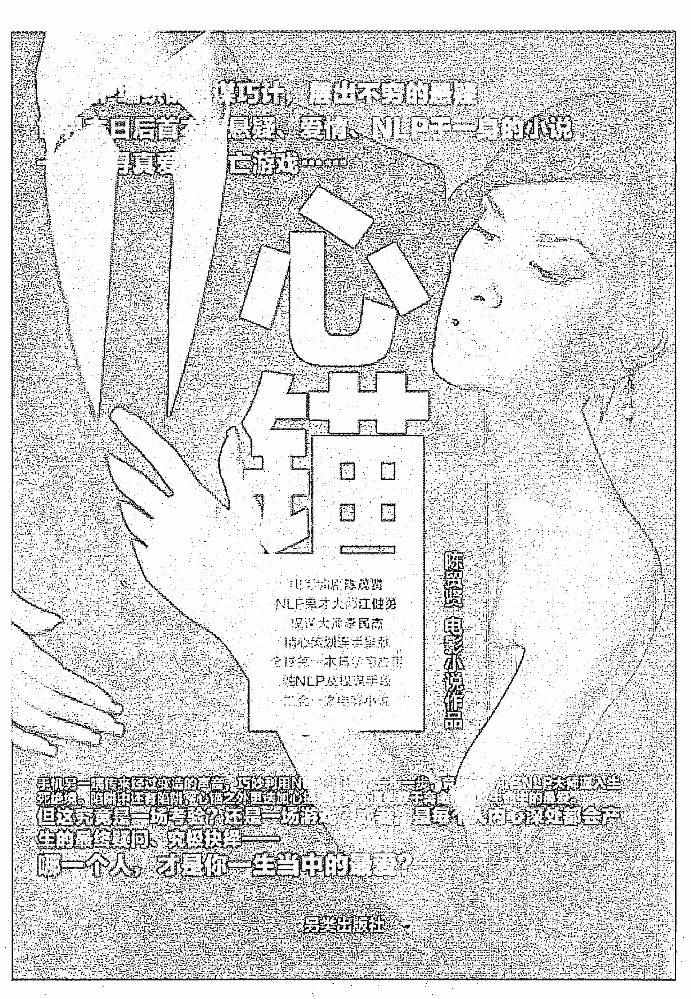

# 奸的好人19-心锚

## 第一

## 献 词

谨以此书献给我此生最爱，我非常庆幸能找到这个人。

如果你也已经拥有最爱，请好好珍惜，
如果你还没找到，请不要灰心，
好好回想一下，
这个人必定在你生命中出现过。

## 个人简介

### 陈茂贤 Anselm Chan

香港创作人、电影及电视编剧，十八岁即担任编剧，入行超过十年，创作过十部以上电视剧，每一部都曾经得过香港及内地电视台的收视冠军。同时亦创作不少广受观众欢迎的电影，年纪轻轻，已是香港的多产编剧人。

2002年得到王晶导演赏识和提携，曾参与创作的电视剧集包括《八大豪侠》、《浴火凤凰》、《情陷夜中环》及《情陷夜中环 2》、《小鱼儿与花无缺》、《雪山飞狐》、《暴雨梨花》、《A 计划》、《仁者黄飞鸿》、《十大奇冤》等等。

首部电影作品，是由古巨基与蔡卓妍主演的都市爱情喜剧《甜心粉丝王》，其后的电影作品，则包括典型港式喜剧《我老婆系赌圣》、与及以内地为主要市场的幻想穿越喜剧《超时空救兵》。

2012年的最新作品，是由郑中基、毛舜筠、黄百鸣主演的《男人如衣服》，及由郑中基、吴君如、毛舜筠、杜汶泽、葛文辉、詹瑞文与及叶璇主演的春节贺岁电影《百星酒店》。

## 《心锚》序

### 著名导演谷德昭

知人知面不知心

《心锚》? 上次接触这个「锚」字，是看见前任特首率领亲信们振臂高呼：「起锚！起锚！」那是一场闹剧。

陈茂贤写的《心锚》，却是一个结实的故事。

跟阿贤合作了两部电影：《男人如衣服》 (2012)及《百星酒店》(2013)，熟悉他写喜剧的能力，却不知道原来当他独个儿自由创作时，竟然选择编写《心锚》这类推理、惊辣、紧张又具学术性的故事，可谓：「知人知面不知心。」

《心锚》大概就是一个「知人知面不知心」的故事！

主角是一位心理学家，遇上另一暗藏心理学高手对头人，当中更有不同心理学派对的对垒，像古龙先生的武侠小说，也像日本的推理故事，更像好莱坞的高智商斗智电影。

故事中有许多关于心理学的学术性探讨，究竟是全部有根有据，还是作者的故弄悬虚？反正故事好看便一直追看下去，像读《达文西密码》时，哪管密码是真有其事还是纯属虚构，只要看得过瘾，便乐得一直由作者带着走。

借着心理学的斗智，探讨「爱」的存在，单是这个题目便吸引我一直追看下去，继文字后，期待《心锚》电影的出现。

### 天马影业集团创作总监 董子桓

跟贤仔相识，源于一部喜剧电影的合作，他为人乐观，语带幽默，整个人从内到外都充满喜感，我早就将他跟「笑」字划上等号；得知他写了一本名叫《心锚》的小说，直觉告诉我，这应该是一本充满趣味的笑话书，但看了开头几页，却发现内容是关于「爱」；我当场向贤仔投诉：我是从来不看爱情小说的。但见贤仔招牌式微笑，淡定叫我看下去，见他信心十足，我只好照做了！

《心锚》明明是以爱为主旨，却蕴藏侦探推理情节、警匪追凶的布局，一环一环紧紧相扣，殊不简单！一个关于爱与被爱的故事，配上一招「心锚」——以语言和动作操控他人的潜意识、影响对方的行为和情绪，如此疑似真的行为，大大增添了悬疑感。乍看似只跟爱情没有关系，却又千丝万缕，与爱的主旨环环相扣，读来非常过瘾。

《心锚》充分展现出文字的威力，看一本小说，能带来多种感觉，可谓数个愿望一次满足，超级划算，诚意向大家推荐，值得一看！衷心祝贺《心锚》大卖，贤仔加油！

### 中国电视剧著名监制 黎志健

《心锚》令人感动之处，在于作者埋下「谁是最爱」这层悬疑，并逐步抽丝剥茧，是很引人入胜的，令读者解谜时也感受到何为「爱」。很久没有看过如此多层面及电影感强大的小说，可一再重看及了解其中真谛，诚意推介！

### 演员及导演 宋本中

我跟陈茂贤可以说是不打不相识，到后来变成合作伙伴和好兄弟。我跟他都喜欢创作，并肩工作的时候，总有一种无形的默契，我知道他为什么这样做，明白他为什么会说这话。

当他创作好《心锚》，他第一时间给我看，我还记得，当时我坐在他位于北京的家里，外面天气很冷，下着大雪。坐在他家的沙发上把《心锚》看完后，我久久不发一言，因为我觉得相当震撼。

当时我觉得非常兴奋，因为《心锚》绝对是一个好故事！这故事不是随随便便能写得岀，他一定是经历了一些人和事，才驱使他创作岀这个故事；但是陈茂贤打死也不说，我只能在小说里推敲。

我很喜欢《心锚》故事里的设计，更喜欢《心锚》这个书名。看完之后，我仿佛中了他的《心锚》一样，对这个故事愈来愈上瘾。我在这里要奉劝读者：看《心锚》之前，要小心被作者陈茂贤在不知不觉间向你下了「心锚」啊！

### 艺人 陈小春

跟陈茂贤认识的日子，说长不长，说短也不短，初次见面，跟他聊起创作的时候，发现他是一个满有创意和想法的人。

但是，当他给我看《心锚》这个故事，我是十分惊喜的。因为阿贤从来都是一个乐天的人，他竟然如此心思细密，写出《心锚》这样斗智斗力，探讨人性的故事。

我看完之后，只跟阿贤说了一句：「这个故事的想法很新颖，而且十分有趣！」

我相信，读者们看完小说之后，会不断反覆思考：自己会不会拥有「最爱」？或者，究竟谁是自己的「最爱」呢？

### 艺人 陈国坤

《心锚》确实是一个很结实、很悬疑的故事，看了《心锚》之后，绝对会令人反思，究竟谁是你的「最爱」。

作者陈茂贤，是我的好兄弟、好朋友，他是一位电影及电视编剧，在大约缸的缸口，看惯了繁盛的沧桑，也看透了世态炎凉。可是，当他把最强的伎俩运用出来时，却往往能把所见所想，化为篇文章。也许，走入他的心窗，你会爱上他的伎俩

### 演员及编辑 冯勉恒

百变神童陈茂贤，

我见过不同状态的陈茂贤先生：剧本会议上说笑话的兴奋、喝醉后的傻态、看足球或赛马时的热情投入等等。这次从贤仔的新书《心锚》中发现，贤仔原来有很感性的一面。这次他一反过往自称「情场浪子」的潇洒作风，挑灯夜写，借一个悬疑故事，表达他对人生及爱的体会，读来过瘾。祝《心锚》一纸风行，贤仔继续灵感不坠，为我们带来更多快乐及色彩。

### 金马奖最佳男配角奖得主 郑中基

《心锚》是一个有趣而发人深省的故事。

在这个世界上最，「爱」很重要，亦十分普遍，现代人开口闭口都说「爱」，但是，有几个人正懂得爱是什么？看完《心锚》之后，或者会有新的答案和体会。能够把「爱」融入悬疑的剧情、高智力和心理学的技巧，陈茂贤的确给了我不少惊喜。

跟阿贤合作了两部电影《男人如衣服》 (2012)和《百星酒店》(2013)，我很欣赏他的创作和写作能力，是个难得的好编剧。

我看完《心锚》后，不由得感叹：如果台湾最著名小说作家是九把刀 ，那么，看完《心锚》之后，就会知道那九把只是小餐 ，因为陈茂贤才是真真正正的利器！

### 李民杰

《妍的好人》系列作家之一，《李民杰作品集》作者，亚洲权谋大师。

《心锚》故事背后，不为人知的勤索案：

第一次跟阿贤交涉，他就跟我提起，他想做全球第一个写 NLP 小说的作者，对我而言，我认为什么奇迹都会发生，除非你不做；只要立定方向，咬紧牙根大胆尝试，成功的机会即使再低，奇迹一样会发生。

但，不去试的话，就根本没有机率可言，或者说机会是零！

阿贤是一个有理想、满怀梦想的编剧家，一个会讲故事的高手，最重要的，是他有理想、梦想，还有埋头闭门写稿的精神。今天阿贤做到了，我深信，阿贤这部小说出版后，很快就会被搬上大银幕——我说这句话是表扬阿贤，不但将来极有可能成为出色的编剧，还是出色的小说家！

我认识并欣赏阿贤的才华，是由他当年编写了一场重头电视连续剧《情陷夜中环》开始，主角有我很喜欢的四哥谢贤 ，还有当时相当出色的女主角叶璇（恕我无法一一例举诸位出色的演员）。

《情陷夜中环》这勾心斗角的「商战」连续剧，在大马也引起风潮，同时也看得出阿贤对商战权谋等剧情拿捏的火候，相信有看过该连续集的人，知道编剧是年轻有为的陈茂贤，必然会由衷心想：这位年轻人绝非池中之物，迟早一飞冲天，而且他总会再有一惊惊人之作品出现。

我在北京见过阿贤两次，第一次是吃火锅，第二次是吃冰淇淋，这两天我们无所不谈，谈我们喜爱的小说和电影。在无所不谈中，我发现阿贤很喜欢阅读，他原来很权谋，更是《妍的好人》的读者，我们彼此欣赏，所以开启了合作之旅。

阿贤是一个很专业的编剧，他对剧本素材的认真程度，从第一次开小说出版会议时，他的尖锐提问就显现了出来。

《心锚》控制人的手段，绝非凭空幻想，更不是书生之见，阿贤找我和江健勇做他这本小说的顾问（将来也是电影剧本的顾问），目的是对于故事剧情中角色之间的斗智、谋略，还有专业 NLP 影响人于无形的招数，以及角色之间的对话等，务求做到「内行看门道，外行人看热闹」的效果——换句话说，我们希望这本书达到的效果是：你喜欢 NLP，你可以在小说中学到一点「兵凶战危」时，应变的 NLP 招数。

我很高兴且充满期待此书面市，但同时也勾起了自身一段回忆。

我有一个好友，他是身经百战、不易被感动的阴谋高手，也是我见过最冷静的商业谈判高手，他可以从对方的谈话中很快发现漏洞，相对的，能骗到他的人却是少之又少。就在阿贤埋头创作的某天，我曾将阿贤书中某一段剧情跟他分享，问他：「如果是你，你会有什么反应？」（我之所以问他，是因为这个人不相信真爱。）

当时他说，假如左志诚是高手，他真的相信爱可以透过手段「操弄」，便应该控制好自己的情绪，冷静，不理对方，因为只有完全不为所动，才是最好的办法。假如有所反应，左志成就配称为高手！他还跟我分享了亲情和爱情背后隐含许多虚幻的骗局，尤其当涉及利益时。

事情真巧，像上天的安排一样：上述的谈话过后一周，某日他送孩子上学后，突然接到一通电话，电话那端，他听到小孩的哭声，还有不断的掌掴声，传来哭喊声：「爸爸救我，不要打我……」声音很凄惨，他顿时乱了方寸，握着话筒的手不受控制颤抖着。

紧接着，电话那头传出一道冷酷无情的声音：「想要孩子活命，给我二十万！」

朋友当下心里冷了一半，他极力做了多次深呼吸，希望对方听不出他心里的波动。他说：「你打错电话！」

对方冷笑一下：「我看到你送孩子上学，加上我知道你是谁，知道你有钱可以勒索，不过你可以试一试，反正我杀了第一个人，再多杀你孩子一个也不算多。」

朋友心中开始大乱，思绪浮现许多勒索骗局的新闻，不过内心深处，总摆脱不了「万一我孩子真的在他手上怎么办」这个念头。

短短数秒，他还是选择妥协，问对方：「你想怎样？」

接着，我这位朋友绞尽脑汁拖延对方，总是跟对方说，一时拿不出二十万现金等语，尽力不让电话断掉，同时他一边开车去孩子的学校，冲到教室，求证自己的孩子是不是真的被绑架。最后终于证实，这是一通当时马来西亚非常流行的假绑架骗局。

经历过这件事后，他告诉我，他一直以来不相信有真爱，一直认为只要有钱，就有亲情：这一切亲情和真爱，其背后都会有个肮脏的面具：利益！

然而经过这事后，他的价值观完全变了，他终于明白，只要你是人，就有真爱，而很多时候，我们是被利益或忙碌的烟雾，遮蔽了我们真爱的核心。

我告诉你们这件事，也希望你们阅读此书时，不但可以多认识 NLP 技巧，同时能品味这部小说另一层核心的思想。

### 江健勇（江魔）

《奸的好人》系列作家之一，《爱情阴谋论》作者，亚洲毒辣 NLP 影响术之父。

《心锚》里面的暗黑秘术译码！

> 事先声明：《心锚》这本小说中描述的所有 NLP 说服技术和隐晦催眠术，都有真实的依据。部份的技术，对上过我的毒辣 NLP 的学员们而言，更是耳熟能详。

- Anslem 陈茂贤虽然没有正式学过我的毒辣 NLP ，但，当我们第一次开始交流时，他所问的问题，都不离毒辣 NLP 的本色。

犹记得他问我的第一个 NLP 问题是：「怎样利用一通电话，使一个正在开车的人失控？」

哈哈，我听到这种问题时，我的江魔性格就会昂奋起来。因为我绝对相信，答案的素质受问题的素质所影响，厉害的问题，当然能够带出厉害的答案！

他问我另一个让我很兴奋的问题是：「怎样在人的脑中埋下一个定时炸弹，在特定预设时间，引爆一个人内心的恐惧感？」

这一招要借由手势，来设两个心锚（心理记号），一个用来勾起恐惧感的记忆，另一个用来预设引爆时间。

小说主角左志诚是用这一招来预设引爆一个人的恐惧感，他先以问问题的方式切入，勾出对方记忆中的恐惧，同时设下心锚。然后再用手势来隐喻一个未来的时间，接着，再把这隐喻时间的手势和恐惧感心锚连结起来。到了这里，招式已经完成了。（注：如果各位不明白上面这段文字，请拿这段文字来对照小说，左志诚在停车场处对一挑战者出招的那一幕，再细嚼几次，你就会明白了。）

但各位读者能够举一反三的话，就几乎能用同样的方程式，来预设引爆任何的记忆，包括喜悦感、爱情、购买欲、焦虑、甚至是性冲动等。如此，未来你在人际互动中可得到的好处，将会超出你的想象！

小说中不少的地方有描述到主角如何运用幽默感来与对手周旋，我相信读者都知道幽默感是能够用来削弱对手的防备心，但削减了对方的防备后，紧接着还要用到一个策略来拉近双方的距离，才能事半功倍。

所以，在小说中，当男主角身处于一个僵持对峙状况，他运用幽默感打破僵局后，马上就带出他与对手之间的共同痛苦，来强化彼此惺惺相惜的感觉。其间详细的话术操作，读者可以好好细阅小说中左志诚的对白。

陈茂贤是一资深编剧，我虽是《心锚》小说的 NLP 技术顾问，但，也有赖他的创意，当故事发展到特定之处，他问我一些很刁难的技术性问题，我才有机会提供出非常经典的 NLP 说服话术。特别是小说中有几幕，是危机重重的生死关头，男主角左志诚需要在很短时间内说服对手，改变决定。

在这种情况下，也唯有快速让对方脑袋进入空白的能量最低点，才能进一步说服对方改变初衷。

什么是能量最低点？小说中自有分晓。这几幕的说服术对白，将会是 NLP 爱好者可细嚼慢研的地方。

书中男主角左志诚贵为 NLP 大师，自然也是猎艳高手。不少小说或电影中的男主角可能也是把妹高手，但《心锚》一书，却对男主角的成功猎艳，作出精彩的 NLP 解剖：

基本上，男人若要猎艳，就得把女性脑中的开心和欲望，同时重叠在自己身上。其中一幕的左志诚把妹戏码，用了一段 NLP 话术，来描述一个很普通的日常用品，但却在描述的当儿，把自己变成对方所爱。

这种话术，在 NLP 圈子里面被称为 Process Language（流程语言），所讲的东西无须附带明确内容，目的就是为了让听众对号入座，而在我的毒辣式 NLP 学中，我再把这个技术变成「双重含义沟通法」，在我的学生圈子里面，这一招是最隐晦，同时也很暗黑的一招，

托《心锚》的关系，我和 Anselm 间的对话是很过瘾的，因为这是一个资深编剧家和一个毒辣 NLP 专家相互擦出的火花。他挑战了我 NLP 功力的极限，而当我把 NLP 的可能性告诉他，他也因此拉阔了故事的发展空间，

作者 Anselm 把这本书奉献给他一生中的最爱，我也坚信书中故事的含义和结局，也将会启发你去思考：「什么是一生中最爱？」

## 序章

### 现在

今年的初雪比预期来得迟，而且非常暴烈。虽然只下了两个小时，已为整个郊区的树木染上银白的发丝。在北方，冬天这种天气算不上恶劣，可是，树木被冷风吹得左摇右摆，发出「沙沙」声，仿佛有人在风中低吟，诉说着一生的故事，令透白雪夜添上一丝愁绪。

为了阻挡每年由北方刮来的大风沙，城外种植了大量树木，几十万株高度一致的参天大树，形成半人工半天然的绿色长城，巩卫着城市免受沙尘暴肆虐，也构筑了一个巨大的迷宫。

没有人会无缘无故走进这个迷宫，当然也没人会注意到，若大森林中，寒风萧瑟的夜里，一条生命正在逐渐点滴当中流逝。

皑皑白雪里，有一张皮质椅子，孤零零摆放在森林中。这张厚重的真皮椅是一流高档货，手工精细，设计揉合仿古与现代人体工学，由意大利名匠亲手制造；同时，也是心理医生专门用以催眠治疗的设备。它本应摆放在心理医生的诊所，等待病人躺上去接受催眠，如今却放在林间雪地上，任由狂风吹拂。

皮椅的四脚，均用建筑钢钉固定在地上，而椅子上，一个男人正被牢牢的缚着，动弹不得。

这个半身赤裸的男人，名叫左志诚，他的双眼被黑布条蒙住，正处于昏迷状态。一片雪花缓缓飘到他的脸上，瞬间在皮肤上溶化。

突然，冰冷的液体泼在左志诚身上，令他猛然醒了过来。左志诚惊魂未定，嗅到一阵强烈的汽油气味，他发觉，自己全身上下满满的都是汽油。

汽油随着他的肌肤纹理往地上流去，立即被雪地吸收，凝结结冰。寒冷的天气状态下，汽油使他本已快冻僵的身体，体温急剧下降，他的肌肉正处于绷紧状态，身体不受控制颤抖着。他全身毛发尽湿，皮肤呈现鲜艳的粉红色，如同刚完成极其剧烈的有氧运动般，这是低温症的表现，他随时会再昏倒过去。可是，每当凛冽的寒风吹向他身上时，却为他带来皮肤撕裂的连番痛楚，而这种皮开肉绽的痛苦，又令他在昏倒的边缘清醒过来……

左志诚不断深呼吸，希望能借此减轻痛楚。每一次沉重的吸气过后，他的口腔都会长吐出一口白雾。此时，一片漆黑的视界中，有人将蒙着左志诚双眼的布条用力扯开。

左志诚那双本已因痛苦而圆睁的双眼，瞳孔更是极度的扩张。

「为什么……要折磨我？」左志诚用仅余的力气，颤抖着问。

操控着左志诚生死的那个人，站在黑暗中，面无表情凝视着眼前的猎物，并未因为猎物表现出来的痛苦而稍微动容。

「左志诚，现在是零下十三度，我泼在你身上的汽油，正快速挥发挥你的体温和水分，原本，低温症很快就能夺去你的性命，不过很可惜，高速挥发的汽油会把你的皮肤撕裂，据说这种感觉，跟被皮鞭乱抽一顿没分别。这种感觉，现在你一定是比我更明白的了。」

即使变声器改变了音调，但那个人的语调仍然平和，仿佛交通警察在朗读公式化的法律条文般，不带丝毫情绪。

皮肤上那剧烈的痛楚令左志诚睁不开眼睛，只能依靠本能听觉去感受外界的一切。他的耳朵告诉他，这个说话的声音由远至近，逐步迫近，显然说话的人正一步一步走近自己。这个人走到左志诚身边，停了下来，端详一下正因寒冷、痛苦和恐惧而全身颤抖的左志诚。

基于一丝不服输心态，即使正承受着莫大的痛苦，也要知道是谁把自己带进此地境地。左志诚挤出仅余的意志，极力睁开眼睛。

当左志诚在模糊视野中看到此人的面容，前所未有的惊吓如一个大铁槌，无情重重敲向他的心脏：「是……你？」

眼下这个人发出一阵诡异的冷笑：

「谈判魔术师左志诚，十一次成功劝说连军警和国际刑警也束手无策的重犯，报纸上怎么说的？『有左志诚在，就没有不必要的流血事件。』我倒很有兴趣知道，你现在要怎样脱身？你会用语言同步，讲出我现在的感受，进一步引导我的思想？或者透过肢体模仿，让我对你产生亲和的感觉？嘿嘿……还是你能试图跟随我的呼吸，消除我对你的敌意？」

他继续不留情嘲笑：「嘿嘿，我看你现在什么都做不到，你之前有没有对我设下了心锚？如果有的话，你知道你可以用隐喻命令引发我的心锚，让我听从你的指示，也许你便能逃出生天也不一定。」

「心锚不能让人做自己不想做的事……」左志诚竭尽全，才能把这句话说完：「这是 NLP 的第一原则。」

对方却打断了左志诚的话：「错！应该讲：NLP 不能『直接』让人做自己不想做的事，但却能『间接』做到。」就在此时，这个人掏出一个登喜路打火机，塞到左志诚的手里。

左志诚手指触摸这个打火机表面，触觉告诉他，这是他的打火机。为了确定自己的第六感，他垂头用眼看清楚，果然，这个打火机是他的助手去年送他的生日礼物，也是从办公室同事那里得到的唯一一份生日礼物。

「我再给你三分钟吧，一百八十秒之后，你必死无疑！不过，你希望自己冷死，还是用我给你的打火机点火取暖？或者，用最后的三分钟试着游说我，向我下心锚？要不，你也可以利用这三分钟，忏悔一下过往你所犯下的一切罪行。」

那人的话语，无透露着对左志诚的嘲弄。他继续说：

「用属于自己的打火机了结自己的生命，算是一个相当不错的结局，不是每个人都能选择自己死亡的方式，这也算是你的福气，好好珍惜这个机会吧，你还有三分钟时间考虑！啊，对不起，现在是两分零三十秒、二十九、二十八、二十七……」

那个人一边倒数着，一边双手放在左志诚的肩上，轻拍了一下，就如给予左志诚最后的鼓励。

左志诚看着抖动得难以握住打火机，时间一分一秒流过，秒钟每一次的跳动，仿佛把那通往求生之门的大桥一下一下敲碎，在心理上的绝望和生理上的皮肉之苦当中，向来以冷静闻名的左志诚，精神也几近崩溃。

他不断反问自己：「为什么？为什么我要落得如此田地，究竟从什么时候开始，我一步一步走进这个困境之中？」

幸好，冰冷的感觉令他头脑清醒过来。他极力控制着自己的呼吸，每一次冷空气进入他的气管，都令他进一步深入回忆之中，记忆渐渐在他的眼前浮现了出来。

一切，要从过去的二十四小时开始说起……

## 第一章

一个华丽的剧院式演讲厅中，座无虚席。这是国内最知名的一级学府，在场观众大部份是这所大学的高材生。演讲台上，摆放了一系列左志诚历年来的著作，投影机正在放映左志诚接受外国媒体访问的影片。当灯光慢慢变亮时，每个在场的学生都屏息静气，一位女性主持人上台，向现场观众宣布：

「各位同学，对于我们今天的客座讲师，相信大家已非常了解，不需我多作介绍。他过去曾十一次为全球军警及政府组织等，成功进行游说任务，在心理学界，被誉为当今最出色的 NLP 治疗师。」

在场中的所有学生，纷纷点头示意认同。

主持人口中的 NLP 治疗师，在台上一角正襟危坐，微微欠一欠身，面带微笑，展现绅士风度接受了女性主持人的赞誉。

「我本来打算与大家分享他非凡的经历，不过……」她以敬佩的眼神看了台上的他一眼。「昨天我刚刚看到这本杂志，里面内容似乎更为有趣。」

女性主持人手上拿着亚洲版《时代杂志》，坐在台上的左志诚，似乎习惯了这种恭维，他脸上没有什么表情变化，还是老样子，坐得非常端正，仿佛眼前发生的事，都不会勾起他的任何情绪。

女性主持人摘下杂志内左志诚专访的部分，更强调其中一段离经叛道的名句：「心理学的重点不在于分析人性，而在于控制人心！」她一步一步引发在场学生对讲师的兴趣：「大家想不想再多听一些？」

现场掌声雷动。

「今天很荣幸请来这位嘉宾，各位同学，请以热烈掌声，欢迎左志诚教授！」

西装笔挺的左志诚霍地立起，捆起西装钮扣，自信满满走向演讲台前：「谢谢你刚才的介绍，Jessica。其实，我相信在座所有同学，对心理学没有太大的兴趣吧？」

在场同学们不禁传出一阵笑声。

左志诚伸手去拿那杯放在演讲台上的矿泉水，轻呷了一口，那冰凉的感觉快速的传到脑际，使他精神一振。

「我相信大家最想知道的，是我怎样追到现在的明星女友，对不对？」

同学们显然对这个话题更感兴趣，掌声此起彼伏，更不时发出阵阵叫嚣。

左志诚举起手来，示意同学们冷静一下：「把妹相关技巧，我不打算在这里告诉大家；不过如果大家问我，我追女明星时，有没有用上 NLP，我可以告诉大家：有！」他故作神秘，压低嗓子：「不过千万不要告诉她……在场应该没有记者吧？」，左志诚还装出很害怕的样子，张望四周，彷彿真的担心有记者在场似的。

他如此调皮的举动，逗得台下一众学生发出连串哄笑，夹杂着热烈的掌声。

左志诚能成为极受欢迎的人气明星讲师，除了他一系列的畅销著作和过去的骄人履历外，背后拥有一个明星女友黄玥也是功不可没。黄玥是目前如日中天、炙手可热的女明星，外表漂亮、乖巧玲珑，而且性感火辣，可以说是每个男人一生中最梦寐以求的女人。性感美丽的女明星，配合具知名度的心理学明星讲师左志诚，他俩在外人眼中，是一对才子佳人，也自然成为学生们的羡慕对象。

「市民英雄」、「学术明星」、「艺人男友」三个外号加起来，就成了不言而喻的说服力，每一次左志诚的演讲，听众出席率都是史无前例的高，因为他们彷彿觉得，只要去听左志诚的演讲，就有跟他一样成功的希望，也可以亲眼看到一个社会上的成功人士，如何表现那无限的自信心。

「如果大家想知道内里有什么技巧的话，欢迎修读我的『爱情心理学』课程，我会亲自教授大家，如何运用 NLP 追求心仪对象，大家可以在讲座之后，向我的助手报名，说着，左志诚伸手一指坐在台下第一排的一个年轻女孩，这个女孩外表看起来十分幽静，给人楚楚可怜的感觉，她是左志诚的助手余嘉美。她跟台上的左志诚有默契地眼神交流了一下，露出了一抹微笑，这个笑容有如春天般，给人说不出的舒服。

此时，演讲厅中的荧光幕投射出「NLP」三个英文字，本来一片寂静的演讲厅，响起窃窃私语，从这些声音当中，彷彿可以听出现在场的每一个学生，都禁不住散发出一名莫名的兴奋。

「有没有人可以告诉我，NLP 是什么？」左志诚提高声调，向在座的学生发问。

在场的一众学生，纷纷面面相嘘，没有一个有勇气举手作答。台上的左志诚不禁自信的笑了一下：「怎么了？没有人能答得出来吗？」

左志诚此话一出，一个年轻的男学生便举起手来，左志诚示意那个男学生作答。

男学生说：「NLP 是神经语言程序学的英文缩写，N (Neuro)是神经系统，包括大脑和思维过程，L (Linguistic)是语言，指从感觉信号的输入到构成意思的过程，更准确点说，就是头脑如何受语言的影响。P (Programming)是我们有意识或无意识中所学会的机械式反应。将 NLP 放在一起，意思是指：人们为使他们的思维、讲话和活动达到具体的效果，而采取的具体行为，也就是所谓『心锚。』

那个男生一口气把 NLP 定义说完，没有坐下来，却一脸自信瞪着台上的左志诚，左志诚也没有回避，以沉实的眼神注视着这个男生，两人互相对望了片刻，终于，左志诚再次展现他一贯自信的笑容：「相当不错！这位同学做了不少功课，完全把 NLP 的定义一字不漏说了出来，不过，能热读这些纸上的定义，不代表就能明白 NLP 的真正意义！」

「那你认为，什么才是 NLP 的真正意义？」那个男生不服输的追问。

「NLP 虽然是一种间接式的催眠或者心理暗示，但是跟你们所认识的催眠又有所不同，NLP 无法让人做自已不愿做的事……」说到这里，左志诚十分自然地举起右手食指：「人，是不可能被别人说服的；人，只会被自已所说服！」

左志诚声音低沉下来：「无论谈判也好，谈情也好，我们都是透过言语和肢体动作，去影响对方的思想和行为，也就是说，我们和对方的情绪结合，引发对方情绪，以达到强化信念，来创造治疗或游说的效果。」他停顿一下：「用最简单的语言总结，那就是：情绪导致信念，只要影响情绪，就能影响信念，像把一个控制器放入对方心里一样……」

忽然间，刚才那个讲出 NLP 定义的男学生，大声打断了左志诚的话：「这些伎俩，会不会只对女人有用，因为女人的意志力比较薄弱！」

此话一出，坐在他身边的一些女生，随即露出不悦之色，纷纷报以斜眼，显然对他带有性别歧视的话极度不满。

左志诚经常举办讲座，这种自以为是的高材生，他已经应付过很多次了。

他冷静回答：「其实，这个伎俩着重 的，不是我们面对的那个目标意志力 强不强，而是在于运用的人，有没有给足 足够的时间让目标去想。若是时间短促， 百分之八十的人会跟随我肢体语书所暗 示 的 选 择 。而 另 外 一 个 状 况 ，则 可 以 让 人 接 受 我 的 暗 示 。」

另一个戴着眼镜，外表斯文的男学生， 显 然 对 这 个 话 题 很 有 兴 趣 ：「 在 什 么 情 况 下 ， 可 以 让 人 接 受 暗 示 呢 ？」

左志诚瞄了这个男学生一眼，缓缓说了一句 话：「就在对方处于 能 量 最 低 点 的 时 候 。」

坐 在 那 个 戴 眼 镜 的 男 学 生 旁 ，有 一 位 女 学 生 不 禁 双 眼 发 起 光 来 ：「 什 么 是 能 量 最 低 点 ？ 」

左 志 诚 从 讲 演 台 走 下 来 ，走 到 那 个 戴 眼 镜 的 男 生 面 前 ，礼 貌 地 伸 出 手 作 握 手 状 ：「 请 问 你 叫 什 么 名 字 ？」

那 个 学 生 很 自 然 便 伸 出 手 来 ，就 在 他 们 的 手 快 要 接 触 到 的 一 刻 ，左 志 诚 却 没 有 握 下 去 ，突 然 举 起 了 右 手 ，使 那 个 年 轻 人 感 到 愕 然 。左 志 诚 的 手 凌 空 划 了 一 个 弧 形 ，整 个 过 程 里 ，那 个 年 轻 人 的 双 眼 ，仿 佛 聚 焦 在 左 志 诚 的 双 手 上 ，当 左 志 诚 一 切 动 作 做 完 后 ，那 个 学 生 感 到 莫 名 其 妙 ，摸 不 着 头 脑 。

接 着 ，左 志 诚 右 手 按 在 那 个 学 生 的 肩 膀 上 ，缓 缓 说 ：「 这 位 学 生 刚 才 因 为 在 短 时 间 内 ，面 对 我 突 如 其 来 的 改 变 ，一 下 子 反 应 不 过 来 ，脑 海 出 了 一 阵 子 的 空 白 状 态 。这 种 情 况 ，就 是 我 所 说 的 能 量 最 低 点 了 。每 当 遇 到 对 方 意 志 力 太 强 的 话 ，我 们 便 需 要 制 造 能 量 最 低 点 ，只 要 对 方 出 现 了 能 量 最 低 点 的 时 候 ，这 个 人 的 意 识 是 最 容 易 受 影 响 的 。」

在 场 学 生 不 禁 啧 啧 称 奇 。

那 个 女 学 生 再 度 举 手 ，问 了 一 个 在 场 所 所 有 人 都 很 想 问 的 问 题 ：「 既 然 人 的 情 绪 和 思 想 都 能 透 过 NLP 去 控 制 ，那 么 ，『 爱 』是 否 也 可 以 控 制 呢 ？」

左 志 诚 沉 默 了 两 三 秒 ，再 次 自 信 的 微 笑 ：「 爱 这 种 东 西 ，是 讨 论 了 几 个 世 纪 的 话 题 ，那 是 个 不 会 有 结 论 的 问 题 。不 过 ，现 代 的 生 物 化 学 告 诉 我 们 ，大 脑 分 泌 脑 内 啡 时 ，人 会 判 断 自 己 进 入 恋 爱 状 态 · · · · · · 」

他 略 一 停 顿 ：「 大 家 总 不 会 在 毫 无 感 觉 之 下 ，判 断 自 己 堕 入 爱 河 吧 ？」此 话 再 度 引 起 哄 堂 大 笑 。

「 有 了 感 觉 ，之 后 解 释 为 爱 情 ，那 个 感 觉 就 是 大 脑 分 泌 脑 内 啡 的 作 用 。

换言之，只要让你的大脑分泌脑内啡，你便很有可能认为自己恋爱了。」左志诚继续说下去，但是那个女学生显然不太同意：「但我们的大脑不会无缘无故分泌脑内啡啊！那一定是有事情发生了，才影响了我们的大脑运作呀！」

左志诚待那个女学生说完，调皮地说：「对！但你有没有表情错的经验？」

那女学生红着脸点了点头，左志诚继续笑说：「你一定是看到许许多多的蛛丝马迹，让你觉得很愉快，愉快度越发增加的时候，你便渐渐进入兴奋的状态；到某阶段，你判断对方对你有爱意，而你也感觉很良好，可惜最后，发觉原来是神女有心，襄王无梦，是不是？仿佛说了她过去的事情一样，女学生不停点头。」

左志诚对学生说：「你觉得越来越快乐的那个阶段，就是脑内啡分泌增加的时候，没错，你的大脑的确不会无缘无故分泌脑内啡，要怪就怪那些蛛丝马迹，和你自己的情绪，是它们联手制造了脑内啡分泌，与爱情不一定有关。同学，相信你曾经做了一个很好的实验，那就是你说服了自己，以为自己跟某人堕入爱河。其实，那正是我刚才所说的现象，而你把这现象解释成你内心的希望。」

在场的一众学生，对左志诚刚刚发表的一番评论，再次鼓起来。

然而，左志诚却深深吸了口气，高声说：「所以，在我的定义里，所谓爱情，甚至不能说是种感觉……」

说到这里，所有学生都停止了鼓掌，期待他把这一句话说完。

「爱情，只是脑内化学元素所造成的错觉！而错觉，正是 NLP 最擅长制造的！」

所有学生对左志诚这句话出惊人的话，都被震到鸦雀无声了，大约过了五、六秒之后，先是零星的掌声响起，接着就是全体学生热烈鼓掌，掌声震耳欲聋。

左志成就在这些掌声之中，离开演讲厅，不过他早已习惯了。因为这样的场面，在他每次的演讲中总是不停的重演。

嘉美从台下观众席中站起来，拿着一叠报名表走到台下小桌子前。同学们争相上前，到嘉美那里登记课程及领取签名海报，踊跃的人群令嘉美忙不过来。

## 第二章

左志诚回到自己的办公室，整理一下手上的资料，此时敲门声响起，左志诚头也不抬，继续低头整理资料，显然他知道进来的会是谁。

「敲了门不表示你可以立刻进来。」左志诚对刚进门的嘉美说。

站在左志诚面前的嘉美感到非常尴尬，但她也出言反驳，她看着左志诚，咬了咬牙说：「你又在这里干些不可告人的事吗？」

「幸好不是！不可告人的事，我只会在不可告人的地方才做。」左志诚继续收拾文件。

「那就好了。我只是想告诉你，今天是星期三，你晚上要跟妈妈吃饭……」嘉美看着手中的记事便条说。

左志诚神态自若，因为他绝对是一个非常孝顺的儿子，他在单亲家庭长大，自小便与母亲相依为命，习惯了每个星期三都回家跟母亲吃饭。

「行了，下一个！」左志诚道。

嘉美耸耸肩：「黄玥小姐留言，说她的电影不能如期杀青，要你更改到北海道庆祝周年纪念旅行的机票。」

左志诚不耐烦地摇摇头，叹了口气：「告诉我即是叫我告诉你，那你跟她联络吧！看怎样配合我们的时间……还有呢？」

嘉美犹豫了一下，不知道该不该说，沉默了一阵子。左志诚意识到嘉美的沉默，他抬起头来，定睛看着嘉美：「有什么事？说吧！」

嘉美深深吸一口气，一字不漏地说：「你前妻打过很多次电话来，说今天是你们分居两年期限的最后一天，希望你能准时，下午五点之前到律师事务所，办理好离婚手续，别再次失约！」

左志诚身体重重靠在椅背上，长长呼出一口气，略一定神：「第一，我还没跟她离婚，在法律上，她还是我的妻子，不是前妻！第二，为什么要这样吞吞吐吐呢？」

嘉美感到尴尬起来：「我不知道该怎么跟你说……我怕你会不高兴。」

左志诚冷冷说道：「你不需要在乎我高不高兴，因为我跟她的关系，与你无关。你是我的助手，工作就是要向我报告我的日程！我的心理状态，不需要你操心！」这句话就像一把冰冷的刀，无情刺入嘉美的心房。

然而，嘉美听了这些话，脸上却完全没有不高兴的反应，显然她早已习惯左志诚这样的狠话。她反而展现她那招牌式倾斜着头的姿态，再次露出那种令人感到舒服的笑容：「关我事的！你不开心的话，就不会让我通过试用期，我也得再找工作了……」

左志诚原本异常冰冷的神情，也缓和了起来，忍不住展露微笑：「你的试用期过了吗？」

「今天刚好满了。」嘉美诚恳地回答。

左志诚放下手中文件，看着嘉美，嘉美露出一脸恳求的神情。回想起过去几个月，嘉美的表现确实非常好，只要有她在，再复杂、再刁钻的要求，嘉美有办法做得妥妥当当。左志诚微笑：「我也懒得再找人，我会叫办公室准备合约。」

嘉美高兴地握拳，大叫了一声：「耶~」

然而，左志诚的神情很快又回复了凝重：「好好记住，你的三个前任，一个成为通缉犯，过着偷鸡摸狗的生活；一个精神失常，以后也只能待在精神病院接受治疗；一个爱上了我，被我开除了，之后增重了五十斤，只能躲在家中，不敢出门见人，自杀了十多次。她们全部都过不了一年的试用期，我希望你不要犯上她们的错误，我可没有心情再找助手。」

嘉美收敛情绪：「教授你放心，我不会成通缉犯，也不会发神经。至于会不会爱上你……」她停了两秒，作了一个调皮的表情：「教授，这不会是你潜在欲望的投射吧？哈哈……」

左志诚听了也不禁失笑。

「没正经……」

说罢他提起自己的公文包，正要离去，嘉美却忽然问了一个使左志诚驻足的问题：「刚刚的讲座中，你说『爱』是一种错觉，那究竟是教授你照本宣科，还是亲身经验？」

左志诚笑了笑：「我待会就要到律师办离婚手续，使我的妻子成为前妻，你猜，我会怎么回答你？」说罢左志诚步出了办公室，迳自走远。

嘉美看着左志诚的背影在空旷走廊慢慢远去，她轻叹了一口气，心里对左志诚有说不出的同情。她觉得左志诚心中有无数的心事，但他却把自己的心冰封在密室内，完全不让别人了解他。

## 第三章

左志诚步行到停车场，正想拿出汽车遥控器解锁时，赫然发现一个人靠在他那最新型号的名贵奥迪房车车门上。他认出眼前这个人，正是刚才在讲座上，第一个举手说出 NLP 定义，却又被他否定的那名男学生。

这个男生双臂交叠，一直凝视着左志诚，一副不甚友善的态度，显然他对刚才课堂上的事还耿耿于怀，要找左志诚麻烦。左志诚一点也不觉得奇怪，因为这种情况每隔几个月总会发生一、两次。

左志诚审视了男生一会，说：「双臂交叠是防御姿势，身体后仰表示抽离，你脸上的表情是什么？愤怒……不，是轻蔑，你对我刚才的课有意见吗？」那男生展露笑容，左志诚说：「噢！只有嘴角笑，脸的上半肌肉没有牵动，那是一个嘲笑，你不是对我的课有意见，你是对我这个人有意见。」

男学生自信地逐一回答左志诚的问题：「我双臂交叠，是因为天气很冷，身体后仰，是因为我在这里等了你很久，脸上的表情，只反映了我很想睡觉……」，他站直了身子，说：「不过，你对我那个嘲笑，分析得很透彻。」

「每年总有学生，总想以为难我来标新立异。」左志诚不禁摇摇头。

男学生发出挑战的口吻：「想你必定习以为常，也应该训练有素，如果你现在就能够把我催眠了，我当然心服口服。」

左志诚不愿跟这些小孩子作无谓的斗嘴，只想让这个孩子快点离开他的名贵轿车，不要将车身的烤漆弄花。「你高估自己，低估别人，我没有必要向你证明什么。请你离开我的车……」，左志诚按了一下遥控器按钮，解开了车门锁。

但是，这个男学生却没有让步的意思：「谈魔魔术师左志诚教授，不会因为一个无名小卒的挑战，而裹足不前吧？」

左志诚交叉双臂：「你知道你这种友善行为，足以构成滋扰罪吗？」

男学生反驳：「学生有疑问，教授有责任解答啊！你把 NLP 说得神乎其技，加上那些对外公布的战绩，你不会连小小一个催眠都没信心完成吧？我们这所大学是全国最优秀学府，不是那些开玩笑的三流大学，你这样，叫学生怎么还有信心上你的课啊？」

左志诚审视着眼眼前这个男孩，沉思了一会，说道：「对，我不能随便催眠

你，因为你的意志力很强。」男学生仿佛胜利般露出了自信的微笑。但左志诚随即又说：「不过……我还是有点不确定……」迅速向男学生递出了原本拿在手上的公文包。男学生下意识伸手，想把公文包接住，岂料左志诚却忽然松了手；眼看公文包快要掉到地上，男学生立即俯身，把公文包接住，左志诚在这刹那间，左手搭住男学生的肩，语调柔和问：「很好，你叫什么名字？」男学生的态度一下子不同了，变得没有刚才强势：「我……我叫沈学锋……」

左志诚接着慢慢一字一句询问：「在催眠学里面，通常意志力强的，他们的记忆力也是很强的。我想问你，你最害怕的是什么？」

「狗！因为小时曾经被狗咬过。」沈学锋回答道。

左志诚继续沉声问：「被咬到哪里？」

「这里！」沈学锋用右手指了指自己的左肘部位。

左志诚忽然声调微变，眼神坚定看着年轻人，回应道：「哦，就咬到这里？」他边说「咬到这里」这四个字，音调微变，同时右手就在沈学锋的左肘部位抓了一下。

沈学锋微微点头回答左志诚「是！就是这里了。」

左志诚接着用右手，在年轻人面前划了一个弧形，这个手势，就像他在讲座中，没撑手的示范般同样的弧形，顺势按在沈学锋的左肩上，他迅即改变了声调，眼神盯着他说：「你等一下，我要你数着一、二、三、四、五……」

左志诚每数一个号码，左手掌心向下，在齐腰高度的空中，切了一下，每数一下，左志诚的左手掌心便切高了此时的空间，如此类推的逐层递增上去。当他数到五时，左志诚再重复切一次：「当你数到五时，你便会有被狗咬的感觉。」左志诚的声音仿佛施了魔法一样，一字一句钻进沈学锋的耳里，他更把按在对方左肩的手，转移下来，抓了沈学锋的左肘一下。

左志诚松开了手，让沈学锋如他刚才所言照做。沈学锋不相信左志诚真的能把他催眠，从一数到五，可是，却什么也没发生。左志诚也没有再多说话，只是对着沈学锋微笑，拍了拍他的左肩，轻描淡写转身取车去。左志诚上车后，把车顶天窗打开，架上太阳眼镜。

「谈剑魔术师，原来也是不外如是……好一个假学艺的讲师！」沈学锋以鄙视的眼神望着左志诚，也转身走向电梯离去。

电梯中，沈学锋自然地望着楼层显示板，随着电梯的上升，那些数字也跟着跳动。沈学锋心里自然也跟着数：「一、二、三、四……」

当电梯到达第五层，电梯楼层显示跳到五字，沈学锋随即也数到五的时候，突然，他感到左肘一阵剧痛。沈学锋立刻卷起衫袖查看，发现左肘上的那个痛处，正是刚才左志诚轻抓了他一下的那个地方。表面看来毫无异样，一点伤痕都没有，但是被咬的感觉却是前所未有的真实，而这个位置，亦正是沈学锋小时候被狗咬到的地方。

此时，沈学锋突然感到冷汗直冒，呼吸急促，还感到异常的恐惧，眼前看到的一切事物，都渐渐变得扭曲起来，随之而来的是一阵恶心的感觉。沈学锋按动电梯的键板，电梯刚好停在第七层，他二话不说冲了出去，便蹲在一旁呕吐大作。

良久，沈学锋才定过神来，他伸手拿出纸巾，把头上的冷汗抹去，并且不断的深呼吸，极力使自己回复过来。

几分钟后，沈学锋冷静下来，回想刚才在停车场上所发生的事，才赫然发觉，原来从他弯腰帮左志诚拿着公文包那一刻开始，所有事情都是左志诚刻意安排。目的就是要给沈学锋制造能量最低点，好让把沈学锋的意志力减到最弱，继而有效对沈志诚作出催眠。而左志诚对沈学锋所做的一连串动作，目的只是一步一步把沈学锋引到他一早设定好的催眠陷阱之中。

「岂有此理！」沈学锋的脸上重新武装起一副冷酷的样子，可是此刻，却添上了几分深心不忿。显然这次，他是完完全全败给了左志诚，失败感笼罩全身，使他恨得咬了一咬牙，重重吐出「左志诚」三个字……

## 第四章

奥迪房车在高速公路上飞驰，轮胎快速转动，路面不少碎石被卷弹了起来，轻轻打在车身上，发出沙沙声。驾驶座上的左志诚，一边开着车，一边听古典音乐，这是他开车的习惯，他总认为开车是感到最放松的时候，因为只须专心开车，其他的事都不用想。

回家路上，左志诚把一直处于关机状态的手机打开了，每次演讲或工作的时候，他总会关掉手机，待一切完毕之后才会重开，细听电话留言。一般来说，他的手机只会有他母亲和现任明星女友黄玥的留言讯息。

可是，今天的留言却有点不同。

当他打开手机，却发现手机传来了一阵震动，荧幕一闪一闪。左志诚看一看来电显示，脸上浮现难以形容的表情，他正在犹豫应否接听这个电话。手机来电显示「妻。情霖」。左志诚深深吸了一口气，按下戴在耳旁的蓝牙耳机，接听了电话。

「你终于肯接电话了？」电话那边正是带着责备语气的情霖，

「你应该知道我在演讲时是不会开手机的，这是我的习惯。」左志诚故作无辜。

「你的习惯不一定是对的，很多习惯早晚都会害死你。」情霖冷冷答道。

左志诚轻轻叹了一口：「老婆，我希望能跟你谈一下，我们真的有必要走到离婚这个地步吗？」

「我就快不是你老婆！我们之间，已经没什么好谈了！」

「我为你所做的一切，都是为了我们的幸福着想。」

「你口中幸福的意恩，根本就是一种欺骗！」

「你听我说……」

「你不用说！从你破坏了我们夫妻协议的那一刻开始，我们的关系已经出现了无法修补的裂痕！」电话中的情霖开始激动起来：「我已经在离婚书上签了字，马律师说你今天五点之前如果到不了律师那里，他便会把离婚书送到你办公室！」

左志诚还想说点什么，电话另一边却传来了挂断的声音，就像一把冰冷而尖锐的匕首，无情直插左志诚的心房里，带来隐约的痛楚，仿佛正慢慢淌下血来。

他跟倩霖的对话，没有任何客套，剩下的只有如同谈判一般的冷漠。此刻左志诚的心情有如打翻五味酱，百般滋味突然涌上心头，心中升腾起一种莫名的情感，宛如自己最知心的朋友瞬间与你形同陌路。

回忆偏偏选择在此时偷袭左志诚，即使是再冷静的 NLP 大师，也敌不过。回忆悄悄的爬上思绪，一幕一幕他与倩霖最甜蜜的过去，不自觉浮现在眼前……

那是两年半前，位于海南岛三亚的海滩，左志诚会与倩霖共度了一个甜蜜而浪漫的下午。

左志诚还清楚记得，那天刺眼的阳光非常灿烂，海风微凉，细沙柔软，温暖的阳光映射在海面上，仿佛海面铺满一串又一串璀璨的水晶，一个接一个小浪花，哗啦哗啦冲击着岸上。阳光底下，倩霖穿着舒适的衣服，正在摆着各种不同的姿势，左志诚拿着单反相机替她拍照。镜头中的倩霖，绽放出跟阳光一样温暖的笑容，显得格外明艳动人。左志诚看着她，也着迷了，一时没有反应过来。

「你干嘛呆呆的啊？」倩霖看见左志诚傻傻的样子，不禁笑了起来。

「没……没什么……我觉得你真的很美……」左志诚结结巴巴说。

倩霖脸颊浮现粉红，双眼不禁微微的向下看着地上，不敢与左志诚眼神接触，显然她害羞了。

左志诚伸手握住倩霖的手：「你知道，我的大脑不能释放脑内啡了，我没有办法产生人们常说的那种『爱』的感觉。可是，这段时间，我清楚发现，我真的很需要你！」

望着情深款款的左志诚，倩霖感到自己的心剧烈跳动着，呼吸也加快起来，她没有拨左志雄牵着她的手，不停安抚自己胸前，安抚几乎已经失控的心跳，因为激动，整个脸变成一片美丽的绯红。左志诚见倩霖如此激动，轻声在她耳边低语：「你愿意嫁给我吗？」

倩霖此时已感动得不能言语，双肩轻轻抽搐着，眼前所看到的景物开始变得朦胧，热泪夺眶而出，她看着洋溢爱意的左志诚，轻轻点了点头。左志诚得到倩霖肯定的答案，也绽放出非常满足的笑容，仿佛中了大奖一样，他忙将倩霖抱起，两人随着海风忘我旋转着，蔚蓝海天仿佛证明着二人的感情……

「叭……叭……」一连串急速喇叭声，把穿梭于过去甜蜜时光的左志诚拉回来，他发现，自己不知何时已开到一旁的逆行车道，对面正有一辆巨大卡车朝自己疾驶而来。眼看着大卡车即将迎面撞上，卡车司机正在疯狂按着喇叭，左志诚急忙往右猛打方向盘，车子以一种近乎扭曲的角度往右偏离，就在卡车几乎撞上他的一瞬间，车子离开了逆行车道，大卡车与左志诚的轿车擦身而过，那一刻，左志诚几乎感受到死亡带来的阵阵寒意，他不禁轻呼了一口气。

为了努力提醒自己正在开车，左志诚双手紧握着方向盘，尽量不让车子发生偏移。他其实是希望利用自己对车子的控制，产生些微成就感，来提高自身意志力，进而达到强化情绪控制的目的。这些心理学上的小技巧，对于左志诚来说，如同饮茶吃饭一样再自然不过；甚至他不必多加思考，就可以完成这一系列动作，瞬间就能将自己的情绪平静下来。

虽然已经分居两年，倩霖在左志诚电话簿里的称谓仍是「妻．倩霖」，虽然左志诚如今也另有女友，但在他心中，倩霖始终是他的妻子；这并非男人的占有欲作祟，而是他不想断掉与倩霖这仅存的关联，也就是说，他始终抗拒着最终必将来临的一个事实，那就是自己将彻彻底底的失去倩霖。

倩霖提出离婚时，她所说的话，左志诚至今还记得恍新，形成了回响，在他的耳边无限放大。

> 「是你破坏了我们之间的协议，破坏了我们之间的信任。我跟你睡同一张床，你竟然对我做了这样无法宽恕的事……你让我毛骨悚然，我根本无法再面对你……」

倩霖说完这话，看着左志诚的眼里尽是忧伤。可惜，左志诚却无法答话，只能眼巴巴看倩霖拖着行李箱转身离去，重重把门关上。大门关上后，左志诚的潇洒样子一下子褪尽，剩下的只有一阵莫名的感慨。在寂静房间里，左志诚顷刻之间情绪爆发起来，大叫了一声，把桌上的东西全扫倒在地上。

回忆这些事，左志诚不禁感到一阵唏嘘。他心想：「曾几何时，我认为世界上不可能有人比倩霖更了解我；可是现在，我们却弄成这个样子。难道我们之间的一切，都是错误吗？」

此时，手机铃声再次响起，划破了车内一刹那的寂静，也打断了左志诚再次惆怅情绪，他拿起电话一看，手机荧幕没有显示任何号码，他轻轻的按了蓝牙耳机上的接听键，电话接通后，有那么的一两秒钟，左志诚听到的只是沙沙的静电声，随即而来手机的另一边传来了奇怪的声音。

「早上好，左志诚教授，非常抱歉这个时候打扰您。」语气相当礼貌，但是这声音既不像男生，也不像女生，显然经过变声器处理。「你不需要知道我是谁，我只想提醒你，在未来的二十四小时之内，你一生最爱的人会因为你而被杀！」

虽然正在说一些恐吓的字眼，但对方仍然保持着礼貌的语调。

左志诚皱起眉来，因为他当下的反应，以为这只是一个恶作剧电话。这些年，他受盛名所累，会接过类似这样的恶作剧电话，所以总是不以为意。

「无聊！」左志诚伸手要按动蓝牙耳机，想把话音中断，但就在他的手即将触碰到通话键的刹那，动作却停住了。

「一个在你不知不觉间，对你下了心锚的人，会跟你开玩笑吗？」手机另一端传来一阵冷嘲热讽的笑声。「如果你真的这样想，我对你非常失望！」

左志诚故作好笑笑起来。「你对我下的心锚？不可能。哈哈哈！」

「左教授，笑，只是你在掩饰不安的情绪。」那人语气依然礼貌。

左志诚听了「掩饰」两个字，收起了笑容。「别尝试让我进入能量最低点，你还不够资格！」

「愤怒伴随不安，你现在已经处于恐惧的第一阶段。」那人说到「恐惧」二字时，调整了一下语气，显得份外低沉。

左志诚脸上泛起一个冷冷的笑容，叹了一口气，摇摇头。「你这个隐晦命令，实在做得太明显，坦白说，我替你的 NLP 老师感到难堪。你能不能告诉我，这个教你 NLP 老师的名字，我会去拆下他的招牌！」

「……。」

左志诚这句话，也运用了隐晦指令的技巧，要求对方说出自己是谁，但能在临急之下，把「坦白告诉我你名字」这命令，分散嵌入一句那么自然的话语中，是只有纯熟高手才能做到的。这使得电话那边的神秘人进入能量最低点，陷入了一阵愕然的沉默。

「我们还是说回那个心锚的问题吧。不过，以你刚才的表现，我怀疑你究竟懂不懂什么是心锚？」左志诚恳忍不住发出一阵不屑的嘲笑声。

陌生人继续用礼貌的语气说：「左教授，你尽管笑，反正你时间不多，只剩下二十四小时，如果我是你的话，只想好好保护一生中最爱的人。」

「你这个问题有逻辑上谬误，如果我心目中最爱的人，跟你以为的对象不同，那你所做的一切，不但对我毫无影响，你更会负上一桩杀人罪。」左志诫静了一秒，才严肃吐出话来：「而且最重要的是，你将会输掉这个你认为十分有趣的游戏！」

蓝牙耳机中，又传来一阵大笑：「左教授，我喜欢你用『游戏』两字来形容这件事。不过，我想告诉你，我是不会输的！因为，我对你的一切，了如指掌！」

「我告诉你，我最讨厌你这种明知故犯的人。」左志诫深吸一口气，极力保持冷静，

这句话中的隐晦命令是：「告诉我你名字」，因为「明知」和「名字」的发音很接近，在 NLP 中，此招叫做 Phonetic Ambiguity。

「呵呵，你用了『明知』和『名字』的模糊谐音，命令我讲出名字，不过，. 你的语言已经重覆，看来，左教授你已经进入恐惧的第二阶段。即使你否认恐惧，也不能不否认，你已经疑惑了！」

神秘人说到「恐惧」和「疑惑」两词之时，语气不再是低沉，而是调整成非常急迫的语调，比之前表现得更煽情。

听着的左志诫，额角已开始渗出汗水，显然他真的感到害怕。他用力深吸一口气，极力让自己冷静下来，故作轻松：「刚才你下了三重的隐晦指令，语气调整得很自然，有进步！不过，这也透露出了你的功力也不是太深，分明只是比新手好一点而已。」

这里的隐晦命令是：很自然透露你的身份「深，分」 读到逗号时，左志诫模糊掉那逗号，似停非停，在 NLP 叫做 Punctuation Ambiguity，同时又是谐音。 左志诫再次使用反隐晦指令还击，可是那个陌生人这次却没有说话，只是不断大笑，经过处理的阴森笑声，在左志诫的耳边回响。

「我觉得你这个恶作剧已经玩得太久，恕我不奉陪了。」左志诫感到相当烦扰，又想伸手去蓝牙耳机关掉。

陌生人说话突然严肃起来。「左教授，究竟你是没胆跟我玩这个游戏，还是连你自己也不知道，谁是你一生中最爱的人？」

「凭什么要我相信你？」左志诫语气有点激动。

「相信或不信，是你的自由，不过我可是认真的！为了表示诚意，我现在立即启动你的心跳！」

手机另一端，出现了一、两秒的寂静，继而出现一阵静电的声音。

「我什么时候被人下过心跳？」左志诚不断努力回想，突然，他从蓝牙耳机里，听到一声清脆的枪响。

听到这声枪响之后，左志诚瞳孔放大，眼中看到的东西，开始无限拉远距离，仿佛车上的仪表板也距离了十尺远，而且影像变得异常模糊。他脑海突然空白，身上顿时冒出冷汗，全身肌肉绷紧，更甚的是，他紧握着方向盘的双手不住颤动起来，抖得越来越厉害，右脚更完全不听使唤，紧压油门，使车子在高速公路上不断加速。

左志诚已无法控制车子，车子因高速而失控，在路上原地打转，轮胎急速与路面摩擦，发出阵阵刺耳声音，划出数道极深的轮胎痕迹，最后在一声巨响中撞上路边石块。

车上的左志诚眼巴巴看着车子冲向石块，却一点办法也没有，幸而车内及时弹出的安全气囊救了他一命。但是，左志诚仍然承受了巨大的冲击力道，眼前顿时漆黑一片，昏迷过去……

## 第五章

左志诚缓缓睁开眼，发现正身处一个漆黑的房间内，伸手不见五指。率先在他脑海里出现的问题是：「这里是什么地方？」其后，左志诚发现自己的双手被捆绑，动弹不得。他试图挣扎，却发现眼前这个漆黑一片的「房间」，其实只是一个不到五尺高的箱子，他无法站起来，亦无法坐下，只能牛屈膝的倚靠着。然而，双腿不住的抖颤，连带一阵酸麻感觉，迅速从大脑里传递出来，接下来就是豆大的汗，不停自他额上滴下。

「这简直是酷刑，究竟发生了什么事？等等，我想起来了……我刚才在开车，接了个电话，那人说要启动我的心锚，之后我的双手就不听使唤，就撞车了……」左志诚极力回想着，背上冒出阵阵冷汗。

「难道……我被抓了？」

左志诚开始焦急了，呼吸也急促起来，喘气声在这个不到五尺高的空间内发出极大回响，每一下喘气，都令自己听得非常心寒，此刻左志诚的心里也有如十五个吊桶打水，七上八下。

突然，远处传来一阵清脆脚步声，把左志诚从焦急的心情中拉回来，只听见皮鞋与地面磨擦而发出的「喀喀」声，慢慢由远至近。左志诚知道，显然有人慢慢向他走近了。

未几，脚步声停下，随即把门拉开，外面光线钻进这个小箱子内，由于背光的关系，左志诚无法看清眼前这个人的样子，只听到对方缓缓说：「左志诚教授……你醒过来了？」

当这个人开口说第一句话的时候，左志诚的瞳孔放大，因为他认得这个声音，正是刚才他开车时，致电给他的那人声音。然而，左志诚不断告诉自己此刻需要冷静，一定要弄清楚眼前这个神秘人，为什么要绑架自己。

「你抓我来这里，究竟想怎样？」左志诚极力保持语调平稳，哪怕是一丝恐惧，他都没有显露出来。

「左教授，快把你一生最爱的人说出来，如果你说不出来，那我只好把你身边的人逐一杀掉，看看谁才是你一生最爱的人……」

左志诚不禁激动起来：「你敢乱来，我绝对不会放过你！」他挣扎着，可是无论如何努力，绑着他双手双脚的铁扣，依然丝毫没有松脱的迹象。

「你尽管挣扎吧。不过我劝你，省点力气，努力回想一下，究竟谁是你一生最爱吧！哈哈……」

一阵嘲讽笑声，自那个神秘人的喉咙发出来，神秘人将那个不到五尺高的箱子门，重重关上。左志诚的视野顿时变回黑暗，只听到那种属于神秘人的笑声，夹杂着清脆的脚步声，开始越走越远了。

左志诚情绪开始激动起来，不断挣扎：「快放我出去……快放我出去！」

可是，无论左志诚如何挣扎、叫喊，都没有人听到。左志诚感到一阵失重感，发现自己正处于下坠当中。他绝望地咆哮，狭小空间之内，只听到自己的咆哮声，在他耳边无限放大，发出了巨大的回响……

突然，左志诚睁大了眼，强光射人眼帘。他悠悠醒来，发现强光原来只是从百叶窗射进来的阳光而已。左志成立刻坐起身来，游目四周，发现自己正身处医院中，身上传来一阵刺痛，他一看，发现自己的右手被包扎着。刺痛的感觉让他知道，此刻他身处的环境是何等真实，换句话说，刚才被神秘人抓住，困在那个未满五尺的箱子中，原来只是他所做的一场恶梦。

「左先生，你终于醒过来了……」护士来到他的床边。

「我在哪里？」

「这里是医院，你刚才发生了车祸，是到场的警员召救护车，把你送过来的。」护士一边说，一边调整点滴袋。

「我昏迷了多久？」左志诚极力让自己尽快清醒。

「大约一个小时，医生已经帮你做了一个初步检查，你除了面部有点擦伤，右手手腕有轻微扭伤，其他并没有大碍。」

护士扶起左志诚，让左志诚可以半仰卧。左志诚虚弱地问：「我什么时候可以出院？」

「为了安全起见，等一会医生会安排你做一个脑部扫描，检查你有没有脑震荡的症状。而且，警员也得问讯……」

「好的。」左志诚有点泄气，同时叹了一口气。

「你先休息一会，医生等会就会过来，有什么需要，随时可以按铃叫我。」护士抱起一叠档案，转身离去了。

病房内只剩下左志诚，他轻轻靠在床上，目光盯着窗外，光线自百叶窗隙缝射进。左志诚不禁回想起他撞车时的细节，当他听到电话内传来一声清脆的枪响时，他的四肢就像受不了控制地抖动，最后使车子失控，发生了车祸。

想到这里，左志诚脑海里不禁想起一个问题：「究竟，谁是我的一生最爱呢？」

仅一瞬间，左志诚遍体生寒，背后冒出冷汗。因为，这个问题在左志诚脑中，竟然是一个找不到答案的问题。就在此时，门外传来敲门声，打断左志诚的思绪。

「进来吧！」左志诚稍微调整一下坐姿。

门被轻轻推开，自外走进来的是一个身穿制服的警员，他向左志诚点了点头，径自走到床前。左志诚看到警员，多少有点不自然，但是警员似乎并不在意，拿出了一个牛皮纸袋，放在左志诚床前的小桌上。

「左志诚先生，这是你的一些随身物品，请你检查一下……」警员边打开牛皮纸袋，边说：「我们想就车祸的一些细节，向你查问一下，希望你能配合。」

「没问题。」左志诚打开纸袋一看，袋内里有自己的钱包、钥匙、手机，坏掉了的蓝牙耳机也一并放在里面。他向警员说：「都齐全了，谢谢！」

那个警员清了清喉咙：「你还记得车祸之前发生的事吗？」

左志诚点了点头，娓娓道来：「本来，我在公路上稳定开着车，可是突然来了一通骚扰电话，我一时分心，车子便失控撞向路旁了！」

警员仔细观察着左志诚：「在车祸出事之前，你曾经喝酒，或服食过什么药物？」

「没有！」左志诚坚定否认，一秒之后，才缓缓把后面的话吐出来：「如果你不信的话，可以要医生给我抽血化验。」

警员点了点头：「我们初步检查过你的车辆，刹车系统没有任何问题，而根据公路上的轮胎痕，证明当时你超速了……」

「如果你们要起诉我的话，希望能等我出院，有律师在场的情况下，才录取笔录口供。」左志诚话语音未落，身边手机再次响起铃声，他尴尬的看看警员，警员示意他可以接电话，并转身走出医院房门外等候。

左志诚拿起手机，荧幕依然是一个没有显示的来电，左志诚心里凉了一

截，直觉告诉他，这是属于那个神秘人的来电。

“喂？”左志诚极力压低自己的声音。

手机那边又传来了一、两秒的沙沙声，如此熟悉的声音，使左志诚更加确定，这通电话必定是那个陌生人来电。

末几，那机械般的声音再次响起：“真不好意思，左志诚教授！为了让你相信，我不是在跟你开玩笑，所以把你潜藏的心锚启动了，让你发生了车祸。”

“又是你？”左志诚怒问：“你究竟是谁？”本来想要大声质问，却发现门外的警员正盯着自己，左志诚不欲多事，遂刻意压低声音，但愤怒的情绪却显露无遗。

“我是谁并不重要，我只是要告诉你，现在你只剩二十一小时……零七分钟……去寻找你最爱你的人。”异常冷静的声音，完全听不出任何感情。

“我不会跟你玩这种无聊的游戏。”

“你还认为这是无聊的游戏吗？”

“我要挂了！”

“愚蠢。”对方的机械声音说：“如果你最爱你的人是令堂的话，我认为你此刻挂断是极度愚蠢的行为！”

“你说什么？”左志诚眼睛瞪大。

“我肯定你已经听得很清楚……”

左志诚倒抽一口气。站在医院病房内，他攥住耳边的手机，来回的踱着步：“你到底想怎样？”手机另一边传来了咯咯笑声：“嘿嘿嘿……左教授，别紧张！我知道令堂今天会去陶艺班，而且她还有十五分钟，就下课了……”

“你想对她怎么样？”

“如果令堂是你的最爱你，我相信，你现在应该立刻前往艺术学校去保护她。”

“你以上的话语，已经构成了恐吓罪！”左志诚反驳。

“左教授，如果我是你的话，就没空关心这个了。不如关心一下，你能否在十五分钟之内从医院赶到艺校吧。”那人嘲讽。

“我警告你，如果你以任何方式伤害她——”

“太晚了，此刻你并没有讨价还价的权利。”那人用逗乐的语气说：“我也很想知道，令堂究竟是不是你的一生最爱！”

“你……”左志诚刚要追问的时候，对方已经断然挂断电话。

左志诚沉默片刻，凌乱的思绪影响着他的判断，他试图冷静下来，搞清楚发生了什么事。车祸已经证明，对方不是在跟自己开玩笑，也就是说一切都是真的，他只剩下不到十五分钟，得从医院赶去艺校保护自己的母亲。

此时，门外再次传来敲门声，随即推门进来的是身穿白袍的医生和护士。

“左教授，麻烦你随我们去专科那边，我们会替你做一个详细的脑部扫描检查。”

警员也跟着医生和护士走进来，他发现左志诚接完电话，整个人神色大变，正要上前询问，左志诚却突然表示：“医生，我要立刻出院！”

“左先生，你刚刚醒过来，情况不稳定，等脑部扫描检查，排除你有脑震荡的风险，我们才可以让你出院。”医生说。

“我没事！你要马上让我立刻出院！”左志诚情绪激动，以命令语气跟医生说。

“作为你的主治医生，我不会贸然让病人离院的。”主治医生的态度十分强硬，似没有退缩之意。

“我不管，总之有什么后果，我自己会负责！”左志诚拔掉一切连接在身上的针头、管线，跳下床想离开病房，可是医生与护士却出手拦阻。“别挡着我！”左志诚一时情急，用手推开医护人员，便想夺门而出。可是在门口的两名警员看见，便急忙上前阻拦，更把左志诚推回病床，紧紧压在床上，左志诚不断挣扎，但是也无济于事。

“快放开我，我有要紧的事，必须出院！”左志诚仍不断大呼小叫，嚷着要出院。

“病人情绪非常激动，替他注射镇静剂！”医生吩咐，护士便拿起针筒，向左志诚的身上注射。不消三秒，原本激烈挣扎的左志诚，慢慢冷静下来，双眼也慢慢失去焦点，眼皮沉重的快要垂下来。

在左志诚的眼前，一切东西都开始扭曲，而且声音却越来越遥远。

“糟了，镇静剂在我体内发挥作用了。我感到大脑的反应开始迟缓，眼睛看到的东西变得模糊，声音也变得涣散。不行，我不能让自己睡着，绝对不可以……”左志诚心里不断默念着，并且不断深呼吸，希望使大脑短时间内充满氧气，阻止自己进入昏睡的状态。

突然，左志诚用尽全身的气力争扎起来。把警员都推开，警员原本以为左志诚已被制服了，却没有料到突如其来的举动，一下子反应不过来，被左志诚推倒在床边。左志诚把握这个千钧一发的刹那，从床上一跃而起，扑向病房的大门，医生和护士正想上前阻止，也被左志诚推开，夺门向走廊奔去。

在医院走廊上，左志诚跌跌撞撞的走着。可是，偏偏这个时候，他体内的镇静剂发挥作用，神智、视线都开始模糊了，脚步蹒跚的他，一个不小心绊倒，把身旁边的小架子也一并推倒，架上的物品散落一地。左志诚发现，散落在他面前的东西，是原本放在小架上的铁盘、绷带、纱布，和一把细小的手术刀。

左志诚还没有反应过来时，后面已传来一阵急速的脚步声。左志诚回头一看，警员与主治医生正从病房那里追过来，他没有时间思索，毅然从地上拾起了手术刀和绷带、纱布，便站起来，连跑带滚向标示“出口”的通道奔去。

当左志诚推开亮着“出口”灯牌子的门后，他便软坐在地，拿出刚才拾来的手术刀，二话不说便往自己的手臂割下去。一丝血痕自他的手臂划破，刺痛感觉从伤口传递到大脑，使左志诚顿时清醒了一下。可是，左志诚却没有停下来，继续在手臂上多划了几下，他面容扭曲，极力忍着痛楚，豆大汗珠从额头上滴落。明显地，左志诚希望利用痛楚来克服镇静剂，使自己保持清醒。

三十秒之后，医院大楼东翼侧的出口处，出现了已经换回衬衣和西裤的左志诚，眼神终于回复了一贯的敏锐，他左右瞄了一下，确认没有那几名警员和医生、护士的踪影后，便急急走出来。

左志诚的眼神终于回复往昔的敏锐，神志也终于清醒过来，显然他的方法绝对是成功的。他边走边轻抚一下左手手臂，虽然已经简单包扎，但仍可以看到纱布里有一丝丝的血痕渗透出来，而且伤口隐隐传来了刺痛感觉，不过正是因为这些刺痛感，克服了镇静剂所带来的副作用。

然而，不知何时，天空布满了黑压压的乌云，空气间也弥漫着让人不安的气息。只身走出医院大楼的左志诚匆匆看了一眼天空，不由发出一声感叹，难道老天都要配合，为这场游戏营造气氛？如果真是这样，那不得不说这气氛营造得非常符合他此时的心境，压抑、不安，因为不可知的灾难而担忧。

想到担忧，左志诚努力让自己摆脱懦弱的情绪，因为时间是不等人的。左志诚看看手表，他母亲还有不足十分钟就要下课了，如今只能在公路上飞车奔驰，才有可能在仅余的十分钟内赶到艺校。

左志诚的车子已经撞毁，看似他几乎不可能拯救母亲了；但如此危急关头，已把他迫到不择手段的地步。他来到马路另一边的医院停车场，趁着出租车司机下车，帮助病人家属折叠轮椅的时刻，左志成立即冲过去坐上驾驶座，也不管后座还有乘客，迅即开车扬长而去，留下家属和司机呆站在原地，看着车牌 NG 8811 离他们越来越远。

## 第六章

“幸好是我抢先把你载走，不然你就惨了！”左志诚一边开车，一边以很紧急的语气跟后座的乘客这样说。

他开着出租车飞快驶离医院大楼，向母亲所在的艺术学校驶去。然而，坐在后座的客人不知所措问左志诚：“你是医生吗？你要带我去哪里？我的家人和轮椅还在出租车站！”

“我没有时间跟你解释，但告诉你一个真相……刚才那位要载你的司机，其实不是司机！但你可以放心，因为你遇到我，现在你很安全。你一定要听我讲，因为我们的时间已经不够了。快！看看你的座位有没有安全带？”从左志诚语气中可以听得出，他的确非常焦急。由于乘客的情绪也十分紧张焦虑，处于能量最低点，轻易就被左志诚催眠了，他慌张的在后座找到安全带，乖乖扣上，坐在后座。

虽然明知道牵连了一个无辜的人，但左志诚已经顾不了那么多，现在不是他同情任何人的时候，他只能专注在自己的事情上。

他拿出手机，母亲没有手机，他只好打电话给查号台，查询艺校的电话再拨打过去，电话传来了来电的等候声，使左志诚开始有点不耐烦。

终于，电话接通了。

“喂，麻烦你马上请陶艺课的陈秀卿女士来接电话，告诉她，她儿子左志诚有急事找她！”左志诚的声音非常焦急。

“不好意思，因为天气突然变坏，我们的陶艺班已经提前下课……”

“什么？！离开了多久？”

“大约两至三分钟吧！”

左志诚没等对方说完，已经把电话挂断。

他心急如焚，开车疾驰之间，看一看戴在自己手上的旧款精工牌手表，走针却又再一次的停顿了。他脱下手表，在手中用力摇一摇，听着手表内机器转动声。这么残旧的精工牌手表，与现在家财万贯的他显然有些不搭；以他现在的收入，要买一只江斯丹顿绝不是问题，但左志诚依然戴着这只残旧的精工牌手表。这只手表是他工作后，母亲送给他的第一份生日礼物。

顷刻之间，天上风云变色，窗外雨点哗啦哗啦打在车窗上，窗外景色变得一片朦胧，豆大雨点落在地上水沟内，形成了大大小小不同的涟漪，使左志诚想起他跟母亲的一段往事。

他清楚记得，那天的雨下得跟现在一样大。

那年，左志诚只有九岁，也是一个大雨滂沱的日子，雨水自屋檐一滴一滴的滴下来，沾湿了一双穿着皮鞋的小脚。这双小脚的主人，正是穿着整齐校服的小左志诚。他看着眼前的滂沱大雨，一脸无奈的样子。

此时，一个优美的身形走到他的身后，正是左志诚的母亲：“儿子，穿好雨衣吧，我送你上学……”

“哦！”小左志诚迅速把雨衣穿好，被母亲牵着出门。

然而，当他们走到屋外的街道时，发现街道上由于管道堵塞，低洼地区开始形成水洼，甚至已经淹到成年人的膝盖了。小左志诚看见，不由得害怕起来，小手紧紧牵着母亲。母亲温婉微笑着：“孩子，不用怕，妈妈背你走……”

母亲二话不说，背起了小左志诚，在水淹过膝的街道上蹒跚而行。大雨无情洒落在母亲的身上，幸好小左志诚穿着雨衣，不然必定也同样湿透。

小左志诚第一次见到这样的情况，心中难免有点害怕，下意识把母亲搂得更紧：“妈妈，不要放手！”母亲知道小左志诚害怕，极力用最温柔的声音安抚他：“孩子，不用怕，妈妈不会放手的。”母亲双手伸到后面，用力把小左志诚再往上抬高一点，不让他的小脚沾到淹过了膝盖的水。

那时候的小左志诚双手紧紧搂着母亲的颈，他看不清楚母亲的脸，只看着她的背影，这个永远无法忘记的背影，深深刻在小左志诚的心里。那时候他暗自发了一个誓：“妈妈，将来无论发生什么事，我也不会放手的！”

一阵刺耳喇叭声，打断了左志诚的思路，他这才发现车子塞在车阵中，几乎无法前行。现在显然是下班高峰时间，加上天气突然变化，导致出租车才行驶没多久，就深陷在拥挤车流里面，动弹不得。

左志诚看着左右车辆将自己层层包夹，如同他此刻遭遇的各种麻烦。如果不能从这些麻烦里脱身，左志诚甚至看不到自己的未来：“一生最爱的人，一定是妈妈了！爸爸早早离开，如果不是妈妈一个人努力工作，把我拉扯带大，根本不可能有我今天的成就……”

此时，左志诚盯着手腕上重新运转的精工手表，时间正在不停流逝。他的额头滴下冷汗，脸色也变得越发苍白。此时，出租车的无线电传来另一位司机的声音：“八八一一，我在你后面，今天真倒霉，怎么会开到这里来的？现在正是下班高峰，又遇上天气恶劣，看来也得堵上半个小时。”

左志诚听到这个消息，眉头一皱，立刻打开出租车门，跳出车外，可是身边都是拥挤的车流。左志诚回头，看到后座乘客，于是他又进入驾驶座，拿起无线电对讲机：“这里是八八一一，车子由医院开出，现在在路中心坏了，车上坐着一位乘客，请找人与医院联络！”

电台的另一边立刻回应：“八八一一，请报告位置！”话音刚落，左志诚已迅速的钻过车流间的缝隙，开始狂奔。

周围街景在眼前不断变化，左志诚一边跑，一边拿出手机，在轻触式的荧幕上快速的寻找，最终停在嘉美的名字上，看来此时此刻，他唯一能够托付的人，就只有助教嘉美了。因为他很清楚，只要是自己交代的事情，嘉美总能立即不择手段，全力以赴完成。想到这里，他按下键，拨打电话给嘉美。

## 第七章

一间小小的意大利咖啡馆内，客人不算太多，只有几名刚刚下班的客人，正在忙里偷闲聊着天。窗外天色已经变得非常阴暗，暴雨落在街道上，不少行人撑着伞，更有些没伞的路人急急在街上走着。然而咖啡馆中，悦耳柔和的钢琴声弥漫在空气里，与外边风云变色的天气，形成强烈的对比。

咖啡馆的角落里，一个优美的女性身影坐在一张小沙发上，正是嘉美。她那双白皙的手正捧着一本书，书名是《勾魂·夺心·洗脑·催眠》，作者是来自马来西亚的两位 NLP 大师，李民杰与江健勇。

她一边阅读，一边认真在桌上的记事本中抄下笔记。此时，侍者把一杯热腾腾的咖啡放在桌上，白雾自咖啡杯内升起，一阵浓郁的蓝山咖啡香味在空中弥漫。嘉美啜饮着芳香浓郁的咖啡，配合着咖啡馆里那些让人无限放松的轻柔音乐，确实是给人非常休闲放松的感觉。

“真是舒服。这里的咖啡太美味了，如果每天都能够喝到这样优质的咖啡就好了……”嘉美心想。

这是嘉美最喜欢的放松方式，每当工作过后，时间许可的情况下，她总喜欢到这家咖啡馆待一待。在柔和灯光和悦耳钢琴声之下，那种轻松舒适的感觉，让嘉美不必再为各种需要处理的工作担心，可以尽情放松。

毕竟，自从当了左志诚教授的助教，她的工作和生活上都处于紧张和压力之下，左志诚对待工作是非常严谨苛刻。幸好嘉美也是一个坚强独立的女孩，她对工作的热诚和认真，早已得到左志诚的肯定，她已渐渐能够享受于工作当中。

可是，左志诚那种某种程度上自负得令人讨厌的性格，或多或少让嘉美感到一些无形压力，如果不懂得处理这些心理负担，让它一点一点累积起来，总会到达某个临界点。所以，嘉美能够切身感受到，为什么那些前任助理会受不了左志诚的脾气，甚至有人被他追得差点疯掉。

她还记得，第一天到左志诚的办公室应聘的时候，那天阳光显得份外灿烂。嘉美沿着小石路，走向大学的行政大楼，由于时间太早的关系，四周学生都不多。嘉美走到行政大楼大堂，刚上班的保安惯常对嘉美进行了安全检查，礼貌询问嘉美：“小姐，请问你找哪位？”

“我来应征心理学系左志诚教授的行政助理……”

保安低头查看一下纪录：“左教授还没有回来，你得在办公室等会儿。”

“没关系，我来早了。他的办公室在六楼吧？”嘉美询问保安人员，获得确定答复后，她便走向电梯。

等候电梯时，嘉美对着大堂内的镜子，下意识打量自己今天的打扮：笔挺的套装，配合高挑身材，高跟鞋穿在她脚上，使她原本已十分修长的双腿，显得更加诱人。今天她特意弄了个微卷的发型，希望给人稳重端庄的印象。她鹅蛋型的脸上薄施脂粉，使原本雪白的肌肤更加明艳照人，整体形象非常舒服。

“你实在是遗传了母亲的优点了，跟妈妈一样漂亮。”小时候，嘉美的爸爸常常对她这样说。

嘉美的母亲，天生就是一个美人胚子，可是体弱多病。怀着嘉美的时候，被验出患了癌症，医生指出化疗会影响肚里的孩子，早已劝她把胎儿引产；但她就是坚持，认为自己已经三番四次流产过，如今这么难得再次怀有孩子，不能就这样放弃。所以，无论要她牺牲什么，这次她都要为丈夫生下孩子，还要求医生不要把自己的病情告诉丈夫。

结果，嘉美的爸爸直到妻子生下嘉美之后，才知道她早已罹癌，而当他发现的时候，癌细胞早已扩散到妻子全身，没办法医治了。嘉美的爸爸答应妻子，必定会好好照顾嘉美，把她养育成人。

可幸的是，缺了母亲的嘉美自小就非常懂事，与爸爸相依为命，爸爸却始终忘不了妻子，于是便让嘉美离开这个伤心地，到国外生活。嘉美努力读书，终于考上了外国一流大学的临床心理学系。

嘉美在学习上没多大困难，很快就取得优异成绩。在指导教授眼中，嘉美是个天资聪颖的学生，他在年终评核报告中，以“十年难得一见的心理天才”来形容她。

本来嘉美的心愿，是顺利毕业，取得合格的心理专业执照，加盟当地的一级心理咨询服务公司，但是，大学三年级那年，一次左志诚出国演讲，来到她就读的大学进行讲座时，把嘉美的想法彻底改变了。

那次讲座，嘉美不但被左志诚的个人演讲魅力所吸引，更亲眼见识 NLP 的威力。在演讲会之后，嘉美跑到左志诚的面前毛遂自荐：“左教授，我希望像你一样，能够投身临床心理学的实务工作！”

“嗯，那你就要多点努力，研究各种心理治疗方法。我期待在不久的将来，跟你合作。”左志诚礼貌鼓励嘉美。

此后，嘉美一直关注着左志诚大大小小的出版及著作，不知不觉间，成为左志诚的忠实拥护者，课余时候，嘉美不停钻研各种心理治疗方法，凭着多年来不断努力学习、实习，数年后，她终于以一级的优异成绩，修毕临床心理学硕士课程。

以她的学历，马上便有多间一级的私人心理咨询服务公司聘请，甚至当地政府部门亦非常有诚意邀请她加盟，可是嘉美却一一拒绝，因为她得悉左志诚在大学里聘请私人助教，所以二话不说选择回到国内，前来应聘。

电梯“叮”的一声到达六楼，嘉美从电梯里出来，直接推开门走进左志诚的办公室。当她进去的时候，却被眼前的景象吓呆了。

她看见一片凌乱的办公室，地上全是脱下来的衣服。率先映入眼帘的是一对黑色高跟鞋，因为这对高跟鞋是名牌货，嘉美曾经盯着时装杂志，非常渴望能买到这对高跟鞋，所以她认得。继而她发现地上还有一套黑色的半截迷你裙、一对黑色透明丝袜，还有当然少不了也是黑色的胸罩和底裤。从嘉美的女性眼光看来，穿这套内衣的主人一定是个身形玲珑有致的女人，而且看她选及内衣的款式，一定是个性感火辣的尤物。

然而，在一堆女人衣服当中，也夹杂着男人的西装外套、恤衫、西裤皮鞋、袜子，甚至连内裤也在地上，很明显，一对男女曾经在这里翻云覆雨。正当嘉美随着衣服的路线一路看过去的时候，她终于看见，一个全身赤裸的男人站在不远处，正在喝热腾腾的咖啡。

全身赤裸的左志诚，被突然推门进来的嘉美吓了一跳，深色的咖啡差点倒在身上。如此尴尬场面下，即使是素有经验的左志诚，也有呆场的时候。

就在此时，一双嫩白胜雪，柔若无骨的手，突然从后搂住了左志诚，随即，左志诚身后出现了一个身材火辣性感美女，那个女孩还在左志诚的脸上轻轻吻了一下。

“这么早就起来了？咖啡很香，给我也弄一杯吧！还是，你想再来一遍？”那个女孩的声音十分娇嗲，貌似非常诱惑。

可是，左志诚却没有回答，只是轻轻清一下喉咙。那个女孩随左志诚的目光看过去，看到嘉美站在二人的面前。一秒之后，一阵尖叫声爆发起来，尖叫声充斥着整个办公室，那种叫声是属于那个半裸女孩的。接着，女孩用双手遮挡住身体，飞速跑进洗手间去，门“碰”一声关上。

办公室内顿时变回一片寂静，只剩下左志诚与嘉美二人面对面。左志诚轻托一下眼镜，慢条斯理说：“麻烦你，可不可以先出去，我需要把裤子穿上。”他的语气没有改变过，又是一贯的冷静。嘉美听到左志诚这句话，如梦初醒，整个人弹起来：“哦！对不起……”边道歉一边退出房间。

嘉美退出办公室的房间后，不停喘着气，胸前急速起伏着。她回忆起刚才左志诚裸露着身体，加上他身后那个全裸的美少女，脑海浮现出他们二人从昨晚开始，就在办公室内度过一夜情的情景。嘉美的脸不禁红了起来，一直在她心目中甚具风范的 NLP 治疗师、大学教授左志诚，竟然是一个玩一夜情花花公子？

就在此时，左志诚办公室的门打开了，刚才那个媚俗的女孩走出来，以极嫌恶的眼光，上下打量了一下嘉美，嘉美毫不畏惧，与那个女孩对望。幸好还是嘉美比较内敛，率先把眼神移开，那个女孩显出一种不屑的反应，继转身离开。

嘉美轻呼了一口气，继而，一串串爬上嘉美的思绪：“糟了，我撞破了他这么私密的事，还想奢望他会聘请我当助教吗？唉……真是倒霉，想不到会弄成这样！”

就在此时，办公室内传出了左志诚的声音：“外面那位，请进来。”

嘉美连忙推门进去，但她的头总是低垂着，不敢直视左志诚。

左志诚从抽屉里拿出一件全新的白衬衫，边拆开包装，边轻描淡写的说：“你刚才撞破我最私人的事，尴尬的应该是我吧！”

“对不起……”嘉美的头垂得很低。

“告诉我，你是谁？在这里干什么？”左志诚的话语，突然变得像刀一样锐利，一边说，他一边在嘉美面前把衬衣穿上，扣起纽扣。

“我叫余嘉美。是来应聘当你的助教，可是我知道现在这个情况之下，你是不会聘用我的……”

“我给你一分钟时间，你给我一个理由，说服我在这个情况下，还需要

「聘用你。」左志诫定睛看着嘉美。

嘉美如坐针毡。

「你还有 30 秒……」左志诫不断倒数著：「10、9、8、7、6……」

就在左志诫准备倒数到 1 之时，嘉美突然站起身来，二话不说，开始清除整理现场。她收起所有荒唐过的证据，小如桌上的发丝也不放过，把被撞移位的桌子摆回原来的位置，使原本被桌脚压过的地毯印记，也都盖住了。

不消三分钟，嘉美这个整理过程已是做得干净俐落，不留痕迹。就连左志诫，也不禁内心佩服眼前这个小妮子。

嘉美再看了看地板，从包包中抽出纸巾，往地板捏起不知是谁被扯脱的阴毛，再丢到垃圾桶里。

她走回左志诫的前面，说：「这就是你要请我的原因。」然后静静的看着他。

「一个老板，要请一个私人助理，最重要的是请到一个可以完全相信的人。」嘉美边倾斜着头，边用右手食指指自己，说到「请一个私人助理」这句时，她加重了语气。

左志诚摇了摇头失笑：「看来你也算是做过点功课，起码还先看了我的书……不过你也曲解我书中的意思了。」

「我不明白你说什么。」嘉美极力掩饰。

「你刚才在运用 NLP，试图对我下隐含命令，不过你用错了。」左志诚取笑着嘉美。

「用手指脸，只是我一个习惯性的动作！」嘉美为自己辩护。

「用手指脸，谁都知道是在说要请你，我书中说的『指自己』，不是用手指，而是用整个指掌……」左志诚在嘉美的面前示范了一次。

嘉美顿时反应不过来。

「不过，我很满意你刚才想出来的补救方法，反正我正需要一个助教，姑且给你一个机会。

「真的吗？谢谢左教授！」嘉美喜出望外。

「先不要这么开心，三个月试用期，如果途中有任何错失，开除！」左志诚继续他刻薄的语气。

「我一定会尽力做到最好，不会让你失望。」嘉美很开心。

「你做得好与不好，都不会让我失望，因为我不会对你有任何期望。桌上这叠档案，你整理一下，等会上课要用。」左志诚站起来，便走出了办公室。

就是这样，嘉美开始担任左志诚的助教。不过，自从她与左志诚共事过，她便知道，左志诚的内心其实并非外人所看到的这样冷漠，很多时候，左志诚只是嘴硬心软而已。

想到这里，嘉美不禁摇摇头，笑了一笑。因为跟在左志诚的身边，使嘉美知道，自己一直追求的并非一般意义的心理学工作，而是让身在其中的人都不禁着迷的另类科学。

当嘉美陶醉在音乐与咖啡的自我放松之中时，她突然觉得，好像有人在暗处观察自己，那种被人盯着看的感觉非常明显，可是她四下张望，却没有发现任何可疑的人。就在她疑惑之时，手袋里传来了手机的铃声。

手机荧幕上显示的是左志诚的名字，这让嘉美十分吃惊，因为下班以后，左志诚几乎没有致电给过她，嘉美赶忙接起。

「喂……左教授？」

「嘉美你在哪里？」电话那头的左志诚，声音显得非常焦急。

「我？我在广场附近的咖啡店。」嘉美显得有点不知所措。

「从你那里，到我母亲的艺校，要多久时间？」左志诚连忙接上。

嘉美感到事态严重了：「骑车的话，大约五分钟左右……」

「你快去接我母亲，她有危险，我已经在路上，赶过去！」左志诚随即挂断。

嘉美被电话那头的左志诚给吓了一跳，她从来没听过雇主如此激动的声音，紧张和疲惫这几种情绪，很少出现在左志诚身上，嘉美感觉，今天会是不同于以往的一个日子。

她赶紧起身结帐，离开咖啡馆，这才发现外面天空已是乌云罩顶，她赶忙发动自己停在路边的小摩托车，骑车上路。

马路上，嘉美还在回想刚才的电话号码，左教授要她赶去艺校帮忙接人，本来这个要求并不算太奇怪，但左志诚说话时，那种听来十分紧张的情绪，却使嘉美感到非常不安。而且听起来，左志诚是一边跑步一边打电话给她，是什么样的紧急情况，让左志诚如此失态？

虽然嘉美知道左志诚一向对母亲很孝顺，可是这次显然与平日状况不同，嘉美估计，应该是发生了什么大事件，才会使素来冷静的左志诚教授情绪变化得这么大。想到这里，嘉美不由得催上油门，全速往艺校赶去。

## 第八章

天色越来越暗，整个城市上空仿佛被一块巨大无比的黑布遮盖起来，继而响起一阵轰轰响的闷雷。这种仿佛山雨欲来的天气，似乎影响到每一个人的心情，街上的人开始急步行走着。

一幢五层楼高的建筑，外表看起来颇为残旧，顶层是一所历史悠久的艺术学校，十多名年龄约三十多岁的妇人，正在专心听着教授她们的陶艺课程，每个学生都对自己手上的湿滑陶瓷感到有点新奇，无论怎样搓揉，好像总搓不出自己想要的形状。

在一众学生面前的老师，一双巧手却搓揉出一个甚具风格的陶瓷杯子，从这位老师一双柔若无骨的手看过去，她脸上总是挂着微笑，长发扎成一束马尾，随便放在左边的肩膀上。从五官上，可以肯定她年轻时候会是个大美人，虽然年龄接近五十余岁了，但岁月仿佛没有在她脸上留下太多的痕迹。修长的身形，配了称身的服饰，显得格外清秀脱俗，就如一杯温水一样让人舒服。

她就是左志诚的母亲陈秀卿，年轻时是一位陶瓷艺术家，曾经梦想拥有一家属于自己的工艺坊，造出自己的陶瓷艺术品。可是，自从她嫁给左志诚父亲，她就把自己的梦想抛诸脑后了。

当秀卿看到窗外风云变色的天气，她不禁眉头皱了一下，心想：「等会如果下起大雨来，又刚好遇到下班的高峰，到时交通必定非常挤塞了。」

这有可能打乱她今天的约会，因为今天是星期三，她约好了跟儿子吃饭。儿子左志诚是个大忙人，每个星期就只有这天会回家跟她吃晚饭，所以秀卿特别重视这个日子。

本来，她计划好在下课之后，便到市场买菜，回家准备一顿美味佳肴。左志诚从小到大都喜欢吃一道叫西柠鸡球的菜，这道菜制作说难不难，可是要做到色、香、味俱全，却绝不容易，尤其是当中的酸味，更加难以把握，柠檬放多了就太酸，柠檬放得太少，没有酸味的话又不好吃。幸好，秀卿把握这道菜已是得心应手。

「外面就快下大雨了，今天的课就到这里吧！大家赶紧在大雨之前回家吧。」秀卿眼见天气越来越不稳定，便宣布提前下课。

一阵小小的骚动与喧哗声，在课室内响了起来，学员们高兴的收拾物品，鱼贯离开课堂。

「老师，我还有些关于陶瓷的问题，不太明白……」一名年轻的女学员诚恳地问。

「今天时间比较少，要不留待下一堂，我再为你解答，怎么样？」秀卿礼貌回答。

「可是，我男友下星期就生日了，我想把这个陶瓷杯送给他，当生日礼物……」

「这……」秀卿有点为难。

女学员像是想到解决方法：「要不，老师留下手机号码给我吧！」

「我不用手机的……这样吧！你告诉我还有什么问题，我现在帮你。」秀卿微笑。

「谢谢你，陈老师！」

同一时间，在艺校同一幢建筑内，一个穿着深蓝色电梯工人模样的男人，戴着一顶同色帽子，先在电梯门外竖起一块维修中的牌子，继而打开电梯门，把电梯暂停，静悄悄走进电梯槽的底部。

在漆黑一片的电梯槽底部，一点强而有力的强光绽放出来，原来是那个电梯工人，拿着一枝细小得像是原子笔的小手电筒，貌似在检查电梯。这个男人把手电筒咬在口中时，强光映照出这个电梯工人的脸颊上，有一条长长的刀疤。

这个男人突然拿出一把瑞士军刀，刀面在微弱灯光映射下，显得异常冰冷和恐怖。这个男人手拿军刀，竟然朝向负责控制电梯升降的钢缆旁边，准备动手切断钢缆……

另一边，在艺校的课室内，秀卿教导了最后一个女学员之后，课室内已然空无一人，秀卿正收拾课室内的工具，和个人的随身物品，此时，负责打扫课堂的莲姐提着清洁用具走进来。

「陈老师，今天这么早就下课了？」莲姐边开始打扫边说。

「快要下大雨了，就让学生们早点回家。」

莲姐跟秀卿打了一个俏皮的眼色：「而且今天星期三，你儿子一星期里就只有今天回家跟你吃饭，所以你要到市场买菜，对？」

「现在的时间够充裕了，我还打算今晚多加几个菜呢。」秀卿已经把随身物品收拾好。

「你这个妈妈真的够二十四孝了，赶快到市场吧！别忘了带伞哦！」莲姐说完，便继续自顾自的清洁课堂。

秀卿温婉笑了一笑，拿起手提包，转身离开课堂，沿着走廊，走到电梯前。其他刚上完个别课程的学员，正在等着电梯。可是，荧幕却显示，电梯始终停留在一楼的位置。

「怎么电梯老是停在一楼？」一名学员不耐烦，又上前连按了几下下楼按钮。

「电梯在维修吗？」秀卿询问。

「要不，我们走楼梯吧。」另一名学员向电梯旁的楼梯走过去。

秀卿连按几下下楼按钮，电梯都没有反应，遂转身打算跟随其他人走楼梯。此时，一名男学员却高声大叫起来：「电梯终于动了！」

所有人的注意力转回电梯的楼层显示屏上，电梯终于停在五楼，门慢慢打开。秀卿与众学员熙熙攘攘走进电梯内，电梯缓缓落下。

与此同时，嘉美刚刚好赶到艺校所在大楼的楼下，她按动电梯开关按钮，发现没有反应，便爬楼梯赶往艺校所在楼层。

电梯内，秀卿听着学员们谈笑风生，但是突然之间，整个电梯内灯光熄灭，电梯突然停了下来，电梯内众人顿时吓了一跳。

「发生什么事？干嘛突然停下来？」

「该不会故障了吧？」

「会不会有危险？」男学员显得惊慌。

「喂！外面有没有人啊？我们被困在电梯里啊！」一名学员按了电梯内的紧急按钮，试着对外通话。

一片漆黑中，几名学员七嘴八舌大呼小叫，把秀卿的心也叫得慌了起来，开始感到惊慌失措。突然，电梯发生了一阵颠簸，不到两秒之后，电梯便急速下坠！一阵强而有力的离心力，往电梯内众人的心脏冲过去，吓得众人发出一片尖叫……

防火梯间，嘉美急速往五楼奔上去，但就在此时，她已听到不远处传来一阵尖叫，尖叫声在梯间发出很大的回音，仿佛地狱传来的鬼哭神嚎一般。嘉美听见，心知不妙，遂改往一楼的电梯处跑回去，并立刻打手机报警。

## 第九章

左志诚加快了奔跑步伐，此时天色已完全黑了下来，空气中弥漫着一种暴风雨即将来临的气息，全力疾驰的他，感到自己的肺像是着了火一样灼热，整个身体因为剧烈奔跑而燥热，让他完全无法冷静思考。一想到母亲有可能遭遇不测，他就恨不得自己能够生出一双翅膀，即刻飞去艺校。

可是，他知道这一切都不可能实现，就好像 NLP 的运作一样，你想要控制一个人，首先需要降低他的防御能力，循序渐进，这不是什么魔法，而是一门科学。

左志诚努力用思考来提醒自己此刻需要冷静，愤怒解决不了任何问题，他必须以理智面对现在的遭遇。

左志诚竭尽全力跑过了整整三个街区，再过一个路口，就能赶到艺术学校了，可是当他转入路口时，却被大楼外面停满的消防车和警车阻挡了去路，红、蓝警示灯缓慢轮流闪动，灯光十分刺眼。

车前只有一名穿着制服，年龄大约三十出头的警员，他一只手搁在佩枪的腰带上，另一只手正僵硬举起，指挥着围观的人群。左志诚看见这般景象，心头不由一惊，虽然体能几乎耗尽，但他还是加快了脚步。

然而左志诚刚往前两、三步，就被警员拦了下来。

「对不起，这一带已经封锁了，别阻碍警员工作！」警员外表年轻，却有着一口低沉的嗓音。

「我要过去前面那幢旧房子！」左志诚说：「其实就在那个路口。」

「就是前方那栋旧楼发生了事故，我不能让你过去！」

心急如热锅上蚂蚁的左志诚，抓住了停在旁边的警车车门的下缘，借力纵身一跃，站至车顶上。站高了，相对就看得更远，他的视线也没有东西挡住。在不远处的建筑里，不少消防员和救护人员正在建筑内进进出出，有的扶着伤者离开建筑，有的急急的进入建筑内，协助救援工作。

「究竟那幢旧楼发生了什么事？」左志诚问。

「电梯的钢索突然断了，原因还在调查。」

「有人受伤吗？那里的五楼是一所艺术学校，我的母亲就在那里！」

「先生，冷静点！令堂叫什么名字？我帮你联络长官，了解情况。」

「妈……妈……没……事……吧……」左志诚没理警察，却向着远方 的大楼大吼。

警员看见眼前这个样子，向后退了一步，手伸到无线电上。

即使左志诚说明自己的理由，是来找自己的母亲，依然不能得到进入大楼的许可。左志诚极力想办法，可是焦急的他，根本没法冷静下来。他趁着那警员还没来得及反应，突然疾冲过警方的围起的封条。

跌跌撞撞穿过警员和消防员，一条条伸出来阻挡去路的手臂全都被左志诚甩开了。他停不下来，只能一直往前走，张开了嘴巴，却说不出话来，只是发出嘶嘶呼吸声，那错乱的呼吸绕过了他的舌头，便如同雾气般消失在双唇间。左志诚深吸一口气，感觉冷空气徐徐窜入脑内，脑子变得灵光了，冷空气滑入肺中，使他原本跳得相当激烈的心脏，瞬间得到缓和。

四周人声嘈杂，又有许多的手伸过来拉住他，旁边的警员要把他从发生意外 的场所前拉开，可是谁也拉不动他，他的双脚仿佛在地面牢牢钉死了。

他呆呆站着，直到眼角出现一个熟悉的身影，那是嘉美。嘉美推着一辆轮椅出来，轮椅上坐着的，正是左志诚的母亲。

见到母亲，左志诚顾不得一切，冲上前询问母亲的状况：「妈，你有没有哪里受伤？」

秀卿摇了摇头，一副惊魂未定的样子：「还好吧！刚才真的吓了我一跳，吓得我一奔冷汗！」

「幸好，伯母只是受到点惊吓，身体并无大碍。」嘉美插嘴。心思细密的嘉美察觉到，满脸汗水的左志诚除了状似疲累，他的右手更被绷带包裹着，而从医院逃走时，用手术刀割出的伤痕，正在纱布底下流血。

但左志诚根本已忘记了身上的伤，他一心想要详细询问母亲事情经过，却被救护员的严肃声音打断了：「先生，对不起，我们现在要送病人到医院，你是这位女士的家人吗？」

「我是她的儿子！」左志诚回复了一贯的冷静。

「那请陪同她一起上救护车。」

左志诚与嘉美走出外面，一边询问警员意外发生的经过，一边等待救护员把母亲送上救护车。

「究竟发生了什么意外？」左志诚问。

「主要是电梯槽的电缆意外松脱，使电梯曾经急速下坠了几层，幸好最后卡在中间，否则不堪设想。」警员大致说明。

左志诚终于得悉，原来是电梯失控，万幸的是电梯坠落到离地面仅仅一公尺距离时，被一根安全线缆拉住，停止了下坠，所以电梯里的人都没有大碍。

突如其来的手机铃声，再次打断了左志诚的思考，看着没有来电显示的荧幕，直觉告诉左志诚，来电的又是那个神秘人了。于是，左志诚这次决定先下手为强。接通电话，他没有等待对方开口，便主动先跟对方打招呼：「你有没有想过，自己被抓到的那一天？」

电话那边传来了一阵咯咯笑声：「抓到？我不觉得你需要找警员帮忙解决这件事情，至于你，我认为你没有能力抓到我。」

「你的恶作剧已经结束了！」左志诚冷冷说。

「还没有！你想不想知道，为什么令堂没有因为刚才的意外而死去？」神秘人挑起了话题。左志诚沉默着，没有回答。

「那就是因为，你的母亲，并不是你一生中最爱的人！」神秘人坚定告诉了左志诚。

「你到底是谁？凭什么判断我一生最爱的人是谁！」左志诚不知道自己为何每次听到这个神秘人的声音，情绪总会失去控制。

「嘿嘿，左教授，你的工作让你了解很多人的内心，不是吗？可是我发现，你从来没有想要好好了解一下自己，你不觉得这样有些不太合理吗？」神秘人的声音，冷静中包含着一种过度自信而散发出来的洋洋得意，恰与在台上演讲时的左志诚有着某种相似。

左志诚希望尽可能用交谈来了解对方的想法，这是他过去多次的谈判中，运用过的技巧。「你怎么知道我不了解自己？你又对自己变态的心灵，了解多少呢？」

「研究如何控制他人心灵，并以此为业的左教授，你怎么好意思说别人变态呢？左教授，你也不必白费心机了，你那一套谈判策略我熟悉得很，它对我没有作用。你要是真的希望结束这个游戏，我劝你还是好好审视一下自己内心，想一想：为什么含辛茹苦，一个人把你拉扯大的母亲，却不是你一生最爱的人！」

神秘人接着又说：「她虽然因此保住了一条性命，可是我真不知道，是该恭喜她还是安慰她。嘿嘿，不过，我想你也许没有时间想这么多，对于像你这么实用主义至上的人来说，只要令堂没事就好，而且，你还要花时间思考自己的最爱到底是谁，毕竟时间已经不多了……」

对方再次挂断电话。

左志诚愤怒得想要扔掉手机，可是他努力控制住自己，稍作深呼吸，平复心情，反覆思考刚才的谈话内容。

刚才神秘人的话语中透露出很多信息，比如他对于左志诚的职业和性格的了解，乍听之下，似乎他并不认同，甚至非常反感于左志诚所从事的研究，但是从他实际的行为来看，不排除这只是神秘人释放的语言烟雾弹，故意混淆左志诚的视听；毕竟神秘人既能够给左志诚下心锚，那么，他在神经心理学以及 NLP 方面的研究，一定也十分深入。

另外，虽然左志诚身为公众人物，基本资料很容易查到，但是神秘人判断他母亲并不是他最爱的人，这个结果是连左志诚都感到吃惊的，因此可以判断，此人对于左志诚的了解程度，恐怕非同小可。

短暂的放松之后，左志诚再次紧张起来，因为他很清楚，这一切都还没有结束。以对方给自己下了心锚，而自己毫无察觉的情况来分析，左志诚相信，电梯没有坠毁，绝对不是因为对方失手，也不像是临时的良心发现。这个时候，想要搞清楚对方的想法，只有按照对方的游戏规则去思考，那便是：母亲并不是左志诚最爱的人。

这个答案，是何等的真实而又残酷 - 一直以来，左志诚都认为母亲是他在这世上唯一的亲人，母子二人相依为命，她的位置不可取代；可是为什么对方会得出母亲不是他最爱之人的结论？他一生最爱的人，又会是谁？

嘉美看到左志诚一个人表情古怪的发呆，上前拍一拍他的肩，待左志诚回过神来。

「左教授，你没事吧？」嘉美在他脸上明显看到恐惧的神情。

「我没事……谢谢你及时来到！」

「不客气，说来也奇怪，你怎么好像知道要发生意外一样，突然要我来接伯母？」

嘉美话音未落，左志诚就被一群警员扑到地上，嘉美被这突如其来的情景吓了一跳。

「你们要干嘛？这位是左志诚教授，你们不能随便抓人的！」嘉美大叫起来，企图阻止一众警员。

「你就是左志诚？」为首的警员向左志诚询问。

「是！」左志诚挣扎道。

「你涉嫌偷车、挟持人质及超速驾驶。」警员一边给左志诚戴手铐，一边解释。

「嘉美，这只是场误会，解释清楚就没事了……」

「那我先替你照顾伯母，不用担心，有什么事就打电话给我。」嘉美十分机灵。

「谢谢你！记住，不要跟她说我到警局协助调查的事……」左志诚脸上闪过一种恳求的眼神。

嘉美斜着头，关心的凝望左志诚，一切尽在不言之中。让左志诚有所安慰的是，他知道嘉美完全相信他是有苦衷的。

左志诚被警员带上警车，就在他进入警车前一瞬间，在围观的人群里，他似乎看见了一张熟悉的面孔。

「是他？他为什么会在这里？」左志诚心想。

眼前这张熟悉的脸，竟是之前在停车场被他下心锚的学生沈学锋。此刻沈学锋站在人群中，看着左志诚，脸上一副诡异的表情。

## 第十章

警局内的一间审讯室中，灯光昏暗，在这昏暗的光线隙中，可以清楚看到有微尘在翻滚。左志诚独自安静坐在椅上，等待警察的询问。虽然左志诚正值壮年，也有上健身中心运动的习惯，可是经过今日此番折腾，他毕竟也累了，遂半闭着眼假寐着。

他不知道这一切何时才能停止，只知道，若不想神秘人得逞，就必须先保持冷静，认真思考整件事的来龙去脉，从中找到解决问题的突破口。

目前看来，他还无法破解对方的身份，唯有顺着自身这条线来研究，毕竟作为神秘人的目标，如果能够知道此人为什么会选择自己，便与神秘人更近了一步。

左志诚又想起对方所说，关于自己是实用主义者那句话。他判断，这句话应该也是烟雾弹，为的是引导左志诚按照他的步伐走，继续思考谁是自己最爱的人。于是左志诚采取逆向思维，顺着对方的结论去推断，可是他心里有一个疑问：「究竟，这个神秘人为什么会知道，我一生最爱的人不是把我带大的母亲？」

这个问题，不停在左志诚的脑海中荡漾。

突然，左志诚眼睛睁大了。

「难道……」

但两秒之后，左志诚又猛地摇头，嘴里喃喃：「不可能！他不可能知道的！」

然而，一堆一堆的往事，却有如电影般在眼前逐格重播。回忆自己的过去，尤其是回忆童年，是左志诚最为抗拒的事情之一。童年对于左志诚来说，只有痛苦。但是如今，他还是拉开自己的记忆抽屉，把童年往事以及与母亲的一点一滴，拿出来回味。

每当他回忆童年时，仿佛连空气都变得沉重多了……

在单亲家庭环境下，缺乏父亲这一号人物，在成长的途路上，成为左志诚一生的痛。在他小时候，父亲抛妻弃子离他而去，剩下他跟母亲相依为命，即使以陶瓷制作为生的母亲，在艺术领域尚算成功，家庭环境仍能维持在小康；但没有父亲的左志诚，幼年经常遭到同龄人耻笑，甚至有时，连同学的家长也不愿让孩子跟左志诚接触。

刚开始，左志诚并不知道其中的原因，所以他对父亲存有很深的怨恨，认为全是父亲的错，都是因为父亲一声不响离家出走，使他顿时变成了单亲家庭的孩子。直到一次，他终于知道父亲不辞而别的原因了……

大人总以为小孩不懂事，没有观察别人的本事，所以不会向小孩解释，或在小孩面前太过拘谨小心。在一个炎热的晚上，少年左志诚躺在睡房床上，房中只有微弱的灯光，一把陈年老风扇正在转动扇叶，吹出了缓和的凉风。原本正在熟睡的他醒了，因为他突然听到一个男人的声音，从屋里传出来。

少年左志诚起床，偷看母亲的房间。他模糊看见一个男人的黑影，进入母亲房间，他原以为是父亲回心转意，终于回来一家团聚了；但是，房中传出的浓浊模糊男人声音，显然并非父亲的。

「他不再回来了吗？」

「我跟你的事，他都知道。他很生气，什么都没有说，就走了……」

「不用担心，就让我照顾你！只要你们愿意，我会把小诚当作是我的孩子。」

「嗯。这段时间，若没有你，我真的不知道该要撑下去……」

少年左志诚听着那绝非父亲的男人声音，接着，他把手放在门把上，轻轻扭动门把，把房门推开了。

门轻轻开了个缝，微弱灯光自房中扑涌出来。少年左志诚透过那丁点儿的隙缝，窥探母亲房间内的一举一动。他看见，母亲赤身露体，与一个年龄约三、四十岁的叔叔，睡在同一张床上，二人正在激烈拥吻。

在左志诚心目中，母亲原是个遵守社会礼仪的女人。而如此荒淫的画面，对还是少年的左志诚来说，冲击实在太大了，虽然他还未成年，也知道母亲与那个男人此刻正在床上做什么。这个男人左志诚也认识，是母亲年轻时，在艺术学校一起组织社团的学长。

少年左志诚极力压抑著内心的激动，轻轻把门关上，蹑手蹑脚返回自己的睡房，二话不说就往自己的床上钻去，大力用被子盖住头，心脏扑通扑通剧烈跳动。刚才的一幕，在他脑海中不断重复盘旋。他祈求刚才看见的只是梦境，希望睡醒之后，一切都不会发生过。当然，这只是年少左志诚的奢望而已。

翌年，母亲和这个男人同居。少年左志诚不愿再与他们住在同一屋檐下，于是主动申请寄宿学校，直至长大，都没有再与母亲一起生活过。后来，母亲又与这个男人分开，从此孤独生活。

每次回想这段日子，左志诚便不自觉的对母亲、对从不在意的父亲，心生恨意。这足以成为侵蚀母子关系的强酸。左志诚很清楚，自己其实并没有把这些事彻底遗忘，也没有打算原谅任何人。

从心理学上来讲，一个人想要彻底忘掉一件事，其实是几乎不可能的。很多时候，所谓的遗忘，只不过是人选择不去回忆。当人遇到重大变故后，往往选择性失忆，那其实是一种自我保护，把记忆隐藏到潜意识的最深处，并非真的丧失掉对于那段往事的记忆。然而左志诚努力压抑，不让这段小插曲影响他与世上唯一亲人的关系，于是他选择将这段往事长埋记忆的密室里。

所以，即使长大了，左志诚对母亲的孝顺，仅是来自于对母亲的尊敬，而不是爱。但此刻，他想要了解为何母亲不是自己最爱的人时，重新打开了记忆密室之门，这段记忆没有在密室内腐朽，反而历历在目，一时之间涌上心头，更加证明他从没有把事情忘记。

而在潜意识里，人们几乎把自己收集的所有信息保存在记忆里。所以，左志诚不由得认可神秘人的说法，因为在他的潜意识里，那一段他试图忘记的事，仍让他对母亲存有一丝怨恨。这更令左志诚不寒而栗，即使是被他埋得再深的记忆，电话另一端的神秘人都能清楚知道，仿佛连最私密的细节，都一清二楚。

这更说明，那个神秘人比左志诚更了解左志诚，这是多么可怕的一件事，一个人可以深入你的潜意识里，去窥视连你自己都看不见想到的想法。

左志诚越想越坐立不安，满脸冷汗。就在此时，一阵敲门声把左志诚拉回现实，左志诚轻呼了一口气，极力调整心情。

此时，警局审讯室的门被人用力推开，进来的是两个男警官，一个是中年人，另一个是年轻人。中年警官一进来，二话不说就卷起衣袖看着左志诚。

即使现在处境如深陷泥沼进退两难，左志诚仍然保持一贯的理性，他快速打量眼前的两人，分析各自的人物性格，猜测两人的能量最低点究竟是什么。

一身宽松便服的中年警官满头油发，油腻腻粘成一绺一绺，头附在头皮上，杂乱无章的胡须粘附在下巴上，整个人看起来很邋遢，一看就知道是被工作吞噬了生活，最终连个人卫生都放弃的工作狂。嘴角边叼着一根没有点燃的香烟，这是他的标记，是为了戒烟才这样做。

站在其身后的年轻警官，叫小方，一看出他所穿西装的材质，就知道是名牌，而且衣服合身笔挺，脸上没有多余毛发，干净利落，一副精明能干的模样。显然他是刚出警校毕业的菜鸟，但是，其实他是警校中评价颇高的学生，更被喻为部门内的明日之星。

从沉思中抽离，至分析两人的外表，其间不消几秒，左志诚还有时间兼顾社交礼仪。他站起来，上前与中年警官握手。但这单纯的文明表现，被充满热诚的中年警官打破，他握紧左志诚的手，比他预计的握手时间长。

中年警官板着脸：「左教授，你不是说过冷静可战胜一切吗？为何搞出这样一个祸来？」

「你是打算把我当犯人般审问，还是真的想了解发生什么事？黄队长。」目光如炬的左志诚，没有回避眼神，死盯著中年警官。

二人看似态度不太客气，可是下一秒，二人都笑了起来，甚至这中年长官顺势双手一揽，跟左志诚来了个兄弟相认般的拥抱，抱得很紧。

「老朋友，很久没见了，坐下慢慢说吧！」他伸手请左志诚坐下。他与年轻警官小方，则坐在左志诚的对面。

这位胡须满面、衣履不整的中年警官，叫黄炳南，是警队罪案小队的队长，在他领导的这些年来，市内犯罪率屡创新低。他与左志诚早在十多年前已经认识，两人更会在多宗重要案件中有过密切的合作；不过左志诚显然对黄炳南没有多少友善表示，因为他觉得，黄警官不是一个可信赖的朋友。

左志诚用力抑压自己，不要将失望的表情表露给任何人看，由过度热情的黄炳南盘问自己，不见得会有什么好处。

黄炳南与左志诚面对面，对坐在桌子两端。左志诚即使处于劣势，仍保持冷静，整理一下衣服，脸上没有多余的表情。但是，黄队长看左志诚不言不语，却以为他在担心自己的处境。

小方准备好笔录纸，正在填写基本资料的内容。左志诚看到笔录纸，有点担心笔录的手续会没完没了。黄队长还在等待左志诚解释，但左志诚心中却对他半信半疑，也决定等待对方先开口，才判断以何种态度去跟他谈判。再怎么说，他深知现在自己的身份，不再是具学术权威的知名学者，而是干犯几条罪行的嫌疑犯，如果黄炳南起诉他，他就失去与神秘人较量的可能。

然而，左志诚双眼上下审视了一下黄队长，发现黄队长双手交叉，背靠椅背，这种肢体语言正在告诉左志诚：「他的肢体语言，代表着他对我还是不太接受，气势实在太强了！这样不好谈话……」

就在这个时候，黄队长淡然取下叼在嘴角的香烟，小方看见，以为黄队长要在审讯室抽烟，出言阻止。

「队长，这房间是禁烟的！」

然而，黄炳南眼神变得锐利，扫视一下小方。

「方警员，我没告诉你，这枝烟，我叼在口里，是提醒我自己要戒烟吗？」

「对不起，队长。」小方礼貌道歉。

黄队长没有回答，转向左志诚：「你在大庭广众面前逃走，又抢走一台出租车，挟持一名人质。志诚，你有没有想过后果呀？」

左志诚脑筋转动，正思考怎样回答，他的嘴唇微微张开，准备要说话。但黄炳南又抢着发言：「我的兄弟，是想问你有关车祸的详情，又不是要定你的罪，你也不用着逃吧！」

「没办法……我尿急……但又讨厌用医院的厕所。」左志诚很认真的看着眼前两人，大家静了一静，也被他的这种即兴的无厘头幽默惹得笑了出来，不过，在左志诚的世界里面，幽默是用来卸去戒备的策略。

左志诚保持镇定，淡然说道：「黄警官，我想我刚刚的行为，是在猛烈撞击之下，造成的理智逆向思维，因为车祸发生得太突然，启动了原始的求生机制。所以当我醒来后，你的兄弟第一时间冲过来接近我，我为了保护自己，本能反应就是要逃离现场」。

「太夸张了吧？」黄炳南心中闷闷起来。

小方愕然，仿佛第一次有人提出这样的论点，对左志诚的话十分有兴趣。「所以……你认为，在车祸发生后，执法人员第一时间靠近事主是错的？」

左志诚打量起小方来，而黄炳南则厉瞪了小方一眼，觉得他这样说是不对的。他清了清喉咙，便叫小方离开审讯室。

「小方，出去倒两杯咖啡。你看，我老朋友的嘴唇都干裂这个样子了！」

小方无奈，只好放下笔站起来，离开审讯室。

黄炳南的侦探直觉告诉他，左志诚刚才打量小方的小动作，是故意做给他看的。因为，左志诚顶级的心理学家，又是 NLP 专家，他不会在不适当的时候，做出一些如此大的动作，明显左志诚是要让炳南知道，有小方在，他难以说话。

再看，他毕竟认识左志诚十多年了，极清楚左志诚的为人，刚才左志诚的答案，绝对不是事实！

询问房内只剩下左志诚与黄炳南二人了。

左志诚慢条斯理地看着黄炳南。终于，他打开了话题匣子。

「什么时候，决定戒烟的？」

「去年健检时，医生说如果我再不戒烟，很有可能会心脏病发……」

「你从前一天至少抽四、五包……不过我也戒了酒，医生说我的肝脏负荷不了。」左志诚也讲出了自己和他一样要戒掉一样东西，想要制造同病相怜的共识感。

「戒酒？你以前近乎是无女不乐，无酒不欢的。唉，年纪不轻了，得为自己和家人着想。」

左志诚发现，原本黄炳南交叉在胸前的双手，不知何时松开了，而黄炳南的背，也没有刚才这么贴近椅背，身体开始微微向前倾。

左志诚看着这一切，知道他唤醒了黄炳南跟他是朋友关系的感觉，这一招已奏效。他把黄炳南的气势减到最低，终于方便说话了。

「志诚，现在就只有我和你，究竟发生了什么事，可以说了吧。」黄炳南的锐利目光，一下子和缓不少。

「如果我告诉你，我正面对前所未有的困难呢？二十四小时之内，如果我找不出我的一生最爱，那我的一生最爱，将会死去！」

「什么？有人要对付你？」黄炳南显得紧张。

左志诚平淡说道：「我也知道，当初以为是恶作剧，可是现在却发现，一切都是冲著我来……」

「你得罪了什么人？」

「一点头绪都没有，只知道那个神秘人对我了如指掌，他的 NLP 也非常到家！」左志诚缓缓摇摇头。

「你是说，那个人也懂 NLP?」

「是，他一直在用 NLP 对付我！」

「这，不太可能吧？你是这方面专家，怎么会有人傻到用你擅长的 NLP 来对付你？」

「这个人的 NLP 技术，绝对不下于我，甚至可以说是在我之上！」

「不会吧？」黄炳南非常惊讶，看着左志诚。

「表面上看来，这个神秘人的出招方法，故意装得非常粗陋，像个初学者一样。可是……他竟然知道我的心锚是什么！」

「心锚？连你也有心锚？」黄炳南目瞪口呆，无法相信左志诚口中所说的话。

## 第十一章

时间回到多年前。

多年前的一个夜晚，在一栋商业大楼上，大多楼层都是漆黑一片，只有顶楼还灯火通明。那里是一个非常宽大的会议室，一块贴墙的白板上，写着「假设前提」四个大字。

在白板前的小讲台上，一个二十多岁的男人，正在跟他带领的几名研究生讨论论文选题。这个男人，正是二十多岁的左志诚。

「有没有人记得，我上一课提到一种 NLP 概念：『假设前提』？」左志诚向几名研究生提问。

「它可以说是类似一种信仰，但却是一种笼统、非对非错的信仰。」团中的唯一一个女生回应。

「例如？」左志诚看着大家。

「女人都很他妈的麻烦。」坐在女生旁边的一位男同学摇摇头。

「你这句话确实是一些男人和女人互动时，为自己预设的『假设前提』，但，这不是一个有利于男女互动的『假设前提』。怎样的假设会比较好？」左志诚再问大家。

「对方的反应是沟通的目的和结果。」其中一位戴着厚重眼镜的研究生冷静回答。

左志诚很快速给他一个肯定：「Bingo！」

他接着说：「使用 NLP 作为谈判手段，尤其是协助警方与罪犯交谈时，作为谈判专家，不可以只为了达到警方想要的结果，还要从谈判另一方的反应，给予他可能的结果投射。」

此时，教室的门突然被推开，几名身穿制服的警员迅速进入，带头的是一名年轻的长官。

会议室内所有人被眼前这样的情况，吓得目瞪口呆。但是，左志诚却出奇镇定，他非常反感这种不请自来的无礼行为。

「左教授，我是特别行动组的马警员，抱歉这么晚打扰你。」年轻警官出示证件。

「找我有什么事吗？」左志诚脸上还是一贯没什么的表情。

「能跟你单独谈一下吗？」年轻警官礼貌问。

左志诚只好点点头，示意自己的学生先行离开。

学生们离开会议室后，年轻警官拿出一个档案夹递给左志诚。

「左教授，请问你还记得一名叫李大鹏的警员吗？」左志诚打开档案夹，内里有一张照片，并附上了李大鹏的个人档案。

「我曾经替他作过心理评估，我记得，当时我在他的心理报告里，评估他是属于神经过敏，且具有一定攻击性，属于潜在精神问题。」

年轻警官点点头：「李大鹏今天劫持了一艘邮轮，并在船上面布满了炸药，声称要与船上的政要名人同归于尽！」

左志诚愕然：「他为什么要这样做？」

「我们还在调查，初步估计是因为，李大鹏被上头拒绝了加入特别行动组的申请。」

「你是说，他这样做，目的是为了报复，使警队在媒体面前蒙羞？」左志诚推测。

年轻警官点了点头，继续说下去：「负责本案的黄炳南警官点名要求你，担任这次事件的谈判专家，代表警方跟李大鹏交涉。」

左志诚没有多想，点头答应。因为涉案的李大鹏，是多年来一个特别的案例，十分引起左志诚的兴趣。他很想来亲眼了解，为何李大鹏会由警队的精英份子，变成以犯案为手段的罪犯。他按捺不住那股好奇。

「好，我去，我的车在外面，你们带路。」左志诚一边说话，一边整理桌面上的资料。

「左教授，这次情况有点特别，时间不容许我们怠慢，直升机已经在屋顶准备好了！」年轻警官几乎面无表情的说着这段话，仿佛知道左志诚会理所当然答应。

左志诚没有多说，只是点点头，拿起挂在椅子上的外套，转身就跟着警察们离开会议室。

五分钟之后，左志诚已经坐在警队提供的直升机上。坐在后座，由于急速的离心力，使他脸上挂着一副不太自然的表情。

「太高了……」左志诚心想。

「左教授，你没事吧？」年轻警员礼貌问。「没事！只是有点呼吸困难，」左志诚深呼吸几下，缓缓答道。

左志诚集中注意力，让自己稳定了思绪，不被机舱内警察那紧张的情绪感染。几秒之后，左志诚的情绪得到松弛，令他进入回忆里，搜寻过去曾经治疗李大鹏的片段。

「躺在这里吗？左教授！」李大鹏一推门进入左志诚的办公室，就自愿躺上病人心理咨询时用的皮制长椅。

这次是左志诚与李大鹏第一次见面。与黄炳南警官建立合作关系后，左志诚应黄警官的要求，为其特别行动小组的十位候选人，进行人格分析及心理素质评估，合格者可以加入黄警官的精锐部队，专责保护国内外的政要，或重大案件的关键证人。

「你是……？」专注在办公桌上写字的左志诚，听到有人进来，抬头看着来人。

「李大鹏，刑事侦缉科第二组组长。」李大鹏从皮制长椅上敏捷弹起身，来到左志诚办公桌前伸出手。

左志诚缓缓放下笔，起身与李大鹏握手。

他打量一下眼前的李大鹏，体格魁梧，181 cm 的身高，看起来像个军人，全身没有多余的脂肪，Polo 衫包裹着结实的肌肉，这个人，显然每天都在极严谨的日程下锻炼体能。

「李探员，请坐，一般是催眠才需要躺在长椅上。如果有需要的话，等下我可以催眠你。」

「不用了！我是应部队的要求，来接受心理素质评估。」

「我开玩笑而已，不用紧张。」左志诚笑了一笑，轻轻拍拍李大鹏的肩膀。

「可以开始了吗？左教授。」李大鹏还是显得精神紧绷。

「可以。根据记录，你是队中的神枪手，是吧？」请李大鹏坐在沙发上，左志诚也在对面坐下。

李大鹏神情自豪：「连续三届最佳射手金奖励。」

「面对警务工作的巨大压力，你用什么方式减压？」

「我热爱工作，从来没有感到压力，而且，作为一个警员，根本不容许有压力。」李大鹏斩钉截铁。

左志诚改变语气问：「或者我应该这样问：你放假时，喜欢做些什么？」

「都是一般体能锻炼，或进行射击练习。」

「难怪，你那熟练的枪法和魁梧体格，就是这样练习得来的。」左志诚作出一个恍然大悟的反应。

「对，作为一个纪律部队，时刻都要保持良好的体能！」李大鹏又一挺胸。

左志诚开始问别的问题：「可以描述一下你的家庭状况吗？」

「我有两个孩子，都在外国念寄宿学校。」

「那你太太呢？」

「她是个很好的太太，为我生了两个孩子，我很爱她。」

左志诚低头，在纸上写下「家庭生活不协调，压力来源。」

继而，他从办公桌上的文件夹，拿出一张印有黑色和红色图案的白色卡纸，递给李大鹏。

这张卡纸，是著名的罗夏克墨渍测验法，是人格测验的投射技术之一。左志诚想凭李大鹏对卡纸上面墨渍的描述，综合分析其人格特质。

「李探员，请告诉我，你认为图案看起来像什么？」

李大鹏看了看，吸了一口气，说：「好像……《星际大战》里面的战斗机。」

「好，那么，这一张呢？」

「被踩扁的蟑螂。」

左志诚连续展示了十张墨渍图，也一一写下李大鹏的答案。

「好的！李探员，谢谢你的协助！」左志诚礼貌微笑，跟李大鹏握手。

李大鹏又显得有点紧张了：「我的表现怎样？值多少分？有资格加入行动组吗？」

「李探员，我不是黄炳南队长，没有能力评鉴你有没有资格加入行动组，心理评估只是其中一项报告，你不用太担心，相信自己的能力吧！」

「好的！谢谢你！」李大鹏与左志诚握手。左志诚清楚感受到，李大鹏掌心冒出了很多汗水，这种生理状况显然表示，李大鹏正处于极度紧张的状态。

李大鹏离去后，办公室里，左志诚叹了一口气，摇摇头：「可惜！神经病跟超级英雄，真是一线之差。」

他在李大鹏的综合评估上，写下：「轻度暴力倾向，极端主义，过分强迫性的自我严格规范。」因为，李大鹏对这些墨渍所投射出来的想法，有四项与潜在暴力有关。

之后，李大鹏是十位候选队员当中唯一没有入选的。当时，李大鹏极度失望，向黄炳南质问，黄炳南给他的答案，就是：左志诚在他的心理评估报告上，评定他是一个心理不平衡的人。这件事使李大鹏感到相当失落。

因此，左志诚对这个叫李大鹏的警官，颇有印象。当时他想，这不过是警方内部的事情，没有必要去证明黄警官错了，再者，他也没有立场求证此事。所以，左志诚也就没有再继续关心后续发展。

事过境迁，今日左志诚发觉，他当时忽略了一个细节。进行评估时，他会注意到，李大鹏在整个问答过程中，说话时都是青筋暴现。但当时左志诚没有在意，认为是这个人肌肉硬朗的关系。现在看来，应是李大鹏在进行评估前，服用了大量镇静剂所致。而左志诚对于自己当时的疏忽，感到生气，现在他暗暗下了决心，誓要在今天拨乱反正。

虽然已是夜晚，但天气依旧炎热，左志诚从直升机上俯瞰下去，一艘巨大邮轮正在海面上停泊。在漆黑的夜空当中，除了左志诚身处的直升机之外，还有各电视台派来的新闻直播直升机，更有两艘警方专用的直升机，在邮轮上空盘旋。

这几艘直升机，均打开直升机舱下的大光灯，不时向着邮轮上照着。左志诚知道：事情越闹越大。

直升机在距离码头不远处的空地上降落，螺旋桨没有停，直升机的门打开，左志诚弯下身子快步走出直升机，旁边的年轻警员也从机上跳下来，带着左志诚急步向岸边的临时控制中心走去。海面的废气，加上投射灯的热气，周遭散发着一股腐烂蚝壳的咸腥气味，使左志诚首先感受到的就是炎热与恶臭。

他来到临时控制中心，看见数十人在忙碌整理装备及监视荧幕，警员把左志诚带到黄炳南队长身。

「队长，我们已把左志诚教授带来了！」年轻警员敬一个礼。

「嗯。」黄炳南表情还是非常严肃。可是，当他转过头来，看见左志诚，

## 第十二章

黑夜降临，天气变得更加阴沉，乌云遮住整个天空，本来应该照亮夜空的满月，被厚厚云层遮挡得密密麻麻，让整个夜晚愈发黑暗。但繁华闹市仍旧车水马龙，人们夜夜笙歌。

此际，在摄影室化妆间，束起秀发的黄玥把浴袍脱下，穿上一件背部完全裸露的晚装。服装设计师及化妆师一涌而上，为她整理衣服及补粉化妆，坐在镜前，黄玥特别美艳自信。

「这样的美好身段，连我自己看得久了也会着迷……」

对着镜中的自己，黄玥顾影自怜。

「我知道我一直很努力，在我的工作中，我的脸蛋和身材，就是我的本钱。有些人会因为我的成功而妒忌我，恶意中伤我，可是我不介意，因为我知道，一旦我离开了这个圈子，很多人将因此无法生存。」

「我的工作，就是要在恰当的时间，摆放我的手、我的腿，启闭我的嘴唇，甚至是展现我的想法，只要是你的希望，我可以是你的初恋、你的女秘书，或是你中学时期就暗恋着的补习班老师，甚至，我可以是你的女神。我可以成为任何人的梦。」

冰肌玉骨的身型，足以使任何男人拜倒在她石榴裙下，她知道，只要她愿意，她能够从所有的男人身上，得到她想要的东西。

「来！为我拍张照片！」黄玥将智能型手机递给助手，要她为自己的造型拍一张照片。就在此时，穿着整齐、一脸严肃的保全人员，手上提着一个连接手铐的皮制公文包，由几位持枪的保全护送，进入摄影室，众人立即由轻松变得警觉起来。

保全把公文包打开，里面是一套价值连城的珠宝首饰。

「黄玥小姐，这是来自南非的钻石，这种切割度是十分罕有的，价值连城。杨先生把钻石拍卖回来后，就指定要为你量身打造这套饰物系列！」

众人十分雀跃，珠宝公司的公关协助黄玥，将珠宝一件一件戴上。镶在饰物上的钻石，在专业摄影的灯光下产生荧光反应，闪闪发光。黄玥感到十分荣幸、高兴的同时，看着闪闪发亮的珠宝，双眼也发亮。

突然，传来了一阵刺耳的笑声：「哈哈哈……哈哈哈……」

黄玥与助手随着笑声望去，是一个穿着名牌西装的肥胖男人，皱纹布满在他的脸上，显然至少已有五十多岁的年纪。他连门都没有敲，直接自外推门进来，身后跟着数名也穿西装的助手，显然这肥胖男人并不是泛泛之辈。他口中咬着一根如小手电筒般的雪茄，浓浓的烟雾中可以嗅出，是古巴的昂贵雪茄。

「啧啧……我的眼光真好，黄玥你真的是性感美丽，找你当我的首饰代言人，果然没错……」那肥胖男人双手按在黄玥雪白的双肩上，不时轻轻的上下抚摸。

「死色狼！」黄玥在心里暗暗咒骂着那不大规矩的手。表面上，她却嘟着嘴撒娇：「唉呀～难道我在你眼中，就只是一个空有外表的性感女人，一点内涵都没有吗？」

她打算以退为进，要杨老板口头上称赞她的内涵。因为她知道，男人天花乱坠的谈她性感，心中并没有尊敬意思；男人如果称赞一个女人的内涵，他才有可能会尊敬她。

杨老板迟疑了一下，说：「啊哈哈，哪有？你不但是个性感美女，而且还是个冰雪聪明的美女啊！」

一秒之后，黄玥银铃般的笑了：「哎呀，杨老板，你就别笑我好了！这次，真的感谢你给予的机会……」

「那你打算怎样报答我？你这么聪明，要报答得有创意一点。」杨老板的双手，慢慢自黄玥的双肩游走到白皙胜雪的颈部。

黄玥心想：这杨老板还真的是只老狐狸，还是有办法把他所称赞的内涵，连结到他所要的上面。

「我会把这个首饰的品牌代言做好，帮杨老板的品牌生意，蒸蒸日上！」黄玥边说边乖巧地挪动身体，甩开了杨老板那粗糙的双手。

「品牌首饰这些小生意，能赚什么钱？你要报答我的话，可以陪我到加勒比海玩两个星期吧！」杨老板那双粗糙的手再次放在黄玥的肩上，但这次比之前用力多了。

「哎呀，杨老板，可是我下半年接拍了陈大导演的亿元大制作，这个戏，至少得拍上一年呢。」

左志诚便展现笑容。「左教授，感谢你迅速赶来。黄炳南十分欣慰，用力跟左志诚握手。」

「这人的表情，可以在半秒之后迅速改变，他一定是个冷静的人。」左志诚心里盘算着。

「碍于时间紧迫，不容许我跟左教授说太多感谢的话。」黄炳南移开身体，脸上的表情由笑容转为认真。但是左志诚毫不介意，因为他目前唯一在乎的人是李大鹏，他巴不得立刻和他展开对话。

黄炳南指着荧幕内一个持枪的男人，向左志诚讲述。「目标人物李大鹏，同僚称他为大鹏。加入警队二十五年，是警校教官，培训军火专家，也是个神枪手。船上有一百五十二名人质，目前无人受伤，但是大鹏声称，已经在船上设定重型炸药。」

「这些炸药，不但能令整艘船彻底焚毁，在场的人瞬间蒸发，而且一旦引爆，气流的冲力还可以让几十码以外的我们，抛出几码以外，气流的热力还会令人暂时失明。」

黄炳南凑近左志诚的耳边说：「左教授，有件事我得告诉你，根据我们可靠的情报，市长、警察局长，以及一名阿联酋的外交领事，连同领事的妻子，也在船上。」

「事情看来真不简单。」左志诚心中一凛。

「所以，你明白我的状况，我绝不能让人质受伤！」黄炳南铁青着脸说。

「那他有什么要求？」

「他不肯跟我们谈，指定要找你來谈判，」黄炳南道。

左志诚心中冷了一下。

黄炳南又急急说道。「邮轮现在停泊在海中心的位置，环境空旷，附近无建筑物，我们很难采取攻击行动，所以很需要谈判专家的帮助。现在除了大鹏，时间也是我们的敌人！」

「我们还有多少时间？」此际，左志诚也着急起来。

「上头只给我三十分钟时间，三十分钟后，国际刑警便会介入，他们一接手，就会演变成国际事件！再说，人质已经被劫持了四个多小时了，所以，这件事必须立即解决。」黄炳南言辞坚定。

「明白。」左志诚的答案简单而清楚。「首先，黄队长，请你下令，叫那几艘直升机飞离邮轮上空吧！」

黄炳南愕然。左志诚解释：「直升机机底的大光灯，非常刺眼，这会造成挟持者紧张烦躁的情绪，不利于化解危机。」

黄队长点头，并向旁边的警员打了个眼色，警员拿起对讲机，命令直升机飞离邮轮上空，直播新闻的直升机见状，也跟着改为在稍远处的空中盘旋。

「第二，去找李大鹏的妻子来这里，我需要她作为我谈判的关联人。」左志诚想起李大鹏的家庭状况。

「我们一直都联络不上他的妻子。」

「没有关联人，想要劝服李大鹏并不容易，但我必须跟他面对面说话，才知道胜算。」

「没问题！但我最多只能给你三分钟。三分钟之后，如果你没有把他降除，我就会命令狙击手和特别行动组马上展开拘捕行动。」黄警官坚定说道。

「好！就三分钟，我到船上跟他谈判。」

旁边的警员替左志诚换上防弹衣，并把无线的微型镜头和对讲机扣上，连接对讲机的耳机则戴在他的左耳上。左志诚眼神集中，脑海内不停盘算，该如何跟李大鹏进行谈判。

「记住，无论发生什么事，镜头和对讲机要一直开着，我要知道内里的一切情况！」黄队长再三叮嘱。

这是个很大的责任，若有差错将受千夫所指，甚至丢掉自己的性命，绝非贪生怕死的人干得来的差事，所以黄炳南心中，对左志诚产生了敬意。但事到如今，让左志诚去谈判，还是去送死，仿佛都没有把握，无可奈何，只好安排左志诚登上停泊在码头的气垫船，向着邮轮的方向驶去。

「李大鹏，你指定的左教授，现在坐气垫船往邮轮驶过来，跟你进行谈判，你别轻举妄动。」这是黄炳南自临时控制中心里，用大型广播器向邮轮的喊话。黄警官菸酒过度的沙哑嗓音，从喇叭里传出，响彻整个海面。

荧幕里，船边的李大鹏正举枪，向外观望。

在气垫船上，左志诚像个玩偶般随着波浪一上一下的晃动，海风直扑他的脸颜，刮耳发出呼呼声。眼见邮轮越来越近，他不禁反覆的问自己：「我有把握吗？」

其实，左志诚很清楚，他并没有十足把握，但他更清楚，此时必须在气势上压倒对方，掌握整个场面的主动性，更何况，李大鹏不能进入警方特别行动小组，自己的心理评估报告算是主因，左志诚觉得自己在这件事情上，多少有些责任。

虽然直升机已经飞离邮轮上空，但现场紧张的气氛却是丝毫不会缓解，空气中弥漫着一种让人窒息的焦躁不安。海上安排了十多只小船作拯救人质用，而不停盘旋的直升机上，亦部署了两名狙击手，所有人严阵以待，现场气氛安静无比。

气垫船已行驶到邮轮旁边，左志诚随即登上邮轮。

「叫狙击手瞄准目标人物，特别行动队准备，听我指示！」黄队长向另外一部对讲机说。

「队长，你不是让左教授跟大鹏进行谈判吗？」旁边的年轻警察愕然。

「警校没有教过你，无论进行任何计划，都必须有两手准备吗？」黄队长不慌不忙。

左志诚走到邮轮的甲板上，看着举枪指住自己的大鹏，他举起双手：「李大鹏，我是左志诚教授，你还记得我吗？我现在过来跟你谈，不要担心，我没有带任何武器，我会和你一起努力，把事情圆满解决。」左志诚边说，边向李大鹏的方向走去。

码头上的临时控制中心内，黄炳南透过计算机荧幕，接收到左志诚胸前的镜头传送的影像，他正聚精会神地留意船上每一个角落。计算机荧幕旁边，摆放了一个计时器，正在进行三分钟的倒数计时。

左志诚首先看到的是李大鹏正持枪架着一名中年女子的脖子。左志诚环看四周，重型炸药确实绑在船上，乘客们都安静地趴在自己的座位中，极力保持镇定，但其实打从心里发抖。

「我已经来了，你可以放了那位女士吗？」左志诚挺直身子，眼神坚定。

李大鹏并不说话，只用手势示意左志诚关掉对讲机和胸前的镜头，左志诚知道，身为警校教官的李大鹏深知警方的惯用伎俩，只好乖乖照李大鹏的指示，将镜头和对讲机关掉，并扔到李大鹏脚下。

「妈的！那个左志诚在干什么？为什么把镜头和对讲机都关掉！」黄炳南大力拍桌。

「队长，我们连接了直播新闻直升机的视讯。」旁边的年轻警员按动计算机，巨大荧幕出现了画面，于是临时控制中心终于再度接收到邮轮上的画面。

「左教授，很久没见了。你知道吗？因为你的心理评估报告，我不能加入特别行动组。」李大鹏眼神中充满绝望，看着左志诚。

「大鹏，你的矛头是指向我而已，乘客们是无辜的。」左志诚一边说话，一边试着小幅度向前移动脚步，逐渐拉近自己跟李大鹏之间的距离。

「站住！别过来！我就是要他们陪葬，只怪他们倒霉，谁叫政府给你们这些贱人权力去评估别人，你们有什么资格！」一边喊叫着，李大鹏将持枪的那只手横向一挥，指向固定在船体中央的炸药。

左志诚忽然瞪大眼睛，说：「那，你还等什么？炸了它啊！」

「呃……」李大鹏一时之间也不知道如何反应。

左志诚怒发冲冠的指着李大鹏大骂：「他妈的，快点啊！你他妈的快点炸啊！」

从李大鹏这一次的计划可看出，很显然他的精神已临近崩溃了，面对这种情况，左志诚知道，除非他能令时间停顿，否则他无论如何也不可能在剩下短短两分钟时间内，戏剧性劝降李大鹏，于是左志诚决定冒一次险。

莫说李大鹏，就连那位女性人质，也被左志诚的峰回路转表现，吓得目瞪口呆。

「李大鹏，你的确没有资格！一个精神失常的人，哪有资格加入特别行动组？」左志诚瞬间改变自己的声调，将刚才的愤怒状，转变为冰冷强硬。

「没有！我没有精神失常！我还是能力最高的警员！反正已经到了这个地步，我豁出去了，我要做一件轰动的事，令所有人都知道警方的无能！」

「要让所有人知道？」左志诚语气很不屑，他又严厉的问：「那，你有没有把你想让世人都知道警方无能的讯息，上传到Youtube?」

李大鹏疑惑了：「什么？」

左志诚发现自己的连消带打已经奏效，李大鹏越迷惑，他就越占优势。他继续说：「你是不是笨了点，人家美国，去学校乱开枪的凶手，犯案前把自己的最后一番话上传到Youtube，马上天下闻名。你什么都没，世人要怎样知道你的讯息？」

「我、我，我有留下遗书，在……」口吃的李大鹏还未说完，就被左志诚打断。

「你真的笨到需要我告诉你，你的遗书会怎样被处理吗？」

「这……这……」李大鹏又被左志诚弄到哑口无言。

「你这自大狂，其实你不是想暴露警方的无能，只是想让别人记住你而已！」左志诚冷静判断：「可惜，要让你失望了。没有人会因为一艘轮船被炸掉，死了百来人，而记住谁的！」

「会的，一定会的，死这么多人，新闻、传媒一定会大肆报导……」李大鹏似乎比刚才更慌张了，被他胁持的女子已经吓到脸色发白，看似即将昏厥。

「当然会报导，是关一个精神病患恐怖份子的报导！作为一个心理医生，我可以很严肃的告诉你，你是不会炸死大家的！」

「我会！」李大鹏的语调更慌张了。

「绝对不会！而且你也不想想，其实你自己也知道事实。如果你真的想要大家陪葬，你早就把人质杀了！早就跟我们同归于尽了！」

左志诚知道自己在冒险，他也知道自己的 NLP 换框法已经炉火纯青，但在这非常时期，他的换框法运用得如此大胆，是否真的能够打动李大鹏，他也没把握。但时间一秒一秒过去，他知道自己别无选择。

临时控制中心内，计算机荧幕旁边的计时器，不断倒数，只剩下不到三十秒的时间，黄炳南内心有如热锅上的蚂蚁。终于，他决定不再等了。

「狙击手，瞄准李大鹏，准备开抢！」黄炳南向著对讲机吼叫！「队长，出现状况！」对讲机传来声音，使黄炳南转移视线到电脑荧幕上。

被李大鹏胁持的女性人质，已经昏了过去，整个人软倒李在李大鹏身上。这使得李大鹏一个分神，不慎把手枪掉到地上，此时李大鹏才惊觉，他与左志诚竟然贴近到只有十分距离，原来左志诚刚才每逢问李大鹏一句，趁他愣住时，就趁机偷偷移近一小步，终于如愿逼近李大鹏。后者慌忙要捡回枪支，但左志诚先发制人，抢走了手枪。

李大鹏被吓了一大跳，推开压在他身上的女性人质。拿起手枪的左志诚没有用枪指吓他，他们对望了良久。

「左教授，你开枪吧！只要对着我的心脏，扣一下扳机，就可以了，你就可以解决问题了。」李大鹏指着自己的心脏位置。他知道，站在面前的只是个心理医生，但在这ㄧ刻，能否达成自毁的任务，他只能依赖左志诚，他要说眼这个人向他开枪。

左志诚没有理会李大鹏的话，更没有理会身后一茔期待转机的乘客，现在他只想保住李大鹏的性命，为的是要研究他，好解开自己心中的拼图，为此左志诚只好尽力一搏。他偷偷把手枪的子弹匣退下，捏着枪管，将枪又递回给李大鹏。

左志诚说服李大鹏拿回手枪。「拿着吧，兄弟。失去了枪，你将会失去主导权。」

李大鹏显得不知所措，反而不敢接过手枪，深怕左志诚心怀不轨。

不只李大鹏愕然，就连临时控制中心里，看着计算机荧幕的黄炳南与一众警员，都目瞪口呆。

「队长，左教授的左手动作，好像在示意我们多些时间给他。」电影荧光幕前，警员看到左志诚的左手举向后头，做停止的手势，虚摆了两下。

「他在搞什么？」黄警官十分疑惑，

这边，左志诚心想：「好，李大鹏现正处于『能量最低点』了他用另一只手，轻轻拍打着李大鹏的肩膀，一下、两下、三下，每拍一下，左志诚便改变一次语调，对他说：「把炸弹解除，你的妻子和两个孩子，在外面等你。」

三拍之后，左志诚的手离开李大鹏的肩膀，他说：「接下来，你的孩子，将会有个死得不明不白的爸爸，还是有个活生生，能够见到他们毕业、结婚、生孩子的爸爸？就在于你的一个决定！」讲到这里，左志诚右手在李大鹏眼前打出ㄧ个清脆的响指。

一瞬间，李大鹏方才一直涣散无神的目光，迅速的聚拢集中，眼中出现了生机。他几乎是无意识接过了枪的手，又再度松开，手枪应声落地，他却完全不会令，口中喃喃自语：「他们在外面等我……？」

「对，他们在外面等你，来，先把炸弹解除，我带你去见她们。」左志诚平静的说。

李大鹏向绑满炸药的另端甲板走去，欲把炸弹拆卸。

整艘船乘客都感受著奇迹的降临，同时凝重看著李大鹏拆除炸弹。左志诚走近晕倒的女性人质，和另外两名男性人质一古扶起她，让她坐著休息。

左志诚安置好女性人质后，心中不禁得意洋洋，回忆起他和李大鹏第一次在办公室见面时，他问李大鹏的最后一个问题。

「李警员，请回答一个假设性问题。如果在一个危急情况中，现场环境不易靠近、制服犯人，你会选择由谈判专家与疑犯交涉，还是以强攻的方式解决？」

李大鹏不加思索回答：「如果犯人需要谈判，就不会犯案，就是因为他们已失去理智，所以才会干违法的事！」

「如果强攻遇到犯人反抗呢？你会怎样做？」左志诚反应其快地问。

「我会毫不犹豫，及时把犯人就地正法！」李大鹏冷净地说。

「那可能会引起伤亡……」

「在我控制的情况下，这是不可能发生的！」李大鹏打断左志诚的话。

「你凭什么这样说？」左志诚质疑。

「因为我从来没有怀疑过自己。」李大鹏十分坚定。

左志诚当时，认为李大鹏的回答代表一种潜藏暴力行为的表征，与黄炳南警官的温和派行事作风大径相庭。因而，左志诚无法推荐他进入特别行动组。

此刻，黄队长在监控荧幕中，看到李大鹏背向左志诚，走向炸药的方向，大为紧张。「他要引爆炸弹了！」他立即透过对讲机，命令狙击手：「狙击手，开火！」

李大鹏才刚走了几步，左志诚便听到一声枪声，划破了沉寂，那狙击步枪的击发声。一颗高速子弹擦过了左志诚的脸颊，划出一道痕，可是，左志诚无暇理会，他猛地回头。

几乎在同一瞬间，他看到李大鹏脑袋上多了一个小小的血洞，李大鹏眼神再次涣散，整个人如同麻袋一般，摔倒在甲板上。

「不要！」左志诚由心里惊叫了出来。

他看着李大鹏倒地，鲜血缓缓流出，由于是上半身中枪，血液循环的压力将鲜血由口及鼻孔瞬间爆出，接着耳朵也流出了血。一地的血泊，沿着木制地板的细缝渗入。

左志诚任由乘客惊慌奔跑，逃离到拯救人质的小船上。他在那一刻，脑中一片空白。

那感觉，就仿佛达文西画好《蒙娜丽莎的微笑》最后一笔时，突然有人跑出来，将画一把火烧掉似的。

在临时控制中心上，黄炳南队长眼神终于松懈，呼了一口长长的气。但是，对于击毙了一个警员，其实他内心并不是十分好过。但是，他无暇为死者哀悼，收拾情绪，他透过对讲机向众警察发号施令：「登上邮轮，协助救援工作！」

一众警员转身，各自投入自己的工作中。

左志诚不记得自己是怎么离开邮轮的，也不记得黄队长如何向他解释开枪的必要性，他只记得，自己狠狠地揍了黄队长一拳后，被其他警员制服了，然后抬上了车。

翌日，左志诚回到学校，被众人像英雄般的迎接，

之后，在警备总部一个公开的记者招待会上，左志诚因为配合行动，成功拖延时间使警方得以制服绑匪，而受到表彰。聚光灯不停地照在左志诚身上，讽刺的是，与他一起得到表彰的还有黄警官，和那名开枪的狙击手。

一道强光闪过，时间又回到现在，成熟了许多的左志诚正身处审讯室，而坐在他对面的，也是成熟许多的黄炳南。

「没想到，这么多年，你还对这件事耿耿于怀。你应该知道当时的情况，船上有一百多条人命，我不能为了一个精神有问题的李大鹏，令一百多条人命一起冒险。」黄炳南唏嘘。

左志诚反驳。「你不会知道，因为这次事件，我身心所承受的创伤，究竟有多大！」

「难道……你的心锚，就是因为那次人质事件？」显然这已经超出了黄队长的认知范畴，他理不出一个逻辑来。

左志诚没有回答，但是眼神已经回答了黄炳南。

「志诚，那个神秘人花这么多心思对付你，还懂得利用 NLP 对你催眠，在没搞清楚他的真正目的前，我建议你跟警方合作。」

左志诚一阵冷笑：「跟你合作？那我身边的人，岂不是更危险？」

「现在不是赌气的时候！这是人命关天，社会上无法容忍一个会用 NLP 的人作奸犯科！」黄炳南情绪激动起来。

说到底，黄炳南害怕的是：这个神秘人会迫出左志诚的黑暗面，到最后，连左志诚都要使用 NLP 作为手段，去逼迫他人做不想做的事。黄队长开始对左志成分分析让警方参与这件事的理由。

「这个神秘人到底是什么来头，目前还不清楚，但如果有警方的协助，至少在一些调查工作上，你可以取得优势，而且……」

黄警官的嘴巴在一张一合，左志诚却完全没有把他的话听进去

「不!」不顾黄警官还在滔滔不绝讲述着部署计划，左志诚斩钉截铁拒绝。

「什么不？＇黄警官一脸错愕。

「不可以，这一次，我不再把控制权交给你了，如果没有别的事情，先告辞。」左志诚起身便走。

「左志诚，你这是在拿你自己和身边人的生命开玩笑！你还在为当年的事耿耿于怀吗？你不应再计较我有没有做错，总之我们当天拯救了数以百计的生命！」

左志诚也动气：「什么『我们』？是『我』！当时我早已劝服大鹏解除炸弹，是你杀了他!」

「当时所有人，都看到他的手放在炸弹的开关上！如果不立即行动，你就有危险！我有做错吗？是我救了你!」

「不！是你陷我于不义，你令我失信于我的病人！」左志诚大力拍在桌上，他的情绪突然如此激动，使黄炳南呆住了。

「你每一次都拒绝我，我的耐性是有限的！而且，我想要的东西，从来没有得不到的！」

「杨老板，生什么气呢？没有人不知道杨老板的企业成功，就是因为你想要的，从来没有得不到，你要投入的领域，没有不成功的。这也是我最欣赏杨老板的第二点。」

「呵呵，对啊！我敢说我说进的生意，没有一个不是有声有色的。那，第一点又是什么？」杨老板沾沾自喜的问道。

「第一点就是，你投入一个生意的时机，选择得非常好，不像很多浪费钱的年轻企业家那么冲动。所以啦，人家现在只想多拍点好戏，等我拿下了最佳女主角奖，你要去哪里玩多久，我都陪你……我答应你，如果颁奖的话，我会在金马奖会场上谢谢你哦。」黄玥用非常诱惑的眼神，瞧了杨老板一眼。

「这是你说的！」杨老板痒痒痒。

黄玥展现了美艳的笑容：「行啦！」

此时，助手插话：「黄玥，摄影师说机器都准备好了，请你到摄影棚准备。」

黄玥点点头，站了起来。「老板，我先去工作了！」她微笑地在杨老板的耳边轻轻说：「你今天的古龙水味道很特别。」

黄玥有意无意地，在杨老板耳边很暧昧的呵了一口暖气，鬼灵精地转身，与助手一同离去。杨老板看着黄玥婀娜多姿的背影，手握拳头，喉咙干燥得很，仿佛被火烧了一样，一道欲火涌上心头。

「这骚货，总有一天，我要你在我的床上任我鱼肉！」杨老板举起手臂，嗅了嗅自己腋窝，也不知道自己身上是否真的有古龙水味，接着他大力地吸了一口雪茄，迷糊的浓雾弥漫在空气之中。

黄玥与助手一边向摄影棚方向走去，一边窃窃私语起来。

「黄玥，你真的很厉害，刚才把杨老板引诱得快要欲火焚身了！」助手兴高采烈。

「凭一个小小的品牌首饰，就想要我陪他去加勒比海旅行？他真想得美！」黄玥回复一脸冷静的表情。

「还是左教授的格局思想厉害……称赞他是一个不冲动的人，他就会守规矩了。」助手像个小粉丝一样。

「而且这死家伙先前受了我第一个称赞，更加会傻不自禁的收下我的第二个马尾。我男友的NLP和格局思想真的很厉害，但就是不肯多教我一点……」黄玥有点不忿的样子。

「可能怕你学会之后，掉转枪头来对付他呢？」才刚说出口，助手便知道自己说错了话。

黄玥白了助手一眼，助手吐吐舌：「对了！黄玥姐，今天要通知左教授你什么时候收工吗？」

「不用了，他今天要在大学讲课，晚上还得回家跟他母亲吃饭，我约了陈导演在四季酒店讨论剧本，等会收工，你不用陪我去了……」黄玥推门进入摄影棚。

黄玥站在布幕前，摆出各种姿势，让摄影师拍照。「真不枉我这么努力工作，走到这个位置，这些珠宝在我身上，看上去更美更闪。」黄玥心想。

就在黄玥与工作人员专心摄影的时候，突然，灯光全熄灭了，现场一下子漆黑一片，随之而来的就是一阵尖叫声。

「冷静点！可能是电箱的问题。」摄影师冷静地说。

一枝强大的手电筒灯光在漆黑的空间中摇曳着，原来是摄影师助手在漆黑之中找到手电筒，当他随着光线查看电箱时，却发现电箱已毁坏了。

耗了五分钟后，他们终于把恢复现场的灯光。

可是，眼前发生的事情，却使在场的每一个人都目瞪口呆。

「黄玥去哪里了？」摄影师慌忙询问。

「刚才一直站在那里！」杨老板指着摄影棚里的布幕。

然而，众人却发现，方才一直站在黄玥身旁的助手，不知何时已昏倒在地上。助手身旁，遗下了那套价值连城的南非钻石首饰，而原本一直站在布幕前的黄玥，竟不知道在什么时候，无声无息地消失得无影无踪……

## 第十三章

在警察局的审讯室内，左志诚和黄炳南均没有回避对方的眼神，二人面对面，沉默着，在狭小的空间内，鸦雀无声。

突然，一阵电话铃声响起点，划破了审讯室内的寂静，原来是放在证物胶袋内的手机响起点，那是左志诚的手机，先前因为进警局而被警方没收。

两人看着证物胶袋因手机而震动，袋里更发出亮光。左志诚心里盘算着应如何面对，黄警官看到他少有的慌张表情，便意识到，这通电话的另一头，一定是那个利用NLP加害左志诚的人。如果连左志诚都会为他冒冷汗，这人一定毫不简单。

但到了这一刻，左志诚已没有退路，只能当着黄警官的面，从证物袋里取出手机。左志成立即查看手机，来电显示是「黄玥」，他本应松一口气，可是直觉告诉他，这个来电并不是黄玥。

于是，左志诚轻轻按了一下接听键，把手机贴在耳上。

「喂……」

果然，话筒那头又是那种冰冷的变声器处理过的声音。

「左教授，一个人躲在警局里，是无法保护你的一生最爱的……」

「你把黄玥怎样？」左志诚故意压低了声音。

「我是怕你在警局出不来，那我们的游戏就不能继续了。」

左志诚碍于黄炳南在自己的面前，无法畅所欲言。

然而，神秘人的话继续在话筒另一边响起：「左教授，不要那么性急，你要学着享受游戏的过程。」

此时，黄警官缓缓靠近左志诚，想透过话筒听到神秘人的声音。

「黄玥贵为当今最性感火辣的女明星，左教授这段日子，应该得到很好的享受了吧？」

「你不得寸进尺！」

「如果我没有错的话，黄玥小姐好像患有严重的惧高症，她不能在高处停留超过十五分钟……」

「你的目标是我，有种就来找我！这样伤害女人，算什么男子汉？」

「嘿嘿，左教授，你虽然是我的目标，但是要杀你，实在太易如反掌了，我不喜欢太容易的事，我更喜欢磨灭人的灵魂，让你慢慢感受绝望和恐怖，最后，我才会批准你死……」

「你简直就是变态！」

「Not Exactly。我比你浪漫得多，起码现在，是我在引导你去寻找自己的一生最爱啊。」

「我一定不会放过你！」

「我建议你，有时间的话，倒不如想想办法，怎样在十五分钟之内救回黄玥吧。因为十五分之后，她可能会因为惧高，而休克致死。」

「你……」左志诚整个人被气得发抖，但他用眼角余光看到黄警官靠得更近，于是他身子往外移，保持两人之间的距离。同时，他努力控制自己的情绪，压低声音：「你到底想怎么样？」

「我给你一个提示，我把她放在一个很高的地方，让她可以感受最空旷的视野。」，对方停了一秒后，说：「哎呀！我忘了你还在警局内，怎么可能大摇大摆的走出警局呢？嘿嘿……左教授，时间不等人的……」

神秘人再次挂断电话。

审讯室里，左志诚已满脸冷汗，全身颤抖，用力深呼吸，控制自己不断加速的心跳。

见左志诚停止通话，黄警官只能紧紧盯着他，期待他先发言。既然都给黄警官听见，左志诚便不再转弯抹角。

「我必须离开这里！」

「志诚，冷静点，你现在离开警局是很危险的！」

「一句话，你让不让我走？」说完左志诚又起身，要往门口走去。

黄警官站起来，用身体挡着左志诚。「左志诚，你不要逼我！」

「把事情交给我，交给警方处理，我答应你，会派人去救黄玥的……」

左志诚无动于衷，欲强行前进。

着急的黄警官，只能以此手段把左志诚留住：「左志诚！现在你是嫌疑犯，你涉嫌妨害公务，抢走出租车及胁持人质，就是这三条罪，我足以扣留你四十八小时！」

「你认为用这个方法能把扣住？」

「我不能明知你有危险，还让你去冒险！」黄警官从腰间取出手铐，将左志诚的左手铐起。

岂料左志诚没有反抗，反而伸出另一只手来。

黄炳南一怔。

「我知道你想保护我，可是你还欠我三分钟。」左志诚心生一计，准备向黄炳南使出隐嗨指令。因为，他必须离开审讯室。

「你……你说什么？」黄警官表情愕然。

「你不但欠我三分钟，你还欠李大鹏三分钟，你也有孩子吧？你应该明白，你也欠大鹏的孩子三分钟。你还记得吗，关于我们那个三分钟的约定？」左志诚边说，边将一只手搭在黄警官的肩膀上。

「嗯……记得……」黄警官说话支吾，表情变得更加紧张，一副不知所措的样子。

「我要你看着我，」左志诚指着自己的眼睛：「听着那秒针的声音。」他提起黄警官戴着手表的左腕，贴到黄警官左耳上。

「我重复，我要你看着我，同时听着那秒针的声看，我再跟你立一个三分钟的约定。在这三分钟里面，每次你听到秒针的一声滴答，你就会开始回忆，你会回忆一些忘记了的事情，会想起一些你不明白，但却很重要的东西。你会专心的一直听下去、一直听下去、一直听下去、一直听……」

左志诚讲到「一直听下去」几个字时，用两根手指，引导着黄警官的眼睛往下看，此刻，黄警官的眼神有点恍惚了。

「黄警官，时间不容许我怠慢，我需要出去帮你找回对你很重要的东西。」左志诚用一种冷静到让人感到一丝凉意的声音说话，那语气怎么听，都像是在下达一种命令。

接着，他举起手，示意黄炳南将手铐解开「给我钥匙。」

「志诚，你万事小心，有什么事，通知我！」黄警官右手自动自觉拿出手铐的钥匙，给了左志诚，将手铐解开。

左志诚转身，晃悠悠的离门审讯室，

他若无其事径自走向警局的电梯，却发现嘉美正坐在外头长椅上。嘉美看见左志诚，便站起来。

「教授，我刚刚陪伯母去医院，她的病房外都驻守了警员。听说是黄炳南队长安排保护伯母的……」

左志诚听到黄炳南派人去保护母亲，心中实在感激。但是，脑海却闪过一个念头：「妈妈没事，是因为她不是我的一生最爱。」

嘉美听得一头雾水：「我不太明白你说什么？」

左志诚现在没时间为嘉美解释自己的遭遇。他拉着嘉美走进电梯，紧张地问嘉美：「你是不是有一台摩托车？我遇到大麻烦了，需要你帮我。」

「教授，你惹了什么麻烦事？」嘉美一脸困惑，仍然不在状况。

「黄玥被人绑架了，我必须尽快找到她，对方只说她现在在高位，视野空旷的地方。」

「可是，我刚刚打电话给她的助理，她说黄玥小姐在拍摄广告啊？」嘉美整个人被吓呆了。

「我不知道，目前我对对方是什么人、为什么要这样做，几乎一无所知，我只知道，之前我母亲遭险，也与这个人有关。」

「什么？」嘉美相当惊讶的样子。

「时间不多，黄玥有严重的惧高症，如果十五分钟之内找不到她，她会有性命危险……」

「全市内最高的地方，至少有十个，分布东、南、西、北，我们该去哪里？」

「边走边想办法吧！现在我信任的就只有你，你愿意帮我吗？」左志诚用生平最诚恳的眼神望着嘉美，这是嘉美从来没有见过的。

然而，嘉美没有说什么，只是点点头，与左志诚离开警局，左志诚骑上了摩托车，载着嘉美，往路上驶去。

左志诚走了没多久，警察局里，警员们还为刚才发生的事情议论纷纷，大家都搞不太清楚原因时，黄警官独自平静地走回办公室，年轻警员小方见状上前：「队长，你为什么会让左志诚离去？」

黄炳南没有特别的反应，换转了是平时的话，一定会板起脸来，他从来不喜欢被人询问任何事。可是，现在的黄炳南呼吸急促，一脸冷汗。因为他竟然在清醒的情况之下，被左志诚催眠了。

「你们带几个手足，一直跟着左志诚，暗地里保护着他……」

「知道！」小方率领其他警察，离开办公室。

「左志诚，你的NLP真的这么厉害？」

黄警官总算成功在下属面前，掩饰了自己被左志诚催眠的事实，为此，他轻轻呼出了一口气。

## 第十四章

这个冬天，寒气像是突然从天而降，一下子就降温十几度，夜的北风呼呼地吹着，刮在人脸上，像刀子划过。今晚尤其夸张，厚云层压得很低，让人在寒冷之余，还有一种近乎窒息的感觉。

就在这样一个夜晚，郊外的小镇上，户外气温已经非常低，北风呼啸，仿佛有无数妖兽正在伺机而动，随时准备出击，将孤身在外人掠入无尽的黑暗中，将其撕碎。

双眼被黑布蒙着的黄玥，不知道是因为寒冷的天气，或因为极惊慌，她全身不由自主颤抖着。此刻，黄玥想到数年前，她演过的部警匪片，有几台词跟现在的处境一模一样。

「我没看见你的脸，也不知道你住在哪里，只要你放过我，这事我不会说出去！」黄玥心里不断重复说着这几句话。

未几，她感到有人由远至近的接近她，就站在她身边不远处。那个人，就是神秘人了。

「我身上的珠宝，你都可以拿去！你要什么，我都可以给你！」黄玥把提高声调呐喊，显然相当害怕。

戴着面具的神秘人，没有多说话，只专心把黄玥牢牢绑在铁架上。

面对着寒冷的天气，绝望的黄玥已经没有力气再挣扎，但如果今晚要冷死在这里，她也很想知道对方的身份和目的。

「我跟你无怨无仇，为什么要这样对我？」黄玥用颤抖的声音，一字一句的说出来。

「没办法，谁叫你是左志诚的女朋友？」黑衣人冷冷地道。

黄玥感到事情非此寻常，即使左志诚在社交界渐有名气，但人们总是以黄玥的男朋友称呼他，很少人会对他这个人感兴趣。

「他要是得罪了你，你应该找他，抓我是没有用的！」黄玥情急。

「有用，因为，今天我要向他证明，你是不是他的一生最爱。」神秘人变了调的声音，在黄玥的耳边轻轻说话。

「不会的，我不会是他的一生最爱！」恐惧令黄玥开始着急了。

「嘿嘿……是不是，很快就知道了。」神秘人移到黄玥的身后，双手放在她颤抖的肩膀上。

「求求你，不要杀我！」

「放心，我不喜欢杀人，我只喜欢虐待人的精神，要他慢慢被绝望和恐惧吞噬！」说着，神秘人突然把绑在黄玥眼上的黑布拿开。

黑布条随着急劲的冷风在半空中飞舞，而神秘人的话语，配合冰冷的风，使黄玥的汗毛都竖起来了。黄玥的眼前失去了布条，随即感到到迎面吹来的大风，她艰难地张开双眼。当她渐渐适应光线的时候，她慌张地环看四周，被眼前的景象吓得了一跳，眼前是一望无际的夜景，天上都是漆黑一片的乌云。

她发现，自己被绑在一个悬挂半空的巨型广告板上，脚下是一条高速公路，无数汽车如蚂蚁般大小，在公路上不停高速飞驰。

黄玥倒抽一口凉气，双眼瞳孔顷刻之间放大，心脏也随即加快了跳动，严重的惧高症甚至令她快要窒息。

在黄玥身后，那个神秘人再次发出那种令人恐惧的声音。

「黄玥小姐，我记得你有一次接受电视台的采访，说自己患有严重的恐高症，不知道左志诚有没有为你治愈这个阴影呢？」

「他很忙，一直没时间给我做催眠治疗。」黄玥喊着。

这是实话，之前黄玥就听说过，左志诚能用催眠疗法治愈很多心理疾病，她一直要求左志诚帮自己摆脱对高度的恐惧，可是他们两个人交往后，各自都很忙碌，总是聚少离多，很难有固定的时间做有系统的治疗。

黄玥的呼吸越来越急促，焦躁不安令她几乎不能呼吸，她只好张开嘴，用嘴巴呼吸，白雾随她的呼吸喷出。

「求求你，放我下来！求求你，快放我下来！」黄玥用急速而哀求的声音，希望神秘人能放过自己。

「黄玥小姐，真是抱歉，现在还不是把你放下来的时候……」神秘人冷笑道。「因为，我要左志诚证明，你是不是他的一生最爱。」

神秘人拿出手机，打开录音程序。

「我给你五分钟时间，你对着这支录音笔，说出你所在位置，我会将你的录音寄给左教授，看看你们之间，是否有足够的默契。】

不管神秘人所说的孰真孰假，黄玥都要为了自己的的生命奋力一搏，她运用五官的感觉，尽力感应这个环境，期望给予左志诚最多的线索。

「黄玥小姐，准备好的话，我们开始了！」说完，神秘人按下了录音键。

但是，黄玥一下子脑海变得一片空白，差点说不出话来。

「志诚，快救我！我不知道这里什么地方，这里很高……四周很黑……下面是一条高速公路，很多车……」黄玥边用急促的语气象说。

黄玥极力回想，努力描述她看到或听到的细节。在她身旁的的神秘人时而露出鼓励的眼神，时而露出遗憾的笑容，像是在故意戏弄黄玥一般。

「我还看见了一个数位电视台和一个天文监测站……」黄玥尽量克制自己，不受他的干扰，尽力把话说完。

可是，就在此时，神秘人关掉了录音程序。「时间到！」

黄玥脸上顿时出现一阵失落的表情。

「看来黄玥小姐的确是个好演员，非常注意观察生活。不过，想要保住性命，就得证明你不是左志诚的一生效爱了。」

黄玥不知道神秘人这样说是为了吓唬她，还是真的是这样。

「接下来，等待的时间里，就请黄玥小姐委屈一下啦。」说着，神秘人阴冷地大笑。

黄玥只听见神秘人那令人毛骨悚然的的笑声，离自己越来越远，显然神秘人已走进黑暗里，留下黄玥独自面对寒风。

「啊！不要，放我走！我不可以留在这里！救命呀！」黄玥惊恐的叫了起来，整个人极力挣扎。

可是，无论黄玥怎样全力叫喊，四周根本没有人留意到她。她眼前的世界，看来依旧是这么繁华，可是她自己却渐渐陷入彻底的黑暗之中。幻觉开始出现在黄玥眼前，天上漆黑厚重的密云，变成了一只极度恐怖的猛兽，连带那些刺眼的闪电，仿佛正在向她张牙舞爪，要置她于死地，

黄玥看着四周的幻觉，感到越来越恐惧，心跳与呼吸都加速了。「救我！我不要在这里，救命呀！」

突然，她身子一软，一阵失重的感觉笼罩全身，仿佛急速地向下坠落，

她晕了过去。

## 第十五章

左志诚驾着嘉美的小摩托车，载着后座的嘉美在公路上飞驰，原本最快时速只有八十公里的小摩托车，任左志诚开得再快，速度也及不上他所预期。

「这摩托车太慢了！」左志诚心中呐喊。

嘉美的双手分别抓住了左右两旁的扶把，却刻意保持与左志诚的身体接触。

「这小摩托车最快时速只有八十公里，你开得这么快，它会支持不住的！」嘉美大叫。

于是，左志诚把小摩托车骑进加油站，停在加油机的旁侧。左志诚脱下头盔，气急败坏地下车到加油站的洗手间洗脸，留下嘉美在加油。这是整个事件中，左志诚首次独处，站在那狭小的空间里，反而是他情绪最大的解放。

左志诚扭开了水龙头，透明水柱猛烈地流下来，他把水盛满在双掌中，猛力向自己脸上泼，一点点如豆大般水珠从他脸颊上流下来，左志诚慢慢静下来，胸口不断起伏，呼吸急促。

「如果这一切，都不是事实就好了。」左志诚看着镜中自己的倒影，默默期盼着。

此时，左志诚的手机响声，把他拉回现实。他从裤袋中掏出了手机一看，是一封匿名的电子邮件，标题是「黄玥是你的一生最爱吗？」，左志诚打开邮件附件里的语音档，手机内播放出黄玥的声音。「志诚！」黄玥带着哭泣的声音在喊，听得左志诚神色大变。「志诚，救我！……下面是一条高速公路，很多车……我还看见了一个数位电视台和一个天文监测站……」

左志诚将手机放到耳边，仔细听着黄玥的录音。

黑暗，除了完完全全的黑暗，还有就是让人感到窒息的空旷感。黄玥整个人僵直地被固定在铁架上，虽然天气寒冷，她穿的也不多，但汗水仍止不住流下，冰冷的汗水更加重了她的恐惧。独自面对的无助感，让她一直在高度紧张的状态，渐渐地，她感到呼吸困难，出现旷野恐惧症的症状。

她试着去想些别的事情来分散注意力，但此刻她唯一能想到的事，就只有左志诚能否仅凭她那份充满各种不确定的录音，顺利找到她，想到这些，不仅没有舒缓她的紧张情绪，反而加重了担忧。同时她又想起神秘人说的话：

她会是左志诚的一生最爱吗？

从加油站离开，一路上，左志诚仿佛已知道自己的目的地，但嘉美却不知所措。「左教授，单凭一个录音，我们怎么能找到黄玥小姐？」

「我想……我知道黄玥在哪里。希望我没有错。」左志诚加速超过一辆卡车，轰鸣而去。

黄玥依赖狂风令自己保持清醒，公路上一个又一个小 小的声响，都令她精神绷紧。生理上和心理上的折磨，令短短的半小时，像是过了几星期一样。她深知，如果左志诚无法及时找到她，那么等待她的，只有死亡一条路。

左志诚驶过公路边，看到刚上架的大型珠宝广告示板。这是黄玥首次为珠宝公司作大中华地区代言人的大型海报，海报上，皮肤白皙的黄玥面带微笑，充满自信。左志诚上星期才带着香槟，与黄玥在这个大型告示板下庆祝。

此时，在恐惧和窒息的双重折磨下，黄玥已经意识不清，无力再叫喊。而她被捆绑着的手脚，皮肤都已因挣扎而破皮流血，唯一值得欣慰的是，她在黑暗中看不到自己的伤势。

左志诚把摩托车停在大型告示板下，他下车，站在路边。嘉美跟在沮丧的他身边。此时，左志诚的电话电话铃声再次响起。

是一条信息，来自黄玥的手机，但显然并非出自黄玥之手：「你爱黄玥吗？」

「到底黄玥小姐向你说了什么？」嘉美鼓起勇气，问心烦意乱的左志诚。

「她说她被绑在铁架上，公路上有零声的大货车声。」

「铁架？」嘉美看着大型告示板。

狂风呼啸，公路上货车煞白的大光灯映照下，黄玥的脸色愈发显得苍白，整个身体僵硬。

左志诚和嘉美爬到告示板后面，二人大声呼叫：「黄玥……」希望黄玥能够听到。

在铁架上，黄玥已几乎失去知觉了，即使左志诚和嘉美近在咫尺，大声地叫喊着她，她用尽全身 的力气，也没有办法叫出声音来回应。

左志诚与嘉美沿着铁架工 145 上高处，此时嘉美看到不远处有人影。「左

## 第十六章

救护车在公路上疾驶，刺耳的警号声在街道上划破穿梭。救护车内，左志诚望着躺在担架上的黄玥，心里百感交集。

他不断思考着一个问题：究竟黄玥是不是他的一生最爱？这个问题，左志诚其实最清楚不过，因为打从他第一眼见到黄玥的一刹那，他就知道，他与黄玥之间，建基的只有情欲和性爱，丝毫感情都没有，左志诚虽然在大学界是演讲明星，可是与炙手可热的性感女星黄玥走在一起，实在是令人难以想象。

一切全靠 NLP，

左志诚看到救护车上那个心跳显示器，屏显上可以看见随着心跳而显示出来的脉动线条，其中的节拍尤如一首劲歌韵律。左志诚看着那心跳显示器，耳朵无限放大，仿佛听到一些节拍剧烈的音乐，他慢慢回忆起，第一次跟黄玥见面的情景，那是在一间著名的夜店内……

热烈的音乐，数十条不同颜色的雷射光线在漆黑环境中穿梭，偶然还会有一团团白色的浓雾从喷口喷出来，使原本已经令人眼花缭乱的周遭，增添几分迷幻色彩。汗水和香水的味道，交织在空气之中，在这里可以暂忘烦恼。

可是，这里也是一个另类的生态环境，孕育出不同的人，有不同的事要做。有的坐在角落把酒言欢，有的随着节拍不断摆动身体，有的利用毒品在寻找精神上的各种刺激，有的却在寻找肉体上的快感。在中央舞池中，有不少婀娜多姿的少女，正在晃动她们青春的天赋本钱，她们要寻找的就是别人投射的目光，要成为整个夜店的焦点所在。

左志诚已经很多年没有来过夜店了，但这并不表示夜店对他来说很生疏，事实恰恰相反，因为夜店的环境和来夜店的人，他们的心态决定了他们是最好把握的一群人，心态浮躁、目单纯，表面上大家是为了开心，但下意识里，一切都是为了男女之间情爱与欲望的追逐游戏，抱着互相取悦和娱乐的心态，人们在这里很容易打开心扉，放下心防。对 NLP 大师的左志诚来说，这简直就是放纵和猎艳的天堂。

因为，他只需要在猎物的头脑里面，把开心、欲望和自己这三样东西重叠起来，就可以了。

对一个 NLP 大师来说，这是轻而易举的技法。虽然左志诚选择了用放纵来舒缓压力，但并不代表他彻底失去了自己的原则，比起在夜店里找女人一夜情这种简单的把戏，他喜欢玩复杂一点的情感游戏。他对爱情有一种态度，并不是要爱上他想爱的人，而是要让他爱的人爱上他。

可是，左志诚对「爱」这种东西的概念，已经变得相当模糊，脑内若没脑内啡的话，是不能感受到爱的。他也不知道自己的脑内还能否制造脑内啡，除了貌美身材好、没传染病和精神病，他对女人的其他要求都觉得不重要。

久而久之，他渐渐认为，这个世界上应该没有比让一个人爱上自己更有挑战性的事情了，对于一个催眠师来说，更是如此。他从不关心他的猎物有没有男朋友、是否已经结婚，甚至是不是女同性恋者。出道这么多年的历练告诉他，这个世界上没有已婚女人，只有结了婚的单身女人。

「NLP 不能让人干自己不想干的事……」左志诚总是用这样的开场白。

「真的不能吗？」身边的这个女人，是左志诚今晚的目标，显然她并不知道自己已被这个情感猎人锁定了：「可是我看报导，说你总是有办法在关键时刻说服歹徒，放下武器。」

左志诚听到这位美女这样说，就知道要引诱她的工作，媒体已经帮忙他做了一半。

「其实我比较有把握在关键时刻，说服美女主动脱下我的衣服……」左志诚双眼笑非笑似的扫视了眼前的美女一下。

那美女听到左志诚这样说，不禁展现了诱惑而妩媚的笑容，身体自然地向前提，低胸服装上露出了大半个白皙的乳房，媚笑问：「真的这么厉害？」

左志诚眼睛吃冰淇淋，凭者这个火辣女孩的肢体语言，他知道她很快就会上钩，成为他今天晚上寻找快感与释放欲望的工具。可是，左志诚却竟然选择在这个时候悬崖勒马。因为，眼前这个女孩虽然性感火辣，但他的目标已改变。

接着，左志诚继续说：「有一件事，平常人是不知道的，比起追求胜利，人的内心其实更趋向于认输。」

左志诚几乎没把心思用在身边的这个女人身上，他的眼睛不时扫视着夜店里的各色人物，分析着他们的心理状态，但基本上都是大同小异，缺乏惊喜发现，这是夜店的缺点之一。

「怎么会啊？不是授权力是最好的春药吗？有那么大的威力，人们怎么会想要输呢？」那辣妹正在施展她的诱惑攻势。

「我们说的是两回事。失败不是认输，权力其实不是胜利，是懦弱者颁给自已的奖杯，就如同不举的人到药店买威而钢一样，那些人不是认输，但却是一个失败者。」左志诚一下子变得严肃起来。

「你这个观点倒是蛮特别，那你需要威而钢吗？」对方显然觉得这话题太严肃无聊了。

左志诚没有回答，只是笑了一笑。那性感辣妹此时才接收到左志诚并不需要她的讯息，有种自讨没趣的感觉，很快便转身离去。

左志诚手里拿着一杯加了冰的威士忌，大口地喝了一口。他喝的威士忌并没有混合别的饮料，因为他喜欢喝了威士忌之后，那种辛辣香醇的感觉，刹那间由胃部冲上喉咙，最后停在脑部，慢慢散发出来。

左志诚之所以对刚才那个性感少女过于冷淡，是基于他发现不远处有一个特别的女生，看起来有些眼熟，但记不得在哪里见过。对方正坐在舞池旁的小沙发上喝着饮料，神色与夜店里的其他人不尽相同，表情有些冷漠，眼神也不像经常光顾夜店的人那般飘离，而是定定看着舞池里疯狂扭动着身体的人们，仿佛与整个世界抽离一样，就像一名观察者。

左志诚觉得非常意外，在这里他能够遇到自己以外的另一个观察者。他的眼神不再游离到别处，只盯着这个特别的女生。

「要喝杯酒吗？」有个性感女孩走到左志诚身边，想跟左志诚喝酒。

可是，左志诚几乎忘了身边还有他人。

「对不起，我有事先走一步。」左志诚拿着自己的酒，头也不回地离开吧台，径自走向另一个观察者。

「你好！」左志诚坐到那女生对面位置上。

「你挡住我了。」女生的视线似乎穿过了左志诚的身体，冷冷的说。

「是吗？」左志诚回头，顺着女生的视线望过去，只是一群跳舞的疯子，没有任何特别之处。「你在看什么？」左志诚故作好奇的问。

「我是说，你挡住了我！」女生向着夜店的角落做了个手势。左志诚并没有看到女生在跟谁做手势，但他很快就知道了，一个接近两公尺的彪形大汉从黑暗角落里走出，直直走到左志诚身边。

「你妨得到黄玥小姐了，现在请你离开。」

黄玥？左志诚终于想起来了，那个近日突然暴红的女星黄玥，即使像左志诚这种不看娱乐新闻的人都知道，黄玥可是眼下娱乐圈的当红炸子鸡，连续在多部大制作电影中饰演女主角。瞬间走红，背景神秘莫测，屡跟富商传出绯闻。

无论如何，左志诚也无法把自己知道的那个女明星黄玥，跟眼前的这个特别的女生联想在一起，原来这才是今晚最大的意外。被黄玥的巨型保镖扔出夜店后，左志诚虽然已经目青鼻肿，但他竟然笑了。

「黄玥……真有意思！」左志诚轻抚着脸上的肿块，喃喃自语。

很多公众人物会刻意隐瞒自己的身世背景，但在如今这个信息化时代，大多数情报都可以透过一些技术手段弄到手。原本左志诚一向不屑于花钱购买情报，但这一次比较特别，他决定打破惯例。

他找到一个他过去的病人，这个叫做阿亮的小伙子，是一名顶尖的计算机黑客，但因为长期足不出户，拒绝与外界接触，而得了严重的忧郁症，多次尝试自杀未果，被家人送来左志诚这里接受治疗。短短三个月疗程，左志成就将阿亮的病治好了，之后听说他还顺利地交到一个女朋友。

左志诚来到城里一处很旧的区域，四周都是残旧楼宇，这里可说是贫民区，是本城最龙蛇混杂的地方。左志诚在小巷中走着，区内不少街童到处乱跑，有瘾君子在跟毒犯交易毒品，甚至有妓女在街上兜揽客人。左志诚没有多加理会，看手机上的照片，这张照片是从他诊所内病历表中拍下来，病人姓名的一栏写上：「顾广亮」。那是阿亮的全名，并且还附有地址。

左志诚按照地址，终于来到一栋十分残旧的唐楼之下，他抬头望了一望，之后走了上去。这唐楼的走廊十分黑暗，左志诚向着走廊尽头走去，来到一扇门面前，从门外，已听到一阵强烈有力的摇滚乐。左志诚按铃，但是门铃没有响，他便大力拍门。未几，门慢慢打开了一线，是一个眼神带点闪烁的年轻人，正是阿亮。

「左教授？」阿亮看见左志诚，显得十分愕然。

「阿亮，好久不见了，你打算要我一直站在这里吗？」左志诚礼貌地问。

「不好意思……」阿亮打开门，请左志诚进屋。

左志诚步入屋内，发现阿亮的屋中，基本上是家徒四壁，只剩一张能开合的桌子和一张木椅，但两者都已经残破不堪，而且木桌上放满空罐头、啤酒瓶和花生壳。

不远处的角落，却摆放了几个巨大的计算机荧幕，阿亮显然把所有的积蓄都耗在计算机上。

「左教授，我已经没有再自杀了，也没有在网上做犯法的事了……」阿亮的手不断揉捏着自己的恤衫衫脚，不自然地挤出一个笑容。

左志诚对他挤出一个微笑，以降低阿亮的警觉。「我这次来，是有事想找你帮忙。」左志诚放下一个公文袋，内里全是黄玥的剪报和照片。

「她不就是现在最红的女明星黄玥吗？」阿亮看着照片，眼睛发亮。

「我要她的一切资料，你能在网上帮我找到吗？」左志诚点了点头，从衣袋里掏出一张支票，递给阿亮。

阿亮接过一看，是一笔为数不少的钱。「左教授，帮你倒没有问题，不过现在我没心情，我的女朋友，要跟我分手了！」

左志诚明白阿亮的意思。「有什么我可以帮你的地方？」

「她一直希望能找到一份工作，你能帮她吗？」阿亮突如其来的问。

「你是要跟我讨价还价，对吗？」左志诚故作愤怒，

「左教授，就帮个忙嘛，只要你肯帮忙，我帮你把黄玥的相关资料，全部找出来！」阿亮精神一振。

左志诚没好气。「把你女朋友的履历，给我看看吧！」

阿亮把他女友的履历表交给左志诚，左志诚看过，却愕然了一下。

「这宅男，竟然找到个学历这么好的女朋友？那女孩不是瞎子，就是笨蛋！」左志诚心中叫喊着。

然而，左志诚清清了喉咙，收好了阿亮女友的履历表。「我会把她的履历表，交到我任教的大学里，看大学会否聘请她，安排她在办公室里工作。」

阿亮展现了纯真的笑容。「谢谢你，左教授！」

「那我要你办的事，应该没有问题了吧？」左志诚瞟了阿亮一眼。

「放心！包在我身上！」阿亮一拍心口。

其实左志诚知道，他要妹的话，就算他什么 NLP 招式也不用，成功率也有百分之三十。如果用上招数，以他这种功力的 NLP 大师，百分之七、八十的成功率不是问题。但，这一次的猎物是黄玥，他要连那最后的百分之二十机率也不放过。

很快，左志成就得到关于黄玥的一切信息，他在家中专门开辟出一块区域，来认真的研究黄玥的过往经历，分析她的性格特征。

原来黄玥的身世并没有那么神秘，也并非出身豪门；与谣传的恰恰相反，其实黄玥只是一个普通家庭的孩子，父母都是在工厂做工的，黄玥倒是她的本名，她出演电影的经历，也非被富商包养花钱捧出，而是导演去校园选角时一眼看中。

之后签约的影视公司，针对黄玥的性格，展开一些列宣传包装，很多坊间的传闻，都是其公司为提高黄玥的知名度而刻意炒作。至于黄玥本人，对这些都无所谓，因为她最喜欢的就只有演戏，只要可以演戏，其他的事情她都不太在乎。

这一切多少有些出乎左志诚的意料，本来他以为，黄玥只不过是一个普通的明星而已，没想到她竟然是一个不问世事，一心想做好演员的女生。这更加激发了左志诚更多的兴趣。

接下来的事情，对左志诚来说就变得简单了。

NLP 不能让一个人爱上另一个人，但是，运用 NLP 的技巧，可从让一个人误以为自己进入了恋爱状态，这一点其实并不违背「NLP 不能让人干自己不想干的事」的原则。

毕竟，在这个世界上，有谁不希望自己被人爱的呢？

对于黄玥这种单纯的女生，反而需要更高的技巧去让她认可心理暗示，毕竟这不同于平时对病人的治疗，反倒更像跟歹徒谈判时面临的状况，时间短、人物重要，稍有闪失，让对方意识到你的目的，所有的努力就会前功尽度。

这回，一次刻意安排的偶遇里，左志诚的出现方式没有上次夜店里那么讨人厌了，但其实也无所谓，因为黄玥根本不记得他。

左志诚知道黄玥将会出席一个酒会，于是他也出席同一个酒会。其实，左志诚贵为知名的学者教授，要出席这些酒会，实在非常容易。他一向不爱出席，因为他觉得那些出席酒会的人，都很作模作样，故作高尚。不过，今晚的酒会却吸引了左志诚，因为黄玥也是座上客。

在席间，左志诚观察了黄玥很久，借故跟她擦身而过，趁她不注意，把一条手帕轻轻掉在地上。是的，她想也没想到，他会选择用这种这么老套的方法。

「小姐，这个手帕是你的吗？」左志诚把擦身而过的黄玥叫住，快速弯腰把手帕拾起来。

黄玥转头，看了看左志诚，又低头看他手上那条紫色上好丝绸手帕。手帕的边缘有深紫色非常精致的刺绣，因为刺绣的图案是深紫色，你要近看才有办法留留意到，更让人觉得，这是一条只有高品味的人才会拥有的手帕。黄玥的眼睛被它吸引，但又要很有礼貌的看向左志诚。这是一个好兆头，眼睛的对视，有助于让对方尽快建立起对自己的信任感。

阿亮的计算机黑客功夫果然没让他失望，很快就把黄玥在网上的每一个活动，都提供给左志诚，包括了她过去上过什么网站、网购的资讯等等。而左志诚就是看准了黄玥网购很多的饰品，特别是帽子、围巾和手帕，推测她会喜欢这些物品。

「不是我掉的，不过，这手帕倒是很漂亮。」黄玥回答。

当然。左志诚心想：这是对你进行性格分析后，专门挑选出来的款式和颜色。

「嘘~」左志诚把食指竖于嘴唇前，微做鬼祟又调皮的表情，把声量压低：「既然你喜欢，又没人认领，那就留给你吧。我不会告诉任何人。」

负罪感——人们将不属于自己的东西据为己有时，将产生负罪感。但，左志诚同时也启动着黄玥的调皮心态。

「嘻！这、这不太好吧？」嘴上这么说，但黄玥并没有离开。

「我可以明白为什么会喜欢这手帕。」左志诚很有兴趣的看着黄玥说。

「那，你觉得我为什么会喜欢？」

「穿衣的女人，永远比没穿衣的好看，只要肯花些钱，你就可以穿得很高贵或很性感，但，高贵和性感不等于有品味。」

「唔，你这句高贵不等于品味，很有意思。」黄玥的耳朵也竖了起来。

「衣服是打扮的主题，但品味通常是在打扮的副题上用功夫，比方说，用一条围巾或首饰，才能凸显品味。我觉得你会喜欢这条手帕，是因为它有很美丽、很有质感的图案，因为这些图案也是紫色，它不需要你去注意它，才能显得出它的品味。就好像，当你喜欢一样东西的时候，你不是只是纯粹的喜欢这东西的外形，你是爱上这东西背后的意义，因为你内心的期望和梦想，和这东西背后的意义深深共鸣着……」左志诚看到黄玥的瞳孔微微扩张，呼吸变细，是轻微的受催眠状态，于是他滔滔不绝讲下去。

这种暂时性的轻微催眠状态，正是她的注意力往内抽取一些记忆和体验，来跟左志诚所讲的话作对号入座的呼应。

他其实正在使出 NLP 的招数，讲的东西近乎于没有内容，却又模棱两可好像很有意义似的。这一招在 NLP 叫做 Process Language 流程语言，左志诚把它称为「策略性废话」，本来是在客人不想透露内心的事情细节时，用来辅导；不过，落在左志诚手里，他就看到这一招的把妹潜能。

只要稍作调整，负罪感、调皮和内心期待的投射，就会混合而变成一种跟恋爱很类似的感觉，清醒的大脑很多时候分不清这两者之间的细微差别。

左志诚讲的这段话，是刻意的模糊，黄玥的下意识已经不确定到底左志诚是讲着手帕，还是讲着左志诚本人？是她有品味，还是她被有品味的手帕所吸引？抑或被有品味的左志诚吸引？还是讲着她内心的憧憬？或者全部都是？

「那，我该怎么处理这条漂亮的手帕啊？」左志诚作势欲将手帕收起。此时，左志诚注意到黄玥有留恋的反应，从留恋手帕而重叠着留恋手帕的持有人，左志诚正在一步步的诱导黄玥。

「可以再让我看一下那条手帕吗？」占有欲终究战胜了道德感，黄玥毕竟还是普通人。

而且，诱饵是一条便宜但符合其喜好的手帕，而不是一打厚厚的钞票，这选择也很重要。诱因若是钱，她不会有动情的错觉，就因为诱因不是钱，黄玥才会把它所启动的感觉，误认为动情。而黄玥在这阶段，也不是真的对手帕有点有欲，她隐约觉得，自己只是借由手帕的话题，来延长她和左志诚的互动，她开始舍不得当下的这种感觉。

此时，两人都互相知道，对方的注意力根本已不在手帕上面了。

左志诚进一步靠近黄玥，盯着她说：「我刚才记错了，这手帕是我的。」

更加严重的负罪感，导致对手帕持有者的愧疚。黄玥被左志诚那双锐利的眼神逼视得有点儿怕，但又有点兴奋，她声音微带颤抖，提出她的要求：「但，我还是想要这手帕……」

左志诚静静的看着她，说：「你的鞋子有些灰尘。」说罢左志诚便弯下腰来，要用手帕帮黄玥抹擦鞋子。随着身体弯下，左志诚的头部在黄玥胸前一寸的地方，慢慢下移到肋骨处，再很贴近的移到腹部，他伸手做微的一擦黄玥的足背。黄玥兴奋得轻微倒抽一口气，但她兴奋的原因，不是左志诚的指尖微碰触到她那柔美的足背肌肤，而是左志诚的头部，刚好停在她下腹附近。

但左志诚一擦她的足背，就起身了。随着起身，他深深的吸了一口气，不对，更正确的说法是他从黄玥的下腹前方，一直嗅到她的颈。把手帕塞在她左手中，同时，在她的耳边轻声细语：「你是它的新主人。」

她也把嘴巴贴近左志诚的耳边说：「谢谢你。」她想也没想过，一个男人竟然能够如此若即若离的挑逗她，所以她的嘴唇也若即若离的碰触左志诚的耳朵。

「那么，你要怎么感谢我呢？」左志诚几乎听到打开胜利香槟的清脆响声。

是夜，在五星级的酒店套房内，半身赤裸的黄玥正趴在床上，用手指轻划过左志诚的肌肤，眼神中充满了爱意。床上凌乱不堪，显然二人刚刚经过一阵翻云覆雨。

左志诚转过头来，看着黄玥：「那部新戏谈得怎么样了？」

黄玥的表情有些无奈：「不是很顺利，听说导演跟我们公司的老总以前闹过矛盾，他不愿意让我出演这个角色。」

「但是这个角色应该非你莫属，剧本几乎是为量身打造的啊！」

「那有什么办法，我的经理人也没办法，当时合约上写得清清楚楚，演员的决定权在导演手里。」

「你有多想要这个角色？」

「我百分之百想要啊！」

「要不要我帮你？」左志诚突然来了精神，整个人从床上坐起身来。

「你能怎么帮我啊，隔行如隔山，你又不认识那导演。」

「我不需要认识他，也不需要成为电影圈的人。我只只要让他给你演那个角色。我教你一些小技巧，很简单的！学会了，就约那个导演出来见面，

## 第十七章

「保证你能说服他」。

「那好，你快教我。」黄玥把身子坐直，摆出一副学生般认真的表情。

「你知道，人在怎样的情绪下最容易被别人说服吗？」

「沮丧？无助吗？」黄玥想了想。

左志诚摇头：「人在沮丧无助的时候，最容易被自己说服，所以人经常在这两种情绪的影响下自杀。」

「那什么样的情绪，会让人容易被说服啊？」

「高兴、愉快、兴奋的时候。你没听过一句话吗，男人那里最硬的时候，耳根子最软。」

黄玥伸手拍他一下：「讨厌啦你，那么没正经，难不成你所谓的主意，就是要我跟导演上床吧？」

「怎么会，让人感到愉悦的方式多着呢，我不过举了个比较极端的例子而已。」

「那你赶紧教我啊。」

「教你也可以，但我又硬了。」左志诚身体后仰，微笑着说。

「坏死了！」黄玥笑着又打了他一下，就骑在左志诚身上热吻起来。她捧着左志诚的脸，妩媚的说：「但，等一下你一定要教我。」

「好啊。」左志诚把黄玥的头拉下来再度拥吻，他一转，反客为主把黄玥压在床上，分开了她那双白嫩的大腿，说：「我现在就教你。」

事情的发展完全超出了左志诚的预期，黄玥的学以致用，不仅顺利得到角色，还因为这电影，而得到当年的最佳女主角奖。事后左志诚问黄玥，她是如何运用所学的 NLP 技巧，黄玥总是找其他事情敷衍；之后她更是片约不断，忙得不亦乐乎。这时，左志诚察觉到，黄玥好像很用心地对自己隐瞒着什么。

他这才发现，自己传授 NLP 技巧给黄玥，也许是个错误的决定。那一刻，他知道，他跟黄玥之间的情欲游戏快要结束了，因为他不能容忍一个有朝一日会对自己使用 NLP 的女伴。

从回忆中惊醒，左志诚看着还躺在自己怀里的黄玥，她也已经清醒过来了。想到之前神秘人所说的话，他决定跟黄玥坦白。

「你没事了？」

「那个人为什么说，你救了我就证明你不爱我？」黄玥慢慢地说。

「其实我救不救得了你，我都不爱你，他只是想要羞辱我而已。」左志诚无奈。

「坦白说，我也不希望因为你而死！刚刚被绑在那里，像有一个世纪那么久，我一直在想，我相信你一定可以救我，但我却宁愿救我的是其他人，这样我不用欠你一辈子。」黄玥说出了心底话。

就在此时，救护车停了下来，救护员把担架上的黄玥自车上抬下来，黄玥看着旁边站着的嘉美，连忙向她伸出双手：「嘉美，请你陪我到医院好吗？我不想再一个人独处，也不想再看到他了。」

嘉美连忙捉住黄玥的手，加以安抚，同时用眼神询问左志诚到底发生了什么事。左志诚不理会嘉美的目光，只是缓缓抬起手，挥了挥：「嘉美，帮我陪着她，替她办好入院手续，找个人好好照顾她，有什么事我会再跟你联络的。」

嘉美握着黄玥的手，与救护员一起送她进医院里去。

黄玥走了，独留左志诚面对无尽的天际。此时，电话响起，又是没有来电显示的号码。

左志诚决定这一次先发制人：「告诉我，下一个是谁？」

「哈哈哈哈……」让左志诚没有想到的是，电话里传来的竟是一连串的笑声。「堂堂 NLP 大师，真的需要我告诉你吗？你难道忘了，自己现在都还没有离婚吗？」

电话再一次挂断。

左志诚真的忘记了倩霖，今天的忙碌，让他推掉了与倩霖的离婚手续，也让他完全忘记了倩霖还是自己妻子这回事儿。可是对现在的左志诚来说，妻子这个词的意义，与其说是情感上的表达，不如说是其所代表的法律效力。

但是，倩霖，也是那个他确定曾经深深爱过的人。想到这里，左志诚连忙跳上摩托车，发动油门，他心中暗想，希望这一次自己不要去得太晚。

入夜后气温变得更低，风力也逐渐加强，一切微兆都预示着，今年冬天的第一场雪即将到来。狂风席卷着各种飞沙走石、枯枝烂叶，不断打在左志诚脸上，那感觉犹如不断被人用带有锐物的皮鞭抽打般难受，可此刻的左志诚已顾不了这么多，他将油门拧到最大，时间是他现在唯一在乎的事情。

左志诚为了避免各种碎物进到眼睛，只能半睁着双眼，有时真的有东西迎面吹来，他还得在一瞬间将眼睛闭上。又一次，左志诚闭上双眼，再睁开，却听到一阵喇叭的长鸣声，一辆重型卡车从自己身边呼啸而过。那如同火车汽笛般的鸣叫，将左志诚再次带入回忆中。

那是处理完李大鹏劫持人质事件后，左志诚因为李大鹏的死，陷入深深的自责中，完全无法从事手头的研究工作，于是他的律师建议他状告警察局。

可是，局长亲自出面调停，并向左志诚致以最深刻的歉意，而且还为左志诚安排心理治疗，帮助他摆脱心结。本来左志诚觉得这是很可笑的一件事，但他那时确实经常彻夜失眠，想到自己目前的状况的确需要帮助，便接受了这个安排。而给他做心理治疗的，便是一直为警局提供心理咨询服务的王倩霖。

倩霖由国内著名的大学主修临床心理学毕业，她的工作，主要是了解、预防及舒缓心理困扰及心理疾病，而临床心理学，主要是应用心理测量工具及心理治疗，作为诊断及治疗方法。

倩霖主要为警方提供的个案，进行情绪、思想或行为上，治疗其短暂或长期的困扰。一般人往往有一种错觉，以为临床心理学才是正统心理学，而左志诚所推崇的 NLP，则给人有点邪恶、偏门的感觉；所以当左志诚知道，自己即将被临床心理学派的治疗师给诊疗时，有种如临大敌之感。

命令当前，左志诚无法推搪，只能到倩霖的医疗所应诊。然而，当左志诚初次见到倩霖的时候，却被她美丽的身影所吸引。

「到那边的沙发，先坐下来！」倩霖斩钉截铁道。

「……也不用这么嚣张吧？」左志诚心里不满地嘀咕。

左志诚心里纳闷地走到一旁沙发坐下来，倩霖只是继续整理病人的病历，丝毫没有理会他。左志诚坐在沙发上，虽然感到倩霖不够尊重自己，但是看着倩霖优美的身影，怒气渐渐降下来了。忙里偷闲，左志诚观察一下倩霖的背影，168cm 的身高、匀称的身形、白皙的皮肤、有如黑玉石般美丽的眼睛，配衬倩霖鹅蛋型的脸蛋，整合起来是相当漂亮，而且显出格外的气质。

倩霖坐在她那整齐的书桌后，翻看着左志诚的资料时，若无其事的说了一句：「有没有想过，我们这些做医生的，其实是最矛盾的？」

「嗯，为什么你会这样说？」左志诚心想：「这个女人确实有惊喜，他好奇了。」

「不是吗？做医生是对治疗有兴趣，却又不希望别人生病。如果学医为了赚钱，这将是一个最矛盾的行业了。」

「你说得有道理」。

「现实情况中，医者父母心，没有医生希望见到病人。我其实也不希望见到你，但既然你来了，我就得负起我的责任。」倩霖说完，静静的看着他。

左志诚心想：她这个开场白也真的厉害，口中讲的不只是道理，同时还把多个未讲出口的潜台词，都间接带了出来，而这些潜台词，也真的是没说出口又沟通到，才能见效。

左志诚摊推手：「我绝对相信你的医者天职使命感，我只是对你们这派的技术有所保留。」

倩霖笑笑的说：「这个情况我明白，我们临床心理学派是学精神分析学，对比你所学的 NLP，是两种不同路线、模式。我的老师以前一直跟我们讲：心理辅导员也要有自己的心理辅导员。问题是，要辅导心理医生已经很难了，要辅导一个跟你不同学派的心理医生，更难上加难。」她还说得很有自信。

「我们 NLP 学派，不重视了解过去，我们有一个很贴切的比喻：精神分析学派用的是考古学模式，来经营心理治疗。你们较注重了解一个问题，我们比较注重解决一个问题。」左志诚说出临床心理学和 NLP 学说之间的一个鸿沟。

「左先生，我觉得你也应该明白，若 NLP 能解决你的问题，我们今天就不会有这个难得的机会，在这里讨论 NLP 和精神分析学的分别了。」倩霖讲到这里就停下来，饶有兴味看着左志诚。

左志诚也呆了一下，不知如何回答。倩霖继续说：「NLP 学派的技术很特别，也有它的功用。把感觉或情绪抽离、调整，对于管理情绪和感受，绝对是一个很优秀的工具；但临床心理学派不把精神分析学的方法视为工具，我们视之为管道，工具和管道是有分别的，你对工具不会有任何敬意，但你却会尊敬你的管道。

左志诚正静静的消化着倩霖所讲的。

「我刚才说，NLP 对于管理情绪和感受是一个很优秀的工具，但你要明白，管理不是改变，也不是根治。」倩霖提醒左志诚。

现在两个人，一个医生，一个病人，静默的对视。

左志诚叹了口气，调皮的说：「好吧！医生，我就任你鱼肉啦！」

两人双双笑出声。

「哈哈哈，就单单你刚才这句任我鱼肉的回应，我就可以写一篇五十页的报告了。」倩霖笑笑的指着他。

以一般人的诚见，一个女人作为心理咨询师，难以令人信服她的专业水平。不过，左志诚又不得不承认，倩霖天生有一种容易取信于人的独特气质，这对于心理咨询师来说，是非常有用的特质；毕竟，作为陌生人，想要让对方向自己袒露心扉，讲出内心深处的秘密，如何取得对方的信任，是非常重要的一个环节。

而且，抛开同行偏见和病人身份，左志诚心里很清楚，自己在与倩霖目光接触的那一瞬间，便被她深深的吸引了，正因如此，左志诚非常配合，开始在倩霖主导下进行心理恢复治疗。

左志诚感觉自己是一条无助的小热带鱼，离开了母亲的呵护，被渔夫从海中捕捞上来，贩卖给这个可以随便左右自己生命的孩童。此刻，他正无助的游弋于这个狭小的鱼缸内，鱼缸里除了他自己，别无任何生命。孤独、恐惧、迷茫，种种绝望的情绪，如同狂风骤雨般席卷着他的心灵。

他那色彩鲜艳，脆弱小巧的热带鱼身体，几乎承受不住这般精神折磨，濒临崩溃的他，张开嘴极力呼喊，更可悲的事情却发生了：他发现自己作为一只热带鱼，却无法在水中呼吸，水顺着他张开的鱼嘴灌入肺部，他眼看就要被淹死了。就在失去知觉的前一秒，作为一只热带鱼的左志诚想到的是：自己的生命是如此可悲，只是一条被水淹死的鱼。

左志诚从噩梦中惊醒，发现自己正身处一间布置朴素，但又不失典雅品味的房间里，坐在自己对面的，是一位身着白色医师服的黑发女子，这名女医师手中捧着一个笔记本，另一只手上正拿着一只醒铃，铃音还没有消散。女医师脸上露出关切的神情：「志诚，你没事吧？」

倩霖的呼唤，让左志诚从催眠的梦境中醒来，他调整自己的呼吸，把自己的意识从恶梦中拉回来，并对着女医师端详了好一会，才渐渐恢复记忆。他记起，眼前的一切才是真实的世界，刚才他所经历的，不过是倩霖帮 him 进行自由联想法时，不小心进入颇深层的催眠状态。

自由联想不是催眠法，只是叫客人描述脑中的一些画面，从一个画面、一个东西或一个想法，随性的做一系列联想。左志诚很惊讶，他竟然在这白日梦式的自由联想中，进入了催眠状态。

意识清醒后的左志诚，立刻收起了一脸的惊慌，恢复为往日自信满满的样子。可是倩霖并不吃他这一套，她见左志诚意识已经清醒，就立刻恢复了专业的医师态度，神态严肃起来。倩霖放下醒铃，低头认真在笔记本上书写着什么。

左志诚起身走到倩霖身旁，俯身偷看倩霖的笔记，想要一窥究竟。倩霖抬头，合上笔记本，用那一双漂亮的眸眸狠狠的瞪着他：「左先生，你知道吗？你的病情很严重！」

被倩霖说自己病情严重，左志诚嘴虽说是非常配合，其实也并不完全心口合一。毕竟同为心理治疗师，他对于自己的专业还是非常自信，只不过是如何能在倩霖的帮助下，摆脱之前留下的心理阴影。这其中的关键，便是要找到那件事在左志诚心中留下的心锚。

心锚其实就是：当一个人经历一些很强烈的情绪时，他内心的状态与一个信号挂了钩。这信号可以是外在，也可以是内在的。著名的帕甫洛夫的试验，就是对一只狗摇铃后给他食物，当此举动重复久了，就算只是对狗摇铃，没给食物，狗儿也情不自禁流口水。简单点的例子，就如有些人开车发生意外，撞死了人，如果罪恶感严重的话，一些人就会因那一次的经验，而永远患上了开车恐惧症。

「其实，心锚对于人的心理来说，就像是一顆种子。心锚有有好坏，就如同种子可以结出香甜的水果，也可结出致命毒药。」倩霖慢慢解释心锚。

「心锁从人心中不断吸取著营养，好的心锚会助人向上、自信，达成理想。」左志诚回答。

倩霖瞟了左志诚一眼。「可是，坏的心锚则会让人萎靡，使人堕落，走向自我毁灭的深渊。」

「现代心理学是建立在解剖学基础上，认为人的心理和生理一样，其实是一个由布满身体各处的神经节点组成。每一个节点，都是人作为一个独立的精神个体不可或缺的一部分，其中最重要的，当然就是神经节点最为丰富的大脑，但这并不表示，位于神经末梢的节点就没那么重要！」左志诚开始像演讲一样的长篇大论。

他继续说：「研究发现，被截肢的人，普遍拥有一定程度的安全感缺失等心理问题，也就是说，截肢不仅仅让被截肢者失去了一部分肢体，也因为部分神经节点的消失，而导致了心理上的不完整，但只要治疗得当，在假肢和心理医生的帮助下，很多被截肢者可以自行发展出已被截除的神经节点的心理替代品。这其中，好的心锚，比如家人的关爱、朋友的鼓励，甚至是陌生人的友善举动，都能产生巨大的作用。」

倩霖冷冷地回答：「但是，相反的例子便是，坏的心锚可以彻底毁掉一个聪明自信的人。美国曾经有一个天才少年，14岁就进入大学名校，前途一片光明；可是一次期末考试中，他无故缺席，后来警察在其家中找到他，当时他正怀抱一杆猎枪，蜷坐沙发上看卡通，而地板上躺着他父亲被猎枪打得浑身是洞的尸体。

法庭上，法官询问他杀死自己父亲的动机，他说：他每次考试，父亲会根据他的成绩，对他进行一定的处罚，即使成绩非常好，父亲也会对他拳打脚踢，提醒他下一次要继续保持。这一次他准备出门去学校考试之前，他的父亲用手轻拍他的脸，他认为父亲又要打他，谁知父亲只是对他说：「你是我的骄傲。」

这时，他突然觉得自己非常讨厌父亲，比父亲对他拳打脚踢更是讨厌，他崩溃了，于是他找出父亲的猎枪，发了疯似的将父亲乱枪打死。」

倩霖看了左志诚一眼，继续说：「最终，法官裁定将这名天才少年送进精神病院。一个表面上看起来自信、聪明的人，内心却因为长期的家庭暴力，种下心锚，而早已失去了对自己心灵理智的掌控，变成了一个疯子。」

「……」左志诚沉默了一阵子，一时说不出话来。

因为长期为警员做心理辅导，倩霖也和左志诚一样，非常清楚在心理治疗时找到心锚的重要性。但是最初几次当中，对左志诚进行初步放松治疗的过程，倩霖发现他不知是有意还是无意，似乎内心很抵触倩霖的进入，也就是说，他无法像其他患者一样，轻易向倩霖袒露心扉，这样的情况非常不利于治疗的开展，更不用说找到他的心锚了；于是倩霖决定换个方式，帮助既是同行又是病患的左志诚。

这日，左志诚推门进入倩霖的办公室，突然觉得今天的倩霖有些不同，以往倩霖都是身穿一件白色医师大褂，乌黑的头发整齐盘在脑后，脸上也只化了很淡的妆，大褂下面是普通的肤色丝袜和平底鞋；而今日的倩霖，却整个很不一样，不见了医师大褂，上身是一件鲜红色的贴身上衣，下半身穿着黑色套装裙、黑色的透明丝袜、尖嘴高跟鞋，更戴了一个大波浪的假发，披散开来。最明显的变化是倩霖涂了红色唇膏，粘了假睫毛。

不光是穿着，还有气味，以往倩霖身上总是淡淡的清香，而今天，左志诚还未走进诊疗室，已经闻到一股非常甜腻的香味，当倩霖出现在他的眼前，整个人看起来十足的性感冷艳，让左志诚几乎以为自己走错了房间。

看到左志诚吃惊的表情，倩霖似乎很开心，她没有像以往那样示意左志诚坐下，而是主动走到他面前：「怎么，认不出我了？你不觉得我这身打扮，很眼熟吗？」

的确，倩霖打扮成这样是左志诚从未见过的，但这身打扮，包括这香水的气味，都让左志诚感觉似曾相识。他循序在脑海中搜索相关记忆，可是，就像最近他多次尝试开展手头的工作一样，一切都是那么熟悉，却怎么也无法记起自己是如何看到这些的，记忆被强行地撕裂了。

「左先生，谢谢你救了我！」倩霖突然用一种不同于以往的声音，娇媚地对左志诚说道。

「可是我没有救到所有人。」左志诚几乎是毫无意识的说出了这句话，说完他才发觉：对，是她，是船上那个被李大鹏挟持的女人。「你……」

「猜到我是谁了？」倩霖看到自己的用心有了收获，显然非常开心。「那么左先生，今天就由我来对你进行心理治疗，请躺下来吧，显然倩霖想要打铁趁热。

角色扮演？左志诚一边在治疗椅上躺下一边想。没料到倩霖对自己如此用心，而且似乎还真的产生一些作用。

「左先生，之前几次你尝试放松，可是效果并不十分理想，今天我要对你进行催眠，希望你能配合。现在请你把眼睛睁开，看着我。」

倩霖刻意模仿有些柔弱无力的女声，虽毫无威严感，左志诚却完全没有任何抵触情绪的听从了。

左志诚睁开着看着倩霖，也是看着当时那个被他从李大鹏手中救下的女子，他仿佛一下子又回到事发当天，自己又站在邮轮甲板上，自己的生命，又一次的回到那三分钟。

对此，左志诚不知道是该高兴还是悲哀。重新面对自己无力挽回的局面，对他来说不是一件值得高兴的事；但是，再一次仔细的回顾这三分钟，却是这段日子里，左志诚多次努力都失败的事情。

邮轮还是原来的邮轮，每个人都谨慎低头趴在座位上。冷艳女子一脸恐慌站着，有趣的是，当时左志诚并没有十分在意这女子的穿着，显然大脑永远比你以为的记得更多。

「不对，还少了点什么，是什么？」左志诚努力地想。

一个男人的身影，逐渐在女子身后显现，那勒住女子，肌肉线条分明的胳膊，另一只持枪的手也逐渐显现，身着迷彩服的身体，最后才是李大鹏那颗光头脑袋，眼神中充满了愤怒和怨恨。

左志诚总是很可怜这种人，因为长期抑郁，这种人无法舒展自己的眉毛，不管开不开心，都是一副心事重重样子，再加上不定时的工作时间、微薄的薪水，生活品质极低。

左志诚总是认为，如果时间再多一点，也许他就可以找到李大鹏的心锚是什么。但当时，他唯一能做的选择，就是对李大鹏进行催眠；还好他以前给李大鹏做过心理辅导，一切进展很顺利，事情朝左志诚预期的方向发展，危机已经被化解，大家都已平安。

可是，这时左志诚才发现，李大鹏额头出现了一个小小的坑洞，坑洞周围，有一圈红色的印记，印记并不明显，但却逐渐扩大。李大鹏的眼神也随着印记的不断扩大，而逐渐失去光泽。不，事情不应该是这样的，为什么会发生这种情况？左志诚不知道自己该如何改变这已经即成的事实，痛苦占据了我的心，让他无法呼吸。

「左先生！」一道女声响起。「你还好吗？」那个被挟持的红衣女子关切的询问左志诚。

左志诚一脸痛苦的向她摆摆手。

「左先生，谢谢你救了我。」那女子说。

「可是我没有救到所有人！」左志诚的大脑被自责的情绪控制，无法思考，甚至不能呼吸。

「你做到了，你救了我，救了我们大家，也救了他。」红衣女子伸手指向李大鹏。

「怎么可能？他中枪了，他死了，我没有救到他，你不需要安慰我。」对于左志诚来说，这种小儿科的心理暗示早已没有效力。

「左先生，请你不要怀疑我，你要明白，救人的意思，并不只是局限于那个人还活着。救人的定义，比你想象中的范围更广泛。我只希望你能回忆起事情的整个经过，你应该进行过倒带回忆法的训练吧？」

「呃……倒带回忆法？当然。」左志诚还在消化着倩霖的那句「救人的定义。」

所谓倒带回忆法，就是用颠倒事情发展顺序的方式来回忆过去，这样可以让人记起很多定点回忆法无法记得的细节。比如临出门前，突然发现刚才还在手上的钥匙不见了，这时如果采取习惯上的定点回忆，去回想钥匙放在哪里，几乎是想不起来的；但如果采用倒带回忆法，从最近的一件事开始，逐步往前推进，穿鞋、之前拿皮包、之前看报纸上的天气预报、之前将报纸从茶几上拿起、之前把钥匙放在茶几上——很快，也很容易，我们就能忆起事情的经过。

「那么你现在可以试试看。」

左志诚抬头，看到李大鹏渐渐瘫软的身体又逐渐站直起身，额头上坑洞周围的红色印记也正在变小，甚至完全消失，突然，一个小黑影从他头上的坑洞里窜出，坑洞消失了，小黑影从船边往外冲去，接着，左志诚低头看手表，离自己登邮轮的时间，刚过去了两分五十秒。

「啪！」像是枪声，但那枪声听起来很奇怪。

左志诚猛地从躺椅上坐起，整个人出了一身的冷汗：「那枪声。」

「那是子弹回到枪膛的声音。」倩霖按停了身边的一个磁带播放机。「它有提醒你什么吗？」倩霖又恢复了以往那平静淡雅的声音。

「时间，枪响时，我上船还不到三分钟，我想起来了，我在三分钟之内救到所有人，包括李大鹏。」左志诚似乎很高兴，但细想了一下，又觉得奇怪。因为他自己一直知道这件事情，可是此刻为什么，自己突然整个人变得开心起来？

此时，他抬头看着倩情霖，情霖正微笑盯着他，表情似乎在说：你不是说要自己找到答案吗？

「枪声，是枪声，我的心锚就是那枪声。」左志诚看着桌上的磁带播放机，又看看情霖。

「是的，你说的没错，我这几天，探访了当时邮轮上的人质，听他们详细描述了当时的情景，尤其是我模仿了她穿着打扮的那位女士，显然这对你很有效。」情霖停下，眼睛瞄了一下自己的穿着，对左志诚笑了笑，又继续说：「最终我推断，那枪声便是你的心锚，于是我将跟那天射击的同一型号的步枪射击声，反转播放出来，目的就是一正一反，帮你把你的心锚中和掉。」

「她真的很厉害，找到我心锚的源头！」左志诚心里暗暗地说。

「怎么样，作为同行，要不要对我的治疗给些中肯的评价啊？」情霖眨了眨眼睛，仿佛等着左志诚的评分。

「我现在还不太好下结论，毕竟我的心病是否痊愈，还需要时间检验，但我决定让你当我长期的心理治疗师，如果你愿意接受，就请与我共进晚餐，可以吗？」左志诚故作轻松说。

情霖摆出一副极为为难和开心之间的表情：「这个……」

「附近有一家不错的法国餐厅，Angel Wings 你知道吗？」左志诚微笑。

情霖站起来说：「左先生，你是知道医生和病人是不能有任何社交或以上的关系，这是我们做医生时所宣的誓。」

「嘿嘿，我明白，所以王医生，你现在已经被我炒鱿鱼了。请你尽快把我转介绍给另一位医生。」左志诚也站起来，微笑得很有自信。因为他看到情霖的回应只是一种应酬式的抗拒，她没有说她不想跟左志诚出去。

情霖不禁笑了起来，她呼了口气说：「不用说了，我不会跟你吃晚餐的。」

左志诚耸耸肩，以一个带点诱惑和自信的眼神看着她：「没关系，下次还有机会。我相信，距离『下次』的时间，也不会太长……」

他转身，潇洒地离开。王倩霖目送他的背影，心里竟然泛起了一丝的激动，看来左志诚在倩霖心中，留下了一个相当深刻的印象。

## 第十八章

夜幕低垂，城内高级的商业区里，情霖的办公室仍亮着灯。情霖戴着眼镜，一边拿起桌上的三明治来咬，一边翻看病历，书写档案。

就在此时，门外传来了敲门声。

「进来吧！」情霖头也不抬。

一阵花香扑鼻，引得情霖抬头，扬起眼帘的是一片玫瑰花海，大约有一千多朵吧！情霖看见这个情况，不禁呆了呆。她听到秘书倩怡的声音。

「医生，这些花是送给你的。」几经辛苦，倩怡才在花海旁边探出头来。

「谁送来的？」情霖一时之间料想不到。

「就是你以前的病人，左先生。」倩怡说。

「行了，把花放着。时间也晚了，这里没什么事，你就先下班吧。」情霖还是一贯冷静的表情。

秘书离去，门关上之后，情霖对着满室花香，不禁对这个左志诚生起又恨又心痒痒的感觉。

「左志诚，你究竟是一个怎么样的男人？」情霖咬咬牙地心想。

就在此时，传来了电话响声，打断了情霖思绪，她接听了来电：「是谁？」

传来的声音却是令情霖非常熟悉的，正是左志诚：「你真的很忙，肚子不饿吗？」

「你是谁？」情霖明知故问。

「要不要我管送花之外，还管送饭？」左志诚在电话中带着笑意地问。

「你这人是不是有病啊？还是你闲得发慌，想找我消遣？」情霖的语气有点生气。

「我是有病啊！所以我……很想再度接受你的……治疗。」左志诚在「很想」和「治疗」两个字前，做了很暧昧的停顿，整句正常的话语，听起来却有销魂的弦外之音。

情霖在手机另一头忍不住笑了起来：「还有没有别的事，没有的话，我挂断喽。」

「我知道你忙，可是如果你想松弛一下的话，可以……喝我这杯咖啡。」

情霖又抿嘴笑了笑：「我从不爱喝病人的咖啡。」

「我相信你会为我打破这个惯例。」

「别把自己看待成情圣好不好？」

「嘿嘿！我在一家叫『曾经』的咖啡室，就在你诊所附近。」

「『曾经』？我看你『神经』才是！」情霖挂断了手机，继续埋首工作。

晚上，在一所极具欧陆格调的咖啡厅内，灯光十分柔和。客人十分稀少，从餐厅的窗子望出去，可以见到入夜的城市，在璀璨的灯光下，除了显得有点寂静外，还带着一点莫名的浪漫。

咖啡厅外面，一辆名贵房车驶来停在门口，车门打开，一双匀称而雪白的腿伸出来踩上地面，这双美腿的主人正是情霖。情霖抬头一看，这所咖啡厅的招牌，正是「曾经」咖啡厅。

情霖笑了一笑，走进咖啡厅里，发现内里只有两、三桌客人，但左志诚并不在其中，她一看四周，没发现左志诚的影子，觉得自己被愚弄了。

「竟然敢愚弄我？」情霖转身就想离去。这个时候，左志诚的声音就在情霖的身后响起了。

「我一直以为你的观察力很强。」左志诚站在酒吧吧台后，正在跟调酒师一起调一杯奶茶。

「我在这里！」左志诚端着刚调好的奶茶走出来。「刚请这里的师父教我，调一款香港独有的奶茶。」他坐到一桌上，放下奶茶，示意情霖品尝一下。

情霖不禁皱了一下眉。「有什么特别？」

「你没喝过吗？」左志诚似笑非笑地问。

「我喝茶不加奶。」情霖冷冷地说。

「这是一种甜奶，叫炼乳，尝一口？」左志诚递上奶茶给情霖。

情霖也好奇，拿起杯浅尝了一口，皱起眉来。「很甜，不适合我！可是口感很滑，加了什么？」

「鸡蛋壳——用女人的丝袜来过滤，当然是没穿过的。」左志诚回答。

「不好笑。」话虽如此，可是情霖的面部肌肉已略微抖动了一下。

「有几年，我在香港工作的时候，每天都要喝一杯！」左志诚拿起倩霖刚才喝过的茶杯，啜了一口。

倩霖见左志诚喝自己喝过的茶杯，不禁一愣。两秒后，才故作认真的说：「我觉得茶应该是苦的。」

「有经验的人知道，最苦的东西里头总有一点甜，而最甜的日子里，也不会没有苦。」左志诚世故地说。

「别包装得自己很有深度好不好？你比我大不了多少。」倩霖抗议。

「可我是风雨里走出来的穷孩子，不像你——温室里种出来的向日葵，在没有阳光的日子，就只能垂下头。」

「你凭什么说我是温室种出来的向日葵？」倩霖有点生气。

左志诚说：「我知道你整个少女时期都在欧洲生活，周末有时候是坐内陆机去伦敦玩。你知道我在纽约周末干什么吗？」

「大不了洗盘子。」倩霖语带轻蔑。

「在唐人街的赌场当保镖。」左志诚淡然地说。

倩霖有点意外。「那不都是黑社会吗？」

「我有一个朋友是，他介绍我去赚钱，一百块一天。第一天报到，就给我一把枪。我刚开始很怕，到了第三天，收工的时候，我那个朋友，在街上被人在头上开了一枪，就像你我这样的近距离。血溅得很远……」左志诚停了一停，继续说下去。「不知道为什么，以后我就不怕了，因为觉得生命太脆弱，怕死，倒不如去面对它。」

「你能从这种环境念到毕业？」倩霖对他的经历感到有些震撼。

「大学三年级时，我由唐人街转到华尔街去混，当兼差，也买卖一点股票、期货，我当初以为华尔街跟唐人街是天国跟地狱，最后才发现，根本就是一样的。」

左志诚像正在回忆过去一些惨痛经历似的。「在华尔街，被杀的人更多，只是见不到血。那些坐名贵轿车上班的人，比唐人街的黑帮还要心狠手辣。」

「所以你做人就这么玩世不恭？」倩霖深情的问。

「笑看风云，总比坐困愁城好。」左志诚轻吁一口气，无尽唏嘘。

「你的经历真的不简单……」倩霖听得出神。

「当时的生活还蛮潦倒的。我还试过，因为没钱吃饭，而在华尔街帮人口交……」左志诚望着地，无奈的说。

听到这里，倩霖的脑袋一下子转不过来，不知怎么回应。

突然，左志诚扑味一声笑了出来：「你当真相信我所说的？」

倩霖见左志诚不停笑，笑到眼泪在眼眶中滚动，才知道刚才 是被他所说的「故事」欺骗了。

他甚至嚣张地说：「看来，你作为心理医生不及格哩，因为你太容易相信病人编造的故事了。」

「过分！」倩霖手一挥，往左志诚的脸上打了一巴掌。

瞬间，左志诚的脸颊红肿了一块，还热呼呼有五只手指的大掌印，倩霖转身径自离去。左志诚目送倩霖美丽的身影离去，却丝毫没有追过去的意思，他只是望着这个冲动的女孩，笑了起来，轻抚一下自己还在红肿的脸颊，笑意中藏着一丝成功感。因为他知道，距离追到倩霖的时候不远了。

果然，不出三分钟，倩霖猛然冲回来，看着轻抚着脸颊，一脸得意的左志诚，心里顿时再次冒起愤怒，但是不知道为什么，她又生不了气。

「你是不是男人？一点风度都没有！我要走了，你连追也追不出来？」

「既然你生气了，追过去只会令你更生气。」左志诚认真的说。

「那你现在道歉，我会接受你的道歉！」

「不用道歉，因为我刚才说的每一句都是真话，包括我的经历！」左志诚压低声响：「除了帮人口交。」这句又惹得倩霖笑了出来。

「那你为什么故意气我？」

「从小到大，男人气女人只有一个原因。」

倩霖伸手指着左志诚：「我知道了，你喜欢我！」

「但是同样地，我也知道你喜欢我。」

「胡说，我哪有？」

「就凭你离开了又回来这个举动，已经证明，你喜欢上我啦！」

倩霖叹气：「学NLP的人，真是魔鬼，专门用NLP去泡妞的吗？」

「不，平常不需要用，对你才需要！」

「为什么？」

「因为你是临床心理学高手。不过，在 NLP 的大前提下，我相信 NLP 对你没有效用。」

「为什么这么说？」

「因为，NLP……从来都不能……影响别人……做不想做的事……」

左志诚边说，边靠近倩霖，深情的看着她，讲到最后一句「不想做的事」时，准备跟倩霖作深情一吻。在这样的气氛感染之下，倩霖也没有回避，她闭起双眼，于是四片火辣唇交织在一起。此刻，两人的爱意像决堤的洪水一样，一下子泛滥起来。

就这样，两个各具立场，在世界上原本是两条平行线的人，终于交织在一起……

## 第十九章

究竟，什么时候起，我跟倩霖的这段婚姻失败了呢？左志诚边骑着摩托车边思考。

他终于来到城中商业区，一幢幢高耸入云的商业大厦，从左志诚身边掠过，华灯初上的夜景，为入夜的商业区添上一抹魔幻繁华色彩，路上行人纷纷匆忙赶着回家，路上车水马龙，甚为热闹。但是这一刻，他仿佛感到自己并不属于这个空间，完完全全与现实世界抽离了。

城里的气温好像没有郊外那么低，由于四周都被高楼大厦包围，所以风势也小了些。但气温却丝毫没有回暖迹象，反而越来越冷。左志诚骑着摩托车，一阵阵暖和的白雾，随着他的呼吸自口内喷出。他感到空气中似乎有一种若即若离的温暖，他知道那是汽车排出气体，在地面上盘旋所形成的气流。左志诚更愿意把它当作是事情开始出现转机的一种征兆。

他看着不远处一幢新式商业大厦，加快油门将摩托车驶进商业大厦的停车场里，这幢商业大厦的顶层，正是倩霖的诊所。左志诚走出停车场，露出自嘲的笑容，曾经无比坚信理性的自己，竟然也开始寻找心理慰藉了。

「难道这一次，我真的会被打败？」左志诚苦笑摇头。

左志诚想起当初，他对倩霖动情的一幕，那次是倩霖替他诊疗完毕，正开设药方的时候。左志诚总喜欢静静坐着欣赏倩霖，因为她认真工作的样子，实在拥有一份难以形容的吸引力，能令他心跳加速。

「都是研究心理学的，你我自然都很清楚，作为心理学家，难免有些病态特征，我最大的病症，就是中了你这无解的毒药啊！左志诚一副轻松的样子，开着玩笑。」

倩霖笑了笑，并没有理会左志诚的插科打诨，她伸出纤细的手指，指向刚才左志诚躺卧的小沙发，作状示意左志诚继续躺下。

左志诚无奈的笑笑，遵照倩霖的指示，重新回到小沙发上躺好。倩霖看左志诚躺好了，从一旁的办公桌上撕下一张处方单，一边在上面书写药方，一边故作冷静对左志诚说：

「左先生，从你被催眠后的表现来看，你整个人目前极度缺乏安全感，已经到了将自己身边任何普通事务都当作危险的程度，而且你内心非常孤独，渴望情感，但又害怕受伤。」

「还有呢？」左志诚点了点头，好像很兴趣的样子。

「这种矛盾的心态，恰恰又加重了你的不安全感，这是一个恶性循环。」倩霖边说边作状在纸上写下结论。

「那么，不知道身为我心理医生的你，打算怎样医治呢？」左志诚还是一脸的不认真。

「我会建议你，停下手头的工作，给自己一个假期，好好放松一下……」

说完，倩霖撕下处方单，再抬头，发现左志诚不知何时又离开了沙发，此刻他牵起倩霖的手，将她环抱在怀，一脸柔情，轻声在她耳边低语：「没问题，我答应你给自己一个假期，不过前提是：【这个假期你要跟我在一起……】」

倩霖被左志诚突如其来的举动，吓了一跳。

倩霖急速喘息起来，没有被左志诚牵着的另一只手，安抚着胸中几乎失控的心跳，她的脸异常绯红美丽。她的脑袋也被眼前这样的气氛，而大量引出脑内啡，产生了爱的感觉。

倩霖这才慢慢从兴奋中回过神来，满含热泪的眼睛充满爱意的看着左志诚，轻轻的点了点头。

不久之后，二人便成为夫妻，这可算是一场佳话，被视为传统王道的心理学医生，竟然会爱上旁门左道的NLP大师。可是，倩霖在结婚之前，跟左志成立了一个婚前协议，就是在婚后，谁都不能向对方使用任何心理招数，左志诚也答应。

但是，二人的甜蜜婚姻生活只维持了三年。左志诚记得，他与倩霖结婚后不久，两人就因为讨论二人依靠宗教崇拜来寻求心理慰藉的话题，有过一次很激烈的争吵，虽然那次，两人都尽量将情绪克制在学术讨论的范畴内，但在那之后，还是因此而几天不与对方说话。

事情的起因，源自倩霖的一个梦。倩霖是个很少做梦的人，至少在遇到左志诚之前是这样。那天早晨，两人吃早餐的时候，左志诚发现倩霖看起来有些心神不宁，便询问她怎么了。

「昨天晚上睡得不是特别好，一直重复做同样的一个梦。」倩霖一脸倦容，「梦？对于我们一爬上床就睡着的倩霖小姐来说，这实在是太难得了！快，说给我听听，让我帮你进行一下梦的解析。」

倩霖犹豫了一会儿，最终还是选择开口，跟左志诚说了自己的梦境。

「当时在梦里，我其实意识很清醒，知道自己是在梦里，也没有对身边的场景感到惊讶。

那是一个巨大的古罗马斗兽场，我就站在场地中央，周围的看台上挤满了兴奋的观众。他们大声叫嚷着，说什么我都听不懂，但看他们的表情，我就是他们兴奋的原因，这时我才意识到自己正浑身赤裸，没有任何遮挡的衣物。

当时我感到非常羞耻，努力想要遮挡自己的身体，这时，斗兽场两个角落的木门突然打开，分别从里面冲出两个全副武装的战士。当时我第一反应以为我是他们的猎物，后来，他们开始互相攻击，我才明白，原来自己是胜利一方的战利品。

决斗进行的时间没有很久，其中一个战士很快被另一个杀死了，活下来的那个战士也身负重伤，步履蹒跚的向我走来。我有些害怕，不断往后退缩，一直退到场地围墙边。在我已经无路可退的时候，场边的观众开始不断的往我身上扔东西，感觉像一颗颗小石头一样，可我仔细看才发现，他们用来扔我的，竟然是一颗颗鸡蛋般大小的宝石。这时，那名角斗士已经来到我面前，他扔掉了自己的武器，双手慢慢伸向我，当我想要发出尖叫时，梦醒了。」倩霖滔滔不绝说出梦境来。

「我醒来后，去厨房喝了杯水，回到床上躺下，可是，没过多久，我又回到与刚才同样的梦境中，唯一的区别是，这一次，战士的手碰触到我之前，我不再想要大叫，而是努力里在心中祈祷，结果这个战士在碰触到我之前，就被观众们掷出的宝石打晕了。」

说完，倩霖若有所思盯着餐桌上的咖啡杯出神，她似乎只是想要把梦的内容说出来，并没有特别期待左志诚的分析。

「你之前在学校，应该学过宗教的心理成因吧？」左志诚拿起被倩霖盯着的那杯咖啡，喝了一口，他仍将咖啡杯拿在手里，并没有急着放下。

「当然，当然学过。」倩霖似乎做了很大的努力，才将自己的视线从左志诚手中的咖啡杯转移开。

「那么你应该很清楚，祈祷也就是自我心理暗示，是宗教信仰的最初萌芽状态。」左志诚将咖啡一饮而尽。

「我只是在梦中祈祷而已，而且，有宗教信仰也并不是什么坏事。」

「梦中祈祷不是问题，但，问题是：祈祷只是一种不希望自己直接解决问题，或不想面对问题的心理投射，你是搞心理学的，不可能连这个也不懂。」

「谁规定心理学家就不能有宗教信仰了？西方很多有名的心理学家，都是虔诚的教徒，这你也应该很清楚吧？」倩霖的精神突然一下子好了起来。

左志诚回答：「牛顿还是个炼金术师呢，难道你会因为第一定律的正确性，而认为炼金术也是对的？心理学发展到今天，其对人心灵的了解，已经远远超出了之前那些心理学家的想象，如今心理学已经变成一门严谨，如同物理一样的科学了。科学家面对任何事情，都应该选择理性分析，而非去跟什么子虚乌有的神祈祷，后者只是原始人面对不可撼动的天地时，无奈而又怯懦的表现。」

倩霖却把矛头指回左志诚。「难道你不觉得，在人类历史很多关键时刻，宗教的心理暗示，产生了至关重要的作用吗？原始人如果不是因为恐惧和敬畏，而创造出一个个的神来解释自然界各种现象，我想人类对整个世界的改造，也会因此裹足不前吧。即使是如今的 NLP 学说，你们仍采用大量的心理暗示手段，来对病人进行治疗，这其中很多手法，都是宗教始而发之的。」

「嗯，我承认，从心理暗示的角度来说，宗教几乎可以说是心理学的前身，但也正因如此，我更加认为，心理学家应该只从学术层面研究宗教，而不应该让自己产生任何愚蠢的信仰。」

「愚蠢的信仰？你要知道，从古至今，世界各地因为你所谓的愚蠢信仰而得到心灵上救赎的人，要比心理医生救到的多上很多。」

「心灵救赎？譬如说，一个有宗教信仰的暴力爸爸，打伤了孩子后，很后悔的跟上帝祈祷，他得到心灵救赎。但，他还是没有解决他的暴力问题啊，下一次又看不顺眼孩子的时候，他又会重犯了。他没有得到心灵救赎，只得到对他内心的交代。要解决问题的话，他还是要找你这心理医生做辅导，才叫做有效率的负责任啊。」左志诚把球丢回给倩霖。

「我觉得这就是你和我的分别，你可以接受一个人只要思想行为上对了，他心灵上过得有没有意义都不重要。我却很重视一个人的行为和心灵上同时得到救赎。你重效果，不重意义，我则是两者兼顾。」倩霖不自觉开始往自己和丈夫身上贴不同的标签。

「你看到的世界很完美，但这只能说明，人类文明还处在一个心智不全的阶段，也正因此，才能有你我的一口饭吃。在我看来，人类将来的进化过程中，心智的逐渐成熟，是最重要的一方面，到那时，人类会摆脱各种心理因素对情绪造成的影响，更不会去创造或者相信什么子虚乌有的怪力乱神，只单纯理性的思考。认知，行动，每个人都是自己的心理医生，每个人懂得心理控制的技巧。那会是一个多么美好的未来。」

「美好？你说的未来，听起来跟希特勒希望的未来如出一辙啊，你管人性的泯灭叫做美好？人的心中只留存理性，那人还称之为人名？」

两个人在此就静了下来，但静下来并不代表告一段落，而是彼此都不断强化着对方和自已的不同标签。到底是倩霖先制造标签？还是左志诚使倩霖感到彼此已有不同的标签，倩霖只是先把它讲出来的那一位？

左志诚停了停，又说：「你现在的想法，就好像你梦中的那群观众一般，你们并不知道理性社会的到来，会给人类带来怎样巨大的改变，大多数时候只是盲目追随自己的欲望，不理智、不解释，让自己陷入情感漩涡中，无法自拔。」

「那我问你，你跟我在一起，也是你理性的选择吗？」倩霖显然有些生气了。

「当然……不是！你看，我们只是在进得学术讨论，为什么要把话题延伸到自已身上呢？」

「很简单，因为我们讨论的是人，而你和我都是人，我们是这话题的一部分。」

「我只是在讨论对于人类心智发展过程的一些看法，刚才我也说了啊，人类心智还未发展得很成熟，我自己也是这不成熟中的一分子。」

「所以你的意思是：跟我在一起，是因为你自已的不成熟吗？」

「我觉得我们该停止讨论这个话题了！时间到，我该上班了。」左志诚强行终止了谈话，两人都闷闷不乐的出门。

这次争吵之后没多久，倩霖开始研究宗教学，而左志诚也开始在研究 NLP 的道路上，与她越走越远。

两人都觉得那一次的争论，是婚姻冷淡的开始，但事实上，是两个又聪

## 第二十章

明又会讲话的人在一起时的危机。这种人相互越走越近时，越容易发现两人不同的地方，但又碍于要生活在一起，就互相忍让包容，实际上却只是在压抑着，等着一些事情来引爆而已。

最后，倩霖也开始怀疑，她之前对左志诚的爱到底是真的，还是被左志诚的那深厚的 NLP 功力所催动。也就在这时候，左志诚也极力想要挽救这段感情。

左志诚记得，他对倩霖下心锚的时候，正是二人一同前往参加一个朋友的婚宴时。当新郎在台上，向在场宾客分享自己爱上女方的故事经历，左志诚与倩霖听着，都觉得相当温馨甜蜜。左志诚看准了这个机会，以不经意的姿态，转头笑着问倩霖：「你呢？你还记不记得……当初你爱上我的感觉，是怎样的？」

他知道，倩霖要回忆爱上他的感觉时，必定会轻微进入那个状态，所以当讲到「感觉」时，他的手便轻微的碰碰倩霖的手肘，以设下心锚，把那爱的感觉做个记号。

倩霖一边回忆，一边说：「嗯……其实很难断定有什么很深刻的感觉……不过，我记得的感觉好像就是心跳啊，小鹿乱撞的窃喜。」

左志诚回答她：「其实，到今天，我都不明白是谁想出『小鹿乱撞』的这句比喻。」说到『小鹿乱撞』四字时，左志诚又不期然的摸了摸倩霖的手肘。接着说：『是小鹿骑在母鹿的屁股上，然后乱撞吧？』

倩霖笑着，打了他的手臂一下说：「当然不是这个意思。」然后她若有所思，说：「那，在遥远的未来，当我们已是风烛残年，如果你还会记得这个小鹿乱撞的感觉，就表示你当年的决定是对的。」左志诚笑吟吟，讲到「感觉」这两个字时，又微微的碰触了倩霖的手肘。

他这一招，是要倩霖在往后的日子，甚至到了年老的时候，面对他时，还能记起爱上他的感觉。

倩霖想了想，然后说：「唔，我现在记起来了。爱上你的当时，我有个很强烈的感觉，觉得我的心窝里面痒痒、暖暖的，舒服得让人迷醉。」

「哦，还有心痒的感觉？」左志诚看准了这个时机，也看到倩霖确实进入了那状态，所以又在倩霖的手肘上碰了一下。

岂知，倩霖却在这个时候，出其不意的伸手捉着了左志诚的手指。左志诚从来没有见过，一个女人可以变脸变得如此快、如此冷峻。

倩霖冷冷说：「我可以告诉你，在我风烛残年的时候，我还会记得，你是如何不遵守我们之间不能用 NLP 的誓约。」

左志诚想也没想到，原来刚才倩霖若有所思，其实是已经怀疑他在下心锚，他也万万没想到，倩霖竟然会假装想起一种爱情感觉，来引他继续出招，向她下心锚。

左志诚真的没话好说，当堂呆站当场！倩霖的这一着，确实是他也会用来测试别人有没有对他出招的方法。他脑中一片空白，只是支吾着：「你、你竟然也会用骗我的方式，对我出招。」

「我告诉你！」倩霖的眼神盯着左志诚，用很坚定的语气说：「我没有骗你。」

而后倩霖站起身来，对同饭桌的朋友很友善的说：「不好意思，我有些不舒服，不过，志诚还会留在这里，陪你们一起疯。」说罢，倩霖在左志诚的脸上吻了一下，转身就走。

原来倩霖是用一个真实的感觉来试探左志诚，难怪他没办法看出来。

之后倩霖就指责左志诚破坏两人的誓约，尝试用 NLP 来修补彼此之间的裂痕，进而，她提出离婚，左志诚见已无法挽回，竟也欣然接受，二人短暂的婚姻算是到此为止。

虽然，左志诚在向倩霖下心锚的这次事件里解释为：人与人之间的沟通，就算是没学过 NLP 的人，都不可能百分百不用到 NLP 的技术。但是，他清楚知道，在心里面或多或少也有点怀恨在心；因为他正在想尽办法挽救感情，却被老婆诬换为一个不再值得信任的男人。

左志诚按动电梯的开关，电梯门缓缓合上，开始往倩霖办公室所在的楼层攀升。

回忆让左志诚意识到，那次清晨餐桌上的对话，表面看似只是学术意见上的不合，但实际上，已经暗示了他俩的关系将走向破裂，这是无可挽回的事实。他和倩霖的确曾经相爱，但两人对太多事情的看法不一致，让他们无法继续走下去。

左志诚刚走进倩霖的办公室，就被倩霖的秘书倩怡拦下。

「左教授，医生正在忙，您没有预约，我不能让您进去。」倩怡伸手示意左志诚在外面等一下。

「我要不是有急事，是不会来找她的。」左志诚直接往倩霖的办公室走去。

「左教授，您这样让我很难做。」倩怡想要用身体挡住左志诚，但并不成功。「要不然您稍等一下，我跟医生说一声。」

「不用了。」左志诚抓住倩怡的手，一反手，将她推到旁边，直接打开了倩霖的办公室房门。倩霖正在进行电话会议，听到开门声抬头，看到左志诚站在门口盯着自己，旁边站着的是一脸委屈的倩怡，倩霖淡定地先跟把电话会议暂时终止，用眼神示意倩怡离开。

「对不起，我有病人来了，一会儿再谈。」倩霖简短的挂断了电话，起身看着左志诚。「我记得你的时间观念没这么差的啊，现在我们约定的时间已经过了很久了，不过你的没礼貌，倒是一如既往。」

「我不是为离婚手续的事情而来。」左志诚进到温暖的房间里，才意识到自己已在寒冷的屋外待得太久，突然的温度变化，让他整个人有些不太适应，脑袋隐隐作痛，裸露在外的皮肤因为迅速回暖，变得有点痒，而身体内部却还是冷冰冰的。

「那就更奇怪了，我们之间，现在除了离婚手续，好像没有别的事情需要谈了吧？」

「我……」左志诚努力不让自己身体上的不舒服表现在脸上，一时变得无语，他努力让自己平静下来，跟倩霖解释自己的出现。「你之前收到了我的通知吧？因为临时有事，无法赶来跟你办手续。」

「嗯，到底发生了什么事情？」

「我母亲……她坐电梯时，遇到危险。」

「什么？」倩霖很清楚左母在左志诚心中的位置，夫妻还在在一起的时候，每周他们总会找一两天，跟左志诚的母亲一起吃饭。左母对倩霖一向很好，所以她听到左母遇险，也很担心。「现在情况怎么样了？有没有受伤？」

「不用担心，她没事，但这一切都还仅仅是个开始。」左志诚尽量用最简单的字眼、最平淡的语气，向倩霖讲述了整个事情的经过。

「我受到一个神秘人的死亡恐吓，目标是要求我在二十四小时之内，找出我一生最爱的人，如果我找不到这个人，这个人便会因我而死……」

「什么？」倩霖十分愣然。

左志诚继续说下去。「妈妈和黄玥接连遇险，我不知道对方下一个目标是谁……」左志诚有点难以开口：「虽然……连我也不知道，你会不会是我一生最爱的那個人，但……我们至少相爱过，希望在事情没有彻底解决前，你出入时能找人随行，小心自己的安全，我不希望你也受到伤害。」

听完左志诚的讲述，倩霖给自己倒了杯水：「所以你现在跑到我这里来告诉我，是因为……你担心我有事？」

左志诚无言看着倩霖。

「我不清楚我们分居的这两年的你除了搞出无数风流韵事，还招惹到什么 人，但我可以很明确的告诉你，你现在做什么，我都不在乎。」倩霖的话语有如一把刀，直砍入左志诚的心里。

她接着又说：

「而且……既然这个神秘人如此神通广大，我相信他一定知道，我不可能是你一生最爱的人。谢谢你的提醒，不过我觉得你多虑了。你说的那个神秘人，如果真的像你说的那么了解你，那你完全不用去担心自己身边人的安危，你最应该担心的，是你自己，因为你根本不懂得爱别人，你一生最爱的人，就是你自己。」

倩霖的话犹如一记重锤，把左志诚炸得晕头转向，他知道，倩霖说的是对的。

「好了，我该说的话讲完了，现在请你离开我的办公室吧。」

左志诚不知道自己是 怎么走出办公室，进到电梯，下到停车场的，当他回过神来时，他已经站在摩托车旁。倩霖的话犹似钟鸣一般，在他耳边不断的回响着：

「你最应该担心的，是你自己，因为你根本不懂得爱别人，你一生最爱的人，就是你自己！」

左志诚有如遭受雷击一样，一下子呆在现场，此刻他觉得时间和空气都静止了，整个世界都离他而去似的……

大学附近的区域，晚上时分，路人不多，只有不远处还有零星的灯光，灯光的来源是一家「星尘酒吧」的霓虹招牌，在夜间份外耀目。

酒吧内气氛相当热闹，口哨声此起彼落，两个女孩在台上跳着性感舞步，灯光设计独特，两个女孩用两张椅子做道具，配合婀娜多姿的身形，舞动得十分诱人。

左志诚坐在吧桌前，独个儿喝着闷酒，他一杯接一杯灌威士忌，苦涩辛辣的口感通过了喉咙，那股酒精劲儿自喉咙涌上脑际，刹那间有一种麻醉的感觉。

「你最应该担心的，是你自己，因为你根本不懂得爱别人，你一生最爱的人，就是你自己！」这句话不停地在左志诚的耳边无限放大。

「情霖说得对，没有人会是我的一生最爱，我最爱的，只有我自己！」左志诚又仰头干了一杯威士忌，并向酒保多要一杯。

酒保倒好酒，正要交给左志诚，突然一只雪白的手把左志诚的酒杯拿走，左志诚一看，赫然发现那只手的主人是嘉美。

「我就知道你会来这里。」嘉美把酒拿开，一屁股坐在他旁边。

左志诚没有说话，只是抬头看了嘉美一眼，嘉美当堂一愣，因为她发现他的双眼尽是忧伤。左志诚伸手夺走那杯威士忌，仰头一干而尽，丝毫没有理会嘉美。嘉美知道左志诚必有心事，因为医生早已警告过左志诚，他的肝脏已经不能承受过量、烈性的酒。

「不要再喝了，你的肝脏负荷不了。」嘉美制止他。

「一个不懂得爱人的人，即使死了也无所谓。」左志诚苦涩地说。

「黄玥小姐已经安全回家休息了，我们救了她！还有什么好担心的？」

嘉美眼见左志诚的心情低落，决定拉开话题。

左志诚从裤袋拿出钱包，从暗格取出一张相片。相片中是他和情霖的婚纱照。

「那个神秘人是对的，我的一生最爱，不是我母亲，也不是黄玥，更加不是我的妻子。或者这样更好，至少，情霖到现在都没有出事。」左志诚罕见地向人表露自己心事。

嘉美安慰他：「每个人都有爱人的权利，不用太仓促吧！我相信你们是有真心爱过对方的。」可是，左志诚叹了一口气，说了一句令嘉美鸦雀无声的话来。

> 「跟雷霖交往之后，我慢慢丧失『爱』的能力了……」

此时，回忆又再次爬上左志诚脑际，

原来，十年前的协助邮轮事件，将左志诚影响得非常之深，跟雷霖交往之后，虽然得到雷霖的老师的治疗，可是采用临床心理学的方法，去治疗心理疾病，有如慢火煎鱼，心急的左志诚感到进度缓慢，因而他的病情不但没有好转，反而更有点变本加厉！

他每晚都难以入睡，甚至好几天都不能睡觉。每当他闭上眼睛，李大鹏被狙击手的步枪击中那一刻，就在脑海中不断重演。左志诚所受的心理压力，导致长期失眠，使他无法正常生活，更无法胜任专业心理咨询师的工作。

为了回复平静的生活，左志诚开始服用一种强力安眠药，而且每天服用双倍剂量。他在警队工作时，已经跟黑白两方的人都打好关系，所以要得到这种罕有处方药，可以说没有难度。

这种安眠药对左志诚十分有效，只需每天作息正常，睡觉前半小时服用，就足以令左志诚再次拥有优质的睡眠。从此，左志诚过着极乐规律的生活，日出而作，日入而息。每晚睡觉前，躺在按摩椅上聆听轻音乐，放松精神，帮助入睡。即使那段时间，他不断使用自我催眠法和NLP自我疗法，但也没有间断服用那种安眠药。

可是，这种特效药会对人体脑部产生强烈副作用，当中成分与兽医给予动物的镇静剂类同，所以一般都是调剂给死囚或极端精神病患者使用；服用的时间越长，越会影响脑内啡的分泌。

脑内啡是一种用来帮助细胞传递脉动的化学物质，是脑内极其重要的神经传导物质，因为其作用特点，又被称作快乐物质。脑内啡正是给人爱的感觉的物质，主要负责大脑的情欲、感觉，传递兴奋及开心的信息，也与上瘾有关，所以，吸烟和吸毒都可以增加脑内啡的分泌，使上瘾者感到开心及兴奋。

左志成长年依赖这种安眠药，也直接受到这副作用影响。左志诚对这安眠药的副作用最清楚不过，修读NLP时，他也研读过不少案例，有些人因为长期服用安眠药或精神科药物，使大脑无法分泌脑内啡，换句话说，这些人连感受爱，或产生爱的能力也失去了……

当左志诚听到这种诊断结果，他非常平静，因为这是他预料得到的。他会不断问自己，究竟他和情霖之间，到底有没有真心爱过？可惜，连他自己也找不到答案。

嘉美看着眼前有如斗败公鸡般的左志诚，心里非常难过，亦十分同情左志诚，二十个小时之前，他还是信心爆棚，全城最受敬重的NLP讲师，没想到现在，却有如一个玩游戏输掉了的小朋友一样，在她面前一蹶不振。

终于，嘉美的手轻放在左志诚的肩膀上，给他一种无声的安慰与支持。左志诚无言看着她，嘉美呼了口气，垂下肩膀，头部倾斜，深深看着他说。

「假如有一個人能够想到办法，克服这个难题，我毫无疑问完全相信，这个人就是……左、志、诚。」

左志诚静静的看着她，彷徨的心也仿佛被嘉美这句简单的话打动了。他笑了笑说：「如果我有你那么相信我就好了。」

「左教授，如果有一天，我被外星人捉去了，我也毫无疑问相信，你有办法救我的。」嘉美很认真的说完这句话后，自己忍不住噗嗤一声笑了出来。

左志诚深锁的眉头终于也松弛下来，跟她一起笑。

门外，一台小型轿车停在左志诚与嘉美身处的酒吧对面，车内有一个人，那个人拿出打火机，点燃了叼在口里的香烟，火光使漆黑的环境刹那变亮一点，可以看出这个人是沈学峰。

他一身黑衣打扮，坐在车内，眼光空洞地盯着酒吧，搁在仪表板的智慧手机，正在播放左志诚接受访问的短片，手机旁边，摆放了，罐Red bull精神补充饮料。沈学峰把Red bull一饮而尽，手上拿着之前黄衍被人反绑时所使用的麻绳，用刀子一刀一刀把它割断。

在沈学峰的轿车不远处，停着一台警用车，车内小方正用望远镜观察沈学峰的一举一动，他身旁坐着另一个叫大良的警察。小方用无线对讲机对身在警局的黄炳南汇报：「黄长官，那个人一直跟踪左教授到酒吧，他留在外面，一直都没有动过，好像在监视左教授。」

警局内，黄炳南原来已成立了一个特别项目小组，专责处理左志诚的案件，他戴上耳机，听着小方的报告。同时，其他当值警员，则在计算机前作资料搜集和卫星追踪。

「继续盯着他，别跟丢。」黄炳南权威地说。

「长官，有状况！沈学峰下车向酒吧走去，要拘捕他吗？」小方在对讲机中说。

沈学峰已走出车外，戴上手套，把帽子拉低，即将进入左志诚身处的酒吧。

「不要轻举妄动，听我的指令！」黄炳南命令道。

「知道，长官！」

「大艮，进去酒吧里面继续监视，小方，左教授认得你，千万别进去酒吧！你去看看疑似犯车内有什么可疑物品。」黄炳南语气凝重。

「知道了，长官。」小方应道。

收到黄炳南的指令后，二人立即下车，兵分两路，大艮往酒吧里去，小方则走向沈学峰的轿车。

沈学峰急步走向酒吧，大艮紧随其后，小方则一手悄悄按着配枪，一手拿着强力手电筒靠近沈学峰的轿车，手电筒强光照射在轿车车厢内，他发现车内有一份地图，一把军用刀，和几条粗糙的麻绳。

小方觉得事态严重，他对黄炳南汇报：「队长，车内有一份地图、一把军刀，还有几条麻绳，看来他真的与本案有密切关系！」

另一边，大艮静悄悄地跟着沈学峰。沈学峰走进酒吧后，四周张望，很快就看到坐在吧台前的左志诚，他向左志诚的方向走过去。大艮眼见情况似乎危急起来，用无线对讲机向警局内的黄炳南警官询问：「队长，沈学峰向左志诚走过去了，要不要拘捕？」

在警局内的黄炳南，听到大艮的汇报，正在盘算是否采取行动。就在黄炳南决定要大艮展开行动时，无线电中却传来大艮的叫喊：「报告，沈学峰没有走到左志诚身旁，他向酒吧的后门走去！」

不知道为什么，黄炳南竟有松了一口气的感觉，盘算了一阵子，他向小方与大艮下了命令：「不要等了，待沈学峰走近他的车，采取行动，将他拘捕！」

「收到，队长！」

这边厢，嘉美扶着喝醉了的左志诚自酒吧出来，她拦了一辆计程车，把左志诚扶到出租车上，自己也钻进车内，示意司机开车离去。

两、三秒之后，沈学峰急急由酒吧内追出来，四处张望，十分愕然，表现得十分紧张，刚好他看见左志诚在嘉美搀扶下上了出租车，沈学峰立即返回自己的轿车内，准备开车去追嘉美与左志诚。

可是，就在此时，埋伏在附近的小方突然扑出来，把沈学峰整个人推倒、压住。沈学峰用尽全力要摆脱，情急之下更打了小方一拳，转身拔腿就跑，此时大良跑过来把沈学峰扑跌在地上，即使他仍想做最后挣扎，但却被一把警枪抵住了太阳穴。

「不要反抗，否则开枪！」握枪的正是小方。

「你们是谁？」沈学峰稍微停下了动作。

「我们是警察。」小方亮出证件。

沈学峰抗议：「我犯了什么法？你们怎能胡乱逮捕我！」

「你涉嫌一件恐吓及伤人案，现在你可以选择沉默，但是你所说的，将会成为呈堂证供。」小方拿着配用手铐将沈学峰的双手铐住。

「你们是不是抓错了人，我没有犯法！」沈学峰大叫。

「有什么事，回到警局慢慢说吧！」小方与大良合力把沈学峰拉起，塞进警车内，未几车子开动，向警局的方向驶去。

## 第二十一章

宽敞的办公室内，倩霖独自整理档案，但是思绪紊乱的她，一直定不下心思来工作，她在一张白纸上，不断画上不规则的线条，这是倩霖的习惯，每当她想事情的时候就会这样。

「其实，我刚才这样说志诚，好像有点过分……」

她起身，在拉开一旁柜子的抽屉，里面放了一个牛皮纸箱，牛皮纸箱内摆满了她和左志诚的合照，倩霖叹了一口气，深呼吸一下，把二人的结婚照拿起，将相框拆开，拿出相片，一时之间，百般滋味在心头。

就在此时，她听到办公室门外有异声。

倩霖下意识以为有贼，拿起办公室内的高尔夫球棒戒备，这套球棒是属于左志诚的，结婚后会有一段时间，左志诚沉迷于高尔夫球这项运动。

倩霖一步一惊心走到办公室门前，轻轻按下按钮，使门打开，走了出去。直觉告诉她有人躲在防御门后，她决定打开防御门，准备见到任何东西就挥球棒。倩霖在心里数了三下，便「咔」一声推开防御门，可是防御门后什么人影都没有。

倩霖轻呼了一口气，便打算下班离去。可是当她走回办公室外的走廊时，却发现原本关上门的走廊，竟然中门大开。恐惧感遍布倩霖全身，她的背后感到凉了一截，但又不能就这样离去，只好小心翼翼拿着球棒返回办公室内。

倩霖在办公室内搜索，曾经还嫌弃二千多尺的办公室不够大，却做梦也没有想过，此刻觉得空间大得过份，平常三分钟就能走完的办公室，现在仿佛很大很远似的。

突然，办公室的电话响起，刺耳铃声划破了寂静的办公室，把倩霖吓了一跳。

一般过了办公时间，不会有病人打来办公室的，可是直觉告诉她，这个电话是关乎左志诚所提及的神秘人，于是倩霖拿起电话接听。

「喂！」倩霖的声音有点沙哑。

话筒的另外一边却没有回应，只是传来如电磁干扰的沙沙声。

「你是谁？不要恶作剧！」倩霖感到十分不安，正想挂断，电话那边传来了声音。

「如果你有事，左志诚会来救你吗？」那种声音，显然就是神秘人。但是倩霖第一次听到，实在吓了一跳。

「你就是恐吓志诚的那个神秘人？」倩霖战战兢兢。

「你真聪明，不过，你没有答我问题。」

「不会！我不是左志诚的一生最爱，你要是想对付左志诚，请直接找他！」倩霖虽然惊慌，毕竟她是临床心理学医生，此刻她知道，绝对不能露出恐慌反应，因为这样只会使神秘人更加觉得兴奋、有趣。

「我认为未必。不如来个打赌吧？」对方重重的挂断了。

倩霖的呼吸急促起来，知道事态严重了，她想再拨电话，可是无论如何按键，桌上的电话都没有反应，倩霖为之愕然。

原来，倩霖办公大楼的电话机房内，一个黑影偷偷的潜伏在里面，微弱的光源下，看不清这个黑影的样子，但可以肯定的是，这个黑影的脸颊上，有一条深深的刀疤。

在办公室内的倩霖，脑海此刻只有一个想法，就是要报警。她想用手机报警，可是不知道为什么，明明刚才手机显示接收讯号很好，现在却突然显示无讯号，倩霖急如热锅上的蚂蚁。

「我该怎么办？等一等，现在一定要冷静……」倩霖极力想令自己冷静下来。

可惜，就在此时，办公室的门缝有一团团的白烟渗入，当倩霖还不知道发生什么事的时候，不明气体已笼罩她的全身，她一个不留神吸进体内，便失去知觉，昏倒在地上！

## 第二十二章

城里最大的警局，一间四面都是玻璃镜子的独立研讯房间内，沈学峰独自坐在里面，冷气出风口呼呼地吹着冷风出来，使沈学峰感到异常寒冷，体温慢慢地流失，他下意识地交叠着双手，瑟缩身体，双腿不自觉地一直在摇摆，企图给自己一定程度的运动量，暖身子。

黄炳南透过独立研讯室内的闭路电视系统，看着坐立不安的沈学峰，心里盘算着：这小子凭什么本事化身神秘人，利用 NLP 威胁左志诚？

小方拿着档案向黄炳南报告：“队长，疑犯叫沈学峰，今年二十一岁，就读城内最出名的大学心理学系三年级……”

“即是左志诚任教的那所大学？”黄炳南问。

“是，他是左志诚心理学系的学生，而且成绩优秀。”小方回答。

黄炳南喃喃自语：“心理学……心理学……”

“这人一定懂得 NLP，无论如何，都不能让他离开这里！即使我说他可以！”

黄炳南先跟下属说明，以防被沈学峰运用 NLP 招数逃跑。

审讯室里的冷气，及狭窄室内的沉静，还有不安情绪，令学峰满面都是冷汗。沈学峰感到快要变得僵硬的时候，审讯室的门终于被打开了。黄炳南与小方走进讯室，坐在沈学峰的对质。

“沈学峰，为什么你要跟踪左志诚？”黄炳南直截了当。

“你什么时候可以放我走？”沈学峰忽略了黄炳南的话。

“我想你还没有搞清楚，你不好好把事情解释清楚，我可以直接落案控告你。”

“到底我犯了什么罪？你没有资格拘留我！”沈学峰咬牙切齿，十分紧张地要求黄炳南让他离开。

“你休想向我使用 NLP，总之，你不招供，就休想离开警局！”黄炳南的话反映他心中极度害怕会被沈学峰催眠，但沈学峰不过是声调越来越大声，并没有对他进行隐晦指令。

“长官，我没有要催眠你，到底你想要我解释什么？”沈学峰有点泄气。

“我再问你一次，你为什么要跟踪左志诚？”黄炳南从档案夹抽出一张相片，放到桌面上，上面是沈学峰较早前，站在芝校封锁线外人群中的画面，下一张则显示，他的轿车出现于黄芮被绑架的现场。

对于警方知道他跟踪着左志诚，沈学峰显得十分惊讶。

“重大灾难事故中，警方总会在现场附近摄影搜证，很多犯人往往会回到案发现场，回味自己的犯案过程，我们经常能从这些相片，找到涉案人。而你……这种自恋狂，也不例外！”黄芮南恨恨地看着沈学峰。

“我整天跟着左志诚，是为了要帮他。”沈学峰却这么回答。

“帮他？你还没有解释，为什么在先后两个案发现场出现！”

“你们这些人懂什么，有人要害他！”沈学峰激动。

“害他的人就是你吧，沈学峰！你就是恐吓左志诚的神秘人吧？”

“我为什么要害我的哥哥？”沈学峰大声反问。

“哥哥？”

沈学峰看着目瞪口呆的黄芮南，这是他首次向人表露，自己有个同母异父的哥哥。一时之间，隐藏在沈学峰内心深处的情绪，在脑海里如潮水般涌上。

沈学峰出生时，他的生活中已经没有了左志诚，他是左志诚继父与母亲所生。当时，左志诚不屑与继父及母亲一起住，主动要求进入寄宿学校。沈学峰三岁时，左志诚母亲与其父亲离婚，从此他不再与母亲联络，亦因此，他的生命中从来都没有左志诚这个人物，但这样并没减少他对左志诚的仇恨，与对兄弟手足之爱的渴望。

一方面，沈学峰妒忌母亲选择左志诚，而放弃自己和父亲，令自己成为半个孤儿，在被父亲长期毒打的环境下长大；另一方面，他痛恨左志诚的成就，让左志诚成为万千宠爱。

沈学峰从报道当中得知，左志诚是位著名的心理学家，于是他立志要跟从左志诚的脚步，学习心理学。

其实，学术上他常刻意挑战左志诚的权威和地位，这种行为，让他感受一种另类的亲近，跟自己哥哥的亲近。可惜而这些事，左志诚一直都懵然不知。

听完沈学峰所说的一切，黄芮南一下子有点不知所措，此事好像越来越复杂了，黄炳南需要冷静一下，让自己清醒一下头脑。

于是，黄炳南站起来：“把空调调小一点，给这位年轻人一杯热茶，让他暖暖身子吧！”便转身离开研讯室，只剩下在研讯室内的沈学峰，颓然坐在椅上，显得格外的孤单寂寞。

## 第二十三章

差不多同一时间，城里的另一个角落，这里是左志诚的家，设计得简约时尚。左志诚坐在沙发上，嘉美从厨房捧一杯人参茶出来，递给左志诚。

“左教授，喝杯参茶吧，能解酒。”嘉美把茶放在左志诚面前。

“谢谢！”左志诚的样子显然有点痛苦，但仍拿起参茶喝了一口。

嘉美递给他一条毛巾，他便把毛巾放在额头上，轻抹一下脸颊，随后左志诚用力拍打自己的脸颊，令自己尽快清醒过来。

“左教授，觉得好点了没有？”嘉美关心地问。

“好多了，刚才失礼了，真不好意思。”

“没事。你折腾了一整天，要躺下来休息一下吗？”嘉美说。

左志诚摇了摇头。“不！我要把握时间，你去我的书房，把我的笔记本电脑拿过来吧！”

“知道了。”嘉美转身走进左志诚的书房内，厅内的左志诚把身子仰到沙发的椅背上，轻呼一口气。

他反覆想着倩霖的话语：“你最应该担心的，是你自己，因为你根本不懂得爱别人，你一生最爱的人，就是你自己。”

他又想起神秘人的话。“左志诚，你的人生最爱将因你而失去生命！”

左志诚想一想。“既然妈妈不是我的最爱，黄玥也不是，或许倩霖说得对，我一生中最爱的人是……我自己。”

他突然从沙发上弹起身，擦了一下脸上的冷汗。“那么，现在只有一片拼图还没解开，就是这个隐藏在黑暗中的神秘人……到底是谁！”

“时间不多了，与其被对方牵着鼻子走，我倒不如重新采取主动，进行反击。”左志诚暗暗下定决心。

嘉美从左志诚的书房内走出来，她一手抱着左志诚的笔电，另一手捧着一大堆档案出来。“左教授，你是不是打算用什么方法，去找出那个神秘人？”

“那个神秘人如此了解我，他一定跟我有关联，只要把他和我的关联点找出来，我就有把握知道神秘人究竟是谁。”

“对，与其坐以待毙，不如放手一搏，还有胜算。”嘉美点头。“左教授，有什么我能帮忙？”

左志诚吩咐：“这里有我近十年来，所有病人的心理评估报告，你把有极端人格、暴力倾向和极度自卑的案例找出来。懂得利用 NLP 加害我的人，一定是被我评估过的人。”

“好的，老板，交给我。”嘉美眨了眨眼，示意可爱状。

另一边厢，黄炳南在警局的空中花园，这里四周都种满了绿色的植物，大部分警员忙里偷闲时，往往在这里喝杯咖啡或者抽根烟。

黄炳南需要一个人把思绪理顺，他掏出那枝因为戒烟而一直没有点燃的香烟，此刻他终于把那枝香烟点燃了。他狠狠抽了一口香烟，浓烈尼古丁迅速被吸入肺内，他抬头仰天缓缓把一团白雾吐出，这种感觉实在太享受，且已十分久违，他的脑海一下子变得轻松很多。

小方不知何时走了出来，拿了一杯热腾腾的咖啡给黄炳南。“队长，你不是说要戒烟吗？”

“我需要命自己的头脑好好清醒一下！”黄炳南接过小方的咖啡，轻轻吹一下，使温度降低，比较容易入口。

“队长，我们拿沈学峰的头发去跟左志诚的基因做快速对比，初步比对结果是，他们的确有血缘关系……”小方汇报。

“嗯……”黄炳南虚应了一句。

“我们应该怎样做？”

“通知左志诚吧，这件事他是有权利知道的。”黄炳南又再狠狠抽一口烟。

“知道了，队长。”小方转身离去。

黄炳南目送小方，他再把最后一口烟抽完，闭住气一阵子，才把白雾吐出来，在寒冷的天气之下，这个画面显得格外的唏嘘。

在左志诚家里，左志诚与嘉美在查阅档案，嘉美的目光停留在一个档案上，细心阅读。

“左教授，我把你近十年曾经评估过的病人资料作过分析，最有可能的，就只有这个人了！”嘉美把档案递给左志诚。

左志诚接过档案一看，正是十年前李大鹏胁迫人质事件的档案。他放下档案，叹了一口气道：“这个人已经不在世上了，不可能是神秘人。”

嘉美试探着说：“但是这里的资料写着，他还为一个太太，和一对儿女，在外国留学……”

“你想说什么？”左志诚侧眼看着嘉美。

“有可能是李大鹏的儿女，或者他的太太，以为是你害死了李大鹏，所以回来报复。”嘉美分析道。

“你意思是李大鹏死了，他太太觉得是我把她的一生最爱的人害死，所以……？”

嘉美点头。“这个可能性很大。”

左志诚沉思：“你的假设不是没有可能，我们应该从这个线索去查。不过，首先要找到李大鹏的太太究竟在那里。”

“知道了。”

因为这件事有查案的成分，嘉美顿时感到无比兴奋。

就在此时，左志诚的手机响了起来，他拿起接听。

“左教授，我是小方，黄队长有件事，想请你来警察局一趟……”

“是关于什么事呢？”

“电话里不方便说，三十分钟之后，我派两个手足过来接你！”小方以凝重的语气说。

“好，到时见面再说吧。”左志诚挂断电话。

嘉美用眼识询问左志诚究竟发生什么事，左志诚摊开双手耸耸肩示意他并不知道警方什么葫芦卖什么药。

“把所有资料带着，我们到警局，让黄炳南队长帮忙调查一下吧。”左志诚吩咐嘉美。

嘉美点了点头，飞快把计算机资料下载在一支随身碟中。左志诚看着计算机荧幕，心里有种说不出的不安，究竟这件事，什么时候才能完结呢？

三十分钟后，警方安排的专车将左志诚与嘉美一同载到警局。在车上，小方已把所有事情大致告诉了左志诚，所以当车子停下来，左志诚甫下车，可看出他脸上挂着一副难以形容，既忐忑不安，又有点难以相信的表情。

“你还是不要进去，留在这里等我。”左志诚向嘉美说。

“但是……”嘉美想继续说下去，左志诚却截住了嘉美，轻声：“如果我二十分钟后没出来，打给我律师。”

“嗯！”嘉美伶俐地点头，给左志诚一个肯定的眼神，目送左志诚随着小方等人向黄炳南的办公室方向走去。

众人走后，嘉美无事，便拿出自己的智能型手机，反覆查看刚才在左志诚家里下载的资料，试图找出更多线索来。

另一边厢，左志诚在小方的带领下，来到黄炳南的办公室。

“黄队长，我想你搞错了，你认识我这么久，应该知道我没有弟弟。如果你想再次扣留我四十八小时的话，也不用借借口！”

左志诚一踏进黄炳南的办公室，就以坚定的语调表明立场。梳洗过，换了衣服的左志诚，精神稍微恢复，词锋十分尖锐，对黄警官完全不留情面。

但黄炳南一点都没有被左志诚的冰冷词锋影响。

“志诚，希望你搞清楚，在你对我使用 NLP 之后，我没有出通缉令通缉你，已是对你最末程度的容忍……”黄炳南叹了一口气。“算了，那些都过去了，这次叫你来到，是想问你，是否认识这个人？”黄炳南示意小方把审讯室内的监视器荧幕打开。

左志诚发现荧幕内，沈学峰独自坐在审讯室。

“他？”左志诚不敢相信自己的眼睛，心中疑惑为何黄炳南要扣留沈学峰。

“疑犯叫沈学峰，是你的学生，对吧？”

“对！他犯了什么事？”

“我们怀疑，他就是一直要加害你的神秘人。”

“怎么会是他？”左志诚在心中分析沈学峰是否神秘人。

“在你对我使用 NLP，擅自离开了警局之后，我派出一队人，暗中跟着保护你，发现他一直跟踪着你，而在你母亲出事的意外现场，亦发现了他 的踪迹……”

“什么？”左志诚难以置信。

“把他抓住之后，他说你是他同母异父的哥哥。”黄炳南无奈。“我们用他的毛发，跟你的基因作了快速配对测试，结果显示，你们是有血缘关系。”

“怎么可能！”左志诚一副无法接受的样子。

黄炳南把两张在案发现场拍到沈学峰的相片，秀给左志诚看。“两个案发现场都发现他的身影，但他坚称，跟踪你是为了保护你。”黄炳南不解。

“放了他吧！”左志诚说。

“你不想进去跟他谈一下吗？”

“你要我跟他谈什么？跟他热泪盈眶的相认吗？”左志诚转身离开了审讯室。他不想再花时间与黄炳南纠缠，只想尽快离开警局，尽快整合资料，找出谁是神秘人。

街道上空无一人，只有昏黄的街灯，偶然有一两辆警车驶进警察局。嘉美坐在警局旁一排长椅上，一边看手机里的资料，一边听手机播放的古典音乐，手腕上的电子表在倒数着还有十五分钟。

经过一天的奔波，嘉美也觉得累了，她伸了伸腿，刚好对面有一间便利商店，嘉美便走过去，打算买些饮料提一提神。

便利商店内，客人不算多，只有一、两个。她从冰箱内拿了一瓶气泡矿泉水，结帐后便走到一旁，把气泡矿泉水喝光。商店旁边有一个正在吃东西的男人，那男人没有多看嘉美一眼，但是他脸上有一道深深的刀疤。

左志诚离开警局，正要找嘉美，可是却失去她的踪影，他内心一沉。不安的情绪突然笼罩着他，他拿出手机要打给嘉美。

可是，手机突然响起，来电显示是“倩霖”。左志诚有点迟疑，他不知道这个来电是来自情霖，还是像之前一样，神秘人可能已把情霖捉住，再用她的手机致电他。

左志诚按接听键，耳边传来电磁干扰的沙沙声。

“左教授，就在今晚，你必须选择你的一生至爱。”话筒另一头，再次传来神秘人那种变了调的声音。

左志诚深深吸了一口气。“情霖不是我的一生最爱，我一生最爱的是自己，你要对付，就该来对付我！”深呼吸并没有帮助不耐烦的左志诚保持冷静头脑。

“我们的明星讲师左志诚，不要这么快就下结论。”

“你是没胆面对我？还是没法子对付我？”

“看看你的样子，你的冷静往那里去了？我们来玩个二选一吧！”

“我不会再跟你玩什么游戏！”

“那么，你那个还没离婚的妻子，与及你娇小可爱的得力助手，就会因为你的不负责任，而被我杀死。”

左志诚左右张望，才想起嘉美消失了。“她们都不是我的一生最爱，把她们杀了，你的计划是不会成功的……！”

“左教授，我真替你可怜，到现在还没有搞清楚，这个游戏是我作主的，而你，根本无权选择！我已经把目的地，设定在你身边轿车内的卫星导航系统，如果十五分钟后，你还没出现，我保证她们会人肉模糊得你永远认不出来！”

“你……”

那神秘人无情地挂断。

当下左志诚感到非常愤怒，因为他，使得倩霖有了危险，实在没办法不去营救，可怜的是还连累了嘉美，这实在超出了左志诚的预料。

此刻左志诚再也忍不住了，他咬了咬牙关，依言上车，开动引擎，向着卫星导航所显示的目的地开去。这一次，他一定要跟神秘人决一高下，把事情做个了断。

## 第二十四章

满腹疑团的左志诚，依照卫星导航，赶往神秘人指示的市郊荒废工厂，他怕其中有诈，遂将车头灯关掉，在漆黑中慢速靠近荒废工厂外停下。

左志诚急步走近工厂，摸黑蹲下寻找铁卷门的开关，他用力把铁卷门往上推开，金属磨擦声划破郊区中的一片寂静。左志诚从半开的铁卷门潜入工厂内。

天气虽然寒冷，但左志诚已经汗流夹背。

工厂内灯光昏暗，堆满一排排货柜，左志诚只能悄悄前进。突然，工厂内大灯全亮起来，一时之间强光令左志诚的眼睛难以适应，他用手遮掩着眼睛。当他渐渐适应场内亮度时，才看到，原来这个工厂有三层楼的高度，有一道强光从高处照射下来。

一个黑影站在强光之前，由于背光，左志诚难以看到这个黑影人的脸，但是可以看到的是，这个人带上一个口罩的东西，相信就是变声器。

在强光的映照下，那个人的身前拉出了一道黑色剪影，显得异常巨大，彷彿魔鬼一样向左志诚张牙舞爪，准备吞噬着左志诚。

即使这个人没有开口说话，左志诚心里也很清楚知道，站在高处的这个人，就是一直在玩弄他的神秘人。

“这次是我和他最近的距离了……如果我现在手上有一把枪，一定把他射下来！”左志诚心想着，恨不得立刻将这个神秘人解决。

“哈……左教授，我们终于可以面对面对了。”神秘人仍然使用变声器说话。

“我已经来了，你要对付的是我，与她们无关，快把她们放了吧！”左志诚十分不屑神秘人的行为。

“不用着急，我还要把你的灵魂彻底磨灭，才会批准你死去！”

工厂内，亮起两盏大灯，分别照射工厂的两端。左志诚发现，被反绑的倩霖被吊在一条钢筋之下，嘴巴被黄色胶带封住，但倩霖出奇平静，没有作多余反抗，极力保持冷静，只是以无助的眼神垂下头看着左志诚。

左志诚内心揪着的痛，没想到神秘人真的要加害他身边的所有人。

而钢筋的另一端，豆大的汗珠沿着瓜子脸的脸型滴到下巴，被缚在钢筋上的瘦弱女子，竟然是嘉美！

她看到左志诚，就立刻拼命挣扎，但每挣扎一下，整支钢筋就抖动得越厉害。

左志诚心里很内疚，认为是自己连累嘉美陷入这生死边缘。他为了要嘉美成为他的后援，而叫她留在警局外等候。

如果他们一起进入警察局，神秘人就无法得逞了。嘉美是他最没想过会被牵连的人！

此际，在工厂外面，黄炳南坐在警队七人车内，后面跟着五、六台警车。

“将车头灯关掉，减慢速度。”黄炳南对着衣领内的对讲机，向车队下令。

“是，队长。”五、六台警车停了下来，开始布防。

三台车慢慢靠近工厂，停在左志诚开来的轿车附近。

“队长，找到左教授的车了。”小方透过对讲机，向黄炳南报告他的发现。

现场一片寂静，偶有几声狗的吠叫声。“注意！疑犯可能拥有武器，没有我的指令，千万不要轻举妄动，稍有误错，左教授可能性命不保！”

黄炳南利用夜视镜监视现场，但四周空无一人，亦不见左志诚踪影，唯有工厂侧门有一道光从底部透出。

于是他下令：“小方，你带着第一队，到侧门守住，大良，你带第二队到大路等待。”

两台警车上各自走下两队人，跑到不同位置部署。

“最后一队跟着我，注意我的指令，我下令行动时，就立刻冲进去救人！”

面对这项高度危险的行动，黄炳南语气坚定，借以稳定军心。同时，他把腰间的手枪拿出来，检查弹匣。

工厂里，左志诚抬头，看着生命中两个对自己有情有义的女人，同时无助地被反绑在高处，生命悬于一线，左志诚心里在盘算神秘人到底玩什么把戏。

“左教授，眼前这两个女人都跟你有关系，到底哪一个，才是你的人生最爱？”

“我跟你说过，我的一生最爱其实是我自己！”

“嘿嘿……左教授，我想我比你更清楚了解你自己，我敢肯定，这两个女人之中，有一个是你的一生最爱！”神秘人亮起一个巨型电子钟，电子灯的红色字显示着 1:00。

“我给你一分钟时间，你要立刻作出选择！一分钟之后，两边的钢筋就会掉下来。你要立刻做决定，两个女人，你只能救一个……”

巨型电子钟由六十秒开始倒数，每一下的跳动，都牵引着左志诚的心脏跳动一下。

“一个是我负了许多的女人，另一个则是无辜被我连累，任何一个人受伤害，我都不愿意见到！”左志诚心里呐喊着。“究竟我该怎么办？”

时限迅即过去，巨型电子钟倒数到零的时候，发出刺耳巨响，左志诚还没想到解救办法时，而两边的钢筋突然松脱，倩霖和嘉美二人同时从高处往下掉。

“志诚……”倩霖大叫着。

“教授，救命呀！”嘉美也无法掩饰心中的恐惧。

钢筋掉下的声音，在空旷郊区间成为巨响，在外面一直监视着的黄炳南也被吓了一跳。

“立即行动！”黄炳南甚至来不及提起衣领对准对讲机发号施令，带着一队人一个箭步冲入工厂，其他车队的警察见状，也立即带着手枪下车跟随。

眼见倩霖与嘉美同时坠落地，这一瞬间，左志诚需要作出抉择，究竟要去拯救那一个？

左志诚没时间考虑，他凭着自己最直觉的本能反应，作了一个连自己也不相信的选择，他竟然冲上前抱住嘉美！

而另一边，绑着倩霖的那条钢筋，则刚好在掉下水泥地前一刹那停住，因而倩霖没有受到太大的伤害，但死里逃生的倩霖整个人被吓呆了。

左志诚抱着嘉美，回头看着倩霖，他也为自己刚作出的选择感到震惊，可是嘴里再也说不出话来，因为这个情况连他自己也始料不及。而被左志诚紧紧抱住的嘉美，则因高处堕下的冲力而昏了过去。

“嘿嘿……左志诚，恭喜你，看来你已经找到你的一生最爱了！”

神秘人站在顶楼，以嘲讽的语气对左志诚说：“没想到你这个人也很绝情，”

虽然要离婚，也不致于在生死关头置诸不理吧？」

「怎……怎么会这样？」左志诚无法相信自己竟然会抱住嘉美，他望着倩霖那边，倩霖被吓得花容失色，但也以失望而带点幽怨的眼神望向左志诚。

「既然你已经知道自己的一生最爱是谁，那接下来，我就要在你的面前，把你一生最爱的人杀死！」那种机械声音再次响起，神秘人自高处走下来，准备有所行动。

此刻突然传来一声枪响，子弹划破了神秘人的脸庞，鲜血瞬间流下来。枪管正冒出白烟。原来这一枪是黄炳南射击的，准确的程度是他万年来练习枪术的结果。

「站住！你已经被警方包围了，弃械投降！」黄炳南持枪严词向着神秘人呼喝。

那个神秘人眼见事败，便一个跃身沿着绳索自高处跳下，刚好落在工厂的后门，逃之夭夭，立即跳上爬山摩托车身速地逃离现场，可见他一早准备好逃走路线。

「追！」黄炳南大喝。「小方、大良，封锁现场，不要让他逃走！」

「是！」

「志诚，你没事吧？」黄炳南冲往后门之前，仍不忘问候左志诚。

「没事！快，一定要把那个神秘人抓住！」左志诚愤怒。

「行！」黄炳南快步冲出工厂，其他警员则随后。

部署于工厂外的大良看到有黑影离开，立即开车追捕神秘人，黄炳南和小方的车也立即驶离工厂，紧随其后。

工厂内，警察把倩霖和嘉美从钢筋上解下绑缚，倩霖没有大碍，在警察的搀扶下慢慢站稳。警方率先安排倩霖离开，她进入救护车之前，回头看着左志诚的眼神，除了绝望和悲伤之外，再没有其他的了。

左志诚看见，嘴唇微微发抖，想说什么类似的，但这时，嘉美已缓缓醒了过来，他稍一分心，倩霖便已进入救护车了。车门关上后，左志诚感觉，仿佛他跟倩霖从此刻上了正式的句号。

「左教授……」嘉美声音虚弱。

「你没事吧？」左志诚关心地问。

嘉美摇摇头，表示自己还可以。「那个神秘人呢？」

「警方已在追捕他了！」左志诚的眼神再次变得坚定起来。

另一边厢，神秘人骑着摩托车，高速在闹市的车阵之中穿梭，黄炳南的车队则紧追不舍。

三台警车同时鸣起警笛，一些在公路上非法赛车的人们，以为自己要被追捕，立即加速四散，场面一片混乱。

然而，神秘人的驾驶技巧竟然十分纯熟，黄炳南的七人车无法跟着他在车缝中穿越。

黄炳南看到远处，神秘人驶上了一条架空天桥，他灵机一动，决定来个里应外合。他一边扭转方向盘，一边向对讲机大喝着：「小方、大良！你们不要上桥，立即把警笛关上，负责分头包抄！他上了高架桥，总要下桥的，不然我们就把他困在桥上！」小方和大良的车立即驶离，开向桥的出口。

「总部，我是黄炳南警官，现在要求立即设置路障！」黄炳南透过车内对讲机，要求总部配合行动，拦截神秘人。

交通警察收到消息，立即开车到桥下，从车尾箱拿出带有尖刺的路障装置，两人合力拉开。这个路障可令车辆的轮胎爆裂，即使是货车，开过路障也会瞬间停住。

神秘人在桥上风驰电掣，他转头一看，不见了黄炳南的车队，当下感到奇怪，面前的路已要他下桥，眼利的他看到马路上设有路障，立即将车头拉起，再转动手把加速，以单轮跳出路障，再加速向前。

眼看神秘人快要逃离，却想不到黄炳南驾驶的车突然驶来，迎头和神秘人的摩托车相撞，这一撞，神秘人仰马翻，整个人翻滚到马路边。黄炳南冲下车，将神秘人重重压在地上，便用手铐铐住他。

「我是特别行动小队队长黄炳南，你已被逮捕了！现在你可以选择沉默，但是你所说的，将会成为呈堂证供！」黄炳南帅气地说出拘捕词。

那个神秘人脑袋受到猛烈撞击，神智有点不清，黄炳南把神秘人所戴的黑色口罩拆下，看到他脸上有一条巨大的刀疤，这个人就是一直恐吓左志诚的神秘人了。黄炳南看着眼前这个人，有种说不出的如释重负，仿佛替左志诚做对了一回事，使他能够补偿从前跟左志诚之间的恩怨。黄炳南示意其他警察，把神秘人押上警车，带回警局。

几十分钟之后，神秘人已被押送到警局内，双手被手铐扣在椅背，独自坐在审讯室内。

审讯室内的冷气出风口，正不断喷出一团团寒冷白雾，室温已经低得无可再低了，令神秘人不禁全身发抖。这是黄炳南一贯的盘问作风，先用寒冷降低疑犯的意志，继而慢慢展开盘问。

审讯室外面，黄炳南看着荧光幕内传送出来的影像，他盯着神秘人脸上的疤痕沉思。

「队长，我们仍然查不到这个人的名字，他的指纹，在系统内查无任何犯罪纪录。」

黄炳南一言不发，用力吸了一口烟。

「到底这人和左志诚有什么关系？为什么要精心部署，加害左志诚和他的家人？」一连串问题，在黄炳南的脑海一直回旋着。

审讯室内，神秘人紧闭双唇，全身颤抖，他没有过多的表情，仿佛肉在砧板上，任由黄炳南处置。

此际，黄炳南穿着一件厚大衣，带着一杯热咖啡和一袋快餐店外卖，走进审讯室。他一进门，先将墙上的空调开关调高几度，把食物放在桌面，走到神秘人身后，将铐住他的手铐打开，再将手铐轻放到桌上。

「要来一点吗？」黄炳南轻声询问神秘人要不要吃桌面上的食物。

神秘人摇头表示不用。

「试试这个吧，本部门的咖啡是警局内出名好喝的。不过，左教授就说他不懂得欣赏！」

黄炳南将桌面上那杯热腾腾咖啡推到神秘人面前，并将袋内的汉堡及薯条拿了出来。

「这个是我的，我为了捉拿你，苦恼了一整天，现在才有空吃晚餐，你就陪陪我吧。」黄炳南自顾自吃得津津有味。

这种盘问犯人的风格，绝对不是黄炳南一贯的行事作风。但他记起，曾经修读过左志诚办的一门「侦询心理学」，内容提及，对付极端型犯罪不能以暴亦暴，必须以柔制刚，才能令犯人信任他，才有可能毫无保留和盘托出。

于是，他利用食物的香气，并制造和谐的气氛，目的是令神秘人信任他，向他招供，至少说出一些线索，令他可以追查下去。

「你脸上的伤口，还痛吗？我判断错你移动的位置，那一枪才会打到你的脸，真不好意思！不过也好，不然我们不能坐在这里聊天。」

神秘人仍然面无表情，但他的呼吸，明显比先前急促了。

黄炳南把最后一口汉堡吃完，随用餐纸巾擦一下嘴巴，再清理桌面，将包装丢到垃圾桶内。「我们查不到你的名字和背景资料，不如你告诉我，你叫什么名字，至少告诉我怎样称呼你吧？」

审讯室内一片沉默，两人沉默对峙，像一场旗鼓相当的攻防战。

「我要令左志诚知道，失去一生最爱的滋味！」神秘人突然以冰冷、充满仇恨的声音说着。

黄炳南并未被神秘人突如其来的一句话吓倒，他知道，必须把握这个机会追问下去，否则错过时机，神秘人就不愿意再招供了，他极力寻找最有效的问题。

「你跟左志诚有什么关系？」

「左志诚杀了我爸爸！」

「左志诚杀了你爸爸？令尊是谁？」难以理解，黄炳南只能从神秘人的话中推断。

「我要令他知道，失去一生最爱的滋味！」神秘人重申他的立场。

黄炳南感到这事情并不简单：「你利用 NLP 威胁左教授和他身边的人，就是要令他知道失去一生最爱？如果左教授杀了你父亲，为什么不交给司法部门调查？」

「你也是杀人凶手！我父亲是你下令开枪处决的」

黄炳南整个人像被五雷轰顶一样震惊。他心知，神秘人所讲的爸，就是当年邮轮轮船事件中，由他发号施令狙击手枪射击毙的警员李大鹏。

「你是大鹏的儿子？」

「我要为父报仇！」神秘人激动起来。

黄炳南沉思：与左志诚有着莫大仇恨的人，应该就只有大鹏的儿子了。因为，大鹏的儿子一直认定，是左志诚把他最爱的爸爸害死的，如今要害死左志诚最爱的人，也是相当合理。

另一边厢，左志诚与嘉美在医院内接受医生的检查，医生指嘉美只是受到少许皮肉伤，不会有什么大碍，遂让左志诚与嘉美离开医院。

回家路上，左志诚久久不能忘记，人群中倩霖看着他的那个绝望眼神，深感内疚。他极力回想电子钟在倒数的那一分钟，自己在抉择救倩霖或嘉美时，大脑竟然再次释放出脑内啡，而他最终扑去抱住的人是嘉美，那即是说，他竟然对嘉美产生了爱的感觉！

「为什么，在那个时候，我的大脑竟然会释放脑内啡？这种久远的感觉不会有错，我……真的能释放脑内啡，但对象怎么会是嘉美？」左志诚心里不停地反覆问自己。

左志诚返回住所，他安排嘉美先住在自己家里。

「房间内有新的衣服，你可以换上，今天晚上你在这里休息吧！」左志诚转身离去。

就在此时，嘉美突然扑向左志诚，从背后抱住了他。左志诚被嘉美这样的举动吓了一跳，呆站原地。

「嘉美……」左志诚有点结巴。

「教授，很感谢你救了我！」嘉美说。

左志诚转过身来，看着嘉美：「虽然我不知道为什么我会在那一刻选择救你，但是……」

嘉美倾着头静静的看着他，听到他讲到「选择救你」时，她心中一疼，微微的一咬下唇，突然，嘉美情不自禁踮起脚，伸过脸去，一下子吻向左志诚的唇。左志诚起初有点错愕，可是她热情的吻却溶化了左志诚，那熟悉的感觉终于强烈的回来了，他的大脑再次大量释放脑内啡，使左志诚热烈回吻着嘉美，二人就像在沙漠走了一天一夜的人，突然看到有水源在前方一样，用尽任何办法都要得到对方。

任何禁忌、隔膜和距离，此刻都阻不了他们，他俩互相对对方身上寻找属于自己的体温和爱意，左志诚轻轻卸下嘉美的衣衫，露出她洁白的胴体，他由嘉美的颈一直吻到高耸的酥胸，再由胸部一直吻到她下身，把头埋在嘉美的双腿之间，一双粗壮的手掌全力抓她的双臀，嘉美情不自禁地呻吟起来，双方的性欲瞬间被触发，刹那间一发不可收拾。

在炽热的体温和汗水中，左志诚与嘉美自然地发生了性关系，彼此在对方身上寻找到前所未有的快感。过了一个翻云覆雨的晚上，直至二人筋疲力竭，双双沉睡下去。

## 第二十五章

现在。

林间雪地上，摆放了一张皮制椅子，皮椅四脚均用建筑钢钉固定在地上，椅间，一个男人正被牢牢的缚在椅上，动弹不得。

这个男人就是左志诚。半身赤裸，双眼被黑布条蒙住，处于昏迷状态。一片雪花缓缓飘到他的脸上。

突然，冰冷液体泼在左志诚身上，令他惊醒，嗅到一阵强烈的汽油气味，他意会到，自己全身上下，满满都是汽油。

汽油配合着寒冷天气，使他本已几乎冻僵的身体，体温更降，他的身体不受控制地颤抖着，患上低温症的他，随时会再度昏厥，但凛冽寒风袭向他身体时，却为他带来连番肌肤撕裂的痛楚，又令他在昏倒的边缘清醒过来……

此时，一片漆黑中，蒙着左志诚双眼的布条终于被用力扯掉。

左志诚那双本已因痛苦而圆睁的双眼，瞳孔更是极度的扩张。

「为什么……要折磨我？」左志诚颤抖着问。

操控着左志诚生死的那个人，站在黑暗中，面无表情凝视着眼前的猎物，并没因为猎物表现出来的痛苦而稍微动容。

「左志诚！现在是零下十三度，我泼在你身上的汽油，正快速挥发掉你的体温和水份，原本，低温症很快就能夺去你的性命，不过很可惜，高速挥发的汽油会把皮肤撕裂，据说这种感觉，跟被皮鞭乱抽一顿没分别。这种感觉，现在你一定是比我更明白的了。」

即使变声器改变了音调，但那个人的语调仍然平和，仿佛交通警察在朗读公式化的法律条文般，不带丝毫情绪。

皮肤上那剧烈的痛楚令左志诚睁不开眼睛，只能依靠本能听觉去感受外界。他的耳朵告诉他，这个说话的声音由远至近，逐步迫近，显然说话的人正一步一步走近自己。这个人走到左志诚身边，停了下来，端详一下正因寒冷、痛苦和恐惧而全身颤抖的左志诚。

这个人发出一阵诡异的冷笑：「谈判魔术师左志诚，十一次成功游说连军警和国际刑警也束手无策的重犯，报纸上怎么说的？「有左志诚在，就没有不必要的流血事件。」我倒很有兴趣知道，你现在要怎样脱身？你会用语言同步，讲出我现在的感受，进一步引导我的思想？或者透过肢体模仿，让我对你产生亲和的感觉？嘿嘿……还是你能试图跟随我的呼吸，消除我对你的敌意？」

神秘人继续不留情嘲笑：「嘿嘿，我看你现在什么都做不到，你之前对我设下了心锚没有？如果有的话，你懂的，你可以用隐晦命令引发我的心锚，让我听从你的指示，也许你便能逃出生天也不一定。」

说着，声音的主人把一只打火机塞到他手里：「不是每个人都可以选择死亡的方式，好好珍惜这个机会吧。」

基于一丝不服输心态，左志诚挤出仅余的意志，极力睁开眼睛。

当他在模糊视野中看到此人面容，前所未有的惊吓如一个大铁槌，无情重重敲向他的心脏：「是……你？」

出现在左志诚眼前的，竟然就是嘉美！

「左教授，惊奇吗？」嘉美的眼神完全不同了，显得十分冷静。

左志诚终于明白一切。「你就是神秘人！」

「对，我才是大鹏的女儿！」嘉美说。

「那……在警局的那个，是大鹏的儿子？」

「阿健不是我哥哥，他是我这辈子最亏欠的人，他没有做错什么，只是因为他爱上我。」嘉美幽幽地说。

「如果你跟那人是同党的话，怎么他连你都抓了？」

嘉美笑了一笑。

一切回到过去数个小时之前。

嘉美在警局一边看手机上的资料，一边等候左志诚，其实嘉美是发简讯给阿健：「开始行动。」

接着，嘉美离开警局，对到面那一家便利商店买饮料。街无一人，只有昏黄的街灯。嘉美选购饮料时，旁边也有一个男人在吃东西，他的脸上有一道刀疤，正是阿健。二人貌似不认识，却说不出默契。

「我们部署了这么久，就是要等今天。」嘉美貌似喃喃自语。

「为什么不让我直接把他杀了？你这样做很危险的！」阿健就在嘉美的身旁吃着东西。

「不行！我要有他最意想不到的方式，令他众叛亲离，令他最在意的妻子都恨他一辈子！」

「但如果他不选择你，而机关又失灵，令你受伤了，叫我怎么办？」

「不会有事的。有你在，我很放心。你不会让我有任何危险的。」

「如果我们完成了这件事，你可以跟我走吗？」

「完成这件事，报了父亲的仇，到时候，我们就可以重新开始，到另一个地方，过我们想要的生活了。」嘉美看一下手表的计时器，显示尚有五分钟。

「来吧。时间不多！」嘉美温柔的催促阿健赶快行动。

阿健点点头，嘉美转身离去，走出便利店。在夜静无人的街上，阿健驾着摩托车，高速驶来把嘉美抓住，并绝尘而去。直至左志诚从警局出来，发现嘉美失踪了，接到神秘人的来电……

一切，都是嘉美自导自演的一场好戏。

「原来，你一直待在我身边，就是伺机复仇？」

「你永远都没有办法知道，没有家、没有家人的感觉，究竟是怎样……」

嘉美叙述时，双眼含着泪。

「我妈妈生下我之后，就难产过世；我的哥哥在爸爸过世后，因为得到严重的抑郁症，自杀了。那个时候起，这个世上就只剩下我一个人。」

「不过，我没有放弃，我发誓要好好生存，努力武装自己，长大之后回来向你复仇。」嘉美狠狠地说。

「所以你专修 NLP，就是要以我最引以为傲的能力来对付我！」左志诚说。

「你应该多谢我，没有我催眠你，你的大脑不可能再次重拾『爱』的感觉。」

「什么？」左志诚再一次难以置信，因为他竟然被嘉美催眠了。

「但，我的大脑已经不能再释放脑内啡了，你的催眠再厉害，也不可能把我受损的脑神经修复。」

「哈哈，左教授，我确实没办法让你产生更多的脑内啡。但，要制造你爱上我的错觉，对我来说一点都不难。我只是在你身上下了两种心锚。第一个心锚，是对我的完全信赖。」

左志诚此刻无言，只是静静看着她。

「我第一次上上面面试时，就已经开始铺排我的心锚了。当时我把你凌乱的办公室整理好后，我就看到一个可以对你下心锚的机会。当我观察到你很满意的表情，我就是这样微微的倾斜我的头部，而倾斜的同时，我口中刚好讲到『完全相信我』这段话。」

说着，嘉美又倾斜着她的头。「往后，我一看到有机会，就继续强化这个心锚。呵呵，三个月的时间，已经很足够了。」

左志诚不禁回想起彼此第一次见面时的各种情况，他终于明白，嘉美必定是在这几个月的朝夕相对中，当他对嘉美展示信赖或赞许时，她就选择性对他设下心锚。

他也知道，虽然他是一个NLP大师，却也不知道自己已被下心锚的理由：对方不定性的出招。有时候，在他有信赖的反应时，设心锚。然而有时，同样是他有信赖感的前提下，嘉美却没有设心锚。如此，就算是 NLP 大师，在没有怀疑对方的情况下，根本不可能察觉到。

「更何况，我还在你身上找到缝隙。神秘人致电给你之后，你一直被牵着鼻子走，直到你的前妻倩霖说：『你根本没有一生最爱，你最爱的只有你自己』时，你还记得那种失落感吗？」

「你是说，我的『能量最低点』吧？」左志诚不屑。「你就是趁我买醉消沉的时候，向我下心锚？」

「对，我就是趁你处于最脆弱的时候，启动了之前下过多次的信赖感心锚，同时也重叠植入了你很需要我的心锚。我为了植入『我是你一生最爱』的心锚，所以，看到我跟倩霖在工厂中出事坠落的时候，你的大脑便释放了大量脑内啡，对我产生爱意，觉得不能失去我，因而扑过来救了我。」嘉美解释说。

「但，那也不可能让我觉得，你是我一生中最爱。」

「哈哈，当然还不能。所以，我在试用期的这三个月，还得设另一个心锚。这心锚和性欲有关。」

左志诚默不作声，因为他知道，如果换作是他出招的话，也肯定会用到这一着。

「跟性欲有关的心锚更容易设了。你这个人三句不离本性，喜欢说淫道色。只要在我面前提到黄色话题，或在我面前说当年你的性爱征服史时，我就会给你一个『你坏死了』的回应……」嘉美咬了自己下唇一下，示范给左志诚看。

左志诚摇头：「就算你对我重叠启动这两个心锚，让我觉得完全相信你、需要你、对你有性幻想，也不能让我再有爱的感觉。我会跟你上床，甚至有可能当你男友，但不可能爱上你。」他这么说，是因为他也是用类似的技术来猎艳的。「更何况，我的头脑已经不能再分泌脑内啡了。」

「所以，我才帮忙你上演一套英雄救美呀！你的前妻已经被我做了安全保障，因为我要你在救我后，备受她的失望的折磨。当我们一起掉下来前，你看着我时，我就同时看着你而倾斜我的头、轻咬我的下唇，同时启动了两个心锚。之后我才示意阿健把我们弄下来。我那一个下坠，才是钓引。」

左志诚略有所悟。

「当时，你的下意识中，重叠出现了对我有性欲、对我的完全相信，和很需要我的感觉。同一时候，我的下坠，让你强烈的感受到会完全失去我，你可以想象一下，当感受到极度需要我的同时，却看到我可能会死去，你会做什么呢？」

左志诚没有回答嘉美，因为面前这位女生的 NLP 铺排功力，有一种铤而走险的厉害。冒着自已生命危险，当作启动对方心锚的钓引，是他这位名 NLP 大师想也没想过的。

「所以啊，左教授，我根本不需要启动你脑中的脑内啡，就能让你错觉，我是你的最爱。呃……是错觉吧？就像你常常在课堂中说的那句『爱情就是一种错觉』口号？哈哈哈。」

左志诚冷冷问：「你要对付的是我，何不一早杀了我？」

「我早跟你说过，我要虐待你的精神、磨灭你的灵魂，我要令你身边所有人都清楚知道，她们并不是你的一生最爱，才准许你死去。」

「这种创伤是永远无法弥补的！」左志诚暴喝。

「要怪只怪她们的身边，有左志诚这个人的存在！」嘉美无情地回答。

「此刻，我真正的众叛亲离了。」左志诚垂头丧气。

嘉美笑着。

「如今，无论你爱的是我，抑或你自己，都没有分别了……现在你的体温正急速下降，剩下大概三分钟的生命，如果在这三分钟内有爱你的人来救你，那就是我输。不过我相信，不会有人来救你的，所有爱你的人都已经对你失望了，你已经众叛亲离。

你可以选择用这三分钟时间，运用你的 NLP 技巧来游说我，亦可以用这三分钟时间选择冷死，或者用打火机点火取暖，不是每一个人都有选择死的权利，你算是幸运了。」

时间一分一秒过去，左志诚心脏扑通扑通的跳动。

「难道，我真的没有任何办法了吗？」左志诚内心呐喊着。

突然，一丝念头在左志诚的脑海中闪过。

他的眼神坚定起来，忽然间，他抬眼看着嘉美。「噗！哈哈哈！哈哈哈……」

「你笑什么？」嘉美皱眉的问。

「你不觉得好笑吗？我大半人生都不相信爱情，视之为错觉，也教人如何玩弄这种错觉，可是，现在我却放不下这个错觉。」

「什么意思？」

「我常说，爱情不是感觉，而是错觉。但，错觉其实就是感觉。」左志诚很肯定的说。

嘉美没有回应他。

「爱情的感觉，没有所谓对错。很多人曾经问我，如果我能利用话语和肢体语言，懂得如何精准把握策略，让女人对我有爱的感觉，那还是真的爱吗？对我来说，爱情还存在吗？我会说：就是因为知道了这一切，而仍旧选择相信，这，就是爱情了。」

现在，轮到嘉美的脑袋受了一记重击。

「嘉美，你虽然会杀死我，但此刻却使我解脱了困扰多年的问题，我终于明白什么是……真正的爱情。」

说着，左志诚抬头闭目，举起手中打火机，脸带安详的微笑，准备将自己一举点燃……

就在他准备点燃打火机的一刹那，一只手把打火机抢走了。左志诚抬头一看，阻止他自杀的，正是嘉美。

就在这个时候，传来一阵警车的警笛声，黄炳南带着大队人马来到，救了左志诚，并且准备将嘉美绳之于法。

嘉美亲眼见事败，不知如何是好，正想转身逃走，但迅即被黄炳南带来的警员重重包围。

“别动，再动的话我们便开枪！”黄炳南以手枪指着嘉美说。

嘉美无法逃走，只有默默站在原地，任由警员将她铐上手铐拘捕，并且押上警车。

嘉美被押上警车途中，经过左志诚身旁时，左志诚问了她一句：“你既想找我报仇，为什么又要救我？”

嘉美幽幽地说：“我不知道。我很想要你死，可是当你真的要死时，我却又不想你死。或者，我的心锚被你启动了，我真的爱上你了……”

嘉美流下一滴眼泪。

左志诚脑海中，还不停地回绕着一个 NLP 的法则：“但凡要有效率的投放心锚的人，都必须先让自己在某种程度上，进入相似的心理状态，才能更容易感染对方，进入他要对方进入的状态。”

既然嘉美很成功的对左志诚投放了很多次信赖感、性欲和很需要她的心锚，让左志诚爱上了她，想必她也同时进入相似的体验，也进入了这些状态多次。

所以，左志诚刚才鼓起勇气，铤而走险作出最后一次的力挽狂澜，依样画葫芦学嘉美以自己生命作赌注，进而成功启动嘉美藏在内心的心锚，使她的大脑在顷刻之间，释放大量的脑内啡，对他充满了爱的感觉，因而不希望他就这样死去。

左志诚看着呆坐在警车内的嘉美，心中不禁百感交集。

“志诚，你没事吧？”黄炳南担心地问肩上披上毛巾的左志诚。

“没事，不过全身都疼痛。”左志诚坦言。

黄炳南爽朗笑：“没事就好，救护车正赶来，载你到医院休息。他妈的，你是不是又在施展你的阴道催眠法？又一个女人栽在你的手里！”

“哈哈哈！”左志诚也笑了起来：“谢谢你救了我，你怎么知道我在这里？”左志诚好奇地问救命恩人。

黄炳南笑道：“你知道我素来都是一个有两手准备的人，你发生车祸后，由医院逃走，我已心知不妙，于是在你被扣押于审讯室时，下令小方在你被没收的手机上安装卫星定位程序，又帮你充好电，这样就可以追踪你的路线。

当我安排暗中跟踪保护你的下屠，被人从背后袭击时，我就知道，你一定出事了，就立即赶来救你。我的直觉员没有错，这个神秘人一定有同党。”

左志诚尴尬地笑。“看来，有时候，有两手准备也不错。”左志诚与黄炳南握手，一切尽在不言之中。

坐在警车内的嘉美，看着左志诚和黄炳南对话，想到这件事经过部署多年，虽然最终她被拘捕了，但总算得到一个解脱。但当她想到被拉进这个计划的另一人，不禁为他感到内疚。

“如果我们完成了这件事，你可以跟我走吗？”阿健跟他说的最后一句话，在嘉美耳边无限放大，发出回响。

“阿健，对不起……”愧疚感使嘉美的泪水情不自禁流下来。

大鹏被杀，嘉美被安排在一个外国家庭中寄养，那是一个很温暖很模范的家庭，他们有一个小男孩。小嘉美第一次进来到个家时，心里有点害怕，不知所措，然而，那个小男孩走过来主动跟小嘉美说话：“你好，我叫阿健，以后你就住在我家了。”

小嘉美没有回答，有点腼腆地点了点头。

“你叫什么名字？”阿健雀跃。

“我叫嘉美。”小嘉美道。

“不用害怕，从现在开始，我会照顾你、保护你，不会让人欺你的。”阿健天真的说。

小嘉美听到这句话，打从心底的感到温暖，她对阿健终于释怀，展现了前所末有的灿烂笑容，二人手牵着手，一起在花园中玩耍。

阿健与嘉美彼此之间，有着一种难以解释的感情，有时候，这个世上，总有一些人是愿意无条件的为他人奉献，为他人牺牲的。

警车开动，嘉美在模糊的视线外，往后望着身影越来越小的左志诚，心里有种说不出的难过。她闭上眼，让心自己的心慢慢平静下来。

警车越走越远，渐渐消失在地平线另一边……

此时天边泛起鱼肚白，阳光正努力从密密云层中钻出来，展现一幅生机勃勃的画面。左志诚受着阳光的温暖照耀，经过这一切，他明白：爱与被爱，都是一种幸福，不能控制，亦不应该去控制。

虽然，他知道这件事使身边的人受了无法弥补的创伤，可是一切已过去了，左志诚决定，人生剩下的时间他要好好治疗这些伤口，重新去爱身边的每一个人。因为，这个世界必须存在爱，社会才显得和谐美丽。

全文完
