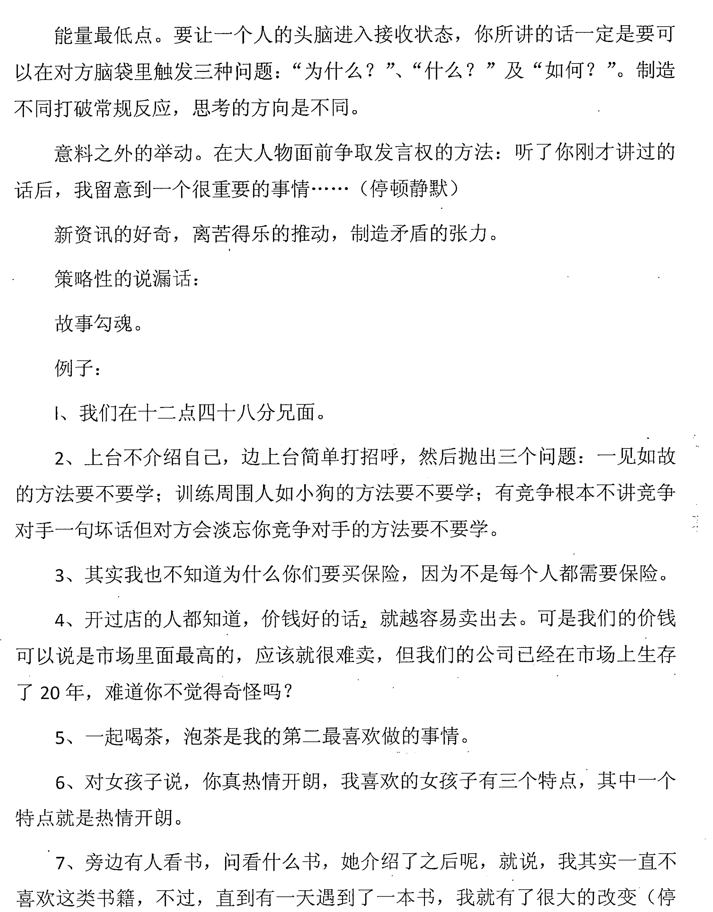

# 奸的好人20-权谋手段影响学

# 第一章 权谋秘中密

## 第 1 篇 打破思维的框架

阅读过《奸的好人》系列读者，最后成为“奸粉”的，主要分成两大类：

第一种奸粉，他们通常都是在第一次接触，马上感同身受，有切身之痛，像突然明白很多，进而想成为权谋行者，这正是明白昨日之非，今日得以重生，这批人会一口气读完所有的书。

第二种奸粉，他们都说读到三分之一，他们就看不下去，因为看不懂，所以读得很辛苦。以我碰到这类读者，最后都终于“读懂了”。

呵呵，到底是不是我们将书本内容写得很深和很玄呢？不！很多不够清醒的人，会将“不能接受这种概念”或“与自身价值观有很大冲突”说成看不懂！

譬如我第一次开课程，我要求大家不要归零学习，当时就有人马上说不懂，不明白我的意思，当我面对面一句一句逼问下去，才发现他的不懂，不明白，其实只不过是没能接受这个概念和教授，理由是什么？因为他去上任何课程，所有的讲师在开场白时，就会要求大家归零学习，一旦我要求不要归零学习时，这是他第一次“听到”，由于他们习惯了被“填鸭式”的教育，导致他们一时不能跳出思考的框架，变成不能接受，但，他们的“执着”使得他们说我不明白。

就好比在大家认为地球是方时，一旦这些认为地球是方的人，第一次听到地球是圆的时候，他们马上会将旧观念和新观念产生冲突，他们就会说怎么可能？所有老师都说，地球不是方的吗？为什么只有你说地球是圆的呢？我真的是不明白。

说穿了不是不明白，而是不接受。最后，这些奸粉都是在碰撞受伤后，清醒过来。

游牧人 1

## 第 2 篇 职场高手修炼秘籍

阅读是最容易“对号入座”或产生“投射反应”，某些人对快乐的讯息会有高反应，某些人则对痛苦的资讯出现高反应，但对快乐的资讯可能是低反应。

譬如，当我说出某些职场现象：老板总会晋升那些只会说不会做的员工，很多员工默默付出，却得不到老板赏识，老板像盲了一样，总是将那些很会吹水（吹牛），马屁功夫一流，搬弄是非高手的员工，压在那些只会做但不会说的员工头上……

有的读者读了之后，他们“感同身受”，引发他们许多感受，回忆起那些痛苦和悲惨的体验……如果有作者抛出这种“职场现象”，作者本意有两个目的：

一，是阐述观点，举凡阐述观点者，重在分析，冷血观看这种现象，然后告诉你为什么会这样，如果读者看不到作者的观点，而被引发情绪之后，就比较难学到东西，这类读者大概都是说：李老师，你说得真是对，我啊……（开始说自己 的故事）

引发情绪而对号入座没关系，重要的是读者被引发之后，要觉醒抽离，譬如我会在“权谋课程”告诉学员，为何老板要这样做，越是高明的老板，越会这样做……（我在权谋课程是教招数的，我会解释为什么老板会出这招，这招背后的目的是什么，而做员工的又该用哪些招数来达到上位的目 的，而不是傻傻悲叹。）

若听课程的学员对号入座后而无法抽离，这时就难免有点可惜，因为即使他听完我的教授，他只能算是明白，不能算是“悟道”，明白者等于是“学”，悟道者将来会用。

若只看到“职场现象”者，总会产生“为何小人在职场总是得志”的感概……为何老板会被迷感的感概……虽然明白了真相：越是精明的老板越会这样做，只不过是大多数职员不明白老板的心思。

他即使学到老板如何出招，知道出招的原因和理由，不过，他将无法举一反三，他永远只是当中明白人。

悟道人最大的分别是：看透前因后果，明白出招时机，透彻理解解救脉络后，他最终的变化会有上等和下等；

下等者：变成会吹水、马屁，是非的员工，将来会变成这种老板，在还是员工时和这个老板的心思同步；

上等者：你是员工时，老板会觉得你没有威胁，不会提防你（其实你若是下等成就者，老板会时刻提防你），即使你拍马屁，老板是在不清醒下中招，认为你是崇拜他，你搬弄是非，老板只会觉得是他自己的发现。

## 第 3 篇 你甘心做蠢蛋吗

在美国，数据显示有几十亿美金消耗在训练课程上。

老实说，如果没看到这个数据，我虽生存在讲师行业，但从没考虑过，其生意数据竟然是那么庞大的。

这位经济学家不是研究培训课程这生意有多大，他是探讨人类的消费模式，是不是很重视实际性和有效性。

大众庞大的消费行为，只是跟风和无目的相信，意思是大多数的消费者根本不知道自己要什么，如果大家都说上课好，就有一大批人上去课，如果说上课可以预防癌症，只要一丑形成风潮，也会出现无目的相信。

虽然美国的训练课程有这个数字，不过研究发现：无论上什么课程，大多数的学员在六个月后，就变成想不起课程的内容。

即使如此，如果他身边的人都说这个课程改变很多人，这个人也会感觉自己改变很多。就如同很多瘦身产品，大家吃了两个月，体重没有明显下降，但正在吃的人都会说 有改变，感觉腰围小了。如果这个课程是偏向唯心论，他们都会说，我跟家人相处的关系有很多转变，孩子也比较听话了。

有位企业家告诉这位学者说：“一个蠢蛋去参加心灵工作坊，结果出来还是一个蠢蛋，不过现在这个蠢蛋会变得更加危险，因为他开始懂得跟你谈心灵，更加懂得如何把握唯心论的借口来掩饰他的无能和错误。”

游牧人 3

其实，举凡上课群众，都很担心自己付了高昂的学费，最后真的如这位专家说的蠢蛋之后还是蠢蛋，因此为了合理化他们的愚蠢，他们只会更加愚蠢。毕竟这不是技术课程，技术课程你学不学得懂，是有很明确的答案。

## 第4篇 如何改变人生

不少年轻人，很喜欢问，怎样改变自己的人生？恰恰，更多的讲师鼓吹改变人生的重要性，问题是怎样改变？这个改变是指物质的改变，还是收入的改变？

大家不要误会，开课程的激励讲师说的改变，本质是指彻底改变你的生活形式，换句话说就是：成功！说得更加浅白就是所谓的发财致富。

偏偏是他们指月之手是说致富，但他们背道而行，教大家怎样改变自己的个性。问题是你即使成功改变了个性，但不等于你会发财致富。改变性格、道德修养，跟发财致富，完全是两回事，因为不少超级大富豪都是脾气暴躁、心胸狭窄的。

这里说的是，道德修养跟发财致富是两回事。很多“想改变”的年轻人，被误导了方向，结果越想改变，就越越改变不了。

由于不少人问，我还是说，年轻人忘掉改变这个概念吧，将整个焦距都放在“还有什么解决方法？还有什么方法达到目的？”这个概念上吧。

遇到问题，马上问自己还有什么方法，不是去想到底我还适合待在这个行业吗这种想法上。

## 第5篇 上课和阅读有什么分别

上课和阅读有什么分别？

上课可等于将资讯直接输入，其最大的好处是，你会在课程后，经过体验与市场实战，你会变成悟道人，就是有办法将所有的手段正确的施展出来；再不然，你会变成明白人，课程内有很多感悟，你突然明白许多以前不明白的事情，明白为什么你老板是如此，将来出来实践时，即使你是被“害死”，你也会看的明明白白，知道自己是怎样被害死的。

可是，最大的缺点是想象力不会太大，因为这是两天的课程，你被时间和空间，互动主宰了你的大脑奔放。

阅读最大的好处是：“思入风云变态中”，意思是你有极大的想象空间，有多元的发展可能性。不过，这里会有一个误区，就是如果单靠阅读的话，随时会不小心变成：“误会人。”

譬如看过《极端自我就是王》还有《财色战场》的读者，很多时候会私讯问我：“请问，那些大企业家包养小三，出卖朋友，冷血无情，才会成功。”

其实，包养小三跟成功没有直接关系，但有荷尔蒙变化关系。即使你再懂得怎样把妹和包养小三，不等于你会成功致富。至于出卖朋友和心狠手辣，不代表你会成功，因为我一样看过不少出卖朋友、心狠手辣的朋友穷困潦倒。

这里没有直接的关系。通常上课了，入门后的权谋行者，都不会那么天真，也不会变成一个误会人！

如果有人能开创出，既能有资讯直接输入的上课法（不受时间空间局限），同时又有阅读的想象，配搭锦囊妙计，身边有大师随身指点你，三合一的指导你教育你，这个人有机会变成什么人？

## 第6篇 慧眼识珠

我有一位朋友其父亲博览群书，是书香世家。当时我友在继承家业在即，在家里闭门潜修，一样博览群书。当时他翻开其父亲一本书，书内有一则评语说：“此乃很废的书。”

朋友问其父亲：“该如何处理？既然很废，为什么不丢掉？”其父亲回答：“你做主。”

朋友阅后，果真很废，真的是废书一本！对一个喜欢阅读的人，会不会买到一本很废的书呢？

当然会，尤其是初涉该陌生领域。不过，一旦你可以分辨出该书很废，表示你对该领域的知识开始有质量上的要求了。

朋友的故事引发我许多联想，好比当年我想做销售员，我胡乱加疯狂买销售的书来看（现在已经积存 500-600 本，那些很废的我全部打包好放在仓库）。一开始时，无法分辨质量，只能分看得懂、看不懂。那时老胡其实跟我每天见面，他随身贴近，我举手翻掌，就可以 On call 老胡，老胡也会时刻指导我，纠正我……有一天老胡问我：“如果你只有两百元，你会买书，还是买饭？”

我如实回答：饿不会死，吃得滋味很快忘掉，但积存知识，永远有用……所以肯定继续买书。那时，那些教销售的书，真的很废，都是不切实际的方法。

直到我的销售手段形成自己的风格后，摸出属于自己个人的成交风格后，我开始看到这真的很废的书。

（当然一些书，你无需积存知识，一读就知道很废。譬如马来西亚的高天霸，我虽然对道家认识肤浅，不过还是可以判断这个人的言论够废。但，问题是，思想素质不够的大叔阿婶会选择相信高天霸。）

听了朋友父亲的故事，当晚我决定保留那些很废的销售书，然后搬回家，再打造一书柜，在书页写下“废书”！

这些废书，都是我脑袋的里程碑，见证了我今天的咨询过滤。

## 第7篇 投资书籍的诀窍

很多人想钻研一个课题，往往很喜欢偷懒，也不懂为何那么担心购买错一本书。话说当年，某不懂中文的仁兄他要求我推荐几本相关肢体语言的书本，当时我将中译本的书名，全抄在一张 A4 纸上，当时我和这位仁兄一起到 KLCC 的书店看书。

那时候，我逛书店逛了将近三个小时，而我捧着战利品准备结帐，所以我往英文部走去，看到我的朋友两手空空。一向来我不会过度热心去推荐书本，譬如我瘦身成功，我只会暗爽自己过程，绝对不主动鼓励对方也一起瘦身。

相同的原理，这位朋友先主动问我，要求我推荐肢体语言的书本给他，我只是根据他的要求去做推荐。这时看到他两手空空，我也没有特别的感觉，只是说：“哦，我准备去结帐了。”于是这位“很想阅读”的仨兄，依然两手空空陪我去结帐。

开车回家途中，这位仨兄自己合理化对我解释（我没兴趣问他为什么没买书，因为他买不买书，根本与我无关）：“哗，现在的书真是五花八门，那些教肢体语言的书真厚（我想真的吗？），还有，这些书都很好，不知从何下手。（我没有回应，但心想，你真的想看，随便买一本书，一本书根本不值钱），如果我会中文就好，真的会跟你借书回家慢慢看（我依然没有回应，想区区那 30-60 马币罢了，自己买不是更好吗？），买一本书虽然不值钱，但是你买错一本书真的很浪费钱。”

20 年前这位仨兄看到我蹲着吃 5 毛钱的辣死你妈妈，然后将省下来的钱买书，当时，这位仨兄问：“如果你只有区区这笔钱，你会先吃饭，还是先买书？”答案是，我肯定会先买书。

买错一本书真的是那么严重吗？在你还不熟悉那个领域时，就不要那么龟毛，因为你根本还不到水准买到精品的筛选力。

其实，我再次很有“慈悲胸怀”介绍你们一个方法筛选：“如果你是买商管、心理励志等书，很简单，如果现在所有人都跟你说我们要拥抱正能量，如果当你看到一本与负能量同行的书，就不必考虑，直接买下来就对。你可能还是会买到一本很废的书，不过无所谓，起码这个作者和出版社背用脑来吸引你，而不是人云亦云地跟你说那些全世界都知道的烂理论。”

就好比马云跟你说的座右铭：我们需要透过委屈来撑大你的胸怀。问题是願意对号入座，继续以委屈壮大胸怀来自慰一下，这都没问题的。

## 第8篇 茫茫资讯大海，从何着手

其实推荐一本书是举手之劳。但根据多年的经验我发现，我喜欢的，我认为是精品的，因为我推荐而购买的未必适合。基于这个理由，未来的日子，你们将会在课程中听到我和江魔重点介绍书本的内容。换句话说，你可以听我们两个人在谈书，也可能听到我们会互相讨骂吵架，不过这还不是一个定案，我们都在讨论细节当中。

我爱上阅读之后，很少主动去问朋友有什么好书介绍，也不会主动问朋友有什么好书推荐。如果你在传媒看到什么十大富豪推荐必读的书本，专家推荐的五十本书……这类报导和文宣，其实都是书店的打书宣传计划或活动，这类书未必真的就是你们人生必读的书。

据此，我有如下建议。假如你对某个领域有兴趣，譬如：权谋，网络行销，只要你很清楚这两个领域是你要的资讯，但，茫茫资讯大海，从何着手？

### 第一步骤：盲目汲取，傻瓜吸收

一本书不会太多钱，最难的是你对该领域的资讯产生兴趣。因此建议举凡有相关关键字如权谋，如人性，如网络行销，怎样做网页，你一概不分好坏，有课上就去上课，有什么书就买什么书。

我开始销售，任何销售的书都疯狂买，现在我的仓库（不是我家里的图书馆）最少有六百本销售这两个关键字的书本，这些书都是精品吗？

不是，这六百本都是不值得我重复阅读，所以我才放到仓库，不放在我家里。你问我后悔吗？

我的回答，没感觉，因为我知道这就是过程。

### 第二步骤：病毒感染过滤生成器

当你购书时不管品质，胡乱进货，你也要快速阅读，不是定在一个时间阅读，是书本随身（起码两本书），何时何刻都随手拿起阅读，即使读半段，又要做其他的事都无所谓，一天当中总有很多这样零碎的时间。

这时你先分类：读得懂，读不懂（通常读不懂就是有太多的名词或者你的核心价值观，甚至你的位阶或者经验体悟）。读不懂的，因为我是初学者，就不下结论，读读得懂的。然后在读得懂的部分再分成：喜欢，不喜欢。

喜欢的，就要留意，这个你喜欢的作者，提过哪位作者，读过哪本书，你马上追踪买回来，而你喜欢的作者书本，干脆不考虑，不扮演精明专家，全部收集。

### 第三步骤：抗毒免疫测试系统的建立

当你一路追踪下去之后，很快地被作者这个路线影响了你的思维，因为他的判断喜好都影响了你的口味，这时你已经成了病毒感染者。其实暗地里你是被作者的口味价值观过滤了，你还是没有自己的路线。

因此，你才需要第三步，这个第三步最节省成本的方法是，李敖假如骂柏杨或龙应台，你反而要看一看这些人的书。读过那些作者的反对派之后，你可以继续喜欢你喜欢的作者，但，不妨回头看看你曾经不喜欢的书和你不明白的书本。

完成了这个步骤，你才开始整理这个领域的学问之脉络。如这个二选一，不断说 YES 的销售话术第一个提出来的是美国保险之神本费得文有说过……这里要做什么，带着阶级观，时代背景，身份地位去看这位作者写这本书的内容，就是本费得文当年是做保险时用过这招，他是美国保险之神……但现在呢？

还有，现在这个作者已经是亿万富翁了，他有三万个员工，他写这部书，他这个说法，嘿嘿……你看到吗？就是这样过滤和升级你的思维的。

阶级观是什么意思？啊，这位作者是教授，这位作者是家庭主妇，对比某某的理论……

记得，这个是你购书的方向。修炼成功，还有第二个内功心法，这个内功心法，在权谋课程才教。

## 第9篇 归零学习

由于不少人提到归零学习，在此我重提什么归零学习。这是一般讲师在开场白时会提出的一个“重要概念”，其理据和比喻是告诉大家，你有半个杯子的水，怎么倒得下新的水？你带着旧观念和旧思想，以及以前的想法、经验来上课，怎么可能接受得了新思想？

就以奸的好人系列而言，从第一篇文章，就是准备轰炸掉你对成功者的信仰，因此才说“不要相信成功者的话”为开场白，这就是市场上两种讲师的区别。

第一种讲师，他准备的资讯充足，根本无需担心你的旧观念是什么，甚至不会理会你背负了什么旧包袱，他手起刀落，拿起资讯就轰炸你的大脑，读者或学员只会被病毒感染与恐怖袭击。

第二种讲师，他需要学员或读者为他们的资讯打开大脑，接受他很一般的理论，因为这个理论张三李四都是这样讲，你听任何一个走上台的讲师都是跟你说回这些类似的资讯，相同的观念，故此，第一步一定要预设一个做法给你。

在此，我用一个比喻做总结。如果一个男人想把妹，最烂的招数就是问那个女人：“请你放开怀抱接受这段新感情吧。”对这种男人，他们总喜欢问女人：“你有没有男朋友？你喜欢我吗？”因此这种男人把妹的常态就会说：“请你接受我吧！”

对我这个人而言，我从不会问我成功追求到的女性：“请你接受我吧！”我肯定不会问这种烂问题，也不会出这种烂招数。

## 第二章 毒辣权谋

## 第1篇 三个层次，修炼权谋

香港亿万富豪杨受成在他的自传说：当年他去见大老板洽谈合作项目，那些大老板其实可以马上答应，但总会说，“那你先回去，我会再联络你”。

哇噻，这么难见到大老板，终于破关重重见到了，可是却一句你先回去，我会再联络，可说折腾得当年还是小伙子的杨受成，让其心理七上八下。

杨受成解读是大老板总会喜欢卖关子，然后等你焦虑上好几天，最后一通电话，一定让当事人分外兴奋和惊喜，而这人必会感恩！杨老板的解读是：这就是大企业主、神话人物对小人物的施恩权谋。我不满足这解读，我将他的故事和数位大老板分享。

那些白手起家的老板都说“想当年”自己还是小老板，商界没名气时，都有碰过很多相同的情况。

我再问，现在你们对有求于你的人，你们会不会说：“你先回去，我再打电话给你！”全部被访问的老板都说有用这招！我问：“你们的目的是什么？”以下是综合他们的讲法：

- 1) 就是要他们焦急一下，目的是，不要让他们觉得那么轻易得到我的帮忙！
- 2) 目的是先冷静一下，回家再三考虑会不会被他一时影响，看清楚和想清楚自己有没有中招！
- 3) 担心一时做错决定，想好怎样退路。
- 4) 看值得帮吗？
- 5) 永远不会马上答应、马上签约。
- 6) 保留反悔，不帮的权力。
- 7) 成熟的做法。
- 8) 考验对方的诚意。

我整理如上，1）是最多人说的，2）是第二多。但，奇怪的是无人从“感恩权谋”这个角度来看。

最后我对受访者说出杨受成解读成这是“施恩权谋”，一些老板马上附和说：“对！这就是本来我想要说出来的东西…”

只有一位老板考虑一下说：“如果我要他感恩，我会再拖久一点，找个秘书刁难他一下，最后由我解开他的困局和僵局，这样做效果才会比较好！”

再怎样厉害的老板，第一考量是“我有什么利益？他答应的是否真的？”不会傻到去思考要不要或怎样施恩。

在你还没有向我证明了你的实力、能力之前，我根本不会用施恩的角度来看你。没有能力的人，我施恩给你干嘛？

你可能会说：“但，也可能施恩在先，那么对方可能被感动的尽量做到最好。”

现实的情况是：出来做生意的人，没有这么多额外的筹码和时间来在一个没有能力的人身上赌一把。

如果这大老板连不确定有能力的人也敢赌的话，证明老板已经很急了。既然这么急，更不可能还有同情来搞什么鸟施恩。

做生意的为了测试你的诚意而叫你回去后，不理你一段时间，让你心里七上八下也不能测出你的诚意。诚意只有从你的举动和交货的素质中去推断。只有一个情况下大老板看起来好像是会测试你的诚意：你急，他不急。

你急着需要他的生意，因为你没有其他选择，他是你唯一的选择。而且这时候，他所做的测试，不是测试你的诚意，而是测试你需要他的程度有多大。

做生意的，不会关心你的诚意，他只会关心价钱能够多便宜，品质能够拿到多好。

若他测出了你需要他的程度很高，他之后才能决定要如何扣你价钱和要你们的付出。

有权谋角度和没权谋角度的，看出来的世界就会很不同。

那么杨受成真的没权谋吗？

当然不是！

问题是他在写自传！

没有权谋角度的人可能就只是一厢情愿的认为老板正在考虑着，杨受成也是用着权谋的角度来思考大老板以前为何要拖延他，所以才会想到是施恩。只不过他的权谋角度是错的。

而如果有老板看了杨受成的这本自传后，以为学到厉害的招式去搞施恩，就会撞墙碰礁了。

我们的权谋课程中，就不是纯粹只教你技巧和手段。错误的权谋角度，会导致对的技巧，也会用错。学权谋，要从见地、性格和手段三个不同的层次来修炼。

所谓的见地，就是精准权谋角度的思想，有了这个见地，你的人事的分析和处理才能精准。

而权谋家也有特定的性格，这些性格和权谋见地息息相关，有了这些性格，你就是一位自在的权谋家。

权谋家的手段反而是最容易学的。

## 第2篇 工厂生命论

今天和某工厂老板喝茶吃饭，他说：“现在行情不好，时代不一样，我希望把工厂做到一条龙，为把生意做大，现实逼我不得转型，不转型会加速死亡！所以我要有自己的品牌。我现在是搞品牌的。不搞品牌的话，死路一条。”

朋友继续说：

下品的生意是靠劳动，出卖人力赚钱——你的钱要靠人肉机器堆叠而成（他是说自己工厂）；

中品的生意是靠卖产品与服务，去面对消费者，现金生意，所以要做一条龙的目的。希望从工厂生产产品，然后透过网络买卖直达消费者手中。

中上品位的生意靠专利和标准，由于我不是做高端产品，更不是科技业，这条路，不可走；

上品的生意是卖品牌，品牌化之后，就等于将产品增值。我是工厂，可以做到一条龙，生产我控制，品质我监控，消费者我服务，可以成功的！

朋友说要把工厂做大，做品牌，将产品品牌，直达消费者手中。朋友刚上了相关品牌课程，读了不少品牌的书籍。

朋友兴奋不已，说企业要转型！产品要品牌。

三流的企业做产品，二流的企业做规格，一流的企业做品牌。

我告诉他——

蔡东豪说过：“从一间工厂，说要做到一条龙，推出自己的品牌，不要说真的去做，写出来都会双手发抖，开创品牌谈何容易？！从工厂生产者，转变成品牌经营者，简直是转行，品牌和生产是全然不同的思维模式。”

很多做生产的工厂老板，大多数都不想再做工业，因为工厂的困境是，你不是郭台铭的鸿海，正所谓：大又不够大，小又不是很小。工人问题，加上很多局外因素，如同“十面埋伏”、“四面楚歌”，工厂老板心乱如麻，寻求出路，是人之常情。做品牌不能用一天时间建一座罗马大城！

如果你在自己的行业打混超过十年以上，而且已经达到现金周转每个月上下数百万马币，不必去找品牌顾问，也不要去四处收集意见。要问，就干脆问自己吧！

任何一个人做生意，在那个行业（同一个领域）有十年以上的经验，这十年你还是待在这个行业、这个领域，你就等于“做对了”很多事情，所以不必问人，你就是专家。

如果你帮不到自己，没人可以帮到你。同样的，你大可放心，跟你同等实力的工厂，一样面对你的困境！

我说的“问自己”那种赚到钱的生意人，不是指3年前在印尼卖云吞面赚到一笔，然后回马来西亚开玩具店3年，之后又到非洲卖保险3年，接着又去印度做传销 3 年。这个人也许赚到钱，但，这种人陷入困境时，一定跟你不一样。这种人碰到困境，真的很需要四处收集意见，需要找专家顾问，继续走完他 “漂浮的生意见”。

每次看蔡东豪写工厂的困境，都引发我的情绪反应。

做工厂最大的困境是大不够大，小又不是小，卡在上不下。在竞争惨烈的情况下，上游原料的供应越来越窄化，成本减无所减，加上不够大的工厂是无法搬工厂的。当年施振荣说的微笑曲线，对不大不小的工厂英雄无用武之地，只是听起来很爽的理论。恰恰朋友的工厂是不大不小。

蔡东豪是现实人，不讲大话，很实际。他不讲南海策略协助你梦想投射，更不会告诉你微笑曲线度过难关，他就是现实人！

他当年在香港搞商台节目，做 CEO 可真的够震撼人心，得到梁文道的协助，开创出多个风云节目，虽然最后被封杀。现在用十二个人做主场新闻这个 APP 和网站，也令人拍案叫绝！

他说的工厂辛苦论，没开过工厂的人不知他分析工厂的见地功力。他表达尔文的汰弱留强理论，碰到做工厂顽强生命力，那些陷入困境的工厂怎么死也死不了，那时才是最真切的精神折磨。后来他用一个比喻：工厂有刘德华精神，但同时有刘德华身材，真的是瘦人想减肥，减无可减。

我读了，苦笑一下，然后无限感慨，接着心想：他妈的，我真幸运！

## 第3篇 竞争的智慧

某餐厅老板，他除了冲茶，还有卖杂饭。

冲茶的饮料都是他们家族经营，杂饭摊位交给外劳负责，姐姐做大厨，一直以来生意不错，口碑也很好。（马来西亚很多餐厅都类似美食中心，或食堂类似的经营，店铺内会有多家不同的食物摊位，有面，有各式的熟食。通常类似这个餐厅的老板，他们都是掌管饮料的。）

后来，某位煮咸鸡饭的档口出现，由于非常滋味，生意大好，加上很多转介绍，咸鸡饭档口带旺了整个餐厅。

但却造成杂饭档位越来越少顾客光顾。问题不是出在杂饭店的菜肴不好吃，而是更多的人对这只咸鸡饭有兴趣，大多数的顾客都是为咸鸡饭慕名而来的。

由于相形失色，这餐馆老板开始想出很多古灵精怪的挑剔和刁难，大概用了两年时间，餐馆老板终于逼走了咸鸡饭店老板。

没多久，咸鸡饭店就在临近处找了一家店独家营业，没有添加其他的食物档位，结果是餐馆老板的生意跌大半，杂饭店也不因此见得好起来。

后来我的亲戚去找咸鸡饭老板聊天，咸鸡饭老板说，其实不是餐馆老板逼迁的话，他根本没有勇气开店独家经营，后来被逼得无路可走，只有放胆一试。

当年，杨受成老板接手老爸手表生意，当时他跟老爸发愿说，我要杀退所有在这条街的竞争对手，但是杨受成的老爸反时说：“如果你要越做越好，你采取的策略是既要打赢所有的竞争对手，但是又要他们留存在这条手表街，理由是他们有留存衬托的价值，你可以想像，如果整条街只有你独家经营，一就是这个市场的暮落，再不然就是这条街不再适合做手表。所以这条街若有很多店都是手表店，消费者来到这里，选项多，就是让他趁热闹地选购，因为你有了特色，所以所有的竞争者都是为了衬托你而生存的。做生意不可能吃完全部，总有落网之鱼的。”

人，只要是⼈，你当然可以妒忌，妒忌是人性正常反应，这是大脑科学家测验过的研究。问题是有成熟的妒忌和不成熟的妒忌。

如果你妒忌咸鸡饭档位，你可以先不得罪对方的同时，暗地里推出与他正面交锋的食物。

万一暗斗了一段日子，你输了，你只好马上将盈利减低的杂饭档位出手，然后专心做好你的餐馆饮料，或者添加饮料的产品。甚至你知道吃咸鸡饭的人要等上 45 分钟，你可以做一些小食销售。

妒忌情绪出现，马上与妒忌共存并行，马上激励自己暗地里礼貌又不冲突的正面暗斗，输了，转移战略，好好抢他的周边菜吃。

游牧人 16

不是不可以妒忌，我不认为可以靠压抑，而是需要同伴共行，激励自己上向与转移战略。这时你反利用了你的情绪。

## 第4篇 口才 VS 说服力

有学员问怎样修炼好口才？

我问：为什么要修炼好口才？

学员回答说：说服人，希望收到欢迎，让谈判上道。

他继续问：李老师参加教授演讲训练，会不会修炼成好口才？怎样提升口才？

我觉得大家对说服人和影响力，有极大的误解，参加什么鬼口才圈，最多提升你公开演讲，上台演讲的机会。为什么我是说机会，而不是说会提升你的演讲功夫和技巧呢？

答案很简单，精彩的内容，对该领域的深厚功力，你若能贯穿脉络，说出口时就能震撼人心，如果你有编排话术的功夫，那么你的演讲简直可以迷惑人。

不过你要清醒一点，公开演讲是公开演讲，跟你一对一，或者在公司一对一多人的会议（包括简报）根本是两回事，你在公开演讲学得技巧未必用得上。若你对该资讯掌握的很透彻，就是唯一一可以将演讲，简报会议，一对一，可以供发挥的支撑点。但陈述手法还是略有不同。不过，这跟说服和影响没有直接的关系，只有间接的关系。

很多年前，有一年轻人想报读精算科目，他四处请教朋友意见，得到的回馈是：这科难读，不容易毕业，即使你很会读，毕业了，肯聘请你的大企业职位也有限，僧多粥少…

我打断问：其实任何一个科目毕业后，都是有僧多粥少的竞争…

年轻人说：李老师，我口才不好…因为应聘成功需要好口才…提呈建议需要好口才…我讲话不是滔滔不绝，所以不是属于好口才的人…但，我的精算科目都是高分取胜的。

游记人 17

我：你认为怎样才算得好口才？

年轻人：有说服力。

好了，很多人都会误会，好口才等于有说服力。说服力不一定滔滔不绝地陈述。说服老板，影响任何人都只有一个途径，你的话术可以改变他们的价值观。

我认为谈判说服，无需好口才，但一定要懂得格局，看透格局，然后施展权谋手段，跟口才没有直接关系。

问题是什么是好口才？

自认好口才的人，离不开三大类：
- 口齿伶俐；
- 牙尖嘴利 / 辩才无碍 / 滔滔不绝；
- 尖酸刻薄。

先说尖酸刻薄的人，这类人一定认为自己讲话滔滔不绝，也误会自己有好口才，我碰过的泼妇，狗嘴长吐出象牙的铁嘴鸡，都认为自己是有好口才。实际上这类人，一张开嘴巴就令人讨厌。

李敖说过，他写文章或对敌人尖酸刻薄，但举凡他对邻居和朋友，都不会如此，相反会以礼相待，因此他说大家跟他相处看不到他的傲气，傲气只在文字中。

再说第二类：牙尖嘴利 / 辩才无碍 / 滔滔不绝。这些人在对谈时，可以随机应变，头脑转述快如闪电，一个例子可以反覆举证，不相关联都有办法串联起来。但这类人，只是有好口才，未必有说服力，未必能说服投资人放钱进他的口

至于第一类口齿伶俐的那些人，通常口齿伶俐的人说话总是有办法取悦到人，故我们被小朋友逗得哈哈大笑时，我们会说这个小朋友口齿伶俐：我的李子老师到医生都形容过李子是口齿伶俐，每次我听到这些赞扬时，我肯定李子拍过这些人的马屁，我的孩子是在他高兴时才出手拍马屁的。令到人喜欢你，是开端，不是说服力的关键。

## 第5篇 小包装，大学问

游牧人 18

我常跟人说，一个人的包装固然重要，一本书的包装也很重要；你有好的内容，没有好的包装，到后来也未必可以吸引读者。

我由于是作者的身份，所以在这本书之中，我负责的是供稿；而封面则找人设计。特意找了一间比较有名，及贵的设计公司来做封面。事后看来，完全物有所值。

应花的钱，就要花。

有些没有反思及没有深度的人会以不以为言，心中会想着：“封面是不重要的，最重要的是内容。”

我对此说话很反对，因为我是一个很有逻辑的人，如果照这些人所说，那根本不用封面，包装，印刷也不需要了，就干脆将手稿打印出来，钉一本书就卖吧！

这些事情，其实如果你懂得用逻辑及反证法去反复测试，你就会知道这些是噪音。

事实是，我们看到精美包装的书本，都会不期然拿起来传播；书名吸引，我也会拿起来看一看：这些就是讯息。

## 第6篇 老板和顾客眼中的“神”

害死你的成功座右铭：当你不断分享人生座右铭时，有没有想过某些座右铭会害你一生。

- 有一句成功箴言：
    1. 不兜售你自己不喜欢的产品；
    2. 不为你不敬佩的人工作；
    3. 只和你喜欢的人共事。
    要促成三方的因缘成熟，你觉得如何？

在资本主义的市场上，就是很多很多这类“要成功就要记得这些箴言”的浪漫废话流传，不过，大多数的箴言都不切实际。

读过很多商管书的人都听过：经营权对比拥有权；领导者度比经营者，不过大多数的箴言定位是根据弱势者、未成功者、追梦者立场发言（毕竟市场够大）。

游牧人 19

在真实世界跟这类理论是颠倒的世界，例如如贾伯斯是魅力领导人吗？比尔盖茨是魅力领导者吗？

但“改变世界的贾伯斯”，论性格、脾气根本配搭不上那些箴言理论。比尔盖茨极端自我，如果用魅力领导者的箴言，他是不合格的领袖。

他们是有远见，做生意有手段、管理人（骂人）可谓发挥淋漓尽致，尤其是洗碗手段更是一绝。骂人本事更一绝，完全是 EMBA 说的那些坏老板的特质，坏老板的特质他们全部都犯了。

而真实世界的大老板，那些守则，没多少位有遵守，劝君不要被书生之见迷惑，当你们读到这些浪漫废话时，第一个时间不要对号入座，投射有这种老板会出现，先问问自己，看看真实世界，你确确实实跟那些上市公司的 CEO 生活相处的真实日子，那些老板是怎样的？（劝君不要再解释，不是每个老板都这样，是有好老板有厚道的老板其实这个我也知道，我提出这个观点是说，不要期望有一个菩萨转世的老板。）

把话说回来，不兜售你自己不喜欢的产品——这个是不专业的销售员，我的推论取大意不细说，大家举一反三细节化：你去嫖妓，有一个妓女说，我不喜欢和胖子做爱，因为我不服务我看不顺的人，妓女当然有这个“权力”选，不过她绝不是专业的——同样的，计程车司机选自己喜欢去的地方载客，然后你截停计程车之后，说出非他喜欢和想要去的地方，于是计程车司机拒载，这是专业的吗？

但，不卖“骗人”的产品，我觉得这还可以接受！

不为你敬佩的人工作——还是一样，细节你们去想，我取大意的例子，假如全地球有一亿人只敬佩贾伯斯，是不是这一亿人都要跟他打工？惨了！我不会 It，没设计天赋，只是敬佩他，他又死了，我现在找不到一份我喜欢的产品，我敬佩的老板，我干脆不打工了。（现在我不喜欢 iPhone，但又不爱三星手机，怎么办？）

只和你喜欢的人共事，我勉强可以接受，但问题是，你假如是员工，上司安排到一个你不喜欢的人，你会怎样？跟上司说，麻烦你调部门，否则我不做！？信了这些箴言，只会令你更不快乐，更加的失败！这时我可以批评

游牧人 20

你：“不专业！”

- 任何产品，只要来到我的手上，准顾客是人，我就要令到没需求的准顾客，变成有需求，彻底改变准顾客的欲望——我要做到这个境界，需要什么能力和手段？
- 我不喜欢和不敬佩我的老板和顾客，但我要怎样让这些人开始相信我是权威专家，我是要令到这些人喜欢我，敬佩我，把我当成神来拜——我要做到这个境界，需要什么能力和手段？
- 不管他喜欢我，或者我不喜欢他，这都完全不重要，重要的是我如何使得他觉得我很需要我，不能没有我——我要做到这个境界，需要什么能力和手段？

你看，完全没有任何情绪反应。

各位，这才是专业！

## 第7篇 慧眼辨识“假”、“大”、“空”

在很多年前，我本身的演讲行业已经做的不错，那时我已经没对外开任何说明会了。

在出版领域，马来西亚建国 56 年，没多少家能赚钱，即便城邦在马经营，亦有难言之苦。如果我没说错，赚钱的少于五家公司，我们出版社从马来西亚为基地，已经转战台湾，正确来说，我们现在是台湾的出版社。

当时，有一个讲师想出书，想打响台湾的知名度，于是找到我，甚至约见了我。这个人口气很大，一开口就说他每天读多少报纸，看多少本书……

先补充一下，你对任何人假大空可能还吓到人，对我来说，当你找到我，你说你跟习近平很熟，我第一时间就会抽离，完全没感觉，甚至提防和警惕都全部出来了。

当时这位讲师一直吹牛说他当年办出版社如何成功，开演讲如何感动人心……

他越说我就越没兴趣合作，这个人误会了，出来做生意，无需刻意展示你的想当年，你想当年去美国开天辟地，然后在香港住了17年，到台湾又住了20年，去大陆又生活了30年……你尽吹这些干嘛？这不是更加让人怀疑你吗？关键是你现在是什么？

如果你现在什么都不是，跟我尽说想当年，那些只凭你说的“假、大、空”岂不是更加证明你现在是失败者？很多人一开始谈判，就以为自己会谈判术，讲话离不开“假、大、空”。因此这些人思维逻辑是有问题的：

第一，如果你找到的合作者比你大，你的假大空，岂不是露出底牌？因为在关公面前耍大刀，随时会出丑，班门弄斧，贻笑大方！

第二，如果你找到的，看不出你的“假大空”，那么你不是找到了呆子跟你合作，除非你想骗对方，这就另当别论。我已经重复多次强调，好的好人系列，到权谋课程，从不教人“假、大、空”，譬如你不认识李嘉诚，你便要说你认识李嘉诚，这种谎言经不起任何考验，其实任何人会跟你合作，不是因为你认识多少亿万富豪为最大的引诱，相反你一开始就假大空，更加让身经百战的老手提防你，你的吸引力在于你的如何引诱。千万不要误解了我在权谋课程说得放毒药和五指山行销术，如果今天你还是惯性用假大空，你是时候换换你的大脑系统了。

有人问：什么是假大空？

### 假

跟习近平主席握过手，拍过照片，就说认识习近平，真相是当天是习主席在巡视展览会，很多人都跟习主席拍照握手，同样的很多人曾经跟我合照，因此拿着跟我合照的人，未必就是我的入室弟子，他跟所有上过课程的学员一样，是普通学员没分别，或者说，他的智慧和知识与普通学员没差，甚至好一点，或者更加差。

案例：

在我还是做成农业时，一位马来拿督约见我，说他公司是帮国家银行做金币的工厂，因为马来皇室和当年的马哈迪首相要参观他的工厂，需要紧急

游使人 22

做一批制服，我听了没特别兴奋，全部感觉都没有。

当时是老胡担任我的翻译员，在第一次洽商，他安排在国家银行大厦出口见面，然后，他一见面就说最近在国家银行开会议。我还是没有特别的感觉，将这位拿督当作最普通的准顾客。

第二次约见是在马来拿督的家里，在拿督的家里尽是跟那些皇室成员合照，是生日宴会的合照，是家庭聚会的合照……

这次见面，我没特别感觉，一样把他当作普通顾客，没有因为他是权贵给他任何优待，还特别强调，因为你是第一次跟我们交易，我们必须先收取一半抵押金。

我把这位拿督当作普通准顾客，他对我反而最有信心，因为我没被他名头震惊，这位拿督告诉老胡，其他成衣厂老板，知道他的权贵身份后，总是离不开巴结奉承，然后吹嘘自己做过什么大企业，企图用“假”来强化自己的公司，企图找到合作接口。

问题是这位拿督真的是有权贵身份，你任何的假都骗不了他。

### 大

站在一栋大厦拍照，公司只租用了大厦内一个最小的间隔，就说这个是我的办公大楼。

案例：

当时，我们的成衣工厂，创出一些名气，那时又是一位马来商家跟我见面，一见面就来假，他说自己是皇室成员，故意出示在公共场所、宴会、讲座地方跟权贵的合照，还出示皇室的邀请卡给我看。

对这些展示，我只能说，很多会造“假”的傻瓜，第一招出示的肯定是照片，邀请卡，但，有经验者应当对照片和邀请卡路略不动，千万不要误信，因为不信比误信更加好！

好了，当时我们见面，他谈要五千件成衣，未来会订购五万件，可是在临成交时，他突然改口要500件，我一听就说：“跟500件的价钱，收取一半抵押金。”

游牧人23

结果他没跟我合作，他跟我另一位朋友合作成交，最后我这位朋友被骗1000 件衣服。一分钱都收不到。

我对未来我会给你订购一万件的成衣，这种未来的订购，我是没任何感觉，一慨把你当作普通的准顾客。

同样的，你说，李老师我带 10 个人来上课，一开始的假设，我只要假设你是一个人来上课，因为我这个人是需要看到才会相信，我永远不会相信口头承诺，只会看到真正的金钱承诺。

### 空

现在是什么都没有的人，只不过是寻找机会。

案例:

我认识一个很喜欢说“想当年的是生意人”的中年大叔。

这位大叔现在是在自己的侄儿工厂打工，由于他侄儿是做国际生意，经常出国出差公干，他一有空余时间就会出席很多商业联谊会，希望结识一些有钱人，希望这些有钱人投资他规划了十年的风水网站，他说自己研究了风水二十多年……

好了，他说他会无所不用其极，每天提出一道很令人好奇的问题，然后每天给一点风水提示……

巴拉巴拉……除此，他还列出许多开设网页成功的案例，还谈到如何召集城中富豪，去他们家里免费分析风水的节目，然后又在网页贩卖风水物品，又召集许多工商等等附带生意。

注意, 这个人不是全职风水师, 侄儿的工厂风水也不是他看的, 换句话说,他什么都不是, 只不过是看一个肥婆的风水师的书看了十多年 (马来西亚风水门外汉的风水师, 一个不懂中文的风水师, 我通常对一个不懂中文的风水师, 很提防, 干脆不信比较好, 情愿极端偏激有这种成见, 好过胡乱相信),这个人就是典型空者, 因此他需要靠佛和大。

## 第8篇 比奸诈更可怕

游收人 24

去邻居的家聚餐，我刚踏入邻居的家门，突然有一陌生很年轻的巨汉冲上前，用力紧握我的说：“李老师，我的恩师，想不到在这里遇到你，真高兴啊！”

由于学员众多，通常都是学员先把我认出来的。而我怎样帮过他，帮过他什么，我都是无法记得。

原来巨汉上过权谋课程，后去大陆发展，由于有权谋课程病毒式的感染，他对任何奸诈手段早有很多免疫系统，任何风吹草动，他都草木皆兵。偏偏比他更早到大陆发展的朋友早就尸横遍野。他很感慨说，他那些朋友最后的结局是：死了都不知道自己是怎么死的。

巨汉记得来上课程时，我保证说：不要问我你该不该来上课，而是要问自己三个问题：

看了好的好人有没有大开眼界，颠覆思想？

看了好的好人有没有觉得跟市场大多数人讲的有所不同？

你如果觉得你人生没问题，无需解决问题，你根本不要上任何课程。

巨汉回忆说：“那时，我觉得你说这三句话很有气势。”

巨汉说：“最令我热血沸腾的是你最后一句，你说，你不会保证我上课后会成功，但你敢保证我上课之后，即使我被强大企业主击败，我也会很明白和清楚知道自己是怎样死的。”

他说，这句话最攻陷他内心，令他差点哭出来。

原来当年他父亲是拿督，他真的命很好，可说是富二代，家里有两个女佣，大房车就有五辆，司机两位。

由于他父亲事业迅速拓展，快速膨胀，很快将事业发展到海外，那时他是中学生，大概三年时间，家业迅速败亡，欠债累累，父亲最后走上自杀之路。

最难过的是父亲白手起家，用了大半生经营的事业，原来只是三年时间，运气不好，碰上鳄鱼，一口就被吃掉！父亲可谓死了都不知道什么一回事。

但是巨汗本是千金小姐的妈妈，整天以泪洗面，常对巨汗说，我情愿你爸爸不要再上一层，突破再突破，但，也不要变成一无所有，你做不到生意无所谓，千万不要因为做生意而死。

最后他妈妈为了解决生活困境，先是自己出来工作，后来赚钱不多，只好到菜市场杀鸡卖鸡。

终于将生活给安定下来，而他从太子爷变成每个周末都到菜市场帮助母亲杀鸡，中午回到家总是满身腥臭，当时可说满腹委屈，一直想发奋图强。

就是因为他的这个过去经历，当我一说这番话他马上热血压腾，马上报名参加课程。课程后他随朋友到大陆发展，课程教的思考训练法，让他比身边所有朋友更快看出陷阱，更不会被大陆那些奸诈的老狐狸利用赐封形象锁死他。

相反他知道老狐狸善用赐封，但这些老狐狸只懂得使用正面赐封，老狐狸又不是清醒出招，而他是上过课程的人，掌握双面的赐封，又分的出格局的虚实，怎样是外虚内实，什么是内实外虚，使得他反而反将对方一 道，连经验老道的老狐狸都暗觉遇到高手，对他反而尊敬，最后以“真诚”交易。

他说，他终于明白“从明到暗，由暗透明”是什么意思了。

如果你看不出老狐狸的魔术手，所以老狐狸才有贪婪想吃掉你的欺诈心，这是在交易前的从明到暗心理演变。

如果他觉得你是高手，他就明白不要在行家面前耍阴暗，理由是市场还有很多可以一口吞下的小绵羊，那时他们真的由暗透明，会正正当当拿出诚信跟你交易。

老狐狸最可怕的就是：原来你跟你交涉后，发现你是一口就可以被吞下，又无力反抗的小绵羊！这时老狐狸才变得可怕，最该死的还是你不懂这种由明到暗的人性演变！

权谋课跟没让巨汗壮大，变成第一高手，但已经将他变成：在老狐狸眼中，不是随口可吃的小绵羊。

巨汗说：同样的道理，奸诈虽然可怕，最可怕的是你没本事看穿！在商

游牧人 26

场你没必要变成老狐狸或鳄鱼，但只要你不是小绵羊就足够，因为丛林当中还有很多小绵羊认为自己有足够的实力在鳄鱼塘喝水。

巨汉说，他今天在大陆做生意是与老狐狸同行，在鳄鱼塘行走，不过这些狐狸和鳄鱼，都是想跟他交易。

对比其他人，狐狸和鳄鱼还是一口一口血腥的吃掉那些不懂权谋何物，又以为自己精明的小绵羊。

## 第9篇 警惕朋友“义气”

在菜市场坐在我旁边的大叔对某大叔说：“放心啦，这个生意一百巴仙赚钱，肯定赚钱的，我们讲很多没用，你相信我，这样做，那样做，就会赚钱的，我们这么多年朋友，不赚钱的投资不会找你。”

大叔介绍的应该不是传销，不懂是一起投资什么项目。简单的说，就是游说者出力，另一位大叔出钱。

对任何合作伙伴或者合作计划，我从不经言百分百赚钱，更不会天花乱坠将未来计划作出一定成功的合作承诺。如果任何一位仁兄找我合作，只要他保证百分百赚钱，把我当作兄弟朋友，我肯定打消合作的意愿。人性就是如此，如果是独赚生意，何需找我。

一个轻言重朋友义气，拍心胸担保这样，然后发誓断言那样，我肯定远离这个人。

这个世界不会有百分百的事情，这个肯定会是 在你有难时，逃之夭夭。

## 第10篇 将缺点变成优点

各位，我郑重告诉大家，有人说，初认识李民杰，觉得他人很好，想不到他竟然是江湖佬。

我告诉大家，这位仁兄没看错，果真的，我李民杰是好人，因为人很好，所以我理所当然是有良心，又是很好的江湖佬。

游救人 27

学做生意，或谈判，很多人想到的是用“正兵”出击，很少人会想到用“奇兵”出击。如果你要训练自己在商战屹立不倒的话，除了要听出什么是噪音，什么是浪漫废话，什么是戏剧性的说话术，你还要懂得如何播放噪音，讲浪漫废话，用戏剧性说话术。甚至正常的时候要会谈道理，也要学会大谈道理，谈道理的同时，又可以发挥你的歪理。

不管你同意的，做生意，进行销售，就像是江湖佬。

有一次，刘小姐看医生，因为她手臂经常会脱“臼”，她看专科时，专科要求开刀动手术。我们进一步问医生，开刀了是不是会好，医生说50对50。

我太太生产时，过了预产期，我们问医生意见，医生告诉我们三个程序，我们说做完这三个程序是不是就会自然生产，医生说我只是建议，不一定会自然生产。我们再问，那么这三个程序要算钱吗？医生说，即使不成功，也算钱。

我偷了江湖佬的言论，早泄男对女人说，我可以搞你七个小时，这是不高明的江湖骗术；但一个具良心好的江湖佬，他会很行销地告诉女人：“女人啊！女人，我碰到你这么正的女人，我肯定会未碰先泄。”

即使是缺点也会变成你的优点，即使不会说话，也会变成你的优势。

## 第11篇 成功游说：最恐怖的玩弄

中国大陆一位读者，问了我一个有关把妹的问题，于是我呼吁他向刘小姐报名参加把妹课程，但这位大陆读者收到我的回复后，心中不悦，狠狠地对我进行了愤怒青年的训话。

当时我看到他的训话，我微微也笑，跟太太分享了这段趣事，而我们两人都认为：“老兄，我们只是开课程的职业演说家，每个课程的收费是马币2600令吉，请问，我不推荐你上我们的权谋课程，我不希望你来上我们的权谋课程，我是不是神经有问题呢？”

当大家看到我们敢敢在关键招数，却不在信中教授出来，而要求你们来上权谋课程才教授的话，你说我们若不懂把握时机，要你上来权谋课程，我们就是虚伪的江湖讲师了。我不会说，我们推荐你来上权谋课程是想帮助你们成功，我们只是很单纯跟你做一个公平的交易，你来上我们的权谋课程，你付钱，我们教权谋招数，如此而已。

我也试过有一次很臭屁又直接的推荐权谋课程，结果想来上权谋课程又痛恨我们课程的收费，有读者却因此而有情绪波动。我幽默地告诉他这正表示着，你需要来上权谋课程，也意味着你想上权谋课程，但却无法上到权谋课程而因爱成恨了。我嘱咐他小心留意与分析自己的情绪变化，也需要坦诚面对自己想要上权谋课程的真实心态。

刚才我说的大陆读者对我训话了之后，过了一段时间，又来信跟我交流。这位读者是聪明人，这次他改变了策略，他用很高的姿态想说跟我合作，说由他开发大陆市场，他会和我联手开设一个网站，这个网站采取问答收费。意思是大陆有很多没钱来参加权谋课程，但又很想上权谋课程，不过这个问题收费的策略，就是遇到困难者，他向我提问，我因为有收费而更用心回答——对，这是经济学的问题——但，我还是根据他的概念，告诉他即使我要开设网站，探取解答疑难收费（回答一个问题，收一个价钱），我会有怎样不同的做法。大家要知道我向这位读者提过什么计划，将来等我和车大炫的漫画书出版之后，第二个系列的漫画书版本，自然会看到我日后布局与变化。

当时这位大陆读者很精明地对我进行说服，也许因为他没读过《出位》，所以还是摆高姿态跟我说话。最后我告诉他，你弄到我的一万人，我就跟你合作。事实上我说这句话是想暗示他，证明给我看你的实力吧！

大家有没有注意到这位大陆读者想对我进行游说的架构是，用他的点子，配合我的名气与解决问题的实力，然后大家变成合作伙伴？这种情况很像那些自以为有创意点子的人，告诉有钱人他是智如孔明，他可以帮助有钱人取得比目前更大的成就，赚更多的金钱。不过这里有一个很吊诡的格局现象，你说自己智如孔明，这点没事经过实践，没人知道，也没人可以证明。但，可是平心静气看看这个格局：现在谁需要谁？

你智如孔明，但有钱人不是落难，而又朝天正值用兵之际（请看《出位》）。请问，有钱人可以不要你，也可以要你，有你和没有你，分别不大，反正只是有没有办法更上一层楼罢了。当然这是客气的表述，不客气的表述是说，你怎样证明自己智如孔明？有钱人跟你不相识，何必花钱多冒一个新的风险，要是你比有钱人更厉害，为什么你现在不是有钱人？而且最重要的是，你认为有钱人之所以真的变成他那个领域的有钱人，难道真的蠢如大水牛吗？

你没读过《出位》，或读不懂《出位》，当然不明白为什么你智如孔明，可是对方朝廷正值多兵之秋这个概念了。道理很简单，即使我不开设收费问答，我一样可以自在的办课程与写书，请问我会紧张吗？你们有没有想过，如果你想游说比你强大多得狠的高手，你该如何出手？

我们的权谋课程内，有一个看出看穿格局的游戏环节。过了这个游戏环节之后，我们就来一场现场的模拟表演。你们想想，如果你没有主控权，我和江魔有主控权，模拟游戏的规则不是偷偷摸摸地做，宗旨是游说，意思是你要现场成功游说我我和江魔。这个环节是有方法可以教你如何成功游说的，这一招最恐怖的玩弄，就是可以迷惑到你即使欠钱，你还是可以很坦然地面对你的债主，让债主对你无力还债无话好说，而债主只有嘴巴微微张开看着你点点头。这个模拟的游戏就是要你变成这种厉害犀利的角色啦！

到了第二天，你当然可以看到勾魂手段完整的出手架构，下午阶段，你还可以再对我和江魔进行第二场的模拟演练，你要说服我们两个人做一件事。这招你若领悟之后，你想像一下，是不是坦然可以面对比你更强大的人进行游说呢？！

## 第12篇 巴菲特与索罗斯的境界

和朋友谈起两位投资界权威。朋友说，当然索罗斯比较难做，巴菲特是传媒捧红的假神。他的电邮分析如下：（以下文字，是他的见地）

第一：索罗斯算是真正的白手起家，起家特色有传奇性，巴菲特是个典型有志气的富二代加官二代，巴菲特爸爸可以资助他买保险公司，如此有何神级功夫？索罗斯是华尔街的跑腿小伙子，二者相比，论白手起家功夫，索罗斯全胜。

第二：索罗斯是赚的动态的钱，是极高风险的投资，需要极大的快速反应，脑筋必须急转弯。或者说他是在全球宏观层面的经济流动中捕捉机会获取利润。任何政策上的风吹草动都会影响其财富盈亏，因此其眼光和分析力、敏锐度，非一般人可及。

巴菲特看的是微观层面的静，他就是等着那些猎物进入自己的射程，扣动扳机。专注更有利于财富积累。如同他的投资理论。

第三：索罗斯很早的时候就开始做慈善，大方的资助社会公共事业。而且做慈善的方向明确。有时候明知你骗他，他还是看到你背后的团队，为理念而捐钱。甚至对科学家的逃难，都做了背后的无名英雄。

巴菲特近几年才开始宣布捐捐，真实性有待考证。早期的运作资金减少很大程度影响后期的财富数额。虽然在财富数额上巴菲特高过索罗斯，但做人境界上索罗斯更胜一筹。

索罗斯是一个很有意思的老头，他的坦率很迷人。巴菲特有点装神弄鬼。

两位大师有诸多品质值得学习，最重要的是那份敢于承认自己错误的执着令人钦佩！

## 第13篇 让你的财富和幸福双收的生意模式

怎样的生意模式让你得到财富同时又“幸福”呢？

这是蔡东豪的意见：

- 固定成本低（无论是创意的，还是硬体设备），流动成本小。
- 有回头顾客，不必每次都需要开发新顾客。
- 现金生意。

## 第三章 权谋出位

## 第1篇 尽责：站在顾客的角度服务

我总是觉得我是一个很幸运的人，譬如我在中国的渣打银行就有一位高级顾客经理姓高的先生，就是一个很为顾客服务，态度又好的经理。

这为高经理向我解释任何事情，教我处理任何事务时，他总是站在我局外人，不熟悉银行运作的角度开始解释。

这点是我碰过香港、台湾、新加坡、马来西亚最好的一位经理，对比高经理，很多客服经理的解释是站在专业的角度跟我们解释。问题是我们非银行职员，你解释的越专业，我们顾客就越头晕，结果就越不明白。

高经理的解释是很有层次和条理分明，譬如当他教我如何查询银行月结单时，高经理不是打通电话就教我如何操作，恰恰是高经理第一句话问我：“你有没有在电脑前面。”好了，当时我开车途中，终于我在电脑前，我只是whatsapp 他，他马上打电话给我，指点和教导我如何一步步地完成，如此我就轻轻松松地实际完成这个操作，因为我实际操作过一次，等离线后，我再做一次，当然就是变得简单容易。

看到高经理，他让我想到很多人在大企业工作的态度，很多职员，他们不是尽本分。如我去过一家大企业买电视机，我问：“三星和 sonv 有什么不同？”他妈的，这个销售蠢货竟然回答牌子不同。

马来西亚的银行是很官僚的，我们这些不懂电脑的局外人，他偏偏用英文抰拉抰拉就跟我解释一大堆我想不到，听不明的资讯，结果我会吗？他讲完了，我完全都跟没讲之前一样糊涂，结果我还是做不到，就变成我的问题。但我觉得中国的渣打高经理最贴心，他明白我们这些局外人的“困境”，站在我们的角度和同等的位置跟我解释，我一下就明白。

香港的渣打很有耐心，服务水准也很高，但，就是有工作职场的距离感。为什么高经理可以打破这个职场距离感？理由很简单，高经理善用行动装置这个科技。高经理是用 whatsapp 跟我沟通的，很多银行高级经理是要我们打电话到公司去，然后很多时候他们忙到接不到电话就跟机械对话留言录音。

所以，我说如果一个人在大公司混日子，他以为是在混公司的日子，其实他是在混自己的日子。好了，我假设你真的靠混日子过活，问题是你能够混多少年，你真的能混日子混到发达到富贵？这个是根本不可能的！客服其逻辑其实是看透人性，从人性下手。

我记得当年我买 HTC 手机，手机坏了，我拿到马来西亚的总部，那时我满肚子火，这部手机我买了不足三个月，就遇到问题，那时技术人员第一句跟我说的话是：“你是怎么用手机？”

我只记得当时我第一句回话就是粗口，用粗口一直搞他没有脑，然后我很凶猛地叫他上司跟我出来对话，我不但等不及他的上司出来，我跟那些还在等的顾客说，你看 HTC 的技术人员第一句话是什么，你是怎样用手机，你们用手机小心点，不能坏，因为你们会计问你是怎么使用手机的。

虽然最后经理出来跟我道歉赔罪，但你认为我对 HTC 会有好感吗？而这位技术人员只会感受到一个蛮不讲理的顾客用粗口一直搞他。

你可以混日子，但你混日子时，你得到怎样的成长？我敢肯定，像高经理这种尽责的人，将来他若真的去创业，他一定会做得比很多人好。还有，请问混日子的人他创业时，你认为他会突然变成另一个人吗？

## 第2篇 让员工感恩的骂人权谋

员工做错了，难道不能骂吗？

人事上的任何冲突，障碍成长最大的杀手是：自我合理化的解释。

譬如老板骂员工，员工被骂后的对抗，这时老板的合理解释是站在员工做错事，当然应该被狂骂，难道做错事都不能骂吗？

这个老板假如曾经用这个方法骂员工，结果员工第二天辞职，来了新员工，老板再骂，怎么巧，这老板结果又骂走了这位员工，第二次勉强可以合理吗？理解释你请回来的都是烂员工吗？如果老板第三次再请新员工，再骂还是走。难道又是巧合？

若老板这时还合理解释，一定是站在应该不应该骂，是不是做错事的角度，最后这个老板会说的是：你看，员工是不能骂的！

问题是，为什么有的老板骂员工骂得很厉害，结果员工不会离开，委屈地忍让老板？为什么有的老板狂骂、变态地骂、羞辱式的狂骂，结果是员工觉得老板对自己有恩，也觉得老板有威，甚至认为老板把自己当作家人一样看待？

如果你让那位骂走员工的老板看到，那位老板会解释说，他们运气不同。

如果让脑袋有问题的激励成功学讲师傅看到，不够经验的会说是，那个老板是骂道理讲理据。

如果这事让权谋行者思考，权谋行者看到这个现象，头脑会动起来，他们用了什么手段，这个手段的窍门在哪里？

事实的真相是：骂的老板不是讲道理，有没有错之上。而是以怎样骂，骂的手段，说理据。甚至不要站在他该不该骂，如何骂，骂的方式。

如果在方法上这个老板没改变，最后的结果还是和轮回一样，不断重复相同的结果，老板一骂，员工反抗，第二天离职。

在这个老板的角度他永远是骂的有理，没有天天骂，但在员工的角度他是天天骂，骂到他们有怨恨、很愤怒，要离职，想报仇。

这里有一个小小的备注：上品的骂和中品的骂，关键点不是在道理，和员工有没有错！

后记，由于我不能将课程的招数透露出来，只能将信息说到这里，你可以当明白人，千万不要当误会人，因为只有看完整套招数的权谋行者，才能是悟道人。

## 第3篇 一笑泯恩仇的话术

有朋友提问了一个问题，因为他一直以来被上司看好，上司也很照顾与提拔他，可是他后来考虑到自己未来的稳定前景，他内心出现一个矛盾，一为了前途的稳定与机会，他想离职；二，如果离职，会感觉到有辜负了上司栽培的情绪反应；他想“保留”与上司的感情，正需要想出一个两全其美的方法。

其实，人的感觉是很脆弱的，脆弱的程度，简直可以被有手段的人愚弄和骑劫。我的意思是如果今天你看到上司有栽培你的动机，当事人一开始就要设置好整个大情景，慢慢让这个人跌入其中，因为未来的日子，只要他用我们权谋课程第二天配搭的话术，任何的不满与冲突，都可以在他听完你的话之后，一笑泯恩仇！

## 第4篇 认清老板的权谋手段和洗脑

很多做员工的担心自己的老板是权谋家，每次上完课程，第一天的格局课程后，他会很痛苦说，李老师，我被老板锁死在一个格局，又被迫套入一个人格烙印上，我一直在符合他要我走的方向，我还以为自己很能干，通常对第一天有这么大的反应，我笑眯眯回答，明天再告诉我你对你的老板的感觉吧。第二天的权谋课程，教完洗脑三步骤，那教教主控制人死心塌地的手段后，这位学员肯定诉苦说，李大师（昨天是老师，今天变成大师了），我老板在我身上有了权谋手段，尤其是洗脑，把我洗脑洗的像狗一样听话……

我说，嗯很好，恭喜你，因为你的老板是权谋家，你的老板很厉害……难道你想你的老板是昏君？如果他是昏君，那么你就真的没戏唱了。

## 第5篇 老板骂人高级技巧

有位老板问到底要怎样控制自己不要骂人，他认为他的员工很怕他，因为他骂人很不留情面，他问：怎么办？

很多教成功学的江湖讲师，都将事业有成的大老板，将他们的成功归纳出的特质跟圣人没什么分别，这些人都是活在“意识形态”上。

若你身经百战，接触过那些大老板，会特别深刻，因为我们书中描述的性格，再读我们的《极端自我就是王》，感受你将在真实的世界得到印证。

我说：大老板骂人不是“硬伤”和“内伤”，大老板不懂时机，加上没手段去骂，后果严重，理由是你的员工将会从怕，转成怨，又由怨聚集成恨。

在洗脑三部曲当中，我列出不少大企业家骂其骂人之激烈，已达到羞辱程度和人身攻击，譬如他可以将设计师画好的图，往他们的脸上丢过去，然后狠狠地羞辱他们一番，而狂骂：你是用猪脑思考的吗？

对于最终惨无人道的羞辱法，他们的员工不会怨和恨，最后还会对这位老板既崇拜又感恩。

有一位上市公司的老板很感慨，他将这位脾气爆裂的老板骂人的手段再提升和突破，其修改的方向会使得那位员工将老板视为恩人。

## 第6篇 蠢蛋员工是如何“教育”出来的

A 老板常常抱怨他员工没有智慧，任何事情都需要他做决定，例如他们餐馆出来错了，顾客投诉，其实解决方法很简单：马上送顾客几道小菜补偿即可。

A 老板在员工示范过多次如何处理，但员工还是很“多余的”问老板，而 A 老板总是要亲自道歉亲自处理。A 老板问：怎么员工就是学不会，这么简单的事情都学不会吗？！

A 老板出名凶悍挑剔，如果 A 老板有上过权谋课程，他绝对有资格继续他的凶悍与挑剔，但，A 老板就是没有这个手段，A 根本不知道自己“为何有今天”——为何他不断示范给员工看如何处理抱怨，员工为何总是学不到！理由全是 A 老板“连续性”一手造成的。

譬如，A 老板吩咐员工去买 ABC，但是由于下命令时，不明确，没有说明是要什么牌子，结果员工买了回来，A 老板第一时间就会用他认为“自己不是骂的态度”（但是绝对是很凶悍和挑剔）“教育”员工说：“你为什么买这个牌子，这个牌子巴拉巴拉…，好了，现在你买了这个牌子，是不是你付钱？！”（虽然最后 A 老板都没要员工付钱。）

有时候在出菜时，员工多添加了某些配料，被A老板看到，A老板也会是用他认为“自己不是骂的态度”来教育员工，说：“你知道你多添加这个配料，这个配料有多贵吗？！难怪我们这么快用完这个配料，巴拉巴拉……以后是不是要从你工钱扣出来？！”（虽然A老板没有采取实际行动。）

有时候，员工帮顾客添加某些餐前小点，譬如多加一碟花生，或者没留意到被顾客拿走了他们的叉，纸巾等，A老板点算发现后，又是用他那种“自己不是骂的态度”来教育员工。

曾经他试过，顾客在打包时，他的外卖饮料时，不小心多砍了几块鸡肉给顾客，A马上在顾客面前抢过来亲自打包，在顾客面前将那多出一块的鸡肉拿出来（虽然他没有教育员工）。

在生活细节，如大家一起在外用餐，一开始A说，你们来主意，当员工拿了主意之后，A百分之百一会说：“去这个地方吃？！ABCDEFG----”又是一番指点和教育。在用餐时，A老板对员工说，你们点菜吧！当员工点菜后，A又会马上教育和指导员工。甚至菜馆餐具等放置的位置，一旦离开A老板的模式，A老板又是用不是骂的态度来教育员工。

如果你帮A老板打工，请问你敢不敢拿主意？

## 第7篇 来自邪教与传销的洗脑术

洗脑是什么？

洗脑是向别人灌输自己的观点、思想，从而让他们（她们）按照你所希望的方向来进行思考和行动。为什么要洗脑？

洗脑后的人方便控制，被洗脑的人唯洗脑者马首是瞻，可以做很多事情，见的人的和见不得人的。给别人洗脑的人通常是什么样的？

首先是自我控制力强，控制力不强就会被别人洗脑。然后他在某方面比你强势，比你强势就可以给你洗脑，这个某方面主要在思维上，比你会思考，想的比你多，比你远，比你全面，知道你不知道的东西，就比你强势，可以在短时间内，用大量的咨询，大量的DHV来影响到你，简单的说，就是要会忽悠，能把人忽悠了，那这个人可以给别人洗脑。

### 企业洗脑的办法

企业招聘进来的新人，是需要培训的，这些培训不外乎是企业文化，发展方向之类，或者还会给你一份教材，通常还会告诉你这是公司花了 N 多钱买来的公司发展略等等。学习完之后，和大家一起高喊企业的口号，当你做完一阶段的培训后，你被迫相信企业文化是好的，呆在这个企业是可以学到很多东西的。但是当你离开这个企业之后，你会发现你确实学到了很多东西，但是这些东西跟你之前在学校里面学到的东西一样，之后可以用到的不足 5%。

经过了短暂的培训之后，公司会马上要求你开始工作，为公司创造价值，在 1 个月之后，你也拿到第一份工资了，公司会举行个聚会，让大家在一起玩一玩，乐一乐，让你感受到集体的温暖，（很重要的）不任何的也任何了，任何的也成朋友，伙伴，兄弟了（这种情况尤其以保险和传销组织最厉害）。领导们吹牛打屁，然后再告诉你，公司是很有前途的，然后，你自己也认为公司很有前途，也开始向别人说那个公司是比较强的，老板好，同事也不错。你拿的工资越多或者你在公司有寄托了，你就越相信公司是有前途的。当你开始向别人这么说的时候，你就被洗脑了。

这个，就是一般企业的洗脑程序了，可操作性较高，也比较常用，但是效果并不佳，因为洗过的人是忠于企业的，所以，我并不看好企业的洗脑。

### 来自邪教与传销的洗脑

仅仅从洗脑成果上来说，我是喜欢邪教和传销的，因为大家知道这是个不好的东西，为什么还是会有人去相信他，而且心甘情愿的把钱和生命都贡献给他们。

首先，要打破你的幻想，比如，你想从政，就跟你你说，从政是要熬时间的，你还年轻，何必如何。如果你想经商，就跟你说，你现在一没资源，二没能力，创业还早，有可能会一败涂地，划不来。总之，你跟着我就对了，跟着我干会有车子，房子，票子和马子，一切都会有，跟着我干吃香的喝辣的，大家是兄弟，大碗喝酒，大快吃肉，你跟着我吧，我不会亏待你的。

于是乎，你动摇了。总之，要调动起你的情绪，快乐高兴也罢，伤心痛苦也罢。就想马上跟过去的生活说拜拜，然后奔向美好的未来天地。总之，你一冲动，就中招了。紧接着，他接着会给你一条道路，想得到这些，你得努力，你会付出什么东西，你必须要付出代价，天下没有白吃的米饭，经验币不会从天上掉下来，这个道理大家都知道的。刚开始，只是付出，时间，精力，汗水，一门心思的跟着那个似乎是给了你希望的人，直到一天，你所期望的一切离你还是那么遥远的时候，你开始退缩了，你开始醒悟了，这时候才发现你是被洗脑了。俗话说一将功成万骨枯，你只是那其中的一根骨头而已。

可以用到的话术：

- 1. 你这样不好（这句话太笼统了，想想看，有个人用担心的眼神看着你，再说出这句话的时候，你是不是有满腹的话要说？）
- 2. 你不应该是这样的（同样很笼统，别人很认真的这样跟你说的话，你会不会突然有种想改变的冲动？）
- 3. 你不是平庸的人，我相信我的眼光……（这句话就再说了，简直杀人于无形）

洗脑的人通常会用感情来笼络你，比如保险行业里面互相称呼伙伴，兄弟，传销行业里面全都是帅哥，美女，大家都是一家人的聚会等等。现实社会是冰冷的，突然间遇到这样一个到处是朋友，伙伴，兄弟的团体，人往往会陷进去。

传销行业通常会拿一些经典教材来给你读，比如《羊皮卷》、《世界上最伟大的推销员》等等。这类书都有一个特点，通常是励志书，书的名声响，但是华而不实，不够具体，不实用，为什么不够具体，因为具体了就会出现错误和争论，这是作者不喜欢看到的。但这类书有种天生的优势，就是看完之后让你心潮澎湃，任何人都不例外，即便是否定了那本书，也会怀疑是自己错了，会问自己，是不是思考的角度不争取？

所以，给人洗脑，记着先给他一些正确的东西，然后加进去自己的观点，再让他朝你所期望的方向发展，要记住，很多人是不假思索全盘接受的，这些人是很容易让人洗脑的。

## 第8篇 来自传销的销售秘籍

老师好：

我最先是接受富爸爸想法，不愿当一个安稳的工程师，选择当创业家，进而踏入了传销界，放弃了工程师较高的薪水，来到消费水平较高的台北。

为了要有时间经营传销，又选了工作薪水低的工作搞了两年多，身上没存到钱，外围当工程师的同学买房买车娶老婆……看了老师对传销的看法，心又冷大了半，想摸着鼻子认赔回去乡下当工程师，却心有不甘，之前的我信誓旦旦要做有钱人，我要赚被动收入！我要财富自由……除了传销，哪里还有我能建立的被动收入呢？

要留在高消费的台北，找份销售工作吗？业务的工作几乎都会忙到死，或许会赚到多一点，但比较没有自己的时间，回去当工程师，面对机器，我会烦死。

老师呀？你看到我是啥问题吗？看完老师对传销的解惑后，我一直迷惑到现在，现在的我很乱。难定下心做选择，以前所有的想法与现在现实互相矛盾。

江老师回应：

传销业的收入，其实并非是完全的被动。保险业也一样，不完全是被动的。富爸爸的作家 Robert Kiyosaki 的畅销书《富爸爸，穷爸爸》之前的另一本书（我忘了什么名字），是专写给传销商看的。《富爸爸，穷爸爸》是从他的这一本书再化身的。

他的这本书的“前世”是在传销界里面半卖半送，先制造了一些名气，然后当他正式写《富爸爸，穷爸爸》时，他已经有一定的读者。

他只是讲到传销业是被动收入，但你若偷偷观察传销业里面的所谓001，你会发现并非完全被动的。001 只是在外给你们看到他的车、房、名牌而已，但他们通常是忙到不得了。这怎样是被动呢？

我们每一年看 Forbes 杂志，全球首富排行榜上，真的有传销业的首富的份吗？

传销只是其中一个行业而已，并不是说不做这行业就没机会发达。传销业里面常说工字不出口，也是断章取义的谎言，做公司的高级主管是有机会致富的，Jack Welch 等著名的总裁们，不也就是帮别人打工吗？

你若做过了传销，应该有起码的销售能力，在加上我们书中的各种技巧，可以做其它行业的销售员。不要认为不做传销就不能发达。做其它的业务，就算超忙，是不要紧的。（不忙的传销商也是有问题的）你要在一期间里面，以“忙”为你的修炼，你的思想、气质、手法才能够在压力之中被磨炼出来。

曾经有位演讲者问安东尼罗宾：“为什么你会在台上讲得这么好？”

安东尼问：“你一年讲多少次？”

他说：“加起来该有二十多次吧。”

安东尼就说：“我一年讲两百多次，这是我讲得好的秘密。”

我在一段几年的时间里面，是每年讲超过两百多次（包括中英文），这当中有一百八十多场的招生说明会，其它的就是整天的培训课程。

我……也忙过、付出过，我才有今天的才智。

大可以如李老师以前般，做药界（如伟哥 Viagra）的销售员。我假设着你目前的传销业是卖保健品的话，进入药界应该不是问题（我的推测而已，不熟悉台湾的情况）。从药界在以后升为经理或区经理，到时候可以传销界的一些激励手法来带人呀。

李老师很久以前也和他的那位千万富翁的表哥，一齐加入过传销。（那个时候他的表哥是在潦倒阶段）他们就喜欢到别人家的传销公司闹场：假扮成怀疑传销业的人，混进去对方的创业说明会，然后问刁难的问题。他们的主要目的是要看对方如何应答。

当然，混了一段时间，他们觉得这个不是他们要的战场。后来，李老师加入了药界后，发现到很多销售员都不大会推销药。他脑筋一动，把他与传销业的人的那种呈现方式，再改一改，就变成了一套很有系统的推销药物的模式，而他的这个推销药物的方法，是可以让大部分的家庭医生傻傻的就相信他所推销的药是更好的药。（他当年失手过一次，是因为对方很清醒。）后来，李老师的公司也叫李老师在公司会议中示范他的这种推销法。

这个方法叫做“宏观微观说话术”，就是好像一般传销商在跟人讲：“打工就不出头、投资房地产又不够钱、做生意又没本钱等等”。传销商的做法都是把整个赚钱的每一个管道都分析其痛苦，李老师所变化出来的呈现方式，就把几种药物入体的方式作分析。

若干年后，李老师出来创业，为人提供制服或促销衣物等，他就用了这种呈现方式来为客户讲解布料，该话术可以在我们的《勾魂夺心洗脑催眠》中看到。

后来，因为我上了一个看面相的课程，领悟到看相老师的思考模式。我李老师和探讨，就开始把本来的宏观微观再浓缩，成了阴阳二分法。

宏观微观的方式，是可以分成三或四组（Robert Kiyosaki 就把他分成四组），这种多分的方法是制造专家形象，而阴阳二分法是制造大师形象，各有千秋。

我要带出的是，就算发现自己过去的一些“发生”不是太好，我们还可以把这些“发生”再转世投胎为另一个新进化的形态再来利益自己。李老师就把他在传销业所学到的，“再进化”而成了他的一个新的销售武器。

而李老师当年的宗教沉迷、兼后来的宗教打击，让他领悟到思想的重要。这个“领悟”一“再进化”时，他的见地和分析能力就提升了。每一个人的过去都有很多东西可以“再进化”……

## 第四章 催眠销售

## 第1篇 美女降服色男的绝招

Sapphire 说：

江老师，李老师两位妤的好人好！

我做的是保险，我想请教你们，以你们颠覆性的想法，你们曾经说过做保险及销售要做陌生比较好，我目前也想走这条路，可否请老师给点指示，如何一鸣惊人？因为我之前有做过医生诊所的陌生拜访，可是很容易被护士挡掉，有什么特异的做法呢？又因为我长的很靓，常常很多男客户对我都会有非分之想，甚至都会以此做为交换的条件，我在想难道我的肢体语言带给他们的印象是这样吗？

回应：

Sapphire 是在台湾的朋友？任何你的同行不敢讲或不好意思讲的，你都可以考虑讲。其中颠覆性的说法就可以参考盗雷的手法。

可能一开口不久就讲：每个保险员都说有保障，又能存钱，你相信吗？(然后讲保障的 Fine Print，和保险的存钱是没有跟你算通货膨胀 etc。我始终不是保险业务员，我只能给你方向，你要自己做做功课了。）

如果，你的样貌靓女的话，就要好好的利用。不要和自己的样貌过意不去而要向自己证明自己有能力。

基本上，你不让他们觉得你把门已经完全上了锁，也不是完全让他们觉得你已经对他们有意思。这些色男应该分两大类：聪明和笨的。

对笨的，就用苦肉计的暗示。对聪明的也是要用上苦肉计，但次数和份量要较少，你要让对方觉得你是个有上进心的女人。（其实这种的聪明人，也是笨的。他们是笨中的聪明。）

至于你是否肢体语言的关系而使男客户对你有非分之举，我答不到你，因为我没见过你。（虽然经你如此一讲，我也想参考参考）也不知道你的肢体语言是否会带出这些反应。有时候，不一定是肢体语言，可能真的是在样貌上很容易让男人有那方面的幻想，俗称：骚咪。

女性要知道自己是否有这种样貌，可问问自己两个问题：一，自己是否男性朋友多过女性朋友多两倍？若是的话，可能是你的身材或样貌能自然的散发骚咪。二，这是跟第一道问题是有关的，因为你若有第一道问题的骚咪，你有没有发现会有较多的女性会对你较不友善？

若两个问题都是 YES 的话，这是先天的因素了，你可能要问一些扮妆的专家，如何把这些元素减轻。

我发现样貌有骚咪的女性，她们的口部会有一点点前凸。你们可能会想是否想好猴子的口部？是的，但有骚咪的女性是微微的前凸而已。我还发现这个特征可在东方和西方都看到。后来，还看到有些日本作家说因为有一个略带动物性质的样貌，那一个人才有野咪。但，我没有试过和这种女生在一起，野不野就不得而知了。

> （非分之想是很正常，我是男人，我知道的。但就算有想也未必会讲出来。会讲出来的话，应该只有两个可能性：一，这个行业有太多此类的前科；二，他觉得这样跟你讲是安全的，有些无赖就会看到你真的生气时，才说：我只是开玩笑而已，男人就是喜欢在口头上开玩笑……）

## 第2篇 所有市场都是食物链

Jay Abraham（行销之神杰亚伯拉罕）一篇网志中所得留言，这是我对这些留言的回应。

老师，安东尼怎么把财富输掉？

江回应：我没有明确的资讯，他请 Jay 出手是他做讲师赚钱之后的事情。不过，安东尼在还未做全职讲师之前，他在传销业里面已经是赚了很多钱。

至于是否纯传销收入就不知道了，因为有些传销上线赚钱的原因，并不只是从下线抽佣金，而是因为他很会讲，他可能就会收讲师费、卖自己的书和卡带。甚至可能引进另一讲师，然后他们再把参加该讲师课程的费用，调整到可以从中赚钱。

不只是传销业，保险业的上线也是做同样的举动。就好像我之前答一读者的问题中所写：狮子除了吃鹿，狮子还会吃狮子。

江老师，我终于知道要有钱又有名，就要先学行销手段才行。

不只是为了钱和名才学行销，在宗教学里面，他们更需要行销手段。一个国家若要推行某些政策的话，若有行销手段的话，就更容易了。

而从安东尼罗宾的例子，我们会看到一个现象：所有的市场都是食物链。你要知道如何吃人，和如何被吃。

直销行业的参与者，需要更张开眼睛来看这个事实：不要把传销事业当成是一个助人发达的行业，它是一个灰色地带的行业。奉劝各位传销业者，要把传销业当着一门宗教来行销。

## 第3篇 武林绝学：立场转移

通常一个人如果在骂架或辩论时，他们是起码有“我”的立场，不然的话，就不用辩论了因为我觉得你讲的东西都对。

另外，你一见新客户时就说：“我是 XX，我们的公司是 YY，我们有一个很好的产品 ZZ 是能够帮你%”只是纯粹把资讯丢出去给对方，或者只是把“我认为”是有用的资讯丢给对方的话，就是纯粹以自己的立场去跟客户沟通，你的客户会想：“你的 ZZ 可以 YY 人家的 XX 关我屁事”

曾经看到一个推销员的网志，文中大概说一个好的保险员可以专业，但未必要赚钱，而能赚钱的原因是因为客户云云。如果我是客户，我接到我的销售员的一封这样的信，我会想：“你赚钱不赚钱关我什么事。”

曾经有一个学员是做 Amway，卖一个保健品，他的上线教他跟别人说：“你看，连世界级的运动员也采用我们的产品。”我当时跟学员讲：“刘翔吃不 吃你们 的 药 关我 什 么 事？”

当你能够跳进去客户的立场（“你”的立场），你首先一定会在客户的立场想：“身为客户，我有什么利益?”每跳进一个新立场的时候，你一定会得到你之前立场所想不出的资讯。

我以前有试过在课堂中叫学员上来做辩论，然后转移立场。一般是叫一男一女出来辩论男人可不可以有婚外情。

当然，为了有高度火花，我都会叫女方反对，男方赞成。一辩论时，大家都是站稳第一立场。然后，我会叫他们对换位置，现在，女的要跟我们讲为什么男方会要婚外情，男的又要跟大家讲为什么女方不能接受婚外情。你们认为谁能容易转移到立场？

答案是：男方。通常女方转了过去男方的立场时，大部分还是在骂或数男人的不是时，就是立场还未转到了。反观，男方通常一转进女方立场时，还未发表意见时，我已经看到他的肢体语言和呼吸都变了，然后一讲话时，声调也和之前不同，所以我断定立场转移到了，但还差一样东西……我要听到他在新立场，讲的出旧立场所没讲出的东西。

你们可以研究我们的书，我们有很强烈的自我立场，但我们的呈现方式能够用读者的立场来吸引他们进丢我们的世界中。你们看我们的《勾魂夺心洗脑催眠》的时候，我们的立场是“客户不是对的”，但我们的呈现方式全部是针对每个人的痛苦而设。

以前我们在受 NLP 训练时，是要用立场转移来进入对方的世界，同时还可以几乎预测出对方等一下是要做什么，当然这跟模仿是有部分关系。

## 第4篇 陌生电话三部曲

有上课的学员问起打冷电(Cold Call)的方法，在我们的权谋讲义中有一个例子是可以用来做陌生拜访或冷电。在这里我们再介绍另一些方法，（是公司对公司）。

对方一接电话后，你就：

- 1)简单的讲了自己的名字和公司商号，不要讲自己的公司或新产品有多厉害，不要讲太多好消息。太多好消息的话就像老千了。
- 2)说：“其实我也不知道我们的公司能不能帮助到你，如果你觉得我们一点都帮不到你的话，请直接跟我们讲，我们就不需要继续下去，可以接受吗？”这一类型的话是用来让对方安心，其实你也只是讲者“真话”(你真的不知道能否帮到他、他绝对有权拒绝你)。同样的也要简洁，能够讲到这里，你最起码就买到了三分钟的“无戒心”时间。
- 3)说：“在你还没有决定要不要见我 之前，我想问你几个问题……”，这里你先假设了你们会见面，然后你问的问题是会引起到可以讲出对方的痛苦或对方最关心的东西（此处就是从进入对方立场而想出的）这一部分不可以只是你讲，也不可以只是问问题。此处就是轻问重讲，重点是要讲中对方的痛苦。
- 4)告诉对方你们可以拯救他们

第三步骤是最需要时间调整的，调整的方向要从真实战场上的反馈和你对行业或产品的认识来做准则。

## 第5篇 临成交前巧丢“障碍”

曾经有学员问过我，如果运用天狐法，运用得得力时，对方的情绪会大大的被启动，他担心的是对方一离开他时，情绪会不会下跌。如一般的人在酒吧里面和某个刚避后的女性打的火热，其实只要一出酒吧门不久，情绪下跌一级；走到车时，又跌一级；车载她到目的地（你家或酒店）会更跌一截。情绪大起后会会不会跌？答案是：一定会下跌，所以那个时候就要运用他的理性来自己说服自己。所以临成交前就丢个 障碍给他“知难而进”或“知缺而进”。

以之前讲到挖鼻孔的女子，如果男方先向她表白，她欲迎还退（即天狐法），然后很羞答答的说：“我不知道为什么你会爱上我，其实我这个人是有缺点的……”男的一说：“每个人都有缺点…”就中招了。

曾经和一个女生初吻的时候，到一半时我推开她（不是推得很远，但权谋师是用脑来追，而不是用龟头来想策略的，所以我能够冷静的做出这个举动）我问她：“其实你为什么会喜欢我？我这个人很花心的。”她说：“其实我很了解你，你这个人跟我一样，都是需要个人空间的。”

老实说，我真的不知道她所谓的个人空间是什么意思，但此刻也不是讨论“个人空间”这四个字的不同诠释和意义的时侯，我唯一知道的是：“Pass！”（通过！）对方“知缺而进”，她跳过了我给她的一个圈圈，所以我就丢个奖赏给她，吻了超过一小时。

保险业务员在对方手上拿着笔签报单签下第一笔时，作状阻止他，说：“你有听过疑人不用，用人不疑这句话吗？我希望你不是单为了保障而签，如果你还是没办法相信我的话，我宁可你现在告诉我…”

如果是传销业的朋友，你果真说得一个人很兴奋想加入这个行业，你应该怎么弄个“知难而进”或“知缺而进”呢？

## 第6篇 庖丁解牛：千隆问屈

### 千隆问屈

学员问：假设我能够在一开始的时候就很准确地说中对方的问题（对方故意隐瞒），是不是就只是照书直说，不必用很多千隆问屈的技巧呢？还是在原有很准确的基础上加油添酱？

### 江魔回应

好了，以我这一行为例子。当我们教课的时候，如果有人会举手问我们：“我用这些招数，别人会不会觉得我很奇怪？”“如果我们遇到对方也是学过权谋的，怎么办？”“如果我这样模仿别人，会不会给人打？”（备注：这类问题我常听到）而这些人我们都可以作出大概的推论（也是证实了），简单的话可以用一个形容：“怕”。怕人家不接受、怕人家知道、怕人家生气等。好，那么我们再推理下去的话，这些“怕”人，敢不敢试招呢？（应该是极少）为什么他们会这么怕呢？（应该是好人一个，受传统文化浸淫甚久之人）如果这么怕的人，他是否一个可以面对冲突的人呢？（既然怕，就会尽量减少冲突，多一事不如少一事。）那么，既然不喜面对冲突，他会有什么问题呢？（可能会常给人占便宜、欺负）……（还有很多可以推测出来的性格）

好了，假设学员一问这些“怕”问题时，我马上说：“你这个人怕别人不接受你，你以前上课后学到的东西很少运用，你这个人觉得自己是好人一个，别人也觉得你是好人，但你觉得好人难做，常给朋友或同事占便宜……”我这样讲的话，就要看我是面对哪一种学员，如果他是已经很佩服我的话，直接讲，我就会马上成“神”，他会觉得：“哇，这个人的眼睛真利害。”

但，如果我遇到的学员，他并未佩服我的话，我直接讲（即无干隆问屈），就算完全讲中，他可能还会有一点怀疑：“他半猜半推理而已吧，是否巧幸给他猜中呢？”接下来，除非你又完全讲中他另些事情，即是你耍“一猜即中”两次或以上，对方才会心服口服。

千隆问屈的好处是给对方一个“为什么你是神”的合理化解释。举例，我们用回以上的例子（各个推理的可能性），我会以“你会不会觉得自己是好人，同时你的朋友也会说你是个好人？”来做“问”字诀。（备注：我这个“问”是最安全的，因为没有人会觉得自己是坏人。）如果对方答是，我就会做招牌的“唔，怪不得…”然后我在讲出我其他的推测。中途时又问：“有没有什么宗教信仰？”从那边我再屈他有文化上或宗教上的包袱，使他不敢得罪人等（即其他的推测）。

另一个例子：如果我的保健品是能够加强你的肝功能来分解脂肪（备注：我凭空乱想而已）我直接告诉你它是可以加强肝脏放出X素，而分解脂肪的就是X素云云。请对比以下：

我问：“请问有没有喝酒或熬夜的习惯？”（对方说的话，我就有筹码去屈或降）

如果对方说没有，我在问：你有没有见过身边的一些人，好像食量大，又少运动，但又很fit?不过另一些人就算吃得很少也很容易发胖？）

对方应该是答“有”，我就说：“其实，我们的肝脏有一种X素……这种X素是年纪每大5岁就会减少Y%……”接下来可能我会说：“因为你有喝酒，所以会影响到你的肝脏……这也是为什么我们常说的啤酒肚的意思……”

## 第7篇 “乾隆问屈”成交经典案例

### 如何卖保健品

如果对方有熬夜的习惯，就屈熬夜影响到他的肝脏。如果对方没有喝酒或熬夜的习惯，照样屈他。从两个方向下手：一，如果对方年纪不轻，就屈他激素随年纪减少；二，如果对方年纪轻，就屈他的肝脏功能较弱。

如果是对方主动过来找你，你可以尽快做一猜即中；如果是你去找对方在先，加多点乾隆问屈。特别是做别人的领袖的，如果面对下属或下线时，我开头的几次都连续性很快的一猜即中，会有怎样的结果呢？

学员问道：

江老师，最近我们公司推出了一款瘦身产品。我设计了一些开场白，想请教。

开场白如下：

我最近跟一位高人（指我的上线，以方便后来上线出场）学会了一些魔术，可以让你的爱人不能没有你（勾魂天堂法），不过却有一个缺点，就是会让你的敌人更恨而对你不利。也可能会害到你有危险。（地狱法，不知道会否成为顾客不买的藉口？）

在我还没告诉你之前，先让你看一张图片，不过你要有心理准备，因为它可能会令你觉得不舒服。（再度勾魂，给顾客看一张上身赤裸，肥肉横生，大肚腩的男性照：然后开始 OPP）

其实我们周围有很多这样的人，所以今天我要告诉你一个健康曲线计划（我们的产品名称）。这个计画可以通过雕塑曲线，让肥女变美女（看图片，有三点式泳装的辣妹），也可以让你告别赘肉，让猪哥变帅哥（看图片，有肌肉男）。

不过，我怕当你有这么棒的身材，会害到你被人用眼神枪杆。那就很危险了（博顾客一笑，以制造情绪高潮）。

其实这些人都不是天生有好身材，而是，（停顿）马上行动，让自己瘦下来。（这是我的销售隐喻命令）……。老师，在接下来的过程中，我都会制造一些笑点让顾客有情绪高潮，然后会说那句：马上行动，让自己瘦下来。

汇鹰回应：

以前认识一个从事美容和保健品的女人，她有自己的一张 Before 的照片（有点丑，皮肤又不好），因为这女人现在的样子很好看，所以只要她一展示该照片，通常都可以成交。那么展示其他人的照片不是不可以，但很多人用过了，电视和报纸上也看到太多次了。勉强来说，你的客户只会当做展示肥瘦照片这一环节是“手续”而已。针对一开始用的“好消息 Vs 坏消息”是可以的，不过接下来的勾魂可改一改：

以期用回平常人人都看过的照片，你可以想办法找到一张夸张式的痴肥照（如 500 磅）先给对方看，然后说用了我们产品后，变成这样（展示一个不同女人很苗条的照片）。对方一定有“有没有这么夸张”的反应，可能会会笑了一点出来。这时你才讲：就是啰，你相信这样的图片吗？每天我们看报纸、杂志、电视都有这种图片。不要说你不相信，就连我也不会相信啦。要好像模特儿的身材只有一条路：虐待自己……想吃时不可以吃，然后每天去 Keep fit, work out。

然后你拿一个东西交在他的手上，然后看着他，问：“你觉得这个东西有多重?”然后你讲：“这东西有 X 磅重。假设你每天只是吃三餐，每餐只是一碗饭，半碗肉，半碗菜，完全不做运动的话，一个月后身体累积下来的重量就是 X 磅……”然后你千隆重屈的方向是对方有无运动、食量、有没有试过减肥等。

你可以问对方的身体是怕热还是怕冷，对方答怕热，你就说通常怕热的人，在中医叫做“阴虚”，睡不沉熟，眼多红丝，睡着后容易出盗汗（如果此处千中的话最好），比较容易会有血压高……从那边在问对方家族有没有血压高，说爸爸有的话，孩子有九倍的机会中血压高。（当然，要控制血压的话，从控制体重开始）。如果对方说怕冷，就说在中医叫做“阳虚”，容易感冒，容易疲倦，新陈代谢慢，再问他喜不喜欢吃，喜不喜欢运动，从中屈他。

你在解释产品的时候（OPP），也最好是加些乾隆问屈来做，解释产品时，讲到对方兴奋时，就要成交一下了。可以用隐嗨命令，但不一定，可以参考我们《勾魂夺心洗脑催眠》一书的做法，书中多处也是讲到高潮时，就会成交一下的。千万不要做了 OPP 后才开始做成交。

我觉得你不需要刻意说有位高人（上线），因为以后的日子卖产品的是你，而招人入会的话，他们也是做你下线的；产品和入会的成交都是自己做的。什么原因不要刻意把上线带进来呢？

如果你卖得很有魅力，但上线出场时比你差，试问他怎样说服你的准客户加入行业呢？如果你上线的销售和魅力都比你强，但他把成交的部分又交回给你，试问在对比之下，你又怎可能有说服力呢？这些也是一般传销业里面的迷信，我有跟 Lamp Berger 做过训练，直接“都都”过他们，他们的做法也和一般传销商一样，你带你的朋友去见上线，由上线讲；上线讲到天花乱坠，但最后跟进的却是你；先假设上线讲的很好，然后轮到你去成交的话，对方就会醒过来了。这也跟一般讲师的迷信一样，他们认为讲师要有距离感，讲完后，留给主持人去讲报名课程的费用。这是错误的做法，安东尼·罗宾也是自己做销售的。你卖就你成交，不要人家卖你去成交。

要把上线变成明星或高人是不是不可以，第一次见面是不需要做的。理由很简单，我又不很认识你，更不认识你上线，我是不会去关心你认不认识高人。好了，那么要什么时候才要把上线包装成高人呢？

## 第8篇 把握成交的关键节点

最近看到很多人（保险、传销）讲到关于在成交过程中遇到的问题：对方说考虑，或想要卖东西时，怕对方心中说：“秋！原来要和我做生意。”或者是假如是男追女（江按：女追男还是少见）时，男方一表白时，女方心想：“秋！！原来跟我讲这么多好听的话，讲到这么伟大，原来就是做我的爱。”

一般遇到这类问题的人，通常一见对手时，都是太过于间接的关系；而且心里会有些赚了人家的钱，或吃了对方的肉会有点不好意思，所以一直才运用很间接的手法。

一般的高手，所做的成交是一开始面谈不久就做了一次，不久又第二次，再不久又第三次……依此类推，最后的“所谓”成交时（我不把最后成交称为成交），因为在最后阶段时，是要谈成交的手续上的细节，而非最后才问对方要不要买，或要不要跟你在一起。

详情可再细心研读《勾魂夺心洗脑催眠》一书中安东尼·罗宾的游击式销售法。你要中途就已经训练好你的客户，或追求对象接受你的成交。凡是来过我们说明会的人，应该见过我们怎样由头到尾都不断做成交的方法。

告诉大家一个自吹自擂的真话：市场上很多的演讲师都不会这样来销售自己，有些还会觉得销售他的课，过程最好是由别人来做。（江按：如果你们是我们的真心徒弟的话，以后去听别人的讲座时，如果遇到那些讲师是有自己做销售的话。听完后，上去跟他天狐法，说他讲得很好，不过，当他重复做几次销售后，你开始觉得他有点 Hardsell，然后劝他以后叫别人来推荐他，因为是人家的而非自己讲，感觉就会好很多。哈哈！如果看到那位讲师是用人家来做销售的话，就走过去跟他讲，之前听一个老师，自吹自擂，感觉不好；他叫人家做销售，感觉就不会打冷颤。目的是帮我们扰乱市场视线。）

销售或成交一定要一开始就不断的做，但要做到对方觉得可以接受。方法已经在我们第一本书的后部讲到了。

追求异性也是要一开始就让对方觉得你是要追她的，不能一开始就采取做朋友的路线（间接），最后你忽然间转线说对她有意思，她如果做鬼生意，就对你说：“考虑考虑…”如果对方是给男人追惯的话，就会跟你说：“我只当你是好朋友。”

当然，过程涉及打情骂俏，不过只会打情骂俏也是不够的，因为如果你不能够直接坦然讲出“你要她”的话，对方反而最后会觉得你没有诚意……

## 第9篇 电梯销售秘技

有人私讯问一个问题，他说他听到一位大师教如何讲 Elevator Speech 的做法（elevator speech 的意思就是升降机内的精简 30 秒自我推销，因为在里面的时间不会长），即是要在半分钟内讲到你是谁？你是做什么的？和你的 Supporting Data（即支持你卖点的证据或资讯）。

听起来好像很有道理，但，这大师对 Elevator Speech 的诠释我有所保留，特别是第三点。

讲出 Supporting Data（讲出证据）的目的，是要人相信你。我假设你可以很快的在 7 秒里面就介绍了自己的名字（你是谁）和你的专业（你做什么），剩下的 23 秒，请问就算你讲出了你的证据，你的准客户怎样有时间去核准或决定相信你？其实，半分钟根本是不足够把证据丢给人的。开车半分钟，不是用来弄人相信你。更关键的是怎样用来使人对你好奇。

我甚至还会说，若只给我半分钟，我会把“我是谁”和“Supporting Data”删除掉，然后把“我做什么”的资讯重新包装变成一句话，让人家听了后会目瞪口呆的好奇。对方很好奇过后，自然的就会问你你是做什么的和你的名字。

Supporting Data 不是这个阶段讲的，它是好奇过后你才有机会讲，而且 Supporting Data 的讲法，也分三个角度来讲。这三个角度可以直线式的进行，也可以平行式的进行，甚至是选择性的进行。

这三个角度能够让你的听众觉得你不但是专家，而且还是唯一能够拯救他痛苦的人。

## 第10篇 推销中的“理性”和“感性”因素

以下是台湾读者 Victor 的问题：

老师，您擅长对人事物做逻辑分析，人的行为研究，您觉得自己是理性的人吗？无论是销售或追女，该用理性开始，感性 CLOSE，还是相反，老师的书中蛮接近理性方面，理性与感性开如何做？何时做？怎么做？人毕竟是感情动物？

江老师回应：

我忘了是哪一个脑中部位，这个部位是与我们的情绪中枢是有密切关系，如果这个部位受到损害的话，我们基本上是做不到很简单的决定，甚至看着餐牌上的种种选择，注视了半天也下不到任何判断。所以，感性、情绪跟任何决定一定是有关系的，只是分量的多少而已。

在男女关系里面，大部分的决定是情绪份量重，理性分量大。在商场上，则反之，理性分量大，情绪份量轻。

在参加激励课程、保险公司或传销公司的环境中，一个演讲或呈现，可以以很情绪化的：“大家好~~!!!”来开场，但你在家国际性的会计或顾问公司的环境中，这种情绪化的开场，只会让人觉得你这个人不稳定、不了解大公司的企业文化。

针对越年轻的对象，可以以比较情绪化的方式推销，年轻人比较容易受环境的影像。对年纪较大或见过世面的人，你还是可以以情绪方式推销，但，一开始的时候，你的热诚度不能比对方高了很多个码，因为对方就会开始怀疑你或抗拒你了。

那么，以我这个说法，是否在会计公司做呈现，或见会计师客户时，完全不能用感性手法？不是！我认为还是要用，只不过份量要稍微“敛”而不是太过“放”。而我这里所指的感性手法，其实就是“勾魂”制造好奇。

接下来要做的就是跟客户“解释”。解释的意思就是提供资讯给客户，这资讯是“主菜”。过程中就要加入其他的“感性”元素，这些感性元素就如主菜的“配料”。

在好吃的“主菜”，没有好的配料，你就没办法煮出一道让人垂涎的菜肴。我们大可以直接吃鸡的营养丸，但人的口就不放过自己。我们就是要嗅到鸡的香味，吃下第一口时，嘈到其他的香甜味和鸡肉味的配搭。同样的，就算你的资讯很有实用价值，有触动对方的感性键盘，你的资讯就是实用但没吸引力的资讯。要问自己如何把快乐和痛苦的感性元素加入你的呈现过程中。

理性元素是主导的“推销”，感性元素就是配搭着的“促销”。

## 第11篇 让同性成为兄弟，让异性成为情人

我坐在餐厅最外的一排椅子，望着从旁经过的男士们。时机一到便举起右手向他打招呼，有些以奇怪的眼神望着我。

江鹰曰：以后当陌生男士一与你有眼神接触时，可以加扬眉。

有个自动走来问问我：我认识你吗？我就说：不认识，但我有个问题想问你，希望你不要介意（勾魂之好奇心）。

江鹰曰：他问“我认识你吗?”时就是好奇心了。但，当你说不认识不过有问题要问他时，他的好奇心就消失了，因为他已经得到了答案：“不认识”。所以，老千在运用招数时，就会随便丢一些人名出来：“好像上次在 Coffee Beans 那边好像见过你…”然后还是讲的模糊，那么对方的好奇心就会维持得久些。此刻，你是需要洗脑……

然后我摊开手掌（无隐瞒的动作）请他在我前面的椅子坐下。

江鹰曰：最好不要叫他坐你对面的座位，叫他坐你旁边或 90 度的坐法。他坐你旁边也方便你触摸他和设心锚。

我第一时间假装掉笔（观察他的脚和手属于开放或警惕状态），他的脚交叉但双手向上摊开，我就想他是属于半开放状态..

不需要偷看人家的下半身来确定他的脚是开放还是封闭。如果你要掉笔的话，掉在对方的地方，让他帮你一个忙。

然后我就问他：你现在是打工还是自己做生意？

江鹰曰：在这里，他就开始怀疑你是否做传销了。

他答打工。然后我问：你有没有什么梦想要实现的？

江鹰曰：在这里，他 confirm 你是做传销，因为你已经完全触发判断你是传销业的机械式反应；而且你一开始就触发了这反应。

他说生活自由、环游世界，然后我说你认为你继续这样打工能帮你实现梦想吗？他想了一两秒没回答。我就开始分析打工和当老板的利与弊..（权威形象），然后说出打工的痛苦与快乐（天堂地狱）。

江鹰曰：理论上这些是宏观微观的权威法，又是地狱法，不过有很严重的缺陷：传销这套演说法，被用到烂了。假如有人对我讲这样的东西，我可能会很不客气的讲：“这些我都听过几百次了，你能否讲些我没有听过的东西?”你就惨了。他也出现深呼吸、点头的动作（认同／有感受）。

江鹰曰：从你这次会面的结果，我只能判断他是应酬你才点头。我还猜测你在整个过程是你讲多过他，不过问题是你讲的全部都是触发他想：“原来是做传销”的机械式想法；因为你讲得长，所以他被逼要点头和做深呼吸（他没有其它可以做的动作嘛）。

然后我要求他发表意见、讲大声点、问时间等（洗脑之乐法则），结果我直接把纸和笔放到他面前叫他留下姓名、电话号码和电邮，因为我暂时没空（限量性），我下次有时间再找你详谈．．但他却说你把你的号码给我吧，我会联络你．．

江鹰曰：这些洗脑最好要一早就做。他不想给你电话号码是因为他知道你是做传销，而他不想做传销。不要一开始就问那些传统传销商问的问题，（那些问题对一个中大学生可能有用而已），不要听你上线的这些话：“一定要跟完公司的做法”（死定）。

可以的话，以后有机会，就试试两位女性一齐找陌生男性搭讪。因为传销不是卖必须品，（保险比较接近是必须品），所以在传销业里面，你卖自己将会重要过卖梦想。对方要喜欢了你在先，你才有机会。

一般传销业所教导的方法是要教人实现梦想，问题是听众会问：“你是谁？为什么我要听你讲？你有什么资格跟我讲梦想？就算你赚钱多过我又怎样？赚钱多过我就要听你讲吗?”

传销业者需要先成为对方心中的偶像、领袖、追求者，然后你再讲梦想，对方才有可能把偶像的梦想当做自己的梦想。

所以，这次刚办完的 NLP 课程中有说到，你在什么阶段才讲自己的梦想，把对方拉进去你自己的历史和梦想中，使同性朋友就视你为兄弟姐妹，使异性朋友视你为有潜能的情人。

## 第12篇 传销的秘密

老师好：

我的上线说，传销各种聚会都只有一种目的：营造出一种“感觉”。不论是透过激励、给予自信、方法、金钱诱惑、理性分析、授予成交技巧、关系的牵绊，让你产生“心动”的感觉。

所以聚会很重要，并且强调，透过组织是由各种背景的人组成，所以假设你带来的下线，年纪比你更大，他是不是乖乖听你这后生小辈教如何做直销的，这时你可借组织里年纪与他相仿 or 背景相似的人来影响他，就不用自己辛苦的带，这就是用系统来带人。

江鹰回应：你的上线讲对了，也讲错了。我现先讲错的地方，若是要在组织里面另有高人来影响自己影响不到的人，就好像你是销售员，你来到我的公司推销。我要你的产品，但你给不到我更低的价钱。我最后要求联络你的上司、或你自己请了上司出山。好了，就算这次谈妥了，我以后若一有什么看你不顺眼，我就直接对你的上司而不对你。请问，你有任何主导权吗？

在传销业里面的一个文化是，下线带人来，上线说服他。这种做法，岂非上线永远不能停？

好了，现在讲你上线讲对的地方：人是机械人，机械人都是跟随者。跟随者看到人家怎么做，他就跟着做。但传销的这种不断参加聚会的文化不是每一个人都肯跟的，只有以下几种人是会跟：

- 一，那些把所有希望都放在传销业上的人。
- 二，他的生活是超闷、少朋友、缺乏被人认同，而他又觉得传销圈能够在这方面满足到他，他就会常参加聚会了。（老实说在传销圈，是结识异性的好地方，上激励课程时又要男女相拥而哭，我 8 年前还未在马来西亚有名气前，也曾经混入一家传销公司去上他们的激励课程，和一个 18 岁美眉抱来抱去。当然程序当中有我的一个学员也是该公司的传销商，她就抱着她的同伴，但偷看着她的师父抱抱洒泪的美女。唉～～）

你上线讲对的地方是：你要找到那些肯常来聚会的人，因为在一个团体里面，有它的文化和仪式，这些文化和仪式都是用来增强传销公司所灌输的文化。一旦离开这个圈子久了，这个“教徒”就会“道心不坚固”。现在问题是：怎样找到这种肯投身进入这个圈子的人。若有人能想到还有哪一些人是肯投入这种不断参加聚会生活的人种，请留言。

硬要套老师的想法，一只狮子猎食不到鹿的时候，不会找其他狮子安慰，也不需要其他狮子安慰，但若解释成一群狮子来抓一头鹿比较简单，还是一只狮子抓一头鹿比较简单？我的思考矛盾卡住……

江鹰回应：你就要问回自己，多只狮子怎样分一只鹿？甚至还要分一兔子。我知道传销业的官方外在形象是，我帮大家成功，大家就帮我成功。但，我所看到的 001，有半数以上是不但要吃鹿和兔子，他肚子饿起来是不介意吃狮子的。

就是采用“环境”..组织里的人透过规范找出共同时间创造了"环境”..透过洗脑，达到继续找人进来的目的..

老师呀，您是不是也算营造出一个环境，让人不断在权谋世界钻研，而透过老师的文字&信徒们见证继续达到洗脑信徒的目的呢？

江鹰回应：基本上是一样，只是目的不同。我们会简单一点，我们是没有一个官方的共同目标的。传销界的共同目标是：大家一齐赚钱。我们则是讲明：是我们两位作家赚钱，而学徒是另外自己在去赚钱或追求异性。

我其中一个原因就写在《冷血救世》的最后一篇：我是借写网志和答学徒问题来提升我的智慧，所以也是一个自私的理由。当然，我在修炼自己的智慧之余，会有提升一些旁人智慧的副作用。

在马来西亚，是不是也有一群人有默契的聚在一起讨论权谋，这跟直销所谓的透过环境&手段一样达到目的呀？

老师们的方法都很厉害，所以假设我用里头的方法找到下线，等他们加入后就全盘拖出我用在他们身上的手段，好让他们去找更多下线还是继续藏私，神自己留着当呢？

江鹰回应：全盘托出未必会被对方觉得珍贵，你的工作是制造价值。先制造了需求，再提供，他们才会觉得你是一个肯带人的领袖。若看了我们的《印象洗脑术》，就明白那句欲性泄漏天机的技巧。

最近跟上线讨论邀约对象，所有传直销的上线几乎口径一致的强调邀约的对象不要替对方”算命”，不要假设她们要不要会不会经营或消费，想办法把各种年龄层，身分，约到会场就对了…

江鹰回应：刚开始还勉强可以如此，但久之还用这个方法，你就会觉得辛苦了。你们是要那些有生产力的下线，我的一个朋友当年在十多岁的时候就有几百位下线，但是近乎完全没有生产力的，月收入少得可怜。久之会觉得没意思，现在这个朋友对我们说：“传销做得，屎也吃得。”当年的他就是相信了 “不要跟任何一个人算命”的传销理论。

市场行销最基本的理论是：“你不能做每一个人的生意，每个人的生意都想做，生意会变成死意。”

我们的书也不是要每一个人都接受，若要写到大家都喜欢的话，通常是没有人要看的书。

如果情形 ok 有办法让她们即使是在外面咖啡厅就签单也可，事后要把他们带进会场利用 “环境” 来影响，说不定本来不想做的人，经过各种环境洗脑，就变想做了… 所以上线认为不要帮新朋友算命… 可是，江李老师的第一本书里说，选定特定的年龄层，客户层很重要，不要想大小通吃，（像老千都骗特定的身分）…这里的矛盾，我想不开耶？一边是能约都约，相信环境最终有办法改变人，一边是挑特定族群约，比较有效率…

江鹰回应：上帝会帮那些帮自己的人，环境只能改变那些想被环境改变的人。传销跟宗教的分别不大的，不是每一个人都可以信耶稣，你刻意把他拉近教会，是浪费时间的。我在加拿大的时候，也混进教会装是信了耶稣，观察六个月后，我就摊牌说：“我之前是假装信耶稣，因为我要进来观察。”

（有一次在教会里面，我们要找一同伴互为祈祷，那一次是一美女在我耳边祈祷到如此：“哦～神啊～～，请你 XYZ ～～，奥～～，神啊～～请你 ABC～～，呵～～嘻” 因为她太接近我的耳边，所以她的呼吸声，特别是她那种迫切求神的那种呼吸声，和那很像呻吟声般的呼叫神，是一个让我毕生难忘。）

## 第13篇 粗口骂大客户夺回主控权

忘又心神荡漾的祈祷。）

昨天 SH 来找我，SH 是见识过销售手段非常高明的高手中的高手，谈到勾魂手段，到今天我还是看好他，我认识的朋友当中，还没有一位勾魂手段能超过他。

SH 昨天跟我分享一招骂人的手段，结果将败局中的劣势，抢夺回主控权，实在不可思议，后来我挑衅他说，这招你能用第二次，或者你敢用第二次吗？

结果 SH 今天突如其来逼我跟他一起去见一位大顾客，所谓大顾客是订货大，是市场数一数二的大顾客，就好像马来西亚的书店大众书局与 MPH 最大。

SH 向来去见顾客，都有推销我的书，他推销我的书方法是，碰到喜欢看成功学的生意人，他第一句话是说：“老板，我介绍你看一本书，你一定要看，这本书就叫做《黑天鹅效应》……”，接着他简短告诉老板这本书书如何如何厉害，好了介绍完黑天鹅之后，他就继续说：“哦，如果你真的是找不到《黑天鹅效应》，你才找这本《有钱人的偏方》来看……”

好了，结果搞到他的顾客群有 70% 变成了我的读者，大家如果不够细心的话，一定忽略了我刚才故意不解释 SH 介绍黑天鹅的招数，上述的推荐手段是很高明，如果我不在这里提一提，我的经验告诉我，很多喜欢手段的读者，大多数会忽略了上述没有特意说明的手段。

这次他当然是带我去见一位读过《有钱人的偏方》，甚至收集完好的人系列丛书的读者（他的大顾客的店铺），他一见面就介绍了我是李民杰，他还说，我今天跟他出来做生意是观察他的手段，然后给他指导。

接着大顾客看着他们公司的型录抱怨了一句，A 产品，其他的公司卖 X 价钱，他们公司就卖这么贵。

SH 销售员冷冷问：“哦！”然后他突然离席，看大顾客的 A 产品，看完之后，SH 坐在我旁边，轻蔑的笑了一笑，然后望一望我，用粗口骂了他一句话……这里我将过程的对白完全删除掉，为什么呢？

道理很简单，这招我在七十多届权谋课程，都没有教过的招数，不过 5月 29&30 号，我破天荒第一次或者是最后一次传授这一招给大家。

我今天我亲眼见证，SH 销售员用粗口骂了大顾客，他第二次用相同的招数，扭转整个格局，他骂者为位大顾客是当着我的面前，当各大顾客所有员工前面骂的，顾客脸色也大变，很忿怒，是真的很忿怒，讲话的声调开始变得很激动，是真的很忿怒！

告诉你这招的秘密：用粗口骂大顾客，会将本来是一败涂地没有主控权的格局，一下就抢夺回来。

想知道这一招的秘密，你没有选择，因为我会在第 76 届的权谋课程传授这一招，当然除了这一招之外，还有一向以来都很辣的手段都会在权谋课程传授。

这些招数，我很骄傲告诉你们，你们去找其他的讲师，即使是老外，你也难以见识到这些奇招，各位想好来一点，用粗口骂顾客，真的会扭转局势吗？

要是你没有上过第 76 届的权谋课程，你胡乱运用，我可以告诉你，你得罪了大顾客，但你若知道这一招的秘密口诀，他妈的，你用粗口来骂你的顾客，你会看到形势 360°的转变，连这位大顾客的老爸，他也站起来，然后又紧张的坐下来，乖乖被 SH 销售这招手段收拾地趴在地上，然后将主控权交了出去，那张订单，接近五十万吧！

这是我的见证，快把这项厉害的用粗口骂顾客的消息告诉做销售员的朋友

## 第14篇 慎用附加疑问句和修辞

以下是破曙光的问题：

我在老师的书中，看到你们提到了许多有名讲师，所以我在 youtube 上搜寻了其中一位讲师叫陈安之。其中他有一个影片好像是叫“如何超速创业”，他在影片的一开始就问了一些很容易回答的问题，例如：“你们说，是不是！对不对！”然后很明显的该知道要回答“是”或“不是”，然后他再持续的说之后，再说了一些模棱两可的问题，但答案很明显的是“不一定”，不过底下的人还是像被洗脑般的回答“是”或“不是”，还有我发现有时候他说出一些假逻辑的组合的时候，底下的人已经分不出来了，只会大声的欢呼或回答了。

我觉得这应该是属于洗脑术的一种，不过我想问的是，这招是适用于团体行销的时候比较好，还是个人行销的时候也可以用？（我个人觉得个人行销的时候应该比较不好用，因为没有旁边的人的干扰。不过我没有实战经验，所以在这里请教。）

第二个我发现到的现象就是，陈安之讲师他会常常叫大家作一些“举手”或“鼓掌”的动作，这个要求很频繁，而且大家也一定都会很配合的做，因为讲师都这么要求了，不配合一下有点不给礼貌，在这里我想问的是，他要求“举手”或“鼓掌”的这个动作，是为了等一下要成交的时候要准备的机械式动作吗？因为他影片就只有一半而已，所以我不知道，他一直要求的这些动作等一下为的是什么？

江老师回应：

台上和台下的销售有其共与不共之处。

这种“是不是？对不对？”在 NLP 里面，我们称之为 Tag Question（附加疑问句），但这种问题若在一对一的销售时用多了，对方会觉得很烦。这种情况就好像一个人在跟解释着一件事情时，每两三句话就会丢一句：“你明白不明白？”明白吗？当你说明白后，他又在讲多几句话后，又问你明白不明白，你明白吗？一个人不断问你明白不明白，是很烦的，你明白吗？你应酬了几句明白后，就会越来越不回应他你明白不明白，你明白吗？有时候我讲这么多明白不明白，你听多了，你也不知道自己到底明白不明白，你明白吗？

Tag question 在台上比较能用，听众也比较会放过你。另外一个技巧在台上运用时，观众可能也会放过你的就是 Rhetorical（修辞）。

Rhetoric 是一种封锁对方回应方向技巧。例如，你见客人时说：“我们做人最重要是生活要有保障是不是？”“有了保障，我们才能安心的生活，安心的打拼，对不对？”“你身为父母，做父母的一定爱自己的孩子，是不是？”“你爱孩子就起码要给孩子最基本的保障，对不对？”

好了，想像一下你是父母，然后有一个保险业务员用上面的话来问你，你会有什么反应呢？

大部分的人，心中会开始积怨，因为你的问题全是废话，只是围绕着一个目的：让对方说：“是。”换句话说，如果你是有礼貌的人，你就是口服心不服的说是，因为你觉得他问的一系列问题都很“刺耳”。

（江老师按：如果保险员还是执意要讲上面的这句话，你把“是不是”和“对不对”删除掉，就当者是讲些浪漫废话，就不会有“刺耳”了。）

这就是之前有一保险业务员在上权谋课时问我一个问题，他说：“我不知道为什么我的准客户，已经很认同他需要我提供的保单，他已经很明白我们保单的价值，但最后时，他就是说要考虑考虑……”

这位学员在讲着“对方已经很认同需要我们的保单”时，讲得特别投入，特别多情绪，我就从他最后的那句“但他最后却要考虑考虑”判断这个学员在用自己的信仰来判断客户的反应。

如果你得到好的效果，用信仰来解释自己的成果，是无可厚非的。但，在遇到瓶颈或障碍的时候，信仰只让“盲上加盲”。最后，在我盘问了多多次，这位学员才渐渐的透露，其实他是用着 Rhetoric 来封锁客户的回应。如果我的女友遇到这种销售员，她会在你讲第二句 Rhetoric 的封锁问题时，马上很不耐烦的打断你说：“假如你有什么东西要讲，你就直接讲，不要当我是傻的。”

最近有一个学员也用这种傻瓜手法想勾我的魂来给他一个机会见他半小时，他说：“江老师你常说你喜欢听新的东西，我要求你见一见我的一位专家朋友，给大家一个机会，我只要你给我 30 分钟……”

我给他的回应是：“有什么事就直接讲，你告诉我你想怎样，你的朋友想怎样，我才会考虑要不要见你们。是不是新东西是我判断的，不是你判断的。”

你们可以注意到，这学员用“你说你想听新东西”来尝试封锁我的回应，而不见他就表示我之前讲了反话。但大家可以想像难道一个 Gay 佬跟我说：“你说过你喜欢新鲜事物，你还在《勾魂洗心洗脑催眠》中写过做人就要打破自己的机械式反应，那么如果没有搞过男人，又怎么能说是打破自己机械式反应呢？……来吧，我的屁股很干淨的……”这个封锁有用吗？当时我很礼貌的跟他说：“我暂时没兴趣。”（注：是跟学員讲，不是跟 Gay 佬讲。这学員想叫我见他谈写遗嘱。）

他竟然还会说：“谢谢你暂时没兴趣，好过完全没兴趣，你可以帮帮我吗？我只是要 30 分钟，10 分钟里面若你听不下去，我就立刻走，你一定会受益不浅的。”

若大家分析他上面这句话，他在尝试 reframe 我的“礼貌反应（暂时没兴趣）”成为“不是完全没兴趣”，然后他又在继续要求（这一招叫做死缠烂打），然后他尝试用虚设时限的 10 分钟来说“你听不下去，就可以走”，但很矛盾的却在后面又加一句“你一定会受益不浅”。（问题是：你他妈的怎知道我会受益不浅？我受不受益是你讲还是我讲的？）我当时就马上回应他：“现在我完全没兴趣了。”

我记得李老师曾经看过保险界很出名的训练师吴 XX,（马来西亚人，在香

他的讲议中用了一个马戏团走钢线表演者的比喻，来不断封锁客户回应。例如：“钢线行走者训练的久不久？（他是要你答久）他们是不是训练了很久才敢上去马戏团表演？（目的 是要你就是）他们走钢线的时候，在钢线下方有没有放网？……（你一说有，对方就接着说）你看，人家这么训练有素，都要挂网保障自己安全，你说我们的人生是不是也需要保障？”

各位朋友，想像一下被人当你是傻瓜般的问了您一轮这类型预设性问题，你火不火？不过，我要告诉你们，上面这个马戏团比喻如果是在台上讲，问题是不大的，当然也不会有什么特别好的效果。

## 第15篇 谈判新主张

每天晚上我临睡前都有阅读的习惯，昨晚我翻阅某老外写的谈判书，他说要化解冲突，处理异议，一定要坦然以对，必须在谈判之前提出，教谈判的学者，有此见得也算少见，因为大多数的谈判书都教，任何人开的第一个条件就反对（永远不要接受第一个价钱），据这个原理，教谈判的人都会说，不要先出价，先出价者会处于劣势。

但，这不是残酷的真相，很多产品都有一个天花板和地板，都有一个市价定论，不是每项谈判的价钱都有议价空间，譬如我做出版，印刷厂找我，我是很机械化提出我要的规格，然后问你价钱，你若根据那些老外的书第一个出价要高，那么我肯定不想再谈下去，我需要客气礼貌时，我会很婉转说：“你先回去吧，让我们考虑考虑。”我根本不会也不想让你知道你开价过高，因为我不打算交易。我一听到价钱，连压价都不想，可见欲望很低，谈下去的机会是零。真相是，忘掉那些先出价者输的烂理论。

若说，第一个出价先反对，这个固然是策略之一，但不是最好的策略，有经验的人其实都有心理准备。

那位作者建议，在谈判时，如果一开始听到第一个反对的声音，一定要说：“我们谈这笔生意，你想压我的价钱，我也想开高我的价钱，太低没利可图，我不想做，太高你不想买，会跟其他人买，你认为，如果我们要合作，应该怎样调整？”

你觉得这招如何？如果你听到对方如此说，你会如何回应？

## 第16篇 带你的话术出门

在谈判时，越少情绪就越理想，要说服比你强大的对手更需要如此。

市场不少课程有提到“诚意”这个概念，尤其教大家出去做生意要有诚意。举凡信仰你们这个权谋派的行者，出门谈生意只会设想自己有没有“话术”，绝非唯心论，若你单恋式的充满了热忱与诚意，倘若策略和话术不对，对方就会以恶劣态度回应，如果对方回应的态度恶劣，你有无诚意就不是最重要了，因为你无法让对方感受到，这就是你的问题。

其实，清醒一点吧，若对方（准顾客）想见你，答应与你见面，这就是有动过欲念想要，要注意想要不是一定要。

想要是我想喝水，但不是口渴，想喝水的原因很多，可能是对方想转换口味，但还没口渴和想马上改变现状。

据此，你需要他、他未必需要你，反正他不口渴，也不缺水，若明白这个关键，你要做的是怎样令他口渴，记得带你的话术出门，而不是诚意。

## 第17篇 成交必备心态

在很多年前，有一个讲师向我们发愿：“我期望有一天我的演讲能感动到每一个人，上了我说明会之后，感动的站起来拍掌和感恩……”

这么多年过去了，他有没有成功，我绝不关心，我出来当讲师也有七个体，现在已经没开说明会了，当年我开说明会，只有一个简单的念头：你佩服我与否、你尊敬我与否、你会不会站起来拍掌与否，这一切都是锦上添花，我不会把这些想法放在首位，我的设想和目的只有很单纯的一个：你马上付钱来上课！

你马上付钱上课对我来说是放在整个说明会的首要定位，因此我设置的说明会都以招招夺心句句勾魂为第一个首要的设计方向。因为我想要的只是付钱上课，其实很多人想不通，那些肯马上付钱报名上课的人，他不喜欢你，会付钱上课吗，同时，他对你没印象，你演讲没影响力，得不到他们欣赏和尊敬，会付钱上课吗？

教课程这么多年，举凡付钱上课的粉丝团都是喜欢、尊敬我的粉丝，我不会写保单认为每个付钱上课者都是粉丝，不过我肯定付钱上课者，必然是接受我的人，这就是很简单的逻辑前提。 -

## 第18篇 如何说到顾客心里去

这是我太太去展览会，因为在旁边，看到一个销售员出手的故事：

有一位年轻美丽的小姐经过一个展览电煲的展览档位，那位小姐先拿起一个电煲，小姐对身边的男士说：“哗！好重耶！”

销售员马上回应说：“小姐，会煮菜的人，一拿起我的电煲，，第一句话一定会说出这个煲的好料，好像现代的小姐，平时都不煮菜煲汤，拿上手，所以就才会说重，这个分别就是会不会检验货品质量的功夫。

销售员说完，那位小姐和男士对望了一眼，微微一笑，就匆匆离开。

我太太说这档位是最少人观看产品的一个档位。

# 第五章 魔鬼成功学

## 第1篇 用权谋让别人信任你

俗话说“无奸不商”，这句话也显示出“十商九骗”的可能性。

恰恰是相反，很多成功的大商家会告诉你：“现在的商界讲的是“诚”字，必须以“诚”相交……”

何者是真？何者是假？

我们既然来到这个世界，就有责任去认识这个世界，同时也要承认、接受这个世界所包含的一切。因此，我们可以接受成功者说：现在的商界讲的是“诚”字，必须以“诚”相交；不过，同时也要承担：“无奸不商”，“十商九骗”的风险和可能性！

若说你把所有商家都当作骗子，就没有成交的可能。因为你既然认为他会骗你，你就不会跟他有任何交易，举凡任何的交易达成，都必须建立在一个信字，也可以建立在半信半疑的态度上。

但要人相信你，不能单靠简单的用心诚意，你有诚意，对方感受不到，对方一样会不相信你。

譬如一个女人勾搭一个男人，男人被引诱到迷失自我，在男人的角度，他是很相信女人很爱他，他也被迷惑的相信自己很爱她，但假如这个双方的爱，原来是那个女人的精心布局呢？

如果一个男人用尽诚意去追求一个女的，只是用心诚意，最后女的对他全无感觉，这个男人的诚意就是单恋，甚至失恋。

如果这个失恋男，被勾搭女勾引，他又重新点燃希望，请女的大吃大喝，要什么都买什么，用尽诚意展示爱意，结果女的遇到更好的男人，抛弃了这个人，这个男人值得同情和可怜吗？

这个男人永远用心诚意，他看不穿勾搭女的招数，他死了都不知道发生什么事，一个死了都不知道自己为什么失败而死，他终究只会继续失败，不会突然成功。

如果你全凭自己的诚，准备以诚换诚，你得用脚踢石头，踢痛后领悟石头的存在。这个领悟，终于明白石头的存在，终于看到石头，已经是进步，最怕你还永远活在意识形态的观念上。

在哲学史里，爱尔兰哲学家伯克莱曾说过一个“用踢痛的脚来证明石头的存在”的故事。

那时候有一派人认为“观念”乃是实在的东西，它存在于我们心中，可以用“观念”发出任何力量。

这就是所谓的唯心派。

什么都教你要用心，用心者活在心灵内，心灵外的现实都可以改变。这也是后来演变成所谓的傻瓜成功学说的，你只要一定耍，就会一定成功，你不是想要，而是一定要！

当时，就有一个人讽刺这些唯心者，他说，你的观念可以把一切物质视为无物，你眼不见，用心去想石头是棉花，一定要把石头想像成棉花，不是想，而是一定要想石头是棉花，然后你就干脆活在这种意识形态上，紧接著你就试一试用脚踢石头看看。

当时有一个傻瓜博士，听到用踢痛脚，可以证明有石头的存在辩证的，结果他真的做实验，去踢一个石头，他用踢痛的脚来证明石头的存在。你说这个博士聪明吗？

最起码他明白这个世界有唯物的存在。

世界上有太多人只相信自己所想的观念，而不去理会世界的真实，但是真实的世界就不存在吗？

如果你真的是相信那些唯心论的派系，“用踢痛的脚来证明石头的存在”这种事情总是不断地在发生在你身上。

如果你相信了以诚相待，用心出发，这个实验真的会让你有一天明白，用踢痛脚来证明无妨不商。

真正的权谋行者，从不以自己有没有诚意出发，权谋行者无需骗，也不落在用不用心，但其手段目的是要你感觉出他的诚意，至于他自己诚不诚，根本不重要，重要的是你相信了，只要你相信了才有成交的结果。

## 第2篇 “泼妇”现象

带妈妈去茶餐厅吃早餐，见识到一位嘴脸可恨的马脸刷牙大婶泼妇讲电话。为什么一看到这位马脸丑陋的大婶会叫她做泼妇呢？理由是这个泼妇一开口说话就露出底牌。

我们专心吃着早餐，这个泼妇讲电话声量极大，她几乎走遍所有的餐馆每个角落，用近乎所有人听到的声音说话，这动作已经显示着她根本目的，她要让所有人听到她讲童话的内容。

以下是她的内容：

- 1) 人善人欺，天不欺负，她身边每个人都说是她是好人，人又聪明，口才又最好，如果孙女像她一半，孙子像她一半，他们就有不得了的口才大成就。最好不要讲话慢，不要有停顿，这个人讲话一线过，这个人就了不起。

- 2) 人人都说她口才第一，如果她读到书，可以出来讲课教学，她的口才可以令到天下人折服，人人都形容她读不到书很可惜，但她自己辩才无碍，做人不计较，很随便，对很多人都好，所以她相识满天下，天下人都视她为知己好友，人人都很关心她。

- 3) 然后泼妇在电话不断强调：怕什么！（我一开始不懂她为何这样说），不断提到最高的声量说怕什么，她这个人什么都不怕，她是有话直说的直率坦白人，她做人宗旨就是有这样说这样的人。她还强调，自己的坦白对的起天地良心，讲出去所有人都会站在她那边。

- 4) 接着她开始称赞邻居的子女如何世界第一流，她用最大的声量喊出来，然后继续团团在餐馆走一圈，边说人家的女儿如何好如何棒，如何精彩，最后补充一句：我说的全部都是事实。

- 5) 然后她继续用很大的声音，继续在餐馆每个角落讲话，说人家的媳妇多好，老实说，乍看下，你觉的是遇到疯妇，不过你从她大声讲话当中又感受到这个泼妇马脸丑陋的大婶是在不平的挑衅，但，她表面动作就是在打电话。

当她讲完电话后，马上坐到一男一女，有小朋友的座位上，当时女方的脸已经变成黑色。我虽然不懂她们的关系，但泼妇一看到女方脸黑后，又打了另一个电话，这次在电话里头又是讲了很多理论，说自己教养好，懂礼节……自己当年做人家媳妇，如何三从四德……这真的很经典啊！

这里有一个题外话，在这家见鬼特别多泼妇的餐厅，泼妇讲话固然干扰到每个人，让你想安安静静吃一顿饭都吃不到，有一次在这泼妇餐厅听到两个男人对话。

A: 现在生女儿真好，女人比男人孝顺，通常你生了孩子之后，孩子大多数是孝顺岳母比孝顺自己的母亲多很多倍。

B: 这都是些男人有问题，你试想，男人对自己的母亲不剪脚甲，没帮过母亲洗脚，可是却会就范岳母的权威，反而替岳母洗脚剪脚甲，如果对自己的妈妈做不到，却对岳母做得到，这种男人绝对不是我。

A: 是的，通常有婆媳之争，很少听过岳母跟女婿有斗争，什么理由？

B: 婆媳之争会斗出面，岳母即使再不满意女婿，也只是将不满藏起来。

## 第3篇 看透人性阴暗面

菲佣每次都听她妈妈的话汇款回菲律宾，每次汇款的原因，都跟她最小还在读书的弟弟有关，最后一次汇款是她的弟弟要结婚了。

据说，她家里的弟弟，明年才会毕业。

每次听到这个讯息，心里就有一个不祥的预感：菲佣回到菲律宾时将一无所有。

菲佣的故事让我联想起一段往事。

很多年前，有一位朋友，他在英国工作多年（马来西亚人），那时他已经三十多岁，当时他一心想专职修行。

## 第4篇 警惕人性“由明变暗”

这位朋友的老板很信任他，帮他在英国买卖股票赚到不少钱，据说当时他的银行存款有三百多万马币。

当年他以为回到马来西亚就可以用这三百多万实现自己专职修行的理想。

他本意的财富分配是：自己留存一百万，给家里一百万，直到找到合适的师父供养他一百万。

后来这位朋友带我拜访一位显教法师，这位朋友看其模样好像很尊敬这位显教法师，将他有三百多万的存款告诉了这位法师。

他不但告诉这位法师他现有的存款，还将自己怎样分配这三百多万告诉这位法师。

然后他将想依止的密宗上师履历告诉这位法师，问这位法师的意见，希望这位法师帮忙审核，看看是否值得依止。

这里有一个资讯不对称：为什么你要依止的师父，要这个法师过滤审核，如果你相信这位法师的“眼光”，知道这个法师有过滤这位上师的“料”，你干脆向这个显教师父学习不是更加好吗？！

换句话说，你对找到的师父，你没有足够的资讯去过滤，而是找一个资讯比你多的师父协助你审核，既然如此，如果这个法师有这过人之处，何不妨依止他？！

好了，话说回来，法师指点他时，用开玩笑的口吻问他：“你有三百万马币的存款，你家人都知道吗？”

朋友说：“全家都知道。”

法师考虑了一阵再问：“你想依止那位上师都知道吗？”

朋友说：“我有跟上师提过，如果我过来依止他会供养他一百万马币，然后留下来一百万，当后半生的生活费。”

法师开玩笑说：“你虽然是修行 人，但也不要这么老实，只要不妄语就够了…”

接下来法师很透彻分析：如果他家人知道他有三百万，同时又会如何处理这三百万，这时就会出现很多不可预料的变数，因为这就是人性的无常…

法师的分析的细节，由于相隔太多年，我忘了。

大概是说，你是长子，虽然全家都信佛，如果家里突然多了一百万，你妈妈将会为了你弟弟的前途，有很多新打算和新计划…

至于你的上师，你一出手供养一百万，而不是分段式的供养，加上你又说自己有一百万，如果你的上师想发展庙产，你的上师就会有很多幻想，本来一个法可以用三天传完，他可能会用十天来很详细教你，之后一个法还有另一个更高深的密法…

当年，我没有权谋思想，不懂什么人性阴暗，如果人性没有任何诱惑，没有任何冲击，本来善良的人，也许还会维持这种善良——因为他的阴暗魔鬼还未被激发，最惨的还是，这个人以有是善良的人，从没承认过或窥视过自己的阴暗魔鬼的人，一旦魔鬼被引诱出来后，他人 性这个由明转暗的过程，这种未受过考验的善良人，就会有很多合理化解释来解释自己为什 么要怎么做。而且越解释就越有道理。

当年听法师的分析，就越觉得那位法师很庸俗，觉得为什么要将修行这 么圣洁的事情庸俗化。

此事过去了很多很多年…我也忘掉此事了。

大概在去年，我重遇这位朋友，那时他是在菜市场的路边摊档卖素食， 问起状况，原来他家人投资一个素食餐馆与经营有机素食失败了，而且不是 失败一次，而是连番的失败。

回味过往事，说回现有案例：

当菲佣一心一意为家庭时，每次汇款都是因为弟弟…

而要帮助他弟弟的就是她的妈妈。

做妈妈的觉得帮助弟弟是理所当然，但菲佣将钱完全交付时，她是没有 “管理权”的，更谈不上“经营”这笔钱权力。

结果会怎样？

太多的故事结局都会类似相同的，弟弟会花完姐姐辛苦当女佣的钱。

最后弟弟也不是故意的！

最后只不过是运气不好！

很多人以为将所有的钱交给妈妈管理，肯定安全，但，要看妈妈的智慧够不够，如果妈妈有李嘉诚的智慧是例外。譬如，姐姐辛苦赚钱，妈妈管理钱，如果她弟弟有心创业，不过，不够本钱，请问她妈妈会支持他吗？支持的话，会不会用她保管着姐姐的钱呢？

人性变化往往会“由明到暗”，如果不懂权谋手段，就看不到这种人性的微妙变化。

没有被权谋病毒感染过的人，他们的做法通常只会让一个普通人“由明到暗”，让你的妈妈为了帮你的弟弟而监守自盗了你姐姐的钱。

如果你是有权谋思想的免疫力，你的做法又有机会将人性这种反应“从暗到明”——肯定的是，你不会告诉你妈妈，你有多少钱，你赚多少钱。

因为你要将你妈妈阴暗的魔鬼永远藏起来。

这就是为什么我们称权谋课程为阴暗权谋手段。

有不少的案例，这些案例离不开：哥哥／姐姐／弟弟／妹妹很辛苦赚钱，不断给钱妈妈，结果家里总有一个不长进的弟弟／哥哥（通常比较少姐姐和妹妹，都是男人有问题）。

故事总是这样发展：这个弟弟／哥哥，总是做伸手将军，回到家得到爸妈的庇佑，而最让那些有上进心的兄弟姐妹们给爸妈的零用钱，全部资助他。

最看不过眼的是，这些弟弟／哥哥只会跟妈妈要钱，妈妈就是那么的宠爱他。

问题是，你哥哥或弟弟的客观环境使得他可以永远变成这种不需要争气的人。

收到很多说被被人看不起，被欺负的读者来信求救。

问题是，这些“受害者”，一样可以不必工作，依赖爸妈养活。

但是，他们又想我免费教他，收他做徒弟。

这些人总喜欢告诉我，创业成功再来上权谋课程。

这些人值得免费教导吗？

一个人若已经养成什么都不愿意付出，就免费得到帮助，然后得到帮助之后，他会承诺怎样回报你。

这种人一开始已经很不争气，这种人很难成功。

这个世界没有任何人有义务帮助你，如果我免费教他，我就是一个很不公道又没有脑袋的权谋大师。

理由很简单，我将对不起所有出钱上课的学员。

不要忘记，我是教权谋的，我看透人性，我对口头承诺，永远只会观望保留，没有实际行动的话，你说的口头承诺，我左耳进右耳出。

对那些不断求教于我，向我作出承诺者，说等他做到业绩，创业成功后，才付款上课，我一概不会相信，而且我也不信这种人容易成功。

一年前我遇到一位中学同学（朋友），他向我说了近况。

他打从离开学校，就跟她舅父工作大半生，由于舅父的三个孩子都不长进，回到公司总是投阁散置，公司业务和管理都依赖了朋友。那时朋友舅父六十八岁了，近况身体也越来越差。

朋友 42 岁，在舅父公司工作大半人生，这时朋友心里多了一个期待和寄望：希望舅父交棒时，会遗留一分股份给他。

某次，他的舅父跟他谈起这三个孩子，谈了很多，舅父逐一对自己的孩 子作出严厉的批判，最后还添加一句：“如果我的孩子有你一半就好。”朋友说，那时他只寄望有股份，没想过当家作主，继续做回本身就够了。

我跟他说，你千万不要当真，如果你舅父问你该交棒给谁，记得，千万要记得想尽一切办法回避，最好不要给任何意见，这是我们华人中小企业的通病，千万不要过问他们的家事，千万不要对交棒给哪个孩子作出判断，也千万不要分析这三个孩子的强弱，想尽办法回避。千叮万嘱后，我问朋友：你有想过创业吗？朋友说，如果现在创业怕对不起舅父。

其实，即使朋友舅父离开人世，如果他继续留在这公司，结果也不会好到哪里去。

未来的冲突，不说他的舅父，只算他的舅母，再加上那三个孩子，若他的舅父身体大不如前，我朋友就是这四人的头号敌人，而且如果你打工，最好不要跟有孩子的亲戚工作大半生。

历史和现在都一再证明，在华人世界，这个人的下场是什么都没有，他们就是可以容纳无用的外人，就是会容不下这个亲戚。

当年我分享了古代皇帝传太子位的一些典故让朋友知道。

我说，刘邦问张良，张良说，这是皇帝你们的家事啊，后来刘邦想废掉太子，刘邦的太太也问张良，张良也说是你们的家事，想办法回避，回避当儿，建议她请一位老师，如此巧妙地回避这个问题。

前几天这位朋友突然来访，他很气愤告诉我：

想不到他舅父那么阴毒，他形容自己做好人没下场，他说其舅父奸诈程度真的是老狐狸，今天才看穿他真面目，而可怜他在这家公司付出大半生。

他说，如果他当年自行创业，也不会被舅父冤枉和封杀。

某次他舅父和他应酬，喝多了，带点醉意哭着说起这三个不长进的孩子。

舅父跟朋友说：“我最多给我孩子半年时间，如果他们还是继续这么不长进，我就一分钱也不分给他(这时我打断朋友问：“你有怎样的反应？”，朋友说：“忘记了。”）”

舅父握住朋友双手说：“公司有你真好，未来这家公司靠你了。”

（我再问朋友，你给什么反应，朋友说，他对舅父说：“你放心，我会帮你照顾好这家公司的。”）

事情就这样搁置了一段时间。

最近，朋友的舅父交付他去大陆采购，依然像往常一样应酬，这些年来舅父跟他一起去应酬，也有召妓，这是在大陆最平常不过的一项正常程序。

好了，问题就出在这次采购回来的产品有瑕疵，舅父就针对这项瑕疵产品借题发挥臭骂他很厉害。

最后越来越多冲突，朋友只好选择离开。

朋友离开后，同业四处传出朋友是“鸡虫”，舅父还诬赖朋友亏空公款，甚至在他們那个领域的供应商封杀他，连大陆那里都进行封杀。

> 朋友说：“我为舅父卖命，没有功劳也有苦劳！他能有今天的成就，还不是我帮他的。”

我重遇中学朋友，这个转折只是接近一年，想不到在将近一年内，他的变化竟然那么大。

但，我只能说，没有看穿人性阴暗的慧眼者，没有权谋见地者，这种事情经常会发生。

有没有例外？

有！

我另一位小学同学，他父亲是在菜市场卖牛肉的，叔叔是卖鱼的。

小学时他已经算是富裕，想不到他继承了父亲的遗产后，后来又继承了叔叔的遗产，不过他的叔叔没有子女。

前一位中学的朋友，有今天的遭遇，不是他舅父有城府和阴谋部署。而是他舅父是一个很普通很普通的华人，他的内心演变是由明到暗，他今天的结果，在朋友立场来看是舅父的奸诈，在权谋的角度，是朋友本身根本看不透人性的变化——他间接造成他舅父要砍杀他。

## 第5篇 暗中见明——怨和恨的力量

曾经有上课的学员分享过他的人生，他告诉我，你跟我的奇遇故事很相似，总感觉对不起自己的父母，因为他多次的营销经验是屡屡跌倒。他分享了他的感受和经验。

通常很多分享者，我的回应都是一致的，先问，你多少岁，然后只要对方的回到是 20-40 岁，只要是这个 20 年，我心理其实就是很坦然地认为：“没事；将输的一次赢回来就够了。”之后，我不情愿去说鼓励和安慰的话，因为跌倒是痛是很正常的，没必要化解这些痛，只不过痛完之后，继续走下去就没事！

对被很多人看不起，或者被很多人欺负的，如果他也是介于这个年龄，其实我也不想做太多的安慰和鼓励，我认为诉苦后，分享后，继续走下去就没事。

我不会说你的人生一定会成功这类废话，但我会建议他继续走下去，然后试一试将输的一次赢回来。对于这类人，我都是建议：请不要消除你的怨和恨。

因为怨和恨都是你的力量，无需改变心态，用你的怨和恨来推动你继续走下去，这个力量就是我在勾魂夺心洗脑说的仇恨力量，它具有强劲的爆发力，只要你保持的是理智上的怨和恨，用这个力量逼自己走下去。

记得，在你躲在角落你怨过，恨过，哭过，然后你就站起来，从暗到明去开始思考，到底我还有多少个方法达到我的目的。

不要相信什么人生规划等一定要的无聊梦想学，在认知上，你要学会盲目做决定。记得遇什么人出什么招。

人生的轨迹，主要由人性与际遇交接而成。

我们从权谋、情欲、命运等各层面，体会人性中的阴阴爻变及际遇里的晦抑难言。做个从暗中见明，看透人心；从明中觉暗，不为俗念所缚的现代人。

## 第6篇 一定要懂的学问——放手

我常跟许多长辈反复提出一个观念：“你的孩子已经是成年人，现在还当了妈妈，因此你给意见，你对他们的关爱，倒是要收敛一下，经常发表意见，为他们提供你为他好的想法，这就变成为叨唠。”

对孩子的关爱，乃至孩子长大后，甚至出来社会工作，即使升级做了爸妈，还是有些做爸爸妈妈的老人家喜欢倚老卖老“毛遂自荐”担起大家长的义务，最后变成孩子家里的特级顾问军师。

如果这个老人家有这种想法，表示他看不到自己的子女已经成长，不但看不到，其实，我不禁会好奇，如果你的孩子 26 岁后，还需要依附自己的父母，这个孩子长大了吗？

问题是很多父母太过关心，关心的程度到了孩子出来社会工作，一旦有什么问题，就可以马上回到家里得到父母的庇佑，这个孩子日子一久，一旦习惯了被父母领养，我敢豪赌，这种人是一有事，就回家躲起来，到了 30 岁后，还是没有一分工作做得长久。

你想想，道理很简单，父母家里就是他的舒适区，这些被领养到三十岁的孩子，老板一骂，就自尊受损，不能骂。反正这个世界，就是对不起他，不喜欢就回家。

一个人不断强调自己如何气场，同时又可以不不必工作躲在家里的人，这个可怜之人必有可恨和无用之处。

既然那么凄惨，还嫌弃工作，选择工作的家伙就让他继续颓废下去，没必要搭救他，父母亲有时候也要懂得放手！

## 第7篇 信仰决定人生

很多人相信传奇性的故事，譬如大多数名人童年不愉快的创伤，成长期遇到的挫折，最后十年一磨剑，一日一进步，是以今日的我已经超越了昔日 的我。但，能被记叙进传奇故事的必然是“异数”，甚至可能是“例外”（黑天鹅效应）。

世界数十亿人爆炸性的成长，可是相对这种因为少年挫折开创出未来丰硕成果的“信仰”，可能错把“非常态”当作是有“因果关系”的常态案例——少年穷困、挫折，有相同特性者，是不是都有相同的成果？

这没有必然的因果关系，期间有许多错综复杂的偶然关系，即使以我为例，我不认为是我贫苦童年造就我今天的成就，我生活在穷困的家庭，我看到更多的穷困子弟，他们一样没有觉醒意识，今天你们站在局外人看这些穷困者，觉得他们很苦，问题是生活困苦，就等于有好学精神吗？穷困者，就等于有毅力和意志力吗？

老实说，这些人更加没有毅力和意志力。

反过来看，中产阶级就等于没有毅力，没有好学精神吗？

在我来看，没有直接的关系，反而是在成长过程中他们大脑植入了什么“信仰”，譬如我在小学五年级，哥哥教我下棋，我迷上下棋，最后因为看棋谱取得极大突破和进步，此后我深信“阅读的力量”，但，没有植入这个信仰的左邻右舍的儿时玩伴，他们一样穷，一样没有阅读习惯。后来我做销售，老胡帮我植入的信仰是，不要相信心态那套理论，看人性的穴道（弱点），用手段和方法驾驭之，此后，我不再是活在意识形态的唯心论者。

这两大“信仰”根本跟出身没关系！而出身跟少年挫折又跟意志力和毅力也一样没有直接关系，但，意志力和毅力却跟你相信任何问题都有办法解决，总有很多方法帮助你达到目的有间接关系。

## 第8篇 瞬间提升自信

很多人都喜欢问：“怎样建立自信心？”

我千篇一律喜欢回答：不必！

当你对解决问题很有方法时，而且每次碰到问题，你不断有方法去解决，你就会开始有信心！

你若再问：“如果我对那个方法半信半疑呢？”

即使你一开始半信半疑地使用方法，只要做过一次，达到目的之后，就不再需要建立自信心。做到了，达到效果了，此后，你就不必再依赖信心。

在我还是销售员时，那时老胡一直在我身边训练我，书本资讯教我要热爱自己的产品，对自己有信心，对产品有信心，但老胡却在我身边一直提示和指点我说：“你只要开场白说这句话，然后将订单拿出来，再做这个小动作，第三步说这个故事给对方听，如果对方有这个反应，你马上说这一段话…”

当下我真的很怀疑，也不敢太相信，我心中有一把声音不断涌现：真的就这么简单？真的如此吗？

但，在老胡监督下，我勉为其难跟着做，结果真的成交了，之后陆续成交，如此一个星期之后，我对这招就充满信心，出招时也很兴奋，最后连成就感也出来了。无需一个月，我对自己出手不会再怀疑了，根本没有了信心的问题。后来，我在书本读到成功凭信心，我就很反感，同时觉得要是谁相信，谁就是大笨蛋！

在老胡教我销售手段时，我在书本读到要了解顾客的需求，老胡说，怎么说，你就完全被动了，你顾客的需求是无底深渊，你永远满足不了，因此你永远不会及格。你要做的是怎样引诱到他对你的产品很有兴趣，引诱成功，是他想要你的东西，那么你要他拿多少，他就会拿多少。

因此，我们出招的手段，即使问问题，根本不是问他的需求，问问题只不过是虚招，方便自己出手引诱，接下来也不是听出顾客的心声，而是听出对方的反应，以探测自己的引诱手段是在那个阶段。

这个世界总会有做销售的与不会做销售的，你的师父教错你，不要幻想你会有出路！就看你跟到的是以手段和效果为第一的师父，还是相信心灵至上为第一的师父？

## 第9篇 坚持“迷信”

香港亿万富豪说起他认识香港顶级命理师陈伯的故事，杨受成先生说，他第一次在半岛饭店与陈伯认识，陈伯帮他批命：杨受成半年必在破产和破产边缘。

当时杨受成觉得这是江湖术士的想诈财的手法，先吓你半死，然后提供拯救解决方法，杨受成那时事业一帆风顺，水涨船高，毫无困境、瓶颈的迹象。

但半年之后，杨受成如陈伯的批算，真的破产了，汇丰银行接收了杨受成所有的业务。

于是杨受成不得不接受了陈伯，而后得到陈伯许多指点和发力协助，他才有会彻底改变了自己的命运。

最后，杨受成有一段自我合理化的解释，他说：“我不是迷信……”

当下，我按卷深思、联想：

如果是迷信，迷信风水玄学，但在信心的建构，还有直接或间接可以带给你有效果的帮助（即使只有心理治疗的作用），那么这种迷信，又有什么问题？！

我不同意什么用科学印证佛法、命理、风水、玄学……

即使做讲师的，往往为了强化自己的“自我肯定”，也往往喜欢套上一个我说的，教的都是宇宙天地的法则，我是用了这套什么什么宇宙真理……

任何一套方法，有效比狗屁不通的印证更加重要！

因为我是权谋行者，我不是喜欢活在名词之辩，还有意识形态的学者。

说到杨受成他认为陈伯是他人生一盏明灯，不过他又担心他人说他相信陈伯是因为他是迷信，所以在演讲时不自觉说，陈伯很厉害，但我不是迷信等说辞。

老实说，我生命中，活到现在，我认定博学和尚很厉害，他在学理学问固然渊博，风水术数造诣高超，当年我买了豪宅，他问我装修了吗？然后劝我暂时不要装修，当时我把他的话当作耳边风，事后，博学和尚又不断解释风水学上不要乱开门的案例，当下，我又当作耳边风。

我一直以来坚信“不要知道结果”的理念来行事，朋友与表哥嘲笑我买豪宅不看风水的“无知”，我不是不信，我是不想知道，不想知道，即使算命依然如是，我不想知道，只想盲目摸索，知道的话，好又怎样？！坏又怎样？！无论结果如何，我都愿意在不可预知运气的使然下，尽力去做吧！

因为好运与坏运，我都深信祸福相依，今天你遇到的障碍，不去解释这是好坏，只保持扫除一切障碍的理念去做，只要不根据这个“事项”去给一个好坏的注释，就遇障碍除障碍，碰问题想办法解决，最后结果是怎样，不管，也不理会顺不顺这种状况，只要最后结果是达到效果即可。

（每次的障碍与解决问题，化解危机，事后都会有很多戏剧性的故事，可以向天下人炫耀。）

因此，我有这个理念，所以会把博学和尚的话当作耳边风，后来我按照个人想法“乱开大门”（本想要豪气一点），甚至不听和尚言，加速装横豪宅，结果你们知道是什么后果吗？

我的结果是吃官司，豪宅被政府封存，不得搬入，整个事件折腾了足足一年半，后来不得不听从博学和尚的建议，此后，博学和尚的建议，大家听好，我都很迷信，谁说的，我都不迷信，但，博学和尚说的，我都会迷信。

譬如，说起近况，只要博学和尚叫我不要做什么，我都会不做。

再譬如，我妈妈有什么问题，博学和尚吩咐我做什么，怎么做，我马上跟着做，不多问，不多加什么，也不减少什么，只是很迷信的做。

我曾经问过自己：对博学和尚迷信吗？

我给自己的答案：我很迷信博学和尚，但，站在这个迷信的位置上，在思想见地上有没有提升？在实际事件最后的结果有没有效果？

结果这两个答案都是：有提升，有效果（即使我在北京那里接受博学和尚的一个建议，虽然没有大好，但起码我没有任何损失，我只是得到我应该得到的利益；但是，有一次我联络不到博学和尚，根据自己的判断，结果的结果是，我拿不回本来应该得到的所有利益，利益损失一点。

这样迷信吗？答案肯定是迷信！

迷信的程度到只要博学和尚吩咐我不要跟某某人合作，我肯定不会跟某某人合作。

如果我是杨受成，我告诉大家，对的，陈伯是我人生一盏明灯，我很尊敬他也迷信他。我这种迷信，我会问自己，第一，在见闻思的境界上，这种迷

信会不会提升？第二，在事件的推演上，有没有效果？如果答案是两个都是肯定的，我就会继续坚持这个迷信。

## 第10篇 爱上“恶搞小说”

谋略恶搞说：“在人世间，男人偷养牛郎的刺激也好，或女人包养二奶的欢愉也罢，为了生活就必须尽心尽力赚钱……”

我每次读谋略的文字时，总喜欢看到他恶搞与颠覆的描述，我乍读下以为是笔误，男人怎么会偷养牛郎呢？不是女人偷养的吗？女人又怎么会包养二奶呢？不是由男人来包养吗？

大家看看吧！这就是谋略恶搞头脑的功夫，谋略用简单的概念，将男人与女人的玩意儿颠覆恶搞，然后谋略进一步阐述，暗喻，无论你有怎样的变态癖好（男人偷养牛郎，女人包养二奶——这已经是变态的癖好了），即使如此……你还是一样要赚钱工作。

接着谋略就笔锋转到工作磨难上的话题了，你看看谋略怎么说，谋略说：工作意味着成为卧薪尝胆的“过河兵”。——我很喜欢谋略用“过河兵”的比喻，大家想想过河兵的命运是不是有前没后呢？然后又不是最容易被打死的棋子呢？

你们看看谋略怎样用这句话来做总结吧：“解决老板吐出来的烫手山芋，否则老板请你干嘛？”

你看，这就是认清局势好员工的心态了。你若看不清楚这个心态的话，就不要打工了！

谋略接着在访问密室富豪时，尤其是第一位黑道老大，各位这可是讽刺一本畅销足一年的畅销书《黑道商学院》，谋略与龟蛋，不断强调着：识时务者为谋略，这句话暗喻着：认清局势好员工的心态了。你若看不清楚这个心态的话，就不要打工了！

各位，这就是我近年来爱上恶搞小说的理由了，从我第一次读东野圭吾的恶搞小说后，我已经对此类小说爱不释手，我第二宠爱的推理侦探小说，第三宠爱的是历史演义小说，第四宠爱的职场小说。

## 第11篇 从政首先要懂人格分裂

《黑天鹅》这个电影，明讲芭蕾舞，其中的主题，是研究“人格分裂”。人格分裂，对于高智慧的人，对于做得成大事的人，是天生性格之必须。电影《黑天鹅》讲角色的转换，性格阴暗面的释放，女主角的悲剧，是无法以一个“超我”来驾驭无数分裂的小我，最后，她找到了完美，却失去了自己。

这是艺术家的问题。“从政”也一样，首要懂得人格分裂。香港人不会玩政治，最大的原因，是一知半解地把人格分裂视为不道德。

香港人不知道，邻近地区的十三亿人，每一个人，在“党性”与“人性”的压迫张力之间，都人格分裂。左丁山昨天的专栏引述一名大陆人的话：“你地香港人，唔够奸，我地最唔奸个个，都扭扭担赢你地最好个个，你们不知道，什么是权术。”香港人想玩通“一国两制”这种游戏，首先要学会“奸”，学会“坏”，第一课，学会人格分裂。会人格分裂，才能玩政治：要学会不眨眼睛，一开口全是假话。要学会满眶热泪，高呼激情口号，而又演技精湛。要学会弱势时臣服蛰伏，时机到时才往他背后捅刀子。要学会满脸笑容，把他往一条死路上送。

想玩政治，看金庸小说，不过要忘掉郭靖、陈家洛、张无忌，要学习岳不群、韦小宝、东方不败、左冷禅。应精读金庸全集里的《笑傲江湖》、《鹿鼎记》，还有《连城诀》，才走进中国历史的阴森殿堂。

如果您看到这里，大惊失色，高呼：“怎么可以”，说我是“导人向恶”，那么你不但千万不要“从政”，躲得远一点吧，而且对政治，也不要评论。

中国的政治，是世界上最毒的一座魔窟，散发着谎诈和暴力，集中人性最恶跋鄙劣的负能量。你想进去寻宝？哈哈恭喜你，小心沾了一身辐射。想自卫，记住，像跳黑天鹅，要学坏、学坏，比你的对手，更坏。

但是在“坏”之中，你不是一个坏人，因为有你自已深藏的信仰，在变幻不择的魔鬼手段里，要有不变的上帝宗旨。这不是道德问题，而是哲学。

说到哲学，就深了。

香港中环精英，学的是会计、工管、医科，不读史学和哲学。读了一点点的“知识分子”，也不会用。英国人在时，全玩政治，英国人不在了，香港的中环精英华人学玩政治，说句老实话，不管什么立场，通通“自取其辱”，没有资格。这就是特首十三年，包括最近财政预算之争，施政失败的原因。

# 第六章 思维疆域

## 第1篇 勇者无惧

很多人要追求“心安”才敢上台做职业讲师。

或者是在做一个计划时不断询问朋友高人的意见，他们背后的目的都是想追求“心安”。

对有这个欲求者，你若说：“你放胆去做吧”，“全力以赴去做吧”，虽然是激励，可是对想求得心安者，一旦过了热情期，冷却下来后，他又想出许多问题出来，然后又不断问人意见。

表面看来这个人好像是做好所有的事前筹备功夫，实际上他做这么多调查，收集这么多客观情报，理性分析，只不过想让自己心安。

创业真的是要等到所有人都给你正面信息，市场所有数据都倾向于你，或者所有数据/分析都对你有利，你才很稳当的行动吗？

你确定完美不会犯错，一出击就天下无敌吗？然后半年内就成为百万富豪吗？

心真的要无所恐惧才去做吗？

还是如同市场说的创业者应当勇者无惧吗？

根据我们老祖宗的智慧，孔子是不赞成勇者无惧的，这是后人对勇者的投射幻想。

因此你做任何事业，不需要找到所有证据证明你自己本身的“料”，证明这个市场没问题，证明这个市场是对的，证明这个概念没问题。

假如你想做讲师，你准备的内容，不必准备到任何来听课程的人都是来拆台的，然后你又如何完美反击，同时又能登上大雅之堂。

任何人来向你交易的，未必如你想像一样恐怖，你只需要有足够丰富的数据，不是完善圆满滴水不漏的数据。

做生意也好，上台演讲也好，不需要完全的心安，有点不安，就是最好！

你就是要与不安为陪伴，与不安同行，如此才会不断的充实自己。

## 第2篇 “二元对立”的销售策略

卖健康产品的传销商都喜欢说，你挣再多的钱，为挣钱忙得没时间照顾身体，最后因为挣得财富而失去健康，有财富没有健康，值得吗？

从被删除的客观条件，还有在隐藏下不公平的对比，以上的说法，才让不少人同意。

但是若将全部信息摆放出来，同时列出客观条件，很多人未必会被局限性和隐藏的信息所迷惑。精明的人是既要财富，同时也要健康！

若是公平的对比：“没钱，没健康”对比“有钱，没健康”，如果我再二选一法则的话，你会做怎样的选择？

恰恰是这个世很多没钱没健康的人，最后还得筹款治病，借钱度日。

同时也有有钱没健康的人，但他们却是有钱买命。

在这里我无非告诉大家，很多做健康食品的传销商一样四处奔波，夜夜说明会，推荐朋友入会的，他们一样没有时间运动，但有钱吃他们的健康产品。不过很多健康产品，你没钱，根本吃不起。

为了挣钱而失去健康的不但是有钱人，穷人更是，这个世界是有更多的人为了挣钱，最后不但没钱还失去健康。

所谓得到财富失去健康是一种采取文学对比的手段来彰显健康的重要性，同时背后隐藏了推销之手。

在真实的世界，很多人的行业是让他忙得没时间，这跟拼命赚钱而不要健康没直接关系。

如果硬说是为挣钱而不顾健康，就不明白什么是穷忙族了。

很多时候倘若一个人只顾健康，而想换一分既轻松又有时间运动的工作，最后连日子也过的不好。（案例，我有一学员，他患有皮肤病，其医师建议他换工，奈何他在这两年期间不能换工。）

问题最关键的是，很多致命性的疾病，不完全是当事人是不是只顾赚钱，更多的是饮食习惯与生活习惯所导致，甚至不可以忽略基因与遗传的种种原因。

当年，我家里有一华人帮佣，她六十岁本来是退休之年龄，为何出来当家佣呢？

因为她孙女有癌症，大概一岁就患上癌症，此后爸爸早上要工作，晚上要做夜市小贩，因为妈妈要全心全意照顾孩子，家里只得靠爸爸和婆婆的微薄收入支撑，当时有传销公司介绍他们喝一种日本所谓的健康饮料，那位传销商在销售产品时说，你有再多的钱，但没有健康，值得吗？

其实为什么这位传销商会如此大力宣扬这个概念呢？

理由很简单，吃他们的产品，一个月就要耗费马币二千多令吉，因此这个概念恰恰就是耍他们用钱来交换健康。

相比下如果对一个有钱人来说，每个月耗费两千多对生活没影响，可是在这个家庭而言．这两千多等于要了他们的命。

据此，全家出动不休息吃不好的赚钱，都相信为健康而保卫这小朋友的生命。

其实，我一直很怀疑那日本产品的可信度，理由是该产品，他们吃了接近整整一年，那位小朋友的病还没好转，病情一样反复，不过迷信其产品的人就会宣称，就是这个产品保了他一年的生命和健康。

那位传销商说法是不是一个真相，这个永远没办法证明，因为小朋友一直有去医院治疗。

我们为什么不能说，小朋友这一年的生命是该医院全力救治的结果，可是人被愚弄后，他会觉得那家公司的健康食品会比医院救治的功劳更大。

## 第3篇 勾魂要诀

我不时收到一些很奇怪的消息，譬如，李大师你好，我读完你的书，如果要证明你书中所言是不是有料，你就设计一套销售话术给我来证明你的实力。

对诸多这些激将法或者挑战求救者，我没时间就不会回应，有时间又刚好看到，我就会千篇一律说：对帮助你，和设计你的话术没兴趣，也不关心。

很简单，你成功与失败根本与我无关，每个人都需要对自己和生活负责，不必奢望任何人会帮助你。而是审问自己有没有吸引力，让任何人想和你合作。

你身上只剩下三毛钱，大家最多关心和同情，甚至慰问你一下，转头后就会把你的问题给忘得一干二净，这是现实。

如果你身上剩有下三毛钱，还在乎和他人的可怜同情，甚至乎他人的看法，这是这个人思想不成熟，没有任何人有义务帮助你。

如果你剩下三毛钱是你展示你实力给人看的时候，起码积极一点，做点事，等天掉下黄金给你？如果你是销售员谈判者，你起码写电邮问某某人：某某讲师，我帮助你安排到保险公司演讲，你可以给我佣金和酬劳吗？

你什么都不展示，这种人不太可能是人才，大家认为值得帮助吗？

真相是，如果你帮助他，真要担心会被他拖下水，连累了你。

好比我收到一封电邮，那位马来西亚的朋友真可笑，他说，我有一个问题问了很多讲师，他们给我的答案都不满意，你有兴趣回答吗？

那时刚好我有时间，我说，没兴趣回答你任何问题。

然后那位提问者说，很多人都说我是好人，难道你出来当讲师你不愿意帮助好人解决问题吗？如果这个人是有上过我的权谋课程，我强烈建议这个人要马上回来复习！

我给这位很纯情的好人说：你是不是好人，我根本不知道，也没必要知道，甚至没兴趣知道，他人说你说是好人，你就真的是好人吗？我也没有必要相信。你说是就是吗？你纯情我可不单纯。

你们认为要挑起人家的注意和兴趣应该以我这个题很多人解决不到开始吗？

你想像一下，如果苹果手机的广告是：我的手机很多人不会用，你敢用吗？

读了我们的书，以为这是假障碍，这是你理解错误，消化不了我们书中的资讯！

## 第4篇 解析 “泼妇”

很多人都会有一个美丽的误会把自己能力提升好几倍，经常看到失意者都会说，我的思考能力很棒，快如闪电，灵活曲折，有深度，有广度，我的睿智是看得远，知道时代趋势，浪头起点……

不过就是因为我这种智慧导致我人生出现不少烦恼，生活有很多压力……

苏东坡被贬官时，他也希望自己生个蠢钝儿，郑板桥也在失意当中高唱难得糊涂。

请不要继续这种美丽的误会吧。

我有一个朋友什么生意都做过，很多生意都做不到五年就倒闭，公司即将倒闭时他就会说有眼光的人就是特别多压力……有分析力的人就特别多烦恼……

我与他相处，从没发现过他的睿智和分析力，也看不到他所谓的眼光和见地，所谓发现的趋势浪头起点说穿了，只不过是抄袭外国的东西。

而恰恰相反，没分析力的人特别多烦恼，他看不穿游戏规则，点子根本不值钱，我不需要第一个做，第一个做，就准备付出代价。

我教程接近十年，我看到很多人发现所谓的新趋势，只不过他自我欺骗罢了。

13 年在某网站看到一篇美国女作者写的专栏（翻译），她说，看过很多专家教 “如何应对职场泼妇” 的文章（就是你的女同事是一位毒舌兼狗嘴吐不出象牙的泼妇，你该如何应对？）。

她说，大多数的作者会建议当事人要礼貌、客气、稳定的语气回应他们的谩骂，诸如：请小心你的用词…我们可以平心静气一起来讨论吗…。

这位作者讽刺说，从他们教的应对策略，可见他们是没遇到真正的泼妇——因为真正的泼妇是：你越是礼貌客气的回应，对方就会将电脑丢过来（作者的比喻）。

因此，她建议要把泼妇当透明人，不给任何回应，不主动跟泼妇说话，这就是给泼妇最好的回应。

譬如泼妇若问你什么问题，你最好平淡的回应，简单的说一句话。

作者形容泼妇的特征就是长舌，举凡长舌都喜欢说话，不停地说说话，如果你冷淡回应，没表情，没反应，就是给长舌者最大的折磨。

其实对长舌妇最好谨记，平淡稳定无表情，同时对她们千万不要加：请、谢谢、对不起…总之无需特别礼貌的话。即使是你错，面对泼妇，千千万万不要道歉，一、就是不给任何回话；再不然就是打死也要狡辩到底，否则，后果是他们会吃定你。

千万不要相信泼妇会吃软不吃硬，泼妇就是泼妇，不能软，绝对要硬碰硬，以彼之道还施其身。

泼妇招数的特色离不开几个模式：（以下的模式不包括泼妇骂人时用词的尖酸刻薄，声调像女高音的演绎，我只是展示他们的招数脉络，以及会什么时候出口，来来去去离不开这个形态）

- 1) 人身攻击，摧毁人格：
  “你怎么做人老公的，太太临盘在即，还出国公开，给你赚到一亿都没用”，“你怎么做人母亲，连自己孩子都不会照顾，导致他现在住院”，你怎么做人老公、妈妈、兄弟，说这类开场白是否定你的形象，对人不做事的挑衅，普通人会不会这样说？我唯一肯定，泼妇一定会用！
  （这句话可以延伸到，这个专案你怎么搞得？你是怎么看管你的下属的？这些开场白都是对人不做事。）

- 2) 不论黑狗白狗都会当灾：
  譬如媳妇去买早点，家里有婆婆和女佣，媳妇回到家，孩子跌破头，额头红肿，婆婆会用 1) 做开场白，接下来就是找罪名，如：“你们都知道孩子在这个时候会起床，你竟然会去买早点？”（问题是婆婆一样在家里，但是这个罪名就推了给媳妇。）

  再譬如，大家一起出门，忘了带某某东西，事实的真相是：大家一起忘记，不过泼妇最喜欢说，每次出门都是这样，带这个东西是必要的，你竟然会忘记？

- 3) 倒果为因判死罪（受害者也会被判死罪）:
  譬如泼妇拿东西丢到人，他第一句话会臭骂：“你没长眼睛的吗？你不闪，活该！”

  这里泼妇骂了人，你脸色变了，就会说这个人就喜欢摆一幅臭脸，你以为我受你气的吗？你以为我怕我不成。

  问题是泼妇用尖酸刻薄的话骂人，或者讲尖酸刻薄的话来惹你在先。

  自己招惹了是非得罪人，人家反击，就是人家的错！

- 4) 小事化成罪：
  诸如我在医院碰到的大婶骂自己的媳妇：“你是来这里享受冷气的吗？”（故事前因后果是说婆婆一去到医院大概半小时就找到可以挑剔媳妇的罪名）

  丈夫生病了，太太说：“你知道这个月用了我多少钱吗？都跟你说了，看那个医生是很贵的，你头晕乘搭的计程车看病，再乘搭计程车回家，一共耗费了我 90 块钱…你还看那个很贵的医生？！这个月只是你生病就耗费了我家里多少钱。”

  大家也许不知道真相，真相是，她是家庭主妇，丈夫赚钱回来的。

- 5) 评头论足，狗嘴吐不出象牙：
  “这种电影是幼稚的人看的”、“出去点菜，竟然会点芙蓉炒蛋，你到底会不会点菜的？”

  在婚宴上，指指点点说：“哞！这个新娘真丑…” 问题人家丑不丑，你也无需在公共场所公开彰显你的审美标准。

- 6) 不懂装懂，将错说对：
  譬如你说去国际机场不必经过收费站（虚拟譬喻），而你本身也多次开车去过，但，泼妇们就会一直抗争到底，说绝对没有这个可能，直到你示范给对方看，她就会回你一句：“哦，那个收费站，刚刚拆掉了。”

- 7) 自以为是，乱问问题：
  这是泼妇其中一个有趣的特色，他们不说话就罢，连问问题都会得罪人，譬如 A 君离婚，他虽然跟 A 君不是很熟，但也会很爽朗的问：“你离过多少次婚呢？” 即使你有一句没一句回答，他就会死缠烂打继续追问：“呷，你离婚 3 次婚，那么你有没有生孩子… 哈哈，你离一次婚就生两个，三次不就是六个了吗？” 通常他们的特色是说完，就笑的像阳光普照般的灿烂。

- 8) 她的错，最终也会变成你的错
  譬如你将茶杯放在桌子上，她不小心打破，就会破口大骂：“为什么你将杯子放在这里，你是不是盲的，平常没看到我放在哪里了吗？” 你若敢回答：“你平时也放在这里…” 她就会说：“你傻了，我平时是放在 ABC 位置的。” 即使她说的不是事实，她都敢顶天立地、理直气壮说出口。

  上述这个譬如，如果你以为马上道歉说：“对不起，我买个新的给你。” 答案是她会这样回骂你：“一句对不起就可以打烂我的杯（本来是她不小心的错，你的道歉将变成是你打烂），这个杯子你赔得起吗？…”

  还是没完没了的。

香港电视剧《溏心风暴》的关菊英饰演的就是典型的其中一个例子，《北京遇上西雅图》开场时的汤唯也展示了那样的特色。

## 第5篇 格局是比较后的结果

人的行为由成本决定，没有选择就没有成本！选择就是你的成本，譬如，李小姐聪明，礁小姐有钱，陈小姐美丽，你要结婚，只能选择一个，其他两个就是你的成本。

人的行为，选择的思考模式，就是比较！

人最担心自己选择后的后悔，有后悔，是比较之后，担心自己选错了！（沉没成本效应）

成本（格局）是比较后的结果！

格局是客观，也是主观！

没有利己的行为是值得怀疑的！

顾客各避免的痛苦，成本的选择，就是机械化反应：“你的东西很贵！”

准顾客过去痛苦或快乐的经验，你需要在对谈时发现。理性是无法抗拒人性的反应，任何销售和谈判，以针对人性出手和思考为大方向。

## 第6篇 你为什么一直失败

有人问我：“为什么我经历了这么多失败，我很痛，可是为什么还没能下决心去改变？我为什么还是无无力感？”我反问：“那么，唯一肯定的是，你还有舒适区……”

对这类问题，我被问多了，敏感了，因此，我近乎有预感知道，说很痛，被看不起，但还是有无力感者，大多数都是还有让他躲藏起来的保护区，这个保护区未必会让他发达，但起码不会饿死。

你若问我想当年，我在马来西亚是一个不会英文，马来文很烂的人敢见人和销售呢？

答案很简单，没得选择，只有往前冲，如果不工作，就会饿饭，因此一旦有工作，就会拼命地做，没人保证你离开舒适区就一定成功，但你离开舒适区之后，你就不会想太多，你师父教你一个方法，你弄明白后，就会继续冲，痛吗？跌倒乎？你敢站着不动吗？不可能，你只能继续冲，没时间想太多，

没时间舔伤口，不要以为你是好人，不要以为我们的书冲击了你，但你没法子站起来，有太多时间去合理解释自己为什么失败，其中一个最关键的是，你还有舒适区。

## 第7篇 看下属“演戏”

人为了顾及自尊和面子（担心自尊和面子受损），想规避免责，企图逃避承担责任，一开始是掩饰和隐瞒，接着离不开欺骗！

人在追求功劳时，一开始是吹嘘，戏剧化付出的功劳，最后为了神化成果，接着一样离不开欺骗！

做老板的思考模式，要训练到自己听坏消息时，除了要发现他们的隐瞒和掩饰，还要及时控制自己的情绪，不给任何反应。

否则他们想继续的隐瞒、掩饰、合理化自己的行为，最后习惯性欺骗你——即使她是女佣。

同时，在听到他们吹嘘和戏剧化付出时，要抽离的观望，非定时的夸奖与肯定，让他们看到升职在望。

因为即使他怎样吹嘘，目的就只有一个想老板看到他的功劳，想表演，想升职。

请不要在意你的员工在演戏，做老板的工作是套个形象和方向给他们继续演下去，他肯演下去，若你监管的好，他将会弄假成真！

## 第8篇 “潜在认定”的危害

朋友母亲去世后，他觉得非常愧疚，觉得自己对不起母亲，认为是自己的忽略而害了母亲。

我告诉这位朋友：我曾经在电台听过一位小姐拨打电话向 DJ 诉苦，那位小姐边说边哭，讲了一段自己终生愧疚的往事，并告诫天下男女要珍惜眼前人。

话说这位小姐拨打电话给 DJ，是因为当年她有一初恋情人，有一次她出席

一个旧同学聚会，她的男友妒忌，两小口子因此吵架。

女方虽然还是深爱对方，吵架后的当晚，男方有简讯道歉，所以当晚女方有想过打电话给男的，但不肯示弱，碍于面子，认为除非是男的先打电话给她，否则她一定不会打给男方，认为只是简讯就原谅他，未免太便宜了他。

结果等啊，等，等了一个星期没有来电，那时，女方更加生气，然后再等了第二个星期，她才发现初恋男友不幸发生车祸身亡。

女方愧疚至今——女方觉得害死男方，虽然很多朋友对她劝解说，这是意外，女方虽然接受意外这个事件，但她说自己愧疚的是：“因为自己不肯示弱，不想要那么轻易原谅男方，结果男方意外死亡”，男方因此不知道女方已经原谅了他，女方说：“如果自己成熟点，起码还能见到对方最后一面”。女方认为这个事件让她开悟了，明白了珍惜眼前人的重要性。

我告诉朋友：这就是“潜在认定”（有的书本说是“后见偏误”）。

所谓“潜在认定”，其实是更加偏向于我们华人常说的“事后孔明”，或者广东话经常骂人“马后炮”。

我用自己开发的一个虚构例子解说：

譬如某人看到A君常常跟老婆吵架，又看到B君差点举手打老婆（结果是没打到，某人假设只看过一次，那时还是八年前），甚至看到C君回家被老婆羞辱。

如果这个人常常看到A、B、C君三人发生这类事，到了习以为常的麻木境界之后，大脑不会再有任何“思考”上的变化了，简单说已经没任何感觉，因为看多了就麻木。

假设这情况，某人看了八年之久，有一天A君跟老婆离婚，据说离婚的导火线是A君打了老婆一巴掌！

此时，某人的记忆情绪部位就会开始活跃起来，然后就有“早就知道”的“感受”出现（情绪反应）——因为那时候的脑部活跃区，全部都跟那个情绪记忆有关，据说这个情绪记忆不是大脑的海马回活动。

这个时候，某人会跟所有人说，我早就有预感他们会离婚。

接下来就讲一堆论述，其中一个推论的因果关系就是常常看到A君跟老婆吵架，但是，这也难怪的，A的老婆讲话是典型的泼妇，而且以前都试过差点打老婆了（B君的故事），这种婚姻关系怎么会不离婚呢？！

其实这种“潜在认定”背后的真相是：某人当下看到他们夫妻吵架根本麻木，没感受，无想法，离婚后就激发出他的情绪记忆系统，然后他的记忆系统少不了加油加醋演变成A君被老婆羞辱，而被老婆羞辱，差点打老婆的脉络源头都是B和C君的故事。

所以，我们要极度留意任何人说的“早知道”和任何的“事后分析”——就是对这些论述采取观望和保留的态度。

即使偏向相信，也要记得只要是人都会犯上这个“潜在认定”的情绪反应。

因此，我想告知我的朋友，这不是你经常出国公干害了你母亲，没必要将两个没关系的东西搭上因果关系。

## 第9篇 瞬间强大

这个世界是不会有人突然变成另一个人的，更不会有听几句话马上强大起来的人，如果要壮大气势，一定要学会先从手段入手，因为好的手段，你即使半信半疑下使用，一样会达到效果，达到效果之后，你才可能相信：咦，原来这么简单达到目的！

你认为你连续使用相同的手段，连续多次都达到效果，这时我不跟你提信心，你都会有信心。

相反，如果你什么方法都没有，我一味要你强大，你不断提醒自己要有信心，请问结果是怎样？

结果是你一样没有信心。不要以为你可以这样催眠自己成功。

## 第10篇 手段修炼

- 坦诚者：不顾后果的懒人；
- 欺骗者：不理后患的聪明人；
- 用手段者：注重后果又很懒的聪明人。

## 第11篇 彻底改变的关键因素

有不少的朋友都会问我：李老，到底要怎样像你一样彻底改变，神话式的大转变，我说起码两个关键因素：第一，我大量阅读；第二，我身边有一个师父，随时ON CALL，他是我翻手掌拳的军师，如果你问我只有军师能成就今天的我吗？我会告诉你：不能！真正的关键是：两个必须并存！

如果你每天都收了不少委屈的话，一直有很多的人误解你，你连解释的机会都没有，那么以下这句话，有可能帮助到你，读完后，告诉我，受用吗？

胸怀是非常重要的，一个人有眼光没胸怀是很倒霉的。

宰相肚里面能撑船，说明宰相怨气太多了。

他不可能每天跟人解释，只能干，用胸怀跟人解释。

人的胸怀是靠委屈撑大的。

## 第12篇 赞美的艺术

很多父母在孩子4-8岁时，都有赞美孩子习惯（这是经过统计的数字）。

尤其是在东方社会，孩子8岁之后，父母就开始不断批评孩子（西方社会一样有，不过没东方社会那么严重）。

可是根据那个研究机构很“意外发现”那些8岁后突然“变脸”的父母，这些父母在孩子小的时候，称赞孩子总是那些：“哗，你真聪明，竟然这么短的时间就做好”，这种称赞孩子的天赋这个方向。

但是，那些不会突然“变脸”的父母，依然会继续称赞孩子，这些父母

有共同的一个特点，他们称赞孩子的方向是：“哗，你真努力，也够刁钻灵活，应变快，又能不断转换方式，你这种行为真棒！”

前者喜欢称赞人的父母，因为不断称赞孩子聪明，最后这些孩子在8岁后一开始做一样事情时，很用心，但，有一个特色：假如一碰到障碍，就很快放弃。因此，孩子在8岁后，结果父母往往从结果的事件看到孩子的这种行为偏差显露出来，突然变脸的方向也是直接变成人身攻击：为什么你这么懒，这么蠢，这么没有毅力……

后者完全不同，因为孩子在小的时候，是称赞孩子的行为，这些备受称赞的孩子，一样是一开始做事情，很用心，不过最大的分别是，当碰到障碍时，不会放弃，认为还有办法，最后达成任务，父母很多时候看不到孩子执行的细节，不过，当从结果和孩子的表现，还有孩子回头向父母吹水自己如何克服障碍的交互言谈也比较多，所以得到的回馈当然还是正面的称赞。

记得，多称赞孩子的行为，不是孩子的天赋。

## 第13篇 “不可告人”的秘密

朋友告诉我，他的命运真独特，本来他既是一名教师兼补习老师，不过当时他却有很大“不可告人”的既秘密又阴暗的奇遇，这种奇遇不是每个人都有机会碰到的，某次他出席其学生的家长宴会，宴会后他碰到一位命理师。

这位命理师看了他的八字，说他根本不会有横财命，不过却有正财命，命理师给他一个指引方向：在五金业发展，打工也好，怎样都好，不要再做老师。

诸位可以想像一下，你若是教师，怎么会想到一个离你十万九千里的行业会是你的“正财命”；如果是你，你愿意听从命理师的建议吗？

后来这位朋友阴差阳错真的在报纸征聘广告看到某大型五金店聘请经理，于是他就打电话去面试，命运就安排到老板接电话，经过交流后，老板问了他许多问题。

故事发展到后来，他因为没有经验不被征聘当经理，不过该公司还是要

用他，可是上班当天，另一位经理不干了，我这位朋友等于无缘无故再升一级，变成真正的经理，而我们做梦也不会想到当年他在当教师时“不可告人的秘密”竟然可以帮助到他的事业，如此真的如命理师的批算：水涨船高，一帆风顺。

当晚我反复思量朋友的奇遇，如果这位朋友有不一样的性格与思维，他会变成今天的他吗？

如果他在当教师的阶段，是一个极端刻板者，那么那个“不可告人的秘密”经验，就不会发生在他的身上，更不会让他在五金行业“一展所长”。

命运的转折固然重要，不过，更重要的是：你不会被很多约束、框架、价值观捆绑你死死。

# 第七章 权谋影响学

经典语录老手复习计划：

紧急通知：如果你只是追求内容新鲜感，根本没有牢记，掌握以下最基本的，权谋核心框架公式，核心思想，即使再看江李100本书，也无法在关键时刻回忆起这些权谋思想，也无法现场应用。

其实江李老师所有的权谋思想，他任何一部新作，其实来说去去他一直都是围绕在以下这些框架核心公式、套路上，扩展延伸、以至于发展出去的，一套套权谋新作品思维；让你欲罢不能。

下面的都是江李16本书，的权谋核心框架：

已经将江李一切复杂内容，简单化，让你易记，易明白、让你可以随身携带，在车上，路上、旅途中、床上，反复阅读觉醒，领悟。

## 一 成功者的五大因素

### 权谋基础入门要素

成功的第一个因素是：“见地”——这个人的眼光看得够不够高、看得够不够远、够不够宽、够不够深；他的分析力能不能见微知著，有能力看出优点，同时又可以看到缺点；“见地”，境界高不高？

成功的第二个因素是：“手段”——如果一位美女，什么都没有，她用美

色来换取财富、人脉，以及她想要的东西，这也是手段的一种。

成功的第三个因素是：“性格”——就是一个人的态度、情绪和价值观等。

成功的第四个因素是：“资源”——资源包括了，金钱、人脉、名气或相貌等。

成功的第五个因素是：“机运”——简单来说就是机会和运气。

见地第一的人：最重要的价值观是“进化”，就是这种人非常重视进步与变化。他们最强的是“分析力”，看事情的角度会从不同的层面切入，永远不会只是看表面，可以观察深入的层面。当有事情发生的时候，或有人讲了一些话，他们会去揣测其背后的真相或动机。

手段第一的人：最重视的价值观是“效果”。任何问题的发生，他们首先想到的是：What，How，就是怎样和如何。这些人做任何事，都是以“效果”为主导，邓小平讲过最有名的一句话是：不管黑猫白猫，只要能捉老鼠的就是好猫。换言之，不管黑手段、白手段，能够达到效果的就是好手段。

性格第一的人：最重视的价值观是“人情”，这也是为什么小镇的人会比较具人情味。他们喜欢结交朋友，所选择的好朋友都是曾经与他们患难与共的人，一起共同经历欢乐与悲伤；决定做一件事，会全情投入，将所有的的心思全部放上去，处理事情时，有很大的情绪力量在里面，因此很多人会形容这种人，做事很“用心”，对人很“用心”……所谓的“用心”即是情绪的力量。这是最大的优点，也是最大的缺点，因为他们做事时投入太多的热情，只要这件事垮台失败，他们要爬起来会比较慢。

资源第一的人：无论你们的选择是怎样，并没有对与错的分列，而是根据你们的人生经验、职业、遭遇产生不同的分别。那么，假如你们有留意的话，也会发现你目前所选择的，正是你最需要和最欠缺的。

机运第一的人：有两种人：第一，他们事业的风险很大；第二，他们觉得自己很有才华，受了很多与很大的挫折，遭遇都不好，不得赏识。甚至有一些人，他的人缘很好，但是，没有人找他合作，也不给他生意做。接下来，他们觉得控制不了自己的命运，开始变得比较认命。

选择见地、手段、性格是心内求法的人，重视任何从里至外的发展；选择资源和机运，是心外求法，重视从外面发展到里面。

## 二 格局思想

- 主控权，内心的感觉，你的信念，行为先决条件。
- 1、人性本贱。自私自利，趋利避害，人的本性。
- 2、价值：付出越多越有价值，有付出有价值，没付出没价值。狐假虎威、空城计。当你的内容和别人一样的时候，包装比内容更重要。
- 3、主角心态：见到任何人，尽量把自己变成主角，并指挥别人。领导者是不需要征求答允的，他们给予指挥。征求意见是追随者，领袖做决定下命令发挥影响力。
- 4、不可无条件为任何人做事。人是没有资格接受无条件的爱的。不能退步，除非交换。可以给，可以付出，不过付出给的时候是完全依照自己的意思给，而非依着对方的条件而给。我给是因为我“喜欢”才给，不是人家让你给你就给。
- 男人太大方，女人会嚣张，她要你就给，那你的给就没有价值。
- 6、施恩要自薄而厚，施威要自严而宽。
- 7、有了第一次就有第二次有了第二次就有第三次。
- 8、你要永远记得：如果以后不想麻烦，务必一开始就要麻烦他人。
- 9、从进化论来看，女人会被那些有征服性的领袖所吸引。她必须觉得你能够领导她，她才会觉得你有魅力。
- 10、所谓男人略带攻击性的眼神（比较吸引女性），很稳定的与异性视线接触，时间要比平常久一点（三到四秒，再过长就真的攻击性了）。
- 11、从肢体语言上讲：大师的馕人气概，“贵”就是头部“如如不动”；所谓的“贵气”就是动作缓、稳、畅。一二一二法则。“权”就是手指的力量，
- 讲话上声调低沉，适当停顿。

## 三 勾魂

- 能量最低点。要让一个人的头脑进入接收状态，你所讲的话一定是要可以在对方脑袋里触发三种问题：“为什么？”、“什么？”及“如何？”。制造不同打破常规反应，思考的方向是不同。
- 意料之外的举动。在大人物面前争取发言权的方法：听了你刚才讲过的话后，我留意到一个很重要的事情……（停顿静默）
- 新资讯的好奇，离苦得乐的推动，制造矛盾的张力。
- 策略性的说谎话：
- 故事勾魂。
- 例子：
  - 1. 我们在十二点四十八分见面。
  - 2. 上台不介绍自己，边上台简单打招呼，然后抛出三个问题：一见如故的方法要不要学；训练周围人如小狗的方法要不要学；有竞争根本不讲竞争对手一句坏话但对方会淡忘你竞争对手的方法要不要学。
  - 3. 其实我也不知道为什么你们要买保险，因为不是每个人都需要保险。
  - 4. 开过店的人都知道，价钱好的话，就越容易卖出去。可是我们的价钱可以说是市场里面最高的，应该就很难卖，但我们的公司已经在市场上生存了20年，难道你不觉得奇怪吗？
  - 5. 一起喝茶，泡茶是我的第二最喜欢做的事情。
  - 6. 对女孩子说，你真热情开朗，我喜欢的女孩子有三个特点，其中一个特点就是热情开朗。
  - 7. 旁边有人看书，问看什么书，她介绍了之后呢，就说，我其实一直不喜欢这类书籍，不过，直到有一天遇到了一本书，我就有了很大的改变（停

顿静默），然后就开始一本很奇怪的书的惯例。
  - 8、你这个行销策略会遇到三个问题，当然第二个问题和第一个问题息息相关，第一个问题是……这就是第一个问题。停顿静默看着对方。当对方有所反应（身体前倾或者发问）继续说：这个行销方案是我们公司内部做的，还是请了外面的顾问公司做的呢？无论对方回答什么，身体后仰，认真的说：“哦，怪不得。”

## 四 夺心

- 1、千降问屈术
  - 千，是慢慢的编造一套说辞，恐吓人家，刺激别人的情绪，让人觉得大事不好；降，是赞美、鼓励、捧抬的意思。（千降加起来，就是有名的NAC神经链调整术，也叫地狱天堂法。）问的全称是“审问”，意思是一边观察，一边发问。比如，我说你十月份发生立了一件比较大的事吧？然后我观察你的表情、眼睛、眉毛。表情不好，可以判断是不好的事。表情愉悦，可以判断是好事；屈，也叫响卖。就是把人整得心理情绪大起大落，他心灵失守，你就能通过发问与观察得到一个结论。比如：你十月份发生过一件不好的事。他就要用肯定的口气说出来。震住他，让他“屈”了。急打慢千，轻敲而响卖。只要准确的诊断你的客户的过去，他就会“误信”你可以预测他的未来。
- 2、天堂地狱法
  - 讲一些弱势的反话来让对方辩赢你巩固对方的信心+天堂，过度的附和对方让对方动摇信心+地狱（给对方鼓励时要注意不要让对方觉得你是在间接的踩他，所以要拿捏得准，要委婉）。
- 3、浪漫废话：一个很强的优点要用一个缺点来包装，像“小成靠智，大成靠德”。
- 4、糖衣效应：先说批评，再说好话。要别人接受你的批评，就用好话来结尾。

- 5、报价策略：三平（目的就是让对方感觉到你讲的就是事实：像说太阳从东边升起一样说话）二中（眼不大不小，正视对方两眼中间之鼻梁）一停（说完立刻闭嘴二到三秒）
- 6、讲别人的故事，引到当事人身上。
- 7、成交的得寸进尺策略。（*未来诱导：讲他人的故事，然后说到要是你的话怎么着怎么着）例子：屋子凌乱、厨师
- 8、低障碍策略（进二退一）和策略性扫兴。人从小犯贱抑或喜欢挑战。如：你不需要买超过一百个。你最好不要买这么多！要控制人的时候，让对方相信没有人可以控制他，因为他有自主权。“You are in control, 你有自主权。”
- 9、宏观微观说话术。(NLP的上堆下切)
- 10、策略性瑕疵的有效的模式：先将一个相反的背景，然后表述出一个重点，因为这个重点带出一个相关联的缺点，一笔带过，（讲的时候坦然微笑的讲缺点）不附加任何这个缺点的细节。这个过程中不用提优点缺点这样的字眼。
- 11、如果你有一个不可避免的缺点，先把它变成“大特写”的不解之谜来勾起对方的好奇心，再把它讲成一个看起来合理的优点。

## 五 洗脑

- 耐性和观察力，要关注的是行为，用奖励法则，非定性奖励，慎用处罚。时机很重要。情绪每30秒都会有微小的变化。
- 1、印象洗脑：讲故事之英雄之路（周星驰的电影、一些好莱坞电影）。
- 2、冲突矛盾在事业、娱乐、兴趣三个面共同制造层次感；细节魅力（一两个细节为佳）。
- 3、针对小缺点的有效的模式：先讲一个相反的背景，然后表述出一个重点，因为这个重点带来的一个相关联的缺点，一笔带过，（讲的时候坦然微笑的讲缺点）不附加任何这个缺点的细节。这个过程中不用提优点缺点这样的字眼。
- 4、大缺点、很明显的缺点，用盗雷术。
- 5、如果响雷了，就坦然受之（谢谢指教）。而且再加一句话：你讲的很对，谢谢你的提醒。我希望你以后继续不断提醒我。我才会警惕自己不再犯错。（应对上品狙击）
- 6、被人过度推崇，等于受到了间接的狙击。应对：越夸张的认了它就好。
- 7、不好的事情帮对方分析太清楚，对方不领情，只是给个感性的结论，反而可能当神
- 8、分享童年印象，拉近彼此关系（尤其是平时不好开口的性的方。

权魅双全的人都会有意无意的运用上一个三部曲：顺序很重要。
1. 先成为人们的“偶像”；
2. 给人们看到一个“天堂”；
3. 给人们看到通往天堂的“桥梁”。

## 六催眠

- 1、要沟通模仿和视听触通道，眼球的变化、用的字眼、语言语调、手势动作。适当接触。模仿潜意识的动作，尽量不要对方的意识所觉察。
- 2、隐晦命令：灵活的转变语调，强调话里的命令字句。
- 3、心锚（双重心锚：天堂地狱法）
- 4、游击式销售：不断的成交
- 5、“要”而不是“不要”，正面性词语。不要去想红色，不要想起山楂。
- 6、一根手指骑劫上帝光环。要注意不要把缺点也偷来以及偷来的光环和目的是否配合。
- 7、重新逼真化：是透过问很仔细的问题，使人在回答的时候，重新投入特定的记忆。越细致的描述某种情绪，就会越进入该情绪况。

NLP里的滑动式心锚(Sliding Anchor)，其道埋就好像音响机上控制声量的滑动键。（坦桑尼克号的主题曲心锚，小感动小音量，大感动大音量）。

- 8、改框法：客户说价钱贵，你可把它改框而说：“我知道你觉得价钱贵，但这不是你最关心的问题……这只表示你是一个很小心的客户，所以要确保自己的投资能够得到最高的回报。”这个改框说辞还帮客户戴了一顶高帽，所以他不可能不接受。
- 9、“你喜欢怎样的男人” VS “你怎样知道你爱上了一个人？”。能够扭曲人家“如何要”的过程，就能够扭曲人家要“什么”。
- 10、形象赐封

## 七 如何讲故事

人类对任何带神秘感的东西，不只会好奇，而且还会产生一种莫名的磁力。

神秘感的领域大约分成三种：动机、信息、人物。

你不能够在“动机”上制造神秘感，动机上的神秘感会让人觉得你虚伪，甚至阴险。“勾魂”，也是运用到神秘感的技巧，这种神秘感是属于“信息”上的神秘感，它可以制造短期的能量最低点，所以一定要马上与其它招式配合。“信息”上的神秘感用来销售产品是最好的。但最超值的印象洗脑是要从“人物”入手制造神秘感，它可以独立运用，而且出招一次，就可取得永远的影响，也比较容易塑造出偶像。这种做法需要运用到“矛盾”。

在小说或电影中，那些能够让我们记得很久的人物，都是有层次感角色，而层次感中所带出的就是他的冲突和矛盾。周星驰的很多电影都是这么一个线路。（影响力的对比法则）

一般性策略的架构：

- 1、描述吸引人的情况现象用不解之迷塑造接收状态（勾魂）；
- 2、关键性内容之前适当停顿顿歇吸引注意力；
- 3、障碍法制造自主性选择；
- 4、中间的内容：用二分法来讲，用新的角度切出信息，有新意，能引起

## 对方短暂的思考为佳。以及细节的力量

黑客帝国的例子。

意境高手的示高价策略：讲一个好玩的故事为主，示高价是里面的一个组成。你的主题是为了与人分享一些有趣、过瘾、好奇或感动的事情，示高价是顺便提出的副题而已。

例子：富豪秀豪车，通过参观佛寺许愿。带狗女惯例。（创伤共鸣理论）

### 1. 千（Qian）的全称是“慢千”，意思是慢慢的编造一套说辞，恐吓人家，刺激别人的情绪，让人家觉得大事不好。隆（Long），是赞美、鼓励、捧抬的意思。（千、隆、问、屈加起来，就是有名的 NLP 神经链调整术，也叫地狱夹天堂法。）问的全称是“审问”，意思是一边观察，一边发问。比如，我说你十月份发生了一件比较大的事吧？然后我观察你的表情、眼睛、眉毛。表情不好，可以判断是不好的事。表情愉悦，可以判断是好事；屈，也叫响卖。就是把人整得心理情绪大起大落，他心灵失守，你就能通过发问与观察得到一个结论。比如：你十月份发生过一件不好的事。他就要用肯定的口气说出来。震住他，让他“屈”了。急打慢千，轻敲而响卖。只要准确的诊断你的客户的过去，他就会“误信”你可以预测他的未来。

### 2. 当你的错误被人愤怒的指出时，罪恶感是一种机械反应；你要解决的是错误，而不是罪恶感。

### 3. 怀疑是最好的权力。不信比误信更重要。两种人最不容易被骗：特种类、冷静型。当有情绪被引导，立刻内心抽离出一个自我，去觉察刚才发生了什么，对方做了什么，让我产生这样的情绪。（最容易骗的：老好人、利欲大的人、困境大的人）

### 4. 如果一个女孩对一个男孩厌恶，那么你在场的时候，你越夸他，她越讨厌他。如果一个富家子追一个女孩，又夸又送等等，就是你的出手时机，以对双方都友好的方式加入，踩女孩夸男孩。男的一维护女孩，就对女孩说，你看这样的男孩才值得去追求。

### 5. 遇到问题时，需求解决为上策，宣泄情绪为下策。遇到问题第一时间想，有多少种方法来解决这个问题。大丈夫做事，不看自己心情好不好，感受好不好。

### 6. 要人相信你有火，你就制造烟；要人相信你有巨大的冰山，就让他看到冰山一角。

### 7. 建议你刚开始与新客户见面时，策略性的麻烦他们，就算只是一些小事，让他们帮你。

### 8. “印象洗脑”是借故事来塑造人物。记人物容易过记故事，记故事容易过记信息。印象洗脑的成功在于制造策略性的层次感。冲突和矛盾，制造神秘感。

性格上：双重性格，平时严肃，偶尔搞笑。记得，在做阴阳对比的性格塑造时，“内在相反”的性格就好像“调味料”，份量要用得恰当。

身份上：假如你要定位成专家的话，最起码要往三个方向定位：你本有的“事业”，你喜欢的“娱乐”，你特别的“兴趣”。事业上的专家定位让人明白你的“价值”，娱乐上的专家定位让人觉得你有“品味”，兴趣上的专家定位让人觉得你有“深度”。（品味就是“享受”的学问。“品味”上的印象洗脑会帮你吸引到朋友。）

当你做印象洗脑的时候，不能够流于平面，须做出层次感，让对方觉得是他自己“发现”到你的优点。请注意，对方不一定要“真的”发现，只要他“觉得”有发现到就可以了。

### 9. 报价策略：三平，两中，一停。三平：语调、眉、颊，三者皆平，对方就不会感觉到你任何的情绪。三平的目的就是让对方感觉到你讲的就是事实，而且还要讲到是全世界都认可的事实（报价的时候，热情会让对方感觉在说服，而只需要当做一个事实来表述，就像说太阳从东边升起一样的语气。你所报出的价钱应该属于“事实”。语调平平无起无落。）

二中：眼睛要大小适中，不眨眼，像平常一样睁着眼。这是一中，然后用大小适中的眼睛看着对方两眼正中的鼻梁处，这是第二中。（你会给人一种很稳定的感觉）

一停：定眼看着对方鼻梁处回答对方后，马上做最后一个元素一停：不出声的继续看着原来的地方两到三秒。（这短暂的一停会让对方有一种轻微的恍惚（能量最低点），你刚才所讲的资讯就容易进入到他的脑中）

此策略适用于：讲话要讲出重点时；给予指令时；给予有承诺的回应时；跟伴侣讲你爱她的时候；当客户问你价钱时；面试官问你：你希望得到多少月薪？你目前的薪水是多少时；老板问你这个什么时候能做好时；客户或朋友问你“这东西真的能赚到钱吗？”时。

系统的学习会让你更快成长和灵活使用。当你真正掌握时，记得电影蜘蛛人么？蜘蛛咬过彼得帕克之后，有个恶霸向他挥拳，彼得向后仰身避开拳头，从他的角度来看，一切都以慢动作发生。他想：哇，我有多长时间可以反应。

## 八 千隆问屈详解

一个手段里面可以包含很多技术，但是手段永远受策略的指导。

### 一、千的简单见解

#### 1、千的话术原理

所谓千，是利用语言和话术的设计（也包括布局），来使得对方感觉你说的是对的。

大家注意这一段话：“我知道你的生活（life）已经出现了某种难关（difficulty），你一定想要一个满意的解决方法(resolution)……我不是很确定你可以找出什么样最有利用价值的个人资源(resources)来解决这个难关(difficulty)，但我是真正知道你的潜意识会比你有能力，从你的经验中找出真正可利用的资源(resource)……”

除了奸的好人之外，《冷读术》可以看做一个千诀的技巧集，《冷读术》里面叫做扩大、缩小话术。

请注意这段话术设计：

“最近，你健康上有点问题？”

“没有啊，我很健康……”

“真的？心理健康方面不是有些失调吗？”

“啊，是的。事实上，新工作是有些压力……”

也就是说，把健康扩大解释到“精神健康”，这是利用(Zoom Out)说法。

“从你的口气中，感觉到你有人际关系的麻烦。”

“是的，不过现在没什么问题……”

“现在当然没有问题，因为已经克服了。但是，过去曾因与难对付的人的关系而苦恼？”

“是的。在以前的公司曾遭到老板的性骚扰……”

这是缩小(ZoomIn)说法。也就是借由“人际关系的麻烦”缩小到“过去的麻烦”。

这是《冷读术》里面千的技巧，当然里面也有审核，这并不是《冷读术》里面最经典的技术，只是摘出来让大家看到千的语言原理和结构。

正是这种模棱两可的话术，产生了“千”的基本效果，也就是所谓的“听者有意”。

《冷读术》中能够用来测试对方某方面特性的，都属于千的模型范畴，另外《9 型人格》等书籍也能起到千的模型效果。你千的模型有多大，你千的技巧就有多强悍。或许大家没有注意到，在《好的好人》系列里，也还有一个千的人性模型，就是成功的 5 大特质，是一个精简版的“五型人格”。就连传统 NLP 的视听触都可以作为你的模型。个人认为，每个模型的特质不同，冷读的 WE/ME，以及其他技巧，能让你解释对方生活习惯，5 大特质可以用来解读事业，视听触用来解读沟通和人际关系是最好不过。最好三个模型都有所涉猎。《9 型人格》之类的书我没有研究过，但是之前的三个模型我个人认为够用了。覆盖了三个最常见的领域。

#### 2、一些千的技术

##### ① 选择 3 个基本模型

学千字诀的时候，掌握几个基本的场景，设计几个基本话术，用在生活的最主要的三个方面，是最实在的，比如追女、职场、交友。

掌握千的技术，最重要是选择一套或者几套人性模型。

为什么要使用模型：你要能通过模型解读对方的特点，尽管千字诀是对或者错都是专家的技术，但是合理的模型，会更大程度的帮你增加千的成功率。而且一套解读模型可以节省你研究、组织的时间。

我举个例子——宠物冷读

> “最近我想饲养宠物，A 小姐喜欢什么宠物？”
> “如果要养的话，我想养猫。”
> “嗯，养猫啊。你喜欢猫的什么地方？”
> “喔，应该是猫的自由自在与随性吧。”

使用宠物冷读时，最重要的是那个喜欢的理由，第一次的选择暴露了“我希望这样被认同”的愿望，第二次的选择则是反映了“希望你是这个样子”的愿望。而这里所谓的“你”，就是指情人或结婚对象。

看到这里，你就知道一个好的模型可以帮你省去多少力气。

##### ② 做足功课

三个基本模型只能够为你提供简单的千的资源，如果一个千局的布置是为了在特定场合特定时间特定领域，就需要做足功课。不知道有没有人还记得《好的好人》中江在讲千隆问屈的时候举了一个千对方服装面料的例子，他举例的目的是演示千无论对或者错都可以拿到专家形象，但是试问如果你连服装面料的基本知识都不了解，此千又怎么能成功。所以当局有专业性质的时候，千之前要做功课。

##### ③ 你不可能千所有领域的所有人

学这个技巧的朋友，千字诀要用的好用得精湛也逃不出一个局限，你不可能在所有领域千所有人，取得财富最好在你最擅长的领域。如果你做房地产销售，就充分结合你的专业知识去千，会事半功倍。如果你希望在水管安装行业千客户，就要具备这方面知识，但是通常我不认为短时间内可以通晓一个领域，在你陌生的领域你可能能千到一时，但是不长久。

#### 3、千的两个方向

如果你研究过上面说的三个模型，就会发现，不管哪一类，都有所谓“好和不好”两个方面，也就是说，千可以产生两个方向，一方面是“好”带来的好处，另一方面就是“缺陷”带来的痛苦。根据这两个方面，你就可以选择或者隆或者屈了。

#### 4、千的补充

除了语言结构，和基本模型以及专业知识，可以让你的设计出具有千威力的话术，实际上千远远不止这简单，因为就算是千，也跑不出“沟通”这个大框架之外。

沟通中文字结构只占7%不到，肢体语言和声音语调占更高的比例。文字的“千”只是狭义的千，肢体语言和语调是更高层次的千，而设局的千又高过肢体语言和声音语调。同时，千中或者没千中，需要你有敏锐的观察力，尽管有很多办法可以看到对方的情绪波动，但是无疑奸人系列的观察是最简单有效的，即看嘴角，嘴角微微朝上或者嘴角朝下，代表两个情绪的内心变化。通常嘴角朝下，即可以认为是没千中。高手就是能将这些数个层面合一，发挥出千的强大威力。千是沟通的开始，也是开出一个好局，让你占够主动权的开始。

追女或者几个冷淡一个桃花阵就可以，但是根据层次不同，在更多的领域你还要用到更高层的技术，比如设局、比如营造身份层次、比如制造自己的王者形象和权威一指。

千分广义狭义，我写到这里只是通过我自己的见解打开千的大门，其中妙处大家可以自行领会。

如果让我说什么是千，那些利用别人机械反映拿到信任（专家形象）的技术，我认为，都可以称之为千。

### 二、隆的补充

如果隆是拍马屁，该怎样拍对方才会最爽，又不会令自己掉价进入被动格局呢？不会拍的人会直接一巴掌过去，别人屁股上留下一个大巴掌印子，还问人家爽不爽。

看到领导穿了一件新衣服，就跑过去赞扬好看，人家一早上可能称被赞了 100 多遍，哪里有时间理你。看见女人好看就去称赞人家像模特，人家不甩你也正常。如果有做营销的朋友看到这一篇，就能看出点玄机了。市场不稀缺的东西，提供也白提供。

我们如何制造市场稀缺的赞扬呢，同时要提升我们自己的价值。

冷读术里面有一个相反称赞技巧：

大部分的人都会就表面所见的印象去称赞对方，例如，对身材好的女生说 “A 小姐的身材就像模特儿那么好”。但是，这种赞美方式，并不具多大的效果。因为与别人的并无两样。再说，A 小姐老是听到同样的赞美，自然不会留下深刻的印象。要给对方强烈的印象，就非得让对方觉得 “这个人和其他人的着眼点很不同”。

诀窍就是反过来称赞对方的短处。

例如，A 小姐虽然是个身材好的美人，但假定她给人有点高傲的印象，那么，高傲的反面是什么呢？不就是平易近人或亲切吗？因此，在称赞 A 小姐时，不妨这么说：“A 小姐，想不到你是个既亲切又平易近人的人啊。”由于从来没有人从这个角度去认同过 A 小姐，所以她一定会很高兴，认为 “这个人了解我”。冷读相反称赞的原理：每个人都会对认同自己新的一面的人产生信任。隆的技术里面也要有层次，如果要赞扬，最好有一个屈在里面衬托：

讲一个例子吧，我的客户有一个女秘书，是一个情绪化很重的人，有一天穿了条新牛仔裤，我就拿她试招了，我先装作微微皱眉，打量她的牛仔裤，同时说 “这条牛仔裤……”，这半句话放在这里，就不说了，等她来问 “怎么了”，我说 “很特别，主要是……”，“是什么”，“口袋的设计很特别，故意做出一种凌乱感”，“这种设计很新颖，用热压技术定型，故意制造出凌乱的感觉，应该是那些紧随潮流的设计公司的作品，不过现在这样做的还很少，有些人看了只会觉得别致，不知道别致在哪里” ……

这位女秘书，马上两眼放光的跟我大侃这条牛仔裤的故事，说这条 JC5 是她挑了很久的牛仔裤，很多人都觉得好看，但是也有不少人都说口袋设计的不好……我马上转到同生共死术的角度，跟她谈其实说不好的应该都是年纪大一点的人，这条裤子全靠口袋的设计点睛……我当天的一个广告设计稿也全靠她才顺利通过。

其实我只是不经意的看见了牛仔裤的 JC5 标志，而且挑了我最看不过眼的一个地方有技巧的称赞。这里其实还有一个规律，即人喜欢给自己愚蠢的行为做合理化解释。你赞扬这个解释，就能获得她排山倒海的认同。

再摘个《冷血救世》的故事，你就基本上看到了雏形了。

赞美最忌讳找理由，笼统的称赞。而且也最好不要以灿烂的笑脸来赞美一个人，因为这是一种“歌迷”式的拍马屁，是没有太高的价值的。假如你只会说：“张学友，你好厉害，我真的很喜欢你唱的歌。”那在张学友的眼中，你的价值就是歌迷一名而已。所以赞美只是有诚意是不够的，一定要赞到有价值。

真正拍马屁功夫到家的人，在赞美对方时，除了眼神保持稳定的接触，是不会有太多表情的。这样才可以赞出英雄重英雄的感觉。

赞美别人是要做功课的，那样你才能讲出非一般的称赞，如：“张学友，我听你那首《吻别》时，最喜欢听你在第四节最后那一段，就是从低音忽然转高音的部分。我没听过其他歌手用这种唱法，请问这是你的意思，还是音乐监制的意思？"

所以，所谓的拍马屁要注意两点：

- 1、从稀缺处入手，如果实在找不到，就从相反方面或者一个明显的缺点入手。
- 2、注意细节的补充。

坚持这两点，你就是隆的高手。

### 三、屈的备注

汪鹰有一句泄露了天机，屈即“踩”。我们以彼之矛攻彼之盾，按照奸人的思想，知道是“踩”不是最重要的，重要的是“踩”什么、什么时候“踩”、怎么“踩”。

孙子兵法说“不战而屈人之兵”，这句话我的理解是，战前、屈的是“人之兵”，其实细分一下这句话，屈到的不是实际的兵，而是制造了“势”的假象，踩掉了对方的士气。当你需要跟一个人沟通的时候，你又懂格局，在沟通前要问自己有没有压力，心理上是不是已经被动了，当你发现对方一句话里面有格局的时候，你接招也死、不接招也死，可以用到踩字诀（当然还有其他招数）。

好吧，踩哪里呢？

其实要踩的未必是你看到的那个假象，我个人认为，真要用到踩字诀的时候，不妨先踩那个对方最优越的地方，因为她主要压力就是通过这个点输送给你的。我在群里上传了一篇文章谈到《没钱没钱怎么追美女》里面谈到打压，本意是：女人哪里最自信，最有优越感，你就打压哪里。不是说碰到美女就去打压美貌。都 mm 作为美女，面对层次和自己相同或者超过自己的人，最自信，最有优越感的地方当然是外形。但是，本案例当中，她面对修车男青年，最有自信和优越感的地方乃是身份和地位的差距，并不是美貌！

我在这里不妨告诉大家，事实上，类似优秀认真的修车工也好，水管工也好，最容易得到的是女雇主提供的工作机会（这种情况发生的概率高达 70%，后面会有事实论证）。

举例说，如果都 mm 是一家著名自行车俱乐部的太子女，她欣赏单车男的工作态度，她会提议介绍他到自己父亲的俱乐部做正式技术工，收入会比现在高出很多。如果修车男答应了，他就赢得了新的生活。但是在他一步步努力做到高层位置之前，都很难得到都 mm 的另一层好感。如果他的目标是赢得都 MM 非同一般的感觉，他应该选择拒绝。带着一点小俏皮的笑容，告诉都 mm：“你是不是怕我饿死？来，吃根棒棒糖，看着我修车就好了。”这种平等外带一丁点俏皮的话会让 MM 有种说不出来的感觉，也是为后面做准备。

一般情况下，MM 都会继续讲换工作的好处，收入高什么的，她地位高，潜意识里不能容忍被打断，而且还是被这种可爱却居高临下的方式打断，生气都没办法。再等她说几句以后，修车男就可以直接拒绝她了：“好是好，但我只是每天上午修车，我下午还要去山里打野兔子，晚上还要去教堂弹钢琴，给新出的《越狱》听译字幕。你们那儿不行，一千就是一天，不好玩。”然后狡黠，并且带点为她无奈的笑容看着她。这样俏皮的拒绝一出口，绝大多数的富家女会有一瞬间的心动。不一定是喜欢你，就是一种极不一样的感觉，和欣赏截然不同。修车男让她的优越感瞬间消失，不再居高临下，甚至自己还被小小鄙视。MM 会惦记上你的，这种惦记和惦记着给你介绍工作是不同的。

你们看到了些不同吗？

同理，常有朋友问我，与客户见面要怎样用屈，我都会先问他，你要屈哪里，有时候也会问，你觉得他哪里比你多些主控权，通常我得到的回答都是“人家有选择权”，这个没有什么问题，但是他们都忽略了，真正给你压力的并非是这个选择权，当你做一对一沟通的时候，要踩的是你压力最大的那一方面。我的工作是要接触到很多大的地产发展商，他们给我的压力多在社会地位和财富上。我通常会用抛大名技巧和身份层次神秘感去屈他们。

同时在这里再介绍个小的屈的技巧，以便随学随用。经典的头皮屑法。

终于，有了四目相对的一瞬间，美女微笑着，有点害羞，娇媚如水，任哪个男人看了都会心头一颤，涌上无尽怜爱。泡学高手也和其他男人一样，眼神忽地一亮，仿佛被她的美貌深深吸引。然后，他称赞美女，语气中带着一点兴奋：“诶，你和这衣服真配！最近很流行吗？我看过很多女孩穿一样的衣服，只有你穿起来最好看！”（注：貌似称赞，实则打压其品位），美女一定有几秒钟的尴尬和无语，绝无例外，抓住这几秒钟的时间，低声温柔地说，别动。然后用右手轻轻地，非常绅士地抚过美女前额的头发。接着，向其展示早就藏在手里的，其实是他自己的头皮屑，轻声对美女说：“帮你把这个拿掉。”（注：陷害她，打压其卫生状况）说完，温和亲切的对她笑笑，仿佛为她解围，然后转过身继续和其他人谈笑风声……

要屈，就要不断屈，直到踩平。踩完身份踩美貌、踩完财富踩内涵，直到踩到对方和你一样变为“凡人”，如果你的生活里还有“神”就把他踩成凡人。

# 第八章 《奸的好人》系列书籍权谋核心框架

## 1. 《勾魂夺心洗脑催眠》权谋核心框架

### 第一章：魔鬼的智慧

- 权谋法则 1：赢家很潇洒的说胜利不是一切，输家被逼相信胜利不是一切。
- 权谋法则 2：人生苦短没什么意义。
- 权谋法则 3：只要深入人类行为的脉络，理论上，钱、权和爱情都是随手可得。
- 权谋法则 4：父母、前辈、学校、朋友所给的建议，大部分属于“电影武术”中看不中用。
- 权谋法则 5：黑社会是一个恶霸式的权势；一个架构和律法的黑社会，就像一个政府；一个很成功的政府就是宗教。
- 权谋法则 6：没有病人希望与辅导员发生关系。
- 权谋法则 7：为了暗示你是领袖，则可以跟观所有人的座位而坐。
- 权谋法则 8：没有人可以不断的接受建设性的批评。
- 权谋法则 9：如果你第一次被人欺负和陷害，那就是设局者有罪！如果你再一次被人欺负和陷害，那是设局者和你同样有罪。如果你是第三次被人欺负和陷害，那是你自己难辞其咎。

### 第二章：智者的见地，魔鬼的手段

- 权谋法则 10：策略性的使别人从某些线索上发现你的优点，好过自卖自夸。
- 权谋法则 11：暴君用明刀明枪的手段，明君则用蛛丝马迹来影响人。
- 权谋法则 12：愚蠢者接受容易下咽的虚构世界，智者拥抱残酷的现实。
- 权谋法则 13：没有实际成绩的信心叫：妄想症。

权谋法则 14：天才能把简单的事物简化，而博士的工作就是要把简单的概念复杂化。

### 第三章：格局思想：你是不是奴才

- 权谋法则 15：千万不要相信鱼告诉人类要用什么样的鱼饵才会钓到它。
- 权谋法则 16：千万不要怪女人，怪上帝或者万年进化的基因。
- 权谋法则 17：价值是虚幻的，因为它是由于供应和需求的互动而衍生。
- 权谋法则 18：要跟吸血鬼打斗，最好是在十字假制造厂里面切磋。
- 权谋法则 19：当你主动追求时，就会使对方看不到你的价值。

### 第四章：三十秒内，用一句话来勾魂

- 权谋法则 20：2%的人有真正的思考；3%的人以为自己思考；95%的人抗拒思考。其余2%的人，只有发生很大的事或者很严重的问题时，才让你变为正常人，才会开始人类的正常工作，思考。
- 权谋法则 21：一个理由好过多个理由。
- 权谋法则 22：能量最低点一闪即逝，如果没有马上的引导，对方很快就会回过神来。
- 权谋法则 23：触动了一个人的能量最低点，你就要用一些假设性的言行来启动你想要的机械式的反应。
- 权谋法则 24：勾魂就是在别人的头脑内买下了广告时间。
- 权谋法则 25：魅力高手会先把你的头脑关掉，然后才把资讯塞进你脑海里。
- 权谋法则 26：好印象是上品；坏印象是中品；无印象是最下品。
- 权谋法则 27：当你的错误被人愤怒的指出时，罪恶感是一种机械反应；你要解决的是错误，不是罪恶感。

### 第五章：令人盲目迷信，你的夺心手段

- 权谋法则 28：看不出你实力的人就不认识；看得出你实力的人就不需要你。
- 权谋法则 29：你有实力，别人未必给你钱，但是只要别人以为你有实力，再多的钱他也要给你。
- 权谋法则 30：大多有钱人未必比你聪明。
- 权谋法则 31：只是一个批评还可能会被认为是建设性：连续的建设性批评就等于人身攻击。
- 权谋法则 32：只要准确的诊断你的客户的过去，他就会误信你可以预测他的未来。
- 权谋法则 33：一个表演成功的冒失者会被误认为专家，一个表演失败的专家可能会被误认为冒失者。
- 权谋法则 34：那些告诉你有幽默感的人，通常在他讲完笑话后，只有他一个人在笑。
- 权谋法则 35：不管你的客户说：是、不是、可能、我不知道或沉默，你都要有准备好的答案。

### 第六章：令人为你做牛做马的洗脑方法

- 权谋法则 36：不要期待有人会自愿站在你的立场。
- 权谋法则 37：耐性和观察力是修炼洗脑必备的前提优点。
- 权谋法则 38：有轻微的疑心是思想健康的象征。
- 权谋法则 39：夫妻间的感情不融洽是因为双方没有耐性和观察力所致。

### 第七章：催眠的秘密

- 权谋法则 40：见人讲人话，见鬼讲鬼话。
- 权谋法则 41：你讲话的速度反映了你思考的速度。
- 权谋法则 42：见鬼讲鬼话，见神讲神话。
- 权谋法则 43：他摸你哪里，你就摸回他哪里。
- 权谋法则 44：适当的轻微的触摸能缓和他人的心情。
- 权谋法则 45：要别人听你讲的时候，告诉他你“要”的，而不是叫他“不要”做什么。
- 权谋法则 46：人生是不公平的，唯有死亡是公道的。
- 权谋法则 47：口是可以骗人的，瞳孔是控制不到的。
- 权谋法则 48：越着意隐藏喜好，就表示越喜欢。
- 权谋法则 49：价钱不等于价值。
- 权谋法则 50：没有观察力，就等于没有沟通能力。
- 权谋法则 51：埋怨者的内心有很多矛盾。
- 权谋法则 52：所有的魅力都是假的。
- 权谋法则 53：如果要加快学习的速度，不要用学，用玩的心态。
- 权谋法则 54：有前切感后，一定要做稳定有力的引导。
- 权谋法则 55：没有人认为自己是给别人说服的，每个人都认为自己有自主权。
- 权谋法则 56：色可以帮你畅销。
- 权谋法则 57：色可以帮你畅销，难有色使你更畅销。

## 2. 《财色战场》权谋核心框架

### 第一章：财色的智慧

- 权谋法则 58：只要有了第一次，就会有第二次，有了第二次，就会有第三次，以后就会无数次。
- 权谋法则 59：人类最可悲的不是犯错，而是他连错在哪里都不知道。
- 权谋法则 60：若想提高自己的价值，使对方错以为他需要获得你的接受。
- 权谋法则 61：爱情的火花，取决于你在对方的头脑里，同时制造两种相反的情绪。
- 权谋法则 62：君子爱财、爱淑女，要取之有道，取之坦然。

### 第二章：以盲引盲的成功励志潮流

- 权谋法则 63：遇到挫折时，寻求解决为上策，宣泄情绪为下策。
- 权谋法则 64：大丈夫做事，不看心情好不好，感受好不好。
- 权谋法则 65：你只要对任何一种学问、技能痴迷，就会在那领域不断进步，你再或少许手段，就能把你所知的变成钱。
- 权谋法则 66：新的战场需要新的武器。

### 第三章：诈骗的手腕错觉的魔术

- 权谋法则 67：当你的内容和其他人都是一样的时候，包装会比内容更重要。
- 权谋法则 68：要人相信你有火，你就制造烟。让别人相信你有百尺的冰山，你就制造十尺的冰山角。
- 权谋法则 69：不信永远要比误信更加安全。

### 第四章：透露有形和无形慧眼

- 权谋法则 70：慧眼不是别人看不到的事物，而是看别人不留意的事物。
- 权谋法则 71：策略性的给人知道你的一些小缺点，反而会使别人给你机会。
- 权谋法则 72：严守自己从紧转松的一瞬间，你会短暂的失去戒心。
- 权谋法则 73：大丈夫就是把爱心和严厉修炼到收放自如的人。
- 权谋法则 74：伴侣之间的投诉，50%以上都是声东击西。
- 权谋法则 75：助人上快乐的，但助人并非快乐之本。
- 权谋法则 76：钱和物质可以短期控制一个人，但却永远买不到人心。
- 权谋法则 77：自保第一口诀：不可随便相信人。
- 权谋法则 78：真正的魔鬼，是把谎言和真言混在一起讲，如此才能混淆对方的视线。
- 权谋法则 79：普通人做销售，高手做引诱。
- 权谋法则 80：能力弱者，跟主流，可分蛋糕；能力强者，可逆流，自己做蛋糕。
- 权谋法则 81：一个人的讲和做有矛盾时，要从他的行为去解释。

### 第五章：自私手段付出与不付出的智慧

- 权谋法则 82：有了第一次，就有第二次，有了第二次，就有第三次，第三次后，对方开始习惯了头三次的互动，所以谓之三次定局。
- 权谋法则 83：女人是要爱上一个人，而不是一个躲在免费服务后面的男人。
- 权谋法则 84：在男女关系里，你才是牛排，你的免费服务只是酱料。
- 权谋法则 85：施恩要自薄而厚。
- 权谋法则 86：施媚要自薄而厚。
- 权谋法则 88：做老板或领袖，一开始就要不断的麻烦其他人。
- 权谋法则 89：没有付出就可以得到的东西是没有价值的。
- 权谋法则 90：有牺牲就有价值，没牺牲就没有价值。牺牲小价值就小，牺牲大就价值大。
- 权谋法则 91：为了增加自己的价值，可以策略性的制造让对方知难而退的难关。
- 权谋法则 92：一个没有界限的人，基本上很难被众人承认定。
- 权谋法则 93：如果能看穿对方的不好意思，就表示还有一丝机会可以影响对方。
- 权谋法则 94：男人希望用钱来吸引女人，她只会以爱你的钱为主题，爱上你的人为副题。
- 权谋法则 95：真正有价值的付出不是因为“你要”我就给，而是因为“我要”我才给。
- 权谋法则 96：所有的价值都是假的，所以价值是可以被扭曲。
- 权谋法则 97：跟随者征求答允，领导者给予指挥。
- 权谋法则 98：领袖者先假设每个人都接受他的指挥，不被接受才请求意见。

## 3. 《冷血救世》权谋核心框架

### 第一章：从基因看人性

- 权谋法则 99：玩手段不是善也不是恶，只是我们的本能。
- 权谋法则 100：你顺我时，我会给你我的关注。你逆我时，我会收回我的关注。
- 权谋法则 101：人性本自私，参透自私本性者，自然参透人性，参透人性者可得天下。
- 权谋法则 102：没有善恶的想法，只有“是否有用”的想法。
- 权谋法则 103：情绪会使你看不清楚这个世界，也会使你面对现实时，视而不见。
- 权谋法则 104：女人要锁住老公的心，要不断的每半年就变，有时候变外型，有时候变沟通方式，有时候变亲密行为的习惯等。

### 第二章：恐怖天使，愤怒菩萨

- 权谋法则 105：学会控制和运用自己本有的兽性，你的人生就会如虎添翼。
- 权谋法则 106：皇帝有资格原谅犯错的子民，但被诬陷入牢的子民再怎样的原谅和埋怨都无济于事。
- 权谋法则 107：伤害时要彻底的伤害，必须要连对手的报仇能力和机会都要彻底铲除。
- 权谋法则 108：注重感受者，用同情心来爱，有远见者，放下同情心来爱。
- 权谋法则 109：要相信一个人，就要坦然接受被出卖的可能性。
- 权谋法则 110：真正的慈悲是和手段息息相关的。

### 第三章：消极能快乐，积极会痛苦

- 权谋法则 111：不要以为有爱心就是好人，一个人爱自己的太太、小孩或小狗，并不代表他对其他人也有爱心。
- 权谋法则 112：面子只是工具，万勿把工具当成自己。
- 权谋法则 113：为气失财是最笨的，别人送给了你的东西，就是你的，饮水要思源，但不需把口水吐出来退回原处。
- 权谋法则 114：具凡眼的女子，相信男人讲的一生一世。具有冷眼的女子，相信男人那一秒的一生一世。
- 权谋法则 115：记恩忘仇是人之常性。
- 权谋法则 116：现在认错的越厉害，将来必定不知错得更厉害。
- 权谋法则 117：要好人原谅你，就间接的让他知道不原谅你的话，他可能就不是好人。
- 权谋法则 118：不管侵犯你的人是谁：伴侣、家人或朋友，他们依然是侵犯者。
- 权谋法则 119：先照顾好自己，再去想照顾别人。
- 权谋法则 120：出卖亲友的第一好处——方便。
- 权谋法则 121：出卖亲友的第二好处——安全。
- 权谋法则 122：开心时，讲交情。冲突时，要无情。
- 权谋法则 123：知道何时停顿和停多久，来让对手消化和思考你给的资讯，是一种智慧。
- 权谋法则 124：对方尝试给你解释的话，他的局势就不强。
- 权谋法则 125：利小时，人性本善；利大时，人性本恶。
- 权谋法则 126：九死一生的气概，让人能够在消极中去享受难得的积极。

### 第四章：仁义的面具，道德的盲点

- 权谋法则 127：很快抛出仁义道德的人，不管是卫道或伪道，都有强烈控制人的欲望。
- 权谋法则 128：要控制他人时、要对方牺牲时，记得先向对方灌输仁义道德的观念，你要赢得对方多一点的时间，记得要宣扬双赢。
- 权谋法则 129：有人主动对你说“此地无银 300 两”，该地方肯定有银 600 两。
- 权谋法则 130：口头上给你越多承诺，你越要小心。
- 权谋法则 131：帮人是一种选择，不是一个责任。
- 权谋法则 132：拒绝人时，尽可能两三句话就要讲完。
- 权谋法则 133：你的决定是你个人的事，不关其他人的事。
- 权谋法则 134：短痛永远好过长痛。
- 权谋法则 135：承诺和实际的对比越大，是骗子的机会就越大。

### 第五章：放下没有效果的人生意义

- 权谋法则 136：人生没有意义，你给它什么意义，你的人生就会有什么意义。
- 权谋法则 137：沟通的意义在于你所得回来的效果。
- 权谋法则 138：赞美的成功在于对方所感受到其价值。
- 权谋法则 139：要别人接受批评时，结尾时用好话来做糖衣。
- 权谋法则 140：人生没有看破和放下这回事，只有终止错误的投资。
- 权谋法则 141：竞争的目的就是赢，追求女人的目的就是要她爱上你，做生意的目的就是要赚钱，其它的都是次要。
- 权谋法则 142：效果就是一切，其它都是次要。不要给效果以外的东西模糊了你的视线。
- 权谋法则 143：重视情操进化慢，重视效果进化快。
- 权谋法则 144：人之所以被称为万物之灵是因为我们会思考，不是因为我们听话。
- 权谋法则 145：任何团体——人、家、组织、国家，如果没有三种以上不同立场的话，竞争力和进化力就会开始松弛下来。
- 权谋法则 146：强者要控制人时，务必要宣扬仁义道德。
- 权谋法则 147：让别人觉察出自己的优点，好过自己直接讲出来。
- 权谋法则 148：越重视效果的人，越灵活。
- 权谋法则 149：没有实际效果的形象、里面和大道理就是奢侈。

### 第六章：使人开窍的修炼

- 权谋法则 150：遇到任何冲突时，问对方：你想什么样？自己遇到问题时，问回自己：我想什么样？得到答案后再问自己：我该如何才可以达到我想要的？
- 权谋法则 151：大丈夫，可隐恶则隐，隐不到时，坦荡的扬之。
- 权谋法则 152：智者能用文化，愚人被文化所用。
- 权谋法则 153：人谓之万物之灵，始于探讨式思考。

## 4. 《心魔行销》权谋核心框架

### 第一章：无心的谎言被骗的也无怨

- 权谋法则 154：极少数世外高人可以先知先觉，头脑简单的人是不知不觉，部分的人是不知而不觉。
- 权谋法则 155：强者不信有应该，弱者迷信应该。
- 权谋法则 156：男士不要问女士是否可以拿她的电话号码，你的语句和词句都要假设她给你电话号码是天经地义的事。
- 权谋法则 157：再有效的勾魂对白，在同一个人的身上用超过两次以上，他就会产生免疫能力。
- 权谋法则 158：纯诚意式的推销，就是以骗自己的方式来骗他人的。
- 权谋法则 159：一个谎言听得越多，无证据也可以成为事实的概率就越高。
- 权谋法则 160：一个谎言听了几代人，就叫作文化。
- 权谋法则 161：再厉害的人也是人。
- 权谋法则 162：在文化谎言的大环境里，被骗的不知道自己是受害者，行骗的不知道自己是施害者。
- 权谋法则 163：华人的文化应该是全世界最精神分裂或最虚伪的。
- 权谋法则 164：大勇若怯，大智若愚，是讲给无胆识和没才华的人听，让他们觉得“我不是不想成功，我只不过不想锋芒太露而已”。
- 权谋法则 165：讲废话不难，讲好听的废话就要有功夫了。
- 权谋法则 165：人有做智者的欲望，我看明白这些不明不白的东西，才能显得我的境界高。
- 权谋法则 166：由始至终都讲模棱两可的话的人，有可能是智慧者、宗教家、哲学家、政治家或骗子。
- 权谋法则 167：有道无术，只能纸上谈兵，不能济世救人；有术无道，不能登峰造极。
- 权谋法则 168：相信了应该，难成为人上人。
- 权谋法则 169：沟通的意义在乎对方的感受，而不在乎你的动机。
- 权谋法则 170：下一次和陌生人交谈时，很刻意的不断逐步前倾，看看你倾到什么程度时，对方才有细微的后退或闪避。
- 权谋法则 171：你的热度只需要高过对方的热度一点，就叫做有诚意了。

### 第二章：无须了解人类需求的引诱定律

- 权谋法则 172：对细节的关心度是意愿的指数。
- 权谋法则 173：细节是连接空谈和行动的桥梁。
- 权谋法则 174：大部分人只是隐隐约约的好像知道自己的要求。
- 权谋法则 175：希望完全顺从女友或太太的建议，而变成对方心中的理想男人——是一个很大代价的妄想。
- 权谋法则 176：大部分人不知道自己要什么，再不然就是以为知道自己要什么。
- 权谋法则 177：大部分以为知道自己要什么的人，都预测不到自己是否享受“自己要的东西”。
- 权谋法则 178：有人对你发表这种演讲时，如果你要他更巩固该概念的话，可以用“不强”的理由来劝阻他；如果想要他开始怀疑自己的信念，你就不断的给他超出他所需求的鼓励。
- 权谋法则 179：要深入的了解任何人，包括自己，最好是从矛盾去观察或反观。
- 权谋法则 180：不要给一个人为了维护他的社会形象而讲的话骗了。
- 权谋法则 181：一个人所讲的话和所做的行为有出入时，当以行为作为最后的判断。
- 权谋法则 182：一般的条件成交法，只会逼到对手应酬你。
- 权谋法则 183：知道应该做什么知识，知道什么时候做才是智慧。
- 权谋法则 184：先激起对方的求知欲，接下来你讲的话才会被重视。
- 权谋法则 185：愚夫做销售，高手做引诱。
- 权谋法则 186：纯讲产品资讯的销售，是在玩一个数字游戏——赌。
- 权谋法则 187：一个爆破专家只需在高楼大厦低层的几个据点上装上炸药，就能一举将整栋大厦炸平。同样的，一个游说家，也会先在对手内心几个策略据点上装上炸药，一举做出心理引爆。
- 权谋法则 188：牛不想喝水，你按不得牛头低，但可以提醒牛很口渴。
- 权谋法则 189：撇开宗教和因果论，我认为印度的乞丐可能终生行乞，而做乞丐是不需要太多的脑筋：我倒认为这类型的导游虽然在骗，但不是害人那种，而且是需要动脑筋的，也许有些人一生都在骗，不过他们却还有机会赚到钱，也有机会脱离骗的行业。
- 权谋法则 190：卖欲望胜过卖产品。

### 第三章：引人入迷之术

- 权谋法则 191：能在讲话中制造不解之迷，就能启动头脑的接收状态。
- 权谋法则 192：任何大小的前倾动作和专注的眼神，表示对方开始对话题有兴趣了。
- 权谋法则 193：讲出最重要的信息前，用停顿静默来启动对方脑袋中的接收状态。
- 权谋法则 194：在引诱的过程中，如果对方没有三次以上的被引诱的信号，你是在用着一个无效的方法。
- 权谋法则 195：勾魂的功力在于你能否制造：为什么？什么？或如何？
- 权谋法则 196：对方有没有追问你，是断定对方有没有被引诱的最好信号。
- 权谋法则 197：能以不解之迷勾起对方欲望后，才能赢得继续讲下去的特权。
- 权谋法则 198：如果你有一个不可避免的缺点，先把它变成大特写的不解之迷来勾引对方的好奇心，再把它讲成一个看起来合理的优点。
- 权谋法则 199：等待别人发现你的才华，就好像历史小说中的姜太公无钩钓鱼，要等十年才有愿者上钩。
- 权谋法则 200：讲漏话能够制造如看悬疑小说般的感觉，让人不断的追问下去。
- 权谋法则 201：能够卖幻想的人，就可以制造任何价值。
- 权谋法则 202：男人偏高的睾酮素，使男人有不断征服（事业或其它女人）的欲望；女人偏高的催产素，使女人更注重感情生活。
- 权谋法则 203：人都是以自我为中心的生物。
- 权谋法则 204：大部分人以为自己耍什么，因为几个主要的价值观是来目商家：打工者驾本田，生意人开宝马，富家子弟开跑车，要送玫瑰给女人等等，有多少个人知道自己迷信？
- 权谋法则 205：一个广告版位最珍贵的地方是顶部，请你把最引人注目的信息放在该处。
- 权谋法则 206：真正有幽默感的人，通常都不用幽默感来形容自己。
- 权谋法则 207：强调自己坦白的人，你就要怀疑，有人强调我是为了你好时，你就要提防。
- 权谋法则 208：男女追求的初步，切忌太过严重。
- 权谋法则 209：就算你是超级的天使脸孔，魔鬼身材，你的情人天天见你的话，久而久之就变成习惯了。
- 权谋法则 210：意淫是性感之道，相貌、身材和服装是性感之术。
- 权谋法则 211：真正的推销高手都是——意境专家。
- 权谋法则 212：在动物界里面，一般的领袖都是带攻击性的，而雌性动物会希望与领袖交配，女人喜欢坏男人的其中一个理由是坏男人的眼神略带攻击性。
- 权谋法则 213：没有东西是绝对好的，也没有东西是绝对坏，好坏取决于它的用法。
- 权谋法则 214：当对方的眼神不经意的闪避一下，注意一下他当时的话题，然后过一段时间后，你再重提该话题，测试对方有无相同的闪避。
- 权谋法则 215：报价（事实）时，不可用上任何情绪。情绪来自于你的表情和声调上的变化。
- 权谋法则 216：人是自私的，所以会被高价值诱惑和避开低价值。

### 权谋法则

- 权谋法则 217：追求异性时，对方要坐在自己随手就触摸到的位置，即旁边或斜边。

- 权谋法则 218：如果对方想回避某个话题时，通常视线会稍微的回避，把压力消化后才会回复眼神交接。

- 权谋法则 219：找伴侣时，不要找一个比你更多问题的人。

- 权谋法则 220：追求异性时，为保意外外降价，严禁分享自己被抛弃的故事。

- 权谋法则 221：任何沟通里只有四个元素：示高价，示低价、有兴趣、没兴趣。

- 权谋法则 222：用广告白痴的手法直接讲出自己的缺点，对方反而觉得没什么大不了的。

- 权谋法则 223：坦诚=无需动脑；刻意=动错脑筋

- 权谋法则 224：意境白痴是以示高价为为题，讲故事为副题；意境高手则以讲有吸引力的故事为主题，示高价为副题。

- 权谋法则 225：白色信徒认为只可以讲完全坦白的话，黑色使徒可以接受欺骗他人也在所不惜，而灰色行者是要在不说谎的情况下扭曲对方的判断。

- 权谋法则 226：大部分要颜面的人，就好像一个个末期地中海的秃头男士，尝试用长在边缘较长的头发来遮盖中央的秃头，越遮越难看。

- 权谋法则 227：人具有自私的本性，无需为自己的自私行为妄加多此一举的良心包装。

- 权谋法则 228：人是喜欢舒适的动物，所以若有选择，一般人会选择比较舒适但不一定是有效的行为。

- 权谋法则 229：大胆的人通常惹人眼红，惹人眼红的人通常已经成功，你要做热人眼红的或惹人同情的人？

- 权谋法则 230：引诱是在对方激发幻想，然后再引导对方将幻想付诸行动。

- 权谋法则 231：如果客户没有成交的客观条件，你要在她的情绪还未从最高点下跌前离场，否则你将保不住对方要再见你的期待。

- 权谋法则 232：请别相信一个心仪对象就是你“终生幸福”的想法，因为这四个字假设了如果这个人不接受你的话，你就终生不能幸福。

- 权谋法则 233：成交和示爱都遵循得寸进尺的法则。

- 权谋法则 234：好男人追求不到异型的惯性错误是选择了自认为最安全的策略进攻，认为就算得不到情人，也不会失去朋友的机会。

- 权谋法则 235：竞争越强的环境，越需要用猛烈法。

- 权谋法则 236：在商场 上，最重要的是做成生意，不是交朋友，在情场上，最重要的是先做情侣，再做朋友。

- 权谋法则 237：就算是见现有的旧客户，如果是要有推销新产品，也不可以一见面就先闲聊，不然对方会倚老卖老、持熟行凶的压价。

- 权谋法则 238：搭讪得手——拿到电话号码后，继续再与她打情骂俏。

- 权谋法则 239：如果在最后关头才做成交或示爱，就如同把水煮开时才把青蛙丢进去，对方一定会反弹。

- 权谋法则 240：不管你是什么性别，想增加自己的桃花运，就需要培养交谈中自然接触异型的习惯。

- 权谋法则 241：谈判时，要清心寡欲（防美人计）；不可相信双赢理念（防苦肉计）。

- 权谋法则 242：最好是一直看着对方的眼睛，一直讲着话，然后同时给对方的安全地带一个轻微的碰触。

- 权谋法则 243：谈生意时，一见面就要先把订单拿出，放在桌上显眼处。

- 权谋法则 244：如果要制造火花，可以把对方与你的共同点变成打情骂俏的取笑。

- 权谋法则 245：策略性的种子播得越多，之后的成交动作就可以把这些种子一齐引爆。

- 权谋法则 246：讲成交后的假设性细节，会让对方越来越习惯你的推销或追求，觉得成交是命中注定的。

- 权谋法则 247：要了解任何一个故事，你都要轻度的投入故事中的角色。

- 权谋法则 248：只是激发对方的食欲，但又没有把自己的餐厅地址告诉对方，他们可能会到别家餐馆满足自己的食欲。

### 第七章：使人自愿上钩的犯贱心法

- 权谋法则 249：客户越兴奋，但又不成交的话，未来再成交的几率就越低。

- 权谋法则 250：男人如果以男人逻辑来追求女人的话，将会搞得自己一头雾水，因为两个性别的逻辑有天壤之别。

- 权谋法则 251：对任何人或物痴情，只会阻碍自己的成长。各位朋友不要把痴情和感情专一混淆。感情专一是针对现在的伴侣，是健康的；痴情是对一个前伴侣专一，这个叫精神自慰。

- 权谋法则 252：前倾、注视和追问是成功激发对方幻想的三个最重要的信号。

- 权谋法则 253：成交前越有诚意，客户越觉得你刻意。

- 权谋法则 254：知难而进法则是让对方觉得他是自愿的，而且还是自己说服了自己。

- 权谋法则 255：没难度，没价值，有难度，有价值。

- 权谋法则 256：要控制人的时候，让对方相信没有人可以控制他，因为他有自主权。

- 权谋法则 257：没有难度就可以得到的东西，人类会觉得没有价值。

- 权谋法则 258：价值不是真的，所以一个决定的好坏也很主观。

- 权谋法则 259：成熟的人要明白果子好不好吃，与是不是禁果没有直接的关系。

- 《印象洗脑术》权谋核心框架

- 权谋法则 260：想做大师或教主的人，必修浪漫废话。

- 权谋法则 261：追求意义者觉得很充实，追求效果者则觉得有效效率。

- 权谋法则 262：艺术是主观的，赚钱是很客观的。

- 权谋法则 263：良心是一种单恋式的一厢情愿。

- 权谋法则 264：根据科学家的统计，全世界的每一个文化或种族，在打招呼时，都会稍微的扬眉毛。

### 第一章：说服

- 权谋法则 265：人类有明白的欲望，而对比式的沟通就能够满足这个欲望。

- 权谋法则 266：做销售的人，要得到客户感恩现象，而不是准客户感恩现象。

- 权谋法则 267：很多人喜欢用对比式激励，因为他的优点是：听众很快分得出什么是对，什么是错。

- 权谋法则 268：学问的深入和疯狂是造就天才的前提条件。

- 权谋法则 269：一个人喜欢选用 “方便” 的方法，而不是 “有效” 的方法。

- 权谋法则 270：对比式激励的缺点是：没有后劲。

- 权谋法则 271：若你做不到，你听越多道理，自己会有越多歪理。

- 权谋法则 272：有好的记忆力和自我觉察力，整个天地就是你的权谋天书，在生活中不断用招。

- 权谋法则 273：要确保一个人不求改进时，不断用对比式激励来鼓励他。

- 权谋法则 274：恐吓式管理就是告诉对方 “如果你不听我的，我就会对你怎样”。

- 权谋法则 275：纯惩罚是无法让人进步的。

- 权谋法则 276：被啰嗦的人不断重犯陋习的原因，是因为啰嗦人讲的啰嗦话所致。

- 权谋法则 277：没有笨孩子，只有闷老师。

- 权谋法则 278：历史都是由疯狂的人制造出来的。

- 权谋法则 279：大部分人的梦想，是互相抄袭他人的。

- 权谋法则 280：为吸引到人心时，分享梦想是浪费时间的。

- 权谋法则 281：领袖就是要领导力，再加上赏罚力，才能领导魅力。

- 权谋法则 282：什么都没有的人，先要修炼成精神领袖，再修炼成政权领袖，已经有资源和地位的人，需要两者兼修炼。

- 权谋法则 283：真理的真相是——谁讲得好，谁就有真理。

- 权谋法则 284：带人上天堂的理由是自己想做上帝，例如：我是张艺谋（即偶像），你成为下一个章子怡（即天堂），那么你想想什么属于你的桥梁？嘿嘿，你别以为喂我两粒葡萄，我就会带你过去好莱坞。

- 权谋法则 285：忽然间提出要求，就如把一只青蛙丢进滚烫的热水中，青蛙必定反弹。

### 第二章：印象洗脑术之任务塑造

- 权谋法则 286：男女间的装扮，是以女生服饰最不实的：耳环、项链、戒指，所以，女人和男人一样的好色。

- 权谋法则 287：越不实际会让人错觉你越具实力。

- 权谋法则 288：越渴求认同，会越得不到认同。

- 权谋法则 289：次要的包装是制造不了精神领袖境界的偶像。

- 权谋法则 290：印象洗脑，是借故事来塑造人物。

- 权谋法则 291：记人物容易过记故事，记故事容易过记资讯。

- 权谋法则 292：好朋友是肯帮你搬家的，真正的好朋友则是肯帮你搬尸体丢进湖里，你只需要一个帮你搬尸体，如果秘密泄露出去，你就知道是谁口疏。

- 权谋法则 293：除非你真的不想人知道你的职业，你才给棱棱两可的回应，不然的话，越坦白越好。

- 权谋法则 294: 坦白式的神秘感的谜底不能够由当事人自己揭开，不然的话，对方会觉得你阴险。

- 权谋法则 295：在社交的时候，你有心想问对方的职业，他通常问回你的职业；你问她是否结婚了，她必然也会问你是单身或双身。

- 权谋法则 296：给予指令时，你的肢体语言要假设了对方妥协。

- 权谋法则 297：印象洗恼的成功在于制造策略性的层次感，

- 权谋法则 298：对比法则，是引起注意的好方法。

- 权谋法则 299: 有才华的人就要学手段来推销自己，不然就要与有手段的人配合。

- 权谋法则 300: 人类对自己的智慧感到自豪，也因此聪明反被聪明误。

- 权谋法则 301: 大部分的好人都是这单一层次的人。

- 权谋法则 302: 行为与身份冲突时，旁观者会判断该行为才是真面目。

- 权谋法则 303: 若你知道你的对手有绝对可以铲除你的能力，而且他也很介意你有能力，你就要装笨。

- 权谋法则 304: 所有的价值都是假的，价值可以透过阴阳对比面而被扭曲。

- 权谋法则 305: 当人们被一个内在的印象所感动，他们会运用这种感动的内在印象来解释其外在形象。

- 权谋法则 306: 永久性付出的价值低，选择性付出的价值高。

- 权谋法则 307: 一个人吸引力的考虑，不是只在见面时被吸引，而是这个人不在你身边时，你还会不会思念他，如果见面会吸引，不在身边，你就忘了他，他只是一个使你分心的娱乐而已。

- 权谋法则 308: 性格上的阴阳对比，分量要很轻。

- 权谋法则 309: 事业上的专家定位让人明白你的价值，娱乐上的专家的定位让人觉得你有品味，兴趣上专家的定位让人觉得你有深度。

- 权谋法则 310：品味就是享受的学问。

- 权谋法则 311：品味上的印象洗脑会帮你吸引到朋友。

- 权谋法则 312：兴趣与事业的对比越极端，越惹别人想更深入的了解你。

这种极端的组合会让人有谜一般高深莫测的感觉，给人的印象也就越难忘。

- 权谋法则 313：大部分人都是闷人一个——做闷的工作，看闷的电视，做闷的爱，参与闷的兴趣。

- 权谋法则 314：身份上的阴阳对比，可采用比较重的分量。

### 第三章：使人无条件相信你的印象洗脑术

- 权谋法则 315：面试官想认识你的人，而不是想听你讲简历中的资料。

- 权谋法则 316：只有没有社会经验的人才会轻易相信别人所抛出的大名。

- 权谋法则 317：多一分细节，加一分真实。

- 权谋法则 318：抛人名的时候，禁用“我认识他”之类的话。

- 权谋法则 319：你没有欺骗对方，也没有要求对方相信你，你只是把听回来的资讯告诉你，但对方却断章取义的加你印象分，你有没有欺骗？

- 权谋法则 320：大名和我一直都没关系的话，地方的细节资讯可能只是道听途说而已。

- 权谋法则 321：由始至终都讲模棱两可的话的人，可能是宗教家、哲学家、政治家或骗子，或四者皆是。

- 权谋法则 322：欲成沟通高手，必修立场游走。

- 权谋法则 323：观人的时候，若对方的反映太快，太慢，太大或太小，都是掩饰性的信号。

### 第四章：可爱法则的印象洗脑术

- 权谋法则 324：理论上我们认为越多优点越好，感性上的反应却相反。

- 权谋法则 325：所有的人都有注意力缺乏症，包括你的客户，老板、孩子、追求对象。

- 权谋法则 326：通常用完美主义来形容自己的的人是弱者，他只是把无胆量重新定义为完美主义。

- 权谋法则 327：做上司的要如预告片般，笑盈盈的透露自己的骂人怪噜，做下属的要先接受在职场上，被骂是你的工作之一。

- 权谋法则 328：要推销一个重点之前，先推出相反的背景。

- 权谋法则 329：坦认缺点会先使对方觉得大家都在同一条船上，然后再让对方觉得应该帮你。

- 权谋法则 330：没有缺点的人可疑，有缺点的人可爱。

- 权谋法则 331：适度的自嘲让你本来有的魅力上再加上多一分可爱。

### 第五章：转坏成好的印象洗脑术

- 权谋法则 332：隐藏不到的缺点，要越早自己揭露越好。

- 权谋法则 333：已经响雷才解释会越描越黑。

- 权谋法则 334：幽默的说服高手通常会在使对方大笑后，趁对方戒心松懈时，马上转为认真。

- 权谋法则 335：被人用上品狙击后，越快坦然的受了它就越好。

- 权谋法则 336：承受了响雷后，鼓励对手继续响雷，即可以盗得未来的雷。

- 权谋法则 337：把对手心中所看不顺眼的事实讲出来，就如同把对方心中的刺拔出来一般。

- 权谋法则 338：别人对你做下品印象狙击，是间接的帮你打免费广告。

- 权谋法则 339：期待越大，失望的几率也越高。

- 权谋法则 340：介绍朋友时，推崇超过 3 个优点的话，会让人觉得窒息或刻意。

- 权谋法则 341：人会很机械的认为：有人要的东西就是好东西。

- 权谋法则 342：就算你不是头目，只要展现了头目的行为，旁观者就会判断你是了。

- 权谋法则 343：若你是受害者的（被人做了过度的推断），你就要马上把对方推崇你的那些话，再过度的夸大之。

### 第六章：让你的脑袋成为名牌印象的洗脑术

- 权谋法则 344：无品牌的资讯，低价；有品牌的资讯，高价。

- 权谋法则 345：当大家都是讲同样的观点时，如何讲就是最关键了。

- 权谋法则 346：智者能够拥有他的知识，因为他把复杂的学说简单化。

- 权谋法则 347：文字比现实更真实，只要我控制了你脑中的文字，我就控制了你的思想，只要我控制了你的思想，我就控制了你的现实。

- 权谋法则 348：学习的时候，不要单层次的吸收内容，要好像魔术师看魔术秀，导演看电影般做多层次的解剖。

- 权谋法则 349：大部分的机械人会误认为比喻就是事实，但权谋行者要知道再好的比喻，都只是一个比喻。

- 权谋法则 350：看事情时，除了看表面，我们还要看到里面的结构，要看穿结构的话，就要留意重复出现的现象。

- 权谋法则 351：男人一定会长胡子，爸爸一定是男人，但你不能见到有胡子的男人就叫爸爸。

- 权谋法则 352：你可以迷信推论，但一定要科学的求证。

- 权谋法则 353：把很复杂的东西做阴阳二分法的归类，会让人错觉你很有智慧。

- 权谋法则 354：阴阳二分法就像一把刀，把复杂的资讯切成二元化，但所切的角度最好是较有创意的。

- 权谋法则 355：智能型的专家印象能够增加你的价值。

- 权谋法则 356：人类最不负责的假逻辑，就是喜欢用一个强烈的印象来做以偏概全的推断。

- 权谋法则 357：先用一个很新的角度把资讯分为二份，制造智者形象，然后可以再把你所切的再细分，但要记得要帮你的观众归纳。

- 权谋法则 358: 一些大师或老板叫你发表意见时，只是一个假动作，真正的目的是考你，或找机会教训你，甚至可能是搞假民主。

- 权谋法则 359: 没有人喜欢听自己的过失，不断的去纠正一个人，就是间接的在说他笨。

- 权谋法则 360: 马上用“我的资讯比你好”的态度来回应对方时，会让她觉得被针对。

- 权谋法则 361: 营养太多就会变成毒素，资讯吸收太多，就会变成垃圾。

- 权谋法则 362: 很多专家在太短的时间内抛出太多的资讯，所以丧失做大师的资格。

- 权谋法则 363: 冷门资讯可以让听众觉得你在泄露天机，而大部分的人都认为掌握天机者就是大师。

- 权谋法则 364: 非定性的抛出冷门资讯，才能大大的激发别人对你的幻想。

- 权谋法则 365: 学习主流资讯，就做不到资讯王，因为你懂的人家都懂，唯有网罗冷门资讯的人才能成为资讯之王。

- 权谋法则 366: 所谓的贵气就是动作缓、稳、畅。

- 权谋法则 367: 运用贵气的肢体语言来营造强烈的第一印象。

- 权谋法则 368: 用权威一看来把重点捶打入听众的脑海中。

- 权谋法则 369: 欲阅人心，必须从肢体表情与言词搭配中去解读。

- 权谋法则 370: 一个信仰强人，要影响另外一个信仰强人的时候，不能够硬碰对方防护罩最强的地方，反之，要借用借力之法来说服他。

- 权谋法则 371: 好人给欺负，自己要负上起码一半的责任。

- 权谋法则 372: 人类喜欢为自己的不幸作不幸中的大幸解释。

- 权谋法则 373: 人的本质不是笨的，不过人喜欢做笨的行为，然后给笨的行为做一个聪明的解释。

### 第七章：隐讳式印象冼脑术

- 权谋法则 374：女人是用艺术美来看爱情，男人则用生意角度来浪漫。

- 权谋法则 375：90%的人，脑中所拥有的 90%的信念，有 90%的机会是模拟他人的。

- 权谋法则 376：隐隐约约的记忆是最容易被扭曲和重新定义的。

- 权谋法则 377：当对方情绪状态进入高潮时，就是设心锚记号最好的时机。

- 权谋法则 378：大部分的爱情是大家互相的不小心，触动到对方意外种在心中的各类“心锚记号”。

- 权谋法则 379：热恋期的感觉“超真实”，但是这段时间的感觉是最信不过的。

- 权谋法则 380：能够扭曲人家如何要的过程，就能够扭曲人家要什么。

- 权谋法则 381：越细致的描述某种情绪就会越进入该情绪状态。

- 权谋法则 382：重新逼真化就是复制，把被逼真化的情绪融入自己的脸和声就是粘贴？

### 第八章：印象洗脑术之沟通策略

- 权谋法则 290: 不要误会, 我们不是叫你完全不听女朋友的或老婆的诉苦, 而是在刚开始追求的时候, 别养成对方只喜向你诉苦的习惯。

- 权谋法则 291: 在能量最低点的一瞬间, 可以用最精简的指令语言来领导对方。

- 权谋法则 292: 偷取好印象种在自己身上, 偷取坏印象种在自己的竞争对手身上。

- 权谋法则 293: 立场游走是修炼的三大立场: 自己、对手和旁观者。

- 权谋法则 294: 跟别人分享童年的任何趣事, 可以快速的拉近两人之间的关系。

- 权谋法则 295: 对于毛骨悚然的肉麻话, 可以透过下意识的方法来沟通。

- 权谋法则 296: 偷他人心中的偶像, 有可能把好坏因素也一齐偷过来。

- 权谋法则 297: 比说服力更重要的就是观察力, 观察错误就会说服错误, 偷错对象。

- 权谋法则 298: 没有正版的情况下, 人们才可能选择翻版。

- 权谋法则 299: 做长辈或做老师, 若送礼物给下一代的话, 没有一个礼物比得上送“学习欲”更大。

## 6. 《极端自我就是王》权谋核心框架

人分成两种。一种是有灵魂, 另一种是没灵魂。绝大部分的人是属于没灵魂的。有灵魂的人就是已经醒过来的人。醒过来后通常有两种下场。(一) 觉得人生没意义, 所以开始堕落。(二) 觉得人生没意义, 所以主动创造人生意义。

这世界有三种力量是可以轻易控制他人的。(一) 钱的力量 (二) 暴力的力量 (三) 美色的力量。

- 权谋法则 1: 只要深究人类行为的脉络, 理论上钱、权和爱情可随手可得。基本上手段可以分成两种, 就好像武术一样, 可以分成外家拳和内家拳。

一种手段是从人性下手，另一种是从心理下手。从人性下手的就是权谋，另一种是从心理下手的就是 NLP。

能够软硬兼施者，迷得天下。

老千寻找猎物之时，开口的第一句话，一定先引起对方的情绪反应。接下来，把对方的情绪推上天堂，拉下地狱，让对方感觉到既痛苦又快乐，先是希望，然后就失望。在对方的心情上下起伏的过程中，对方已经完全受制于老千的魔掌之上。第三步，他们会制造紧急状况，容不得对方思考，在没有充足的时间下仓促作出决定。

### 权谋法则

**权谋法则 2**：没有人可以不断的接受建设性批评。

如果你第一次被人欺负和陷害，那是设局者有罪！如果你再一次被人欺负和陷害，那是设局者和你同样有罪！如果你是第三次被人欺负和陷害，那是你自己难辞其咎！

**权谋法则 3**：策略性使别人从某些线索上发现你的优点，好过自卖自夸。

**权谋法则 4**：暴君用明刀明枪的手段，明君则用蛛丝马迹来影响人。

**权谋法则 5**：愚蠢者接受容易下咽的虚伪世界，智者拥抱残酷的现实。

**权谋法则 6**：没有实际成绩的信心叫作“狂想症”。

**权谋法则 7**：天才能够把复杂的事物简化，而博士的工作就是要把简单的概念复杂化。

读书越多，学问越高的人，都是替人打工的？这些人最强的是他的头脑，许多事情看得太透彻，可以看出其中的优点与缺点，知道其中的利与弊，当在做决定的时候，就会容易变成优柔寡断，拿不定主意。

如果你有一位朋友，见地和手段都很厉害，你千万不要得罪这种人，要尽量和他做朋友。当你遇到问题和挑战时，你都可以找他帮忙，他可以用见地来看穿事情的来龙去脉，然后教你怎样用手段去解决你的问题。

**权谋法则 8**：价值是虚幻的，因为它是由供应和需求的互动而衍生。

**权谋法则 9**：你一主动追求时，就会迫使对方看不到你的价值。

万宝龙不是卖笔，它是卖着一个很“主观的地位”。所以，一个九星级酒店的总统套房对非洲的食人族来说，是没有意义的。

**权谋法则 10**：根据一个心理统计：2%的人有真正的思考；3%的人“以为”自己有思考；95%的人抗拒思考。

先说出你要他们做的事情，再用“因为”，然后只是讲出一个原因。我们发现讲多个理由反而会减低说服力。

在你的头脑空白的那一刻，你变得没有方向感，此时，你是最容易被人影响。

**权谋法则 11**：触发了一个人的能量最低点，你就要用一些假设性的言行来启动你想要的机械式反应。

**权谋法则 12**：魅力高手会先把你的头脑关掉，然后才把资讯塞进你脑海中。

**权谋法则 13**：放了电后，对方若完全没有反应，或有非常大的反应，他们都不是你的对象。对方有一点点头不好意思或少许假装的话才是最好。

**权谋法则 14**：好印象是上品；坏印象是中品；无印象是最下品。

**权谋法则 15**：只是一个批评还可能被认为是建设性；连续性的建设性批评就等于人身攻击。

**权谋法则 16**：那些告诉你他有幽默感的人，通常在讲完笑话后，只有他一个人在笑。

**权谋法则 17**：不管你的客户说：是、不是、可能、我不知道或沉默，你都一定要有准备好的答案。

**权谋法则 18**：不要期待有人会自愿站在你的立场。

**权谋法则 19**：耐性和观察力是修炼洗脑必备的前提优点。

**权谋法则 20**：有轻微的疑心是思想健康的象征。

**权谋法则 21**：夫妻间的感情不融洽是因为双方没有耐性和观察力所致。

**权谋法则 22**：你讲话的速度反映了你的思考速度。

通常时时埋怨为什么不能做回自己都往往是没出息的人。这种人是典型的懒人，做什么事都是要别人来符合他，自己不肯付出。这是一个不肯改变的人常用的藉口。

**权谋法则 23**：适当的轻微触摸能缓和他人的心情。

**权谋法则 24**：要别人听你讲时，告诉他你“要”的，而不是叫他“不要”做什么。

如果你要影响一个人，最好不要从理性下手。人类是一个自以为理性的感性动物。

**权谋法则 25**：口可以骗人，瞳孔是控制不到的。

发达秘诀：看穿人家不想给你知道的喜好。

沟通时对别人的反应视而不见，就是对牛弹琴了。

**权谋法则 26**：如果要加快学习的速度，不要用“学”，用“玩”的心态。

**权谋法则 27**：“色”可帮你畅销。

## 7.《出位：硬要世界看重我》权谋核心框架

- **戏剧化的说话术**，首要条件是故事一定要有起伏、有转折，用“主观镜头”描述情景或强化感受，配搭“客观镜头”描述情景强化感受，二者重迭。
- **“戏剧性的转变”**是第二个要修炼的心法：第一个方向，“硬要”让他感觉世界不一样了——先进行误导、窄化视野、播放噪音，然后推翻前论，这时他就像看到一个新世界，因为我们透过主观镜头让他以为是这样，结果真相并不是这样。第二个方向，让他很想知道隐藏的秘密！在主观与客观交替重迭时，将关键资讯隐藏起来，如章回小说般，欲知后事如何，请听下回分解。
- 这个世界还是有很多人需要听戏剧化的“真相”。付这些人（包括你的老板、顾客），你运用权谋手段，就是在“必要时”开枪对付这些人。
- 第一场对话用“五指山”与“英雄”行销法得到偶像的“恩宠”：要出位的话，最重要的是你要懂得如何戏剧化包装真相，接着，你要透过五指山行销术窄化对方的选择，用英雄法则让对方喜欢你，以“买死千里马”来布局，当“立木为信”之后……最后，你为了抢你同伴的功劳，你可以用“我”和“我们”交替运用……
- 把英雄吓坏，让他进入能量最低点：只要极大化偶像的光环，或极大化自己的成就，针对人性的“贪”念，或针对人性的“痴”念下手。
- 人的头脑就是需要被戏剧化的东西，茶毒！没有多少人是理性的。
- **“英雄”行销法**：第一步，你先展示识英雄重英雄的手法。第二步，故意讲错他的想法，让他滔滔不绝地纠正你……第三步，如果你真的是他的信徒，你应该表演你对他的熟悉度有多深，对偶像熟悉的表现是多用偶像常引用的比喻，或书里独特的术语，而且还要点出一些你独一无二的观点。
- 有不能控制的“对比法则”，与能够控制的“一字真言”：郑匡宇：把你的“亲戚”推出来当枪靶——一个箭步，走上前去跟他问寒问暖，毛遂自荐！“攀亲带故”，加深对方对我们的印象。
- **心不在焉偷吃步之抢锋头法**：当那个第一个举手的人一除了第一个举手问问题外，如何问出一个好问题也相当重要。真正心机重的人，也许根本在听演讲之前，早就已经熟读讲者的著作和言论，也老早就把问题都准备好了呢。不管你开会的时候有多么心不在焉，昨晚的宿醉有多严重，还是可以运用这种偷吃步，听了几句开会的内宔或看了议程资料后，盘算出想要问的问题，然后在大家讨论发问时，说出你的问题或观点。
- 我们的书总有李民杰与郑匡宇的名字不断出现，这当然又是“五指山”的行销布局，称呼你们为粉丝，的确我们是山“五指山行销术”来窄化你的头脑。
- 听大多数人的意见，跟少数人商量，一个人说了就算，是我做生意的座右铭。
- 你搭讪之后的后续动作很重要：关键就在于第二步：你如何一脚踢开这没有上锁的大门一因此要人看到你，其中一个心法就是要不亢不卑，意思就是“态度”上你是示低价，“举动”上是示高价，然后制造出识英雄重英雄的印象。
- 我做生意的精神是：做实验！
- 朝廷正值用兵之际：正所谓“花无百日红，人无干日好“，一旦我们碰上”朝廷正值用兵之际“，我们的头脑第一时间想到你的努力。
- 权谋和方法固然重要，使出那些权谋和方法的基本功更加重要，而那些基本功的来源，正是你每天生活的累积。
- **立木为信权谋策略**：第一，是制造话题。第二，是树立奖励的信誉。做好“必然的因素”的功夫，等待“偶然的因素”机遇出现，在你不能控制的情况下，要把握好你能控制的范围，凡事要试，你不试永远没有机会。
- 让无事化小事，小事变大事：因为只有当你发生无数的小事，你从中挑选几个经典的小事，透过戏剧化的包装，用五指山行销极大化你的功德，这件小事就能变成“大事”，变成“大事”之后，用来“立木为信”！
- 你是需要像郑匡宇式的搭讪，不断去做，管他的，做得越多越好，在［多］当中应该可以选一两个经典的故事，用戏剧化的手法来包装。如此类推，你会有越来越多厉害、犀利的战绩，你会被这些戏剧化的故事包装到成为神。
- 即明白为什么有时候权谋家希望“乱”、“斗”、“争”、“是非”出现，因为他是等着“洗牌”的机会，在“乱”、“斗”、“争”、“是非”的过程中，才有机会取得不一样的资源，准备要当老大的人在洗牌时，也要懂得如何演戏，什么时验是演激情的，什么时候是演冷静的，什么时候是演退缩的，权谋策略家都要知道如何拿捏。
- 根据权谋的策略，原谅你的敌人或起用你的敌人，要看你的位置在哪里。
- Nothing to lose: 坚定信念，采取行动，你才是自己人生最好的保证！
- 不管在爱情上还是事业上，你都应该把搭讪精神衍生出来的毛遂自荐，充分地发挥运用出来，机会还没降临的时候，按部就班每天充实自己的实力，机会来临时，像饿昏的疯狗一样，紧紧咬住那难得的机会。把那些说你太爱现、笑你太贪婪、骂你不谦虚的屁话，全都抛在一边，用你的实力和勇气，去赢裸得你应得的机会，迈向属于你的成功。
- 有一些书，我已经知道里面的观点，即使重复阅读，也只是快速浏览；接着，我会很好奇，为什么这位作者会从这个角度切入此一观点，读到最后，阅读一本书会变成其实是阅读一个人。
- 阅读多了，我很自然将看过书本的内容跟朋友讨论，尤其当我找到“惊世骇俗”、“颠覆传统”、“打破常规”、“哗众取宠”的理论时，我必然将之变成我的生活话题。例如我看到美国经济学家史蒂文·兰兹伯格写过一本书《性越多越安全》，我就会用里面的理论来逗那些好色的老板开心。
- **如何阅读**：你若能在每本书多加一个自己的偏见，多想一步，日积月累，就可以发展出自己一套理论。
- 阅读垃圾桶就是你奋斗的目标，你把自己变成阅读垃圾桶，什么书都阅读就是你的策略，而书本只是你的工具、媒介，你的头脑水平式或垂直式的运作，才是你提升自己的关键。
- 当你想研究权谋，就要收集完所有各家各派，互相冲突的理论，我是说研究，不是出招，真正出招时你只能用一种最适合你的方法。
- **垂直思考的阅读训练法**：你在李民杰与郑匡宇的书里，看到他们两位多次提到何飞鹏、黎智英、王文华、龙应台，你也应该沿着这个脉络去寻找他们的书。理由很简单，到底是谁影响了李民杰与郑匡宇的见地？他们为何能发展出这些出名的奸诈步数？
- **郑匡宇：膨风骗术的运用秘诀**：No one can know every thing，but every one can know something！（没有人能知道所有事情，但每个人一定可以对某些事情有一定程度的了解！）
- 平日生活的累积，才是你在当下脱颖而出的制胜关键。
- 在某种不违反原则的范围之内，我们是可以藉由文字和叙述的力量，让自己听起来或看起来非常厉害的。
- **妈妈唠叨术**：重复唠叨说明：其实很多例子根本无需用作者的名字，只有李民杰和郑匡宇会在我们自己的书里不断替我们自己的书打广告。）制造出一个很明显的风格！一借用了不同的文字与情景在你耳边叨叨。
- **造神运动**：造神只是第一步的策略，下一步你就要变成“妈妈的唠叨”，从此这个神话还需要透过戏剧化化的演变，变成一个动听的故事。目的是要窄化众人的视野。
- 窄化他人的检视标准。
- 你不断解释，就等于你正在不断掩饰！
- 神话情结的话术。死千里马的策略。
- 如果你和我一样想做一件事的时候，不管失败几次，或者要去“烦”那个能够协助你成事的人多少遍，你都要锲而不舍，一而再、再而三地坚持下去一一“烦”这一字真言，正是“妈妈唠叨术”的精髓。
- 成功，很少来自于一次皆大欢喜的全垒打，而往往是不断推动自己向前迈进的连续安打！
- 岔开话题打广告是销售员很重要的策略，就像你读我们的书，我们的书最喜欢就是不断错乱地岔开话题打广告。
- “毛遂自荐”一定要，可是“有用的毛遂自荐”更加重要，这里就涉及了许多“功夫”与“手段”。
- 我们只知道，要做好必然的准备，等待偶然的因缘。
- 除了有手段，最最重要的还是：我李民杰放得下身段。我一看到机会就握住不放，我可以很笨，但我不能放弃任何一个机会。我李民杰即使想不到招数，一样胡乱出招、乱闯、乱冲，即使被人笑话，我也无所谓。但我乱攻了一阵之后，会冷静下来分析形势，然后再做第二轮的猛冲！胡乱间打中对方一拳，就该冷静想想，为什么我可以打中对方，然后慢慢系统化你打中对方的拳法套路。
- 没有声音比有声音有更大的破坏力：因为一个犀利的销售员是要看穿人性的；销售不只是要会“传道”而已。
- **阴谋里面有更大的阴谋**：当我们在追求心中的目标以及渴望的成功时，所付出的努力，没有一点是所谓的浪费！
- 很的另外一个意思是：在普通的人看来，他好像是极端分子，具有摧毁的力量，他的激进变革可能是普通人的一分钟，这些人说变就变、讲做就做。
- 当我准备进入新的行业，我第一个关心的问题是：『在这个领域里，最厉害的成就是怎样？他们可以交出怎样的成绩单？J 鉴定标准是看他的收入或销量。
- 因为我会从比较之中，很快找到奋斗的方向，为了要超越对方，必然激起高昂的斗志、狂态、傲气、野心一涌而现。万一觉得难以拉近彼此的距离，就燃起无穷无尽的学习欲望，五体投地的拜服他的能力，学习他的技能，即使不能做到他的成就，起码还能站稳自己的阵地。
- **毒辣的改变心法**：用勇气改变可以改变的事情，用胸怀接受不能改变的事情，用智慧分辨两者的不同。毒辣兼残忍的游戏一评分游戏。读者骂得越凶的文章，我就越要看！
- 这个世界可以很小——你在这个领域输了，代表什么都没有！这个世界也可以很大——我在这个领域输了，还有另一个领域！在很小的世界，你可以玩得很大，在很大的世界，也有可能被你局限得很小。
- **心情重的成功术**：未来二十年自己可以做的事、写的书，而且不管发生在自己身上的好事或坏事都能写。
- 家要玩弄权谋，其实是要看“谁拥有最大最多的资源”。用手段是说服对方肯将资源与你分享。
- 我没有翅膀，仍要飞翔；我以老鹰的姿势，全副武装，莅临每个陌生的土地，迎接我的是一个又一个，不同风情格调的都市。
- **写作提案**：首先，一定要想出个吸引人的书名和大纲标题。一全民搭讪运动。提到自己这本书诉求的读者群，以及解释为什么这本书会大卖！这其实也是一种说服出版社的谋略。后面再附上内容部分清楚的大纲，以及我的简介与联络方式。
- 要想成功使用权谋，必先妥善累积实力！
- 天下没有不争的权力：实力、勤力、创造力是你争取“上位”最基本的资源，但不懂得如何及时“上位”、不懂得如何加大自己的权力、不懂让别人看到你的实力、勤力、创造力的人，没有人会特别留意你做过什么贡献。
- 第一，你读了之后很同意……恭喜你，你会不断向朋友推荐我们的书，你还会在生活中，看到正反面的例子，都自我验证我们的理论与观点是对的；
- 第二，你读了之后很怀疑——更好！你要恭喜我们，你会根据我们提供的方向寻找我们是这么厉害的证据，我们已经控制了你头脑内的算命师；
- 第三，你读了之后不同意……嘿嘿，你会很愤怒，寻找证据反驳我们，从此我们变成了你头脑内的敌人；李民杰与郑匡宇的大名烙印在你的头脑中，当你经过书店，看到我们的书时，你会指着我们的书跟朋友说：“这两个人既邪派又臭屁！”我们要谢谢你，因为你做了我们的销售员。
- 关键就在于：你懂不懂得如何使用“我”和“我们”的说话技术：“我”和“我们”抢功劳的毒辣手段——我说项羽式的炫耀法，是因为在项羽眼中，没有人是有功劳的，要求他分出功劳，他也会将大家拼下来的功劳一个人独享。
- 想成功的人最要不得，一定要赶快丢掉的心态——那种心态就是：我觉得自己付出的努力，应该得到应有的报偿！
- 努力与成功之间，不是像数学公式一加一等于二那般理所当然的关系，付出努力不一定能够成功，但想要成功却一定得付出努力！你能做的，是直接采取行动，然后从做中学，凭借着小结果来修正，多多阅读书籍，向先贤智者的智慧取经，和同侪“脑友”思想激荡来交换经验，增加战斗值，朝着目标永不放弃地迈进……惟有此，才有可能迈向真正意义上的成功。

## 8.《自我修炼成精》权谋核心框架

- 很想寻找人生意义、人生方向、自信心的人，通常是找不到的。我这是一类问题的人很多都在原地兜圈子。
- 真的有“自信”的人是不想自信这个字。“自卑”和“自信”都是精神上的自慰，是不实际的举动。
- **人生有三个进化的境界**：
  - 第一，完全不追求又不想改进的话，讲得好听就叫做知足常乐，讲得难听就可能是没出息。
  - 第二，一味的追求的人，就会进步但却永远得不到，因为会有瓶颈。他会发现到了某个境界后，他的进度就会慢下来。（还未忘记招式，所以很难达到最高境界）
  - 第三，完全不追求但又达到目的的人，勉强叫做“天生”或“幸运”，但也有可能他是从第二进化而成第三，也就是说他学会“忘招”，把“招式”变成自己的生命。老子所说的：“无为而为”应该是这一个境界的。
- 在美国的一个统计，大部分人的收入是你常接触朋友的平均收入的 20%上下。
- 知道了原因后的真伪价值：知道了又怎样？还又不是改不到事实！
- 一个负责任的催眠师不是看什么是“真理”，而是看效果，他只是针对客人本有的信念，顺势两四拨千斤的把它改变而已。
- 问回自己，有没有一样东西你认为你会穷一生的精力去学习的？也就是说你肯研究那样一东西到你呼出最后一口气，有的话，恭喜你!! 那就是你的真正兴趣，除了这兴趣外，你在花些时间研究营销或销售（即提升手段的功力），是可以在兴趣中赚到钱。
- **心中有压抑，外境有魔鬼**：人家有骚咪真的不关你的事，她又不是来搞你的老公。若女人有看不起超骚咪的女人时，她其实是看到自己的“影子”；她没有骚咪' 而且也不能接受自己的“性感”，认为性感是有罪的。所以被压抑的这种能量会变成“影”而投射在一个无辜的骚娘身上。
- 每十年就见回一些老相识，从对比之中去看自己变化的距离。我发现我一看到那距离后，会更肯定自己所放弃的旧思想。
- 总之，你有做任何出乎意料外的举动的话，对方就会对你有印象了。
- 专业讲师就是：看起来很专业，很有形象的。职业讲师是：用来赚钱的。前者为了讲而赚钱，后者是为了钱而演讲。
- 要做讲师的话，很简单：一，问自已有没有很拿手的一门学问？二，这门学问有没有市场价值？三，我有没有营销策略能够把这学问包装到市场价值？
- 专业讲师轻营销而重演讲，职业讲师最注重营销。
- **事前孔明……如何超越自己的情绪**：当恐惧、愤怒或其它情绪出现的时候，你就要给它打一个 0 到 10 的分数；比方说“怕”，当你怕的时候就问自己目前的这个怕有几分？？（比方说是 8.5 分）
- 既然这种内心的鬼是“不对称”所弄成，我们就可以反转过来，在与人沟通的时候，心中策略性的制造“鬼”来影响对方了。
- 推动一个人行动的就是这两个情绪：贪或嗔(Raga 和 Dvesha, Desire 和 Rage)。是“大”的行动，而是“小”的。小到你不可能“不敢做”或“不肯做”，但一定要是“行动”。你再从每一个小行动中给自己鼓励赞扬，就如训练狗般……
- **“跳>趣>深”聊天**：
  - 一，多看书才有话题题，不然的话你就会好像我老妈子般，讲来讲去就是讲同样一个话题。
  - 二，看完书后，常与人分享的话，你就会无形中用上了书中的一些字眼。字眼术语用多了就会成为你的聊天词汇筹码，聊天词汇筹码多了，你的描述能力就会强才能深入。
  - 三，心中的词汇筹码（字眼）多了后，会加强你的思考速度和深度。
  - 四，再加入好奇的元素，你的话题就会新鲜。
- 在 NLP 的学习模式里面有分四的阶段：无意识无能力，有意识无能力，有意识有能力，无意识有能力。

## 19. 不要太过期望有突变的事情

突变通常都是有所谓极度“创伤”之下才会有。一个晚上，人有革命性的突变。

## 20. 聊天

聊天就是大家互相交换故事、故事结论、信息、个人经历、道听途说的信息、阅读回来的故事信息等。要与任何一个人聊天聊得长和深，你就针对“发表”和“问”不断地做就可以了。

## 21. 人因解释而改变自己的命运

小心你自己的描述字眼，因为我们的头脑很喜欢给解释，用错了字眼，就会为自己制造了一个错误的世界。

## 22. 思考的三大立场

### 第一立场：“我”

纯以“我要和不要什么”来做思考，如此才能设定自己在这个互动中所要达到的效果。一般的大老板或成功人士都有很明确的第一立场，这也是为什么我们说过“自我”的重要性。

### 第二个立场：“你”

以“你要和不要什么”来作思考方向，你在此处才代入对方的角色去思考。一般的成功人士背后的女人，通常是以第二立场为主。

### 第三个立场：“他”

局外人的立场。通常你一跳出局外人的立场，回想中的“自己”和想象中的“对方”互动时，应该就会看到第一和第二立场都没想到的信息。通常要成交的细节能从这第三立场去想：那个“我”还欠什么？那个“他”还需要什么？

## 23. 羊群效应

当你看到你的客户或你想追的异性，九成机会他们是羊群人、是跟随者，而且他们的内心很隐秘的希望被人领导（销售或引诱），你去「领导」他们其实就是帮了他们，因为他们根本不想去想东西。你的领导只是顺应「市场需要」而已。

## 24. “印象洗脑术”见证

沟通的真理就是影响：在特定时刻，制造紧急事件来让对方进入对自己有利的机械式反应，这多多少少也会如限量法则般，很快就会妥协。

## 25. 宏观微观说话术

传销商的做法都是把整个赚钱的每一个管道都分析其痛苦。

## 26. 再进化

每一个人的过去有很多东西可以『再进化』……就算发现自己过去的一些“发生”不是太好，但我们还可以把这些“发生”再转世投胎为另一个新进化的形态来再利益自己。李老师就把他在传销业所学到的，“再进化”而成了他的一个新的销售武器。

## 27. 爱情策略

爱情不是真的，所以才值得享受：投入是自己“享受”爱情的必须条件，但爱情骗子是选择性的在一些策略性关键时刻投入，那么因为对方在这些关键性时刻感受到骗子的“投入”，所以就以偏概全的认为对方是真心的。

## 28. 结婚是经济策略

从生理来看，爱情是人类给自己一个理由来区分人与动物间的分别，爱情就是让你传宗接代的手段。

## 29. 怎样不被情绪牵着走

- 下品做法：理性的情绪管理
- 中品做法：EFT或其它自我催眠等技巧
- 上品做法：培养在见地上的透彻，以效果为自己的导向

## 30. 价值观的改进

把价值观不断改变，是为了能够从别人的观点看待事物：不是不断的把价值观做横向的改变（今天家庭重要，明天赚钱重要，后天相信双赢、大后天相信占人便宜）。而是不断“改进”，那么改进的其中一个元素就是如何在旧有的领悟中注入新的血液。

## 31. “痴”的信息境界

我入“痴”的信息境界有：NLP、催眠、追女、讲故事、气功、西藏佛教的修炼、静坐、潜意识，神秘学。

## 32. 没结论的故事

书中的各个没结论的故事……人生中的计划一个又一个的开拓，但，好像每一个计划（故事）都还未有一个……结论。

## 33. 生命燃料

不管生命丢什么给我们，好的和坏的都成了我们的燃料。一切的好坏都好像能够连接而成一幅画面，这幅画就是……成长和进化。

## 34. 投入的专注

要吻的投入，就要……集中一念：不想之前吻得如何，不想下一步要怎样吻，集中于当下一吻的每一个触觉、每一个唇与唇磨擦时的快感。很投入的人全身，会有一种“一体感”。

## 35. 激励的路径

要被一个人激励你发奋图强，有两条路：
- 第一就是你很尊敬一个偶像，然后偶像指引你去看到天堂，最后他告诉你通往天堂的方法。
- 第二个方法就是有“假想敌”。

## 36. 改变的极简开端

要有很大的改变，先问自己一个很重要的问题：“我今天所需要做的一件最小的事情是什么？”

## 37. 关于“疯”的修炼

要观察自己的内心的话，有很多个部分可以观察。最基本的你可以选择观察最外在的。如：你要发疯时：用自己的内心对话来描述身体上的每一个感受和变化（一个也不要放过）。另外的一个做法就是CARYA了，我现称之为“颠行”。你要刻意的在没有导因 trigger 的出现时，实行发疯一次，要很投入的演这一幕。

## 38. 鬼才的修炼密码……变脑

一般有魅力的人，所讲的话或所做的行为，可能只差一两步就会得罪人，但他们就是刚刚踩到一个领域，使你又开心又有压力。

## 39. 建设性假设

祭祖，拜神和变魔术的共同点：如果要使做之前，我心里先做建设性假设，只要这假设稳定的话，成功率就很高了。

## 40. 描述能力的秘密

江老师的描述能力的秘密……：把任何的过瘾故事、信息、技巧等，（当然，数量要多）抄在一齐而成为一本很精彩的书。

## 41. Idiot Friendly

Idiot friendly 的意思是：听的人不需要动很多的脑筋，就马上明白、马上想象到其效益价值。

## 42. 抛问题

“抛问题”的意思是问了一个没答案的问题来让听众去“想”，而不必讲到“明”。

## 43. 看电影的敏感点

我看电影时，特别注意电影中的“情绪情节”和“对白”，我对这两个元素非常、非常的敏感。

## 44. 马后炮

一般人所讲的认识自己就是很简单的……马后炮。马后炮不是真相，而是在“发生”过后，自己觉得合理化的解释。

## 45. 开智慧第一法……变脑

第一个开智慧的方法：写笔记。只要你每天写笔记，写到很多时，你迫不得已而变成天才。

## 46. 专家养成法

根据一个研究，每天花半个小时以上研究一样东西，把心得或研究结果写下。如果没有研究结果，也把问题写下。如此每天做三年以上，你就会变成该学问的专家（即是可以变成有市场商业利益，有人肯花钱跟你学或买你的学问）。

## 47. 快乐的泉源

不要拿仙人掌来鸡奸自己：你的生活越来越逆境，不是你抢注意力造成，而是你强迫自己做自己不喜欢做、甚至可能是讨厌做的事情而造成的。你没跟自己划清界线。

## 48. 冷血修炼 (1)

如何做自己情绪的主人：训练自己遇到情绪波动时，(一般都是挫折或打击等)，马上想 What 和 How 的问题。要注意，要训练到自己能够遇到挫折就会想效果导向问题的话，

## 49. 冷血修炼 (2)

戏可戏的戏中戏：人生就像一场戏，爱情是戏中戏，在戏中能戏之，你就能进入非凡境界，如「笑傲江湖」中传授令狐冲《独孤九剑》（无招无式的剑术）的风清扬前辈般的潇洒，自在。

## 50. 理性其实是合理的感性

人生三宝：第一是思考方法，第二是价值观，第三是手段。

## 51. 效果导向

你要看重“效果”，但这个“效果”不要摆得太远，摆到离开一臂之距的范围之外，推动你肯运动身体即可。

## 52. 故事修炼

知道了讲故事的厉害，你选择了一个精彩故事来修炼（当然要修炼到能够扣人心弦），再重复修炼到烙印脑中后，放下。再选第二个精彩故事来修炼，直到烙印脑中为止。然后，第三个、再第四个……

## 53. 魔力附体

你天才式的点子、技巧、手段，杰作等等，会忽然间出现。好了，一旦出现的话，你又要开始变回初修的行者，马上又要做回分析、检讨、试验。

## 54. 人生意义的虚幻性

你的人生意义是虚幻的：价值观是假的，看你怎样解释而已。

## 9. 《好男人病毒》权谋核心框架

### 1. 江郎鬼才有话说

正常的男女关系里面，只有热恋期的时候能对伴侣千依百顺而不会有反效果。若你在追求期或成为伴侣后千依百顺，你越顺从对方，对方则越刁难你。

### 2. 江郎鬼才有话说

若在抢东西的时候想占上风，一就是你的手长，二就是你的手强，再不然就是你抢的招式很厉害。

### 3. 江郎鬼才有话说

“信徒”就要大胆相信自己的解释，“行者”则要有怀疑自我解释的气魄。

### 4. 江郎鬼才有话说

有其他人要的东西才叫做“好东西”，给你的目标看到她的对手，“你”的供应就会变得“有限”，这个时候你的目标被“妒嫉”冲击，你的价值就会提高。

### 5. 江郎鬼才有话说

“有没有钱和地位，都是从对比而判断出来的。”

### 6. 江郎鬼才有话说

大部分的女人都是“爱情信徒”，少部分的女人才有办法做到“爱钱不爱人”。很多读者认为我把章子怡判为“爱钱不爱人”的名女人，但我认为章子怡今天的境界是：“爱人也爱钱”。

### 7. 江郎鬼才有话说

要让女生有恋爱的感觉，你的管道不是用钱、样貌、地位、口才、才华或关怀。钱、地位、口才和才华让人敬佩，样貌让人看多几眼，关怀让人感恩，但敬佩、看多几眼和感恩不是恋爱的感觉。

先决条件是：只要女方喜欢了你，这些管道才能把“喜欢”升华到“恋爱”。

### 8. 江郎鬼才有话说

男人问女人怎样追到女人，就好像渔夫问鱼儿：“喂，我是钓鱼的，你喜欢我们怎样钓你们？”

### 9. 江郎鬼才有话说

大部分女人教男人如何“钓”女人的芳心时，会沦于教你一大堆“非对非错”的浪漫废话。

## 10. 江郎鬼才有话说

女生教男人的追女方法，就好像大型饲养（鸡猪牛）农场的老板般“肯买不肯吃”，因为他知道自己用了多少过量的长肉剂和抗生素。

## 11. 江郎鬼才问问题

当有陌生人跟你搭讪的时候，你真的不介意对方很有诚意的为了了解你而问长问短吗？

## 12. 江郎鬼才有话说

人类欺骗自己的时候，远云彩过欺骗他人。

## 13. 江郎鬼才有话说

男人的深度是很肤浅的，只取于“成就”的份量和数量。

## 14. 江郎鬼才有话说

给学过我毒辣版 NLP 的学员一些提示：在催眠影响学的技术中，学习讲这种“概念性废话”是必要的，但它的数量是久久讲一下，然后还要策略性的启动心锚。

## 15. “概念性废话”

做人、重要、知道自己要什么、人生、及时行乐、快乐、意思、追求。

## 16. 江郎鬼才有话说

“概念性废话是催眠师、宗教家和政治家最常用用来影响人的武器，催眠师用来引导听众思路，宗教家用来推销无形产品，政治家用来安抚和迷惑群众。”

## 17. 江郎鬼才有话说

其中一个检视自己有没有把概念性产物当成是实体产物，就是问自己：“能否把这个东西装进货车里面？”如果装不进的话，它就是被描述成“实物”的一个“过程”。

## 18. 江郎鬼才有话说

很简单，你喜欢了一个人时，你就会把“自大”看成“自信”。你讨厌一个人的话，就会把“自信”看成“自大”。

## 19. 江郎鬼才有话说

大部分似是而非的人生道理都是模棱两可的，若你不把这些道理变得“细致化”，所谓的人生道理就永远是浪漫废话。

## 20. 江郎鬼才有话说

男人若要学追求女生的话，不能跟女人学，更不能以女人的爱情见地来做你的追求方针。

## 21. 江郎鬼才有话说

破釜沉舟在一些情况下的表白期可用，但在邀约女生出来喝咖啡也要上破釜沉舟的话，女生会心想：“你以为你是谁？”

## 22. 江郎鬼才有话说

女人拒绝男人是很具创意的不逻辑，正妹拒绝男人会是天马行空。

## 23. 江郎鬼才有话说

女人拒绝男人是很有创意的，女人在拒绝笨男人的时候更是流传百世的经典。

## 24. 江郎鬼才有话说

好男人会常犯两个信号解读的错，一个是在还未追求前，误认对方的“友善”为喜欢了自己，第二个错是在追求得有效时，看不穿对方设的“假障碍”。

## 25. 江郎鬼才有话说

就算女方喜欢你，她也不能接受你那不自然的追求。

## 26. 江郎鬼才有话说

要不做“好男人”，先放弃这种征求允许的坏习惯，不要问女生“可不可以”约她出来，我称这种恶习为“没睾丸的宣言”。

## 27. 江郎鬼才有话说

她弄个借口推了“好男人”，原因是他又再“征求允许”。这种“没睾丸”行为会让女生觉得你很饥渴，即你对她有紧急的需要。

## 28. 江郎鬼才有话说

男生和女生互动式，不需要问：“其实你喜欢吃什么？”

## 29. 江郎鬼才有话说

我猜测“好男人”约她吃宵夜，应该也是“征求允许”。

## 30. 江郎鬼才有话说

很明显她是在尝试回避他，而且，如果你因为了跟一位女生吃一顿饭，肯等她三个小时，你传达了什么信号给对方？

## 31. 江郎鬼才有话说

“好男人”虽然没告诉我女方在被“访问”时的反应，我猜测女生是礼貌的回应，而且她也不是很积极的“访问”回好男人。

## 32. 江郎鬼才有话说

好男人“一定”要戒除这种尝试以关怀来追求女生的策略。没擦出火花前的关怀，小则让女生觉得很烦，大则让她觉得毛骨悚然。

## 33. 江郎鬼才有话说

基本上“好男人”不断的机械式重复“没睾丸”行为，一直的问了又问、问了又问的，她也不断机械式的重复着“防太监”行为。（记得，在她的心目中，他还是个毛骨悚然，想搞她的太监。）

## 34. 江郎鬼才有话说

女方的这个反应，不是他想像中所谓的兴奋，而是她不知道要如何回应一个她不想要的爱意。同样的，他把女方做了“信号放大”。

## 35. 江郎鬼才有话说

这个好男人有“火大”的现象。我约了你这么多次，你怎么这么多借口？你他妈的什么时候才有空？

## 36. 江郎鬼才有话说

因邀约不成而火，然后因自己的“火大”而道歉，道歉后却又再邀约下一次，你认为还能成功吗？

## 37. 江郎鬼才有话说

基本上大家应该看得很清楚，他除了像求得越来越急的乞丐，表白时机也错误。

## 38. 江郎鬼才有话说

在她的立场，她是做着防“瘟疫”的行为。

## 39. 江郎鬼才有话说

“无辜丸”毒素病入膏肓，毒瘾发作，所以不断的重复着无效的表白，以为表白再多几次、再有诚意、就能改变事实。但在女方的眼中，变成了来势汹汹“瘟疫”。

## 40. 江郎鬼才有话说

这是为自己的恐怖“瘟疫”行为作合理化的解释，她不会相信你。

## 41. 江郎鬼才有话说

初相识的女士不断的跟男生在电话上或网络上打情骂俏得越厉害，甚至性暗示得越强，而且还跟男方搞这种遥控火花搞得越久，就越不可能会发生任何事情。

## 42. 江郎鬼才有话说

追求女生时，不需要问对方有没有男友，除非你怀疑她的老公或男友就在她的身边。

## 43. 江郎鬼才有话说

当女方不回电或简讯，然后你联络上她时就自掴掬或掬掬她，或者直接或间接的埋怨她没回复你，这个女生肯定会开始越来越少回复你。若你又再埋怨第二次，我担保她百分百不想再联络你。

## 44. 江郎鬼才有话说

不过好男人的这种“无用方法”，若也好像销售员般一天骚扰三个女生，一个礼拜骚扰食物，一个月成功骚扰六十个，在数字游戏的法则之下，应该也有办法一个月骚扰到一个是肯跟你上床的。

## 45. “心理强化法则”

“心理强化法则”的理论很简单，任何行为若有透过某个明确信号的回应，该行为就会受影响。例如：若要训练狗吠人，每当它见人而碰巧有吠的行为时，你就拍拍它的头而说些奖赏式的话，这只狗以后吠人的行为就会被强化。

## 46. 江郎鬼才有话说

被瘟疫感染的人，第一时间不是思考为什么上天对你不公平，而是想尽办法加强你的免疫系统，打败瘟疫。

## 47. 江郎鬼才有话说

大部分女性不再接你电话的第一原因就是你和她之气氛的互动完全吸引不到她（即是闷），第二个原因才轮到讲错话（太早暗示或表白你对她有意思、色情话题、没礼貌等等）。

## 48. 江郎鬼才有话说

男女间的初次接触，第一重要的是擦出火花，第二重要才是拿到对发放的电话号码。没有火花而拿到的电话号码叫做“冷好吗”，不要抱任何的期望，因为它的成功率就好像销售员打冷电话般。

## 49. 江郎鬼才有话说

女人不是完全不可能跟朋友上床，只是机会非常地低。而且当一个男人想追女人时，但又要以做朋友入手以期不打草惊蛇，通常男人一定会失手。

## 50. 江郎鬼才有话说

男女关系近乎千篇一律，百分之八十的女生可以透过“一定”的方法来擦出火花和燃起爱慕。然而，对方有了火花和爱慕后，我不敢讲一定能成交，好要看天时和地利的客观条件是否会阻碍男女成交。

## 51. 江郎鬼才有话说

这就是我所怀疑的：若是男方讲话得罪恶劣她，她应该是生气。“简讯强迫症”者通常是不断的问些很闷的问题，讲些很闷的话题，所以人家才怕你，因为犯闷的痴缠行为才可怕。

## 52. 江郎鬼才有话说

犯错并不可耻，最重要是知道自己犯了错。知错不改也不是可耻，而是可憎。

# 第九章 附录

## 出招实录之销售 1（上）

- 出招者：权谋份子
- 受招者：颜老板
- 年龄：58
- 关系：顾客
- 日期：2014 年 3 月 10 日
- 时间：1:35PM（大概）
- 地点：新加坡某商业中心
- 出招定位：医疗专家
- 使用招数：勾魂、千隆问屈服术、阴阳二分法、苦乐法则、天堂地狱法、赐封法、假逻辑、浪漫废话、特定表情、给人有信任感的眼神、让人感觉有诚意的头部动作、隐晦命令、同步引导、心锚、假设布局成交法、故事催眠法

**前言：**

我有一个朋友，他从外国代理了一样产品，并且开了一家医疗保健中心来销售此产品。

朋友知道我在销售方面很有一套，因此要我去帮忙他推销这个价值不菲的高档次产品，这个高价产品是一部医疗仪器，售价是新币 8900 元，此仪器有三大功能：
1. 净化血液
2. 调整自律神经系统
3. 强化免疫系统

朋友的这家医疗保健中心专为大众提供付费与免费试用两种服务，免费试用的目的，主要是要抓住路人的好奇心和贪小便宜的心理，利用此心理把他们吸引进来，然后再慢慢地说服他们付费抑或是买疗程，然后再进一步地说服顾客买产品，所以此销售法叫做是‘间接式的销售法’。

整个销售的流程分为三部分：
- 聚客期
- 说服期
- 销售期

‘聚客期’其目的是以免费体验的疗程来吸引客人进场，越多越好，让整个会场座无虚席并且炒高气氛，让这股热闹的气氛来让外头路过的人再度吸引进来。

‘说服期’其目的是跟客人‘洗脑’，以健康的种种资讯透过讲课的方式来渲染预防疾病的重要性。

‘销售期’其目的是，以不是销售的销售法来销售产品并且制造供不应求的销售气氛，让没购买欲的人也蠢蠢欲动或让购买者赶快做出决定以购买产品。

以下是我运用权谋+NLP 影响其中一位顾客颜老板的购买决定：

讲完课后，我走到一位我认为最有机会购买的顾客，因为当我讲课时，每次一讲到失眠的问题处，他的表情都会有一个特殊反应。所以我认为他应该有失眠的问题。

权谋份子：“颜老板，刚才我讲的课你有哪些地方是不明白的吗？”

颜老板：“你讲得很清楚也非常精彩，只是我很有兴趣想知道刚才你有提到的其中一个秘方，就是不用每天做运动，又可以大吃大喝的健康法，你可以告诉我吗？”（注：因为讲课的时候，用了很多的勾魂）

权谋份子：“但是我怕我讲了这个秘方之后，很多医生不会放过我！”

颜老板：“啊？！为什么？”（惊讶的表情）

权谋份子：“这个秘方就是，只要你每天坚持来本中心做半个到一个小时的**治疗**，就等于做了两个小时的运动，而你每天所吃的美食，里头过量的胆固醇、脂肪和糖份都会污染你血液，所以每天坚持来做**治疗**，你的血液就能得到净化，所以**你**爱吃什么都可以…只要记得每天坚持回来做**治疗**！你说，

## 出招实录之销售1（下）

当你知道了这个秘方之后，以后你去医院看病的次数就会越来越少，你说医生会不会找我算帐？”（讲的时候，做了一个毒辣 NLP 里的两个动作）

颜老板：“哦…原来是这样！哈哈…我明白了！”

权谋份子：“对了！颜老板，从你的气色看来，我了解了一件事！”

颜老板：“什么事？”（身体前倾）

权谋份子：“最近你的身体有没有感觉不一样？”

颜老板：“最近…好像身体特别累…”

权谋份子：“有每天运动的习惯吗？”

颜老板：“我的生意很忙，几乎没什么时间做运动。”

权谋份子：“那么睡眠方面是不是有些状况？半夜有没有起来小便的问题？”

颜老板：“睡眠方面时好时坏…而且夜尿特别多…”

权谋份子：“那就对了！”（声量提高）

颜老板：“有问题吗？”

权谋份子：“问题可大可小！因为从你的身体的疲累和夜尿的情况看来，透露了一些健康的讯息…身体出现疲累，一般有两种因素，第一，大量的运动和劳动所造成。第二，体内的某些器官出现了问题，而发出的一种疾病信号。而你会失眠主要有两个因素，第一，白天可能睡得太多或太长时间，导致生理时钟被干扰。第二，自律神经紊乱，由于你是忙碌的生意人，很多事情你要去操心、导致生活紧张，所以压力一来，你的自律神经的协调工作就很容易被打断。而我们的睡眠、内分泌和消化系统等等都是由自律神经所掌控的。那么请问你有没有便秘的问题呢？”

颜老板：“偶尔会有。”

权谋份子：“所以喽！就因为你的自律神经紊乱，所以也间接地影响了消化系统的正常运作，导致肠胃的蠕动变缓，不能迅速的将粪便顺利的推动到直肠。你一个星期排便多少次？”

颜老板："两天一次。"

权谋份子："在西医来说，一天排一次便就不算便秘，而中医的说法是一天至少要两次，才算健康的肠胃。如果长期便秘下去，很容易引发肠胃癌。以前报纸不是报道过吗，有一位仁兄长期便秘了两个月，后来去看医生才被诊断他得了直肠癌的第二期。请问你的便秘多久了？"

此时颜老板的脸部瞬间展现痛苦的表情。

颜老板："哎哟…差不多有一个多月了…"

权谋份子："那你可要注意了！"

颜老板："哇！你别吓我啊！"

权谋份子："还有你的夜尿问题也会直接影响睡觉的品质。再来，夜尿问题也是疾病信号的一种，请问颜老板，方便不方便告诉我你今年几岁？"

颜老板："我都58岁了！"

权谋份子："夜尿的次数会频密吗？"

颜老板："几乎每晚都要起来两次去小便。"

权谋份子："难怪1"（摇头）

颜老板："又怎么啦？1"

权谋份子："一般夜尿的问题如果过于频密的话，很可能只有一个原因，那就是前列腺肥大，根据西医的一份医药调查报告，中年人患上前列腺疾病的几率是最高的，但是目前也有年轻化的趋势，所以前列腺肥大的问题不能忽视，如果不及时预防，很容易引起发炎进而引发前列腺癌。"

颜老板："哇！你别这样吓我啊1"

权谋份子："如果我能够把你给吓醒来注意到你自己的健康问题，你要好好地谢我了！你知道为什么我这里这么多人来做治疗吗？"

颜老板："是因为你这里有免费的治疗喽！"

接下来，我开始使出毒辣NLP的毒招来播种和引爆。

权谋份子：“除了这个，还有一个主要的原因是，他们都了解疾病预防的重要性！”（右手指着仪器）

权谋份子：“偷偷告诉你一个秘密…”（停数秒等回应）看。

颜老板：“什么秘密？”

权谋份子：“其实来这里做治疗的人，会越来越有钱…”

颜老板：“啊？！为什么？”

权谋份子：“你想一想，你开始来这里做治疗，就是为了要得到健康，对不对？（做了一个毒辣的 NLP 动作）

颜老板：“对啊！”

权谋份子：“你每天坚持来这里做治疗，以后是不是会越来越健康？（触发之前的毒辣 NLP 影响力）

颜老板：“嗯…”

权谋份子：“而有了健康，就等于拥有了最大的财富？是不是？”

颜老板：“是喽…”

权谋份子：“所以你每天坚持的来这里做治疗，我是不是每天都把十块钱塞进你的口袋里？”（再次触发可怕的 NLP 影响力）

颜老板：“哈哈哈！”（点头）

权谋份子：“所以你要不要每天坚持的来这里当个有钱人？”（触发可怕影响力的毒辣 NLP 手势）

颜老板：“哈！当然要喽！”

权谋份子：“其实我在这里看到了很多很多的人，大部分这些人都是为了健康而来，有的身体是没有多大问题的，只是为了来保健和预防疾病（做了一个毒辣的 NLP 动作）；而另外一部分的人，他们的身体已经出现了小问题（做了一个毒辣的 NLP 动作），所以才来这里赶紧医治，因为如果小问题不马上解决，以后就会变成很大的问题（做了一个毒辣的 NLP 动作），所以那些有健康问题的和没有什么健康问题的，都懂得每天坚持来我这里做治疗和预防疾病的（毒辣 NLP 催眠），其实就等于把健康带回去（做了一个三合一的毒辣 NLP 动作，心术不正者，千万不能使用！），对不对？”

颜老板：“对…”

权谋份子：“以前我有一位曾经跟我买过仪器的顾客(做了一个毒辣的 NLP 动作)，他曾经是一个装修商，在他还没跟买我仪器之前，他原本是一个很健康的人，他也有一个很美满的家庭，又有一个贤淑美丽的老婆、还有可爱的一对子女、有大房子、有车子，可以说是一个很幸福的男人，可惜花无百日红，人无千日好，在他最风光最快乐的时候，某一天的早晨，他正要准备起床的那一刻，他惊觉自己的全身无法动弹，想说话也说不出来…后来医院的人来把他整个人拎去医院！你知道为什么吗？”

颜老板：“为什么？”

权谋份子：“因为他中风了…”（不好以思，又对他出阴招…）

颜老板：“他是如何中风的？”

权谋份子：“医生说他的大脑中原因是因为脑血管爆裂，原本已经有高血压的他，因此得中风的机率非常高，而且随时都有可能会中风，而导致他中风的 xxx 是来自他的生意上的压力，由于他的生活紧张忙碌，让他的血压不断的升高，然后又经常失眠，所以才会触发出血性中风。”

颜老板：“真可怜…”

权谋份子：“后来因为他亲戚的介绍，来我们这里治疗了半年，病情才有一些起色，其实中风后的他根本无法说话，做了半年的治疗后，现在已经能够说话了，只是有点口齿不清。他在上个月才把我们的机器带回家使用(拿了照片给他看)，他还感慨地对我说，如果之前他懂得预防就不会搞到现在这个样子，现在都已经太晚了，虽然买了仪器进行补救，但是毕竟是亡羊补牢，他的身体已经受到严重的伤害了，他还说他很遗憾没有早点认识我。(用了 NLP 催眠神功）

颜老板：“请问你们的机器现在卖多少钱？”

权谋份子：“$8900…”（用江魔所传授的魔力眼神，想知道什么是‘魔力'眼神’，可以去上江魔王的NLP课）

颜老板：“哇！好贵哦…我可不可以分期付款来买？”

权谋份子：“颜老板，你想不想听真心话？”（严肃的表情看着颜老板）

颜老板：“什么？”（疑惑的表情）

权谋份子：“我看了你的健康记录卡，你来我们这里治疗才不过一个星期，你有出现好转反应吗？”

颜老板：“有！”

权谋份子：“那么睡眠有没有好一点？”

颜老板：“还好…”

权谋份子：“那就算了！其实你目前只有好转反应，还没有看到真正的治疗效果，所以你还不适合在这个时候买…你可以再等多几个星期吗？”

颜老板：“啊！这么久哦！现在要买不行吗？”

权谋份子：“不可以…因为我们的机器是从日本船运过来，配额有限，运过来的机器是给上个月已经预定好的顾客，所以恐怕剩余的机器不多，你必须等…”

那天我们谈了很久，大概谈了有两个小时左右，而且在谈话的两个小时里，我一直连珠炮式的设计心锚和触发心锚，连一个机会都不肯放过，我还使出了权谋术和NLP里很多的毒辣手段使颜老板的心被我这个坏的好人弄得七上八下，最后我还使出了一个连江李二魃都不可能会想到的一个毒辣至极的‘夺命绝魂招’（这是我引以为傲的改版毒招！），这夺命招一使出，使颜老板不但…他还…然后…

隔天颜老板还打了两通电话给我，要求我帮他想一个办法，无论如何都要弄到一台仪器给他…最后，他是否成功的拥有仪器呢？

答案是：有！而且是两天后，我真的批准把仪器卖给了他，而他还送了我一份大礼表示对我的谢意。

## 出招实录之销售 2

一天晚上，有一对夫妻正在 Ogawa 店铺外看着我们的按摩椅，表情特征是很有意思的样子，就走了进来。

权谋份子：老板，随便试坐，我们这里推出了最新的按摩椅，它拥有最新的瑞士按摩功能（手按着老板的肩膀，手指指着那按摩椅的方向，进行洗脑）。

客户：这就是你所谓的瑞士按摩功能的按摩椅？

权谋份子：对，老板，你现在脱下你的鞋，再坐上去（洗脑），让你舒舒服服一下，我再跟你详细地解释这款按摩椅的功能。顾客坐了下来，等待着我跟他解释。

权谋份子：老板，在还没开始之前，我想问你一个没人问过你的问题（勾魂），（停顿）…你有没有试过按摩椅？（进行千隆问屈）

客户：有。

权谋份子：你试过按摩椅之后，你会感觉怎样？

客户：感到舒服。

权谋份子：那你为什么会感到舒服？

客户：不知道？

权谋份子：这就是我要问你的问题。（勾魂）

权谋份子：老板，我想问你在按摩的时候，是不是感到痛但又觉得很舒服？

客户：对，就是觉得痛过后会觉得舒服。

权谋份子：这就难怪，老板，因为所谓的舒服感分两种（停顿）。

第一种舒服感属于就是每当你运动后或做工疲劳等，肩膀背部就会酸痛，但按摩的时候却感觉很舒服，并没感受到任何疼痛感。（停顿）

第二种舒服感属于每当你有生理病情况，如胃痛，失眠，长头痛等等，每当按摩时，就会感到疼痛但是很舒服，而你就属于第二种。（停顿）

权谋份子：老板，我想问你，你有失眠症状还是头痛等问题。（每个人一定有失眠或头痛的问题，但只是猜猜，不知准不准）

客户：我常常有失眠的问题，偶尔有头痛的情况。（哈哈，给我猜中）

权谋份子：那我就给你试试我们这个按摩椅的ABC功能的autoprogram（给他放了最舒服的位置后，再叫他按那个功能的按钮（洗脑）），这个功能主要针对失眠或头痛的状态，它的拍打功能会比较多，主要是拍松你僵硬的肌肉，因为僵硬的肌肉会压迫你的血管，所以你的血管无法通顺，就导致失眠或头痛等等。这个功能建议在晚上睡觉前使用时最佳时机，可帮助你解决失眠问题及能够让你有睡意的感觉。

客户：的确很想睡。（反应很好，觉得很有趣）

权谋份子：但这个功能，治标不治本，因为失眠问题在中医里是所谓心火，是心脏问题，所以还有一个DEF功能，属于物理治疗，请按这个按钮（再洗脑）。在这个功能里，它是属于局部按摩，针对你脊椎骨两边的穴位揉捏，而心脏的穴位在于你的颈椎，它在按摩你的颈椎的时候会不会感到痛老板？

客户：会有痛的感觉，但之后就觉得舒服。

权谋份子：这就是这按摩椅的功效，它可以可以告诉你哪个区位有问题，让后再跟你揉捏刺激你的主要器官的穴位，进行治疗。再来这个功能有退掉你的骨刺，老板，你听说过骨刺的产生吗？

客户：我知道骨刺这个东西但不是很是了解。

权谋份子：骨刺就是生在于我们软骨跟软骨之间，当软骨磨损后，就会生出骨刺，而骨刺分成两种。

- 第一种是遁形的，是刚生出来骨刺，没什么大害。
- 第二种是尖形的，它是遁形再磨损变成的，这是就要小心了，你需要到医院开刀来除去，而且不保证手术后就不会再生出来。

权谋份子：所以我们这台按摩椅的这个功能就是退掉你的骨刺，把尖变遁，把遁变无。

此时顾客反应很赞同，且感到很需要这个按摩椅的感觉。之后的功能就省略讲解，我也教他每个功能要在什么时刻享受最好，及什么是享受按摩椅的禁忌。接下来进入 Closing

权谋份子：老板，每次来买我们的按摩椅的客户可分为三种：(一开三赐封)

- 第一种是钱太多，房子某个角落空荡，想要买个按摩椅摆在那里。
- 第二种是为自己而买，觉得很需要按摩椅来改善他的症状，但是只摆在自己的房间里，怕人弄坏他的按摩椅。
- 第三种是买给大家使用，尤其是买给自己父母亲作为孝义，放在客厅里，肯为大家一起分享。(客户肯定答他是买给家人用的!)

客户：我打算买给家人一起使用，放在我的客厅里。

权谋份子：那我想请问一下老板，你客厅的沙发是什么颜色？

客户：巧克力色。

权谋份子：因为这款按摩椅有三种颜色，而这款刚好有巧克力色，刚好看的配的上你的沙发，使得客厅的环境更好。(客户反应表示满意。)

客户：对，巧克力色搭配。

权谋份子：老板，我想知道一下你每次购物通常用现金比较多还是信用卡？

客户：不一定。

权谋份子：因为我们这里有提供免利息的分期付款，能够分 36 个月的分期，但是如果你觉得麻烦，分 24 期或 12 期就可以了，越早还清越好。

客户：不喜欢分期，比较喜欢一次性付款。

权谋份子：那更好，如果你以一次性付款，我可以再送礼物给你。

客户：但我还是考虑一下。

权谋份子：因为我们促销只到今天，且如果你今天购买或下定金，你可享受两年的保修期，这是别的公司说做不到的。

之后，我也不知道怎样使出假障碍，但在最后还是成交，真的是第一次用权谋手段第一次成交最贵的按摩椅！

## 出招实录 3

曹三公子的名作:《流血的仕途》中的一段经典对话 (只摘录一段)

吕不韦看着李斯，懒洋洋地道: “听郑国说，你是荀卿老先生的得意高足，号称有动摇山河之志，经天纬地之才。”

“李斯不敢自谦。”

“哼，你倒确实一点也不自谦。不过，本相另外还听说过一个李斯，两个月前在本相府前公然辱骂护府武士，咆哮无状，你可认识这位李斯?"

“回相国，两李斯是一李斯。”

吕不韦见李斯爽快应承，便脸色一墨，斥道: “你可知罪？”

“李斯知罪。”

“你可知此乃死罪？”

“确是死罪。”李斯答道。吕不韦的脸上一瞬间竟露出失望之色。原来李斯也不过如此，吃自己一吓，便乖乖地认了，而且似乎连加以狡辩抵抗的欲望也没有。李斯却从容接着往下说道: “不知李斯何时能见到那八位护府武士的人头？"

吕不韦没转过弯来，本能地回了一句: “你说什么？”以他的身份，说出这样弱智的话来，连他自己都觉得有些不好意思。在尊贵而博学的相国的字典里，根本就不该有“你说什么”这四个字。他只得轻轻地啜一口清茶，以掩饰尴尬。

李斯将吕不韦的行状尽收眼底，道: “普天之下，人所共知，相国为人仁而下士，士无贤不肖皆谦而礼交之，不敢以其富贵骄士。士以此方数千里争往咸阳，求归相国门下。相国敬贤爱士之名，近播大秦之境，远动六国之听。是以，诸侯以为，有秦诸相，相国最贤。”

给吕不韦扣上这样一顶他非戴不可的高帽之后，李斯又道：“李斯背井离乡，抛妻弃子，远来咸阳，慕相国之名，以相国为重士也。李斯虽愚，投奔相国之心却不可谓不诚，然而方才登门，未及入室，便横遭护府武士之辱，辱之不足，又复殴之，此事为当日数十人所共见，非李斯所敢编造。此八武士不死，则天下之士必视相国之门为畏途，心寒而不敢至也。六国皆以相国之敬贤爱士为有名无实，心耻而传为笑也。以八武士之人头，回相国之美誉，换天下之归心。相国明见高远，何去何从，当不必再待李斯多言。”

吕不韦这才醒过味来，敢情李斯说的死罪，不是他自己个的死罪，而是护府武士的死罪。偏他那一套冠冕堂皇的言辞，拿天下来压人，倒也不好驳得。虽说这两个月来，前来投奔的士人数量的确明显下降，但李斯请砍八武士之人头，这却要斟酌斟酌。吕不韦当即岔开话题，道：“且置此事不论。汝不远千里而来，亦将以利吾国乎？”

......

后面的精彩内容就不再摘录了，我们要来看其中一段经典的话：“普天之下，人所共知，相国为人仁而下士，士无贤不肖皆谦而礼交之，不敢以其富贵骄士。士以此方数千里争往咸阳，求归相国门下。相国敬贤爱士之名，近播大秦之境，远动六国之听。是以，诸侯以为，有秦诸相，相国最贤。”

这段话里就是用了形象封赐或者说身份层次，当李斯先给吕不韦赐封了“仁而下士”、“不以其富贵骄士”、“近播大秦，远动六国”、“相国最贤”等形象之后，只要吕不韦不否认（根本不可能否认），接受了这个形象，那么李斯的目的就达到了。如果吕不韦要维护这个身份或者形象，他要对侮辱李斯的八武士定罪，如果他不定罪，他就不配这个形象。这是结果已经不言而喻了。

这就是这套方案的厉害之处，当然这个章节是我认为本书嘴精彩的部分，它系统表现了权谋 NLP 中很多招数，包括江辛所说的：天堂地狱法、立场游走、勾魂、夺心等招式是如何应用的，如果你细心揣摩，你一定能掌握怎么用这些招式。
