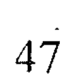
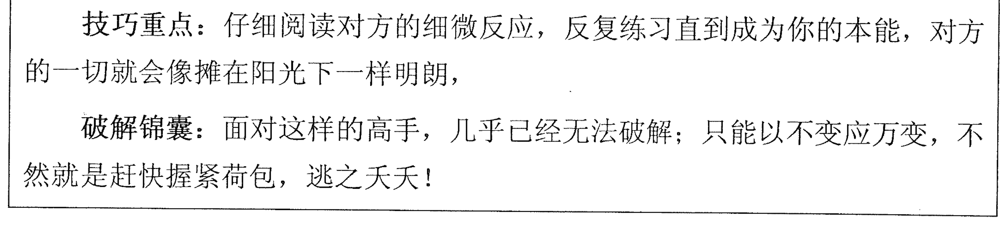
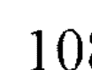

# 奸的好人24-小心你被催眠了

## 作者群简介

### 郑匡佑

现任成功大学管理学院体健所副教授，暨课外活动指导组组长，并为武术竞技电子审判枪发明人。因拥有物理、运动科学、机械航空等学位及多项运动教练证，并曾赴英国研习 NLP 潜力开发课程，于成大开授动作模拟、最佳化等研究所课程，及国术、国标舞、西洋剑体育课，与成功学、魅力学通识课。于学生眼中，有「百变教授」之称。

### 郑匡宇

台湾新世代激励达人、公关达人，曾出版《你就是自己的激励达人》、《就是爱被骂——史上最强被骂应对心理学》、《出位——硬要世界看重我》、《搭讪圣经》等十五本畅销书，讨论爱情、财富、事业、人际与社会影响力等不同层面话题。在人际沟通与演讲领域有特别突出的成绩。目前在韩国弘益大学教养科主任，同时担任全方位成功教育训练有限公司执行长，并于 2012 年与蔡英文、曾志朗共同受邀，担任成功大学论坛大师。

### 马大元

中华民国精神专科医师，曾为医师国考、公职医师高考及专科医师考试全台榜首，在医界号称「三冠王」。现任大千综合医院南势分院院长、社团法人新竹市精神健康协会创会理事长，长期耕耘基层医疗，为竹苗地区知名精神科医师。除精神医学本行外，对于心理治疗领域涉猎广泛，在传统精神分析、认知行为治疗等基础下，更勤习后现代、催眠、神经语言学、系统排列等各家之长，对于气功、禅修也颇有研究。平时将所学活用于临床服务、团体带领、教学演讲及自己的人生中，乐此不疲。

特别鸣谢天上京为《小心！你被催眠了！》互动电子书创作插图漫画，使得互动电子书增添了神采及不一样的阅读经验。

## 插图漫画师简介

### 天上京

匆匆短短岁月，饱历人间冷暖，多年寒窗埋没无闻，期盼他日绘笔震天下。造形艺术系毕业，擅写作及绘书。想做的事情很多，有完成的事情太少；总觉得时间跑得太快，银两又挣得太慢。希望未来自己出版的著作，能跟郑匡宇老师一样带给人们正面的能量，感谢郑老师给我在其大作上刊载拙作的机会。

合作信箱：rodyu2008@gmail.com

特别预告，敬请密切关注《小心！你被催眠了!》的脸书纸团公布电子书出版日期。

# 挑战人类自主意识的禁区

如果各位读者现在报了名，上一个催眠师证课程，你一定会听到这些传统催眠课程中总是一贯宣说的话——催眠师不能催眠你做出你不想做的事。

你不能催眠一个人去自杀，除非他潜意识中本来就已酝酿着自杀的动机。你也不能催眠女生在你面前脱衣服（希望男性读者先别那么快就决定不买这本书，呵呵），如果你真的能催眠一个女生在你面前宽衣解带，那是她本来就有潜在的（或明确的）欲望，想脱给你看。

催眠师无非想告诉你：「人是有自主意识的」。

但，我要告诉大家，上面这个说法有待商榷。

首先，催眠师说的那句，「催眠师不能催眠你做出你不想做的事」，主要是说给客户听的公关讯息。想象一下，如果你认为催眠师「能」使你做出你不愿做的事，你还敢来见催眠师吗？还有女人敢不穿贞操带，便接受男催眠师的治疗吗？

甚至有些催眠师认为，催眠师无法让你做出一些和你价值观有冲突的行为，这更是断章取义的说法。

相信大家都知道，身边一些朋友，一直以来的价值观都是不能接受婚外情，或不能接受自己成为人家的小三；但多少个「这些人」，能真正做到自己定下的道德标准？

多少个痛恨劈腿的人，最后这种事发生在自己身上时，都有一整套堂皇之、气吞天下的理由？

人没有什么厉害，人最厉害的就是能够骗自己

每个人都以为，自己的价值观都是从思考而来，殊不知大部分人的价值观，都是人云亦云。我和李民杰老师所写的《勾魂夺心洗脑催眠》一书中说过，这世界有 2% 的人是真正思考者，3% 的人以为自己有思考，其余 95% 的人，都是不喜欢思考者。试问这些属多数的「不喜欢思考者」，其价值观真是自己的吗？

一个价值观不明确的人，受催眠时，只要催眠师能够给予你潜意识足够的理由，那么，即使对于一件你平常不愿意做的事情，你也会很自然地妥协了。事实上，厉害的催眠师要让被催眠者脱衣服的方法有很多种，甚至可以要他们在苏醒过来后，依然保持裸体。

如果被催眠者知道自己裸体，是催眠师给了他足够理由使之接受可以在别人面前裸身。如果被催眠者不知道自己已经脱了衣服，则是因为催眠师给了他足够理由相信，自己其实还穿着衣服（恕我不说破其中玄机）。

在这里，我要告诉读者，催眠是个灰色地带的技术，就好像本书三位作者所提出的诈骗例子般，没有人是愿意被骗的，但当一些催眠技巧混在诈骗过程中时，就会提升了诈骗的成功率。

本书的特色，是作者们先从两个角度来解读催眠：帮人和害人。

帮人，是从辅导治疗角度来诠释催眠；害人，则是指诈骗手法中的催眠元素。然后，他们再从第三个角度来解读催眠：个人生活上的实际操作。

只从一个角度看催眠，会有以管窥天之嫌。

如果这是你人生中所买的第一本催眠书籍，从三方面来研究同一个课题：催眠，将会为你打开不一样的见地。

****

江健勇（江魔）——「奸的好人」系列书《勾魂夺心洗脑催眠》的作者之一，在亚洲掀起毒辣版 NLP 催眠影响学课程热潮的第一人。

# 想要学习催眠？先慢着……

坦白说，这本书所要教你的，不只是能够「操控人心」的技术——「隐蔽式催眠」。也正因此，在阅读本书的你，在应用此书所教授的技法之时，可更要谨慎小心。

想要学习催眠？先慢着……因为，有三种类型的催眠是你可以应用的：

第一类的催眠形态，是曾经在台湾的电视媒体上刮起一阵舞台催眠表演旋风的「舞台式催眠」，其代表人物即为大家所耳熟能详，来自澳洲的舞台催眠师马丁·圣·詹姆斯（Martin St. James）。这类形态的催眠，其特色为必须有特定的场所作为其娱乐效果展现的空间，并透过能辨识「被暗示难易程度」的「感受性测试」，从一群自告奋勇、想要上台表现的观众群中，筛选出容易被暗示、容易听从舞台催眠师指令的观众。接着，再将这群被挑选出来的「自愿者」留置于舞台上，担任该催眠表演秀的演出。因此这类催眠的主要功能，多着重于娱乐大众，带来趣味与欢笑。

第二类的催眠形态，其特色是以深究及疗愈身心的疾病，或解决意识层面之外的难解郁结，作为其主要功能的「治疗式催眠」。其中最让人津津乐道或话题不断且让人产生联想的，莫过于美国精神科医师布莱恩·魏斯 (Brian L. Weiss) 的前世催眠之系列著作。该系列著作之缘起，是他某次以催眠术帮助某个案回溯从前时，意外地引领了该个案进入前世记忆。他整理了治疗过程中的惊人发现，将之记录于《前世今生》一书中。据了解，该书的中译本，仅是在台湾就畅销数十万本，其引人注目之程度，由此可见一斑。而「治疗式催眠」的进行方式或形态，仍然有其特定的场所，以及制式的催眠治疗程序。

至于第三种可学习的催眠类型，则是威力甚大、应用范围甚广的「会话式催眠」（亦即本书所提及的「隐蔽式催眠」）。由于「隐蔽式催眠」没有固定的形态展现，因此你难以觉察；「隐蔽式催眠」也没有制式的施行程序，所以你难以设防。话虽如此，你却不难从《小心！你被催眠了！》一书中轻易地瞥见：世界上（古今中外）每一位兼具影响力与说服力的大师或专家，他们的言行举止里都有刻意或自然流露的「隐蔽式催眠」的痕迹。

要不然，你也可以从《小心！你被催眠了！》一书当中注意到，你的日常生活里那些展现如同「沟通魔法」般的讲师、政治家（政客）、业务员、作家，甚至是电视广播、报章杂志、网际网络、媒体广告、部落格、购物网站、社群网站、Email 营销等等，它们是如何有意无意地、直接间接地让你看到也听到，进而感受到「隐藏式催眠」的招式与效果，彷彿在对你眨眼，在对你呼唤，刻意地使你好奇、放松、紧绷或疑惑，同时还让你心脑分离、心猿意马、心神荡漾，一直到你突然一惊，方才从一个自设或他设的虚幻心境里回过神来……

行文至此，不禁想起这些年来，我在台湾亲自讲授的「NLP 与催眠」专业执行师的训练课程里，每当讲述到「想要学习催眠？先慢着……因为，有三种类型的催眠是你可以应用的……」的时候，总会希望能有一本专注于「隐藏式催眠」理论与应用的参考书，可作为学员们学习上的补充资料。而今日，终于看到了由三位专长各异，各有所「强」的作者群合力共著的《小心！你被催眠了！》一书，亦是华人世界介绍「隐藏式催眠」的第一本。在此，我除了要向我的学生推荐此书，也要诚挚地向着正在手捧此书，期许力求突破且不断自我超越的你致敬并提出邀请：欢迎你进入本书「隐藏式催眠」学习与应用的奥妙之旅……

****

Hogan Lee——华人 NLP 教育推广中心训练师

# 掌握催眠技巧，迈向人生高峰

「催眠」一直以来都是心理学领域中最为引人入胜的一个话题。对于许多人来说，催眠似乎带着一层永远拨不开的面纱，是如此的吸引人，却又如此的令人退却。近年来也有不少电视节目以所谓的「催眠表演」为收视率号召，观众往往被这些被催眠的演艺人员或是动物的奇特行动逗得哈哈大笑，深觉不可思议。因此读者们也许会认为催眠是一种哗众取宠的表演或一种高深的心理治疗技术，读者们可能都没想过：我们生活周遭充斥着各种讯息，不是正无时无刻在催眠我们吗？

在本书《小心！你被催眠了！》中，作者以十分生活化的案例，深入浅出地介绍催眠对于日常生活的影响。其中又以利用催眠作为犯罪手法的部分最具有警示作用。历年来的治安白皮书调查中，诈骗集团猖獗一直是民怨的前几名，接过诈骗集团电话的民众可能都有这样的经验：诈骗集团所使用的话术十分高明，很容易取得被害者的信任；甚至被害者在金融机构柜台前，还振振有词地帮诈骗集团的谎言美化，坚持相信诈骗电话是真的！在本书中，透过催眠的观念，清晰地揭开了诈骗集团的伎俩以及防范之道，其中许多案例的分享实令人拍案叫绝！

另外本书中也与读者分享如何运用隐藏式催眠的技巧来改善自己的生活、人际质量。其中利用隐藏式催眠来增进夫妻感情、教育子女，这些都能够大幅度地提高个人的生活质量。本书也介绍了隐藏式催眠在工作职场上之应用，能够将催眠的观点如此活用亦为本书的重要成果！不可可惜！

最后本书中探讨的催眠实际作法部分，除了让读者清楚了解催眠的各项步骤外，更能够让读者「知己知彼、百战百胜」，透过对于催眠技巧的了解，更能够让自己免于被负面讯息催眠的困境，熟悉催眠的 COVERT 技巧，更能让自己迈向人际关系、身心健康的高峰！

****

戴仲峰——中正大学犯罪防治学系暨研究所助理教授

# 作者序

## 揭开诈骗集团最高机密档案

——无所不在，害人不浅的催眠术

### 诈骗手段隐含催眠的成分

一年多前的某天，茶余饭后，好友们聚在一起聊天，也不知道是谁开始了这个话题，大家忽然一个接着一个分享起曾听过甚至亲身经历过的诈骗事件。一时之间，客厅变成演讲辩论会场，用百家争鸣来形容也不为过。正当大家热烈讨论哪一种诈骗手法最为巧妙的时候，一个低沉而清楚有力的声音，让所有人都静了下来。说话的人是实务经验丰富的精神科医师马大元：「大多数诈骗手法，多多少少都有催眠的成分在里面，才会这么容易得手啊！」这段话真的是一语惊醒梦中人。

「对啊！」我心想，自己学习 NLP (Neuro-linguistic Programming，结合神经科学及语言学，并主张人脑也可以像电脑一样改写程序，以产生想要的行为与结果) 这些年来，早就懂得运用当中一些技巧，可以在不知不觉中改变一个人的行为，但却从来没想到，这些方法可能早已被诈骗集团广泛应用，不晓得害了多少人！

这种在潜意识中影响他人的方法，也就是所谓的隐藏式催眠，在精神科与心理医师的眼中，是治疗行为异常患者的良方；但是对于另外一群没有良知的人来说，却是害人的利器。虽然隐藏式催眠的手段似乎充满了神秘感，事实上，平日生活中我们也常常受到它的影响，而不自觉。

> 隐藏式催眠既是治疗良方，也是害人利器。

## 恋爱，其实是你催眠了对方爱上你

你没看错！它的影响无所不在，只是大多数人从未认真留意这些手段而已。隐藏式催眠其实充斥于许多媒体广告、政客演说，乃至于一般人的对话与行为中，甚至我们本身，无意间偶尔也会不小心用上几招。例如对异性展开追求的过程中，也许大多数情况下会碰壁，但有时候，对方似乎完全跟着你的节拍走，莫名其妙爱上了你，让你心里一阵窃喜。你认为这单纯只是因为运气，忽然间爱神就降临了吗？其实这应该就是我们在无意间，透过语言、肢体动作和想象连结，把对方给催眠的结果。

可惜的是，在整个华人世界中，隐藏式催眠是仅仅被极少数人把持的绝密技巧；更可怕的是，在这些少数人当中，有许多是唯利是图的奸商，或无恶不作的诈骗集团成员。水能载舟，亦能覆舟，这样的技巧若只有坏人知道，岂不是为虎作怅？我们的目的，就是希望透过这本书，将隐藏式催眠的秘密公诸于世！

我们写这本书的时候，有某些朋友以一种怀疑的眼光质疑，书本内容曝光了诈骗集团的最高机密，会不会使更多人学了之后，用来诈骗其它人，反而造成社会更大的动荡不安？

事实上，会有这种想法的朋友们太多虑了！这就像武功招式一样，即使我将所有最惊世骇俗的武林秘籍公开，也不可能每天都有人在街头以降龙十八掌来杀人吧？在这个信息发达的年代，虽然练武之人比从前多了不少，但绝大部分是为了健身防身；更何况，在民主的社会，当知识越是开放流通，民智大开，社会也越能避免许多不幸的诈欺悲剧，这也是我们写这本书的目的。

> 俗语说，「明枪易挡,暗箭难防」,隐藏式催眠可以变成诈骗集团最犀利的害人「暗器」。既然如此,何不将之普及化,使它变成人人可用的「明枪」?!

开始构思这本书之前，我们曾经仔细搜寻访间是否已经出版过相关书籍。结果发现，虽然有些书籍标榜可以将催眠结合说服、营销，甚至勾男把妹术，但多数似乎只是书名噱头，用来吸引人们的目光（这当然也算一种催眠，只是不知成效如何），对于隐藏式催眠，缺乏比较详实且完整的叙述。而国外，即使有一些系统化介绍隐藏式催眠的电子书与有声书，却大多流于艰涩难懂，也没有适合华人国情的相关实例，让人读了之后，仍然难以掌握隐藏式催眠的精髓。

而在这本书里，我们去芜存菁，以简驭繁，将隐藏式催眠的理论，用小学生程度都能懂的方式来分享，并结合许多大众耳熟能详的实例，相信若有曾经不经意使用过这些招数，而得到意想不到结果的人，应该会露出会心的微笑；而有被类似方法诈得手这种惨痛经验的人，一定更有恍然大悟的感觉，可以防止类似事件再次发生。

正如同练武的目的是健身和防身，我们传授隐藏式催眠的用意，也是为了让训练思虑，和预防诈骗。因此，这可说是一本防骗圣经，也可以是从

事销售工作的一线业务人员，最应该入手并奉为主臬的销售圣经，端看你如何运用手中的绝佳工具。希望日后每一位读者，当面对一些诈骗或销售技巧时，都能知其然，更知其所以然，一切尽在掌握之中，而不致于被人牵着鼻子走，更能够当机立断，做出最佳的应对方式！

郑匡佑，成功大学副教授
武术竞技电子审判枪发明人

## 震撼警察大学教授、内政部部长秘书以及现役警察的催眠天书

完成这本书以后，如果要我发表什么感想，那么我想，说的是：它真的威力无穷，而且，不仅看的人会被勾魂和催眠，其实在制作的过程中，书写的人也不知不觉地被催眠了！

为何我会这么说呢？

因为，这本书的缘起，一开始真的不过是郑匡佑博士个人研究的兴趣罢了。研究着研究着，他认为有这个必要，将隐藏式催眠对社会大众做一个详尽而完整的介绍，又为了丰富内容，增加专业性和学理性，于是找了他的高中好友，现任大千综合医院南势分院院长暨精神科医师马大元先生共同执笔。

专业性和内容的部分扎实了，更重要的是它的可读性与市场接受性。郑匡佑博士认为，如果站在巨人的肩膀上，一定能看得更高更远，找一个原本就是畅销作家，特别是一位经常「不知不觉中」不断使出隐藏式催眠招数来吸引读者购买他所有著作的人，岂不是更能引爆这本书的话题性和畅销度呢？正是由于这个原因，他找上了人称「搭仙教主」与「激励达人」的我，共同完成了这本坊间独一无二的著作。

但大家有没有想过，光靠着高中同窗这样的情谊，就能打动马大元医师吗？光靠着兄弟间的关系，就能让我也愿意共同「下海」，挑灯夜战，牺牲自己的玩乐和休息，不定期与另外两位作者开会，只为了出版一本书吗？

当然不止是这样而已。郑匡佑博士在诱导我们加入写作群的同时，也对我们使出了隐藏式催眠的技巧，我们也是写着写着，才发现自己「上当了」！

郑匡佑博士最厉害的招数，是在一开始的时候，便找到另外两位作者欲望的源头，然后加以刺激，手法有点类似书中介绍的讯息过量法！

对于马大元医师而言，早已五子登科的他，写一本书能带给他的金钱，完全不是他所考虑的重点。要吸引这样的对象，就非得找到他所没有或者渴望的源头。郑匡佑博士适时用两个理由打动了马大元，第一个理由是「坊间还没有这样一本介绍隐藏式催眠的专书，我们先写先赢啊！（激起马医师那种想赢过别人也超越自己的虚荣心）」以及「我们两个人的专业背景和知识，远远超越了其它书写类似读心术的作者们，介绍的东西，也能帮助更多人，何乐而不为呢（诱使马医师发挥能帮助别人的大爱心）？」于是，靠着这两个马医师最想要的重点，突破他的心理防线，使得马医师义无反顾地加入了写作的行列。

而我郑匡宇，又是怎么被郑匡佑博士的讯息过量法给震慑的呢？

郑匡佑博士不断地告诉我，想要成为全方位激励大师，就要透过不同层面吸引读者来接触我的东西。我过去一些两性，情绪管理和自我激励的主题固然很「吸睛」，但有些人就是对于商业谈判、心理学的东西更有兴趣，对其他主题的书籍兴趣缺缺。唯有把我写作的广度加以扩张，才能将宣传的效果散布出去，而这样一本结合了心理学和商业销售的书籍，岂非最好的工具和切入点？他顺利得用一个我自己给自己建构的蓝图和梦想，吸引我加入书写这本书的阵容。这种针对不同人的不同背景和需求进行勾魂夺心的技巧，是每个在职场打滚的人士都该学会的功夫。

其实我觉得他使出最有用的一招，还是在于那「自己不顾一切先去做，等做出一点成果后，别人看到了，自然就会知道你是玩真的，也愿意跳下来一起淌这滩浑水」的精神！大家想想，若是郑匡佑博士一开始的时候只是嘴巴喊一喊，要其它两位作者先写这写那，自己却连一篇东西都交不出来，本来就觉得事不关己的我们，有可能积极参与，把这本书的内容不断加油添醋、一改再改只为了好上加好吗？

因此我认为，当你想做一件事，而又希望其它人都来帮助你 的时候，找到能够吸引别人加入的观点固然重要，自己先做一些事情，让人得以锦上添花，更加重要！这本书在我们三人的协力下，耗费近两年的时间完成，其中理论有据、简单明了、案例精彩、旁征博引，比起坊间类似读心术或冷漠术等主题的著作，讨论更加深入，也更贴近时事，相信每位读者都能对里面提到的例了感同身受，并且在经过分析提点后豁然开朗，以后面对类似手法时不露声色，一切了然于心，而在需要销售或者收服他人时，又能妥善运用书里头介绍的技巧，达到绝对成交、事半功倍的效果。

如果你看过类似的著作，甚至上过关于催眠及销售话术的课程，却觉得艰涩难懂、发挥不易，看完这本书一定能将你原本不甚了解的问题，做一个全面性的解答。这也是由于本书三位作者，包括我自己，都不会在书写的时候「留一手」，出版一些不清不楚的东西，只希望吸引读者们来上课，然后「同一只羊剥好几次皮」。我们的理念是，让知识广泛地流通，才能使这个社会更进步也更和谐，并且在阅读的过程中刺激读者不断思考，养成他们遇事胸有成竹、临危不乱的自信与镇定。

这本书在即将付梓的同时，为了扩大它的宣传效果，亦寻找了有力人士及专业学者在阅读后进行推荐，其中有警察大学教授、内政部长秘书以及现役警察等，都认为这本书提到的知识和技巧，清楚明白又简单有效，对整个社会能起到正面积极的影响。期待您也能妥善运用这本书所揭露的观念和技巧，让自己的人生更丰富、更精彩也更有趣!

\*\*\*\*\*

郑匡宇，韩国弘益大学汉语教授
泰国国立发展管理学院教授
全方位成功教育训练有限公司总经理

## 你不知道也看不出的催眠术

### 人人生皆有催眠、被催眠的能力

进入二十一世纪，不但经济呈现 M 型发展，道德人心亦有 M 化趋势。

有像菜贩陈树菊阿嬷这样不求一己温饱，长年辛勤工作，却将所得尽数捐出的慈善英雄；却也有更多一心想要不劳而获，处心积虑谋夺他人血汗积蓄的诈骗集团份子！身在台湾，我想没有人不曾接过诈骗电话吧？其频率之高、受害者分布之广，令人不禁感叹：这个社会是不是生病了？

人是群居动物，群居动物的团体中，自然会有领导者及跟随者，才能正常运作。领导者是少数，跟随者则占大多数，反之势必天下大乱。换句话说，世界上有少数人善于影响别人，大多数人则善于「被别人影响」。

善于影响别人的人，以其天生特质，形成一种群众魅力。善加利用，可以成为明星、政治家、改革者、企业家、销售冠军；用在恶的一面，就是诈骗集团首脑、奸商、独裁者、邪教领袖。这样的人，在人生早期，就发现自己对于身边的人，包括父母、兄弟姊妹、师长、同侪等，都有莫名的吸引力与操控能力。影响力之大，和其接触的当事人甚至会短暂进入一个恍惚（摸不着头绪）、缺乏抵抗（容易接受暗示）的状态，这就是典型的出神(trance)，亦即被催眠的状态。天生拥这样的能力，很难克制自己不去一再使用。反复磨练下，技巧越发熟练，影响力也会变得越发强大。

> 少数的精神领袖，之所以有挡不住的魅力，都是因为在与大多数群众接触时，让对方进入抵抗力低，容易被操控的催眠状态。

其他多数的人，善于「被影响」。这个概念也许大家不太能接受，毕竟人们都相信，自己没有这么「傻」；事实上，这跟聪明或傻没有关系，而是人的天性使然。

女性朋友们，谁不想拥有玲珑有致的身材？想一想，这样的价值观是从哪里来的？

「瘦」真的是自己想要的吗？如果我们生在大唐盛世，或是太平洋上的一些岛国，反而会根深蒂固认为胖才是美吧！所谓的美丑，与其说是自己的价值观，不如说是深受他人影响的结果。

## 揭开隐藏式催眠影响力的神秘面纱

在台湾社会，人们多少会有偏蓝或偏绿的政治倾向，少数人更拥抱著深蓝或深绿的政治立场，如果遇到立场与其不一致的人、事、物，就会十分不悦，甚至大发雷霆！但是想一想，蓝、绿阵营的主张，甚至蓝或绿执政，对生活实际的影响到底有多少？生命中的幸与不幸，有多少是蓝或绿的执政直接造成？

你会发现，影响我们生命质量最深的人，不是别人，而是自己。谁来执政，对我们的影响并不如想象中来的大。如此强烈的政治信念，其实不是自的，而是「被别人影响」、也就是「被催眠」的结果。

再举例：每个人都曾有这样的经验，为了别人的一句话而情绪波动，生气、难过，甚至晚上还因钻牛角尖而失眠。夫妻、婆媳、公司或班级里的死对头之间，都常发生这样的事。事实上，一句话只是空气分子的震动，完全一样的言语，可能曾在电视剧、电影中听过，为何当时不受影响，而听到特定人士说出时，反应却如此巨大？

所以说，你不得不承认，人会「选择」被别人影响；换句话说，大多数人是善于被别人影响、也就是「善于被催眠」的。因为，扮演一个好的「被影响者」或是「跟随者」，在进化上，有助于融入群体之中，并且获得最重要的回馈——归属感。

群居动物的天性，来到现今社会，遭到有心人士的滥用。最擅于影响别人的人，可以轻松操控最容易受影响的人，难怪诈骗集团得手的案例时有所闻、诈骗歪风难以遏止，且有越演越烈的趋势。

一句话只不过是空气振动的分子，人之所以被影响，完全是因为我们选择被施术者催眠。因此，你现有的信念和价值观，有可能是被催眠后所产生的。

除此之外，社会上也有许多技巧高明的营销大师，善于使用在不知不觉状态下影响别人的手法，他们即是「隐藏式催眠」的高手。如房屋中介、汽车销售、保险、直销等领域，都有这样的人才；也许是天赋异禀，有的是后天努力学习的成果。虽然这是一个让人成功致富的快捷方式，所做的也不是伤天害理或是犯法的事，但消费者却容易在被催眠的状态下，增加不必要的开支，或做出会后悔的决定，不可不慎重！

不论你相不相信，「隐藏式催眠」的深远影响，早已充斥在我们日常生活中；如果你还不了解、不熟悉，不知道如何保护自己，或利用隐藏式催眠的技巧帮助自己，那你就严重落伍啰！

无论你是否愿意、同意，其实你都活在被催眠的世界中。你要不掌控了解这种技术，要不任由催眠摆布你的生活。

本书是华人世界第一本公开「隐藏式催眠」秘密的专书。不但大量运用实例，揭露隐藏式催眠的完整技巧，也说明快速学会隐藏式催眠的步骤。最后更介绍隐藏式催眠在职场、学校、家庭等各个领域的正面运用。所以不论你是想要提升觉察力、避免被诈骗或受到有心人操弄，或是想要学会隐藏式催眠技巧来改善人生，这都是你一定需要的入门书！

## 匡佑、匡宇兄弟与我

我与匡佑、匡宇相识二十多年，他们两人虽是兄弟，才学与性格却大不相同。

哥哥匡佑苦学实才，兴趣广泛，能文能武。不但读书有成、做学问厉害，也喜欢参与公众事务，更擅长国术、跆拳道、体操、国标舞、西洋剑等体育项目，将有限的人生做了最大的发挥。他跟我一样，读书从来不补习，自动自发，不让爸妈伤脑筋。匡佑于台湾第一学府毕业后，通过素有「世界最难考试」之称的公费留学，留学美国七年，拿了两个硕士、一个博士；回国后任职国立大学，也在短时间内拿到部订副教授资格。

匡佑博学多闻，虽然主修理工，却始终对心理与行为科学领域有深刻的兴趣。他从研究神经语言学、催眠，到隐藏式催眠，以做学问的精神，饱览中外书籍与文献资料，加上长年参与各式课程、研讨会与工作坊的经历，在本书中，他将隐藏式催眠为国人做了最好的呈现。

弟弟匡宇则不用多作介绍，年纪轻轻，却已著作等身，以「全民搭讪运动」一书一炮而红，成为华人世界的「搭讪教主」。对于匡宇，以及他的事迹，最好的诠释摘录自网络：「一个念舞蹈却不走舞蹈教学的舞蹈博士，一位讲两性关系但实际是谈自我提升的激励大师，一场好似教人把妹，其实是为了认识自己的奇异旅程……」

匡宇除了拥有「搭讪教主」的地位，还有两种让人最为印象深刻的特质：一是，他与哥哥一样，是我所认识的人当中，最为正向积极的；二是，他有着过人的学习与执行能力。早从少年时期，看他模仿刘德华、王杰、殷正洋等大明星娱乐亲人；到之后看他快速完成名校博士学位、熟练英、日、韩等多国语言，一本接一本地写书、大量公众演说与开班授课、开公司、到异国教中文、搞营销商务等，仿佛世间所有的挑战，到了他手上都只是小case。「搭讪教主」的绝招，有许多都与隐藏式催眠技巧相通有匡宇的跨界相助，相信本书一定精彩可期。

匡佑、匡宇兄弟在生命与事业上的成功与精彩，也可以说是运用隐藏式催眠来提升自我、激励他人的亲身示范。

而我则是医学院毕业后，在八十七年的医师国考、高考中，获得双料状元。我们都不是顶聪明的人，却在求生生涯中，逐步抓到读书与考试的技巧与秘诀。所以当匸匡佑找我写书时，找还以为是耍造福莘莘学子，写一本如何读书和考试的书；也许，我们的亲身经历，可以成为下一本书的好素材也说不定。

我是一名精神科医师，除了涉猎医药的领域外，对于如何以心理学技巧帮助他人十分着迷。我发现，所有的心理治疗大师，不论其学派为何，其神奇的助人技巧多少都有催眠的成分在内。不论是以其权威的形象、低沉的嗓音、特殊的肢体动作、深层的同理等，都能让当事人进入一种出神、专注、充分开放的状态，因此，接下来的治疗就十分容易进行了。这也是为什么多数的后世助人者，虽然苦心钻研心理治疗的理论与技巧，却无法复制出大师神奇疗效的原因。

其中，我最敬佩的心理学家（也是一位精神科医师），就是现代医学催眠之父米尔顿·艾瑞克森(Milton Erickson)，他同时也是一位隐藏式催眠的大师，艾瑞克森所常用的技巧，在本书中有详尽的介绍。

很高兴受到匡佑的邀请，参与这么特别的一本书的诞生。从最初提供专业意见，到后来加入写作，我原本是个不喜欢下班后还有作业的人，但为了这本书，却不由得竭尽所学、欲罢不能，常常在计算机前敲敲打打直至凌晨。我想，我也被匡佑的隐藏式催眠所影响而转性了吧！

为了不负读者所托，让本书更加充实、精彩，匡佑数十次远从台南北上苗栗，与我讨论书籍构想、内容编排，以及最完美的呈现方式。与匡佑、匡宇兄弟、编辑意薇及李民杰大哥，也曾不下百次，用 E-mail 来回交换理念与段落增减。期间也曾有不少专业方面的辩论与争执，其中的甘苦成为最美好的回忆。

期塑本书能带领读者，一探隐藏式催眠的奥妙，将书中技巧加上自己的创意，充分应用于人生各领域，活出艾瑞克森的终身理念：享受生命！

\*\*\*\*\*\*

马大元，阳明医学院医学士
中华民国精神专科医师
三军总医院精神医学部主治医师
国军新竹医院精神科主任
社団法人新竹市精神健康協会創会理事长
现任大千综合医院南势分院院长

## 被下了降头还是被催眠了？

收到这本书的初稿进行编辑时，以为这只是一本教你怎么防诈骗的工具书，也自认有足够的聪明智慧去对付诈骗分子，因此认为这本书的内容对我帮助不大。

谈起「诈骗」，我总会想起母亲至今偶尔仍会说起，发生在二十多年前的一件事。那是一个平常的下午，父亲还没下班回来，只有母亲在家照顾年幼的哥哥和我。有两个年轻女子来敲门，母亲看出她们是推销员，在她们开口之前就连忙摇头说不。后来母亲觉得她们在烈日下逐户敲门推销产品很可怜，就让她们进来坐坐，请她们喝水。「然后我就傻傻地拿钱出来跟她们买了一套昂贵的厨具，不知道是不是被下了降头（东南亚一带流行的巫术）。」母亲总会下这样的结论，她说至今想起来仍觉得很可怕。

那套昂贵的厨具后来很快就被母亲丢弃了，因为是质量低劣的产品，一点都不实用。长大后，「被下了降头」和「不够聪明」就成了我对那些诈骗案受害者的唯一解释。直至看完《小心！！你被催眠了！」这本书，我才开始醒悟，母亲当年并不是被下了什么降头，而是应该被那两位推销员以隐藏式催眠的方法影响了。

催眠对我和大部分的人来说，都是非常神秘的，实行催眠或被催眠都不可能在我们的日常生活中出现。若非这本书揭开了许多诈骗集团不为人知的秘密，可能很多人还不知道隐藏式催眠的强大威力，继续沦为诈骗案的受害者。

我是一个不喜欢看工具书的人，总觉得工具书很沉闷，有很多艰涩难懂的理论。在编辑这本书的时候，却意外地发现内容非常有趣，尤其是三位作者用了很多生活中的实例来解释学术理论，让读者能以轻松的方式深入了解更多有关隐藏式催眠的技巧。

《小心！你被催眠了！》揭开了隐藏式催眠的神秘面纱，对我而言，最大的收获也许不是学会了如何防范诈骗集团，而是学到了如何使用隐藏式催眠改善自己的人生。过去我总认为催眠是一种很不可取、很可怕的「手段」，可是这本书完全改变了我的看法，也让自己在面对问题时多了一种有力、正面的处理方式。

我深信这本书一样也会改变你许多想法，给予许多改善人生的积极建议和既可行又有效的方法。趁身边的人还对隐藏式催眠懵懂不知的时候，赶快成为率先以隐藏式催眠影响他们的人吧！

\*\*\*\*\*\*

梁意薇

# 第一章 你对催眠的认识，可能是错误的！

## 催眠术的四大迷思

正如序言里面介绍的，这本书，是华人世界中第一本完整揭露「隐藏式催眠」这种诈骗与销售绝密伎俩的专书。由于大多数人对什么是催眠还存有很多误解，因此似乎有必要先做一次观念上的理清。

## 迷思一：被催眠后会进入睡眠状态？

很多人以为，被催眠后会进入睡眠状态，其实催眠与睡眠并没有什么直接关联，甚至可说有很大的区别。催眠术通常要在对方清醒的状态下进行，如果睡着了，反而无法接受催眠师的任何指令。催眠之所以常被拿来与睡眠相提并论，主要是它的英文 hypnosis 这个字，起源于希腊神话的 Hypnos（睡神），因此让人误认被催眠就等于进入睡眠。另一个原因是，这两者都不是由清楚的自我意识所控制，而是进入一种类似「无意识」，或所谓「潜意识」的状态，所以大多数人把两者当成是非常相似的东西。

传统的催眠，大多由专注与放松导入，当事人会被催眠者引导收敛心神，放松呼吸与肌肉，此时双眼通常也会不自觉闭起，所以会给人「催眠是要让对方进入睡眠状态」的错觉。事实上，催眠与睡眠，甚至梦游，均是大不相同的，被催眠者通常于过程中是清醒的；尤其本书将要介绍的「隐藏式催眠」，甚至可以在当事人充满防备心、高度警觉的状态下，将当事人催眠！相信大家对于即将在华人世界首次完整揭露的隐藏式催眠术，一定充满好奇吧！

另外，被催眠的人，受催眠指令的影响，部分感官与功能会十分迟钝，甚至被「关闭」，其它感官与功能却会异常敏锐或旺盛！例如在典型的「僵直催眠」中，被催眠的人全身会直挺挺如同一根木柴，甚至别人站在他肚子上，也不自觉。这时，大脑中感受肌肉张力及酸痛的感觉皮质被关闭了，下达命令让全身肌肉同步出力的运动皮质却异常兴奋。清醒的人，是无法靠意志力同时动员那么多块肌肉，且持续这么长时间的。而这也是催眠最迷人、神秘的地方。

## 迷思二：实施催眠术需要特定场所、道具或程序吗？

催眠术的实施，无需任何特定场所，也不一定需要使用任何特别工具。也就是说，不用像大家在电视节目里所看到的画面那样，台上催眠师一副莫测高深的神情，规律摇晃着手表或项链；也不用叫人闭上眼或躺下来，一样可以进行催眠。

而且，不是一定要由外人才能进行催眠，大多数人本身，即有程度不同的自我催眠能力！医学上，有两种状态与深度催眠颇为类似，一种是解离 (dissociation)，一种是转化 (conversion )；两者都是人们无法因应强大压力时的一种自我防卫机转。

解离症，是指遭遇重大创伤后，心因性地丧失部分记忆，甚至遗忘自己的身份，小说、电影、连续剧中常见到这种情节。转化症，则是选择性的感觉或运动功能失常，例如太目目瞎先生外遇后，突然失明（潜意识：眼不见为净）；争吵中被仇人推了肩膀一下，手臂就瘫痪了（潜意识：我想要攻击回去，但是碍于现实不能这么做）。解离与转化，都是心因性的潜意识作用，当事人在意识层面不知为何如此，且无法自我控制，这与深度催眠的现象颇为类似。事实上，神经生理学如脑波等研究，发现二者确实有共通的机转。

在助人性或治疗性催眠中，当事人是抱着求助的心情前来，且通常须付出相当的金钱或交通、时间成本，所以拥有颇高的动机，以及对催眠者的信任。而舞台表演性的催眠中，「催眠大师」通常会做好前置作业：即筛选出最容易接受暗示的，或本身性格即较戏剧化的观众，上台表演；且大多数观众也容易屈服于「催眠大师」的权威与魅力，或是早已受舞台情境及群众热烈的气氛所催化，很快就会进入催眠状况。

由此可知，在诸多因素影响下，助人或医疗性催眠及表演性催眠的神奇效果，虽然让人们叹为观止，事实上执行起来是相对较容易的。相反的，隐蔽式催眠须肩负起吸引注意、解除心防、提升动机，及在有限之时空状态下引导当事人进入催眠状态的挑战，其难度与技巧性是更高的！

## 迷思三：催眠师可以完全控制人的心理和行为？

许多人以为，催眠师可以完全控制对方的心理状态与行为；其实这是不

可能的。在实际操作上，催眠师只能使对方「容易接受」自己所给予的指示，但却无法令被催眠者做出完全违背本身意愿与良知的事。

更深入探讨的话，就涉及人的心智结构。大家都知道，人有意识及潜意识，其中潜意识的影响力，大过意识。在浅度催眠的状态下，人的意识仍能正常运作，亦即仍有是非判断的能力。当事人之所以愿意被催眠，是因为意识层面相信：遵从催眠的指令，对自己是有帮助的！

此时，若遵从催眠指令的结果确实让自己更舒服，或免除了痛苦，当事人就会更加信任催眠师，进而愿意进入更深度的催眠状态。而在深度催眠中，意识（即理性）的掌控权，可以经由催眠师的指令而逐渐解除，此时潜意识的影响力就会释放出来。所以即使意识上觉得不合理的催眠指令，也会依着潜意识的标准去做哦。

以华人世界常见的起乩仪式为例，即使意识上，人都知道无论如何不应该伤害自己，但是进入类似深度催眠的潜意识状态时，当事人会深信神明的庇佑，而不怕以法器伤害身体，同时潜意识亦适时发挥它的强大功效，关闭痛觉神经，并控制法器击打、穿刺身体的力度，不致造成重大伤害。

所以，要以催眠控制一个人去做出意识、潜意识都无法接受的事情，是不太可能的。譬如：催眠一个善良的人去杀害别人，是不可能做到的；但若真的发生，则可能代表当事人潜意识中早有杀害人的欲望，只是被催眠者释放了出来。

话虽如此，经由高手精心设计的隐藏式催眠步骤，还是可以一步一步引导对方，在糊里糊涂的情况下，做出头脑清醒时不会做的事。例如莫名其妙爱上原本看不上眼的人，或是听从对方的指示，而汇出了毕生积蓄；这真的可说是影响人最高明的手段！

## 迷思四：催眠可以操控人的记忆？

人们每天一张开眼，各种视觉、听觉、嗅觉、触觉、味觉的讯息就会大量涌入，而日常生活中，大事小事何其繁杂琐碎，长年累积下来，再大的数据库也装不下，大脑也随时可能被蜂拥而入的信息轰炸到抓狂。所以，大脑每天不断执行的重要任务之一，就是「选择性记忆」及「选择性遗忘」：专注于少数重要讯息，并将大多数不重要的讯息忽略。但是，被忽略的讯息，仍储存在潜意识中，只要善加引导，就能被唤回。

催眠便是唤回被遗忘（其实是被忽略）之记忆的有效方法。例如，请一个人回想每天上下班的路程中，会经过多少家便利商店？大多数人通常一时无法回答，但在催眠状态下，却可轻易一一数出。催眠对于记忆的影响力是非常大的。

另一种状况是，对于部分过于痛苦的记忆，大脑会进行一种保护机转，主动将这段记忆隔离，这常发生在经历虐待或性侵的幼童身上。幼童通常可在事件后快速转移注意力并复原，甚至不记得发生了什么事；但创伤事件的影响力将延续终身，通常在青少年或成年后，开始接触异性时显现，会发生莫名的自卑，及严重的情绪与互动障碍。

有人主张，运用催眠唤回被遗忘的记忆，可做为司法案件之佐证；但是，长年的研究却发现，人的记忆是极其不可靠的，常加入许多当下的主观成分在里面，且会被电视、电影、小说、网络等外来素材所污染。所以，若是在催眠当中回想起小时候的遭遇，有可能是一个「创忆」（创造出的记忆），而非真实的记忆。

另外，很多人以为，被催眠的人醒来之后，会完全忘记当时发生过的事。而事实上，在催眠过程中的所作所为，通常可以被清楚记得。如果忘记了，应该是因为催眠师在被催眠的人醒来之前，还下了一个遗忘这段过程的指令，但这种做法，通常要在非常深度的催眠才有办法做到，而且也需要当事人本身潜意识的协同作用：相信忘记这段记忆对自己是有帮助的。事实上，这些记忆并不是真的全然被遗忘，经由相反的催眠程序，通常又可以唤回。

在深度催眠中，甚至可以植入不存在的记忆。例如在助人催眠中，可以植入与过世的亲人重新和解，甚至沟通、拥抱的记忆，达到抚平创伤，解脱心灵枷锁的功效。由此可知，虽然催眠并不像许多人想象的那么神奇，却还是有非常强大的力量。但被有心人滥用，后果简直不堪设想！

## 本章摘要

- 神秘、富有戏剧性，这是大部分人对催眠术第一、甚至唯一的印象。普罗大众甚少认知催眠术，而他们仅有的认识，又有绝大部分是错误的。
- 催眠非但无需将对方引入睡眠状态；厉害的隐藏式催眠大师，还可以在当事人充满防备心、高度警觉的状态下，将人催眠！
- 实施催眠术也无需任何特定道具及场所，更不一定要由自己以外的他人来进行，每个人都拥有将自己催眠的潜力。
- 另一方面，威力强大的催眠术虽无法完全控制对方的心理状态与行为，却能够对人的记忆产生极大的影响，如果不慎被有心人士操弄，后果可能会非常严重，因此，正确认知及掌握基本催眠技巧，可说是每个人的必修课。

## 第二章 催眠可公开也可隐藏？

排除一些对催眠的误解与迷思之后，接下来我们要问，到底什么才是真正的催眠呢？

正如前文所说的，催眠与睡眠并没有什么直接关联。被催眠的状态，可以说像是在发呆、放空、做白日梦，或者非常陶醉于某种事物而心无旁鹜的状态。从英文字面上来看，描述催眠状态常用的「trance」这个字，通常被翻译成「出神」，但我们在此，半开玩笑把它翻译成「蠢事』：进入了催眠状态的人，等于进入了一种容易做「蠢事」的状态！换句话说，也就是一种容易听从他人指示的心理状态。

> 进入催眠状态的人，比较容易听从他人指示，做出「蠢事」。

这些心理状态，看起来似乎不尽相同，但都有一个共同特点，就是身心活动从意识主控，转由潜意识主导。在这种状态下，会暂时失去对时间与空间的认知，例如：催眠当下，忽然回到小学毕业典礼时的大礼堂，一切感知都身历其境；但等到催眠结束，回过神来，会惊觉时间怎么过了这么久，或只过了一下子。接下来，让我们仔细探讨这种催眠状态完整的理论背景和操作实例。

### 隐藏式催眠 V.S. 公开式催眠

催眠的历史相当悠久，可谓自有类聚落以来，就已有催眠。原始部落的巫术，就是一种最古老的催眠；借由各种神秘的仪式，与声光、气味甚至迷幻草药的刺激，让人们陷入一种恍惚、极易接受暗示的状态，达成治病、欢愉、激励或是体验圣灵的功效。

十八世纪，欧洲人开始正式将催眠带入医疗领域。虽然亦曾经历一段误解与黑暗的时期，例如以为催眠效果是「动物磁场」所造成等等，但最终得以用科学的方法，探索催眠的机转、效果与适用范围。心理学大师佛洛伊德，本身虽是一个不太成功的催眠者，但他对于意识、潜意识及本我、自我、超我等方面的研究，正可用来解释催眠背后的原理。

现今的神经生理学研究，亦逐步揭开催眠的神秘面纱，将催眠逐步导入正规医疗领域，造福更多手术、医药或是传统心理治疗无法帮助的身心病痛患者。

对于什么是催眠有了比较正确的理解之后，我们就可以开始解释催眠的两大分类，即公开式催眠和隐藏式催眠。这两种方式若实施成功，都能达到影响人心，甚至控制行为的效果，然而，隐藏式催眠却可能比传统的公开式催眠具有更大的威力。为什么呢？要了解为何隐藏式催眠的威力如此强大，我们得先了解公开式催眠，以及它的一些限制。

## 传统用于治疗的公开式催眠

所谓的「公开式催眠（overt hypnosis）」，也被称为「传统式催眠（conventional hypnosis）」或「标准催眠（standard hypnosis）」，有明确的催眠者与当事人（被催眠者），双方都了解自己的定位与彼此的关系。通常是当事人向催眠者求助，以解决心理的困扰或是一些坏习惯，例如增进自信、减轻心理创伤、戒烟、减重等。

催眠者会先与当事人会谈，或做一些小测试，初步建立信任，并了解其身心状况、问题来源及受暗示性等。之后妥善安置（setting）环境与当事人，例如在安静、灯光柔和的房间，让当事人或坐或靠在舒适的躺椅上。然后会依照一定的程序，引导当事人放松，并逐步进入催眠状态，于催眠状态中探索隐藏的压力或创伤源头，释放压力，并视需要，于潜意识中植入有益于当事人身心健康的指令。

传统式催眠其中一个最大的问题是：它是公开让人知道的。这对一些寻求心理治疗，或想以催眠减低生理上痛苦的人，当然无妨，更完全不会产生任何抵抗心理，因为他们本来就有问题需要解决，再基于对催眠师专业上的信任，而心甘情愿接受催眠的建议跟指示。但是一般人可就完全不同了，正常情况下，没有人愿意当个受人摆布的傀儡；当知道有人想要以催眠或洗脑的手段来控制自己时，想当然你绝对是避之唯恐不及。再加上不相信催眠的功效，以及一些既有的错误观念，或是对催眠师不信任，自然会产生强烈的抗拒心理。在这种情形下，再优秀的催眠师也无计可施。

反观隐藏式催眠，运作的方式则完全不同！实施者可在对方不知情的状况下，展开催眠的手法。表面上，完全就像平常聊天一样，所以当然不会让人产生任何抗拒的心态。这背后最重要的原理，就是突破或者绕过一般人意识上的心防，直接影响人深层的潜意识。

## 让人不知不觉做出蠢事的「隐藏式催眠」

相对于一般明显而公开式的催眠，隐藏式催眠的英文是「covert hypnosis」，也被称为「hidden hypnosis」，或者叫「谈话式催眠（conversational hypnosis）」，甚至被叫做「地下催眠（underground hypnosis）」。

隐藏式催眠这种治疗模式，始于现代医学催眠之父米尔顿·艾瑞克森（Milton Erickson），但是「隐藏式催眠」这个名词，则应该是他的弟子或追随者发展出来的。顾名思义，隐藏式催眠可以隐藏在一般的对话之中，使人不知不觉被催眠，而「莫名其妙」接受了对方的建议或指令，进而产生行为上的改变。这种受到隐藏式催眠而产生的改变，会随着时间逐渐恢复，除非有人不断在身边强化建议或指令，否则效力绝对无法持久。

有趣的是（甚至应该说可怕的是），这些受到隐藏式催眠而有所改变的人，因为感受不到任何明显的催眠手段，通常白天失口否认自己已经被催眠或影响了，而坚决相信自己是本身决定要这样做。这也正是隐藏式催眠威力惊人的所在。

从这里可以看出，隐藏式催眠其实是指一种比较广义的催眠，只要是在不知不觉中，受到某个人、事、物的影响，而产生想法或行为的改变，都可以算是这个范畴。许多善于隐藏式催眠的人，例如某些销售大师或是政治人物，甚至不知道自己所使用的手法已经达到催眠的层次。所以，也有人称这类技巧为隐藏式影响术，或隐藏式说服术，只不过这种说服的方式，跟传统的说服法大相径庭。简单来说，传统的说服要绞尽脑汁搬出一堆大道理，对方却还不一定服气；而隐藏式说服则直接跟对方的潜意识沟通，所以不必说得太多，也会信服。听起来好像很神，但这正是孙子兵法中不战而屈人之兵的最高境界啊！

## 隐藏式催眠的应用实例

正由于隐藏式催眠的惊人威力，它早已被广泛应用于许多不同领域。例如所谓的「潜意识的刺激（Subliminal Stimuli）」就是一种隐藏式催眠。

最有名的例子，是一位市场分析师詹姆斯·维凯瑞（James Vicary），他安排了一个小试验，于 1957 年在美国纽泽西州某家戏院放映一部叫《野餐（Picnic）》的电影时，每隔一阵子，就在画面中闪过「Drink Coca-Cola（喝可口可乐）」与「Hungry? Eat popcorn!（饿了吗？来点爆米花吧！）」的标语。即使标语出现时间短暂得令人无法察觉，却使得戏院可乐和爆米花的销量大增。

虽然后来维凯瑞宣称那是他杜撰的结果（注：意即当时的销量其实并没有大增。但据推测，他后来改口的原因可能是承受了太大的舆论压力，或者更可怕的，是有厂商付钱叫他改口，让社会大众误以为这种潜意识影响是无稽之谈，他们才能更加明目张胆地使用这个技巧，操控销售量。这样的推测应该相当合理，否则也不会有许多国家明文禁止了。），却也使得人们开始注意到这种潜藏的感官刺激可能带来的影响，于是好几个国家明文禁止于广告播放中使用此法。而最近的一项研究则证实了，当有某种生理上的需求（如口渴）时，这种隐藏的潜意识刺激，的确会左右人的选择。

除了广告之外，隐藏式催眠其实也还「隐藏」在许多其它领域。例如一些不肖推销员，会使用一些伎俩，让你莫名其妙买了一些不该买的东西。而不少「把妹达人」也善于使用这些技巧，让女孩子们（对，肯定不只一个）疯狂爱上他们。不过最可怕的，还是被政治人物或诈骗集团滥用，造成社会动荡与民心不安。关于这点，后文还会用许多实例搭配深度的解析，来做更详尽的说明。

| | 公开式催眠 | 隐藏式催眠 |
| :--- | :--- | :--- |
| 起始年代 | 始于远古巫医治疗疾病或宗教仪式中 | 始于 20 世纪 |
| 形式 | 明显、公开 | 隐藏在一般谈话当中 |
| 知情与否 | 对方在知情的情况下被催眠 | 对方通常没有意识到自己正在被催眠 |
| 潜意识的掌控过程 | 对方心甘情愿让催眠师解除意识的掌控权，释放出潜意识的影响力 | 催眠师必须自己突破或绕过对方意识上的心防，直接影响对方的深层潜意识 |
| 用途 | 目前多用于表演、助人或治疗领域 | 被政治、宗教、销售甚至诈骗集团人士广泛运用，却不为人知 |
| 著名大师 | 马丁·圣·詹姆斯（Martin St.James） | 米尔顿·艾瑞克森（Milton Erickson） |

## 本章摘要

- 历史悠久催眠术，可分为公开式催眠和隐藏式催眠两大类。
- 公开式催眠和隐藏式催眠，都能达到影响人心甚至控制行为的效果，而后者的威力更强大。
- 隐藏式催眠可在对方不知情的情况下，直接和他的潜意识对话，因此受催眠的人通常坚信那是自己的决定，并非受人操控而有所改变。

# 第三章 主宰行为的幕后黑手——潜意识

看到这里，也许有人会说，只要是我不愿意的事，谁能把我怎么样！压根不相信自己会被催眠，认为被催眠、受骗，均是没有智慧或是意志不坚者的专利。孰知，所谓的「愿意、不愿意」、「喜好、厌恶」等，真的是由理智来决定的吗？人真的有所谓的「自由意志」吗？

## 潜藏海面下的黑箱作业

其实，历代精神科学或心理学家（包括佛洛伊德）都有一个共识，就是意识与潜意识对人为影响所占的比例，就像海面上的冰山一样，看得到的（意识的）部分仅仅占十分之一，而看不到的（潜意识的）部分却占了另外整整十分之九。人类行为表面上是受到意识的控制，但实际上，绝大部分都是先通过潜意识的「黑箱作业」之后，再转为意识上的想法与行为。也就是说，真正主导人行为那只看不见的手，意识只占一小部分，冰山下的「潜意识」才是更大的主宰！

> 个人的喜好厌恶，皆是黑箱作业，看不见的潜意识才是在背后主宰我们的主人。

有的人，当他封锁不住自身潜意识的黑暗欲望时，会以直接的方式宣泄，称为「行动化（acting out）」，例如连续杀人狂、性侵惯犯等。有人则将潜意识欲望经过合理转化，让人生更上层楼，称为「升华（Sublimation）」，例如经历家暴的妇女加入慈善团体关怀他人、自小家境贫穷而自卑的人努力成为富商。

最为吊诡的一种潜意识运作，叫做「反向作用（reaction formation）」，即以做出「相反的事情」，来压抑潜意识中自己无法接受的欲望或冲动。例如，潜意识有惧高症的人反而酷爱跳伞运动、潜意识是大男人却积极参与女权运动等。最有名的例子就是，潜意识为同性恋，但在外显行为上却表现出极端男子气概，甚至高调唾弃同性恋者：这在一部奥斯卡得奖电影《美国心玫瑰情（American Beauty）》有精彩的诠释。

综上所述，还有人能自信十足说他了解自己、知道自己要的是什么吗？与聪明才智无关，也与决心毅力无关，有些人只要能勾出其潜意识的欲望、操弄其欲望的转化，甚或善用反向作用，则不论对方最初愿不愿意，都能在无形中催眠成功，而当事人还会信誓旦旦地认为，这是自己自由意志的决定！

## 潜意识的运作模式

经过多年潜心研究与实际验证之后，艾瑞克森医师对于潜意识研究有着极其独到的见解，他认为，几乎所有人都会在不知不觉中，下意识地做一些事。一般人每天从意识主控进入由潜意识主导状态的次数，远比我们想象的要更多。这就是说，我们几乎随时都有可能进入所谓「trance」的状态，也就是类似被催眠，也被我们戏谑地翻译成「一种容易做蠢事的状态」。

举例来讲，大家平时走路甚至开车时，可能都有这种经验，就是无意间放空（心不在焉）了一段时间。直到抵达目的地时，才讶异刚才那一段到底是怎么走过来或行驶过来的。那段看似「迷失」的时间，正是由潜意识主导的时候。这种好像从人为驾驶不自主转换成「自动导航（autopilot）」的模式，乍听之下好像有点可怕，实际上却是一种非常有用的机制。

首先，这代表了：正在进行中的动作，是自己早已非常熟悉的动作（不信的话，你试着叫一个刚学开车的人放空一阵子，对方不仅办不到，还会怀疑如果你不是有病的，就是想要谋财害命）。其次，这也是一种高效率的节能机制，因为这样才能将意识的注意力转移到更需要的地方。例如开车时，如果还要随时留意油门该踩多深，或方向盘要抓多紧，就不可能再有心思反应突发路况。在运动竞技场合，则更是如此，网球高手能够从容不迫应付各种不同的球路，就是因为他们许多动作早已经内化潜意识的行为，不假思索就能够立刻反应。否则既要注意步伐大小与速度，又要掌握挥拍时机与力道，这简直就是不可能的任务！

从这个观点来看，潜意识的运作可以说是一种既有效率又贴心的保护模式。这也有点类似计算机的屏幕保护程序，即使主机（潜意识）仍然进行着复杂的运算，屏幕（意识）仍会因为键盘或鼠标没有人为的操控，而暂时关闭。这的确是一种既节能又有效的运作模式。

艾瑞克森虽然同意弗罗伊德对于意识与潜意识结构的理论，但对于潜意识所扮演的角色与功能，他却有与弗罗伊德截然不同的看法。弗罗伊德认为潜意识是原始、黑暗的，对人的负面影响居多，须靠意识加以节制；艾瑞克森却认为，潜意识充满正向的资源，若善加利用，可以解决烦恼与身心病痛，让人生更美好。所以，人们更需要与潜意识做朋友，学会如何释放潜意识隐藏的智慧与力量。其中，借由催眠来了解与影响潜意识，就是最好的方法。

## 本章摘要

- 人的行为看来是由意识控制，实际上潜意识才是更大的主宰。
- 只要能操弄一个人的潜意识欲望，就能在无形中将催眠。
- 隐藏式催眠大师艾瑞克森医师认为，只要善加利用潜意识的正向资源，就可让人生更美好，而催眠就是了解与影响潜意识最好的方法。

# 第四章 人越多越不理智，学历越高越容易自我催眠？

有人说，一个人势单力孤，容易被骗或被催眠，那么，当一群人一起思考与讨论时，总能得出最理智的决定吧！其实，恰恰相反。根据心理学研究的结果，一群人一起做决策时，反而容易做出更极端的决定，这叫做「团体极化（group polarization）」。例如，一九四一年日本做出对国力悬殊的美国开战的决定，即有名的「偷袭珍珠港」事件，不论在当时或现在，都看得出来这是…个极为不理智，甚至可说是自杀式的决定，但这个决定，却是帝国核心集团菁英们充分讨论过的结果。

> 三个臭皮匠，胜过一个诸葛亮；一群诸葛亮，变成一个臭皮匠。

## 群众是盲目的

团体极化现象的发生原因是多重的。可以想象，人处在团体中，一方面因不必由个人承担成败责任，而趋向极端；另一方面，可能因担心被排挤而从众，也可能力求表现而发表极端言论；可能因为受群情激愤鼓舞，而更大胆躁进，甚或被少数分子蛊惑而一味附和。

「团体极化」说明了一种现象：个人身处团体中，容易倾向于非理智，这也就是「被催眠」的现象，常见于政治、军事、公司企业、校园等团体。例如前述军事历史上的极端决策、金融风暴中，诸多有名望的大公司做出令人震惊的欺骗行为、台湾政治常见的情绪化煽动、公务人员的集体贪污、从升斗小民到社会菁英对于新兴宗教的盲从，甚或校园中对于弱势者施以冷酷无情的集体霸凌等，都是最好的例子。

综合以上所述，单独一人时，不论资质平庸或是聪明绝顶、不论毫无自信或是自视甚高，都有可能被催眠；为避免受骗，而小心翼翼选择身处在一群人当中，被催眠的机会居然更大，这也让我们不得不随时睁大眼睛、细心提防啊！

## 从外部催眠到自我催眠

诈骗集团除了擅用隐藏式催眠的手段之外，他们诈骗成功的原因，也有一部分来自于受害者本身的自我催眠。此情况特别容易发生在当事者刚开始意识到可能自己被骗的时候，而且越是高学历的知识分子，越有可能泥足深陷无法自拔。虽然听起来有点匪夷所思，但却是千真万确的。

其中原因，是绝大多数人都不愿意轻易承认自己的错误。我们不知看过多少的社会新闻实例，当被害人汇出了第一笔款项之后，虽然有点半信半疑，但心里总有一个声音告诉自己：「我这么聪明，怎么可能被被骗呢？」当对方要自己再度汇款时，还是不断自我催眠，觉得就快了、就快了，等我再把这笔钱汇过去之后，大奖就要来了！就这样，诈骗者的隐藏式催眠发功，再加上被害人不断合理化本身行为的自我催眠辅助，很快就越陷越深，一错再错，终至到了倾家荡产的地步。

所以从另一个角度来看，容易接受自己的错误并勇于承认的人，被催眠后会比较容易清醒过来。诈骗集团之所以成功，也是因人骄傲的心理弱点造成，说到底，当事人也要负一部分的责任，否则一个巴掌是永远拍不响的。第八章的实用案例中，我们会一再描述，当事人如何被诈骗者挑起他们的色、急、怕、贪、爱和奉献等情绪，以致被诈骗者巧妙利用的过程。所以各位最好随时提醒自己，在执着于某件事、或者情绪被牵动的时候，都要更加小心，因为这就是被催眠或自我催眠的征兆。

此外，清纯的女孩去酒店打工，从做会计或服务生，最后下海坐台陪酒甚至卖身的故事，时有所闻。除了少数人是因为爱慕物质虚荣以外，绝大多数也可说是被雇主不着痕迹的隐藏式催眠，加上本身自我催眠的例子。

例如，酒店老板最常使用的手法，就是所谓的循序渐进法（或叫得寸进尺法，与之类似的隐藏式催眠专业技巧为「pacing and leading」，就是「陪行领导法」，我们会在之后有更详细的解说）。一开始，对来应征的女服务生保证：工作内容就只是端端盘子、清理餐桌和递送毛巾、茶水而已。刚开始也确实如此，但在工作第一个月中，酒店老板便会不断安排资深酒店小姐来怂恿女服务生：站着端盘子和递送毛巾，做那些清洁工作实在太辛苦，还不如像她们一样，坐下来陪客人喝喝酒，聊聊天，轻轻松松，不用付出什么劳力，就能有不错的小费进袋。女孩亲眼所见，好像事实也是如此，于是开始了坐下来陪喝酒聊天的日子，心里不断告诉自己，这其实真的也没什么。

再过一个月，酒店老板又会透过资深的小姐来进行游说，用丰厚的物质如全身名牌包包和衣鞋等事实验证，来劝诱女孩：都已经坐下来陪客人喝酒了，要是遇到对眼的客人，反正只是陪对方一晚而已嘛！若遇到大方的客人，说不定马上就是万元入袋，这么好康的事，干嘛不做？女孩想想，确实好像也蛮有道理的，就再度说服自己，于是正式从单纯的女服务生，跳入火坑，成赚皮肉钱的酒店小姐。

这酒店老板的循序渐进催眠术，正是透过由外而内的技巧：让女服务生自己催眠自己，自己说服自己，最高段的隐藏式催眠手法啊！

### 本章摘要

- 团体极化现象提高了一群人被催眠的机会。无论你的智力如何、自我评价如何，都可能会陷入被催眠的危机。
- 受害者骄傲的心理和自我催眠的能力，是让诈骗集团宰获肥羊的要素之一，而通常，极不愿意承认自己错误的高知识分子，更加难以从诈骗集团所设下的陷阱中全身而退。

## 第五章 人人可学隐藏式催眠？

### 催眠大师可以看出你何时有过性行为

讲到隐藏式催眠，就不能不正式介绍一下前文提到的米尔顿·艾瑞克森医师(Dr. Milton Erickson, 1901-1980)，如果没有他在催眠与心理治疗领域的贡献，就不会有这套理论的发展。后来 NLP 也有许多技术，是受到他的启发而成型。

艾瑞克森医师有先天的色盲及音盲，且自少年时期起直到辞世，始终为严重的小儿麻瘴症所苦；虽然这是对他人生的一个重大打击，但老天也为他开了另一扇窗。正因为他行动不便，于是，注意周遭人们的言语与行为模式及隐藏的秘密就成为他最大的兴趣，也因此他磨练出极为敏锐的观察力。例如，在卧病休养期间，他就发现：姊妹们同样在说「Yes」这个字时，背后竟能够蕴含十几种不同的意义！

关于艾瑞克森医师的有趣事迹不胜枚举，例如：在同事还不确定是否怀孕时，就提前向她道贺，等到产检结果出来后，证实了他的观察果然没错。另一个例子则是，一位护士的老公在军队服务，他从护士的脸部颜色变化，看出她昨晚有过性行为，于是对她说：「妳丈夫昨天终于回来了，我真为你感到高兴！」这句话让那位护士吓了一跳，因为她并没有把这个消息告诉任何人。（作者题外话：还好昨晩来的真的是她老公，否则她可能会想把艾瑞克森这多事的家伙给灭口。哈哈！）

这样细微的观察能力，日后逐渐发展为艾瑞克森神奇的心理治疗与催眠技术之基础。他善用其敏锐的观察力，洞悉当事人心中最晦暗的牵连纠葛；更进一步，以催眠手法激发其潜意识中潜藏的力量与自愈能力，达成其他治疗师无法企及的快速与深层治疗效果。

> 最高阶的读心术，就是催眠术的踏板。

艾瑞克森十七岁时，小儿麻瘴症初期发作，病毒一度严重摧毁他的神经功能，甚至让他全身无法动弹。艾瑞克森揣摩各种方法，试图恢复行动能力。在不断尝试中，他发现：运用意志与想象力，可以让手指产生轻微的动作。

之后更进一步的，他努力回想过去健康时，自己是如何运动自身肢体；在深入的想象中，他逐步唤醒身体的神经与肌肉，部分功能竟恢复如初。他甚至藉由观察婴儿如何学会站立与走路，来教自己如何重新运用自己的双脚。

一年多后，艾瑞克森独自一人，利用两个多月的暑假期间，完成一千里的独木舟之旅，借此告诉自己已然复健成功，可以在人生中挑战任何不平凡的事情！许多医师都认为，艾瑞克森能从如此严重的小儿麻痹残疾中恢复过来，本身就是最大的奇迹。

艾瑞克森从病痛中自我复原所发展出的技巧，其实就蕴含了催眠的所有要素，只不过他所催眠的对象是自己，即所谓「自我催眠」；其实所有的催眠，到头来都是「自我催眠」即催眠者是引导当事人一步一步催眠自己本身。所以，一个成功的催眠者一定必须先拥有极为熟练的自我催眠能力。

> 成功者往往都是最高明的自我催眠者。

艾瑞克森从一个极度负面的人生打击中，发展出日后成为催眠大师的神奇能力；所以当别人问到疾病对于他人生的影响时，艾瑞克森医师回答：「小儿麻痹是上天赐给我最大的礼物！」光是这种「总是能够找出事物的正向意义，并善加利用」的习惯，就是给予世人，尤其是「自以为」处于不幸中的人们，一个最好的示范。

也就是说，任何人部可以运用如艾瑞克森医师的方式，先透过敏锐的观察力审视他人，也了解自己后，再来自我催眠、自我复原，以及自我提升。

本书所介绍的方法，除了可以防止自己成为他人的诈骗对象或操纵工具外，另一个正面的意义，则是能催眠自己改善弱点，并朝一个更好的目标迈进。如何把隐藏式催眠应用在爱情、人际、职场与亲子关系等种种层面上，将在第九章有详尽的介绍。

在艾瑞克森医师多年职业生涯中，不乏许多「难搞」的病人，对各种治疗效果不佳，或是不愿配合既定的治疗模式，这让他开始思考，是否能使用有别于传统的方法进行心理治疗。经过多方尝试后，他终于发现，以类似说故事的聊天对话方式，可以得到最大的效果。许多病人只觉得医生讲的故事跟聊天内容很有趣，完全不觉得曾被治疗或催眠，但很奇妙的，见过艾瑞克森医师之后，原本的症状都慢慢消失了，由此可以看出隐藏式催眠的威力。

### 诈骗集团令人心神恍惚的说话方式和肢体语言

看到这里，也许很多人会开始感到奇怪，如果隐藏式催眠背后的学问这么大，那些诈骗集团又是怎么学会这种高深技巧的呢？难道他们都去上了艾瑞克森医师的催眠课了吗？当然没有！那些骗子们要不是天赋细微的观察力与操弄人心的异禀，就是背后有经验老道的师傅指点，或是已经出道多年，早己身经百战，练就了一身本领。

他们可能在有意无意之间，发现某种说话方式或肢体语言，最易把对方唬弄得心神恍惚，而开始听从当下接收到的指示，遂行他们骗人钱财的目的。就这样，经由无数次街头实战的千锤百炼，这些骗子们终于归纳整理出最实用的招式。大家或许有印象，报纸和电视新闻都曾经报导过，被警方破获的诈骗集团及剥皮酒店总部，都被搜出所谓的「教战手册」，那些便是诈骗集团首脑搜集来的诈骗知识和步骤。那些手法，不像精神科学或心理学家拥有高深的理论基础，当然更没有做过任何「实证研究」，却照样可以一针见血，招招致命。

对诈骗集团来说，招数只要有效就好，至于为什么有效，根本无关紧要。而我们这些「待宰肥羊」，在敌暗我明的情况下，则不但要摸透对方招数，更要搞清楚背后整个来龙去脉，才能在这些骗子刚出招的时候，就洞悉他们的阴谋，能够全身而退，甚至加以反击。

读者们这时或许有这样的疑问：相对来说，有些人虽然完全不知道何为隐藏式催眠，却不会上诈骗集团的当，那是因为他们无意中发现诈骗集团的惯用技巧，所以能够全身而退吗？其实，应该这么说，由于现今媒体信息流通发达，亲朋好友之间又时常遭遇诈骗集团的骚扰，并且能立刻透过脸书、微博等交友网络互相提醒，因此大部分人对于一些诈骗的新闻与手法时有所闻，当遇到别人使出他曾经看过、听过、似曾相识的技巧时，就会立刻警觉性避开。

现在，大众对于「你看，旁边那个看起来傻傻的胖子其实很有钱，我们一起去骗他的钱」这种劝诱，或接听这种来电：「这里是台北地方法院，您有一张传票即将被发出，若不回应将被通缉」等诸如此类的诈骗手段，会直接嗤之以鼻、挂上电话，不予理会。这些都是无意中发现，或者经由教导学习后所得的经验和知识，先打了预防针后，他日遇到类似情形，便能避免上当。

### 知己知彼，百战百胜

在学会辨识隐藏式催眠之前，我们应该先了解：什么样的人容易被催眠，而什么样的人，天生对于催眠比较有抵抗力。毕竟，要知己知彼，才能百战百胜。

容易被催眠影响的人，通常有几种常见的特质，包括：缺乏自信、缺乏安全感、柔性单纯或涉世未深、个性有强烈情绪化或戏剧化倾向，正处于人生低潮或某种强烈情绪中，如恐慌、狂喜，甚或患有躁郁症等。这些人通常心防大开，容易被有心人趁虚而入。

有人认为，易受骗骗的多数是贪小便宜的人。的确有大部分是，但也不只如此，因为容易上当者，往往也是感官接收比较全面或者比较感性的人，例如左撇子。这种人因为倾向于非理性的方式思考，因而容易上当。另外，因为突发事件导致情绪波动较大时（例如股市投资失利，或亲友遭逢车祸），在心慌意乱的情况下一也较容易接受他人的指令。

有些人觉得理性、自负的人不易被催眠，然而，如果投其所好，针对其最自傲的领域切入，或者诈诸科学与数据，则这样的人也不难被隐藏式催眠所收服。艾瑞克森即曾经使用此种「投其所好」的技巧。

针对一个学富五车、自视甚高，却又有赖帐习惯的当事人，艾瑞克森在疗程即将结束时，对他表现出好奇态度，表示：听说他与一些上流社会人士过从甚密，希望自己也能认识他们，并知道联络方式。当事人自然得意非凡，如数家珍道出最近交往的名人及联络方式，艾瑞克森也认真一一抄在纸上。做完这个动作，结束治疗时，一向习惯赖帐的当事人，竟乖乖缴出治疗费用。这应该是由于艾瑞克森运用暗示，让当事人向这些上流人士的「上流行为」看齐，或是当事人的潜意识里，害怕艾瑞克森会向这些人打自己赖帐的小报告，总之，艾瑞克森巧妙、不着声色地让当事人做出自己期望着行为，这就是隐藏式催眠操弄人心的强大威力。

由以上的说明可知，由隐藏式催眠的高手来执行催眠·大多数人都无法抵挡。但是，只要保持冷静、客观，并遵守一些最基本的原则，也不难破除隐藏式催眠设下的圈套。下一章，我们将进入正题，针对五花八门的隐藏式催眠技巧做一完整的披露，并且提供实用的破解锦囊。

### 本章摘要

- 米尔顿·艾瑞克森医师之所以能够超越其它心理治疗师，是因为他拥有敏锐的观察力，能洞悉当事人心中最晦暗的秘密，更进一步激发其潜意识中潜藏的力量与自愈能力，以此达到快速与深层的治疗效果。
- 诈骗集团虽没有深厚的学识基础，却经过无数次的街头实战经验，归纳出最实用的招式，照样可以一针见血，招招致命。
- 缺乏自信和安全感、情绪波动较大的人，通常比较容易被催眠，可是理性、自负的人，在催眠高手投其所好的技巧下，也一样会被隐蔽式催眠所收服。

### 第六章 催眠大师和江湖术士常用的十二种隐藏式催眠技巧

威力强大的隐藏式催眠，犹如一把双刃利剑，应用得当，可以帮助我们戒除恶习、改善人际关系及心理障碍，应用不当，却会沦为谋财劫色的工具。尽管隐藏式催眠并没有一定的规范、技巧，但大部分催眠大师和江湖术士常用的手法，可归类为这一章里所提到的十二种技巧。针对那些江湖术士惯用的伎俩，我们还特别提供了破解锦囊，让你遇到类似的情况时可以冷静应对，避免坠入他们所设下的圈套。

* * *

这里所提到的技巧，仅仅针对那些不无术，却只靠催眠欺瞒等术来骗吃骗喝，甚至谋财劫色的不肖分子、对于具有真才实学的命理、宗教老师或营销大师们，我们仍然要致以高度的敬意。但如果有人对号入座，并恶意指控我们诽谤，也请容许我们保留法律上的追诉权。

### 技巧一：譬喻故事

也许是现代填鸭教育的影响，大多数人只要听到「道理」、「说教」，都会自动把耳朵关起来。所以，用「比喻」或是「故事」的方式，反而常能收到快速潜移默化，即隐藏式催眠的效果。大家会发现一个有趣的现象，各个领域的伟大理论，通常都是以一些贴切生动的比喻，让人快速理解、熟悉与运用，例如质量管理的「起司理论」、人力管理的「鲶鱼效应」、情绪管理的「垃圾车法则」等，都是如此。

如何以比喻及故事，达到催眠并且改变他人的效果呢？让我们来看看催眠大师艾瑞克森医师的示范。

针对一位深受失恋打击的女子，艾瑞克森缓缓向她描述，发生在大自然中的一些奇闻轶事，引导当事人进入催眠状态。渐渐地，话题来到候鸟的迁徙、鲸鱼的洄游。借由这些自然现象，他以暗示的手法，绕过当事人的阻抗，让她深深体会：男女之间感情的变化，也是再自然不过的事情。结束催眠后，当事人并未表示什么，却默默开始截然不同的崭新生。

对于一位对呕吐有极度恐惧的少女，艾瑞克森也运用类似技巧，巨细靡遗描述大自然中的趣事，并提到啄木鸟父母在树上挖洞，产卵于洞中，双亲轮流孵化。雏鸟出生后，完全仰赖父母喂食，但是雏鸟的肠胃细嫩，不可能消化坚硬的甲虫；这时，啄木鸟爸妈们会很体贴地先将甲虫吞下，消化到一半，再以反刍的方式喂养雏鸟。将催眠隐身为同次治疗诸多的故事与比喻中，治好了当事人对于呕吐的恐惧。

针对一个因为某些身心因素，到了十一岁还会尿床，连大笑也会漏尿的女孩，艾瑞克森问她：「如果在厕所如厕到一半，突然发现一个陌生男子在门外探头探脑，这时妳会有什么反应？」女孩答道：「我会吓呆……」艾瑞克森说道：「对了！你会吓呆，而且中断排尿。」艾瑞克森知道，会来找他、或是被带来找他的患者，大多是已尝试过其它无数方法而最终都失败的，而且当事人心中的抗拒一定也很强烈；因此他一定不会再用其他人用过的方法，而是以简单的比喻，借重女孩对于陌生人出现的羞耻心，知道自己其实有能力阻止排尿，也领悟到，每次小便时都可以反复练习中止排尿，直至括约肌强壮到不再漏尿及尿床。

神经语言程序学(NLP)的创始人之一理查德班德勒(Richard Bandler)，也是个中翘楚，他曾以一个巧妙的故事，帮助一个对蛇极度害怕的男孩，迅速消除恐惧。

这个男孩来自农村，生活环境中本来就常与蛇类不期而遇。由于极度怕蛇，让他对大多数的农务避之唯恐不及，甚至因逃避家事而遭到误解，也因而失去了自信。班德勒详细询问男孩对蛇害怕的起源，知道是在男孩的幼童时期，一次谷仓探险时，因为翻动稻草堆，一条小蛇突然出现在他面前，使他受到极大的惊吓。这个惊吓变成终身对蛇的害怕，连带对可能有蛇出没的场合，他都会逃避。

班德勒于是先催眠男孩，回到事发当时，问他：看到小蛇后，自己做出什么反应？男孩表示他吓到大哭，跑回妈妈的怀抱，哭诉看到一只蛇，有多恐怖……班德勒再问男孩，那么那条小蛇看到他时，又有什么反应？男孩表示，小蛇一瞬间就溜走了。班德勒问男孩：小蛇跑去哪里了？男孩表示不知道。

班德勒神秘微笑说：「有没有可能……这条蛇也是个小男孩，有一天，它出门探险，发现一丛新的稻草堆，正舒舒服服躺在里面休息时，突然头顶的稻草被拨开，露出一张人类的脸。小蛇吓得大哭，赶紧跑回妈妈的怀抱，向妈妈哭诉：我刚刚看到一个人类，有多恐怖……]

人害怕一样东西时，常会相信这样东西是强大、无情且深怀敌意的。一个生动有趣的故事，动摇了男孩对于蛇类根深蒂固的观念，了解蛇也有恐惧及脆弱一面，对蛇类的恐惧也一扫而空。如果当时，班德勒以平铺直叙，甚至「说教」的方式，试图说服男孩「蛇没什么好怕的，大多数蛇都是害怕人类的，也不会主动攻击人」，相信他即使说破了喉咙，也无法达到治疗效果的。

在诈骗领域，有一种典型的模式，也是善用说故事的技巧。例如：向宅男工程师娓娓诉说自身悲惨遭遇的不幸少女，只要故事够生动，声音语调及表情够悲凄，总能激起男人扮演骑士拯救落难公主的浪漫情怀，义无反顾地汇出毕生积蓄！

> **技巧重点：** 与其平铺直述，反复说教，不如以生动有趣的警喻故事加强印象，并传达你想要包装在其中的理念。
**破解锦囊：** 对自己有帮助的好故事，不妨细细品味，转而纳为己用；听到过悲惨的遭遇时，请转介社福机关，因为那不关你的事！

### 技巧二：标签化

每个人成长时期都会经历一个过程，塑造出每个人与众不同的原则、习惯与个性，这个过程大多发生在儿童至青少年时期，叫做「自我认同(self identity)」。

从儿童时期开始，我们将周遭人们的言行举止不断内化，内化的对象初始主要是父母，之后是兄长、老师，到青少年时期则转为同僚或崇拜的偶像。从一开始的囫囵吞枣，到最后选择性吸收，被吸收进去的东西经过混同、消化，参杂自己的认知，成为一个恒定的自我认同，主宰我们感受世界的角度、想法与原则、情绪表达方式等。所以小偷有小偷的自我认同、企业家有企业家的自我认同、慈善家也有慈善家的自我认同，每个人都觉得自己的角色是适切的，这充分说明「一样米养百种人」的现象。

在自我认同的过程中，标签化（labeling）扮演着重要的角色。从心理学研究中发现，人们在童年时犯一些小错是难免的，比如说谎、破坏公物、顺手牵羊等；但是，如果此时外界付诸一个恶名如「坏学生」、「不良少年」等，就可能强化其负面之自我认同，更进一步增强甚至固着这类问题行为的模式，这就叫做「标签化」。

不过，标签化也可以产生正面影响，心理学中的毕马龙效应(Pygmalion effect)或罗森陶效应(Rosenthal effect)就是其中实例。在一项非常著名的研究中，他们随机挑选出几位同学，于学期开始时，告知导师几位学生的资质特别优异，但实际上，其智力测验的成绩仅为普通。一学期之后，这几位同学的学业表现，果然比其它同学较为优秀。不论是因为老师「得天下英才而教之」，教学更加认真努力；或是学生以为自己不平凡，而得到正向鼓舞，结果都显示了「标签化」的强大力量。

有一部电影叫做《围城十三日(The Alamo)》，描述1836年，两百多个美国拓荒者对抗墨西哥独裁者数千大军，死守孤城阿拉莫，终至全数阵亡的壮烈故事。五十岁的战争英雄戴维·克拉克协助守城，眼看战事不利，当地指挥官劝戴维先行离去，只见戴维淡淡说了一句：「我已经被众人视为英雄，所以只能做英雄该做的事……」其正义凛然，令人动容，这也是，标签化，最极致的正面表现！

标签化有两方面，一种是：为自己安上一个正向、卓越、高人一等的标签，即光环效应。

自古，君王都会号称自己是神的化身、天命所归等，让人民死忠，相信君王至高无上的地位，不敢轻雷质疑或挑战。新兴宗教领袖也会利用人们对传统宗教或文化的崇敬(即所谓，心锚(anchor)，之后会有更详尽的介绍)，「借用」一些了不起的名号，例如「玄X」、「妙X」、「无上XX」、「XX尊者」等。以常理判定，越是有修行的人，通常越是虚怀若谷、不慕名衔。这些酷、炫甚至目中无人的名号，如果只是拥护者好事强加的，也就罢了；如果是自封，只能说此人要么是居心不良、别有所图，要么是缺乏现实感，已经进入夸大妄念的世界了。

从另一方面来看，当一个人深信自己的标签时，不论标签是好是坏、是自己所拥抱的，还是外界所加诸，都可说是进入一个「被催眠」的状态。有心人若善加利用，可以将当事人操控于股掌中。

君不见所有的商业、宗教甚至政治组织，都善用特殊的位阶或职称，例如什么蓝宝石资深总监、首席大弟子等，加上一些精美的徽章或胸针来凸显

地位，不论是否有实质鼓励，这些都可以增强人们对团体的虔诚与向心力，自动自发不断争取在团体中更高的位置。

技巧重点：为对方贴上标签，强化其正面／负面的自我认同，使其行为脱离了不为你为他所设的框框。

破解锦囊：我就是我，宇宙唯一、别无分号；是非黑白在我心中自有一把尺，不需要虚名来肯定。

## 技巧三：肢体语言

即使是大师级的心理医师艾玛克森，也并不是对每个个案都能发挥快速、神奇的疗效；但是对于个案康复的可能性与复原的速度，他却总是了如指掌，且能准确预测。他曾透露自己使用的巧妙方法，就是善用对于肢体语言的观察。

在治疗前，他会向当事人描述自己过去或是医界治疗同一病症的经验，有些人会快速痊愈、有些人则慢慢进步、有些人时好时坏、有些人则只能选择与疾病共处……他只要仔细观察当事人倾听这些描述时，对于哪一种情况点头最多，就可以准确预测当事人会以何种方式恢复。因为，人的潜意识中早有答案，会在细微的动作中透露出，这叫做「意动(idiomotor)」现象。

意动现象指的是：身体会无意识反映出心理的真正意图。这在纯真的孩童身上很常见，当爸妈问一个小朋友有没有偷吃蛋糕时，他嘴上可能说没有，双手却不自觉藏到身后：可能是要隐藏手上残留的奶油，也可能是怕被打手心，无论如何都明显反映出心理的意图。一般人打电话时，即使知道对方看不见，也会不由自主比手划脚，这也是意动现象的典型例子。有心人士只要细心观察这种现象，就能够成为令人称奇的「读心术」大师。

肢体语言的另一种运用，就是配合每个人既有的心锚，以肢体动作来暗中迷惑他人的感受、情绪或意志。

关于心锚，对 NLP（神经语言学）有稍微了解的人应该都不陌生。为了方便广大读者理解，在此做一个简单明白的介绍。

心锚(Anchor)，是一种改变内心状态的行为技术，而其机转是一种条件反射(conditioning)原理。其中大家耳熟能详的例子，就是「巴伐洛夫的狗(Pavlov's Dog)」。行为心理学家巴伐洛夫曾经以狗作实验，他每次摇响手上的铃铛，之后就给狗最爱吃的食物。巴伐洛夫发现，这个过程重复数次之后，狗的大脑内便建立了一条连结铃声与食物的条件反射，当他摇起铃铛，纵使没有送上食物，狗依然会自动分泌唾液。铃铛的响声对那只狗来说，就是一种心锚。

大家应该都看过《洛基》和《铁达尼号》这两部电影吧？前者的电影主题曲<燃烧的心(Burning Heart)>，总会搭配洛基重量训练和跑步的场景，让你瞬间看得热血沸腾；后者的电影主题曲<爱无止尽(My Heart Will Go On)>，则在船头杰克由后抱住萝丝时余音绕绕。

这对我们观众的影响是，日后只要一听到<燃烧的心>，便热血沸腾，想起洛基不屈不挠、被打得像猪头一样却仍不放弃，直到最后赢得胜利的画面；于是再看看自身眼前的挫折，立刻觉得也不算什么，再次兴起奋力一搏的斗志。而跟一个印象普通的男孩或女孩约会时，听到<爱无止尽>，也会不自觉把电影里的浪漫感觉和眼前的他（她）连结在一起，把自己当作男女主角，对方马上变得「顺眼了起来」。这都是因为音乐和画面构成了我们的心锚，让我们不自觉做出与那个心锚相对应的身心反应所致。

再以近期多起诈骗案为例，案件被破获之后，大家才发现，竟是由高职生扮演法院书记官或检察官，而被害人毫无察觉。为什么由高职生扮演法官、书记官或检察官，却不会被当事人识破呢？

其实，要扮演一个位高权重的人，只要刻意放慢动作与说话速度，就可以达到很大的功效。因为我们潜意识中早已认定，年纪大、位阶较高的人是从容不迫、行事稳重的；而年轻、位阶较低的人，则是手脚利落，甚或思虑欠周、毛毛躁躁的。大家回想一下武侠电影里的「大侠」和「店小二」的差别，就能心领神会。于是，那些假冒的法官、书记官、检察官，只要牢记几个法律的专有名词，搭配缓慢沉稳的语调动作，便非常有可能取信被害人，因为被害人已经自己给自己下了「法官、书记官和检察官就是这样说话、这样行动，他们是真的没错」这样的心锚了。

另外一个关于肢体语言的例子，是在前阵子，由于办活动的关系，笔者认识了一位在校园中相当有名的饶舌歌手。只要有他出现的表演场合，一定有许多女同学争相目睹他的风采。不过当我亲眼见到他时，老实说有点小失望，因为除了长相白白净净之外，并不觉得他有什么特别帅气的地方。但是，当我看到他上台演出，总算恍然大悟，原来他也是隐藏式催眠的高手！他本身可能毫不自觉，但是在表演时，总会下意识触碰自己大腿靠近裤档的地方。

这么一个小小的动作，所呈现出来的肢体语言，就可以让一些纯洁少女（可能还有不少熟女，哈哈）情不自禁对他产生一些性幻想，只能说肢体语言的威力真是太惊人了！

- **技巧重点：** 细心观察对方的肢体语言以洞悉其潜意识，加以利用；用肢体语言配合对方的既有心智，迷惑其感受、情绪或意志。
- **破解锦囊：** 你会观察我，我也会观察你！催眠行者，不但要学会如何观察他人，更要时刻对自己的情绪反应很敏感，如果发现自己情绪有所变化时，就必须仔细回想对方是否有什么特殊的肢体语言或言词引发自己的反应，若具备这种清明的观照力，就没什末招数可以控制你了。

## 技巧四：善用感官

有一句话说：「男人是视觉的动物，女人是听觉的动物。」我们在这里还要加一句：「男人、女人都是嗅觉的动物。」

也许大家不知道，人类所有感官中，与情绪连结最深的，就是嗅觉。嗅觉是动物最原始的感官，一只公熊可以找到三十里外发情的母熊，靠的就是嗅觉。由神经系统的构造来看，掌管嗅觉的嗅叶，隶属于主管情绪的「边缘系统」，所以，许多人不知道，有形无形中，嗅觉决定了人们大部分的好恶，其影响力，更胜于其它感官的总合！

你是否曾有这样的经验，一股特殊的气味，令你瞬间回想到童年的场景，或是想起某个重要的人，所有的感觉，情绪，也接踵而来……

许多华人家庭，家中拥有神明厅或供奉着祖先牌位，常年都是点着香的。小孩子跟着拜拜，一走进房间，大人就会提醒要庄重；有时小孩不乖，也必须在神明或祖先牌位前罚跪。这样的感受与情绪，会跟鼻子所闻到「香」的气味，产生深刻的连结，时日长了，反复强化的效果更是惊人。

所以不肖神棍只要引导被害人到神坛，许多被害人鼻子一闻到香的味道，身心也会反射性产生庄严肃穆的情感，把对神明、祖先、父母的虔敬，投射到眼前这个神棍身上。到此，被害人可说已进入一种最为顺从、听话的「催眠状态」；之后被神棍予取予求、甚至骗财骗色，也不足为奇了。

正因为如此，许多宗教的聚会场所都可以看到这种例子。透过各种感官刺激，使人不知不觉受到影响。例如不少神坛点的香、播放的音乐，以及建筑形式或者室内摆设（依序为嗅觉、听觉及视觉），都可能让人自然联想到从小到大敬畏的神明，而瞬间从心底产生顺从感，这其实就是一种典型的心锚效果。

也就是说，善用各种不同的感官刺激，即可快速达到强大的催眠效果。我们曾经见过一个最有趣，也最可怕的例子，甚至还运用了视觉暂留的现象——笔者第一次去某个修场所时，几位师兄、师姐煞有介事地说，只要潜心修行，就会有不可思议的现象，比如有人可以在前方一块深色板子上，看到师父的身影。我亲自体验了一下，果然也给我看到了！难道我特别有慧根吗？其实，当然不是。只不过因为师父身穿白色的衣服，注视一阵子后，视线转移到深色之处，自然会产生视觉残影。这样的生理现象，竟被穿凿附会为修行结果或师父的神力，借此愚弄无知的人，实在是太可怕了。

- **技巧重点：** 利用对方各种感官的情感连结，强化自己的催眠效果。
- **破解锦囊：** 请记得，神佛的位阶与凡人不同，帮助我们这些凡人，应该都是不求回报的。大不了我以后多行善事来报答他老人家，用不着当场掏钱、献身吧！

## 技巧五：预知未来

以预言的方式，告知对方接下来可能会发生的事，往往可以达到很好的影响效果，这也称为「打预防针法」。这招之所以厉害，是由于利用了大多数人对于所谓「先知」的崇拜，当预言成真时，我们必定会大为叹服，之后便不由自主地对他言听计从；因为心里已经糊里糊涂相信：这位「先知」必定能带领大家逢凶化吉。

有一位投身于某教派的朋友，为了说服身边的人一起拜在他的师父门修行，便技巧性地用了这招。在约我们去参加他的修行课程时，为了确保大家当天能够出席，他告诉我们以下这段话：

「有些事情，虽然乍听之下有点难以相信，但为了你们好，我还是必须说出来。其实我们每个人，因为好几个前世以来的业力，身边通常会跟着一些邪魔、恶灵。当这些邪灵知道你要到一位有大成就、得道的师父门下去修行，从此以后有可能摆脱他们的纠缠时，必然想尽办法百般阻挠你。因此，很多人原本答应要来，当天却临时出了状况，无法前来。但相信只要你们修行的信念够坚定，这些邪灵是阻止不了你们的。」

此话一出，我心中不禁大声赞叹，这个朋友不愧是心理专家，简直把他的所学发挥到了淋漓尽致的地步！这招所隐藏的催眠功效，就是让人觉得非去不可，而且无法编出任何不去的理由。如果没有状况还好（那就照约定要去），要是临时发生什么事，就代表预言成真了，岂不是更应该修行来消灭解厄（还是得去）？而且一切的阻碍都是邪灵的干扰，唯有通过这些挑战，才代表已经下定决心要来修行，也才能永远摆脱邪灵的纠缠！

另一个例子是这样的：有一位自我激励的大师，某次上课时，发现这个工作坊的位置十分不理想，教室旁边紧邻铁路，不时有隆隆的火车声干扰，分散学员的注意力，同时可能将苦心营造的课程气氛破坏一空。

于是，他善用「比喻故事」的技巧，请大家回想小时候第一次看到火车时的兴奋，然后询问学员们：今天来上课的目的之一，是不是想重拾孩童时的纯真与热情？台下学员当然兴奋地点头称是。布局成功后，大师再使用「预知未来」的技巧，下达指令：「接下来，每当火车经过时，我要各位回到童年，大家来比赛，哪一组的欢呼比较大声！」果真，整个课程变得热闹无比，学员亦觉得乐在其中。

一个原本看似灾难的干扰因素，却被大师巧妙转化为课程的催化剂，这也是一对多隐藏式催眠的最佳示范！

- **技巧重点：** 提前说出接下来可能发生的状况，让对方大为叹服，或是照你的指示反应。
- **破解锦囊：** 不论你的预言如何神奇或是言之成理，我的目标坚定，确定要去南港，就不会被你引导到香港去。

## 技巧六：请君入瓮

所谓请君入瓮，就是预先设下一个圈套，使人掉进陷阱却不自觉，想回头时，已经来不及了。这个方法，类似我们之后会介绍的陪行领导法(pacing and leading)；看起来似乎是同一种技巧，分为中国人的计策和西方发展出的方法而已，但两者其实还是有些微的差异。请君入瓮的重点是那一个「瓮」，即设下巧妙的圈套，让人掉进去；陪行领导则比较着重于让对方卸下心防，以便于之后的领导。

## 小心你被催眠了！

近年来大为风行的自我探索与心灵成长等各种课程，其实就是请君入瓮法的个中翘楚。他们一套几天的课程，动辄就要数万、甚至十多万台币，超过大学整整一学期的学费。你以为这样的价位会把人吓跑吗？那你就大错特错了——许多人非但没有望之却步，反而是趋之若鹜。

这到底是怎么一回事呢？其实，很多人都是被他们最信任的亲友软硬兼施拖去上课的，而这些亲友们，正是最初被主办单位以免费课程吸引「入瓮」的那群人。整个操作模式，也可以说，这套课程最大的特色，就是将营销「完美」地融入课程重心中。

整个上课的主轴，最被强调的一件事，就是要完全遵守自己立下的承诺。这当然没错，因为如果能达成自己的每一个「承诺」，要不成功也难。

而课程快要结束时，也是好戏开场的时候了。辅导员会让人家分享心得，并且许下人生的承诺。而其中最重要的一项，就是要学员觉得：既然课程内容这么棒，是否应该承诺一定让自己的亲朋好友也来体验一下呢？很不幸，当你许下这个承诺时，就已经彻彻底底掉进「瓮」里了，成为营销这个课程最有力的推手。你会不惜一切（甚至不惜倾家荡产，帮人出钱）拉人来上课！为什么呢？当然是因为这是你人生第一个认真的承诺，如果连第一个承诺都无法做到，其它的也就都不用谈了。

我们并没有贬低这些课程价值的意思，毕竟，如果花费一定的金钱与时间，可以换来崭新的人生，或是改善与家人之间多年的隔阂，那绝对是物超所值的。只是在此呼吁，如果这课程如此神奇，对于社会底层、或处于困境中的人，一定会有更大的帮助，偏偏，这样的人通常是支付不了如此昂贵学费的；在公司已经荷包满满的同时，能否以雪中送炭的心，帮助一下真正需要帮助的人呢？再者，这么棒的课程，是不是该开诚布公，编入学校教育中，让每个国民都能够雨露均沾，民心开化，这才是真正爱乡、爱土的表现啊！（至于为什么这些课程要这么贵，我们在下一本书中会有更详尽的分析）

请君入瓮法，是隐藏式催眠中比较辛苦的一种，因为需要苦心设计一套布局，甚至要有精心制作的硬件情境，如精美的场地布置、震撼人心的音乐等，当然，其回收也是可观的。

但是，请君入瓮也有更简洁的版本，即这个「瓮」甚至无需催眠者自己辛勤策划，而是利用当事人与生俱来的「瓮」。这指的是什么呢？即是每个人性格上的「优势」；所谓「优势之所在，即弱势之所在」，这是隐藏式催眠颠仆不破的真理。

自负的人，要用逢迎拍马来迷昏他；崇尚理性的人，要用科学数字来眩惑他；有血有泪的人，要用悲壮故事来操弄他；自律甚严的人，要用激将法来点燃他。前文第五章中，艾瑞克森巧妙地让习惯帐帐的当事人乖乖缴费，就是最好的示范。

总之，细心观察，每个人的个性中都有个「瓮」在里面，有心人只要善加引导，就可以让他掉入自己的瓮中，真是省时又省力啊！

- **技巧重点：** 先设下巧妙的圈套，或是利用每个人性格中的「瓮」，再设法引人堕入其中，让对方无路可退。
- **破解锦囊：** 小鱼小虾才会这么容易入瓮；改变自我认同或视野，让自己成为大鲸鱼，或是高空盘旋的鹰隼，世间就没有任何瓮可以关得住你！

## 技巧七：引导注意

这个方法，也是那些算命师常用的伎俩。例如，他们会教你：要周遭红色的事物，才能够逃过一劫，避开你的血光之灾。而当你一走出这位师父的房间，说也奇怪，还真的发现，怎么身边忽然多了这么多红色的东西环绕，于是心想这师父也太灵验了吧？还好师父已经告诉自己要避开这些东西，否则到时候，连怎么死的都不知道。

师父真有这么灵吗？醒醒吧，这只是你的注意力被引导的结果罢了！不知道你有没有这种经验，当你买了某一款车，才突然发现，原来路上不少人跟你开同一款车；或者女孩子第一次买了某名牌包包，才开始抱怨，怎么这么多人也拥有同样的包包，于是决定下次要买个更稀有昂贵的款式。

会有这种想法，说穿了，就只是注意力的改变而已。很多事物本来就一直在我们的身边，只是平常没去注意而已。当师父这么一说，你自然会把注意力集中在那些事物上，然后一边赞叹师父的能力，一边感激师父的恩德，当然，另外一边则传来师父的窃笑。

不过，引导注意法也可以用在助人方面，请看艾瑞克森医师的示范。

针对一位有睡眠困难的人，他下了一个指令，请当事人晚上熄灯躺在床上后，注意闹钟指针上的萤光什么时候消失。借由引导注意集中于一点，当事人会进入一种自我催眠的状态，自然也就容易放松、睡着了。

而对于一位对凡事都充满憎恶的女士，艾瑞克森指示她：在接下来的假期中，会发现一个非常引人注目，且充满启发的「一闪而过的彩色讯号」；借由学著时常注意人生中「彩色」而非「灰暗」的事物，使这位女士逐渐变得乐观、开朗。

- **技巧重点：** 将对方的注意力，引导至某些具有特定意义的事物上，以这些事物所蕴含的意义来催眠他。
- **破解锦囊：** 下雨天对一般人来说是「坏」天气，对农夫来说却是「好」天气；以平常心面对万事万物，自可发现事物背后大自然运行的常理，而非导入狭隘的负面偏见。

## 技巧八：以退为进

曾几何时，纯朴民风不再，诈骗集团盛行；现代人多少都有被骗的经验。也因如此，多数人已经养成一种信念或习惯「太容易到手的，或是主动找上门的，一定都不是好东西」。这是一种非常良好的信念，只要坚持这个原则，大多数的诈骗伎俩都无计可施。

但诈骗高手也不是省油的灯。所谓的金光党，在千篇一律的骗人老把戏之中，一定会安插一个「竞争者」的角色。例如，骗子怂恿被害人拿巨款去交换一个傻子身上的金条，被害人通常一时拿不定主意，会起疑，或者不忍心。这时「竞争者」就会适时出场，试图抢走或骗走傻子身上的金条；此时骗子就要大费周章把「竞争者」赶走，如此一搭一唱下，被害人再也深信不疑，相信自己如果再不起紧把握机会，这个千载难逢的赚钱机会就要被别人抢走了。

善于影响人的销售专家，也是个中翘楚。有一次笔者自己买房子的亲身经历是：

家人看中一栋开价四百五十万的中古公寓，大家回去讨论后，都确定这房子是低估了，所以当天晚上就回电中介，表示有意愿买下。也许是太早回电，也可能是语气中泄露了见猎心喜的急切，第二天下午面谈时，中介面带尴尬的表情表示：上午有一对做老师的夫妻来看这间房子，看完后也很喜欢，愿意开四百六十万。我与家人讨论后，只好加价，最后以四百六十万成交。

当笔者人生阅历更加丰富后，才了解到，绝少房子会以开价成交，大多可以杀价的，更没听过已经开价还可以再往上加价的。这个中介巧妙运用「以退为进」手法，活灵活现描述竞争者也要这间房子，表示其实我也不一定要卖给你，顿时让所有在场的人危机意识陡升，觉得一定是「好东西」才会有人要抢，当下义无反顾加价竞标。

还有一种更高明的以退为进方法，是以自身处境来激起当事人情感上的同情，甚或同仇敌忾。

例如开价一千万的房子，你出七百万，这时中介一定会面露难色，却也表示，可以排除万难帮你谈谈看。而第二天，中介夹丧着脸来，说：「一回去就被经理数落，怎么会承诺顾客这样的数字？这一区根本没有这样的行情啊！」或：「硬起头皮跟屋主说买方出这样的价钱，结果屋主大发雷霆，把我轰出来，还差点要撤销委托契约！」

接着话锋一转：「但我还是站在您这边，大不了我们换一间房子看就好了，买房子本来就是你情我愿，您愿意出价，我就已经很感谢了……只要您愿意出价，我花再多工夫，也该为您谈的，就算最后没成交，交您这个朋友也值了……这样吧，您还是坚持七百，我明天再帮您和屋主谈谈……」试问，听到这样的「肺腑之言」，你能不感激涕零、投桃报李吗？要嘛立即加价，要嘛下一间房子也不好意思杀这么凶了。最后，成交是必然的结果。

事实上，那些可怜情节可能都是杜撰出来的，有经验的中介也知道，七百万是没得谈的，与其傻傻回去报价，被老板、屋主骂，不如发挥演技，先收拢买方的心再说：毕竟演戏是不用花本钱的啊！

- **技巧重点：** 遇到对方的抗拒心时，先别急着说服；顺水推舟激起当事人的焦虑，是更好的方式。
- **破解锦囊：** 不要因为缺乏安全感、害怕别人捷足先登而盲从，冷静一下，确定自己真正有需要再出手。留得青山在，不怕没柴烧！

## 技巧九：一网打尽

此法也就是所谓的「一竿子打翻一船人」，它的基本原则是利用人性的共通点。比如，很多人去算命的时候，会很惊讶自己连一句话都还没有讲，算命师居然直接先说出心里想问的话。这种类似未卜先知的能力，究竟是怎么回事呢？我们只能说：孩子，你太单纯了！其实人与人之间并没有多大的不同，你的问题，也早已是其它多数人的问题了。

事实上很多算命师阅人无数，早已练就本领，可以从一个人的年龄、外型，以及肢体语言等，看出许多端倪。比较学术的讲法就是，这些算命师都是冷读术(cold reading)与读心术(mind reading)的高手。所谓冷读术，简单说，就是无需熟识对方，就能借由冷眼旁观及言语行为的暗示，来操弄对方；与隐藏式催眠有异曲同工之妙，常用来了解对方心意，及快速建立信任。

以典型的算命情境来说，首先，一个好运的人几乎不可能来算命，会来的应该都是遭遇了什么困境，而困境不外乎感情、金钱、健康这三大类。来的如果是青年男女，十有八九是为感情因素而来（有闲钱算命表示钱财无忧，而健康问题又还有点距离）。壮年男子来的话，大多想知道自己的事业与投资会不会血本无归，熟女通常怀疑老公外遇，年长者则多半担心另一半的健康。

所以，掌握了这些多数人的共同点，搭配察言观色的技巧，加上就算说错也能漂亮「拗」回来的口才（就是接下来要介绍的殊途同归法），以及引导对方无意间透露更多资讯的能力（如接下来要介绍的见风转舵法），真的会让人迷迷糊糊、言听计从，将荷包里的钱财双手奉送。除非你有特异功能，否则要猜中所有人的烦恼或心事，其实是不可能的。这时，「数字」就是一个关键。一百个人上门算命，如果有三个让你事事都料中，这样就足够了；因为这三仙人会将你奉若神明，广为赞叹、宣传，可能又吸引一百五十个人上门。反复循环，信奉你的人、你的名声，还有你的荷包，都会水涨船高！

- **技巧重点：** 利用人性的共通点及察言观色技巧，以制造出自己参透万事的假象。
- **破解锦囊：** 算命时，尽量问一些精确度较高的事情；如果都只得到模棱两可的答案，就要小心了！

## 技巧十：殊途同归

没有人能预知未来，但是，掌握未来的变化趋势，却是不难达成的。神棍或伪装的大师常用这样的伎俩，因为它可以使人误以为，某种不可思议的神力真的存在。

举例来说，大师会在做完一场法会，灌顶，赐福或类似的仪式之后，一脸神秘地告诉在场的信众：「大家回去这几天，身边会发生一些不一样的事情，

有可能是好事，也有可能是坏事；甚至可能会有一点危险。但是不用紧张，只要你时在心中想着 xx 佛，再照三餐默念我教你的咒语，就可以逢凶化吉，保证大事化小，小事化无……」

等到下次聚会时，他会问信众：「这几天，有没有发生什么特别的事情啊？」如果是好事，大师会说：「这是你的诚心与学到的仪式发挥功效了。」如果这几天什么事都没发生，大师就会说：「你看，我教你的有效吧，原本的劫难全都被化解了！」如果发生不好的事情，譬如发生了车祸呢？这时候聪明的大师会说：「你命中原本会发生更严重的灾劫，幸好你听了我的话，否则早就命丧黄泉，而不仅仅是小车祸而已。现在已经大事化小了，还不赶快敬拜神明（其实是暗示信徒孝敬自己），以后更要诚心祈求。看吧！大师就是大师，怎么说都行，由不得你不信他的神奇法力。

为了造福广大的读者朋友们，我们这里再介绍几个更简单、常见的殊途同归法。这是一种模棱两可的话术，乍听之下好像没什么，话中玄机常被一般人忽略，却是江湖术士最喜欢用的手法。

最常用的模式叫做「微妙否定(subtle negative)」，例如，算命师故作神秘说：「最近，你没有健康上的困扰吧……？」这句话听起来像问句、又像否定句；想想一般人听到的反应，如果刚好有健康上困扰，他会说：「哇，你怎么知道！」如果没有，他也会说：「对啊，确实没有……你怎么知道？」你看，这不是殊途同归的最高境界吗？

另一种常用的模棱两可话术，是善用人有内／外在或是意识／潜意识的特质。算命师会说：「私底下的你，是很热情的……」如果你刚好个性很热情，会佩服他说得神准；如果是个性较低调的人，通常会不满意自己的现况（如果对自己样样满意，就不可能来算命了），也会相信自己潜在一面确实渴望成为一个热情的人，bingo！照样买单！

又比如：「在你心里，有不为人知的创伤还没有愈合……」如果刚好被猜中，当事人可能听到这句话就开始激动落泪了。如果没有，大师已经说是「不为人知的」，所以自己一时无法察觉，也很正常。

同样的：「其实，在你心中深处早有答案……」也有异曲同工之妙。如果心里真的有答案，就被大师说中了；如果没有，因为是在「心中深处」，一时摸不着头绪也是应该的，所以才更要虔诚请求大师指点，不是吗？

已故知名作家梁实秋，在其著作《雅舍小品》中，也有同样讽刺的例子。

一个算命师，可以准确预测每个父母的生死状况。他会在一张纸上神神秘秘批示「父在母先亡」，交给当事人。然而事实上，这几个字，怎么解释都通。可以表示父亲还在，母亲先过世；也可以表示父亲比母亲早过世。如果父母都已过世，那也有个先后次序；如果父母都健在，未来也势必先后过世。所以，怎么说都准。

心理治疗上，也有类似殊途同归的技巧，叫做「双重束缚(double binds)」。例如针对凡事喜欢忤逆长辈的涂鸦少年，请他们到一片空白的墙壁上尽情涂鸦。如果他们照做，就表示他们终于开始遵守长辈下的指令；如果他们拒绝呢？那更好，他们会体验到自己可以拒绝涂鸦的诱惑。

> 技巧重点：以模棱两可的说话技巧，增加预言的命中率。

破解锦囊：谨守初衷，撷取对自己有帮助的讯息，相信命运掌握在自己手里！

## 技巧十一：见风转舵

这是殊途同归法的进化版：说出试探性的言语，同时细心观察对方的反应，再决定接下来话题的发展方向。

例如以此为开场：「很多人的情绪困扰，归根结底，其实是来自于与父母之间关系的创伤……」这时，仔细观察对方的反应，如果你说中了，他会以眼神、表情，或是肢体动作来回答你；通常是眼睛睁大的惊讶表情、一声苦笑，或是搓手表示不安等。

再来便说：「有些人，是跟爸爸的关系有问题（同时摊出左手），有些人是跟妈妈的关系比较有问题（同时摊出右手）……」你只要观察他看向哪一只手，就知道对方是跟爸爸还是妈妈的关系比较有问题。如果跟父母关系都不错呢？此时你会看到当事人快速来回看着你的双手，有点像是摇头的动作，同时脸上带着无奈的表情。这样，接下来话题要往哪个方向发展就很明了了。

如善用肢体语言中所提到的，见风转舵法也需要细心观察对方的意动现象，即表情、声音语调、肢体动作等，因意念或潜意识的作用而产生的微妙变化。

例如以这样的开场缓缓道来：「很多人因为各种不同的烦恼来找我，例如感情问题、经济问题、投资问题、健康问题，学业问题，或是担心家人，而来寻求答案。结过婚的人、没结婚的人、甚至离婚、丧偶的人，都会有不同的烦恼。住附近的人比较多，当然也有从比较远的地方来的。像你……（此时，已从观察当事人的意动现象中充分收集所有数据）还没结婚吧……大老远跑来……是不是为感情的事情烦恼啊？」当事人此时已为算命师未卜先知的能力所慑服。

最厉害的读心术者，可以猜到当事人姓什么；做法是在说出：「你姓……」的这一瞬间，即能观察到当事人嘴唇、喉咙的极细微变化，而说出正确答案。更不用说赌场，借由观察你的表情与动作，轻易知道你手中牌相的好坏，或麻将听什么牌。所以说人外有人、天外有天，千万别以为我们做不到的事情，别人也办不到；出门在外，小心骑得万年船啊！

## 技巧十二：自我催眠

这可以说是隐藏式催眠的最高境界。如果启动一个机制，让当事人可以自己催眠自己，后续发展就省事得多。因此即使我们在前面已经介绍过，这里还是举出更多的例子，让读者们练就不被催眠诈骗的护体神功。

常有这样的新闻报导：受害人被诈骗集团骗走数百万甚至数千万。这样庞大的金额让人匪夷所思，但是这些事件的发生，对于当事人却是顺理成章。如果诈骗集团一开始就要求转账数百万元，相信所有人马上就会提高戒心，没有人会乖乖就范。但诈骗集团懂得利用一种心理战术，先让当事人相信，自己付出一笔小钱，可以换来很大的回报（例如中了第一特奖，须先付出部分税金或手续费）；之后再告知当事人，因为某些因素，这笔小钱可能会被冻结，必须再转一定金额，否则再也拿不回去了。如此周而复始，越来越多的金钱转入诈骗集团的账户。

你也许会问，当事人为什么这么傻，不知道悬崖勒马？须知，这与聪明还是愚蠢无关，而是人类共通的心理现象：「没有人愿意承认自己是错的」。承认自己是错的，需要极大的勇气。如果大家都大大方方承认自己的错误，「承认自己是错的」，代表必须接受三件没有人愿意承担的事实：
- 一、我并不如自己想象的那么聪明和理智；
- 二、我必须承担他人的嘲弄甚至责难；
- 三、我必须相信「损失」已然发生！

因为极度不愿面对这三个残酷的事实，这股心理动力让大多数人自动催眠自己，让自己深信自始至终自己的选择没有错，或是相信根本没有其它选择。到了这个阶段，诈骗集团只要略做指示，当事人就会自己乖乖把钱奉上，同时独排众议，继续做着「总有一天我会捧回大笔钞票让你们闭嘴」的美梦。

付出越多，人们就越会催眠自己要坚持下去，并深信当初的选择一定是对的。许多家暴妇女，每天生活在水深火热当中，却能异常「忍辱负重」，相信丈夫总有一天会改变；也深信如果离开这个环境，自己没有能力过得更好。这也是进入自己催眠自己的最好例子。

有专家曾经表示：「所有的催眠都是自我催眠」，催眠者只是善加引导，让当事人一步一步自己催眠自己。更有专家相信：「每个人都活在催眠中」，只是我们自己不知道！

如果现在有一个两亿元的大计划需要人来接，大多数人光听就吓到了，不会相信自己有能力接这种大案子；但是对王永庆、郭台铭这样的大企业家来说，两亿的案子却可能嫌小而不屑一顾。是什么造成人们对同一件事情的感受及反应会有这样大的差异？难道不是日积月累、自我催眠的结果吗？

所以，在此要提醒大家，除了成长过程中，周遭人们给我们的各种批判、暗示外，我们自己给自己的种种评价，也都要善加过滤。过去的我并不是真正的自己，而仅仅是一个长期不断自我催眠下，所建构的虚幻空壳。不论这个空壳你是否满意，都要有勇气不时跳出来，呼吸一下外面新鲜的空气，你会有不一样的发现与体验，自信心及人生历练也将同步成长。

技巧重点：按部就班，启动对方自我催眠的循环，等对方越陷越深后，就可以翘脚等待收成啰！

破解锦囊：不论对方的催眠功力再高，只要我也擅长自我催眠，自然就能化险为夷，化阻力为助力。

## 本章摘要

- 隐藏式催眠的强大威力不容忽视，这一章里所提到的催眠技巧及破解锦囊，是你不可不知的护身法宝。
- 无论遇到哪种情况，只要时时提醒自己冷静应对，并用本书所揭示的隐藏式催眠技巧去对照虚实，就可大大减低堕入诈骗圈套的机会。

### 第七章 掌握隐藏式催眠只需两大步骤

明白了隐藏式催眠的常用技巧之后，就可以开始研究，究竟如何透过隐藏式催眠进行这些心理的操控。

整个隐藏式催眠大致上包含了两大步骤：
- 第一，吸引意识的注意，并且突破心理的防线。
- 第二，下达隐藏的指令，与启动潜意识的反应。

这两大步骤看似简单明了，实际上却暗藏玄机。首先，所谓「吸引意识的注意」，就是要让当事人的注意力集中于某件事，或听到的某句话之上，而不自觉裸露出潜意识的那部分。由于大多数人的心理防线仅仅存在于意识层面，因此一旦潜意识遭到「骇客」入侵，就成了砧板上的鱼，变得既无防猜之心，又无招架之力，简直就是任人宰割的肥羊。

看过《全面启动(Inception)》(或译成《盗梦空间》)这部电影的朋友，或许对电影情节感到十分新奇，居然能够偷偷进入别人的梦中，播下一颗思想的种子，让人日后产生种子所预设的行为，真是太不可思议了！虽然电影情节跟动作场面有些夸张，但其中针对每个人潜意识的介绍，以及入侵并改变的方法，却是有其根据的。看了电影之后，再来看我们这本书，相信读者对于潜意识之容易被操弄，更能心生警惕。

## 专业人士六大技巧掌握：COVERT

如上文中提到，掌握隐藏式催眠其实只需要清楚两大步骤，而我们综合了各个流派技巧，分析出这两大步骤里，有六个重点技巧：
- 1. Conversational type 交互方式
- 2. Onion-like stories 多层故事
- 3. Visual-verbal synchronization 视听同步
- 4. Embed commands 嵌入指令
- 5. Reinforce commands 强化指令
- 6. Trigger actions 引发行动

各位看官有没有看出我们的巧妙安排？这六个技巧的英文词汇头一个字母，刚好凑成了「Covert（隐藏）」这个字。这六个技巧，实际上囊括了隐藏式催眠两大步骤，其中前三个技巧，是在第一步骤用来吸引注意与突破心防，而后三个技巧，则是于第二步骤用来下达指令，并启动反应的程序。

| 技巧 | 步骤 |
| :--- | :--- |
| Conversational type 对话模式 | 隐藏式催眠第一步骤：吸引注意与突破心防 |
| Onion-like stories 多层故事 | |
| Visual-verbal synchronization 视听同步 | |
| Embed commands 嵌入指令 | 隐藏式催眠第二步骤：下达指令与鼓动反应 |
| Reinforce commands 强化指令 | |
| Trigger actions 引发行动 | |

明白了这两大步骤与六大技巧后，再高明的诈骗手法，都会变成小孩子的把戏，再也无所遁形。读者们觉得跃跃欲试了吗？让我们仔细介绍如下：

## 步骤一：吸引注意与突破心防

我们之前提过，隐藏式催眠之所以能够发挥惊人威力，主要是因为隐藏式催眠能够绕过对方的意识防备，直接跟对方的潜意识沟通。而要达到这个目标，最关键的技巧是：如何成功和对方攀谈起来，并使他卸下心防。而这也是第一大步骤。我们接下来，就来看著「交互方式(Conversational type)」、「多层故事(Onion-like stories)」和「视听同步(Visual-verbal synchronization)」，这三种能够吸引对方注意、突破其心防的技巧：

### 技巧一：交互方式

隐藏式催眠的威力所在，就是它虽然发生在一般对话之中，但受到对话内容的掩护，而使人难以察觉它的存在。如果想要催眠的对象是你本来就认识的人，一开始可以很自然以平常聊天的感觉起头，几乎任何事情都可以是你们谈话的题材。

但假设你要催眠的对象是个陌生人，比如你刚好在等车、参加研讨会，或是在餐厅、书店，遇到任何你感兴趣的对象，都可以先由赞美他们开始。可以从称赞他们的衣着，或身上的小饰品，借以开启话题，这对于注重打扮的人通常有不错的效果，因为他们会希望自己在外型上作出的努力，能够获得肯定。

但很重要的一点就是：如果你搭讪的对象是个大美女，这样的称赞却极有可能产生反效果，因为她们太习惯于受到陌生人不怀好意的赞美，所以机械式的反应就是立即逃离现场，或是用各种千奇百怪的理由，拒绝你接下来所说的任何话。对于这样的人，就比较适合用「讯息过量法(overflow of message)」(我们在后面会有更详细的解释)，先造成对方一时的吃惊与困惑，才有可能玩得下去。关于这个部分，威尔史密斯在《全民情圣(Hitch)》(或译为《全民情敌》)这部电影中酒吧搭讪那一幕，有非常杰出的示范。

他看到一群男人聚在吧台，围绕着一个美女，每个男的都想跟她说话，但被过多男子纠缠的她，却对每个人都仅限于礼貌应对、敷衍了事，因为她早看清了这些男人向她搭讪的目的。

这时，完全不同于其他男人礼貌性过去攀谈，甚至向酒保买酒打算向女生请客的方式，威尔史密斯穿越重重人群，走到那个女生面前，把十元美金塞入她手中，告诉她他想喝的酒以及所在的桌号后，装作若无其事的样子，转身就走。

只见女孩一阵错愕，回过神来后追上威尔史密斯，拉住他，告诉她她并不是 waitress (女侍)，而是和他一样来这里玩的客人。威尔史密斯露出灿烂的笑容说：他当然知道，只是她被那么多男人包围着，实在没有什么其它好方法认识她，只好出此下策。女孩一听，哈哈大笑，顺理成章跟着威尔史密斯继续聊下去，之后一起离开。

纵观威尔史密斯在这一幕所使用的手法，就是所谓的「讯息过量法」，而且效果卓著。它会马上让你在群体之中脱颖而出，成为那个最受女孩注意的人。

不过切记，这招只适用于平常被男人捧上天的超优质女孩，而且使用的时候，如果没有伴随着高度的自信与适当的肢体语言，你很容易会被当成怪咖，而导致女生仍对你不理不睬，甚至摆出恶心表情的机率也非常之高。所以用的时候要审度时势，特别小心，免得弄巧成拙。

另外顺带一提，如果想要增加自己被异性（同性亦适用）搭讪的机会，不妨常常盛装打扮，甚至可以视周围环境，来点奇装异服。这就是所谓的「孔雀理论（Peacock theory）」（像孔雀开屏一样吸引人）。注：相关的搭讪技巧，请参考搭讪教主郑匡宇的一系列书籍。与个人闪亮影音播。

若你已经能够跟别人展开自然的对话，接着，就可以开始引导他们多说一些话。人际对话中很重要的一点，就是多数人敞开心扉之后，比较喜欢谈论自己的事。因此，当话匣子一打开，就可以从他们的日常生活、休闲娱乐、难忘经验或是梦想等话题继续聊下去。

#### 提点一：切忌让人误会你在调查身家

这里有几点要特别注意。首先，人们喜欢谈论自己的事，但这仅限于面对他们喜欢及信任的人。因此，千万别才刚认识，就像身家调查一样，问了身高、体重、血型、职业等一连串的问题，这样肯定会吓跑别人。关于如何使陌生人在很短时间内就喜欢上你，在接下来的技巧三会有详尽说明。

#### 提点二：聪明掌控话题，切忌让对方天马行空

第二点要注意的，就是即使可以让对方讲有关于他们自己的事，也不能让话题天马行空，完全不受控制。进行隐藏式催眠的人必须能够掌控话题，将话题转到自己想要的方向。当你是个保险业务员时，谈到艺人八卦，就不该只是谈论艺人八卦，从林志玲闪电下嫁给文坛才子（吓坏各位读者了吗？这当然是我们瞎掰的。不过志玲，你应该可以可以看出笔者的暗示吧？），谈到谢霆锋张柏芝分手而已，而是要找共性转到大 S 在拍片现场突然昏倒这个话题，然后导出健康的重要，以及天有不测风云，人有旦夕祸福的观念，这样才能在对方心中暗自嵌入「买保险是应该的，每个人都该有保险」的伏笔。

#### 提点三：尽量赢取对方的认同

还有一点要注意的，就是要尽量引导对方说出一连串的「Yes」，也就是 pacing 技巧中所谓的「yes set」（没错模块）。例如快速连续提出三个问句：「今天天气不错喔！」对方答：「对啊！」「妳也出来买东西啊？」「是啊！」如此让对方连续答出两个 yes 后，紧接着问：「走累了，一起喝杯咖啡吧！」此时对方通常也会不径大脑回答：「好啊……」

这是因为，对于眼前这个人说的每一句话都不得不点头称是的时候，自然而然也就卸下了心防，变得比较容易接受接下来的 leading。这个从 pacing 进而到 leading 的过程（我们在后面会有更详细的解释），通常也可以用一个故事带出另一个故事的方式达成，也就是我们接着要探讨的部分。

### 技巧二：多层故事

讲故事是隐藏式催眠中一个非常重要的技巧。它之所以有效，是因为大多数人听到别人的故事时，总以为事不关己，而卸下了心防，却不知道自己在潜意识中已经接受到许多讯息。尤其，当故事的内容有多个层次的时候，更容易受到隐藏在其中讯息的影响，却毫不知。

也就是说，使用多层次故事的目的在于：以比较间接且无威胁性的方式，来说服别人，从一个故事带出另一个故事，更能够混淆意识心灵。隐藏式催眠的专家就是想要直接与对方的潜意识沟通，借由陈述比较长并且复杂的故事，干扰且混淆意识，接着便能借由其它技术，将一些指令直接传入对方的潜意识内。

这种应用多层次故事的技巧来诈骗的事件，最容易发生在医院候诊的老人身上。除了因为老人头脑比较不清晰，容易被骗之外，更因为他们时间多，可以听故事。使用隐藏式催眠的诈骗专家会组织一些有隐喻的故事，事先计划好可以达成某个目的的故事内容。多层的故事表示故事中又有故事，一般而言，会使用至少两三个层次以上的故事，也就是说，一开始会先说一个故事，接着会不知不觉衍生出另一个故事，再接着讲第三个故事。

以下就是个组织良好的多重故事的例子，由作者用第一人称口吻，对正在看书的你诉说：

> 最近我看了一部电影，让我对印度的电影文化刮目相看，那就是大名鼎鼎的《三个傻瓜(Three Idiots)》。看过朋友告诉我，那是一部关于友情，亲情、爱情与梦想的电影，但在我看来，那部电影的某个部分，却勾起了我尘封已久的一个伤痛。

故事里头的主角是三个男生，他们是大学时代的死党，一个无拘无束，永远都在挑战权威，领导同学对于学习这件事，乃至于自己的人生，做最深入的反省与思考；另一个从小被父亲逼着要完成父亲的梦想，做个在印度人人称赞的工程师，但他的热情和梦想，却是成为一个极有可能收入不稳定的摄影师；还有一位则是父亲病重，家境清寒，有着不得不赶快毕业，找到工作以求全家温饱的压力。

这些学生们都被繁重的课业压力逼得喘不过气来，而且电影里头，居然出现两次大学生因为害怕毕不了业而自杀的画面，一次是那个疯狂的系主任羞辱某个同学，告诉他和他的父亲，他今年绝不可能毕业；另一次是父亲患有重病的那位男主角，被系主任逼得必须在出卖朋友和顺利毕业之间做出抉择，他不知道该如何面对，只好选择结束自己的生命，纵身从高楼向下跳。

这部片子，父亲都扮演了一个非常重要的角色。一个印度青年，如何在父亲的期待和社会的成功标准下，找到一个均衡和出路，似乎是这部电影想要探讨和批判的主题。

里面很多片段，都让我想起自己小时候的故事。我的父亲有着传统中国士大夫那种万般皆下品，唯有读书高的观念，但我的功课一直不理想，他的打骂、羞辱，和那种永远达不到他期待的失望、失落感，成了我的梦魇。还好，我后来被分到一个同学们都很不出色的班级，成绩忽然名列前茅，才慢慢走出阴影，之后考上预官，取得公费留学奖学金，顺利拿到博士学位并到大学教书，一切才终于好转，我与父亲的关系也渐入佳境。

我常在想，要是我持续成绩不佳，没有考上好的学校，没有顺利照着父亲的期待拿到公费出国留学，那么我和父亲的关系应该是玩完了。他一定会在每次家庭聚会的时候，摆出一张哭丧脸，跟我无言以对，或者持续用他那恨铁不成钢的态度和口气，破口大骂，要我这次失败了不要放弃，再去拼下一次，直到成功为止……

这样的亲子关系，你受得了吗？从小，你的父亲有没有真正问過你，你最喜欢的事情是什么？是否不在乎你的热情在哪里？你所有的成就，他都弃之如敝履，只因为你没有考取他心目中的理想学校，没有进入他期待你进入的职场，没有成为他希望你成为的那种人。

你对自己的父亲充满了失望、怨怼与愤怒，只要一想到或一看到他，那股从胃中央翻搅开来的怒火，就要直冲后脑勺；而他也是一样，好像见到你就会脑溢血当场暴毙。你们成了最熟悉的陌生人，真希望彼此老死都不要再往来，你怨天恨地，埋怨上天为什么要让你出生、为什么要来到这样一个家庭……

上面便是以三个层次组织起来的故事，笔者先以一个电影情节开头，接着提到我所认为的重点，而后把那个重点切换到想引导对方进入的方向。可以先以一个故事开头，再接着另一个故事，而后再接第三个故事；或者故事

中的故事中的故事……以此方式來叙述。重点是：这几个故事剧情间的转换，都必须非常细微，足以让听众迷失在那些细节描述中，而无法察觉你背后的动机。这就是我希望你们做到的。

眼尖的你是否曾注意到？叙述中的主人公，已经从电影故事的男主角，转变成我，再转变成你。我在试图让你们分心，坠入我希望你们陷入的情境中，思绪被打乱，意识被干扰，如此一来，便能直接将指导语送入你们的潜意识内。

我接下来可以话锋一转，说：当我的亲子与家庭关系跌落谷底的时候，透过朋友介绍，参加了「某某大师」或「某某心灵成长」的开示或课程，有赖上人或课程的引导，我才得以调整与反省自己，也重新建立起与父亲的良好关系。这么棒的课程，我无论如何一定要带你去体验一下，因为我知道，你也和我有着一样无法开心而对自己父亲的痛苦。

透过这样的铺陈与引导，很少有人不掉入被牵着鼻子走的陷阱中。这种融合了许多视觉，听觉与身体感觉等感官性的描述，非常容易奏效，因为这样的描述是直接、具体，且跟每个人的成长记忆与背景相契合的。这种 leading（领导）常用的方式，也是最容易让人进入催眠的引导方式。

## 技巧三：视听同步

这个技巧，是能够轻易在几分钟、甚至几秒钟之内，就与陌生人建立起和谐关系的方法。它的重点在于模仿与同步化，而且，若在刚开始与人交谈时就实施，会有比较好的效果。

第一个和对方建立起友善关系的步骤，便是「大致而细微」模仿对方的肢体动作。意思是必须注意到对方每个动作的细节，但又不能完全依样画葫芦。

这样模仿的背后原理是：大多数人都喜欢感觉像自己的人。因此，借由摆出非常相似的表情、姿势以及动作手势，便是经由潜意识告诉对方：「我跟你是—样的。」这样引导人们，在短时间内对你产生好感与信任。如此一来，人们便会因为喜欢、信任你，而接受你传递给他们的讯息。

举例来说，假如他们耸耸肩，你也做出同样的动作；如果他们皱眉思索或以某种方式微笑，你也照做；而若他们一直出现同样的手势，你也跟着他们做。但要注意，跟着对方做相同动作时，很重要的一点是动作不能太夸大，不能让他们觉得你明显在模仿他们。

### 一、模仿动作

这个技巧的主要关键就是：不着痕迹模仿。不要每个动作都模仿，只要模仿一些特别或关键的动作即可。并且，不要对方一换姿势就立刻跟着换姿势，必须延迟大约两秒钟，才不会令人起疑。

假如对方用手撑着头坐在你面前，你可以用同样的姿势坐着跟他们聊天。当他们陈述某些令人兴奋的事情时，如果加上了某些手势，你也可以做出类似的手势，让他们对所谈的事更加感兴趣。但千万要记住，不要他们做什么你就做什么，也就是不能完全模仿，只要跟着他们同做一些主要的肢体动作，加上适当的时间延迟，让自己与对方大致上同步即可。

### 二、模仿说话方式

第二个快速与陌生人建立友善关系的方法，是将你的声音调整至和对方类似。如果对方说话速度慢，便放慢说话速度；如果对方语音柔和，便将音量调整得与他们一样柔和；假若对方的声调有明显起伏，当然也要照做。速度、音量、音调是最容易调整的。先注意自己的声音，练习调整它。可以试着快速或慢速说话，试着降低、调高你的音调，录下自己不同的音量、音调 and 音速，再放出来听听。也可以私下与朋友一起模仿其它朋友的声音，甚至比赛模仿艺人唱歌或说话的方式，来发展声音的可塑性。声音的可塑性较高，能帮助你将声音调整得更为类似其他人，当遇到想影响的对象时，成功率就大增。

如果真的没有模仿别人说话方式的天分，也没关系，你只要稍微留心对方说话的内容或口头禅，加以引用或模仿，也可以达到极佳的同步功效。例如开会时，你想和在场的陈经理建立好关系，可以试着这样说：「就如同刚才陈经理所说的，工作气氛好，做起事情效率就会高，所以我们……」在场的陈经理就会不由自主对你颇有亲和。仔细观察一群要好的死党，除了兴趣相同外，他们通常也会有不少共同的口头禅或说话方式，相处起来总是十分尽兴畅快。你想要加入他们，只要模仿这些口头禅与语调，自然就可以轻松融入。

### 三、模仿呼吸

第三个要模仿的便是呼吸，使自己呼吸的频率，也配合对方一呼一吸的节奏。要做到这点，就要先观察别人呼吸时胸部和腹部的起伏。对以胸腔呼吸的人来说，当胸部升起时，便是在吸气；胸部降下时，便是呼气。同样的道理，使用腹式呼吸的人，腹部起伏较明显。隐蔽式催眠的高手通常会训练自己，可以使用这两种不同的呼吸方式，在有必要时随时进行转换。当然，这对初学者来说并不容易，但如果能训练自己开始观察人们的呼吸，并注意那些细微的起伏，就会渐渐开始理解那些细微的动作表现。此外还有一个比较进阶的技术，就是说话的时机搭配对方呼吸的节奏。换句话说，当他们吸气或吐气时才说话。选择在对方吸气还是吐气的时候说话并不重要，重要的是：能仅仅在他们吸气或吐气其中之一的动作进行时说话，而且这个技巧要一直持续运用。

当然，使用这个技巧时也不可以太过于拘泥，不要因为对方呼吸的数次过于频繁，却还为了跟上节奏，拼命勉强自己说话，把自己累个半死。无论如何，这项技巧是非常神奇的，开始使用它没多久，便能明显感受到效果。

同步的语言搭配呼吸，使你和你方建立一个尽管短暂，但却深入且和善的友好关系。这整个运作模式虽然难以清楚解释，但能肯定的是，当你在对方呼气或吸气时说话，将会开始与他自然的潜意识节奏配合。换句话说，因为与对方的生理步调一致，对方会觉得，眼前这个人就像他们自己一样。

同步的语言搭配呼吸会在对方的意识之外运作，他们意识上并不知道，自己的潜意识已经接收到一些讯息。而他们的潜意识，除了正在控制本身的心跳、呼吸、消化等功能，也知道眼前的这个人，正和他们同步进行着。

以上这些，是潜意识催眠专家们最喜欢一些技巧，用来快速与陌生人建立友好关系。本书的作者们与人约会以同进食时，也常常照着同桌人做出同样的动作，效果十分良好；有时候，才见面第二次的人，竟然会感觉好像已经认识彼此很久了。其实，这些技巧并不是只有想要影响他人的时候才使用，它绝对可以作为增进人际关系的催化剂，因此平时与他人相处时，也可以试着使用这样的技巧，一定会发现惊人效果。

## 陪行领导及讯息过量法

解释前面三个重点技巧时，你会发现我们不时会提到「陪行领导法(pacing and leading)」以及，「讯息过量法(overflow of message)」，无论你使用哪一种技巧，都可以在过程中穿插这两种手法，以帮助你达到吸引注意与突破心防这个目标。

### 陪伴领导法

从字面上来看，陪伴领导法就是：刚开始，先伴随对方的步伐，然后再设法引领对方走上自己预设的方向。这就像驯服野马，一开始要先完全配合它的动作，顺着它的节奏，使它逐渐习惯于身上的缰绳，甚至背上那个人的存在。接下来，才能引领它接受人的驾驭与指示。

在一般应用上，陪伴领导法比较常见于面对一大群听众时的演说。它的概念其实很简单，就是先以一些毋庸置疑，甚至正气凛然的言论，来吸引注意、博取认同，甚至让人有肃然起敬的感觉，因而在人们面前建立起一种信赖与权威感。当人们觉得眼前这个人说得头头是道的时候，自然而然就卸下了心防，也变得容易进入「 trance」的状态（容易做蠢事的状态）。这时候，就是演讲者准备导入指令的时机了。

早在奥巴马参选美国总统之前，也就是他开始在政坛崭露头角后没多久，就已经有人发现，他是就运用陪伴领导法的高手了。奥巴马在 2004 年民主党党代表大会上推荐约翰凯瑞(John Kerry)担任总统候选人，第一次发表助选演说时，即用自身的故事，来吸引全体观众对他的注意。

他一开始便先提到：他父亲是非洲移民，母亲则出身美国传统白人家庭，前者让他与「美国梦」紧紧相连（一个移民，只要靠自己努力，在美国这个充满机会的地方也可以成功），而提起后者，则是试图连结美国中西部家庭中，传统重视教育与辛勤打拼的精神。整场演说，就是为了唤起群众对美好年代的回忆与向往，把自己打造成美国梦的化身，让群众对现阶段（当时是小布希当总统，引发四年伊拉克战争，并造成社会贫富差距扩大）生活情况产生极度不满，并把未来改造美国的希望，寄托于民主党的总统候选人身上。

值得注意的是，虽然他在演讲的最后五分钟开始提到凯瑞，可是全程十五分钟的演讲，他花了三分之二的时间说自己的故事，用来连结美国梦以及美国的价值。看起来，好像顺利推销了民主党以及党的总统候选人凯瑞，实际上，他推销得最成功的是他自己。因此有人分析奥巴马的历次演讲时，直指他选总统的抱负，早在 2004 年便已经稍见端倪，可以说是真知灼见。

2008 年，奥巴马代表民主党参选总统时，更是将隐藏式催眠的手法，无所不用其极发挥于演讲中。他总会在演讲中引用美国历史上声望极高的总统，例如林肯、肯尼迪，以及社会贤达如金恩博士（美国黑人民权领袖，后被暗杀身亡）等人的话，挑起群众对伟人的记忆与尊敬，然后使他们「彷彿陷入失去理智」，转而以为：奥巴马才是说出那些伟大话语的人，而他也是会实现伟大梦想的总统。

关于他到底用了哪些话、哪些手势，不露痕迹催眠群众，因本书之出版适逢美国大选前夕，为避免有影响选局之嫌，将改于下一本书中再做更详尽的解说；但奥巴马总统在运用陪行领导法方面是个高手，则是毋庸置疑的。

同时必须强调的是，陪行领导法的厉害之处在于：不论语言或非语言的层次，都可以执行。非语言层次陪行领导最简单的例子，就是妈妈哄哭泣中的婴儿入睡。通常妈妈会先抱起哭泣中的婴儿，摇晃着，嘴里发出「嗯……嗯……」等安抚情绪的声音，传达「妈妈知道你不舒服」的讯息给婴儿（以上为pacing）。之后，摇晃的动作会越来越轻、越来越慢，说话的声调也越来越轻柔，婴儿也就被哄得昏昏欲睡（逐步进入leading）。

这时，可能周遭有一些声音，让婴儿又惊醒、开始哭泣，妈妈又会加大摇晃的幅度，稍微提高音量（配合婴儿上升的情绪，又回到pacing）。婴儿放松下来后，重复一次逐渐放慢运动、放轻声调，哄婴儿入睡（时机成熟再次leading）的动作。这就是非语言层次pacing and leading的交互应用，也证明了，即使没有学过催眠的技巧，大多数人天生就有应用陪行领导法来影响别人。

### 讯息过量法

讯息过量法（overflow of message）则比较常用于一对一的情况。实施的方法是：在很短时间内，给对方过量、陌生、困惑或吃惊的讯息，造成对方心理上的负担及恐慌，而使得意识集中于「解决当下问题」这一点上，自然也同时卸下了意识的心防，并使得潜意识开始给人可乘之机。这种因为无法应付过量讯息，而暂时进入的「trance」状态，也被奸的好人系列作家江健勇、李民杰称为「能量最低点」。

讯息过量法的一个经典实例，是艾瑞克森医师所使用过的握手催眠技巧（handshake induction）：即伸出右手，做出要与人握手的姿态，但是等对方伸出手来，却换成握他的手腕，或者握完手，即将完全松开手之前，以手指搔弄对方手掌而造成困惑，然后在对方回神之前，立刻给予明确的指令，来进行催眠。

另外在华人诈骗集团中，恶名昭彰的金光党则是同时利用了一般人的贪念与讯息过量法，在面临天上掉下一笔横财这种陌生、令人困惑的情绪下，不自觉进入了容易做蠢事的状态，而糊里糊涂听从金光党的指令。因此当人们描述金光党时，常可听到受害人不过是「被拍一下肩膀」或「聊上两句」，就不知不觉被骗光钱财，而使金光党一直蒙着一层神秘的面纱。

其实，金光党正是运用了讯息过量法，让人为了天上掉下来的金钱而财迷心窍，这时，通常又会有一个竞争者出现，让当事人忧心大好机会可能马上被别人抢去；加上自己原本出门要处理的事情，以及一群人在大街上拉拉扯扯，担心引人注目等等，如此爆炸性的大量讯息同时涌入脑中，任何人那可能马上乱了方寸，进入一个容易做蠢事（trance），即最容易被催眠的状态！

不明就里的人，总是以为被骗的人是为了掩饰自己的贪念，才把金光党说得这么神，实际上，这是滥用隐藏式催眠的一个可怕实例，因为懂得隐藏式催眠的人，的确具备运用讯息过量法来操控人心的能力。

如果能够以陪行领导与讯息过量等方式，成功引起对方注意，并且降低心防，其实是可以直接给予建议（直接下达明确的指令），不必特别修饰或伪装，对方也会坦然接受。但为了确保对方不会突然回过神来而有所警觉，隐藏式催眠的高手们通常还是会将指令额外加工，即下面要介绍的步骤二。

## 步骤二：下达指令与启动反应

使用了前三个重点技巧吸引注意并突破心防之后，接下来就要把握时机，进行隐藏式催眠的第二大步骤，下达指令与启动反应。在C.O.V.E.R.T 隐藏式催眠六大技巧中的后三者：嵌入指令(Embed commands)、强化指令(Reinforce commands)及引发行动(Trigger actions)，就是实施第二步骤的三个程序。

## 技巧四：嵌入指令

使用隐藏式催眠最主要的原因，就是当直接指挥别人做事时，如果指使者本身没有很大的权威，或背后没有很多的诱因，就极有可能被拒绝。不论是对大人或小孩而言，那种被别人颐指气使，以及由别人为自己下决定的感觉，实在令人难以接受。总而言之，我们要强调的就是，几乎没有人会喜欢被其他人掌控！唯一例外是已经失去自我灵魂，不愿为自己行为负责的人，才会过着像傀儡一般的生活。

另一方面，大多数去命令别人的人，如果对方不听从自己的指示，往往会恼羞成怒，以更强烈的手段逼迫对方，结果反而得到更激烈的反抗。这种情况，不论在职场或亲子关系中都很常见。讲到这里就不得不佩服诈骗集团的手段了，他们几乎从来不用高压强迫的方法（除非是绑架勒索，否则你听过打电话来的诈骗集团用很凶的口气，叫你立刻汇款钱的吗？），只用心理上的策略就让人乖乖听话。使人听从自己指示的方法当中，最有效的技巧，通常暗藏在话语或文字里，也就是所谓的「嵌入式指令」。

嵌入一个指令的意思，就是在一句话或文字中，隐含真正想下达的指令。通常可以用否定或问句的方式表达，好让人在意识上难以察觉你真正想表达的意思，但潜意识里，却已经收到实际的讯息。例如当我说：「别去想象一只穿西装的兔子出现在你面前」，这时候，你心里会出现什么景象？别装蒜了，肯定就是艾丽斯梦游仙境那只穿西装的兔子。奇怪了，不是叫你别想，你怎么还想呢？这是因为人脑无法直接进行否定。我们要否定一件事之前，必须先想象那件事，理解那是什么，之后才有办法进行否定。

其实，日常生活中我们已经不知不觉使用过这样的技巧。就好像两个人的关系还在暧昧阶段时，其中一方会有「你该不会爱上我了吧？」这样的问句。通常这句话的意思，其实是期望对方爱上自己。虽然这当中既有否定，也有疑问，但仍然明明白白向对方的潜意识传达了「你会爱上我」这样的讯息（潜意识会自动过滤掉否定跟疑问的部分）。所以，当你希望某人做某事，或用某种方式做事时，可以依样画葫芦说：「你该不会也想这么做吧？」如此便能在不知不觉中，引导对方照着你希望的方式去做事。

嵌入式指令其实也可以是中国人自古以来喜爱的文字游戏的一种。经典的「唐伯虎点秋香」的故事里就有几个最好的例子。当唐伯虎为了有机会能够一亲秋香的芳泽，而化名为康宣到华府应征当下人的时候，他的卖身文契就明白写着：

> 「我康宣，现年……，只
> 为家境清寒……，自
> 秋季始，暂……，专司焚
> 香扫地磨墨洗碗……存照」

这段文字看来平平无奇，其实却暗藏玄机，因为这正是中文所谓的「藏头」。每行的第一个字连起来，清清楚楚地表达了唐伯虎的来意，那就是：「我为秋香」而来！而接下来华太师为了考他的文采，出了上联「太史多情，快意人来云路外」。唐伯虎对的则是「姮娥有约，访秋香满月宫中」。表面上是「快意」对「访秋」，「人来云路外」对「香满月宫中」，让人不得不称赞他的才思敏捷，而其实连起来的「访秋香」三个字也再度表明了唐伯虎的来意。

虽然后人的解读认为这是华太师一时疏忽，没搞清楚唐伯虎的来意，以至于让秋香被拐跑了，但从另一个角度来看，这种结局正是嵌入式指令发挥功效的结果。也许华太师在意识上并没有看出端倪，但在潜意识里却绝对接收到这个隐藏的讯息，下意识地配合唐伯虎接下来的行动，而将秋香拱手让人。

有些读者看到这里一定忍不住开骂：「这分明是野史，而且主角们早已经死无对证，所以随便你怎么说都有理。」哈哈，各位看官请稍安毋躁，嵌入式指令的效用是绝对存在，而且有科学根据的。目前英国最有名的催眠与心灵魔术大师 Derren Brown，曾在人来人往的购物中心里，进行嵌入式指令的表演。他于一段话当中的好几个地方，嵌入了「举起右手」的指令，接着将录下的这段话，反复广播了大约三十分钟。之后，当他说出引发行动的关键字时，全场绝大多数人，居然真的举起了他们的右手。

注：这段影片在 youtube 或是土豆网都可以找到
http://www.youtube.com/watch?v=feurs3thwwo
及 http://www.tudou.com.programs/view/iwe3neipofoo

例如 Derren Brown 在说「come right up(立刻过来)」的时候故意说成：「come right arm up」这并不是一个正确的句子，经过意识的过滤后，意识会认为听到的应该是「come right up」，但潜意识却已经接受了全部的讯息（包含立刻过来、以及右手举起来），并且，整段话基本上都在说，一定要马上行动才能够享有实惠。所以，当他最后说出关键词「now」的时候，引发了许多人立刻举起他们的右手。

读者们也许没有意识到，其实你会买下这本书，可能也有部分原因是被我们以隐藏式催眠的手法催眠了！我们为这本书加上了「人性行为专家精辟拆解营销伎俩，揭穿诈欺集团的不传之秘！」这句副标，将「性行为」这个词，暗藏在「人性行为专家」之中；而根据人性，当你看到「性行为」这个词时，反射性会觉得兴奋、好奇，也因此下意识买了这本让你觉得兴奋的书。所以，千万别小看了这种隐藏字句的影响力。

另外一种嵌入式指令，则运用了预先设定(presupposition)甚至加上提供虚假选项（false dilemma 或 false options）的招数。例如卖衣服的店员总会对女性顾客说：「你老公（或男朋友）看到你穿这件衣服，肯定会更爱你！」这句话，其实就是在你心里植入买下这件衣服的假设。否则老公又没有千里眼，你在店里穿，他怎么可能看得到？有些业务员也会问：「不知道您想现在就签下这份合约，还是先来我的办公室，喝杯咖啡再签？」这句话不但运用了预先设定，还让你误以为你有选择的权力。但不管你怎么选，心理上却还是踏入了设定好要签合约的陷阱。

同样的招数，也是把妹达人们的秘密武器。开口约会对象的时候，绝对不会问对方有没有空这样的废话（对方可能太习惯于拒绝人，通常连想都不想就直接说没空）。正确的问法是：「一阵子没见到你了，出来碰个面吧！要一起吃晚餐，还是要喝下午茶呢？」请特别注意，这个地方先用肯定句的方式邀约，而不是问要不要出来碰面。当对方听完第一句，正要开始考虑时，立刻「绑架」对方的思绪，将其思考模式从要不要答应，转变成「选择晚餐还是下午茶」，不管选哪一个，都已经中了预先设定的招，也就是心理预先设定会答应邀约了。

由于预先设定功能的强大，这个技巧也常被媒体与政治人物用来左右民意，进而影响选择。例如像这样的问题：「如果某人贿选，你还会投票给他吗？」不论那位某人贿选与否，这个问题都迫使人们在潜意识里构筑某人贿选的画面，也达到了媒体将那个人与贿选负面印象绑在一起的目的。

这种问法，也被称为复合式问句，或技巧性问句(complex question or trick question)，例如被问到：「你还有继续打你老婆吗？」不论回答有或没有都是死。因为不管怎么答，都等于承认了有打老婆的事实。当然你可以说自己从来没有做过这种事，但是这种回答必须经过一层意识上的思考；若在情绪低落或失控的状况下，意识的作用被抑制，便容易掉入这种复合式问句的陷阱。而且必须注意，只说「我没有打老婆」，在许多人乍听之下的感觉，只会以为是当事人逃避式的否定，因此，想破解此法的人，一定要说：「我从来没有打老婆，以前没有，以后也不会有，你这是毁谤，我将保留诉诸法律途径的权利！」如此的回答，才能导正视听，避免旁观者受到嵌入引导式问句的影响。

前文所举邀约女性见面的例子也类似。也许有人会问，被邀约的女生为何不干脆说「我不想见面」？女生比较少会说出自这种直截了当拒绝话语的原

因，是因为在大部分文化中，我们都被教育要当「善良的人」，所以会那样回答的女生其实少之又少。不过当然，看过本书的女生，相信应该都已懂得怎样应付男生这种嵌入引导式的邀约，特别是针对你非常讨厌，又不怕得罪的人。

总之，隐藏式催眠绝非万能，基本上是一种乘虚而入的技巧，你只要不让自己处于情绪的低潮，或随时提醒自己恢复元气，便不容易让人借机使力，予取予求。

## 技巧五：强化指令

除了在谈话中嵌入一些指令外，那些金光党之类的老千们，也往往会多下一些功夫，强化指令所造成的影响。其中一种方式，就是在嵌入指令之前，跟对方建立多重关系管道 (multiple rapport channels)。

前文所述的技巧中已经提过，透过模仿对方的肢体动作，配合对方的呼吸节奏，以及调整说话速度与音调等方式，可以很快使对方莫名感觉跟你有一种心有灵犀的默契。除此之外，还可以注意对方的惯用语，加以模仿。譬如对方常说某件事「看起来」不错，或是说「看得出来」某件事会如何继续发展，这个人极有可能属于视觉型。与这种人交谈，使得多用视觉类的词句来拉近距离，例如很「眩」、「目不暇给」、「五光十色」等，这些都是典型的视觉用语。

如果对方是听觉型的人，可以注意对方有什么口头禅和惯用语，稍后有机会，就模仿他的说话方式，可让这类人觉得真是过上了百年难得一见的知己。不过用这招的时候也要小心，千万不可过度滥用，免得对方觉得你怎么老在抢他的词，而造成反效果。

总而言之，这里要强调的是，熟悉了每一种建立关系的方法之后，诈骗高手们并非一次只用一招而已，而是尽可能「万箭齐发」，使人避无可避，防不胜防。这么做的原因就是万一其中一招不灵，还有其它招可以弥补；另一种讲法是，就算视觉关系的管道被切断，还有听觉或其它感觉的管道在，才不至于因为一个失误，就前功尽弃。

另一种加深关系或加强指令的方式，是采用语言上的微妙技巧，就是所谓的「催眠句型」。像是说到「当……就会……」，或者「当……就代表……」，以及「因为……所以……」等，都属于这样的句型。例如艾瑞克森医师为人实施催眠的过程中，就常常使用这个技巧。

他会说：「当你发现你想要闭上眼睛，就会感觉更全面的放松」（其实眼睛睁开一阵子后，自然会想闭上休息一下），或者：「当你感觉到自己的呼吸，就代表已经进入更深层的催眠状态」（呼吸本来就是平常感觉不到，一提起来要注意的话，就感觉得到）。

而关于因为所以的句型，则有一个非常有趣的实验。当研究人员询问，正在排队等候影印的人可否让自己插队时，多数人的回答都是不行。但如果问句后加上「因为……所以……」的句型，则即使提供的解释不一定合理，多数人的反应却变的可以容许插队。

这些催眠句型之所以会有效，是因为能够把两件原本不一定相关的事做了连结。前两种句型中，如果前半段的叙述是事实则由于句子的连接性，使我们很容易「顺便」也接受了后半段。而「因为……所以……」的句型有效，是由于当提供了一个理由的时候，对多数人而言，容易启动他们觉得「这个解释应该很合理」的自动反应，因而愿意相信对方的解释（从另一个心理反应的层面来看，也可以说没解释就说明对方连理都不想理自己。有解释代表至少还有一点心意）。

像这类催眠句型，可用在改善两人的关系方面。向对方说：「当你说话的节奏开始慢下来，就代表已经愿意让彼此紧绷的情绪趋向缓和。」（但节奏的变慢，可能只是因为找不到适当的词句表达）；或者说：「当你放松，坐下来聊一会儿，就会发现我们蛮合得来的。」（放松下来的原因，可能只是因为工作一段时间后，累了，坐下来自然会觉得轻松，但却被引导到因为我们合得来）

若用在推销上，可以说：「当你想象自己穿上这双鞋的样子，就会想把它带回家。」（但想象一个画面，跟真的想买下来之间还是有差距的）；用在追求异性方面，可以说：「因为你心中已经对我产生了感觉，所以才会注意我的一举一动。」（但也许他只是凑巧看到了你的怪异行为）。无论如何，即使事实并不一定像催眠者所说的那样，但绝对会因为这种催眠句型，使对方不知不觉被带入另一个情境。

另外，利用人脑运作时内在历程与外在表现的关联，也可以强化思绪与指令。这是根据 NLP eye pattern（NLP 眼动模式）所得的结果。当人内心思索时，眼球会不自觉移动。回忆过去景象和声音时，眼球会不自主往自己的左边移动，而构思未来情景时，眼球会往自己的右边移动。因此，隐藏式催眠的高手试图让对方回忆过去时，通常会站在他的左边，因为在对话的过程当中，对方会不自觉往左边看，有助于回忆过去，使过往的感觉更为鲜明。而如果要对方想象还未发生过的事，则坐在他们的右手边，容易引发对未来景象的憧憬。

还有一种强化指令的方式，是利用一些动作、声音、气味等感官上的刺激，引起别人一些特别的情绪反应，而想要做某件事。关于这个技巧，下一节还会有更多说明，因此这里仅做一点补充说明。以某一事件引发另一原本不相干的行为，在心理学与脑神经科学上，就是所谓的「条件反射 (conditional reflex)」或叫「古典制约 (classical conditioning)」，在 NLP 里则被称为「心锚（anchoring）」，关于心锚的解释，在前面章节中已经做过详尽的介绍，此处便不再赘述。

## 技巧六：引发行动

相信很多人看过或听过这样的催眠表演：催眠师请一位观众到台上来，那个观众进入催眠状态后，不由自主听从指令，做了很多令人发噱的动作。最后结束前，催眠师又下了一个指令说：「待会儿你醒来以后，每当听到有人说好热，你就会脱一件衣服，而且你会忘记为什么要这么做。」等到这个观众回到正常状态，催眠师在与他的对话当中，不经意间提到前阵子天气好热，于是这个人不经常识脱了一件衣服。这时催眠师还会故意问：「你怎么忽然把上衣给脱了？」而这个观众一边否认：「我没有脱啊！」一边又非常诧异看着自己手上拿的衣服。最后就在台下如雷的掌声之中，结束了这场精彩的催眠表演。

这样的步骤虽然看起来好像充满神秘感，其实，我们每个人几乎每天都会因为某件事，而不经意引起别人的或自己的一些特殊情绪反应，因而想要做某件事。有趣的是，引发特殊情绪反应的「导火线」，却往往与所引起的反应看似完全无关。这就是所谓「心锚」，表示我们已经不知不觉将某件事连结了另一个情境。这一招之所以威力强大，防不胜防，是由于当心锚建立好之后，由心锚来触发情绪的反应，变成一种非自主的反射行为（笔者戏称为「不甘愿反射」），并不是能够自主控制的反应。

举个例子来说，前阵子台湾有一个关于啤酒的电视广告，我们看了之后，一致认为这绝对是 NLP anchoring 高手的杰作。广告的第一幕，是家中女主人让她的女性朋友们参观她衣橱里琳琅满目惊人的收藏时，这些朋友们忍不住大声尖叫。但她们的叫声，立刻被隔壁男先生们更疯狂的吼叫给盖过去了。就在女先生们诧异着，不知道发生什么事的时候，镜头带到第二幕：原来男性朋友们看到男主人满满整个架子的啤酒，也禁不住惊奇尖叫。

在这个广告煽动的情绪操作中，至少隐含了两三个心锚。其中一个是，以后我们到大卖场去，看到整个架子上满载的啤酒时，会不自觉被勾起有关这个广告的记忆，而有一种莫名的兴奋，甚至有把一个架上的啤酒都搬回家的冲动！或者之后，我们去一些运动竞赛或选举造势的场合，当大家努力嘶吼帮忙加油，或胜利时全体欢声雷动的瞬间，也会不由自主想要买一大箱啤酒来庆祝。甚至连女孩子们以后逛街 shopping 时，也会想着：待会儿应该跟几个好姐妹们找地方喝几杯，来庆祝一下今天购物的丰收。

从上面这个例子可见，要激活隐藏式催眠的反应来偷偷影响别人，一定要想办法找到某个人（或事、物），引发对方情绪上的反应。其中一个方法，是利用对方原本就有的反应连结，也就是投其所好。当你与准客户闲聊的时候，发现他喜欢听古典音乐，你便可以顺势将话题转向这方面，并且多引导他发表意见（千万别比他说得更多，一定要让他觉得自己才真的是专家）。

还有一个小技巧：故意说出一些错误的讯息，给他纠正你的机会，这样更可以让他沾沾自喜于自己的专业素养。甚至可以约他到播放古典音乐的餐厅，让他开心地为你讲解每一首曲子的故事、意涵。如此一来，你的准客户自然会将他的爱好与好心情跟你这个人产生连结，也使将来生意成交的机会人大增。

这种做法，乍听之下好像大家都知道，但还是有很多人让类似的情绪连结害得惨兮兮，却不自知。譬如很多「好人」会以为，当喜欢的人难过失意的时候，自己多安慰对方的话，将来对方就很有可能会爱上自己。其实完全不是这么一回事！你当一个「情绪垃圾桶」当久了之后，对方一看到你，就立刻被勾起所有的负面回忆，自然对你避之唯恐不及。请问，会有人爱上垃圾桶的吗？

第二种启动催眠反应的影响术，则是主动建立一个新的心锚。许多把妹达人都对这招了如指掌。他们若想要让对方爱上自己，便会刻意问一些问题，或是以视觉、听觉甚至味觉等感官刺激，让对方进入一种仿佛是与心爱之人在一起的心理状态。

例如，请对方分享过去最刻骨铭心的一段恋情，或是描述曾经最心动的一刻。当她分享这些情境时，不由自主身心也会进入、一种恋爱的状态。在这同时，把妹达人就开始以一些特别的小动作或声音（当然不是挖鼻孔或放屁那种，譬如用脚尖不经意轻轻触碰对方小腿：如果关系还不到这种程度，可以做摸摸自己的鼻子等动作），来跟对方的这种恋爱情绪连结，也就是建立—个心锚。之后，当他再度做出这个动作或声音时，对方就会不自觉产生一种恋爱的感觉。

> 注：郑匡宇在《情场制胜幻术》这本小说中·使用 Pianoboy 这个人物做例子，详细描述了一个把妹高手如何适当引发女孩子浪漫感觉的心锚，有兴趣的朋友可以去看看那本书。

只不过要注意的是，作为心锚的动作或声音必须够独特，绝对不能像是握手这种太普通的动作。免得以后跟人握一次就爱一次（这当然是不可能的，心锚的形式太普通，所想要引发情绪的强度就容易降低，以至于无法产生预期的效果）。

## 本章摘要

- 实施隐藏式催眠的两大步骤，就是先吸引对方意识的注意，并且突破其心理防线，接着便可向对方下达隐藏的指令，并启动潜意识的反应。
- 谨记 C.O.V.E.R.T 六大技巧，多把握机会，在日常生活中练习，就可以成为隐藏式催眠达人：用 Conversational type 交互方式、Onion-like stories 多层故事、Visual-verbal synchronization 视听同步，吸引注意及突破心防；再用 Embed commands 嵌入指令、Reinforce commands 强化指令、Trigger actions 引发行动，完成第二步骤的下达指令及启动反应。

### 第八章 八大实用案例助你破解诈骗伎俩

看到这里，关于隐藏式催眠的理论、技巧，读者们一定有了基本的认识，但距离实际操作还有一段距离。我们在此提供几则新闻实例的分析、江湖术士的招数破解案例，以及几个平时生活中经常遭遇的实例，让大家对诈骗集团，乃至于销售高手的隐藏式催眠技巧，有更深入的认识，使你从此以后不再轻易被牵着鼻子走，更能一眼识破对方使出的诈术。

如果你是一名销售人员，则可以将这些步骤和话术隐藏于销售技巧中，透过反复的练习与磨练，让技巧臻于化境，冲出前所未有的好业绩。

每一段实例和范例对话后面，都附上关于隐藏式催眠技巧的分析，让读者们一目了然，心领神会。

### 案例一 利用男模相片骗财骗色

高学历的专业熟女被网友骗财骗色的案例，屡见不鲜，已不是什么「新」闻，可是每每发生类似案件时，许多民众还是忍不住一边看报导一边骂这些熟女愚蠢，惊呼这样的事情竟然会发生，简直是匪夷所思。

究竟是这些熟女的智力有问题，还是那些犯案的网络男凶手法太高超？我们就从以下这个真实案例，来分析受害者的心态，及诈骗者的催眠手法：

2009 年终，台北警方逮捕了一名利用男模相片骗财骗色的许姓网络男姓，据报导，受骗的女性不下百名，其诈骗金额更多达上亿元。

这名又秃又胖的许姓男子，盗用一名国内混血男模特儿的照片，在网上交友，诈骗熟女上当。遇到有钱的贵妇，他就假扮投顾分析师，谎称掌握内线可炒股赚钱，从熟女手中骗取大量钱财。其中一名林姓贵妇，到警局指证这名网络男姓，她因为听信了他的甜言蜜语，在短短八个月内亲手奉上一亿八千万元，还掏钱买了一只七百万元的钻表，送给这名自称有恋母情结的许姓男子。

另一方面，这个男姓为了骗色，还一人分饰两角，用男模的相片在网络上发言，说自己的爸爸得了癌症，必须靠性行为来延续生命，女网友上勾之后，他再假扮男模父亲赴约，要求女网友与他发生性关系，共有二十名女子上当。连被盗用相片的混血男模 Richie Kul 得知消息后，也说：「我真的不能了解，为什么那张照片可以用来伤害那么多人？」

#### 分析：

新闻中的许姓网络男虫，其实用的就是「讯息过量法」，透过一张英俊男模的照片，诱骗内心空虚寂寞的熟女。一般人对于外貌姣好的人，都存在一定程度的好感，于是不肖分子便利用这个人性弱点，趁虚而入。

大部分的熟女，逼近适婚年龄或超过适婚年龄后，即使在事业上再怎么强悍、成功，内心深处都会渴望异性的照顾，更何况对象看来是个帅哥；许姓男子同时又假扮为男模罹患癌症的父亲，以此来骗取熟女们的同情。虽然男模儿子自始至终都没出现，但这样反而更能引起无限遐想，因为人们对于还没有得到的东西都有强烈期盼。受害人之所以受害，就是因为已经自我催眠，勾勒出以下画面：当男模知道她连对他的爸爸都这么好时，男模会有多么爱自己。因此，一次又一次的付出，就为了心中的期待终于能实现的那一天。

在那些受骗的女子公司中，希望帅哥和她们交往的欲望，已经蒙蔽了正常判断；并且，说不定她们跟许姓男虫谈论这件事的过程中，已经把自己的愚蠢行为，升华为「做善事」和「救人」了。拥有一个更崇高的目标和愿景后，自己的身体和金钱，便显得不是那么重要。

此外，平日忙于工作，不善社交，认识不了正妹的工程师和宅男们也是一样，每天工作内容繁重，没有时间认识异性或出去约会，他们是多么渴望有一个女孩能懂他的寂寞，陪他聊聊天。于是很多长得像恐龙的网络女虫，盗用其它网络正妹的照片行骗，同时还嘲笑被害人有多么容易上当。

遭遇这种在网络上主动找我聊天的俊男美女时，请你一定要先告诉自己：这种好事，是不会降临在我身上的，帅哥美女绝不可能主动找我，会找上我的，一定都是诈骗集团！

要是你还怀抱一丝希望，那么请务必在认识的第一天，就想办法约对方出来见面，地点必须是公共场合，并且请一个友人帮你进行观察。并且，不管对方是谁，只要他想跟你要钱，管他是爸妈得癌症还是经商失败，那都是他家的事，总之一毛钱都不能让他从你身上拿走。

这种网络和现实生活诈骗当中，最简单但最管用的一种，是用在借钱上。

方法是刚开始的几次跟你借钱，都有借有还，而且还得挺快，外加不错的利息。常用的说词是：「大家都 是自己人，这利息与其让银行赚去，不如就让兄弟你来赚。」多么漂亮的说法！如此几次，逐渐培养你的信任感之后，再一次借上一大笔钱，然后消失得无影无踪。

这一招是最让人难以防备的，不要说是网络上的陌生人，连我们周遭的亲戚好友，若是使出这招，我想大部分的人也都无法招架。因为要知道：「你贪的是别人的利息，他贪的是你的本金」！在这个时代，利率这么低，银行贷款手续也很方便，甚至提款机都可以预借现金，如果还需要伸手跟身边的人借钱，通常表示这个人已经信用破产，也代表将来他还你钱的机率极低。因此只能说，对于借钱这档子事，一定要量力而为。

如果碍于人情，真的不得不借，就抓一个即使对方真的不还，你也不会心痛的金额。要知道，你愿意借对方钱，他就应该感激涕零了，数目多少绝对是 by 你来决定，不应该由对方决定。

### 案例二 利用假舍利子诈财

根据新闻报导，2010 年尾，台中一对情侣剃光头，假扮成和尚跟比丘尼，用假的发舍利和佛牙舍利骗取信众；以兴建寺庙善款为由，在全台举办好几场「佛陀舍利子」活动，诈骗了三千万元。当时，立法院长王金平甚至参与了点灯仪式。照片还被放在网络上，用以招揽信徒。他得知消息后，痛批嫌犯一定会有因果报应。

报导指出，这对假和尚、假比丘尼所利用的所谓佛牙，在三义木雕街到处买得到，是用象牙刻出来的；而发舍利，不过是干燥的花生藤蔓，碰到水后，干燥的部分会伸展开来，形成转动的假象。他们以此轻易骗取信徒捐钱盖庙，有一名前后捐了八百万的女信徒，无意中发现和尚和比丘尼竟然睡在一起，才揭发这起假舍利子的诈骗案。

#### 分析：

这类宗教诈财案件层出不穷，歹徒犯罪手法不外乎在任何他们觉得可以利用的工具上；冠上「灵力」二字，以便取信于人；于是如你所见，一些烂壶、破钵，也能要价千万。这些宗教诈财的高于，自称有灵力，运用一些经过设计的手法（如第六章里所提到的「标签化」、「引导注意」、「预知未来」、「殊途同归法」等)，甚至使用魔术的手法，像是空手取物，或在衣服上显现出小人的图案，让你觉得不安、恐惧，然后向你索取高价祈祷费、驱邪费；或将所谓具有灵力的商品卖给你，声称能够消灾解惑；也可能在报上刊登「修行数十年的 XX 宗大师，为你消灾解厄、增长福慧」这样的广告。

他们也善于使用乱枪打鸟的策略，能骗一个算一个。可能情况是：某天你走在路上，一个道长模样的人拦住你说：「施主留步，我有通灵法眼，看见有个长发女鬼正骑在你背上，掐着你的喉咙啊！」或说：「有个下半身被切断的男鬼，浑身是血抱着你的腰啊！你不知道吧？」你听了之后，就算不相信，心里难免有点毛毛的。这就是所谓的讯息过量法，企图扰乱你原本的逻辑与思绪；谁知道他是不是每天对一百个人说过这句话，反正只要有一个人上钩，他就能不愁吃穿一阵子了，何乐而不为呢？

对于那些假道士和假通灵者来说，路上随便搭讪并出言恐吓，也许是信手拈来、小事一桩，但如果你恰好最近有些事情不太顺利，或身体有些毛病，就可能会信了对方说的话，毕竟人生不如意十之八九，谁没有几件不顺的事？当你一往这个方向想，就看了他们的道了。对方一看你有点怀疑，甚至答腔回复，他便会打蛇随棍上，介绍你一位修行多年的大师（那当然也是他己经找好、套过招的共犯），为你祈祷、消灾解厄、驱除邪灵，或供奉祖先，然后向你索取高额费用，并将号称具有灵力的佛珠、法器之类的东西，高价卖给你。

有些人也许会反驳说，他们遇到的师父都是真的，都有通灵或预知未来的能力，否则怎么可能对于素昧平生的你了如指掌，连家里有几个人，做什么工作，甚至最近为了什么事情在烦恼，都能一一说中？殊不知，有些算命师或法师事前会对你的身家背景作一些调查，因此当他和你谈话，提到你过去的幸和现在的烦恼时，自然奇准无比，而你却以为对方真的具有灵力或可以通鬼神。然后你心生恐惧之下，就不得不掏老本出来，花钱消灾。

那些假法师最厉害的一招是告诉你，你的祖先正在另一个世界受苦遭难，不得解脱，所以必须拿出一笔钱来做法事、买宝塔，以超渡祖先。虽然先人己经过世，根本死无对证，但听了这么一番话后，谁敢眼睁睁让祖先继续受苦下去？于是许多靠着退休金或年金勉强度日的老人，为了让自己的祖先能够受到超渡，也为了给自己的下一代带来好运，就这样被骗光储蓄！

某些对法律有些许了解的人，被骗之后也许知道要跑去消基会告状，但很抱歉，诈骗神棍早就料到你会来这招。通常，他们一开始欺骗你买法器的时候，便对你耳提面命，一定要对家人和周遭朋友保密，因为法器一定要摆放超过七七四十九天才会生效，而在那之前，你的家人有可能被邪灵影响，会不断来说服你把这法器退掉，因此千万不可相信家人和亲友的劝告（也就是前文提到的「预知未来」诈骗法）。于是，等你发现被骗，大彻大悟之后，想跑去退货要钱，神棍又可以依据法律告诉你，已经过了七天鉴赏期，让你求助无门。

宗教诈财之所以如此横行，是因为现在媒体报导和电视节目的推波助澜，使得大家都对鬼神之事过于敏感；如果又正逢世界情势动荡不安、天灾频仍而人心惶惶时，就更让这些神棍们有可乘之机。最好的防治之道，就是除了那些正统的教派之外，永远不要相信其它邪魔外道。而且要相信，有能力的人替你为什么法事，或给你什么法器，都是他们「应该」送的；老天既然给了他们特殊能力，就代表这是他们对这个世间应尽的义务，或应偿还的因果，根本就了不应该向你收钱。

又，你也可以选择性听他们说的，也就是只听好的，不好的一概不相信，这样对自信的养成，反而能达到意想不到的效果。总之记得，叫你从口袋掏钱，或者要你身体来换的，一律都是骗人，千万不可相信！

### 案例三 购买投资型保单

王先生和林先生是同一栋大楼的邻居，平日互动不错。林先生原本在银行工作，但由于公司改组，被迫离开，经过朋友的介绍，进入一家知名寿金搜集团从事理专的工作，主要工作内容是销售投资型保单。为了冲高业绩，他以每天平均拜访三位客户的速度，进行保单的规划与销售。今天他约了邻居王先生出来，希望对方能购买公司所提供的投资型保单产品。

王先生：「小林啊，你要找我谈买保险的事？拜托，你没有看新闻吗？金融海啸来袭，几乎所有人的投资都血本无归，我原本的资产也只剩一半而已，这种情况下，我哪理有钱再买保险？手边留点现金才是王道啊。」

林业务：「对，金融海啸的确造成很多人财产大幅缩水，连我自己投资的股票和基金，都被套牢了。」(先试着和对方同步，特别是丢出自己的弱点，让对方以为你和他同一阵线)

## 案例三 保险销售

王先生:「就是啊！这种情形底下，叫我怎么再做投资？特别是你说的那种什么连结保险和基金的投资型保单。」

林业务:「嗯……这样说确实没错。话说回来，王大哥，我想请教您一个问题……」

王先生:「请说。」

林业务:「您有开车吧？」

王先生:「有啊。」

林业务:「您平时都有定期保养，确保各个零件的功能，以保证路上平安对吧？」

王先生:「那是一定的啊！」

林业务:「那么，车上有安全气囊对吧？」

王先生:「有啊，现在每一部车都有安全气囊，我的当然也有。」

林业务:「可是，安全气囊这种东西，没有发生意外的时候又用不到，你何不把它拆下来呢？」（借由一个问题引起对方的注意，以「讯息过量法」造成困惑）

王先生:「那怎么行！要是突然发生交通事故怎么办？」

林业务:「对！要是发生实发的交通事故怎么办？所以，安全气囊是不可少的，而且，不光是保护自己，家人也要一起保护到，所以现在较高档的车子，连副驾驶座都有安全气囊。我现在想要提供给您参考的，就是一种可以让你在人生路上平稳前进，充分照顾到家人，即使遇到一些出乎预料的突发事件，还是可以正常过原本的日子，将伤害造成的冲击降到无形，也就是所谓资产上的安全气囊。」（阻断对方原本的观念和框架，以「譬喻法」重新设定框架与定义，并且顺利把驾驶汽车时的安全保障，转化到对当事人资产，甚至最心爱的家人之全面保障）

王先生:「资产上的安全气囊？这听起来倒有点意思。」（对方已经陷入被设定好的思维逻辑中）

林业务:「王大哥，金融海啸，的确让很多人都成了惊弓之鸟，不过我手上的股票和基金虽然被套牢，我却一点也不紧张，您知道是为什么吗？」（再丢出一个问题，引发好奇，加深对对方思绪与逻辑的投入）

王先生:「因为你当时都买在低点？长期持有？还是相信市场一定会否极泰来？」

林业务:「都是，也不是。应该说，正因为我有了让我安心的资产配置，所以即使遇到金融海啸这样的事情，我还是高枕无忧。毕竟，就我自己的规划，手边现金定存、股票基金、各类保险，分别是以4、3、3的比例持有，也就是说，即使在目前这么『危险』的时机，我还是继续享有足够的保障，并且还能伺机加码，也不至于影响自己原本的生活。至于你说的买在低点，长期持有，我的保单连结到各种不同的股票基金，定时定额，长期投资，所以把时间拉长来看，的确持有的平均价格是相对不高的。」（用自身经验与实际情形来引导，顺便会应顾客希望安全保本的心态）

王先生:「哇，你这样的资产配置还挺不错的。要是我当时在做投资规划的时候，是用你这样的比例去做，现在也不会搞得我如此提心吊胆了。你刚才说你的资产配置是几比几啊？」（会反问问题，表示客户已经上钩）

林业务:「现金定存、股票基金、各类保险，分别以4、3、3的比例持有。就我对王大哥的认识，您应该也跟我一样，属于小心谨慎的人，希望保全资产，又可以伺机增加财富。不如这样，我帮您用我刚才说的比例，替您规划一个投资型保单，在连结的基金部分，我挑几档积极型，例如新兴市场基金，和保守型的债券基金做组合，您看怎么样？」（再次同步，表示我和你是同一类人，并以「预先设定(presupposition)」加上提供虚假选项的方式，嵌入指令）

王先生:「好啊，就照你说的，来帮我规划一下。」（当事人现在心里想的可能是：虽然我对你说的有点兴趣，但还不到签名买单的时候，我就看你能做到什么程度，提出怎样的规划，反正到时候要反悔也无所谓）

林业务:「那我再确认一下，是用您年收的百分之三十，也就是一年大约六十万的额度去试算，对吗？」（确认指令，并强化「量身定做」的感觉，这将使得当事人之后真的看到保单规划书时，不好意思拒绝。同时，对对方的能力与收入稍加夸大，充分满足男性共有的虚荣心，即使一贯小气的人，也会因为尊严已被吹胀而无法拒绝）

王先生:「可以。」

林业务:「好，那么我们就约下星期一时间再见面，我跟您报告试算的结果，再进一步告知您详细的内容。」

王先生:「好，下星期见。」

### 分析

这里有一点需要注意，那就是，如果在看书的你是业务人员，为了展现专业，是该给自己和客户一点时间，以利落实客户做最好的规划。不过，像这样把下次见面时间定在几天之后，非常有可能导致对方回家想想（特别是跟老婆讨论过后）却反悔，不再和你联络或接你电话。

这时你应该做的，不是夺命连环call硬要和对方见面，因为这样反而容易造成对方反感，觉得你就是想逼他买保险、想赚他钱的人；应该做的是写封信或留个言，告诉对方：若是目前手头没有这么多现金从事保险规划，可以降低保额（二择一技巧），或者等之后有需要时再找你，大家还是朋友，没必要因为这点小事避而不见。

通常，只要你持之以恒，持续跟潜在客户接触，没事找他去参加一些有趣的活动，并且把自己几项成功的业务实绩，透过电邮跟对方分享，他日后成为你客户的机率就会大大提高。你也可以邀请准客户参加一些有名人参与的社交活动，显示自己交友广阔，甚至安排陪吃说好话提升自己的可信度。尤其曾经放过你鸽子、不接你电话的潜在客户，在你锲而不舍紧盯下，又和你联络上时，往往心中会对你存有一种不好意思的心理与亏欠感，有助于你下次和他们谈case时的成交。

如果你是一个被保险业务锁定的平民老百姓，则务必给自己一些考虑的时间，千万不要在第一时间就下决定，中了对方隐蔽式催眠的圈套。下次见面时，对方很有可能跟你说着说着，便用话术引导你赞同他的论点（天有不测风云，人有旦夕祸福、你不为自己想，也要为老婆孩子想等等……也就是前面介绍过的，让人说yes，进行引导的手法），最后还直接拿出笔来逼你签字，使你成了每年都得缴交六十万保费的保单奴。

想要避开保险业务员高明引导的手法，就是坚持自己的立场！要是遇到电访，已表达你没有购买意愿，而对方还一直「打电话」的话，便直接挂电话。业务员所受的训练，就是能够说服跟他们讲话，或和他们见面的人，而一般人从小接受的教育，则是不要当坏人（不能挂别人电话）、给别人一个机会（心想他都打那么多次电话来了）；因此，跟业务交手时，大部分人都会不知不觉向他们购买产品，这是很难避免的遭遇。

保险这种东西，没有遭遇过不幸，或从来没有经验过它好处的人，很容易觉得它是一种浪费；但我身边也确实有许多人，因为爸妈或自己购买的保单，让他们在遭遇意外时，得到不少保障。

我个人是倾向于推荐大家，都要购买适合自己的保险产品，因为意外这种东西，永远都在你最轻忽的时候发生。基本的寿险、意外险、医疗险等保障已有之后，再将闲钱放入稳健的大公司或国营企业所发行的投资型保单，有强迫储蓄的功效。千万不要在业务人员的怂恿甚至欺骗之下，签下超过自己能力范围能够负担的保险，搞得自己日子过得苦哈哈，却终身享受不到辛勤工作的成果。徒留过多的财产给子女，有时反而会让子女挥霍无度、不知惜福，「富不过三代」常是由此所造成。

## 案例四 购买生前契约

郑先生是一家中小企业的老板，平时非常铁齿，什么风水、鬼神的东西一概不信，对自己极端苛刻，但对老婆和孩子花钱却从不手软。在一次朋友的聚会上，认识了从事丧葬业务的小李。小李是公司里出了名的销售冠军，总是把握任何一个机会进销售，他看到郑先生一个人坐在位子上吃东西，立刻发挥毛遂自荐的精神，上前搭讪。

小李在一阵寒暄之后，不经意地透露自己是 XX 公司的销售代表。

郑先生:「XX 公司？不是那个负责筹仪流程，最近很夯，媒体时常报导的那家公司吗？」（公司或从事的业务有知名度，对销售永远有正面影响，这也是为什么大家会发现，最近殡葬业时常在媒体上出现或打广告；一方面强调身后事他们一手搞定的形象，一方面也利用年薪百万作为号召，提高年轻人从事该行业的意愿，与社会的接受度）

小李:「哦！您知道啊！那太好了。您时常有在注意新闻和产业消息哦，我们这行算是古老又创新的行业，媒体对我们公司培训出来的礼仪师非常感兴趣。」（顺着对方进行陪伴领导）

郑先生:「嗯，是挺特别的没错，不过我对身后事没有什么兴趣，人死如灯灭，一把火烧掉就好了，那么麻烦什么？尤其吹吹打打的，吵得左邻右舍不得安宁。」（客户借由发表自己的意见，挑战业务的信念和工作内容）

小李:「郑先生，您这样讲，代表您的观念实在非常豁达，像您这样想的人实在是太少了。如果大家都像您这样想，倒是节省了许多宝贵的资源。不过，这样我们这行也就没戏唱了……」（尽管客户露出敌意，有经验的业务仍然用同一个话题，试图与对方同步，并以玩笑方式拉近距离，还加上一点称赞，把同步的技巧隐藏于无形；这一招也同时完全脱离潜在客户原本的预期，他以为你会为公司的产品辩驳，没想到你反而赞同他的话语，间接造成了讯息过量的效果）

郑先生:「哈哈哈，没那么夸张啦，每个人的观念不同，不可能都像我一样完全不重视身后事。」（顾客一笑，代表部分心防已经卸下，要进一步陪同领导已非难事，尤其当你使用「以退为进法」，在对方面前「过分谦虚」时，对方反而有可能也谦虚响应或释出善意，往往这样就能掉入你所安排的隐蔽式催眠陷阱）

小李:「您又说对了！我觉得您个人是很豁达没错，但你的配偶、孩子、亲友们，也许就不像您这样想了，他们尊敬了您一辈子，一定会想用最高规格、最让您安心的方式，让您走那最后一程。相信您对于之前一些亲友过世时的景象，都还历历在目吧？我们非常了解，在生离死别当下，心里要承受那种无比的痛苦与煎熬，真的难以再分心筹划丧事。而我们公司完全能体会这样的心情，为顾客提供的，正是一种让家属和本人都能信赖的全套生前契约，以及葬礼照顾模式。」（引发情绪反应，以同理心加强同步，并同时采用了「预知未来法」和「一网打尽法」，毕竟人生自古谁无死，而家人又怎么可能跟自己的想法一模一样呢？）

郑先生:「这样讲也是有点道理，我自己怎么想是一回事，我的家人他们怎么想又是一回事。而且，一个人去世已经让人够难过了，的确不忍心让他们再烦恼丧事。但是，我已经投保了一份不错的寿险，留下来的钱，应该够他们支付我的身后事吧……」（虽然还是因为不想花钱而有点抗拒，但在情绪上，已经认同生前契约的正面价值）

小李:「嗯，郑先生，这的确是大部 分人的想法——觉得自己已经有寿险了，身故以后，明显会有一笔钱，可以让孩子或亲人帮自己办理丧葬。可是您有没有想过，当初购买寿险的初衷，是能够留下一笔钱，让家人孩子能够稍弥你心中的伤痛，并且照顾他们的生活，它和丧葬的费用，应该是两码子事才好啊！不管他们帮您办的告别式是否风光，或者简单隆重，都是一笔额外费用，无论如何，都会减少他们原本能够运用的资金，这岂不是和你当初购买寿险的原意大相径庭吗？况且，保险金从申请、审核，到核发下来，通常要好几个月时间，又怎么来得及支付丧葬费用呢？」（用看似合理、无懈可击的推论，颠覆潜在顾客原本的价值观，特别是用潜在顾客自己说的话，来攻击他过去的观念，可说是「讯息过量法」的经典呈现）

郑先生:「呃……这么说也对哦……」（顾客态度已然动摇）

小李:「所以啊，我们应该把保险的部分归保险，丧葬的部分归丧葬，这样才能确保您规划的钱，能一毫不少交到配偶和孩子的手中，同时丧葬部分既能简单隆重，又不造成家人的额外负担。」(继续同步，并引导到预订的方向上，特别强调会简单、隆重，不造成过多花费，又能减轻家人负担，正中客户最关心的部分)

郑先生:「好像是这样没错。」(客户原本的信念松动)

小李:「尤其啊，你看大多数没有提前规划身后事，到往生时，只能仓促找坊间的葬仪社代办，结果搭棚占路，引起用路人抱怨，吹吹打打、念经哭墓，吵得要命，不但格调低俗，也引得邻居怨声四起，没办法为人生最后一程登下完美句点，这才真是一种遗憾啊！」(引用之前客户透露的讯息，予以 pacing 及 leading，打乱随棍上，提升当事人的焦虑，最后不得不下定决心，成为你的客户！)

郑先生:「这倒是真的……我最不喜欢这种吵『死人』的传统丧事了，如果子女用这种方式帮我办丧礼，我一定从棺材里跳出来！」

小李:「那么请让我帮您规划一下吧！我们公司都有既定的契约，依照您的需求和预算，安排各种量身身做的配套和服务，保证您花的每一分钱，都在刀口上。」(强化引导与同步，并试图说服客户：我会替你想、我站在这边)

郑先生:「好，那请你稍微规划一下，下次碰面的时候，跟我提案，我再考虑看看。」

小李:「好的，没问题，我这就着手进行。不好意思，下礼拜有许多客户的 case 要谈，好像只有星期三下午才行。如果您在那个时间也有空，我们就那时候见吧！」(就算其实很闲，也要装成是最红的业务员，提高自己身价。这时，如果过去有客户跟自己买了生前契约，而在紧急时受到协助的案例，也能用像聊天一样的方式提出来，加深对方「这个东西真好」、「这个业务员值得信」的感觉)

郑先生:「目前看来没有其它安排，应该可以和你见面。」

小李:「好，那么我前一天再给您电话确认一次。再见！」

### 分析

对话中的业务员，的确是从事业务活动的高手，无论潜在客户说的是什 么，用怎样不友善的语言攻击他的销售产品与信念，他都有办法因势利导，将话题引导到与自己业务相关的内容，而对方又无法不赞同的语言上。尤其需专注倾听客户的每一句话，揣摩他的好恶，以对方的观点，适时予以 pacing 及 leading，同时营造出让他不断说 yes 的情境，促成最后成交。这种作法，是每一个业务员都该培养的能力。

而身为一名消费者，你当然有权利捍卫你的每一分钱。要知道，活在这个 世界上，原本有很多东西都是不需要的，而业务人员的工作，就是引发你 的欲望或恐惧，强化你对他们的产品的兴趣和需要感，这样才能创造消费， 也造成财富的移转（从你口袋里，转到他和他公司的账户里）。如果你本身就 是重视身后事的人，希望人生最后一站有自己的风格，也减少家人的烦恼； 那么购买这样的产品，自然无可厚非。但如果你早有既定的规划，或是不在 意身后事，一切听任子女安排，就应该坚持自己的立场，避免无谓的多余花 费。

## 案例五 中奖诈欺

关于中奖诈欺的案例，在社会新闻上层出不穷。到底诈骗集团是用怎样 的理由和话术，蒙骗被害人的呢？底下的对话范例，将解析出诈骗集团常用 的手法。

诈骗集团:「陈先生，我们是《香港 XX 文摘杂志社》，恭喜您中了我们的头奖，新型五十寸液晶电视，市价十万元哦！如果您不需要电视，也可以换成等值的现金，您要哪个呢？」（用顾客中奖的「讯息过量法」引起注意，并且导入 虚假选项法则）

陈先生:「哇，有这么好的事！可是我不记得我有订购什么《XX 文摘》啊， 怎么会中奖呢？」（在「讯息过量法」的攻击下，被害人一时搞不清楚状况而 继续询问，已然上钩）

诈骗集团:「哦，这是因为我们与台湾的网络书店合作，只要是那里的会员， 就算不是我们杂志的订户，我们都优先视为潜在客户，可以直接参与这次的抽奖， 被抽中的人，除了送液晶电视，还会免费得到三个月的杂志。」（用知名网络书店 当作自身的掩护，并挑起人贪小便宜的心态）

陈先生:「怎么这么好？我真的是太幸运了。」（有点疑惑，但又对大奖和赠送杂志有兴趣，也就是这种贪小便宜的心态会害死人）

诈骗集团:「一点没错，中我们这个奖的机会，只有三万分之一呢！台湾地区只有两位获奖，您是其中的一位。」

陈先生:「太好了。那我要如何领取这台电视呢？我刚搬新家，需要一台电视，这电视来得正是时候。」（被害人被引导说出自己的欲望）

诈骗集团:「但必须跟您说明的是，根据台湾法律的规定，您必须先缴交百分之十五的税金，也就是一万五千元，我们才能把电视机寄送给您。」

陈先生:「什么？也就是说我还没收到电视，就得先花一万五千元？」（被害人起疑）

诈骗集团:「是的，这是政府的规定：我们也想把电视给您，但我们是合法的公司，一切都得依照法律规定来办事，这部分得请您配合了。不过您放心，一收到您的税金后，我们会立刻将电视寄出，而且跟您报告一个好消息，价值五千元左右的运费，是由我们来负担，您一毛钱都不必多出哦！那么，这百分之十五的税金，您是要用刷卡还是付现呢？」（再次用讯息过暴的方式，扰乱被害人的思绪，还有无论如何都要付钱的两个假选项，并且用法律的明文规定，当作其非法行为的掩护。一个厉害的行骗高手，一定会用这样真真假假、有真有假、真中有假的大量讯息，来绑架和麻痹对方）

陈先生:「我……我……我还是先和家人商量一下，再做决定好了！」（被害人做出正常的保护机制反应）

诈骗集团:「不好意思，为避免有时客户联络不上，或无法及时领奖，公司在抽出二位中奖的幸运儿时，另外会抽出几位替补名单。如果您没有在这通电话中做决定，我们就要由候补者替代了！」

陈先生:「等，等一下，难道不能帮我保留，让我考虑一下吗？」（竞争者出现，以退为进，提升焦虑）

诈骗集团:「我也很想帮你，但是我们的电话都有录音，事后要由律师公证，为了公平起见，我没有办法帮你保留……」（以电话录音、律师等名词，强调公司做事情是正派经营、公事公办，机会马上就要拱手让人了，更进一步提升焦虑，混淆心智）

陈先生:「这……这该怎办呢？我还是想跟家人商量一下……」

诈骗集团:「真的很抱歉，依公司规定，这通电话内就必须做出决定……您才刚搬新家，难道不想给太太和孩子一个惊喜吗？十万元的电视，现在只要花您一 万五千元，这是千载难逢的机会啊！您想想，要是买了电视以后，您和家人一起看电视，玩电视游戏机时，家人们会有多开心啊？」（以「陪行领导」法，防止跟家人多做商量，并用「预示法」，加深被害人的贪婪，以及想给家人更好享受的憧憬）

陈先生:「唉，也对⋯⋯」

诈骗集团:「大多数得奖人觉得现金转账不方便，都是用信用卡代缴，您也想用信用卡纳税的方式吗？只要报信用卡号就可以了，十分方便。我来帮您刷卡，处理这笔税金。我会用最快的效率来替您办这件事，根据我们的经验，您在一个礼拜之内，就会收到电视机了。」（用谎言来营造「过去已经有得奖人，也已经拿到电视」的假象，并强调「一个礼拜就会收到崭新大电视」这个美景，让人脑中塞满期待，不再思考这出戏是否根本只是个骗局）

陈先生:「哦，好吧，那麻烦你，我的信用卡号码是 4058-XXXXX.....」

### 分析

后面的剧情，想当然尔，就是大家常在电视新闻和报纸上看到的，陈先生没收到电视机，反而又接到诈骗集团的电话，说他的信用卡被盗刷，接着假检察官找上他，诈骗了他更多钱财（如案例六）；或者，告诉他刚才那笔交易发生问题，变成每月扣款，要他到提款机依指示输入来「解除设定」：最后，十万元的电视机，花了一百万元都还没拿到，直到老婆和孩子，甚至民警说破嘴后，他才愿意接受自己被骗的事实。

这是充分利用「讯息过量法」、「以退为进法」，以及「陪行领导」等方法，加上每个人都有的贪心天性，终至成功诈骗的例子。针对这样的中奖诈骗，最好的方式就是：问清楚状况后，直接挂掉电话！

本书的读者们，如果闲着没事且确定不会被诈骗，不妨多陪陪这些诈骗集团分子聊聊，一方面观摩他们的诈骗技巧，一方面消磨他们的时间，让他们少骗一个是一个。搞不好，还可以利用自己的隐藏式催眠手法，引导对方改过迁善，那就功德无量了！

## 案例六 信用卡欠费

大部分的人，对于自己的信用卡被盗刷一事，都会产生极大的恐慌。于是诈骗集团便利用这种人性的弱点，设计以下的电话留言，用恫吓方式，吸

引被害人张先生上钩：

> 『张先生您好，这里是信用卡联合发卡中心，数据显示，您上个月积欠两万八千七百六十元尚未缴清，银行账户将于本月二十六日冻结，若有疑问，请拨打下这个电话，由专人为您服务。』

这段留言引起张先生的注意与紧张，于是立刻回拨电话，试图问个明白，之后便一步一步着了诈骗集团的道。他们会用以下的交互方式，进行隐藏式催眠并诈骗。

- 诈骗集团：「联合发卡中心您好，敝姓刘，很高兴为您服务。」
- 张先生：「喂，我觉得很奇怪，什么时候有欠费我怎么不知道？」（顺利上钩）
- 诈骗集团：「张先生您先别急，我先为您核对一下资料。您的大名是张……」
- 张先生：「 X 明。」
- 诈骗集团：「是，张先生您的身份证字号是 A……」
- 张先生：「 A123456789 」
- 诈骗集团：「为了确认数据，必须再问一个问题，您除了 XX 银行的信用卡之外，还有别家的信用卡吗？」
- 张先生：「我没有 XX 银行的信用卡，有的是 YY 银行和 ZZ 银行的信用卡。」（上面的做法，从一开始问对方姓名、身份证字号，直到使用哪家信用卡，都是诈骗集团最常使用的套话法，属于「陪行」的一种，也是冷读术的一招。他们先讲出一个引子，其实根本不知道真实的答案，却能引诱被害人自动说出真正的回答。例如在台北市的诈骗，针对身份证字号这点，只要说出 A，慌张的被害人就会自己把后面的资料说出来，以为诈骗集团真的是信用卡中心的人，早就知道自己的身份证号码，问问题只是核对数据而已）
- 诈骗集团：「是。张先生，根据计算机的数据显示，您 YY 银行的信用卡在三月二十五日时，于台北 Gogo 百货，有一笔两万八千七百六十元的消费，逾期未缴。」
- 张先生：「可是我三月份没有去 Gogo 百货消费啊！」
- 诈骗集团：「那您这几个月内，是否有在外用信用卡消费？」
- 张先生：「有的。」
- 诈骗集团：「那一定是消费的时候，被不肖业者或有心人士将您的卡片拿去侧录，复制使进行盗刷。」（这是冷读术中的高招，尽管说错，被害人并没有在 Gogo 百货消费，诈骗集团还是可以用别的说法硬拗回来。毕竟，一般人在几个月内，几乎都有去娱乐场所或餐厅馆子消费的机会，诈骗集团便可以用这个借口引诱被害人以为自己的信用卡遭到盗刷。这招也是我们有前文介绍的「殊途同归法」）

张先生：「那怎么办？」

诈骗集团：「这事态很严重，因为我们这边接到检察官来电，说您的信用卡被犯罪集团拿来购买毒品，所有资料都掌握在检察官的手上。您把手机号码给我，我让检察官直接和您联络。切忌，犯罪调查是不能公开的，否则将触犯刑法，况且您现在的资料也掌握在犯罪集团的手上，我怕他们会对您有不利的举动，请务必对所有人保密，包括自己的家人。我们结束通话后，待会儿检察官就会打电话给您。」（以「讯息过量法」使人在困惑之中盲目听从指示，再加上法律的专业术语，以及对被害人人身安全的恐吓，加深对方的害怕和不安，甚至不敢和家人讨论）

张先生：「哦……好的好的。我的电话号码是 0930……」

过了一会。

诈骗集团另一位成员：「喂，我是台北地检署侦一组的检察官，我姓林。张先生，我已经从联合发卡中心初步了解您现在的状况。老实说，你现在的情况很危急！」（前后呼应，再次用过量讯息加深被害人的恐惧）

张先生：「啊，是，是，检察官，请问我现在该怎么办？」

冒牌检察官：「你这张 YY 银行的信用卡，已被犯罪集团拿来进行毒品的买卖，犯罪金额高达上百万元，我们即将对你几个不同的银行账户进行冻结，切断他们的金脉。」

张先生：「那怎么办？我银行里面有定存四百多万，那可是我辛苦大半辈子的退休金啊！」（说到这里，就被诈骗集团知道被害人实际存款有多少钱了）

冒牌检察官：「没办法，谁叫你那么不小心，信用卡被犯罪集团使用，我们原本也怀疑你是他们的一分子，正准备要向法院申请拘提你！」

张先生：「我是无辜的啊！林检察官，您一定要帮帮我。那我现在到底该怎么办？」

冒牌检察官：「嗯，首先，为了怕犯罪集团的钱和你的钱混在一起，不利我们日后针对他们犯罪的追踪与调查，你必须把你的钱，先汇入我们检方提供的专属账户里头，待犯罪侦查终结，犯罪事实厘清之后，我们会将你的钱汇回你指定的户头里。你拿笔记一下，这是我们的专属账户号码，你赶快记下来：222……」（下达指令）

张先生：「是，我记下来了，待会儿就去办理。」

冒牌检察官：「还有，张先生，你要记得，你现在是戴罪之身，一切行动都要格外小心保密。你去银行解除定存时，银行的人也许会问：『你解除这笔定存干嘛？说不定你被诈骗集团给欺骗了。』他们那样说，当然是好意提醒你别上当，不过你现在的情形是，钱越慢从你的户头移走，你被视为犯罪集团一分子的机率就越高，到时候他们的钱也进入你的户头，你就跳到黄河也洗不清了。现在没有任何人能帮你，只有我们和你自己才能真正帮你，你必须协助我们检方办案，立刻把你的钱移到我们的专户来。」（由于已经造成对方恐慌，所以无需以嵌入方式，而可以直接下达指令，但仍需巧妙假装好心提醒对方，再度强化指令，并用「预言法」，以免对方到了银行之后突然醒悟，或遭到银行人员劝阻。这种方式，往往让银行人员阻止无辜被害人的行动遭到误解，可谓狠招中的狠招）

张先生：「好的，我马上去办！」（为时已晚，被害人已然上钩）

## 分析：

针对这种什么信用卡被盗刷、电话费未缴、收到法院传票之类的诈欺，请务必记得，直接自己打电话去信用卡公司（切记要拨自己的信用卡背面的号码，别看通讯上诈骗集团传来的号码）、电信公司或法院，问个清楚，在台湾可拨打 165 反诈骗专线，总之，千万不要照着对方的指示，打任何电话或接听任何电话。一遇到类似的诈骗电话，请直接挂掉，因为信用卡公司不会打来提醒你的卡被盗刷，只会出账单要你乖乖付帐；电信公司也不会打电话来催缴，只会直接终止你的服务，根本不必担心。

这时还要注意一点：诈骗集团发现你上钩之后，会不断跟你通电话，目的在于使你没办法和其他朋友联系，征询他们的意见，以免你开始怀疑自己是否被诈骗。越是接到类似的电话，越要赶快打三个电话：1、父母或配偶，2、好友，3、警察局，或人在台湾，可以先拨 165 反诈骗专线。若能听取专人或亲友意见，减缓自己的恐惧，让理性回神，被诈骗的机率将可降到最低。

# 案例七 分时旅游（美女诈骗术）

大部分人对于美女帅哥的抵抗力都很低，特别是在军中服役的阿兵哥，或者工作繁忙、生活单调、下班后只会窝在家里打电动的阿宅族群。他们平时没有认识异性的机会，一遇到漂亮业务员向他们主动搭讪，便很容易弃械投降。许多不肖业者和诈骗集团深谙此道，便专门雇请美女业务员，针对这个族群做强力行销。底下便是许多宅男都遇过的分时旅游诈骗，地点在台北的西门町：

美女业务：「先生，我是旅游公司的代表，想请你帮我填一份关于国人出国旅游习惯和倾向的问卷。」（搭配灿烂的笑容，能杀死所有宅男）

小赵：「呃，我现在正在赶时间耶，不好意思。」（本想拒绝，但对女孩的笑容又有依恋）

美女业务：「请您看一下这个问卷，并不长，只要耽误您三分钟的时间就好。拜托帮帮忙嘛！而且这是不必留基本数据的，只要填几个问题就好。如果你愿意留下联络方式，填好了可以参加抽奖，甚至有有可能抽中汽车哦！」（难得有机会跟年轻辣妹接触，真是令人难以抵挡的诱惑，再加上对方提供时间限制，以不会耽误太多时间来降低心防，让人觉得，既然时间这么短，应该没有什么关系，并且还诱以大奖。抽奖一定是假的，因为抽不中的机会太高了，即使未来没抽中，也不会让对方起疑心）

小赵：「哦，那好吧。」

美女业务：「对了，我们的主管怕找来的员工自己随便填写，或者把问卷乱丢，所以规定我们一定要带填问卷的人回公司填，我们公司就在旁边这栋大楼的二楼，我们上去填完就可以下来，很快的。」（这里使用心理学上的「得寸进尺法」，foot-in-the-door technique，或译为「脚踏入门技巧」：先提出一个很小又合理的要求，会使得后来所提出较大的、不合理的要求，容易使人接受。推销员通常只要先让自己一脚踏进屋内，不让顾客砰一声关上门，后面就有很大的机会卖出东西）

小赵：「如果要去别的地方，那我不方便耶，因为我等一下跟人还有约……」

美女业务：「一下就好……拜托嘛！我今天到现在都还没有做成一张问卷，等一下主管一定会念我的，搞不好工作都没了！这样我下学期的学费都缴不出来了！你帮我这个忙，我会找机会好好报答你的……」（以一个接近完美无瑕的说法及柔情攻势，激发男性的英雄救美骑士心理，再引出对眼前正妹有机会一亲芳泽的遐想，设局请君入瓮。只要一上贼船，在对方的花言巧语跟疲劳轰炸之下，就难以脱身了）

小赵：「好吧。」

随即，小赵跟着美女上楼进入公司，并象征性填了一份问卷。

美女业务看了一会儿填好的问卷后：「可称呼你为赵大哥吗？」

小赵：「可以。」

美女业务：「赵大哥，看您的样子还好年轻哦，是学生还是已经在上班了？」（先灌迷汤，赞美对方年轻，请注意，是说你年轻不是说你帅，但听者都会不自觉心花怒放，隐蔽式催眠的同步已经开始了）

小赵：「我刚退伍，不过已经考上 XX 电力公司的招聘考试，下个月就要开始上班了。」

美女业务：「哇，XX 电力公司耶！那不是像公务员一样，高薪又有保障的工作吗？恭喜你耶。」（几句寒暄加上戴高帽，加深同步和陪行，让人逐渐放松心情）

小赵：「哎呀，这没什么啦。」

美女业务：「赵大哥，以刚进去 XX 公司，快四万的薪水来看，您觉得您一个月或者一年中，会花多少钱在旅游这件事上面啊？」（这里预设小赵会有计划消费在旅游方面，并且提供假选项。如果照着这个方式来回答，就等于口袋里的钱已经被掏出来了，这是陪行的深化技巧）

小赵：「旅游哦，我自己没有考虑太多耶，不过我倒是一直想带自己的爸妈到国外走走，他们辛苦了大半辈子，还没有出过国呢！」

美女业务：「您真是一位孝子，伯父、伯母要是知道您不贪图自己游乐，而是把他们放在最重要的位置，一定会觉得很欣慰。」（从对方的答案，业务员马上知道他最在乎的，不是自己，而是对家人的付出，于是之后的催眠引诱，只要围绕着「一切都是为了家人」，对方就容易上钩）

小赵：「嗯，谢谢。」（到这里大致属于 pacing，即陪行）

美女业务：「所以对您来说，旅游的目的应当是孝亲，和一年辛苦工作后慰劳自己。最好是全家旅游，可以一同分享快乐的时光，对吧？」（从这里开始 leading，即领导）

小赵：「没错。」

美女业务：「像您这样的情况，我们公司的产品简直就是为您精心设计的。因为我们公司的旅游产品，最适合像您这种想要带着全家一起出国的客人，我们的旅程丰富多彩，住的饭店都是六星级的哦！」

小赵：「六星级？我哪住得起？我住一般的饭店就好了。」

美女业务：「我知道您一听到『六星级』这三个字，一定就以为是非常昂贵的代名词。我们的设施的确所费不赀，服务也是世界一流，但是价钱上却一点都不贵，您知道是为什么吗？」（一发现潜在客户是个死抠门的家伙，女业务知道，继续用六星级做号召不恰当，马上改采「一点都不贵」这种话术策略，强调高贵不贵，这里运用了冷读术和「殊途同归法」，最后还用问句，引导客户继续「入瓮」）

小赵：「为什么？」

美女业务：「因为我们采用的是所谓分时旅游的概念。也就是我们的母公司 XX 国际集团，买下了全世界最棒的几个度假饭店和度假村，您加入成为我们会员的话，就跟其他会员一样，享有使用我们集团分布在全世界各地的旅游设施和饭店之权利。只要每年缴交固定的年费，全年都能使用。」

小赵：「有这么好的事？这合理吗？」

美女业务：「非常合理。分时旅游的概念是这样的，平时由全世界的会员缴交的会费，来支付度假村设施的管理和维护费用，因为每个人都是出资者，都有使用的权利，于是只要在即将出发前的两到三个月，透过我们的全球订位中心做预订的动作，就能保证您一个舒适愉快的旅游。」

- 小赵：「那跟我自己去订饭店，有什么不同？」

美女业务：「当然不同了！饭店是别人的财产，然而加入我们的会员后，您也等于我们财产的拥有者，更何况其它饭店不会给你家的感觉，设施也良莠不齐，不像我们集团的饭店，都是高水平设施，每次都能让您有宾至如归的归属感。」（以令人惊奇与困惑的信息内容，进行「讯息过量法」）

小赵：「那……费用到底是多少？」

通常在这个时候，美女业务会顾左右而言它。因为太早提到钱，容易让人产生抗拒心理。因此重点会先放在「陪伴领导」、「譬喻故事」等方法，使对方降低心防，并且在心里先勾勒出：将来跟家人，甚至跟眼前这位美女一起甜蜜旅游的美好画面。她可能会说，她自己也是会员，自己之前一个人的时候，好玩是好玩，但觉得很孤单，要是有人一起去就好了；只可惜一起去的也必须是会员，若是眼前的你也是会员，就可以一起去了……等等。

（又扯了一阵子之后）美女业务：「我们的费用，依照您的需求和想要支付的金额，也有不同的等级，一般来说，我们卖得最好的，是一个月一万，一年十二万，三年三十六万，缴完以后，即可终身使用的会员证！」

小赵：「什么？！三十六万？这太贵了吧！」

美女业务：「赵大哥，这怎么会贵呢？您看，一年花十二万出国旅游，而且还是带全家出国旅游，住六星级度假村，由专为您做最完善的行程规划，光是这样的价值，一般来说一次就要个二十万了，我们因为是国际性大集团，才有如此优惠的价格。请注意，三十六万便可以成为终身会员，终身享受哦！」

小赵：「这……我才刚开始工作，一个月一万块，对我来说是过高的支出。」

看对方仍然犹豫不决，美女业务决定再出奇招。

美女业务：「赵大哥，我忽然发现你的职业符合我们特别优惠的资格哟！」（利用贪小便宜心态，丢出讯息。）

小赵（眼睛一亮）：「原来这有特别优惠，怎么不早说？」

美女业务：「我当然可以告诉你，只不过拿到这个优惠，还必须义务为我们的产品代言哦！」（加上一点额外的限制让人以为这个得来不易，所以会更加珍惜这个机会。）

小赵：「没问题啊！所以到底是怎么的优惠呢？」（这里表达出强烈意愿，表示已经上钩。所以就算后来发现优惠其实只有一点点的折扣，也因为说出的话不好意思收回，尤其在美女面前更是如此，只好硬着头皮答应下去。）

美女业务解说完优惠方式，接下来小赵虽然仍在犹豫，但已经开始动摇……

美女业务：「赵大哥，想想您的爸妈吧！他们辛苦了一辈子，要是您第一次带他们出国玩，就是去风景最美丽的地方，住六星级的饭店，他们会有多欣慰、多开心啊？更何况，您现在可是 XX 电力公司的员工耶，这种高薪又有保障的工作，一个月一万块根本就是小 case！而且您要知道，花钱事小，家人的快乐与回忆更重要，区区一点小钱，能加强家人之间的联系与亲密感，实在是微不足道的投资啊！」（继续以未来的美好画面向对方实施隐藏式催眠，这里还运用了「标签化」的手法，使小赵觉得自己是 XX 的员工「与众不同」，经济有保障，又是「一个孝子」，会带父母出去玩）

小赵：「这好像也是……」

美女业务：「特别是啊，您还记得 921 大地震吧？我们有一个会员，他刚刚加入我们的旅游计划没多久，住在墙里的爸妈就在那次震灾中丧失了。他告诉我们，他好后悔没有早点加入会员，如果早点加入，说不定地震那时，他们就在国外旅游，而能躲过一劫，或者即使遭遇震灾，但至少曾经带爸妈去全世界最好的地方旅游过，就算仍然难逃厄运，最起码爸妈是带着美好的回忆离开世间的。你看，珍惜家人的欢乐时光，能不赶早吗？」（以「譬喻故事」方式，勾起强烈的情绪与避免遗憾的想法）

小赵：「嗯，对。」

美女业务：「这样吧，您有信用卡吧？我们可以先就年费的部分，做一年的分期付款，等一年过后，如果您对我们的服务满意，再把剩下的两年费用缴完，成为我们的终生会员。同时您不必担心，现在法律有规定，任何产品，包括这种旅游契约，消费者都有七天的鉴赏考虑期，您要是回家想想，觉得不想加入，随时可以取消契约，我们这里不会收取任何附加费用的。」（提出法律保障消费者的条文，营造「我是站在你这边的」的错觉。）

事实上，大部分人签约后多半不好意思反悔，特别是在美女面前，那么做显得自己小气，以后又怎么可能把这个美女呢？而之后的实际情况是，你永远无法约到她的，因为她会以「公司规定，不能跟客户发生专业以外的关系」这种冠冕堂皇理由拒绝你，你也没辙。

同时，分期付款方式也是一招「请君入瓮」的策略，大部分人会以为，只要到时候违约不付款，或缴不出钱来，对方也没辙，殊不知这种费用都是该公司一次跟银行请款，之后你的债权人成为银行，而不是该公司，不缴钱，你的信用便出问题，还会进入法律程序。再者，一般人一旦付出了一两期的金钱，就会有「把它付完吧，不然之前付的钱都浪费掉了」这样的想法，于是—直付款，没完没了。

小赵：「那好吧，我就加入试看看好了。」（又一个可怜鬼上钩。非常可能发生的情形是，该分时旅游公司半年或一年后恶性倒闭，消费者钱拿不回来，还得继续向银行支付剩余的款项，蒙受巨大的金钱和精神损失）

## 分析：

许多宅男被美女业务灌迷汤，或者不想在对方面前显得小气丢面子了，糊里糊涂便会签下这个三十六万的旅游卖身契。最好的解决方式是：一开始就明确告知对方，你想认识她，但对这产品没兴趣，对方一看你没有什么利用价值，应该就会放你一马。

若你一时糊涂签下了合同，也还有补救的方法，就是隔天赶快到地方法院，请书记官帮你写一封要终止买卖契约的存证信函，直接寄给那家公司，依据法令，对于这类商品，消费者有七天的鉴赏和反悔期，请务必把握这最后回头是岸的机会。

而要避免这种情形发生，唯一方法就是不断告诉自己：美女和帅哥是不可能主动接近我的，接近我的一定都有企图，不是要卖我分时旅游，就是想卖我保单，或拉我当她直销公司的下线！所以，想和美女或帅哥交朋友的，还是好好看郑匡宇的书，主动去搭讪、认识自己心仪的异性吧！

# 案例八 剥皮酒店

男性有没有接过奇怪的女性电话，叫你猜猜她是谁？或者哭着要你给个交代？然后你莫名其妙和对方一直聊下去，甚至到挂了电话后，还不知道对方到底是谁？小心！这就是剥皮酒店小姐布下的陷阱，等着单纯的你上钩。看完下文，你便能了解她们的手段和运作模式。

深夜，其貌不扬，但一直觉得自己骨子里应该是个楚留香的花男杰克，接到一通来路不明的电话。

来电女性：「喂，你现在在干赚？」

杰克：「没干赚啊，你是谁？」

来电女性：「你忘了我是谁哦？人家好失望哦。」

杰克：「谁啊？你说啊！说了我应该记得。」

来电女性：「不要，谁叫你忘了我。那天你不是说了要打电话给我，怎么都没有再打来？」

杰克：「小姐，你到底是谁啊？我不记得跟谁说过要打给她啊！我是个有信用的人，说了会打，就一定会打。」

来电女性：「算了，你们男人都是不可靠的，我早就对男人不抱任何希望了。」

（以激将法，引起对方想要证明自己「不是一般的男人」的冲动）

杰克：「也不是这样吧，世界上总是有好人，也有坏人。」

来电女性：「那你 是那个难得的好人吗？」

杰克：「我觉得自己选不错啊！」

来电女性：「好人怎么会忘记我的名字。算了啦，直接告诉你，我叫小敏」

杰克：「小敏，声音很好听，名字也很好听呢。」

小敏：「你嘴巴这么甜，一听就知道是个花花公子。」

杰克：「我哪有，我才不是呢。」

小敏：「等一下，我在想我是不是打错电话了啊？那天 Jason 介绍我们认识，说你叫 Andy，你是 Andy 吧？」

杰克：「小姐，你果然打错电话了，我不叫 Andy，我是杰克。」

小敏：「哦，你是杰克啊！那算了，我要挂电话了，不管是 Andy 还是杰克都一样，只要是男人，没一个好东西。」（这仍然是以退为进，欲擒故纵的激将方式，并用一竿子打翻一船人的过度一视同仁 (over-generalization) 手法，利用负面标签笼化，引起对方的反驳。这是一种极为高明的绝招，原本是女方想引诱人上钩，但这句话却让杰克完全失去了戒心，因为觉得这位小姐既然想挂断电话，当然不会是来骗人的）

杰克：「唉唉，先别挂啊，我不是说了，我跟别人不一样嘛！」（一急，就容易上钩，马上主客异位，让剥皮酒店女子占了上风，但杰克心中一定以为自己在「泡」她，觉得自己真像个男人呢!）

小敏：「你要我怎么相信你!」

杰克：「你见到我，就会相信我了。」

小敏：「你只不过是我小心打错电话认识的人，我怎么能跟你见面？这样太危险了。」（又是以退为进，欲擒故纵）

杰克：「不会危险啊！你可以带朋友一起来，或者我们约在人多的公共场合，这样就不危险了。其实，说不定我的处境比你更危险，谁知道你是不是诈骗集团啊？」

小敏：「我是诈骗集团？（啜泣声……）我最讨厌人家赖赖我了。」（你以为诈骗集团成员第一天出来混啊？你这个死阿宅，装得自己是个魅力型男，她比你更会演，立刻装出良家妇女的娇羞和泪水，击溃宅男的武装）

### 第九章 善用隐藏式催眠改善人生

水能载舟，亦能覆舟，从上一个章节的例子来看，隐藏式催眠简直是给诈骗集团助纣为虐的工具。实际上，相同的方法应用在正面的事情上，也能发挥意想不到的良好效果。

底下要介绍的，便是将隐藏式催眠应用在夫妻关系、职场生活、亲子教育，甚至杜绝校园霸凌，以及加强领导统御等层面的绝佳实例分析。

### 父母如何运用隐藏式催眠教育孩子

#### 父母在不知不觉中建立了孩子的心锚

孩子的成长，就是一连串内化的过程。从早年的囫囵吞枣学习，到自主意识发展之后选择性学习，其仿效的对象不外乎父母、兄长、老师、同侪、偶像、历史人物、当代名人等。其中，尤以父母的影响力最大。回想一下，每个人都曾经历过的——「我的爸爸最伟大」的人生阶段，就是最好的例子。

父母（或是其它主要照顾者）出现在孩子的生命初期，其潜移默化效果，其实远远超乎我们的想象。也许大家曾听过，禽类有所谓的「印痕作用 (imprinting)」，小鸭从蛋壳中孵出来后，会把它们第一眼看到的动物当成自己的母亲，从此跟在「母亲」身边，学习生存技巧，即使这个「母亲」是一只公鸡也不例外。身为万物之灵的人类，其实也深受印痕作用的影响而不自知。

例如一个好爸爸，常常陪着年幼的女儿玩耍，但是他有吃槟榔的习惯。小女儿玩得开心，同时闻到爸爸口中的槟榔味，便将这种欢喜、温馨的感受，与槟榔的气味连结在一起。即使小女孩长大后，受到教育、同侪及主流文化的影响，讨厌槟榔，知道槟榔会致癌，觉得槟榔味很恶心，更信誓旦旦表示不可能会和口含槟榔的人在一起。结果，几年后，她的老公仍是一个会吃槟榔的男人！这个例子显示，幼年时建立的连结（也就是心锚），已深埋进潜意识，不论过了多久，只要有外缘触动，还是一股脑冲出来，深深影响一个人的感受、决定与行为。

人类的印痕作用，自然比动物要复杂；我们借由幼年时看、听、感觉到的，在心中建立起心理学家所谓的「优质世界 (quality world)」，将现实世界中接收到的一切，跟心中的优质世界做比较，从而产生独特的感受、情绪、想法，进而决定我们的行为，与人生发展方向。

例如童年时常看到父母与友人饮酒作乐，「饮酒作乐」这回事会成为优质世界的成分之一。长大后，自己的休闲方式就往往是「饮酒作乐」，心情不好也靠酒精安慰，自然容易成为酒瘾患者。相反的，童年时常全家出游，享受露营、戏水、登山的乐趣，长大后自然会成为户外活动的热爱者；即使心情不好的时候，也能从大自然中得到安慰、重获能量。

从以上例子来看，父母即是每个孩子的「催眠大师」，为了孩子的将来（很大一部分也是自己的将来），不可不慎啊！为人父母，要有更开放的心、勇于改变的态度，戒除恶习，做好示范。

父母因为孩子的行为问题来就诊时，笔者（马医师）会花很多时间教育父母，并且告诉父母一个很重要的讯息：「你们必须先学习改变，孩子才能从你们的身上学会改变！」

#### 为孩子贴上正确的标签

除了以身作则以外，针对学龄后的孩子，父母可以用话语来发挥正向的影响力，即隐藏式催眠中「标签化」的技巧。大多数父母都知道，赞美对于孩子的自信、自尊及亲子关系很重要；但不知道的是，不适当的赞美，却有可能适得其反。

心理学家的研究发现，一般父母、师长常赞美孩子的「能力」、「天分」，例如「你好聪明」「你是小天才」「你好有艺术天分」「你的运动细胞真好」等，但这样的赞美，却隐藏极大的杀伤力。举例来说，常赞美一个孩子很聪明，可能会让他很开心、有自信，但也容易因此患得患失，害怕因失败而丢脸，于是只挑容易的事情做，不愿意接受难度高的挑战。万一真的遭遇挫折时，他会觉得过去别人的夸奖是在骗自己，信心也容易完全崩溃。

那要如何赞美孩子，才能得到最大的帮助呢？著名励志漫画《棋魂》（或译《棋灵王》，亦曾改编为同名动画）中的一幕，做了最好的示范。

塔矢亮是一个被誉为围棋天才的少年，他的父亲塔矢名人是一位拥有多项头衔的围棋大师。在塔矢亮小时候，刚开始学习围棋时，并不是很有信心。一次，与父亲手牵手散步时，他以稚嫩的声音问道：「爸爸，我到底有没有下围棋的天分呢？」塔矢名人既是围棋大师，自然看得出儿子有没有围棋的天分，但是他却说出了令心理学家也赞叹的回答：「你有没有下围棋的天分，我不知道，但我知道的是，你有两个独特的天分：一个是你的努力，另一个是你对于围棋的热情。」

如果塔矢名人的回答，如同一般求好心切的父母，甚或带着父母面对子女常见的自我优越感，这么说：「你老爸是围棋大师，你当然有遗传到下围棋的天分啰！」则可能就就此抹煞了一个围棋天才之路，因为只要塔矢亮日后的几场比赛遭遇挫败，便会开始怀疑自己的天分与能力，接着选择放弃。

所以，与其称赞孩子的「能力」、「天分」，不如赞美孩子的「努力」。「能力」与「天分」是天生的，无法改变；但「努力」却是只要愿意付出，就会持续增长。给予孩子「聪明」、「可爱」、「天才」的夸奖，不如给予「认真」、「专心」、「有恒心」、「有创意」、「合群」、「愿意接受挑战」等，与努力相关的标签，可让孩子获益一辈子！

#### 说故事是最有效的催眠

父母都很希望小孩子听话，其中最简单的方法就是所谓的「双重束缚 (double bind)」或「虚假选项 (false options)」。例如可以说：「你要现在写功课，还是吃完点心（通常有点甜头比较容易上当，哈哈！）之后再写？」这种问法，不管小孩选什么都得写。千万不要一脸凶样，语带威胁，也不要气急败坏问：「你到底什么时候要写功课？」

其实最有效的，还是以说故事的方式影响孩子。想要孩子成为科学家，就要从小告诉他，关于中国汉朝的张衡或西方的牛顿与爱因斯坦的故事，让他从小就觉得，自己将来一定会跟这些故事里的人物一样。当然身教与环境的耳濡目染，也是绝对不可或缺的影响方式，这也就是为什么医生家庭常会教出医生小孩，而家里充满书香，也几乎都会让孩子对书爱不释手。

还有一个非常重要的地方：当孩子学习成绩表现不佳的时候，假如用传统的打骂（当然不建议这样）或用安慰的方式，效果通常都不太好。这时候，也是以说故事为上策。譬如告诉孩子，从前有一个小朋友，他到了三岁都还不太会说话，后来读小学和中学的时候，语言能力也一直不是很好，一些老师甚至认为他有轻微的智能不足……这个小朋友，不管其他人的想法，一直努力培养自己喜欢的数学跟物理的知识，后来提出了二十世纪最伟大的科学发现：他，就是鼎鼎大名的爱因斯坦！以这种曾经被认为愚笨，后来还是可以变成天才的实例故事来启发孩子，绝对是最佳的方式。

另外，虽然我们主张尊重小孩的选择权，但并不代表放任他们误入歧途。倘若孩子做出什么错误的决定，千万不能直接破口大骂，那往往只会造成反效果，甚至使小孩愤而离家出走。比较好的做法，是以「陪行领导」的方式，先设身处地理解他们的想法，接着引导他们走上正途。当然，如果能配合接下来例子中的隐藏式赏罚，与指令、心锚等方法，则绝对能够不费一兵一卒（不用体罚），就可以在谈笑之间作育英才。

### 夫妻或情人间用来加深情感的隐藏式催眠

另一半的外遇，是每个有伴侣的人最恐惧的梦魇。这种事情让人特别痛苦的原因，与其说是因为另一半背叛自己而痛心，不如说是因为自己失去对于枕边人的魅力，而感到强烈失落。但是想一想，失去魅力是一朝一夕之间发生的吗？

另一半常犯小错，婚前在你眼中是可爱、小迷糊，婚后就变成好呆、脑残；另一半喜欢主导大局，婚前是有男子气概或女中豪杰，婚后就是大男人、掌控欲；婚前不洗澡是粗犷、随性，婚后不洗澡是懒猪、恶心；婚前抽烟好帅，婚后抽烟是制造空气污染、慢性自杀。

回想一下，对同一个人，竟能产生这么极端的不同感受，甚至把之前的优点，看成如今的缺点，这真是只有「洗脑」才有足以匹配的效果。

这样的效果是怎么来的？

一对恋人，从最初一看到对方就「小鹿乱撞、怦然心动」、没看到对方就「一日不见、如隔三秋」，到之后感觉淡去、相敬如「冰」，再到最后的厌烦、不耐、另结新欢，其实就是一个「隐藏式催眠」的最佳负面示范。

你是不是在无意间，一点一滴，将你的另一半越推越远？你是不是在不知不觉中，将「隐藏式催眠」运用得淋漓尽致，将另一半催眠到不再珍惜你，甚至对你彻底失望、厌恶？

你会问，真的吗？我是如何做到的？

其实很简单，也很自然，因为两个人彼此太熟悉了，就会以「家人」的方式相互对待。所谓「家人」，一大特征就是彼此会互相包容，甚至包容过了头。例如约好的时间迟到一下也没关系；在外面受了气，回家发泄到家人头上，也是没有什么大不了的；临时改变计划，也不需要先通知家人，反而到时候他就知道了……凡此种种，发生在家人之间，也许真的不会有什么大问题，毕竟血浓于水，家人之间的关联，在很多层面都已经达到前文所提「印痕」的深度，不会轻易受到影响。

但是用在情人、伴侣身上，就不是这么一回事。你做的一切，让对方所产生的「负面感受」，都会跟「你」深深连结，也就是「心锚」的效应。久而久之，累积的负面力量是很强大的，可以轻易凌驾你其它方面的付出与努力。到了这个阶段，再说：「为什么我做的他都没看到……」为时已晚矣。

好消息是，同样的「隐藏式催眠」历程，可以用相反的方式来进行，让两人世界永远甜甜蜜蜜。

怎么做呢？难道要我一直讨好对方吗？其实不用，只要善用「心锚」的力量，就能轻松达成。

当你的另一半出现正向情绪时，例如开心、满足、兴奋、狂喜等，不论这个正向情绪是不是你带来的，我们都可以搭个便车，借机设下心锚。例如，在另一半生日派对最欢乐的时候，你就可以趁机靠近他，轻搔一下他的腰部。养成习惯，每次当对方心情很好时，就不经意轻搔一下他腰部的同样部位。持之以恒，你就已经在他身上设下了一个根深蒂固的心锚。下次你犯错，惹他生气或难过，或两人处于冷战期，只要你轻搔一下他的腰部，另一半就会不知不觉突然进入愉悦的心情，前嫌尽释、破涕为笑，将你搂入怀中。拥有这样的神奇魔法，还怕另一半会移情别恋吗？

相对的，你也许会好奇，已经设下的心锚，有办法被解除吗？其实学会心锚的人，随时可以在有意识的时候，用另一个心锚把原来的连结加以摧毁，但不懂的人，就只能一直活在过去，或别人为他设下的心锚中。

以上文的心锚为例子，如果你发现被人在腰部设了一个让人开心的心锚，可以用一种「情绪撞击」的方式破解。譬如之后，看一个严肃或令人难过的节目时，刻意搔一下自己的腰部，这时候，原本应该开心的反应，会跟眼前的难过情绪中和，心锚就可以渐渐解除了。不过，如果连你自己都知道，对方是下了一个帮助你俩关系更好的心锚，又何乐而不为呢？当然，这又可以说明人喜欢掌控别人，却不喜欢自己被掌控这个事实。

以上是触觉心锚的运用，其它感官例如嗅觉（代替你的香水）、视觉（你的招牌表情或动作）、听觉（特殊的噪音、笑声或口头禅）等，都可以做为心锚的刺激源。只要大家发挥创意，将各种感官的心锚联合运用，就可以将另一半制约得服服帖帖啰！

很多已婚的女性朋友们，知道我们在写这本书的时候，总会询问：如何用隐藏式催眠的技巧让老公听话？虽然知道教这些可能会成为男人的全民公敌，但为了让天下有情人永远是眷属，我们甘冒这个风险（有关单位看到这段，是否该颁奖给我们？）。

就以如何让老公别老是在外跟狐朋狗友鬼混为例，若以河东狮吼的方式开骂，绝对只会让老公对自己失去兴趣。最好的方法，就是态度冷热分明的「隐藏式赏罚法」。

当另一半说，又有什么老友找他出去时，不必有太激烈的反应，只要淡淡应一声。而当老公回来后，更要出奇冷静，好像关掉电源总开关一样，就连他想耍亲热时，也要借故推托。而当哪一天，他接到类似邀约，却决定待在家里陪家人时，就以热情的态度，加上真诚的赞美回应。

但请注意，千万不要点明这是因为你表现好或不好，所以我才奖赏你或惩罚你；因为若说得太清楚，反而会导致他意识的觉醒，而想唱反调。用以上的方法执行几次之后，老公自然会在潜意识被训练成顺从听话的好男人。

### 老师如何用隐藏式催眠杜绝校园霸凌

像我一样喜欢看电影的人都知道，好莱坞的校园电影，不论是剧情片、恐怖片甚至喜剧片，其中多少一定会有霸凌 (bully) 的情节，显然在美国，霸凌是一个多么严重且普遍的问题。曾几何时，台湾的校园霸凌也越来越常登上新闻版面，发生在生活周遭，甚至自己子女身上的例子，也不少见。也有许多人在自己年少时，也曾当过霸凌的受害者、加害者，或是冷眼旁观者。

对于老师来讲，杜绝霸凌是一个责无旁贷但又极为艰难的任务。如何运用隐藏式催眠的技巧，改善校园霸凌问题呢？

美国心理学家戴维·波莱 (David J. Pollay) 多年来推行「垃圾车法则 (The Law of the Garbage Truck)」，以生动鲜明的垃圾车形象，教导大家不要随便收心灵垃圾，也不要随便向别人倒情绪垃圾，此举造成社会大众极大的回响。之后，一位中学老师威尔柏 (Ron Wilber) 将垃圾车法则充分运用于校园，以角色扮演的方式，成功杜绝了校园霸凌。

威尔柏的做法是，先向同学说明，霸凌者就是随意将自己的垃圾往别人身上倒，也就是所谓的「垃圾车」。之后请一位同学扮演霸凌者，试着嘲弄另一位同学。这时，全班就要一同大喊：「垃圾车！」

就这么简单，却威力十足，因为它隐藏了强力的催眠因子在里面。除了让旁观者不再沉默，挺身而出支持被霸凌的人；更重要的是，这个练习也发挥了「譬喻」与「标签化」的强大力量。垃圾车收垃圾、倒垃圾，以及垃圾是不受欢迎的脏东西，这样的道理，即使小学生也能轻易理解。曾倒过垃圾，或陪父母倒过垃圾的小朋友，一定对垃圾的难闻气味，及垃圾车挤压垃圾的巨大噪音印象深刻。以这样既有的深刻印象，与「霸凌」这件事做连结，自然没有人会傻到让自己变成同侪眼中的垃圾车！

儿童和青少年都很在意自己在别人眼中的形象，同时又喜欢给别人标签化。现在「以其人之道，还治其人之身」，难怪功效立竿见影。

有一本很著名的书，书名是《优秀是教出来的 (The Essential 55)》，作者是曾被美国总统接见三次的小学教师隆·克拉克 (Ron Clark)。只要被他教过的班级，不论最初问题有多严重，到了学期结束前，都会脱胎换骨，同学们各个变得既有礼又用功。很多人以为，是因为克拉克每学期第一堂课倡导的「超基本五十五条」班规，发挥了功效，但加以仿效时，却又效果不彰。事实上，真正威力强大的，是他传达与执行这五十五条班规的方式。

试问，身为一位老师，你曾当着全班同学的面，突然跳到桌子上吗？你曾经为了让学生对于一件不好的事情印象深刻，假装痛苦而满地打滚吗？这对克拉克来说，可说是家常便饭！对他来说，教书就是制造惊喜，也就是制造孩子难忘的经验，从这些强烈的经验中，才能有深刻、长久的学习效果。

另外，他也非常精于使用行为治疗的增强技巧，及发挥本书开头所提的「团体极化」之威力。他会在教室门口挂一个大板子，每天在上面写下一个数字，这个数字就是全班都交齐了作业的持续天数。每个人都希望数字能够持续成长，对自己、对其他班级的同学，都是一种成就与骄傲；自然没有人会这么「白目」，甘愿冒著被全班同学「公干」的危险，成为让数字归零的罪魁祸首！结果成效卓著，整个班级向好的方面极化了，大家都变成用功的学生，也养成关心他人的习惯，会互相提醒、互相帮助，以达成团体的大目标！

克拉克说过：「我总想为别人制造一些特别的时刻！」固然如书名，优秀是教出来的，但是好的教育，却是「演」出来的！演得好，就是一种极为有...

效的隐藏式团体催眠。这在后面章节里，会有更多的示范。

## 如何用隐藏式催眠影响上司

大家每天辛苦工作，无非是为了养家糊口。如果辛苦付出，能有加倍的回馈，例如升职或是加薪，相信这一定是大多数人所乐见的。所以，让每位上司，以及潜在可以决定自己命运的人（例如上司身边的红人），甚至老板本人对自己留下深刻印象，更进一步成为升迁时的不二人选，是每天把分内工作做好之外最重要的课题。

但吊诡的是，多数人因为直觉上不喜欢主管，或是不愿成为其它同事眼中的「马屁精」，不愿意刻意对上司做一些讨好的事情，以至于辛苦工作多年，仍处于一个上不上、下不下的地位，甚至沦为「做一行怨一行」的悲情者，实在十分可惜。

如果有一些不用逢迎拍马，也能默默催眠上司，为自己留下极佳印象的好方法，甚至在不知不觉中，就让上司产生为自己加薪升职的想法，这样岂不妙哉！以下是隐藏式催眠在这个重要领域的运用实例。

### 心锚的运用

将公司业绩最佳的一份报表，贴在身后（或身侧）的墙上。贴的位置非常重要；必须是上司来巡视时，从他的角度可以「同时看到你的脸以及这张报表」的位置。

表面上，在上司与同事的眼中，墙上的一张报表没什么特别的，最多以为你是以过去的业绩为目标，来提醒自己。但关键在于，每次上司来看你时，会将之前领导创造最佳业绩的喜悦与骄傲（正向情绪），反复与「你」连结在一起。久而久之，即使只有「你」出现在他面前，也会让上司的身心出现「正向情绪」的变化。试想一个总是能引发上司正向情绪的属下，加薪、升迁的机会还会少吗？

这样运用「心锚」，有几个重点必须注意：

- 第一、这个最佳业绩一定得是你的上司领导达成，或有贡献在其中的。如果是别的团队，甚至是他的死对头做出的业绩，相信你的上司只会看一次愤怒一次吧！这种「负面情绪」，也迟早会连结到你头上。
- 第二，这个最佳业绩，最好是你自己也有贡献的，不然其他人很容易感觉到你想沾别人的光，对你贴上「你很会利用别人」的负面标签。
- 第三，不一定每一个上司都是业绩导向，做属下的要能看出上司潜在的趋向，而使用不同的心锚。

这里有一些建议，让你针对不同类型上司，设下不同的心锚。

### 铁面型上司

这类上司的个性太拼、太严格，通常不受属下的拥戴。你可以在墙壁贴上他过去送给你的贺卡，或有勉励性质的小纸条，常能融化他的心，使他觉得你是一个懂得感恩图报的人，因此收到神奇的心锚功效。

### 孤寂型上司

有很多上司事业虽已成功，却缺乏家庭温暖。你可以贴自己与父母和乐融融的相片，因为这样的上司，通常最困扰的是桀骜不驯的青少年子女，所以他们会対「孝顺」的青年产生极大好感，也会想要优先提拔。

### 紧张大师型上司

对于整天神经质，大小事都要操心的上司，则可以贴自己骑单车、登山的照片。一方面显示自己擅于调适压力、安排时间；另一方面，骑车、爬山都有「努力向前」、「登高望远」的意味。需注意的是，常常更新的「旅游照片」其实是不讨喜的，会让上司觉得你似乎很闲，没有全心在工作；或是有漂泊不定、随时会离职的不可信任感。

相对的，「心锚」也可能有负面的效果。有些人认为，可以借由向主管或老板打别人的「小报告」，来打击竞争者，提升自己的地位。事实上，每个做过团队领导的人都知道，当你收到所谓的「单位内问题」消息时，常见的反应是眉头一皱；因为单位的问题，代表自己多少必须负一些连带责任，也代表必须花时间、耗精力，去寻求解决之道。这与一般人得知别人「八卦」后那种「见猎心喜」的心情，是完全不同的。所以当你向上司打别人的「小报告」时，上司会出现负向情绪，而这负向情绪又会跟眼前的你连结在一起；可以想象，长期下来会有什么结果。

也许有人会说，如果是这样，难道要我眼睁睁看着公司的问题也不上报吗？其实以一般职场伦理，越级上报原本即是大忌。

如果发现问题，最好是私下提醒当事人，也要给对方澄清的机会。如果一定要往上报告，最好是以书面方式，或是于会议中做正式、公平的讨论。

除了心锚之外，还有其它方法，能不知不觉催眠上司为自己加薪。当然大家都晓得，一定要在上司心情好的时候提出加薪要求，而身为隐藏式催眠学习者的我们，当然还有更加高明的招数。使用隐藏的嵌入式指令，往往能够收到奇效。

举例来说，你可以用讲的，或写出以下这段：「经理，昨天您那番话，给我不少启发，加上平常在您身边学到的，心里真觉得获益良多。」这几句表面上是称赞，但暗地里在说：「经理，给我加心（薪）！」读者们可能会怀疑，明心与薪是不同的字，这真的行得通吗？答案是肯定的，因为只要同音，就一定能被潜意识接收到。

而这段话或写的方法也有技巧，就是要稍微强调「给我加心（薪）」这几个字。讲到这里时，可以大声点或放慢些，用打字的话，可以在字的前面加上空格，或用大一点的字体。这个技巧，笔者刚学的时候也是半信半疑，但本着大胆假设、小心求证的精神，我便手机简讯（短信）给一位我有兴趣的异性，内容隐藏让她喜欢我的指令。结果，两天后她居然主动联络我，让我不得不相信这招的神奇效力！

## 如何用隐藏式催眠做好领导统御

让我先用三个历史人物及其事迹来抛砖引玉

### 商鞅

战国时期，秦孝公重用商鞅，推行变法。商鞅制定了很多条法律，但当时民心涣散，并不认真看待。于是商鞅把一根木头竖立在城南门前，张贴公告悬赏：如果有人能把这根木头搬到北门，就赏十金。由于百姓对于政府并不信任，所以没有人愿意尝试。于是商鞅下令把赏金逐步上调，当加至五十金时，终于有一个人大壮且信之，将木头从南门搬到北门。商鞅立即履行承诺，把五十金赏给此人。这件事一传十，十传百，很快就传递了整个秦国。人民知道政府开始诚信治国、赏罚分明，自然对新法拥护且效忠，秦国因此大治。

### 汉高祖刘邦

汉高祖刘邦平定天下后，有功将领迟迟未得到封赏，人心浮动，甚至群聚意图谋反。刘邦忧心忡忡，请谋臣张良出主意，张良问道：「在众将领中，大家心知肚明，陛下最痛恨的人是谁？」刘邦答道：「雍齿与我有过节，曾经数度侮辱我，我早想杀了他，只是因为他功劳大而不忍心。」张良说：「那请陛下先行封赏雍齿。」刘邦遂设宴款待群臣，席间封雍齿为何封侯，群将见到如此，心想连皇帝的仇人都可得到封赏，便安心散去。

### 曹操

三国曹操在官渡之战打败袁绍后，于袁绍的军营里，搜到许多已方部将私通袁绍的信件。大家人心惶惶之时，曹操却看也不看，就将这些信件全部烧了，并说：「袁绍兵强马壮，我自己有时也有打退堂鼓，何况你们呢？」众将无不感激涕零，从此死心踏地，死而后已。

大家是否能从上面三个历史故事当中，看出商鞅、刘邦和曹操这些成功的领导者，有何共通之处？

也许你会说，他们的共通点就是会笼络人心。领导者，面对的是多数人，有时数目可以成千上万，甚至数以亿计。就算他 EQ 再高、激励与沟通技巧再高明，也不可能一个一个部属去搞定。就算笼络好一群人，有利害冲突的另一群人又会不平衡。所以，领导者不能花太多时间在这样零碎的工作上，而是要随时能掌握大局。

领导者需要的，也不是精明的头脑，或是超越众人的专业。因为只要懂得掌握人心，自然会有才能更胜与你的一流人才，愿意忠心耿耿为你服务。历史上，三国的刘备，就是个低调却得到很多精英拥护的领导者。

所以，优秀的领导者最需要的是什么呢？

看过本书，你一定相信，最深刻的领导，一定蕴含了「催眠」的成分在里面；而且，要有办法一次催眠很多人！

透露一点讲，成功领导者的过人之处，在于他们会演戏，也愿意演戏！

因为他们知道，成为领导者之后，所做所为随时有人睁大眼睛在看。这是身为领导者的原罪，也是一种义务，或是套用一句现代的话，叫做「职业道德」。如果你不是天生具有演戏细胞，或是不愿意违背本性，觉得这样做太做作，那你劝趁早打消成为人上人的念头。

商鞅如果依其本性与情绪行事，应该会砍几个不守法人民的头了事；刘邦一听到有人要计划谋反，气急攻心，一定想要举兵弭平；曹操呢？依着他的性子，也可以大开杀戒来解决问题。

但是他们做到了几点：遇到问题先停、看、听，自己思索或是听从高明者的建议，只是演一场戏，本小利大，轻轻松松就催眠了一群人；而且充分善用了人类喜欢八卦的天性，让这场精彩的戏传出去，连广告费都省了。

所以，领导就是隐藏式催眠，大多时候更须身兼编剧、导演和演员，随时演给你的上司、同侪、属下甚至竞争者看。规模大小不重要，重点是讲求天时地利，剧情也要不愠不火，恰到好处的处。更重要的是，在剧中自己也要催眠自己，完全融入剧情，真情流露，才能发挥感人肺腑的神奇功效！

假设一个情境：身为上司的你，指派一位能干属下去外地，会晤一个极重要的大客户，成功的话，就能签定一个价值连城的大案子。不幸的是，属下当天突然接到家中有急事的消息，打电话告诉你，不知如何是好。这时，你该如何决策？

首先，你一定要调整心态，不能将这样的突发状况当作一件麻烦事；反之，要将其视为天上掉下来的礼物。因为，这就是千载难逢，让你可以导演一出精彩好戏的大好机会。

你绝对不能理所当然地要求属下以公事为重，甚至千拜托、万拜托请属下先谈好生意，再回头处理家中事。因为若这么做，以后一定会被视为冷血动物，一旦传开，就会民心尽失，陷入万劫不复的境地。再者，你也不该请属下继续完成工作，同时找人协助他家中的事情，因为这样也不够体贴，无法打动人心。

正确的做法是什么呢？就是要表现出比属下还关心他家中的事情，要求属下第一时间赶紧回家处理家事，同时「自己」火速赶到外地，代替他处理好这门生意。别忘了出办公室前，再转头交代自己的秘书，请她帮忙留意一下是否有重要电话进来，你自己现在非得出门，把这个案子谈下来不可……

如此一来，当事人势必感激涕零，以后必将对你忠心耿耿、誓死不渝；这桩美事，也必定在同人间迅速传开，不论属下、上司，都将视你为一位贴心的好长官、好干部。若是「不小心」让顾客也知道了，看到你为了属下的私事可以亲自上阵，一定会大为感动，相信这是一家上下一心的好公司，自然愿意与你们签约合作。

如此，再回头看，当初原本被认为是一场灾难的事件，到了你手中，却成为大获成功的千古佳话，达成一次催眠一大群人的不可能任务！

知名电视节目制作人王伟忠曾经提醒过年轻人，要「顺着天赋做事，逆着个性做人」，实乃暮鼓晨钟，真知灼见。对于一个想当团体领导的人，势必要在自己的性格上，做出某种程度的改变和让步，必要的时候「演一下」，表现出相反于自己个性中怕麻烦、小气、易怒等缺陷的不同举止；呈现有担当、豪爽又大度的气势，才能使部属崇拜景仰，上行下效，成就一个团结一心，又无坚不摧的工作团队。

## 同侪之间如何以隐藏式催眠帮助彼此

隐藏式催眠虽然会被歹徒用来诈骗，但绝对更应该用在助人的方面。就像许多人问我们，当朋友遭遇难过的事，来向自己哭诉时，到底要怎样安慰他们比较好？

当然，如果那件事的情势还可以改变，你可以根据情况与经验，提供可行的建议。但很多时候，对方只是沉浸于过去的伤痛里，若你只以传统的方式倾听与安慰，作朋友倾诉的对象，那我向你保证，以后他们还是会为同一件事或类似的事情难过，而且到头来，还是会来找我诉苦，这样不但没帮到人，也浪费了自己的时间。

而若是自以为聪明，过早给予评估判断，如：「你啊，就是太心软……」，或是一头热给予建议：「早就告诉你，应该要……」「我跟你说，只要这么做，不就没事了吗？」凡此种种，只是展现了自我优越感，却让陷入情绪困境中的人听起来十分不舒服，当事人一时也不可能照你说的去改变。

要真正帮到他们，其中一个方式就是用「模式中断法（pattern interruption）」，在他们诉苦的同时，故意（但不要让他们知道你是故意的）以一些声音或小动作（如打嗝）打断他们。这么做，就好像在他们原本一直重复播放的音乐光碟上制造刮痕，以后就再也无法以原来的方式，在脑海中继续播放这段难过的回忆，或是重复这种自怨自怜的思考模式了。

另一种方法，是用到前面所提的心锚，也就是平常大家有什么开心疯狂事情的时候，要记得先帮好朋友设下一个心锚的「按钮」（譬如在朋友狂笑的同时，触碰他的手肘）。如此重复几次之后，等到哪一天他心情不好时，只要启动这个按钮，他就会很讶异，奇怪刚才明明还觉得很难过，怎么现在突然有种想笑的冲动！真的，我自己就曾经被这样弄到哭笑不得，当然最后还是破涕为笑了。

最重要的，是帮朋友尽速建立重新站起来的自信与能量，这时可以利用「投其所好」的技巧，这在后现代的焦点解决短期治疗中，叫做「因应问句 (coping question)」；即借由特定问句，探索并提醒当事人与生俱来的、有效的因应策略与能力。标准的问句是：「你是怎么办到的？」

例如，针对一个因为感情问题而受挫的同事，你可以说：「听到你男友竟然一次劈腿八个对象，如果我是妳，我早就崩溃了！而妳却还能每天照常上班，你是怎么办到的？」

因为，孟子早说过「人之患，在好为人师」；人性的共通点，就是喜欢当别人的老师，遇到这样的话题，当然会精神一振，开始滔滔不绝。套句《神奇宝贝》中反派角色火箭队的口号：「既然你诚心诚意地发问了，那我就大发慈悲地告诉你吧！」「你是怎么办到的？」这句话，可以让当事人重新看到自己本来就很有能力，已经默契在解决问题、走出难关了，因此有神奇的赋能 (empower)功效。

如果你希望他做得比现在更好，可以用前面提到的「以退为进法」，故意放低身段，诉说自己也遇到类似问题（瞎掰出来的也没关系），并问道：「我碰到这样的困扰，如果你是妳，你会怎么做？」同样的，依人类的天性，他一定会热心地帮你仔细分析；无形中，也找到解决自己问题的答案与动力。

以上六小节所提的例子与方法，其实可以用在任何难缠的人际关系上，如手足、公婆、竞争对手、不友善的顾客等。「北风与太阳」，是大家所熟知的一个故事。想改变一个人，其实没有这么难，难的是我们只习惯用自己「惯用」的方式，而不会采用「有效」方式去影响别人。要知道，如果过去的方式有效，对方早就改变了，又何必等到现在，让你还来苦恼？想得到不同的结果，就一定得用不同的方式，才能达到出奇制胜的神奇功效。

所以，与其忙着抱怨身边的人如何如何，继续做一个受害者，不如好好学习本书中所揭露的丰富隐藏式催眠技巧，拿回人生的主控权，利人利己，去创造一个更美好、祥和的世界吧！

## 心理治疗也可以用到的隐藏式催眠技巧

心理治疗中最常碰到的，就是阻抗(resistance)，因为大多数人是安于现状。例如学生不喜欢读书、爸爸不愿意戒烟，都是这样的例子。尤其针对非自愿的当事人，阻抗更是一个大问题。心理治疗可以运用第六章提到的「预言」技巧，将阻抗转化为动机。

例如笔者（马医师）接手的一个个案，主人公是个来自单亲家庭的叛逆青少年，濒临犯罪边缘，抗拒心极强，我在治疗早期，就先跟当事人说：「在待会儿的会谈中，你可能会突然觉得很烦躁、不想谈，甚至想离开，这是好现象，代表我们已经进入问题的核心了。」如此设定一个隐藏式催眠后，如果真的有助抗现象发生，或只是因为其它原因有不想谈下去的冲动，当事人都会自动将之转化为一种心悦诚服的动力。

我有多年在法院跟非行少年（即法律处过中之少年）一同工作的经验，我常说，非行少年是「非自愿中的非自愿」，因为青少年时期本来就是充满叛逆的，而非行少年又更加讨厌权威。法院即是约束他行为的最大权威象征，套一句我们那个年代的名词，法院在少年心中，就是「恶魔党」的最佳代言人。所以少年来到法院时，常常都是沉默不语、充满防备，不然就是气呼呼、不耐烦，再不然就是心不在焉、顾左右而言他，一心只想着赶快回去，跟外头等着他的哥儿们会合。面对这样的困难个案，要怎么打破僵局呢？以下是我常用的方法，提供给大家参考：

- 在会谈开始时，先无由来地冒出一句：「你心里想的事情，该不会跟我一样吧？」运用「讯息过量法」，让他丈二金刚摸不着头脑，不知道你指的是什么？同时也激起他的好奇心。另一方面，如果用常见的开场白，例如「你好，我是某某某医师，今天这个会谈的目的是……」等等，只会激起少年对权威者的防卫心与厌恶感。
- 我接着会说：「这么好的天气，应该在外面开开心心玩啊……还要来法院报到，真讨厌，对不对？你想的也是这个吧！」运用「殊途同归法」，如果他想的一样，少年会觉得你同理到他了；如果不一样，则表示他不会介意来到这里，那也正是我们想要的啊！
- 少年在尚未和你建立关系之前，有一种共通的倾向，就是喜欢跟眼前的成人唱反调。所以尽量「说反话」，就会有负得负正的神奇功效。

例如：「感觉起来，你对你的爸爸似乎恨之入骨……」少年通常会反驳说：「也没有这么严重啦，他应该只是过度关心吧……」当当当！这就是我们要的正向思考出来了。从当事人口中自己说出来，有一字千金的价值。如果同样的话，出自于治疗者之口，例如：「唉呀，你爸爸只是太关心你了啦……」少年只会当作是又一句老生常谈。

「标签化」也是很好用的技巧，不过也要在会谈开始就先设定，有打预防针的强大效果。例如一种很常见的状况，防卫心强的少年，可能从头到尾都用「不知道」、「还好」，或仅是耸耸肩，来回答你的所有问题。我开始会谈的时候，只要一察觉到这种征兆，就会找机会说：「我不知道你们班上，有没有一种很『白目』的同学，就是那种总是没有办法进入状况的人，讲话也不清不楚，只会回答『不知道』，『还好』，要不然就是只会这样……(用比较大的动作，表演反复耸肩，脸上还带着夸张的茫然表情)」。

因为原本少年以「不知道」、「还好」来响应你，他的自我感觉是「我很酷」、「我有能力跟大人对抗」；但是当你提前把这样的行为标签化为「白目」时，他的感受就一百八十度完全不一样了——在现在青少年「主流文化」中，「白目」就等于「该死」，也就是大家霸凌的优先对象，所以没有少年会承认自己白目，于是，潜意识也绝对会告诉自己，不要再有「不知道」、「还好」，或是耸肩，来响应眼前这个人。

电影《小子难缠》中的宫城师父，也示范了一种综合「标签化」与「譬喻」的应对技巧。当丹尼尔老是用青少年惯用的模糊、缺乏自信的话语「可能」、「也许」（I guess so）来响应师父时，宫城师父用他别脚的英语回应：「关于这一点，我们一定好好谈谈……走在马路上，不是靠左，就是靠右；如果走在中间，迟早就会像颗葡萄一样，被车子压扁（做出有趣的声音加动作）；空手道也是一样，只有「是」，和「不是」，处在中间，迟早也会像颗葡萄……（做出葡萄被压扁的声音加动作）」一番话听得丹尼尔点头称是，多么高明的催眠技巧隐藏在其中啊！

所有的心理治疗大师，不论其学派为何，其神奇的助人技巧：多少都有催眠成分在内。不论是以其权威的形象、低沉的嗓音、特殊的肢体动作、深层的同理等，都能让当事人进入一个出神、专注、充分开放的状态，接下来的治疗就十分容易了。这也是大多数后世助人者，苦心钻研心理治疗的理论与技巧，却无法复制出大师神奇疗效的原因。

以上举出的例子，只是隐藏式催眠在心理治疗中的部分应用。如你是一位助人者，希望本书中介绍的各种技巧，能让你功力加倍，让原本的专长得到更大的发挥，帮助更多的人。

## 如何用隐藏式催眠让自己的生命更上一层楼

以上的应用都是针对别人，最后让我们来看看，如何用隐藏式催眠帮助自己。

有一则新闻报导，一位老先生在老伴过世后，长年独居，贫穷孤苦，又一身是病。邻居可怜他的遭遇，常常送饭给他吃，带他去医院。最后，不幸的事情还是发生了，邻居几天没有看到老先生出现，闻到屋子传出阵阵异味，赶紧报警，进入屋内后，果真发现老先生已往生多日。

最让人心痛的还不只如此，事后调查，才发现老先生其实多子多孙，儿孙辈大多经济状况颇佳，衣食无缺；甚至不乏留学海外、功成名就者，其中还包括知名教授。

新闻中没有说明，老先生的子孙知道这件事后，是否曾因「子欲养而亲不待」而悔不当初，或是依然能够一路冷血到底；但我想探索的是，是什么样的心理机制，可以让一群人，有志一同，对自己的至亲残忍若此？

也许有人会说，事出必有因，可能因为这位老先生当年未尽到身为父亲的责任，或是忙碌于工作，忽略了子女，甚至可能曾经是家暴者，所以子女会如此回报……但即使真是如此，以牙还牙的观念，适用于自己的亲生父母身上吗？

人们在青少年时期，暴躁易怒、叛逆、反复犯错、对父母不耐烦甚至敌视，都是人生必经的历程，情有可原；但随着年增长，自己也经历结婚、生子、持家、拼事业，体验人生的悲欢离合与诸多无奈之后，应该可以体会，要当个及格的父母有多难、尤其每个人都背负著来自上一代的影响，同时也要终身和自己潜意识中的黑暗力量奋战。

亲子关系之所以可贵，不在于他们是不是世俗眼中的「好爸爸」、「好妈妈」，而在于他们是宇宙中独一无二的父母，给予了同样独一无二的宝贵生命。父母对我们好，是最幸福的一件事；对我们不好，也是刺激我们成长的动力。君不见，多少父母对子女百般呵护，却造就子女个性乖张、行为严重偏差。相反的，「歹竹出好笋」这句话，说明子女为了避免跟他们眼中失职的父母同样，因而奋发图强，实现较一般人更为成功的人生。这样的成功，到头来，难道不该感谢当年父母如实地扮演他们的角色吗？

一个人能够成为受人景仰、学养丰富的教授，不可能不明了这样简单而

又深刻的人生道理。纵使有千般借口：工作太忙了、我也有自己的家庭要照顾、住得太远、我嫁出去了是别人家的媳妇、其它兄弟姊妹应该会负责照顾他们吧⋯⋯但从结果来看，不只这位教授，包括全部的儿孙们，均对于血浓于水的至亲晚年不幸的遭遇视而不见。

只能说，这就是一种可怕的「隐藏式自我催眠」，能够长时间、无声无息影响我们，同时能够绕过良心的监督与谴责，使我们变成了一个冷血的人，将可怕的罪行视为理所当然。「遗憾来自于固执」，明明不难做到的事情，却还莫名坚持着一贯的模式，这就是隐藏式自我催眠最负面的示范。

所以，郑重告诉各位，接触了这本书之后，对于隐藏式催眠的种种应用，也许会你充满好奇、跃跃欲试，心中构思如何用隐藏式催眠改变别人，甚至改变这个世界；但是请先留步，试着用第三只眼睛回头看看自己，是否自己身上、心里，还隐藏着早年自我催眠的重重枷锁？先花些时间，把它们清除干净吧！

「经济不好，我能怎么办？」「戒烟？太难了吧？」「老板的要求不合理，我办不到啦。」「离开眼前的人，我不知道该如何生活下去？」「只要有钱，我就会更快乐了。」「再瘦一点我就会更美吧？」「婆婆又说这种话，是存心跟我过不去！」「事情这么复杂，我一定做不好⋯⋯」

你的心中，是不是常常反复出现类似的 OS？你可曾想过，这样固着的信念，是从哪里来的？它们反映的，是事件的真貌吗？不论是真是假，它们对你有帮助吗？它们可以给你带来快乐、幸福、感恩、满足、智慧、成长吗？

面对一个陷入困境的人，例如家暴妇女、成瘾者、长期经济困难的人，如果你问他：「现在该怎么办？」「你是否能想到什么好办法来帮助自己？」通常，得到的答案会是：「不知道。」「我还能怎么办？」「如果我知道，我就不会向你求助了！」等等。

是真的不知道、做不到，还是「我以为」我不知道，「我以为」我做不到？所谓的不知道、做不到，有没有可能只是长期自我催眠，催眠到自己都深信不疑的结果？

自我催眠，就是一种洗脑。要消除负面的洗脑，只能靠「反洗脑」。如何「反洗脑」？说穿了，方法跟催眠是完全一样的。

其实方法是其次，最重要的还是「察觉」，以十足的勇气，看见并且承认：自己目前的状况不 OK，并且，对于同样的事情，愿意尝试不一样的想法、感受与行动。

「解铃还须系铃人」，只要有心，运用本书中丰富的隐藏式催眠相关知识，相信反洗脑应该不难达成。真正懂得催眠技巧，以及看过这本书的人，应该都会知道，要时时提醒自己跳脱框架、往一个更好的方向迈进。

如果不希望未来沉浸于遗憾的痛苦中，就赶紧把握现在，放下无谓的坚持吧！当你尝试一种石破天惊的改变，并且逐步让改变成为新的习惯时，相信那甜美的果实，一定会让你欣慰万分、不虚此行。人生真正的丰盛、喜悦、富足与精彩，不就是这样来的吗？

具体实践的历程，就当作留给各位读者的家庭作业吧！我们将开放电子邮件信箱，让各位读者与我们分享：你一路走来，战胜自己、克服人生困境的精彩故事。

## 本章摘要

- 父母可为孩子建立好的心锚、为他们贴上正确标签，并善用故事引导孩子努力向善，走向人生正途；
- 夫妻、情人可运用心锚，或「隐藏式赏罚法」制约对方，增进彼此的感情；
- 老师可善用譬喻故事及标签化的强大力量，杜绝校园霸凌，或用「团体极化」效应，培育出优秀的学生；
- 员工可为各类型上司设下不同的心锚，来提高自己的加薪、升迁的机会，也可在话语中嵌入指令，来影响上司的决定；
- 领导者能善用隐藏式催眠，使下属对自己崇拜景仰，而舍身卖命；
- 同侪之间，可善用催眠技巧来帮助对方走出坏情绪，找回正能量；
- 心理治疗师，甚至你自己，也可借用隐藏式催眠消除负面思想，以自我催眠改变自己的人生。
