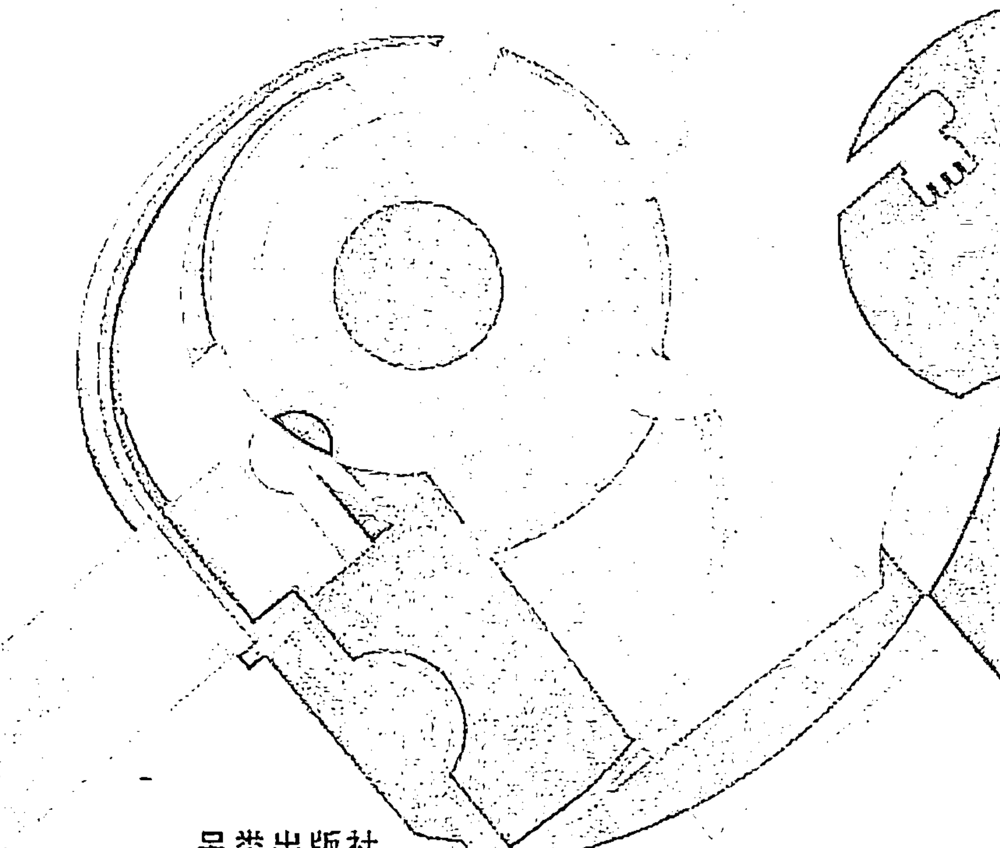
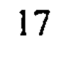
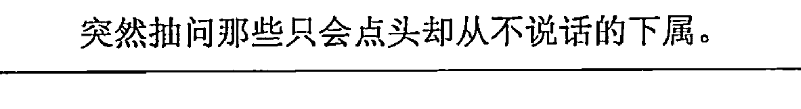

# 奸的好人25-恶魔交涉术

## 推荐序

**使坏，往往是让问题迎刃而解的最佳快捷方式**

知名制作人

其实上帝创造人类的时候，除了给予我们头脑、四肢、感情、认知以外，也送给我们一对天使与恶魔来牵引着我们的命运……。

世界到处充满着虚假与尔虞我诈，装出慈悲和善的脸孔，正是恶魔的拿手好戏。为了达到自己所要的目的，他们常常以美丽的外表、动人的辞藻欺骗别人的耳目。日常生活处理事情，离不开说话；说话，正是为了把事办成；想要把事办成，就离不开说服。游说对方，就需要手段，要点心机、使点坏，往往是让问题迎刃而解的最佳快捷方式。

翻开《恶魔交涉术》，让我们跟着恶魔，透过说话的技巧，稍加运用一些智慧，带点谋略，化不可能为可能、化腐朽为神奇、扭转劣势为优势，早日成为千人迷，立自己于不败之地！

## 序言

**人是无法被说服的，这是恶魔交涉术的基本原则**

当对方听着你的意见，点头如捣蒜时，代表他不仅被你说服了，同时还发自内心深处同意你的观点。

这真是完美的状况，所以许多人都认为，人一定可以凭着热情与积极的态度来说服别人。或是向对方弯腰鞠躬、大声说：“我会努力加油！请您给我这个机会”、“请交给我吧，拜托您一定要给我这个机会”，只要这样做，即使是再不合理的事情，说不定也能靠满腔的热血来打动对方。

但是，这绝对是错误的观念！人心总是充满着猜疑，特别是别人尝试要说服自己的时候，还会下意识地产生抵抗的心理。

“想要买房子的话，现在正是大好时机！我也是为了您着想，才会跟……讲这些话。不要犹豫，赶紧盖章签约吧！”“现在要辞职的话，对你的将来可不太好唷！我也是为了你好，才会对你说这些话，不是吗？”

与其要用一大堆说法来说服别人，还不如像这样，搬出一些冠冕堂皇又似乎为你好的道理来，对方还比较容易被牵着鼻子走。但如果真想让对方接受自己的观点，应该要怎么做才对呢？我自己曾有过这样的经验！

女子马拉松比赛中颇具盛名的教练小出义雄，和我同样住在日本千叶县佐仓市，因此我偶尔会和他一起在居酒屋中小酌几杯。当提到女子选手的培育过程时，有“酒豪”之称的小出教练，拿着一瓶一公升的日本酒“八海山”，笑着对我说：

> “去酒店时，要称赞陪酒小姐漂亮美丽，这样说，你懂了吗？要是连这点道理也不懂的话，就无法培育出优秀的女子选手了。”

他的意思是指，如果不懂女性的心理，当然也就无法成功培育优秀的女选手。

“原来如此！”

了解他的意思后，我由衷对他感到敬佩。我对培育有森裕子、高桥尚子等优秀选手的这名教练，发自内心地敬仰。

超越一切道理，能对对方的意见发出“原来如此”的共鸣，才算真正接纳了对方观点。

换句话说，不论使用任何手段动之以情、晓之以理、诱之以利，甚至胁之以力，只要能使对方接纳你的意见，事情八九不离十就能照你原本的希望发展下去。不过，要别人完全接纳自己的意见，是非常困难的一件事，但至少要使对方有接纳的打算与想法。那是让对方“自愿配合”的基础。

那么，又该如何让对方接纳你的观点呢？

我会在本书中一一讲解所有的方法！我的工作经验，包含了服务业、演艺圈、体育界、政治界、宗教界、格斗运动界等彼此相当歧异的范畴，因此在书中提及的方法，绝不只是空谈的理论，而是我由多年经验所领悟出的“实战法则”。

期望这些“黑暗智慧”能对您有些许帮助，并能活用于日常生活中。

# 第一章 展现成功自信的13个方法

## 1、沟通专家才懂的“点头术”

如果你待人接物的处世之道，可以如同鱼儿在水中悠游那般轻松自在，想必可以受到众人爱戴、拥有一定的声誉。

应该说，在别人眼中的你，就像是个拥有声望的“沟通专家”吧！

虽然人人心中都存着利己主义的自私劣根性，然而若是能够在他人心中留下你是个“受到众人爱戴、拥有一定声望之人”的印象，不仅可以获得周遭的好评与适时的帮助，也能让生活更加怡然自得。

那么，究竟该怎么做，才能让别人认为你具有良好的沟通技巧呢？

请加强“善于聆听”的技巧吧！

善于聆听的最基本关键，即“喔喔”、“咦”、“耶”、“原来是这样啊”等应答方式。每个人都会有“希望与别人说话”、“希望别人听我说话”、“希望别人了解我”等欲望，因此只要能善于聆听，别人自然而然的就会主动找你攀谈。

久而久之，当他人对你产生“如果是他的话，一定可以了解我的想法”这种信赖感时，便会开始找你商量问题与烦恼，“受到众人爱戴、拥有一定声望之人”的形象也就成功诞生了。

“商量烦恼这类的事情我没办法，也不晓得该怎么回答啊！”

相信许多人都会会有类似的担心，不过这只是个错觉罢了。倾听别人的烦恼，其实是件再简单不过的事！只要适时的应答对方的话，就是最佳的因应之道。

这是为什么呢？因为聆听与回答，正是咨询、咨商的最基本方法。烦恼，是可以藉由与他人诉说的方式就获得解决的。所以，人们通常只要将心中的烦恼一口气的倾吐而出，就会感到舒服许多。非常认真的跟对方讨论问题、给予对方种种建议等，反而是多此一举，说不定还会让对方感到相当困扰呢！

因此，聆听时只要适时的应答即可。

不过，在别人找你商量烦恼时，有一点需要特别注意之处，也就是“不要抢先发言”。例如：

“我最近跟我老婆不太好。”

“原来如此，所以要考虑离婚吗？”

“不是啦，只是对于要不要一起去哪儿旅行意见相左啦！”

聆听者的发言打断了说话者的话，可能也打断了他说话的兴趣，使对方没有办法顺利地将所有烦恼说出。

天使会认真聆听他人的烦恼，并希望帮对方找到解决之道，然而却因此常在不知不觉中主导了发言权。恶魔却常常在对方说话时想东想西，话也只听了一半，只以“喔喔”、“咦”、“耶”、“原来是这样啊”来回答，而不主导发言。

然而，最后被众人公认具有良好沟通技巧的，往往都是恶魔。

以“喔喔”、“咦”、“耶”、“原来是这样啊”来响应对方，才是高超的聆听技巧。

## 2、打开对方的话匣子让你一步登天

服务于旅游业的日野经理（化名），每次只要一喝了酒，就开始滔滔不绝地说起陈年的往事：

“你们这些年轻人啊！知道七〇年代的安保条约吗？一九七〇年，也就是昭和四十五年。日美的安保条约……”日野经理又开始说起他年轻时投身学生运动的往事了。

下属们听这段往事听到都快可以倒背如流，所以马上就开始不耐烦了！

“大概听了十五次有吧！”

“我好像听了二十次。”

“我已经听了有二十八次了！”

下属们一边喝酒，一边比着谁听过最多次日野经理这些说道快烂掉的话题。酒醉耳热之际，甚至有人开始模仿起经理的语调与动作。把喝酒时的欢乐气氛炒得更加火热。

然而，这些以往都会在下班后陪着经理去喝酒的下属们，最近却鲜少接到经理的邀约。取而代之的，则是由前阵子刚空降到的公司的山岸彻（化名），陪着经理去喝酒。

这是为什么呢？因为山岸总是津津有味地听着经理说话啊！

“……七〇年代签安保条约时，我还是个大四学生，那时这消息举国哗然，连校园里也闹得沸沸扬扬……”尽管山岸至少也听过这个话题有二十次以上了，还是可以继续回答：

“喔！”

“咦？”

“好厉害啊！”

不管听几遍，他都仍不厌其烦的回应着日野经理。这也正是他与其它人的不同之处。

其它人在听到日野经理又要开始提起同样的话题时，就会马上接：

“经理那时候曾在新宿向机动队扔石头嘛！”

“没错，接著……”

“接著被催泪弹攻击了嘛！”

“对，然后……”

“然后经理趁乱逃到街上的某间酒吧躲起来。”

“正是如此！”

总之，为了让经理早点结束这个话题，所以只要经理的话一说出口，大家马上就将把后续续统说了出来。

然而，这样对日野经理而言一点都不有趣，反而出现一种“不完全燃烧”的欲求不满感。不过，山岸的作法却完全不同，他专心的听经理说话，并不时的发出：“喔”、“咦”、“好厉害啊”等话语来表达惊讶及敬佩，让经理说完整想说的话，从而获得满足。

半年后，在日野经理的力荐下，山岸晋升为主任。

“那家伙就是因为一直听日野经理‘讲古’，才爬上任主任的位置。”

公司里免不了传出这类的流言蜚语，然而山岸仍然不为所动，继续担任日野经理的忠实听众。

“你还真厉害啊，可以一直听那些重复的老话。”心有不满的同事们如此揶揄山岸。

“重复？是喔？我都没有专心在听，所以不太知道他到底在说什么！”

山岸一派轻松的回答，让同事们哑口无言。

> 装作专心聆听的样子并不时发出感叹，就是与主管打交道的最佳方法。

## 3、初次见面就占上风

黑社会的兄弟们，在初次见面时，就是一次胜负的时候。

首次见面时的气势就输给对方的话，之后想要挽回局势就很困难了。

例如，第一次见面的两人谈起了高尔夫球的话题，A 正得意洋洋的炫耀着：

“我上礼拜在凹凸不平的球场上打出了一杆进洞的好成绩，不过我没有让大家帮我开庆祝你，也没有准备什么纪念品。”

“那真是恭喜啊！”B 笑着说，接着问：“那么是第几次打出一杆进洞呢？我的话是打出第三次以后，才没有让大家帮我庆祝，不然等到打出第五次、第六次的话，怎么好意思呢！”

面对 A 骄傲的态度，B 漂亮的回答不仅可以挫挫 A 的气势，同时也可让自己保持优势的立场。

在“面子＝器量”的黑社会中，占上风或占下风，对工作有非常大的影响。因此，不论是赌马也好，聊高尔夫话题也好，双方在正式展开竞争前，都会为了想比对手先驰得点，而展开激烈的斗争。

来看看以下的这个例子吧！

这是关东的黑社会组织 G 组干部富山一郎（化名），与 X 会的 Y 首次见面时之事。Y 开口邀请富山一起小酌：

“富山先生，要不要一起去喝一杯聊聊天呢？”

时常出没于银座俱乐部的 Y，在各俱乐部都拥有不小的人面，因此 Y 也认为自己占有优势，然而富山干部其实更胜一筹。

“好啊，一起去喝一杯吧！”

但是看似“抢先占有优势地位”的 Y，却没有把握机会邀请富山干部去银座，反而被富山干部带着走。等到了市中心某高楼时，Y 已经惊讶得合不拢嘴，他原先以为富山干部是要带他去某秘密俱乐部，没想到这豪华的住所

竟是富山干部的家。

数位年轻的陪酒小姐出来迎接：
「欢迎光临。」
「打搅了！」Y 礼貌性地打了招呼，进了屋内。
小姐们端出了丰盛的菜肴。
「非常感谢您的招待！」Y 要回去时向富山干部道谢。

之后，Y 不论在什么场合碰到富山干部，都免不了要再向富山干部打声招呼：
「上一次真是谢谢您了！」

如此一来，也就掉入富山干部的计划中了。

不论 Y 在银座的俱乐部再怎么有人脉，最后他还是因为接受富山干部的招待而欠了对方人情，尽管不是什么大不了的事情，却也不是那么容易就能还给对方、一笔勾销的。

> 比对方早一步行动，捷足先登的人就能领导局势。

## 4、运用不同的说法给听者完全不同的感受

「给我过来！」这句话经常会在道上的兄弟间听到，或是类似这种对话：
「听说 XX 最近很神气！」
「什么！叫那个浑小子给我过来！」

大概就是类似这种情况。那么，为什么要用「给我过来」呢？这是因为这样的说法，可以同时向内、向外夸示自己的优越性。

另外，「乘虚而入」也是道上兄弟常说的话。
「XX 在 OO 街上收保护费，一副自己很伟大的样子。」
「什么，那个臭小子！居然敢乘虚而入！」

换句话说，即是要给对方一点颜色瞧瞧的意思。

然而，当双方在同一场合的对峙时，究竟谁比较占上风，旁观者其实很难分得清楚。也就是说，同一事件会出现人云亦云的「谣言」。

举例来说，在关东的 T 市，黑社会组织 G 堂口与 K 堂口正竞争得如火如荼。G 堂口是当地旧有的黑道组织，K 堂口则是另一支新派别。两派新旧势力主要是为了当地红灯区的保护费而产生冲突。此时，被称为「百人斩」的 G 堂口「护法」进入了 K 堂口，因此在红灯区开始有了这样的传言：

> 「G 堂口的『百人斩护法』似乎被找去接管 K 堂口喔！」

其实事实完全相反，真相是 G 堂口在 K 堂口出现后，完全束手无策，红灯区几乎成为 K 的地盘，所以「护法」是去投靠了 K 堂口。然而，在这样的流言出现后，情况便大不相同了。

由此可知，随着流言的扩散，世人的看法也可能产生 180 度的巨大转变。因此，绝对不可以小看流言的力量，正所谓星星之火可以燎原，也是一样的道理啊！

谣言在事实出现前就开始扩散。

## 5、商业午餐谈不成生意

市面上可以看到许多书籍，教导读者利用商业午餐的时间谈下订单。

与漫长的夜晚相较，午餐的时间有限，餐费也比晚餐便宜，更可以免除酒醉的丑态。基于种种理由，让商业午餐的时间成为非常适合与客户谈生意的时段。

以心理学的角度来分析，一同用餐谈生意，对方接受的机率较高。而且比起喝咖啡，一起用餐而谈成生意的机率也高出了许多。因此，许多商业类的书籍都主张商业午餐有这种优点。

服务于某业务部的高岛博（化名），在阅读提及商业午餐效用的书籍后，彷彿恍然大悟般欣喜若狂。他心想：「就是这个！我也该快去找客户一起吃午餐。」

高岛正为了某项商品的单价，和客户一直无法达成共识而苦恼。于是他随即联络客户：

「关于下次的会议，约在 XX 饭店一边用餐，一边讨论如何？」

「不用了，像以前那样就可以了。」对方非常果断地拒绝了。

「这样啊，好的，我知道了。」

对方马上就挂断了电话。高岛可能没有察觉到，在这些商业类书籍中所提及的商业午餐效用，其实是经由文章修辞技巧所包装而成的。

生意之所以能成功，并不是因为一起用餐的关系，而是能够一起用餐的生意伙伴，多半都已经有不错的交情，所以生意谈成的机率才会提高。因此，这其中的做法应该要完全反过来才行。也就是说，是生意谈成后，才与对方一同共进午餐。

恶魔，是绝对不会看了书就这样囫囵吞枣，反而还会产生「如果只要一起吃个饭就能搞定，那么说不定一起喝杯咖啡也能谈成」这种创新、独特的发想。

请不要过于乐观，应先仔细思考事物真正的本质与情况！

没有任何胜算的商业午餐，就连开口邀请对方都免了吧！

> 先培养与对方一同用餐的交情，才是让生意成功的前提。

## 6、满足对方的期待并使他感谢万分的背叛

年轻的自由作家大川健司（化名）将担任评论家 S 先生的代笔。

虽然说是代笔，但却是由 S 先生口述，大川再负责整理成文章。出版后的所得，由两人七三分账，即大川可以取得三成的版税收入作为酬劳。尽管只能获得三成，似乎有点少，但因为对方是颇具声望的评论家，所以大川也就勉强接受了。再说，冲着 S 先生的名气，新书应该也可以有不错的销售佳绩吧？

于是，大川与 S 先生的合作顺利进行，两个月后，新书出版上市了，而酬劳则由双方约定在书出版的两个月后，由 S 先生汇款给大川。每本书定价一千五百日元，首刷一万本，可获得的版权税为一百五十万日元，其中的三成也就是四十五万日元，是此次大川可以获得的酬劳。

然而，看到存款簿的金额时，大川却百思不得其解，S 先生居然汇了六十万日元给他。(Lucky!)

不过大川最后还是拨了通电话给 S 先生，诚实地告诉 S 先生金额错了。

「不，其实并没有错。因为你非常认真工作，工作成果也非常理想，因此我将你的酬劳提高至版税的四成。」

「原来是这样，真的非常谢谢你！」

「我也要谢谢你，今后还请你多多帮忙。」

S 先生大笑的说，而大川则感激万分地道谢。

由大川那儿听到这件事的编辑们，都对 S 先生从以前到现在就是这样的作法露出苦笑。

S 先生最初就是打算将版税收入采六四分账，然而却每次都故意说是七三分账。之后再以「因为你非常认真工作，工作成果也非常理想」等理由，而使用他最初心中计划的分账设定，好让像大川这类初次合作、资历尚浅的新手，能对他感激万分。

心地善良的天使们，就绝对照法做出这样的事，大概也无法说出「版税收入七三分账」这种暗藏心机的话。

如果 S 先生起初就展现诚意，向大川说：「版税收入六四分账」，可能就不会有大川对他如此心存感激的结果出现。

而 S 先生也因「原本以为他非常小气吝啬，没想到其实是个出手大方的好作者」这样的赞美，而在业界的评价不断被提高，难怪他会在电话中笑得那么开心。

> 快乐的背叛反而赢来信赖。

## 7、最后一句话能让刚刚说的话一笔勾销

「说三道四」是喝酒聊天时最美味的酒菜。

「XX 那家伙，去出差时由于找小姐，好像因为钱的关系有点小麻烦。」

「真的喔？」

「好像是，部门里大家都在传。」

「哇，真的是人不可貌相啊！」

不论谣传是真是假，只要话题够劲爆、大伙儿讲得够起劲，餐桌上的食物马上都能成为美酒佳肴。

然而，请务必注意一点，当你在别人背后说他人的坏话或是谣言时，你的说法也会影响其他人如何评价你的人格。

「XX 真的是个讨人厌的家伙，只要是对他有好处的事情，马上就会跳出来多管闲事，没有好处时就一声不吭。」

当你这样说时，在场的所有人想必都是「没错」、「对啊」，异口同声的附和，然而当你不在场时，就开始有人批评你：

「那家伙，好像真的很恨 XX。」

「讲 XX 的坏话讲得那么过分，好像太夸张了吧！」

最后反而开始有人在背后说你的不是。

那么，究竟说别人坏话时该如何是好呢？应该在评论他人的最后，还要加上一句「好的补充」。

「不过，他也是有某些优点的啦！」

说了一连串的不满、抱怨后，最后以这样的方式作结尾，可以免去自己成为别人谈论、批评的话题，反而还可能带给别人「这家伙没那么糟糕嘛」的好印象。

这也是恶魔在批评别人时又要保护自己时常用的手法。

「OO 那家伙好像拿私费报公报耶！」

「不会吧？」

「我一开始也觉得应该不会吧，但他好像还因为这件事被经理找去。」

「真的啊，那家伙真是看不出来耶！」

「对啊，看他这样子真不像是会做这种事的人。」

「我们也要小心点啊！」

关于 OO 的批评告一段落后，别忘了补上「不过，他也有很多其它的优点。」

虽然只是短短一句好话的补充，却也可以让他人对自己的评价上升一定的程度，以免成为闲话的主角。

说了坏人的坏话之后，一句补充的好话可以提升自己的评价。

## 8、客套话也能作为武器

「课长大人真的是太厉害了，虽然先前就听过不少人的赞美，但亲眼见到后还是令我非常吃惊！我太太说课长大人泡的茶真的非常美味，希望下次我也有这个荣幸品尝。」

Q 食品业务部的平家琢磨（化名），正在向岩口展夫（化名）课长道谢，感谢课长招待他与太太至课长家。

平家的赞美岂止于肉麻，根本都是非常夸张、逢迎拍马的客套话。

「哈哈哈，没有那回事啦！内人真有这么多好就好了。」岩口课长露出雪白的牙齿，谦虚的说。

（一听就知道是客套话，还这么高兴？）其它看在眼里的下属们，对于岩口课长的态度十分不以为然。

然而，不论是不是一听就知道的肉麻话，只要是赞美的客套话，应该没有人听了会不高兴。

为什么呢？

「被拍马屁，当然会心情好啊！」

会这样回答的人，八成也没有办法随心所欲的掌控人际关系喔！

简单来说，客套话其实是种精神上的拜托。

因此，即使一听就知道是在拍马屁的话，知道「这家伙想要讨我的欢心」，但还是会令人不由生起一股优越感，自然也就能使人心情愉快。即使是像平家那种「令人一听就知道是客套话」的客套话，也会有令人意想不到的效果。

许多商业类的书籍中，都认为这种一听就知道的客套话会造成反效果，然而我却不认同这样的说法。这就如同军队的作战单位在构思作战计划一样，计划和实战是完全不同的层次。人心并没有单纯、简单到可以在桌上分析、讨论，也不如想象中的清廉。

双眼会因利益、金钱而蒙蔽，双耳岂有不因赞美而心动的道理。

恶魔，不，应该说是「人际专家」，由于熟悉这种人类心理，因此反而会以客套话作为武器，并发挥其强大的杀伤力。

「你啊，不要再跟我说这些客套话了啦！」

尽管嘴上这么说，岩口课长却满脸都是笑意。

> 客套话与逢迎拍马，能唤起对方的优越感。

## 9、用言语传达自己「能者多劳」

「对人事物的不同形容法」，是一门因人而异的智慧与学问。

到主管家拜访时，看到主管调皮捣蛋的儿子时说：

「贵公子真是元气充沛啊！」

如果看到的是主管沉默不语的女儿，就说：

「令爱真是文静乖巧！」

这么说，就算不能令主管欣喜若狂，至少也不会留下坏印象。

如果在接待客人时，看到对方宛如牛饮般喝个不停，就随口说：「你也太会喝了吧」，想必极可能造成对方不悦。不如改说：「您真是海量啊」，如此一来，对方的感受就完全不同了！

这就是「对人事物的不同形容法」，而恶魔就常常使用这招来帮助自己。举例来说，因为连着数天的饮酒作乐，导致要交给主管的企划书不能如期完成。

天使会说：

「请问可以再多给我两天的时间吗？」

相信会笑着答应「好，再给你两天」的主管，大概寥寥无几吧？

「你这一个礼拜到底在做什么，为什么不能按照原订的日期交给我？」

一般情况下，大概只会招来主管的责骂，自己在主管心中的评价也随之下降。因为，这种请求非常明显暴露出「都是我的错」。即使自己的态度、姿态已经十分低下了，许多主管仍会不客气的予以斥责。

恶魔，就绝对不会做出这种「请求」。

「现在还卡在实地勘查的阶段，因此可以再给我两天的时间吗？」

以「延期是理所当然」的口吻向主管「报告」，并透过言辞的表现，传达出正在进行某项工作的感觉，会让主管觉得：「我没有命令这家伙做什么实地勘查，他居然还自己跑去做」，除了感到高兴，当然也会提升对这名员工的评价。

「好，那就拜托你啦！」

如此不仅成功的将企划书递交时间延期，还能获得主管的鼓励。然而，若是在两天之后企划书还是没有完成，该怎么办呢？请以适当的理由来说明延期的原因。

「我在现场发现了两、三个问题。」

「真的啊，是什么问题？」

即便主管继续追问，也别紧张。可以说：

「我会一并在企划书中详细说明，三天后一起提交给您！」

就这样名正言顺的再次延期吧！不过，真正递交给主管的企划书，其实就依照原本的企划书内容就可以了。至于随口说说的实地勘查，反正是假的，当然也就提不出什么问题来。

「所有的问题都已经解决了，所以我想就照原定计划进行就没问题了。」

「好，辛苦啦！」

「哪里，这是应该的。」恶魔露出爽朗的笑容说道。

> 透过巧妙的言辞表达，不须请求就能堂堂正正的延期。

## 10、闲话家常的充分利用法

「为了获取对方的好感，应多与对方闲话家常、说些关于自己的事。」

这点应该是许多人都晓得的「收揽人心法」，实际上也没错。不过，是以「调换一下顺序」为前提。

「您好，我姓凸川。关于我的事有——我的母亲最近因病住院了。」

突然冒出这些话，想必会让对方不明就里。

（这家伙是不是脑袋有问题啊？）

虽然闲话家常、与自己相关的话题可以拉近两人间的距离，但若是没有抓好时机，也非常容易造成反效果。那么，究竟该怎么做才对呢？

请切记，绝对不要自己开口说出，而是要如同钓鱼时撇下鱼饵般，让鱼自己上钩，制造机会让对方主动开口询问。

「今天我在母亲的病房时，她说我今天一定会遇到很棒的人，没想到真的如她所说。」

工作的话题告一段落后，装作随口聊聊的样子，若无其事的提到「母亲」、「病房」，将话题渐渐带到和自己相关的主题上。

「令堂身体不舒服吗？」

对方通常会礼貌性的询问。

「是啊，她得了癌症。」

「癌症！真对不起，问了这么失礼的问题。」

「不会啦，没关系。毕竟我母亲辛苦工作了一辈子，而且年纪又大了。」

「其实我的母亲也……」

以这样自然而然的方式，将话题扩大至对方身上，以此建立稳固人际关系的基础。对方提及自身的话题越多，彼此的关系也就越紧密。

巧妙留下话题，让对方先发问。

## 11、用握手缩短与对方的距离

「您好啊！」

「承蒙您的照顾！」

「阿姨，要麻烦您了！」

打招呼的同时，也要紧握看对方的手。

每年选举活动期间，不难看到许多候选人四处造访，每到一处就亲切的与当地民众握手致意。如果只是冷淡的握手，就完全失去了握手的意义，所以从选举时最能感受到什么是握手的正确方式。

「您好，请多指教！」

伸出手来与选民握手时，起初使用柔和的力度，接着再施加点力道用力握住，最后再伸出另一只手以两手一起握着对方的手，手臂摆动的高度也逐渐提高。这就是选举时正确的握手方式。此外，心中应同时想着：「请多指教，恳请赐票」。

心中默念时，双眼也要直视着对方，似乎要将心中的意念透过视线传达给对方，这种行为也是非常关键的动作。就这样，在投票前依着支持者名单，挨家挨户的拜访致意。这也就是为什么每逢全国性选举时，候选人的手常会握到肿起来。

那么，想必很多人心中都会有个疑问：为什么一定要握手呢？不握不行吗？

这个问题的答案，若是以心理学层面而分析来说，是由于身体的直接接触可以降低人的警戒心，同时自然的产生亲近感。光只是说：「请多多指教」，然后向选民鞠躬致意，效果就是比握手差。因此我们不难发现：善于经营人际关系的人，经常会利用握手来缩短与他人间的距离。

「初次见面，请多指教！」

「那么下次再见！」

由握手而展开的关系，也由握手做结束，就算对方是女性也一样。毫不害羞扭捏，大方的与对方握手致意，才能成为可独当一面之人。

> 肢体接触减低对方的警戒心，增加彼此的亲近感。

## 12、不经意间说出口的，最像真心话

所谓的真心话，通常都不是在他人的询问下说出，而是在偶然间说出来的。因此，我们可以反过来推论，在不经心的情况下所说出来的话，就会被他人认为是「真心话」。

这点也正是恶魔需要学会的修辞表达法！

恶魔会利用「偶然不小心说出口的真心话」，来为自己制造机会。

让我举个例子来说明吧！黑道组织 A 堂口的某位年轻人，因为不小心肩膀擦撞到某大帮派 Z 会干部，而被 Z 会成员围攻，

「Z 会算哪根葱？我要给他好看！」

当时正是 A 堂口的威势不断上升时，因此 A 堂口的干部筱田俊夫（化名）狠狠的说道。然而，A 堂口和 Z 会就如同蚂蚁对大象般，两者根本就是云泥之别。真的要打起来，A 堂口根本就不是对手。尽管知道这样的事实，却还大言不惭的讲出：「我要给他好看」的筱田干部，还真是敢说啊！

他原以为自己的一番话会激起大家的手援及感激，然而在场的人都一副兴致缺缺的样子，大家都一言不发的看著旁人。

「难不成都要我亲自动手吗？」

虽然是筱田干部先出声，但是要「给他们好看」，其实也不过是旁观者的煽风点火。所以最后的结果，当然就是在场的众人都一副事不关己的样子。

然而，在场的另一名干部伊集院广大郎（化名）就不一样了。伊集院以非常细小的声音，自言自语的说着：

「如果把他杀了就好了。」

众人无不因他的话而抬起头来，每个人都以敬畏的眼神看着伊集院。

最后，A 堂口与 Z 会透过第三方介入调停，因此没有发生任何械斗事件。蚂蚁连踩上大象的脚都有点困难了，想要与他吵架更是不可能的事。

筱田干部正是因为知道这点，才敢耀武扬威的喊出：「给他们好看」，但其实他也很清楚，具体行动的可能性是微乎其微。筱田干部就是不晓得「说出口的不是真心话」这样的心理战术，才会换来众人的冷眼旁观。

反观伊集院，他不经意说出口的「如果把他杀了就好了」，反而会让众人认为这是他的真心话（野心），也因此赢得同伴们的敬畏。

> 若无其事的真心话能打动人心。

## 13、善用「迟来的亲切」

「经理，听说您买了 T 公司的车子？怎么不跟我说一声呢？跟我说一下的话，我可以帮您弄到便宜的价格啊！」

电器商的平山英姿（化名）跟经理这么说，同时一脸十分遗憾的样子。

「你在 T 公司有认识的人啊？」武田文昭（化名）经理问。

「岂止是认识，经销商的处长跟我的交情可好了！」

「原来是这样啊！」

「对啊，如果是经理的话，至少可以帮您弄到八折，甚至更好的价钱。」

「早知道就先和你商量！真没想到你在这方面还有这么好的人脉啊！」

「真是太可惜了，不然至少可以省下个十万元。」

「十万元，可以省下这么多啊………」

「对啊十万元也是笔不小的金额耶，如果经理有先跟我说就好了。」

平山的话，不断的刺激着武田经理，让他越来越心生懊悔。然而实际上，平山与 T 公司经销商的处长根本没有多好的交情，甚至根本就不认识！不过，

既然经理的车子都已经买好了，就算再怎么说大话，经理也绝对不会向平山说：「那就拜托你啦」，因此平山才能放心的说出这些话。

「我还想说难得有帮上经理忙的机会。」平山有些落寞的说著。

「别这么说，如果我有先找你商量就好了，我才真是不好意思。」

尽管平山说的都是无中生有的话，武田经理仍信以为真，对平山的观感也大幅改变。恶魔就是会用这种「迟来的亲切」来提升自己在他人心中的价值。

顺便一提，在这之后，平山的同事想买 T 公司的车，因此前来拜托平山。

「你要是再早一点说就好了，销售商的处长前一阵子已经退休了。」平山惋惜的说。

> 无根据的大话让对方后悔，却能借机推销自己。

# 第二章 不让对方有机会说「NO」的 15 个

## 1、穷追不舍的说服

真正经验老到的黑社会兄弟，绝对不可能对别人说：「借点钱来花花吧！」

因为只要对方回答：「我最近手头也很紧，没什么钱……」，对话可能就此打住了。

因此，正确的说法应是说个具体的金额。

「不好意思，借我三十万吧！」

「怎么可能，我哪有那么多钱！」

即使遭到对方的拒绝，依然可以紧咬著对方不放。

「那你有多少？」

用这种强硬的态度，即使借不到三十万，但硬是要对方借个三万、两万的成功机率，仍会相对提高许多。

不只是黑社会的兄弟们，这也是恶魔惯用的伎俩。以不同的例子来说好了，假如在邀请女性遭到拒绝。

「这礼拜日要不要一起去看电影？」

「不好意思，我这周末有点事情。」

「是喔，真是可惜！」

天使听到这样的回答，通常都会主动打退堂鼓。

恶魔却不会这么简单的放弃，一定会接著问对方：「那你什么时候有空？」

「我对你没兴趣。」

尽管这才是对方拒绝自己的真正理由，但女性通常很难直截了当的说出口。

「嗯……那下周末的话应该可以。」

虽然似乎有些勉强，不过仍算是邀约成功了。

> 说出 具体的数字穷追不舍。

## 2、即使是顽固的客人也无法拒绝

被拒绝后才是真正的开始，这是业务推销的基本法则！然而，这句话背后隐含的真正意义，其实却意外的鲜为人知。

“笨蛋！不过被拒绝个一、两次而已，怎么能就这样放弃！被拒绝后才是开始的开始啊！”大发雷霆的主管正斥责着无功而返的下属：“不管去几次、要你下跪也好，没拿到合约前就不要给我回来！”

业务员最需要的就是毅力及锲而不舍的精神，因此才会说：“被拒绝后才是开始的开始”。“业务员=毅力”的确是一点也没错。

不过光凭毅力就想成为百万业务员吗？做生意可不是件这么简单的事！“业务员=毅力”只能说是一种态度，称不上是商业技巧或战术。

“被拒绝后才是开始的开始”的真正含义，在于“知道了对方拒绝的理由，才能重新展开攻势，以便运用令对方无话可说的方式说服他”。

以推销汽车的例子来说好了。

“新车？我不需要。”

“但这款新车物超所值呢！像是……”

“我已经说了！我不需要！”

不理会对方的拒绝，一再的试图说服，往往只会招来激怒对方的反效果。这种情况下就该换个方式，询问对方为何不换车的理由。

“您很满意现在的车吗？”

“倒也不是，但没有换车的预算。”

由此可知，对方在意的关键可能会是付款方式，接着便可以由优惠项目、超低贷款利率等方面下手。此外，也可尝试以竞争对手与自家产品的比较着手。

“Z公司新车您觉得如何呢？”

了解对方如何评价对手的产品后，由强调自家产品的优势开始攻击对手。

“但Z公司新车啊……其实……”

当对方拒绝的理由由站不住脚时，也就无法坚定的拒绝了。这正是“被拒绝后才是开始的开始”之真谛。

“我不需要。”

“为什么呢？”

恶魔都会殷勤的持续发动攻势。

“因为没有换车的预算啊！”

“也就是说，如果有划算的优惠方案的话，您可以考虑看看喽？”

“嗯……倒是可以考虑看看啦……”

“让我为您试算看看吧！这样如何？这可是特别优惠呢！”

然而，天使通通只净说着：“麻烦您参考看看！这真的是款不可多得的好车，现在还有促销项目！”

好似在选举时，候选人不停的向选民鞠躬哈腰，反而只会让对方的优越感不停增加。

- 让对方说出拒绝的具体理由，再针对各点——击破。

## 3、对方的不安、猜疑一概予以承认

“如何，要不要投资？半年获利五成，一年后百分之百唷！”

这么好康的事情，相信没有人会不感兴趣。

“真的吗？”

听到这么好的事情，对方眼睛马上亮了起来。

“当然是假的啦！”隶属于关西某区域组织的舍弟回答。

“这么好的事情到处都有人说，不相信的人很多，然而实际被骗的人更是络绎不绝。”

那么，为什么会有这么多人相信呢？

“因为我绝对不会说服对方！”舍弟跟我说。

以“快速获利”的投资方案为例。像知名的日本企业“活法门”（Livedoor）在展开并购案时，往往都会成为媒体“快速获利”的话题。

“Livedoor在收购其它企业时，是与其它同属媒体业的同行一起合作的，例如交换持股、共同收购等，如此才不会违反日本电波法中的‘禁止独占垄断’的规定。同时，Livedoor也需要大笔的资金，才能对其他企业进行收购，因此除了向银行协商筹措资金，也会向地下区域组织借钱，而这些区域组织又会拉拢一般人进行投资。”

“喔，意思就是大公司向地下银行借钱，而地下银行又向一般民众融资来借给大公司嘛！”

我点着头，虽然心里对这种运作方式浮现出一个又一个的问号，但是之后却也了解了什么叫做“不说服”。

那些热中于快速获利、马上致富的人，就如同水中的浮游鱼类一样。一般的鱼并不会去吃这些填不了牙缝的小鱼，因为即使这些人上钩了，也赚不了什么大钱。钓鱼时，钓客的目标也一定是黑鲷这类的高级鱼，然而这类的鱼却通常特别细心，很少会去吃鱼饵，因此也就容易上钩。

“没问题吧？”“黑鲷”不安的问。

“怎么可能没问题呢？”

为了说服“黑鲷”，“钓鱼大师”出动了。

为什么不说服“黑鲷”呢？

因为，越是要说服，反而会使对方产生退却之意。你越是想尽各种办法要说服对方，对方反而会萌生“事情绝对没有一道么简单”的猜疑心。

因此，舍弟才说要“不说服对方”。

“投资总是伴随一定风险，如果我向对方拍胸脯保证，告诉他说：‘绝对没问题’，反而是不负责任。如果政府介入、银行地下融资曝光，甚至发生地震之类的天灾人祸，都有可能让投资失败，这也是千真万确的事实啊！”

“原来如此。”

听到这么好的事情，对方通常是跃跃欲试又害怕被骗，因此和对方说明可能碰到的风险，才是真正符合现况的投资。

捉住对方动摇的心态，再以“我不会勉强你，你没兴趣的话就算了，但这些事情也请别让别人知道。那我就先离开了”，向对方打下一剂强心针。

手上握着的钓竿有了反应，有鱼上钩了。

“啊，请、请等一下。”

鱼一口咬下鱼饵，接着就被人类提上来了。

- 和对方说明可能的风险，以获得信任。

## 4、使对方只能回答「YES」的攻势

骗子，通常都是举例讲故事的高手。例如，没有人自愿担任工会干部时，某公司的总务经理说了这样的话：

“这项工作的风险很大，但就是因为如此，才有做的价值。一杯就令人醉的美酒，了解其真正价值之人还是照喝不误。”

“一杯就令人醉的美酒，了解其真正价值之人还是照喝不误”，关键就在于主管无心的这句话，让下属纷纷上钩、竞相争夺这个原本没人要的烫手山芋。

“请让我担任吧！”数名下属都自愿接手吃力不讨好的工作。

虽然“饮酒与喝醉”相关联是事实，然而却和“接受工作”没有任何的关系。将部分的道理融入全面性的整体做比喻，这正是恶魔得意的举例方法。

因此，恶魔举的例子，通常都拥有某种莫名其妙的比喻，让人无法马上看透。

关西黑社会的K干部曾使用过以下的例子：

“我喝酒，你们能不醉吗？”

“我吃番薯，你们能不能放屁吗？”

“我跌倒了，你们的膝盖能不痛吗？”

“我说的有错吗？”K干部询问众人。

“您说的一点也没错！”

“您说得是！”、“您说得对！”众人异口同声的连声附和。

“那我的要求，会太过分吗？”K干部紧接着抛出了问题。

像K干部这般如此厚脸皮之人，就是这样，巧妙的将这些比喻放进谈话中，让不可能之事都变成可能。

“到目前为止，我有说过假话吗？”

“我曾经有背叛过谁吗？”

虽然话讲得如此义正言辞，然而事实究竟是真是假，反正也没人知道。

“这个嘛……”

如果出现了略带怀疑的响应，马上进行一连串攻击：

“你的回答是什么意思？你是在说我在说谎吗？”

为了避免麻烦及对方不肯善罢罢休的态度，多数人在这种情况下即便不甘愿，也只能说出对方期冀的回答。

“对嘛！我说的话怎么能不相信呢！”

恶魔绝对会把握时间与会机会，让对方屈服于问题的疲劳轰炸。

- 话中放入莫名典妙的道理或比喻，让对方无话可说。

## 5、难以启齿的事，留到结束时再说

技巧高超、掌握八卦头条的娱乐记者，通常是恶魔。

他们对于绯闻有非常敏感的察觉力，所做的报导也具有一定杀伤力。因为，许多事情一旦公诸于世，轻则损及艺人形象，严重时甚至可能使艺人的演艺生涯彻底结束。

而这些身为恶魔的娱乐记者们，最厉害之处在于可以直接命中让对方哑口无言的要害，以尖锐且直截了当的问题，使对方不晓得该如何回答。因此，这些不仅止于捕风捉影的事实报导，才能成为人们茶余饭后的话题。

提问有什么技巧吗？

“简单来说就是趁对方松懈的时候提问。”隶属于女性杂志“周刊X”的知名娱乐记者这么说。

举例来说，他听到一对知名银色夫妻离婚的传言，这对银色夫妻已结婚多年且形象良好，被视为理想的夫妻典范。若是传言属实，那可就是不得了的大新闻，这名记者马上就向A夫妻所属的经纪公司提出采访要求。

采访对象为妻子，因女性比较感性，较容易问话。

“最近好像有不少您与先生离婚的消息耶！”

如此开门见山的问题，只有认真的天使记者才会这样问。

“离婚？哈哈哈哈哈，怎么可能有这种事呢！”

本人还只字未答，经纪人就已经先发声了，然后这个话题也只能被迫中断。

然而，恶魔记者可就完全不同了。

“您好！我今天是为了‘名媛与时尚’的采访而来……”

以明亮开朗的笑声和对方打招呼，对于离婚传言一事一字不提，并以对方绝对不会拒绝的主题做采访。很快的，恶魔记者就与经纪人敲定了采访时间，时间刚好在电视剧拍摄的空档。

“关于女用包与饰品的搭配，您觉得……”

针对事先提出的“名媛与时尚”一主题，先进行大约三十分钟左右的访谈。

“对了，离婚协议书是什么时候签字的呢？”

突如其来的问题让A夫人惊讶到连反驳的话都说不出口。

“听说孩子是由A先生抚养吧！”

“不、不是……”

让对方没有喘息的余地，尖锐的问题一个一个接踵而来。

“如果您愿意配合的话，在报导上我会多加斟酌。”

大胆的向对方开出条件，取得独家访谈的机会轻而易举。

“这是‘神探科伦坡’的采访方式，大家应该都记得那部著名的刑事剧中，科伦坡每次要离开嫌疑犯的家时，都会好似突然想起什么似的，突然转身问嫌疑犯：‘啊，对了……’，通常最后的这个问题，才是核心问题。我用的也是同样的方法。”这名娱乐记者解释着。

恶魔也是使用同样的方式，将不好直接开口探听的事情，或是不好意思拜托他人之事，放到要道别、离开时，才告知对方。

“啊，对了，上次那笔费用，再麻烦你帮我打个九折吧！”

趁着用餐时的和谐气氛，在离开时才以突然想到的轻松口气和对方说。

“那我先走了，再见。”

不待对方回答，笑着与对方道别。

神探科伦坡问法，就是最佳的提问法。

## 6、制造「远.狭.对」的交涉环境

“在宽广开放的饭店大厅中商谈，可让双方心情愉悦、气氛和谐。”

以上这句话是“常见商业常识”中的谎言。实际情况根本是完全相反的。因为饭店的大厅根本无法给人完整、合适谈话的环境。为什么呢？

因为饭店的大厅是个众人环视的环境。

“真无聊，就算周围都是人，别人也不是在听你们的谈话，有什么关系？”

会提出这种反驳理由的人，是最搞不清楚状况的人。

周遭不确定究竟有多少旁观者，而且又是一流的饭店中，此时在这里的人都会不自觉的挺胸耸肩、摆起架子来。这是因为人类是环境的动物，人类身心均受环境支配、左右。

所以讲究气势的黑社会时会常以一流饭店的大厅，作为交涉的场所。

“我们是不会让步的！”

“那就随便你们吧！”

“那这件事你们该负起责任吧！”

一方的发言明确果断的表明了立场，对方也像吃了秤砣铁了心般，坚决不肯让步。气氛紧张到如同箭在弦上、冲突一触即发。在公众场合对峙时，往往接下来就演变为一发不可收拾的冲突。

“给你好看！”

“有种你就过来！”

双方你来我往、谁也不肯先让步，接下来当然就是严重的流血冲突了。因此，交涉、谈判的结果，不能说和场所完全没有关系。

那么，恶魔都选择什么地方作为交涉的地点？交涉地点的关键词为「远．狭．对」。“远”是指离对方的公司或地盘越远越好；“狭”则为与周遭隔绝的、有限且狭小的空间；“对”即指两人相对，也就是两人独处的意思。

离对方的公司越远，对方的心情会较为轻松。在有限的空间内谈话，由于周围没有任何的旁观者，就可以不用装模作样。而且，仅两人独处时，会产生一种两人的连带感受，由“两间公司”的关系，转变为“两人与两间公司”的关系。因此，只要符合“远．狭．对”的原则，在任何场所谈判都无所谓。此外，若是选择餐厅中的会议室作为交涉的地点，费用也较为经济实惠。

拥有适当的环境后，“如何？就这么说定了”，要达成交涉目的也会更为快速、简单。

比起交涉条件，恶魔更会考虑什么样的情况、什么样的谈话方式，可以与对方达成协议。如果仅止于“数字”上的攻防战，其实根本就没有当面商量的必要。面谈，即是指交涉，是在“数字以外的要素”仍有攻击或是让步空间时，才需进行的。

认真老实的天使不会注意到这些，只是一味的着眼于交涉条件上，陷入找不到出口的烦恼。

恶魔则完全不同。目标说是交涉条件，不如说是交涉对象会更为贴切。

在远离对方公司的狭小空间中，单独交涉。

## 7、得寸进尺，让对方无法拒绝

把青蛙放进滚烫的热水中，青蛙会有什么样的反应呢？青蛙会马上就跳离锅子，这是可想而知的事实。然而，如果把青蛙放进装满冷水的锅中，以小火慢慢加热，青蛙就会因未察觉温度的细微变化，最后被沸腾的热水给烫死。由于水温是缓缓升高，青蛙的身体也渐渐适应水温，等到发觉不对劲时，已经为时已晚了。

这种煮青蛙的方法，在心理学上称为“得寸进尺的说服策略”（foot in the door Technique），字面上的意思是“脚先踏进门”，意思也就是先作“简单的小要求”，接着身体才能进门，也就是再作“更进一步的要求”。这样的心理战术，也是恶魔的得意技巧。

举例来说，在关西的 T 市：水泽原（化名）开设吃茶店时，管理该区域的黑社会兄弟们要求，吃茶店中必须放置他们提供的湿纸巾，水泽原先认为这种东西不论由何处进货，价钱都不会太大的差别，若是拒绝对方的话，日后恐怕会有麻烦，所以也就是答应了。其实，水泽就如同青蛙，被放进装满冷水的锅中。

大约二周后，对方又希望水泽向他们买画，以作为店中的摆设。

“画？不用了，谢谢!”

“别这么冷淡嘛，这是名画呢！挂幅画的话，店里看起来也会比较优雅。”

最后水泽抵不过对方的纠缠，买下了画。锅子的温度已经开始渐渐上升了，然而锅中的青蛙却尚未发现。之后又过了二周，对方又前来要求水泽买酒。

“这就拜托你饶了我吧，我没有打算要卖酒。”

“别这么说嘛，卖酒多点生意也不错吧，那就这么说定喽！”

“但……”

“交给我吧！我会帮你进好卖的酒。”

锅中的温度已经上升至 50 度了，尽管已经大难临头了，青蛙仍未察觉。之后又过了一个月，对方来到店里，对水泽说：

“盖个手印吧！”

“什么？手印？”

“不用担心啦，不过是个手印而已能做什么。”

然而，这手印一盖下去，若是对方拿去做违法借贷，到时候可就后患无穷了。

“拜托你放过我吧，我真的没办法盖手印……”

“你说什么？你也不想想你店里的纸巾、挂画和酒，都是我去四处奔走而来的东西。我对你这么照顾，现在你却连一纸手印也不肯给我，不会太过分了吗？你不要太过分，还想保命的话就快点盖！”

“我、我知道了！”

最后水泽以五百万日圆为代价，免去了盖手印。又一个月过后。对方问水泽：

“要不要出个五百万元投资啊？保证稳赚不赔！”

“还是不要好了……”

“你这家伙，你也不想想我那照照顾你，你却连我的话都不听！”就这样，在不知不觉中，青蛙被煮熟了。

由简单的要求着手，再慢慢地寸寸进尺。

## 8、让优柔寡断的对方立即下决定

无法果断下决定的人，通常非常三心二意。举例来说，被问到要去山上还是要去海边时，犹豫不决、无法做决定之人并不是在思考去哪儿好，而是游移在“两个都很好”、“想去海边游泳，但也想去山上露营”的这种感觉。由于同时拥有一个以上的欲望，所以才无法做抉择。

虽然这样迟迟无法做出决定是每个人的自由，然而却往往会令等待回答的那方感到不耐烦。

- “当然是这个计划比较好！”

如果对他表达了偏向某一边的意见，反而还可能造成反效果。越是强力推荐，越是会让这种人觉得“虽然是这样说没错，但……”，反而会因考虑得更多而更无法做出决定。

“针对某商品大力推荐后，也应明白指出另一商品的缺点才行。”男士精品专卖店的超级销售员井上和歌子（化名），明白点出了关键。

比如说，有位客人想买夹克，正在烦恼要选深蓝色，还是咖啡色好。客人似乎比较属意深蓝色，但又觉得咖啡色也很好看，因此一直无法做出决定。

- “咖啡色真的很好看，但深蓝色也很适合您！”

这也好、那也好，为了提升业绩，许多店员都会两色一起推销。然而这样反而会使客人更难以决定，最后往往导致客人全部放弃。

身为超级销售员的井上小姐，作法当然就不同。她会做出“这时就应该向客人推销他比较属意的深蓝色”之判断。

- “深蓝色很适合您呢！咖啡色的话，比较不适合正式场合！”

以“颜色”作为选择的基准，同时加上“用途”作为其它考虑要素，并以轻描淡写的方式带出咖啡色的缺点。

- “对耶，那就深蓝色好了，麻烦妳。”

最后，客人可以很快做出决定，买下深蓝色的夹克。

若是客人比较属意咖啡色时，就可以同客人建议“咖啡色很适合您，而且深蓝色感觉比较像是学生制服，没有那么活泼。”

- “说得也是，那我要咖啡色的这件。”

“依客人的喜好及倾向大加褒贬，一方加 10 分、一方减 10 分，两者就有高达 20 分的差距，要不做出决定也难。”

这正是超级销售员的独门密技。

- 若无其事的推荐，同时也若无其事的指出另一方的缺点。

## 9、适时的中断以引起对方兴趣

当话说到一半就突然停住，并且转变话题时，应该没有人会对那未完的话题不感兴趣。

“经理，昨天……啊，还是算了，没事。”

起了头却不把话说完时，往往都会引起对方追问。

“喂喂，话不要只说一半！”

人对于这种接收到不完全或中断的信息及情报，拥有高度的兴趣，这在心理学上被称为“蔡戈尼克记忆效应”(Zeigarnik Effect)，这个心理战术的手法其实已被广泛应用于日常生活中。

例如许多电视猜谜节目就时常使用这个手法。

“那么，答案究竟是什么呢！”在全场来宾及电视机前观众的期待之下，司仪却说：“广告之后回来，马上为您揭晓！”

然后节目就中断，开始播放广告。

电视机前的观众虽然嘴上嚷着“搞什么啊，这么吊人胃口”，抱怨归抱怨，但还是一直等待广告结束，继续观赏节目。

这样的手法与其说是为了吊人胃口，不如说是符合蔡格尼克记忆效应更为恰当。制作单位特意安排情报或信息在高潮处中断，以唤起观众的兴趣，才能让观众为了获得完整的信息而持续收看该节目。

这个手法，当然也是恶魔固定使用的伎俩。

“最近有个非常划算的储蓄计划，假如投资五十万的话……啊！不好意思，我接个电话。”

恶魔故意让话题中断，先离席约五分钟后才回来。

“然后呢？那个储蓄计划的内容到底是什么？”焦虑等待的对方已耐不住性子开口询问。

“不过，会有点风险……”

“怎么跟你原先说的不太一样，是什么风险啊？”

“那还是不要浪费您宝贵的时间好了，不如参考看看别的……”

“说来听听啦！”

“好吧，简单来说就是……”

恶魔就是利用这样的技巧，让对方对此话题越感兴趣越主动询问。

- 人对说到一半的话最有兴趣。

## 10、活用称赞法，斩断对方退路

“根据我看人的经验，你定可以成大器！”

组长称赞着下属。原来黑社会也会这么大方的赞美他人吗？

“谢谢您的夸奖！”

下属向组长鞠躬道谢后，心里却想着“组长在想什么，为什么会这么说我？难不成是要派我去当炮灰？不会吧！还是……”。

人在当面被称赞时，不仅不会因此而高兴，反而还会想着“为什么称赞我”而对对方的意图产生怀疑。然而，如果是透过第三者话，情况就大不相同了。

“组长刚才称赞你耶，说你一定可以做得很好！”

听到他人的转述，相信几乎每个人都会为此感到非常高兴，甚至心想：“好，为了做出更好的成绩给组长看，我一定要……”

当他人的赞美，透过中间者传到耳中时，多数的人都会完全相信，同时对于给予自己高度评价之人产生感激，并想要以具体的行动来回报他人的期待。

有不少黑社会老大会使用这种透过“第三者”的方式，使下属对自己忠心、为自己卖命，不过这还只能算是小恶魔，大恶魔的作法更令人发指。例如，M 会组长集合了全员，当着大家的面大肆赞美了其中一名组员大松广志（化名）。

## 11、使对方绝对屈服的交涉时机

关东某市中某栋住宅大楼的建设计划刚刚通过，近日即将开工。然而，恰巧 M 会 V 组的组长小原良夫（化名）的宅邸，就位于这栋建设中的大楼后方。大楼建好后，会使小组组长家中的部分区域的采光完全被破坏，不过小原组长却对此事只字不提。

“真的是太过分了！组长，这件事请让我出面解决吧！”组织中的部长岩熊次郎（化名）自告奋勇的说。

岩熊本部长抢着出头的原因，不外乎这栋大楼在建设前没有获得他们的“许可”，如果建设公司在事前有先带适当的补偿来打声招呼的话，就另当别论了。“连个建设公司都能爬到我们头上来”，光是这个理由就足以让他们受到附近其它组织的嘲笑，对负责组织营运责任的岩熊本部长而言，面子可挂不住。

“不要那么冲动。”

小原组长居然阻止岩熊本部长，要他先按兵不动。

“可是，组长……”

“我都说了叫你不要行动，先观察一阵子看看。”

于是，建设工程便展开了。当基础工程完成，建设公司开始着手于兴建建筑物本体时，小原组长把岩熊本部长找了过来。

“早上晒晒太阳、做日光浴是我维持身体健康的方法，但那栋大楼建起来后，我家就照不到阳光了。”

“真的啊！”

“如果之后我不行了，组里的事情该怎么办才好呢？”

听到小原组长的这句话，岩熊本部长率众冲进建设公司。

“你们这些家伙，是想害死我们的老大吗！”岩熊本部长及组员们个个面露凶相，对着建设公司的社长咆哮。

“可、可是在事前说明会时，都没有任何人有异议……”社长吓得半死，支支吾吾的回答。

“你说什么！你的意思是，都是我们组长的错？”

“不、不是的。我没有这个意思……”

“好。既然如此，这个建设工程你敢继续做的话，你就试试看！”

“请、请等一下！”

其实这类的情况，若是在施工前提出，就可以和建商心平气和的交涉。像 V 组这样，跑到建设公司大吵大闹，并对社长语带威胁，很有可能会被依法逮捕。

然而，以当时的情形来说，工程已经进行至一个段落，绝对不能因此停摆、延迟。若是交屋日期延后，建商便需要支付买主违约金，更何况这是栋已经全数售出的热门住宅！最后，建商同意支付小原组长一笔为数不小的额外补偿，以换取工程可以顺利进行。

“特对方骑虎难下时，再一口气进攻。”这才是恶魔该使用的真正战略。

捉住对方没有退路的时机，再进行交涉。

## 12、穷追不舍的修辞技巧

“喂！看是要留下一只手，还是要还钱，赶快做个决定！”

大声拍打桌子，以“二选一”的难题要求对方做决定，是黑社会的看家本领。在没有第三个选择的情况下，相信所有人都宁愿还钱了事，也不愿失去一只手指。

“我……我会想办法筹钱，请饶了我吧……”

两个差异极大，或是根本就是十分极端的选项，会让人觉得能够花钱消灾真是谢天谢地。这就是“二选一”的神奇魔力，当面对敌人、仇家，或是我方处于优势地位时，都非常适合使用这个方法。那么，如果和对方势均力敌时，又该如何呢？

“二选一是最糟的结果。”猎头公司的执行长高尾雅弘（化名）说。

“比如说，一直急欲挖角的人才近来正好有跳槽的打算，若你一直追问他愿不愿意去你的公司、硬是要他回答『YES』或『NO』，会让他感到压力而导致失败的结果。然而，如果你可以给他第三个选项：『职位暂时为他保留一段时间，让他慢慢考虑』，对方的心情可以轻松些，不会对于做决定感到畏惧。”

的确，如高尾所说的那样，而且就算对方选择了“再考虑一段时间”，最后仍是免不了要回答“YES”或“NO”，这才是真正高明之处。而且，高尾还会加上一句“不用急，您可以慢慢考虑”，以展现诚意。如此一来，反而会让对方觉得“你这么诚心，我也应该赶快做个决定”。而且一直迟迟不回复，说不定等到说“YES”时，已经为时已晚了。

因此，这种作法通常都能得到对方正面的响应。综合以上的两个例子，我们可以得到一个结论：当自己的处境比对方优势时，就使用“喂！到底要选哪个”这种黑社会式“强迫二选一”的方法。若是与对方势力相当，则以“您觉得是 A 还是 B 好呢？或是您也可以选 C!”这种伪装成三选一的方式，其实仍是以“二选一”来要求对方做决定。这就是恶魔式的选择方法。

> 表面上多了第三个选择，实际上仍只有 A 和 B 两个选择。

## 13、让对方只能选择困难的工作

我经营着一间名为“升空馆”的空手道馆。

由孩童时期至今已届七十岁的古稀之年，不论是空手道也好，冲绳古代武术也好，我都曾在各式各样的武术课程上挥洒著努力与汗水。

现在则是轮到达由我来指导他人，指导的要点，可以用“习武的动机有多高”一言以蔽之。练武的质、量与集中力，也都与动机成正比例关系。那么什么样的情况下可以提高动机呢？

答案就是在比试结束后，而且是败北的比赛之后。

“那样嘻皮笑脸的，岂是习武之人应有的态度？这样怎么能打败对方？”

## 第二章 不让对方有机会说「NO」的 15 个

“想要变强就不要放过一分一秒；从今天开始努力。”

比赛结束，尝到失败苦果后，不需要任何老掉牙的说教，选手们多会自然而然的燃起努力的决心。对于练武的意识，也会由“失败，被打败”转变为“要再次挑战”。两个实力相当且认真习武的选手，在比赛过后不论输赢，通常都能成为意气相投的伙伴。

汽车销售商的水野俊一（化名）课长，也用同样的方法来提高下属的动力与衝劲。例如，曾有一次，下属 A 的客户在签约前被其它公司抢走了。

> “怎么可以这么大意！我不是说过好几次了吗？在签约盖章前，谁都
> 不能保证会发生什么事！以后可要多小心啊！”

“我知道了！”

此次的失败经验，反而激起 A 的决心，让他更加有干劲。

“喝！我今天要跑百家客户，绝对要报这个仇！那我出去拜访客户了！”

斗志十足的 A 精神百倍的打声招呼后，就出门工作了。

一般的业务鲜少会有拜访百间客户的雄心壮志，若是被主管指派到这样的任务时，更是叫苦连天，心里免不了呐喊：“开什么玩笑啊！”

然而如果是在遭遇失败之后为了逆转局势，就有可能发自内心的接受这样的挑战。熟悉这种心理战术的恶魔，想要将无理的任务推给下属时，就会如同只将双眼露出水面的鳄鱼，虎视眈眈的等着猎物失足落水，好发动攻击。

因此，当恶魔主管发现有人工作上失败时，也会马上的给予严厉斥责：

> “你这样的作法怎么可能成功！”接着再以好言好语给予鼓励，利用对方心中的懊悔，激起他的斗志。

“但你只要努力的话，以你的能力绝对可以百战百胜，我非常看好你！”

“那，我就给你个特别任务，让你有好好表现的机会吧！”

这时，就算是下属接到要上刀山、下油锅的艰难任务，在这样的状况下，怎么也不可能说出：“我没办法……”这种答案，只有赴汤蹈火、放手一搏的选择。

耐心等待对方工作出错的时候。

## 14、用自己的专长吸引对方

这是去黑社会“本家”打声招呼时的事。

“你啊，是什么店的？”

本家 N 组的会长藤堂泰藏（化名），在帮下属山田宏隆（化名）倒酒时，问了他这个问题，然而山田却一副搞不清状况的样子。

“不好意思，请问『什么店』的意思是指……”

“混帐东西！什么店就是什么店！看你是蔬果店，还是鱼店，或是米店，我在问你是靠什么吃饭的啦！”

有海鲜类的鱼、有蔬菜类的萝卜，也有基本必需品的酱油、味噌和米，因为有各式丰富的资源，工作可以顺利完成，组织的势力才能逐渐扩大。因此，小型的个人商店想要模仿应有尽有 的大型超市，其实是非常困难且不易成功的，这是藤堂会长的主张。

换句话说，当你拥有他人所缺乏的特殊专长时，他人就会自然而然的将特定的工作托付给你，像是“这件事交给山田来办一定没问题”。想在黑社会这行混口饭吃，没有凌驾他人的优势，就无法出人头地（其它地方应该也是如此）。

山田到目前为止，不论是恐吓、收保护费，或是和红灯区业者的交涉也好，只要和金钱扯上关系的工作，他统统都承接。然而就是因为涉猎的范围太广，没有特别拿手的领域；所以至今仍旧陷入经济拮据的窘境。没有稳定的顾客，当然也不会有稳定的收入。因此，到现在仍然只是小型商店的规模，无法扩展为大型超市。

听了藤堂会长的主张后，山田兴起了一个念头，他想专心发展“借钱给声色场所的女性”这块黑社会业务。然而唯一的问题，就是资金来源。于是他打算与一位朋友商量，对方是经营餐饮业小有成就的老板金町刚造（化名）。

“可以借我一些钱吗？”

但如果这样问的话，对方一定会接着问：“利息怎么算”，那么每笔生意的利润就会被迫减少。

那么，最后是如何解决这个问题的呢？

山田从另一位朋友手中拿到了高利贷业者的事业计划书，对方原本是在大型银行工作的精英，后来因为盗用公款一事曝光而被开除，而事业计划书正是他的专长。事业计划书中写到，五万元的借款还款期限为一周，利息以一万元计算的话，最多循环至一千万元。当借款超过十万元时，就会不易回收，同时还附上了之前只借五万元就卷款逃跑的借款人名单。此外，更详细解说了俱乐部的保镖、连带保证人等相关讯息。

山田拿着这份详尽的事业计划书，前去拜访金野老板。他当然不可能和金野老板说：“请借我钱”，而是以“老板，请您过目这份计划书，给我些意见吧”，打着找老板商量的名义前去拜访。

金野老板看过这份事业计划书后，赞不绝口，直说这真是一份无懈可击的计划，保证稳赚不赔。不过真正令金野老板吃惊的，其实是原本毫不起眼的山田，居然有这么厉害的本领。

（这个男人是可造之材！）

金野老板对山田刮目相看。

“资金呢？”

“目前是我自己在想办法，虽然我手边只有些小钱。不过还满多人有意出面帮忙……”

“如果你愿意的话，就让我来助你一臂之力吧！不用担心利息这种小钱，让我们成为一起合作的伙伴吧，能赚大钱最重要！”

最后，山田成功的由金野老板手上拿到一千万元的创业资金。

不去拜托别人，而是让他人自己找上门来。

## 15、以假乱真

（糟糕了！）

经营衣料织品店的长谷川秀夫（化名），在十字路口与一台奔驰车发生擦撞。由车窗贴满黑色隔热纸的奔驰车中，走出两个面露青筋、满脸凶恶的男子。

“喂，你开车看哪里啊？”

“对、对不起，我现在就联络警察……”

“你是白痴吗，这种小事叫什么警察。我们是 G 组的人，我们的事务所就在那边而已，跟我们走一趟吧！”

“可、可是……”

“不用担心啦，不会把你吃了啦！”

于是在半推半就下，长谷川就被带往 G 组的事务所。

与长谷川发生擦撞的奔驰，是 G 组组长的特别用车。到了 G 组的事务所后，出面与长谷川谈话的，是 G 组一名颇为年轻的老大石坂三郎（化名）。

石坂虽然脸颊上有着刀疤、面目狰狞，但说起话来却十分的温和有礼。

“相信您也不是特意来撞我们的车，因此我们不会提出什么无理的要求，请您安心吧！”

“您别这么说，真是非常抱歉！”

“那么，修理费用的话……”

石坂讲到此处时，恰巧其它的下属送上咖啡，那名下属将咖啡放到桌上时，不小心将汤匙掉落在地上。

“混账东西！你在搞什么鬼！你是故意丢我的脸吗？”

石坂好像突然变身为厉鬼一样，对那名下属是又骂又打，后来甚至还拿起了一直挂在墙上作为装饰的日本刀，将刀鞘取下，亮出锋利的刀身。

“你这家伙！”

“请您饶了我吧！”那名下属跪求着。

“老大，请手下留情啊！”其它下属纷纷上前拉住石坂，为那名下属求情。

（糟糕，该怎么办啊！）

“这次就饶过你，放手。”

众人松手，石坂放下高举的日本刀，转向跟长谷川

“真不好意思，让您看到这么丢人的场面！”

“不、不会，您千万别这么说！”

“那么您愿意负担修理费用的话，就不需要什么道歉、压惊的费用了。如果您不愿意支付修理费用的话也没关系，我们自己会想办法解决的。”

“没有这种事，我愿意付！不，请让我付修理费用吧！一百万，不对，五百万日圆可以吗？”

“请您不用勉强没有关系。”

“不会不会，这是我的一点心意，请您务必收下，拜托您！”长谷川不停向石板鞠躬哈腰。

石板故意演出的这段作势杀人的戏，让长谷川大为震惊，同时心里也非常担心究竟石板会做出什么事情来。

若是石板或是下属出言威胁长谷川，就可能背上恐吓的罪名，因此石板让长谷川亲眼看到如此惊心动魄的画面，让长谷川自行决定要怎么做。

然而，这也不是石板和下属事先串通好的戏码，只是刚好发生汤匙掉落的事情，让石板可以借题发挥演出。正因为不是事前预谋，所以下属们的表情与举动才会真实逼真，足以让长谷川惊吓不已。

就算之后这件事情曝光，警察上门来关注时，石板也可以理直气壮的说：“我不知道这件事，我又没拜托对方付我钱，我有什么错？”

为什么呢，因为自始至终石板从未开口要钱，反而是长谷川主动提出“我愿意付！不，请让我付修理费用吧！”

> 真枪实弹的戏码，才能骗过别人。

# 第三章 操纵对方的 19 个方法

## 1、牵着对方的鼻子走

试着想要说服对方的人，都是脑筋只会直线思考的人。

> “看在谢礼的份上，可以帮我行个方便吗？我不会告诉别人，这样你得到好处，对我也好。”

相信很少有人会回答说“的确如此”吧？倘若对方说：“你说那是什么话”，当场可能演变成超级尴尬的情况，甚至可能直接吵起来。

当事情的发展越糟糕时，人类会因理性的作用而越想要说服对方，但往往只会造成反效果。那么究竟要如何是好呢？

> “这种事还不简单！”

说这句话的人，是关西的事件屋，所谓“事件屋”，是靠欺骗公司牟利的诈欺师。他们的职业就是以说话的技巧为武器，以蛊惑人心。

他们会先夸奖对方：“说实话，幸亏有您这么有才能之人在，真是帮了我一个大忙”，然后不动声色的切换话题：“对了，听说令郎是今年要参加大学考试吧？”

> “是啊，那个没出息的孩子真令人担心。”

> “您别这么说，孩子的将来都十分令人期待啊！哪像我们，都已经是年过半百了，以一天来算的话，都已经走到黄昏了，接下来又是完全不同的人生阶段。”

孩子的将来、年过半百、黄昏……自然而然的提到这些关键词。也就是说，这些都是引起“对将来不安”的话题。透过这些问题，将不安的种子撒入对方的心中，接下来就任凭它们任意发芽茁壮。接着再透过“要这么一直工作到退休吗”、“退休以后呢”、“像您这么有才干之人真是大材小用”、“希望我可以帮上您的忙”这类的问题，煽动对方心中的不安及不满，将自己表现得像是对方战友。

> “我们啊，才不会想要说服对方。只要用点小技巧让对方开始担心、思考，这样就够了。”

恶魔绝对不会说服别人，只会在他耳旁咄咄低语。

煽动对方的不安与不满，假装是对方的盟友。

## 2、误导对方的情报搜集法

某黑社会组织的干部神山勇司（化名），是个不喜形于色之人。因此，下属们面对神山时总是提心吊胆的。为什么呢？

比如说，当某天下午，神山出现在事务所时。

“您辛苦了！”下属们齐声向神山打招呼、迎接他的到来。

“怎么回事？”

“咦？您说什么？”

“混账！我在问到底怎么回事！”

震怒的神山开始摔烟灰缸。

这就是下属们会如此提心吊胆的原因，不过神山这么做当然也是有理由的。

“喂，怎么一回事？”

“咦？”

以后被这么一问时，下属们便会开始思考神山究竟在问什么，而纷纷报告。

“啊，您是说 Z 会的案子吗，那件事的话，我现在还正在跟 OO 商量中。”

即使下属回答神山的，是他第一次听到的事情，神山心里虽不清楚状况，依然会让对话继续下去。

（Z 会？发生什么事了？）

“进行得还顺利吗？”

“嗯，还算可以。”

“是不是很花钱？”

“有一点，所以昨天组长似乎有点不高兴。”

“难怪啊，那么……”

就这么继续装傻，就能问出更多的情报。

> 利用模棱两可的问句，得到更多的情报。

## 3、适时施加压力

街上的某间料理店中，某制造商的营业一课课长，正拿着一本以写实报导著名的杂志，津津有味地看着一篇关于黑社会干部的报导。

“就是这个！”课长在心中呐喊着。

那则报导是这样写的：“因为年轻下属的错误行为，黑社会的干部在盛怒之下就教训起下属来，除了口头上的教诲外，也免不了出拳教训”。

“没错没错，就是应该这样严格的对待下属才是！”

课长正为了教育下属的方法而伤透脑筋，看到这篇报导后，虽然感到惊讶，但也觉得非常受用。

“搞什么鬼啊，这份报告是怎么回事？给我重写！”

隔天开始，营业一课课长的怒号响遍整间办公室。

一个月后，营业一课的业绩如何呢？

业务部三课中，营业一课的成绩直落谷底。这是为什么呢？

因为营业一课的气氛，就如同笼罩在大雨、闪电般的暴风雨中，不仅是工作环境，每个人的心情更是大受影响。

黑社会的干部对犯了点小错的下属大声斥责、打骂，这种明明不是什么“人才培养法”的方法，竟会被课长看中。黑社会的干部、组长们，多半都是因为自己心情不好而打骂下属、摔东西出气，而下属们并不会因责骂而成长，学到的也只有如何看他人脸色。

营业一课也是同样的状况，下属们只学到如何观察课长的心情与脸色，对于实际工作却起不了太大的帮助。课长也只是虚有其表，摆出恶废的样子罢了。

真正的恶废是不会大发雷霆、斥责他人的。就算要责备他人的错误时，也一定是经过缜密的思考才说出来。

比如说，常有商管书提倡“不在他人面前责骂下属”的理论，但恶废则偏偏反其道而行。

“为什么会失败呢？这不像你应有的行为。”恶魔会以这样的方式刺激下属。因为在众人面前这么说，反而会令对方如坐针毡。

“这不像你应有的行为”，则略带激励之意，不仅可以保住对方的面子，还有种“我很期待你、看好你”的意味。

恶魔就是可以满脸笑容的说出这句话，却在无形中带给对方更大的压力。

## 4、用「我拭目以待」刺激对方

“搞什么鬼！你不想活啦！这次再失败的话你就完了！”

会以这种方式威胁下属的，大概只有黑社会的三流干部了。一流的干部就完全不同。一流的干部信赖下属们。不，应该说，他们有“信赖下属的样子”。

“这件事交给你们没问题吧，拜托你们了。”

“好的，这件事我们会干得漂漂亮亮的，您放心。”

每个下属都一副势在必得的样子。这里就是最关键之处，当人因接受他人的命令而行动时，是否有感受到命令者的期待，对之后的人际关系将产生很大的影响。

事前被威胁的行动，在成功之后，对方心中的大石头会因此放下，感觉到“啊！太好了，这样就不会再被骂了”。不过，有些人也会对命令者产生不满的心理，在心中呐喊着，“可恶，你给我记着！”因此，即使工作顺利完成，在行动者心中，仍会对命令者产生对立的意识。

然而，若是行动前有感受到命令者的期待时，状况就完全不同了。他们心中回想的是：“太好了，一定又可以受到称赞”。行动者因受称赞而感到高兴。获得肯定且正面的评价后，更会产生一种“忠犬”意识，之后便会对命令者忠心耿耿。

“拜托你喽！”

“我很期待你的表现唷！”

“干得好，我果然没选错人！”

受到煽动后，连猪也可以爬树。这和尔虞我诈的商场世界也是一样的。

# 5、不论任何状况都保持上风

因此，恶魔主管也常会使用这样的手法：

> “麻烦你喽！”
> “我相信你不会让我失望吧！”

以这些对下属抱有高度期望的话，激起下属的斗志与干劲。

> 放出信赖、期待对方的讯息，让对方全力以赴。

关西的牛郎将女性客人称为“户头”。

因为女性客人对牛郎通常带点恋爱情绪，所以经常不断花钱在牛郎身上，帮牛郎提高业绩，所以女性客人常被牛郎视为金钱与物品的预支户头。

对牛郎而言，除了业绩外，最重要的莫过于由客人身上搜刮油水了。被无聊的玩笑与赞美逗得乐不可支的女性客人，常会将牛郎视为自我的延伸，任凭他们予取予求。

不过一流的牛郎却握有十足的主导权，完全不像其它牛郎一样需开口请求，而可以牵着客人的鼻子，由自己决定该怎么走。他们是怎麼做的呢？

例如，我们来看看在新宿歌舞伎町的某间牛郎俱乐部中工作的 A，如何由一名女客人身上获得一辆奔驰 SL。

他们两人在银座吃过晚餐后，A 开着丰田的车，载着女客人前往店里。途中，A 在展示有奔驰 SL 的车辆经销商前停了下来。

> “怎麼了吗？”女客人问。
> “奔驰 SL，果然还是白色的好看。”A 自言自语的说。
> “你想要那台车吗？”
> “当然想啊！”
> “我买给你当作礼物吧！”
> “咦！真的吗？”只有二流的牛郎才会兴高采烈的回答。
> “谢谢妳，不过不用了。”恶魔一边说一边继续开车。

之后，女客人便会在意起“A 很想要奔驰 SL”的这件事。

> “那辆奔驰，怎么样了？”

女客人每次来店里都会提起，深怕被其它客人抢先买下作为给 A 的礼物。

“让我买那辆车给你嘛！”

“不用了啦！”

“没关系让我买吧！”

“真的不用了啦！”

“拜托你，让我买吧！”

禁不住女客人的再三哀求，最后 A 在没有办法之下，只好收下女客人送他的奔驰 SL。

这正是牛郎的主导权。

不开口拜托对方，而是牵着对方的鼻子走。

## 6、掌握提出条件的时机

“你能不能有点诚意啊？”黑社会的兄弟大发雷霆的说。

“我们公司仅是贩卖商品，因此对于商品问题的处理，不晓得您有什么样的想法，可以提供我们作为参考吗？”客服人员正对来电的客人解释着。

这两种情况的共通点都是“请对方自己想看看”，把对方丢过来的球再抛回去给对方。

“那么，要如何展现诚意呢？”

“混账东西，这种事情你不会自己想吗？”

如果场景转换到公司客服部的状况——

“要用什么方式赔偿您会比较好呢？”

“赔偿消费者这些事情，还是应该要由负责商品制造的贵公司决定吧？”

不论是哪种情况，都要求对方先提出意见、提示，再依据对方的说法，来决定下一步。

如果对方提出的“诚意”与“补偿”，比心中想象的还低时——

“可恶，你居然这么小看我们！”

黑社会兄弟想必会更加生气。

“这样啊，我知道了。我想我们和贵公司的关系，大概到这里了。”

使用“这应是双方最后一次合作”的讯息来威胁对方。

相反的，如果对方提出高于预期的条件时，情况可就不同了。

“好吧，既然你都这么说了，那这次我就睁一只眼闭一只眼吧！”

“我知道了，那么这批商品的问题，就作为特例处理吧！”

如此巧妙的化解双方的紧张关系。这种交涉法，可以称为“恶魔慢跑拳”的交涉法。因为比对方晚出拳，因此绝对不会输。

关键即在于如何引诱对方先出拳。

最明确的方法，就是我方不出示任何的提示或条件，全交由对方自行思考。

“你有没有诚意啊？”

“请问……要我怎么去做呢？”

“这不是你该自己想的问题吗？”

以这类说法，不断的逼迫对方回答。

不提出任何的提示与条件，全由对方自己思考。

## 7、模糊问题焦点

“麻烦才会带来收入”是黑社会世界中的常识。

“我麻烦”为黑社会的用语，是指透过在他人工作的场合并及地点，因发生纠纷、争吵而获得的额外收入。

比如说去俱乐部喝酒时，因酒店小姐的态度不好而在店里争吵、闹事。在店经理的求助之下，马上就会有兄弟前来。

“喂，这里是我们 A 组在管的！”

“是这样啊，那就更好啦！搞什么鬼啊，这间店的服务态度很糟耶！”

“你说什么！”

“不服气吗！我是 OO 会的，要就找人来干一场！”

一点点的小事，就能演变变成两个组织间的冲突，之后就看两个组织要如何解决这个问题。若是两个组织都不想扩大纷争，愿意息事宁人时，就由酒店负责责任。让酒店承认店里小姐的接待服务不好，并支付赔偿金。然而，如此一来，负责这间酒店的 A 组，面子及名声多少也会受到动摇。

于是，OO 会通常会提出“我们的招牌都亮了出来，至少也要个一百万才说得过去，但为了保全 A 组的面子，收个三十万就可以了。”

这就是种略带政治手腕的解决办法。

“不如以此为契机，要不要一起合作呢？”

也有这种两组织之后发展出友好关系的状况，唯一受损的大概就是酒店老板的荷包了。

这种情形不是只有在黑社会世界才会发生。恶魔的公司职员，也会借由特意引起的争吵，来提升他人对自我的评价。

“企划书怎么回事？已经过了三天了耶！”课长催促着。

“真是对不起！”只有天使才会因此而道歉。

“不是已经过了三天，是才过了三天吧？”恶魔则会借机找麻烦。

“你说什么？你敢顶撞我，你这笨蛋！”

“说出自己意见的人是笨蛋吗？”

“我有这样说过吗！”

“那么您是什么意思呢？”

顺着主管的话，将论点转移，模糊企划书的问题，之后就继续与主管争吵下去。不过对多数而言，在众人面前与自己的下属发生激烈的争吵绝非好事，若是传进了高层的耳中，还可能被认为是管理能力不佳。

恶魔就是看准这点，然后于适当时机说：“刚才失礼了，真是对不起。关于企划书我也是抱着必死的决心，请您理解”，对主管让步。

- “不会不会，我刚才居然跟你认真了起来，不过你还真是顽固啊！”
“真是非常对不起！”
“不用道歉、不用道歉，我可是在称赞你呢，你很有骨气！”

结果反而借由此事拉近双方的距离，提高对方对自己的评价。

巧妙的将自己的错从焦点转移开。

## 8、撇清责任

不动产公司的 A 老板碰到了诈骗问题，正准备找黑社会的兄弟来帮忙。

“明明就说本金保证只赚不赔，没想到我投资的五千万一下子就跟我说没了。我去报案，警察又说这是民事纠纷，警方无法介入。可恶！最好不要给我找到那个家伙。”

“那么，你想要我怎么做呢？”Z 组长开门见山的问。

“就是……想麻烦您帮我把钱讨回来……”A 老板满头大汗，紧张的说。

“把事情都跟我说吧，我再帮你解决。”A 老板向 Z 组长诉说着自己的遭遇。“万事拜托了！”

A 老板认为一句“万事拜托了”，接下来的问题都是 Z 组长的事，即使日后演变为伤害、恐吓事件时，也和自己无关，全是 Z 组长自己的问题。而且不管 Z 组长做了什么事，也都不会弄脏自己的手，这其实是有点恶魔的心态。

许多人都会抱持着这样的心态，想把责任推到别人身上，因此这类来自他人口头上的请托须特别注意。当然，真正的恶魔 Z 组长也不是省油的灯。

“我知道了，我会帮你处理。既然你都这么拜托我了，这个忙我不帮也说不过去，而且也不能砸了我们自己的招牌。”

“麻烦您了！”

Z 组长的话其实带有言外之意，一再暗示着自己是出于 A 老板的请托，A 老板应负起所有责任。

这样的情况在主管与部属也很常见。

“快去 S 公司推销新产品！”主管向下属命令著。

“能调低价钱吗？”

“不行。”

“我知道了。但 S 公司说若没有好的价钱，是不可能签约，而且他们将考虑跟我们中断合作。”

恶魔一面表现出自己是个对主管忠心耿耿的下属，另一方面将不属于自己的责任的问题丢回给主管。

“这可不行，不能影响日后的生意。”听到下属这么说，主管有点动摇。

“我知道了。那么要降压多少呢？”于是主管终于愿意让步。

如同这样，回答问题时，多使用“我知道了”这种带有“我接受了你的命令”意味的句子，能巧妙的划分权责归属，以避免日后不必要的麻烦。

> 每句话都取得对方的同意，明确划分责任归属。

## 9、用视线来影响对方

眼与口拥有同等程度的魔力，然而眼跟口仍不相同。眼神无法发出“你在搞什么，不是跟你说过了吗”这种直接的攻击。不过，善于营造人际关系的人，往往也善于用眼神来说话。

以牛郎健二（化名）来说好了。他对于那些女客人就很有办法。即使对方已经是中年妇女了，为了吸引健二、讨他的欢心，总会拉着他滔滔不绝的说个不停。

“这些话题好无聊啊！”

如果他这么说，绝对会使女客人感到丢脸、自尊心受伤。

“你怎么这么没礼貌！”

若是女客人因此发怒，下次也不可能再点健二来作陪了。

那么，健二该怎么做才好呢？

他只要将视线移开就好了。

当女客人自个儿讲个不停时，他便不动声色的将视线转移至其它处。

“我的话会不会很无聊啊？”

“怎么会呢！很有趣啊！”

他笑着回答女客人的问题，接着再伺机转移视线。

许多女客人，特别是中年妇女，时常会自顾自的讲个不停，等到她们注意到健二的视线后，便会因此而道歉：

“对不起啊，我一个人讲个不停！”

“没关系，千万别在意。”

健二装出乖巧听话的样子，接着若要利用眼神说话、夺回主导权，也就轻而易举了。

使用眼神说话，针对不同的效果有许多不同的方法，不过有一项最基本的法则，即只有眼睛的动作而已。

当脸部及身体一起动作时，往往会使人忽略眼神的变化，也就无法察觉透过眼神想传达的话。

相反的，若只有闪闪发亮的诚挚眼神，或只有视线移动到其它地方，当然会如同刺进对方心中的尖锐般，令人不得不注意且印象深刻。

只有眼神的动作，由对方手中夺取主导权。

## 10、先发制人

只要有组织，就一定会有异议或不满意分子的存在。

- “开什么玩笑嘛！”
- “这才不关我事！”

无视于自己的不努力，满口的抱怨牢骚，随时都想扯组织及领导者的后腿。这是人际社会中永远无法避免的难题。

这些不满分子，其实往往都是失败者。然而，他们大多不懂得检讨、反省自己，反而成为“不满传染症”的带原者。因此，将他们置之不理是非常危险之事。

那么要怎么对付他们呢？

许多经营管理类的书籍中，都会建议“给予不满分子工作、任务”。由领导者亲自委托的工作，会使这些不满意分子产生责任感，并能有相应的自觉。

“原来如此啊”，认同此方法之人，绝对是天使。

现实的人类及人类社会，并不是这么简单的一回事。让恶魔担任班长，他就会产生肩负领导、管理全班的自觉，这仅限于小学生的世界吧！在利害关系错综复杂的大人社会中，想要寻求本人的“自觉”以解决问题，不过是纸上谈兵罢了。

那么究竟该如何是好呢？我们以负责商品生产制造的 K 公司为例。在 K 公司的营业一课中有个不满意分子 N。

“N，这样的业绩不行啦！”

N 的主管冈冈健一郎（化名）指责 N 的业绩不够理想，N 低头弯腰的向课长道歉。不过下班后，N 便在居酒屋猛烈批评冈冈课长：

第三章 操纵对方的 19 个方法

“那个混蛋课长，为了提升自己的工作绩效所以对我们这么严格，以为我们都不知道吗？简直就是把我们当笨蛋！太过分了！”

N 不断说着主管的坏话，同事也在一旁附和着：

“没错！没错！”如果这样放任 N，势必会影响营业一课的士气。

课长该怎么做才对呢？平冈课长经过一番深思熟虑后，决定拔擢 N 担任主任。

他的决定并不是出自于书籍上所说的，让本人产生“自觉”，而是 N 如果有确实尽到主任的义务与责任，业绩势必会提升，营业一课整体的工作绩效也可以获得肯定，N 也就不再会有任何的不满或抱怨。如果 N 没有达成主任应有的责任，则可以追究他的过失，并以此为由要求 N 离职。而且就算辞退 N，也不必担心引起其他同仁的抗议。因为与同期同事相较下，以飞快速度当上主任的 Z，早就是大家嫉妒的对象了……。

这也也就是所谓的“擒王先擒马”。

不论是哪一种发展，对平冈课长而言都是百益而无一害。

“我非常期待你的表现唷！”人事部发表 Z 升职为主任的那天，平冈课长拍着 Z 的肩膀说。

> 给予不满足子任务，并让他们“负起责任”。

## 11、用权威使谎话取信于人

“你的脸色很不好耶！”

当周围的每个人看到你都这样说时，想必多少都会让你感到不安。

若是身体虚弱之人，可能是真的生病了。不过，谎言若是经过多次重复，也十分容易使人信以为真，这也是众所皆知的心理战术。

然而，若是相反时，又会是什么样的情况呢？多数意见赞同的“真实”，也可以被少数意见的“谎言”推翻。

应该说，能做到这番功夫的，才是货真价实的恶魔。

究竟该怎么做呢？请谨记两个基本原则，即“丢出疑问”和“赋予权威”。

举例来说，在关东 K 市 A 不动产总务部的企划会议上，有人提出了志工活动。

“房地产业在人们的心中常留下泡沫经济时代，操作土地买卖的坏印象，因此以志工活动改善人们的印象，想必可以促进公司业绩发展。”提案者如此说明，并提议“每周一的早上清洁车站前的圆环”。

“这是个不错的想法！”

课长这么一说，全员也都跟着表示赞成，课长还指名喜爱户外运动的川村芳树（化名）作为此项活动的负责人。

“开什么玩笑啊！”尽管川村心中这样想着，但当著课长的面却怎么也无法开口拒绝。

“就让提议者当负责人吧！”

也有人提出这个非常合乎逻辑的提案，其实这也正可以看出，大家都不想担任负责人。

那么川村怎么做呢？

“请让我担任负责人吧！”川村满脸高兴的说，“不过”，他又接著说下去：“清扫车站前的圆环，真的可以帮助提升公司形象吗？我印象中曾看过一篇 A 报纸的报导，但不太记得是哪个县市的新闻了。报导中写到，某信用合作社的行员们，也是一早去打扫车站，不过这种意图明显的行为，反而引起市民的反感，最后也就被迫中止了！”

川村提出“虽然我十分乐意接下这份工作，但以前类似的例子来看，这种清扫车站的志工活动是否真的有效”这样的疑问。

可想而知，那则新闻当然是川村捏造出来的，虽然话中“不太记得是哪个县市的新闻了”没有明确指出地点，但却以“我印象中曾看过一篇 A 报纸的报导”这种提出大报社的名字，以增加自己说话之可信度及权威。

或者，也可以使用另一种方法：

“我觉得志工活动是个很好的想法，但有没有更有效果的志工活动呢？”

川村向提案者反击，丢出这样的疑问，并顺利的将大家的焦点由活动的负责人，转移至活动内容上。

> 设法转移焦点并动摇人心。

## 12、在别人面前做“贴心”的表演

“拾取眼前的木头，却让木材顺水流失”，这句话是指人只追求眼前的近利，反而让更大的利益溜走。我们以二流和一流的女公关来说明。

许多酒店是靠女公关帮客人开酒来赚取酒钱，二流的女公关接客时，如果碰到客人寄存的酒所剩无几时，就会想尽办法尽快把酒倒完。趁着和客人讲话时，只略为稀释，便将酒倒入酒杯。

“哎呀，好像有点太烈了耶！”二流的女公关明知故问。

“喔，没关系啦！”客人虽然笑着回答，但多在心里咒骂浪费。

二流的女公关虽然捡到了“再开一瓶新酒”这块木头，却让“客人”这块值钱的木材漂走了。

一流的女公关的作法就完全不同了。一流的女公关多会刻意将酒稀释，希望可以让那瓶酒保存得久一点。那么会是什么样的情况呢？

“没关系啦，剩那么一些全倒出来。”客人发现酒快没了。

大鱼已经上钩了，一流的女公关真正厉害之处即在此。

“太浪费了啦，下次再喝喽！”一流的女公关以不让店经理听到的声音，在客人的耳旁悄悄的说。

（这女孩还真贴心啊！）

这位客人势必还会再光临，并会指名这位女公关来坐台，同时毫不吝啬的开新的酒。

一流的女公关就是以这种“贴心”的表演，放过眼前的木头，而抓住了客人这块价值不菲的木材。

> 放过眼前的利益、静候更划算的生意。

## 13、创造“有效果的期待”

“你的话一定没问题！”

这种伪装为期待的压力，往往可以成功唤起下属的干劲，这也是广为人知的心理操纵法。心理学上称之为“毕马龙效应”(Pygmalion effect)，当人感受到他人的期待时，便会设法做出可以响应该期待的努力。

实际上，只要抓住要点，就可以成功激起下属的干劲。这也是为何许多经营管理类书籍，都会提到“给予期待”的效用。

然而，若是仔细想想，不觉得有趣吗？唤起“没有干劲的下属”的“干劲”，并不代表能让原本处于“负数”的人，成长到位于“0”这个原点，当然也不可能变成走到“正数”的位置。

这就是大家误会的地方。可以这样说：心术不正的人改邪归正，是受到良心的驱使。然而企业就不同了，企业的目的是追求利润，怎么可能为了社员“改过向善”，而支付额外的费用呢？对企业而言，最大的任务并不是唤起那些没有干劲的员工干劲，而是尽速将他们解雇，以招募更多优秀的人才。

因此，如果主管是一流的恶魔，他真正会做的，是解雇不良员工，而非激励员工。例如某建筑公司的精英主管吉井英治（化名），就因时常逼迫下属辞职，而有“刽子手主管”的绰号，但这绝不是对吉井的批评。被吉井解雇的下属也未曾因此而怀恨在心。

这是为什么呢？

因为那全是无法响应主管期待的下属的错！

“XX，我很看好你唷！”

吉井经常在大家面前，对某位下属表达热切的期待。因毕马龙效应（Hawthorne effect）的效果，该名下属为了响应主管的期待而十分努力，顺利的完成工作，并由过程中学习、成长为“正数”的员工。

但是，若是那名下属不能顺利响应主管的期待呢？

“我知道你很努力了。”

“是。”

“但我觉得你这么努力还是无法成功，可能是你的能力不适合这份工作的关系，你觉得呢？”

“啊……”

“这样的话，为什么还要在这里工作呢？”

听到这样的话，多数人都会引咎辞职。

受到主管的期望与赏识，却又无法顺利完成工作的人，大多会主动递出辞职信，因此也不会有人在背后说吉井的不是。

小恶魔以期待作为压力，让人加倍努力；大恶魔则以期待让不适任的人自发性的离开。

> 给予无能的下属期望，让他们自己辞职。

## 14、撒娇与依赖

在广告代理商 A 公司的营业部门中，有一组对比相当明显的年轻人。

他们是中岛晃一（化名）与五反田吾郎（化名）。

简单来说，这两人的特征就是“独立”与“依赖”。所有艰难任务，全凭一己之力完成的中岛，与事事都要与主管或前辈商量、请求他人帮忙，有时甚至还要别人为他善后的五反田，真的是天差地远的两个人。

例如，当顾客提出抱怨，产生了一点小麻烦时，为了不增加他人的麻烦，中岛总会独自一人设法解决问题。

“您可以帮我吗？”反观五反田则是一开始就请人帮他想解决对策。

以业务员的角度来说，想当然耳，中岛获得的评价比五反田高出许多。

“如果我们公司也有像中岛这样的人才就好了！”

连其它广告代理商也十分肯定中岛，中岛真可谓是 A 公司中一颗闪亮耀眼的明日之星。

然而，出乎意料之外，后来反而是事业部要依赖他人的五反田被拔擢为主任。而最关键的理由，是因为他的“依赖”。

当人被他人拜托时，心中就会自然而然的产生优越感，当然同时也会伴随着相当程度的喜悦感。因此，被请托者会比较喜欢开口请求自己帮助之人。当然，并不是只要开口请求，就能获得别人的喜爱，那是出自于被请托者“对自己的自恋”，并且想要继续品尝那优越感与自豪感，所以才会愿意伸出援手。

另一方面，中岛虽然是货真价实的业务员，然而，就是因为他从来未曾向主管及前辈提出帮忙的请求，所以主管与前辈们完全无法从中岛身上获得一丝一毫的优越感。

说实在的，这不是个很有趣的现象吗？

由于中岛总是独立完成所有工作，反而让主管和前辈心中萌生一种“中岛这家伙，都把我们当成笨蛋吗”的猜疑心，也让这个猜疑心成为他高升的绊脚石。

而五反田的“依赖”，虽然无从得知其真假，但是他大概也知道，只要去

## 15、挖出对方的真心话

不论是政治界也好，演艺圈也好，最近电视上的记者招待会实况转播，你是否有注意到什么特别之处呢？——那就是面对记者们的提问，受访者的应答方法真的是非常巧妙。

请看以下的例子：

——总理，如果邮政民营化的方案无法过关，是不是会考虑解散国会、重新选举呢？
「恕我无法回答这种假设性的问题。」

或者是：
——请问你与 XX 结婚的传言属实吗？
「这种捕风捉影的谣言，我不予置评，谢谢。」

又或是：
——如果大量买进 XX 电视台的股票，提高持股比例的话……
「请等一下，您一直都在说“如果……的话”，这些都只不过是假设而已，问这种假设性问题，好像没什么意义吧！」

关于未来的发展，大家理所当然会使用假设性问题，但当假设性问题被对方驳回后，许多记者就无计可施了。当对方回答“这没办法回答耶”、“我没有任何评论”、“问这个有什么意义吗”时，多数的记者就只能沉默以对。

这种“假设性问题的发问法”，是套出对方真心话的一种问话技巧，然而到了“你说什么就是什么”的这个时代，似乎已经很难以假设性问题来找到真正的答案了。所以，真正手段高超的记者，是不会使用“如果”一词来发问的。

接下来，我们以演艺圈著名的八卦记者细川达也（化名）为例。

我们先来看看一般记者访问新生代偶像女星时的情况。
——如果要结婚的话，比较喜欢什么类型的男性呢？
“不知道耶，结婚还是很久以后的事啦！”

通常对方都会依照经纪公司的指示作答。

如果是细川的话，他会怎么问呢？

细川记者会询问“讨厌的类型”，而非一般人问的“喜欢的类型”。为什么呢？因为如果要问喜欢的类型，这个问题一定会变成“如果有男朋友的话，妳喜欢什么样类型的男性呢”，如此一来，问题中就不得不出现“如果”。若是问讨厌的类型，就不会出现“如果”这种假设性的问题了。

——那么，妳讨厌哪种类型的男性呢？
“嗯，我讨厌胖子。”
——为什么？
“因为感觉松垮垮的、不够结实。”
——为什么妳不喜欢这种感觉呢？

于是便能这样，慢慢问出对方真心的感受与感想。

“人类对于‘喜欢’的情绪，可能说不出详细的理由，然而对于‘讨厌’的感觉，却一定可以说出不少故事。”细川记者笑着说。

因此，像细川记者这种“反向的提问法”，反而可以引出对方更多的话，同时也较能增加双方的交情。

比如说在酒席的交际上：
“XX 小姐想必很受欢迎吧！您喜欢什么样的男性呢？”

这种问题就是错误的问法。
“XX 小姐您讨厌什么样的男性呢？”

对方想必会说出一大堆讨厌的理由，且理由之外一定还伴随着故事。对方说完理由后，可能就会开始长篇大论起来。如此一来，就可以让对方自己说出真话，完全不须自己穷追猛打。

当然，这样的手法也可以适用于各种情况。抛出问题，让对方自动全盘托出。

## 16、即使被质疑、否定，也不中断谈话

中型企业 Y 物产的常务董事秋山阳平（化名），被视为是董事长的接班人。

虽然秋山常务的工作实力有目共睹，但他却是个非常专断独行之人，他青睐的人都可以平步青云的出人头地，但若是被他讨厌，则永远不得翻身。

在 Y 物产中，秋山常务非常喜爱品川弘树（化名）和鸟越慎太郎（化名）这两名员工。品川与鸟越是同时入社的同事，两人都在暗中争夺常务秘书长的职位。然而，由于品川和秋山常务都毕业于 K 大学，因此身为秋山常务学弟的品川越来越得他欢心，逐渐比鸟越更占上风。

“那么，常务秘书长八成会由品川出任吧”，大家心里都一致这样想。

因此居于劣势的鸟越，自然感到十分焦急。

突然，鸟越想到了一个妙计。先前曾有传言说，秋山常务的情妇是银座某俱乐部公关，他决定好好利用这个传言。鸟越马上邀请品川下班后去喝酒，虽然说是竞争对手，不过两人也是同期进公司的伙伴。

“秋山常务好像外面有情妇喔！”鸟越提起了这个话题。
“只是谣传而已啦！”品川则尽量回避这个话题。
“是真的啦！”

如果继续这样紧追不舍，是绝对不会有任何效果的。就像用双手捧水，手一抬起时，原本看似已经捉住的小鱼会咻一声就溜走。因此，不管品川如何否认，鸟越都决定，要将传言说成是既成事实，并且透露出“我比你更清楚”的态度。

“原来你不知道啊，秋山常务的情妇，就是他常和我一起 goes 的那间俱乐部的红牌呢！”

这时，品川开始流露出焦急的神情了，他完全不晓得这回事，也第一次听到鸟越和秋山常务常单独去俱乐部的事情，而且鸟越居然认识常务的情妇。难道常务和鸟越私底下有什么秘密吗？品川的心里不免产生了疑问。

“没想到常务居然喜欢那样的女人，你大概不晓得，之前也有过一次，他们分手时还差点闹出事情来呢！”

鸟越越说越起劲，无意间似乎在炫耀着自己和常务的关系有多亲密。

“不过，美嘉其实还不错啦！”鸟越装作若无其事的提到了那位公关的名字。
“是明美吧！”品川纠正鸟越。
（我明明就比你还清楚。）品川在心里得意着。

隔天，原本只有常务与品川两人知道的“明美”这个名字在公司中流传开来，秋山常务大发雷霆，品川也因此被打入地狱，永远不能翻身。

> 让对方产生猜忌、疑心，诱导对方失言以套出真话。

## 17、正确又有效力的恩威并施

斥责后称赞，是收揽人心的基本方法。在阅读过相关的书籍文章后，K 公司的主任神山德三（化名），迫不及待的想要试试效果。

“这个月的业绩是怎么回事！做成这样你还算是个业务员吗？”神山主任把某位下属找来，勃然大怒的训斥了一顿。
“不过，我还是很认同你的能力唷！”接着他又露出笑容称赞对方。

这样神山主任就能牢牢捉住下属的心吗？

答案当然是 NO！人类并不是这么单纯的动物。

（什么嘛！刚刚还那样骂我，现在又假惺惺的说这些！）

神山的行为反而引起下属强烈的反感。

心理学上怎么解读，我不太清楚，但我想不论多夸张的赞美，没有人在被大肆批评、责骂后还会没有任何不悦，甚至感到高兴。

若是恶魔会怎么做呢？恶魔会反过来先赞美。

“我十分看好你的能力呢！”先笑嘻嘻的称赞对方，接着再开始教训：“不过这是怎么回事啊！你自己看看这个月的业绩！”

“搞什么嘛！”如果下属心里这样想，就代表也得一起否定先前主管所说的“我十分看好你的能力”。可是，人其实都非常相信来自他人的赞美！因此，先让下属相信主管的赞美后再开骂，下属才会将主管的教训真正听进去。

经验老到的主管，都十分喜欢“先赞美后斥责”这套。

> 不论是谁，都想相信赞美。

## 18、掌握对方的要害

日文有一句话叫“握有睾丸”，即握有对方要害的意思。字面上看来，就是捉住了全身上下最脆弱之处，即握有对方要害的意思。

那，如果能握有对手或客户的要害，岂不是会变得很有趣吗？

男性的睾丸位于两腿间，收在裤子里，不可能随时随地就让人捏到，不过只要轻轻一握，后果可能非同小可。然而，握住对方的要害，也可能因此激怒对方，假如对方一气之下取消交易或终止合作关系，结果自己反而可能因此被冠上“造成公司损失”的罪名而遭解雇。

所以，恶魔不会去挖掘他人的弱点，取而代之的是“制造两人共有的秘密”。

以发生在平成年时一桩实际事件为例，当时财政部的官员因接受银行行员的招待，而依收贿的罪名被逮捕。事件曝光后，社会哗然，因为官员接受招待时，竟是一边享受着年轻女子的陪侍风光，一边饮酒作乐。

这起事件即是官员与官员间共有的秘密，而这个秘密也成为银行行员用以威胁官员之用的要害。其实，银行行员根本不需要特地招待官员去昂贵的酒店，即使是在一般的场所，反正只要能发生“秘密”就行了。

两人共同的秘密也不需要什么多夸张的事情，比如说在居酒屋喝酒时，与邻座原本不熟识的女子谈谈甚欢，于是两人相偕一起去了下一家店，这就是没有第三者、只有两人才知道的秘密。

最重要的关键在于，和对方共有的秘密，是属于对方不想让主管或同事听到的对话，或是不想被撞见的场面。若能够拥有这种等级的秘密，相信想要和对方谈生意、说条件，就不会是件难事。

恶魔也是以这种方式，将对方操盘于股掌之间。

> 制造两人的秘密，轻松搞定生意。

## 19、对付虚张声势的家伙

“傲慢、自大又喜爱耀武扬威的客人，对我而言正是求之不得！”R 饭店中 Q 餐厅的店经理笑着这么说。

例如，某天的傍晚，店里来了一个戴着金边眼镜、蓄着鬓角的男子，身边还带着一位打扮俗艳的女孩。

“这间店都要客人自己开门的啊？”
“真是对不起，是我们的疏忽。”

店经理递上菜单，男子不断说着料理要如何如何、酱料要如何如何，好似自己是经验丰富的老饕。

“请问您需要什么酒呢？”

店经理一边问，一边递上酒单，然而男子却挥了挥手。

“不用给我看了啦，今天推荐什么酒？你不要看我这样，我对酒也是颇为讲究的唷！”

男子明明是要回话，却笑着对他的女伴这么说。

“我知道了，请您稍候一下。”

店经理找来店里的品酒师，向他吩咐“这两位是非常精通料理及酒的客人，请帮他们介绍适合的酒。”

“真不好意思，在您这么厉害的客人面前献丑了。”品酒师开始介绍着酒。

“客人点了伊肯酒堡一九四九年的白酒。”品酒师向店经理报告。

等到用餐结束要离开时，男子因看到账单而吓得瞠目结舌，那瓶白酒要价五十万日圆。对付这种爱虚张声势的人，就要像在放风筝一样，把他吹捧得高高的，最后他必然成为恶魔的绝佳猎物。

针对对方说自己通晓的事物，设下最深的陷阱。

# 第四章 击败对方的 6 个方法真正击败对手

## 1、真正的击败对手

最近公司里出现了传言，听说素有“千金大小姐”形象的某位女性同仁在声色场所打工。

> “真的假的？”
> “听说是耶！”
> “女人真的是不能光看外表啊！”

原本只不过是个谣言，但在短时间内迅速流传之后，变得好像煞有其事。其实，不论这个谣言是真真假假都无妨。

> “真的是这样的活，那就太有趣啦！”

原本可能只是子虚乌有的传言，在大家绘声绘影的转述下，不断扯当事人的后腿，往往也会让当事人的形象一落千丈。

所以，恶魔常常利用谣言来让对手一蹶不振。例如，想要打败对手 A，让他孤立无援时。

> “A 那个家伙，一口气之下居然敢叫主管辞职算了，真是太夸张了，这种人少和他在一起为妙！”

这种做法是外行人的方法，因为这种谣言已经将范围缩小到特定对象了。恶魔的做法就不同了。

> “A 的事情，你知道吗？”
> “不知道耶，什么啊？”
> “铃木好像说他很散漫、不检点……”

利用其它同事的名字来制造谣言，可以散播得更快。如此一来，A 的形象肯定跌落谷底。

手段更高的恶魔还会更进一步。

> “佐藤好像说他很散漫、不检点……”
> “田中好像说他很散漫、不检点……”

佐藤、田中……依照说话对象的不同，使用不同的谣言，如此一来，谣言内容的些微变动，会让这个架空的谣言飞快成为众所皆知的公然秘密。

不过，关于谣言的内容，还是有需要特别注意的关键。

“绝对不可以以真有其事、属实的事实作为谣言。例如，当目标是平常就常为金钱烦恼之人，你放出“他可能报假帐、盗用公款”这类的谣言，就一点意义也没有，因为他本来的行为与谣言内容就不难令人联想在一起。到时，听到谣言的旁人，可能只会回答一句：“有可能喔”，之后话题就结束了。如果改用“他好像跟年纪大他许多的女性在交往”，这类的谣言一定马上就无胫而走。”

听到的人可能说着“怎么可能嘛”，然而心里想的却是“真的是这样的话，就太有趣了”。

谣言，能依使用方法的不同，而成为杀伤力强大的武器。

放出多数且不特定对象的批评，轻松击败对手。

## 2、利用“好像”、“听说”来增加对手的心理压力

情报就如同食物一样，情报太少时会感到精神上的“饥饿”，情报太多时又会感到“太饱”。

请对方品尝美味的餐点，让他满足于丰富的情报并对你产生感谢，就能轻松解决对方。相对的，利用情报算计讨厌的对手，也可以让对方罹患精神上的疾病。

也就是说，不断放出大量的消息，可以满足对方的精神层面需求，不过当情报过多或过少时，对方就会因此感到不安。

家电制造公司营业部的阿部孝夫（化名），就十分擅长利用情报击退优秀的对手。甚至还让对方自动请辞。

“如果业绩还没有起色的话，可能会有大规模的裁员喔！”

首先，第一步就是要放出情报。

“那些薪水很高的人，应该是第一目标吧！”

暗指对方，放出他属于危险族群的消息。

“你有没有听到人事经理说起这件事？没有？好吧，真奇怪耶！”

阿部继续放出更进一步的消息，明明没有的事情，却装得煞有其事。

当对方听到这样的消息时，起初一定是笑着说：“怎么可能会轮到我嘛！”

人类真的是非常不可思议的动物，虽然嘴上这么肯定的说，然而心里却会产生“不会吧”的怀疑与不安。

“怎么可能是我嘛”与“不会吧”，两种极端悬殊的念头，就开始在心里头纠结打转。

当心里产生猜疑后，人就会开始变得疑神疑鬼，对于主管或是同事的每句话都会十分敏感，接着就像阿部一样，即使没有什么再进一步的动作也无妨。因为光是这样，就足以让对手承受极大的精神压力。阿部就是利用这种方式，让对手宣告投降辞职。

关键即在于阿部“好像”的推测说法。

如果明确肯定的说出：“某某会被裁掉”，虽然多少也会引起对方的担心，但若是以“好像不太妙”这种推测性的说法，对方反而会因为“好像”一词而忍不住不断思考，并归纳出自己的结论，而且这个结论通常往坏处发展。

当对方开始胡思乱想，心里产生“难不成”的猜疑心时，就放任对方，不必再有任何的动作，结果通常都不会太令人失望。

> 过多的情报会让对手心里产生不安并自乱脚步。

## 3、利用亲近与亲切动摇对方

关西黑社会组织 K 组 G 家的组长因病过世了。

因为是因心肌梗塞而突然撒手人寰，因此没有留下任何遗书，当然也不曾交代过继承人，所以造成代理组长与组长的年轻儿子开始互相争夺组长的宝座，组里也陷入了紧张的气氛。双方各有大批的拥护者，因此不论是哪方继承 G 家，势必都会造成组织里的内讧与分裂。察觉到事态严重的 K 组，决定在组长逝世一年后再决定继承者，希望借由时间缓和双方的关系。

代理派认为，继承者将会在一年后由 K 组本部来决定，因此态度上也稍微收敛，没有那么霸道强硬了。然而少主流却不这么认为，少主的心腹、被称为“雷霆”的干部之一潮三郎（化名），认为这一年间应该多做些工作以取得优势。

于是，一之濑便开始设法削弱代理派的势力。

“应该多拉扯些年轻弟兄来投靠我们，不过该怎么做才好呢？”

少主提议给他们一些职位，不过遭到一之濑的反对。

那么一之濑打算怎么做呢？

他打算对代理派的人拿出亲和、亲切的态度。

“哎呀，是你们啊，打算要去哪儿？”

在路上碰到代理派的人时，笑着和他们打招呼，并且特意停下脚步与他们攀谈；看到代理派的人在咖啡厅时，也主动上前去问：“我可以坐下吗”，好与他们一起聊天。

虽然是少主的心腹，但一之濑也是组里的干部，向下手下问话时，没有人敢不回答。“我可以坐下吗”，尽管这是句看似征求对方同意的问题，然而谁也不敢开口拒绝。

当代理派的人，看到少主派的忠心拥护者一之濑，在和自己这边的年轻人一同喝茶交谈时，心里会怎么想呢？

“你这家伙，和一之濑是什么关系？”

代理派的人质问和一之濑一同喝茶的下属。

“你是在怀疑我吗？”

年轻下属因遭到怀疑，于是不甘示弱的反问。

就算只被看到一次，但代理派的人开始怀疑个没完没了。最后，受不了成天遭受怀疑、不被信任的代理派年轻下属们，便决定去投靠少主派。

- 恶魔是绝对不需要费尽唇舌去挖角人才的，只要一点点小把戏：破坏对方彼此间的信任关系，事情就成功了。

当对方离开原有的组织、走投无路时，再抛出“要不要来我的底下工作呢”的邀请，对方就会怀抱着感恩的心前来投靠了。

让对方无处可去，再假装慈悲大方的收留对方。

## 4、用客套话杀死讨厌鬼

“OO 那家伙，真的是既小气又吝啬耶！”

用这种坏话来扯别人后腿，这种作大大概只有小恶魔的程度吧！

没有用点小聪明或小把戏，功力低下的小恶魔认为，光是放出对对手不利的批评、传言，就能扯他后腿。不过现实社会可没有这么简单啊！这种手段不够高明的做法，还可能被其它人认为你是出于嫉妒才会说出这种话，结果反而带来反效果。

因此，大恶魔绝对不会放出批评他人的言论。那大恶魔用什么方法呢？

称赞，而且是十足彻底的称赞。

> “OO 真的是超慷慨的，绝对不会说出各付各的这种小家子气的话！”

对 OO 而言，被批评“吝啬”，一定会很生气吧？但如果被说成“慷慨”，即使没有因此而感到开心，但至少也不会因此而不悦。

不过，当大恶魔放出的谣言散播到公司上下尽人皆知时，就已经不只是谣言了——它必须成为“事实”。

那会发生什么事呢？——就是 OO 不慷慨请客也不行了。甚至和同事一起喝酒时，也不能说要各自结账。

> “没关系，我来付就好了！”
> “谢谢招待啊！”

久而久之，OO 就无法和同事一起去喝酒了。

> “今晚要不要去喝一杯？”
> “不好意思我今晚有点事耶……”

随着拒绝邀约的次数一多，同事们渐渐较少主动找 OO 去喝酒，当然连带也会影响到 OO 的人际关系。这样的方法，是大恶魔用来打击对手的得意绝招之一。

当然也可以不透过谣言，而以当面向本人称赞的方式来進行。

> “主任您的领带真好看啊！”
> “主任今天的领带很绅士耶！”
> “主任您戴这条领带真适合！”

一早就听到称赞的主管，真是心情大好。然而，大恶魔真正厉害之处在后头。

“我每天早上都十分期待主任今天会用什么样的领带呢？”

每天都故意加上这句话对主任施加压力。

如此一来，主任为了响应他人的期待，每天早上就需要花更多的心思挑选领带。红色系的好呢？还是蓝色系的好？用没品牌的领带好像不太好……这条上礼拜才用过而已……课长可能光是决定要用哪条领带，就要花费不少时间与精神了。

而大恶魔呢？怎么可能一一记下课长每天的领带！

“这条领带真好看耶！好适合主任啊！”

反正只要机械化式的赞美主任就行了！光是这么做，就足以对主任的生活造成许多麻烦而对方也不会自知。

放出对手的好评，等破坏对方的人际关系后，再一脚踢下去。

## 5、把对手当跳板

同期进公司的同事比你早一步加薪升职。

可以笑着握手祝贺对方的，大概只有伪善者和懦弱的天使而已。因后悔、不甘心而借酒浇愁，才是一般人的正常反应。

不过接下来遭殃的，可能就是才刚享受到成功果实的同事了！其他人出于嫉妒，可能会联合外人一起来对付他。一个人若以其它人为踏板而出人头地，曾被他利用的踏板们，当然会想尽办法把他拉下台。每个场所、每一天，都有类似的恶性循环在发生。

这无关乎人性的问题，“同事”并不代表成为“朋友”。说到底，“同事”不过就是素昧平生的人碰巧进了同一间公司罢了。而且越想早日出人头地的人，就越不要奢望用正当或仁义的手段来达成目标。

换言之，只有不被同事扯后腿甚至陷害，努力让自己可以应付这些状况，并且能独当一面之人，才能出人头地。那么应该要怎么做才好呢？

当自己把同事拉作踏板，使自己爬往更高的位置时，要向同事表达谢意，是最基本的礼貌。也就是借由向同事表达感谢，以消减对方心中的嫉妒。

“真的非常感谢你，没有你的帮助，我也不会这么成功！”

不过这还只能算小恶魔的做法。听到这种话，相信同事虽不会感到不悦，

不过内心的感受却很复杂，因为自己什么也没有得到。

「这种客套话，谁都会说吧！下次有机会的话，还是想办法扯他后腿好了。」

所以，为了防止这种情形，等级略高的恶魔，会为了道谢而招待同事。

「非常谢谢你的帮助！不要客气，今晚不醉不归！」

这样的做法可以带来一定的效果，但有效期限也很短，甚至可能只有一晚的时间。饮酒作乐时就是同事，然而一觉过后，对方可能会有种被酒收买了的感觉。这样的情况下，还是难保对方以后有机会不扯你后腿吧！

那么，大恶魔都怎么做呢？

大恶魔都在众人面前称赞对方，也会在主官跟前为他美言几句。

「真的是非常感谢大家及 OO 的帮忙，我才能有今天！」

这么说既给足了同事们面子，也无损于自己的成果及功绩，甚至还可以获得「很会做人」的好评。而在同事方面，除了获得面子外，自己在众人面前被赞赏，将产生一种「归功于他」的成就与满足感。

大恶魔厉害之处不仅于此，当着大家的面称赞同事后，众人便会认为你们是「朋友」，若是之后这名朋友有任何陷害、背叛你的行为，那就是他的不是了，他也将因此受到众人的谴责。

借由这样的手段，完全杜绝曾经是你踏板之同事算计你的可能。

> 众目睽睽下大方赞扬对方，让大家认为你们是朋友。

## 6、让别人的成果变成自己的囊中物

看到好的东西就强取豪夺，看到坏的东西就设法强加给别人。这是恶魔悠游于社会中却又不弄脏自己双手的极致技巧。

举例来说，黑社会组织 A 组和 X 组在某街区发生了争执，由于两方人马都是年轻气盛的青少年，一言不合后很快就演变为斗殴事件，最后由 A 组取得了胜利。

「哼，下次再给我碰到你们，可就没有像今天一样这么简单就能解决了！」

A 组的一名组员虽然身上有多处挂彩，但仍然非常嚣张的向 X 组组员们放狠话。话说回来，A 组虽然获胜，但每个组员也都是一身狼狈。

这时，A 组有个一直在一旁旁观、未参加斗殴的组员石川太郎（化名）拿出了行动电话。

「……啊，老大吗？我是石川。我们刚跟 X 组的人在 OO 街上干了一架，漂亮的解决对方了……，好，没问题……好的，再见。」石川向组里的干部报告。

石川并没有说出「是我干的」这样的谎言，不过是把「漂亮的解决了 X 组的人」这句话的主词省略了而已。A 组的老人因石川的好消息而非常高兴。「石川刚解决了 X 组的人」，老大在其他干部前宣扬着这个好消息，让石川的「股价」迅速攀升。

然而，如果是 A 组落败时，石川会怎么做呢？A 组被打得落花流水，想当然耳，石川不会主动打电话给本部长。

「给老大打个电话比较好吧！」受伤的一名组员说。

「石川你打个电话吧！别光只会站在一旁看，我的牙齿被打掉了，真他妈的痛死我了。」

「你在说什么啊！打架的是你们，当然是你们打电话吧！好好的和老大说清楚就好啦！」石川推托着。

石川的话也有道理，于是受伤的组员打电话向老大报告。

——挂彩了？混账东西！管你是用枪还是用拳头，怎么可以输！

电话的那端，传来老大大发雷霆的怒骂。

这就是恶魔「好事强取豪夺、坏事推托他人」的伎俩。

不过，当你想抢功劳时，也要格外注意小心，以免引起他人的反感。

「那个家伙，每次都只会在一旁捡现成的便宜！」

当演变为这样的情况时，就难保之后不会遭到其他组员的算计，想要利用他人作跳板的计划也就很难成功了。那么，该怎么做比较恰当呢？

——啊，老大？我是石川。我们刚跟 X 组的人在 OO 街上干了一场，漂亮的解决对方了……，好，没问题。X、Y 和 Z，大家也都平安无事。

先邀功后，再以其他组员也听得的音量，向老大提及其他人。

其他组员听见后，反而会对石川的用心感到感谢。

（这家伙真不错，连我们有参加战争的事，也不忘向老大报告。）

如此一来，就能大为减少引起他人反感的情况。反正，有好消息时，最重要的不是谁如何活跃，而是谁报告了这件事。

> 好事自己报告，坏事让他人报告。

# 第五章 巧妙回避问题的 6 个方法

## 1、不着痕迹的避开无理要求

「明天中午前把企划书交上来。」

「咦，明天中午前？那好像有点无理耶……」

「什么叫无理？就是因为这样我们才会输给其它公司！」

怒火中烧的经理，在心中给 S 贴上了「无能」的标签。

然而，依实际的情况来看，要在明天中午前交出企划书，确实如 S 说的是不可能的事。

那么经理是为了什么事情而生气呢？——因为 S 说了「无理」。「无理」一词带有「命令我的人有错」的批评意味，因此课长才会大发雷霆。

像 S 这样不懂得看场合说话之人，被称为「白目」。白目中的人，又以善良的天使占了大多数。

S 的同事 N，作法就不同了。反应灵敏的 N 可以在短时间内透视主管的心理，即使面对不合理的要求，也一样可以顺利完成工作、满足主管。

「明天中午前把企划书交上来。」

「好的，我知道了。」

面对主管的要求，先顺着主管的意思，并以正面回复，总之要让主管满意后再开始反攻。

「不过明天一早 OO 客户预定要来访，您觉得该怎么办才好？」

提出借口，接着就交由主管自行决定，强迫主管在企划书和接待客户的工作中二选一。

「这样啊，那你先忙客户那边！企划书明天下班前……后天再交就好了。」

「好的，我知道了。」

如果是 S 的话，可能是这么说：

「咦，明天中午前？太勉强了啦！而且明天一早 OO 客户要来访」。

「那你就今晚加班给我做完！」听到 S 的回答，经理想要不生气也难。

因为 S 的回答中有「无理」一词，因此不管再说什么，都非常容易刺激经理、引起经理的不满。相反的，N 马上就回答：「好的，我知道了」，反而可以轻松操弄经理。

面对无理与不合理的要求，以开朗积极的正面态度响应，是恶魔坚守的原则。

以积极正面的态度响应工作，轻松的操弄主管、度过难关。

## 2、不得罪主管的拒绝法

「你这礼拜六有时间吗？」

当主管突然这样问你时，你会如何回答呢？

「是有时间啦………有什么事吗？」

这真是非常笨拙的答法。

「其实是公司正在整理仓库，总务处要我们派个人去帮忙。真不好意思，可以麻烦你吗？」

因为已经回答「有时间」，因此即使是再讨厌的工作，也无法开口拒绝。若硬是厚着脸皮回绝，反而会引起对方的不快。

（搞什么啊，明明就有空！）

因此，回答这类的问题时，绝对不要留下把柄以免落人口实。在道德的世界中，正直是项高尚的美德，然而在唯利是图的商业社会中，它却一文不值。

那么该怎对付这种情况呢？

「请问有什么事吗？」

针对「有没有时间」的这个题不做任何回答，先询问对方有什么事情，这是小恶魔的智慧。

然而，有些主管可能在心中想着：「这家伙的回答是要看有什么事来决定吗」，结果自己反而很容易被烙上「狡猾之人」的印记，当然也就间接的影响日后加薪升职之路。

那么大恶魔呢？

「礼拜六吗？礼拜六家里有法会。」
先以家族的事作借口。
「有法会，这样啊……」
「怎么了吗？」
「其实是公司正在整理仓库……」
听到了真正的原因之后，「原来是这样啊，如果没有法会的话，我一定非常乐意前来帮忙」，并表现出十分遗憾的样子。但由于法会属于重要的家庭活动，若以此为借口拒绝前来帮忙，相信主管多半不会出言刁难。

相反的，如果礼拜六是对自己有益处之时。
「这样啊，原本想要找你一起去打高尔夫。」「原来如此，请务必让我同行。法会我让内人去参加就可以了，只是亲戚那边的法会而已。」
宁可缺席家族活动，也要陪主管去打球。听到这样的回答，相信没有主管会感到不开心，自己在主管心中的印象也可一起提升。当然，不一定要是「法会」，只要是正当的家庭聚会，就足以应付了。像是「妹妹的未婚夫一家人要来家中吃饭」、「要和儿子的导师见面讨论升学之事」、「和父亲的主治医生约好了」……就使用诸如此类的借口，即使拒绝主管的邀约，也不会造成任何不好的影响。此外，若是推掉家庭聚会时，反而还会令主管心存感激。

此时，如果是比大恶魔又更高一阶的超强恶魔，则还会使用点特别的小手段。
「请稍等我一下。」
超强恶魔在主管面前拿出行动电话拨回家。
「是我啦，礼拜六我临时有重要的工作，法事就麻烦你了。」
自言自语后再假装挂掉电话。
「这样好吗？夫人不会生气吗？」
「没问题，请不用担心！」
「那就好，真是不好意思啊！」
「不会不会，您千万别这么说啊！」
家中太太接到了丈夫自言自语就挂断的电话，还搞不清楚是怎么回事呢！

不给予让对方有机可乘的回答。

## 3、将失败转化为期待

不论是工作或是人生，都不可能百战百胜，势必会有失败的情况出现。有时可能只是一点小挫折，有时也可能输得一败涂地。

不过，不管是什么样的情况都不要紧。最重要的关键是在你如何面对失败、处理失败，同时你的应对方式也会影响他人对你的评价。

例如，在一间贩卖公务事务机的 A 公司中，发生了以下的事情。

业务员大竹健一（化名）卖给 Z 公司的复印机数量，输给了同行。

「你这个笨蛋！你到底会不会做事啊！」

怒火中烧的营业主管对着大竹破口大骂，Z 公司是 A 公司的老客户，本来应该可以接到大笔的订单才是。

「非常对不起！」

（混蛋！你以为道个歉就能解决问题吗？！）

「非常对不起！」

主管每骂一句，大竹就弯腰道歉一次，因自己的错误行为而道歉，是非常正确的行为。然而，在道德社会中道歉就可以了事的行为，却完全不适用于商业世界。

下面是个较好的例子，主角是与大竹同期进入公司的伊集院勘太（化名）。

「混蛋东西！」课长发大雷霆的骂着。

「非常对不起！」伊集院道完歉，却又紧接着说：「但我并不是完全输了，还是有一丝逆转的希望，只要还有希望，我就不会放弃！」伊集院义正言辞地说。

当然，他并不是真的有什么胜算或把握，只是不停道歉就好像在对主管说：「我输了」，这样完全的高举白旗，不论是经理也好、主任也好，相信没有人会不生气、不发飙。

「混蛋东西」其实是对高举白旗之行为的愤怒。没有注意到这点的大竹，认为自己不停道歉是诚恳的表现，结果反而是在火上加油。

然而，伊集院却展现出这个办法不行，一定还有别的办法的积极态度，并且特意在经理面前这样表现。

「好，拜托你啦！」

「我一定全力以赴！」

果然之后，伊集院还是得到了卷土重来的机会。

> 认输却不服输，表达不放弃的态度。

## 4、攻击就是最好的防守

这是日本活力门公司企图收购富士电视台时的事情。我在电视上看到记者招待会的实况转播，觉得活力门的堀江社长好像变了个人似的，原本以为他是个恶魔，没想到好像并不是这么一回事。

——日本放送是谁的呢？股东的？还是观众的？

面对记者的问题，堀江社长回答：

「我虽然不太了解你指的『是谁的』之意思，但由法律层面来看，当然是属于股东的，而由心理层面的话，则是属于所有观众的，我想这没有问题。」

堀江社长的回答非常完美，不给予记者任何的反击空隙。不过，这绝对不会是恶魔的回答。因为堀江社长的回答只是对于记者的攻击，所发起的防御而已。

真正的攻防战中，防守方一定是较为不利的一方。这就如同排球、桌球等球类运动一样，一直处于防守状态的那方，迟早会被对手先驰得点。因此，光是防守是绝对不行的。「攻击才是最有效的防御」，这句格言讲得一点也不错。

如果堀江社长是恶魔的话，面对记者问题的回答可就完全不同了。

——日本放送是谁的呢？股东的？还是观众的？

『是谁的』？具体上来说是指什么呢？」

不回答问题，而是从对方抛来的问题中再提问题丢回去。

「我指的是所有的东西。」记者进入防守状态。

「您对于『所有的东西』之定义为何呢？」恶魔紧接着继续攻击。「就法律层面上的『全部』。

「既然是法律层面的话，我也就没有回答的必要了吧？法条上都已经明文记载了，我想您应该也看得懂吧？这问题是在开玩笑吗？」恶魔又丢回疑问攻击对方。

这就是恶魔面对质问时的应对手法。

> 被发问，就把问题丢给对方。

## 5、谦卑与骄傲双管齐下

骄傲的人都是笨蛋，因为他们非常容易受到煽动。

「我老家可以算得上是资产家！」

「真的吗？」

「当然啦，我们房子里可是还有个金库呢！」

「真厉害啊！」

「对啊，而且每间房间都附有卫浴呢！」

「哇，真好！」

一被吹捧就如同被放上天空的风筝永无止境的攀高，此时只要提出要求，再说声：「拜托你了」、「那就交给你了」，对方大致就会二话不说的答应。一一不对，应该说是「不得不答应」才行。因此骄傲的人，也可以说是没有心机的天使。

恶魔就不同了，恶魔当然也有骄傲、自满的心态，不过恶魔会在外层披着谦虚的假面。

「你的老家居然是豪宅耶，太厉害了！」

「没什么，只不过是房间多了点而已，我家其实没什么钱！」

「别客气了啦，我听说你家是大地主耶！」

「没有啦，只是祖先刚好有几块地而已，我们家根本不是什么有钱人！」

不否定自己家有豪宅及大地主的身份，即使带点炫耀意味，却仍不断强调「不是有钱人」。

为什么要这样呢？
如此一來才能避免他人的请托。
「不好意思，可以借我一些钱吗？」
「你在说什么啊，我也没什么钱，还想跟你借点呢！」
因为先前已经表现出谦虚感，所以即使在这种情况下说出这样的话，也不会让人觉得奇怪。以此类推，许多情况都可以这样应用。
「这台车很贵吧，真厉害啊！」
「没有啦，我的钱也都花在保养、修理上了。」
「好漂亮的西装啊，不便宜吧！」
「没有很贵啦，不过搭配的鞋子和领带倒是花了不少钱就是了！」
让骄傲与谦虚同时呈现，是恶魔最拿手的把戏之一。

> 骄傲的人都是容易受煽动的笨蛋。

## 6、「可是」与「但是」是愚蠢的代名词

「可是」与「但是」是近来愚蠢的年轻下属最常使用的语句开头。
「到Z组的凹谷组长开枪的任务就交给你了！」
「可是……」
「可是？你这家伙，那是什么回答？」
接着当然免不了一番斥责。
聪明的家伙可就不同了。
「到Z组的凹谷组长开枪的任务就交给你了！」
「好！」
聪明家伙的回答常是「好」。不过，关键在于「好」之后的应对。有些年轻气盛的下属为了表现自己的干劲，反而常说些不必要的话来为自己找麻烦。
「要不要干脆把凹谷组长『做掉』算了？」
「不用啦，还不用做到那个地步！」
如果上头来这样的回答倒还无妨，不过若是上头说：「说得也是……好，那
就这么办吧，把那个家伙做掉！」
出于下属的煽动，上头的也就顺势下了指令，于是下属的人生就这么「豁了出去」。

因此，恶魔绝对不会多说话，不提任何问题，也不会为了求表现而自找麻烦。

「朝Z组的凹谷组长开枪的任务就交给你了。」

「好，我知道了…」

恶魔会让对话就此结束。

恶魔不会说：「要不要干脆把凹谷组长撤掉」这种愚蠢的话。恶魔只会趁着上头还没有改变心意，将任务改为「杀了凹谷组长」前，尽快完成任务以博取好评。

YES之后不多说废话，尽速完成任务换取好评。

# 第六章 让你长袖善舞的 6 个方法

## 1、话题不对，就快打住

恶魔的所有骗人技巧中，都有一项共通点，即抓住对方的关心。他们在开头的第一句话，就会先引起对方的注意。

「关于钱的事，有没有兴趣听听？」

「钱喔，当然有啊！」

「那就听一下我的话吧！」

引起对方注意后，接下来再开始进入正题。

若是相反的情况呢？

「可以给我点时间吗？让我说明……」

「不好意思我现在很忙耶！」

对方往往都会找借口逃开。

骗人就和钓鱼一点，不让鱼吃鱼饵，怎么可能会有鱼上钩的机会呢？因此，对恶魔而言，对话的开头就是胜负的关键，而大恶魔与小恶魔的差别，也就在能引起对方对这个话题的多少兴趣。

举例来说，俱乐部的女公关接待首次来店的客户时，开始的对话便十分关键。

「森昌子和森进一离婚了耶，到底是因为什么啊？」

「对啊！不知道为什么。」

由客人的回答听出对方对此话题没有太大兴趣时，这个话题就应该就此打住，若是还要继续此话题，不就会令客人感到无趣了吗？这种抓不到要领的行为，往往都是二流女公关做的事。

可以在短时间内找出客人感兴趣的话题并撒下鱼饵，才算是一流的女公关。

「森昌子和森进一离婚了耶！」

「对啊，我听到时也很吃惊！」

当客人表达出兴趣时，才适时的继续进攻。

「对啊，到底是为了什么啊？」

若是客人兴趣缺缺时，应赶紧转换话题。

「您自己有开车吗？」

改以较普通且闲话家常的话题继续与客人聊天。

「嗯，有啊！」

「有发生过车祸吗？」

「没有耶，为什么这么问？不过我朋友倒是曾在高速公路被大卡车由后方追撞喔……」

「大卡车！好恐怖哟！」

「而且啊，还……」

由于是客人感兴趣的话题，接着客人多半就会开始说起故事来了。如此一来，吃下鱼饵的鱼，上钩的机率就非常高了。

> 找寻对方感兴趣的话题以拉拢对方。

## 2、善用他人的威信

有句谚语叫做「狐假虎威」。这句话的意思，就如同大家所知道的，意指没有实力之狐狸，利用猛兽老虎的威势来作威作祸，也因此在其它动物心中留下了差劲的印象。这样的情况也可以套用于人类社会。

不过，这样的行为真的很差劲吗？

「那是大家错误的观念！」

所有的恶魔一定都会异口同声的这样回答。

「狐狸不过是借用了老虎的势力，有哪里不对了？」恶魔一本正经的说。

不论是虎还是象，能借用到其它动物威势的狐狸，也是凭自己的本事。能有这样的想法并付诸实际行动，因而在社会中畅行无阻的狐狸，不也是很厉害吗？

以人类社会的现实状况来举例好了，街头巷尾的猛兽，大概非黑社会的兄弟莫属了。

然而，他们也不可能在身上贴著「我是黑社会的兄弟」的字条，大摇大摆的走在路上。锐利凶狠的眼光、引人注目的黑西装、黑色太阳眼镜、贴满黑色隔热纸的奔驰车窗……光是由这些特征看来，大概就可以判定是不是黑社会的兄弟，一般民众也会刻意疏远、避免与这些人接触。

不过，如果一般民众有著和黑社会兄弟相似的特徵，会发生什么事呢？

由于拥有共通的特点，想必也会非常容易被他人误认为是黑社会的一分子。上酒店喝酒时，老板总是小心翼翼的招待，开车时按一下喇叭，前方的车与行人就惊慌张张的让出路来。

相反的，如果是货真价实的黑社会成员，穿著一般工人的工作服，骑著破破烂烂的脚踏车，又会发生什么样的状况呢？

在人声鼎沸的居酒屋裡，被安排到角落的位置，忙著招呼其它客人的老板与服务业生，总耍三催四请才会过来；开车时按了喇叭，反而还被其它驾驶怒骂。

因此，我们可以知道，借用老虎的威势，狐狸也能变成老虎：相对的，伪装成狐狸的样子，老虎也可以当狐狸。这就是在现实社会中，「狐假虎威」一词所代表的真正意义。

> 「昨晚我和经理去喝酒时，经理说营业部现在过于放松、懈怠，还要我提出现况报告给他，真是麻烦啊！」
> 「真的假的？拜托千万帮我说点好话啊！」

同事们可能在心中暗骂你是个讨厌的小人，然而每个人都还是会想尽办法的讨好你。

不论这样的情况是好是坏，这就是社会的现况。善于处世之道与熟稔人情世故之人，就是可以借用强者的威势作为斗笠，悠游漫步于大雨滂沱的人生街道。

> 能借到强者的斗笠，也是个人的本事。

## 3、以「善意的第三者」之姿，坐享渔翁之利

不论是多么合理的主张，只要带有任何为自身利益著想的意味，都一定会伴隨著异议。

「说什么邮政民营化是为了国民？那根本就是小泉首相的阴谋，我绝对要阻止到底！」

邮政民营化的议题引起了日本朝野内外及人民的热烈讨论，当然也不乏各式反对与批评的声浪，然而最后选举的结果，主张邮局民营化的自民党仍然获得了压倒性的胜利。为什么针对邮政民营化一事，持反对论者会失败呢？

理由非常简单，因为那些持反对论的国会议员，让大众感觉他们是为了选举、为了自身利益而反对。邮政民营化对于人民没有显著的益处，虽然被包装为十分合理的提案，但却也可以明显看出那是意图要获得特定邮局人员的选票。

不过，如果那些反对邮政民营化的议员们引火自焚，会怎么样呢？

相信民意会产生大幅度的转变吧！原本反对党「为了自身利益」而反对的印象可以获得改善，在社会上掀起「真的有民营化的必要吗」之议论，之后渐渐就会产生「小泉，你不要太过分」的批评。

关键即在此处。只要消除了「为了自身利益」的印象，合乎道理的主张也可以被诡辩取代。恶魔就是以此作为决胜的关键。

「喂，你们可不可以安静点啊！那么吵闹会造成别人的困扰，知不知道啊！」

在居酒屋里面，黑社会的兄弟斥责着一群大声喝酒嬉闹的上班族。

「对不起！」上班族的不好意思的道歉。

「你们刚闹成那样，现在说句对不起就想了事吗？哪有这么简单的事啊！」

黑社会兄弟大声吆喝着，紧张的气氛逐渐升高。

「叫店长出来！」

攻击的矛头转换到居酒屋上。

「每个客人都是付钱来当大爷的，你看他们那些人吵成这样，是把我们其他人都当傻瓜吗？你们这间店是在搞什么鬼啊！」

明明没有受到其它客人的拜托，黑社会成员们却以这样合乎道理、逻辑的说法来为难店长。

「真是非常对不起！」

「你跟我道歉有什么用！我们可以就算了，不跟你计较，你还不快点跟他它的客人道歉！」

「各位，真是非常对不起！」

店长向其它人鞠躬道歉，并且准备了一点心意给黑社会兄弟们作为回程车资。

「我们可以就算了，不跟你计较」，用这样的一句话，表达出「不是为了我自己的利益」，让店家与其它客人不会认为这些黑社会兄弟是故意来找麻烦。因此店家也不会通报警察前来处理，甚至还为他们准备了回程的车资。

以合理之主张作为挡箭牌，再适时转换攻击矛头。

## 4、隐藏自己的真面目

从事金融业证券经纪人的高宫伸朗（化名）是个有钱人。

他在夏威夷拥有度假别墅，车库里停放的净是Rolls Royce、Land Rover和Porsche等随便一辆都要价不菲的名车。

高宫每个月都会利用周末的时间飞往夏威夷一、二次，沿着海岸线享受开车度假的乐趣。

然而，大家对高宫的印象却是「小康」、「有点小钱」而已。

当然实际上，这只是高宫的伪装。

为什么高宫要这么做呢？

其实是由于高宫工作的关系，他的工作常需要和一些三教九流的人打交道，若是行为表现过于引人注目，难保不会碰到麻烦。

「借点钱来周转吧！」

要是黑社会的兄弟这样和高宫要求，高宫哪有什么办法可以拒绝吗？

不过若是假装为经济拮据，入不敷出，也可能会影响高宫的工作，金融业的证券经纪人若是个身无分文的穷光蛋，绝对无法赢得客人的信任，

高宫十分清楚这样的情况，因此他选取了中间值，伪装为手头算宽裕，却也花不起大钱的中等阶级。

高宫在国内的作风当然也比较低调，他舍弃了奔驰，选择国产车；手表使用较便宜的劳力士表，但西装、鞋子则穿名牌货。不管由哪方面看来，他都是个懂得包装打扮、经济能力不错的白领阶级。

更关键之处在于，当生意失败时，高官总是非常夸张的四处向人提起：「哎呀，真是被打败了。没想到居然让这只大鱼逃掉了。」、「哎呀，真是被打败了。这笔生意居然没谈成。」

高官总是将「真是被打败了」这句口头禅挂在嘴边，久而久之，大家都记住了那印象。

当然高官也绝口不提任何关于储蓄、投资的计划，不过由他的车子、手表、服饰与鞋子，还是可以看出他应多少小有积蓄。

高官就是用这样的方式，在夏威夷尽情花钱享乐，在日本则是大家口中那个「真是被打败了」的小康阶级。

鹰隐藏爪子不轻易显露，恶魔将素颜隐藏，戴着面具见人。

伪装为经济能力还过得去的中产阶级，而不好大喜功。

## 5、对付只会点头却从不发言的人

想要知道对方有没有仔细在听你说话时，只要观察对方的反应就可以了。

- 「原来如此。」
- 「是这样啊！」
- 「果然！」

不论点了几次头，如此回答的人，多半都没有专心在听发言者说了些什么。如果真的有心在听对方说话，一定会适时提出「可是」、「如果」这类的疑问。

因此碰到那种只会点头、不专心听话的下属时，恶魔主管都会突然丢出问题。

- 「你听好了，做业务这行最不可缺少的就是做笔记、写便条。」
- 「原来如此啊！」
- 「不过写便条的纸就用影印过的废纸就好，不仅可以节省经费，也可以减少垃圾量。」

「嗯嗯，没错。」

「那么您该做什么最关键的⽬呢？」

「咦？呃……」

三不五时的突然抛出问题，久而久之，下属就会⾃动专心聆听。不过，要是恶魔主管碰到恶魔下属时，情况就不太⼀样了。

「那么您该做什么最关键的⽬呢？」

「就如同您刚才所说的。」

「所以我在问您该准备什么、该做什么事？」

「我不太了解您为什么会问这个问题。」

「我想考考你有没有认真的在听我说话啊！」

「所以您是⼤不相信我喽！」

如果主管回答：「对，我就是不相信你」，接着就可以回对⽅：「那您对⼀个不信任的人说教有什么意义呢」来反击主管。

若是主管说：「哎呀，我不是这个意思啦」，那么就可以再问主管：「那么为什么您要问我这个题呢，让主管知难⽽退。当⼩恶魔主管遇到⼤恶魔的下属时？还是会有⼀筹莫展的时候。

## 6、应付爱说三道四的人

对主管的朝令⼣改，认真的下属只能⾃叹倒霉。

「咦？⽤管 A 公司的案⼦了？搞什么啊，经理不是才说要把 A 公司为业务重点吗？明⽩就是昨天开会才说的而已！亏我还准备了那么多 A 公司的资料！」

认真的天使下属对每个指示都辛勤地付诸行动，之后却只能摸摸鼻子⾃认倒霉。恶魔下属就不⼀样了。对上头的指示，虽然⼝中回答着：「好，我知道了，我会尽快处理」，不过却不会马上就有⾏动，因为恶魔下属知道，反正明天早上说的又是另⼀回事。所以，恶魔反⽽还很欢迎朝令⼣改的主管，他们也不会因主管的指令有任何不满或抱怨。

同样的，有些人对他人的评价也会不断的改变。

「那家伙真没信用」，在愤怒之下说出这种话的人，多半是认真的天使。

「OO 经理真的很过分，根本就是在利用我们而已嘛！你说对不对？」

「对啊，真是太过分了！」

在居酒屋里受到同事的煽动而批评经理，一个礼拜后对方可能就改口说：「你误会 OO 经理了啦，那么为下属着想的经理可不多了耶」，评价马上就有了一百八十度的大转弯。

（搞什么！是发生什么事了吗？）

尽管心里十分好奇，但还是先响应对方：「你说的好像也没错」，这才是成熟的人应有的应对之道。当然，认真的天使可能就无法做到了。

「是这样吗？」

如果你非常正直的如此回答对方，可能还会引起对方的讨伐：

「你那样说是什么意思？你是在说经理不好吗？」

「喂喂，最先开始说经理坏话的可是你耶！」

就算不死心的反驳对方，通常也不会有什么太大的效果，反而还可能加深两人间的嫌隙。

「那家伙，一天到晚在说经理的坏话！」

万一对方加油添醋，四处向别人说你的不是，当话传进经理耳朵里时……

「并不是这样的，经理请听我解释，是那家伙先开始在您背后说三道四，我只是随便应付他一下而已……」

到这种地步时，就算跳进黄河也洗不清了。因此，恶魔对付这种朝三暮四之人，就如同对待朝令夕改的主管一样。

「OO 经理真的很过分，根本就是在利用我们而已嘛，你说对不对？」

恶魔绝对不会回答「对啊，真是太过分了」，而是以「是这样啊」、「原来如此啊」这种不带任何赞成或批评意味的话来回答。

为什么呢？因为恶魔知道，这些说一套做一套的人，可能在几天过后态度就会有一百八十度的大转变。

在这世上抽到大凶签之人，不是那些见风转舵的墙头草，而是轻易相信他人、受到他人言论左右的认真者。

回答对方的问题，但不带任何批评。

# 第七章 让异性别为你神魂颠倒的 9 个魔法

## 1、煽动对方的不安让你更受信任

「认真听好了！再这样下去，你以后一定会下地狱唷！」

这种假借怪力乱神的说法，是冒牌的灵媒最常用的骗人伎俩。

「那我该怎么办才好呢？」

前来商量的人吓得不知所措。

「在接下来的一年内，要更加虔诚的供养神佛。」

听到这里，通常大部分的人都会二话不说的掏出钱来，希望能够花钱消 灾难

不晓得你有没有察觉其中的奥妙之处？这些冒牌的灵媒种概绝对不会说：「想要更幸福的话，就要更虔诚的供养神佛」，这是为什么呢？

因为如此一来，前来商量的信徒可能会认为「就算我不多花钱，也还是可以维持现状，我也不要求一定要过多多幸福的生活」。

然而，如果是以「再这样下去，你一定会下地狱」这种略带恐吓的说辞，就能让对方感到不安、害怕，当然也就不会吝于掏出钱来。

了解这样的心理后，要操纵女性的心理便非常容易了。

「我来教你可以幸福结婚的化妆法吧！」

想要用这种方式讨女孩子欢心的男性，绝对不会受人欢迎。

「有点不好意思，但我还是想跟你说，你那样的妆，绝对找不到结婚对象！」

受欢迎的男性通常都是一针见血的指出女性的缺点，让她们因而感到不安。

「咦？为什么为什么？为什么这样的妆不行？」

「你自己看一下嘛，你看看你的眉毛。」

以此让女性因此开始紧张、沮丧。

「不过没关系，我来教你可以改运的画眉方法！」

对不安的女性伸出援手，原本的朋发关系马上就如了层信任与依赖感。

「你这样不会幸福的啦！」

「你这样偏财运都跑光了啦！」

装作若无其事的煽动对方的不安。

「咦？为什么？哪里不对了？」

一句话就能抓住对方所有的注意力，因此恶魔常常都是受欢迎的万人迷。

> 三言两语调摇对方后再伸出援手。

## 2、选择吵杂的环境下手

行动电话响了起来，女性实业家石毛京子（化名），看了一下来电显示，是男公关俱乐部「J」的圣司（化名）。

圣司对这个女老板死缠烂打的，她面露不耐的接起了电话。

「喂喂！妈妈，是我啦！」

尖锐的高音传进石毛女士的耳里。「有什么事啊？都已经这样了。」

「等一下，别挂我的电话！五分钟，拜托见我五分钟就好了！」

「你有什么事吗？」石毛女士原本想这样问，无奈话到嘴边却说不出口。由电话的另一头传来汽车来往的嘈杂声，圣司应该是正走在哪条路上，用一只手提住电话以减少噪音。想到圣司的这副模样，石毛女士不由得感到有些急躁，一点都没办法静下心来好好问一下圣司究竟有什么事。

「我现在人在新宿，大概十分钟后就可以到了。」

「只有五分钟唷！」

「好，谢谢妈妈！」

妈妈……最后的这个字消失在噪音中。

石毛女士看了一下手表，早上九点钟。这时间正是圣司结束店里的工作，可能刚和一起彻夜狂欢的客人分开没多久吧！圣司不是等到回家稍作休息、梳洗完毕后，再好整以暇的打电话过来，而是给人一种非常迫切、想要早一秒拨通电话也好的感觉。

想到圣司在熙来攘往的街道上，顾不得周遭的吵闹仍执意要打电话过来，

石毛女士对于圣司先前过分的行为也就没有那么无法释怀了。

而圣司真实的状况是如何呢？

挂掉石毛女士的电话后，圣司又坐回他的爱车———奔驰 SL 里。若是坐在车内打电话，由于环境安静，传进对方耳里的噪音也会大幅减少，因此圣司才会刻意下车走到路上去打电话。为什么圣司要这么做？其实就是为了在电话中营造—个喧闹、吵杂的环境，这正是恶魔的小聪明。

这样的方法也都可以适用在各式的情况。

以恋爱为例好了，当你想挽回分手的女友时，若是在非常安静的地方通电话，由于没有外来的干扰，对方就比较能冷静的思考、做决定。结果往往给你「你再打几次来都是一样，我们已经不可能了」这种斩钉截铁的回答。

不过，如果是在吵杂环境中通话，则对方的情绪较容易变得急躁，可能还未考虑清楚，就匆忙回答。因此，想要约对方见面、请求对方原谅，在热闹的环境中打电话其实会有不错的效果。

> 在喧嚣的环境中慌张、匆忙的打电话。让对方心急难耐。

## 3、故意吵上一架

「钓鱼与吸引女性也有共通之处，普通的女性用最简单的钓竿就能钓到不少，真正好的女性就得用捕黑鲔鱼那种拖钓法。而且对象不同，钓法当然也就不同！」

抱持着这样论点的，是新宿男公关俱乐部「V」的头号红牌芙咲（化名）。钓鱼是芙咲的兴趣，每逢放假时，他就会开着游艇享受拖钓的乐趣。不须我多说，各位大概也可以猜想到，芙咲的游艇，是某位有钱的客人双手奉上的礼物。

「普通的『杂鱼』只要在吃下鱼饵的瞬间，就已经有八、九成的机率会上钩，之后只要把钓鱼线卷起收回，鱼就轻易入网了。然而，要使用拖钓法的鱼就不同了，要用拖钓法的鱼，从鱼吃下鱼饵后才是胜负的关键。有时要将线放长，有时又要缩短，偶尔也要拿出棒子来预备捕鱼，直到鱼真正拖上甲板落网前，都无法确定捕获率究竟有多少。」

尽管拖钓法如此麻烦又充满不确定性，却也正是拖钓法的乐趣所在。想

要以抛钓法成功的捕到鱼, 需要一定的技巧与经验, 吸引女性时也是同样的情况。

美咲用来勾引女客人的技巧, 其实就和抛钓法的捕鱼技巧相同。当确定女性客人对自己抱有好感后, 就如同捕鱼般, 三不五时的收放长线, 视对方的反应而不断改变方式, 同时绝对不操之过急。若在时机尚未成熟时就收鱼线, 往往只会造成前功尽弃的遗憾。

那么具体来讲, 该怎么做才对呢?

其实非常简单, 只要生气发怒就好了, 完全不需要任何理由。特别像是电话中这种看不见对方表情的状况时, 效果还会特别显著。

「我们不要再见面了, 妳不要再来店里了!」

「为什么?」

「理由妳应该最清楚吧!」

然后什么都不再多说, 把电话挂掉就好了。

由于对方不晓得你为什么会生气, 因此头脑会变得一片混乱而无法冷静思考。

「我到底该怎么做才好呢?」女客人因而转向店里其它的男公关哭诉。

其它的男公关当然也会将女客人的状况转述给美咲听。

「没关系, 先暂时不用管她。」

一阵子过后, 等待适当时机, 美咲再向女客人说:「我了解妳的心意了」, 赦免女客人不存在的过错。

尽管不知道美咲为什么事不高兴, 也不晓得又为了什么理由而原谅她, 但大半的女客人都还是会满心欢喜的回到美咲的怀抱。

> 确认对方的心意后, 无理由的向对方发怒。

## 4、时时附和对方的话, 讨对方欢心

见人就弘扬佛法, 这句话说的是释迦佛祖。

不过, 不论再怎么有意义的内容, 若是没有使用配合对方理解能力的表达方式, 就如同风吹过耳朵般, 一点意义也没有。

其实，人与人间的应答也是一样的道理，只是恶魔特别善用应答的技巧来取悦人心。

应答时，基本上就是使用「喔喔」、「咦」、「是这样啊」这三句，绝对不可使用「可是」、「但是」。理由非常简单，人的本性都是任性的，看到他人认真聆听自己的发言时都会非常开心，同时非常讨厌自己的意见、言论遭到批评。

如果想在他人心中留下「那个人真是个好入」的优良印象，与他人对谈时就不要多说话，使用「喔喔」、「咦」、「是这样啊」这三句话来应答就足够。如果可以适时的重复对方说过的话，效果也会更为提升。

不过，这样的做法还只能算是小恶魔等级。

大恶魔则会下更多的工夫来迎合对方，看透对方心思与谈话发展方向的大恶魔，会适时的加速与煞车，也就是在谈话中使用「惊叹」与「冷淡」。

举例来说，位于六本木的男公关俱乐部「M」的一朗（化名）就非常善于使用这样的技巧。

「我啊，以前曾经有过割腕的经验。」

女客人主动的提起过去的自杀经验。

「咦？真的吗？」

二流的男公关表现出惊讶的神情，不过一朗就不同了。

「喔，这样啊！」一朗冷淡的回答。

「对啊，我那时可是真的想自杀呢！而且还不只割腕，甚至还有喝药呢！」

女客人原本以为对方会惊讶的继续追问，没料到一朗的反应居然这么冷淡，在略受打击的情况下，反而更认真了起来。其实一朗是故意踩煞车，以便引起对方的积极表态。

等到女客人主动透露更多时，再开始加速。

「咦？除了割腕还有喝药啊！」

「对啊，要不是刚好我的姐姐来找我，发现我自杀后，赶紧帮我叫救护车，不然我现在可能就不在这里了。」

「喔喔！」

「咦？」

「是这样啊！」

接下来就继续加速，不断附和对方的话。想在对方心中留下「这个人还不错」的印象，实在是太简单了。

善用加速（惊叹）与煞车（冷淡）来与他人交谈。

## 5、自导自演的人生

俊男美女，光是在外表上就十分吃香。脸蛋、身高等外在条件都是与生俱来的，完全无关乎个人努力与否。因此光是天生是俊男美女的这个条件，就比一般人多了一项优势。

虽然有人would认为这种说法很不合理，不过这确实是现实社会的状况。

丑男丑女时常对着镜中的自己叹气：心中无不惋惜如果自己再生得漂亮些、再长得英俊些，该有多好。面对这些自己无法得物之歌耿耿于怀，往往只会让之后的人生永远摆脱不了阴影。

不过恶魔就不同了。

身为百分之百现实主义者的一恶魔，非常清楚无法得到的东西是强求不来的。他们反而会看着镜子好好审视自己，认真思考自己的脸可以作为什么样的「素材」

「要彻底的活用我的脸，什么样的角色会比较适重呢？」

恶魔站在导演的立场，设法安排自己扮演最佳、最适合的角色。例如，若是眼睛细小的四方脸，来饰演「101次求婚」的话，想必光是外型上就能获得好评。如果身材短小，配上幽默有趣的五官，又恰好具有开朗乐观的个性，就非常适合走谐星的路线。

「哪有这么简单的事！」

不屑的取笑这种想法之人，都只是心有不甘的失败者罢了。

请看演艺圈的实际状况吧！「人气偶像明星」不一定都可以担任美男子一角，应该说，能担任美男子一角的演员与艺人多到无法胜数，如果不是依靠具特色的外表，同时又有鲜明的个性，且能够抓住角色的诀窍，很难成为人气巨星。

恶魔也是以自己的角色作为胜负关键。恶魔绝不会自怨自艾，不会满脑

子都是「我也想变成那样」的空想，当然也不会一生都只在舞台幕后等待出场的机会。

> 以导演的立场为自己分配角色，利用自己拥有的素材一次胜负。

## 6、以模糊的问题取得对方的信赖

男公关俱乐部「L」中的雅也（化名），是店里的超级红牌。虽然雅也拥有茶色长发的出众外表，但其实也不至于美到令人移不开目光。身高、体重和造型打扮上，也都非常的一般，与世间一般人心中对超级红牌的印象可说是大不相同。

那么究竟为什么雅也能够如此的受到客人欢迎呢？

其实就是因为雅也与客人对话时，十分得体且很会为对方着想。

举例来说，一名忙于工作的女企业家才刚坐下没多久就说：「我有点累了！」

二流的男公关会在一旁嚷嚷：「妳在开玩笑吧！今晚才正要开始呢！让我们一起尽情狂欢吧」，想要借此炒热气氛，却完全没有想过为什么客人会这么说。

其实比起饮酒作乐，女客人可能更希望有人能听一听她工作上的抱怨。

「妳的工作好像很辛苦耶！」雅也问道。「是喔，其实也还好啦！」

「最近碰到什么问题吗？」

「有几个员工有工作的问题。」

「真不敢相信，妳这么聪明慧黠的女性，也会有为了底下员工烦恼的时候。」

「没办法，有很多各种不同的情况。像是上礼拜啊……」

（雅也真是体贴，居然这么了解我。）

就这样，雅也引导客人说出自己想说的话，借此取得客人的信赖，业绩当然也就扶摇直上。雅也在确认客人想要聊些什么、和客人说哪些话题会令对方高兴之前，与客人说话时都十分谨慎，绝对不会像其它牛郎一样光凭着猜测来接待客人。

「我看妳，英语应该很强吧！」

许多牛郎会以这种推测兼称赞对方的方式来博取客人的欢心，不过若是客人过去求学读书并不顺遂且一直耿耿于怀，那不就误触了客人的地雷，原本出于好意的赞美，在客人听来可就成了讽刺了。

「妳看起来很就喜欢开快车的样子！」

「我没有汽车驾照。」

碰到这种情况，岂不是非常尴尬？因此雅的慎重不是没必要、没道理的。

那究竟该怎么做才对呢？正确的方法应反其道而行，不以具体的赞美而是以概略、模糊的说法撒网，例如「妳感觉很寂寞的样子」、「妳看起来很善良」、「妳是不是常常吃亏」。听到这些，女客人多半的反应都是「真的吗」。这些都只是广泛、含糊的说法，人都会有寂寞的时候，心中多少仍存有善良的本质，多多少少也一定会吃到亏。因此客人听到这些话一定会产生更进一步的想要聊天的兴趣，而且多半会在心中想着：「他好厉害！怎么全被他说明中了」。

这样的现象，在心理学上被称为「巴纳姆效应」（Barnum effect），指的是用广泛、模糊不清、无特定对象的描述来形容特定的人时，被描述者常会很容易接受它，相信它的真实性。

许多人不晓得这样的心理战术，费尽心思想要猜测对方的想法，却反而减低了自己在对方心中的信任程度。反观恶魔则以广泛的概略性问题，轻松捕获人心。

- 在找到对方真正感兴趣的话题前，先以概略性问题撒网。

## 7、利用独处时间适时增加亲密感

用花言巧语追求女性、以贿赂对方来完成工作、欺骗他人……这些时候，恶魔都是以阴沉密闭的场所作为决胜关键。

为什么呢？

因为阴暗密闭的场所有种密室的感觉，可以增进两人间的亲近感。

这样的主张在心理学上也确实可以证实，牛郎小次郎（化名）表示，他并不晓得什么心理学的复杂学说，但这样的主张却与他先前的经验相仿。

「例如要与女性发生亲密关系时，许多女性都会要求把电灯关掉，你知道为什么吗？虽然男性都认为女性是对于自己的裸体被男性一览无遗而感到害羞，不过其实并非如此，而是因为女性本能的知道，在一片黑暗中，反而可以增加两人的亲密程度与气氛。」

因此，男公开俱乐部到了一定的时间后，就会将店里的灯光调暗，借此提升牛郎与客人的亲密感。

「反过来想的话就很容易懂了。」小次郎接着说：「你想女友去看电影，当电影结束时，电影院的灯突然全数亮起，气氛会变得如何呢？是不是有点扫兴、破坏气氛呢？当人处于明亮的场所时，会有种不论任何动作或表情都会被周围的人看见的感觉，因此在谈话及行为举止上会更加谨慎小心。所以，那些邀请心仪女性去光线充足、明亮的场所的男性，一定都是白痴！」

以约会的地点来说，同样都是海边，月光闪耀的夜晚一定会比阳光普照的白天更为罗曼蒂克，这包是同样的理由。

所以，恶魔要和异性约会时，百分之百会选择阴暗的场所。

- 微暗的光线拉近两人间的距离，让女性变得主动大胆。

## 8、找寻共通点的技巧

「你的老家在哪儿啊？」

「OO县。」

「我老家也在OO县耶！」

「真的吗？」

在居酒屋的一遇，两位首次见面、互不相识的男女，因为同乡的关系，马上变成好像已经相交十几年以上的知己，两人滔滔不绝的说个不停。

「虽然说老家在同一个县市，但那又代表什么？」

相信一定会有人抱持著这样的疑问。人类的心理非常神奇，不只是出身地，举凡工作、母校、爱吃的料理、喜欢的颜色、爱用的品牌、兴趣……只要任何一项有共通点，两人的关系就会急速亲近起来。这在心理学上，被称之为有「类似性的动机」，这点也是拿来敲开他人紧闭心房的有效方法。

换句话说，不论是工作或是人际关系，只要能找到自己与对方的共通点，就有非常大的机会可以比对手先驰得点。

「所以要不断的变换话题，才能找到对方感兴趣之处。」

「只要能找到两人间的共通点，说白一点，就可以非常容易的操纵对方。」

一流的牛郎与女公关都知道这样的技巧。

举例来说，以下是首次来店的女客人与一位牛郎的对话。

「妳看起来很会喝酒耶！」牛郎试着找话题。

「我不太会喝酒。」

失败了就马上换话题。

「妳周末都在做什么啊？」

「在家没事做，看看电视………」

这个话题也不行，对方马上就可以说完了。

「有去旅行吗？」

牛郎马上又提出了前后不太相关的问题。

「啊，上个月有去夏威夷玩。」

找到关键了！

「妳住在哪间饭店啊？」

「XX 饭店。」

「真的吗？」

「有什么不对吗？」

「我每次去夏威夷也都住在 XX 饭店！」

「真的吗？骗人！」

「是真的，像我今年春天去的时候………」

这就是恶魔的对话技巧，藉此和初次来店的女客人快速热络起来，距离感一拉近后，对方很容易就会成为三不五时就来光临的常客。

- 运用各种不相连的话题，找出两人间的共通点。

## 9、化解对方的任性

碰到客人提出不合理的任性要求时，该怎么办呢？这时候就是考验牛郎手腕的时候了。

特别是店里的红牌牛郎最容易碰到这样的情况，不过尽管在数个客人间穿梭，他们也绝对不会向客人说出「对不起」或是「不好意思」。

那么究竟该怎么对付任性的客人呢？

我们来看看牛郎俱乐部「Q」中的英二（化名）都怎么做吧！

「我先失陪一下。」英二放下东西，在接到经理的指示后起身离开。

「我马上就回来!」英二没谈任何理由，就往别桌客人的方向走去。

尽管客人心中略感不满，仍然面带笑容看着英二离开，她发现英二爱用的 OSTRICH 手拿包还放在方才的座位上。

（这边是我的位置，我马上就会回来。）

尽管英二什么都没说，客人仍可以察觉到这个无言的讯息。

不过英二可是恶魔，可以想见，他在每桌都留了东西。

「我失陪一下。」英二放下香烟及打火机就离开了。

就算什么东西也没放，还是可以用」这个酒杯先不要收走」，暗示自己等一下就会回来。英二就是这样周旋于众多客人间，才得以守住红牌的宝座。

当对方的立场比自己高时，使用赞美的方式是绝对没有用的，有时还可能造成反效果。因此，不辩解也不道歉，而用无言的讯息满足对方的任性，这是恶魔独门的绝招。

- 让对方自己察觉「你是独一无二」的无言讯息。
