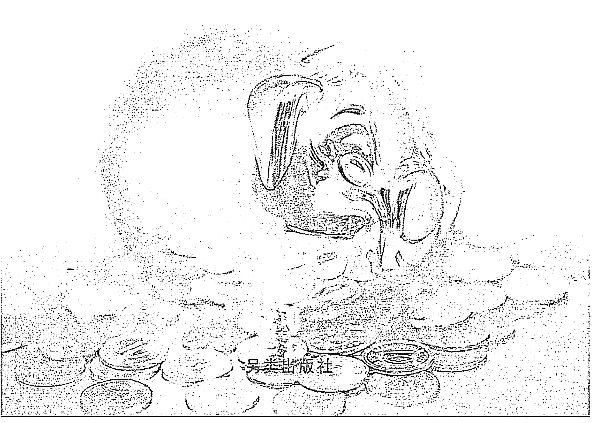
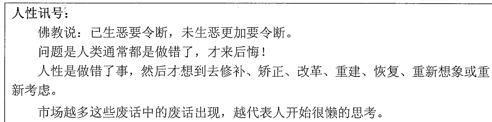
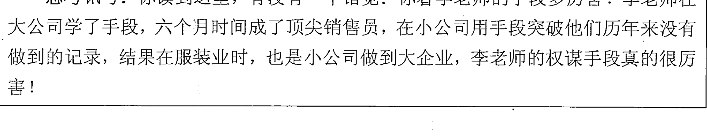

# 奸的好人8-有钱人的偏方

# 如何在资讯群中分辨噪音与讯号

（一）

这本书能带给你什么利益？

我每次去到书店买商管书，把书拿在手上翻阅序言与目录时，总会问：「这本书到底是说什么？我能从中得到什么利益或好处？能开拓我的思想见地吗？」

赫明义先生说过：「每本书都可能是一道门户，改变我们对世界的方向，改变我们人生真正走出去的方向。」

〔英文世界里，把 read the word (阅读文字) 和实际历练人生的 read the world (阅读世界) 并称。〕

没有读过《好的好人》的读者，打开这道「窗户」，将发现打开的越早越幸运，因为从这道「窗户」看出去，会发现原来外面的世界，竟然有那么多的噪音迷惑我们，导致我们失去了方向，用错了方法——外面的噪音会要求你在一间黑房里面，寻找一只根本不存在的黑猫！

读过《好的好人》的读者会发出冷笑，因为这本书对他们来说不是「窗户」，而是「门户」，从这道「门户」走出去，发现竟然有人迷信黑房里是有一只黑猫，原来人是这么容易被噪音迷惑，只要我发放这类「黑房寻猫」的噪音，我将能迷惑他人的判断，改变他人的方向。

因此，即使你在黑暗中亦能取得胜利。

你成功了吗？

我可以估计你去到书店，即使蒙着双眼，双手在商业或心理励志类的书架乱摸，你也一定会找到一本教你如何成功、教你如何变成有钱人的书。

市场上这么多教你如何成功的书，你都一一看完，甚至上了他们的课程，请问你成功了吗？

现在流行一个说法：有钱人=成功者。

根据我的定义，我不会将成功者等同于有钱人，不过，在这本书里，我暂且采取「有钱人=成功者」的说法，以「应酬」兼「迎合」大众的说法。

## 把大师杀死

无论购买这本书的读者是不是有钱人，我只想告诉那些读过很多商业励志书和上过很多课程的人，我知道你们寻找过很多变成有钱人的法则或定律，结果你一一尝试之后，人生还是没有任何改变。

我衷心希望你能扪心自问：为什么？

是你特别笨吗？

我希望你看了这本书后，不需要再浪费「冤枉钱」寻找大师教你成功！

因为这个世界上根本就没有一位大师能教你成功，你要走的路就是把大师「杀死」，取而代之由你自己来做「大师」！

## 「八字真言」思考法

问题是，没有大师给你指导，你以后的路要怎么走？

假如你觉得自己还是「有需要」上课的话，我倒是建议你，从此以后只是上教你营销技巧或管理策略的课程，而不是那种教你改变心态或教你成功法则的激励课程。

倘若你掌握本书教你的「八字真言」思考法，并当作手段运用，以「人生三大境界」作为修炼，把握你能控制与不能控制之间的拿捏，今后你根本无须上课，只是看书就能掌握到你想要的资讯。

（二）

## 给有钱人几句话

已经是有了钱人的读者，我也希望你能扪心自问，回想你在「成功前」、「成功中」、「成功后」的心态与想法。假设你要指导他人，到底你是以哪颗心来指导？

我的意思是，你用现在「成功后」的观念来教导人呢？

还是以「成功中」的观念给人指引？

抑或你用「成功前」的想法给人提示呢？

- 我相信大多数人是选择用成功后的观念来给人指导，这些人会告诉你，他希望后来者不要走他曾经走过的冤枉路。

## 馒头与叉烧包

比如说一个有钱人告诉你他用过的一百招如何成功，你听这一百招时，故事性很强、戏剧味十足、高潮迭起、高潮中又出现反高潮，也许整个过程经过他精挑细选的剪辑，当你乍听之下，你「好像」觉得这一百招就是他成功的秘密口诀，不过他将其中的一个关键真相隐藏起来：原来其产品的价钱在市场上是很有竞争力的。

讲白一点，他是靠斗价钱起家的，但这位有钱人并没有讲假话骗你，他确实实用过一百招，只不过他制胜的关键是用最低的价钱抢顾客。

他隐藏了这个资讯，像不像叫你在黑房里用他那一百招捉一只根本不存在的黑猫呢？

譬如：有一个人饿得发慌，他走到厨房寻找有什么可吃的，结果他找到七个馒头，他想也不想就放进嘴巴。吃下肚子后还是觉得不饱，于是他在厨房再找两个叉烧包吃，终于有了吃饱的感觉。

后来有一次，他看到朋友吃馒头，就说：「假如你肚子饿，不要吃馒头，你只需要吃两个叉烧包就足够了。吃得多不够多不重要，而是你要吃得饱，饱不饱不是数量的问题，而是质量的问题，叉烧包有肉馅，所以比较容易吃得饱！」

看过《好的好人》系列作品的读者就知道这是假逻辑，浪漫废话。至于叉烧包有肉较饱就是事后孔明的合理化解释。

对不起，他忘了告诉你，之前他吃了七个馒头，他隐藏了这个资讯。你猜猜看，假如这位仁兄吃十个馒头，他会饱吗？

他现在给朋友的指示：只吃两个叉烧包就足够，是不想他的朋友重复他走过的冤枉路。问题是，他之前吃的馒头「真的」是冤枉路吗？

（三）

## 只读《好的好人》作品对不对？

我本身是一个开办课程的职业演说家，参加课程的学员有中国、台湾、香港、澳门、新加坡、马来西亚等各地人，我也见过各行各业的学员，他们都告诉我：「自从读过《好的好人》系列，上过权谋课程，市场上很多书或课程，我现在都看不入眼了！」

但我真心劝告这些支持我们的读者，千万不要有这个想法。我们写书与办课程是用了一些影响人的策略与手段，市场还是有很多很有价值的书，这些书的写法未必会用勾魂夺心洗脑，未必会像我们写书般，用一个接替一个的悬疑故事，教你一招之后再告诉你原来里面还有另一招。

我们写书是用这种多重路线发展来布局的，市场上一些书是没有杂质的，一个故事一个结论，因此，「信奉」我们那套写书模式的人，请给自己多点耐心，开放自己的思想，多读其他有价值的书。

不要只看到用策略包装下的讯号（被我们写书的方法引诱到你一页又一页读下去，感觉上好像学到很多招），其实你要跳出局外，看我们写书的模式是怎样透过「八字真言」来影响人，使你觉得我们好像很厉害。

看完这本书，我会出一则考题，要你们做功课，回复一封你读书心得的分析报告给我。

注意，一本书有没有营养，跟读的过不过瘾是两回事！你千万不要被「读的过瘾」这个沿途风光骗了你！你要学会从那些很平实、淡如白开水，没有经过策略包装的书中，找到你要的资讯。

读我们的书，你是要学会从「读的很过瘾」找到影响人的手段，把我们的书变成你们的武器。

（四）

## 我有亿万富豪的亲戚朋友

我有一位亲戚，她在 2005 年开始营商，当时她的公司只有区区的马币 34 万令吉，到了现在（2008 年），她拥有的资产，包括别墅式楼房共计马币 750 万令吉，收租的店铺有马币 450 万令吉，这家公司只是用短短的三年时间累积的资产计有马币千万令吉以上。

虽然这家公司仍处在开始阶段，还有很大的发展空间，但我想说的是，这家公司在成长过程中并没有用过市场上那些大师的成功资讯，即使我曾给予这位亲戚意见，但我也没有改变过这位亲戚头脑内在的金钱蓝图（信念与想法），她的金钱蓝图与美国某大师的金钱蓝图是相反的，她是悲观主义者。

注意，很多人在追求成功时，过程有太多迷茫，往往都需要一颗「强心剂」，换句话说，他们希望有人可以骗他，告诉他：「成功的方法就是 ABC。」

当你看穿人性，你会发现人总希望事情一帆风顺、水涨船高，只要给他一套指令就天下太平，换个角度，你也发现，人是很容易骗的，你只要告诉他，你就是有这套秘密指令的人。

## 亿万富豪没有上课

我甚至亲眼看到我的另一位亲戚如何从零开始，他的企业现在已经发展到在比利时购置饭店。他是马来西亚的亿万富豪，与邻国政府一起发展一个工业城镇，不少台商都可能接触过这位富豪。

我至少有五位富豪亲戚，不过我要偷偷告诉你们，他们这五位富豪，根本就没有上过什么改变心态、调整想法、变有钱人的课程！

他们没有这个时间，也没有这个心思。

我的一位学员在他的网志写过这句话：「没有上课不是你失败的借口。」

注意，你可以将这句话举一反三推论：

有上课不是你成功的理由，没有上课也不是你失败的原因。

我认识马来西亚的富豪当中，十之八九是不上课的。

不过，你也要小心，我并没说过，他们不上课程就代表他们成功，上课与成功没有任何直接关系，你把「上课」态度看成是需要与不需要、有兴趣与没有兴趣就够了。

上课不是你成功的必需品，而是你的选择。

千万记得：教你的人不是大师，教你的人只是将他收集回来的资讯卖给你，这是一项交易，不是什么神圣的大事，仅此而已。

## 「大师」是怎样整理资讯的呢？

话虽如此，我还是要告诉你，教你成功或者变成有钱人的课程或书籍，里头的资讯到底是怎样整理出来的呢？（注意，这点是非常重要的。）

我将之分成两种：有专业精神和没有专业精神。

先说没有专业精神的，这类讲师你很容易察觉，目前东亚四地最流行什么书，他们就跟风大谈那些书，比如流行《地球是平的》，他就告诉你「地球是平的」；当《蓝海策略》盛行，他就教你「蓝海策略」。

既然他是跟风者，我教你一个方法，你看到底哪本书是市面上连续三个月在畅销书排行榜的第一名，你买来看就对了。碰到这种不专业的讲师，你读书比上课更好。

有专业精神的，收集到的资讯会经过他的大脑过滤，比如说，他可以看一百本书整理这些资讯，并在整理过程会对这些资讯进行反复思考。

不过，你有没有想过，即使是经过他的大脑过滤，你又如何得知，他整理出来的是有用的资讯呢？最可悲的是，很多人会将噪音当作讯号告诉你。

我建议你，不妨参考《将孙子兵法变成毒药》那一篇。当你读透这一篇，你就学会怎样透过阅读整理你的资讯，怎样将一本书变成你的武器。

不过你要注意，你还是要多学一招，否则你拿到的就可能不是武器，所以你要学会如何粉碎噪音的思考方法。（注：你看到我怎样出招吧？这就是一招里面还有另一招的手段。）

我在「瞎猫致富后的禁区」、「成功资讯的误区」提到存活偏差的概率，就是想告诉你，对市场上所谓成功理论，要进行反复推敲与过滤，用存活偏差概率的态度质疑这些资讯。

研究成功者的方法其实就好像《抓屁股也能做大师》写的比喻，一群猴子在计算机键盘敲打出《有钱人的偏方》后，看到猴子打字的人纷纷研究这群猴子的特性，还会大事渲染：连猴子也会写书！

市场上有很多理论听起来好像很有道理，你在追求成功的过程，最容易被这种沿途风光所迷惑，你不能错把「沿途风光」当作是「本地风光」，把废话奉为金科玉律。

美国某位管理学教授贺伯楚，最喜欢开出一堆书单要求学生自行阅读。当学生按书单把书读完后，往往嘴巴张得合不起来，因为这些书的观点都是互相对立的，于是教授在课室内要他们争论到底何者为对、何者为错。

你有没有想过，当你懂得粉碎噪音，懂得怎样整理资讯，如何将一本书变成你的武器，你已经可以做「大师」了。

（五）

## 出口伤人的招数

曾有学员告诉我，她想要改变人生，不要再让人看不起。我听到这些话，用一招手段来伤害她的自尊心，「当你问这个问题时，我就会看不起你，因为我估计你一定没有钱，你还没有成功！」

接着我会稍停看她有什么反应。我看到她的泪水在眼眶内滚动，这时我拍拍她的肩膀安慰说：「一念天堂，一念地狱！我刚才是故意要伤害你，这个世界有太多的不公平，没有人会在意你的自尊。假如你还没有建立过任何『纬续』，没有人会在意你的自尊、感受，他们也不会认真地想，到底你是不是千里马。直到你真的做出一点『纬续』，你的伯乐才会出现，人们看到的不是原因、过程，而是你当下的成就！」

曾经有一次，我在部落格上用这招来应对一位台湾读者，他看了我的留言很气愤，他告诉我，只要你说他不好，他的表现就会越差，目的是让批评他的人很生气地再骂他自暴自弃，然后他以下属的表情来听训，以反向的态度来气你，即使你是他的老板，你要Fire他也没关系。

他还说，身边的人只要比他强，心情就不好，但是他又会依赖这种人来帮我决策，因为下不了决定。然而又因此觉得自己无能。（矛盾的心态）

他说，如果和强者在一起，绝对不是牧者而是羊群，可是他若只和比他糟的人相处，虽然没压力，但又看不起他们，因为和弱者在一起，又觉得自己也变成了弱者，所以会有「为什么你们不强一点呢？害我被归类成你们这种人」的想法。

有一次他为了想气自己的家人，竟然告诉家人他最想当乞丐，反正奋斗了大半生都没有成就。而他最大的本事就是把事情给搞砸。

他的目的就是气他的家人。

我是想问，你做销售被拒绝了，心情会怎样？

你有一个新点子想告诉敬佩的大老板，你怕不怕听到他反对你的声音？

你看到比你差的人，成就比你大，你的心情会如何？

你看到朋友用三年时间就成功了，你还没有成功，你会不会觉得自己很笨？

你有没有经常觉得，这些理论、方法、点子，我早就知道了，只是我不做而已呢？

## 杀人的修炼法

假如你不幸被我说中这些情绪，请你小心阅读（不知道里面还有不知道的）在开始第一段，我准备粉碎这种害人的情绪噪音。我也花了不少的时间来观照这种情绪噪音，一步一步慢慢来修炼。

对于这种修炼，通常我比喻成中国禅宗的精神——遇佛杀佛，遇祖杀祖。

这种精神的目的不是要你真的发狂杀人，而是要你发狂消灭你的情绪噪音。

只要你记得李民杰在喜马拉雅山见魔鬼的比喻，然后学习观照你的情绪（其中一个间接的修炼方法就是天天写网志），当你遇到类似情景，浮现这种情绪，见一个杀一个。

（六）

达摩祖师说：「我来到中原就是要找一位不受人惑的人。」

「想要改变人生的第一步，你不要再被任何人的语言伤害、影响你的感受！」

「你无需寻找大师教你方法，把你寻找大师的想法杀死，然后告诉自己，大师已经死了，没人能教我成功，我只有靠自己杀出一条血路，因为市场就是我最好的老师！」

你要学会从趴在地上的姿态站起来。

我希望拥有这本书的读者不会孤独自上路，因此我建议读者们，有任何问题都欢迎你到我的部落格给我留言。

这本书之所以能出版，我必须感谢刘敏慧小姐用心为我做发行的工作。我也感谢练老板，借着他所主持的商业联谊饭局，促使我有机缘跟这么多不认识的人研讨交流。

我更要感激江健勇老师把我拉进讲师界，开了我的眼界。

此外，我也感谢购买这本书的读者。

欢迎你浏览我的部落格：http://hk.myblog.yahoo.com/kofflee 提出你对本书的意见与批评，无论你有什么问题，请私下留言给我，我会尽量抽出时间回答你的问题。

# 序 幕

洞察天机，乘风破浪，此谓时机造英雄？

与风作浪，力转乾坤，此谓英雄造时势？

# 不知道里面还有不知道的

（一）

## 静坐中出现的菩萨

出席练老板主持的商联饭局当嘉宾，我抛出一个夸张虚构的故事：

李民杰完成了《有钱人的偏方》后，爬到喜马拉雅山静坐，希望透过静坐的心力放出讯号给有缘的众生。突然光明显现，在光明圈中有一相貌慈悲的菩萨出现，她摸了一摸李民杰的头顶，然后就跟他说：「善信李民杰，你有什么愿望是要我替你实现的，就尽管说出来吧！」

科学家对犹太教、基督教、回教这三个宗教的神迹做过研究：「为什么神迹总是发生在高山上？」

山，对于宗教修炼者来说非常重要，往往都是神迹出现的地方。

像摩西在西奈山上看到燃烧的荆棘和听到火光中传出声音，耶稣的徒弟在黒门山亲眼看到耶稣变形，穆罕默德在希拉山上遇到天使，最著名的是有千多人在墨西哥的帕特雅山上看到圣母出现。

这些山上的体验，无论是听到声音，看到形体，看到某个人（真实的人）身上发出光明，或者看到自己的第二个身体出现，科学家说，很可能是在高山上压力造成脑内吗啡增高，促使人类出现的幻象。

虽然李民杰有上述知识，但他不管真假，还是先许了愿再说。他告诉菩萨，想要成为亚洲最爆红的作家，《有钱人的偏方》这本书要狂销一百万本。

## 一个后悔的愿望

他的理由很简单，说出来还有机会，不说出来什么机会都没有了，即使是幻觉，最多是空欢喜一场，反正不会有什么损失。

不过，当他说出狂销一百万本后，又开始后悔，他想：「会不会讲得太大？万一菩萨不答应怎么办？为什么心头要那么大？」

还好，菩萨说：「没问题，不过你要给我一年时间帮你实现这个愿望，到时候有什么问题，你再回来找我。」说完就消失于光明圈内。李豪杰呼出一口气：心想：「还好，菩萨这么爽快地答应，菩萨真的很慈悲，但我也不要执着……」

瞬间，李豪杰更加后悔：「既然是见到菩萨，为什么要讲这么小的要求，讲十三亿本不是更好吗？」

一年之后，李豪杰真的成为亚洲爆红作家，《有钱人的偏方》狂销一百万本，不多不少，数字刚刚好。

可是在一年半之后，有一位新晋作家陈宝发，他写的《有钱人的正方》比李豪杰更爆红，狂销三百万本，市场上的读者都说陈宝发写得比李豪杰出色，还说：「不比还好，一比高下立判。」

偏偏这个人正是李豪杰从小到大的仇人。

最不忿的是他只是用了短短六个月时间就让李豪杰更有钱，得到的赞扬也比李豪杰多。

正巧陈宝发与李豪杰又住在同一栋高级公寓，陈宝发是住在五千平方尺的阁楼，李豪杰就住在他的楼下。

有一次，陈宝发在升降机内与李豪杰相遇，他温柔地拉住太太与小孩的手说：「你看到这位叔叔吗？他从小到大都被我欺压，到了今天，他虽然是当红作家，不过我只是出书六个月就超越了他，以后千万不要像这位叔叔，被人骑住一辈子。」

## 静坐中出现了恶魔

李豪杰听了非常愤怒，再次爬到喜马拉雅山静坐，光明圈再次浮现，这次出现的是三头六臂的恶魔。

他问：「为什么是你？你不是菩萨？我不是要找你，请你离开。」

魔鬼说：「哈哈，上次的菩萨是我假扮的，我先用一年时间扶你起来，然后用六个月时间扶你的仇人起来压住你，目的就是要你有憎恨的心理。我希望你好像我一样内心充满不平、忿恨、妒忌……现在我让你说第二个愿望，我帮助你实现。」

李豪杰说：「我要一年出三本书，本本狂销一千万本！」他心想，我用第二本书，第三本书来赢你，没有理由十本加起来还是不能超越陈宝发吧！？李豪杰想到这里，内心难免得得意忘形。

魔鬼似看透他的心思，说：「没问题，如你所愿！你的第二个愿望在一个星期后即会实现，但我必须告诉你，你达成愿望的第三天，你的仇人的书将狂销一亿本，这次比你多十倍，他还是会压住你。」

李豪杰虽然有点生气，但奈何他是魔鬼，没他办法，真的傻了眼不知道如何响应？

# 李民杰的第三个愿望

李民杰，我给你最后一次机会，你的第三个愿望是什么？不过我得警告你，这次无论你许什么愿望，你的仇人得到的将会比你多出三十倍！

## 仇人会比我更加好，怎么办？

故事说完了，回到现实世界，我看着饭局中的朋友，我问他们：「如果你是我，你的第三个愿望会是什么？」

有一位仁兄大声说：「我要负债三十亿！哈哈，我破产之后，我的仇人将比我惨三十倍！他不死都没有用！」

听到他的话，大家都笑弯了腰。

另一位仁兄说：「第三个愿望是，我要狂销十三亿本书。即使我的仇人卖出兆本以上都跟我没有任何关系。」

魔鬼可以帮我实现愿望，这个是我可以再进一步的机会，但我的仇人比我更好，他会继续压住我，歧视我，其实是干扰我的噪音。（仇视妒忌可以模糊你的视线）

## 我要做大

在真实的世界里，我听过两位股东的交谈。

A 说：「我们跟 C 合作的话，生产成本会减低，有他工厂的资源配合，加上我们的销售通路，我们有办法增加三倍的生意量。」

B 说：「不！我们现在跟 C 合作的话，会无缘无故也把 C 拉起来。」

A 说：「我们也能因此壮大起来啊！」

B 说：「不！我情愿自己先不要这么快壮大起来，也不要把 C 拉起来。这么快就把 C 拉起来，以后谁是大爷？」

A 一脸惊讶，说不出一句话，其实 A 心里的疑问是：

这有什么关系？你不是应关心自己怎样壮大吗？

即使 C 跟着壮大，那又有什么关系呢？我们跟 C 又不是仇人。

到底赚钱比较重要，还是做老大比较重要？

你介意人家在你背后讲你的坏话吗？你会不会很介意他人对你的看法？

你怕人家看不起你？你提出来的意见，怕听到反对的声音吗？

你怕被拒绝吗？你看到与你同期出道的人比你厉害，你有什么感受？

比你差的人超越了你的成就，你作何感想？

想要敌人死得比自己更惨的仁兄，他的敌人即使比他惨三十倍，但他自己也好不到哪里——他已经负债三十亿了。

被仇人超越了自己，输了给那个比我笨十倍的傻瓜，或不想无缘无故带起第三者，为了做老大而牺牲自己的进步与突破，这种种情绪噪音会干扰到你吗？

## 合理化解释是你的毒药

我也看过一些人，看到人家的成就大，就合理解释自己为什么不如人，比如说「这个人是靠不道德的手段起家，他的后代一定不好过」、「我们不是要走这种取悦消费者的路线」、「我们的产品是另类产品，不需要狂销，他的产品现在虽然很畅销，能不能成为长销品还是问题……」

「哦，这个人之所以能这么成功，是因为他会用这个策略，这个策略我也会，只不过我暂时还没有时间整理……」

换了是我，我立刻放下身段，承认自己不如人。

虽然我还是有不服气的情绪，不过事实是如此，我不得不低头，但我却在不如人的情境中看到一个我需要思考的讯号：他到底做了什么，而我是没有照着做的。（如果是陈宝发每三个月出一本书，即使我的智慧不如他，我也要做到每四个月出一本书。）

虽然我是追着闻他的屁风，仇人还是继续比我好，但这与我无关。就是因为我肯追闻屁风，我相信我会比以前更好，这才是我要的出路！

你是能否从仇人超越自己、他人成就比自己大，看到自己原来还有很大的成长空间呢？

有机会改变，你为什么不试着去改变呢？

记住，当你去银行存钱，银行不会因为你是一个开创者而给你红利，同样的，当你追闻屁风的人，银行也不会因此而给你罚款！

当你掌握了这个想法，你还需要看透以下的讯号。

## （二）被困荒岛的残局

接着，我在饭局上继续跟他们讨论一个有趣的话题：

「假如你被困在无人的荒岛上，上天让你选一个人陪你，你会选谁？」

我停了一下，继续说：「答案可以天马行空。」

在此，我要求你不要读下去，请用约一分钟的时间随意猜想，将你想到的答案写在纸上就可以了。

我在饭局中得到的答案大致如下：

- 有人选知心好友陪他们。
- 也有人选太太、情人、美女。
  - 他们说上帝造人是以「阴」的夏娃配「阳」的亚当，这个荒岛就由性与爱开始繁殖，最好是有国际「性」交流。
- 有位仁兄选父母或孩子。
  - 我问他，为什么呢？
  - 「选择父母，是希望照顾他们以尽孝道；选择孩子，是希望能照顾到自己的孩子。」
  - 好一个孝顺的孩子，好一个慈爱的爸爸，不过……你有没有想过会害了 They？

## 我情愿老死荒岛

还有一位仁兄什么人都不要，情愿自己孤独一生老死在荒岛。

我追问他为什么要这么悲情呢？

他告诉我：「被困荒岛已经很可怜了，我不想其它人也跟我一起受苦，自己辛苦就好了，为什么还要害他人呢（连累他人）？」

自己被围已经是苦透了，但大部分人头脑快闪而出的第一念头是：不想自己一个人承受所有的患难（在荒岛是孤独的），希望身边的人可以和他患难与共。

这位仁兄虽然英雄，不过会不会英雄到有点……

那位说想要负债三十亿的仁兄告诉我：「我要选我的敌人，看到敌人来到荒岛，我就会很开心。我自己被困已经很惨，没有理由让敌人在外头快乐逍遥。」

自己被围了，还会想到要敌人一起受苦，佩服！

## 魔法师与超人

也有人说害怕孤独：「希望有魔法师与阿拉丁神灯的出现，叫他们变出食物、宫殿、美女。」

对于这些人，我很好奇的是：他们既然能天马行空地幻想出神灯、魔法师，为什么就只想到如何在荒岛度过他的余生？

为什么不说：我要超人带我飞离荒岛、我要魔法师把我变回到城市去、我对阿拉丁神灯许的第一个愿望是马上离开这个荒岛，或者，希望造船最快最厉害的专家来陪我，帮助他尽快离开荒岛。

从他们的回答中，我还是看到这两样：「噪音」与「讯号」。

- 「被困荒岛」这句话是干扰你思考的「噪音」，任你天马行空地幻想是你逃离荒岛的「讯号」。

这个问题的前提，我预设了你被困荒岛，预设的前提固然是你不能控制的范围，但我假设你天马行空地理想，只要你不被预设的前提锁住你，控制权其实是回到你的手上。

如果你被「被困荒岛」这个预设的前提（噪音）迷惑，你思考空间只是想着如何在荒岛度过余生，就像坠入黑幕而看不到其它。

要是你看穿天马行空地幻想（讯号），这个幻想就是你能控制的啊！

这就是「不能控制」与「能控制」之间的拿捏。

## （三）女妖与英雄

古希腊神话故事中的英雄奥德修斯，带领自己的军队想要收服海岛上的女妖，传说女妖的歌声甜美，如《射雕英雄传》故事里的东邪黄药师能吹出迷惑人心的箫声，只要听到女妖的歌声，人就会看到很多幻象，然后跳海自杀。

奥德修斯要与女妖决斗，并想间接告诉女妖：「其实你的歌声对我的军队起不了任何作用。」

他制造了很多木塞，吩咐部队都用木塞塞住耳朵，接近海岛时，奥德修斯命令下属把自己绑在桅竿上，女妖知道奥德修斯驾船而至，唱起诱惑人心的歌声，奥德修斯虽被诱惑，看到很多幻象，奈何无法挣脱，直达海岛后，英雄选出了一招来干扰女妖——要求跟女妖对话。一女妖还以为自己的歌声无法迷惑这位盖世英雄，于是与他展开一场不用妖术「真正」的武斗。

故事当然是说没用妖术后的女妖打输了，不过你们有没有发现，女妖也是被奥德修斯「不受歌声迷惑」的噪音干扰，她不知道的真相是兵士的耳朵有木塞，奥德修斯是被绑在桅竿上的。

读了上面一则故事，我想到另一则朋友告诉我，「女妖迷惑人心」现代版故事：

张三觉得自己是一个意志坚强的人，他对喜欢养鸟的李四说：「我这一生是不会养鸟的。」

李四告诉张三：「当因缘和合，客观条件加在一起，我是有办法令到一个不养鸟的人从此养鸟，人类的意志是很薄弱的，人性是很难经的起考验的啊！」

## 空鸟笼与八卦话题

于是李四买了一个很精美的鸟笼，要求张三在办公室挂起来，尤其是要让其他人看到。

李四说：「在未来的三个月内，只要你不让这个空鸟笼除下来，很有可能会改变你的想法。」

张三认为人最宝贵的就是自由的意志，自己可以控制自己的选择，他有钱有权有头脑又有选择权，他认为真金不怕红炉火，于是接受挑战，挂就挂吧！只要我意志坚定，是不会有人影响我的。因此张三就将李四买给他的精美古董鸟笼，挂在办公室内人人看得得见的地方。

挂上鸟笼的第一天，许多员工看到了就问张三：「老板，你准备养鸟吗？」

如果张三是学过权谋的话，他会直接告诉对方：「不！我是跟朋友打赌，他说，只要我挂上空鸟笼，三个月后我就会养鸟，真是傻瓜！」

要注意，他如此每见一人就替自己洗脸一次，才会意志坚定。

不过这个故事的发展是没有权谋思想的，只有正常的人性反应，故事中张三觉得不好意思将这个「傻瓜打赌」的行为说出来，他认为如果照直说会被人笑。

所以张三不想解释这么多，只是笑笑说：「不！朋友送的。」员工想无话找些话题来聊，看着空鸟笼说：「老板的鸟笼很美，不如养只 ABC 鸟，让你的办公室多一点鸟叫声，不是更加完美吗？」

## 一片好意迷惑了张三

之后，有供应商来到，看到空鸟笼，借此打开话题，就像你看到某女拉住小狗，你跟她半开玩笑说：「这是你的男朋友？」

牵小狗的女主人会笑说：「她是女的。」有了这样的开场白，你们就容易展开话题。

供应商也是准备用这样的交谈策略，因此问张三：「张老板，你的鸟死了吗？你喜欢什么鸟？我送一只给你……」

张三心想，人家是一片好意，他只能笑笑说：「谢谢你，不必啦，迟点我的太太会买回来的，这鸟笼是朋友送的……」张三这样说的目的是真的很怕顾客或供应商会送鸟给他，他只好无可奈何地用这一句话来打发这些人。

直到某一天，张三的太太来到办公室，看到这精美的鸟笼很有古典味道，在没有经过张三的同意下，就自作主张买了一只鸟放进鸟笼。张三本来想偷偷放走这只鸟，可是他的办公室人潮络绎不绝，每个人来都会吹口哨逗弄这只小鸟，并谈谈「鸟经」，渐渐地张三也听多了，开始觉得养鸟还蛮有乐趣的，因此开始心甘情愿地养起鸟来。

空鸟笼与噪音终于折服了自以为意志坚定的张三。

讲一百次的谎言真的会变成真理。

每个人都有「盲从门坎」，只怕是你喜欢合理化的事后解释，因为我们的大脑内住了一一个骗子，每个人都会为了面子（外在形象）合理解释自己的傻瓜行为，因此你才有机会看到（真的）。有人误以为烧了钞票之后，会变成跟有钱人一样的想法。

## 英雄不受诱惑

在欧洲有一位国王，他的父亲原本是丹麦与英国的国王，后来遭人背叛，这位太子最终率领军队收复了英国，甚至打到挪威，成了一代欧洲大帝。

有一次，这位欧洲大帝在海边散步，群臣跟随其后面。这批大臣可能读过金庸小说《天龙八部》，学起丁春秋那套「文成武德、千秋万世」歌功颂德的马屁，这位受了一点令狐冲气氛影响的欧洲大帝停了脚步，面向大海，看着潮水迎面而来。哗啦哗啦，海水打在大帝的身上，他突然问身边的人：「你说我是真命天子吗？」

群臣学了激励课程的笨蛋做法，齐声高喊：「是！」

大帝见这群笨蛋中了一招陪讲还不自觉，于是再问：「你们觉得我是上天派来的大帝吗？」

就像你所知道的笨蛋激励课程，在下面的群众第二次的叫喊声一定会比第一次声量更大，否则又怎能称之为「笨蛋激励课程」呢？而在「是！」呼声巨响后，大帝嘿嘿一声冷笑再问：「等下浪海打过来，你们跟我双掌往前一推，高喊「大海无量」，看看我们能否吓退海浪。」

你知道啦，上过太多激励课程的人，一定会不假思索，又一声：「是！」

海浪终于打来了，大帝双掌一推，众兵士也跟着双掌一推，整齐兼有纪律，就像徐克拍的《黄飞鸿》第一集中那般海边练武的气势，大帝与群臣齐声大喊：「大海无量，海浪你给我退！」

结果海浪还是迎面打向大帝，众人都湿透了，大帝头也不回，冷冷地道：「我们原来并没有这么厉害，我们还是很平凡的人。」

这则历史故事固然是用来歌颂这位欧洲大帝不受人惑的精明，问题是当掌权者权力开始膨胀时，又有多少位仁兄不是自以为可以征服世界的呢？还有，我估计这位欧洲大帝绝对不是狂妄迷失本心的自恋者，不会收集人们「赞誉的噪音」来壮大自己爱慕虚荣之心。（矛盾的是，我认为人是有适度的自恋，但不能有过度的自恋。）

请问，能当上老大的人是不是就有超强的能力呢？

或许是，或许不是。

其实我在《瞎猫不提老鼠致富法》里也有「李民杰是爆红作家」的比喻，我扪心自问，假如我因为瞎猫碰上死老鼠而爆红，我能否有这位欧洲大帝那样清醒的头脑，看到自己的不足之处吗？

## 心慌慌，乱乱按

心理学家做过一个音响与灯光的实验：心理学家找出一百个受试者（音乐人），把这些放在一个实验室里，并告诉他们，在这个实验室内他们会播放音乐，受试者需要控制按钮，以调控房内灯光。

真相是：这些按钮是虚设的，即使他们碰按钮，灯光也不是根据他们的控制闪亮，而是随机式自动化闪亮，而且这些灯光不是随着音乐起舞，其节奏是不对称的。

实验结果：这一百位音乐人本想控制好灯光，可是却没有按出他们想要的效果，因为这些控制钮是虚设的，他们本想按红灯，却放出绿灯，最后他们根本是在心慌慌，乱乱按。

但身为音乐人的受试者走出实验室却互相吹捧自己做得如何的棒！

甚至还长篇大论向心理学家合理化解释刚才自己为什么要放绿灯，到了什么阶段要放红灯，一百位受试者，不超过十位肯承认自己根本控制不好。

社会心理学家这个实验的目的就是要告诉你，不要太相信带有光环成功人士所告诉你的资讯，他们都很容易一厢情愿地高估自己的能力，并事后合理解释成功或失败的原因。

## （四）你们不知道你们不知道的

纳西姆·尼古拉斯·塔雷伯说过一句震撼人心的话：「我们不知道我们不知道的。」

「横看成岭侧成峰，远近高低各不同；不识庐山真面目，只缘身在此山中。」这是苏东坡非常著名的诗句。

「洞察天机，乘风扬帆，此谓时势造英雄；兴风作浪，力转乾坤，此谓英雄造时势。」

你相信这句话吗？真实的世界到底是我们不知道我们不知道的呢？还是洞察天机，乘风扬帆？

虽然我是教权谋的讲师，但也不敢告诉你，用权谋手段能做到「兴风作浪，力转乾坤」。

我们在奋斗当中就是「只缘身在此山中」，什么「洞察天机，乘风扬帆」都是骗人的鬼话！

只要你不「心慌慌，乱乱按」，已经是了不起的大事了。或许那批音乐人按了第一个控制钮后发觉不对称，能立刻停下手不控制，还能窥破这个实验真相（骗局）呢。

## 十个富豪八个不上课

市面上有许多人或书都在告诉你所谓的成功秘方，其实这些资讯都误导了那些渴望成功的人，我做讲师数年的经验，让我看到很多奋斗中，想要成功的人越求知就越糊涂，结果被引入迷宫，这不正是苏东坡说的「不识庐山真面目，只缘身在此山中」吗？

有时候，我会想：到底是讲师的问题还是频频上课者的问题？是先有需要，还是先有供应？

促使我有这个想法，全因我认识的富豪，十个当中有八个是没有上课的需要。我经常思考：假如一个人想要成功，他第一件要学的是什么紧要的事呢？苏格拉底曾经说过，他最大的智慧源泉来自于他的无知。

我们从小到大就是往「学习知道什么」这个方向走。但我们从没有思考过：原来我们并不知道自己不知道的（注意，邓小平说「摸石过河论」，他治理国家尚且如此，何况是经营生意）。

出来教课让我见识到许多群众的痴迷，我今现金刚怒目相，在万里上空驾驶 B-2 隐身轰炸机，看到迷宫中的禁区、误区、死区、迷区，放下万吨「隐藏讯号」的炸弹将之炸个稀巴烂，还会将人们的思想绑在桅杆上不受女妖歌声迷惑，反过来影响女妖错觉自己的妖术失效，只有将迷宫炸毁，等烟雾散去，看不到预设在你面前的围墙，从什么都没有的废墟、平地重新开始，我们才得以重生。

注意，即使给你知道了「原来我们不知道我们不知道的」，接下去我们又该用怎样的思考方式来应对我们的人生呢？（按：你看，又是一招之后还有另一招的策划，既然你学了一招，我现在告诉你后面还有一招，没有理由你不继续「乖乖」听下去的。）

## （五）讲了等于没讲

权谋派有一位学员是股票经纪，他在部落格上自称平凡的贸易商。他写过一篇网志来回答投资股市的资讯，并用「阴阳二分」来解释与回应。

A 先生问平凡贸易商：「平凡先生，请问马来西亚唯一的赌场，这家公司可以买吗？现在是不是好时机？跌完了吗？」

平凡说：「你可以从阴阳二分法来看，『阳』的部份是看他的业绩年报表、多年来的图表走势、我国经济数字、新加坡开赌场的趋势、赌场老板的脾气和个性等，这些资讯都是公开的，是大家都可以做的功课，这种功课，我们可以用『秀才不出门，能知天下事』来形容。」

平凡继续说：「但，我们也不能单从『阳』来分析，我们也要学习从『阴』的角度下手研究，就是说看大家一般看不到的部份，这些不是资料与数字，而是发生在现实生活当中，因此我不得不说，读万卷书不如行万里路，千里之行始于足下。」

原来你真的可以「秀才不出门能知天下事」，不过你也要知道「读万卷书不如行万里路」，关键在于，有些资讯是摊在阳光底下的；有些资讯则锁在保险箱内，到底你有什么思考的钥匙可以打开锁在保险箱内的资讯呢？

A 先生虽然有些不满，但无奈有求于人，不得不低声下气说：「请问你～（A 特意指长「你」这个音），是什么意思呢？」

平凡说：「我的意思就是说，你上山到云顶赌场时，有时候不必驾车去，你不妨在平时，非假日繁忙时间，搭巴士上去。在总巴士站查问每天有多少趟车是上云顶的？而吉隆坡到底有几个据点提供巴士送你去山顶赌场？记得要计算这些据点每天有多少趟车；四处打听一下，马来西亚几个小镇是有组织巴士上山？每天有多少趟？甚至到他们的饭店看看，旅游巴士多吗？进到赌场后，你要留意他们开了多少张赌桌，不是计算每桌满不满人，而是计算他们的开桌率，假如平日开桌率是八成……」

## 我很有钱，我会分钱给你

A 先生终于忍不住了，说：「妈的，平凡，我很有钱，你不要这么婆婆，讲了等于没讲，我根本不知道你讲的什么阴阳，巴士赌桌，什么读书走路，你以为你是教历史的吗？你告诉我买什么，我直接买，我赚到钱就分钱给你，就这么简单！」（注：以上这段对话是我自编出来的）

A 就是一位不懂得看讯号的人，他就是那种需要一套指令就天下太平的傻瓜。

平凡当然可以直接叫 A 买什么，不过，他没有这样做，他只是教 A 先生怎样从「阴阳」配合来看可以买的讯号。

A 是要知道平凡吩咐他买什么，A 是要平凡弄个什么分析工具在他的计算机，A 只知道自己想要的，却看不到平凡其实是传授着他一套思考的方法。

# 卷一

## 教你做有道德的人，可以是目的，也可以是手段。

> 罗素说：「思想具有颠覆性与革命性，破坏力强，令人生灵畏；思想可以对特权、既有体制、机械常规与偏安习性毫不留情地打破！」

## 将孙子兵法变成毒药

### 学了《孙子兵法》你也会失败

你问熟读《孙子兵法》的人：「是不是读了《孙子兵法》就能领军打仗呢？」

历史的证据告诉你，不是！

据说，历史上曾经有人问：「如果有两个人同时用孙子所教的兵法，到底谁会赢？」

答案很妙：「谁犯错，谁就会输！」

到底怎样才算是错呢？

我的答案是：你把噪音当作讯号，又把讯号当成噪音。

> 思考讯号：一个资讯，事件都会隐含了许多噪音与讯号，当你把讯号当作噪音，你就无法看清事情的全貌，可是你误把噪音当作是讯号，也会使你兵败如山倒！

这句话怎么解释？

很多人读了兵书，反被兵书所误；不过也有人刻意违反《孙子兵法》的原则，却达到击败敌人的效果！

千万别忘了「尽信书不如无书」这句话。

### 如何反用孙子兵法？

《孙子兵法》的行军篇提供许多资讯，让后学者可以看出敌军强弱的讯号，譬如：

你看到一座城楼的屋顶有许多飞鸟聚集，蜘蛛等昆虫都将之当作温柔卧床，这就是一座空城；如果你在夜间听到兵士们的惊呼哭泣呻吟，表示敌军恐惧了，不想打仗，又或许粮草不足，感染瘟疫；如果你看到敌军将他的长枪当作拐杖倚立，很可能是他们没有饭吃，手软脚软；如果你看到对方军队布阵的旗帜凌乱兼不规则地摇动，表示他...

## 资讯与噪音的辩证

们没有纪律，指挥无度，士兵惊慌迷茫……看到吧！除了空城的资讯，余者都是孙子教你解读兵士们的肢体动作与心理关系的讯号。那时代并没有心理学系，孙子能总结出这些讯号，你不得不佩服这个人的智慧。

但，你看到的是讯号，也可能是噪音。我的意思是以上的讯号解读，在阳的部份（你表面看到的资讯）可能帮到你，但也有可能会害死你。害死你的就是阴的部份（你看不到的部份），敌方可能将这个资讯变成一个毒害你的噪音。

### 一个资讯是可以正反两用的

比如说，陈大文读过《孙子兵法》，李民杰也读过，陈大文要跟李民杰打仗，李民杰可以吩咐兵士晚上惊呼哭泣呻吟，也可以叫他们将他的长枪当作拐杖倚立，甚至要求他们胡乱挥动旗帜。

如果陈大文认为《孙子兵法》是一本大师经典，是孙子的忠诚信徒，把我放出的噪音当作是进攻的讯号，他不会正反思考的方法——误认我指挥无度，领导无方，认为我的兵士惊慌失措——他随时会被我操弄。

因为他误把噪音当作讯号。

嘿嘿，只要陈大文误看到这些讯号以为是攻城最好的时机，而我就在他进攻时设下重重的陷阱，让他一步又一步掉进我预设好的杀敌阴谋，他又如何是好呢？！

- 举一反三的讯号：一个资讯是可以正反两用的。
- 联想讯号：我们常说：用人不疑，疑人不用，你可以反过来想，用人要疑，疑人要用。
- 用人不疑，可以用制度确立这个人不会贪污舞弊；疑人在用，表示宰相之肚能撑船。
- 真实世界的讯号：你翻看中国历史，你会发现开国皇帝都是用人要疑，疑人在用。
- 刘邦做了皇帝只是做到很相信萧何、张良、韩信，刘备临死时也装到很相信诸葛亮。

正如《战国策》记载，有一位将军逃难到某个村落，他发现那里的村民在将近冬天乏时，只要双手搽上某种药膏后再下水染布，他们的皮肤都不会因冷冻而导致皮肤爆裂，结果这位将军跟他们买了这个药膏的秘方。

在第二年将近冬天时，将军为他的兵士搽上这种药膏，然后渡过一条河跟敌军打仗。因为他们涉水后，皮肤不怕冷冻爆裂，于是他们将敌军半诱半逼，与他们在河流中交战，终以此药膏打赢了一场关键的战争！

染布的村民搽药膏是为了要下水染布，将军却用同样的药膏渡河打胜仗！

对！或许你能将一个资讯正反两用，但，你怎样分辨两个不同的资讯呢？

## 唯我独尊

以读《孙子兵法》为例，一个把这本兵书迷信成大师经典，把内容奉为金科玉律的忠诚信徒就有误信噪音的危机。

不过，若你尊敬孙子，但仅将他所写的兵书视为可以正反二用的资讯，分辨其中的资讯及如何将之变成噪音来干扰你的敌人，甚至也注意敌方会如何反用资讯来害你，你就增添了胜算。

能做到正反二用大师经典的人，关键要诀是四个大字：大师已死！

这句话另一层意思是，你的敌人和你都是活的，孙子或书本都是死的！

同时我也暗示你：同样的资讯，就看用的人怎样「活化」它！

甚至你可以暗笑：我能将这些资讯变成迷惑你的噪音。

真情流露的讯号：我欢迎权谋学员，千万不要把李民杰与江健勇当大师来迷信崇拜！千万不要将我们神话，把权谋手段万能化。

我的意思是：只要你不趴在地上看教你的人，把你迷信与崇拜大师的信念杀死，告诉自己「大师已死」，没有人可以教你成功，成功没有定律、法则，你还有机会分辨噪音与讯号——因为已经靠你自己了，你不能再依赖大师的明灯，市场就是你最好的明灯。

你也要像释迦牟尼佛刚出生时，一手指天，一手指地说：上天下地唯我独尊！

这个唯我独尊的精神，就是你没有人可以依靠，没有人能帮助你成功！也是释迦牟尼佛说的「依法不依人」（注：请参考（落幕：独坐大雄峰）我从香港回国的故事。）

## 两位训练大师，你要相信谁？

我曾经训练过美国 C 银行的信用卡销售员，那年头，C 国际银行提供的佣金制是：销售员签回来的顾客信用卡申请表，被银行批准一张普通的信用卡后，销售员可以取得港币三十令吉的佣金。

我根据这个资讯告诉销售员，你们跟准顾客洽谈，最重要的是「时间」——记住，你们（销售员）与每位准顾客洽谈不要超过三十分钟，如果你与顾客谈了十五分钟，觉得没有希望，就对自己说：「NEXT，下一位！」

不要再浪费你的时间与顾客纠缠。

同期的另一位讲师教的方法就是要求销售员用诚意、耐心打动准顾客，还教会他们要坚持。

激励讲师教，成功者永不放弃；我教，权谋者要计算放弃！

注意，这两个是不同的资讯，我教的是不要坚持，对方教的是要坚持，谁讲的是噪音？谁提供的是讯号呢？

这两位都是训练大师，但两位大师却提供了两个不同的方向。

到底哪个资讯才是让你成功的讯号？

## 大师万岁？

如果你趴在地上迷信激励大师，把这位激励大师当作你崇拜的偶像，激励大师就是对的；当你听到李民杰提供的资讯，根本无法听得进去。

但，如果你趴在地上迷信李民杰，把李民杰当作你崇拜的偶像，李民杰就是对的，激励大师是错的。

我要告诉你，市场效应告诉我，采取我建议的销售员，是这家银行全马二十大顶尖的销售（这家银行在马来西亚有两千位销售员，英文的商号以 C 开头，华文则称「花 X 银行」）。

当你听到这个资讯，为我高呼：李民杰大师万岁！李大师我明白了，计算后不坚持是对的！

我会说：「你的态度是错的！你必须再三翻阅《有钱人的偏方》这本书，以纠正你这种态度！」

你到底要有怎样的态度与信念呢？光看以下两个案例。

## 越坚持就越失败

我刚加入国际药厂工作时，主任就跟我们说，做生意要坚持下去，结果他带我和一位新雇销售员去见一位他「坚持」拜访三十多次都无法成交的医生，最后这位医生还将我们的药扫倒在地上。

这段故事我也记载在《勾魂夺心洗脑催眠》一书内！

当你看到我的销售主任因为坚持而被医生扫药的羞辱，请问这个真实世界发生的事，是不是说明越坚持就会越失败呢？你能否以此推论，做生意是不是要坚持的呢？

注意，市场上每个人都告诉你做生意要坚持，我却走相反路线告诉你，不要坚持，坚持是错的。你不但听到这个资讯，还看到我的证据，甚至你本身也有类似的经验——你的头脑将颠覆传统说法的「资讯」、真实世界的「证据」、结合起你有「类似痛苦的经验」——你开始觉得我李民杰很有智慧，好像很有料，还令你感同身受，你开始「错觉」李民杰就是「大师」！

告诉你，你有这个想法，都是错的！因为你被我用影响人的手段操弄了！

你有这个想法是因为你看不穿我用了「八字真书」第一个口诀来迷惑了你，所以你才有我开拓你眼界的情绪波动。

## 不坚持又坚持？

我要你有什么情绪？

我重复解释这三个步骤：

1. 你没有听过，或颠覆过往大家所知道的「资讯」；
2. 真实世界的「证据」；
3. 「类似痛苦的经验」。

尤其高手出招时，一定会在你不知道的资讯，告诉你一些细节，比如眼神、姿势、语气、环境、其它人的情绪反应、规矩。比如我告诉你，当你走进黑房的时候，你要先用左脚踏出，不能用右脚有三个原因，接着你第二步就要用双手擦你的双眼，深呼吸后放下双手，你的眼睛就会在黑房看到细弱的微光线，这种光线就一闪一闪，瞬间就消失，你根据它曾经出现过的方向寻找，你就可以找到黑猫！

用我在上文例举不坚持的案例，你一定试过「类似痛苦的经验」——拜访一位准顾客很多次，但每次都被拒绝；你也试过被准顾客刁难、羞辱。你头脑内听到这些故事，就自动提取这些相似的回忆出来，哗，你的情绪开始波动了。

接着我告诉你的证据是：相信我的人都成了这家银行的顶尖销售员。

嘿嘿，告诉你，你真的会用我教你的资讯在黑房里面寻找一只根本不存在的黑猫！

注意，我要你的头脑清楚知道我出什么招数。

一旦你知道后，接下来你的头脑就要开始思考坚持真的没有用吗？

你要用「坚持成功」与「坚持失败」这两个对立的案例开始思考。

李民杰「大师」为什么会告诉 C 银行的销售员不要坚持，为什么会有这个想法？他是根据什么来想的？

这就是我常常说的，不要学我的招数，要学我的思考方法。

## 帮忙医生扫倒药在地上

不过我要偷偷告诉你，假如我是国际药厂的销售员，我还是要想办法让这笔生意成交：我的意思是坚持继续拜访这位医生。

噪音干扰：

如果我比差一点功力的销售主任，第二天就要马上带销售员再拜访这位医生。然后将药摆在桌上再让医生扫到地上；倘若已经读过「妊的好人」的读者，一定会想到「印象洗脑术」教的盗官术，当医生把药扫倒时，主任要更加夸张帮忙医生扫自己的药，甚至丢自己的药在地上，让这位医生先进入能量最低点，然后说：「X医生，我终于等到这一天，今天，我很高兴这一天真的出现在我面前（稍等）……X医生，坦白说，我也像你一样很生气这家Y信药厂，不过今天我很荣幸用这家药厂的营业主任身份来见你，今天我不是要来做你的生意的（你真的相信吗？），我来的目的就是要跟你一样。丢Y信药来发泄…。」

看到这里，你明白我出这一「阴招」的目的吗？（除非你已经参透了这本书告诉你的讯号：「八字真言」，否则我告诉你答案、将结论写出来对你一点帮助都没有！）

对，你看到的资讯是对的，我有这个想法，就是坚持下去的态度，只不过我跟销售主任不同的是，我没有迷信坚持是成功的关键，我思考的方法是：还有什么办法使生意成交。

思考讯号：教人不要坚持的人，真心是他最能坚持。

再看另一个坚持无用论的案例：

在训练信用卡销售员时，同样发生越坚持越失败的惨剧。

一位女销售员，用诚意与耐心洽洽了一位准顾客五次，结果却被一位新晋的销售员（同公司）用十五分钟就抢走了这位「他用诚意与耐心洽谈的准顾客」。

请不要骂这位新晋的销售员不道德，因为同组有十多位销售员所得到的公司派发的名单都是相同的。销售员是靠「手快有，手慢就无（失去顾客）」的竞争法抢相同的顾客，上司才不管销售员的死活。

思考讯号：注意，你真的要注意，当你读到这里又是你要动脑筋的时刻了。试想，是不是两个证据都显示出，坚持是没有用的呢？

我的答案是：

假如你是国际药厂的销售员，你读到这两个真实世界的资讯，然后下了一个判断：做生意坚持是没有用的，嘿嘿，恭喜你掉进一个将噪音误认讯号的危机了。

告诉你，若你是国际药厂的销售员，那么坚持的态度就是对的！

思考讯号：

所以我叫你不要学我的手段，要学的是思考方法，你还是将我刚才在噪音干扰写给你知道的手段暂时忘掉吧！

不用以为一个指令天下太平，你真的是以为手段是天下无敌的吗？

我用奇怪招数对医生是有一个潜在目的，如果准顾客骂信用卡销售员：“你们一天打多少次电话给我，我跟你们说，以后不要再打这个电话！你们是不是人头猪脑！”

我是要求销售员把电话立即挂掉，不要用盗畜术。

为什么？

请参透我为什么接受对「奥客」医生用盗畜术的潜在目的。

注意，思考这问题是你们的功课之一。

注意，我提出的这个概念，如果你不够细心，就会将「讯号」扭曲成「噪音」。在国际药厂的销售员，坚持是最基本的态度，但却不是最重要的态度，因为「最基本」与「最重要」是两个不同的概念。（要是你将最基本当作最重要，结果你会变成我以前的销售主任：死不瞑目，甚至连为什么而死也不明白。）

要是信用卡销售员看了以上论点：「国际药厂的销售员，坚持是他基本的态度。」然后对我服得五体投地，誓把这个论点奉为金科玉律，当作人生座右铭，并迷信执行，「坚持」态度立即变成他们的毒药，坚持的态度对他们来说不是「讯号」而是「噪音」（毒药）。

你不要只是等我说出结论，你不妨想想「为什么？」

其实我已经在「两位训练大师，你要相信谁？」给你一个明确的答案了。

第二个思考讯号是，信用卡销售员签了新顾客后就要再开发另—批新的顾客，旧顾客对他的意义不大，从这一点思考，你想到为什么国际药厂的销售员需要坚持了吗？

**噪音干扰：**

如果你阅读着本书，脑里会随着浮现很多问题——两个不同的资讯在交战：比如你以前学来的知识和这本书学到资讯冲突，你不断的问：「到底哪个资讯才是正确的？」——你有这种疑问，那我恭喜你了。

我写这本书的用意就是要你时刻动脑筋，分辨哪些资讯是“噪音”，哪些资讯是“讯号”，或者将来有一天（希望你是读完这本书后）你会开始分辨出什么是“噪音”与“讯号”，最后你有可能变成随机理论的信徒，或者变成怀疑论者，甚至你会像我一样看不起市场很多职业演讲家（办课程的讲师）！也有可能你会把这类讲师当作“存活偏概化”的愚昧者！

读透《印象洗脑术》的读者，心里面会感叹，李老师，你这么一说，你变成有功劳而没有功德了，告诉大家心底的一句话，我是无所谓的，只要你继续买我的书，我继续爆更多的料给你知道，就是这么简单——我不想做大师！

我建议读者们到我的部落格给我私人留言，说出你们的观点，告诉我为什么药厂的销售员要有坚持的态度，而信用卡销售员不必。我希望你们读这本书后，能与我产生互动的火花。我甚至欢迎你有什么问题，都到我的部落格留言告诉我，让我有机会可以帮助你想一想办法。

## 把弄他人运气的偏方

我的部落格：http://hk.myblog.yahoo.com/kofflee

### 你要怎样抢走你同事的顾客

正如上一篇所述，假如你是那家国际银行信用卡的销售员，你拿着跟其它十多位同事相同的名单，你会怎样做？

难道你真的要用「手快有，手慢无」的策略吗？

如果是这样，你应该可以看到一个有趣的画面：

十多位销售员拿到相同的名单后，即拼命打电话，不消片刻，他们都不再拨打电话了。（真实世界确是如此）

因为当他们打超过十个电话时，顾客都说：“哦，刚刚不到三分钟，你们的银行打过两次电话给我了。为什么你们一个早上打这么多次电话给我？是谁将我的电话交给你的？为什么你们十分钟连续拨打三次电话给我？”

请问当你收到市场给你这样的反应，你还敢继续拨打下去吗？

不出三天，他们都会放弃上司提供的名单了，他们想：倒不如自己出门找顾客更好！公司给的名单都不是好东西！

我训练他们时，正巧发生此事！

### 我与女销售员的销情话

告诉你们一个秘密：

有一位聪明的女销售员趁着没有人在，就私下告诉我：「我的营业经理每天早晨就会分发一百位准顾客的名单给同组内十多位销售员，但是每一位销售员的名单都是相同的。开始时大家拿到名单就第一时间翻开第一页打电话，只要你慢半秒，这个顾客就会被其它销售员联络上了，我们先不要说成交，不给顾客骂都很幸运了。」

她继续说：「在这家国际银行工作有很大压力，大家拿相同的名单，做重复的工作，竞争很大。这种竞争不但是与其它银行的竞争，还要跟公司内部和同事竞争，因此不是你抢我的准顾客，就是我抢你的，大家都很难达到业绩。」

我问：「你几岁？」

她说二十三岁，刚从大学毕业出来社会工作，这是她人生第一份工作。

我微笑点头。很真诚地告诉她：「恭喜你，你进入了这么棒的公司，这就是真实世界中商场的缩影，请继续呆在这家公司，让公司逼你成长！」

虽然不是每盘生意都是零和游戏，不过，在零和游戏的商业活动中：「不是你抢我的顾客，就是我抢你的顾客」。

我本来想告诉她，在零和游戏商业活动，只要你懂得运用方法，拥有高明的手段，结果会变成：「只有我抢走他的顾客」！

我还没有把话说出来，她就问：「李老师，也许我不应该抱怨，我想问你，怎样第一时间抢走这些顾客？你有没有好方法？」

真情流露的讯号：我对会问问题的学员感到满意，碰到会问问题会动脑筋的学员，我的心情会特别欢悦。

## 如何操弄他人的运气

我告诉她，我有一个方法：即使大家拿到相同的名单，不必紧张地翻开名单快速拨打电话，做出来的效果一样可以比任何销售员都快。

最后还让所有销售员都闻到你的「屁风」——误以为这份名单都被你「手快伙」联络上了，认为公司派发的名单是没有用的，或者会骂你：这女孩搞什么鬼，拨打电话竟然这么快？！

这是他们的错觉：就是不知道为什么，无论我多么快速拨打，都比不上这位同事的快，都是自己的运气不好！

「哗！李老师你懂得怎样操弄他人的运气？」

我带点神秘的微笑说：「不！方法很简单，很容易就想到！只要明白做顾问赚钱秘密中的第三条法则，你自然就会想到，而且当你向我投诉时，我稍微侧一侧头就想到了！」（参考本书《大师赚钱秘密大公开》之「做顾问的秘密招数」）

「李老师，你真的很厉害！」

「不是我厉害，是我思考的角度不同。顾问赚钱秘密第三条法则帮我在噪音堆中看到讯号，说穿了，你会问我，就这么简单？为什么这十多位销售员都没想到呢？没有理由由他们想不到的，他们有没有用过这个方法呢？我告诉你，请放心，我有信心，没有人会这么想，否则这个市场也不会出现那么多事后孔明江湖讲师」（这个故事发生在 2002 年，据说现在我这招在马来西亚已经很多人在用了。）

很多江湖讲师都会告诉达不到业绩的销售员：「你达不到业绩是你的态度有问题！是你的信心有问题！是你的信念有问题！」

## 达不到业绩不只是态度的问题

达不到业绩的销售员除了态度的问题，还有一个思考方向的问题——这个销售员有没有方法？

正如我在上文所述，在那家国际银行里，很多新晋的信用卡销售员拿到相同的名单，都是翻开第一页按次序拼命拨打电话，拿到名单立刻工作，请问这是他们的态度问题吗？（你认为能力强的人，是否就代表他拨打电话比较快？或者，你认为凭信心就可以解决此竞争问题？）

从这个拼命拨打电话的动作，所放出的讯号是：他们想比同事快一步联络上顾客。

因此，你不能说这些人没有试过努力、态度有问题！

不！绝对不是他们的态度有问题！（只是他们做事过于机械化，只会按照常规来做事。）

当他们从市场（顾客的响应）获知真相：原来同组的销售员都打相同的电话，他们没有办法了，只想：为什么要这么辛苦，十多个人竞争同一份名单，所以只好放弃了。

你猜，谁不会放弃？

是坚持下去的人吗？

不，不放弃是有办法放出噪音把他们吓走的人。

经验讯号：千万不要相信「态度占了百分之九十九，方法只占了百分之一」在真实的世界里，态度与方法各占百分之五十。

我在一本小说读过一句话，大家可以将它之当作你人生中很重要的座右铭：

「先用脑，再用心，你一定会领先。」

销售员的业绩就是他的一切！

当你是公司里最赚钱的销售员，业绩是最好的一位，对比其它销售员，你赢了他们，你一定有秘密的口诀！

这个方法不需要快，也不需要慢，更不需要发送成功的信念或激发潜能。

说破了连一分钱都不值！

假如你看穿了「八字真言」的秘密，你就很容易有一个思考的方向

## 你要感激把噪音当作讯号的人

「李老师，为什么你会认为没有人使用你这个方法呢？」

「他们是被『拨打电话』这个噪音干扰了，大多数人都无法从『拨打电话』这个『噪音』找出『讯号』，因为其它销售员没有从『做顾问的秘密招数』这个方向思考，加上我只听到他们投诉公司的残酷，抱怨自己拨打电话的速度不够快，注意：他集中在『拨打电话要快』这个错误的噪音…你要感激大多数人都被『噪音』干扰，你也要感激这个社会流传出太多太多的『噪音』。」

思考讯号：真实时间虽然有很多时候“知易行难”，但往往也会出现“知难行易”。除了“知难行易”，他们还没有留意到“八字真言”，做事很容易落入机械式的动作。

真相讯号：真实世界就是大多数人都不愿意去想，最好是有你代替他去想——因为他们心中需要大师拯救。

请重复念一次这句话，把它当作你的人生座右铭：

「真实世界，就是大多数人都不愿意去想，最好是由你代替他去想。」

## 是你没有能力还是你没有方法？

「李老师，按照你的说法，这么一个简单的方法，其它销售员做不到或想不到，被淘汰出局，是不是他们没有能力呢？」

「不！对于信仰我们权谋派的人来说，我们不会说这个人没有能力，我们只会说，这个人的方法没有效。注意，有没有能力这个思考方向是情绪噪音，有没有方法是思考讯号。」

权谋行者相信，当你有越多越有效的方法，你就等同拥有最强大的能力。

劝告讯号：请不要看能力，只看你的方法。

在我的信念里，我不相信没有能力。我只会问，你的方法够不够多！

经验讯号：很多时候，你做不到不是你的能力有问题，也不是信念有问题，而是方法出了问题。

思考讯号：被抢走顾客的销售员不是没有能力，他们永远不知道的事情就是——方法！

你做不到因为你不知道方法！你不知道方法是因为你没有突破“八字真言’的思考方法。

这里先透露一点我这个方法的运用：

「放出噪音，让他们错把噪音当讯号。」

问题是，到底我要怎样放出噪音来干扰其它同事呢？

## 无需能力也能成就大业

你有没有办法活到明天？

销售员有两种，一种是“有办法”达到业绩，另一种是“没有办法”达到业绩。达不到业绩的销售员都喜欢跟我抱怨：「这年头市场很坏，经济不好，我们的价钱比不上竞争对手，生意难做……」

每次我听到这种抱怨，就会调侃对方说：「既然这么难做，不如辞职算了。」

对方听了之后，通常都不知所措，嘴巴张开，像是要迎接我的嘴唇替他做人工呼吸。（他不是说要我拯救吗？）

趁他还在能量最低点时，我说：今天你在这家公司达不到业绩，明天你在其它公司一样达不到业绩，后天你更加不要妄想跳槽到其它公司之后就能达到业绩。（注：参考《奸的好人》系列作品 1《勾魂夺心洗脑催眠》一书，内有详解什么是「能量最低点」。）

正如很多信用卡销售员形容该银行的残酷，抱怨十多位销售员拿的是相同的名单，导致他们无法达到业绩，因此我只好引述大陆知名的网络创业者（阿里巴巴）马云的一句话来告诉这些没有问我关键秘密的销售员：

> 「今天很残酷，明天更残酷，后天很美好，但是绝大部分人死在明天晚上，见不到后天的太阳，只有真正的英雄能活到后天。」

以上这句话对所有销售员都有用！

你不妨问一下自己，你有没有办法在充满竞争的行业中生存下来？

为什么这些销售员不会像那位女销售员一样直接问我：「李老师请问我该如何在第一时间内抢走同事的顾客？有什么办法？」

学问学问，要学就要问，每个行业的性质都不同，客观因素也不一样，这位女销售员就是因为这关键一问，改变了她的命运。

也许到了我退出训练界，不做职业讲师的那一天，我也不会知道：为什么大多数销售员不会像那位女学员，懂得提出一个关键性的问题？

比如在上文说的信用卡女销售员，她拿着同一份名单，到底有什么「秘密手段」能帮助她打电话时，如风驰电掣般比任何同事都快呢？

答案就是：大多数既老实又按常规做事的人，他们的做法是从第一页第一位开始拨打，而我教这位女销售员从第一百位（最后一位）倒数开始打。

> 思考讯号：这位女销售员只是跟着大多数人按常规做事的方式往相反的方向走，而得到不一样的结果。

## 奸诈会得逞

要是女销售员够奸诈的话，她拿到名单后，第一轮打的二十通电话就要从中间倒数打起：第四十到第二十（放出噪音对付顺序拨打打电话的同事），第二轮的二十通电话第六十到第四十（放噪音对付随意拨打打电话的同事），第三轮是从第一百倒数打起（嘿嘿，毕竟这种倒数拨打的同事太少了）。

为什么不从第三十倒数打起，或者不从第十打起？

恭喜你，你会这样问问题，表示是用活的态度读这本书，不会因为我说第四十倒数打起，就傻傻跟着做，起码你会问这个问题就表示你是会思考的人。

四十是幸运号码吗？李老师特别喜欢四十吗？

哈哈，都不是！

是他们的名单每页都只有二十位顾客。

要干扰你的同事，你从第二页打起，最后一位正是第四十，而你只是放弃掉前面的二十位，让他们产生错觉。

## 经理也受骗

我告诉这位女销售员：「大多数的人都是机器人，他们都只是像『完成责任』般去做事，都是从第一页打起，只有少数人是随意打。当你用我这个毒辣的秘诀时，背后的目的是打击你的同事，让他们觉得大家都是拿相同的名单，每次打的电话都被同事联络过，他会想：「这么快就拨打到第二十位到三十位，他们这么快拨打电话，我还是要跟他们抢得这么辛苦！』（被噪音干扰了），这些人很快就会放弃。」

从这个例子中，你会发现，巧用头脑又能做事的人，一样可以到达业绩，拿到比其它人更高的佣金！

这个方法令这位女销售员在这家国际银行做到全马十大顶尖销售员，她的名单都是公司提供的，连她的经理都好奇问：「为什么你能利用公司提供名单，成交最多的生意？其它销售员却抱怨公司提供的名单没有用！

她笑笑地放出噪音：「经理，因为我坚持下去，是他们放弃了，我还坚持下去……」

在年度大会上，经理表扬：「成功者不放弃，X 小姐就是凭着坚持下去的精神，当每个人都放弃时，她还坚持下去……」

台下的两千位听众，我不知道他们会把这句话当作是噪音，还是讯号呢？

> 噪音干扰：这位女销售员还会跟同事一起抱怨公司提供的名单是相同的。（放出噪音）

> 感谢讯号：不过很吊诡的是，这家银行找了两个训练讲师。一位讲师放出的是噪音，另一位则提供了许多在真实世界里有用的讯号。

## 两个销售员两个成绩单

> 感想一则：我有两个学员，同时都在台湾某著名女模特儿代言的0品牌按摩椅连锁分店做销售员，一位是上完我们所有的课程，另一位只是上权谋兵法道的课程，结果是这位十八岁上过权谋课程的销售员在0品牌店，做到全马最顶尖的销售员，每月收入接近一万令吉。

你有想过为什么吗？

是不是学了权谋手段后，就能做起你的事业？

有一次，我在部落格裡写一篇网志，称赞我在感想一则所写的那位十八岁销售员，他用半个月时间达到业绩（这个成绩是他加入该店不超过三个月拼出来的奇迹），得到一份理想的收入。

另一位二十八岁的学员很感叹，也给我私人留言说：「同样是做销售员，他十八岁，我二十八岁，他上权谋课程，我也上权谋课程，我不知道是不是素质与能力差异的问题……」

我告诉他：「你千万不能这样想，根本就不是素质与能力的问题，是方法的问题，即使最笨的人，敢用十八岁销售员的招数，他一样可以做到业绩！而且这位同学的个性鲁莽，这位年轻人有很多缺点，不过他有优点：他的反省能力很强，比如他是0品牌最顶尖的销售员时，会骂经理，经理很生气，放他一个星期的假期（雪藏他），要求他反省。他得到这个教训后告诉我：第一，成功之后要谦虚，即使内心不谦虚，也要扮成很谦虚；第二，我们也要了解人性，要了解他人的感受。」（你还要注意，这位同学做事从来不按常规。）

## 你是不需要培养领导能力的

注意，我重申：不是素质与能力有问题！当你往素质与能力这个方向思考，将引导你进入迷官里面，十扇门内有九扇门是噪音。

曾经有一位学员问我：「李老师到底我该如何培养我的领导能力呢？」

我说：「你是不需要培养什么领导能力的。」

这位学员一脸惊讶与不解。

我再补充：「你不要去设想我的能力够不够，你要设想我的方法够不够多。」

「李老师，能力跟方法有什么不同？」

「『能力』这句话的语意会影响你的情绪，『方法』则会激发你开始思考，引导你走向光明大道。」

## 自信与自恋

比如说，公司有总经理的空缺，老板问A：「你有没有兴趣担任总经理一职？」

A虽然有一点想做总经理的情绪冲动，但担心自问，客观评估自己的能力与素质后，A开始质疑自己：「到底我有没有这个领导能力做总经理呢？」

也许你可以骂A没有自信，但要注意的是，A真的没有试过「领军打仗」的经验，他也不是精英班的高材生，甚至没有当过学生的领袖，老板突然要交这么大的担子给他，他先考虑自己的能力，再检视过往的经验，这都是正确的态度吧！？

所以我说，A的考虑，不是自信的问题。

有没有想过，自信是怎样来的？

答案是：曾经做过，而且有成功的经验就叫自信。

我们能不能说，没有做过但有自信呢？

可以；但你要有自恋的先决条件。

## 爬上山顶就称王

「对，李老师，自信者当然不会有问题，他们通常都具备能力，但，A就是那种踏实的人，先考虑自己能不能，这是正确的态度。踏实者不会害人害己，自恋者就不一样，自恋者不会有A的忧虑，有害人害己的可能性，自恋是不好的态度！」

我说：「不！这是思考方向的问题，当你想到能力与素质的问题，你就有问题，这无关对方是不是狂妄的自恋者。」

这位善良的学员还是收不到我放出的讯号，他继续说：「李老师，不是每个人会盲目自恋，自恋者，即使没有做过，他也想当然认为自己能够做到，甚至还没有做到就会幻想自己已经做到；成绩普通，也会盲目相信自己有超高的成就，爬上小山头，趁着狮子不在时，就会糊孙称起王来——很可能这是自恋者的眼界有问题，正所谓『不登泰山不知泰山之高』——我们说自恋者狂妄，但A绝对是踏实的人，不是眼界有问题，不过在竞争担当总经理一职的议题上，我只能说，有自知之明的踏实者无法胜过没有自知之明的自恋者，有自知之明者争取高职确实会输给狂妄的自恋者。」

「李老师，狂妄的自恋者，难道不算是被噪音干扰，最后导致他失败吗？」

我赞成人是应该有适当的自恋精神。（请参考李民杰作品集 3《做老大的秘密武器：权威的幻觉》和奸的好人 6《极端自我就是王》）

## 自吹自擂与自恋

噪音干扰：真实世界里，五岳群山，泰山绝不是最高的，但“不登泰山之高”已经是约定俗称的说法。

真情流露的讯号（题外话）：坦白说，我不喜欢狂妄的自恋者。

但要注意，我不反对自吹自擂的人，我甚至认为在行销策略上是可以自吹自擂的。我认识一位传销公司的老板，他常常私下告诉我，他的行销策略与宣传手段是马来西亚传销公司群中第一流的。

问题是，他做的宣传并不见得那么成功。如果你肯看真相，不迷信这位传销公司老板的自吹自擂，你会看到他的宣传效果并不如他形容的那么厉害，甚至他的行销策略也不是他所形容的第一流，你只看证据，看事实，就能将他的自吹自擂一一击破。其中一项证据是：这家传销公司在马来西亚已有二十年历史（这家公司就是他眼中与口中说的不入流的宣传手法与行销策略），已经将业务拓展到海外；我这位朋友，尚沾沾自喜沉迷于自恋的幻觉中。

这种不看真实世界，不懂比较真相的自恋，绝对是一种噪音，但你的自恋用在对的方向，就是激发你前进的动力。

我告诉这位学员：「问题的关键不是自恋与自知之明的态度。如果自恋者思考方向没有问题，他一样可以担当总经理，甚至未必会搞砸这个高职。」

「虽然A踏实，但他的思考方向出了问题，一样会搞砸高职。」

## 语义与情绪的关系

你要注意了，当A思考自己有没有能力，自然会回想起过往的经验。假如经验告诉他，没有试过，不知道自己能否担当领导人的职位，相信他连尿都会被吓出来了。

什么是能力？

思考讯号：韩信有打过一场仗吗？他竟然狂妄到认为自己可以担任三军统帅。诸葛亮有什么治国的经验？他竟然狂妄到做了刘备的军师，还经常挂在口中说，自比管乐。

莱特兄弟凭什么相信自己有能力制造飞机？他们一样是没有制造飞机的经验啊！

或许你读过这个章节，知道了能力与方法这两句话的语意与情绪关系后，会开始明白：「有没有能力」这个思考方向可能是干扰你问鼎高职的思考噪音，「有没有方法」才是你问鼎高职的思考讯号。

思考讯号：注意，思考方向原来也隐含许多噪音与讯号。

## 请在你的脑内删除“能力”两个字

即使B与A的经验相当，但老板问B有没有兴趣担任总经理一职时，假如B的思考方向是：“我做了总经理之后，到底有什么办法可以令到下面那些牛鬼蛇神（下属）乖乖听话呢？

> **思考讯号：**注意，这个思考方向可不是狂妄的自恋，不过我不排除狂妄自恋者会有这个思考方向，假如狂妄自恋者往这个方向思考，他也许能胜任这个高职。

你猜，B 的思考方向会出现怎样的变化？

B 的头脑因为这个思考方向而受到激发，产生的化学作用是：

- 领导的方法到底有几种？
- 有什么方法能够令到下面的人听我的命令？

（有可能的话，请你马上到书店买全套《奸的好人系列》作品回去详尽阅读，然后你或许就会恨不得飞过来来西亚上权谋课程，学习勾魂夺心洗脑的方法。）

哗！这个方向不是激发出你的思考力与学习力了吗？

> **思考讯号：**再说，当你做错事，如果你质疑自己：“是不是我的能力有问题呢？”
> （你看，你的情绪受影响了，自信被打击，需要花冤枉钱去上激励课程了。）
> 再比较一下，你同样做错事，可是你却问自己：“是不是我的方法有问题？”（注意到了吧！你的头脑开始动了，学习的欲望被引导出来了。）
> 你的下属或孩子做错事，你想：“这个人的方法用错了。”
> （你开始想办法教他正确的方法）

再问一次：能力是什么？

是一个很抽象的语意。

当你的方法越来越多时，就代表你的能力越来越强。

> **思考讯号：**能力是方法的“果报”，你不需要多想自己有没有能力，你为什么不从“因地”开始去播种（思考）：我的方法对不对？

## 成功的方法

- 你们也许会问：「李老师，是不是说，那些成功者之所以会成功，都是因为他们掌握了成功的方法（正确的成功讯号）？只要我把握到这些方法，我不就能像他们一样成功吗？」
- 「到底这些有钱人的秘密是什么？老师，我这个思考方向有没有问题？我也是找寻方法的人啊！」

注意，你的思考方向往「有没有办法」与「寻找方法」发展，只是最基本的方向，但不是最重要的方向。

虽然你的思考方向偏向于寻找方法，不过你要掌握的还是「八字真言」的方向，而不是去找大师为你提供方法。

我不是要阻止你去上课，但你再看看下一篇，扪心自问你有没有这种想法？

# 卷二

## 一个懂得一百种做爱方法的男人，却连一个女人也不认识。

## 解签佬比较厉害还是菩萨比较灵验？

你想不想知道有钱人的秘密？

如果我告诉你，我能够用三天时间把一个做明星梦的人，变成全世界最红的电影明星，你想不想知道它的秘密？

我展示了一些见证给你看，这些见证放出的资讯是告诉你，这些人用了我的方法，在三天内变成最红的电影明星。

最令你痛苦的是：我还找出这些最红的明星为我见证，并站出来大力推荐我的方法。

> 「虽然我知道这个秘密，不过你要用钱来跟我买这个秘密，请问，你愿意吗？」

如果比尔盖茨告诉你，他有一个发财致富的秘密，你会用多少钱来跟他买？或者是华伦巴菲特说，他会将从没公开过的投资秘密卖给你，你出价是多少？

到底这些人有没有秘密，是否真的会有一些不可告人的秘密？

我们都是寻找秘密与口诀的人种。

谁都希望得到一项指令就天下太平。

思考讯号：史蒂芬·金出版过一本谈写作的书，等同将他创作的秘密告诉了我们吗？

如果人类没有想知道秘密的潜在欲望，读丹布朗的《达文西密码》时，你还会不会读到这么过瘾？

我们越难知道的秘密，就越想知道，这是人类的好奇心。

勇于追求秘密，揭开真相是人类进步最大的原动力，同时也是人类走入“噪音迷宫”的根本原因。

无奈的是，为了进步，我们还是需要继续找寻秘密。

噪音干扰：当阿拉伯人开始发现用 0 到 9 的数字做无限的运算后，方便了一切的统计与比较，更便利了工程学的发展。

当科学家发明了电力、解开电波的秘密，人们开始懂得如何运用电波与电话传播资讯，接着把二进位用在电脑上，网际网路的出现，让我们透过这种极简单位码传送文字、图片、音乐、电影等资讯到更远的地方，将世界的距离缩短。

并不是所有的人种都会在生活环境找到文明的讯号，到今天我们还看到有一些人种因为被巫术膜拜、迷信等噪音迷惑，靠原始的农耕、打猎、畜牧生存方式活在森林内。

你说，寻找到秘密与口诀的人，是不是可以过着与众不同的生活呢？

警告讯号：当你不断寻找讯号的同时，也表示你随时会被噪音干扰。

这是我在一本书抄下来的一句话：“他们全神贯注冥想中，事物隐藏的声音传到他们的耳里，他们听的十分虔诚，外面街道的行人，什么也没有听到。”

如果我没有记错，这是中世纪的老外修士透过静坐冥想，听到一些来自天上的声音（音乐），但我写这段话是因为我联想到，许多静坐的人，本意一心追求佛道，因为宗教情操过重，往往出现许多幻象，佛教的《楞严经》认为这些幻想都是从「色、受、想、行、识」这五阴变化出来的。

虽然这不是警告讯号最贴切的比喻，但绝对是我写着本书的用意：我要提醒大家，如果你盲目寻找成功方法，同时你又没有办法分辨什么是噪音什么是讯号，你随时会平白浪费许多冤枉钱上许多无用的课程，倒不如你多买一些书回家看更加实际！

不过，你也不要忘了，市场上出版了那么多本李嘉诚、王永庆的成功致富宝典，你读了他们的书现在有没有做成他们那种规模的生意殿堂呢？（但我始终认为，你读这些书所花的钱，比上课花的钱更值得。）

联想讯号：女人常问男人，在我之前你有过多少女人？有没有二奶？有没有嫖过妓？跟那班商家下夜总会谈生意，有没有…?我要求的是百分之百忠诚。

但你想想，人到底能否有百分之百忠诚呢？

每个人都想保有一些秘密（隐私权），有时候知道真相，了解秘密之后，反而会造成更大的伤害。与人相处最好不要过分窥探别人的秘密，只要有七分真诚、三分秘密才是最美的距离与神秘感。

对于权位极重者，最好没有秘密，他绝对不能拥有隐私权，因为他已经位高权重，他越少秘密，行坏的可能性就越低。假设你已经得到权位，为什么还要有那么多的秘密呢？

真相流露的讯号：坦白说，做讲师的出来教“速成班”的课程，就是要将他知道的秘密卖给大家，这本来就是公平的交易——消费者买他不知道资讯，讲师卖他多年收集回来的资讯。

我出来做讲师多年后，虽然赚到钱，但我经常思考，扪心自问：到底生意人、讲师、写书人、江湖佬的区别界限在哪？

我要求的是公平的交易，但什么是公平的交易呢？

从哪条线开始划出“公平“？如何计算“公平”这个原则？

难道是价钱吗？但什么才是公道价钱？

如果两家定出高的离谱的天价，但消费者愿意并乐意消费，大家在你情我愿下成交，这种高价也是一种公平交易啊！

我不是从价钱这个角度思考，我想做个比喻：你是搜集冬虫草的卖家，再夸张假设你垄断了这个行业，你当然可以高价销售，但你不能将树根加工之后变成虫草，这是我对公平交易所下的定义。（生意人的界限容易划清）

写书人更简单，读书可以先在书店翻阅，觉得适合或喜欢就买，不适合或不喜欢就放回书架，是经过检验产品后，你情我愿下促成交易。

不过你又如何区分讲师与江湖佬呢？

听众是听简介拍卖会，就像你进店买冬虫草，卖家可以隐瞒很多资讯，它可以凭张油嘴讲树皮当作冬虫卖给你，你要买回家之后才知道的。

## 你将会被迷惑

成功的秘密总是像魔咒般迷惑想要追求成功的人。

噪音干扰：根据我做演讲多年的经验，我发现大多热爱追求成功的人，都爱不劳而获、抄捷径，并且没有执行力。

（不好意思，如果你想听真话，就不要生气。注意，我只是说大多数人，千万别对号入座啊！）

联想讯号：要你去谢谢一个主义（有秘密），为了寻找这个主义而去死，你很容易就会变成英雄！

可是当你要执行那个主义（秘密），这个人马上会变成狗熊！

思考讯号：如果市场上教你成功的书或课程有用，真如他们形容：他们找到了方法，发现了秘密，是不是每个人用这些秘密的方法都能成功呢？

问题是，假如有两组敌对的足球队，都上过某某大师的潜能激发加倍信念发送的课程，两队有没有可能任凭着大师所教的激发潜能与发送赢家的信念，同时拿双冠军呢？

答案是坚定的：不！

显而易见，有比赛就有输赢！冠军永远只有一个。

真相讯号：假如这些书或讲师能教人成功，社会上就不会有穷人了！ 从此，运动比赛再也不会有冠军、亚、季军的分别，奥运也不比分金、银、铜牌。

过来人的经验：社会离不开竞争，竞争离不开输赢，一旦竞争，不是你输就是我赢！社会上有成功者，也有普通人，更有失败者。

## 你还没有成功，成功学的讲师已经成功

对于上过很多成功学或有钱人想法之课程的人，我通常都会问他：「为什么你会去上他们的课程？」

这些人告诉我的理由很多，我除了佩服他们的好学精神外，也很想知道他们到底成功了没？

如果还没有成功，那表示什么？

到底是这些课程没有效果呢？还是你想承认自己无能？

思考讯号：你训练狗，狗不听话，是狗笨呢？还是训练者无能？

噪音讯号：参加成功学后，学员不成功，是学员没出息，没有执行讲师的方法。 换个角度看，「教不严，师之过」，你也可以说，这是成功学的讲师无能！ 再用阴谋论的角度看，只有你继续不成功，成功学的讲师才能更加成功。

当然，也有极少数人告诉我，这些课程改变了他，他是上了这些课程而改变了他的人生。

他说：「改变人生的意思是，从本来什么都没有的普通人，变成什么都拥有的有钱人，而所谓的有钱人是一般社会大众认为的成功人士。」

思考讯号：只有极少数的人成功，对比大多数的人不成功，这个方法还能算是有效的方法吗？

到底市场上哪位大师能够拥有一枝魔棒向你随手一点，将一个普通人变成有钱人呢？

很可惜，大多数参加大师课程的人都还没有成功，可能仅有少数人能够依据大师的方程式超越人生。

说得更难听一点，当大部份付钱上课程想改变人生的人，还没有改变人生或变成有钱人之前，站在讲台上的讲师就已经变成有钱人了。

笑中有泪的讯号：你没有改变到人生，大师却已经成功改变了他人的人生。

举一反三的讯号：你越期待、越渴望，就越容易被人利用你的期待与渴望！
当你看出他人的期待与渴望，然后让他知道你可以满足他的期待与渴望，他就会乖乖付钱给你。

## 做生意难不难？

有学员问我：「李老师，你不是要求我们找寻方法吗？现在你又告诉我，这些教人成功的讲师是江湖郎中……」

「且慢！我想说，如果一个人告诉你他有成功的方法，即使你在不同的行业，用他的方法也能成功，因为成功有相同的定律、相同的法则，无论你是谁，你都能成功，那么你猜猜看，保险界训练之神，为什么不自己做保险呢？」（真相往往是做训练者比执行者容易做，骂人谁不会！）

我曾经调侃过做讲师的朋友，我问他：「你是教人怎样成功做生意的讲师，你也指导过不少人，请问你认为做生意容易还是难？」请你不要怪我狠毒，这个问题，你答会死，不答也是死的。

如果他答容易，我会问他，为什么你不自己出来做生意，要教人做生意？你的生意又做得怎样？

如果他答难，那他凭什么教人？

（你们有没有注意到一个怪现象：我做过生意，当过讲师，最后我写这本书写讲师，不过我还是想偷偷告诉你们一个秘密：做讲师赚钱真的很容易，比起做其他生意，赚钱容易多了！）

## 解签佬与佛菩萨

思考讯号：假如让你选择，你要当庙里面的解签佬，还是当被人供奉的佛菩萨呢？你是相信不会讲话的木头菩萨，还是会滔滔不绝的解签佬呢？

注意，一个人肯进庙跪拜不说话的木头菩萨并求签，求签后，临出庙时才找解签佬为他解释签文，你不觉得好笑吗？

噪音干扰：再次请做讲师界的朋友原谅，因为我把这个行业，包括我在内都当作解签佬！

也许这本书是发自我内心的矛盾，被激发后真情流露而写的。

不过，我这位讲师朋友答得很妙。他说：「我做演讲、办课程就是在做一盘生意！

从我第一天出来行走江湖，我就开始赚钱了！」

聪明！这是最聪明的回答。

庙里面的菩萨虽然很灵验，但没有解签佬为你解签，你求得再灵验的神签，解不开一样是没有用！

为了公道起见，也为了要「释放」我呆在这个行业赚到钱后写这本书的「冲动」，我必须告诉大家以下的真相：

### 解签佬比菩萨还要灵验？！

美国许多大企业都喜欢找顾问公司拟定未来的策略。（我不明白，假如你真的这么厉害，为什么不去这些企业内当执行人，反而是去给建议？）

注意看这个资讯：哈佛商学院的毕业生，投身进入「只提供建议」的管理顾问公司工作的比投身「务实」兼需要「管理执行」企业工作的人数多出两倍。

为什么你能提供建议，而且不是只为一家公司提供建议，还要不断为很多不同的企业提供建议，却自己不去执行一个成功的建议呢？你不会是想要告诉我，你提供那一百个建议，一百个都全部成功吧？！

难道你们看到上述的资讯，不会有这个思考疑问吗？（记住：先用脑思考，再用心观察，然后提出你的疑问。）

好比说，你分析股票与外汇走势要比巴菲特与索罗斯更加神准，请问你头脑发出的念头是自己直接投资赚钱？还是教人如何分析，开办课程赚钱？

为什么有一条直接兼容易走的路，你却选择不走？

难道你是有菩萨都不想做，而是「特别」喜欢做解签佬？

> 真相提示讯号：在股票大热时，我看到很多本来务实的生意人都喜欢呆在股票行做股票英雄，而这些人慢慢将管理公司的心思专注在股票市场。直到金融海啸，这些人又纷纷专注回自己的生意。

喜欢投身「只提供建议」管理顾问公司工作的，比投身「务实」兼需要「管理执行」企业工作的人多两倍，这正是解签佬比菩萨多的现象！

你试想想，庙堂内有三尊佛菩萨，但坐在外面的解签佬却超过三十位，我倒不懂是做菩萨比较有功德，还是做解签的有功德？到底这座神庙的菩萨灵验吗？

假如解签佬不需「寄生」在灵验的神庙，那么他是不是应该开坛替人占卜呢？

> 真情流露四则（题外话）：
- 哈哈，你去上十个课程，将内容删头减尾，你也可以开一个新课程，要是信心不够，去欧美拿个讲师证，回来亚洲当讲师，然后看到商管书表扬过的大企业，你像解签佬般，用那种油嘴解释一下就行了。

当然讲师的油嘴最厉害的，还是像江湖中说话般，删头减尾讲成成功故事，我不知道又有多少人思考过，删头减尾后，听起来过瘾的故事会不会危害的你们？（你听不到真相的全貌而被误导，这跟工厂生产资源偷工减料又有什么分别？）

- 假如 A 告诉你，他用了什么招数，下了什么手段，可是 A 却将“最后用最烂的价钱抢这个生意”的真相删除掉，请问你听了这个人的成功手段与方法，到底是害了你还是帮了你？

我假设 A 还会把故事说的很戏剧化与精彩，请问这不像江湖佬像什么？难道这就是你们要的公平交易？

- 最令我愤怒的是，某一位讲师说，内容不重要，最重要的是包装。

在我眼里，这是有先后之分的，顺序应该是内容第一，包装第二。

打个比方：如果 A 是冬虫草的卖家，他将菌核（虫形）部分删掉，然后用同样的价钱将子座（草形）部分卖个你，同时又不告诉你，这批冬虫草采摘过晚，并用手直接拨苗。A 将这个真相隐去，并将子座部分用盒子包装的很精美，你只看到美丽的包装，永远不会知道药效已失，难道这是公平的交易？难道这还不算是江湖佬？

- 那些拥有生意殿堂的成功者，他们只是庙里不说话的头菩萨，讲师是解签佬，当然可以任意吹牛了！

菩萨为善信做消灾解难时，还会派他身边的助手执行工作，但外头的解签佬只要耍嘴皮就完成工作了。

这个行业真的很赞！因为你无需做执行的工作，但同时又能让你指点江山，有做大师与师傅的感觉！

## 联想讯号：

曾经有学员问我：「李老师，我不喜欢阅读，但我喜欢上课，你既然说解签佬比菩萨多，如果我坚持要靠上课学习，你会教我怎样选择比较灵验的解签佬吗？」

我只能很粗略的告诉你，你要看这位讲师写过多少本书，一个教课程的讲师，若交不出一本书的成绩单，表示他无法透过文字整理出他教学的思想架构。

如果他是靠演讲为生，没有写过一本书，这个讲师的功夫就有限，你对他的态度要保留再保留。

此外，对有出书的讲师，你要先看他的书，从书本的内容看能否引诱到你有欲望上他的课。

注意：如果他所写的书引诱不到你去上他的课程，你要不要再相信这个人的油嘴，任凭君断啊！

写书就是一种严谨的说话技巧，说话可以乱盖、错误很难发现，你将内容写在书内，任何错误、矛盾都很容易被找到。

## 马来西亚的噪音干扰（噪音中隐含的讯号）：

在马来西亚，本土讲师不比台湾讲师来的吃香，而本土英文讲师又比中文讲师吃香。

英文市场有一位拥有拿督头衔的讲师（很大可能他是唯一的一位），这位拿督级的讲师亲身到美国 L 名牌牛仔裤公司揽拨课程（内部培训）。

嘿嘿，真是他的不幸，因为他的对手是这家公司的经理与印度老板，而这位经理正是我的大哥。

我的大哥说：「我们公司向来都没有做内部培训的。」（连计划书都不看，嘿嘿，这是权谋的招招）

拿督讲师长篇大论说了许多内部培训的大理论。

印度老板插口说：「我们公司根本没有这个预算，我不想浪费你的时间。」

拿督讲师：「你放心，内部培训价钱不是很高！」（我不明白，这么烂的招数，如何教人成功呢？他己经的销售手段己经大有问题了。）

大哥与印度老板没有说话，看着这位拿督讲师。

拿督讲师开价五千令吉（一天的训练）。

大哥的身体开始慢慢的后仰，靠着椅背冷冷说道：「我们从来没有试用过五千做内部培训，加上我不知道你教的有没有用！」（学过权谋的人都知道这是格局）

拿督讲师说：「那么你们能出什么价钱？」（我估计这位讲师的事业正在走下坡，你稍微用脑想想，像 L 这家国际牛仔裤品牌怎么会没有预算做内部培训呢？每年一度的内部培训都是惯性活动，怎么做功课，该打！）

印度老板根本不想谈了，站起来说：「三千五」。然后走出办公室，留下我的大哥与拿督讲师（嘿嘿，谈判技巧里的黑百脸）。

拿督讲师不知所措了，想了一阵说：「可以三千八吗？」（太好笑了，谁要是有上过这位讲师的课程，呜呼！我相信你是浪费了你的金钱与时间。）

如果是我，我的应对招数才不会这么烂，我会跟这位经理说：「你想不想听真心话？」停一下，然后椅背望着他们。

接着说：「如果你们打算做内部培训，找到一位曾被你压钱的讲师，甚至打压到三千五百都贵接受的讲师，你找到这样的讲师，你们公司被训练出来的销售员会是怎样的销售员？会不会变成喜欢折价格给顾客的销售员呢？你想不想你公司的销售员都变成这样呢？」（假逻辑的运用）

如果我想利用拿督的头衔，我就可以借题发挥：「有没有想过，为什么马来西亚的讲师群中，只有我拿到拿督头衔！」

注意：讲师做内部培训是没有市场定价的，他连没有定价的行业，都被压价到这个地步，你会怎样看待这只会计的讲师呢？（不好意思，他正是我的前辈）

- 思考讯号：
- 拿督的头衔是不是代表这位讲师「有料」呢？
- 他的拿督头衔（噪音）会否影响你的判断？

> 驾豪车名车的就是有钱人？他们的生意是不是一定做的很成功呢？
（我认识一位朋友，他驾宝马 5 型号，但却买不起房子，只能跟朋友租一间房子来住）

我呆在这个行业，让我看到这个行业种种吊诡现象，我不知道会有多少人像我这么笨，肯实话实说，全都写出来？

每看到有讲师崛起，这些讲师自夸是亿万富豪，我总会问：「既然他们都说自己是亿万富翁了，为什么还会出来巡回开办课程？这些人开的是三天两夜的课程啊！即使克林顿也不会教三天两夜的课程。」在我的头脑内存有过多的「为什么」。

我从来就不相信做讲师的是帮助他人成功！我看到他俩的收费就不相信他们怀有「救世」的情操。

让我真情流露告诉你，我做讲师的目的就是为了赚钱，假如我想帮助人，我会免费巡回授课，绝对不会像那类讲师那么虚伪，令人作呕！

君不见这些「伟大」想帮助人成功的讲师，收费总会高得离谱，能上课的人已经 是小开，或者是中产阶级，不会是什么穷人了！

最离谱的是，讲师还会说：「你现在拿不出马币五千令吉来上这个课程表示什么？你连五千都没有，今天你没有，将来也不会有……」

哗，然后灌输借钱上课的观念，这种没有良心的讲师，你还说他是帮助你吗？他说的现在没有钱上课，将来也不会有这一招叫做假逻辑。（要知道假逻辑是什么，请参考《好的好人》作品 5《印象洗脑术》）

另外，如果我们叫提供建议的讲师执行他们的建议，不知道会怎样呢？

## 老外不会是江湖佬？

在马来西亚，我遇过很多受英文教育的人，这些人不懂中文，他们看不起亚洲级讲师，但对美国讲师却「另眼相看」。

我曾经跟马来西亚瑞士诺华药厂的经理聊过天，他看不起亚洲讲师，在他眼里，凡老外讲师就是好的讲师，他脱口说：「老外哪里会是江湖佬？」

我反驳他：「谁说老外的讲师不是江湖佬？」当时我指出数位老外讲师的种种江湖「伟绩」！

我继续告诉诺华药厂的经理：「比如我就听过一位老外讲师说，即使产品在 市场上属于有定价的竞争，谈判开局也要开高价，他愿意是指出开可以给三个阶段折扣的高价钱。」

「意思是，你的产品价钱本来是要卖一百元（你的底价），你开价最好是一百五十元，第一次，给的折扣价阶是二十五元，第二次是十三元，第三次是七元，每次的折扣都要越来越少，至于最后那五元的折扣，就用来做交换数量的条件。」

我继续说：「虽然你们诺华药厂是国际第五大的原厂药厂，如果你们的药专利权开放后，学名药厂也有你们相同成份的药在市场竞争，这种药要不要斗价钱？学名药厂，像台湾永信药厂开的价钱一定会比你们诺华药厂的药便宜，产品质量也有一定的水平，如果你在谈判开局第一次开价是开出可以让医生回压你三个位阶的折扣，你有什么说服力？」

「或者说即使是你们的诺华药厂，以世界级的名誉展开谈判，能不能让那位医生不会因为你的开价而继续谈下去呢？」

诺华药厂的经理老实回答我：「你说的很对，医生或医院看到我第一次见面讲价钱时，开出可以给三阶位折扣的高价，一听到你这样的开价就是告诉你：OUT! 请你出去吧！」

「真实的世界是，我们透过送样本，买五送三等变相折折。我们的定价是取回市场平衡的价钱，开价绝对是平实的价钱，不能用老外讲师的讲价策略。」

诺华药厂的经理继续说：「你大可想象，你的产品是老大小二地位，价钱当然可以灵活一点，但如果你的产品是老三老四或更低的地位，你认为真的不需要价格竞争吗？」

我接下去说：「另一个解释，就好像你是丰田汽车的代理，你销售新车（不是二手车商），你的丰田汽车能卖得比其它代理贵一万吗？」

「不可能！这个丰田市场新车都会有一个众所周知的定价，准顾客进车行问价钱，车行开出高价，不开出实价，准顾客根本不会听下去甩手就离开，然后骂这家店是黑店，我明白你的比喻，你是讽刺这位老外信口开河，耍嘴皮乱盖。」

或者我更直接的说，我是出版社，假如有一家新的印刷工厂要招揽我的生意，他与我开局谈判时开高价，坦白说，当我一听到他开的价钱比我原有的印刷厂贵，我肯定会这位开高价的销售员说：「OUT! NEXT! 下一位。」

好了，到这里你看到的资讯是讯号吗？

注意，不同的行业，会有不同的结果。

如果你是做讲师，你迷信我这个说法，你就会将本来是讯号的资讯当作噪音了。

真实世界是：如果我是做讲师的，我去某公司招募内部培训课程，出手肯定会开高价，是开出三个选择的价位给顾客。

> 真相讯号：隔行如隔山，不同的行业有不同的竞争文化。
> 一个从没有涉及与你相同行业的人，他只给建议，没有执行该建议，你会相信他吗？
> 要我信他？可以，除非，他给建议之后，进我的公司执行他提供的建议！

我的意思是，即使是老外讲师，教技巧时往往都很喜欢夸大其技巧的功能性，甚至只是提供建议，无需执行：在我眼里，他们都是江湖佬。（我在部落格写过一篇网志《你们一定要来上放臭屁的课程》 http://hk.mblog.yahoo.com/koffiee/article?mid=7103，揶喻讲师们喜欢夸大、片面化的行为。）

## 首拳打死绝顶高手

就好像我听过一位老外的演讲，这个老外是教演讲与肢体语言的讲师，他把自己的演讲技巧与演讲时呈现的肢体语言，说成如六脉神剑般可以杀人于无形（可以透过演讲的肢体语言影响一个人的深层意识）。

那年头是小布什竞选美国总统，相信大家都知道，小布什的肢体语言与演讲技巧都被传媒取笑过，这个牛仔总统还失礼粗暴。这位老外吹嘘自己的演讲技巧时，就在讲台上滔滔不绝并取笑小布什演讲技巧的肢体语言。

当美国选举成绩出炉后，小布什不但做了总统，最没有天理的是小布什还做了两届美国总统，这个所谓没有演讲技巧的牛仔总统，在连任竞选时，面对气势如虹的民主党麻州参议院凯里，据说凯里的演讲技巧完全对准了那位老外讲师对演讲要求技巧的口味，结果还是小布什获胜。

你看到什么？

我在（如何在资讯群中分辨噪音与讯号）文中告诉过你，我讲一百招很精彩的，最后却隐藏一个关键真相，你就看不到事情的全貌！

最过瘾的还是进入奥巴马竞选时代，共和党的副总统女候选人莎拉·佩林用了一招老外暗示性的演讲技巧，她在公众场合向群众高喊：「投给麦凯恩，不要投给胡先（奥巴马的中间名）。」

（这招是要将奥巴马与胡先结合，目的不是说给表层意识听的，而是针对群众的潜意识。）

问题是，你们说该技巧如何神奇，就像六脉神剑杀人于无形，可是被批评没有技巧的小布什「竟然」做了两届总统，从这个铁证如山的效果来看，「六脉神剑」似的技巧有多厉害！？嘿嘿！我才不管你的技巧用得好不好，但我只知道效果并不如讲师渲染时的神奇，在我眼里这些所谓的技巧就像是隆胸手术。

但你也要注意，我不是说这位老外教 的演讲技巧完全没有用，有没有用我不知道，我没有上过他的三天两夜课程，但我想说的是：老外将演讲的技巧「神化」，然后将许多需要考量的客观因素删头减尾，只是给你看对他课程有利的片面证据，即使这个「偷工减料」的「产品」没有毒，这个讲师也没有将树皮加工变出假的冬虫草，虽没有害人，但你买水果时，商家偷走「斤两」后，你觉得这个交易公平吗？（我收你－

两冬虫草的价钱，，却卖你半两冬虫草，是奸商吗？如果你想投诉，他会说，看开点，无奸不商，你感觉如何？）

如果你也觉得思考方法很重要，请问，这位讲师教会你怎样的思考模式？

答案是，他会教你看事情，只看片面，夸大片面的效用。（我不知道这样是否影响到你日后的思考方法？）我就此定义他是江湖佬会过分吗？

真相讯号：乱童问事，有时灵验有时不灵！

但乱童会不动声色，将不灵验的事情收藏在底裤内，将灵验的小片段“爆奶”在外。

真是乱拳加盲拳也会打死六脉神剑高手的笑话。

## 马来西亚的噪音干扰：

我是一个没有受过任何演讲师训练的职业讲师，没有大学文凭，没有任何学位，在台上演讲兴奋时会有点口吃（童年的老毛病复发）。还会将香港说成台湾。（这个毛病在我童年时很严重，我脑中想的往往说不出口，比如我头脑想要说香港，嘴巴说出来的却是台湾。）

曾经有一次，我在公开场合做演讲，演讲完毕后，某位仁兄告诉我的学员，骂我这个讲师一点料都没有。

学员好奇追问：「为什么你会这么说呢？」

对方说：「你看不到这位讲师出来演讲时没有演讲的架势吗？」

学员问：「什么是演讲的架势？」

对方说：「他没有做庙尖的手势。」（注：庙尖手势是指双手轻轻合十，指尖对着指尖合十，掌心中空。他可能有所不知，我和江老师演讲，有时是穿短袖便服的，但对生意成交却没有任何负面影响。）

学员：「那么，演讲内容呢？」

对方说：「再好的内容，没有演讲的架势都没有用！」

原来又是一个只想看表面，不看内容的傻瓜，难怪这个市场做讲师的这么容易赚钱！

## 二元对立的世界观

有一位读者向我解释说，做讲师的不是江湖佬，他形容寻找方法是指要寻找出有钱人的共同的特质，他说，他们成功一定有相同的定律与法则。

他说：「李老师，我们都是生活在二元对立的世界。这个世界有阴阳，有上下，有左右，有冷热，有快慢，有内外……」

「李老师，我上过你的权谋课程，你传授的权谋手段是属于有钱人外在的法则，外在的法则是没有一个成规的，因不同的行业有不同的变化，所以你从外在法则下手，就好像一棵树的果实，但果实好不好吃，栗子的大小，靠的是什么？就要看你将这棵树种在哪里？」

「李老师，我的意思是说，种子、树根、土壤是决定果实的滋味、大小……地上的东西，是靠地下的东西制造出来的：我们看见的东西是来自于我们看不见的东西……」

## 共法与不共法的重要性

「李老师，无论你做哪个行业，生意上的手法都可以各自精彩，就好像你想吃榴莲，你有好的种子、树根、土壤、你才能种出滋味的榴莲，但你想种西瓜，你需要你有好的种子、树根、土壤……」

「李老师，我想说的是，有钱人的营业手法可以不尽相同，或许他的谈判手段，营销策略都会隐藏许多不可告人的秘密，这种秘密我称之为『不共法』，但有钱人内在的东西我认为应该是『共法』。这个『共法』就是所有有钱人都有的相同法则，我们要成功，就是要学这种『共法』，有了「『共法』这个基础，再学『不共法』，请问，这个说法对吗？」

「就好像《秘密》与《吸引力法则》这两本书，都是告诉我们如何改变内在的『共法』。」

## 乩童也灵验

我不想直接回答这个问题，我只是暗示性表明我的立场。

我说：「马来西亚的乩童会替信众出神字，信众根据乩童出的神字买彩票，每次都有人中彩票！乩童这么灵验，你怎么解释？」（乩童针对每位求神字的人，会分别出不同的神字予不同的信众）

我继续说：「在马来西亚，很多超有钱的有钱人都要去乩童的神庙求神字，他们都这么有钱，还是喜欢求神问字。马来西亚南都一个小镇，我认识一位大型制衣厂的老板，每年的农历新年、他的生日、老婆的生日、爸爸的生日、妈妈的生日，这五天一定会到一座乩童庙求神字，每次去求，他都会中奖，很神奇。不过在正常情况下他是不买彩票的，他只是在这五天都问神之后买彩票，连续五年都是这样中彩票。他告诉我，这五年他赚彩票公司的钱，可以买一间二千平方尺的房子，你要怎么解释？」

「你问我，这个乩童庙灵验吗？我不知道，我只是知道，很多人拜过这家乩童庙，只有我这位朋友那么幸运。」

当然，我没有告诉你，我本身以前的经历都很神秘，不过到今天我已经不言怪力乱神了。

## 猴子也能打字吗？

我故意跳到这个话题，轻轻点拨：「我知道马来西亚有位谈数字与人生的公司，人人都说这家公司的数字人生学是精密的科学，据说每个佩戴该公司产品的人，事业都因此突破，人生都因此好起来，还接连不断地中彩票。我还认识这位公司的老板陈先生，但你要是拿枪逼我承认种种灵异神迹，我只得说，我带你去拜乩童神庙吧！」

（如果你不明白我想暗喻的讯息就算了，我讲话点到这里为止。我是不敢说出自神字的乩童庙其实是诈骗集团，我更不敢说，乩童很像江湖佬，这家乩童庙有很多神奇见证，真的是证据凿实。）

「经济学家也会告诉你，高的人比较会赚钱，英俊的人比相貌普通的人更赚钱……这种说法，叫做存活偏差的理论。」

这时，我开始要表明立场了，我要表达出我对这类见证的一点观点。

「李老师，请问，什么是存活偏差的理论？」

「意思就是猴子也能在计算机前打出《有钱人的偏方》这本书的书名！」（注：请参考纳西姆·尼古拉斯·塔雷伯的《黑天鹅效应》）

## 瞎猫不捉老鼠致富法

## 金融海啸后的神秘信件

假设发生全球金融大海啸事件后的一个月，你收到一封信，信中告诉你 A 国的外汇会大涨，一个月后，A 国的外汇真的大涨。这时，你又收到同样一家外汇分析公司寄出的第二封信，这次告诉你 B 国的外汇会大涨，你看到之后，很懊恼上次没有买 A 国的外汇，因为 A 国的外汇刚刚大涨了一个星期。（注：这种情绪像不像《不知道里面还有不知道的》李民杰静坐中遇到魔鬼的比喻？）

这时你想：「到底 B 国的外汇会大涨是不是真的？」你考虑了一星期，渐渐忘掉了这件事，谁知过了一个半月，你在报纸的头条新闻看到 B 国的利好消息，外汇大涨，你又学大猩猩捶打自己的胸口：为什么不买呢？

这次你足足懊恼三天。自此，你天天看信箱，希望该家公司会再寄信给你，你发誓这次无论如何一定要跟着信件的指示做。

哇塞，你等了一星期，终于等到该公司寄给你一封信，但这次没有给你任何指示，只是告诉你，他们成立了一个外汇基金，但最少要给台币五百万投资。

## 贵人扶助

本来你想去银行将台币五百万拿来投资，刚巧碰到你的表哥，你跟表哥说了这件外汇市场的「神迹」，你的表哥告诉你，他同样是收过这些信件，第一次是说 A 国汇率大起，第二封信则说是 C 国的汇率大起，但你的表哥却看到 B 国汇率大起，他庆幸自己没有跟着买。

哗，你呼出一口气说：「表哥还好遇到你，否则我被诈骗集团骗去这笔钱！」于是，你拉着这位「贵人」请他吃大餐！

（上述这个故事是改编自纳西姆·尼古拉斯·塔雷伯的《黑天鹅效应》。）

经过这次差点被骗的经验，你总结出这个宇宙有两个奥秘：一个是属于摊在阳光底下的事物（你可以看到片面的证据或资讯）；另一个是属于锁在保险箱内的事件（你无法看到的细节与细微变化）。

> 思考讯号：我们读历史往往只看结果（摊在阳光底下的资讯），看不到任何的细节与变化等因素（锁在保险箱内的资讯）。

古代谋略兵书都是摊在阳光底下的资讯，但兵书上无法教你锁在保险箱内的资讯：如何运粮？如何筹备战争的资金？

> 阅读路线参考：参考《用最短时间赚最多钱？》之「显因与潜因」《有钱人无法则，没定律》之「意料之外的成功」

## 吃大便与《孙子兵法》

有一则笑话是这样说：

一个世界闻名的大禅师教导他的徒众，大禅师说：「人类分成三等，最上等的是思考者，第二等是观察者，第三等的实验者，参禅的人就是三合一的人。」

于是大禅师把大便放在杯中，伸手指沾了一下，就放在嘴巴吮吸，信徒看到虽然恶心，可是大禅师的表情像是享受与品味其中，大禅师说话了：「各位徒众，我们修禅的人要没有分别心，连吃大便都会吃得特别滋味，我现在吮吸大便就是证明这种精神，现在你们都跟着我做一次吧！」

徒众只好跟着做了一次，大多数的人都吮吸得脸容扭曲，纷纷呕吐，接着大禅师又训话了：「事实上，我是用食指沾大便，放进嘴巴的是中指，虽然你们是实验者，观察力太弱了，你们又怎能将思考力溶合一起呢？」

我告诉你这个笑话，无非是告诉你，即使读兵书，你还是有机会观察到锁在保险箱内的讯号。

我示范一个例子给你们看：

譬如你读《孙子兵法》：「知彼知己，百战不殆」，从这句话，你想到什么？

你会不会问：「孙子说要【知彼知己】，但如果换了【知己知彼】呢，意思是不是

一样？这个『知彼知己』到底有没有顺序之分呢？到底是『知彼』比较容易，还是『知己』比较容易呢？

接着你会不会继续追问：「百战不殆」是不是等于「百战百胜」呢？当你查了字典后，发现「百战不殆」，这个「殆」字的意思是 指「危险」。换句话说，你明白了，原来「知彼知己」只是百战不危险，孙子没有说过你「知彼知己」后不会输，也没有说过你一定会赢啊（另一个角度是，即使你「知彼知己」，还是有可能 会输，只是你 比较不危险而已。）

当你读下去，又发现孙子这样说：「不知彼而知己，一胜一负。」

这时你心里会感叹说：我终于从下文推出上文的意思了，原来孙子是要我们「先知彼」、「后知己」，知彼知己是有先后顺序之分的，但孙子同样留白了一个讯号：如果是「不知己而知彼」呢？结果还会不会是「一胜一负」呢？

你上下文接通了后，你不自觉会想：「他妈的，你这个孙子爷爷真的很高明，行军打仗，「知己」固然比「知彼」容易，毕竟军队是我训练出来的，有多少资源，部队将领有什么优缺点，我当然知道，问题是我的对手呢？我怎样知道自己真的做到「知彼」呢？即使我有007情报员，无间道卧底，甚至我训练了许多间谍， 彼方假如是 虚虚实实的高手，善于播放噪音，万一我的情报人员收到假情报呢？这个知彼又如何成功做到呢？我看，单单是靠《孙子兵法》这本书的资料还不够，他留白了许多空间让我发展，我还要找其它的资料来研究。」

你从上文的「殆」字，明白了是指危险，所以你会知道这「一胜一负」的意思是告诉你，你的机会只有百分之五十，你的危险指标是百分之五十。

最后你得到的结论是：「不知彼、不知己（看，真的有顺序），每战必殆。」

注意，孙子还是告诉你，你很危险，这个高明兼狡猾的孙子，并没有说过你会输，只是告诉你，你没有计算足很危险的，这种小心翼翼才是道家的精神，也是《易经》的原理，你一动就有四分之三是 不好的，孙子从来就没有下过输赢的结论，也没有告诉你百战百胜或每战必输的秘诀。

你很危险，也可能你有机会赢，注意，危险不等于输赢。

你读孙子「知彼知己」时，会不会像以上的示范来探探讨锁在保险箱内的讯号呢？（你应该知道为什么我会被一本小说的讯号：「先用脑，再用 心，你一定，会领先」这句话而感动吧！）

从《孙子兵法》「知彼知己」的逻辑，你发现到我说的《瞎猫不捉老鼠致富法》、《抓屁股也能做大师》等理论的内涵吧？！——当你胡乱听信噪音，不表示你会输，但却代表著你很危险，你也开始知道《有钱人的偏方》是你人生必备的宝典之一吧！

开拓你的「天眼」，看透掉在眼光底下的资讯，即使秀才不出门也能知天下事，也用你的「天眼」想通报锁在保险箱内的资讯，因为在下—本书我就是开拓你的「心眼」

## 你也能创造奇迹

华伦巴菲特在一九八四年演讲时说：「要成为百万富翁的方法很简单：只要你将两亿美国人配对，他们要对赌掷银币？赌一美元（商场上的零和游戏，不是你输就是我赢，即便做生意亦如此）。A先生与B先生对赌，A买人头面，B就得买字面，掷出人头面，B输了一美元就要出局。

第二天赢家对赢家，赌二美元，同样是输家出局，赢家第二轮的对赌会赢得四美元，每天都赌一次，累积赌本，二十一天后，就出现了两百位百万富翁。

> 思考讯号：我不懂巴菲特是不是想暗示：

即使给黑猩猩对赌，也会有相同的结果，始终有人会连续赢二十一次。（你看到孙子的智慧吗？你这样对赌虽然很危险，但不代表你会输。）

这个推论叫做：「存活者的偏概率」。

## 外汇骗局

同样的，上述那个骗局，做法也类似。

你拿一万份名单，分成六组，每组指示他们买六份不同的汇率。好了，倘若第一轮信件只有一半被你「点中」（有三国的货币被你说中），你将被你「点中」的那五千人，再寄第二轮的指示，同样分成六组，结果六国货币只被你「点中」两国。

你先将「点中」的两组抽出来，本来五千人分六组，每组是八百三十三人，现在被你选中的两组，加起来也有一千六百五十六人。你再寄出一封信给这批人，我再将这批人分成一半，其中八百三十三人，就算有上述那位仁兄那么幸运，得到贵人扶助，你也可以放心，因为还有八百多人有机会上当！

这些存活者，都被你偏概化地影响了他们的判断（摊在阳光下的资讯与证据），如果他们得不到贵人扶助（锁在保险箱内的秘密），你的「存活信件」将变成他们的噪音。（他还误以为是讯号）

## 你内在的种子数字是什么？

有一次，练老板约我出席他主持的有钱人饭局，碰巧我又是他的贵宾之一，反正对我这种贪吃鬼来说，有免费餐，加之可以认识新朋友何乐而不为呢？

当时我在一本书读到一则理论叫做「俄罗斯轮盘致富理论」，临场拿出来讨论。

我先抛出一个概念：做生意到底要不要贷款？

因为现场其中一位嘉宾正是贷款专家，他做生意的理论是：借力使力更上一层楼！

当然大多数生意人都同意贷款，认为做生意为什么要用自己的钱？为什么不要用银行的钱？假如你的条件足够，为什么不向银行贷款，将自己的生意变大！

「只要你出来在商场混过一段日子都知道这个原理，你向银行贷款一大笔钱，倘若你开了六十六家餐馆，可是六十六家当中只有三家是赚钱的，这笔贷款于你有什么用？」我提出这个疑问。

## 怕死与局限性的想法

「你这个想法就叫做局限性担心怕死的想法。」这位仁兄说了这句话，圆睁怒目看着我，我没有任何反应，面无表情看着他，反正在这个饭局我扮演的角色是轰炸机的驾驶员，将连串的资讯与问题炸爆你的头脑，我的提问不代表我的立场，真实的世界我是不反对贷款做生意的。

他继续说：「正如哈福艾克说：你去模仿有钱人的想法。有钱人不是看贷款多少与否，像川普，他本来有数十亿的身家财产，后来欠银行数十亿，几年后，他又把钱赚回来，因为他内在的『种子数字』，是设定在数十亿。如果你怕贷款做生意，表示你的『种子数字』设定得不够高，因为你心中还有恐惧，你有一分钱做一分钱的生意，最后的成就也是一分钱的成就。」

练老板主持的饭局卧虎藏龙，我不知道说这番话的人是不是亿万富豪的有钱人，但我出席做嘉宾的目的只有一个：抛出问题，让大家在一大堆的资讯中（不同派别的说法），寻找出适合自己行业与个性的讯号——我希望这些人不会被其它有钱人放出的噪音愚弄了。

## 成住坏空

我听了这番话？我先讲了上文提到巴菲特在一九八四年的演讲论点。

当然你抛出的是川普，我也非常油灯，我抛出风头比川普更强劲的股神出来，就看谁怕谁。

接着我就说：「我不知道，那些所谓的成功者是不是巴菲特口中掷银币的幸运儿，我也不知一道这些人的成功会维持多久？据我所知，美国华尔街那些基金英雄都是瞬间崛起，瞬间消失的。（很可惜当时雷曼还没有倒闭，否则我质疑的材料就更多了，如果能坐时光穿梭机回到过去，我相信届时的讨论更加精彩！）

我听到他们唧唧喳喳交头接耳地轻声讨论，继续说：「其实，JIM COLLINS 说过，被『FORBES』选出的全球五百家大企业，十年后你再检视，看看还剩下多少家？这一切来来去去成住坏空，真的如佛家说的『无常』！」

## 变态的亿万富豪

我曾经看过一则理论，内容是说，有一位变态、极端、偏激、古怪的超级富豪突发一个奇怪的念头：他要跟你玩俄罗斯轮盘。他将一发子弹放进左轮手枪，告诉你：你有六次机会，我每扣动扳机一次，只要是空弹夹，我就愿意付你一千万，假如你真的大难不死，你可以不玩下去，好好做你的千万富豪，但你想玩第二轮，我愿意将赌注增加到两千万，第二轮你还不死，第三轮会增加到四千万，第四轮则增加到八千万，第五轮还不死，赌注将达一亿六千万。

其实当你玩到第四轮时，你假如还没死，已经是亿万富豪了——真的是大难不死必有后福。

这个俄罗斯轮盘你想不想玩？

当然，来练老板饭局的入何等精明，他们都知道这个游戏暗喻贷款的风险，有些人极力反驳，告诉我他们不是赌，是凭实力做事，虽然做生意不会百分之百成功，但至少有三七成的把握。

有一位善于思考的老板说：「李大师引用这个游戏比喻成功的几率，其实是要我们讨论这场俄罗斯轮盘赢的几率，你说做生意不会百分百成功，有六七成把握，不正是这个轮盘游戏吗？」

「这个轮盘游戏赢面几率是五对一，每次赢得的盈利都是双倍的，俄罗斯轮盘比贷款做生意赢面还大。好比说，你玩百万富翁游戏，每转一圈，你只是收取区域的两千元，这是固定收入，我们是靠主动入息过活，但你不买地皮，不建洋房，只是积存这两千元，你有机会赢吗？你敢玩贷款游戏，将你的生意能在最短时间内快速拓展，五比一的赢面还不够吗？但这个游戏提醒我们：你总不能忘掉手枪里还是会有一发实弹。J(注意，俄罗斯轮盘的几率不是五对一，我只是保留这位生意人的说法。）

说难听一点：「会思考的人，才能看到这个隐喻背后让你玩味的空间。」

有一位老板为我伸冤说：「其实李先生引用的隐喻不是批评贷款生意，他不是谈数字游戏，也不是谈概率变动的可能性，这是一道思考题目，你们有没有想过，有可能第一枪就是实弹，我听了这道理喻，吓了一跳。我想，如果等我五十岁才开始玩这个游戏，第一枪就是实弹怎么办？问题是什么年龄的人，玩这个俄罗斯轮盘的风险才是最低的？」(注：这位老板看到了知彼自己的讯号了，即使你算出几率，你也只是知彼而不是知己。）

你往社会在练老板饭局的众人之中，寻到一位睿智的「知己」，你不得不欣慰和开心！

思考讯号：我敢玩俄罗斯轮盘是我成为千万富豪的必然原因，如果连发五枪都不死，是偶然的原因。

但我 在 第 一 枪 就 死 掉 ， 也 是 必 然 原 因 出 现 的 偶 然 原 因 。

## 瞎猫碰到死老鼠

现在我虽然没有像以往般热衷阅读宗教典籍，但我还会不时读佛学书，其中读南怀瑾老先生的书时，我看到他经常抛出一句名言：瞎猫碰上死老鼠。

南怀瑾老先生这句话是指，修炼打坐的人，碰上一个很好的境界，这个境界是由因缘和合引发出来的，并不是主力自发出的境界。不过，我们不要忽略这句话，即使你放在商场，那些很成功的人，是否够胆说一句：我从来没有试过瞎猫碰上死老鼠？

但瞎猫碰上死老鼠是不是说，这个人运气很好呢？

答案是：不尽然！里头有偶然因素与必然因素。

用打坐修炼来说，要碰上一个好境界，你认为一个从不打坐的人，会不会有这个偶然机遇呢？

瞎猫碰上死老鼠的前提条件是，你天天要打坐，日复一日，每天最少打两坐。每次最少是两个小时，经过很多次的实验，或者不知道什么原因引发出一件偶然事件，这件偶发事件的发生，让你碰到一个好境界，但你能否保住，就是靠你的功夫，没有天天打坐，则连瞎猫碰上死老鼠的机遇都不可能出现的。

> 思考讯号；偶然因素的出现往往隐藏在必然因素当中。

## 我是东亚四地最爆红的预言家

每次我读到这句话，我就陷入深思当中。好比说，我是写书人，每三个月出版一本李民杰作品系列，每本书的年销量保持三万本，一年当中我还能销量12万本书。如果我是老板兼作家，我还能存活市场，相信加上每年开办一场权谋课程，每次都得到练老板邀请出席他主办的商家饭局，如是者，我相信我还能在台湾、香港、马来西亚这三地过着无忧的生活。（必然因素）

有一天不知道什么原因，我发疯作出一项灾难性的预言，结果该项灾难性的预言实现了，自此，我那本预言书狂销一百万本，而媒体纷纷报导，我变成东亚四地的爆红作家。这个偶然因素的出现，你猜猜看，我会不会变成一个预言趋势专家呢？

我可以幻想到：从此所有的人都会要求我对各项事物做未来预测，甚至权谋课程、练老板的饭局都有可能吸引人挤爆现场的狂热效应。假如我被胜利冲昏头脑，被噪音干扰变成自恋狂者，我从此不那么努力写书，只做演讲训练——因为我觉得演讲赚钱比较快！（如果真有这一天，请拿起这本书告诫我回头是岸）

真相是：我不是真的有预知未来的能力，到底我能存活多久呢？

我得到这个成果是因为我每三个月出版一本书，变成预言家是因为瞎猫碰上死老鼠，正确做法是继续头脑保持冷静，依然每三个月出版一本书，乘胜追击，然后像我

在前言时引述的故事，塞住耳朵蒙着眼睛，不受女妖的音乐迷惑。

从群众的角度，当我成为这样的名人后，那年头，如果你们还没有机缘读到我这本书，你们不知道原来我曾经在练老板的饭局上提出俄罗斯轮盘的概率游戏，也不知道我作出这项大红的预言，更不知道我曾经骂江湖讲师，说：「猴子也会打出《有钱人的偏方》这六个大字，而我站在台上滔滔不绝告诉你有钱人的想法与做法不一样，你是不是应该相信我的话呢？

- 第一，李民杰成功作出灾难性预言，这个预言全部灵验，我成功的证据铁证如山。

- 第二，李民杰爆红之前是个很努力、每三个月出版一本书的作家。

你不要忘记：在台上那位乱喷口水的李民杰，是媒体报导的趋势预言家，是在东亚四地畅销一百万本书的作者，是亿万富豪，是东亚四地名人，再结合上述两个因素，如果李民杰不能教你，还有谁能教你？

难道你要听一个名气不如李民杰的人之话吗？

摊在阳光下证据是：李民杰是爆红名人；锁在保险箱内的真相是，李民杰也不知道为什么自己的预言会说中，也不明白自己为什么会爆红。

不过当你想通、看透我这个说法，你就会开始明白在下一篇，我为什么连老外也不迷信了。

## 抓屁股也能做大师

## 猴子也会打字

大块文化出版的《黑天鹅效应》的作者形容：你提到无数的猴子在计算机前胡乱按键盤，最后总会有一批聪明绝顶的猴子打出《有钱人的偏方》这本书名。

因为我们对成功者特别留意，所以我们听大师分析成功者的故事时特别热血沸腾——你看见猴子学了ABC，也能打字，更何况我们是人！

> 思考讯号：

社会与历史的聚焦点都集中记载成功者。我的意思是，我们只看到成功者的必然因素，很难猜测到成功者的偶然因素，只看到成功者存活的偏差，看不起几率变化。我们不知道俄罗斯轮盘那发实弹会在什么时候射出，或者忘了还有一发为发射的实弹，即使这发实弹能赌到你死后永远不发射，只要我没有说出这个真相，就是一种被扭曲的看法。

正如我的一位台湾网友魏同学说，你叫一万个人来玩这个俄罗斯轮盘，看看有多少人会死在第一枪？！

魏同学的私人留言，带出了一个很重要的资讯：如果你看淡五个人玩俄罗斯轮盘，

他们这五个人都没有在第一枪被轰爆头，并不等于你不会在第一枪毙命。

我这句话的意思又隐含着，你看到某风水师，只令几个人发达（小样本）就相信和崇拜，你没有试过从另一角度检视，是不是有更多的人个他看了风水，什么都没有发生呢？或者说，根本不灵验呢？

今天你不妨闭起眼睛，随意算算好莱坞的演员，你到底认识几位？（你觉得他们是成功的，是你欣赏的）

好了，你在白纸上写出你认识的演员，你非常欣赏与喜欢这些演员的特质。

写好了吗？

## 好莱坞演员与猴子

我想问你们，你知道好莱坞演员当中，尤其是你所欣赏那位演员的特质，最少还有数千人以上是没机会担任到主角的吗？（这些人有实力，但轮不到他们上舞台。）

我的意思是想告诉你，当你评估那些不放弃当明星，最后成为大明星的人，他们成功了，所以告诉你：成功者不放弃，放弃者不成功。

正如我在上文隐喻李民杰是东亚四地的爆红预言家例子，君不见市场上还有其它人是每两个月即出版一本书，这些潜伏的人未必比李民杰差，思想见地还可能在李民杰之上，甚至一些没有出书的人，其智慧也在李民杰之上。

我说的是真相，我的朋友梁泽宗先生的智慧是在我之上，我的一位前任股东也在我之上，还有我每年一定拜访请益的博学和尚都在我之上。这些人只是没有出书，没有公开来讲课教人而已

你们全都看不到藏在保险箱内的人。

> 思考讯号：成功者所说的话很可能都是风凉话！

你会有兴趣分析成功演员的才华与特质，不过你从不会从反面去研究，原来好莱坞背后还有一大群还没有放弃，又兼具特质的人是登不上大荧幕的。

同理，我找了无限多的猴子在计算机前的键盘打字，让这群无限多的猴子乱按键盘，我们只是找出那批能打出《有钱人偏方》这五个大字的猴子告诉你，「请看，这批猴子就是最有智慧的猴子……」然后分析给你知道，为什么这些猴子能打出这五个大字，这批猴子到底具备了哪些特质。

经过我删头减尾（存活偏概化），只找成功者进行分析，没有对失败者做过相同特质的反面分析（有没有失败者具备了这些成功者的特质），请问这种理论的分析调查公平吗？

你自己想想，想通了、看透了，你就开始明白我为什么骂很多讲师都是江湖佬！甚至你会开始明白，我在上一篇就曾告诉你：「你越想知道有钱人的秘密，越容易被

## 讲师群骗！

### 群众的迷信

我听过一个统计学的理论：如果你要在街道随便找两个人在同一天生日的几率是0.27%，可是在一间房间内有二十三个人，有两个人是同一天生日的几率会高达50%；如果我开课程，每十次中有七次，课堂内部有两位在同一天生日。我或许会得出一个这样的结论：我开办的权谋课程因为传播阴阳极吸的宇宙原理，所以每次课程都有两个人是在同一天生日的，然后我将这两人留存到下一次课程，如此累计，我的课程就有越来越多同一天生日的人。

注意，你还记得华伦·巴菲特掷银币、外汇骗局、俄罗斯轮盘、李民杰爆红的比喻吗？

**真情流露的讯号：**

当我看到那些成功学或投资讲师展示出那些像神通般的见证，假如我没有读过这个统计学原理，就会马上产生这样的迷信：我真的相信讲师所说的话，这么多神通般的见证，不可能是假的。

假如将来有机会，我会公布我经历过种种的宗教神通。

（你知道我多么慈悲，没有指责讲师的见证是假的，而是带领大家从另一个角度去思考成功见证的问题）

我想说的是，不要以为人类很文明了，其实群众还是迷信的。

我很敬佩李敖大师讲过的一句话：现代人是用文明来包装迷信，与食人族穿西装拿刀又吃人肉分别是差不多的。

**思考讯号：** 我们所谓的信念形成其实很迷信的。

我曾经将这个生日概率论跟我国那位亿万富豪豪哥讲解，他听了之后告诉我：「对！这个世界你可以说很大，但你成为上帝的选民后，成为二十三位忙人进入房间，那个核心的小圈子其实是很小的，一定找到两位以上是相同的，比如说你在马来西亚找修理大型卡车的师父，十位中有五位都是来自A镇的人，你找做主任的，能存活在市场的大多数是M集团的旧有员工。」

打个比方，你放眼马来西亚，有很多口才圈、讲师圈等团体，这些人一心想做职业讲师，但他们偏偏进不到核心的小圈圈，所以尸横遍野，你是看不到的。而我和江老师很幸运地都是上帝的选民，成为进入马来西亚讲师核心圈之一赚钱的二十三人之一。假如现在你们要筛选成功的讲师，行径比较特殊，内容比较具争议性的，课程收费高的，很可能就是我和江老师（两个人同一天生日），你就马上用我们两个人做比较，你发现，我和江老师都是一样的特质的人，不过你忘了研究其他进不到房间的人是不是都有我和江老师的特质。

### 抓屁股的秘密

有一位相信随机理论的作者如此形容：

某一天，原始部落的某个人抓了屁股（真相是屁股痒），之后不久开始下雨，从此他费尽心思研究并发展出一套抓屁股洞的方法，作为祈雨请神的仪式。

可见，现代人还是会这么容易迷信。

对，你们没有看错，我就是要大家从这个推论知道大多数的讲师，都是这种喜欢宣传「抓屁股也会成功」的人。

读到这里，也许你开始明白，为什么许多美国的顾问公司不是只为一家企业拟定策略，而是为多家企业定策略，你看到这个讯号了吗？

**思考讯号：** 做顾问比做执行的容易“乱龙出神字”？外汇的骗子？

他们（顾问）根本无须担心执行时种种烦人的细节，A告诉你一个策略他就是英雄，当A执行这个策略他随时变成狗熊中的狗熊！

至于说，他们会不会关心这些顾客能否达成目标，我真的不知道，只有天知道。（请原谅我的凉薄）

**真情流露的讯号：**

就如同我教课程，方法我教你，你不用不用，我是不太关心的，我从来不会告诉我的学员，“讲师是出来帮人”这等虚伪的话。

我很鄙视同行，即使是老外也不例外，我从不说不这类“救世”“伟大”的假话。

我跟朋友讨论过行业内谁比谁伟大，他讽刺常常出来说要帮助人的讲师、保险员、传销商，他说：“我认为做服装的最伟大，你看你们当讲师的，做保险的，做传销的，如果没有衣服穿，你们能站在台上演讲吗？政治家能赤裸出来竞选吗？教宗和尚会否不穿衣服传教？我们做服装的是世界上最伟大的行业！是帮助人最多的救世行业！”

**思考讯号：** 有一个讯号要你分析：「顾问公司提供的策略失败了，请问谁需要为执行策略失败付出最大的代价？」他会不会公告天下：他的方法其实失败了很多次？或者很多人学了都没有效？

但是你要注意了，每次你回来上课，看到一些人很成功，还是不断回来上课，这是为什么？

答案是存活偏差，每次在二十三人的房间里面找出两位同一天生日（成功、有效的见证者）存活累积下来的。

### 你是不是在浪费你的时间？

有一位我很欣赏的纽约大学教授史塔巴克，他曾经有一次对他的顾客（某家大型企业）说：「策略规划是没有用的，都在浪费你们的时间与金钱！」

哗，够刺激吧！

不过我就佩服这个人，我佩服他的勇气，就像佩服写过《黑天鹅效应》的纳西姆·尼古拉斯·塔勒布。

纳西姆·尼古拉斯·塔勒布是金融产品的交易员，他鄙视跟他同行的交易员，因为这些交易员喜欢夸称自己如何能预测到股票或金融产品的走势，自己如何掌握了预测市场的水晶球。

史塔巴克可不是随口说说，他是有做研究和比较的。

他指出，给顾问做过许多策略规划的企业表现，平均来说未必比没有交给顾问做策略规划的企业特殊。

**思考讯号：** 成功的规划跟掷骰子买大小碰运气有什么不同？

**注意：我们都不是睿智的计算机，只是精明的赌徒。**

他的理论是：任何企业的预测只要超过两个月就未必有用！

因为真实世界是随机变化的，你的顾客与竞争对手的行为，你是不可能测知的，他们（顾客与竞争对手）会造就不同的新趋势。（当然，你也可能造就新趋势。）

比如说你的竞争者是手机制造公司，他们突发奇想，将手提电话改良成三角形，推出市场后，这奇怪的三角形手机卷起风潮。（你读到这里，终于明白我为什么例举李民杰爆红的比喻，为什么我要向你强调必然因素往往隐含着偶然的因素。）

本来你的策略是没有想过改变手机的形状，这时你要不要跟这股风潮改变呢？

除此、还要加上政局的变化，天灾人祸的出现。

**思考讯号：**

我认识一位 S 前辈，他之前是凭着销售保险成为马来西亚的百万富翁，后来收购了一家广告公司，原因是这家广告公司的老板要移居海外，而这家公司主要的顾客就是银行，凡银行的招牌都由这家公司包办。

直到 1997 年发生金融风暴之后，马来西亚的银行业务纷纷合并，S 前辈的财富因此翻倍的增长，在所有人面临危机时，他的事业却一帆风顺、水涨船高。

你想想，他收购这家广告公司时，有没有想过 1997 年的金融风暴？有没有想过马来西亚的银行会一家接着一家搞合并？

但你不能否认 S 前辈服务银行的招牌时的尽心尽力，顾客对他满意的这个必然因素，而他赚翻天的时刻，就是他没有预算好的偶然因素。

史塔巴克说：「预测的效率很低，做策略规划时只要根据环境的变化做出适当的响应就足够了，既然如此，你有没有想过请顾问公司为你策略规划的意义是什么？」

当然，什么是适当的响应，他没有进一步说明，不过，要是你看到我写这书的真情流露，要是相信我的话，你只要学会分辨什么是噪音与讯号即可！

**配合阅读路线的讯号：** 请配合阅读《用最短时间赚最多钱》之「显因与潜因」。

### 吹牛谁不会！

来，让我们再看一个数据：

以美国的顾问行业来计算，从一九八〇年开始做顾问的公司只有区区两家，加起来只有十一名全职的顾问，到了一九八三年顾问公司增加到六十家，全职的顾问已经增加到四百七十名以上。短短的三年，增加五十八家顾问公司（老兄，是三十倍啊），加入这个行业的顾问也增加了四百五十九名，用这个数字来看，再过五年，这些公司却倒闭了三分之二！

**思考噪音干扰：** 当企业顾问的人不是企业界的救星吗？不是常常对企业指点江山吗？可笑的是他能救人，但却无法救自己！

香港的陶杰曾在他的专栏中讽刺这些人为“吹水专家”（“吹水”的意思是搞乱盖、吹牛。）

他引用第一次世界大战时期，美国栋笃笑艺人罗杰士在台上讲过的一段独白：「怎样结束战争？当前的难题，是德国的潜水艇实力强大。潜水艇在海底，经常可以狙击协约国的军舰。我建议，只要把大西洋的海水加热到沸点，海水太热了，德国的潜水艇就要冒上来了。潜水艇冒上海面的时候，我方的军舰就可以——把它们干掉了……」

在哄堂笑声之中，罗杰士说：「你们会问我，怎样把大西洋加热到摄氏一百度呢？我会说，让技术专家接手考虑吧，我只是一个决策人。」

**思考讯号：** 没有人比你更加清楚自己的公司发生什么事，没有人可以帮你解决任何问题，天底下能够依靠的只有你自己。当然，你绝对能听取他人的意见，可是你不会想，对方的意见是否像罗杰士所开的玩笑：把大西洋的海水热到沸点……怎样把大西洋加热到摄氏 100 度呢？这种意见你听了会发笑，信了就发傻！

### 我不做庙祝，我要做佛菩萨

曾经有一位整理大师说：

他曾经接受一位女企业家的个案。她的办公室很乱，他去到这位女企业家的办公室，只是问她：「对于整理你的办公室，你有什么构想？」这位女企业家告诉整理大师一堆想法，然后整理大师就拿着椅子坐在旁边看着她说：「现在就动手做吧！」

之后，他就不再说话了。

女企业家花了整半天的时间，将她的办公室整理得很整齐，甚至如她构想般一模一样。

这位整理大师告诉她：「你看，你自己就是最好的整理大师！关键在于你没有逼自己完成，你是输在自制力上。」

然后整理大师发表他的伟论：

「人类从小到大都是由师长监督做事，大多数人往往都缺乏自制力，喜欢拖延。从小到大，师长催逼我们，我们才会动手……大多数需要请大师出手陪伴在侧的人，都是因为没有动手去做的决心。」

**过来人的劝告：** 你不需要寻找大师，你只须杀死你的拖延，拯救你的自制。

我看了这则故事之后，真的不明白为什么这个市场还有人喜欢去上什么有钱人想法跟你不一样的鬼课程？！

或者，什么「发出好信念秘密」的课程？！

如果我要听取意见，我会偏向估计危机，参考失败的例子。

这么多年的演讲生涯，我发现最有趣的是：很多人不断追求或向往大企业成功的故事故事，可是，为什么不想想自己如何开创全新的局面，让大家把你开创出来的故事纳入案例研究？

我很喜欢黎智英讲过的一句虎虎生威的话：

「我不要当在庙堂里的庙祝，我要做被人供奉，受尽人间烟火的菩萨！」

# 卷三

## 莫扎特说：我从未花过丝毫功夫写原创的东西

## 白痴也能做股神？

## 努力“辛苦”

我将《抓屁股也能成为大师》这篇文章的内容转述商界朋友，我说「不需要寻找大师」这个观点时，他们都很认同，还说：「对！成功是没有快捷方式的，需要靠自己的努力打拼出来，没有任何人能够教你成功。努力是成功最重要的因素，是世界上最伟大的大师。」

我对这个观点有所保留。

努力是你做任何工作最基本的态度，但不是最重要的态度。（我的意思是，你若不努力，什么机会都可能会给你捣砸。）

「你怎样看待成功跟努力的关系？」

「努力是很辛苦在做事情啰！」

我建议你最好不要经常思考到底我够不够努力，凡努力者必定辛苦！

**争讼观点：**

我的朋友陈行发先生告诉我，他可以接受努力不等于成功。

他不认同我这个努力等于辛苦的说法。比如说某个人很努力工作，不代表他会很辛苦，他可能工作的十分轻松、得心应手。只要他懂得安排，工作并不会使他辛苦，「努力」的定义可以是因在意、享受工作而全力投入工作，乐在其中！何来辛苦？尤其是当兴趣与工作结合。

有没有想过，一个成功者的头脑根本就没有「努力」这个字眼，虽然成功者会说他很努力，因为这就是他最基本的态度，他之所以这样说是被社会错用的语意所造成的。

我发现一个成功者的头脑根本就没有「努力」这回事。

**讯号提示：** 我只是要告诉你，努力只是最基本的态度，绝不是最重要的态度。这句话的意思是，他们在其他人的眼中是很努力的，但他自己却没有努力的感觉！

## 网络游戏迷=成功者

为什么我说，成功者没有努力的感觉呢？

你一定很好奇追问，他们不是无日无夜的工作吗？无日无夜工作不算是努力吗？

不！他们是工作狂，工作时根本不会想要休息，或许更准确的说法，他头脑里根本没有休息的想法，他们根本就只有「工作」这个概念。

一个迷上玩网络游戏的人，他们无日无夜玩他们喜欢的游戏，不会有累的感觉。

网络游戏迷，费尽心思破了一关又一关，即使遇到破关的困境，他也不会抱怨，脑中想的是，到底还有什么方法破关，假如这招不行，改用另一个方法是否行得通？

**思考讯号：** 注意，玩游戏的人不会预设的想：我很担心自己有没有能力破关，反而会问，我还有什么方法可以破关。

**思考讯号：** 我们能不能说，这个人很努力玩网络游戏呢？

不！我们只能说，这个人玩网络游戏入迷了。

入迷之后，就会发狂、沉迷、专注。

外人看到他锁在房间做宅男宅女三步不出闺门，只是为了破关，当然也可以说，他们很努力专研破关的方法！

不过他们玩的时候根本就没有「努力」这两个字；他们脑中布满了：到底要怎样破关？还有什么方法？

## 我怎样骗亿万富豪？

打个比方，我很喜欢阅读，去旅行一样会尽量抽出时间读书，或者将今天谈话的心得写成文章，朋友看到我写文章就说：「不要那么努力啦，既然出国玩就要尽情地玩，不要想着工作！」

朋友，你看我是努力，实际上读书就是我的娱乐，就像你们看电视、看电影、看漫画，我的头脑根本就没有「努力」这两个字，我享受读书，享受写心得报告。

我的一位商界好友，只要我跟他提一个投资生意的机会（实际上是骗他出来陪我喝茶聊天），他即使是生病了，也会马上吩咐司机载他来我家喝茶。他最有兴趣听一个赚钱的新计划，不放任何大小型的新计划！这个人要听完你描述整个计划，才会下判断，然后很兴奋地发表他的观点。他即使不投资也喜欢发表自己的观点。

所以凡有计划，他又认识你，而且赏识你的才华，你骗他三次（「狼来了」三次），他一样中招（会出现你的跟前）。

有一次我作弄了他之后问：「你不怕我浪费你的时间吗？你还相信一个跟你说三次『狼来了』的人吗？我拿你做实验，你不生气吗？」（我告诉他，我为了写这篇文章，拿他做实验，我预设他是很有兴趣听赚钱计划的人，我也知道他很忙，因此我要骗三次他出现我的面前，结果这个人听到我有一个新的赚钱计划，他马上会「飞」过来。）

他说，他并没有这样想，虽然被我骗了，不过当他听到有什么投资生意的计划就控制不了自己，虽然还是会想：「他妈的，这个李民杰是不是又拿我来开玩笑？」不过，他还是忍不住想：「这家伙，万一『真的』是来『真的』，要我投资出版业，说不定可以继续拓展我的生意版图。」

他说：「我没有问清楚就很兴奋，算了，骗我也只是骗我的时间。听一听又何妨，反正也不会有什么人可以骗到我，你告诉我新计划，我还是会思考与衡量值不值得投资。」

从这个实验中，你能说我的亿万好友是很努力找机会吗？

事实上，像他那样的身份地位，不需要寻找机会。我跟他从小玩到大，我知道他的个性，这个人只要听到什么赚钱新计划就特别兴奋，他会听，然后分析考虑要不要投资，不是听了就笨笨地被人煽动与利用的生意人，不过你也不要忽视一个锁在保险箱的资讯：我跟他从小玩到大，因此这个是不是他听了三次『狼来了』的骗话还会继续相信的关键呢？

**噪音干扰：**

我问一位有钱人亲戚：「你有什么娱乐？」

他告诉我，他工作时是不会休息的，也没有兴趣去旅游，没有其他娱乐。他几乎大部分时间都是「工作工作…」「赚钱赚钱…」我曾经问他：「你工作时，没有全方位照顾你的人生，你认为你的努力值得吗？」

他说：「不工作、不赚钱，我找不到人生的意义，我不知道什么事令我最开心，我只知道工作时我最开心。」

我发现到原来他的头脑是没有「努力」这两个字的。

我另一位朋友跟我有概念上的分歧，我写出来给大家参考，他说：「努力不是没日没夜地不断工作，而是有效率地完成任务！即使不加班也可以很努力！我遇过一些成功的朋友，准时上下班，不加班，私人与家庭空间充足，不痴狂，不入学，一样能成功！我们却能否认，他们在工作上很努力！」

我认为，每个人看事情的角度不同，就产生不同的概念，也会有不同的阐述，对朋友概念上的分歧，我不下任何结论或辩释。

**思考讯号：**

曾经有位学员问我：「为什么不倡导『辛苦三五年，风光三十年』的理论？」

我提出一个假设性的问题：「如果你辛苦三五年后，还没有风光呢？在多年之后，你又出现新问题，还不能退休，还不能风光呢？结果你做了一辈子，还风光不起来，

你会不会痛苦？

我告诉他，我比较重视如何「上穷碧落找兴趣，一生一世为理想」，这个理想不一定是谁比谁风光，可能你喜欢开鸡饭店，可能他想当和尚，或者她想生孩子，也可能他为了旅游。

一切都不所谓！问题是你想要的是什么？当你找到了兴趣，正在做着的时候，你就可以发展一个新的理想，最好永远不要停止。

## 先苦后甜

有读者电邮问：「李老师，难道你不同意辛苦拼命赚钱，以后早早退休，先苦后甜的理论吗？难道没有听过古人说的『十年寒窗苦读书，一举成名天下知』吗？我们不是要先拼事业再顾家吗？」（正确的说法是「十年寒窗无人问，一举成名天下知」。）

我首先问：「苦」是什么？

以我现今的观点，我认为人间最大的苦来自疾病，来自灾难，来自战祸！

贫困算是苦吗？失恋算是苦吗？生离死别算苦吗？求不得是苦吗？

理论上来说：这些都不算！

你之所以觉得苦，原因是来自于你的感受，源自你的执着，你的情绪只是根据你看到的情景而产生痛苦，但任何情景都是无常的。当情景过去，时间就会铺平与淡化你的情绪。

首先我们不要将苦的范围拉阔到这么宽广，我们谈的「辛辛苦苦三五年，风风光光三十年」、十年寒窗苦读书、先苦后甜的想法，就锁定在事业上。

请问：如果你每天凌晨五点从马来西亚南部的新山骑电车（机车）到新加坡工作，到了新加坡，拿着从新山买的早餐就蹲在公司的门口吃，然后等老板开门，之后工作到晚上十点，回到新山宿舍已经是凌晨一点了，请问这算是辛苦吗？

你问自己吧！如果你觉得苦，很简单，因为你做的不是你所喜欢的工作，你很想脱离这个行业，但为了三餐你情愿做自己不喜欢的工作。

对此，如果你没有勇气或没有办法脱离这个行业，我建议你在工作中找到你的乐趣，否则，你将痛苦一辈子。

譬如，我极度不喜欢做传统生意，当年被困其中，做着不是兴趣的事业，可是我却从中以研究、发明种种说服的技巧为乐趣，结果乐在其中。

## 股神巴菲特是生活白痴

我记得一次旅游回家后，我在《苹果日报》的网络报纸上读到一则新闻：

七十八岁的华伦·巴菲特，授权前保险分析员施罗德(Alice Schroeder)撰写的《雪球：巴菲特与人生经营》 (The Snowball Warren Buffett and the Business of Life)中披露，一九五六年，当时二十六岁的巴菲特跟亲友集资开设投资公司，闯荡股坛，三十二岁就完成百万富翁的目标。成功男人的背后都有一个女人，她就是第一任太太苏珊(Susan Thompson Buffett)。巴菲特与苏珊在大学相识，苏珊中途辍学，二十岁就嫁给大她两年的巴菲特，婚后他倚赖苏珊替他剪头发、煮饭、买内衣裤和教他如何跟其它人相处。施罗德写道:「苏珊发现丈夫在生意以外的生活各方面，都充满自我疑惑。他从来感觉不到爱，也不觉得自己可爱。」

苏珊深知丈夫除了打牌除外，满脑子只有做生意，不易相处，更不懂得照顾自己，对家务一窍不通。

我将这篇报导转载到我的部落格后，其中一位叫平凡交易员的网友说：「股神一生的『热诚都是建立在股市，所以，他真正的老婆是『股票』。」

另一位网友 DERIC 则说:「对股票热诚到那么厉害，但人生其它方面却那么的……遗憾。所以最好是 Balance lifestyle」

一位网友私下留言告诉我:「这个自传是不是华伦巴菲特付钱给人写的？巴菲特会不会曾经做过对不起太太的事。比如搞婚外情后，才导致离婚，然后编造出这么浪漫的故事？其实真相是巴菲特与前任太太谈好条件……」

## 西施姑娘与西施狗狗

注意，每个人都说全方位的人生，都强调平衡人生，但是我的心思却「开放」游走在庄子的思考世界，我想到他与惠子辩论「子非鱼安知鱼之乐」的故事。

**笑中有泪的讯号：**

很多混江湖的超级讲师最喜欢讲全方位人生，平衡人生。

在真实的世界里，越赚钱的讲师越没时间，因为做讲师的人，今天飞去东，明天就会飞去西，后天又要飞到南……做讲师的用口教人全方位，但行为上却没有全方位。不知道你们还要不要相信讲师说的一套，做的又另一套。

我又联想到：男人看到西施姑娘或许会惊为人间极品，可是西施狗狗看到陌生的西施姑娘，也许会狂吠这个他不认识的丑八怪。

**思考讯号：**

我不知道你看了一出很好看的电影会不会推荐给家里的西施狗狗看呢？（你是为了奖赏他今天很听话）

或者你看了一出超级闷蛋的歌剧，你又是否会带西施狗狗看这出歌剧，准备闷坏、闷傻他呢？（你是为了报复他今天不听你的话？）

你认为看电视是一种享受，可是我却认为看电视是在浪费我的时间；看电视对你来说是娱乐，于我而言却是痛苦！

有人形容我的伙伴江健勇是超级怪人。这个人没有什么娱乐，不喜欢旅游，不会远到异地寻找滋味的食物，但只要他有机会读到宗教典籍与神秘学等书籍，他可以做宅男，三天不出「闺门」。

没有娱乐的江健勇痛苦吗？

不！子非鱼，安知鱼之乐？不过你也可能反驳，你不是我，又怎么知道我不知道鱼快乐呢？

> 思考讯号：你认为是享受的，对他人来说可能是烦闷；你觉得烦闷的事，于他人来说可能是一种享受。

比如我做生意时，很讨厌到酒吧喝酒，不喜欢到「跌死狗」（DISCO）跳舞，也不喜欢唱卡拉 OK，更不喜欢到夜总会去，这些地方都让我觉得烦闷。（但对大部分人来说可能是娱乐，到夜总会不喝酒不抱女人干嘛？！注意，我并没有说我圣人君子般不好色！）

## 我们不要努力，只要发狂、入迷、上瘾

> 真实世界的讯号：
> 发明「威而刚」的路易斯·伊格纳罗（Louis J. Ignarro）自言不是聪明的科学家，很多时候要比别人多付出多一倍的努力，才能获得相同的成果。他劝勉青少年需「比别人都要刻苦」工作，才能获得成功，成为诺贝尔级科学家。
>
> 据说，他多年醉心研究医学，因研究一氧化氮如何应用于治疗高血压、中风、心脏病等，获得诺贝尔生理学奖；他自 1989 年发现一氧化氮是阴茎勃起的神经递质，间接开发协助男性勃起的药物「威而刚」（俗称「伟哥」）。（这段资讯是跟上文不对称的，比别人更刻苦与醉心研究是不对称的资讯。）

不过，我从他成功的资讯获知，这位仁兄脑中没有「努力」，他只是沉迷于实验和研究。

路易斯并非来自学术世家，双亲是文盲。但他觉得「父母对他的学术培养影响深远。」他 7 岁时已把家中的警钟肢解，气得妈妈七窍生烟。父亲却没有责骂，反而鼓励他把钟还原。十岁的路易斯更购买了制造炸药的材料，于家中自制「土制炸弹」。

他自小就喜欢解剖机器、动物尸体，甚至制造炸药。其父放纵让路易斯不断尝试，如他喜欢解剖老鼠尸体，亦任由他于丛林找死老鼠，令他及早对生物结构有所认识，读小学时已能分辨人与老鼠的身体结构。

请问，这不是痴迷是什么？

## 不要在晚上读《易经》

喜欢读《易经》的人都听过一句话：「闲坐小窗读周易，不知春去已多时。」听说通达《易经》的人都是「洁静精微」，也就是说这些人有无比精密的思维，头脑都非常冷静。

有一位钻研《易经》的前辈曾经开玩笑说：「晚上不要读《易经》啊，你在晚上读《易经》，一个晚上就会没有了。」

这是为什么？

夜间读《易经》，一夜都不会睡——你读着读着，发现一个问题，然后找到答案，再看下去，又出现新的问题，你这样耗费精神不断发现问题，不断寻找答案，越读越没完没了，不知不觉就天亮了。

注意，这里有两个讯息。

第一，「闲坐小窗读周易，不知春去已多时。」

在真实的世界里，如果你没有迷上《易经》，我绝对相信你是「躺在床上读周易，不消片刻已睡觉」。这个「闲坐不知春去」的比喻，恰恰是不是告诉你迷恋《易经》，对《易经》入迷到废寝忘食吗？

注意，不是十年寒窗苦读《易》。

古代中国的铸剑大师「十年一磨剑」，练就了天下第一剑。

这个「十年一磨剑」，在我的解读，绝对不是努力与勤奋，就像干将莫邪的铸剑师，对铸剑有无比痴迷与热诚，最后愿以自己的生命精血溶入火炉，炼就神剑。

（我知道这是比喻的说法，据说宝剑染血后不是为了增加锐利，只要增添寒意，亮剑时让对方感受寒意——死神的寒意。）

> 噪音干扰：
> 我从不相信那些不会中文的风水大师。这等风水大师没有中文的基础能力，肯定读不懂周易，不懂周易谈什么风水？
> （请不要告诉我，《易经》有英文翻译。我相信中文稍微不好，读《易经》就会很辛苦，加上风水学，无论阳宅阴宅，你若没有历史的根底，又凭什么参透这门古代“皇家御用”的学问呢？）

第二，这位钻研《易经》的前辈说：「发现一个问题，然后找到答案，可是再看下去，又出现新的问题，你这样耗费精神不断发现问题，不断寻找答案……」

这不就是我们的人生吗？

任何人做生意，或者管理一个国家，研究任何学问，都是「发现一个问题，然后找到答案，可是再看下去，又出现新的问题……」

> 噪音干扰：
> 你看，台湾的李敖，试过每个月写一本书，后来说不写书了，要去卖牛肉面，结果怎样？他又继续写书了。
> 他动了手术，做了电视节目，他又说自己不写书了，说自己老了，现在呢？他又反口，现在又写书了，他还说现在要一年写三本书。

我用他做例子是想说明，写书根本就是他的兴趣，他根本就是工作狂，无法戒除这个“毒瘾”！

（注意，李敖是有钱人，他没有必要为了糊口而一年写三本书。）

请不要用「努力」这个词，要多用「上瘾」、「狂」这些字眼来改变你的思维模式。

我想问你，你有没有想过，做什么事是会令你上瘾、入迷、变狂的呢？

## 附录

宋朝诗人杨万里写过一首诗，是第一流意境的激励好诗。从大自然的环境里，透过微妙的观察，借题发挥出发人深省的好诗。

这首诗是这样的：

> 「万山不许二溪奔，拦得溪声日夜喧；到得前头山脚尽，堂堂溪水出前村。」

让我有所联想的是「万山不许一溪奔，拦得溪声日夜喧」意思是在你奋斗过程中会听到许多噪杂音（很多人都为你提供意见，告诉你成功的方法，给你发出「善意」的劝告）。

在奋斗的过程中，有时会有很多错觉，好像「山重水复疑无路」，你看到万重高山阻挡了你的前路，又看到河流溪水的曲折，分不清前路的方向，所以你才怀疑是否真的没有了希望。谁知道，你只要继续往前走，可能会「柳暗花明又一村」。

最后你误以为：溪水终于流到山脚尽头的底下，已经流出万家村庄。你的奋斗、毅力、耐心，终于将种种阻碍、挫折、困难、危机、迷惑化解了，你以为自己开拓新的路向，已经过完所有难关，谁知道：

> 「莫言下岭便无难，赚得行人错欢喜；正入万山围子里，一山放行一山拦。」

我的人生观正是如此——九死一生。一，你先要绝望；二，绝望之后，你要有英雄的气概，十个人去有九个人死掉，只有你一人独赢、独胜、独生；三，不期望自己会没有问题：我们都是不断解决问题，然后又出现新问题，到最后你还是「一山放行一山拦」。

这就是真相。

## 站在台上与跪在地上

这是我的学生罗慧娟小姐寄给我的一封电邮：

> 有一个西方童话故事：一群天真可爱的村童，盲目跟随著吹魔笛的人进入山洞里，洞门被关上，将村童们永远囚禁起来，从此不见天日……

假设你是他们的父母，你会不会乐观的相信，他们是到了乐土、天堂，从此过着幸福美满的生活？

小时候看老夫子的漫画，画中的老夫子一立仰首望天，不晓得看什么。一个人走过看见了，觉得很奇怪，也学他这么仰望。过了不久，另一个人走过，又有样学样……结果，人越来越多，每个人都望着上方，越望越狐疑，因为看不见天空有什么特别的东西，可是又不甘心放弃，生怕错过什么奇景。最后，连老夫子什么时候离开，都没有人发觉，所有人继续寻找其实也不知道是否存在的目标……

随着人类文明的高度发展，现代人的物质生活越是丰盛，精神就越是空虚，生活虽然忙碌，心灵却死寂犹如一潭死水，缺少一些冲击和火花。碰巧现在很流行「终身学习」，于是，很多人就开始上课，希望吸收到一些新的资讯，给自己的生命注入新元素。

这样的出发点，原本是无可厚非的，然而，市场上一些所谓的「激励课程」，不学无术，却打着响应终身学习的口号，吸引你付钱去上课，然后把你当作傻子来戏耍，弄到你「手舞足蹈」、又哭又笑。我想问你，上完这样的课程以后，你从中得到了什么启发？你找到方向了吗？你的问题有了答案吗？你有没有听过盲人骑瞎马的比喻，以盲导盲的结果会是怎样的？你觉得很夸张，就连想要学习和提升自己，都有陷阱？

所以，身处于瞬息万变的资讯时代，要懂得把握哪些才是自己真正需要学习的东西，不要浪费时间、金钱去演猴戏、娱乐老千，花钱送上门给人侮辱！

## 教成功的老师都很像骗子

从 2002 年当职业演说家至今（2008 年），已有六年的时间。

我本来是个生意人，具实战经验，又是顶尖业务员，如果不是江健勇老师，我根本就不曾想过要当讲师。

不好意思，我很矛盾地告诉大家，从过去到现在，我都看不起讲师行业，正所谓：什么都不做，凭一张油嘴走天下；但我李民杰确实是讲师啊，出版这本书，我真的既矛盾又痛快。

我常觉得做成功学的讲师很像骗子，无论是老外或是华人，他们都给我这种感觉。

我不知道为什么自己会如此认为？

我曾经与江健勇老师出席一个演讲大会，江老师听着听着就睡着了，我听着听着也越来越坐立不安，越来越不满，越来越反感——因为我觉得台上那位仁兄是传播噪音的人。

注意，江老师他听到讲师没有料，只是觉得闷，而我是很气愤，看讲师不顺眼。

## 有钱人的偏方

## 为什么我们两人有这么大的落差？

我猜测，有可能是我彷徨无助寻找出路与在香港修行那段期间，一心期望大师解救，结果频频被骗，没有「料」的人竟然可以充当起大师「教导」大众，放出噪音迷惑想要「成功」的人。

讨厌讲师行业，看不起讲师，可能是我内心的反射！

江健勇老师引领我出来当讲师，也正是我的成衣工厂面临中国成衣进口最大冲击的时候。当时江老师告诉我，他是不办主流课程的，他人生的趋向是走暗流这一条路——他的意思是，他不会办市场已有的主流课程，他的兴趣是专门研究如何影响人的行为，他开办的都是暗流课程，意即市场少有的课程。

比如说，我们的权谋课程。

我是一个重视从真实世界看到效果的人，我们第一次开办权谋课程即刻取得很大的效应，当时我的想法是：当讲师比做生意赚钱容易！

> **真情流露的讯号：**
> 我经常担心自问：到底讲师与江湖佬的界限在哪？

真的，我真的很看不起同行中的很多讲师，包括老外讲师，正确说法是我看不起这个行业。矛盾的是，这个行业是放出最多干扰想要摸索方向的人，也许有一天我会退出演讲的行业。

还有，大部分讲师看到市场流行什么「商管理论」就讲什么「商管理论」，你会发现，假如每三年有一个新的流行理论，这些讲师每三年就吹嘘新的理论，我不知道，他们的头脑是用来干嘛的？

既然是贩卖资讯的解签佬，为什么不做专业一点，为什么不进行过滤？

既然做讲师的解签佬没用头脑过滤资讯，你只要培养阅读习惯即可，何必付钱给他们教你呢？

即使给你每个月卖一本的畅销书也会比上课来的便宜，注意！这些江湖佬教你是市场流行的畅销书理论，你还愿意付钱去学习的话，我真的没什么话好说了，但我会取笑你，因为只要你老老实实阅读书本时，你会发现这些讲师即使要「重述」畅销书的理论，也频频出错，我真的不知道他是怎样阅读的。

在市场上我就没听过一个讲师能把《孙子兵法》的知己知彼解释的清楚，他们会告诉你知己知彼，百战百胜，不知彼，不知己，每战必败。他妈的，我一个李民杰抵得上一百个不用脑的江湖讲师！还是原谅他们的脑袋，宽恕他们不懂得如何过滤资讯吧！

## 你为什么不 做菩萨 而要做解签佬呢？

虽然我是讲师，私底下我却喜欢问同行的讲师——为了不直接伤害彼此的感情，我转换了一道问题：「你看，做讲师的像不像江湖佬？比如说教投资课程的讲师；他们既然这么厉害，何必出来开课程呢？你见过华伦·巴菲特做职业讲师吗？这些讲师的投资分析法既然那么厉害，他早就是华伦·巴菲特啦！讲师既然这么厉害，能够对每个行业指点江山，为何他们没有李嘉诚级的殿堂生意？」

（这问题本意是，讲师朋友，你说自己的方法那么厉害，你何必出来开课程呢？随意点一盘生意来做吧！）

注意，这个问题很难答，你的任何解释，都会令你显得越没有价值。

假如做讲师的答：这个社会中每个人都有不同的角色，比如学校里的老师、教授……我只是扮演着教导者的角色……（你相信吗？这些人课酬收费这么高，而且只教三天两夜！）

又或者，做讲师的答：我是出来帮助大家成功的！（拜托，不要那么虚伪了好不好！做慈善帮助人就不必收钱。要知道这些讲师的课程收费都是蛮高的，不是一般穷困者都能上课，这个帮人之说，从何说起？要帮助人可以巡回演讲，或者像我的朋友在中国落后的地区教书，推广读经班。）

## 解签佬傍身必修的学问

不过，我遇过两位朋友答得最好，那就是我的伙伴江健勇与练老板。

讲师界的朋友，如果你回答这个问题的招牌很烂，不妨参考这两位朋友的解答。

第一个解答的方法：「请问，你觉得总司令比较厉害还是兵士比较厉害？如果总司令厉害，为什么他不直接下战场打仗，而要做指挥？」

第二个解答的方法：「能够成为第一流的足球明星，是不是能够成为第一流的足球教练呢？」

（注：你看到这个技巧的架构吗？其实用假逻辑反问对方，不等于解答了上述的问题，不过，根据我的经验，肯定会转移了他人的视线。）

江老师还有一个风趣版的假逻辑回答法：假如学员的成绩比讲师出色，就说：「你看，徒弟比老师厉害，这种老师才是真正厉害的老师，训练出来的徒弟比做师父的厉害。」

假如做师父的永远比徒弟厉害，学生怎么学都学不到老师的功夫，这时你又可以说明：「你看，假如做徒弟的比做师父的厉害，你还敢跟他学吗？假如学生学不完老师的功夫，你大可想象这位老师的功夫有多深！」

还有一位马来西亚保险训练之神的「盗雷勾魂」法用得不错，他说：「我没做过保险，没卖过保单，却能成功训练保险员如何卖保险」（注：盗雷法请参考《印象洗脑术》，勾魂法请参考《勾魂夺心洗脑催眠》）

> 真实世界的讯号：世界第一流的足球明星未必能成为世界第一流的教练，但很多出色的第一流教练往往不是第一流的足球明星。

为什么你们能够做到他人做不到的事？

不过，自从我们开办了“权谋兵法道”的课程，将「好的好人」系列作品发行到台湾、香港、澳门、新加坡、马来西亚后，吸引了亚洲各国的人都陆续远赴马来西亚上课。

注意，写书，做出版，将「好的好人」系列作品的发行工作做好，就是实际的执行工作——这么说，我还可以理直气壮。

曾经有马来西亚的经销商问刘小姐：「到底你们是怎样说服台湾和香港的经销商代理你们的书？我们马来西亚很少出版社能做到这件事，为什么你们能做到？」

马来西亚的书店里有百分之七十都是台湾书，真相是：马来西亚华人大多数都读台湾书。

因此我们的书能在台湾占有一席之地，单是「好的好人」系列作品，每种书最少都销售出一万本，这是我们觉得最自豪的事。（这个数字只限台湾市场，如果包括马来西亚、香港、新加坡就超过这个数目了。）

（我说过出书是比较公平的交易，你可以先在书店翻阅，真的吸引不到你就是我们写书人的悲哀！）

也因为出版了「好的好人」系列作品，我们陆续收到许多读者来信告诉我，他们如何被金玉其外败絮其中的讲师所骗！

我希望读过这本书的读者，千万不要以为站在台上讲课的职业演说家就是什么大师，也不要被他们的名号吓坏。

你还记得，李民杰成为预言大师的比喻吗？

比如说罗杰·道森（Roger Dawson）号称自己是美国总统克林顿的谈判总顾问，我不怀疑他的头衔，不过他教的很多谈判招数，你还是需要「用头脑」想清楚并过滤。

你还记得，《一的力量》这本小说的名言吗？——先用脑，再用心，你一定会领先！

## 傻人出傻招

先表明立场，我是不会被名号吓坏的人，因为我不会趴在地上看人。

但不是说我不会佩服人，我还是会佩服人。教谈判的书，我没有骂台湾的刘必荣，但我却骂美国前总统克林顿的谈判顾问罗杰·道森（克林顿是推荐过罗杰·道森的课程，当然这是从罗杰的宣传文稿读到的资讯。）

## 过来人的劝告：请不要傻傻的被名头吓坏！

话说回来，如果你要我推荐谈判的书，我还是会推荐罗杰·道森的书，但我强调的是，他书中教的招数有些是很烂的招数，你要经过大脑的过滤，别被大师迷惑。

比如说，罗杰教过这一招：A 在海边洗着游艇，一对男女经过对 A 的游艇发出赞叹的鬼叫，A 连头也不抬，用腹部发出练了二十年的冷笑说：「请你们随便参观。」A 心想：竟然来了两只没有头脑的怪物。（当然罗杰的书本没有说他们是两只没有头脑的怪物，是说得很礼貌兼很客气的，是我故意写到这么离谱，不过我没有离开这个招数的本意。）

罗杰教路：当他们参观后，A 就开始出招了，A 可以离谱且唐突地说：「坦白说，我很喜欢这游艇，我没有意思要卖，不过你可以出个价钱给我，你愿意用多少钱来买这个游艇！」（这根本就是资讯不对称，既然你没有意思要卖，何必要人家出价？如果我是罗杰，写这段时我会加上这句话：我没有意思要卖，但你可以出价给我。这个出招出到很差，把世界都当笨蛋教谈判的讲师。）

你们知道这招的破绽在哪儿吗？你教谈判，举卖游艇的案例，请问前提条件成立吗？

难道你天天蹲着洗游艇，等游客经过不成？这一招的前提条件根本无法成立，是讲爽给你们听的！

如果你要天天等送上门的顾客，跟我们中国守株待兔的笨蛋农夫有什么分别？

好了，即使我被这些烂招数强暴了头脑后，还要流着泪替罗杰·道森幻想下去，替这位大师的招数合理化。你登广告或挂木牌说要出售一间别墅式洋房，当准顾客打电话给你，你带顾客参观房子时说：「自从拜了李民杰大师做师父，我每天可以赚一亿美金，好赚到卖屁股，读了《好的好人》系列作品与《有钱人偏方》。人也变得越来越精明。本来我是不舍得将这栋别墅式大洋房出售，这别墅对我一家人都很有纪念价值，但是我钱赚得太多，为了玩新鲜事，为了我将来的大使命，我会移民到火星，在那里开发一个大城市。你想象一下，我每个月赚一亿万，你说我是不是很有钱？因此，即使我再舍不得，也不得不像魏忠贤般割小鸟给你，我忍痛割爱，唉，你看了之后，你就出个笨蛋价钱给我吧？」

（我有另一篇网志也是批评罗杰·道森教开局 的谈判，大家可以浏览：http://hk.myblog.yahoo.com/koffiee/article?mid-6633 ）

看我如何破招！

假如对手是我，听到罗杰大师的卖房子理论后，我会说：「好吧！既然不想卖就不要真卖了！君子不夺人所爱，像你这么有钱，你可以请一个经纪人帮你收租，不好意思，今天侵犯了你的最爱，我要告辞了！」

罗杰大师，你惨了吗？你该说什么话术拉我回头？

这种烂招，我就曾在真实的世界中碰过：

马来西亚某位美丽大方的女士要卖她的理发店。她登了广告，女友的姐姐要顶下这家理发店带我去看，理发店老板娘第一句话就说：「我本来不想卖这家店的……」

我立即打断她说：「那你又登广告？既然你不想卖，我们也不好意思要你的店……」说完作状要离开。（我出这招是有「黑白脸」伏笔的，如果对方是强硬派，女友就会马上打圆场，拉住我说：「既然来到就顺便看看再说。）」

她傻了眼，呃呃呃了好一阵，才出话说：「我的老公不要我做……」

我再打断她说：「如果你要轻松的话，你可以请人啊！不过我知道有一家理发店，她的老公很有钱，她说要退休后做少奶享清福，他是要找一个有心人来顶替她的店……」（注意这招，我是在刁难她之后，开始放松。通常我是先刁难，再放松，经过这一紧一松后，对方会比较自然顺着我的意思，毕竟我是准顾客，她当然想减少冲突，况且我放松了这个话题，给她一个退休后做少奶的下台阶，为了圆滑应对，大多数都会说：「这里的生意是很好，我的老公就是不想看到我这样辛苦……」她这样说，隐含着这里生意很好的讯号，但她还是会被我引进入格局，方便我审核「他生意好」的讯号，如果你要再施加压力，你可以用权谋手段的「反面赐封」来套住她，然后再进行审核。）

最后这位美丽的女士还是将理发店卖给我们，整个谈判由我们一唱一和主导，你猜如果压价钱，她会被压得可怜兮兮吗？

> 过来人的劝告：我再强调，只要你不趴在地上，你就不会被大师的头衔光环所迷惑！

> 永远记住达摩祖师说：我来到中原就是要找一位不受人惑的人。

## 不立功，岂能立言？

古人常说：立功后方能立言。（他们是说：立功立德，立言，我认为立德是太高的标准。我恐怕自己也做不到。）

意思是，你没有成功，凭什么教人？

你如果不是我那个行业的专才，我为什么需要你来救我，你凭什么教我在我的行业里取得成功？

正所谓隔行如隔山，那些成功学讲师把自己说成无论在什么行业，只要你遵守他教你的方法，你也能成功。

是真的吗？

每当我读这些人的资历时，我发现这些人充其量是为 ABC 大师招揽人上课（课程销售员），招揽很成功而被训练成为讲师，而他只不过是站在讲台上“讲课”（吹牛谁不会？）。我总会怀疑这些人，你能在现实的商业战场教人吗？

繁琐的执行工作与细节，你能帮助到我吗？

你只是在讲台上或用舌舌之争就能做出生意殿堂吗？凭一张油嘴就能把工作执行得很好吗？

过来人的经验：“讲”永远比“做”容易！

信仰主义是英雄，执行主义是狗熊。

注意，开办课程与你上门招揽生意的谈判格局是不同的。（恰恰我两个领域都碰过，我有资格说这句话，因为在演讲说明会上，我的成交率是很高的，在商场上我的朋友称誉我是：“市场开发王”。）

开课程办免费的说明会，讲师是占了地利，做生意当销售员，你需要上门去找顾客，格局是在顾客手中（参考《勾魂夺心洗脑催眠术》一书，就明白什么是格局）。

做讲师的，是顾客看到你的演示说明会的广告，被吸引了，先有了兴趣才来你的说明会的，在格局上，讲师的格局空间比普通销售员多了很大的优势！

但是，就算一个人在演讲上成功招揽很多人来上课，他当销售员却未必会取得相同的成效！

思考讯号：讲师在讲台上把自己说的天下无敌，下到战场谈判，不知是否取得相同的成效呢？

假如我是做出版业的，你招揽课程那套手法，对我一点用都没有！

我即使要听大师演说，我最大的可能是听出版业的前辈现身演说，这些讲师凭什么教我？你在这个行业成功过了吗？这些讲师知道这个行业内的细节吗？

正反思考的讯号：

假如真的有成功的秘方，想写小说的人即使买到比尔盖茨成功的秘方，请问他会成为小说界的比尔盖茨吗？

或者你是做电脑的人，你会买 JK 罗琳成功的秘方吗？

## 附录：有必要找大师给你指点吗？

香港《壹周刊》的总编辑杨怀康遇到人生里最重要的决策，他非常恐惧，很担心自己会作出错误的选择。碰巧张五常把经济学高人 MILTON FREEMAN 带来香港，此高人讲过这句“天下没有白吃的午餐”人人皆知的话。虽然这句话是人人皆讲，人人皆信，到底又有多少人知道这是 MILTON FREEMAN 在一次午餐中讲出来的呢？

当杨怀康将人生最重大的决策不知如何选择的疑惑告诉 MILTON FREEMAN，谁知他得到的答案竟然是江湖佬的回话：“没有人比你更加清楚你的问题，放心去做你想做的事情吧！”

杨的第一感觉是 MILTON FREEMAN 很真诚，但又觉得很不满意，毕竟大师中的大师竟然会像江湖骗子般的回答。

杨省思数日后又觉得大师不是江湖佬回话，他想清楚后觉得：天下没有白吃的午餐，加上这句，没有人比你更加清楚你的问题，放心去做你想做的事情吧！

他想通了：为什么他碰到大师即想将心中“选择的疑虑”告诉大师，他不想解答疑虑，他只不过期望大师为他拿主意，帮他做一个没有风险的“选择”。

回答的问题可以很简单，也可以很江湖，例如我问：李老师，请问我还要继续做这门生意吗？可以跟他配合吗？(然后这位学员将很详尽的资讯告诉了我)

我答：第一，你先要知道自己的需求，第二，你要有信心，第三，你要下定决心，第四，跟任何人配合都需要‘诚’。这种回答还属于合格的江湖话。

要回答学员这种问题是很危险的。第一，你帮忙他做决定，成功了，他就认为你厉害，失败了他就可能将所有罪名推给你，这是人性；第二，他想拿一个完全没有风险的选择。事实上这有可能吗？

这世界上没有一个决定是完全没有风险的。

你的公司有问题，到底是什么问题？我相信没有人比你更加清楚你的问题，不是吗？

即使你找到一位很好的大师，他的责任是给你启发，给你方向，教你技巧和方法，但是他绝对没有办法帮你做决定，更重要的是他没有办法为你执行，真正下手指的还是当事人，执行当中又会不断出现新的问题，然后你又不断解决问题，接着新的问题又出现了……

有没有想过连比尔盖茨、李嘉诚、王永庆都会有投资失利的时候（看错市），他们投资的项目都有不赚钱的时候，他如果有百分之百的必胜把握，就不再是人，而是神，更何况是我们这种普通凡人。

做大师的告训你，他提供的意见都百分之百能成功，这个人肯定是骗子，如果他不是骗子，为什么还要做演讲家，自己直接出来做生意不是更好吗？！

MILTON FREEMAN 讲：没有人比你更加清楚你的问题，放心去做你想做的事情吧！倘若你在你的行业有超过二十年经验，你竟然不相信你二十年的经验，反而去相信对方在三个小时内能比你自己更加清楚你的问题，甚至将你的问题解决掉吗？！

天下是没有白吃的午餐，更不会有没有风险的决定！

## 大赚钱秘密大公开

## 做顾问的秘密招数

有一位做顾问的大师退休之后写了一本书，内容是说，其实他根本就不知道怎样解决许多企业的问题。

他指出做一位成功的顾问可以很简单，只要掌握三大技巧：

第一，你的收费一定要按小时计算，每小时的收费一定要很贵——你每小时收费越贵越好，肯“送上门”的人一定是很遇到很大麻烦，他是在极度苦恼下才愿意支付你这笔庞大的金钱来解决问题。没有问题的人，哪会付钱找你解决问题？尤其你的收费是按小时计算。

你也不要忘了，一帆风顺、水涨船高的人，更不会付钱给你“问事”，这位如日中天的同仁只会觉得自己是神。

第二，对前来“问事”的准顾客，要随口讲一点 ABC 等大企业怎样做，这些大企业是如何成功，用这些故事来表示一下你的权威专家，接着就是要用骂的策略。（注：假如你会权谋手段的千除问屈术、阴阳二分法的诩术，配上浪漫废话与假逻辑的运用，问事的准顾客“中毒”会更深。）

要注意，骂也要有技巧，当你骂完对方之后，要马上告诉对方这个行业在未来大有前途，你不能否定该行业，也不能批评这位老板的能力，你只是抨击他的制度、策略、方法，更重要的是骂员工的心态与信念。

如果你骂他的行业是夕阳工业，人家为什么还要聘请你当顾问——没有理由断自己的财路！

譬如说，你可以按这个程序说：“你知道 ABC 瑜伽中心为什么会倒闭吗？做一盘连锁分店的生意，要注意三个架构，第一是资金的管理，第二是行政的管理，第三是营销的策略……”（接下来的内容就是开始骂 ABC 店为什么会失败。）

大家要掌握这个骂人的技巧，请上我的部落格阅读《张义游说秦王的李俊杰版本》。这四篇网志是：

- http://hk.myblog.yahoo.com/jw! KPOmh aZHxE7ckarFvmM/article?mid=5300
- http://hk.myblog.yahoo.com/jw! KPOmh aZHxE7ckarFvmM/article?mid=5304
- http://hk.myblog.yahoo.com/jw! KPOmh aZHxE7ckarFvmM/article?mid=5303
- http://hk.myblog.yahoo.com/jw! KPOmh aZHxE7ckarFvmM/article?mid=5344

第三，针对你顾客所用的方法，完全将之改变（颠倒）就对了，意思是往相反的方向改动：本来他做“东”的策略，你就“指点”他做“西”的策略。

这个原理很简单，如果你的顾客所用的方法有效，他根本就不会来找你。

因此我常用西方企业的一句话取笑他们:“大师就是自己没有戴手表 / 你问他现在几点, 他拿起你的手表看了时钟, 然后告诉你现在几点。”(对, 这些人最喜欢事后孔明。)

举一个案例: 有一位开餐馆的业主告诉我:“李老师, 我是餐馆的业主, 我的馆子来的客人是中上阶级, 客人都喜欢招待他们的顾客上馆子, 每次我过去跟主人家打招呼时, 顺口问:‘x 先生, 今天的菜肴还满意吗?’”主人家一听到我的问题, 就开始对我的馆子评头论足, 当然我也很需要接受他的建议, 但我担心会影响他所招待的朋友, 导致以后不上我的馆子。”

我不知道我的学员问顾客“还满意吗”的目的是什么?

如果他“真的”很想听意见, 但, 担心主人家给的意见可能影响其它的食客, 就不要在公共场合同, 他可以选择顾客一个人过来吃东西时才问。(看到吗? 他往东的方向走不成功 / 你只需要相反的方向思考即可。)

我解释给这位学员知道, 当你的顾客招待一大班朋友时, 你问他的意见, 他可能要显示主人的权威, 在他招待的朋友群中给你“指导性”的意见, 企图透过这个机会教育你。

但, 我相信不是每个顾客都喜欢这样做吧?

当你的顾客这样做的同时, 虽然“包装”了一个指导你、教育你的“权威印象”, 但我也陷入一个不是用“上品餐馆”招待朋友的“尴尬”之可能性。

你可以想象一下, 你请朋友吃饭, 可是却去到一家很难吃的餐馆, 在朋友面前还骂业主泄气, 这种情况, 主人家是不是很尴尬呢?

据此, 要显示“权威印象”的主人, 前提的条件都建立在这家餐馆做出来的食物滋味如何?

如果这家餐馆做出来的食物是好吃的, 让人回味无穷, 这位给你指导性意见(他的假动作)的顾客, 还是会继续光顾你的馆子, 他请客时在朋友面前给餐馆老板指导性的意见, 才有指点江山的威风, 否则他去到一家很难吃的餐馆, 他已经很尴尬, 不把餐馆老板臭骂才怪。

如果我的学员是不介意他批评的话, 看穿这位老板“包装”的手段, 倒是没有什么好担心的。

如果餐馆老板真的不想听到他在这么多人面前给指导性意见, 他有两个方向可以做, 第一, 在人多时不顾顾客的意见, 在人少时才问意见; 第二, 是“策略性的假问顾客意见”, 目的是抢光环, 拿威风, 做法可以这样——你不是去问主人家(请客的那位), 你招待他们时, 先观察谁最喜欢拍主人家马屁, 谁在主人家说话之后, 最喜欢附和话题的那位, 只要你看出谁是马屁精, 走前去跟主人家说:“x 老板, 谢谢你经常来我的馆子, 今天我特别做了 A 菜, 加重了甜味来符合你的口味。”然后转头看着马屁精说：“今天的菜肴还满意吗？”记得，我重说一次，不要问主人家，是问主人家请来的客人，尤其是马屁精。

你知道我在玩什么心理战术吗？

你会怎样回答？难道会当众撕破主人家的脸皮不成——对这家家餐厅评头论足——这样做太不礼貌了！

你看到了吧！

我这个思考策略是怎样变化出来的呢？

答案很简单，往相反的方向思考即可。

> **思考讯号：**

很可惜，这位开馆子的老板是在我的部落格给我私下提问，很遗憾我没有学那些大师收取他的顾问费用。

不过，他思考不到这个角度也难怪，因为他没有读过这本书，不知道原来的顾问赚钱的秘密就是如此，还有一点，他觉得这个世界是会有大师给他指导的，他从没有想过自己可以凭这个正反思考法，为自己试出一个成功的方法。

我常常说的，没有立功，自己本身的生意搞不起来，学什么人教人成功？

有时候我真的很幻想：出书是比较公平的容易，你可以先在书店翻阅书本的内容，觉得适合你的才买回去，同时你也可以站在书店内把书读完；甚至你觉得没有用就将之丢弃，果真如此，这就是我们写书人的报应！

听课程你只是听到说明会，你永远不知道他五天的课程会教什么？

比如 H 大师快速赚钱的课程是教人如何透过演讲赚钱的，H 大师教大家怎样站在台上的姿势 怎样走位、如何用荧光笔……问题是，如果 A 是做地产的，他不想做演讲，听了这种鬼课程有什么屁用？？

原来你在说明会讲得天下无敌，教的时候竟然“无能为力”，呵呵，你千万不要以为一般人会很容易察觉讲师教的时候是“无能为力”，只要这位讲师会讲故事、用比喻、懂得搞气氛、玩游戏、收集了很多浪漫废话、假逻辑，我担保很多人都无法察觉出来。（注意，这句话是由我李民杰口中说是的，我是拥有六年职业讲师的经验，也是马来西亚数一数二的讲师。）

## 练李对谈录之江湖骗棍的招数

我特地将我与练老板的对谈江湖术士赚钱的秘密，公布给大家知道。

李：“行走江湖的江湖郎中，必须要懂得一些营销手段，我们不能看轻江湖佬的手段，他们可以靠公开的说明会来影响一个人的决定。”

练：“哗，你又借题发挥，暗讽冷嘲，乱放暗箭。”

李：“做讲师的，讲的好听就是一张口油走天下跑江湖，说的难听就是一张贫嘴走天下，我们这行太像江湖郎中（江湖佬），我还记得童年时的夜市，总有卖药郎中敲锣打鼓，先勾引一班人围观，接着口沫横飞告诉大家，等下他有一个超级劲爆的表演，可能是说，如何用一阳指隔空打穿一个铁板，然后再表演如何回头一掌，隔空劈碎脚下的巨石，接着再表演武当派的云梯功，可以清喝一声，飞上七层高楼，再一招气吞天下，御剑飞行……他说的表演是有先后之分的，总之是一浪比一浪精彩，其架构是越后面的表演，一定越厉害，开场时就勾引想看热闹的人，也许在场的观众心中会问，有没有这么厉害？当现场的观众升起这样的疑问时，表示就会继续追看下去。”

## 你一定会被乱枪打伤

练：“总之有多厉害就多说厉害，即使没有这么厉害也要夸张说成很厉害，如此你才会因为怀疑而被吸引住。可是，他们说了老半天还不表演，先是表演一些小伎俩，现场观众看得也很开心，表演这个小伎俩后就开始告诉你，他下一个表演是什么，拉住你不要离开，这时他就可以开始做销售，卖他们的家传药膏，在未卖药膏前，一定列出一张恐吓的清单，乱枪乱开乱射，恐吓的话就像流弹乱飞，这招手法叫仙女散花或流弹效应。”

“江湖佬会说，你晚上有没有夜尿，小便时的尿是分散的还是集中？有没有试过小便后，小鸟有疼痛的感觉……小便后有没有注意到有很多的泡沫，要多久的时间泡沫才会散开……哗，罗列一大堆的问题，说不中一二才怪！他说一百个现状，一定中两个。接着江湖佬就开始分析为什么会有这个现状，言之凿凿，理出的大堆的证据告诉你如果不开始吃药医治，会有什么后果云云，恐吓得差不多，就是卖药的时间。”

注意，他是挑起现场观众的痛苦，他为什么不放大快乐的引诱呢？他怕你不信他，假如一个陌生人，放大快乐的引诱，反而会引起听众的怀疑，但，放大听众的恐惧，听众就会想：“不怕一万，只怕万一，宁可信其有，不可信其无”。

譬如乱童骗子，信众去问事，如果乱童对信众说：“你中了很厉害的降头，不解救就过不了今年……”，你想想，当事人不会害怕吗？

李：“第一次表演，第一轮卖药，固然还未取得现场观众的信任，因此他们卖第一轮的药，一定会有两到三位跟他们买，这两三位就是他们的媒，是江湖郎中自己的人，他们只是快速卖给这几位媒（自己人），就进行第二轮的表演，他们还不会表演重头戏，表演第二轮的小伎俩后，再告诉你接下来的表演是超爆的一阳指、隔空碎石、武当轻功、御剑飞行…” （其销售架构是，一招之后还有一招更加厉害。）

## 脱衣舞娘与销售手段

练：“他们用这招就是脱衣舞娘的引诱手段，先给你看一点，然后盖住，再扭动身体吊住你的胃口，你想看表演的话，就得等下去，当然第三轮的表演肯定会比第一轮的精彩，看了表演又是恐吓你与销售的时间了。

李：“第 2 轮的销售，他们会开始制造羊群心理，比如说，有人买了药膏，他就会喊这个大婶买了多少盒！这个大叔又买了多少盒，接着走到中央自说自话，告诉大家买六盒的大叔是第二次买，因为他用得很有效，这次他买六盒，嘿嘿，其实他不是是第二次买真的只有天知道，是真是假真的要问一问神仙了。这么多人，你看到是谁买六盒吗？不过这是一个开始，接着他就会说，能够一次买六盒的，我现在补送你一个飞天神力铁打丸，吃了之后，你会飞天下地云云，然后他就说，大叔是你买六盒吗？说完就将这罐飞天神力打丸交给这位大叔。

练：“这招厉害，如果我是那个买三盒的大叔，我也会认为这个人错认我，我不会公布出来我只买三盒，他将这个飞天神力铁打丸送我，我也乐意收下。我知道这个江湖郎中是在出招，目的是引诱其它人买六盒，他不会会在第一轮表演放出这个优惠的，他一定在第二轮与第三轮表演时才开出优惠，你也不要小看这些江湖郎中，他们推销很成功；尤其是当他们表演完最后一轮超级劲爆的功夫，他们的药也卖得差不多，绝不会空手的。”

李：“我家亲戚是我的长辈，她嫁给一位很有钱的江湖郎中，这个江湖佬不好赌，存到一些钱，因此很早就退休了，还带她环游世界，享受人生。”

## 讲师会发狂

练：“我们那位百万富豪的朋友，他也曾做过讲师，他说，做讲师被人‘拜’了一段时间，就会开始狂妄起来，自以为是无所不能，无所不懂……”（被我打断）

李：“坦白说，他告诉我他做讲师那段日子，发现站在台上讲课，讲的内容虽然不合逻辑，有很多漏洞，但付钱上课的人都不会很清醒，你只要做好一件事就是令他们唱歌跳舞，或者令他们发笑与痛苦，他们笑弯了腰或大哭之后，有时候会忘掉自己笑了或哭了之后能够学到什么，他们从不会考虑自己学到什么。严格来说，自从出现上课的潮流后，学员来上课也是一种精神安慰！就像去参加‘排队’一样快乐…”

思考讯号：

> S 讲师还告诉我，你的课程收费越贵，即使你只弄学员哭哭笑笑，大家抱在一起，不时唱歌跳舞，甚至讲师少讲话，只是叫台下的学员一个接一个轮流上台分享，然后要求学员一起讨论，也是一个讨论接另一个讨论，这些听众就会错觉自己好像学到很多东西。

> 我知道这位前辈的结论是对的，你们有想过为什么吗？

> 心理学家说过：“明明两款功能不分轩轾的新车，一旦选择了 A 车，B 车立刻就会一文不值，人的大脑一定要说服自己是聪明的，做的选择是最好的。”（这就是拥有合理化的解释：你在某区买了房子，四处探问朋友在该区买房子的价钱，结果你发现你买的房子比朋友贵了一万，向来自以为聪明的你就会开始合理化解释：“哦，我买这房子虽然有点贵，不过我最喜欢的就是内里的装修，你看，外面的工人湖，还有小花园的设计都是我梦想中的房子。”

## “噪音迷宫”

我的意思是想告诉你们，即使像我这种怀疑论者，听课程时，我都不必很容易察觉讲师的漏洞（注意，我是拥有多次当大学辩论评判的经验），因为你可能不能三天两夜都那么的专注、集中，尤其是讲师很懂得搞气氛，把握互动的时机与讲故事，你就更加难以分辨哪些是歪理，哪些是符合真实世界的道理。

正如我的朋友说，在课堂内令你发笑，笑了之后你有可能会忘掉你的目的，忘掉你狂笑能学到什么——即使是我，也可能因为很好笑，就足够了。

不过，书本内容可不是这么容易过关，你能反复阅读：我们修改时也需要反复修改。

真实的世界是：某大师教课程很重学员与学员之间的分享，往往是要求学员见面时，要互相拥抱，接着说一件自己最遗憾与痛苦的事，当学员被弄哭了，宣泄压抑已久的愧疚情绪，就会开始合理化解释这个哭的行为。

合理化解释的行为其实就是你的“噪音迷宫”，轻撇的话还没什么大不了，最多是自己骗自己，严重的话就变成被打也甘心。

## 大脑内的骗子

## 给外汇讲师免费上课

女友与我一起出席外汇讲座。

我们本意是想了解外汇波动的原理：从事国际贸易的人该如何运作其国外的资金，不过来到这个课程却发现又是招人上课的说明会。

当然又被台上的江湖讲师神化了这个外汇课程，他告诉我们，他的分析系统如何厉害，如何神准……我们私下传纸条说：“既然你的分析系统这么厉害，何必在这里开说明会？今天你能不能招到人尚是未知之数，据你的说法，你在计算机前交易不是比开一场说明会更容易赚钱吗？不是比开说明会更有把握吗？”

> 噪音干扰（题外话）：
> 演示说明会招揽学员上课，有两个方向发展：
> 第一，放大对方的快乐，引诱听众；
> 第二，放大对方的痛苦，你的课程正是拔出痛苦的良药。

关键方法是，放大听众的痛苦，比如外汇讲师要说，曾经相信图表分析、听消息、听经济意见的当然最理想的策略是双管齐下，交替运用。

这位外汇讲师集中在放大听众的快乐，以利益引诱，比如他会不断强调，用他的分析系统会怎么样赚钱，然后举例见证（荧幕上有见证者说话兼写字证明之。）

他每教一个方法，就做一次引诱，做了引诱就举例见证，然后在做一个小成交，并区分现场的听众及扣帽子，区分与扣帽方法如下：他问现场听众，谁要用这个方法在两个小时内像 A 先生一样（讲师指着荧幕上的见证人）赚到 XX 钱的，请举手……（现场有举手和没举手的听众）

接着他对举手的人说：“你们开始明白这个分析系统…为什么很多人没有办法在外汇市场赚钱？他们只是没有一个工具，就是没有一个很好的分析系统，一旦你有了这个工具就能赚钱，就好像你要用刀才能切到肉，你用木尺是无法切肉的……

如果你对自己没有信心，你要告诉我，我才有办法解决你的信心与忧虑，我再重复，你以前是拿木尺来切肉，不是你做不到，而是你拿的工具不对……如果你还是对自己有怀疑，怕自己不会拿刀，告诉我，让我来帮助你，我会教你怎样拿刀……”（注，你看到善用比喻的好处吗？学过权谋的人永远要有一颗清醒的头缟，比喻不一定就是事实，好的比喻也不等于回答了你的问题。）

呵呵，接下去，他教一个更厉害的方法，引诱与见证当然比上一个多，接下去当然越来越分化，在现场我察觉第二轮举手的人比第一轮举手的人多，接下去当然是越来越多人举手，甚至开始有人会发问了，互动也越来越多（互动越来越多时，他不分化了）。

演示会后，我故意加入没有报名参加的听众与他们谈话，女友则与报名参加者聊天，报名者都说：“我要花马币四千买这个工具，我不相信这个工具这么厉害，但只要用这个工具赚到我应该赚的钱。我知道这个工具不可能百分百准，玩外汇有一定风险，只要我设定止份位（stop-loss），即使亏损也不多，有工具总是比没工具或听消息好！”

没有报名者说：“要是这么厉害，他早就是索罗斯了，开什么课程！”

其实，我观照自己的思绪变化，每次他放大引诱，我就会浮现怀疑。

因此，我认为这位讲师要提高成交率，可以是两个方向：

第一，不要将他的分析系统讲的那么完美，不妨提出一个无伤大雅的缺点；

第二，在授权某些人，有如何亏损的痛苦。

（假如这位外汇讲师懂得如何运用权谋手段的天堂地狱法，牵动听众情绪的感染力会更大。）

是“真频”还是“假频”？

整体来说该位讲师的销售做得不错，是合格的讲师，手段比一般低俗的江湖佬高明。

不过他有很多语病，经常有呃呃呃，哦哦哦，OK、OK、OK，他几乎每讲一句话，都夹杂着这三个语病。比如他说：「外汇市场，呃呃呃，与股票市场，哦哦哦，最大的分别是 A B C，OK、OK、OK……」

说明会后，女友说：「虽然这个人看起来好像很有料，不过听这个人演讲时很烦。」

我问他：「为什么你会觉得很烦呢？」

女友告诉我：「这个人演讲时很喜欢重复两次。」

我问：「我觉得他重复两次都是很重要的重点，就像戴晨志演讲都有重复重点，但你没有说过戴晨志的演讲很烦。」

女友说：「不！戴晨志没有这个人重复这么多……」

我问：「这个人只是重复两次重点……是不是这个人的语病，比如呃呃呃，哦哦哦，OK，OK，OK 这些噪音干扰到你，你听太多噪音了，所以觉得很烦？」

## 听到不可思议的三种声音

我在网络上看到洪兰教授引述心理学家做过一个很有名的实验，实验叫麦格雷效应（McGurk Effect），这个实验讲了你也不信。

以下是洪兰教授在网络例举的两个实验说明：

### （一）

我们如果看到屏幕上出现的嘴型是 ba、ba, ba，你的耳机内发出的声音是 ga, ga, ga 时，我们的大脑会把这两种互相冲突的讯息中和起来，找出一个合理的解释，因此你就会被中和来的声音令你听到：da, da, da。

后来心理学家不玩耳机与荧幕的实验，用真人表演，一个高的人站在前面，而一个矮的人站在高的人后面，站在前面的高人，嘴型做 ba、ba, ba，但不发出声音，后面的矮就喊出声音：ga、ga, ga，很奇怪全班的人都听到 da, da, da 的声音。

我们的大脑其实是最伟大的骗子，大脑接受资讯是这样的，当你眼睛看到的嘴型与听到的声音是不一致、互相冲突，大脑会采取两边不得罪的策略，给自己合理化这两个不对称的资讯，自行创造出新声音。

### （二）

有一个病人，因为药物不能控制他的病，只好把大脑放电部位切开，使两个脑半球独立，左右二脑虽然一边不正常放电，另一边却不受影响可以照常运作，研究人员拿裸体照片给受试者的右脑看，然后受试者就发出淫笑，研究人员问受试者：「为什么你笑？」

这时研究者看到受试者的左脑在波动了，受试者对研究者说：「你的样子看来很滑稽！」

因为左脑在不知道右脑为什么笑的情况下，会立刻替自己辩白，随便找个理由来解释自己为什么会笑。

这个实验清楚的让我们看到人不能接受自己做出无理的行为，大脑无时无刻都在将自己的行为合理化。

我打个比方，A 女性朋友向你哭诉被那位人间少见的好男人甩了，原因是被章子怡抢走他的男人，过了三个月，A 女性告诉你另一个版本：这个男的这个“不好”，“那个”不能，你看将来章子怡怎么有“性”福？假如这个女的要加剧这个版本就会说，当初他怎么样为这个男的付出，本来他与自己家人的关系恶劣，要不是女的，他们也不会一家和睦，男的更不会照顾自己的老爸老妈，男的就是如此不堪，女的就是如此完美。

这个合理化的需求也会改变我们的记忆，明明是你对不起人家，过了几年就变成人家对不起你，你会在脑海中替自己不应该的行为找借口，也会把别人的缺点放大，最后变你是替天行道，他是咎由自取。

## 严重的迷宫：自我犯贱的「斯德哥尔摩精神症候群」

这种精神病是取自瑞典首都斯德哥尔摩为名。

一九七三年，瑞典首都斯德哥尔摩的一家银行发生械劫案，劫匪在银行劫持了两男一女做人质与警方对峙。

经过数天的谈判，绑匪把三个人质推出来，依循警方指定的路线逃走。当然这个世界是不会有无警察的，警察是用了兵法上的策略，不要逼虎跳墙，留一条逃生的路，让对方逃走，然后埋伏在这条逃生之路做十面埋伏，四面楚歌的追击，当警察的策略即将得逞时，正想抢救人质，也想同一时间抓拿劫匪，但怪事发生了，这三个人质在紧要开头竟然掩护劫匪逃亡并大声叫喊：「小心警方，他们就躲在墙角那里，快点往右边的方向逃！」警方做梦也想不到的是：其中一个女人质还挺身替匪徒挡枪。

### 警方摸不着头脑

说你也不会相信，警方更百思不得其解：为什么三个人质到了紧要的性命关头还愿意帮助劫匪逃命呢？为什么他们会是非不分呢？

社会心理学家深入研究发现：

假如一个恐怖份子捉了人质，人质生命受到死亡威胁！困期间看到恐怖份子的残暴、横蛮不讲理、胡乱杀害其它人，但就是特别对这几个人质礼遇，由于这几个人质下意识知道自己的生命随时会被恐怖份子取走，时间拖久了，这几个人质开始会将生命寄托给恐怖份子，甚至每口饭，每滴水，每口气，每句话，只要恐怖份子不给予干预，人质就会觉得是恐怖份子对他宽大的恩典，这就是人性能承受的恐惧一条脆弱的底线。

注意：人质清楚知道恐怖份子的残暴，看到他们横蛮不讲理、胡乱杀人，但自己却未被杀害，甚至给予些许的宽容（只是一点点就足够了）。这个就是资讯上的冲突，还记得吗？

看到嘴型 ba，ba，ba，耳朵听到 ga，ga，ga 大脑的骗子就出来，两边都不得罪，开始创造出 da，da，da 的声音。

社会心理学家得到的结论是：人质对于绑架自己的恐怖份子，屈服于他们的暴虐，他的恐惧转化为对他的感激，变为一种崇拜，绑架囚禁的行为、死亡的威胁、金钱勒索等行为再也不是罪行，而是给予合理化的解释：『其实这些恐怖份子都有迫不得已的苦衷，假如他们不是走投无路，我相信他们也不会做恐怖份子，我对他们是同情的，我觉得他们是好人……我很感激他们放过我。』

## 被打也很开心

这个症状也被用来解释在家庭暴力的论述，比如受虐妇女的不理性思考，为什么无法离开施暴者的控制，比如：「你有机会逃离却不离开施暴者，能跟他提出离婚，却没有这样做，或不敢这样做」，这时这个受虐妇女，大脑的骗子又开始出来给予合理化的解释，放出噪音的迷雾说：「孩子还小，我不想让孩子在破碎的家庭长大……」、「单亲家庭的孩子总是有问题……」、「我很爱我的家人……」、「他没有我是无法照顾好孩子的……」

我们学员的姐姐，就是被丈夫殴打后，看到丈夫流着眼泪为她搽伤口（资讯冲突），大脑的骗子又跳出来合理解释说：「我的丈夫是很爱我的，你们没有看到他爱我的那一面……」最后的合理解释更加离谱的说：「他打伤了我，他是流着眼泪为我搽伤口的，这是他温柔的一面，我即使被打看到他那温柔的一面也开心……」

## 讲师与政党合理化的解释

真情流露的讯号：

这些年以来我做讲师看到这一行业许多江湖味很重的讲师，开始时我给予自己的合理解释是：「是他们不学无术，只要我不是，加上我教的课程又很有效，我是这行业里的清流。」

接着为这批江湖讲师找到一个合理化的解释：「反正，做讲师的又没有害人，大家是在你情我愿下公平交易的。」

最后变成：「做讲师的，又不是开夜总会，也不是什么犯法的事业，这个商业社会是无奸不商，做讲师的已经是很好的人啦！」

马来西亚的噪音干扰:

在马来西亚有一个华人政党，他们常常告诉民众：「我们处理政务的要诀就是用协商的精神为人民争取利益，我们不是靠拍桌子玩对抗，我们要的是效果，你跟老大政党玩对抗，老大政党哪会答应你的诉求，但协商精神就不同了，大家是在和平的气氛谈回来的…」听起来是不是有点道理呢？

不过我想告诉你们一个真相：这群政治人物其实都是「无耻胆类」，他们用短暂的协商（妥协）换取更加长远的协商（妥协），请问这种短换长的协商，能为人民取得什么利益，大家想清楚！（妥协可以是目的，也可以变成手段。）

简单来说，就是这个政党为自己不敢吭声找到合理化解释。

## 写短文与传销公司的精英

你们还记得我在《无需能力也能成就大业》之「自信与自恋」真情流露的讯号中提到的传销公司老板吗？

这家公司的老板说自己的宣传手段与营销策略是第一流，但自己的公司没有拓展海外，业务只属一般，他给自己合理化的解释是：

「我们公司要的是精英，呆在我们公司的都是精英，一家传销公司有再多的传销商没有精英是没有用的，我们是传销界内的清流，传销精英就好比写短文，短文比较难写，能够以五百字表达完一个概念，总比写一千字功力高。写短文第一个条件就是浓缩，飞砂走石般提炼出钻石的光辉；第二个条件是文字要运用的巧妙，将本来需要用一千字表达的意思只用五百字来表达就可以了；第三个条件是善用文字的布局来引发读者的联想。三者合一就好像一位有身材曲线的女人穿得愈窄愈短就愈好看，达不到上游的三者合一之要求就等同大肥妹不自量力地穿起超窄超短的衣裙——绝对难看！」

你看到了吧，这就是给自己合理化的解释后在放噪音迷惑自己脑袋的现象。

## 办课程与蒸潮水

有一次我好奇地问这位老板：「你自己不断花钱上许多不同的课程，然后将人家课程内容删头减尾，还自己亲自教传销商，你到底有没有收自己传销商的钱？」

你们看看这位老板的合理化解释：「当然要收钱，不收钱他们不会珍惜，我教的课程就好像蒸潮水，将水中的杂质全部以高温蒸发（大量阅读或上课），水在高温下转化成蒸气（选取重要营养与舍弃多余的脂肪），只汲取纯洁的蒸气水份（精华），因此水质就清盈，连一点多余的矿物质都不复存在。」

当然，这是轻微的噪音迷宫，被自己大脑内的骗子所骗。

不过，你有没有发现一个秘密？

如果你善用比喻、说故事、浪漫废话、阴阳二分、假逻辑来为对方找出合理化的解释，你认为要影响人容易吗？

假如你明白了这个原理，找一本《韩非子》来阅读，把《难说》的游说要领反复参阅，我敢保证，你会发现要权谋手段操控他人原来不会很难！

## 烧钞票致富的大秘密

### 我不喜欢人家问我的职业

每当有新朋友问我的职业时，我告诉他我是一名职业演讲家，一般人的反应是：「哦？激励讲师！是教成功学的激励讲师吗？」

坦白说，每次我听到这样的响应，心理挺不舒服，甚至会有点愤怒，为什么做职业演讲的，一定就是教成功学的激励讲师？（我最讨厌成功学的讲师。）

经验的累积，为了避免我心理不自在，不想向新朋友在这个激励成功学的话题纠缠，我 现在是告诉新朋友：「我是经营出版事业的。」

呼！我如此一说，果然从此就没有任何人与我谈论任何有关成功学的话题了。

坦白告诉大家，我从来就不相信任何教人成功的课程，「这类课程充其量只会对极小部份的人有效，但对绝大多数的人却未必有效」，我所教的『权谋兵法道』不是教你怎样成功，只是教你怎样运用手段达到你想要的效果，这与成功学完全没有任何关系，因为在我的课程内不会有任何的唱歌跳舞或高喊口号的活动，也不会告诉你：「如果你要成功的话，你应该遵守什么原则，你要怎样做，你才会比较容易成功」等无聊废话！

> **真相讯号：** 市场上也有极少数的职业赌徒，难道你看几本教你赔钱的书，你就能以赌为生吗？
>
> **噪音干扰：**
>
> 在马来西亚的市场，有很多教你如何投资致富的课程，每当看到这些资讯，我不禁然会问，为什么华伦巴菲特，索罗斯不出来办课程，这些人如果投资功夫这么厉害，为什么不直接靠投资赚钱？还要抛头露面，四处奔波来办课程呢？如果他的投资功夫这么厉害，他们早已是亿万了，或者已经被超级大富豪「保养」了，还需要出来开课程走江湖吗？
>
> 不好意思，又骂讲师行业是江湖郎中。

你上了这么多的课程，为什么到今天你还没有成功？

你一定发现，很多人读过很多成功学的书，上过无数的激励课程，开始的时候或许有一点用，可是三个月之后呢？

相信「你」还是过去的「你」，跟过去完全没有任何分别，上课的钱却白白送了给所谓教你成功的大师。

我不知道这些人会不会给予自己合理化的解释：「上课程可以节省时间，自己可以不必阅读，用数千元就能换取人家的经验与阅读的精华，无论如何，站在台上的人多少都有一点料，你学到一个观念就能赚回课程的费用。」

十年前美国有一位叫 A 的大师是教人用 NXC 快速成功的，许多人都曾经上过他的课程，他课程的人数是千人以上，许多人都为他而疯狂；十年后的今天，H 大师冒出头，教大家学一学有钱人的想法，但 A 大师呢？到底是沉寂下去，还是赚得口袋满满想过退休的生活呢？抑或是长江后浪推前浪，一代新人换旧人呢？

顶级顾问大前研一先生也在他的书内提及，即使是退休后的美国总统，当他在地球上巡回演讲转了一圈，他的演讲收费自然会往下跌，群众又开找找寻新的偶像来崇拜。

注意这句话，群众又再寻找新的偶像来崇拜！

> **真相讯号：** 教人成功的人也会随时间沉在市场，经不起时间的考验，被竞争对手淘汰，被群众遗弃，他跟普通人没有任何分别。

### 烧了钞票你就能成功

我没有上过 H 大师的课程，但我读过他的书，从一位朋友口中得知，有一次 H 大师在马来西亚吉隆坡开办演讲大会，当时有数百人参加，H 大师在台上传播一个信念：「有钱人和普通人有不一样的想法，其中一个想法就是有钱人不会对金钱斤斤计较，不会将钱看得很重……」

说完，H 大师就从裤袋拿出马币五十令吉当场给烧掉了（高招！如果阅读《好的好人》系列作品的读者，一定知道 H 大师是运用集体洗脑的手段），接着 H 大师再拿出马币五十令吉，要求现场数百的观众跟他一起烧钞票，可爱兼有趣想要变成有钱人的观众，「竟然」真的拿出五十元来烧。（马币五十元相当于台币五百元，港币一百五十元。）

虽然马来西亚的法律明文规定，损坏国币是犯法，当众煽动群众损坏马币到底算不算犯法呢？我没有因为这起事件而请教我的法律顾问，加上我又不在现场，否则我一定会在现场将整个过程拍摄下来，然后拜访我的律师，接着再拜访 H 大师（写到这里，我露出贪财的奸笑：心想：「看你怎样离开马来西亚」）。

有趣的是有一位小姐说：「我才不会那么笨，你笨我才不笨呢？你看，我多聪明，当人人都烧五十元时，我只是偷偷烧十元，哈哈嘻嘻呼呼……」看到她笑得这么鬼祟，坐在我身边的刘小姐说：「你不算是聪明，只不过你这段经典故事一定会被搬上成语字典的殿堂，因为你是『烧十元而笑五十元』啰！」(合理化的解释)

## 众人皆傻，你也跟着傻

这也难怪，H大师的手段高明，当你看到群众都做同一件事时，你不跟着做就会有点尴尬，就好像你上激励课程，讲师在台上要求大家跟他又唱又跳，你能不跟着群众做吗？

你会怎么想呢？大多数的人即使心理有一百个不愿意，都会给自己一个合理化的解释：「反正又不是我一个人跳，这么多人跳，没有理由只有我一个人不合群，跟大家一起跳也不会有什么损失，反正我也是要放下身段来学习的。」

恭喜你，如果你这样合理化解释，你就开始被洗脑了。

为什么H大师要求大家跟他一起烧钞票呢？

答案是他利用群众的力量来洗脑！

## 你的大脑骗子又出现了

其实我可以估计，即使你拿我这本书送给烧过钞票的人看，告诉他：「你被洗脑了！」这些人看到有人骂他们是被洗脑的傻瓜笨蛋，就会更合理化他们烧钞票的行为，然后就会更加支持自己烧钞票的行为。

利用群众的洗脑法，可以包括要求每位学员抱在一起，对著一位陌生人告诉他你一生中最痛恨自己的是什么，总之就是做一些你很少做的举动，一旦你给自己的傻瓜行为合理化的解释后，你不自觉的就会认为这样做至少是可以改变你的，甚至你会错觉自己好像已经做了改变。

正反思号：

男人被鸡奸之后，不是他成为同性恋最大的借口！

被捉奸在床的政治家，最大的借口可以说是被政治敌阴谋迫害！然后告诉你，道德与办事能力是要分开的，反正又不是他一个人好色。

谎言说一百次也变真。

根据科学家们研究群众疯狂的行为，他们认为只有百分之二的人是不受这些群众情绪所影响的，而大多数人都有一个盲从的『门槛』，意思是当看到身边有三个人以上同样 是做这个行为，自己本身就想要跨过那个『门槛』加入群众的行动，用我们华人的典故，我们可以用『曾参杀人』或『三人成魔』来形容。

当你看到人数增加到十人以上，再聪明的人都受不了『诱惑』，既然你们都做，我只好跟着做了，没有理由这么多人都是笨的——其实人类最怕的是离群。

假如你跟着群众做了一件「傻事」，即使是事后，你也会将之合理化来解释。

思考讯号：

这这里你发现了两个讯号：

- 第一，人类是会被群众影响判断；
- 第二，人类的头脑最喜欢合理化不合理的事情。

## 既然是他们都这样说，我就是错了

一九五二年社会心理学家艾许（Solomon Asch)曾经做过这样的实验，就是手上拿着两张大卡片，第一张卡片只是画了一条垂直线，第二张卡片是画了三条类似的垂直线，参加这项人类知觉实验的人，看了两短的卡片，只要告诉艾许，第二张卡片的三条垂直线与第一张卡片只有一条垂直线是不是不一样？

其实艾许在第二张卡片做了一个很明显 的「手脚」，就是在第二张卡片，三条线当中的两条线画得比较长，第二张卡片差异的明显度，连小孩都可以看出其中的差别。

这个实验的目的，如同国王新衣的寓言故事，这位社会心理学家就是想看看，国王新衣的实验，到底有多少位「孩童」胆敢指出原来国王是没有穿衣服的。

在受试者排队进入 Swarthmore 学院时，艾许其实是在内里安排了许多假的受试者，这些假的受试者先大声喊出答案，轮到真的受试者时，当听到所有的人都说，三条线与一条线的长度是一样的，就会告诉艾许，他看到长度是一样的。

当这个实验进行单独测试时，几乎所有的人都看出第二张卡片的三条线长度不一样。

### 没有穿衣服的国王也变成有穿衣服

思考讯号：

当虚伪的群众都聚在一起，国王变成真的是有穿新衣；当单独一人时，国王原来是没有穿衣服的。

正反思讯号：

- 很多人做的事，不一定是对的事！很大的可能这些人都被噪音干扰了！
- 越多人做，越多人说，越能让人盲从相信，即使这是一件错事！
- 如果你想要影响人，就看你如何制造羊群心理的噪音。

思考讯号：

假如有一天，你在街边看到一个江湖佬掷硬币与群众对赌，这位仁兄连续掷了十次都是人头面，就在第十一轮，江湖佬想找你下注对赌，请问，你会下人头面，还是字面呢？

如果他是骗子，你下注买人头就会开字面，但，你买字面，就会开人头面。

骗子要骗人时，就是要让你亲眼看到连续十次都掷出人头面的银币。

笑中有泪的讯号：

跳伞训练之神在空军之地与学员模拟跳伞，经过多次的模拟训练，终于轮到学员亲下战场的时刻。

当直升机飞到万里天空时，训练之神看着每位学员铁青的脸，他大声说：「跳伞其实是很安全的，根据美国对全世界军事实验做的统计，跳伞意外身亡的事故只有万分之一的几率，大家可以放心！」为了加强学员的信心，训练之神吩咐他身边的助理亲身示范一次，出乎意料，助理的伞打不开，跌的粉身碎骨惨死。

看到摔个稀烂死无全尸的助教，吓得全体学员全身颤抖，个个连尿也拉不出来了，这时训练之神再说：「太好了，成功者的想法是不一样的，你看，太好了，现在万分之一的意外刚好发生了，你们大可放心跳吧！你们已经百分之百安全了！」

## 李俊杰被赶出课堂

能够不被种群众气氛迷惑的人只有少数人的百分之二的人。

请大家不要惊奇，我李俊杰即使是上任何激励课程，我都不会被讲师用群众力量洗脑成功。

当年我在一家国际药厂工作时，公司为我们办了一场激励课程，讲师要求所有的学员站起来唱歌跳舞，我却如不动的坐在椅子上，在台下就暗自发呆，我在想：「我已经是顶尖的业务员，他们又唱又跳又怎样？达不到业绩的依然还是达不到业绩，我依然是做回我的顶尖业务员，因为我有很多方法销售产品，我不跟你傻，我不跟讲师合作，我不唱不跳依然还是有办法将公司产品销售给顾客，看下半年的销售冠军是在谁的手上呢？」

该位讲师把我叫出来训话，我怒火冲夭，骂这位讲师：「我公司付钱给你，你的责任是教我怎样再突破我的业绩，而不是搞这些站起跟你唱歌跳舞的活动，我不会给你当猴子来耍，你笨，我才不跟你笨！我有自由意志，独立个性！」

对！你没有猜错，我就是有这种个性的人，因此你们大可放心了吧！因为你会买到一本书，这位作者不是那种市场流行什么学说就向你「报告」什么学说的人。

当然你估计的不错，该讲师把我赶出课堂，结果北马区全体的销售人员都跟着我离开课堂抗议！（各位，当年我可是有魅力的明星销售员，是大家的精神领袖。）

### 上成功学的课程是很丑的事

## 真相讯号：你有再好的态度，再多的诚意，但你没有办法，你依然没有办法成交任何生意！

后来我的上司为了此事而召见我，我告诉上司这位讲师是浪费我的时间，讲师说的对我来说都是无用的废话，跟我成为顶尖业务员一点关系都没有。上司吩咐我：“你就应酬大家吧！尤其你是公司的明星销售员，你要做个好榜样，给大家一个好的示范。”

接下来的岁月，销售冠军还是在我的手上，肯唱歌跳舞的人并没有任何改变，甚至离开了公司，转投其它的行业，谁说上课程能够改变你的人生？

经过此事，公司定了新的规矩：凡做不到业绩的销售员才需要回公司上激励课程，做到业绩销售员有自由的选择权！

渐渐我们的公司形成一个新的文化：上激励课程就是对销售员的惩罚，你去上课就是等于你做不到业绩！但公司主办教销售技巧的课程，我是有出席并用心记录的。

嘿嘿，因为我一个人的强悍，令到我们公司的文化变成上激励课程是一件很丢脸的事。

当然读过《心魔行銷》的读者会猜，我是在大家的头脑播了种，我用自己在激励课程不跟随群众唱歌跳舞的案例，加上现在这枝“预防针”；以后我的读者即使看到H大师烧钞票的举动就会有“不盲目跟随的免疫力”了。

你绝对是有权力怀疑我是为了你好而出招为你洗脑！

## 你是没有钱和不成功的人

我曾经很武断对喜欢上成功学课程的人下判断，听到我这种极端偏颇的判断，这些人也许会有点愤怒，接着过了一段时间，我对他的判断就会像诅咒一样纠缠着他，这颗种子会慢慢的在他脑内萌芽。因此读过《好的好人》作品系列的读者告诉我，他开始也看不起很多教成功学的讲师了，无论是老外的或者是亚洲级的职业演说家，他都无法再听他们的演讲了。

到底我对这些人下了什么武断的“极端判断”呢？

我会告诉他们：你只是渴望成功，想变成有钱人，但你一定还没有成功，而且还不算是有钱人！

渴望成功，就是正在追求成功，只有你完全没有方向时，才需要明灯指引，才需要大师“灌顶”（指示明路）。

### 正反思讯号：当你愿意趴在地上，你看到的都是比高大的人物！

当你站在台上，你看到的人都在你脚下。

附录：你要相信活神仙，还是相信你自己呢？（值得你思考的故事）

想问大家一个问题：你们相信这个世界有没有一种法术刀枪不入？

在亚洲的华人区域，传闻中降头术最厉害的是泰国和马来西亚的东部，坦白说，我在马来西亚生活三十年以上，偏偏就没有缘分让我遇上，或者就是我“好命”——命中注定不会遇上这等事——不过我情愿选择相信万发难心召这种说法，可能是我比较重视理性分析，所以心感召不到这类法术。

但是，情况又不是绝对，我十五岁是乩童，甚至曾是宗教狂热分子，不惜飞到香港寻求名师学法，事后又不再尊敬有任何神通的傻瓜，我认为有神通的人，通常都会有神经，就看连上的是神通的线，还是神经的线，所谓有神通的人有时候会有神通，但是有时候却又有神经，简直是神通和神经是无法分家。

市场上什么人最相信或者说需要有神通的人协助？

只要包含两种特性的人就会自然而然，逼于无奈非常相信，第一，这种仙术的行业的门口一定要有点偏，就是俗称的“偏门”；除此身份还有有点颜色，通常都属于黑色，当然就是黑社会的黑帮人物。

据说即使香港的黑帮或者马来西亚的黑帮老大，甚至在黑帮社团有点势力或者有金钱的，都喜欢到泰国寻找活神仙。

我的亲戚王先生是替马来西亚某黑帮老大工作，王先生的老大曾经老远飞到泰国某森林的一座神庙，请求活神仙的祝福，活神仙为他念经后，送了一个刀枪不入的佛牌给他，老大满心欢喜回到马来西亚。

（我这位亲戚王先生是槟城人，那位黑帮老大也是槟城人）

王先生曾经问我：“既然他修炼成活神仙，神仙当然是慈悲为怀，理应帮助好人，为什么会还要为黑帮老大祈福，甚至送他刀枪不入的佛牌，这样不是让他有更大的能力害更多的人吗？”

王先生操心的是神仙没有长眼睛，不分好坏，只要你肯拜他信他，即使是坏人也会帮他，神仙会这么没有天地良心吗？

这还是小事，最可笑的是如果是敌对的帮派，本是要开战打架，双方都向这位神仙祈求祝福，神仙能否两人都帮呢？

话说黑帮老大回到马来西亚后，拿着刀枪不入的佛牌套在黄金猎犬身上，拿起日本武士长刀，狠狠地砍了数刀，竟然没有流血，难道真的刀枪不入了吗？

黑帮老大既兴奋又不可置信，跑回房间取出猎枪对着黄金猎犬又开了数枪，黄金猎犬还很好奇的摇着尾巴伸出舌头看着主人，只见主人高兴跳起。

我曾经问过王先生，这是你亲眼所见吗？

谁知道这家伙竟然告诉我说是老大言之凿凿地告诉他的，害到我到了今天都不知道要不要相信他的话？

站在我的角度，如果只是听黑帮老大说的（吹牛），很可能黑帮老大搞权谋手段，放假消息给我的朋友听（英雄迷惑女演员的噪音），让所有人以为他有刀枪不入的『佛牌』，按常理说，以我的个性，如果我有这道佛牌，一定保守秘密，因为我什么都不怕了，为什么还要告诉你？告诉了你，最怕的是你会偷走我的佛牌！

另一则最过瘾的疑问是：黑帮老大既然相信活神仙，从老远的地方拜访他，活神仙给他佛牌，他为什么回去要戴在狗的身上做实验看灵不灵？

问题是你相信对方，可是又要测试对方，到底黑帮老大相信谁？究竟是信自己呢？还是信神仙？

# 卷四

## 我们要怪只能怪一个人：自己

## 沿途风光与本地风光

## 想要拥有和已经拥有的分别

某次我与一位刚出道的商场朋友聊天，他告诉我，他很想拥有银行的白金卡，向 C 字头的美国银行申请多次都被拒绝。我很好奇想知道，为什么他这么渴望 C 银行的白金卡呢？

他说，有了白金卡表示身份地位不同了，请顾客吃饭，或与供应商上馆子买单时，用 C 国际银行的白金卡刷卡付账，他们就会对你产生信心，作用就好像豪宅名车般——白金卡是一种身份的象征。（他要包装的方向是，他有了白金卡就不必买宾士与宝马，可以买丰田与本田，而买单时展出自己有白金卡，表示他有能力买大房车，但只是想低调不要买而已。）

奥普拉说过一句话：“有了钱我很高兴，但钱不能改变我是谁，我的脚还是踏在地球的土地上，不同的是我穿的鞋子可能比别人贵一点。”

## 心与身份

我告诉他，是你的“心”有问题，不是你的“身份”有问题，顾客或供应商因为你的“心”展现出来的言行举止，而对你产生信心，并不是你有没有白金卡所致。

## 真实世界的讯号：

我的伙伴江健勇是故意驾马来西亚最便宜的小房车，但对我们的课程失业从来没有任何影响，包装有用吗？重视包装的生意人是一群浮夸、互找机会的投机份子。

（江老师买车时我陪他去的，本来我们替他选韩国房车，谁知道这个怪人回家睡了一觉，第二天却说要买马来西亚最小与最便宜的车，但江老师是有能力买宝马 5 型号的房车。）

好比说，我从来就不用名贵的笔，笔的作用对我来说只是工具，我不会因为用万宝龙的笔就显得高人一等；如果我拿出万宝龙笔展示给顾客看，顾客也不见得会因为看到我用万宝龙笔而马上跟我签约。（假如真的有这种顾客，我会送他一份超级笨蛋奖项，注意啊，我修改这篇文章时，正值雷曼公司倒闭的金融海啸期间，喜欢包装浮专、不请假太空的生意人,你们何时会清醒啊？）

## 白金卡的利益

我不知道拥有 C 银行白金卡者的身份到底有什么不一样,我的 C 银行白金卡带给我最大的方便就是每次出国乘搭飞机时, 可以到 Platinum Lounge 懒洋洋地用餐与休息, 时间到了服务人员就会提醒你, A B C 班机是时候进闸, 你上飞机的时间到了。(何况现在申请银行白金卡的标准也不见的很严格, 其标准还越来越低, 根本就代表不了什么身份。)

当然,你在马来西亚用 C 银行的白金卡刷卡买飞机票, 是有专车接送你到飞机场的, 但这也不不过是白金卡仅有的优惠而已。

我并没有因为拥有多家国际银行的白金卡而感到特别殊荣。(我有许多朋友都有白金卡）

因此,你认为我会渴望得到银行的白金卡吗? 你会认为我因为拥有白金卡而觉得身份殊荣吗 (有一次银行与宝马合作一个营销计划, 寄一封很精美的信给我, 要借马币十五万令吉给我买宝马, 我随手就丢了那封垃圾。)

## 拥有 VS 未拥有

我告诉这位朋友: 已经拥有和还没有拥有的心态分别, 其实只是心中的假象, 是你成功的噪音。已经拥有者根本就不会想到拿着白金卡四处招摇、展示, 因为你会觉得身边所有的朋友都拥有, 你只是跟他们一样罢了。

我想说的是, 你是做生意的, 应该将心思放在怎样设计话术来说服你的顾客, 或者改良你的产品以吸引顾客, 而不是浪费在这种无谓的包装上。

### 过来人的经验: 千万不用把噪音当作你追求的目标。

相信你们都知道, 一个已经拥有白金卡的人, 对白金卡完全没有任何感觉。我不会因为你会有白金卡而欣赏你, 马上对你信心满满。即使我想跟你交易, 我还是会看你的产品、价钱, 你会怎样说服我。我是你的供货商, 我不是看你驾什么车, 拿什么卡, 住什么房子, 我是看你会不会付钱。即使你在马来西亚是信佛的丹斯里 (比拿督的头衔更高), 拍出国际知名大和尚为你站台, 你不付钱, 我一样不跟你做交易！

我的一位商界朋友告诉我, 他第一次买 5 型号宝马时, 刚驾着车会感觉自己很威风, 行驶到路上, 看到许多汽车都有高高在上的感觉, 遇到朋友会刻意打开车窗向他们招手, 目的是展示「这辆宝马是我的」。

不过,三个月过去了,他什么感觉都没有了,只是觉得这是一辆代步工具而已——原来有了宝马不代表他真的成功了, 他只是多了一项更大的负担。(我这位朋友每月只有区区马币一万五千令吉的收入，他的利息在马来西亚不足以负担 5 型号宝马，即使「勉强」供得起，也会很辛苦。）

## 真假有钱人说的话

同样的，渴望成功者，或想不断寻找方法让自己变得更像有钱人的人，都表示还没找到方向，更暗示这个人还没有变成有钱人，他只是想将自己扮成有钱人。

正如我认识某位女士私下告诉我，她没有兴趣成为百万富婆，因为她财富已经很接近百万，而她最想做的是千万富婆。

### 思考讯号：

- 我有一位“假有钱人”的朋友，经营一家二手车行，这位仁兄喜欢加入什么商联会等结识有钱人，与他出门吃饭，百分之百不会付钱。
- 他经常被银行追债，连电话都不敢听。
- 跟朋友说话，每句话都混杂三句骗话，常说自已多成功，多有钱。
- 比如他会说，我的公司有三千万本全，有一次我用权谋手段来对他进行「撞脑」（一种套话的技巧），我问：「假如有一天你有一百万现金在银行，你会怎样实现你的理想？」

他听了很兴奋地告诉我，他会将车行卖掉，然后和老婆到什么地方旅游，回来后再想怎样购置产业、放在银行定期云云。

一个真的有百万现金的人都知道，假如你有孩子，即使你不购置产业，只是将现金存进银行，每个月你拿利息作为收入的话，你只能算是中产，还必须省吃俭用——我的意思是拥有百万现金的人，该不会这么兴奋说要把自己的车行卖掉这么傻吧？

你还没有拥有千万的现金，休想什么都不做，就能过富裕的生活！这就是已经拥有与还没拥有的思考分别。

### 真相讯号：当你找到人生方向，哪怕只是打工一族，你也未必对怎样成为有钱人感兴趣。

### 正反思讯号：找到成功方法的人，根本不会偷看他人的成功方法。当你发现原来没有方法时，你会明白，告诉你有成功方法的人根本就是骗子。

禅宗修行有一句话：直达「本地风光」。

我常常喜欢用这句话来比较我们在奋斗过程中的噪音与讯号。

比如说，你本来驾车要去 A 地（那里就是你的本地风光），可是，你驾车的途中经过某地，发现那里的海岸很美，于是停下来浏览，玩着玩着，你竟然忘记你本来要去的 A 地会比这里优美十倍，我会形容这个人迷失在沿途风光，忘了他们要去的本地风光。

## 没有人能教你成功

## 想要改变人生的就是傻瓜

在我的部落格裡，曾经有位网友自称是「想要改变人生的傻瓜」，虽然他说自己是傻瓜，但我觉得这位网友一点都不傻，还相当有自信，甚至很聪明。

你可大从他取的绰号去思考：一个想要改变人生的人，假如他真的听从 H 大师指示，以为在现场看过 H 大师烧钞票的表演后，学着 H 大师烧钞票，就能改变自己对金钱的观念吗？就能变成有钱人的想法吗？

烧了钞票之后，真的能改变人生吗？如果真的跟着大师烧钞票，可是却没有改变到人生，这个人不是傻瓜是什么？

当我在网志指出上述的看法，这位自称「想要改变人生的傻瓜」的读者，就在我的部落格留言，他说：

### 被大师你点出来，又说出我心里真正的想法。

其实你说的很对，我不认为自己完全是个白痴，甚至有点聪明，但是看了你的书才知道，原来世界上大部份的人都是这么想的（认为自己有点聪明），因此我这么想也没有什么不对。

有人也问我为何取这个名字，为何想要改变人生之后，要接个「傻瓜」呢？对我来说，理由只有一个，即我是用结果去定下这个名字的！就是因为一路走来，不断跌倒，虽曾爬起来，但是又会再度往同一个洞掉下去。所谓事不过三，如果在同一个地方跌倒多次，却又不舍记取教训，那不叫傻瓜叫什么？

所以这个名字是我无意中想出来的，当时刚来留言时，就想着要取什么名字，此时这个名字就从我的脑中浮现出来。虽然这不是最好的名字，但我想也只有这个名字能让我觉得最符合，也最贴近我的心情吧……

这位网友说，他是用结果去定这个绰号。他也告诉我，他的朋友拿二十一万台币到上海去上某某大师的课程，他认为朋友花二十一万台币上一个三天两夜的课程，代价未免太大了，他反问，别人演讲，你看别人表演，结果是别人当天就赚钱，你呢？听完之后又怎样？你会变成大师吗？

答案是：不会！

我们怎么可能用三天的时间就吸收完人家的毕生实战经验呢？

他人实战回来的毕生经验，你用三天时间学得完吗？

你要记住「去信仰一个主义，为这个主义而死很容易成为英雄，但要执行与实践一个主义，马上成为狗熊！

### 噪音干扰：即使给你跟李嘉诚、王永庆相处四天三夜，他们给你解释营商之道，我相信你会学到很多有用的资讯，他们也会给你很多启示，但我不相信你会就此变成李嘉诚或王永庆。

## 王永庆和李嘉诚是上什么课程而改变的？

坦白说，我也不知道王永庆或李嘉诚是上过什么「鬼课程」才会这么有钱，在他们那个年代跟本就没有「上课程」这种潮流风气吧！

但为什么会改变？

你猜他们的成功是靠上课程「买回来」的呢，还是靠自己本身「做回来」呢？

或说得更贴切，其实他们是「试回来」的。

### 思考讯号：
我是不会相信他们的奋斗过程没有像普通人般迷惑过，其关键性的分别是，当他们未找到方向、摸出明路时，只是凭着不断的「试、试、试」继续「做、做、做」而打造出今天的成就。
我的意思是，他们成功前也许并没有明确的方法！
一个人只有在即将成功时或成功的当儿才有明确的路向！

## 有钱人真的不那么计较金钱吗？

正如 H 大师的说法，有钱人真的不那么计较金钱吗？

我见过很豪爽不计较的有钱人，也见过斤斤计较的小气鬼、一毛不拔非常吝啬的有钱人。从我认识的有钱人当中，我发现有钱和没钱跟这个想法是没有任何关系的！

有钱人跟我们的性格没有两样，总之是人人名自精彩，各有特色，从没有看过有钱人只有一贯的特色，一成不变的想法，一种独有的个性，他们当中有悲观的；有乐观的；有积极的；也有消极的；有迷信的；有精明的；有脾气暴躁的；也有温和的；有浮夸的；有踏实的；有好色的；有宗教情操很重的正人君子。

再比如日本的经营之神松下幸之助，他就说过他很爱钱，连一分钱都会珍惜，我相信他不会傻到烧钞票证明自己是豪爽的人吧！

同样的我也是连一分钱都珍惜的人，甚至会很喜欢捡地上的一分钱。

## 突破传统的汪派潜能念力学

偷偷告诉你一个秘密，我是为了骗自己的潜意识，找证据给我的潜意识看，我才肯捡地上的一分钱，因为当我捡到一分钱时就会对自己说：「你看这个世界那么多钱，满地都是钱啊，就看你有没有眼光，肯不肯弯下腰来拾啊！

在马来西亚，地上真的有很多一分钱，这个证据是不是证明满地都是钱？这里是暗喻什么呢？

满地都是黄金，满地都是机会，就看你看不到而已，我发出这个「秘密」的信念跟成功学的自我暗示有什么不同呢？

我没有像教成功学的人那么笨，明明没有证据就告诉自己：「我是很有钱的人，我是很有钱的人，我是很有钱的人……」问题是，无论是你的潜意识还是清醒的意识，你都知道自己不是很有钱！

在现实的生活中，你根本不是很有钱，连你自己都不会相信，你这样做能否说服你的潜意识？你只是喊口号，根本就没有改变到你的任何信念。（这个拾一分钱的做法就是江健勇老师的潜能念力课程其中一个方法，江老师的潜能念力学具有很多不可思议功能，有很多不能做科学的解释的「神话」见证，如果参加过江派的潜能念力学，即能解释出（解签佬比较厉害还是菩萨比较灵验）之「乱童也灵验」中我的朋友为什么会经常中彩票，除此你也会明白到为什么我女友的母亲，只要戴起她求得的「发财神符」，她上云顶赌场赌钱，逢赌必赢，还会一个月中一次彩票，有一次他弄不见了「发财神符」，她就连一次彩票都不中，甚至逢赌必输，直到后来她在床铺底下找到，她的好运又回来了。）

我看到一分钱很多，会捡起来，然后累积储存。

请不要小看这一分钱，我就试过累积超过马币三百多令吉。

我才不会像其它人一样乱丢一分钱，而是善用每一分钱，我有人弃我取的「眼光」，将人人认为「废物」的一分钱（不重要的一分钱），用时间发挥其极限的用处！

### 真相讯号：时间会更换价值。

话说回来,H大师教你不要把钱看的那么重,李民杰与松下幸之助教你要把钱看的很重要,珍惜每一分钱,发挥每一分钱最大的功用,请问你要相信谁?到底谁才是正道?谁能教你成功?

H大师的书也教大家,做生意时要往好的方面想,可是有钱人如李嘉诚也曾经提出要往最坏处去想,要有危机意识,甚至秦罗斯投资时,都要看到自己的投资计划有危机与漏洞才动手,请问你要相信谁?到底谁才是正道?

### 噪音干扰：很多时候，这个方法对某些人有效，但却对另一半人没有效，根本沒有一条规则是对任何一个人有效的。

如果上述这个说法成立，那么又有谁能够教你成功呢？

答案是坚定的，没有人能教你成功，唯有你自己能教自己成功！但是不是说，你不需要上任何课程或读任何书来改变你自己呢？

## 两派销售讲师

我曾经与一位销售高手对谈时，提出一个追债夸张的比喻观点：

我先告诉他，我听过一位新加坡讲师教的课程「绝对成交的销售手段」。这个课程吹嘘的销售手段叫做「天龙八部销售法」，讲师将销售的先后顺序分成八个步骤，其实这位仁兄有所不知，天龙八部是佛教的护法神，如果是有佛学知识的人乍听这个手段，一定以为是什么辣手段，但这个人的天龙八部说来是有点好笑，比如他说的介绍公司背景、产品、自己、引起注意、逐步引导、频频认同（问顾客问题，每个问题都是预设YES的答案）、解决异议、成交。

他将这八个步骤称之为「绝对成交」。他说：如果你没有跟完这八个步骤未必会成交，但你完全跟随这八个步骤，一定能成交。

想将销售手段系统化的讲师告诉你，他的谈判技巧多厉害。一些人会杂七杂八地强系统化（上述的天龙八部就是好例子），但销售真的是系统化做出来的吗？

我反而认为把握好几个重点，随机应变，比系统化更灵活。比如知道勾魂夺心洗脑这三个重点，然后根据与顾客碰面时的格局强弱做应对更好，没有必要硬性规定做完 N 个步骤。

另一派则是「仙女散花」，就是教了一招又一招，每一招都是独立的，没有连贯性，你上课时要拼命写笔记，因为他们教的类似三十六计，讲师教了一招，再教另外一招，抄写到要了你的命。不要以为学多招就有用，结果往往是一招都用不上，因为你学了之后，忘记得一干二净。

我们还是回到真实的世界，你认为真实世界是不是像课堂上讲师所讲的那样呢？

## 脱衣服追债的方法

我打个比如：A 是教怎样追债的讲师，A 说：要追债就要让你的顾客自己感受到无形的生命危险，你要怎样做呢？第一个步骤就是要在你的手臂画上左青龙右白虎，第二个秘密武器就是在你的大肚腩画一个虎头，老虎的嘴一定要张开。

你见到顾客，冷冷地问：「你现在有两个选择，第一个选择，你告诉我：我马上还你钱，我收钱就离开；第二，告诉我还不还钱！」，说完把你卷起你的衣袖，露出左右手臂的青龙白虎，要是不还再脱掉上衣即可。

接着讲师教了你这个方法，他再用本身经历的故事印证给你看这招的效用。他说，有一次我追债时，露出手臂后，顾客还大力拍了桌子一下，指着我骂道：「你是不是在恐吓我？」然后我没有说话，把上衣脱掉，问：「你一句话，还还是不还？」

顾客被我的肚腩虎口纹身吓坏了，终于把钱还给了我。

各位，上述的故事是假的，你千万不要这样做，否则后果自负，我只是用夸张的比喻。

我的问题是，在真实世界里，你追债用这一怪招会有效吗？

答案是有时有，有时没有！

还有大多数情况，你大可不必用什么怪招，只要你肯耐心纠缠，也许你会追回这笔债，而想计划倒债的人，无论你用什么招都没用！

我「暗示性」告诉你，假如你是印刷厂，用完最厉害的招数对我（即使你对我出勾魂夺心洗脑，你的勾魂夺心洗脑比我的手段还高明），我看完你的怪招表演，我很可能只是看价钱，你的价钱不对，我会请你离开，价钱好，品质适合，我就跟你成交，整个过程也许就这么简单，不需要特别的手段。

真实世界里，大多数时候都是用平常的手段来成交，只有特别的状况是需要用到怪手段。

> **噪音干扰：**

成功不是用价钱买回来的，也不是任何人可以给你灌顶指引，而是要你「试回来」，你要用遇佛杀佛，豁出去一身胆，敢比皇帝拉下马的精神「做出来」！

人是喜欢特别的东西，对平实的招数根本看不起，因为人自以为自己很了不起！

坦白说，我的大哥在莫文蔚代言过的L品牌牛仔裤做经理，他这么成功，却也是个踏实平实的人。他做生意成功是靠跟顾客吃饭喝茶聊天，但他的销量却偏偏不相信他的成功就这么简单。即使贵为敎数手段，自封大师的我，也亲眼看到我的大哥是用最平实的手段取得成功。

不过又有人告诉你，只要你对的行业，跟对的人，做对的事情，你要赚钱就事半功倍。

我把这种言论称之为「废话中的废话」。

## 废话中的废话 别让噪音干扰了你的判断

### 美国总统也说废话

有没有听过有人这样告诉你：「你为什么不听我的话？我要求你这样做，其实是为你好！」

这是一句话多么冠冕堂皇的话，其中的潜台词是：

- 1. 我的动机是纯善良的，你不听我的话，就是你不想为自己好，是你放弃了你自已；
- 2. 我既然是为你好，你不听话，你就不是好人，你将来做错什么，得到什么报应，都不关我的事。

前美国总统肯尼迪(JFK)讲过一句废话中的废话：「不要问国家为你们做了什么，要问自己为国家做了什么。」这是典型的反智兼「倒果为因」的废话，他的潜台词是：

- 1. 当你要求国家领袖为人民做些什么时，你就需要看看你是什么伟大人物，如果你没有总统的权位，你最好不要有任何声音；
- 2. 我已经为国家做了许多事情，而你们呢？

其实当我讲「废话中的废话」，已经是多余的废话，这就叫做：头上安头，脱裤放屁。

问题是普通老百姓需要为国家做什么？

第一，当我写文章反对政府或为国家提供建议时，甚至向政府提出要求，你就反问我为国家做了什么？我想贡献的机会，肯尼迪都不给，这是什么逻辑？

第二，怎样才算是「为国家做了什么」？假设我是家庭主妇，我的丈夫有交税，我还会尽心尽力把国家未来的主人翁——我的孩子好好教育，这一切都已经是为国家做了一件很「伟大」的事，难道我还没有资格来要求国家为我做点事情吗？

> 过来人的经验：听「废话中的废话」本来是误伤大雅的，但他会影响你的判断——这也是一种好像很有道理的噪音。

### 我就是这么直的人

有一次，我在机场听到两位大婶聊天，不知道他们在讨论什么「六国外交的纷争」（「六国大封相」的家庭乱象与纷争），其中一位很理直气壮地直吼：「我的人就是这幺直咯！所以我讲话很直，常常会得罪人咯！」

这句话内有玄机，它的潜台词是：

- 1. 我是很率直的性情中人，凡我所得罪的人皆伪君子也！错不在我，而是你；
- 2. 即使是因为我讲错话而得罪人，都是因为因为我的率真使然！错即使在我，但我还是对的（矛盾资讯），不算是「真正」有错！

到底什么是「直」？讲话不经大脑算不算「直」？刻意为难或刁难他人算不算「直」？

说穿了，是口无遮拦又不愿认错！这是管理人际关系时不耐烦，时时要别人迁就的懒人最常用的借口。

什么是「直」？

请看以下我虚构出来的故事：

今天某小姐结婚，A做她婚礼上的喜宴司仪，当着祂（新郎）和她（新娘）以及所有的亲友前说：「今天，我们的新娘真的是『浪女回头金不换』！她以前很喜欢玩一夜情，跟过九百个男人上过床，我曾经劝她不要这样，妳可能会得到性病……结果她真的患上性病……直到认识了新郎，她才真正改变过来，新郎真的是万岁！』

我相信新郎会气得马上要离婚，新娘哭得被送进医院，亲友笑到玻璃都爆裂，然后 A 就说，「我的人就是这么直的啰！所以我讲话很直，会得罪人啰……」

同理，我到底要怎样才知道你是为我好？千万不要告诉我，因为你是我的父母、老师、亲戚、朋友（所以就是为了我好）。

### 磨剪刀与销售员

当然，我绝对不是怀疑这些人的动机（政治人物讲这些话我是绝对怀疑的），但你到底是如何判断出若我照着你话做，对我来说一定是好的呢？

你又怎么知道，若我不听从你的话，对我来说会更不好？或者你说，你的经验一定是对的，我的尝试是错的？

二十年前磨剪刀是非常赚钱的行业，我的爸爸告诉我如果读不到书，就一定要学一学磨剪刀手艺，在当时的社会，销售员的工作不吃香。二十年前，爸爸的经验确实是告诉他：磨剪刀是赚钱的，他告诉我也确实是为我好。

你猜猜看，如果我听话，相信「他是为了我好」这句关怀的噪音，会有什么后果？

他真的是一片好意为我好！（我没有以阴谋论来看他的关怀）

但在今天，你在这个市场上几乎看不到磨剪刀的行业了。

好了，如果我不听话，二十年后，我成为生意人，而我做的是买卖是贸易——就是因为我听话，去当个销售员才有这个机会做贸易。

> 过来人的经验：
> 当年我想从货仓管理员转去做销售员，我的父亲强迫我学编藤椅，而我的父亲确实是编藤椅高手，他说：“你连初中都还没有毕业，学一门手艺，就不会饿死了！”
> 但在现今的社会，你靠编藤椅根本无法赚钱过活，藤椅行业在马来西亚已经是夕阳工业了。
> 结果我不听话，却因为当上了销售员而改变了我的命运！

> 思考讯号：在二十年前，磨剪刀的人假如都有不错的生恬，那么你老爸要你进这个行业到底是对还是错呢？

### 谁是超级大笨蛋？

市场上还有一句常见的「废话中的废话」：
「我们要做对的事，不要浪费时间做错的事？？？」
为什么要放三个问号？因为有三个疑问：

1. 有哪位仁兄这么超级大笨蛋呢？

「正在做那件事」时，即便明明知道自己「正在做着错事」，还要「故意不做对的事」，偏偏去做错的事，一定要令自己的公司亏本？

2. 有谁知道正在「做那件事」时，就已经知道是对还是错？

你是从结果来判断，还是以「正在做」的那段时间来判断的呢？

3. 这个问题与2是前后呼应的，如果是从结果判断，就是「事后孔明」。

## 错中有对，对中有错

如果从「正在做」的那段时间来判断，邓小平「摸着石头过河」改革中国，当他正在做的时候，他要求中国先让一部份人富起来，站在社会主义的立场就不是「共产」了，因此他的理论是错的，他是在做一件错事吗？

但站在资本主义的立场，他是做对的事。社会主义跟资本主义相骂了这么多年，还没有结论，现在他是对还是错？

如果看结果，「我们要做对的事」这句话就是「废话中的废话」！

孔子说的一句话：「学而不思则罔，思而不学则殆。」放在今天还是非常切合实际——不思考就代表蠢，只会空想而不提升自己，你的人生就会完蛋。

如果身为讲师或书本的作家还是继续发表这么多废话中的废话，他们就是一群没有眼睛不会思考的江湖骗棍！

那，给钱他们的人呢？你自己想想吧！

## 听大师的理论不如多看点书

我还是建议，如果你想知道怎样在商场上成功，能够阅读的就尽量多阅读。

我研究商管理论，从大量泛滥到不可思议之多的书下手「滥读」，目的是要观察这些理论的脉络。

当你看出这些理论的脉络后，你就知道市场上很多大师的理论，大多数是将书本的理论转述给你听——既然如此，你又何苦花大钱上课？

注意，上课未必能节省你的时间，有时候你反而被讲师乱放的噪音干扰到你「最正常」的思考，甚至让你走一段冤柱路还不一定。

这年头我就听过马来西亚一位讲师错误演绎《蓝海策略》。既然如此，你何不老老实实读一本《蓝海策略》，干嘛要给这种江湖骗子误导？

（很多「江湖」讲师的学问与思考能力都不是那么好，甚至你可以笑他们无知——如果你看的书比他们多。我听过一位讲师讲「彼特圣吉的五项修炼」，我发觉他根本没有读完这本书，呜呼！）

思考讯号：

我有一位商界朋友，他上课时听讲师谈起品牌与连锁店能「节省」成功的时间，因为讲师提出一个理论：选对的行业，跟对人，做对事。（买有品牌又成功的连锁店，不就进对的行业了吗？你直接用那家连锁店的系统，你不就在做对的事了吗？）

我给你的思考讯号是，看你会怎样判断？

结果我的朋友买下一家连锁美容院经营权，她加入其中一项条款是在大型购物中心租店铺美容院规模要有八间洗脸房间，十位工作人员。

经营这盘生意，真的能快速成功吗？

他们的洗脸配套（十次洗脸）价值是马币两千四百令吉，每次洗脸费时两小时，八个小时的经营时间，一位美容师每天最多服务四位顾客，我相信肯定会超过八小时的营业时间了，当天顾客额满的话，就等有三十二位顾客。（注意！这是以最好的结果来计算。）

请问这盘生意能做吗？（欢迎你们在我的部落格留言告诉我的想法）

我先给你的答案是：我的朋友做不到一年，就将经营权卖出去，她做得回他的老本行：批发美容产品给小型美容院。

真相讯号：

我们做讲师的很容易透过肢体语言来欺骗听众，比如我们讲了一句话，然后不出声，用用凌厉的眼神环顾全场听众——这个动作有三个可能，第一，讲师有心强调这段话，停顿是为了让你消化；第二，讲师讲了一半，突然忘稿了，用停顿这招来吓听众，让人以为讲师故意用这个动作来强调重点；第三，对这个题目没有一个很合理的推论架构，只是抛来一个结论给你，用停顿来吓你，让你把结论误以为是高深莫测的。

我个人的感想是，做讲师的人要混蒙错漏过关是很容易做到的，但写书就没有那么容易了，我错了就是错了，你翻开书本，你永远会知道我错在哪里，这个证据是铁一般的事实。

正反思讯号：

政治家讲错话，只要将责任推给传媒说："这是传媒扭曲了我的意思"，然后他将本来的话改头换面就可以变成罗生门事件。（到底是传媒扭曲了他的话，还是政治家讲错话？）

（传媒课程有教大家一个讲话的方法，永远不会错，如果你觉得错了，是你还没有听清楚我说的话，或者是你不够耐心，还没有听完我要讲的。）

## 保险训练之神为什么不做保险？

我听过马来西亚某位保险训练之神的光碟，该讲师非常强调进对的行业，跟对的人，做对的事。

该讲师指的进对行业当然是指保险界，问题是你说保险界的人容易赚钱，难道其它行业就很难赚钱吗？

如果以百分比来分析，保险界的失败者不多吗？我们相信其数字跟其它行业相比相差不大。

而该讲师的身份是什么？

答案是保险训练讲师！如果正如他所说，既然进对的行业那么重要，为什么他要当讲师而不做保险员呢？

注意，任何行业都有比尔·盖茨式的成功神话，传销业有，保险界有，做生意的同样有！

我们在权谋课程里点出某国际保险公司的八千位全职保险员的收入统计：收入超过马币一万令吉的保险员，是百分之五，只是区区四百人；五千到一万收入的保险员是百分之四，大概三百二十人；百分之九十一的保险员，约七千两百八十人的收入都在五千以下。请问，这百分之九十一跟普通上班族收入有什么分别？

## 看对人比跟对人更加重要

因此，支持他的理由一定是第二个论点：要跟对人。意思是，即使你进入对的行业，你跟不对的人，你还是不能成功。

他指跟对人，当然是他训练中的组织。

思考讯号：你与其跟我说跟对人，倒不如教我怎样看对人。看对人比跟对人更加重要。你不会看人，只是听人只言片语就相信，不懂如何判断他提供的知识和资讯是否正确，你有办法跟对人吗？

经验分享的讯号：

譬如，我有一女性朋友谈恋爱，她结婚的男人出门前懂得如何为她画眉、装扮、弄头发，更难的是男方不是发型师或美发师，他是太子爷，父亲是有钱人。在初期，我隐约觉得这男人不妥，因为他是太子爷，太难想象他有这番“手艺”。到底跟对人比较重要，还是看对人比较重要呢？

## 没有读书的有钱人是个宝

讲师比喻做对的事：做保险不要以打工一族为目标（不要卖保险给他们），要以有钱阶级为目标，他将有钱人细分为二：有读书的人与没有读书的人，他锁定是没有读书的人。

问题是他训练的人，都是找这群客户，而这群客户岂非变成接受他训练的保险员之争夺对象吗？

我在网志曾经提过这个观点，有一位读者写了一封电邮给我，如下：

怎能证明该讲师的方法是对的呢？如果说做保险要找有钱人，做传销要保荐没有社会经验的新鲜人，这肯定是对的事吗？传销成功保荐新鲜人，不过购买力不强；而有钱人一定需要保险吗？他不是已经有了数份保单吗？难道有钱人在现今社会，难道连一份保单都没有吗？他越有钱就越多心思，他会这样想：“我一年就可以存到 60 万，我为什么要让钱被压死 10 年，我第二年就开始有 100 万了，到时候我要做什么都可以，交给保险公司投资，不如交给自己……”

这就是有钱人的想法，他不可能集中天天买保险、日日买保险，一有新的保险计划就不管三七二十一乱买吧？

那么你以为有钱人的成功是靠买保险吗？也许保险也是他投资计划的一部分，对他们来说是多余、额外的投资，绝不是正点投资！

因此，该保险讲师的话，只是以偏概全，将真相另一部分遮住，对不是很有钱朋友的人，一定以为他说的有道理。

## 用最短时间赚最多钱？

### 一句充满迷魂诱惑的话

这年头流行说：「想不想用最短的时间赚最多的钱？」

诱惑讯号：

这句话充满了引诱，让满怀梦想的人变成少女性怀春的思春情怀，期待白马王子的出现——这位俊俏脸孔、身材健壮的白马王子用最磁性的语气、最深情的眼神对少女说：‘灰姑娘过来，过来跟我这位王子跳舞，你可以什么都不做就会完全改变你的命运。’——简单来说就是什么都不用做，睡醒了之后就会有一大堆黄金和宝物摆在你面前。

老兄，最短的时间有多短？

一个小时？一天？一个月？一年？三年？五年？十年？

朋友告诉我，他被某传销领袖保荐时，这位传销领袖先展示给他知道，A 如何在三个月内达到每月马币十万令吉收入的境界，然后就用以下的话术步步逼问：「你说，A 能够做到是他比你聪明，我假设你比 A 慢好不好？你用一年时间做到 A 的境界，你认为够不够？或者你再懒一点，两年的时间……三年的时间……五年的时间，A 用三个月，你用五年时间赚到他的收入，你觉的还足不足够？」

「五年时间达到马币十万令吉月薪收入，等于你选对的行业，骑对的马。」

### 狗和苍蝇教我如何用最短的时间来赚最多的钱

「你要从吉隆坡到马来西亚北部槟城，可以选择坐巴士，也可以自己驾汽车，甚至可以搭飞机。不同的交通工具，一样可以送你去槟城，只是不同的交通工具，把你送去槟城的快慢有所不同！」

> 真相讯号：
> 我去槟城搭巴士，亲自驾过汽车，也搭过飞机，真相是搭飞机包括 CHECK IN、拿行李等时间的耗费，其实跟搭巴士到达目的地的时间不相上下。
> 我写过一篇网志，比较过其中的差异，大家可以到我的部落格查看。

> 疑问讯号：
> 如果你能证明你是可以用最少的时间来赚最多的钱，请你再「以身示范」给我看：到底你所谓的短时间有多短？如果是三天，那你就跟黑社会借高利贷，以一百万做本钱，给他们的利息是每两个小时百分之十，用这种破釜沉舟必死的决心来证明给我看。
> 否则，你要我相信：天下有白吃的午餐，天下有不劳而获的事，就好像要求我相信狗走千里不吃屎，苍蝇告诉我们“米田共”不好吃、不好闻一样困难！
> 讲「用最短的时间来赚钱」这句话的除非是狗或者是苍蝇，我才「有可能」会相信。

> 幻想噪音：
> 谁不想在最短的时间赚最多的钱？
> 人性本来就是只想付出少少却能在最短的时间获的更多。
> 坦白说，我多么希望我这本《有钱人的偏方》明天就能超越《哈利波特》或者《达尔文密码》全球的销售数量十倍以上。

## 大公司成功慢，小公司成功快？

有学员问我，你到底用了多少时间来成功？

坦白说，我不知道！

但我还是说：「我在国际药厂（人用药）做销售员时，这份工作对我来说不是兴趣，我的念头很单纯。只是想做销售员，做销售员就是我唯一离开货仓的出路。」

「假如我做不到业绩，不是中五生，公司还会不会要我？去其它公司面试时要讲英文，我怎么办？只有这间台湾公司开会时讲华语（普通话），是我唯一能沟通的语言，我在这家公司做不好业绩，恐怕连销售员都没有机会做了。」

> 真情流露的讯号：

> 告诉你们，我只是想完成公司交给我的营业额，从没想过做顶尖的销售员。
> 我甚至怀疑自己能否达到业绩，战战兢兢地做我的营业额。

「虽然如此，没有经验的我，只是用六个月的时间就做到顶尖销售员！」

我故意将另一个资讯抛出来，希望这位学员能从「时间快慢的噪音」猜醒过来，我说：「后来我被挖角，跳槽到马来西亚一家小公司（动物药厂），在那里我用三个月的时间突破这家公司从来没有想到的记录。」

在大公司，我是没有任何销售手段的销售员，在小公司我已经是在大公司做了数年的顶尖销售员。如果你只是听我这两个表面资讯，然后根据这个资讯下结论，你会进入思考误区：大公司慢的原因是我没有经验；小公司快的原因是我已经有了经验。

> 过来人的经验：

> 来课程以来，很多学员都告诉我，老板不好，有时候我回想当年，工作时我很少抱怨，从不会想老板好不好问题、怎样摆脱老板的操控？
> 我都不想这些，我的头脑只想着：怎样做到公司的营业额，有什么办法说服顾客？至于老板有没有对我施行洗脑手段，有没有苦乐、紧松交替等手段操控我，我从不考虑，对一位销售员做到业绩，成为顶尖销售员就是王，而摆脱老板操控的手段都是奢侈的考虑。

我的意思是，我只管好一个岗位的工作，比如这个顾客跟我说这句话来刁难我，以后我应该怎样应付？他对我们公司的产品兴趣不大，我又应该说什么话来吸引对方。我想了又想，想不到就乱做，乱做乱试之后，又在想……

你认为我还有多余的心思去操控老板吗？

出来教授权谋手段，我经常遇到想反操控老板的学员，甚至有些学员告诉我想用洗脑的手段来对付自己的老板，譬如老板要求他做事，他会“反要求“老板替自己做另一些事，以扳回格局上的优势与主控权。

恕我直言，不用那天真好不好，换了你是老板，当你遇到很喜欢反要求老板做事的员工，你会如何看待这位员工呢？

虽然权谋课程有教格局洗脑术，但，你是销售员，我劝你还是先把业绩做好！

你是员工，可不能用“自我“来行事，权谋学员，你读到这里，就当我是凭着天地良心跟你们说这番话吧！

## 新市场，旧市场

从大公司到小公司的对比，如果不是经验的问题，还有什么问题？

为什么我在大公司需要这么长时间才能成为顶尖营业员？为什么在小公司却能够用比较短的时间呢？是否小公司比较容易做？还是因为我有手段吗？

要知道，我从人用药跳槽到动物用药做销售，我从管理马来西亚北部的销售区换到马来西亚南部的销售区，从走中药店、西药店转到养鸡场、养猪场、养海产场，你认为对我来说两者不都是全新的市场吗？

当然是全新的市场。

既然是全新的市场，之前的经验对我来说，又有什么帮助？

还有一个事实，在药界大公司永远比小公司容易做，因为信誉与品牌永远是顾客的考虑。

你不妨设身处地想想，你是农场老板，有大型药厂与小型药厂，哪家公司能给你信心？大药厂就是品牌的保证，单单是市场大型的学名药厂，像台湾的永信药厂，在马来西亚的农场就甚有名气，永信药厂的价钱与我们不相上下，我们这家小公司怎样跟永信比拼？有什么竞争力？

不过，你又不要以为我没有机会，在马来西亚南部有一家鼎鼎大名的上市公司（十年前是最大的农场），恰恰就是我李民族以小公司的名义跟他们签一年合约，我只是用了区区的两个月时间——本来这家农场只会跟大公司订货。

你认为，是不是我特别厉害？

## 显因与潜在

不！

不是我特别厉害；只是一般人的眼睛只看到摊在阳光底下的事情。

这个世界上有两种原因：显因与潜在。

但大多数人是无法看清潜在原因（锁在保险箱内的资讯），只能看到显外原因（摊在阳台下的资讯）。

> 思考讯号：上帝看到未来的事情，平凡人看到已经发生的事情，聪明人看到即将发生的事情。

比如一辆旅游巴士冲出山坡路，跌入山谷，发生这宗意外，交通员来到现场，分析出来这个山坡连续数天下丁连场暴雨，导致路边山石留下大量的碎石，第一个近因是旅游巴士的轮子碾过小石子而滑轮以致不受控制，第二个近因是旅游巴士的轮子没有了轮毂……当我们得出这两个近因的结论时，感觉上好像是找寻到了出事原因，

不过我们也许永远不能看到这位旅游巴士的司机是不是一位酒后驾车或危险驾驶者。

注意，上述例子的潜在原因是，这位巴士驾驶员是一位危险驾驶者，无论他去到哪里，都潜伏着发生意外外的可能性。

> **思考讯号**：锁在保险箱内的资讯告诉你：喜欢在崎岖山路危险超速驾驶的人，不知道何时会发生意外外，但分析员也永远不知道自己不知道这个驾驶习惯潜伏发生意外外的可能性。

## 在三个月内即成为百万圆桌的会员

再打个比方，假如我李民杰做保险员（若我真的会英文，考取到保险员的资格才说），再假设我没有当过销售员，我只是在一间公司担任会计师，经过某人的劝说，我终于提起勇气出来做保险员，而我也真的在三个月内做到百万圆桌的会员。

在年度分享大会上，我告诉大家我签了五个有钱人的保单，我凭毅力说服了这五位有钱人，他们最后还介绍了许多有钱人给我……

我还告诉你们，我是上了权谋课程，用勾魂夺心洗脑的手段达到这个效果，加上看了《有钱人的偏方》，让我有很多话题跟这几位有钱人交流——可能这是我成功的显因。

不过我忘了告诉你们，原来这五位有钱人全部都是我的旧同学，虽然旧同学未必会跟我买保险，但这个就是我用三个月时间做到百万圆桌的潜因，而权谋手段与《有钱人的偏方》这本书只能算是我成功的显因。

问题是，假如没有我这个潜因，请问，陈大文刚从大学毕业出来，他的同学亲友全部都是普通家庭，陈大文也许数年后能做到我的政绩，但在三个月内肯定是无法达到百万圆桌。

为什么？

因为陈大文需要靠时间建立他的人脉。

> **思考讯号**：你能不能说，快慢有一个计算的方法呢？

假如你听到有人告诉你，学了这个技巧，用了这个方法，上了这个课程能帮你快速成功，这种不断用“快速成功”的噪音来干扰你的人，是讲师群中败坏的骗子！

做生意三年不亏，你就赚到钱了。

有经验的前辈告诉我，做生意保持三年不亏钱，有少许盈利，等有了本钱，才开始「发狂」把生意做大，当你累积到三年不亏钱这个基础时，才可以做大集团的生意。你没有经验，凭什么本事跟大公司接洽订单？

可是我做服装业时，公司营业不到六个月的时间，我就开始接洽大机构，比如：HP ANCHOR、BRIDGESTONE、SAP、F1赛车、电影蜘蛛侠的官宣服装。

有经验的股东没有反对，也没有赞成，直到有一次，我接了 BRIDGESTONE 的订单回公司，他就要跟着我去见 ANCHOR 的经理。我在谈，他在旁边看，离开后他告诉我，ANCHOR 的经理对服装等知识、经验很丰富，他觉得有可能这笔谈判搞砸了。(注意，他没有说，一定给我搞砸了，他只是觉得有可能。最后他选加一句：试一试也无妨！)

两个星期之后，我收到 ANCHOR 的订单，股东无话好说，从此任由我接洽大公司的订单——真的是跌破他的「薄眼镜」。

从这个资讯中，你看到什么对你有用的讯号？

我的谈判技巧？我的谋略手段？

谁对谁错，我相信没有人可以告诉你，我的意思是说：这个世界根本就没有一条必胜的谈判手段，你千万不要相信赚钱比你快的人就是比你本事的人，你还需要其它客观条件来评估。

**思考讯号：** 你读到这里，有没有一个错觉：你看李老师的手段多厉害！李老师在 大公司学了手段，六个月时间成了顶尖销售员，在小公司用手段突破他们历年没有 做到的记录，结果在服装业时，也是小公司做到大企业，李老师的权谋手段真的很厉 害！

## 风光背后的真相

好了，虽然你看到我的表面成就，但你还不知道我的潜在成绩。

我做服装业，虽然接洽的都是大公司，但公司三年的盈利也不多，订单大，顾客 大，就是赚不到钱。

那时候我觉得前辈的话很有道理，因此我也对刚出来创业的朋友说：「做生意保 持三年不亏钱，有少许盈利，你已经非常了不起。你打下一个很稳固的基础后，才有 可能做大，成功可以很快，但不一定要快，成功不一定会快，也可能快。」

请问，我告诉朋友的资讯正确吗？

## 三年定成败

是不是每个行业都是三年保持少许盈利不亏就很了不起了呢？

当时我将这个理论跟许多前辈讨论过，他们都说：「这三年就是看你怎样赢取供 货商、顾客的信任，就是摸透你自己的行业，一个人做某个行业不足三年，你又能 说他摸透该行业呢？当然，这是很公道的评价。」

如果你开药厂，我可以保证，你在三年内都会亏钱，第四年能开始「止血」不亏， 能到达这个「境界」，足以证明你的药厂经理人，很大的可能是最顶尖的人才。

一位在药界的经理又告诉我：「假如一个经理不能在三年内为公司止血，这个经

理就很有问题，可以请他另谋高就了。

当我和江老师出来配合做演讲的时候，这个「三年理论」又被打破了！因为我们一出手就赚钱。（如果你只根据显因分析，你又会错觉我们的营销策略很高明，事实上，我们的销售手段很高明，注意，销售手段与营销策略是有分别的，又有多少人能看透我们权谋课程成功背后的潜因呢？）

## 又是三年成败

我在二〇〇二年跟江老师合办权谋课程，二〇〇五年写第一本书《勾魂夺心洗脑催眠》，结果二〇〇六年即成为马来西亚第一畅销书。

结果我们凭着这三年的基础，把我们的生意拓展到海外。

刘小姐在一次商联宴会上，有一位同行的前辈跟她说：「马来西亚曾有出版社到台湾参展、谈判，但他们的收获不大，据说台湾人对马来西亚出版社的书兴趣不大，还说他们的市场已经饱和，因为市场传言台湾每星期就有两千种不同的新书上市，诚品书店三天就会把你的书上架，考验新人的时间就只有三天，你听到这样的传言不怕吗？为什么你还敢飞去台湾谈判？为什么人家用七年的时间做不到的事，你用三年就做到了？」

> **真情流露的讯号**：

2007年我们将书发行到台湾时，你知道马来西亚网站上讨论什么吗？

他们说，我们能在马来西亚第一，但在台湾能成为畅销书吗？

谁也想不到，我们的书在台湾诚品就试过十大！《心魔行销》是诚品网络书店商业周畅销榜第七名，《财色战场》则是第十一名

如果我告诉你：「我们就是可以做到台湾、香港，其它人做不到，是他们被经验所累，我们没有过去的经验，我们只是想打打打、冲冲冲冲的做，只有一个原则：不要想那么多！先做才想吧！」

告诉你一个秘密，我到台湾时，并不知道台湾书业的竞争环境，因为我没有想到很清楚，分析得很仔细才去做。

难道我在药界时是人才，到了服装业是庸才，在讲师业是奇才，在出版业是天才了吗？

不！

## 可以快，不一定会快；不一定快，但又可以很快

我想借这个本身的小经验，告诉大家：「成功可以很快，但不一定会快；成功不一定要快，但也可以很快。」

其关键在于行业的性质，譬如上文所说的，为什么我会在大公司成功慢，在小公司成功快呢？

答案不是公司的资源，是顾客的资源。

我在大公司卖的是人用药，其经营模式是：药厂→中药店/西药行/医务所（我将之统称为门市店）→顾客（终极消费者）。

在小公司我卖的是动物药，其经营模式是：药厂→农场。农场就是我的终极消费者。

在大公司，我的销售手段再厉害，也是将产品卖给门市店，门市店能不能消化我们公司的产品，完全要看门市店有没有将我们的产品销售给终极消费者。

假如当月门市店负责人的姨妈结婚、弟弟生孩子、哥哥怀孕要人照顾等，导致不能开业营业，不好意思，我的销售手段再厉害，门市店无法将我的产品卖出去，我的成绩等于零，下个月这家店市店肯定不会再向我订购任何产品，他们会告诉我：「下个月再来吧！」即使我拥有再厉害的手段都没有用！

在小公司，只要我有销售手段，说服顾客用我的产品，我即刻成功，马上完成我的任务，因为农场就是终极消费者，订货量大，消耗也快。

注意，指导我做服装生意的前辈，他本身是将成衣卖给百货公司，他说要三年打好基础才能做大，原因是每家工厂都有生产限额：即使他将成衣销售给百货商场，结果还是要等终极消费者的消化（这情景同大公司的分析一样），而我们是做制服的，订购者就是我们的终极消费者，因此越大的公司对我们就越有利。

> **思考讯号**：显因是您的销售手段，潜因是行业的性质，快不等于你手段强，慢也不等于你手段差！

## 全世界赚钱最快的人

全世界赚钱最快的人是比尔盖茨，根据报道，他的财富是以秒来计算，他以每秒三百万美金的速度增长，一分钟他增长一万八千金，一小时他赚了一百零八万，有谁比他快？

但是每个人都忘了比尔盖茨是在一九五五年成立微软，一九八六年挂牌上市，他可是「他妈的」用了十一年的努力啊！然后再多十年的努力，他才成为世界第一首富。老兄，他其实是用了二十年的时间。

那么，比尔盖茨就是最本事的商人了吗？

> **疑问讯号**：连比尔盖茨都用了二十一年的时间奋斗，你不要告诉我，你上了一个课程，就能马上成功！

## 美国政府最害怕的两位商人

如果我说，在美国历史上，美国政府只怕两个富可敌国的生意人，一位是比尔盖茨，另一位是石油大王洛克菲勒（已故），这两位仁兄都是被美国动用垄断法令控告的人，前者安然度过，后者的集团被瓜分，以致四分五裂。

倘若时空交错，时空逆转，你将比尔盖茨与洛克菲勒放在天秤做比较的话，洛克菲勒的致富速度远远不如比尔盖茨，你能不能说洛克菲勒的头脑比不上比尔盖茨？

你大可想象一下，开采石油是一项复杂、多层、艰巨的工作：首先你要勘查哪里有石油，接着是开采工程，还有提炼石油，运输到世界每个角落……每个环节都需要天时、地利、人和……你的运气不好，连本都会给亏掉的！

所以你能说，做实业的人不如计算机科技、投资股票、地产、保险、传销业者吗？

因此做传销、保险、投资股票、地产的人就开始渲染，要成功致富就要快快快快！可是当他们这么说的话时候，他们又忘记告诉你，他们自己的行业已经有多少人陈尸荒野。

假如全世界只有少数的比尔盖茨、洛克菲勒，那么传销保险也只有少数的传奇人物啊！

我建议大家杀出自己的血路，根据自己的兴趣、性格发展，千万不要学任何人，其实他人的成就跟你无关，他人的方法：心路历程也未必适合你，正如许多学员告诉我：「李老师，你真的很厉害，你能从一个胆小懦弱者，从被人欺负到今天的权谋讲师，我很佩服你。我不想再被人看不起，我要学你一样……」

各位，我能用逼自己的方法来养成阅读的习惯，开始时，我阅读两页书就睡着了，然后我会捏自己的大腿，逼自己读下去，到后来我养成阅读习惯；我不敢见顾客，我能捏自己的大腿，逼自己去见顾客……你就学这个方法，但你未必能承受得了，你学来有什么用？

> **真情流露的讯号**：我最讨厌做同流合污的生意（例如跟好色的生意人应酬），结果我强迫自己跟这些人在一起，甚至到了今天我也看不清讲师这个行业。让我偷偷告诉你，做讲师的很像江湖佬，吃的叫做江湖饭，但我就是可以逼自己，一进入这个圈子，就投入玩这个游戏——我只是要拿回我自己想要的，不管自己喜不喜欢。

> **玩味讯号**：
- 成功可以很快，如果你能逼自己，又够狂的话；但即使如此，也不一定会快！（你可能中途阵亡，又必须重新再来……所以不一定会快！）
- 成功不一定快，如果你掌握了人性，疯狂投入，也许会很快！

朋友告诉我：「成功要快，最重要是骑对的马（进对的行业），比如说，你李民杰今天赚到一点钱，最好是做地产生意，你表哥是亿万富豪，跟你感情又好，与寮国政府开发工业城市，你何不做法产呢？做法产的话，很快让你致富发达。」

但我知道，在没有人看好传媒业时，香港有一位叫黎智英的人，却投身传媒，结果无论是台湾、香港，他的报纸销量都占据在第一位的位置。

请问黎智英是进对的行业吗？

# 卷五

如果事情一开始就不顺利，试一次，再试一次，然后放弃。愚昧的坚持毫无用处。爱迪生是放弃了一万次的失败实验，才试出一条成功发明电灯泡的途径。

## 进对行的迷思

### 老爸、岳父、二叔教你成功的方法

俗话说：「男怕进错行，女怕嫁错郎。」这句话告诉你，千万不要进错行业。

常常听人说，「进对的行业」，「跟对人」，「做对的事」（用对的方法），就能超级快速成功！

听了这句话的人，最容易胡思乱想，因为这句话就是魔咒中噪音之一，听起来蛮有道理的，也无法反驳——当然传销与保险界也最喜欢用这句话来保荐人。

《勾魂夺心洗脑催眠》告诉你，成功者有五个很重要的因素，就是：「见地、手段、性格、资源、运气」。

因此你会告诉我，见地很重要，它可以帮助你看到对的行业，找到对的人，做到对的事。

可是，你的老爸虽然读过「好的好人」系列作品，他还是坚持告诉你，成功要靠「天时、地利、人和」，没有对的行业，也没有错行业。

但，你的岳父又跟你说，成功是靠「一命、二运、三风水、四积阴德、五读书」，他建议你算命之后，根据你的生辰八字来选择适合你的行业。

此外，在西方喝过洋水的二叔也说，成功要靠「百分之九十七的努力，百分之二的天才，百分之一的运气」，行行出状元，行业没有对错，只有努力够不够的问题。

好了，你听了这三个理论，你要相信谁？

李民杰与中国跨栏王刘翔的决斗

最吊诡的是偏偏你的老爸听了你二叔的话，证明给你看他付出了百分之九十九的努力，结果一百米跨栏赛跑中还是输了给刘翔，你的老爸对你说：「为什么我还没有成功？你不要听你二叔的『鬼话』，你要进对的行业，才能成功啊！」(因为跨栏赛跑不是你老爸的舞台，他进错了行业，做不到那个行业的天使，他现在真的相信跨栏赛跑除了靠努力，还要靠天赋。)

我会告诉你，不要说你老爸，即使像李民杰这等「人才」，瘦身八十公斤后（我可能从此皮包骨），我估计应该还是没有办法超越刘翔！我不知道要前世积存多少阴德阳德，读多少本书，做多少辛苦的训练，才能在跨栏短跑的项目打败刘翔，让我李民杰千古流芳？

是不是用这个比喻就足以证明了进对的行业很重要呢？

## 你的选择是对是错？

先说入对行。

在入行之前，每个人都以为自己的选择是最好的选择，比如回到求学期，你准备为自己的前途铺路，像我与江老师的年代，那时是会计学科最热门的时期，几乎所有我认为很会读书的同学都向往跨进会计学门坎，谁知道，到了比尔盖茨出现，就变成了计算机学科的时代。

> **思考讯号**：在学校读书，追寻当时的热门学科，若干年后，时代变了，从你的学科出来的社会新鲜人，还是在对的行业吗？

到底怎样才算是「进对行」呢？

你放眼所及，几乎所有行业都有少数特出人物的表现出色，都有充满神话的表率人物。

从这个角度思考，岂非是所有的行业都能做吗？

问题是怎样才算是进对行？

比尔盖茨是进入计算机业，我们许多学员也纷纷跳进计算机业，计算机业云云众生算是「进对行」吗？（真相是：很多做计算机业的学员都向我大吐苦水，言下之意，好像是他们进错了行业。）

比如华伦巴菲特在股票市场赚大钱，但君不见大多数的人在股市中亏大钱吗？（我在台湾有许多做金融投资业的学员告诉我，大多数的人赚进百万之前早已横死沙场。）

## 职业赌徒算是进对行业吗？

我曾经看过一本谈赌博的书，其内容涉及到赌徒的运气，该书作者做了一份调查，

他发现几乎所有人在赌场赌钱时，一开始都会赢钱，但只要过了三个月之后，赌徒的运气就会下降百分之三十，再过三个月又下降百分之三十，如此类推，一年之后赌徒就很难在赌场赢钱了。

赌徒在前三个月是不是「进对行业」呢？但三个月后却又变成「进错行业」？

有没有听过：输钱皆因赢钱起？

我很喜欢用这个理论讲弄生意人，每次这些商场的朋友听到我解说这个理论时都频频点头，接着就是他们发表自己的心路历程——在云顶高原输钱的经历。

但，这个理论根本就有很大的问题。有没有想过，该作者的调查最大的问题是，只将赌场的赌徒作为调查对象，而他忽略了其实更多的人可能是一开始进赌场就输钱，因为输到怕就不再进赌场了。（还记得「存活偏概」的理论吗？他们只注意留在赌场的赌徒。）

这么说来，因为一年后输到怕而不敢进赌场的人算是进错了行业吗？

问题是职业赌徒又怎么说？

> **思考讯号**：经济学家统计过，凡长得高或英俊貌美的人收入会比较高。其实我们只会注意薪水高的人，或许是薪水高的人比较容易引起我们的注意——由于我们只看到成功者，形成我们对机遇有扭曲的看法，被噪音干扰。我们是否尝试过反向研究，比较过穷困的人当中有多少英俊貌美的人了吗？

在美国好莱坞，到底有多少还没有被注意到的美女与美男呢？

## 你是不是老板？

有位保险业 S 前辈，他确实是从保险业赚到最少百万的财富。我问他：「你觉得做保险比较好还是做生意比较好？」

S 前辈说：「当然是做生意比较好，你是真正的老板，保险与传销是假的老板，没有订购产品的决策权！没有决定行政管理的决策权！没有签发支票的权力！没有设立制度与改变制度的决定权！他们美其名是当老板，真相是：比销售员自由与高级的销售员！」

（S 前辈是有资格说这句话的，他在吉隆坡某大厦曾经有过一间设备齐全的办公室、训练课堂，有二十多张桌椅是给新进保险员工作的座位。当然现在在他的生意也很成功。）

而我又看过有人做保险赚大钱后，还是喜欢继续做保险。我不会否认这个行业里也有人赚大钱并愿意继续呆下去，选择当 S 前辈说的「比销售员自由与高级的销售员」，直到退休。

> **思考讯号**：问题是怎样的行业才算是对的行业呢？

如果我告诉你每个行业都有成功者，也有失败者，现在到底谁才是进对了行业呢？

比有人告诉你；想要一个人破产就叫那个人搞出版业，但这句话是不是说，所有出版社老板都已经破产了？出版业没有一个人可以赚钱？（人都说办报很难赚钱，偏偏有一个叫黎智英的人办《苹果团报》就赚大钱）

## 江湖残局与商业缺口

在这一章节里，我不打算下一个结论，我只是告诉你一则故事：

我学下象棋时最喜欢记的就是江湖残局，这是中国民间流传的一种赌棋游戏。精通象棋的高手，在市集人潮最多的茶楼或地摊上耸立布条，内容是说，有仙人残局，希望诸君能前来破解，成功破解者会赢钱，破解不到的就必须输钱。

在金庸的武侠小说《天龙八部》里，虚竹和尚就是因为无意间破解了『珍珑残局』，才有幸得到高人逍遥子的毕生武功真传，成为逍遥派掌门人。

摆残局的棋谱很多，其中有许多的神话故事、野史记载，真真假假无从考据，但这些残局实在很令人过瘾。

- 第一，它一定使你被困其中，还有一步就被对手逼向死棋：
- 第二，你可以看到你步步将军对方的希望；
- 第三，你很容易错觉怎样可以两三步之内扭转局势；总而言之，你心中计算到可以快对方一步杀棋。结果往往是你想错了，对方总会出其不意化解你的杀着，打乱你的阵脚，最后将你逼入死角。

在马来西亚吉隆坡的半山芭，我读小学六年级的时代，这种江湖残局最特别之处是接受大众旁观，你大可以站在旁边，看着一位又一位的『受害者』怎样输钱。你以为让他们先做了你的『替死鬼』，任由你这位旁观者操选这残局才出手——相信很多旁观者有与我类似的经验，那个正在下江湖残局的人（傻瓜），在你看来，棋下得简直愚蠢无比，恨不得即刻将他一脚踢开，你自己出场痛快厮杀一番。

而你认为愚蠢无比的输钱家伙离场后，摆江湖棋局的人还是会接受你的挑战。

其实这些江湖残局都有真正破局的方法，但你在思考过程中最好留意最吸引你走的那一看，那往往都是诱饵，是害你最深的心音干扰，而你的思考方向最好是打破常规，走最危险的一着（看似死局，看似送车给对方吃，看似会牺牲很多）。

人的惯性思维就是不愿意牺牲，若你肯打破这个思维模式，试图往这方面推算，你就能破解这种江湖残局。

我想说的是，你能不能像玩江湖残局的游戏般在死局中看到缺口——看到胜局中的缺口——在看似死局的地方看到活口。

反过来说，你又能否在被看好，且最吸引你的地方看到危机呢？

还有，天下没有白吃的午餐，你愿意牺牲（付出）什么来换取胜局？

永远不要有付出少少，得到多多的幻想！

「好的好人」的读者，你是否像摆江湖残局的人一样，本来你可以完全掌控主控权时却偏偏示弱，接着让对方觉得好像有机可趁，然后引诱对方进入你想要的格局。

**提示讯号**：我有一位朋友到中东与阿拉伯人谈判，谈到关键时刻，他突然问对方：「等等，假如你要跟我成交这个配套的话，用你想要的价钱，我们不能提供ABC服务给你，也不能送十个样本给你……」

阿拉伯人一脸不悦，提高声量说：「不！如果你不给我ABC服务，不送我十个样本，告诉你，老兄，这笔生意肯定给你搞砸……听好，给我这个价钱，要ABC服务，十个样本……」

这位朋友露出痛苦的表情，阿拉伯人露出胜利的微笑。

到底这场谈判谁才是真正的胜利者？

## 跟对人的迷思

你听了会舒服吗？

「跟对人」这概念等同「要快速成功就要跟成功者在一起」。

**猜谜语讯号**：狗追巴士。

请问：当狗追上巴士，狗要做什么？

你想接触比尔·盖茨，比尔·盖茨就会让你接近他吗？因此，你想跟对人，结果是连比尔·盖茨的屁都闻不到。因为你还没有进到微软，可能已经被微软的面试手法将你隔离在外。

假如是将「入对行，跟对人」变成同一组概念，这句话就好像变成有点道理了。例如比尔·盖茨是靠计算机致富的，所以投身计算机业是「入对行」，问题是我没有「跟到他」，虽然我在计算机业，「行」是入对了，不过就是跟不对人，所以我才没有办法致富。

这句话对深陷自己的行业却无法冲破瓶颈者是一种「精神鸦片」。在我看来，又很像是江湖残局，单看表面，你觉得好像是有机会破局（你看到比尔·盖茨的成功），但不知道为什么自己就是走错路，无法发达。

「对！你没有入错行，但是你却跟错人，所以摸不到方向。」你看，听了这些话，你说有多舒服就有多舒服。

注意，这句话隐含的意思是：这不是你的错，是你组织的错、你上司的错！

**思考讯号**：我打趣地从历史角度来思考：到底诸葛亮投靠刘备，或韩信投靠刘邦，这两位仁兄跟对人吗？

以「进对行，跟对人」的逻辑来说，韩信应该跟项羽，诸葛亮应该跟曹操才对啊！

## 你要投靠怎样的老板？

有一位朋友告诉我，他的公司正掀起一场两位经理级「对对碰」的权力斗争局面。他说陈经理是A级人才，才华洋溢，如果投靠他的话，会学到很多东西；黄经理不是才华型的人，属于B级人才，在这关键时刻，两位经理就看他领导的组织投靠谁，朋友是投靠陈经理，陈经理就会赢；投靠黄经理，黄经理就会赢！

我问：「为什么韩信要投靠刘邦？你认真想想，你觉得自己是A B C哪一级？」

他说：「A级人才！」

我替他分析：如果你是A级人才，陈经理也是A级货，他的组织可能全都是A级货，因为A级老板的眼界看得上眼的都应该是A级货。不过有一个缺点，当全部A级货堆在一起时，A级货就没有什么特别了，你可能会变成是A级组织中的B级货，甚至是C级货。

假设你是B级货，如果你去到C级组织，我可以肯定你的B级很可能就升级变成C级组织内的A级货了。即使你的价值不因此而变高，你还是能保持B级货的价值，但你是B级价值，总胜过底下的C级吧！

同理，你是A级货，你去到B级组织，黄经理会不会把你当成A级货呢？（有很大可能，但不是绝对的，要看黄经理是怎样的人。）

我告诉他，我不能直接回答这个问题，因为要看他的经理是怎样的人，也要看朋友的目的 是什么。如果朋友纯粹是为了自我成长，我会建议他跳进A级组织，若他想谋取权位，我会建议他先考虑自己在组织内的位阶价值。

在权谋策略上A级货是要投靠B级或C级组织，你这个A级货就可能变成他们的「宝」；你去到陈经理那儿，很可能不会有这个优势。

但我劝他要小心三种人，因为无论是A、B或C级组织，里面的领导人都存在着这三种人。

## 你要变成真正的英雄

我的疑问是：你是销售员，做不成生意，难道不是你的技巧问题吗？而是你跟错主任、经理组织所致？

注意，如果你读透「沿途风光与本地风光」，你会发现，还没有做到业绩的销售员会将他坐不到业绩的理由合理化，其中最好的借口是「跟错人」！

你沿著「跟对人」这个思考方向走，就是被沿途风光所迷惑，你看到那个组织的销售员，个个都能达到业绩，你说多好就多好，但你只看到那个组织销售员的成果，过程中他们付出什么，做过什么，你完全一无所知。

譬如我从国际药厂跳槽到一家小型动物药厂工作时，这家公司没有试过与大型农场交易，我也没有相同的经验：我从人用药到动物药，也没有做过服务农场或卖药给农场的经验。

我进入这家公司后，请教这家公司的前辈，在马来西亚最大型的农场是哪家？前辈们都说着同一概念：「你连普通市场都没有办法做好，请问怎样应付大市场、大客户？」

当时我听到这种说法，我认为这是「谁不知道你的妈妈是跟你的爸爸发生性关系才生下你这个孩子」的废话，不过我还是告诫自己，我连小型农场都搞不好，如何做大型农场。这只不过是我最基本的态度；做小型农场只是我的踏脚板和沿途风光；我要做的还是大型农场，那才是我要的本地风光。

**感想讯号**：我遇到马来西亚出版业同行（以前很成功），他告诉我，在马来西亚与新加坡市场，你都「吃」不完，就不要想台湾和香港的市场啦！

香港的一位作者告诉我，他的出版社告诉他，你在香港都还有很大的发展空间，就不要想台湾与中国的市场啦！

另一位讲师告诉我，他与一家办课程的中介公司合作，想报名参加课程的人数有六十位，中介公司告诉这位讲师：「我们的课室只够二十人用，我们就不要招收这么多人啊！」

我建议一家进入瓶颈的电脑公司提供他的服务收费，这位仁兄告诉我，他高峰期的收费是多少（其实在我眼里，他自认的高峰期，其实根本就不是高峰期），所以要回到高峰期就要减低自己的服务收费，可是他的同业先他一步提高收费，人数没有增多也没有减少，但利润却加大了，虽然这位仁兄减低收费，人数没有增多也没有减少，利润却减少了。

从这个角度来看，「跟对人」是很重要的，但我必须告诉你：持上述理论的人，都是该个领域的成功者呢？

当然你敢打破这个想法，你不跟人，用「我走我路」的态度做事，看穿什么是绝对的主观与相对的主观，你的头脑就没有跟对人这噪音。（要知道什么是「绝对主观」，请看李民杰作品集3）

我跟他们不同的是：我知道做好中小型农场是我最基本的态度，我有信心能做到，因为我很清楚知道自己谈生意的技巧很多，开发陌生市场的手段很强。

但我只是问前辈大型农场有哪几家，就收到这样的响应，我不得不思考，上司可以帮我吗？老板能够帮我吗？我是不是跟错人？

这家公司的前辈都有这样的想法，我要不要跟他们？或者再跳槽更大的公司、跟对的人？

虽然说：「做五十家小型农场不如做一家大型农场，卖一百样产品给小型农场，不如卖一种产品给大型农场……」但，我跟的人都没有这类经验。

> **真相讯号**：不管做什么事，你无需找出一个英雄偶像来跟，在你的行业里，你有足够的自由空间学习，来争取让你自己变成真正的英雄。

## 你有没有志气？

我的意思是不要给自己幻想出来的想法设限：「要是我不能说服小型农场接受我这个陌生的销售员，小的都搞不好了，大的又怎能说服呢？难道没有竞争对手吗？有的话，竞争对手不会锁住这些大顾客不放吗？我们公司这么小，怎能跟大公司相比呢？」

当时在那家公司，有没有做过大型农场的前辈引领我呢？

告诉你们，没有！

结果我是靠自己摸索，不是很久，而只是花了三个月的时间。

我有跟对的人吗？

「跟对人」是一种没有志气的想法！

为什么你不从「我有没有足够的方法」这个方向思考？为什么你不从「市场或顾客给我的回应就是最好的训练」这个角度思考？为什么你要跟对人？为什么你不尝试用「八字真书」这个方法去思考，来研发你的销售技巧？

## 你是为了要替替死鬼！

答案是：你不想担负起你的责任！接着你会让愿意负责的人，做你的「替死鬼」！（你还记得《站在台上与趴在地上》附录的《有必要找大师给你指点吗？》？）

在《财色战场》的前言有一则我的个人经验，话说我在国际药厂建议公司为某项产品打广告、做宣传，老板问我：「公司可以出钱做广告宣传，问题是如果业绩做不起，谁负责？」

当时我被吓得头也抬不起来，之后，我们的这项产品不好卖，我们几位顶尖的销售员私下讨论这项产品不好卖的原因是老板不打广告害的。

第二年，我怂恿公司的营销经理向老板建议做广告宣传，老板问同样的问题：「公司可以出钱做广告宣传，问题是如果业绩做不起，谁负责？」

我的营销经理说：「我负责！」然后他问了老板一句话，老板走到这位经理面前拥抱他说：「我终于找到你了！你就是我要找的人！」

**真相讯号**：我有一位朋友，他为了要把自己包装成有钱人的形象，希望骗得一些人际脉绌来扩大他的生意，他买了欧洲式的豪华大房车与五千平方尺的独立式大洋房。

后来他们一家人陷入现金周转的困境，这位朋友的弟弟向我抱怨说：「我的大哥没有这么大的头，却想要戴这么大顶帽子——不自量力，他这个人最喜欢打肿脸皮充胖子……」（台湾人称之患了大头症）

我很不留情地问朋友的弟弟：「为什么在你大哥这一系列包装的行动时，你们没有试过抗议和反对，甚至没有发表过你们的观点，现在出了问題，即使你当时不同意，但你没有吭声的话，错就不在你大哥一人了！」

你们认为，他们全家包括二弟，父母，当时完全没有做过任何抗议，现在却将责任推给我的朋友，这不是为了想找替死鬼吗？

## 我如何背着十字架回公司

有一次，我接替一位离职销售员的顾客，去到顾客那里，顾客大骂我们的公司，我告诉他，这就是我今天来这里的原因，否则我哪里敢来见你？然后我要求他继续骂我，让我明白做生意的法则。（要明白为什么这招有效，请参考《印象洗脑术》的「盗雷术」）

之后他告诉我，他的仓库全都是我们公司供应的安全套。

原来是前任的销售员在写订单时，顾客要三十六盒，他改成五十盒，每款都如此「加料」，顾客收到货后很愤怒，不肯上架，也不还公司钱，臭骂了这位销售员后，销售员不敢来他的店处理退货（可能怕公司知道他销售手法，此事过了不久，他就离职了），只是搁置在那里长达一年。按规矩，公司是不接受一年欠款的退货，如果销售员要处理退货，必须先向公司的销售主任呈报，手续相当麻烦，要多等两三个月方有答复。

顾客终于等到新的销售员（我）来见他，你想想，换了是你，见到我岂会不骂呢？

我听了他的投诉，马上说：「我立即帮你处理退货手续。」我和我的工人将这些安全套全部搬上车，我的小车载得满满的，塞得无法再塞下去，这位老板开始变得有点不好意思说（可能是气消了），不如他留每款三盒来摆卖，我们又从车上搬出一部份的货下车……

你们知道吗？我是什么？

小小的销售员，没有权力，没有经过主任或经理的同意就做了这个决定，我是背负着十字架回公司的，主任和经理不敢对我这种自作主张的行为下判断，只好给台湾老板报告事情的来龙去脉，李大老板（台湾人）听了没有骂我，我终于呼出一口气，轻松了，但他也没有赞扬我。（注意了，这就是台湾老板的权谋手段，他骂，表示我做错了，不赞扬我自作主张，是不想助长我这种做事态度。）

你有没有我这个敢承担的决心呢？

这个世界是不会有「跟人」这回事的，相信我！或者说，你读完本书，你试一试做一个敢承担、肯对自己负责的人，你看看，往后几年内，你会有什么变化？

每个人都有不同的性格，连狗都有不同的性格。各位不妨上我的部落格，再参考我训练狗狗的网志，我连训练狗都不需要跟人，只是掌握其中的架构与窍门，然后随机应变，不断调整其中做法，不断观察、摸索，简单來說，就是先用脑，再用心。（然后从训练狗中，我自己摸索出怎样训练有自信的狗和没有自信的狗。）

大家有没有想过，如果开始的时候，我们都这样想：「哗！做讲师的，一定要进对行。我现在要做讲师，所以我是要入对行了，第二步就是要跟人，我就跟随着某某大师做他旗下的讲师……」（注：在那年头，马来西亚有位最爆红的台湾陈姓讲师，那时，陈姓讲师还没有闹「骗钱」的丑闻，当时大家都认为跟人的人就是他，跟他之后以为可以快速超级成功，真的吗呼哂哉。）

我想问各位，假如我们跟人，你认为会有今天的权谋派出现吗？

注意，做讲师这个市场，你最忌跟随一位师父，你有想过为什么吗？

比如马来西亚有一位姓 C 的讲师，跟随台湾的 C 姓讲师，收费是马币千元以上，表面上看，姓 C 的大马讲师是跟人，但其实很多人都告诉我，他是台湾 C 姓讲师的徒弟，我有钱为什么不上师父的课程而去上徒弟的课程呢？

## 前辈的意见

江老师当年请教过一位百万富翁的前辈（也做过讲师行业）。这位前辈指示的明路也是要跟人，他要江老师到主办培训课程的公司内工作，跟着前辈的步伐，数年之后才自己出来创业，结果江老师没有听他的意见，自己出来办公开课程，结果还是给他杀出一条血路来。

注意，那时候江老师是这样想，自己出来办课程，最悲惨的下场是失败而已，并没有什么大不了——这种就是敢承担，肯对自己负责的想法。

我认识江老师多年，向来他都喜欢「我走我路」，不管其它人的眼光，不理其它人的声音，按自己的意愿行事。

如果自己不想办法走自己的路，整天想跟人，会有今天的江老师吗？

又或者，在出版业的路、写书的方向，在马来西亚有什么人可以给我跟随呢？

答案是没有！结果我还是走出自己的路！（你有没有想过，我们只出版了一本《勾魂夺心洗脑催眠》，没有交给经销商，自己做经销商，有经验的前辈问我们：「你只有一本书自己做经销商划得来吗？」结果，刘小姐拿一本书做销售时，接收到市场第一次拒绝的声音是：「你只有一本书，跟你们拿书很麻烦，不如你们透过经销商发书啦！」这位书店老板连看也不看就将书交还给刘小姐。告诉你们，就是这一次拒绝的声音，我马上写在笔记本上，接着刘小姐拜访第二位顾客时，用一句话就转化了整个局势——到今天始终认为市场就是你最好的师父，何必寻找大师呢？

你想找一位英雄偶像来跟随，表示你还没有足够的自信，同时我相信你很少站起来为自己鼓掌。

## 走出自己的活路，比跟人更加重要！

> **思考讯号**：奥普拉说：「我只是一个不停向前走的普通女人，就像其他人一样，我是从每一件冲突、错误的事件与经验中学习，我只知道：我不愿意重复别人！」

## 附录：有三种人要特别的小心。

- 第一种是迷恋权力的人，他们时时刻刻想到的都是权力，连做老大，少做片刻也无法忍受，所以，他们时时刻刻都在想怎样霸占老大的位置，即使是做出损人不利己的事也在所不惜。
  - 跟这种人相处，你会发现他是一位喜欢小事变大事来处理，无事也要搞些事情，以显示他的控制欲。与迷恋权力的人共事，最大的麻烦就是：他不单唯利是图，他想的全是怎样来显示他的支配权。
  - 迷恋权力者，又可以分为两类：
    1. 第一，不够智慧，欠缺手段，这种人不足为患。
    2. 第二，有智慧，有手段，这种人比较麻烦，不容易满足他们的胃口。
  - 毕竟他们最在意的是怎样保住他最大的地位，如果看到你有机会即将与他平起平坐，即使是破坏自己的利益，他也会把你拉下来。你可以说他笨，也可以认为他有眼光。在中国人的社会里，我们把这种心态称之为忌才！

- 第二种是死不认错的人。死不认错的原因很简单，也分为三个层次。一，不想承担任何责任，这是最差的行为；二，怕认错之后，会被他人死咬不放，以他的错来压制自己。虽然其内心也知道自己的错，可是绝不会在他人的面前认错；三，只有我可以指正你的错，没有人可以指正我的错。
  - 这当中又有两类：自觉与不自觉。
  - 不自觉者平常已是老大，当然容不下他人的意见；自觉者，简单来说就是想要控制别人。

- 第三种人是明明知道自已的错，也知道自己理亏，但是，声音绝对比你大。古语有云：「秀才遇到兵，有理说不清。」
  - 这种人喜欢「声大夹恶」，强调合理地告诉你，他做每件事都是有大理的，不要以为你忍一步就会风平浪静，他们绝对会得寸进尺。这种人最大的优点是口才够好，头脑转得够快，你可能听到他们讲一大堆歪理，明明就知道他们讲不通，但要反驳又不容易。

第一和第二种人，不要共事，就没麻烦；或者，在完全没有利益冲突之下，你们还是可以做朋友。

第三种人，不要跟他们骂架，永远不能对他们说「是」要像油条一样对付他们。这种人可以做个朋友吗？把他当成点头之交就算了。

## 做对事之迷思

一句无耻的废话在流行

> 「做对的事」是讲师们传授武功秘决的其中一句无耻的废话，乍听起来好像说出了重点，好像就是成功的关键。

不！

这是将结果说成原因，是事后「合理化的理论」。

有一次，我在老板的汽车上看一讲企鹅的卡通，其中一幕令我印象深刻，就是当所有企鹅站在冰海的沿岸，没有一只企鹅愿意跳下海，可是偏偏担任主角的年轻企鹅「不小心」滑下海…所有企鹅都说：「还看不到血……」

然后这只鲁莽的主角企鹅浮上冰海面欢呼，接着甚为壮观的画面出现了……成千上万的企鹅纷纷跳下海去。

我说，这一幕大有学问。

### 我们都是企鹅

在真实的世界里，企鹅群假如要跳进海内觅食，就得面对杀害他们的天敌——杀人鲸。站在海岸上的企鹅没有办法知道海底下有没有杀人鲸，因此他们都会先站在沿岸等冒失鬼，等到了冒失鬼跳进海内，看有没有杀人鲸吃掉牠来判断安全与否。

谁敢先跳，没有事，接着大家才会跟着跳！（听说，假如没有冒失鬼的话，企鹅群就会靠推挤，看可以先推谁下海测试。）

### 我们也是蠢鸡

学过逻辑的人都知道罗素将归纳法形容为蠢鸡效应，假如每天有一位仁兄都喂食蠢鸡，日复一日这样喂食，把蠢鸡养得肥肥胖胖时，当这位仁兄要猎杀这只蠢鸡，只需要做喂食的动作，蠢鸡就会很兴奋地走前去。

根据罗素的说法，墨迹效应就是会归纳的结果。

但罗素留白让我们思考的空间是：喂食你的那双就是扭断你的头的那双手。

> **思考讯号**：如果一家公司的业绩滑落，销售员工士气低落，请问如何对症下药？
江湖讲师会告诉你：「业绩滑落就应该提升业绩。」
这句话指导了你吗？
再看：「没有士气就应该鼓励士气」、「没有生产率，就提高生产率」。
我不知道有多少人看懂我故意提出这种倒果为因的循环论证之「解决」办法？
业绩滑落，提升业绩；
士气低落，提升士气；
学过逻辑的人，都知道这是在玩弄什么把戏吧！
业绩滑落有很多复杂的主观因素，你只是一句「提升业绩」，跟政治家有什么不同？

你正在做某事时，你怎样知道你的方法是做错的？如果明知是错的还做下去，这个人肯定是笨蛋；绝大部分的人，在做着某事一定「以为」自己的方法是对的，所以才会做下去，据此他不是在做过的事吗？用对的方法吗？

**思考讯号**：错误可分成两种：第一种叫做「结论性的错误」，通常是看到真实世界结果后，事后孔明；第二种的错误叫做「进行中的错误」，这种错误当事人不容易觉察。

当然你可以说还有一种错误是，当大家都认为你错了，当事人还不觉得自己是错的。

注意，当你这样说时，你不得不承认，这个世界很多成功与创新都是来自于当大家都认为你错了，你还觉得自己对时。

甚至真实世界告诉你：很多的成功都是来自于意外的错误。

## 为什么要开赌场？

比如说，我的大富豪表哥，他想将公司的资金分散投资，除了建筑业，还开了数家餐馆，以他的经济实力做分散投资是正确的，还是不正确呢？

不要忘了，许多著名的经济学家都告诉我们：不要将所有的鸡蛋放在一个篮子里。

对比另一个例子：我选择专注在自己的事业，将来为了要增强势力，最大可能是往上游或下游的事业发展，不要说其它，我们的专注到底是否正确呢？

两个是极端的例子，你不能采取中间道路，不能两边的意见都听，你要分散投资就不能专注，要专注就不能分散投资！

请问怎样才算事做错的事？哪个处理财务的方法才是对的方法呢？

有一次在练老板主持的商界联局，与数字商界的朋友做脑力激荡，姓林的朋友突然向大家提一个问题：「马来西亚云顶高原的赌场创办人林梧桐，他当年为什么要开赌场？」

有一位身家百万的朋友说：「他凭他的关系，与大马第一位首相关系很融洽，他赌自己可以拿到政府会发出赌场的执照……」

另一位上过权谋兵法道课程的有钱人说：「泰国有一本书是说，某先生是出卖了马共组织，将马共名单交给政府换取自身利益……」

「他看中了赌场的市场，这是他的眼光……」

总之有很多不同的观点与角度，不过全部在我的朋友提出一个问题后，鸦雀无声陷入深思。

> 思考讯号：虽然你看到上帝的神迹，但你未必知道上帝的想法！
> 虽然你看到历史的结论！但你未必知道历史的细节！
> 虽然你读懂兵法的原则，但你未必知道执行与训练的方法！

他问了什么问题？

他问：「即使我们接受阴谋论的看法，但你要知道，他可以交换更多更大的土地，开发更多的森林，把自己的生意推上更高的境界，为什么偏偏要选择开赌场……」

思考能力比较差的人继续说：「很简单，赌场赚钱啊！」（他是从结果去思考此事，那年头根本就没有赌场。）

幸好在座的都是身经百战的生意人，思考点都能切入得比较深层：「对！换了我 是林梧桐，未必会想到开赌场，当时马来西亚是没有赌场的……他是根据什么想到的……我们不能简单地说，这就是眼光，否则我们经常举办这种聚会饭局就没有意思了……」

直到有一位女强人说了一句话，就改变了整个谈话的议题。

## 两只眼睛一个鼻子一张嘴巴是对还是错？

我与练老板主持另一次的商业交流饭局时，我叫了一瓶可乐，看到可乐罐上竟然替麦当劳打广告（意即可乐罐印有麦当劳的优惠套餐广告），注意，当时我们都「以为」马来西亚的麦当劳是以 PEPSI 为主打饮料，于是我提出一个问题：「为什么可乐会替麦当劳打广告？」

我们立刻分成两派人，第一派陷入沉思当中，第二派纷纷发表意见说：「哇塞！可乐的点子真好，现在连广告钱都赚，如果每罐收 N 钱的广告费，可乐就赚翻天了！这个点子好！」

也有的说：「妈的，可乐出这招收广告费真的很厉害，成本可以再低，连可乐罐的钱都省回来，我可以肯定，麦当劳替可乐制造罐了，可乐又少了成本，盈利提高啊！」

练老板暂停了大家讨论的话题，做了一个很过瘾的示范，他用食指轻轻指着自己的眼睛、再轻轻碰一碰自己鼻子、嘴巴，说：「……两只眼睛，一个鼻子，一张嘴巴……是对的……」

练老板再做第二次示范他指相同的三个部位说：「……两只眼睛，一个鼻子，一张嘴巴……是错的」

当练老板做第三次示范时，问大家：「……两只眼睛，一个鼻子，一张嘴巴……现在我这个示范是对还是错呢？」

有的自以为看得很难说，错的，有的说是对的，后来大家越玩就错得越离谱，根本看不出练老板的示范「对」与「错」的分别在哪里。（这个示范是要现场交流才能让大家明白，我们可以发出的挑战书是：肢体语言专家都未必看得出对与错，因为这个实验就是要饭局的人领悟分辨噪音与讯号的思考力之重要性！）

练老板做这个示范的目的是想说：「不要被表面的资讯骗了你！」

你还记得，摊在阳光底下的资讯与锁在保险箱内的资讯吗？

正当大家玩练老板的游戏而忘了可乐罐为麦当劳打广告的议题时，我下了一个结论。

## 若我是可乐的執行長，一定不批准！

我说：「如果我是可乐的執行長，我一定不批准这个广告！」

同样的，第一派陷入沉思的人，纷纷点头，第二派的人纷纷反驳说：「不！广告钱很好赚，有钱赚，为什么不赚呢？」

> 真情流露的讯号：听到「有钱赚，为什么不赚」这句话，使我联想到，很多人要求我开第二个课程，但我说，我没有兴趣，我的头脑不批准，我相信他们想破头脑都不明白：为什么不赚呢？

当时我说：「今天我收到某家银行寄给我的一封信，是银行的职员拿给我，并要我亲自签收的一封信，信里面的内容是说，银行愿意借出一笔钱给我买宝马，你说这个主意是谁出的？我的意思是到底是这家银行出的主意，还是宝马想出来的点子？」

有人抗议说：「李老师为什么你转换了话题？」

我心想：「为什么这个世界有这么多填鸭？」（意思是需要明确的答案，所以我的部落格宣言是：思想见地，人性善恶，权谋手段。）

我还是耐心地提出比较直接的问题：「你说可乐替麦当劳打广告这个主意是谁提出来的？」

这个思考的方向有两个分歧点，你想：

- 如果是麦当劳提出的，那么他的目的是什么？
- 可乐提出为麦当劳打广告宣传的建议。（当时我是偏向这个想法）

为什么可乐会出这个主意？

既然我是偏向可乐出这个主意，为什么在上下文结论时，我会说：我是可乐执行长就不批准呢？

> 真情流露的讯号：很多人喜欢不劳而获，只想听结论，如果我说，如果我是可乐的执行长，我一定不批准这个广告！

你相信我给的这个结论，你就是迷信！

因为我是权谋讲师？

我是你的老师就相信我吗？

如果你会问：为什么你会下这个结论呢？

当你这样想时，你就是从我下的结论中想知道我的推论根据是什么，你会往这个方向思考，表示你开始不迷信！

饭局的一个月后，我特意到麦当劳吃午餐，我发现：麦当劳的主打饮料换了可乐！（我很少在麦当劳用餐，我记忆中一年前我在麦当劳用餐，想买饮料，我叫了可乐，当时，服务人员告知我，他们是用 PEPSI，我问女友要不要？女友说，她不喝 PEPSI。因此，我印象中麦当劳是用 PEPSI 的。后来我将这则资讯放上我的部落格，网友们纷纷发表意见说，麦当劳一直都是用可乐的，KFC 才是用 PEPSI，但我还是将这个讨论写出来，目的不是探讨麦当劳用什么饮料，而是探讨思考的方法。）

> 思考讯号：看到这些资讯，你有什么幻想？

我幻想到有可能是可乐出这个主意，目的是抢麦当劳的主打饮料权，用这个点子说法麦当劳。

从我这个幻想中，你就会看到，我为什么当时会喊出：「如果我是可乐的执行长，我一定不批准这个广告！」

## 你要做妓女还是做医生？

现在我们把话题回到第一个饭局，看看那位女强人说了什么话？

女强人说：「你是在什么情况下才会想到转换跑道？假如你的行业超赚钱，能赚取暴利，请问你会想换跑道吗？」女强人继续说：「我们能不能假设当时林先生的树桐事业遇到瓶颈呢？」

我看到这个分歧点的议题，提出一个观点：「困境与瓶颈是两个不同的概念！」

于是，大家又陷入了一场讨论！

当时大家讨论到一个议题：遇到瓶颈的人大多数是不懂得如何借力使力，借力的方向有二：第一是向银行货款，借钱财的力量；第二是往人脉方向，找到比你更有实力的人跟你联盟合并，这是借资源的力量……

我又看到分歧点：继续抛出一个新的议题，当大家听到这个议题都哗声四起！

我说：「假如，你是二十岁的美少女，现在你面临了人生两个抉择，第一，你可以选择做妓女，十年后你不能再做妓女了，但你却拥有二十万现金的储备；但如果你是准备要读医科，三十岁之后，你可以开自己的诊所，但你负债二十万现金，还没有加上贷款利息！」（注意，这个议题只是比喻，我是比喻贷款把生意做大与现金流 动充沛以发展自己的生意版图。）

有一位很有见地的生意人说：「你这个是假设性的话题，假如要假设的话，我们可以假设读医的女人读了三年，发现不如不做医生，可以开医疗中心……」

另一人却反驳说：「妓女也可以做了三年，不做妓女，开妓院，然后同样是十年后收购医疗中心……」

请问，哪个方向才是在做对的事呢？

## 对的也会变错

做对的事是不是暗喻着千万不要做错的事呢？或是千万不要犯错？

为什么我们要怕犯错？

我从来就不介意自己会犯错，也不怕自己会献丑！因为我明白：从我第一天学走路开始，就是从不断跌倒学会调整的；从我第一天学说话开始，就是在献丑。

与其要入对行，不如训练第一流的思考方法；与其跟对人，不如学会辨别能力；与其做对事、用对方法、不如学会如何以九死一生的人生观来做心理准备，然后学会如何调整航道。（这套理论，请参考我们第四本书《心魔行销——引诱人的心理手段》，我们有提到这个调整航道的观点。）

> 思考讯号：我们不担心犯错，只担心你不懂得如何调整航道！

比如说，你在一个车流量很大的十字路口设立一个交通灯，是否有助改善交通呢？

这个情况就发生在我住所的附近，而这里有一个车流量很大的十字路口，平时这里是乱中有序，从没有试过塞车的情况或发生交通意外，我每次带朋友驾车经过这十字路口时就笑称这里就是经济学家说的「无形之手」最好的示范，这里不需要交通灯的管制，附近的居民都有一套让与不让的「无形做法」。（好比越南河内的交通，人， 要过马路，是不能管红绿灯的，你要过马路是要双眼平视前方，以不急不缓的速度直走，你千万不要看左右两旁的汽车或机车，也不要给四周嘈杂的喇叭声吓坏你，越南人驾车很喜欢按喇叭，你用身体逼出一条路，这些汽车与机车自然会让你阔过马路，相信我，我是以身试法安然回到马来西亚。）

不过当政府部门在我们这里设立交通灯之后，情况大变，这里变成无论是什么时候都出现塞车的车龙，所有居民都臭骂：「不做交通灯还好，做了交通 灯将原本不塞车的地方变成严重的塞车区！」

## 笑容也会错！

我曾经读过一本书，内容是说在美国某家大型连锁商店的执行官，因为非常迷 恋叫TOM PETER《追求卓越》的理论。尤其对「接近顾客」与「服务至上」的 教条信奉奉行。

他为了推展「对顾客微笑」的运动，要求所有连锁店的员工发出亲切的微笑 与打招呼，他为了将这个运动搞大，与电视台配合一个「百万感谢」的竞赛活 动，就是说将他分布美国十七个地区的连锁店，由电视台的工作人员扮演顾客 来打分，在每个区选出最亲切的微笑的店员，然后经过一轮测试，店员可以赢 取一百万美金的奖金。

后来这本书的作者加入他们的行销部，作者就问执行官：「这项对顾客微笑 的亲切运动提高了多少营业收益呢？」

对啊，花了许多钱，在媒体出尽风头，风光一时，还引起话题，问题是提升 了实质的收益吗？

其实对顾客微笑的活动肯定是做对的事，不可能没有提升业绩吧？多少会有 一点吧！

> **思考讯号：** 当你正在做着一件事时，你会怎样判断对与错？

我们提供一个信仰给你：将「对」与「错」先抛开，相信效果，相信真实 世界，相信市场才是最厉害的老师！把大师杀死，杀死大师的手枪就是学会 怎样调整航道！

> **阅读路线：** 参考《大师赚钱秘密大公开》之「做顾客的秘密招数」。
其实你就是自己最好的顾客！

结果「深入」调查之后，作者发现：「营业额最高的店竟然是最不礼貌 的店！」

我相信你有点不可思议吧！你放心，我读到这里时我心情也像你一样，为 什么做对的事会有这样的结果？

后来这位作者再深入研究，他发现原来该店的顾客认为：最好的服务不 是店员亲切的微笑，顾客想快速买到东西，快速离开商店，他们没有留意 到店员有没有亲切的微笑。

> **真相讯号：** 不是你认为是好的服务(对的事)，顾客也同样认为是好的，好的服务是生意人的假设定构想。

但，你也不要误会我的意思，我可没有说过，销售员不需要笑容的！

## 附录：想得太多的故事

不知道你们有没有听过以下这则故事？我觉得很有意思，特地附录在这一章节内：

有一个很会分析的人驾车到郊外办公，他去到一个偏僻的公路爆了胎，他下车准备换轮胎——虽然朋友群中他的思考能力最强，也被称为最冷静的人——不过他还是暗骂一句：

「妈的，为什么要在这么偏僻的地方爆胎，如果不是那位顾客拉住我陪他唱歌，我才不会这么迟出门……」

他打开后盖，准备将后备轮胎拿出来时，才发现他的车竟然没有千斤顶，于是他四下张望，连一辆「鬼车」都看不到，心下躁急……还好他看到远远的地方有几家小农舍，于是他往农舍的方向开始一步一步的走着，他一面走一面想：

「这么偏僻的农舍，他们到底有没有汽车，没有汽车的话，我岂不是白走一趟，难道又要走回来吗？到时候怎么了？天黑了，难道就要睡在汽车上吗？」

「……不走去试试，连机会都没有，这是李民杰常讲的话。好了，这些农舍住的这么偏僻不可能没有汽车的，否则他们怎样买家庭用品呢？嘿嘿人人都叫我分析王，没错吧，我竟然可以推出农舍有汽车的可能性是大于没有汽车……」

「问题是这样，在这么偏僻的地方，突然有一个陌生人拜访，他们不怕我是坏人吗？我怎样证明自己不是坏人？我第一句勾魂应该怎样做？我第二招夺心又如何出手？还有洗脑呢？万一出招出错了，万一他们不帮我，怎么办？等我算算看……一二三四，哇塞，只有四家农舍，我第一招行不通，我岂不是少了一次的机会？换句话说到，我再想新的招数，我的几率不是重新开始吗？四次机会，我能在这么短的时间想到招数吗？都是《有钱人的偏方》这本书不好，李民杰不是告诉我，人有四分之三是坏运气的吗？他妈的！在我的头脑内种下这种邪恶的讯息……」

「好了，不用权谋，用诚意，怎样？现在治安这么坏，谁相信谁？我即使真的做了，敲门，他不在家呢？」

「我怎么知道他在不在家？万一他在家，他不开门呢？我这个思考法不就是李民杰在《有钱人的偏方》教的你我他「身份转换思考法」，刚才我也有「正反思考法」来思考啊！」

「好嘅，我排除他们不在家的可能不存在，我现在假设他们都在家，现在轮到借不借的问题了……我的车离他们的农舍这么远，他肯不肯借呢？假如他没有，当然只好找下一家了，假如他有的话，他说没有呢？我怎样证明我不会拿走他的千斤顶？一证明的话，我的价值会不会变低呢？他妈的，这是《勾魂心洗脑催眠》说的，学什么权谋，越学就越烦恼，如果叫李民杰来，他怎样用权谋来解决呢？我看他还是跟我一样：」

「万一他们真的没有人肯借我，我怎么办？其实人类是要互相帮忙的，不能见死不救的……」

不知不觉他走到第一家农舍，他敲了门一下，没有人反应，他突然火大了，心里想：『真的，他们真的是假假不应门，连开门都不肯，我再敲大力一点，吵到你为止……』所以他越敲就越用力，『不要以为我不知道你们在家，我听到你们还播放江李两位老师的影像书，我听到的，我听到的……惨了，他一定知道什么是格局，他一定明白人性的险恶，为什么这两位老师的书要这么好卖……』

终于，有一位如女把门打开，微笑的问他：「CAN I HELP YOU?」他一听就非常生气，他大声吼叫：「大家是华人，你为什么不讲华语，我明明听到你开权谋派的影像书，在门缝边看到你在唱张学友的歌，还有完整一套台湾版的「奸的好人」系列作品，不要以为我不知道你会华语，你不会华语怎样听华语的影像书，不会华语怎样读「奸的好人」作品，你是不是要跟我玩格局，你不要以为我没有学过权谋，我刚才看到你的肢体语言不对称，你的笑容是假的，你这个笑容就叫嘴笑脸不笑！咑！你不要以为我没有读过《财色战场》!"

我这这里告诉大家，其实我不会像这位仁兄想得这么多，我连一招勾魂话术也不想，很直接的就向人求救！

## 不公平的竞争

## 盛产美女的国家

根据B B C做过一项针对三十多个国家研究，他们将世界小姐、环球小姐、国际小姐号称「世界三大美女」大赛互相比较，统计数字发现委内瑞拉小姐往往艳丽群芳，一定在榜上三甲内，凡足轻重的选美赛事，委内瑞拉必出尽风头。

委内瑞拉虽然不是富裕国家，但这个国家无论男女都会把收入的五分之一用在装扮之上，据说还有不少仪态学校，甚至拥有世界最多的选美比赛，从国家、学校、小区、村庄、咖啡厅、制药业、汽车业、商品零售业都有选美比赛，不过最夸张的还是女子监狱与养老院都有举办选美比赛，结合种种爱美因素，促使这个国家如虎添翼，成为选美「大国」。

从上述的数据中，是否让你认为委内瑞拉天生的美人比较多？是不是这个国家盛产美女？（风水问题？）

像盛产美女而享有盛名的区域，我们不时都听过这样的传说，比如什么地方的女人身材最好，什么地方的女人眼睛最美丽，告诉你们，马来西亚哪里的美女最多？有没有听过，马来西亚霹雳州怡保的美女特别多。（国际影星杨紫琼就是怡保美女。）

## 一个虚构怡保美女的故事

刘小姐告诉我，她做销售时，碰到有男顾客借意赞美她，如对方用间接式的赞美说：「有没有人说过，你很像日本明星……」或「有没有人说过你很像伊能静……」（当时还没有伊能静风波）

刘小姐就会这样回答他的顾客：「看在什么阶段，读中学，同学说我像钟楚红，高二有人说我像翁虹，出来社会后有人说我像林心如……」然后刘小姐就会开玩笑说：「即使女人相貌平平，只要你说是马来西亚怡保出生的，在其它人眼中就突然变成美女！因为我是怡保人啊！」（注：刘小姐是没话题找话题来谈，她不是怡保美女，她是金宝美女，她这招话术是引蛇出洞，因为当她这样说，留了一个空间给对方顺着这个话题发展，对方十之八九会附和说，原来你是怡保人，难怪！）

顾客一听，通常就会掉进刘小姐设计好的话术，对方一定会附和说：「对！对！对！难怪你这么美丽，原来你是怡保人……」

## 美人要求顾客签约，你能拒绝吗？

当顾客一附和了刘小姐的怡保美女的话题，经验告诉我，这笔谈判已经是一个顺利的开始了，刘小姐就可以开玩笑地用小成交手法说：「怎样？看到美女还不赶快签字？」

这是一个小成交，当然没有人会因为这句话而签字，不过，刘小姐在对方的头脑说了一次「还不赶快签字」，而且顾客不但没有抗拒，反而笑呵呵的。

## 一家有性别歧视的国际企业

有一次我和刘小姐与马来西亚瑞士诺华药厂的经理聊天，陈经理告诉我们，他聘请销售员，几乎清一色是女将，尤其是有样貌身材的女将，他请销售员根本就是性别歧视，他的理论是：「与其请有第一流技巧，像李大师般出色的男销售员，不如请有第三流技巧、相貌身材出色的女销售员，两人一起出去谈生意，三流的技巧、一流的美色，加上背后二流的军师，绝对打败你这样出色的李大师！」

我听了哈哈大笑，刘小姐抢着说：「只要市场大多数的医生是男人，你的理论可以成立了。我做信用卡销售员时，最喜欢做男顾客，做陌生拜访，男人少有拒人千里之外，你在购物中心，少有男人连正眼也不看你，我承认美丽的女人，做生意比男人容易。你有相貌要利用男人简直就是举手之劳，要请司机，就有免费司机，我的一位女性朋友就曾经就吩咐过一个追求她的男人，替她打扫房间，那位男士还义不容辞免费做她一天的佣人……哈哈，最后他连她的手都碰不到！」

## 女人做到是事，男人无法做到

男人与女人相比，做陌生拜访，陌生电话，你人都很容易过关。

比如刘小姐有一次去到 SONY 的总公司，午餐后跟随一大班人混进一栋大厦，直达这批人的办公室，他跟在一位男士后面，当那人察觉到刘小姐时，他带着三分惊讶两分不满的口气问：「你是什人？找谁？」

刘小姐指着他，笑笑的说：「找你。」

接着看了这位仁兄挂着的名片说：「你是不是叫 x x x？」

这位男士没有好气地反问：「你是怎样进来的？为什么没有预约？那间公司？」

刘小姐展示一副无辜的表情，走出他的办公室顺手关门，敲一敲门，再把门推开说：「就是这样走进来啰！你以为我飞进来吗？」说完，她就伸手说：「我是 CITI BANK 金融产品的营业代表。」

老兄，你认为这一连串的表滨，如果换是男人，他的后果会怎样？

男人能不能用相同的招数做出相同的效果呢？

答案是坚定的：要是男人，早已被这位男经理赶走！

对！这个世界就是男女不平等的。

根本就没有所谓公平的竞争，尤其是当男销售员碰上女销售员一找男性老板时。

## 公道不在人心

也许你会说：「公道自在人心」，可是我从不相信公道是在人心，公道只在「时势」。

> 思考讯号：每个人所谓的公道，都随着时代的转变而有所不同。

古代认为有道德的行为表现，在现代看来可能变成迂腐不堪。

今天你看到女销售员比男销售员容易成交，你就说不公平，不公道。

在古时候，我们男人三妻四妾是家常便饭，那个时候公道并不在女人的身上；今天我们一夫一妻，公道回到了女人的身上。

古时候，没有人有一夫一妻的价值观，男人三妻四妾根本就没有所谓良心的问题！男女平等的问题一直被争论不休了好几个世纪，到最后才发现，公道不是在人心而是在时势！

## 富豪榜上的不平

2006年8月15日，《福布斯》杂志列出全球名人收入排行榜，小说家丹·布朗位居第七，同样是作家身份的J·K罗琳则排行第九，另一位是脱口秀女主持人及运动员和导演，其余的人占大比例都是大企业家。

记得我以前还在商界时，我经常和几位商场的朋友讨论这些上榜人士，看这些榜上有名著到底是从事什么行业的？

然后凡是榜上有名的事业，我们必然密切关注。因此，看这类收入排行榜已经是成为我的习惯之一。

某次我们讨论收入排行榜的事业时，一位较陌生的朋友问我们：「你们的收入跟你们有什么关系？有什么好讨论？难道你能超越他们吗？」

讨论他们并非想超越他们。

## 我能超越 J·K 罗琳吗？

即使我今天想以出书为专业，难道我看到丹·布朗和J·K罗琳跻身于十名以内，我会傻到想超越他们吗？

答案是绝对的——不可能！

第一，他们是小说家，只有写小说的人是任何阶层的人都有可能读他们的书，写商业的书是不可能超越小说家的；第二，他们是在英文世界里写作。

看到排行榜上，写作的竟然占了两席的位置，就证明了写作的前途趋势，何以不见磨剪刀的事业榜上有名？

因此，参考排行榜是参考指针，绝非超越目标。

思考讯号：我常常鼓励读者，选择新的行业，要想办法打听两个讯号。

- 第一个讯号是：在这个行业最高的收入是多少？（这是参考它的发展空间有多大）
- 第二个讯号是：在这个行业最差的收入会多惨？（这是参考它的退路指标该何时终止投资）

## 企业家与小说家

当年我们每当看到作家榜上有名，有一位商界朋友就忿忿不平地说：「作家最好，写一本书大红后，就跻身在世界富豪排名之内，他们那些做大生意的投资超过亿万，收入即使是超过他们三倍还是输给了他们……」（他的意思是投资有风险，当作家的即使失败后果也不严重，但生意人就不一样，会成为亿万有可能在半途就死在俄罗斯轮盘上，而且还不能这么快达到亿万富豪。）

我这位朋友说，即使企业家年收入是百亿，而小说家的年收入是三十亿，那小说家的收入还是比企业家好——因为他们是相对低风险下得到他们的财富。项多，他们只是付出一次，写完整本小说，畅销之后，许多客户就自动上门，他们真的睡着觉都可以赚钱。

生意人呢？

## 面包店与畅销书

你大可想象，面包店生意很好，他需要设置很多的烘面包炉，生产机器，还要请很多位做面包的师父，工厂的面积，机器会影响生产限额，每天的需求量又反过来影响你加大产量的风险，但你写一本畅销书，不同顾客订购时，作者不需要再写一本相同的《哈利波特》，这个境界大不同，畅销书作者可能是睡着觉都能赚钱。

> 思考讯号：台湾某位著名作家在三十六岁的时候，放弃名医、名教授于一身的荣耀，而选择专职写作。他告诉我们，他是想要更多的自由，这一点就是最好的证明。我们不妨看看他的潜台词是：做名医、名教授挣钱是肯定没有任何的问题，但是你会完全牺牲了自由——这就是上述所说的睡觉挣钱与睡觉工作的分别。

当时，流行在我那班生意朋友的口号是：在同行赢回来的是不公平里最公平的竞争，但不同行业的收入互相比较则变成最不公平！

卖衣服的销售员做得最顶尖的，最好的，他的收入肯定比不上原厂药界一位最普通的销售员，你还说上天是公平的吗？

但在相同行业里的竞争会不会公平呢？

## 不公平的世界中的公平

说过善意是铺成地狱之路的经济学家海耶克，他认为现实世界的竞争，根本就没有公平与不公平，支持他这个观点背后的理由是：

现实世界是复杂的，因果关系永远弄不断理清，比如两个才华相等的人，A 加入中型公司，B 因为是太子爷回去父亲的大集团工作，两人同时竞争某工程，因为 B 的集团够大，他们用了「不公平」的手法获得比 A 更多的内幕资讯，结果这场竞标 B 赢到手了！

表面上来看，B 是用不公平的手段赢得胜利，可是你们知道吗，根据海大师的理论，这个不公平的竞争，你用「现在」这个阶段来看是如此，倘若你回到「过去」的阶段，大集团之前的基础、公关关系等所付出的代价呢？

就好比刘小姐 SONY 的个案，她是借用她的优势，学到的权谋手段、应变之道，她是在不公平的优势，又有公平竞争。

因此即使现在的不公平之竞争，做大事的人，应该对这种不公平不屑一顾，比如那些因为看到不公平的男人会骂：「她是女人当然不同啦！」进而想要求顾客给予「公平」竞争的条件，不断上诉争取公道——这是影响你情绪与思考用什么手段的噪音！

经济学家认为，不公平的竞争一点都不可怕，当你要求公平之后，那个时候才真正一点都不公平。

想清楚这句话，假如这个世界变成「真的公平」，小集团根本就无法跟大集团竞争，人家生产成本绝对比你低，组织又比你大，售价因为「真的公平」之后，小集团根本无法竞争。

### 用小计术来赢大人的手段

海大师看得比你深入，你不妨想想，大集团可以用不公平的手段来打击对方，赢了之后，就会用不公平的价钱卖给消费者来谋取暴利，你输了一次不公平的竞赛，下次你同样可以用不公平的手段来赢取标杆，为了吃这块猪肥肉，你认为大家是否各出奇谋呢？

或者我用家庭兄弟竞争来很含蓄的说明如何使用不公平的手段，比如，妈妈煮了四块糕点，本来是兄弟一人两个，因为哥哥贪心，就对弟弟说，我们来玩猜枚游戏，我们十轮定输赢，我让你三胜，弟弟因为贪心，一时忘了哥哥是猜枚高手，哥哥有一套猜枚的必胜手段，结果弟弟输完所有的糕点给哥哥。

这个本来就是不公平的竞争，弟弟输了之后，学乖了，于是他背着哥哥跟妈妈说：「妈，以后你煮糕点时，叫我来帮你，我想学煮糕点。」

妈妈信以为真，又做了四个，吩咐弟弟一人拿两个，这次弟弟偷偷吃了两个，然后拿到客厅对哥哥说：「这次我才不笨，我不玩猜枚了，一人一个糕点，总比完全没有糕点吃好！」

### 不公平的决斗必胜法

圣经记载过大卫跟巨人决斗，本来公平竞争就会变成不公平的决斗，可是大卫什么都不说，藏着弹弓珠，趁巨人不为意时，射盲了巨人的眼睛，他用不公平的手段赢得决斗！

但一回到公平的规则，对大卫的体型来说，就变成不公平了。

我们既然来到这个世界，就有责任去认识这个世界，同时也要承认，并且接受这个世界所包含的一切。这里不是让你来拿回收回公道的地方，这个世界不但没有任何人能教你成功，同样的也没有公平的竞争。

题外话，思考题：我记得中国的丽江旅游，我们各自带着在饭店附近租用的冷（寒）衣乘坐缆车前往玉龙雪山玉坪衫游玩，约一个小时后从玉坪衫回到雪山的山脚。

当所有人回到旅游巴士上的时候，竟然不知从哪里跑来七至八位中国人包围着我们的巴士。他们把中国女导游叫下车后，其中有五名把她拉进一旁，说什么你们带游客来游雪山，但不可以在离开玉龙雪山范围外租用冷衣，一定要来这里租用他们的冷衣。

我闻言勃然大怒，连同一位前辈准备下车找这些人理论。

谁知道这些人像是早有默契（可能已经有了经验），他们嬉皮笑脸跟我们说：「不好意思，不关你们的事，这是我和导游之间的问题，你们要开开心心来玩，开开心心的回去，请你开开心心，不要生气哦！」一时间拿他们没办法。

一阵骚扰之后，女导游哭泣着告诉我们：「算了，算了。算我倒霉，你们都把冷衣送给他们，租用衣服的钱由我赔算了。」

我想，以后这位女导游还敢不跟他们租用冷衣吗？

这是公平竞争吗？

假如外头租用冷衣的价钱比他们这里的便宜，他们看到人们不用他们的东西，就强词夺理，作出所谓革命式暴动以威逼的手段令人屈服，你不得不说这是大卫打败巨人的智慧！

## 附录：女人真的比男人会做生意吗？

约十年前的一场大地震之后，经过重建，丽江古城被发掘成为旅游中心，并列入世界文化遗产中。古城虽不是江南却有江南之称，古城没有任何的围墙，你走进丽江市中心，在新建的现代化建筑拱线下，赫然安坐着一座这样的古城。居高凝望，古城呈半椭圆形，其格局是根据阴阳五形八卦建筑而成，占地约五公里平方，如果要走完整座古城需要三天时间（我的某位好朋友曾经在丽江住了一个月的时间）。

为什么丽江古城会有江南之誉呢？

是因为在古城内家家户户都有小桥流水，水是从玉龙雪山流下，自古以来，家家户户的门前流水在使用的时候都有规矩，早上是用作饮食所用，中午则用来洗菜等用，晚上用来洗衣物，世代流传下这样的生活习惯，既环保又卫生，可见当年建造及管理这座古城的前人智慧超凡，居然知道取之自然，同时也要守护自然，与自然和平共展，才能天长地久、源源不断！

走进古城，最宽阔的地方就是四方城，今天当然与当年茶马古道马帮交易的情况一样热闹，可能还会有过而无不及。据中国当局旅游统计，每月的平均游客人数就达两三万之众，当年的市集应该不会不会有今天那么热闹吧！今天我漫步其中，只见整个四方城全是人潮涌涌，场面好不壮观！

整座古城的道路是由大理石云石铺成，第一坚固持久，第二是容易处理清洗。可是，当马帮在四方城内做交易的时候，将马匹牵绑在一旁。于是，等到傍晚时分马帮离开，整座四方城留下最多的就是马粪。古人建造古城的智慧原来也将之考虑在内，故我们会发现，原来整个四方城就呈倾斜型，就好像建造在一个山坡上，四周围着河流。（非自然景观，是古人刻意建造出来的效果。）每到傍晚，所有人潮离去后，她们就会引入上流的河水冲洗四方城的街道，以此保持城内街道清洁。这是多么细致的构思！简直是充满灵性的智慧！

在这里你看到古城外貌的幽深肃穆，也看到内在的生活智慧——居民远祖的高瞻远瞩。

香港的才子陶杰说过：「历史和地理，是一对天生的情人。历史要由地理来传话，而地理，如果没有历史的内容，不过是一张空洞枯燥的地图。旅行的目的不止是拓宽空间，还有穿梭时间。喜欢历史的人，如果也钟情地理，而且囊有余金，能经常旅行，不但拥有世界，还可以成为一个智者。」

站在四方城的中央，幻想当年的种种盛况，马帮应该全都是男人，而在这交易地点所主事的纳西人竟然全是女人。纳西族的男人最幸福，因为他们的男人不必工作，每日只管吃喝玩乐、唱歌跳舞，女人也以嫁到这样的丈夫为幸。

我想这就是「吃拖鞋饭」（吃软饭）和「姑爷仔」的开山祖师，做小白脸做到这么合法光荣，连我也想做纳西族的男人。

不过，纳西族的女子，绝对不允许丈夫搞婚外情，一旦东窗事发，妻子会以腰间佩剑将丈夫就地正法，由此可见其性格之刚烈。

我在想，纳西女人凭什么跟马帮做生意？

想象一下，马帮能历经千山万水，途经山穷水恶，这些人应当身经百战、见识非凡，交易的时候必定需要精打细算，斤斤计较，方能赚回他们冒着生命危险来这里的风险成本。到底这些女人是怎样讨价还价的？女人如果在做交易的时候，会不会格外尖尖嘴利？她们如果在谈判的时候软硬兼施，对大有男子气概的马帮娇声嗲气，会不会软化男人的斤斤计较，为故作大方而割地退让呢？

难道根据阴阳五行八卦原理所建造的古城，令纳西族人从中领略到老子顺应自然、以柔克刚的哲学，故指派女人出来与雄赳赳的须眉男子周旋吗？

这样做是否能够够挣得马帮的同情分？

推而广之，女人是不是比男人会做生意？

## 有钱人无法则，没定律

## 超级胖子的长寿之道

朋友为了激励他身边的人，他这样说：「如果你客观条件比李民杰好，比如你会英文、马来文，你会多种语言，加上你的学历，我才不相信你做生意会输给李民杰？」

朋友转告我知道时，我说：「其实我的成功经验，可以说完全跟任何人没有任何关系。最正确的说法是，任何人的成功经验都跟任何人没有关系，不值得你敬仰崇拜，他的故事仅是提供你参考的价值。」

曾经担任过前美国总统罗斯福副手的加纳，他是罗斯福的第一位拍档，就是罗斯福做第一届总统时的副总统。这个人活了一百岁，记者问他健康之道是什么，他告诉记者：「我是超重的大胖子，生活习惯是吸烟、喝酒、熬夜……」

换句话说，他的健康原则就是没有健康原则，他没有遵守任何的健康法则，但他却是百岁不死的老人，如果你想要健康，你敢不敢跟他？

即使他跟你说实话，告诉你这些，你只是听听而已，你能如此做吗？

如果你想走健康之路、你还是需要依循现代的保健常识，你不能因为一个例外就说现代健康法则不对，同样的，你能说，没有遵守现代的健康法则，就不能活到一百岁吗？

凡事都有例外！

## 因为我有一个这样的父亲

有故事这样说，，两兄弟看到吸毒喝酒有暴力倾向的父亲，打死自己的老婆，父亲被送进牢狱之后，兄弟分别送到托儿所被收养。二十年后兄弟相遇，二弟看到大哥吸毒喝酒有暴力倾向，就问大哥：「大哥，你为什么会变成这样呢？」大哥说：「弟弟，因为我们有一个这样的父亲。」

大哥看看这位弟弟，有点不同了，知道他现在是挂牌上市公司的老板后，他就问弟弟：「弟弟，你为什么会变成这样呢？」弟弟说：「大哥：因为我们有一个这样的父亲。」

思考讯号：同样的过去，不一样的思考方向，有不的结果！

我建议你不要学任何人的经验，但可以参考他们的思考方法或思想见地。

比如在你的创业过程？你打打打、冲冲冲时，你真的如教成功学的讲师所说般，你需要对来未有很清晰的概念与图像吗？

## 我们都是乱咖啡中成长的天才

我相信任何人创业之初，头脑内只有一个很模糊的概念，未来的景象全部都是想象出来的。

好比说，我要写这本书，内容是与大家一起探讨，如何分辨成功的噪音与讯号，我的头脑先有这个模糊的概念，当我坐在计算机前，手指开始按在键盘上，我对全文的结构想出一个未来的景象，我先从头脑内的材料或经验搜索，看到底有哪些材料可以用，我的念头起伏不定，第一个起心动念是想说，用李嘉诚的故事好吗？可是我将之删除，我认为用全世界最快成为世界富豪的比尔盖茨会比较适合，写着写着结果我又将之删除，因为我觉得大多数的读者可能感受不到，毕竟这些大富豪太遥远，倒不如用我本身所见所闻，读者或许有更亲切与直接的感受，接着我想用过往经验来说故事，加上我的想象力，在脑中穿插剪裁、连贯……终于写完这本书。

好了，我重读之后，觉得好像美中不足所以又开始修改……

本来这本书的书名，我想用《没有任何人能教你成功》，后来我又改成《大师已死》、《把教你成功的大师杀死》、《有钱人无定律没法则》、《如何从分辨噪音与讯号》、《有钱人禁区》、《有钱人迷宫》最后统统都不用，只是很简单取了《有钱人的偏方》。

> 真情流露的讯号：我在网上查到跟「有钱人」有关联的书名很多，向我们《好的好人》的书名都是颠覆常识，打破常规的，这次假如我想夺取新一批读者群，我就不要走颠覆常识，打破常规的书名与内容介绍，我选择用一窝蜂的书名，用一窝蜂的介绍法，以我们旧有的读者群作基础(后盾)，看有没有办法开拓新的市场，就是打开没有机会读过「好的好人」系列作品的读者群。

> 至于说，我起用「有钱人」这三个字作书名原因很简单，比方说 A 对西藏密宗有兴趣，尤其是红教的大圆满有兴趣，A 在书店闲逛时，凡看到「藏密」或「大圆满」等字的书，必拿起随手翻阅(你看，读者群多明确)。

> 据此，我相信市场必有一批看到「有钱人」三字就自然拿起书本翻阅，从我阅读过这么多本有钱人的书，我迷惑式相信自己写的内容绝对比他们好，因此想区别我跟他们不一样，我就用「偏方」这两字，我认为在这本书说的内容，你绝对很难在「有钱人」书堆中找到这种资讯。

> 请问，我这个想法会成功吗？坦白说，我不知道！但我写得很过瘾，尤其是骂讲师群，因此我痛恨江湖佬，由于当年我沉迷宗教修炼，就是被江湖佬所骗，因此最鄙视江湖佬。

> 也许同行的讲师群看了这本书会很恨我，但无所谓，如果你没有得罪过人，就是言之无物，我有这个机会骂江湖佬，怎能放过！其实这本书的内容原是探讨「改变」的，后来又想到写「失败学」，谁知道变成现在的「从噪音找资讯」。

> 而完成本书后，我将多篇的文稿再行分类，头脑现在的概念变成，第一本书谈如何用脑分辨噪音与资讯，第二本书是开拓「心眼」，第三本是谈权力斗争，但仅是我现今的概念——如果第一本书没有形成，请问，我有没有这个三本书清晰概念。（第二本书已经完成初稿了！）
我再写下去时，又有可能跟随着我的内容转变而不同。

请问怎样会有清晰的概念与图像呢？从写一本书的内容到拟定书名，我都不断修改与调整，一开始就有清晰概念的说法，如何能要我相信呢？

## 两幅扑克牌的游戏

据说爱因斯坦曾经说过：「如果书桌乱七八糟，表示头脑也乱七八糟；那么，书桌空无一物表示什么？」

我曾经在一本书读过一则扑克牌游戏的资讯，某次我出席练老板主持的商业交流饭局的宴会，将这个扑克牌游戏带入让大家讨论。

因为在这本书我读到的资讯是：从一副顺序排好的扑克牌，要现场的参与者挑出四张被指定的牌，用顺序排好的牌费时是十六秒一；用打散的牌，费时是三十五秒。

我将饭局分成两组，A 组和 B 组。

- A 组是拿顺序排好的扑克牌
- B 组是拿打散的牌

我要求他们用五轮分胜负。

结果是手中拿打散的牌赢出。（我证明了书本是错的！）

我从这个游戏开始向参与饭局的人解释：

顺序的牌就好像是市场那些商管书，都是事后孔明向你解释，他们的成功都是顺序按步骤完成的，先有长中短期目标，什么完善的计划等理论。

但你们要注意，从你开始做生意的第一天，你们手中拿的牌肯定是被打散的牌，哪会有顺序排好的牌呢？

可是要求你挑牌的人，随意指出四张牌，顺序的人就顺序找，散乱牌的人，就是因为手中的牌是散乱的，往往很可能在第一时间就找到两张牌（两张牌相连在一起），知道自己手中散乱牌的人，选牌灵活得多，他不需要顺序算牌，因此乱牌赢。

你在想象一下，如果每一轮要你挑牌，你都需要先将牌顺序整理，请问，你不会浪费时间呢？

我的意思是，很多人想将成功理出一个顺序，成功到底有没有规律，有没有法则？要你挑牌就像你做生意时的种种机遇与问题，这些问题、危机都不是顺序出现的。我透过这个游戏告诉他们，我不相信成功是有定律与法则！

你知道为什么我们需要寻找定律与法则吗？

我们是为了寻找强心剂，当有人告诉你用 ABC 这条定律与法则你就能成功了，你就安心与放心了。

矛盾的是，人又是不安分的人，守规矩守久了又开始想玩新的花样，觉得一成不变的东西很闷，结果要你守规矩你又守不住，虽然守不住规矩，但又喜欢寻找规矩，结果找了一个规矩又一个规矩还是无法成功。

现在我只不过在拟定思想播了一个种：当你把大师杀死，你不趴在地上看人，看穿话中的废话之后，你就要开始玩颠覆常识的思考方法，一旦你知道人是守不住规矩，又想寻求规矩时，你就打破常规。

## 从垃圾中找灵感

人类许多突变的新知识都是不经意的发现。

原始人开始懂得吃煮熟的食物是因为一场突变的意外---森林大火，烧死了许多动物，才发现原来煮熟的食物是那么的滋味。

我不知道你们有没有试过，当你回到书房看到桌面堆满了文件，你正想找某份资料，在你翻阅资料时，你一份又一份翻查，不要的你就拿开，突然，你翻到一份文件（你不经意的发现），虽然这不是你想要的文件，不过内里的资料正吸引了你，你看着看着，脑袋灵光一闪，激发出你新的灵感！

美国有一位生物学家，他正撰写一篇论文时，他正读着一份资料，其中一个论点激发了他想找一些证据，他本意是想翻查某本工具书，却意外发现了他另一位朋友的信件，结果他阅读之后，再与工具书配搭并列，如此竟然让他发现一个生物学的新论点，就是这个意外的发现，让他赢得诺贝尔奖。

## 意料之外的成功

正如科学家做实验的时候，开始是先做一个假证，他们认为这个实验做出来可能会这样---注意，开始是很模糊的概念，没有一个清晰完整的未来景象---结果实验失败，得到不一样的效果

这时候，科学家不是抱怨实验的失败，他会从这个实验中想象：「我如果在某阶段，加这个成份，到了某阶段又放这个配搭，结果又会有怎样的变化呢？」

他们是沉醉在他们的实验，完全没有失败的感受，不断为未来的景象做新的配搭与铺路。

你认为牛顿是「有心」发现地心引力的吗？地心引力是他研究的主题吗？

答案是：非也！

他不是专门研究地心引力的，牛顿是炼金术的信徒，他在无意中发现地心引力。当然，苹果跌在地上，牛顿也亲口承认只是虚构的故事，目的是强化地心引力留给大众的印象。（我读过一篇不详尽的报道，说牛顿地心引力的理论是偷他朋友的研究报告，故对这个“偷地心引力”的说法，我是采取既不是相信也不是不信的态度，因此我还是保留他发现地心引力的“大众说法”。）

> 思考讯号：人类都是最有适应力的机会主义者，可以凭着瞎猫碰上死老鼠的偶然机遇改变世界。

> 配合阅读路线讯号：参考《瞎猫不捉老鼠致富法》

## 自杀不死会发达

中国人发明炸药呢？

也不是刻意发明的，是道家人物炼丹时，意外的产物。

青霉素的发现是因为亚历山大的实验室被污染，他意外发现这个“污染”竟然具有抗菌的效果。

你也不要以为“威尔钢”（伟哥）的发明是为了男人而研究，真相是这位诺贝尔奖得主，主力研究高血压的药物，是在无意兼意外发现这个男人之宝的“产物”。

还有，你计算机键盘上的打字排法 QWERTY 这个发现也是意外的产物！

中国人俗话说：有心栽花花不成，无心插柳柳成荫。（但不是教你不去试）

我在思考讯号中告诉你：很多成功都是来自于意外的错误。

> 讽刺讯号：我可以继续找资料再举更多的实例，相信心为成功找出一条定律的人再看下去的话，肯定会跳楼自杀，不过当他跳楼自杀后，他又可能意外发现经济学家研究过的一项理论：凡自杀不死的人，他往后的事业会比自杀前超越 N 倍。（这个自杀不死的资讯，确实是有经济学家做过研究。）

这个世界的成功者哪会有很清晰的画面这回事呢？！

即使是大富豪告诉你，你也要采取保留的态度——他们对你说吃馒头不会饱，你要吃叉烧包。

谁告诉你一开始他就很清晰的画面，他很大的可能是骗人的！

我想说的是，许多人成功都是从现实的状况，配搭上海想，变化出不同的现象后，再从新的现实的状况，再配搭新的想象，结果未来的景象也就越来越清晰了……

## 第一句话与第七句话分别

有些学员很渴望我替他设计话术，就是从第一句话设计到成交的话术。

我常常骂顾问与讲师是骗子，有没有想过为什么？

你不妨想想，谁最清楚你的状况呢？

答案是你自己。

你面对困难，却希望老师亲自出手为你解决困难？

> 真相讯号：要注意，很多困难都是个人的，别人帮不来，你们问我问题，我只是给你一个大概的方向，你得到这个方向后就要马上做实验啊！反正你不做实验，做老师的也不会有什么损失。

我以拜访顾客来说明，比如今天你想出一招勾魂的话术，你一天不拿出来运用，根本不知道它的成效。只有你在市场用过之后，才知道效果如何。

好了，倘若你肯做实验，当你进到顾客的店铺，说了第一句设计好的话，即便被顾客赶走，接着你就开始想：“这个实验，为什么会如此呢？下次见面时，我改成不一样的话术，比如说，就将顾客把我赶走的那句话变成勾魂开场白吧！”

然后，你还是要再下战场实践，才能看出改良后的招数成效是如何。于是，第二次再见顾客，这次顾客愿意听你说话了，但你说第七句话，顾客听了就非常生气，你又被赶走，相信你开始知道实验是怎么一回事吧，接着你只需要从第七句开始修改……如此类推。

任何招数跟科学的实验是没有分别的。

因此，有可能你第一次设计就有效，完全达到你要的效果，这时候你说，成功是不是很快呢？（就想你拿着乱牌挑牌出来的随机性）

也有可能你要修改第十次才组成最完整的话术。你说成功是不是不一定快呢（也许很慢）？连快慢都无法掌握，你认为定律在哪里？

> 思考讯号：如果事情开始就不顺利，试一次，再试一次，然后放弃！

爱迪生是放弃了一万次的失败实验，才试出一条成功发明白电泡的途径！

不是快慢，或定律，而是你的头脑会不会寻找问题。

比如有一位顾客走进你的门市店，在你的店铺四处张望浏览，然后就离开，他离开后，你第一个念头想什么？

如果你是这样想：“如果你不想买东西就不要进来，只是闲逛，简直浪费我的时间。”

对，你当然可以这样想。

有一位学员是在某门市店当销售员，她问：“李老师，请问怎样赶走我的假顾客？”女学员告诉我：“假顾客的意思就是进店后东摸摸，西碰碰，拿起货品欣赏放回架，随口问问价钱，若无其事走出店……”

我好奇问：“为什么你要赶走你的假顾客？为什么你不想想怎样利用这群假顾客来引诱真顾客？”

我允许你抱怨，可是你只能抱怨一次，之后我要求你多想一个方向：“假如他是真顾客，想买东西，他到底在看什么（找什么）？为什么看了就走，是不是我的店铺没有他想要的产品？还有什么产品是其它店有，而我的店是没有的？”

你就是要用这个“正反两面的思考法”来做实验——允许你作负面想法一次，然后多一个正面的角度来思考。

> 思考讯号：注意，我没有要求你不往负气的方向去想，我是教你想了一个负面的思想，就来个正面的思想，你要像太极阴阳图，阴中有一点阳，阳中又有一点的阴。好了，负面的想法（假顾客的想法），不能让你有所改变，只能让你去反省一下，到底还有什么方法吸引到真顾客，或你能想出什么技巧将假顾客变成真顾客？

此外，你假设正面想法是对的（他看不到他要的东西，所以离开），因此你就要开始寻找答案。

怎样寻找答案？

用《孙子兵法》的知彼知己方法。（我有一位香港的朋友，他会假扮顾客到竞争对手的店里询问价钱，看对方如何做销售展示。）

你在收集情报时发现：其它店有的产品，你的店也有，他们没有的，你有……这时你就要进一步考虑你店里的摆设了……

我并没有全面否定负面的因素，但我要求大家做两件事：第一，先用脑，再用心；第二，不断尝试，没有试过，怎么知道没有机会呢？任何机会都是试出来的。

让我们回到门市店的案例，当你用了“正反面的思考法”，就要用“转换身份的思考法”，你先要将之变成顾客的身份：“如果我是顾客的话，我想买某产品，我走进店，我会怎样浏览……假如我是闲逛，我会怎样？假如我只是要比较价钱，我又会怎样？”

> 思考讯号：转换身份思考法的秘密口诀是：你我也也是三身转换法。

在平时尝试留意自己想买东西时，走进店铺，第一件事会做什么；不想买东西，只是闲逛，走进店铺的肢体语言又有什么不同，你是不停的研究，不停的修改……

- 你问：李老师，这种你我也三身转换思考法要何时停止呢？（参考附录的《仙家的修炼》）

我反问你，你认为成功之后，你就没有了问题吗？不要那么天真好不好，黎智英的书也告诉我们：成功之后，马上就会有新的问题！

## 附录：仙家的修炼

在国家地理频道看到章子怡访问。

她公开承认在十七岁年间在舞蹈学院的不愉快事件——由于骨头硬，不是练舞的材料。每次舞蹈学院的淘汰试，她都在晚上十点苦练，甚至练到偷偷哭泣。每次都很“危险”地过关——现今舞蹈学院的人，用瘸子（走路一拐一拐）和长短脚来形容她，甚至以《十面埋伏》这出电影来攻击她，说跳舞的那幕戏有三分之二是用替身来演。

章子怡之前已经在国家地理频道自说自话谈到这些，我听了非但没有看不起她，反而极为佩服她的毅力。

据章子怡说，她知道自己不能在舞蹈学院打出天地。她既不懂又不笨，因此没有坚持下去。后来她转投艺学院，为了学好演技，即使是学院假期，同学们放假游玩，她还拿着笔记本，整天站在火车站，看送行的情侣是怎样难舍难分的面部表情、细微的肢体动作。还有，爸妈送自己的孩子、朋友送行，一一分类，对比观摩。

有时候她还会坐在茶室内，看众生百态：情侣如何牵手进来，坐下来如何卿卿我我；男的想逗女的，女的如何坐，表情该如何；分手的情节，女的如何发脾气……等。

因此，我们才有机会看到，今天的章子怡是兼具美貌与演技的实力派演员，而非陪衬的花瓶。

小说家费兹罗（F.Scott Fitzgerald）常常喜欢在咖啡座和酒馆独坐，随身带着笔记，把四周听来的交谈记录下来。

他是偷听别人的谈话，试试从他们的声音，猜测他们的年龄、籍贯、职业，从他们的交谈时使用的词汇，想象他们的身高、容貌，是胖还是瘦，先描述下来，然后再回过头看看，求证自己的描述。

已经忘掉是几曾何时开始有这个习惯，我喜欢跟身边的人玩这些游戏。坐在餐馆，看到一班车，就开始猜测，谁是大老板，他们为什么这样坐，哪个是马屁精，从他们的言谈表情，肢体动作，猜测他们之间的关系……

某次，我到麻坡的汇丰银行演讲，我们四位坐在车上等着负责人的车来带路。终于，负责人的车越过我们的前头，响了车笛通知我们跟随他们的车前往现场。

我们（我和女友）注意到前面车子驾驶座是坐著一位女性，就开始猜测，女的和男的（带路者）是情侣吗？漂亮吗？突然，女的抬起手，我远运的看到女的手腕带了手镯，又开始新的推论，年轻的会带手镯吗？到底，他们之间是情侣呢？还是伙伴呢？

有时候我们会猜测错误，下车后，大家会笑成一团；有时候，我们也会猜对，然后就互相争功，会说：“你看，我多厉害！”；甚至，有时候是女友猜中说：“你错了，权谋大师原来不过如此，我猜对了，证明我比你厉害！”

这种练习，“对”和“错”我们都不重视，因为这是我们要多话题的生成活习惯，外人如果不知道我们的生活模式，会把我们当作“仙家”！

但我们却喜欢经常做这种仙家的修炼！

# 卷六

不管在任何情况，当多数人这样说，这样做，你与之相反，肯定你会被引起注意！我不是要打破我学过的所有规则，颠覆我所知道的常识；还尝试打破我根本不知道的规则，颠覆我根本不知道的常识。

## 先知先觉的秘密

我是神算子

在权谋课程的某个环节，我会为所有的学员未来的前途“算命”，我会这样说：

> “你们现在的命运正是处于：前有大海，后有追兵，过海神仙！”（我将这十二字真言写在白板上）

接着我会随便指一位学员，我会要求他告诉我他现在的状况，假如对方告诉我：“李老师，我目前最大的困境是，我的事业到了一个瓶颈，我的行业已经是夕阳工业了，所有的竞争对手都是在斗价钱……”

我打断他说：“你看，你现在面临的是前有大海，大海表示你想突破却无法突破，你不知道怎样跨过大海，后有追兵表示很竞争，每个人都在斗价钱，很多人的事业从开始到现在，只要他们有一定的基础，他想要突破，不是这么容易的事，比如说，你现在的生意额已经是百万业绩，即使用尽你的资源，你还是在百万的生意额上下浮动，而你期望是怎样得到千万的生意额，但就是不知怎样突破？这就是我为什么批你的命时，我写前有大海，后有追兵，因为我知道你的瓶颈啊！所以我鼓励你要跳过这片红海，过海之后才能‘成仙’啊！”

你看我是不是很神？

如果学员告诉我，他现在已经很成功了，是某领域的十大，我就会问他：“你做生意，还没有成功前，有没有遇过瓶颈呢？”

肯定又被我套中！对方一定会答，有！

这时候我就会假扮大师般点点头，露出“心领神会”的微笑，表示我早就知道如此，接着我就指一指白板的“前有大海”四个字笑一笑，然后我继续再问：“那么，你现在虽然是某领域的前十名，有没有发现在你后面依然有很多竞争对手想跨越你，除了不断模仿你的做法，还想透过斗价钱或增加服务来抢夺你的顾客呢？”

告诉你，肯定又被套中！对方一定会答，是的！

我又可以点头微笑，指着白板的“后有追兵”，我说：“虽然你已经跨过了大海，但是我不得不提示你，你还是要保持你现有的优势，所以我才顺序写出前有大海，后有追兵，过海神仙，否则你让后面的追兵追上你就不堪设想！”

我是不是神算子呢？简直就是半仙！

任你处在哪个阶段，我用这十二个字都会算得其准无比！

（权谋课程这个环节其实是传授一种说话的技巧，我表演神算子的十二字真书后，我就会画个图表，开始传授千隆问屈术，学了千隆问屈，就要多学一招天堂地狱法配合，将人的情绪打开让对方进入热恋的状态，对你和你的产品有一日不见如隔三秋的感觉。）

> 思考讯号：曾经有学员问我：“李老师，我听了一位谈判大师说，谈判就是要承担风险，如果你现在不愿意承担任何风险，将来你会承担更大的风险。”

我告诉这位学员，如果你有看《心魔行销》你就知道这句话是浪漫废话，不过你可要注意，如果这位谈判大师教你这句话是一句话术，目的是用来影响人，这句话术就是一个帮助你影响人的讯号，你可以用这句话来影响你的顾客做一个有风险的决定，但是如果这位谈判大师讲这句话的目的是传授你一个概念，你得小心了，这句话就变成了干扰你的噪音。

另一位学员听了马上给我回应说：“李老师，《心魔行销》说的浪漫废话，《印象洗脑术》讲的逻辑二分法，是不是用来影响人的噪音呢？”

我说：“你要做到不被噪音干扰，但也要懂得运用噪音来影响人。”

其实我是想告诉这位学员：权谋本来就是用噪音来迷惑人的手段。

## 如何遥控他人大脑内的算命师

在这里，我又必须偷偷告诉你一个秘密：权谋手段不但教你如何利人性，你还能学会如何操控他人大脑内的算命师。

心理学家认为，我们的大脑会无意识地“扭曲”讯息，甚至在“有必要”时会“创造”证据来“自验预言”，以证明大脑内的算命师的对的。

假如你明白了人类大脑会对“断言”、“假设预言”进行“积极验证的策略”，以强化我们的信念，你就知道“好的好人”4《心魔行销》说的“播种”是一招可以遥控他人价值观的手段。

问题是怎样运用“断言”与“假设预言”来“窄化”他人的视野与得到错误回馈的资讯呢？

我先引用一个比喻，如果有人问你：“想想令你最难记、最开心的一件事情，请问那是什么事？”

这个问题自然导致你的头脑回忆一些既令你难忘又让你开心的事情。

但我换了方向来问你：“想想，有什么事情令你最难忘，又让你很痛苦的事情……”

你自然回忆令你既痛苦又难忘的事。

再将问题内里的“痛苦讯号”隐藏起来，A 正追求有男朋友的女性，A 意图做第三者（前提条件是女方必须先对男方有好感），A 可以问：“这些年来，你跟他相处，还满意吗？如果你觉得是百分之百满意的话，只要你说一句，我从此之后再也不会找你！”（当 A 说“百分之百满意”时要刻意提高声量，在讲“只要你说一句，我从此之后再也不会找你”这句话时语气要坚决，你马上会收到对方犹疑不决的效果。）

试想想，从这个提问，会让对方头脑抽取什么记忆？

试问，哪对男女相处之后，尤其当热恋过后是百分百满意的？正当的感情发展是有满意的，也有不满意的，当你透过语气声调等技巧，这问题很容易引发女性回想起种种的不满意。

为什么？

人总是无法满足自己“幻想着出来的期待”，老板希望员工不要那么计较，最好不收月薪地为公司付出；员工希望老板将公司的股份分一半给他；老婆希望老公天天陪她，像热恋期般呵护着她；老公却希望老婆明白三妻四妾对男人来说会有多快乐。

## 你也可以做预言家

好了，当你明白“这个”人类“思考盲点”时，我们再进一步看看，如何“窄化他人视野”与让他“收到错误讯息的回馈”。

我认识一位颇有姿色的中年妇女，家宅内稍有不如意的事情就会到神庙找乱童“问事”。某次她跟丈夫吵架，经朋友介绍到一家神庙“问事”，乱童问她的丈夫有没有去过泰国；她说，有。乱童再问，是他自己一个人去的吗？她答是，说丈夫一向来都在泰国办货。

因此乱童就说：“……他中了降头，现在他的思想已经不受控制了，你是不是觉得他跟以前不同了那？你是不是觉得他变得很陌生了呢？”（好一句“陌生”和“不同”！）

你猜猜看，妇女回家之后，观察丈夫的言行举止的聚焦点会是什么？

答案是不言而喻，当然是“到底丈夫的言行举止跟以前有什么不同”，只有他有了这个“假设预言”再配上中降头、经常出差泰国的“断言”，恭喜她，她的头脑自然而然地为“假设预言”进行“自验预言”，她将从发现自己的丈夫很“陌生”，开始不认识自己的丈夫。

后来这位中年妇女要我为她念咒、修一坛因缘和合法将功德回向给她，我却告诉她，那位乩童很大可能是致财的神棍！

这个道理再简单不过，当你想买一辆“红色”七型号的宝马，我敢“断言”自此你在路上“一定”看到很多红色七型号的宝马，你突然察觉，“为什么我以前没有注意到有红色七型号的宝马，偏偏我想要的时候却冒出这么多的红色宝马……”

注意，你大脑的算命师出来“窄化你的视野”，让你聚焦在红色的宝马上。

譬如说肥佬陈是“指纹检验”或“数字与人生”的江湖骗子（讲师），他在课程宣称：“凡上过我的指纹检验课程，佩戴了我水晶号码的首饰，他回家之后的一个月，就会发生四件以上的喜事，第一件是人际关系的，第二件是有财财运的，第三件是职场上的，第四件是有关桃花的……”然后只要肥佬陈列举出这三件喜事，分成“最小”与“最大”的“假设预言”，学员回家之后，一个月头脑的算命师自然会进行“自验预言”。

什么是最小的假设预言，什么是最大的假设预言？

以桃花运为例：最小的是，你在街道会碰到美女对你笑；最大的是，去海外出差会有“艳遇”，总之这个“射龙门”的“自验预言”足以天天发生。（注：扑克牌有一种叫“射龙门”的玩法，即你先抽取两张牌，假如你的两张牌是 A 和 K，表示你跟人对赌时的赢面很大。下注时，第三张牌除了不幸抽到 A 和 K 会输，只要抽到 2 到 Q 之间任何一张牌，都会赢！）

不瞒你们，我们的书，我们的说明会都充满了这种“自验预言”的招数。

曾经有一位槟城的学员问：“李老师，你教的千隐问屈，听了之后，我好像不能活用……”

我把他的话给打断：“你放心，从今天开始，你出去看病，你会发现医生会对你用……”然后我同样讲述最大与最小的“断言”和“假设预言”。

一年后这位学员回来复习课程时，有另一位学员问他相同的问题，我用同样的手段来回答，他听了之后若有恍悟，似懂非懂地问：“李老师，一年前我问同样的问题，你是这样回答，今天你又这样回答，这是你的招数吗？坦白说，经你这么一说，当年我回家之后，真的发现跟人谈话有很多格局，那些专业人士都会用千隐问屈术……”

当时我点头“微笑”。（注意，这个微笑我却是打上了引号的，你们自己想想为什么？）

## 起起落落的人生

其实是不是我算得很准呢？是不是我拥有先知先觉的密码呢？或者是我的念力强大？

不！我并没有神通法力。

大家看看我们以前的“权谋说明会”是用什么手段来成交生意的。

比如说我知道大多数的生意人“命运”都很相似，离不开四个架构，我们就如此说：

一个人从零开始，慢慢累积了经验与资源，终于爬到某个阶段，并拥有了一些财富与地位（资源），直到遇到时代的转变，事业就会受到阻碍，人生就会碰到瓶颈，暂时无法突破，就在这个关键的时刻，有一种人就想等待好运的出现，或想再看清楚一点才说。

> 思考讯号：注意这招的目的是开始要放大听众的痛苦，你还记得我和练老板对谈时，讲的江湖佬怎样销售药膏的例子吗？我很有信心说，凡出来社会工作数年，起起落落，碰到瓶颈是常态，你还记得我说过，研究《易经》解决了一个问题，又有新的问题出现吗？就是大多数的人不想有问题，想一帆风顺，我们先演示一个起起落落的例子，是想引发他头脑回忆类似的经验。

对，你没有猜错，这就是噪音影响手法，你读李民杰作品集 3，你就会发现其实这也是套话的一种方法。

出了这一招后，我们开始做暗示性的销售：你看看我们会说什么？

好了，这些人跌落回原来的起点，他们就立刻说：“不！我不能再等下去了，我必需要改变，必须找一个师傅或前辈来指导。”（这个师父是谁？我在暗示谁？我在暗示谁不能等下去，必需要改变？）

他们认为：旁观者清，当局者迷。（这个旁观者是谁？我在暗示谁？）

此时，他们相信通过不断学习，不断读书上课，为的是得到大师一两句话的点拨，从中得到新的出发，再重新出发，从低潮攀升回高峰。

问题是数年之后，又再次遇到时代的转变，他们又从高峰跌了下来，又同样在跌势之际，想等待好运的出现，等再看清楚一点才说。结果，在即将回到原点的时候，又再重新学习……

如此起起伏伏，可是几个起落之后，转眼人生便到了尾声。

这种人我们可以称之为：不知不觉的人生。也是我们形容的普通人。

> 思考讯号：嘿嘿，这是江湖佬卖药膏的招数，我第一次暗示给你知道，你在低潮，有痛苦才上课寻求改变，这个偏安的惯性，因循苟且的态度，会让你一生平庸，淡而无味，老兄难道你想这一生就这样过吗？

请不要以为我们暗示性的销售手段到处结束，你要留意接下来我们是怎样制造一个没有上课之人之痛苦情结。

你想做只跌不起的失败者吗？

第二种人：与第一种人一样，从零开始，即使遇上时代的转变，但他无法适应，跌落原点，结果他的想法是：「我不能解决的事情，没有人可以帮助我，我还是等好运的出现，等看清楚一点才说，现在可能是运气暂时不好，我一定能解决……」

于是，他很固执的等下去，不想做任何的改变。（你看怎样给人扣帽子、贴标签吗？还记得我分析外汇讲师说明会内的分化与扣帽子的招数吗？）

又比如 A 投资一盘生意，发现原来自己当了傻瓜，A 为了面子而死撑下去，或者心想：「还是有可能会的，人生是没有失败的，只有暂时的不成功。」

真实的世界真的是没有失败，只有暂时不成功这种「浪漫废话」吗？

这种人通常都是输家，很快就消失在市场上，没有任何人会记载他们。

> **思考讯号：** 你看到我们放什么噪音出来吗？
> 我不能解决的事，没有人可以帮我……
> 你不要忘记了，我们播的第一颗种子是什么吗？
> 旁观者清，当局者迷。

## 处于上升轨道的人生

第三种人：也是从零开始，爬到某个阶段，开始拥有了一些财富，同样是遇到时代的转变。不过他们不会等，就在他们事业受到了阻碍和瓶颈，无法突破的开始阶段，他们马上不断学习，不断读书上课，想尽办法找一个师傅或前辈来指导他们重新出发，他们的人生是轨道是大起小跌，所以，一生人虽然有起有跌，不过还是处于上升的轨道。

这种人是叫做：后知后觉的天生。

> **思考讯号：** 引诱已经被我们逐步放大了，从一开始的痛苦到现在变成慢慢放大你的快乐，我们放出来的噪音是告诉你，你看到了吧，只要你有一有问题就不要等，马上学习，这种好学的精神，谦虚兼肯付出的态度，你的人生会「大起小跌」。

> 我们也可以肯定，在你的人生的历程，你肯定会遇到某些朋友的生命是「大起小跌」的，只要你有类似经验，嘿嘿，你就被「女妖」的歌声迷惑了，你是不是正准备跳海呢？

> **感想讯号：** 「聪明」的读者会问我：为什么你没有告诉我到底要怎样才能成为「先知先觉」的人生呢？怎样才能做到做「先知先觉」的人呢？
> 相信这个答案是非常令人兴奋的，因为这种人生「只起不跌」，难道你不兴奋吗？（这会不会是你幻想出来的期待呢？）
> 如果你真的这么「聪明」，我肯定你会被我们的权谋手段影响，因为接下来我们就是告诉你这样的人生图表。

## 只起不跌的美好人生

第四种人的特性：他们有事无事，都不断学习改变，想尽一切办法突破超越，世界没有变，他比世界先变，不但自己变，还带动趋势变。

这种人我们叫做「先知先觉」者！

哗。你看到了吧！我们的权谋说明会，连没有问题的人都拉进我们的噪音迷宫内，这次我们是送高帽给那些「暂时」只起不跌的人。

为什么我要说暂时？

答案很简单，因为任何人都要等进了棺材之后，才能说他的人生只是起不跌，告诉你们，你们要是有研究富豪的传记，即使带动趋势的比尔盖茨，他们的人生都是「大起小跌」——你说只起不跌的人生是不是充满了诱惑呢？

> **思考讯号：** 变，尤其是当世界还没有变，你先做出改变，你是需要付出「高风险」的代价。

你比世界变的快并不等于能够带动趋势和潮流，相反往社会因为你比世界先变而存有被淘汰得更加快的风险！

难道你没有发现历史上许多先知名物的下场都是非常惨烈的吗？

告诉你一个资讯，家乐福的服装部门，从来是不搞潮流，不去带动潮流的，家乐福只是看服装市场刚流行什么潮流就跟着走，做第二手的一窝蜂，但处于搞先驱的服装业者，经常会有滑铁卢的遭遇。

过来人的经验：我的朋友林贵仁先生，早在很多年前——那年头，你和我手中的手提电话，其「体积」大到好像水壶一样时，他已经是跟马来西亚的 MAJU HOLDING 的执行长丹斯里 ABU SAHID 合作研发 GPS 的导航系统，结果是怎样？

林贵仁先生够创意吧？

当年他告诉我：「在未来的日子里，你将会看到每辆汽车都有导航系统，每个人手中都可以拿着导航系统……人不会再迷路……即使你去到国外也不会迷路；我要人类从此不会迷路，可以很快、很容易找到他要找的路，我提供给他的服务就是地图与航线的指示……」

虽然他这句话说得既虎虎生威，又充满人生哲学的味道，不过偷偷告诉你，当年我根本不明白他说什么（我甚至都「看」不到），我只是看着手中的「大哥大」——妈的，我手中的这粒水壶是用来打电话罢了，搞这么多功能干嘛？

各位，今天我手中拿着的 PDA 手机，内里是有 GPS 导航系统，我心里面很敬佩林贵仁先生的眼光，尤其他的先知，同时我又很遗憾手中拿着的不是他研发出来的 PDA 手机。

> 而这位林贵仁先生到了今天，虽然是「百万富豪」，请大家记得，他是靠做地产起家的，不是搞科技起家的。（马来西亚的读者要知道，当年他的后台就是 Tan Sri Mohamad.）

谁说「先知」一定能成功？！

> **思考讯号:** 从小到大我们被期待要成功，歌颂大多数的都是开创新格局的英雄。我们都喜欢从无到有的故事，却看不到许多人从无到有，从有到无。

我们也注意到创新创造出的价值远大于一窝蜂，但却不想想创新比一窝蜂更容易招致失败。

很多人幻想只起不跌的人生，忘却了创新要付出有可能失败的成本代价。

人生真的如我们权谋说明会般分成四类人生的解释吗？

他们的关键差异是有学习与没学习的分别所造成吗？

真实的答案是：我不知道！

但，只是勉强给一个解释充充当场面，你们千万不要给我这个好像「解释到很有道理」的噪音给作弄了。

毕竟人生是充满了变量，除了「必然发生」可以计算，还有许多无法估计的「偶然因素」在我们的生命出现。

## 噪音与财神的斗法

什么是必然发生？什么是偶然因素？

我有一位学员，他给人相命，相命的师父告诉他：「我看你的脸相，在相命学内就叫做『有命无运』……」

「什么叫『有命无运』？」我的学员问。

这位算命先生告诉他以下的寓言故事：

观音和财神进行的辩论，财神说：「只要我肯派财，谁都会得到财富。」

观音反驳说：「碰到有命无运的人一样没有用。」

财神不信，找到霉运连连的张三李四，刚巧张三和李四要走过一条大桥，财神对观音说：我把黄金放在桥中间，没有理由他们得不到这笔财富吧？

观音说：「他们没有这个福气。」

财神还是不信，他心想：「不可能你看到地上有钱都不拾起来吧？我就将钱放在桥的中间，你俩经过的话，一定看到的。」

在这个时候，张三李四在桥头突然因为小事斗起嘴来，张三说：「这条路，他走过上万次，即使闭住双眼，也能够走过去。」李四回嘴说：「我从小就走这条桥到中年，我闭起双眼也比你走得快。」结果张三李四都是闭眼走过桥，自然没有眼看到桥中间的黄金。（注：对咯懂佛学的人来说，都会知道观音不会这么无聊。）

走过桥看到地上有钱可拾，这是财神以为必然发生的事情，但因为张三和李四为了斗嘴，闭着眼睛走过桥，这是偶然因素。

人类能够分析的是必然发生的事，但人类是无法估计偶然出现的改变。

所以我说，人类不是精明的计算器，人类只不过是精明的赌徒。

但，你认为这个世界，有没有先知先觉的人呢？

## 附录：龙戏潜水

「韬光养晦」非常适合用来形容“龙游浅水”的状况。

一般坊间的解释，蛟龙搁置浅水，表示这个人很有才华，他暂时得不到很好发挥的舞台。

有一句话是这样就：「蛟龙绝非池中物，一通风云便化龙。」（蛟龙被搁置在池中，池中之水就是浅水，不同大海之水）

很多人听到蛟龙，就以为自己能一飞冲天，拥有不世的才华。

注意，龙游浅水，不是指这个人有没有才华，而是一个概念，是说一种人生哲学，这种人生哲学提供了一个方向给我们参考。

比如我心中有一个大计划，我不会告诉每一个人，尤其是当我资源不足时，我可能什么都不会说，静静的，因为现在的水还很浅啊，资源不够啊，时间还未到啊，我游得越慢就越好，千万不要伤到我的龙鳞，慢慢游，广东话说：「十画都没有一撇」，这个时候最好是「潜龙勿用」。

我跟大家开个玩笑（不要当真，只是比喻），我在部落格天天叫人写网志，目的就是为自己的出版社找新的作家，要大家去天天写网志，目的是看你有没有持续力，能不能坚持，我还要看到你如何从「多」到「好」，在从「好」到「新」甚至我还留意你写的内容有没有颠覆常识，打破常规。

我不会将我新作者的目的说出来，目的是先看你怎样做，因为「十画都没有一撇」，既然“龙游浅水”，也只有「潜龙勿用」。

我呼吁之后，可以什么都不做，用眼睛看我的读者，我的学贯有没有天天写网志；然后我就在心底给他们打分。

龙游浅水不是不游，而是要慢慢游，等待风云变色的时机。

一年二十四季节计算，总有下雨的时候，下雨天，水一定会多了，龙也可以游到田野之间了（比较多水而空间又大），这时候就是指事情开始看到一些“眉目」了，十画已经多了三撇，这是「见龙在田」的时机，当看到了田，表示什么？

青天一片，机会来了，我怎能不「青龙出洞」呢？

出洞后就不要再等，接着就是「战龙在野」，然后是「飞龙在天」，接着要「狂龙乱舞」，谨记要：「亢龙有悔」意思是势不要用尽。

机会是不会等你的，因为开始的时候，你没有韬光养晦做好准备，请不要告诉我上天不公平！

假设将来我真的帮学员出版作品，他们真的大红了，你骂我：「为什么不将你本来的目的告诉我？你现在可以找回我吗？」

我说：「我是要看一看，我叫你没有目的（利益）做一件事，你能做些什么给我看，我用了一年时间在背后观察你，你都不知道，我叫你天天写网志，你都不听，你活该吧！当人家见龙在田的时候，你不反问你自己为什么不好做准备呢？当我的出版社开始有了资源，而且越来越大时，为什么还需要你这个从来没有准备的人呢？」

这是我以前在部落格发表过的一篇网志，我的目的是要将这番话的排列顺序如下：

龙游浅水→潜龙勿用→见龙在田→青龙出洞→飞龙在野→飞龙在天→狂龙乱舞→亢龙有悔。

这是一套我篡改《易经》的内容，让网友参考的人生哲学。

这是《易经》本来的版本：乾，元亨，利贞。（象日：天行健，君子以自不息。）→初九，潜龙，勿用。（象日：潜龙勿用，阳在下也。）→九二，见龙在田，利见大人。（象日：见龙在田，德施普也。）→九三，君子终日千干，夕惕若励，无咎。（象日：终日干干，反复道也。）→九四，或跃在渊，无咎。（象日：或跃在渊，进无咎也。）→九五，飞龙在天，利见大人。（象日：飞龙在天，大人造也。）→上九，亢龙有悔。（象日：亢龙有悔，盈不可久也。）→用九，见群龙无首，吉。（象日：用九，天德不可为首也。）

也许是我的人生大起大跌，我常常会告诫自己：「立身不求无患」、「处世不求无难」、「谋事不求易成」、「交友不求益吾」、「予人不求顺适」。

不过我察觉，当我如此告诫自己时，我是一个不容易被骗的人。

## 你能不能成为「上帝」？

## 真心英雄

刘青云和黎明俩合演过一套电影：《真心英雄》。

其中一幕我印象非常深刻，每当我看到泰国的佛庙都会不自觉的笑了出来，信仰

佛教的人还会以为是我因为看到庄严的殿堂，心中流露出「法喜」，这么多年我都没有告诉任何人，其实想到的只是电影中的泰国「活神仙」……

电影中刘青云与黎明是惺惺相惜的真心英雄，命运却安排他俩从相遇、相识到敌对，这两位悲剧式的英雄，不其然有「既生瑜何生亮」的感叹。

为什么？

因为他们各为其主，服务香港两个最大帮派，这两个帮派是敌对的，而黎明与刘青云正是帮内的第一打手。

### 黑帮老大与活神仙

就在这两大帮派敌对前夕，刘青云的老大飞到泰国某佛庙，拜见当地能预知过去未来，法力无边的「活神仙」。

刘青云的老大，跪在「活神仙」座前，等待他的指示和祈福，你看到恶贯满盈的黑帮老大那幅老鼠见猫的可怜相，真的是如果「活神仙」要他倒夜香，他不敢偷懒取巧去上厕所来敷衍了事。

问事完毕，老大离开，刘青云待在庙内问事，「活神仙」骄傲地问刘青云：「你有什么事？」

刘青云从腰间取出手枪问「活神仙」：「你有没有算过今天我会不会开枪打你？请问现在你没有血光之灾？」

从银幕上你看到「活神仙」双腿发抖，但语气还是充满自信，他强捍回答：「你不会开枪的……」

话还没有说完，「碰！」一声巨响，刘青云真的开枪了，他说：「活神仙你猜错了，你既然是活神仙，你怎么算不到自己今天有血光之灾呢？」

刘青云不发一言，叼着香烟，像《英雄本色》中的 MARK 哥般大摇大摆地离去。

这位「活神仙」痛的爸爸妈妈爷爷奶妈乱叫。

### 活神仙灵不灵？

第二天，黎明的老大来访，「活神仙」右腿受伤，是跛脚的「活神仙」，他需要两人扶他上座，黑帮老大跪倒地上，这两位敌对的老大跪求都是同一位「活神仙」，你说「活神仙」应该帮谁？

> > **思考讯号：** 如果刘青云的老大赢，「活神仙」今天帮的人就不灵，他就不是「活神仙」；相反，如果黎明的老大赢，「活神仙」就帮不了刘青云的老大，他一样不灵，怎么办？
> >
> > 假如上帝是万能，请问上帝能不能制造一个连他自己也抬不起的石头呢？

同样的，黎明的老大虽然无恶不作，但是如果「活神仙」叫他洗厕所，他绝对不敢为了讨好「活神仙」而去倒夜香。

问事完毕，老大离开，轮到黎明从腰间取出手枪问事，「活神仙」的表情告诉我们，他妈的又来一趟，这次老子不会算不到的，嘿嘿！

黎明问：「你有没有算过今天我会不会开枪打你？请问现在你有没有血光之灾？」

「活神仙」胸有成竹，脸带微笑说：「我算过了，你会开枪的，我有血光之灾……」活神仙一脸狡猾，他心想：你开枪，就是我灵，你绝对不能得逞，没有理由由你会开枪的——

还是：「砰！」一声巨响，黎明真的开枪了，打的是「活神仙」的左腿，这次痛得他连哥哥姐姐妹妹男父阿姨叔叔婶婶都咳了出来。惨了！不知道倒什么霉，竟然碰到这两个怪物，害到活神仙双腿残废了……

黎明低头看着「活神仙」，像菩萨低语地呢喃：「你真的是『活神仙』！」然后走到一棵大树下小便。（这就是杜琪峰式电影的黑色幽默。）

「活神仙」碰到刘青云为什么会不灵？可是遇到黎明为什么又变灵了？

**思考讯号：** 人类虽然不能预知未来，但却能把握现在。

## 《暗战》与《双雄》

曾经有学员问我：「李老师请问，你有看过《暗战》与《双雄》这两出电影吗？」

我微笑点头说：「对，我这两出电影我都有看过，但你的问题是……」

「这两出电影都有一个共同点，就是无论是奸或忠的角色，他们都是智谋高超之辈，你走的每一步都好像在他们的运算之中，他们能像上帝预先设局安排好你的每一步，开始时你以为这个决定是你自己做岀来的决定，事后才知道原来这个决定事先已经被对方安排好，让你走进对方的陷阱内，你的每一步就像『上帝的意旨』般被操控住。你认为，在现实的生活中，有没有像电影的角色般机关算尽的高手呢？」

> **幻想噪音：** 手段、心计、谋略都计算非常精准——看这种电影很过瘾，有时候我幻想：如果我能够学到这样的心计谋略，我岂非掌握了自己的命运，同时也掌握了他人的命运呢？

> 有时候我也幻想，电影中有许多设计好的「精彩对白」套用现实生活与真实世界里呢？

我的答案很简单：「有！」

当那位学员听到这个答案时，眼睛睁的几乎像高尔夫球般大，还会闪闪发光，像是发现了千年宝藏，而这宝藏的地图就在我手上，他充满期待等我继续说下去，可是接下来的答案，我将他的情绪从天堂上推下万丈的地狱中。我看到他双眼在短短的数秒间从充满希望到彻底的失望。

我说：「只有编剧和小说家才能做到。」

> **思考讯号：** 编剧与小说家，他们就是故事与天马行空想象力的「上帝」，电影情节与小说任何情节都由作者一手「创造」，作者说有水，故事的情节就有水，作者说有光，故事的情节也会有光，小说只有作者必然发生的创造，绝对不会像真实世界会出现那么多的偶然的发生。

我的意思是说，像电影中那种「上帝的旨意」之计谋也许根本就不存在。

## 秦始皇不会死的秘密

纳西姆·尼可拉斯·塔雷伯在《黑天鹅效应》说：「在我们人类还没有发现澳洲这块陆地时，人人都以为所有的天鹅都是白色的，直到发现第一只黑天鹅，才知道原来这世上是有很丑的黑天鹅。」

科学的精神最重视反证，如果你告诉我，我计算出一万只乌鸦是黑色的，你就下结论：「天下的乌鸦是黑的。」告诉你，你的想法未必叫做科学的精神！

> **思考讯号：** A 这辈子看了超过五千只白天鹅，没有去过澳洲，他的确可以宣称这个世界没黑天鹅。

同理，一个呆在秦始皇身边 48 年的人，跟着秦始皇出生入死、水来火去地走出死胡同、死里逃生、起死回生多次，这位仁兄下来一个结论告诉你：「根据我侍奉秦始皇多年，我观察他四万五千九百九十九的记录，我知道他会找到长生不老的药，因为他是不会死的。」

项羽也告诉你：「我打了这么多年战，没吃过败战，我是不会输的。」

注意，不要忘了，归纳的经验是如此告诉他们。

这个世界就是出现了许多历史从没出现过的事，我们人类才有今天的成就！

这个世界有太多不可预算的突发事件出现！人类最大的可悲是，不知道原来自己是不知道那么多的事情！

「我们要学习是原来我们不知道的。」纳西姆·尼可拉斯·塔雷伯用这个说法来印证人类的知识不堪一击！

## 变成苏格拉底

当你知道了原来你是不知道的，你就变成苏格拉底对众神所说，我最大的智慧就是源自于我不知道！

就好像没有人可以预知九一一恐怖袭击事件；出版业在之前根本就不知道《达文西密码》会狂销全世界；J. K. 罗琳更不知道自己在咖啡室写的《哈利·波特》会成为全世界最畅销的书，让她「快速」变成全世界有钱的女人之一，这些人不知道自己会成功，可是却因为「不知道」，才有「黑天鹅效应」的出现，这些事件往往是突发的，是突如其来的大冲击，然后就会出现很多的事后解释，而这些事后解释又往往和真实的世界完全不一样。

问题是你会相信这种事后的解释吗？

如果他们的解释错误，你岂非跟着这些错误的解释而走进错误的陷阱吗？

既然如此，你可以不看他们的解释，而凭自己的摸索走自己的路。

你们还记得我在《不知道里面还有不知道的》提过的一个实验吗？

就是心理学家找出一百位音乐家操控音乐的案例。

心理学家还另外找了一百位的金融交易员，做按「按钮」操控股票指数涨跌的虚拟实验。

研究者要求一百位交易员，分成五十组，每组的两位交易员是对赌局面，就是 A 组负责按「按钮」尝试将股票指数推高，B 组则负责按「按钮」将股票指数拉低。实验后，胜利的被试者必须发表一下自己对操控股票指数的「心得」，失败的被试者就得解释自己为什么而输。

凡胜利的被试者事后解释自己如何「大赢」对方、如何成功操控、自己的策略如何更胜一筹等等，失败的被试者则不断投诉自己键盘上按钮有问题，是谁谁谁干扰了他、精神如何不好、昨天没有好好的休息……

只有不到三组的胜利者肯承认在这个虚拟的游戏，自己虽然试图按「按钮」，但就是无法控制的很好，自己都不知道是什么原因导致他获得胜利。

我不知道这些很会解释的人是不是天生的解签佬，因为这个实验目的是要检查这些交易员在真实的世界业绩如何，而所谓按「按钮」操控股票指数都是心理学家「事先」安排好谁是赢家谁是输家！

最后他们发现「最会」解释自己为什么胜利的被试者，在真实世界里的投资成绩只是一般，但那些肯承认在虚拟游戏，根本无法操控，股票指数像随机上升或下跌的交易员，在真实世界里做出来的成绩是超越解签佬的，据说是每年比解签佬多赚十万美金。

> **思考讯号：** 喜欢事后解释自己有控制力的人最难察觉自己原来无法控制偶然发生的事故。

## 我到底圆梦了吗？

偷偷告诉你一个秘密，去年的年底我在整理资料时，发现 2002 年我在纸上所写的梦想。

> 思考讯号：想到的没写下来就叫做发白日梦，写下来做不到就叫做发恶梦。

我做任何的新事业之前都会将所有想到的都写下来，并把它藏好然后忘掉，因为我准备在五年后拿出来看，以博自己一笑。

为什么呢？

很简单，你刚做新的事业，开始时你一定对该行业充满无知，同时又充满憧憬与幻想，初始许多想法可能都不成熟，加上你对新事业充满期待与热诚，固然会涌现许多点子与想法。但，五年后你拿出来看，一定会有「当初我为什么有这么幼稚的想法或点子」、「嗄，原来这个想法或点子是那么有远见的」。

2002 年是我第一次跟江老师配合，我写下的梦想是：「2007 年我会有三个课程，是马来西亚最贵的讲师，写好第一本书。」

在真实的世界是：2007 年我出版了四本书，六套影像书（注：第五本书《印象洗脑术》是在 2008 年的三月出版面世）。

我写下梦想时，根本就没有想到要出版五本书，而且头脑的概念没有想过将书发行到台湾和香港，甚至想不到加拿大、美国的一些小型华文书店都有我的书，没有想过有台湾和香港的读者，读了我的书会飞到马来西亚上课，这一切都不是我的梦想——在 2002 年我的眼界只有马来西亚与演讲事业。

诸位可以评审一下，从 2002 写下的梦想，我算得上是圆梦吗？

可能你们也会说，难说吧！

当然，有一些人会想：「李老师，我也见过一些人最初的梦想是想当作家，最后还是给他实现梦想成为了作家！」

不过，我也看过有些人修读机械工程，后来却成为出色的保险业务员。

> 思考讯号：世界棋王曾经说过，某次他与前任棋王比赛对拼，经过苦战方取得胜利赢得冠军宝座。

后来希腊除了一本书分析他俩对拼的棋谱，他买来看时，发现棋谱分析他每一步时都很「神」，比如说，棋王第一步走出这步棋的目的是为了要引诱前任棋王犯错、轻敌，第二步是假动作用来设后来那二十步的陷阱……

这位棋王是老实人，他说：「我并没有像棋谱描述的那么『神』，我没有做过这么详尽的考虑分析，第一步棋是我一时大意，对这步棋我已经非常懊悔，走第二步时只想扳回劣势，根本没有想到二十步这么远，这只不过是希腊出版的棋谱神化了我的运算能力。」（大意如此）

我在马来西亚听弯弯演讲时，她也承认不知道为什么自己会突然红起来。

听到弯弯能这么坦白，我是蛮欣赏的。

# 赌王是没有长、中、短计划的人

香港的黄洁曾经访问澳门赌王何鸿燊如何计划他的短、中、长期目标？

何赌王扇风点火、掀风鼓浪地说：「我从来就不相信这回事，这是总经理干的事，任何人做生意最大的本领就是兵来将挡，水来土淹，做大老板的就是要懂得如何随机应变，这就是邓小平说的『摸着石头过河』。」

> **思考讯号：**你的应变能力有多强，你的成就有多大。

管理国家的邓小平说「摸着石头过河」，他也强调自己不懂得搞经济，管理国家尚且如此，就是因为邓小平知道自己不知道，才敢打破常规，颠覆传统。

你们有没有发现，每当年新年将至，大家都在回顾过去，展望未来，年年都定新目标，可是年年却又达不到……什么短、中、长期目标全部都是纸上谈兵？

君不知其实「摸着石头过河」靠的就是智慧和勇气。

「你敢不敢跳进河？」

但传统的常识告诉你「欺山莫欺水」，传统的常规也告诉你，你有没有下过河，不知道河水是深或浅，你要沿着这条曾经有人走过的小路走下去，没有必要下河冒险，而这条路就是叫你不冒险的规矩……当你被常规与传统的想法绑得死死，你就没有冒险精神。

假如你有了冒险精神，接下来就是靠赌王说得兵来将挡，水来土淹，随机应变的智慧。

# 我最大的人生目标

坦白告诉大家，当年我在世界书局批发部做货仓管理员时，人生目标就是成为货仓主任，从没有计划过要去当销售员。我是在受到某位同事的凌辱后才想到当销售员是我唯一的出路（可参考《勾魂夺心洗脑催眠》——书之后记）。

成为顶尖销售员后，以为跳槽前途会「更加」光明，谁知道我为公司签了一家上市公司的农场合约后，我盛气凌人回到公司开会，因为不服老板的一句话，把老板臭骂一顿，结果又被公司老板立刻辞退。

然后，我才开始想到要做生意，在做生意时我根本就没有想过或计划过成为教授权谋手段的职业演说家。偏偏我不喜欢跟这些生意人做国际「性」交流的活动，我看不起这些生意人，为了让自己在「苦中作乐」，我不断出手测试新的招数（销售手段），后来又因为中国市场开放，中国货大量涌进马来西亚，造成我们的生意面临瓶颈，恰恰这个难关出现时，江老师把我拉出来做讲师，做了职业演说家后，演变到现今对出版业有浓厚的兴趣。

如果要编剧我的故事，将自己包装到好像《暗战》或《双雄》般无所不知，我根本不会那么老实告诉你我的经历，我会包装到自己，只会说自己好的，只会炫耀自己的优点，哪会像你这般傻瓜赤裸告诉我的缺点是什么，事实上你会相信一个人真的是没有缺点的吗？

如果我把自已说成每一步都像先知先觉的大人智者——好像手中握有一粒预知未来趋势的水晶球——我就会像成功学的讲师般说：「在世界书局当货仓管理员的时候，我将自己的前途分成短、中、长期的目标，详尽写下每一步的计划，每一天早上醒来，睁开惺忪睡眼，对着镜子大喊：『我是世界上了不起的人！』每个月面向大海，高喊我的计划，因为我的坚持，才有今天的成就。我也会说，人生是没有失败，只有暂时不成功的废话！」

但，我不会这么做，原因是我希望你拥有一本完全真实的书——是一位愿意跟你讲真话的作者！

> 思考讯号：天天讲「趋势」的人，在「趋势」没有到来之前已经「去世」。

> 真实故事：我曾想找某人合作，跟他闲聊时，谈起马来西亚一家大型瑜伽连锁中心倒闭的个案，这位仁兄为了要表现自己原来是知道很多，开口第一句话说：「做生意分成三个很重要的铁三角……」

对不起，我是很主观的人；他的开场白已经令我无心再听下去，我只知道又是一位做讲师的人才出现在我的面前，但我下决心不要与这位仁兄合作。

# 随机应变与九死一生

# 你的人生有四分之三是霉运

根据《易经》的理论，凡是人类的每项行动，都隐含四个可能性：

- 第一，就是大吉大利、一帆风顺、水涨船高，我们称之为：吉。
- 第二，大凶大恶，运气很坏，称之为：凶。
- 第三，事情的发展有忧虑、烦恼，称之为：悔。
- 第四，有阻碍，不顺心，称之为：吝。

大家有没有发现，除了吉之外，其它的四分之三都是不好的，因此华人常说的，人生不如意的事十之八九。

还有一句：一动不如一静！

如果你用运气来做事后解释的话，你又会发现很多时候，很多人都抱怨运气不好——事实是很少人会告诉你他实在太好运了——在这里我不跟你讨论有关信念的问题（意思是他们不断抱怨运气不好这个想法有没有问题），我只能说，他们根本看不透《易经》所说的吉、凶、悔、吝的比率运作。

# 幸福指数与痛苦指数

你不要以为跟你抱怨运气不好的人就是悲观性格的人，事实上「开始的阶段」他们往往过于乐观，抱存太多不切实际的期待，一旦现实与期待出现差距时，才「反射」出他「得不到」的怨恨。

思考讯号：喜欢追求心灵幸福的读者，一定听过幸福的指数。
据说「将现实除以期待」。
对！我没有写错是「将现实除以期待」。
通常「期待」的数值一定比「现实」大，你不妨看看：假如2是代表你的「现实指数」，10是代表你的「期待指数」，你猜猜看，出来之后会变成什么？
答案是0.2这个负数值。
表示即使「现实指数」只有2，也表示你做得很好了。换句话说表示说即使「现实指数」只有2，也表示你做得很好了。换句话说，你不需要「期待」了，你想追求10的「期待指数」过大了，根本不需要再追求了，你还可以根据你现在拥有2的「现实指数」再继续减低你的「拥有」，你本来所拥有的是负数（0.2），但你现在却得到2，正确快乐的做法是减低到1的数值。（妈的，是不是说，人要快乐的话，就根本不能有期待，每天都自己说，我很快乐，我很快乐，千万不要想买房子，也不要想出国旅游，总之什么都不要，全都放下，看破红尘最好。）
痛苦的指数是什么？
「将你的期待除于现实」。
你看看：假如你的「期待」是10，2是你的「现实」，除去之后，你剩下5。表示你还要追求这个5，还有一段距离，这个距离就是3的数值，这就是「求不得苦」。你所想要追求的，大多数是难以让你百分百感到满意的。
你还记得，在《不知道里面还有不知道的》我在练老板的饭局虚构一个静坐出现菩萨给我愿望的心态变化吗？我正在「求」的过程觉得太过贪心，怕菩萨不给我如愿，菩萨答应后，我又觉得愿望太小，这就是人性！

要追求幸福快乐的人生就要根据现实，不断调整或降低你的期待吗？（华人用知足常乐来形容，佛教用放下来表示。）

# 倒霉人生

且慢！人不快乐，真的是不知足吗？

注意，我刚才说过什么？

他们往往过于乐观，抱存太多不切实际的期待，一旦现实与期待出现差距时，才「反射」出他「得不到」的怨恨。

比如说一个人认为：「今天我为什么这样倒霉？做每件事都不如意、不顺心……」

广东话用「头头碰着黑」来形容倒霉和做任何事都不如意、不顺心……

问题是这个不顺心从何说起？

有可能他昨天与猪朋狗友喝酒喝到通宵，导致精神不好，因此今天上班时做事频频出错，遭受上司的责骂。

真相是：他最大的期待是想不工作，在家里好好的睡觉，而现实偏偏让他上班，还害到他被上司责骂，注意，这个人是不是不能控制他的运气，而是他没有分寸，做了本来他不应该做的事。

我的意思是既然他昨天与猪朋狗友喝酒喝到通宵，他的身份又是打工仔，因此就要做到广东人说的「食得咸鱼抵得渴」，一切都是自己拿来的。

> 感想讯号：我喜欢大鱼大肉，尤其是喜欢吃肥猪肉，当我被检验到高血压，但胆固醇过高，我确实知道这是我「应该」的。

一位烟不离手的朋友告诉我：「我知道吸烟的坏处；不过《无间道》的曾志伟说得很好：出得来行，就预左啦！」意思是跑江湖的都知道自己会有两个结果，一是被敌对者杀死，二是被警察送进监狱坐牢，根本不会有好结果。江湖好汉的古惑仔早有心理准备：自己随时会被刀子捅进身体造成「三刀六眼」（一把刀穿过身体是两个洞的）。

# 穿错黑色的内裤

买彩票（香港称之为六合彩，台湾称之为买乐透），相差一号码码，差一点点就中头奖，心里就会想：「昨天拜神的时候，吃过牛肉，到过风月场所玩无毛的白虎，向来江湖传闻白虎是很邪的，我不知道是否令到神明不高兴；所以，导致神仙报梦给我的幸运神孛都泡汤了，报应啊，报应！」

真相是：他忘了六个月前他买彩票没有试过中奖，这次只是一字之差，他是根据现实的「差一点」而放大了他的期待。

被女人拒绝后，你可能会想：「星座运程都告诉我会情场失意，早知道如此就不要这么快向她表白，很后悔没有上过谋课程，没有读过《好的好人》作品。」

真相是：很大可能是女方一直都拒绝与逃避他，只不过今天早上他看报纸的星座运程如是说，嘿嘿，他妈的这个人忘掉之前的现实，还一直放大他的期待。

大杀四方（意思是赢大钱）——事实上这个人从来没有在赌场赢过钱。

上述的例子告诉你，一个人求不得苦是在于一开始时就想要万事如意，事事顺心，期望顺心如意，平步青云，步步高升，可是不如意的事情又偏偏是十之八九（不要忘了四分之三的几率）。

你们有没有留意到，好像是跟幸福指数或痛苦指数等臭屁理论没有什么关系。

> **思考讯号：这里给你一个自相矛盾与双重标准的讯号：**
推动你进步的是从求不得苦开始；
对执行事务时，你要从随机应变与九死一生思考。
（如何运用求不得苦推动你进步，请参考我的第三本书。我没有写错，是第三本书，第二本书我已经写好了。）

# 很少失败者，只有普通人

经济学开山祖师亚当·斯密说：「大多数人对自己的能力有太大的把握，以及对自

由于这种对未来投射的幻想（假设的期待），人才会被自己的期待所骗。

再加上人性厌恶损失，逃避模糊不确定的状况，恐惧诸事不宜、万事不顺，所以人才开始痛苦——有失败感与挫折感。

> **思考讯号：这个社会会是有太多的普通人而不是失败者，超级笨蛋的成功学讲师，将普通人妖魔化成失败者！**

# 受害者的被害与英雄出现的拯救

倘若你真的相信成功学讲师的屁话，认为普通人就是失败者，他就可以利用你的「迷信」与「期待」！

迷信什么？期待什么？

迷信自己是「受害者」，接着期待有「英雄」的出现，结局最好是这个「英雄」会出来拯救你这个「受害者」。

然后你一定会踏入「废话中的废话」、「进对行，跟对人，做对事」、「用最短的时间赚最多的钱」、「要求公平竞争」与「追求有钱人的定律与法则」的噪音迷宫。

这里的讯息是告诉你：成功学的讲师把普通人说成是「失败者」，他就是「英雄」了，现在你需要谁来拯救？

> **思考讯号：注意，你是要用钱来买讲师群「拯救」，讲师群虚伪告诉你，他是亿万富豪，他开课程不是想要挣钱而是想要帮助你！帮助你很快变成有钱人，你不需要再受苦了！**

再重复一次。我常常会告诫自己：「立身不求无患」、「处世不求无难」、「谋事不求易成」、「交友不求益吾」、「予人不求顺远」。

你用四分之三几率来看执行中的事业，你遇到的种种问题，你都会发现应该如此的啊！

你要有的心态是：醉卧沙场君莫笑，古来征战几人回？

反正你去打仗，你不知道你能不能活着回来，豁出去一身胆，边玩边做边试边改就对了，管他这么多干嘛！

# 真假「骗潜意识」之差异

你不要以为学《秘密》这本书教的方法，将「想要的」放射出去，向宇宙下订单，你就能成功，你就能吸引到宇宙的能量帮助你达成梦想。

你有这个想法的话无异是告诉我，你走进赌场，只要你头脑放射出「想要赢钱的信念」，就能吸引、接受到赢钱的能量吗？

或者是你透过「骗」你的潜意识，喃喃自语念：「我每天会在赌场赢马币五万令吉……你就能【真的】赢马币五万令吉？」

你真的因为向宇宙下订单就会赢钱吗？

难道你发出好的信念，拿着一叠现钞，耀武扬威出入治安最乱的罪恶之城，你就不会被抢吗？

你们要注意，我不是全反对潜意识，只不过你听得很都是传统的发射信念的理论，这个「骗」潜意识的方法跟江老师潜能念力的「骗」潜意识方法很不一样，江老师「骗」潜意识的方法是突破了传统的方法——这里说的「骗」一字，其实就是《秘密》说得发出正念给宇宙下订单，产生的吸引力法则。

> 参考讯号：我听过朋友王志坚老师的能量课程说明会，王老师在能量课程批评二十一次的习惯法则很是过瘾的。
>
> 他说：「成功学，潜能激发的讲师告诉你，要养成一个习惯，你连续做二十一次就变成你的习惯。」
>
> 事实上，这个二十一次的常识，上过成功课程的人都知道。
>
> 王老师继续说：「你每天早上喊自己会成功，你连续做二十一次，你的计算法是怎样的？」
>
> 你是根据潜意识来计算，还是根据清醒意识来计算？
>
> 如果根据潜意识计算，你第一天穿红色的西装对着镜子喊口号，你用了 7.28 度的声量，你的潜意识就算第一次。
>
> 第二天你穿金色的西装，用 8.98 度的声量喊我要成功，请问你的潜意识算多少次？

王老师说，潜意识还是算第一次，因为潜意识看到你是穿不同颜色的西装，用不同的声量喊，你的潜意识又怎能算第二次呢？

注意，王老师无非告诉你，要骗自己的潜意识，真的是那么容易吗？

# 赌大小比成为畅销书的作家更容易

或许你碰到我用赌钱这个比喻来刁难你所相信的《秘密》，你会不服气的向我解释：不！你要发的是「正念」啊！不能用在赌钱，否则你说要当皇帝都能啰？（你看，又是对矛盾的地方做合理化的解释。既然你说潜意识那么厉害，发信念那么强大，你千万不要告诉我，有时候可以，有时候又不可以。你看，人家江老师的潜能念力，能够靠写几个字就组成一个咒语，或利用潜意识就能「创造」一个天使来帮助你，王志坚老师的能量课程，也能消除一个人的限制性想法，你千万不要告诉我念力不是无所不能啊！这个不就是根本矛盾吗？注意，你看到的乌鸦是黑的，我找到一个反证就推翻了这个理论。）

> 思考讯号：假如你的信念是用来做小事的，给你好运，我劝你不如学奸权谋手段。如果你是开餐馆的，你煮的东西不好吃，即使发出更好的信念都没有用！

但如果你的东西煮的好吃，你发不发信念又有什么关系？

假如你要成为陌生市场开发王，我不明白你为什么不直接学权谋手段？

好了，注意，针对这类问题，我不想卷入争论风波中，无论如何，不服我的观点的人，发邮件或写文章抨击我，我都不会响应与争论这类无意义的话题——我要说的话，都在这本书用暗示与明示的手法表达了，我不在意能不能改变你们的想法，我只在意播种或点火。

为了让护信念秘密法则的人无话好说，我暂时假假退让，不以赌场赌钱做例子（注意，我是说假假退让），我以发「正念」来比喻，比如说我想在美国成为最畅销的作家，你认为我会成功吗？

我的意思是说，我要出书对比去赌大小，何者成功的几率较高呢？

先说我拟定了一个详尽的出版计划，按长、中、短来进行。

其实要写一本书，或许真的可以用计划来完成。但写成的这本书后能否能销，真的只有天知道了。

你要知道，按计划写书是我能控制的范围，我红不红是不能控制的范围，但，是不是向宇宙下订单之后，我爆红起来会比赌大小的机会更大呢？

真相是，在美国你想成为畅销书的作家，其实比一个普通人进赌场赌大小的几率更低。

按现实来看，我用发信念的这策略放在赌钱不是更理想吗？（嘿嘿，我敢告诉你，迷信信念的人一定在这个时候说：赌，从进赌场到买乐透，买者都带有「不确定」的信念，问题是十个信念很强的对比十个会算牌的职业赌徒，赌徒用策略，信念者用信念，你猜何者会赢？不要告诉我这么多废话，我头脑内只相信策略会赢，当然我是不会阻止你继续发表信念的观点。）

为什么我这么说呢？

## 赌大小赢钱的策略

你就让我借用《黑天鹅效应》这本书的数据告诉你一个事实，在美国的出版业成功作家的比率是九十七/二十，当你看到这个比率时，你不觉得恐怖吗？换句话，就是百分之二十的作家，他的书销量是占了百分之九十七，在非文学类就更加恐怖了，因为八千种书中的二十种，销量是占全体的一半，况且在出版业，你并不能确定哪一本书会狂销。

如果你看到上述的比率，你发出的正念——想成为畅销书的作家——真的会比进赌场赌大小赢的几率高吗？

你赌大小的话，你还有 48.61%的机会赢，或者我这样说，你按纪律赌钱，你赢钱的机会甚至会成为畅销书的作家还要高，你根本无需发出你「想要的」信念。

即使要强奸我的头脑，接受这个发信念的说法，请问我将发信念用在 48.61%比较好，还是用在九十七/二十理想？

这盘生意该怎样投资？

参考资料：所谓按纪律赌钱，我的网友 100KM 提供了两个方法：

赌注加倍法有两种：

- 第一种输钱加倍法，每轮一次就加倍押注，直到赢为止，赢了就停止或重新下注，输的话就要一直加倍赔，不能停，停就赔光。

例下注 100，输，下注 200，输，下注 400，输，下注 800，赢，总挣 100。输就无限的加倍下注，这是有名的加速死亡法。（李民杰注：我根据 100KM 的留言，他说，不是无限的输，赌场设有「限额」的赌注，你不可能无限加注，赌大小的职业赌徒是按策略行事，每天进赌场，用输加倍法是有一个限额的，因此这批人很重视资金管理，比如说，「今天」运气不好，连续加注，最后连「今天」的资本都输完了，就不赌了，等明天再赌，根据这位仁兄十年的职业赌徒生涯，他没有试过连续两天将本金输完的经验。）

- 第二种是赢加倍法，赢就一直加倍下注，加的都是赢的注，输就重头开始，例注 100，赢，下 200，赢，400，赢，800，输，总亏 100。赢就无限加倍，这也是有名的金字塔财富加倍法。（李民杰注：根据这个说法，我的朋友告诉我，赌大小的职业赌徒，不会无限的赢，同输加倍法一样，每天都没有限额，比如说输钱限额是每天五万，这五万就是底线，赢钱也是，不会无限地震，假如用这个策略，每天都有赢钱的限额，

# ## 学很多招的人不会用招

问题是：倘若真的如我所说般，成功真的无望吗？

我的答案是：不！

我只是想告诉你，成功不一定有定律，而且其随机性非常大，隐含许多不确定的因素，你不去试也不去做的话，机会等于零，但你听越多的课程，看越多成功学的书，反而会让您更加不能成功，因为这些资讯混杂许多扰人的噪音。

从我教课程到今天，我发现学越多招数的人，到最后连一招都不会用。

我其中一位学员 HENRDY，他本身有一家地产公司，员工有三十多人，最少有十位员工的月收入是马币一万令吉或四万令吉。HENRDY 诉我，能够做到高业绩的销售员往往不是学最多招数的人，他们都是最愿意见人——最愿意带顾客看房子的人——换句话说，这十人连什么招数都不会用，只是懂得「做」和「试」，甚至是重复做最简单的事。

我那位职业赌徒的朋友告诉我：当职业赌徒，你会没有感觉，每天只是重复做相同最简单的事情。

真相也隐含着，他们带很多人去看房子，也有很多人拒绝了他们。

这又符合我刚才说的理论，你不要妄想自己可以一出手就会成交，也不要妄想自己可以一帆风顺的成功。

但我就是不明白那些人为什么不做？

> 感慨讯号：我知道我有很多学员，都不喜欢平实的招数，可是事实的真相是，大多数的生意谈判都很平实，只是一些特殊的案例用了一些特殊的手段。但不是每一次都用不为人知的手段，做与众不同的事情。
>
> 比如说：顾客说，考虑考虑，我的学员就会想很多，会想到不要追踪服务，认为一旦做了追踪服务，格局就会输人。
>
> 老板要求他做额外的事，他就想摆脱老板的「洗脑」，问题是我李民杰是打过工的人，也是做过老板的实战者，我相信一个老板叫员工做一点额外的事，员工反要求老板为他做事，或反要求老板交换条件，请当过老板的人摸摸良心，碰到这种有诸多反要求、「斤斤计较」、「桀骜不驯」的员工，作为老板的你会喜欢这种员工吗？请问，做老板的，会给机会这种员工吗？
>
> 你们以为学了权谋手段就变成做一点额外的事就被洗脑，然后跟老板玩反洗脑吗？

我最想说，你去做了之后，保持九死一生与随机应变的信念即可，但你要学会的是怎样在你不能控制的范围，用九死一生的态度应对，不断用随机应变来应对你能控制的范围，而不是期望用信念就能解决掉你所有的问题。你还记得我告诫自己什么吗？

「立身不求无患」、「处世不求无难」、「谋事不求易成」，「交友不求益吾」、「予人不求顺适」。

## 九死一生与随机应变

> 思考讯号：在执行事务上只要你保持随机应变与持九死一生的英雄哲学观，你根本就无需上任何的课程。

九死一生，是不是告诉我们九条死路只有一条活口生路，而走这条路岂非是绝望之路？

你不是连期待都没有了吗？
不！

人不可以彻底绝望，连一点的希望都没有不是叫做九死一生而是十死零生。

我的意思是还有「一条生路」——你或许根本不知道在哪里打开这个希望之门，让门缝露出曙光。

九死一生可分成两大思考的方向：第一是从绝望看到希望；第二是从凡人化身英雄。（你还记得，我在《做对事的迷思》告诉你「残局游戏」的启示吗？）

所谓从绝望看到希望的意思是指：

开始创业做生意，你先抱着九死一生的悲观想法。换句话说：你做好最坏的打算，做好失败心理准备。因此，途中即使遭遇到任何的挫折打击，你都能以平常心视之，甚至你还可以这样说：「还好，我还以为会死得很惨！」

这就是：「立身不求无患」、「处世不求无难」、「谋事不求易成」，「交友不求益吾」、「予人不求顺适」。

你可要注意了，我这个告诫是完全违反了信念等吸引力秘密法则，不过我倒不那麽担心，因为稍微「有点」相信《易经》理论的人，都知道我所相信的告诫反而是比较踏实的见地（注：可参《易经》困卦与井卦的理论。）

但我始终要说一句：你经营一盘生意，策略永远比信念更加重要！

我们又如何从凡人化身英雄呢？

试想一想，十个人走这条路，只有一人可以成功，其它的九人皆会身亡，多我一人也不算多，因为我也是九个普通的凡人之一，加上我已经做好失败的心理准备。但，凡事皆有例外，万一我成功了，我就是那个唯一能生存下来的大英雄。

十人去，九人死，一人生，我不是英雄是什么？

十人一起出发，我只准备一人杀出一条血路，在全败的情景，在绝望的时刻，我仍然继续的战斗，明知败，依然战；十条路当中，只有一条是生路，我还要继续的杀出血路，不是英雄，是什么？

凡想通九死一生的人都是英雄好汉，不需要找任何的激励大师，因为你已经是真正的激励大师。

要在九条死路找出一条生路，容易吗？答案是：难！

九死一生的英雄哲学观是靠随机应变的智慧，如何鸿燊赌王的人生智慧：兵来将挡，水来土掩，甚至需要拥有玩「大老二」的智慧和精神（香港人称之为「锄大弟」），我们根本不需要做《暗战》或《双雄》主角般的先知先觉。

参考资料：我们的一位学员平凡交易员，他在我的部落格为我算出赌大小的数据：

平凡交易员留言说：赌大小的概率到底是如何计算？

其实，赌大小是对闲家最有利的几率，就是说无论闲家是买大或买小。

也许，大家认为概率是 50%，其实不是，从三个骰子的变化中，每个骰子有六面，所以，变化组合是 216。（6×6×6=216）

但不要忘记，如果开围般的话，无论闲家是买大或买小，庄家依然会通杀，你们也许会问，庄家开出围般的机会是多少？

围般的意思是，三个一，三个二，三，四，五，六，一共有六个组合，也就是说，将 216 减去 6 等于 210，其他六个组合是属于围般。

那么，几率是多少？

请看，105/216=0.4861

也就是说当闲家买大或买小，开出的几率是 48.61%，这个几率的出现就是对庄家不利的讯号，根据数字带出的讯息，意味着开出大或小的机会还是很大。

依据百分之百的计算法，都必须要将全部加起来等于 1。

我们看看围般的计算：6/216=0.0277，所以，你买大的几率是 0.4861，买小也是 0.4861，以此几率运算，你会担心开围般的几率吗？开围般通杀，只是那区区 0.0277，你是闲家会作如何打算？

(0.4861 + 0.4861 + 0.0277 = 0.9999)

如果你要赌的话，也许你会问：「连续开出 7 盘大的机会是多少？」

我们就用，0.4861×0.4861×0.4861……七次就对了，是多少呢？0.006413，或者可以这样说，如果开一千次的赌局，才有可能遇上几次而已。

附录：我怎样在韩国的华克山庄赌场赢钱？

从赌钱的几率让我想起韩国旅游时，在华克山庄赌场的一段经历。

谈到旅游，我是不喜欢跟旅游社的，我比较喜欢四个人以上组成一个团队自助旅游，跟旅游团，不外是上车睡觉下车尿尿，但韩国的旅游，我与家人就是随旅游团去的。

在韩国游玩时，旅游社安排一小时让我们在华克山庄赌场赌钱，我对赌的兴趣向来不大，不过华克山庄当天开了一个很优惠的条件来吸引我赌钱，他的优惠是这样：你拿马币五十元，可以换到马币两百元的「赌场筹码」，意思你出五十元本金，赌场就送你一百五十元筹码。

但赌场的规矩是，「赌场筹码」你不能将之换钱，你一定要将这两百元的筹码在赌桌上跟他们对赌，比如你押五十筹码，你赢了，他就赔你一百，这一百就是可以换钱的筹码，赌场的本意就是要你赌，问题是你要想怎样赢？

我们五人（家人）商量之后，想免费拿赌场这一百五十元，我计算过，五人加起来一共是马币七百五十元，虽不算多钱，但赢得开心。他们说：「万一我们输呢？我们五人就输两百……」

我说：「我有一个赌大小的计谋，除非是每轮都开围骰，我们才会输，如果没有开围骰的话我们会赢到他的马币七百五十元。但再多的话，我就没有办法了。」

方法是怎样呢？很简单，我们五人将筹码全部集合，再分一半，一次定输赢，意思是女友拿一半的筹码，我拿一半的筹码，我买大，女友买小，因为不是开大就是开小，我这里输了，女友那边就赢，结果是没有输赢，但，女友那边的筹码已经全部可以换钱了。

大家同意后，就如此下注，可是在我下注后，我突然感到后悔，当时脑内闪过一个不好的念头（发出不吉祥的信念，发悲惨的信念）：「惨了，万一开围骰呢？我们不是全输掉了吗？为什么我不将之分成四次来下注，毕竟连续四次开围骰的几率会很低，为什么我这么大胆……」各位我发出的信念是不好的信念，问题会不会像《秘密》一书说的，会为我带来不好的运气呢？

你放心，几率始终就是几率，开围骰的几率还是很低，结果是开大，是我押的注码赢了。然后我们干脆直接换钱，骗了赌场的幸运筹码！我们就只赌这一轮。

还是老话重讲一句：即使我发出不好的信念，但我却用策略赢得马币七百五十元，阿弥陀佛。

（注：请看李民杰作品集 2 的附录，颜江瀚先生写的《秘密所不敢说的秘密》）

## 改变我人生的电影

## 一出悲惨到恐怖的电影

在还没有告诉你「能控制与不能控制」的智慧之前，先告诉你一个我很感动的故事。

我从来没有看过有作者会将主角写成这么倒霉，这也是我读过一部主角最倒霉的小说（比金庸的《连城诀》之主角还要倒霉，《连城诀》主角在狱中还遇到武林高手），这个故事的副题以「春天的希望」来象征，是史蒂芬·金的《四季奇谭》《丽泰海华丝与萧山克监狱的救赎》。

《THE SHAWSHANK REDEMPTION》被拍成电影，在香港的译名是：《月黑风高》，台湾的译名是，《刺激一九九五》，就是改编自这个故事，电影忠于原著，改动的地方不多，故事是说：

一位银行家倒大霉，做了冤大头，老婆红杏出墙，两夫妇起了大冲突，银行家在外喝得昏醉不醒。一名小偷一个月前在河边无意拾取了银行家的手枪。

## 被冤枉的银行家

事因一个月前银行家刚获悉太太有外遇时，气愤想举枪射击这对奸夫淫妇，而在暴怒情况下，他飞车到一条大河怒吼，然后把手枪丢进大河，无巧不成书，无冤不成案，这枝手枪被冲到河岸，被一位无业游民拾得。

当晚小偷就是偷窃不成，用这把手枪杀死银行家的太太和奸夫。

银行家被捕入狱，没有人相信他是冤枉的，更加不会有人同情他。你不能说这不是命运弄人吧？人生最大的悲痛惨案莫过于此！

说出卖，他被出卖，谈冤案，又真的是有理难伸：银行家是一位从不喝酒的人，但却有很多证人证明他当晚喝醇了，在醉酒时还大声告诉酒保要给他的太太好看。

第二天的头条新闻就是他的太太被枪杀，用的就是他一个月前丢失河边的手枪，剧情发展到这里你不能说不恐怖——虽然这不是恐怖小说，但还是会让你感到心寒。命中注定他要终生监禁。

读到这里时，我就在想：如果真有其事的话，你知道了这是命中注定的霉运，请问你是应该自认倒霉，干脆认命好，还是打死也不认命？

倘若死不认命，但又苦无证据为自己翻案，会不会更加大他的痛苦呢？

## 绝望中流出细沙的希望

这位银行家人生出现这样的变数会绝望吗？

他没有绝望，他就好像你双手抓起一把细沙，无论你的手指如何紧密，沙还是会从你的指缝流出。即使流出来的只是那一点点的沙，但它还是会从命运的指缝间流出，它完全不会计较能够流出多少，只要能够流出就非常的足够——因为指缝间流出的细沙就是希望！（请参考，李民杰作品集２之《有做和没有做的分别》）

银行家设计了十多年的局，从第一天买性感美女的海报起就开始设计，然后将自己包装到好像很喜欢收藏石子，并秘密买了一把像鹤嘴锄的石锤，每天在墙上挖掘，将挖掘下的沙石藏在长裤的袋子里，在监狱户外活动时才将沙石从裤袋取出来，由指缝间流出这点点的沙石，天天如是，年年如是，挖出的洞，就由第一天买的海报遮盖住，旧了又换上新的美女海报。

他为了做「假动作」——让监狱的狱长相信他，而取得图书馆的职务，结果他将只有《读者文摘》与《时代杂志》的图书馆，为这座监狱争取更周全的设备，因此他每星期寄出一封信给美国国会，最后争取得将图书馆建大，得到更齐全的设备。然后他就利用这个地方教狱长如何投资发财，因此取得许多囚犯得不到的福利，他也趁着这个时机联络上好朋友，由好朋友替他弄一个假身份证，再用他的假身份证开一个银行户口和投资户口，由好友操作，将赚到的钱放进他的银行户口，十年后他逃狱的洞挖通了，他就逃出监狱，在某棵树底下取走他的假身份证与银行户口的金钱。

银行家在逃狱前一天将整个计划告诉他狱中的好友，他的好友说：「万一你的好友出卖你呢？万一藏在树底下的假身份被其它人发现呢？万一你逃不出呢？」（电影版本，银行家的好友是由Morgan Freeman饰演。）

银行家笑笑的说：「你已经有最悲惨的遭遇，最坏的结果还是这个最悲惨的遭遇，台风吹来，最悲惨的遭遇是你连生命都没有了，最坏的结果是你辛苦建立家园全给毁了，现在我被命运作弄，没有杀妻变成杀妻，我唯一能做的是怀抱最好的希望，做好我最后的努力，争取那完全没有胜算最后的机会！」

你看，这是大英雄的思想：是九条死路，你有九次死亡的机会，只有一线生机，你还是要试试逆转你的命运，虽然失败的机率是九——本来都是死路，死在那一条路又有什么关系？如果「万一」闯出一条生路呢？

## 坐了四十年的监狱不死也没有用

在电影的版本，Morgan Freeman是以第一人称来讲完银行家逃狱的故事，是银行家让Morgan Freeman看到希望，因为许多囚犯大半生在监狱内渡过，从二十岁进狱，年近六十岁才出狱，时代已经大变，很多囚犯出狱后无法适应，不是再作奸犯科的，就自杀了却残生，在电影中描写自杀的细节比小说更有张力。

最后Morgan Freeman在树底下找到银行家装假身份证的空瓶，因此Morgan Freeman就继续去寻找银行家在海岸开的旅馆（当然银行家就是Morgan Freeman寻找希望的象征力量）。

电影最后一幕让人看到希望，一个完全绝望的人他看到了希望，Morgan Freeman走到银行家告诉他的海岸，看到一座旅馆（饭店）。

《THE SHAWSHANK REDEMPTION》是我看过一套最精彩的监狱电影。我还记得当电影落幕时，我走出戏院竟然讲不出一句话。我沉默的牵着女友的手，走得特别的慢，心情就好像在地狱里被插了千万刀剑，满身伤痕。聪明的我并没有立刻将刀剑拔出来，我就像刚从地狱跑出来，身上依然插满刀剑，你不能说我在这个时候是很兴奋，也不能说是不兴奋。

如果说不兴奋的话，不要忘了，我现在是从地狱逃出来，怎能说不兴奋呢？——当然是高兴啊！可是，也不要忘了，我还是满身插着刀剑，我还需要继续忍受极大的痛苦，将这些刀剑一剑给一把一把地拔出来。总的来说，在离开地狱这受苦的鬼地方拔刀剑，虽然痛苦，还是值得兴奋——我的心情就是这样复杂。

这出探讨监狱黑幕真相，但同时又显其光明正面的电影，这么多年再也没有一出监狱电影比《THE SHAWSHANK REDEMPTION》好。有一位网友告诉我，这是一出很棒的监狱电影，比《基督山恩仇记》多了分更实在的训练，也提供了深远思考。他对我感叹道，人生，有时真的不过只是态度而已。

> 真情流露的讯号：这出电影改变了我的的人生观，走出电影院后，我对女友说，从此九死一生这个概念就是我人生的座右铭。多年后我重读这本小书还是让我感动，我还是会感动得流下眼泪。我读小说，看电影很少流泪的，除了这一本，还有另外一本《事发的 19 分钟》（也许这本小书主角，幻想自己可以强大到反击欺负我的同学，还好，最后我精神分裂成为一名乱童，因为有了宗教信仰而找到精神寄托，不过当乱童时会不时画符要对付黑社会份子，也许是我精神分裂出来的乱童想干的事，而不是我要干的事，哈哈。）

### 能控制与不能控制的大智慧

假如你在无人荒岛上，你最需要谁来陪你？

在《不知道里面还有不知道的》我提出的一个被困无人荒岛的游戏。

我很喜欢跟朋友玩这个游戏，目的是想观察他们的思考模式，比如当你被困荒岛时，已经是你所「不能控制」的遭遇，给你一个机会天马行空的幻想，我就看你怎样利用这个幻想的机会——这个幻想是你「能够控制」的资源。

这就是我告诉你，如何在「不能控制」时拿捏「能控制」的智慧。

#### 搭巴士的命与运

我以一个例子来说明，比如张三想搭巴士，他等了四十五分钟，终于巴士抵达车站，而此刻张三多年不见的好友正巧站下车，两人互打招呼，这个时候，假如你是张三，你跟朋友多聊两句的话，巴士肯定会开走，你需要再等四十五分钟；不聊的话你又从此无法再联络上这位好友；当你进入这种两难的局面时，你的一个决定会令你有不同的遭遇。

无人荒岛的游戏是「不能控制」隐藏著「能控制」的拿捏；搭巴士的命与运是从「能控制」中偶然出现「不能控制」的境况，这两种情况只有微细的分别。

## 算你过去的命很准，是不是算你未来的运一样准呢？

罗索说：「思想具有颠覆性与革命性，破坏力强，令人生畏；思想可以对特权、既有体制、机械常规与偏安习性毫不留情地打破！」

毛泽东曾经写过一首词：「多少事，从来急；天地转，光阴迫；一万年太久，成败只争朝夕。」

你要命留千古，不要想得太，问题关键是在现在你有没有办法争到朝夕之位，现在连位都上不到的话，你凭什么说可以名留千古？要名留千古，争得就是现在。历史往往是胜利者所写的。

比如说，你买了机票，就在出国上飞机前一星期，你去算命，他告诉你今年没有出国的运？这时候，你有没有胆量出国？

现在你「信」还是「不信」？

前提是他为你算命前，算到以前的事很准，百分之八十全中。

算命的人算你过去很准，不表示算你的未来就会一定准，为什么？

算命的有胆量排你十年后或者五年后的运程，他们却没有信心排你三天后的运程，为什么？

越短的未来，那个未来就是掌握在你的手上的，越遥远的未来，因为太多偶然事件和许多不可预知的事件，所以你就越难控制，如果说命运要掌控在自己的手中，你不是拿十年后的命运来计算，你是争取「现在」的朝夕掌控。（注：请参考阅读《活用人生三大境界》并记得参考李俊杰作品集 2《有效和没有做的分别》。）

就是这么一点点的「能控制」对普通人来说就很足够了，就像你双手抓起一把细沙，无论你的手指如何紧密，沙还是会从你的指缝流出。即使流出来的只是那一点点的沙，但它还是会从命运的指缝间流出：它完全不会计较能够流出多少，只要能够流出就非常的足够——因为指缝间流出的细沙就是希望！

想办法去控制朝夕，无需多花心思去掌控二十年的未来命运！

## 我们都要学毛泽东只争朝夕

你有没有出国的运并不重要，最关键的是你出不出国是可以掌控在你的手上的。你可以不需要任何的理由不出国——即使是你前三个月前买了飞机票。比如三个月前你明明知道可以出国旅行，没有机会看张学友的演唱会，但你偏要改变结局，你可以舍弃出国所有的旅费，撕毁机票以示决心，然后出席张学友的演唱会，这个改变是靠你的个人意志力，完全掌握在你的手中，这刹那的选择是绝对的自由，所以罗素就告诉你思想能颠覆与革命的恐怖。

我再说，张三等了四十五分钟的巴士，碰巧他多年不见的好友李四下巴士，你也可以完全为了改变而改变，你向李四招一招手，打一打招呼就冲上巴士。

> 问题的关键就在于常规告诉你：『李四是你多年不见的好友，多年不见的朋友相见最好闲聊一阵，这是礼貌，这是人情世故，这是……』
>
> 常识也告诉你：『假如你现在冲上巴士，你就是不够朋友，再等四十五分钟难道比不上友情可贵吗？』

我们大胆假设，假如你是喜欢颠覆常识，打破常规的人，你说，朋友比不上我的四十五分钟，谁说多年不见的朋友就要闲聊的？！

当然这个例子的目的只是演绎成败事，往往争取的就是这朝夕的选择，我不是真的要这样做。

**思考讯号**：我在浩文的部落格读到他写的一道终身受用的测试：

你在一个狂风暴雨的夜晚开着汽车经过一个车站，车站偏偏有三个很焦急的人在等公共巴士，一位是即将死亡的老人家，等着送医院急救；一位是曾经救你一命的医生，你发誓一定要报答他；一位是你梦中情人，你曾经对菩萨说，娶到她或嫁给她，你愿意减寿三十年，也许你错过这个机会认识她，你以后再也没有机会了……

可是你的车子只容得下两人。

你载梦中情人，你看她会怎样评价你这个人？

你送老人去医院急救又违反了你内心那股微弱的声音：错过了这个机会，我就再也不能认识这位美女了…

据文浩的网志说，两百个应征者，只有一个人说：『将车子交给医生，让医生载走老人家去医院，我留下来陪我的梦中情人』（妈的，大英雄气概的做法。）

浩文形容，他与朋友讨论，所有朋友都认为这个方法最好，但却不是一开始就想到。

注意，这是一个考验你有没有经常用颠覆常识，打破常规的方向来思考事情。

## 机缘巧合碰到台湾的画家

在纽西兰旅游时，认识一位台湾建筑师刘龙华先生。他是退休人士，在纽西兰修美术课，现在是美术硕士，举办过十六次的个人画展。刘前辈招待我们住进他在奥克兰靠近海岸的住所，晚餐后刘前辈将他一些画展示给我们观赏。

他的画作非常有特色，是以中国水墨的原理来玩抽象画。

我们好奇的问刘前辈：『这些画很特别，我们很少见，墨色散发得很特别，你是

## 森林中的一点光

他笑了一笑向我们解说，他开始时是非常喜欢中国的水墨画，来到纽西兰，他的指导教授以放任式的教育手法来教导他画画。他就要求刘前辈，随意画自己想画的一幅作品，然后交给指导教授看，如此多次之后，有一天教授突然问他：『有没有想过用泼墨的原理来画抽象画？』

问了之后，指导他的教授并没有进一步的说明，当时我笑着对刘前辈说：「你的指导教授给你的意见，有一点像禅宗的机锋问答。」

刘前辈回家想了数天还没有答案，因此回到学校练习时，随意就拿起毛笔，沾了墨汁，随意在纸上下笔，墨慢慢地散开，刘前辈将手慢慢地移动，整幅画只见墨汁与墨迹一片，教授正好走过，拿起刘前辈的墨汁画教了他一个方法……

第二天刘前辈就在自己的工作室内做教授给他的实验，他先用毛笔将墨汁随意点沾画纸上，然后将画纸贴在墙上，盛起一杯水，往贴在墙上的画纸灌水，就这样不断灌水，墨印随水的流动散开，是不规则的散开，只见画纸出现奇奇怪状的墨印，有些有形象，有些没有形象，然后任由它慢慢地干。

刘前辈将这些墨印拿给指导教授看，教授就指导他如何落笔将不规则的墨印点聚成抽象的画作，有时可以画一条鱼的形象，有时候像森林中远处有一点的光，有时候甚至像我打坐时浮现的光影，整幅画就是靠最后一两笔的点缀，才出现特别的神采。

我不是画家，对艺术更加是外行，我只是好奇地问刘前辈：「你这样做是不是很……」

刘前辈说：「对啊！画这种画就是需要 CONTROL 与 UNCONTROL 之间拿捏……」

其他艺术创作的话题，我忘了，但这句 CONTROL 与 UNCONTROL 之间拿捏，我是永远无法忘记的，这是一句很有意思的话。除此，我还相当欣赏这位教授的「创意」——他教导刘前辈是颠覆了他画画的常识，打破他画画的常规。

（注：我在网上找到刘前辈水墨展的一些资讯，供大家参考：
http://www.ymse.chc.edu.tw/web400/i_wen/a950508/index.html
http://www.cabcy.gov.tw/news-index.asp?ano=5877
。在这里我也要感激刘前辈在纽西兰给我们的招待，让我们在他的家里住了一天，刘前辈还招待我们吃了一顿很丰富的早餐，当我在刘前辈书柜看到余秋雨的《千年一叹》时，刘前辈马上说要送给我，令我感到非常不好意思。）

我不懂艺术，CONTROL 与 UNCONTROL 之间拿捏，颠覆常识，打破常规又变成我做事业的准则。

思考讯号：假如你读过「好的好人」的书，你会发现我们玩的都是颠覆常识与打破常规，我们就是用这八字真言来做事的。

譬如，我们要求你们做「好的好人」，我们就告诉你有钱人跟这个人有没有道德是没有关系的，这是颠覆常识的理论。

我们打破常规的又教你怎样不认真工作得到老板赏识、怎样在顾客面前暴露你的缺点之「蓝筹术」、如何禁止顾客多一点的犯贱手法，这些全部都是打破常规的做法，我建议用这八字「颠覆常识」、「打破常规」锁在你的头脑来解读我们《好的好人》作品。

你用这本书的思考模式作为你的见地，将一系列《好的好人》作品当作你的手段运用。

我们的人生有太多太多不能控制的偶然因素（UNCONTROL），像上述的银行家的故事，像我们认识的朋友（你从小学到步入社会，你「将」遇到怎样的人，你是无法事先知道的），像我们投身的家庭，你断不能说要成为王永庆的儿子就投胎到王家吧！

你们有没有想过，生命就是要从你控制不到的凌乱墨印，思考如何下笔，这就是你唯一从不能控制中下手控制，人生本来就是这样。

问题是你要怎样居高临下，从高处看清楚你「不能控制」的线路，到底还有什么地方是你「能控制」的。

## 你在一辆无法控制的火车内

或者我将人生的命运比喻成一列火车，你一出生就在火车内，你不知道你的火车会把你送到哪里，甚至乎你也不知道火车要停驻在哪个车站，这两个因素，你都「不能控制」（UNCONTROL）。虽然如此，你还是「能控制」（CONTROL）你在火车内的活动，单单是你「能控制」的范围，你就能够做出很多的事。

如果你的人生是完全「不能控制」的话，就像你站在很高山上，手上拿着一块石头，将石头丢下山。石头往下跌是完全「不能够控制」跌势的，它要跌在哪里，也无法控制。石头跌落时，可能会经过许多凹凸不平的山区斜坡翻滚，也许会经过平坦的草原，更加可能会碰上树木，与其它的石头对撞，或者在互相撞击之下，造成破裂，甚至反弹的很高，然后又完全不由自主掉进大海，石头也无法自我操控沉入深海，永远无法出头。

人不同，人不是石头，人有觉知，石头没有。

人即使往下掉，只要有千分之一的瞬间，人只要觉知自己是处于下跌之势，只要能忍受瞬间的痛苦，用力挪开一点，撑起半分（这就是你能控制的仅有范围），不过，仅此半分之差距，其结果可能会完全不同！

你先不要急着改变，你第一时间要学会这种「不能控制」与「能控制」之间的拿捏。

## 附录：大老二（锄大弟）的智慧

我不喜欢赌，没有赌的习惯，但，我会研究赌博的智慧。赌博的书我大略阅读过。

我做生意的时候，最讨厌就是陪那些豪赌的生意人上合法经营的赌场（马来西亚的云顶高原）。我也从不买彩票，不相信靠买彩票能带给我任何的横财，更加不会相信「人没有横财而不富」这等鬼话，我认为这是江湖术士骗人所弄出来的口号，就像成功学的导师一样，弄出许多废话来误导大众，以让这些人可以从中敛财。

赌博游戏是几率的游戏，开赌场的一定是大赢家。

赌博也是心理战术，就好像 Show Hand，香港人称之为：「沙蟹」，这种牌局玩的就是虚实游戏，明白自己的底牌是很小的，可以在整个牌局中不停地「出口木」，移形换位，虚张声势，搞诸多假动作来「抛浪头」，意思是赌完你所有的筹码，香港人就叫做「晒冷」，只要吓怕对手，对手不敢跟，在半途退出，你就可以赢，这就是心理战术。

在诸多扑克牌局，我特别喜欢大老二的游戏（香港人称之为锄大弟），这是四人一组的牌局，每人十三张，没有摸牌的机会，谁最快出完手中的牌谁就是大赢家。大老二（锄大弟）背后有一个很重要的哲学：像打麻将的时候，假如你手上拿到一副烂牌，你只需要懂得怎样克制别人的牌，你还是有机会赢的。为什么有机会赢呢？你可以透过摸牌，从烂牌摸到好牌，甚至会赢牌，这就是华人「等的智慧」，就是这样思维模式、思考方法，让我们看到「未来」，就是《易经》说的「变」：你千万不要以为是山重水复疑无路，其实柳暗花明又一村，这是华人的智慧。

但是，大老二（锄大弟）不同！

当你拿起十三张牌的时候，就要看你的运气好不好，如果是好运，手上拿的会是好牌，很容易发完；可是当不好的运气时，你手上拿的就是烂牌，你根本就没有机会摸牌，你看了手中的牌，你就知道自己不能赢，还肯定会输，你不可以讲：「等一等，我要再摸一次牌」，你更加不能用玩 SHOW HAND 的心理战术，用「晒冷」来吓跑你的对手。

你唯一的选择是怎样输，怎样输就是一种智慧——这就是大老二背后的哲学。

这个游戏，还有另外一个特点：普通的扑克牌游戏 A 是最大的，偏偏它是反传统的（这是颠覆了 A 是最大的常识）——因为在这个游戏 2 是最大的，2 就叫做「大老二」，香港人叫「大弟」（意思是最小的弟弟，在这个游戏也做老大了），最小的就是最大，这是一个反传统的概念，对我而言就特别喜欢。

## 活用人生三大境界

我看到的就是这个最小变成最大的哲学，所以我下的结论是：

当你拿到一副烂牌的时候，你知道你完了，你完全没有赢的机会，你就要吃「全餐」（马来西亚的广东话形容为「上车」），吃全餐的意思是：假如每一个人出牌的时候，出到完了，你手上还有十张牌以上的话，你是要赔双倍的钱给三位牌友，本来你一个人输，结果是变成输三家。

运气不好的时候，肯定是输的，烂牌在手上，千万不要妄想怎样赢（你也不能妄想能赢），你就是要不动声色的，想办法将手上这副烂牌打成立不吃全餐，就是令到你手上的牌不会有十张，最后的结果是：你还是输了，但你已经是将一副烂牌打成一副好牌。（手上拿着烂牌是不能控制的情况，怎样不吃全餐就是你能控制的范围）

输原来最重要的就是，智慧。

还有，就是面对现实的勇气！

此乃大智大勇的精神！

你有没有读完你所买的书

朋友问我：「你的家里那么多书，你是否每本都读过？」

我考虑了一会说：「几乎每本都读过（略读），但不是每本都读完。正确说法是接近百分之六十的书是读过……」

接下来对方问了一个很奇怪的问题，让我无法立刻给一个很好的答案，他问：「哪，你到底记得多少位作者？」（我猜他的本意是想问我，「你记得这么多内容吗？买这么多书有办法消化得完吗？」只是这位仁兄顾及我的面子，用婉转的话说，你记得多少位作者？来旁敲侧击套我的话，既然如此我唯有继续顺着他的话题装傻下去。）

我心中暗自盘算着，双手的十指舞动，算着算着……竟然不到十五位。果然不出我所料，对方知道后，紧接追问：「为什么这么多书，你只记得这么少的作者呢？」

我是这样告诉他：「因为我连续看了他数本书，才记得那位作者……」

他进一步问：「写多本书的 authors 你就会记得吗？那么那些只写一本书的 authors，你都不记得了？」

我说：「很模糊的印象，除非我被激发，就是大家讨论问题时，你抛出一个问题，我头脑被触动了，那个模糊印象才会出来……」接着我修正这个观点：「即使被激发出来，我只记得模糊的内容，无法记得是哪位 authors 所写的……」

### 七本书与畅销书的关系

曾经有人研究过美国的畅销书，凡至少出过七本书的作者会比较容易让读者群记得，该书的作者甚至有极大的机会红起来，即使无法红，据说至少会变成长销书的作者。

虽然这个研究不是「必然」的因果，但按比率来说，对比之下，靠一本书大红大紫的作者太少了。

> **思考讯号：** 以一本书红遍天下的作者就像你要成为比尔盖茨一样难之又难！一开始出来做生意，就想一帆风顺，水涨船高，一样难之又难！

凡脚踏实地，身经百战者绝不会有这样的非份之想！

> **幻想讯号：** 假如有一位自以为，自己可以靠一本书红遍天下的作者告诉我：「在美国某某人写一本书他就红遍天下……」即使他列举数出数位人物作为证据。我还是会讪笑他的「智慧」与「远见」最直接攻破对方的逻辑的问题是：有多少位？（葱是生非的说词是，你不要告诉我，靠一本书大红大紫的那个人是你？！）我的意思是有多少位作者有这样的神话故事？

你又可以看到一个人被存活偏概率的神话骗了！

亚当斯断说：「大多数人对自己的能力有太大的把握，以及对自己的运气有荒谬的信心。」

难道你这么快忘了存活偏概率是噪音？难道你又忘了成功快慢是噪音？难道你又忘了成功没有定律，难道你又忘了《易经》说得四分之三机会是不好的理论吗？

你千万不要被噪音迷惑了你。

因此你想成为红作者，或者你想成为人人都记得你的作者，我看到的出路只有一条：你写得够不够多。

当我这样说，你又会问：「李老师，为什么你这么说呢？为什么你会说写得够不够多，而不说写得够不够好哪？」

### 多比较好还是好比较好呢？

我估计到你会继续说，我不认为多有用，好才是你成功真正的关键，因为这涉及重质不重量的观点……对不起！我从来就不相信重质不重量。（看到了吧，我又开始玩颠覆常识的游戏了。）

我向来认为这是懒人，或「讲就天下无敌」者的借口。

试问没有量哪可能会出现质！？

我对「质」、「量」是有先后之分的，先要求你 能不能做出「量」，做到了，才要求你跃进一步做出有「质量」的东西。（注：即使换了一修行，有人告诉我持咒不需要数量，而是在于你专不专注，精神能不能统一，但我绝对会要求数量，你持某咒一定要超过十万、二十万、五十万的数量，注意，数量不是你的终极目标，但绝对是你必须经过的道路。）

你即使是画画的艺术家，你一样需要不断大量地画（多）才能选出较好的作品。不好的作品你可以不发表，发表时又可以重质不重量。

创作需要重量同时又重质。

我的意思是训练时，就看你做得够不够多！

永远要记得这个世界绝对没有最好最完美的作品，有的话人类就完蛋！完美了就无法超越，更加无法突破，人类就无法再企求进步了！

各位不妨算算，你认识的名人有多少位？

而这些名人，他是不是在生命中一出现就呈完美而让你永远记得他的存在？（不是没有，太少了。）

按正常的发展：你记得的名人是因为他频繁的出现而让你记得。

即使是某当红的政治人物最少要出现在你的头脑 N 次以上，经常在媒体曝光，你才会知道有此人的存在吧？！（假如媒体没有报导，他做了什么鬼贡献谁会知道？同样的，你看娱乐圈幕前的明星，人人都认识，可是幕后的人，即使这位是奇才，却不是行外人所熟知的，我相信认识刘德华的人一定比认识林夕或林振强的人多。）

成龙、周润发、周星驰你认识吗？

他们只是拍了一部的电影就大红大紫起来，还是拍了无数的电影凭其中一两出戏爆红起来呢？

拍了无数的电影，固然是包括有些是很烂的电影，有些则是超好的电影，有些则是普通的电影，对吧？！

你要将一件事做好，绝对不是你一次就做到最好的，你是需要经过重量不重质的训练，才能以重质不重量来呈现。

## 人生的三大境界

很多年前在权谋课程时，有一位学员问我：「李老师你不断的在部落格发表网志，你有什么目的？」（那时候我们还没有出书，雅虎还没有部落格，我只是用雅虎的联盟发表文章。）

我说：「哈哈，我是为了修炼自己……」

我在部落格发表的文稿从不修改，只是要求自己每一天都继续不断的写写写……目的是每一天都要写，将感言写出来，生活碰到什么，想到什么就借题发挥。

曾经与朋友谈起我修炼的方法，几乎十人就有七人对我说：「我不认同你的修炼方法，每天都写，然后不修改，即便你写很多文稿，都没有用！你第一个目的应该是做的是重质不重量，将来你就可以整合你部落格网志，如此出书才有希望。」

朋友教训我说：「如果是我的话，一定是重质不重量，我会发表很有素质的网志，不会天天写。」

由于对方与我相熟，我笑说：「放屁！」

重质不重量不是你在修炼时说的话，因为你还没有这个资格。

在我的人生哲学中，尤其是关于修炼的方法，我将它分成人生的三大境界：

第一是求量，第二是求质，第三是求新。

### 什么都要多

求量就是要多。读书要多、文稿要多、学问要多、朋友要多、金钱更加要多。

多是什么意思？

就是读书与学问不分好坏，什么都要比数量，你可以对外宣称，我读了一百本书，虽然不是本本好书；对朋友不讲深厚感情，只求多，即使是点头之交，甚至我记得他，他不记得我也无所谓，总之就是朋友要多；文稿不管写得好不好，都不重要，只要我做到多就可以。

换了在商场上，我见的客户也要够多，开的户口更加要多，即使没有想到什么勾魂开场白，没有什么招数，也要不断去开户口，越多越好。同样，客户开始的时候，也不分好坏，只要够多就可以。

让我问你一个现实的问题：「你的客户很少，你有什么资格来挑选好的客户？你读的书不多，用什么判断来你的学问是广、博、深、厚？你的朋友不多，又怎能将人脉化成钱脉？你的钱不多，有什么资格来谈理想？」

> 感想讯号：你不能每天交出一篇文稿，将来又怎样才能随时随地随意，信手拈来写出好的文章？难道要等到灵感来才能写文稿的人才是高手吗？我从来就不认同这种笑话。而我就是凭着这样的修炼，才出道三年就写成第一本畅销书，只是三年的修炼！

你们学习新的招数，有没有先求多，而不是先求好？

很多人要做一件事，一开始就想象自己交交出有质量的东西，学技巧是这样，做事业也是这样，结果他很快心灰意冷。

你的思考方向是：一开始是求多，根本就不要先想求好不好，做不好时，你只需告诉自己，我只求多，不求助，这是修炼阶段，只是实验与测试阶段。

> 思考讯号：对初学者或测试者而言：数量是你能控制的，质量却是你不能控制的。你要拿捏能控制与非控制之间的修炼空间。

### 变成忘恩负义的极端人

完成数量多的要求后，开始就要七十二变，变成另外一个极端，这种变化一定要反面无情，忘恩负义。

虽然你的数量曾经很「多」，但现在对己对人不能再要求「多」了，而是量「多」之后，再也看不起「多」。

你赚钱赚到很多，你可以这样说：「朋友，赚这么多钱干吗（风凉话）？够吃够用就好了，我现在是有些钱，我是不想赚的，比如说骗人的生意我绝对不碰。」（我有一位亲戚，以前是做与黑社会有关的高利贷款，他赚大钱之后，洗底成功，他现在说：「我不想做与黑底有关的生意！」）

如果你没有多的前提条件绝对不能这样说，没有理由你要饿着肚子坐在麦当劳不吃汉堡包，只是喝循环添加的汽水谈哲学与理想。

多了之后，对「重量不重质」这个思考方向就要反面无情、忘恩负义，开始要洗底，如此才能追求质量（求好）。

> **思考讯号**：挣到很多钱，生活的素质就要提高，你就要考虑什么人的钱你是不想挣的，什么途径的钱，你是不想碰的，千万不要有「有钱就是爷」的想法。

- 书读多了，就要选好书。
- 学问复杂了，就要求精深。
- 朋友多了，就要选择交往。
- 客户多了，就要开始放弃坏客户。
- 也许有人问：「为什么不是在一开始时就选好呢？」
- 问题是：「你能吗？你从来没有接触过这么多的客户，你完全没有机会比较，哪知道谁是好谁是坏呢？」

> **思考讯号**：数量多的目的是让你拥有选择质量的机会！数量多就是你拥有淘汰质量差的权力。

也许有人问：「为什么是在一开始就选好呢？」

问题是：「你能吗？你从来没有接触过这么多的客户，你完全没有机会比较，哪知道谁是好谁是坏呢？」

### 多得心乱如麻

可是许多人在跳到多的时候，就过不了这一关。

举例：有人学喝茶，不断看书与受教，听了十派不同的理论，不知道哪派才是最正确的喝茶方法，结果开始心乱如麻，然后自怨自艾，自我合理解释：学东西千万不要学这样多，你学一样就够用了……。

思考讯号：心乱如麻其实就是一种进步，因为当事人没有系统化整理，变成感到多必乱，乱其实就是在比较到底哪个好个的缘起——只是你暂时还分不出何者是好何者是坏？

这个乱的讯号就是告诉你：「朋友，你学得还是不够多，因此还不能下判断。」

又或者，你根本还没有碰到好，更加没有碰到坏，没有经过好坏的冲击，哪能分辨出来呢？（真相是：没有好坏的冲击，就是你还不够多。）

数量的目的就是多到能分辨出来好坏，有了比较才能做到好的境界。

### 赚最多钱与知道得多多不多

我听过一则理论是说：知道很多人未必是赚最多钱的人（或者知道多的未必学得好或做得到。）

以上这则理论，听起来好像是很有道理，真相是：你知道得多多不多跟赚钱是没有直接的关系（也是跟学得好或做得到没有直接关系）。

讲这话的人是放出一个噪音干扰了你。他自以为是、合理化解释自己知道得不够多的缺点，其实他也是走进了噪音的迷宫。

这个理论背后还隐藏着四个可能，我摊开来给大家看：

1. 知道很少的人，赚很多钱（或学得好或做得到）；
2. 知道很多人，赚很多钱（或学得好或做得到）。
3. 知道很少的人，赚不到钱（或学不好或做不到）；
4. 知道很多人，赚不到钱（或学不好或做不到）。

用这四种人，你选择做知道很多有钱人还是知道很少的有钱人呢？

我的意思是：你做多了才会变好！

达到好的境界，开始就要变，变新，变成与人不同（差异化）。

能变好未必能变新！

怎样才能变新呢？

关键在你能不能掌握「八字真言」思考法：

颠覆常识，打破常规！

换句话就是要开天辟地，走一条从来没有人走过的路。

### 八字真言是我们的秘密口诀之一

你可要注意了，我告诉你，有一位讲师说：「如果你不愿意承担风险，最后你可能会遭受更大的风险」，我说这句话，你可以把他看成一个概念，同时也能将之看成

是手段话术，用来影响一个人听了这种浪漫废话，有可能比较愿意去承担风险。

同样的，你要将颠覆常识，打破常规当作你修练的思考方向，也可以用来当作手段来影响他人。

> 考试讯号：我建议你们用这八字真言的思考方向，找出在我们的权谋课程，《好的好人》系列作品中哪里是颠覆常识的、哪里是打破常规的？你整理出来后，留言给我知道。

我要你做这个功课是希望你将我们书内的招数变成你的武器。

我打个比方，你是做保险的，假如每个保险员都对准保客说，投资保险的投资回报率……

你不妨想想，你的准保客不知道听了多少位保险员这样说了，现在你这样说，请问你有什么特别？

如果市场所有人都说投资保险的回报率是多少，你的开场白就不能往这个方向设计，你要往颠覆常识的方向去想，其中的方法是：「谁说投资保险能赚钱？！如果一个做保险的人告诉你买保险是一种好的投资，有回报率，我今天要告诉你：不！保险不是你投资回报的第一选择！」(注意，你是保险员，你的顾客头脑一定会被你放出的噪音迷惑，他头脑内会产生冲突：「你是保险员为什么会这么说，你这样说不会损害你的利益吗？」对了，你的目的达到了，你就是要他打开脑袋听你的第二句，第三句，这时候，你可以说：「但，今天我来找你，就是想要教你投资保险，或许你会问我，为什么回报率这么低，我还要卖保险给你呢？！」)

做传销的人也可以这样说：「每个做传销的人在保荐人都说，做传销能赚大钱，我坦白告诉你，做传销是不能赚大钱的，但我今天见你，就是要跟你讲传销……」

你的产品价钱在市场比较贵，你可以这样跟顾客说：「我们的产品在市场不是最便宜的，你有没有想过，我为什么还敢来找你呢？」

## 头痛药与周杰伦

以前我的公司营销部做了一罐五千粒的头痛药，我的开场白是：「我们公司弄了一个五千粒的头痛药出来，谁会要？这不是给人吃的，是给恐龙吃的……不过我今天就是要卖这罐恐龙吃的头痛药给你……」(没有人会一开始就说出自己公司的缺点，我打破常规，一开口就说出自己公司的缺点出来。顾客的常识是，没有人会将自己的缺点说出来的，现在他的常识被你颠覆了，你打破一开口就吹捧自己公司好的常规了。）

当人人都说要认真工作得到老板赏识，我们告诉你不认真工作如何得到老板赏识；当所有人告诉你，付出得越多，得到的就越多，我们反过来告诉你，怎样付出很少得到最多；当常识告诉你努力=成功，我们告诉你不需要努力；当很多人告诉你培养领导的能力，我们给你的思考方向是，无需能力也能成就大业的思考方向……

当所有人唱歌要求咬字清晰，但出了一个人周杰伦唱歌时就五音不全，根本不知道他唱什么，可是你骂到他最厉害时，他又与费玉清合唱，让你看清楚他唱歌咬字原来可以那么的清晰。

## 不要学我的招数，要学我的思考方法

每个人都告诉你要做好人，我和江老师告诉你要做「好的好人」！所有人告诉你顾客永远是对的，我们告诉你，不！顾客不是永远都对的！当你自以为学会了一招，我们又会告诉你，不！这一招里面还有另外一个口诀，你做不到这个口诀的话，你这一招是无法发挥到很好的，你以为你自己学会了，我又来玩颠覆，我告诉你，不！你还没有学会！（嘿嘿，一招里面还有另一招，你学了这招，我又可以颠覆你这一招来引诱你继续学下去）。

我常常暗示我的学员，不要学我的招数，要学就学我的思考方法，你学我的招数，只是学会死死板板的一招，学会正确的思考方向，你的见地就提升，第一，你不轻易受人迷惑；第二，你看他人如何出招，就能变化出自己的招数。

## 唱歌把准顾客吓退

注意，虽然你会用这八字真言，不表示你一定会成功。

我有一位年轻的学员，他是在台湾著名林姓美女与香港红星古姓代言的 O 品牌销售员，他为了要颠覆常识与打破常规，他自己想到一个与众不同的销售法，就是当准顾客进来试坐按摩椅时，他突然会大喊一声：「你知道我在等你吗？」然后很大声的高歌一曲，这首歌的歌词大概就是说，O 品牌的按摩椅里面藏着 12 个日本人在里面替你按摩，每个人扮演什么角色，如果你找一个人替你按摩要多少钱，十二位日本人加起来是多少钱……

告诉你，结果是当他大喊一声，整间 O 品牌门市店的人（顾客与其它销售都被他吓了一跳），他竟然还高歌一曲，歌没有唱完，所有的准顾客都被他吓坏，匆匆离开。然后他就被老板狠狠的训话一顿。

最后，我帮他将这招改良成，当他引领准顾客坐按摩椅时走到按摩椅前，指着按摩椅说：「看到什么？」（实验结果，大多数的顾客都被他突然一问，不知所措。）

他开始玩颠覆了：「很多人告诉你这是一张按摩椅，但我必须告诉你，假如我这样说，我就没有资格做 O 品牌的销售员……」停一停让顾客消化他这句话，接着他说：「我看到你们看不到的东西……」然后要求顾客坐下来，接着就是说这张按摩椅是有十二个人，与他原先的歌词是一样的。

## 极端的世界

结果是这位学员，卖三张按摩椅，其它销售员只卖一张或一张都卖不出，他是公司内的顶尖销售员，他才十八岁，有机会领取马币一万的收入。

当每个人都穿蓝色衣服出席盛会拍照，唯独你穿红色衣服，整张照片最出众的一定是你！

因为你已经走进极端的世界，你已经引起他人的注意。

你敢这样做颠覆与打破，完全是你根据数量变化出来的（每个人都这么说，你即将之颠覆，每个人都这样做，你就将之打破）。

你只知道多，不知道好，是中品的实践家。

你只要求好，不知道多，是理论家，人家用三年做到的事，你用七年都做不到。

你知道多同时又知道好，你是开创事业的先驱者。

如果你完成量、质、新这三大境界，又以九死一生的人生观应对之，你已经是英雄人物了。

没有人会知道能否做到新的境界？

但，我相信把「量」做好，必然有机会把「好」做到，把「好」完成，方有机会开创「新」的局面。

学习应当如是，事业也当如是。

## 落幕：虽千万人吾往矣 极端自我就是王

### 独坐大雄峰

### 一位有神通的师父

在香港闭门专修静坐时，香港的师父是一位有神通的人（或者叫灵通比较适合），我曾经亲眼看到有一个疯子走近他的身边，他用愤怒的眼角瞄着他，这个疯子就无缘无故挨个四脚朝天，事后他跟我说，是他的护法神知道这个疯子想伤害他，故给他一些惩罚，在当时我是非常相信他的说法——因为这是我亲眼所见的一个事实。

又一次从加拿大回来了一位心理学家拜访我这位师父，大家在香港新界元朗安宁路某栋大厦的天台喝茶，心理学家什么都没有说，只是交了一张照片给师父看，师父看着照片指着其中一位非常年轻俊美的男士说：“A 女士，这位是你的弟弟，他已经死了三年，他曾经报梦给你知道，报梦当晚就是你的丈夫回医院为病人做一个紧急手术，你梦到一个发出蓝色光圈，你看到蓝色光圈中有一位很像你弟弟的人，升在你房间半空中，发出声音告诉你，虽然他是车祸身亡，但他的灵魂已经飘上天堂，这个蓝色光体内的灵魂就是你的弟弟。”

香港的师父是没有用于降心屈的手段来套话，心理学家从开始拿照片出来，她就没有讲过一句话，是我的师父表演他的神通，一看照片就自说自话。

从天台回到静坐室，师父倒下榻上就呼呼噜噜，发出鼻鼾声侧头大睡起来（这是我第一次看到他这么累，平时我这位五十多岁的师父是精神奕奕的，不午睡，睡觉也不发出鼻鼾声）。

这两次的「见证」，令我非常敬佩他的神通法力，我觉得这位师父就是我这一生人要跟随的明师。

### 要找怎样的师父？

我决定离开这位师父，也是因为亲眼看到所谓的神通者往往是与神经者是一线之隔。（注：将来有部份，我会将这些经历一一公开。）

我是带着非常沉重的心情离开香港，我很难过，我很自责：「第一次依人不依法拜错师父，第二次还是依人不依法拜错师父。同样的错误，我犯了两次。」

我知道自己为什么这么讨厌有「江湖味」的讲师群，因为我曾经以为找到明师后，我要有什么修证口诀就有什么修证口诀！事实上根柢就不是这回事！

匹马后我重读南怀瑾先生的《如何修证佛法》一书，让我得到启发，我发现南怀瑾先生说的见地、修证、行愿是非常重要的。

做了讲师之后，我遇到一位很博学的和尚，我问他：「寻找导师，到底是要看师父教的方法有没有秘密口诀还是看师父有没有高尚的品德？」

这位我敬佩的和尚说：「不！品德可以是假装的你。要从与师父对谈中看出他的见地。」

我头脑突然闪出这样的想法：「即使品德是真的，我遇到一位脾气很好的师父，我跟他学习，但他教不到我见地、我跟他干嘛？倘若我跟随一位脾气暴躁会骂我的师父，但他教我的同时能够开拓我的见地，提升我的见地，我还是情愿选择跟着他。」

我往这个话题去想时发现，其实只要你懂得如何施展千术回屈术，颠覆常识与打破常规这八字真言，再加上你教徒弟时，不断施展我教你这一招里面还有另一招的手段，你还是可以包装到你好像拥有很多秘密口诀——真相是做徒弟的，因为没有秘密口诀才需要寻找明师提供口诀，一个不「多闻」的徒弟的永远不会知道这个口诀的真或假。

在一本书上读到在一九五六年美国有一个对决型的益智节目叫《21点》，当时有一位大学教授连续拿下十四周的冠军，创下五千万元的收视记录，他还上了《时代》杂志的封面，成为风靡一时的大红人，后来才发现此节目与这位教授涉嫌「造假」。我读到这则故事，我不尽联想到，有追随偶像倾向的人，最容易对一个人崇拜与迷信，往往会令人盲目看不到事实的真相，如果我自吹自擂告诉你，我拥有无敌天下的手段时，你会不会怀疑，然后问自己：你李民杰吹嘘到这么厉害，为什么你还不是世界第一？你会不会这样怀疑我所说的每一句话呢？如果你会，恭喜你，这本书帮到你，但却对我们做讲师的人极度不利了。

但对于愿意寻找见地的人，虽然开始的时候，他什么见地都没有，但只要这位仁兄不「单一」迷信与崇拜一人，他还是有可能会提升他的见地。

在古代，书籍与阅读只是集中在少数人的手中，那年头，拥有资讯的人要怎样骗你都行。但现在不同了，资讯发达，只要你愿意，只要你肯下功夫从「多闻」下手，你还是有可能会发现真相的。比如我 DISCOVERY 频道就听到某位研究头脑的科学家指责「大脑只开发百分之十」的说法。

他把这个说法形容为就像「原始部落迷信巫术一样」。

他还说头脑虽然有一千亿个神经元尚未开发，但我们的头脑依然是效率十足的器官，他理出证据证明，像人中风之后，那条血管爆裂的神经元是永远不通的，但人类还是可以凭着物理治疗打通另一条新的神经元，事实上我们每天都在使用头脑全部的效率，而用不到百分之十的观点是「超自然」与「神秘主义」团体最喜欢引用的说法。（注：坦白说，假如在香港旅行时没有看这 DISCOVERY 谈脑的系列，我是很相信我们只刷到人脑的千分或万分之零点一的说法，但现在却让我有机会打开另一道窗户，好好让这两个资讯在我的头脑交战。

还有另一则有关「性」潜意识广告的说法在美国甚为流行（我以前也非常相信），后来我读到一位心理学家写的书，他举历史的证据说明，这个性意识广告是在一九五〇年代一位失败的广告商人提出来的观点（他是第一位提出这个观点的人），这位商人生意失败后，讲述自己曾替可口可乐设计一个广告，那个倒可乐与喝可乐的广告隐藏着性意识，因此大卖。心理学家说在那个时代，根本就没有这个技术做出这种性意识的广告，这位失败后又靠这个宣传站起来的生意人只不过是「借用了」阳具阴蒂崇拜的弗洛伊德理论来天马行空地发挥。接着许多人开始翻炒这个理论（发展这个理论），最后，查出根本就没有这个假广告时，他妈的相信这种无敌天下性意识广告的人就合理化解释这是被美国政府发现而被禁止的广告。他提出这些无非是要大家从另一角度思考这种被渲染成无敌天下的广告手法到底是真或假。（你看，多开阔，又有两个资讯在我的头脑打架，让我开始留意这两派的观点，总之我不会迷信任何一派，我要学习，何不作壁上观呢？！）

我想告诉大家，当你听到一个新的资讯时，不妨多听一个反对的声音，在有了比较之后，你才选择要不要相信。

你买了一本书，上了一个课程，你是想要得到很多口诀，还是想要提升你的见地？

当年我没有很好的见地，我才拜错师父，其中过程，我发心闭门专修静坐时的念头，其实是被神通法力与神秘主义这个诱人环节所迷惑。

我之所以会放下一切飞去香港学法，我给自己这个「勇敢」行为套上一个合理化的解释是：明师难遇——而这个明师看起来就像是有修证的人（有修证是我给自己一个合理化的解释，真相看到他是有神通法力和一套讲话的技巧），我还幻想：将来我修证到某个境界就可以救人，其实我内心真正想要的是做大师，让人跪拜我过瘾过瘾，我并不是「真的」想求取佛教说的解脱之道或救度众生。

## 神通者与思想家

香港回来后，我终日无所事事，迷迷糊糊过日子，过程我得出一个结论：

你看，印度所谓八十四位有神通的修行人，他影响过这个世界什么？留给这个世界什么贡献？提供过什么见地影响我们？这些人存在吗？

可能统统都死掉了，即使这些人能化成一连彩虹消失于四度空间，但始终不如释迦牟尼佛般火化在人间，起码释迦牟尼佛的思想影响着他后代的信徒。

你读这些神通传记？得到什么启示？开拓你什么见地？

答案只有两个字：过瘾！然后什么都没有！

我不知道我能从这些过瘾的故事得到什么改变或成长？

当时我想：为什么有神通的八十四位成就者，他没有影响过我们人类的思想见地，相比一个孔子或老子的思想却影响我们中国人。

我们中国人讲义气是受了墨家思想和《刺客列传》影响；我们有以退为进、以柔制刚、阴阳互动的观念是受了道家影响；我们想谈孝道、礼仪、伦理道德、明知不可为而为之、杀身成仁，舍身取义是受儒家影响……

这些思想影响了我们的言行与我们的价值判断，影响着我们怎样做一个决定，怎样做一个「人」。教权谋手段的时间越久，越让我明白一件事：某些社会规范与伦理规范是应该保留的，这些社会规范与伦理规范是可以用来「锁」住某些人的思想的。

不妨想一想，当你走进手术室，看到主诊医生与其它医生聊天，你听到主诊医生说，做生意的都是无奸不商，现在哪个医生不拿起他的手术刀来「骗」病人，有事无事都告诉病人要动手术（而偏偏这位医生就是告诉你他要帮你动手术的那位）……请问你有何感想？

我为什么会涌现有这个念头呢？

话说有一次，我在一家西药行买药，我看到一位妇女买东西，她把马币五十令吉当作十令吉给了药剂师老板就匆匆走出店面，而我站在那位药剂师老板面前准备付款，我看到他（老板）并没有把妇女叫回来把多余的马币四十令吉还给顾客。

自此，我很「小心」这家西药行，我不时还对人提这家西药行不老实。

我拿此案例与女友讨论，她说：「谁不贪心？问题是这位老板在你面前做了不应该做的事，即使他想贪，但看到你排在妇女的后面，他还是需要很虚伪地把顾客叫回来假扮好老实。」这时，激起我的联想，让我开始明白到有些社会规范与伦理规范是不能被打破的，你试想想，本来「锁」住医生的伦理规范是：「医者父母心」，虽说社会的真相是「无奸不商」，很多医生都往钱看，根本没有什么良心可言，但如果医生连这个「医者父母心」、「仁心仁术」的「道德观」都「摧毁」，医生骗病人，就没有什么「良心责备」可言了。

「怕被谴责而偷偷地做」与将伦理规范给打破后，以「理所当然」的心态而坦然地做，虽然同样是做，但其中分别是很大的！（请先用脑思考我这道问题，再用心去好好体会一下吧！）

## 假如天下都淫乱

正如，我告诉天下男女，不必对你的丈夫或太太忠诚，人性本来要狂野淫乱，该淫乱时当淫乱，即使朋友妻，你看到喜欢也可以偷腥淫乱。男人在外「偷吃」，还能淫乱朋友的妻子，女人也大可不必客气，实行给丈夫带绿帽，一个丈夫或一个太太是不够的，大家一起偷偷在外鬼混——此伦理规范一破，你会不会怀疑你的丈夫、太太、朋友？你会不会每生一个孩子就需要透过 DNA 检验刚出生的孩子是不是你亲生的？你会不会连妻子或女友都不敢介绍给你身边的朋友认识呢？

有些社会规范与伦理规范是不能打破的，即使是社会乱象是这样，你还是要佩服老子说的「大道废有仁义」这观点——我猜，原来孔子是「明知道」华人没有伦理观，原来我们不是礼仪之邦，才需要「戒条」的约束或规范。（难怪释迦牟尼佛要他的徒弟以戒为师）

我遇到一位很博学的和尚告诉我，修道家的人相信：做师父的遇到好徒弟而「藏私」不传心口诀，会被天谴；看到不是材料的徒弟胡乱传授心要口诀，会被天雷勾动地火焚烧；倘若没有将心要口诀传给下一代，祖师爷就会出现，找你这个做师父的算账、给你惩罚！

你有没有想过，这个做师父的压力有多大？但前提条件就是他「相信」或「迷信」这个说法——注意，这就是戒条，你换个角度，用经济学的角度切入，你会发现原来这也可以是制度，你也可看成是手段！

可是你不得不承认，制度确实会改变人的行为的！（这观点，在我以后的作品会阐述。）

## 皇帝可以什么都不怕，但也可以很害怕

正如「天怒人怨」是一句很好玩味的话：因为在古代的皇帝是不怕「人怨」的，如果是有机谋手段的皇帝，他是会假借开放给人民抱怨，为什么呢？

等带头的人抱怨之后，就杀这一两个带头的，普通人民看到带头的都被杀死，怨气立即被压抑（藏）在心底，不说话了。因为普通的百姓都会怕死，已经被怼个半死了，他不想死，也不抱怨了。对皇帝来说总算是暂时平息了「人怨」——因此你了解我为什么说皇帝是不怕「人怨」的吗？

皇帝最怕的是从「人怨」所引起的「天怒」！

天发怒是不得了的事情，古代皇帝怎样知道天发怒呢？

答案是出现大自然的灾害！（这个时候皇帝就会害怕了！）

「天怒人怨」是皇帝相信大自然是有鬼神的，是有意志的，因此皇帝做得「人怨」太过火，就会从「人怨」引起「天怒」，所以皇帝就害怕了！

据此，古代唯一制衡皇帝的就是「天怒」而不是「人怨」。

我的意思是要有一个「信仰」或「规范」来制衡无上权力的皇帝。这个信仰就是要这个皇帝会害怕，害怕鬼神、害怕死后没有面目见祖先、害怕历史写他、害怕天雷勾动地火焚烧、害怕祖先找你算账、给你惩罚，只要做皇帝还有「信仰」和「害怕」（制衡），做臣子的就可以用这个方向来恐吓皇帝！

所以我说，某些社会规范是不能打破的。

要知道，假如我们的权谋思想能够传世的话（夸张的想法），我相信不会是技巧，而是我们颠覆与打破的许多观点。技巧是会应时代而变化，今天看起来是新奇的技巧，多年后，一旦普及化，像「好的好人」般畅销，每个人都在用这些新奇的技巧，这些技巧就变得不新奇了，消费者也都对这些新奇的技巧有了免疫抗体，那时候就需要另一派新的技巧出现。

## 人生三宝

从宗教的体验让我明白到人生有三样东西是很宝贵的，第一就是思考方法，第二就是价值判断，第三就是处世手段。神仙佛祖赐你灵感让你中彩票，这笔横财未必让你成为「笑到最后」的富豪，但一个想法却会影响你的一生，甚至决定你是否快乐。

自此，宗教仪式，宗教神迹，神秘主义对我而言再也没有特别的吸引力，我不需要去否定（可能我还有点相信），但我告诫自己，我不会被这些噪音影响，我要我走我的路。

我想起达摩祖师说过的一句话：我来中原就是要找一位不受人惑的人。

## （二）

## 没有标点符号的古文

我听过梁文道的一个说法：

无论是东方与西方古代的文献是没有标点符号的。标点符号是近两三百年来流行的，这是一个商业化的影响。因为在五六百年前，欧洲十五世纪出现古腾堡活版印刷术，书商基于想做大量的印刷来减低成本，于是他们发明标点符号，让书变得更容易读，因此也更容易卖了。

古书不但没有标点符号，也没有分段。

### 基督教分裂与标点符号的关系

据梁先生引述英国哲学家约翰·洛克的观点：《圣经》分段是无耻商人的悲剧，他们为了让《圣经》更畅销而强行分段，分段后我们的信仰将四分五裂。』结果基督教真的分成很多教派。

这个论点固然是断章取义，但我们不要忽视分段后的书虽然容易读，同时也让人读书变得机械化，很多时候都是「想当然也」如此匆匆读过。

你大可想象没有分段没有标点符号的书，你一定要专心读，一个字一个字慢慢读，读完再读，甚至还「劳动」读者自行分段，之后读者必然发现，在一段文字，你在不同的地方分段来读，会有两个不同的意思，比如说，“父在母先亡”，你不分段，你读出的意思是父亲是在母亲之前去世，但你也可以这样分段：父在，母先亡。如果你尝试做这样的分段后，你的头脑就开始动了，到底是父亲先亡还是母亲先亡？

因此你必须要根据下文去推敲前文，或者根据前文推敲后文，在读书的同时也训练着你的思考方法。（当然，你也要有好老师教你如此思考性的阅读。）

除此之外，古人读书为什么要朗诵而读呢？

没有标点符号，没有分段，你朗读时，你才能察觉这句话到底通不通、顺不顺，据说这种朗读法就是透过声音的一种精神修炼方法。

因此才有读书会改变自己，变化人格的说法。

## （三）

### 叫一万人来玩俄罗斯轮盘

我在部落格曾经将变态亿万富豪的俄罗斯轮盘这个观点提出，有一位很清醒的网友魏同学告诉我：「李老师，从你的这个游戏，我看到两种人，第一种人是理论派，另一种人就叫做实战派，假如我们要知道这个俄罗斯轮盘玩不玩得过，很简单，你叫一万人来试，看看多少人是一枪就被毙命，看看这些所谓数学几率的问题准不准，值不值得赌，马上知道。」

魏同学话锋一转说：「对一万个人是有几率问题，但对个人而言几率就变得不重要，重点在于这个人怕不怕，譬如说理论派的人即使真的算出五十分之一赢，也没有用，说不定怕死的人会想到一枪就死，这一枪对怕死的人就是百分之百的死亡。」

魏同学还告诉我：「我以前在带兵时就研究过，一场大战役，千军万马，人很多，实际迎敌作战杀人的不多，因此常出现少数精锐大败多数敌人的情况。因为人是自私的，人是怕死的，当遇到一个杀人狂集团，人多又如何？没人想死，战争拼的是军气。」

「可是你要是丢给理论派就完了，他可能会直接告诉你，杀人狂只是会杀人，他们不懂阵法，没有走位，你可以这样那样……」

### 研究三十多年的赌术

我一位老友的父亲，不是职业赌徒，但却想钻研出一套赌大小的技术，他一生人当中写过一百多本笔记，他每星期最少去云顶赌场两次，如此坚持不懈有二十多年，比如他研究庄家连续三次开大之后，下一轮开小的几率是多少？或者两次小之后，下一轮最大的几率是什么……

哗，记录了许多，也列表分析，可是这个人到今天依然无法赢到赌场的钱。

但，要求他讲赌大小的理论，他可以列出表格证明给你看，他会告诉你，如果这次开大，你就要在下一轮买大，除非大的点数是在小的点数那个接近边缘才转买小，反之开小就买小。

单看他做出来的记录配合他的理论，你发现他预测得是很准的。从他列举的「证据」，你是无法驳倒他的。（这情况就像是股票市场的图表分析，你翻过去的图表看，什么头肩型、什么W双底、什么回抽、什么波浪理论，看似是神准无比的。）

我曾经在部落格发表过赌大小的网志，有一位网友叫 passion8，他提过一个个思考方向：「赌大小，假如庄家是不能控制开大开小，每次开大开小都是独立的话，那么这轮开大，下一轮开小的几率还是保持在 48.61%，不会因为这轮开大，你买大的几率就会提高。」

从这个观点，你不妨想一想，我那位老友的父亲研究赌术的方向会不会错得离谱呢？

原来他所谓的神准就是在那 48.61% 测中的，你还记得二三十人在同一房间，要找出两个同一天生日的几率是高达 50% 吗？

这就是存活者偏差概率。

## （四）

### 从噪音中提取讯号

夏农原本是一名工程师，曾经和爱因斯坦研究一些数学的知识，夏农的成名理论是「资讯理论」，他是研究怎样在混杂的噪音中提取有用的资讯。

我不认识夏农这位人物，但很喜欢夏农研究的方向：怎样在混杂的噪音中提取有用的资讯。

也许很多讲师会告诉你，他们研究了许多年成功的法则，他发现原来成功者都有相同的特质与想法，你会不会想到他其实是很像我老友的父亲，结合了他一生二十多年经验，写了一百多本的笔记，证明赌场开大开小是有关联的，他预测得很准，不过他不知道自己算准的同时，机会是 48.61%，换句话说，他每次的记录，每次的推敲都是 48.61%，因此他用他的方法有时候赚钱，有时候又不赚钱。

### 颠覆常识，打破常规

在以前读古文没有分段，你读书的时候自己尝试做分段，虽然读得不快，但读书时，你同时修炼着你的思考方法，你不停地想：到底他是想告诉我父在，母先亡，还是父在母先亡？这句话有两个意思，他的意思是什么？

如果你习惯找出对立观点进行思考，养成习惯，把颠覆常识，打破常规的思考方向安置在你的脑袋，当你读孙子兵法，你看到孙子兵法教你如何观察出敌方展示怎样的肢体语言是弱势的表现，你大可念头一转将之想成，如果我用展示弱势的肢体语言来欺敌，敌方是否中计而踏入陷阱呢？

你没有反思，你就没有这个成功的可能！

爱因斯坦说过：「常识只不过是十八岁以前学来一大堆的错误看法。」

比如在以前人类的常识是认为地球是平的，有人颠覆了这个常识，告诉你地球是圆的，当大家都深信不疑时，又有一位仁兄写了一本《地球是平的》书来颠覆你这个想法，虽然这位仁兄说的平不是以前的平，但我要说的是他的书名其实是颠覆我们的常识。（美国有一位经济学家写过一本《性越越多越安全》，这也是颠覆常识的玩法）

### 放血救命法

在两百多年前西方有一种医疗法，就是「放血」。

这种疗法一直被广泛采用。美国的第一任总统华盛顿就是因为喉咙痛，医生为他放二点三五公升的血，结果不但医不好，还导致他两天后死亡。话虽如此，可是许多医生还是依照这种疗法治病。直到一八三六年才开始废除。

当年有一位法国的医生皮耶·路易（Pierre Louis）将肺炎患者分成两组，一组以放血治疗，另一组则采取相反的略。经过临床的比较，他发现放血治疗会导致更多的患者死亡，于是他以这些证据说服当时的医学界废除这种治疗。

如果没有皮耶·路易医生的想法，有可能到了今天我们还是沿用这种医疗方法；如果没有爱迪生有「大放光明」的想法，可能就没有电灯；如果没有莱特兄弟有「一飞冲天」的想法，可能就没有飞机。

原来一个颠覆常识的想法不但可以改变一个人的命运，还能「偶然」或「意外」地改变整个世界的命运！以上我所举的人物，他们出生的时代都不受他们控制，他们没有资源，没有人会相信他们，他们唯一可以控制的就是他们的颠覆常识的想法。

颠覆常识只是开始，不是结束；颠覆常识也会带来可能失败的风险或可能成功的报酬。

### 最反常的跳高

同样的，你用了一大堆旧有的常规来做事，结果你还没有取得突破，你何不想想怎样打破这个常规，因为规矩也是人定的。

《苹果日报》在香港打破香港报纸的常规，以鲜明的民主立场、八卦新闻、狗仔文化开创新局面；同样的，根据黎智英的说法，台湾的《苹果日报》又打破台湾报业的常规，以不蓝不绿中立的立场成为台湾销量第一的报纸。

马丁·斯科西斯说过：「我不只打破我学过的所有规矩，我还打破我根本不知道的规矩。」

一九六〇年每个跳高的选手都是一鼓作气，全力冲刺，跑向横竿，头朝前跳过去的。可是有一个叫迪克·福斯贝的人，却第一次快速跑向横竿，然后一百八十度转身反跳，以背朝横竿纵身跃过，并在奥运赢得金牌，当时还有人质疑这个跳法是否合法，《时代杂志》形容「史上最反常的跳高技法」。

尽信常规不如打破常规。

倘若你能做到颠覆常识，打破常规，你已经是豁出去一身胆，敢把皇帝拉下马了，你还有什么好怕？！

不过你还是要小心，小心市场上种种的噪音干扰了你的判断！

你要有所“虽千万人吾往矣”，独来独往，独坐大雄峰的信仰精神支持你粉碎扰人、迷人的噪音！这是一种你应该有的信仰精神！
