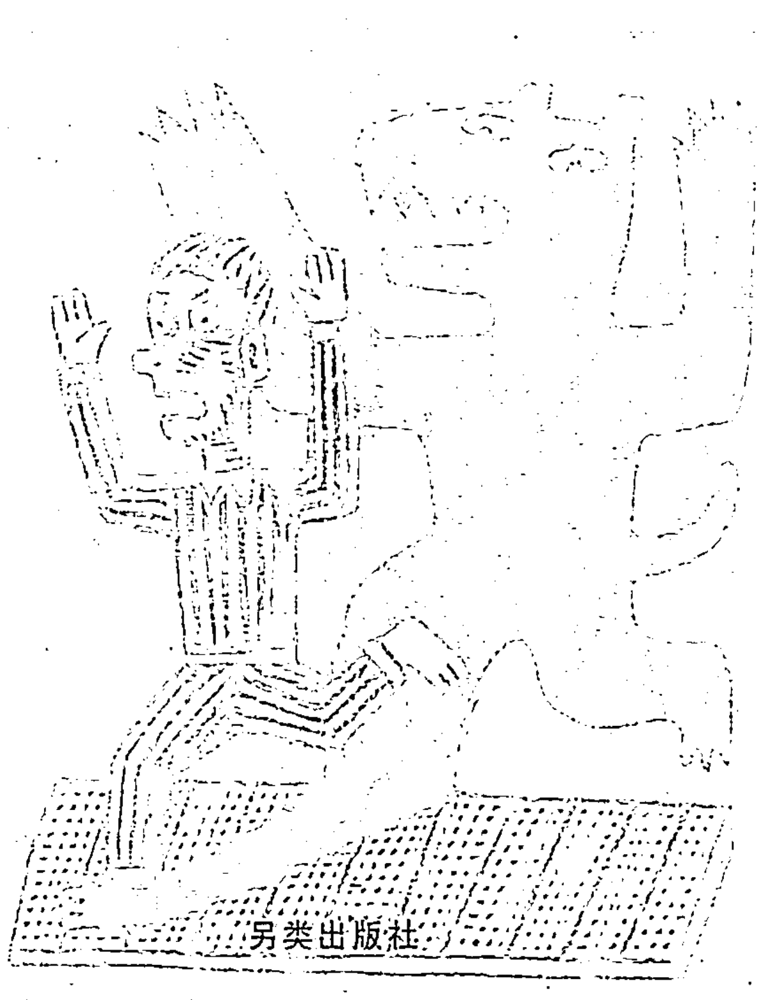
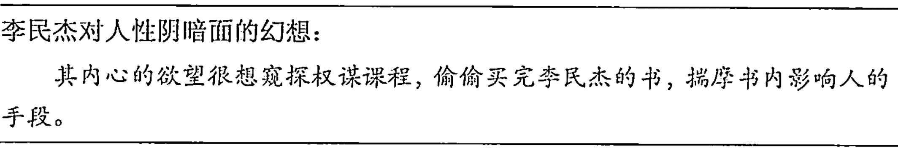
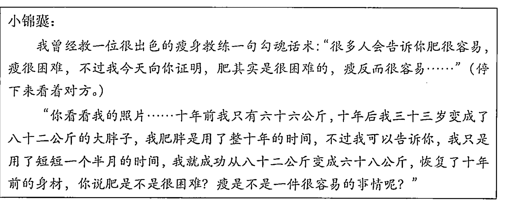
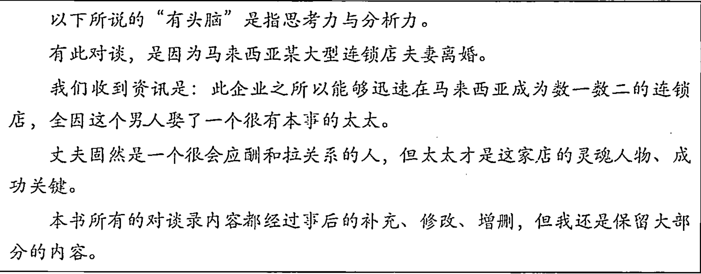
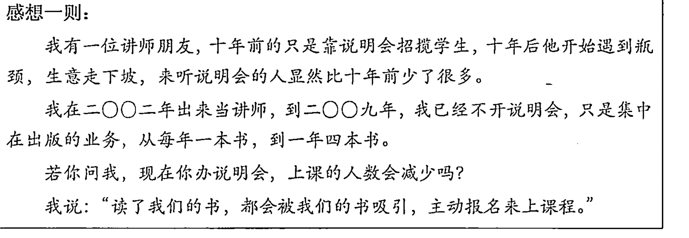

# 奸的好人9-有钱人一定有偏见





## 前言：“认为”PK“知道”

### 谁能救你？

写这本书的目的是煽风点火、掀风鼓浪。

很多人因为看了我的书，特地飞来马来西亚参加“权谋课程”，还在我的部落格私人留言，告诉我们人生种种的困惑，想寻求我的意见，“希望”我能改变他们的人生。

有此现象，正是《有钱人的偏方》第53页所强调的受苦情绪三阶段：当我告诉你冷门的资讯，或颠覆了你的常识，打破你所认知的常规时，引发你迷失了思考的方向（第一阶段），接着我又在书内例举了真实世界的故事、案例、证据（第二阶段），进一步激发出你类似受苦的经验，或似曾相识的案例（第三阶段），最后，我只需要将你经常“忽视”的细节，慎重其事告诉你要“重视”，你就会产生“豁然顿悟”的错觉。

但，这“豁然顿悟”并不属于理性之悟，而是“期待”逃离受苦、欲“避免”受苦之“悟”，你猜，是谁令你有这一“悟”？

能令你有一“悟”者，就是拯救你的大师吗？

或许我想问一问你，读了《坏的好人》与《有钱人的偏方》之后，你认为谁能救你？

### 水变酒的神迹

在南传的佛经记载，有一次，表弟阿难与表哥释迦牟尼佛经过恒河，阿难看到法师对死去的人念经超度，于是问：“佛陀表哥，他们这样念经是不是可以超度死者升天呢？”

佛陀没有答YES OR NO，只是在地上拾起一块石头丢进恒河，“扑通”一声后，佛陀就说：“你跪在河边念经，看看石头会不会因为你念经而浮起来？”

有没有奇迹发生呢？

我不知道！

因为佛经没有将答案告诉我们，结果变成相信超度的人就说可以，不相信的人就说不可！

但，到底有没有奇迹呢？

在中学的时期，我临睡前在房间端起一盘水，对着它念了四十九遍大悲咒……第二天睁开惺忪睡眼时，发现房间充满了酒香，原来这盘水变成了甜酒……后来我将之分发些许朋友，有人告诉我这神奇的水可以治病，相信的人，非常相信，结果越传越神……

虽然我无法用科学解释，但告诉你们真相，这水一点神通功用都没有，癌症病人喝了之后，并没有因此而痊愈，神经病的人喝了之后，继续的住在精神病院。

我念大悲咒时只有很卑微的心愿：为自己的房间消酒！

同样的，我开办课程也很“自私”：我没有想过要拯救贫、贱、穷的众生，我只是跟学员们做资源交换，我只是想赚钱而已！

我本身曾经当过“迷信者”，相信有“大师”可以拯救我这个曾经贫、贱、穷的“傻瓜”，结果我发现自己成了“受害者”，大师却是“得益者”！

我最愤怒江湖讲师欺骗三种人的金钱：

- 第一种，虽贫、贱、穷，但却想要改变人生，他会盲目相信大师可以拯救他，他一心信奉大师……真相是没有人可以救他，也没有三天两夜的课程可以改变他。
- 第二种，做生意破产之后，一无所有的人。
- 第三种，患上重病，四处求医，身无分文的人。

这三种人都“奢望”神迹出现，他已经被无耻的讲师成功洗脑：借钱上课！

曾经想过“借钱上课”或“将所有积蓄拿来上课”的朋友，你可以到我的部落格留言告诉我：“为什么你会认为上了课程之后就能够改变你的命运？”

### 谋杀你的“认为”和“希望”

从学员们的切身问题，我察觉到很多人都“知道”自己只会讲而不会做，虽然知道很多知识，也知道自己没有自制力、执行力、不能坚持（朝三暮四）、没有持续行动（三分钟热度）等缺点，他只是“想要”一步登天地改变，却从没脚踏实地，一步一脚印做过任何改变。

也有一些人已经“下决心”踏出了第一步，但只要看到自己的缺点或陋习重现时，他就开始用虚构的“认为”来PK“知道”——他“知道”只有靠自己，没有人可以帮他，但他却“认为”一经明师点拨，就可以使他改头换面，更“希望”（奢望）明师有这种神奇的魔力，他可以不必那么“辛苦”——虽隐约“知道”真相，却“奢望”神迹出现，进而产生了矛盾与冲击，凸显出种种的痛苦、挣扎、疑问、困惑，他才“认为”需要大师的引渡。

当然，李民杰也有一点担心，假若这些人都把这些困惑搞定了，不知道还会不会有人来上我们的课程？

你若对此感悟，你已经是处于明白之后，希望自己能够做到的阶段，但我不得不提醒你们：“小心一点，知道不等于做到，希望做到也不表示你能够做到，关键在于你有没有用‘极端的知道’来摧毁你的‘虚构的认为’！”

若有读者能从“想要改变人生的傻瓜”变成“疯狂改变人生之疯狂大傻瓜”，你可要小心留意“认为”和“希望”这一对死敌之人如何攻击“知道”。

你可能每一天都需要用你的“知道”搭配“自制力”和“意志力”，添加“观照力”和“思考力”来谋杀你的“认为”和“希望”，你或许还有机会改变。

### “知道”与“认为”的战争

比如说我们“知道”过胖不好，但我们却“认为”自己没有减肥的需要；我们“知道”每天多做运动、不暴饮暴食不但可以减肥，还会对身体有益，却偏偏“认为”无需运动，“希望”只是买一条U品牌“瘦身振动腰带”绑在自己的大肚腩一小时，然后继续暴饮暴食就能成功减肥！

我们也“知道”吸烟、酗酒对身体不好，但我们“认为”没有必要改变，因为需要应酬顺畅，故“希望”菩萨保佑自己长命百岁，身体健康。

我们更“知道”天下没有免费的午餐，做任何事都需要付出代价和承担风险，但却“认为”自己有可能、有机会遇到免费的午餐，可以零风险、不劳而获，付出少，“希望”只是靠着“想象”，就能得到多多——这就是所谓心想事成。

我们“知道”执行的重要，但我们却“认为”学了权谋手段就天下无敌，“希望”从此不必再听从老板的指令，可以反过来操控老板。

我们也“知道”成功的作家每天都会用八小时专注写书，但却“认为”自己学过《超级总裁快速成功写作法》，“希望”自己写出比史蒂芬·金更加畅销的恐怖小说，甚至还会听信喜欢满口胡言的江湖骗子之说法：“即使你还未写成一本书，但市场所有的读者就已经等着抢购你的书，平凡企管出版社等着签你这位未来写成一本书的未来大作家。”

我们也“知道”商场必然有竞争对手的存在，但却“希望”你的竞争对手没有读过《坏的好人》系列作品，还“认为”自己读过之后，只要将《坏的好人》收藏在很隐秘的地方，不介绍他人阅读、不当作礼物送人，你就可以打败所有的竞争对手！

我们都“知道”练武功需要打下扎实的基础，却偏偏“认为”自己拜了明师之后就可以在一天之内变成武林高手，也“希望”明师会将全身功力一次就灌注在你的身上！

我们有很多的“知道”，却有更多的“认为”，最后增添更多的“希望”。

很多时候“知道”会和“认为”交战，“认为”还会制造“希望”合力攻击“知道”，假如“希望”帮助“认为”打败了“知道”，我们的人生就是输家。

倘若“知道”是赢家，或许你还有机会脱胎换骨，改头换面！

在这本书，李民杰要以“极端偏见”为武器，帮助你的“知道”战胜你的“认为”！

### 豪爽大方的副作用

在“认为”的世界里会影响一个人惯性的触觉、想法、反应、做事方法，甚至是价值观。

如果陈大文认为做人应该要四海之内皆兄弟也，对人要豪爽大方，因此每次跟朋友吃饭就抢着付钱，朋友财务上有困难也会义不容辞，慷慨解囊。

对！这是他认为好的价值观，不过，我们不排除这种人生观有“副作用”：他会有很多酒肉朋友，喜欢拿好处、占便宜的人都会找上这位兄台。

关键在于陈大文到底是清醒“知道”这个真相，还是一厢情愿的“认为”？

如果陈大文是清醒的“知道”，我估计他不在乎这些喜欢拿他好处、占他便宜的酒肉朋友混在他身边，这是他豪爽大方的“副作用”——豪爽大方根本就是“单行轨道”，无论对象是怎样的人，他就是喜欢出钱！

陈大文若一厢情愿地“认为”我对你豪爽，你也应该对我豪爽，当他“奢望”有此“双行轨道”时，他已经不是清醒“知道”的人，他只不过是“认为”自己是一个豪爽大方的人，最后“看不开”人家拿他的便宜！

据此，我建议陈大文既然“看不开”，就得“知道”自己不属于慷慨解囊，豪爽大方的人，倒不如做回自己，坦然、干脆承认自己“看不开”，是斤斤计较的“算死草”，一旦他诚实面对自己，他此后根本不会在意有人在背后批评他是吝啬小气鬼。最起码这个“知道”和“坦然的承认”能帮助他“铲除”拿好处、占便宜的酒肉朋友，不会让他产生矛盾与冲突，凸显出种种的痛苦与挣扎。

从这个论据，我们可以发现一个人的价值观会直接影响他的手段。

比如A“认为”社会上大多数人都喜欢跟“有诚意”的人做交易。因此A一定想尽办法，透过暗示或明示告诉所有人他很有“诚意”，甚至有时候为了包装“诚意”这个形象，而做了许多不情愿的事情，在想不到任何好方法时，只好送礼又送花。

假如他是销售员，他会对人说：“我是不会用销售手段来影响顾客做决定的，尤其我不认同李民杰说的理论：即使准顾客没有需要，你也可以透过权谋手段‘引诱’顾客产生迫切需要的幻觉，让顾客‘犯贱’求你卖产品给他。”

“不，不，不，我不会用权谋手段，不会用李民杰所教的秘诀，我做销售时完满了‘诚意’……”



### 人性实验场

有一次，我的伙伴江健勇提议在【权谋说明会】做一个实验，我们问现场的观众：“你们认为一个人要成功，需要具备怎样的性格呢？比如，诚实、谦虚、勤劳、自我、狂傲……”

百分之七的观众都会选择诚实和谦虚。

当我们进一步“拷问”时，他们就开始解释：“哦，人不能太过老实，否则你会被很多人占便宜……香港人也说忠忠直至，终须乞食……尤其在尔虞我诈的商场，越老实的人就越吃亏。”

“有时候你的谦虚，在其他人的角度会认为你虚伪，在职场上有很多人都不愿意教新人，而且老板比较喜欢带点狂傲的人，谦虚的人往往会被狂傲的人抢走机会和功劳，结果谦虚会变成‘有功没劳’。”

为什么他们前言不搭后语、自相矛盾呢？

为什么一开始，他们会说诚实很重要，后来却越说越诚实就越吃亏呢？

理由很简单，他们一开始的回答，是从小到大一厢情愿的“认为”，导致他们“希望”这个世界是如此，一经拷问，摧毁了他们的“希望”，终于恢复清醒，将他所“知道”的现实告诉我们。

很可惜，很多人没有用他“知道”的现实回头检视他的“认为”，导致他们仍旧活在“希望”里面，结果产生了矛盾与冲击，凸显出种种的痛苦与挣扎。

其实任何销售员都隐约“知道”要成交任何生意，只有一条途径——有没有办法令顾客产生“迫切的需要”，即使这是“假需要”也无所谓，有迫切感，顾客才会采取购买的行动。

A若被这“极端的偏见”冲击下，清醒了，因而转换了价值观，放下了过去的认为，今后A出手做销售，肯定会透过“播种”、“假障碍”、“得寸进尺让顾客犯贱”、送顾客上“天堂、推顾客下‘地狱’，再以‘厚脸皮’这一连串的手段‘引诱顾客’，让他产生幻觉。

只要任何的销售员做到上述的手段，即使他是坏人、无心帮助人、没有诚意，顾客当下的感受也会觉得他是好人、真心想帮助人、很有诚意！

我经常强调，寻宝只有一条规则：谁有藏宝的地图，谁就会得到宝藏。

在你夺取藏宝地图前，你先要有分辨“噪音”与“讯号”的能力。

市场上最集中“噪音”与“讯号”的媒介就是：书！

### 读烂书，骂人骂出名

不用看书而能成为出色的有钱人是天才；不用看书而有出色销售技巧的人也是天才。

我不是天才，因此追寻财富的过程看了很多管理、行销、影响人、谈判技巧等书。

没有理论基础，没有思想见地，不经过系统化整理自己的经验与知识，无法开创全新的领域。

正如黎智英常说，创业就是往无知的领域开发，这也是《有钱人的偏方》所强调“其实你并不知道你是不知道的”。

坦白说，你若懂得分辨“噪音”与“讯号”，会发现有很多书都是“噪音”，几乎都是“只吃叉烧包无需吃馒头”的理论（参考《有钱人的偏方》叉烧包与馒头的比喻）。

虽然我知道很多书是“噪音”，但我的做法是：即使是烂书，也会买回家随手翻阅，因为看书的目的是要激发我的想法，有可能我会大骂这本烂书之后，写出一本轰动世界的作品。

当年莱德·哈嘉看了史蒂文生的《金银岛》，大骂《金银岛》是写给小孩阅读的肤浅作品，还讽刺史蒂文生浪得虚名，结果因为他的极端偏见而写出大受欢迎的探险小说《所罗门的宝藏》，成为英国最火红的作家！

对一个能够分辨“噪音”与“讯号”的人来说他根本不关心这本书内容是不是“噪音”，反而会专注在如何在“噪音”堆中寻觅“讯号”！

假如有一本书，百分之九十九篇文章都是“噪音”，只有一篇文章是有用的资讯，对我来说已经足够了。

比如B在书里得到百分之一的“讯号”是：奥普拉说：“人与人之间的交往，是透过交换秘密和把柄来维系关系的。”

B被奥普拉这句话冲击后，导致他明白了朋友之间的交往能否受到尊敬，在于自己是不是“秘密资讯”的掌控者。

于是B拼命收集“秘密资讯”，遇到朋友时就会有意无意向朋友揭露他是拥有“秘密资讯”的专家。

接着B又读了《冷血救世》，第二轮的冲击导致他知道了人性非善非恶，乃“趋利避害”，朋友的交往也是在于“利”与“害”两字。

B将奥普拉的观点与《冷血救世》的理论结合，让他产生“只要是‘秘密资讯’的拥有者，凡想获得资讯者（趋利者）就一定会自动‘送上门’”这想法，日后他想在公司上位，就得掌握下属或上司的把柄，因为凡欲避害者，必顾虑B三分，乖乖听从B的指令。

我们再假设D只看励志书而不看其他书（只收集单一资讯），导致他认为朋友交往在乎“诚”与“心”两字。他认为“诚”与“心”是人际密码成功的关键——结果他只会用这单一的资讯，没有经过新的冲击，只有用单一资讯强化了他的价值观，巩固了他做事方法，进而成为他的惯性思维、触觉反应，构成了他的“偏见”。

但，这个“偏见”不一定就是他的“偏见”，若这是没有经过千锤百炼、烈火焚烧若等闲的考验，只要现实从他微弱“知道”的指缝流出来，就能凸显他的痛苦与挣扎，进而产生矛盾与冲击，人生将出现许多的困惑……

但D只要肯多走一步，让李民杰PK他原有的“偏见”，让彼此的“偏见”手底下见真章，D有两个可能：

- 第一，D会拜服在李民杰的偏见之下，下品者会趴在地上盲目敬佩李民杰让他有此一“悟”；上品者会将李民杰的偏见消化，将之提炼，内化成自己的独白！
- 第二，D会更巩固自己的“偏见”，然后激起他原始的愤怒，拍一拍桌子后，走到电脑，手指按着键盘舞动，到李民杰的部落格轰炸我的偏见与歪理，誓死维护自己的立场！在李民杰部落格告诉我：“李民杰大哥，你错了，我才是对的！我今天终于可以证明给你这个破坏社会规范的可怜虫看看，我陈大文是用诚与心致富的！你的权谋手段不是唯一的路，我陈大文也可以另辟新路！”

## 有钱人一定有偏见

在真实的世界，有钱人一定有偏见，他们都是用极端的偏见巩固他本有的“知道”，帮助他的“知道”战胜其他人的“认为”。

詹宏志说：“当你强烈地觉得全世界都错了，才值得你去创业，因为这种愤怒的力量能够帮助你度过一切艰难和险阻！”

人生第一满意的是做到自己知道有机会做到，但认为自己做不到的事；人生第二满意的是做到人家认为自己做不到，但却知道自己做得到的事。

我不希望你一口气读完本书，我希望你拖延沉思，好好收集与整理你的偏见，将之聚沙成塔后，转化成极端的偏见，颠覆与打破所有人的“认为”，甚至在我的部落格攻击我的偏见，与被我们同化后的权谋分子交战，PK这本书每一个偏见！

我也欢迎你在我的部落格为《有钱人一定有偏见》插旗呐喊，继续深化、超越我的偏见，当你看到有人PK权谋派的观点时，请站出来誓死奋战！

但我从不担心，也不回应这种斗争的声音！

我更希望你到我的部落格分享你的“知道”和“认为”是如何交战的——我也很高兴听到这种和平的声音。

期望我能冲击你的想法，然后你会告诉我，在这本书你发现了哪些段落，有什么句子启发了你，改变了你的“认为”——因为这本十四万字的书没有用黑体字标示任何重要的句子，也不会有框架勾勒出重要的摘要。

我颠覆了《坏的好人》与《有钱人的偏方》之做法，这次轮到你们边读边拿起你的笔破坏这本书（用荧光笔画下你认为的重点，用原子笔在书内写下你内化后的观点）！

还有，如果你觉得这本书冲击了你，请介绍你的朋友阅读，如果这本书没有冲击你，请将它送给朋友。

谢谢你的帮忙！

《有钱人一定有偏见》读书交流网址：
rw.myblog.yahoo.com/kofflee/
李民杰部落格：
http://hk.myblog.yahoo.com/kofflee

### PK《有钱人一定有偏见》问题引导1

注意！

你不一定要遵照这篇问题引导发表你的观点，你可以不管这些讨论主题，发表完全属于你的偏见。

- 1.《有钱人的偏方》是针对读者的优越感下手，因此导致读过《偏方》的人，都会引用《偏方》的词汇、字眼、名词、故事挑战与质疑开课程的讲师……你认为《有钱人一定有偏见》的《前言》是针对你们什么情绪下手呢？
- 2.在《前言：认为PK知道》你有多少个“悟”？
- 3.请告知你的认为如何与知道交战？
- 4.有什么偏见是可以让你觉得全世界都错了，只有你自己是对的呢？
- 5.“其实你并不知道你不知道”跟“有钱人一定有偏见”观点是互相冲突与矛盾的，前者有谦卑，后者极端自我，请问，你会坚持你自己的“偏见”吗？你怎样看待这两个冲突的观点？


# 第一篇：偏见人生

> “见不尽者，天下之事；读不尽者，天下之书；参不尽者，天下之理。”

## 粉碎认为，活在知道

## 开天眼，通心眼

如果你说《有钱人的偏方》开拓了你的天眼，你开始懂得思考的方法，《有钱人一定有偏见》就是打开你的心眼，影响你价值观的一本书。

天眼让你分辨噪音，活用噪音迷惑他人；心眼是个人的价值观，是一家之言，是你人生的偏见。你无须认同我的观点，但我期望我的偏见与歪理能冲击你的头脑，引发你的感想。

什么是“心眼”？这是篡改自“心明亮”这句话。

“心明亮”这句话是指心里明白、眼睛雪亮、洞察事物、明辨是非。明辨是非在这本书是指面对真实的世界，不要自我欺骗，不要给自己虚构的“认为”增添“希望”，打击“知道”。

比如说，当一位仁兄不断向你强调，他开课程的目的是为了要赚钱而不是为了服务大众和做慈善，即使亏钱也无所谓，因为他安贫乐道，即使穷也穷得很开心。

我估计这位仁兄“知道”金钱的重要，但他用“穷得开心”这个“偏见”来消灭他亏钱的“痛苦”。

其实，他很想赚钱，但在苦无对策，又不能转行的情况下，给自己“合理化的解释”，让自己亏钱亏得比较“快乐”。

有可能他看到李民杰的【权谋课程】一帆风顺、水涨船高，恨得牙痒痒，但又不愿意承认李民杰的手段高明，只好说“穷得开心”。

我也看到很多马来西亚的作家在报纸写文章说：“我出书不是为了赚钱，只是为了完成自己的心愿。”

当在报纸上看到这些作家的呐喊时，我内心怪叫一声：“噢！老兄大姐，你为了完成自己的心愿，竟然拿出版社的钱丢进大海，过不过份！”

我猜他看到李民杰作品获大奖，频频高踞排行榜前五大，还以为自己的文笔比李民杰高明，出书后能大卖，结果……因此为了好下台，只好自欺欺人地说是要完成自己的心愿。

不过这些人的言行都告诉了我们他还没有打开心眼。

他情愿自己不要明白，更希望自己的眼睛不要雪亮，说白了，他不想面对现实，希望自己会“穷得开心”，还加强地巩固他的“认为”：有钱不能代表一切，金钱买不到快乐和健康。

如果他们肯早一点“心明眼亮”地面面对现实，反思与检讨自己的不足，参考李民杰的行销策略，重新“洗牌”后，或许还可以另辟新天地（他可以去找李民杰跟他合写一本书，或许可以开拓新的读者群咧）！

譬如你叫一个大胖子减肥，他会告诉你，只要我快乐，肥也是一种福气，他还加强巩固他的“认为”：“超重也不等于有健康的身体，瘦人还是会有高血压、胆固醇过高，你看不到很多瘦人都躺在医院吗？”

可是，他也知道肥胖和许多疾病有直接或间接的关联，比如肥胖者比普通人得糖尿病的几率是五倍、高血压是三点五倍、胆结石是三倍、心脏病是两倍、关节炎是一倍……

如果他们肯早一点“心明眼亮”地面面对现实，反思与检讨，或许这位肥胖的仁兄还可以恢复健康的身体，降低血压、胆固醇等指数（建议您把这本书当做礼物送给肥胖者看吧）。

## 将没“钱途”的人幻化成有“钱途”

我也看过很多男人暗恋或苦恋一位女人，苦苦纠缠，被女方多次的拒绝后，还不懂得如何放手另觅春天，“希望”用诚意打动对方，“认为”自己还有机会！

大家都知道在真实的世界，并不会因为没有她而活不下去的，关键是你“认为”自己无法放手，你只是“希望”还有机会，事实上你“知道”自己可以重新出发，是你不想面对现实而已。

无法放手是因为“奢望”奇迹，不肯坦然“承担”真相、“背负”事实！

有一次，权谋课程结束后，我和刘小姐享用着宵夜，突然被一位不礼貌的男学员唐突“骚扰”。他没有经过我们的同意就坐在我们的旁边，然后告诉我他如何苦恋一位女人。

据他的说法，当女人拒绝了他之后，他就退一步跟女方说想跟她做朋友。

后来在女方生日时，又送花给女方，还写了一封很肉麻的情信，自此女方就不再跟他交往、不再听他电话，男学员求我教他起死回生的方法，我专心吃着我的食物，头也不愿抬起来说：“放手！”

但他还继续说：“她的男朋友虽然是工程师，虽然他们即将结婚，不过我对女方是真心的，我现在虽然没有钱，但我可以跟她一起努力组织家庭，我会对她很好，因为我很爱她！”

当时我听到这句话，脑海浮现着他说“没有钱可以一起努力”，这句话的潜台词是希望要女方跟他一起挨穷，言下之意他认为女方不接受他，是因为他没有钱！

这就是他虚构出来的“认为”，他没有勇气“承担”自己没有把妹手段，女友不爱他的真相；他更加没有种“背负”自己无法给女人幸福、女人已经了有爱人、即将结婚的事实！

他还一厢情愿地“希望”我这位权谋大师设局令女人看到他的“钱途”。

虽然他说了这么多虽然，不过我还是冷冷地说：“放手！”

其实这位仁兄是隐约“知道”真相的，只不过他想通过“希望”来打击自己的“知道”而已！

## 等死的人寻找不死的人

佛教有一个很著名的故事，话说有一位老妇人的独子去世了，她哀伤难过了整整一个月。碰巧释迦牟尼佛托钵经过，老妇人供养佛陀后，唐突住佛陀的双足嚎啕大哭，祈求佛陀将她的儿子起死回生。

佛陀摸了一摸她的头很慈悲地说：“可以！没问题。不过，你只要找到一家三代内没有死过人的家庭，然后跟他们拿一根吉祥草给我，我就有办法救活你的儿子。”

像释迦牟尼佛这种“戏弄”人的招数，旁观者清醒“知道”没有不死的人，尤其是三代内没有死过人的家庭更是万中无一。

可是，老妇人“希望”自己可以找到，“认为”佛陀可以起死回生。

据说，佛陀有很多这种辣手段帮助人用“知道”摧毁“认为”。

结果，老妇人找遍了整个村落，终于明白了“人，终须一死，你我他都是等死的人，这世界并没有不死的人。”

于是老妇人“死气沉沉”回到佛陀坐下，皈依佛教。

然后老妇人加了一句李民杰虚构的对白：“当你看到这个世界没有不死的人时，再大的不舍你也能放下。从现在开始，我要学会孤独，忍受寂寞，并做到放下，我老妇人今后一定会粉碎虚构的认为，活在真实的知道中。”

## 失去与拥有

## 上帝的门

圣经说，上帝为你关上一道门，就会为你打开另一道门……

有位企业家，在商场是富家顶级人马，他白手起家，开天辟地，力拔山河，能人所不能。他的事业如日中天，达到巅峰，正所谓“会当凌绝顶，一览众山小”，其威风八面的英雄气概，傲视群雄。

常言道：人生得意须尽欢。这位企业家春风得意，也想及时行乐一下。而且，他很有孝心，想让劳碌一生的父亲也分享一下自己的成果。

因此，在父亲节便请爸爸在全球最高贵的七星级饭店——阿拉伯的杜拜饭店——乘坐潜艇享受海底大餐，现场还有一位钢琴家为父子两人演奏。

企业家听着悠扬的钢琴乐，无限感慨，想起自己童年的梦想，就是想当一位出色的音乐家，于是指着钢琴家对父亲说：“如果当年我好好学音乐，会不会有他今天的音乐造诣呢？”

父亲笑笑凝视着这个傻儿子片刻，仿佛他从来不曾长大，然后以一种像安抚小狗的语气说：“乖，GOOD BOY，GOOD BOY，如果是这样的话，你就不会坐在这里享受了，老爸也是为了你好，才逼你做生意……”

好了，故事讲完。

我会像《心灵猪菜汤》的作者一样，打个黑体字标明给你知道的格言是：

> “我们常常为失去的机会而嗟叹，但往往忘了为现在的拥有而感恩。”

## 我患上了“口号敏感症”

告诉大家一个秘密，其实我是一个患有“口号敏感症”的人，我认为这个“病”不是每个人都有，不过却应该人人要有！

什么是“口号敏感症”？

就是当我听到如“我们常常为失去的机会而嗟叹，但往往忘了为现在的拥有而感恩”等相似口号，我自然就会产生“抗体”，视之为哄小孩的傻话。

我会这样想：如果真有轮回，高喊这类口号的人，不知道下一世会不会转世成鸵鸟？

失去了，就是失去了。我是人，为什么不容许我有所遗憾？

如果我的志愿是成为朗朗（中国著名的钢琴家），结果却成为比尔盖茨，我算成功吗？回到源头，当你的成就与你从小到大的志愿互相违背，你成功了吗？

举个例子，陈大文追求章子怡十年，最后发现她在海滩裸露上身，老外男友还替她涂太阳油，用身体压住她，陈大文只好嗟叹自己不够有钱！悔恨没有追求“我既傻又天真”的女明星。

最后，陈大文被父母逼婚，无可奈何向下与如花小姐结婚。

多年后陈大文看了《奸的好人》，嗟叹没有学过把妹手段，遗憾当年追求不到子怡而跟如花结婚……

送《奸的好人》给他的朋友，安慰他说：“大文，不要常常忆起失去的子怡而嗟叹，而忘了为现在拥有的如花而感恩……”

郭富城有一首歌曲叫《差不多》：“差不多就差太多……”

聪明的你必定清楚知道自己要的是什么。

不过，即使达不到最初的目标，也不是什么奇耻大辱的事，就允许自己偶尔有点遗憾吧！

做不到就放下，得不到也要放下，无需为自己找任何下台阶，人生并非无论什么都要拿一百分的，何必这样死认不输呢？

干脆坦然承认自己有所不足，我们都只不过是很平凡的人，千万不要幻想自己会变成超人！

## 感想一则：

坦白说，在朋友圈内，我自认口才不属于最好，我只是普通平凡的人，我会愤怒，也会流泪，有时候会路见不平拔刀相助，但我从不把自己安置在神位上。

有人问我：“李民杰，你办课程的人数比得上老外哈福艾克吗？”我会很老实告诉他：“我不同意哈福艾克的《有钱人想的和你不一样》，但我会承认办课程不如他成功！这也证明了我办课程的行销策略不如哈福艾克！但我不认同这些江湖讲师，所以我才写一本书重新阐述自己对成功的观点！这完全属于我的偏见！”

如果他对有我对哈福艾克有偏见，进而问我：“你只是会批评他，你也弄一个《有钱人想的和你不一样》的课程出来吧！”

如此我会笑笑说：“我去馆子用餐，批评食物不美味，对他们服务不满意，这时餐厅老板走出来用泼妇骂街的方式告诉我，你说我们的食物不美味，服务不好，你开一家跟我一样的餐厅给我看看！”

我曾经如此想过，既然我能在讲师界中跑江湖，我公开批评过江湖讲师，其实我也准备了自己会被公开批评与质疑！

我有此心理准备，才写《有钱人的偏方》，我也不在意读者用《有钱人的偏方》来质疑我的讲师身份──你也是江湖讲师，你高贵到哪里？

我的意思是，我不会在意有人骂我：“李民杰，你骂其他的讲师是江湖讲师，其实你自己也是江湖讲师，你只是五十步笑一百步！”

> 我对任何学员都是说同一句老实话，我从不认为自己可以改造他人的命运，如果你真的想借钱来上课，拜托，你就不要问我！
> 但良心一句话，你千千万万要记得：上课不是你的必须品！
> 还是老话一句：我是人，我不准备做大师，也不想上神位！
> 我的理由很简单，我曾经当过傻瓜，明白当傻瓜、盲目迷信而被欺骗的滋味！
> 写下这个观点，是因为我接触过很多大商家，我发现所有的商家从高峰跌落谷底时，只有两种性格，一种叫项羽性格，另一种叫刘邦性格。

## 借牛顿谈二心

### （一）随缘心

### 牛顿 VS 李民杰的北极咖啡店

鼎鼎大名的牛顿在科学领域中无人不识，无人不晓。

他发现万有引力学说，解释了地球的现象。

牛顿看到苹果掉落后，开始思考：“为什么苹果熟了会跌落地，而不飞往天上飞呢？”

要知道，苹果落地根本是大自然的常态，即使我们活在那年头，对这种不起眼的自然常态，也习以为常，视为理所当然。

牛顿若问这种凡事习以为常，视为所当然的人，他们就会请问牛顿是不是想得太多、为什么喜欢“钻牛角尖”？

还可能骂牛顿：“苹果熟了自然会跌在地上啦，这是人自然的常态，何必值得你花费心思四处查探呢？牛先生你简直是多余的无谓人！”

牛顿就是牛顿，将不会有人想的平常事，想出一个道理。这就是《将没有意义说成有意义》所阐述的精神。

让我引用一个虚构的比喻：李民杰将北极咖啡引进中国、台湾、香港、马来西亚、新加坡……最后在全世界开了一家又一家北极咖啡连锁店，发展出比星巴克还要大的殿堂级生意，不认识李民杰的人，就觉得李民杰的成功是理所当然，根本不会有多余的时间想多余的事情，更何况整个世界的潮流都是在喝北极咖啡！

这些人不会有牛顿的精神，四处查探为什么李民杰会引进北极咖啡而不是南极咖啡？

若真有“牛人”在钻牛角尖，这些人会骂：“笨蛋，当然是北极咖啡比南极咖啡好喝！现在有北极咖啡给你喝，你就继续喝啦，你何必花费心思去追究南极咖啡的味道是如何，你简直像牛先生是多余的无谓人！”

《有钱人的偏方》的读者可以怀疑到底李民杰的成功是必然因素，还是偶然因素？

他们可以思考……李民杰代理北极咖啡，“摊在阳光的资讯”（显因）是：好喝、有市场；但“锁在保险箱内的资讯”（潜因）是不是李民杰破产了，逃到北极殿，在没有选择的情况下，才引进北极咖啡而东山再起呢？否则为什么一个江湖讲师会卖咖啡？

一向来都会趴在地上追随偶像的人，也许很佩服与尊敬李民杰而说：“你看，李民杰就是李民杰，突破又突破，颠覆又颠覆，他可以将没有人想过的东西想出来，将毫无入知的商品打造成无人不识，无人不晓的热门潮流。”

### 噢，我也想过了

妒忌李民杰而患上“眼红症”的朋友，同时他也去过北极旅行，他一定会说：“噢，我也喝过北极咖啡，曾经也想过引入亚洲开连锁店，也有同样的想法，只是被李民杰捷足先登而已，他在北极喝第一杯咖啡，也是我陈大文请客的！他幸运而已！如果没有我告诉他这个点子，他哪有今天的成就！”

李民杰肯定有运气，也许真的引用了他的点子，但，这不是重点！

其实去过北极喝咖啡的朋友，绝对不是曾经有过同样的想法，他们只不过是闪现“昙花一现”模糊的意念。但他却没有李民杰的思考方法，把模糊的意念给予具体化的功力。

一个想法，需要一颗心培养，还要靠一股意志多走一步，甚至要拟定一份计划，最后以一种决心来执行！

中国人的《易经》概念是：大自然都是一个连锁反应，一物跟着一物，物物相依，最小的跟最大的都是一个连锁反应——你看一颗树苗（最小），放在土地后，经过数十年，破土成为大树（最大），开始的“种”，就是不起眼的树苗！

一个想法开始时是很微小的，你放在土地后，会出现种树的可能性，有可能被害虫“吃掉”你的想法，让它无法长大，这样你就无法知道这个微小想法（树苗），有可能发展到多大？你不知道它会不会长到一百尺高，然后独与天地往来，要是这微小的想法死掉了，你永远看不到它的可能性！

成功是开创了一个可能，但失败也意味着失去另一个可能！

黎智英讲过一句话：“概念和点子都是从无知开始，创业就是挑战未知的领域，再透过无数的实验，让毫无生命的概念与点子重生！”

创业者都是从“想要”的星星之火变成燎原大火，比如说他喝到北极咖啡很美味，他就多想一步：“如果我将之引进台湾，这种咖啡在台湾将会怎样……”

虽这是点火的开始，但我们不要忽略另一个思考的方向：“如何从‘不要’走向‘要’”，这也是可以激发出“新”生意的微小想法。

胡思乱想只是创业的缘起，譬如我本来就没有过念头要去澳洲旅游，因为我在幸运抽奖项目中，得到黄金海岸饭店三天两夜免费住宿的礼券，才启动了我们的澳洲之行，最后为了尽情的玩，我们也放弃了这礼券，但没有中奖的缘起，就没有澳洲之行！

只是想，谁不会！

我再重复：一个想法，需要一颗心培养，还要靠一股意志多走一步，甚至要拟出一份计划，最后以一种决心来执行！

我李民杰不想做一个讲做到不到的人，我更不希望是一个只会想而不会做的傻瓜，我相信行动才能将想法变为现实。譬如当我听到博学和尚告诉我冯冯跟宣化老和尚的小故事，造成我的心结，我就会找他帮我解开这个心结！

我从不追求完美的行动计划，因为当行动犯错时，我们才会发现原有的资源、知识、技术不足，接着我们需要上穷碧落下黄泉地继续探索、寻找更多的资源、知识、技术。

牛顿就是从“钻牛角尖”、想得太多开始，然后发觉现有的知识不足以解释苹果落地的现象，他肯定如痴如醉、走火入魔、极端自我地寻找更多的资料，才能冲破无知的界限点燃大自然常态的新生命——发现了万有引力定律！

> 无关痛痒的题外话：
> 大家是不是觉得我说得很有道理呢？
> 不过……嘿嘿，我要令大家失望的是，牛顿本人说过，苹果落地之说，是他虚构出来的故事，他是希望透过一个很简单，很容易明白、记得、流传的故事作为解释万有引力学说。单凭这点我们就可以说，牛顿绝对有资格写一本科普畅销书。
> 据此，李民杰要告诉大家，我只是借用牛顿的故事来谈“二心”，而不是求证苹果落地真假之说。

### 随缘与放下的精神

李民杰要谈的第一个”心”就是一些人经常挂在嘴边安慰人的话：我们要随缘——“随缘心”。

什么叫做随缘？

- 是不是当你遇到挫折（失败了）或准备做“不知道能否成功的事”时，就安慰自己说：“随缘吧！”
- 是不是说了“随缘”之后，即使不成功也会让自己好过一点？

在我的书还没有发行到台湾和香港时，朋友告诉我拓展海外的市场，还是随缘吧，不必那么执著，只要能在马来西亚站稳、能销，赚到足够的钱，生活过得不错，做你自己喜欢的事，每天很开心、轻松自由就足够了……

如果我以这种随缘心，没有多添一颗心，一股意志，一脚步，一份计划，一股决心，你认为我的事业能不能拓展到海外呢？

不谈事业，谈感情。

我有很多人朋友会故作潇洒地说：“有没有伴侣都要看缘分，随缘吧！”

在我的立场，我会认为这是追求不到属意对象才说的话。

我遇到属意的对象，就拼命追求，暂时没有试过失手（当然我是从结果来立论，你们可以当作风凉话来看）！

如果我总是情场的失意者呢？

我不会说随缘就了事——你自己没有把妹的技术，又有把妹的需要，难道就说一句“随缘”自欺欺人，就能自我安慰吗？

注意，这是你的需求之一，你能选择压抑、逃避、愤恨，也可以选择追求、转化、超越。

“想要”把妹是星星之火，一句“随缘”就像来了一场“及时雨”将之熄灭了。

你背负追求不到属意对象的现实，承担把妹失败的真相之后，你无需死缠烂打，毕竟“市场”还是很大，只不过你一定要上穷碧落下黄泉地寻找把妹的资讯与技术，放下旧有的目标，重新开发新的“市场”。希望你记得“当行动犯错时，我们才会发现原有的资源、知识、技术不足，接着我们需要上穷碧落下黄泉地继续探索、寻找更多的资源、知识、技术。”

一件事你有做它与没做它是有分别的，你随缘去做（可有可无）和拼命去做也是有分别的，有差之毫厘失之千里的区别。

我的意思是，当你闪现昙花一现模糊的意念时，你以随缘心态看待，错失了机会，就千万不要嗟叹：“噢，我也喝过北极咖啡，曾经想过将之引入亚洲开设连锁店，也有同样的想法，只是被李民杰捷足先登而已。”

李民杰与这位只会嗟叹的仁兄，唯一的分别是，李民杰不但捷足先登，还拼命争取：

我知道有人会问：“拼命争取还是得不到呢？”（言下之意，这时好像可以随缘吧！）

答案还是重复：“我若上穷碧落下黄泉地寻找把妹的资讯与技术，但还是追求不到章子怡，我会忘掉章子怡妹（放下），但绝对不会被父母逼婚。我会将追求子怡眉妹失败列出两大可能性——”

“第一，自己的把妹资讯与技术还不够，需要开创更新的技术，继续进行无数的实验，开发更多的方法；第二，用同样的方法，对不同的人，意思是对章子怡没有效的方法，说不定对范冰冰有效，你不多走一步，你不多试一人，怎么知道你的方法没有效。”

从我出来办课程到今天，我还是坚持认为：“所有的方法都是在实验阶段，并没有定案和结论！”

因此，李民杰从不“神化”权谋手段！

题外话：

虽然有一位老外在电视节目，成功催眠群众去抢劫银行，表演含着不中奖的票根成功领钱，在购物中心（大卖场）做群众催眠听从他的指令，还让现场观众精神分裂，把自己当作木偶……但，我对这些魔术表演有所保留，或者说我只是当作魔术表演来看！

练老板对我说的一句话很对，这位魔术师有一大群节目追随者，看这种节目很过瘾。

练老板认为，他不是单单运用 NLP 的技巧，还加了魔术的特技、催眠、心理学等技术综合运用，所以才会这么成功。

练老板告诉我另一个理据是，这位魔术师，在做节目时，征求观众配合，观众同意被拍摄入镜头，已经等于观众走进了同意被催眠的第一步，开始了催眠的互动！

我的疑问是：“要是这位老外，‘真’的是那么厉害，你是美国的 CIA 总长，你会不会觉得这个人是恐怖分子？他若动了人类看不到的善恶之念，偏善的话就是好人，偏恶的话，你猜他是什么人呢？还有，你怎么知道这个有“神通”的人会不会竞选总统……而你是 CIA 的老大，请问你会用他吗？除非你也有他同样的技术，你才考虑聘请这位仁兄，对吗？”

各位，你看懂了这句话吗？

至于你再一步步走我相信这位老外（魔术师）、要我解释他种种的“神迹”，

坦白说，我不懂得如何解释但我会告诉你：“神打可以刀枪不入，难道我就得学神打；如有人为卢性艳莲性活佛见他种种神迹，告诉我们卢性艳活佛医治好许多疾病、梦中与他相遇、如何被灌顶之后，快速发达，难道我就要信仰假佛宗？”

“在《前言》我告诉你们，我可以将水变成酒，难道我就是人类的救世主？这跟改变我的人生，做生意赚大钱可没有直接的帮助！”

看到了吧，对我传教的仁兄大姐，跟我说神迹见证，是很难劝服我的，倒不如向我展示你的教理更有说服力。

同样的，卢性艳可以传授一天发达的修佛法，他有数百万的弟子，但只有不超过百分之一的人修这种法有效，否则这个世界会有很多亿万富豪，据此，你要因为见证而去信他吗？

佛教界会不会因为他的神迹而去承认他呢？为什么佛教界不承认他？难道真的如卢性艳所说的妒忌他的成就吗？可是，又有谁检视过假佛宗的教理是不是佛教的根本思想呢？

“不过，我也可以告诉你们，在当年我同样无法解释大卫高柏菲神奇的魔术表演，如果我只是想做生意，赚大钱，我觉得魔术这类东西对我的帮助不大！”

儒家说：“君子有所为，有所不为。”

智者说：“别人给你什么，你都要，你是傻瓜；别人给你什么，你都不要，你也是傻瓜。”

个中道理，等同于“君子有所为，有所不为”；总不能来者不拒，照单全收。我不言怪力乱神，在我内心深处是有底线和原则的！

## 佛教的随缘与林肯总统的凶悍

随缘这个观念来自佛家思想，你试想想，如果佛教中人说：“即使不修行也无所谓，反正你都会生老病死，六道轮回，在六道任何一道都随缘去吧！”

倘若如此，佛教中人就没有必要参禅打坐了，何不随缘轮回？

即使达摩祖师《四行论》说过要随缘行，但并不是那种安慰自己，无可奈何的随缘，它是那种你能做多少就做多少，能进取一分则多进取一分的精神。

这就如同林肯骑马走在很窄的桥，刚巧对而有一人也要过桥，林肯第一时间向对方吼叫：“对面的人，你到底让不让路？嗷！～～”

通常对方看到林肯唬话，第一时间就会让开一边，不想惹事生非，因此林肯才很炫耀式地以这逼人让路的案例四处“造谣”，但上得山多终遇“虎”……

有一次，有一位记者听到林肯唬人的案例，就问他：“倘若对方比你更大声吼叫‘我不让，你让！’，然后发出比你更凶悍的低吼之声时，你会怎么处理？”

林肯笑笑道：“我斗不过他的话，马上让路！”

我现在的资源有多少，就用多少的资源去努力尝试，就像佛教徒打坐修炼，他明知道自己是凡夫，还是要参禅打坐，能做多少就做多少，他专注的是做。

随缘不是用来安慰自己的话，也不是可有可无的心态，更不是你不拼命、怕辛苦的借口。

我常常在想，你读过成功企业家的自传，几乎每个企业家都告诉你“成功只是通往下一个失败的过程”，你成功前后都必定遇到不曾见过的惊风骇浪，挫折、痛苦……折磨必定如影子般紧贴着你，何飞鹏更说出一句儒家的信仰“以身殉事”来形容创业者，只差没有说出下一句舍身取义而已。

这到底是噪音还是讯号？

若是讯号，你有没有想过他们暗示了什么？

正如詹宏志说：“事业本身风云诡谲，创业之后的我，生命轨迹当然是不同了，但，我也说不出自己应该感到幸运，还是应该悔恨……”

从这句话，你有没有感受到成功家其实根本也没有一套指令可以帮助他们一帆风顺、水涨船高，甚至有可能大众认同的“成功结论”都是另一个经历的伏笔……

## 海星与海胆的故事

经济学家曾经帮助某个慈善团体写过以下这则宣传文稿：

风暴过后，有一位住在海边的美少女看到很多海星被冲上岸边，她俯身而下拾起海星，用力扔回大海。美少女不断弯腰，不断做相同的动作，她只有一个单纯的念头：拯救海星的生命，保护大自然的生态。

商人看到了，很无可奈何地说：“美女，你何必那么辛苦呢？你救不了所有的海星，你改变不了它们的命运，即使救了它们，最后其他人还是会将海星当作装饰品，残害他们的生命，你完全做不了什么！随缘吧！”（李民杰插口：我写《有钱人的偏方》时，有人告诉我，信你的人会信你，不信你的人始终不会信你，要被骗的始终会被骗，你根本做不了什么……）

美少女眼神闪过伤心难过的神情，瞬间也浮现出灰心失望的神态，不过很快地她又弯下腰拾起海星扔进大海，接着用凌厉的眼神看着商人说：“你看，至少我改变了这颗海星的命运吧！”

商人静默了片刻，目光浏览了海滩，像发现新大陆般说：“美女，你看到还有很多海胆被冲上岸吗？”

美女平静地说：“我知道。”

商人摸一摸后脑，阴险地笑了一声，想散摇嗓子说：“既然你是有爱心的人，你花整天的时间去拯救海星，眼光会不会窄了一点？你不是应该将目光放大一点也去拯救海胆吗？难道海胆不属于大自然的生态之一吗？海胆不值得你去救吗？你不是应该等同视之吗？”

美女坚定地告诉商人：“不过，我还有很多海星没有救完！”

商人无言以对，因为他从美女的语气和那悲恸的眼神，察觉出美女已经作出一个抉择：用每分每秒的时间拯救海星而不是海胆！

这就是不随缘，而又要放下的精神！

请问你能意会出其中的精神吗？

### （二）平常心

## 李民杰如何安慰牛顿

一七二○年某月某日，牛顿卖出七千万英镑的股票，赚了一倍以上。

三百年前，这笔资金相等于现在的亿万富豪，牛顿卖完股票之后，该公司的股票就开始下跌，牛顿立刻成为股票市场的大赢家。

不过，同年，牛顿以三倍的价钱买回同样的股票，结果输到四脚朝天，一共亏损两万英镑。

如果我是牛顿的朋友，我不知道是否跟牛顿说：“牛朋友，你就用平常心看待吧！”

生意失败了，破产了，一句平常心看待，的确会令人心理舒解畅快，对比另一情景，老婆红杏出墙，做丈夫的能否以平常心面对呢？

有可能旁观者用嘴巴说说是容易的，不过当事人内心难道没有一点痛苦吗？为什么不容许人有痛苦或悲伤？

人有痛苦是正常的，笑有时候，哭也有时候，只要你不学林黛玉哭的比笑的多，哭亦有时也不为过。

任何的情绪都是随着当刻的情景而产生的，当情景过去，情绪亦会消失。平常心，有多少人能够做到？抑或是这安慰的话，让难过者消减悲伤？上述的情景或许你还可以以平常心对待，但换了以下的情形呢？

## 笨人也会超越你

你看到十年前比你笨的人超越了你，他现在做国际事业，你告诉我平常心看待，不要比较，你确实会舒服一点！

的确如此！

但我并不建议你以平常心看待。

当苹果落地，牛顿“钻牛角尖”探究原因，导致夜夜忘食，骨瘦如柴时，我不知道你会不会规劝他：“牛兄，你何不平常心看待呢？这根本就是大自然的常态，你何总管那么多呢？”

黎智英的朋友想创业，她告诉黎老板的理由是，工作了十多年都是替人打工，所以很闷，想做生意。

黎智英不留情面告诉她，闷不是你来创业很好的理由。

这位女士想办幼稚园，因为她看到很多毫无本事的女人将幼稚园办得有声有色，她认为不要跟其他人比较，市场很大，不必赢过这些很成功的幼稚园，只要拿到对方一半的市场，能经营下去就足够了，一切平常心看待。这种心态不正是很多生意人创业时的心态吗？

“范冰冰写《有钱人一定有偏见》有五万位读者，如果我张小妹的《有钱人的偏方》抢到她的三分之一的人数，我就发达了！”

要是我李民杰写书，我不是想抢范冰冰的三分之一读者群，如果我看到她有五万读者群，我就会问自己为什么我写的书没有五万名读者？是我写书的方法不比她好吗？是我还把握不到这群消费者吗？还是我的行销策略做得并不好吗？

虽然我有这种想法，但我从没想过要在财富超越她！

黎智英对创业的观点是：“只有现在，没有未来，投下我所拥有的一切，跟他同归于尽，死而后已。”

他做生意不求平衡，不求平稳，想法激进，做法极端，想尽办法超越对手，完全没有平常心。

你有没有想过，假如跟你一起出道的朋友，这位比你笨的人超越了你，你最好不要用平常心看待，你何不想想，为什么？

有句话道：成功之人必有可敬之处，可怜之人必有可恨之处。

一个比你笨的人超越了你，你若没有牛兄钻牛角尖的精神无所谓，但你至少还该问：“是他进步了，还是我退步了？又或者是我从来就没有改变过？”

你可以用我诠释的“随缘行”而对你的人生，但你最好不要用“平常心”看待自己的不足。

## 八卦新闻

有一位历史学家研究牛顿的万有引力学，不是他独门理论，而是抄袭他朋友的理论。

换句话说，他根本没有这篇文章所说的乱思想（钻牛角尖）——将普通一件事想出它特别的道理——他是想也不想，顺手牵羊就把朋友的理论抄了过来。

不要以为牛顿是伟大的科学巨人，他抄了人家的理论后还破坏了朋友的肖像，试图在图书馆将他朋友的一切资料毁尸灭迹，谁知天网恢恢，疏而不漏，牛顿还是留下他的犯罪证据。

众所周知当年牛顿根本无心在科学研究，他迷恋发财，专心研究“炼金术”。

况且在那年头，最流行的迷信思想就是“炼金术”，所以，千万不要笑牛顿笨与傻。就是他够傻，傻子才有傻福，在误打误撞下竟然给他碰上他的朋友，还在无心插柳柳成荫的不公平原则下，拿到朋友的手稿，发现了人人歌功颂德的“万有引力学说”。

你可以骂牛顿是无耻之徒，不过骂完之后，你要称赞他马上行动的性格造就他的成就与地位——李民杰北极咖啡的比喻，你可以在牛顿的身上看到其威力。

## 手段与概念的战斗

到底你看到多少个层次？

《奸的好人》作品集6：《极端自我就是王》有一则寓言故事：

曾经有一个很有名的商人到了一个景色明媚的湖畔游览。在欣赏着美景时，他看到一个老人家懒洋洋躺在小舟上晒太阳。

商人问他是不是船家，他微微张开眼说：“是，不过我正在休息着，在晒太阳。”

商人说：“喂，你这样就不对了，现在景色这么好，你应该多载点人游湖啊。”

“为什么我要多载点人游湖呢？”

“你可以多赚点钱啊！”

“为什么要多赚钱？”

“那么，你就可以多买几艘船啊！”

“但，为什么我要多买几艘船呢？”

“哎唷！你这样也不明白吗？你多买了几艘船，就可以把它们租出去，由其他人帮你载客人到湖上遨游。如此，你就能不需要工作也能赚钱了啊！”

“那……我又为什么要这样做呢？”

“到了那个时候啊，因为你有钱，你就可以随便做你喜欢做的事情了！”

这时候老人家再度闭上眼睛，理直气壮地微笑着说：“我现在就在做着我喜欢做的事情啊。”

《极端自我就是王》一书问：从这个影响不到你的故事，你看到多少个层次？

## 船家故事的后续发展

老人家与商人的价值观不同，其经营的模式也会有所不同。

有一次我劝在文化界的朋友拓展事业，朋友引用这故事告诉我他现在也是做他喜欢做的事，无需拓展自己的事业。

我只是问：“假如你是生意人，今年赚十万，明年也是赚十万，再过了四、五、六年后，还是赚十万，请问你是退步，还是进步呢？”

可能你会回答，要看生意的性质。

你若说：“比如你是在废墟和垃圾堆旁，摆路边摊卖范冰冰炒饭，十年后还是维持稳赚十万，这个人已经非常了不起了！”

我对这说法既赞成，也反对！

赞成的理由很简单，在废墟和垃圾堆，摆路边摊还有人光顾已经很难得，证明了这位仁兄的范冰冰炒饭滋味一流，美味可口，香喷喷的炒饭竟然可以掩盖过臭味熏天的垃圾堆，否则哪有可能稳赚十万？

但，我要反对的是：只要这位仁兄多走一步，迁移地点，肯定生意会更好，为什么他不多走这一步呢？

即使他多走这一步也不会影响到他喜欢炒饭的工作，这个逻辑是多么的简单。

当然，如果你碰到李民杰这种不断追求突破又突破、颠覆再颠覆的狂徒，你也可以用船家这个故事规劝我不要太急进：“李民杰，你是写书人，你致力在这个领域做你喜欢做的事就可以啊！还想什么拓展计划呢？”

但，请你们看看，我重复我的逻辑（天马行空式，脱离现实，超级夸张的比喻）——即使我把业务拓展，在出版社多成立一个小说部门，用小说改变他人的价值观，用小说教授手段，在小说里面预设了许多潜意识的密令，让读小说的人可以读了之后，不知不觉地改变了——我即使多走这一步，也不会影响我喜欢看书和写书的癖好啊！

我们可以从别人的意见，想法、经验得到启发，但在我的角度，看到自己还有空间可以让我发挥，我就不会放过这些机会。

站在商场的“利益性”检视一盘生意，你十年前只有一艘船，十年后还是只有一艘船，当产业结构转变时，这位船家还能不能这么潇洒说出这种享受工作的“风流话”？

你不相信产业结构会变化吗？

这种例子太多了，我可以证明。

你以前经营的店是冲洗软片（胶片）的摄影照相馆，因为你喜爰摄影，喜欢冲洗软片的照片（相片），当第一代傻瓜相机（数码相机）出炉时，朋友劝说：“多增设一个傻瓜相机的部门吧！”

你像船家的回话：“为什么我要增设部门？为什么我要增聘人手？为什么我要多开分店？我现在不是在做我最喜欢做的事吗？我最喜欢冲洗胶卷的照片，因为这种照片很有生命力！”

结果当全世界的消费者都用傻瓜相机，软片照相机没落，软片照相机将会全面被淘汰，倘若这店的老板具船家的见地，在软片照相机被迷进博物馆纪念时，你猜他的命运会怎样？

大家没有猜措，很可能这位喜欢洗软片照片的老板也是一名超级老古董了。

## 手段概念将对碰

写到这里，让我联想到有很多读者私人留言给我，要求我在书内多写手段秘技、销售话术。

我告诉他李民杰作品集开始的前三本书会以三个大方向发展：第一是思考的方法，第二是价值观，第三才是手段，之后的书会有谈概念的，谈生活的，谈价值观的，当然也会教手段的，但我写书的其中一个方向就是要变！

可是我们的读者群，有一小部分人完全不重视做生意的概念，他只只要我们教他手段秘技，但我告诉他：“即使让你抄足我做药厂的销售话术，或者模仿足我在发书时的销售话术，除非你是处于我的领域、时空，否则光学我的手段对你也未必有用。”

如果我告诉你做生意的概念是将公司变成快艇，这概念你却可以沿用在你的公司，你可以精简人手、部门，不让公司变成大笨象，再配上手段的运用，你是很可能因为我这句话而水涨船高，假如你做出版社，很可能你只是成立一个五人工作室，其他的工作都是外包的！

正如你是船家的心态，给你再多学手段，你只不过是一个多招几名顾客生意人罢了，即使船家设计出旅客跪求载他游湖的“格局话术”，通达了《秘密》中的《吸引力法则》，我还是可以肯定：“船家若不改变他的心态，他的生意肯定做不大，尤其当生意产生结构性的变化，我们就会瞪着眼看船家如何被淘汰出局！”（只有一般船，再多的游客，生意再好，也无法多载游客，但你若有了多走一步的概念，再配上你的手段，你的格局就可不一样了。）

你多了一份进取的心态、想法、概念，你可能就会多增设部门，多购置几艘船，同样是”多做”自己喜欢做的事，不过最大的不同是：你会因为这个概念而成为拥有更多船，更赚钱的企业船家，即使产业结果出现变化，只要船家有随时代变化，日新又新的想法，每次都肯多走一步，一样能开创新局面。

你说，手段与概念是不是也有相同和重要的位置呢？

我也不排除我们小部分学员已经将做生意的概念把握得很好，甚至认同他们懂很多，不过我还是将焦距放在观念还没通达的读者身上。

中国有句老话说：“欲求灵药换凡骨，先洗天河涤俗情。”

在华文世界，诸位都知道李敖写过一本小说《虚拟十七岁》，这本小说虽然超不好看，完全没有小说的味道，但李敖大师的概念是不同凡响的！

一般科幻小说的概念是：科技，电脑人性化之后将发生取代人类与残害人类的危机。

而李敖大师却反其而行，《虚拟十七岁》的概念是说，将电脑晶片植入人脑，将人脑科技化和电脑化，人与科技合一，最后还是人脑操控电脑，甚至有可能不需要电脑了。

这概念跟电脑人性化有天渊之别，李敖大师这本不好看的小说的是天，科技操控人类后濒临的危机是地！

诸位，你将灵药与科技这名词转化成手段来看，再将天河与人脑科技化看成是概念来思考与意念——即使给你脱胎换骨的仙丹灵药，你也要先用天河洗掉你的俗气；即使你要发挥第一流的手段，也要先有第一流的概念！（李民杰注：我这里的比喻是将天河的修炼方法给错解，我只是借来发挥自己的偏见与歪理。）

在此，我也抛出一个问题给大家思考：

我们华人常常说，火药，是源自中国的伟大发明，古代道教人物欲求灵药换凡骨，结果“意外”发明了黑火药，这种火药只有燃烧的功能，而不能构成爆炸的作用。

最吊诡的是，西方人发明的不是黑火药的系统中，而是有爆炸力与发射功能的黄火药。

同样是火药，道教是用作修炼的想法，但是什么念头促使老外发明黄火药呢？

我很玩味西方一句浪漫废话：“不要看他做了什么，而是要看他是什么人。”

## 偏见与歪理

### 何飞鹏最怕的事情

城邦的老大何飞鹏先生说：“每一次演讲完的Q&A时间，都让我觉得困扰。因为有许多问题，并不是让我抒发意见，而是直接寻求我的解答，而且这些问题，很可能是他们正面临的困扰，而我的解答，很可能会被他们直接采用。这种状况，经常让我犹豫不决，深怕我即席的回答，在未深入了解问题的前因后果下，可能会下错药方，陷询问者于不义。”

何老大还说：“因此我一再强调，我的说法只是‘一家之言’，绝非标准答案，仅供参考，请读者要比较、分析，寻求自己相信的最佳解答。因为别人的建议，都是不负责任的，而你要为自己的决定，负完全责任，受益、受害都要一力承担，因此你要自己寻求你自己相信的答案。”

出版界的何老大要求大家寻找自己的答案，在听完所有人的“一家之言”之后，重新整理、分析、归纳、判断，为自己下一个决定。

这个决定才是自己真正的答案，而自己的命运也会和这个答案紧紧相连。

自《有钱人的偏方》出版之后，引起广泛的讨论，单单是我的部落格小说也有三十篇回应，其中有一位读者因为看了另一位读者的评论，造成很大的困惑，他竟然很可爱地问我是不是好人？是不是骗子？

大家要知道详尽的资讯可上网阅读我的网志：

http://hk.myblog.yahoo.com/koftlee/article?mid=10701

龙应台女士说：“有些事只能一个人做；有些关只能一个人过；有些路只能一个人走！”（这真的是极端自我就是王了）

假如这位读者听过这句话，也许不会问我是不是好人、是不是骗子、也不会有这种可爱的困惑，或者这位读者看透、想通，船家与商人对谈的故事，就明白无论是谁说的人生观都属于一家之言，绝非标准答案，仅供参考而已。

## 偏见独白是毒药

有读者说我所写的书，内容都属于主观的认知，所说的观点都是我个人的偏见，支持我的论据都很像在说歪理（合理化我的偏见），但又不知为什么他很喜欢听我说这些偏见与歪理？

譬如我非常相信的人生哲学是对人性、对事物抱肴“九死一生”的态度。

当然，有读者认为这个说法太过绝对，因此，还需辅以《易经》中“变”的原理，根据所发生的各种变数加以调整方可平衡这种极端偏激的人生观。

另一位学员林突融先生告诉我：“你在书内描写九死一生的人生观固然震撼，也容易变成读者大脑内永不磨灭的记忆，这证明了你写书的“烙印技术”很高明，不过根据我接触过许多学员和读者，我发现很多人将“九死”放大，结果什么都不做了，九死一生的原意，不是要放大那九条死路，而是要专注在那“生”，这是先“趋利”再“避害”，有先后之分。成大事者应该不拘小节，不拘小节是指“害”与“死”都不要被放大，甚至说得豪气一点，“害”与“死”可以根本不在乎，你若够极端自我到目空“害”与“死”，将“害”与“死”抛诸脑后的话，你必能爆发出极大的行动力！”


## 你要得罪人

这位学员分析得很好，将我的偏见消化之后，变成自己的独白！

你若是无法将我的偏见消化，再变成自己的独白，这些观念往往会变成你的毒药。这就像武侠小说的医王往往都是用毒高手，能解除万毒的人，一定是用毒的高手。

因此，假如你要百毒不侵，你必须杂尝百毒而不死。要不被毒害的首要条件就是别趴在地上拜人！

处世手法，我认为：“怕得罪人，做不成就大事！”

评价事物的观点，我认为：“没有偏见的人，根本没有任何个性！”

人很难不存偏见，即使是科学的研究也不会有绝对的客观。

毕竟科学需要先从严“假设”下手进行推理，“假设”根本就是主观的东西，当然推论就需要客观的理据。

主观与客观两者之间相互为用，缺一不可。

即使是在选书时，我也有偏见，自以为“很聪明”地先看标题、目录，选看自己有兴趣的内容。

很多读者要我介绍他看书，但我却认为我喜欢的书，未必是你喜欢的书——喜欢也是一种偏见。

香港的陶杰曾经这样来比喻：“书房里的书就好像是你的女人，你最喜欢读的书就好像你最爱的人，男人很少会将最心爱的女人种种房事公诸于世。最重要的还是，每个人的口味、兴趣、爱好都不同，我喜欢的，未必你会喜欢。当你爱上一种学问时，你自然会追根究底的将它们的衣服及另一件把它脱光。读书要花心，见一位爱一位，你碰的书越多，你才有办法分别书的品种。”

例如，当我看到一百个激励人心的小故事，我认为读这种书即使看了三百个小故事，可能只有一个故事可以参考而被引用，不过，但这些书却会增强我的“口号敏感症”，激发我更多的灵感，写更多推翻这种口号的网志，甚至会引爆我愤怒的情绪，推动我写更多的文章。

活在今天的大时代，我们不缺资讯，反而需要用偏见过滤多余的资讯。

当你看到我这样解说时，你一时难以反驳，就说这种选书的态度不是叫偏见，是李民杰曲解了偏见的原意，这种解说就是你“李民杰式的歪理”！

我懒的辩论，也不会花时间辩论，我始终认为辩论了之后，我没有钱赚，倒不如花更多的心思写多一本书比较实际，

因此我会告诉你：“好吧，歪理就歪理，偏见就偏见，这是我的独白！”

既然是属于我的独白，你可没话好说了！不过，我还是要追问你们，依你们的看法，孔子、孟子、墨子、杨朱、老子、庄子，这些思想家是不是有极端偏见的人呢？

我告诉你“是”，你会不会不服气呢？

我说“是”的道理很简单，墨子批评儒家的仁爱，孟子又取笑墨子的兼爱，还讥刺杨朱的一毛不拔，庄子说道遥自由，看不起做官的人，他像佛家的修行人一样，法家又看不起这种人，真的没完没了……

有人说老子是智的代表，庄子是慧的化身……

他们开的药方、对社会病态“把脉”后的“诊断”都有不同的偏见，你读《论语》也会发现连孔子也有偏见！

最后，我还要告诉你，有钱人一定有偏见，当所有人向理查德·布兰森进行逼宫，要他将维京航空卖掉，他还是一意孤行，这不是极端偏见是什么？（各位读者，我就不举比尔盖茨，杰克·威尔士等世界大富豪一定有偏见的例子了，你们日后读他们的传记时，自己分析他们的偏见吧。）

很多人之所以不觉得这些人有偏见，关键在于“结果”：这些人成功了，你会称赞他坚毅不拔，目光远大！

如果陈大文有相同的性格，但失败了（或还没成就），你就可以批评他固执己见，横蛮独裁。

正如你买了一颗纽西兰苹果，咬了一口就献给你的老板吃，老板若是喜欢你，就会称赞你是个能够与他分甘同味、贴心的好下属。

因为当你吃到美味的水果，只咬了百分之一口，就将百分之十九口留给老板吃，这份“口水心意”全公司无人能及。

若换了老板不喜欢你，他会向你吐口水骂道：“你当我是什么？唉，我是你老板，你竟然敢将咬过一口的苹果给我吃？你以为我没钱买纽西兰苹果吗？你是不是在这颗苹果做了口水降头，让我吃了你的口水后乖乖听你的话？”

喜欢与不喜欢就是一种偏见，但他的偏见会因为为你做了什么，而把你当作是什么人。

## 对、错之间的平衡

坦白说，我自觉自己的偏见对我而言很有用——我相信对我有用，很可能也对你有用，但还是要补充何老大的那句话，我的一家之言，仅供参考而已！

有一位朋友问我：“你怎么知道你的偏见是对，还是错呢？”

我继续用买书的偏见来做比喻，有一些书，我是因为看了书名就很冲动买下。

比如我看到在日本有比尔盖兹之称的堀江贵文写《赚钱是最重要的美德》，我就想：“堀江贵文这种人，有资格说赚钱的美德吗？”

我很不服气，结果因为这“一气”而买了这本书，阅读后竟然对他有一点点的佩服——原来我买对了一本书。（注：我不因为堀江贵文犯了商业罪而入狱就否定他对赚钱的观点。）

又有一次，我看到，本书名叫《怕水的鱼》，心里暗叫：很好！这位作者竟然用庄子的哲学思想来写投资股票的书，借用怕水的鱼形容投资股票的人。于是，我没有看内容，就很冲动买了下来，结果很失望。

这种偏见有时对，有时错，到底该如何平衡呢？

这种偏见会造成我做错许多决定，同时又会让我做对很多决定。

我重复 PC HOME 的詹宏志先生说过的话：“我对成功的定义就是做对的事比做错的事多一点点那就是成功！”

注意：对与错只是多一点点而已。

## 分解招数后的形象变化

在欧洲有一位企业家叫巴纳威（亿万富翁，有欧洲杰克·威尔许之称），他最出名的是在三温暖蒸气室批改文件，态度傲慢自大、蛮横专制、极端自我。

巴纳威是工作狂，据说一天工作二十小时，即使航海休假也不停地以电话处理公务，他强调做事的方法是：“最上品的行事方式是带有风险、颠覆性、打破常规地做事；中品的行事方法是，有理由地做错误的事，只要次数有限即可；而最无法忍受的下品态度，就是什么事都不敢做的人！”

巴纳威继续说：“策略不能执行，不如没有策略。拥有良好的策略固然重要，但要执行策略远比想象中困难。伟大的公司不但只有伟大的策略，还有伟大的执行，唯有执行伟大的策略，才能成就其伟大。”

嘿嘿，对话我想多加一句自己的独白：“执行策略是通往失败与放弃的驿站，所以一点都不伟大，你因为执行而变通，往可能性与超越性的方向思考，才能真正显示出你的英雄豪气！”

你看，这就是我示范给你们将看待他人的偏见溶入自己的偏见其中一个做法。

当你有一个想法，你要多走一步；常你看到一个偏见，你也要多加一句自己的独白！

你若从权谋的角度去思考巴纳威的话，你可以将之变成他的“包装话术”。他说的伟大公司、伟大策略、伟大执行，这三个伟大都在暗示他自己的伟大，大家不要忘了之前他已经告诉你“最上品的行事方式是带有风险、颠覆性、打破常规地做

事……。”

我估计有一些读者看到李民杰竟然能够凭着三段话就解读了巴纳威的包装手段，并分解出对话话中之话的玄机，还多加一句自己的独白，你是否错觉我很有智慧呢？

当你读到 这里，你也许会拍一拍桌子，哗然一声，回去翻开《勾魂夺心洗脑催眠》一书，看我们是如何分解大师级如克林顿、安东尼罗宾、罗伯特•T•涛崎的群体影响术，接着你读了之后，我肯定你重读《好的好人》系列其他书时，你一定会很小心注意我们分解他人的招数时，引发你错觉我们比这些人更厉害的情绪反应。

这时，你有可能豁然大悟地感叹说：“哦，原来包装自己成为高手的其中一招秘密武器就是做分解招数的人。”

但，你要小心一点，因为这是一个陷阱，你能分解招数不等于你会分解“好”、“精彩”、“过瘾”！

除此，即使给我分解出巴纳威的招数，第一，不能证明我的分解是对，还是错，只不过这是我一家之言而已；第二，分解的人不等于自己会使用巴纳威的招数；第三，分解的人也不等于比巴纳威的成就高。

倘若你走火入魔变成分解狂之后，你就要读一读以下这则故事了。

福尔摩斯与华生在纽西兰的草原露营，他们搭好帐篷之后就进去睡觉。正当华生睡得正酣时，福尔摩斯将华生摇醒说：“华生医生，你抬头看看纽西兰天空上的星星，告诉我你发现了什么？”

华生咕哝地低声抱怨福尔摩斯为什么连睡觉也要训练他的思考分析力，但为了要做福尔摩斯的接班人只好表现一下自己的思考功夫，他说：“我看到北斗七星、太极煞星、蓝海策略星、世界和平星，呯，很高兴还看到好的好人星，福尔先生，你看左边那粒，微软发光就是有钱人一定有偏见星……”

福尔摩斯不耐烦地打斷华生说：“好了，你的推论是什么？”

华生说：“我想到伟大的侦探可以凭着挂在天空的星星座看到世界趋势的转变，伟大的推理专家可以凭一滴水看到底是来自大西洋还是尼加拉瀑布，可以凭一个人的袖子、指甲、鞋子、口音知道他来自哪个国家，就好像你第一次看到我时，就知道我来自阿富汗……”

福尔摩斯拍了一拍华生的头说：“华生，你这个白痴，这表示有人偷了我们的帐篷！”

## 我对这篇文章的联想:

据说股神华伦巴菲特选股票有三大偏见:

- 第一，假设某公司对员工福利照顾得特别好，千万不要买进它的股票，尤其是对老员工的退休计划花样百出的公司，更加应该避之趋吉，因为这些公司可能会有很多未处理的“股票认股证”。

股神这样形容：“厨房的蟑螂一定不止一只，也就是说，这些公司的帐目上会有很多疑点，令人防不胜防。”

你看，股神看东西看得多透彻，他从人性下手。做生意的人只要用大脑想想就知道，像对员工退休计划这么大的福利，要在帐目上要动手脚“偷天换日”是一件多么容易的事！

- 第二，凡是会计帐目好像保险公司的细节条文，有很多你不太明白又模糊两可，像苍蝇一样小的备注，都是显示这间公司有许多不可告人的秘密。

高手就是高手，在商场上，股神根本就明白：老千多如天上的繁星！

- 第三，大公司对前景作出大乐观的预测，说得好听就是将目标梦想放大，说得直接就变成胆大妄为或胆大包天。

股神说，不可信！不可信！

商场上从没停过竞争，变化莫测，今年有百分之三十的盈利，并不代表明年会有。

股神自己说，他连下一季的情况都不清楚，预测第二年的利润根本就非他的能力专长！

各位，看了股神的这三大偏见，你有什么感想？你能多加一句自己的偏见吗？

取舍靠的就是偏见。

当然你也可以反驳，取舍靠的是见地或累积足够的知识与经验，不过，你细心想想，知识、经验、个人见地，在第三者的角度极有可能是你的偏见。

问题是有了偏见之后，如果要进步与突破的话，需要提升吗？（或言改变偏见亦可）

《有钱人的偏方》的读者，还记得这句话吗？

> “我不只要打破我学过的所有规则、颠覆我所知道的常识；还要尝试打破我根本不知道的规则、颠覆我根本不知道的常识。”(注：如果你是逻辑学的信徒，你当然可以在这句话找碴。)

为什么非要提升偏见?

若永远都是不变的偏见就是固执了，等于过多的胆固醇导致血管阻塞，因此

偏见是需要不断调整与提升。

怎样提升？

答案是透过极端偏激的比较，重新整理、分析、归纳、判断，为自己多加一个全新的独白。

这就是训练自己有独到观点的一个开始！

题外话一则：

有人问我，可以靠读书提升自己吗？

我的方法是问自己三个问题，第一，你能不能用自己的语言将书本的重点重讲一次（做不到等于你还没读懂那本书）；第二，你能否以自己的偏见列出哪个部分是你同意的？第三，你有没有想过，如果这本书你来执笔，你会怎样写？有什么办法写的比作者好呢？

用三字真言概括：破、立、用。

用四性理论思考：真实性、利益性、可能性、超越性。

## 有个性一定有偏见

### 做人一定要够个性

没有偏见的人，难有自己的特色与个性！

香港有一位编剧说：撰写一个好的、精彩的剧本，要从人物性格下手，并非编排故事布局为先，不同的人物才能带出不同的故事，很好看的故事，人物的角色肯定是鲜明的。

这位编剧说：“学了什么是‘人物性格’，才有能力‘选择场面给予演员演戏’。更重要的是：编写剧本都不是以‘桥段’先行，要以‘人物性格’先行，一切优良的桥段皆从鲜明人物性格中互动而来的。很简单，人类自身的剧本便是由自己撰写的，什么性格便产生什么剧情，绝对科学。”

你先看看以下这则网上流传的故事（我在电邮收到，不知出自哪位作者的手笔）：

有一辆旅游巴士在荒山野岭行驶，突然遭到三名匪徒拦途强劫，这三名匪徒不但洗劫车上游客身上的财物，还将驾车的女司机拖出去强奸，你可以想象，车上的游客已经怕得要死，女司机虽然哀鸣呼救，可是大家还是吓得缩成一团，没有人敢说多一句。

以理性分析，大家一拥而上，三名匪徒应该六拳难敌三十四手吧？

但普通人始终无法战胜自己的“情绪噪音”（恐惧），终于有一名女游客忍受不住，哀求大家联手抗匪，可是大家还是怕的要命，频频劝告女游客明哲保身，不要多事，女游客忍受不住，下车对匪徒说：“你们拿了钱就走吧！”

这时，其中一名匪徒看到女游客原来也颇有姿色，只是刚才没有留意到而已，因此一个箭步冲前，拉她到草地一旁“饱尝兽欲”。

最后，匪徒都扬长而去，留下女司机与女游客赤裸躺在地上哭泣，车上的游客还是好好的安稳坐着，不敢多看一眼。

女司机拭干眼泪把衣服穿好，走回巴士，女游客亦随后跟着，但女司机却拒绝让这位女游客上巴士，并把她推倒在草地，用手指指着她说“你，不准上车。”

这次轮到女游客跪地哀求女司机让她上车，但女司机却将巴士驶走了，车上的乘客也不敢向女司机多说什么求情的话。为什么这位女游客好心没有好报？

她为女司机挺身而出，拔剑而起，反受其害，结果还被女司机遗弃……

你说这位女司机够狠吗？

第二天，女游客在医院疗养时，在警察录完所有的口供之后，警察告诉她，遗弃她的女司机巴士直冲悬崖，全车乘客罹难，生还的游客，唯独是那位因为正义而被受连累的女游客。

读者读到这里会拍一拍桌子说，我终于明白女司机为什么不准好心的女游客上巴士了！

我对这种有个性的故事印象很深——因为女司机恩怨分明，个性刚烈，快意恩仇！

若改换了女司机的性格，忠直直，懦弱的扶起女游客，开着巴士前往警局报案——请问这个故事有什么好看？

再转换成两位女性是贞洁牌坊的烈女，被强暴时干脆咬舌自杀，故事也根本没有后续的发展——这个故事没有流传的价值，只会变成一宗强暴新闻，没有人会知道巴士上的游客见死不救（人情冷暖），也不会有人知道女游客的见义勇为，更不会有人对女司机的快意恩仇的强悍有印象。

女司机用极端偏激的手法表达她对一众游客能救她而不救的仇恨，她也用奇异的方式断然拒绝女游客上车，其实是感恩于她的见义勇为——因为女司机想让女游客活下去。

美好的结果告诉我们世界存在的某种可能性或超越性，但悲惨的场场也告诉我们世界失去的某种可能性或超越性。

同一件事，三种不同性格的人遇上，便有三个不同的故事版本。性格越是极端偏激、快意恩仇，越是让人印象深刻。

## 怎样才算是有个性？

你是不是一个有个性的人？

最广义的答案：你的性格要很鲜明。

所谓性格鲜明就是给人一个很强烈的感受，当你与此人接触，相处、共事，他一定能激发你的感受。

你对他的感受一定复杂，你可能觉得他：极端、偏激、固执、古怪……你绝不能用一句话来形容这个人，他亦正亦邪，亦狂亦圣，人情人圣。

一位研究比尔盖兹的学者 Phil Rosenzweig 说：“比尔盖兹是一位雄心勃勃、强悍难缠、不妥协和不服输的人，这种性格在他被光环包围下，他可以被赞扬是聪明、有远见、坚韧不拔，但换了不同的情景，他就是好斗成性、横蛮粗暴、固执己见、意气用事的人。”（注：个人觉得维京集团的理念家·布兰森 Richard Branson 也是这样的人，做事不顾后果、一厢情愿；壹传媒的亿万富豪黎智英就承认自己是一个有偏见的人，他在壹周刊的写的专栏是《事实与偏见》。）

他们做事不怕得罪人，会说歪理，极端偏激，看事情都过于主观偏见！

在虚构武侠小说的世界，东邪黄药师，杨过，令狐冲都属于有个性的人。

一套好的故事，好的电影，可以让人津津乐道，成为茶余饭后的话题，其中必然的条件是：故事里的角色要很有个性。

我们可以发现日本剧，韩国剧最特别的是，他们的主角部很有个性，因此才缔造出所谓的日剧与韩剧的旋风（其中一个例子：大家对《死亡笔记》的 L 还有没有印象呢？）。

在现实的社会，你完全没有个人的特点，就很难出位，别人也很快把你忘掉。

## 对比下的错觉

已故的管理学大师彼特·杜拉克遇到一位看起来相当厌恶的银行家，因为这位银行家尽是些些无聊的废话，直到有一次他看到杜拉克大衣的纽扣，这位无聊的银行家竟然在杜拉克的面前细说纽扣的演变史：纽扣的发明、形状演变、材料配搭、功能和用途等（这情节太像福尔摩斯第一次碰到华生医生的情节）。

自此杜拉克对这位银行家大为改观，觉得他是一个很独特的人——各位，这情景像不像武侠小说《天龙八部》扫地和尚，原来是可以不费吹灰之力打败当世三大高手：萧远山、慕容博，乔峰。（注：要知道这个包装手法，请参考《印象洗脸术》之（如何不认真工作而得老板赏识）。）

也许你读过我们《好的好人》系列作品，你会拍一拍桌子说：“我明白了，难怪《印象洗脑术》这本书教我们阴阳二分、宏观微观的说法方法，还要求我们成为三个领域内的专家，目的就是要为我们包装成有个性而铺路。”

对，你若能把握住这个“对比法则”的要诀，并掌握阴阳二分、宏观微观的说法方法，的确可以将你的印象烙印在对方的头脑内，这就是已故的管理学大师彼得·杜拉克对银行家的“错觉”。

> 感想一则：

看来管理学大师彼得·杜拉克虽有见地，但对手段的运用的法则还是很陌生。

## 企业文化=群众的偏见

话说杜拉克在通用公司做旁观者，写着《企业概念》时，他遇到另一位让他印象深刻的人，这位仁兄就是通用的高层。

这位仁兄见到杜拉克时，用勾魂来做开场白：“我有一个不可告人的秘密，你翻查我们公司的人事数据时，如果被你察觉了我有所隐瞒的话，我希望你千万不要告诉任何人！”

各位读者，你们若读过《勾魂夺心洗脑催眠》，可能你又会拍一拍桌子说：“如果我引起他人对我的注意，我除了要用勾魂手段，我还可以配合一招‘此地无银三百两’的说法方式，让他去挖掘我要他自己去发掘的‘此地’！”

因为这位仁兄这句话，害得杜拉克辛苦了一整天，在人事资料上特别注意这个人的履历，但反反复复看了很多遍，根本看不出他有什么隐瞒，因此只好亲自问他。这位仁兄只吐出两个字：“学历！”

我估计当时的杜拉克一定一脸疑惑，张大了嘴巴，下巴跌到四十寸的大肚腩上。他说：“我不但上过大学，最惨的我还是博士，没有进通用前是一名教授！”

《好的好人》读者看看这对白，可见这位通用的高层是用权谋话术的高手，这下，杜拉克肯定是坠入一片的迷雾当中了，我们也可以预估杜拉克呐喊着，为什么？为什么？

你说，杜拉克是不是必定抛开自己的成见，打开头脑，准备聆听这位通用的高层的演说了。

看穿这个秘密的人也许会再拍一拍桌子说：“哦，颠覆常识的手段原来具有勾魂的效果，只要我有技巧将大家认为重要的说成不重要，将‘是’变成‘非’，对方肯定会被我迷惑住。”



原来当时通用提升员工成为高层都有一套偏见：因为通用的管理层大多数是从基层出身，小学没读完就当技工，都是按部就班晋升到管理层！

杜拉克哗然一声称道，原来有这不成文的准则。

据说，杜拉克听到他如此一说，刹那间明白了什么叫企业文化；而李民杰看到这个故事瞬间也解释成：文化就是从群众的偏见所组成的。

杜拉克的顿悟是：当时通用人不喜欢被人看成是靠文凭才晋升到管理层，而形成群众有这种观点，就是文化的影响力。

对李民杰来说，群众之所以有这个偏见，完全是第一个发起无需文凭论，对学院派存有偏见的人大说至理所造成的，只是这个人的偏见强大到足以凝聚成群众的力量而已。

在这里，我相信懂得分辨噪音与讯号的读者，一定看到一个留白的地方：对，偏见是靠会说歪理来传播，问题是我应该怎样训练自己说歪理的能力呢？

我告诉你，不怕，不怕，你耐心读下去，会在《将没有意义说成有意义》看到一些轨迹，发现一些修炼的方向，这时你也会拍一拍桌子说：“哗，得到了（将没有意义说成有意义）的概念，原来可以帮助我发展出说歪理的能力，整个修炼的地图与功课表都昭然若揭了！”。

## 一支笔与个性的关系

有人曾经质疑我的说法，他认为有偏见的人不会讨人喜欢、没人欢迎，不属于有魅力的领袖！

我冷冷地说：“越有魅力的领袖，为人越有偏见！”

香港有一位前辈说：“以前的一支笔，大人用，小孩用，老板用，伙计用，男人用，女人用。只要实用，各人皆用。如今一支铅笔，可能超过一千种不同的类型。


# 小感想：

我发现许多人都非常喜欢接触有钱人，比方说，我的母亲亲属中，有两位比较有钱的表哥，某次一位亲戚的孩子结婚，这位亲戚派请柬来给我时说：“你一定要来，你都带我 A 先生来，你不来 A 先生就不来了……”(A 先生就是有钱表哥)。

凡是大节日，这位亲戚必定会想办法到两位有钱表哥的豪宅聚会。

我问他：“你为什么这么喜欢接触有钱人？”

标准的答案是：向有钱人学习。

我会觉得这是没有傲气的话，我只相信每个人的路都会不一样，我从来就不相信这位大富豪走过成功的路，表示你用他的方法就能成功，为什么你不想自己该如何多走出自己另一条的活路呢？

你想向有钱人学习，你为什么不想想如何令有钱人来向你学习呢？或者令有钱人佩服你，进而想接近你呢？你与其花了许多心思接近有钱人，何不妨同样的心思包装到有钱人也想接近你呢？

一个人对真实世界的看法错误，他的结局与做法肯定错误！

恰恰这篇文章向你透露了一点包装的手法，问题是你察觉到吗？

# 我只需要一个名号

十多家公司顾问之秘密

朋友谈到什么八名大师演讲会的广告，指着某位中国讲师对我说：“你看，这位讲师多厉害，他这么年轻就是十多公司的顾问……”

我说：“你怎么知道他厉害？你听过他的演讲吗？”

他答：“当然厉害！不厉害，哪可能是十多公司的顾问？”

我说：“这十多公司的顾问，哪一家是你认识的？”

十多公司的顾问代表什么？所谓的顾问是什么意思？或者，那位仁兄只是在这些公司演讲过一次而已？

很多的江湖讲师都是只在一家国际企业做过一次演讲，然后就吹嘘自己是该公司的顾问，这根本就是职业演说家最喜欢耍的“把戏”和“妄语”，你若轻易相信他们的鬼话，表示你还没读懂《有钱人的偏方》。

顾问的职业是听了你的故事，给你分析，教你方法，将你的公司搞得预三倒四后，就跟你收费，如果你成功了，顾问才将你成功的故事列入他故事里面，失败了他就会将它塞进内裤里面！

换句话说，你是他的白老鼠！

当然，是你愿意付钱给人当白老鼠来做实验的，说白一点，你可能当了傻瓜！

你从“很多江湖讲师都是只在一家国际企业做过一次演讲而已”这句话，往留白的地方去思考，你又可能发现一个秘密……

因为听了他一次的演讲后，该公司不敢再聘请他了？

你再往这条线索去想，不妨问一下你自己，比尔盖兹用二十年的时间成功，黎智英至少也用二十年时间奋斗，何飞鹏创办的城邦集团也不是上一两个课程就能成功吧？

我们难道能靠一个课程改变人生？

# 当智慧分家之后

在柏拉图之前，古希腊是一个神秘的时代，当时并没有空谈玄理与哲学的“思想家”，这批人生活充满了行动力。他们轻视空言的哲学，选择实际的体验，因为他们觉得真理不是来自智力，而是来自体验。

譬如你跟小孩说火会灼伤人，小孩开始时只是“相信”父母的话，但只要有一天小孩不小心将手放进火里，才真正体验灼伤是有多么的痛，这个体验将终生难忘，因此这批哲学家认为，“体验”比“知道”和“相信”更加重要！

也许这个世界上有天才如李放大师般鼓吹不出门能知天下事的智力，你当然可以透过很多介绍世界七大奇景的图片、旅游文章去知道、了解、相信、想象大堡礁的美丽。

但我可以肯定你一定也没有体会过乘搭小型飞机低空飞行将近两个小时才抵达大堡礁又遇上暴风雨的折腾吧？甚至你也无法体会小型飞机被暴风雨包围时失去重心的惊险滋味吧！

你是可以幻想，不过你难以体会与死亡贴近的感受！

我更肯定你也体验不到在寒冷的天气下，在大堡礁浮潜时感受到天寒水暖的经历吧？

你甚至在照片，影片看到的美艳，来到现场观看时，才惊觉原来照片中的美是镜头下的“偏见”而已！

智力可以靠逻辑、推理、分析，思考、想象，甚至是天马行空而凝聚，但这有可能是有智而无慧。

慧力可是一种感悟、体会、经验，因此我们常说，这个人让人觉得很灵活，让人感受到有智慧的人，都是他在跟我们分享着他的切身体验之时，所带出的哲思，所以它只能意会，不能传授。

说到这里，我还是保持相同的看法，上课看书只是一种智力的传授，若你要体会波澜壮阔的人生，你就必须靠你自己了！

智慧，智慧，得到智力的传授，原来还要亲身的体会（慧），才有真正的慧力！我们不要当个有智而无慧的人！

因此，我希望读者们，不要再询问我的意见：“李老师，我借钱来上你的课程，好吗？（坦白说，我很讨厌这类问题，因为我不相信上课程可以改变人生！）

我可以告诉你们，上任何的课程，都未必能改变你的人生！你要相信我，我是一名职业讲师，我没有必要损害自己的职业！

# 顾问有没有料都不重要

当年我在台湾公司工作，公司也聘有很多讲师做内部培训，而且这类讲师只是出现一次，但我的销售技巧全部都不是出自这些讲师的理论，我的成功又能否归功于这些讲师呢？

读过《极端自我就是王》的人都知道，我的销售技巧是来自一位叫老胡的朋友，老胡是跟我生活在一起，让我体会勾魂手段奥妙的人，在当时我是体验、意会这些招数多于教授，因此我说经验帮助我“知道”很多状况，故也使得我在学员提问时，我有办法“知道”如何应对，而不是纯粹“相信”有那些招数可能有效。

也许支持顾问的人，一定会告诉我：“李老师，你不要那么极端偏见，其实有些讲师真的是该公司的顾问！”

好，我勉强接受这观点，但我希望你以后会叫我李民杰大哥。

好，他“真的”是该公司的顾问，他“顾问”之后的绩效如何？

嘿嘿……相信没有人会知道……如果他真的“顾问”到那么厉害，他哪里会有时间来临顾这么多公司？

我的亿万富豪亲戚告诉我：“假如我的顾问很厉害，我绝不会让他很轻松。我会尽量交更多的工作给他，给他更多的压力，我会把他当作员工来用，不会把对方当成老师来尊敬，毕竟他是我请回来的员工之一，他只是用不同的形式来加入我的部署。”

为了求证他的说法，我还特意询问在全球第五大药厂的经理陈先生。他刚从韩国开会回来，我向他展示八大大师讲座的广告，指着某位中国讲师，劈头第一句话就问：“你看，这位讲师有料吗？”

陈先生用眼角瞄了一眼，冷冷地笑：“没见过，不知道。”

我故作很惊讶地问：“十多家公司的顾问哦！”

他挑衅地说："李民杰，不要告诉我我怕他。十多家公司的顾问又怎样？我手下都有十几个顾问！在北京有，韩国有，美国有，瑞士也有！这些人我全部把他们看成是我的手下，你千万不要告诉我，他威胁到你的演讲比赛！"

陈先生说话还是喜欢这么大的口气，但我就是很喜欢他这样的气势。

从陈先生提供的资讯中，我可以肯定，没有出过一本书的顾问在真正的国际企业里，其角色绝非外界所想象中崇高。他是公司上屋拿来压下层的人，用外人来平衡下属权力的手段之一。

如果像陈先生这种强势力经理，可以凭自己的策略搞起业绩，他是可以骑在没出过一本书的"顾问"头上，他的上司也乐于这样，但他们还是继续会雇用这位顾问。

顾问有没有料，一点都不重要，他们只是要听取旁观者的意见，这种情况就好像我不介意买到烂书一样，大量的阅读就是买一个"希望"，等待一个自己从没想过而又是天马行空的观点，同样的，陈先生的公司是"希望"听到一个他们没想过的意见，看看怎样将这个没想过的意见多走一步。

陈先生还说："不要以为顾问就很有料，他们的意见可能一点都不实际。他们会告诉你，如果我们发明A药，就可以打败C药。可是他们忘了，那是研发部门的事，他们讲了我们全公司都已经在做的事，简单来说，他们很喜欢讲废话！"

这是一家国际大企业管理对顾问的偏见。

十多家公司的顾问代表什么？

假如我是比尔盖兹，我可以将这些假天空之名全都不耍，只告诉大家：我就是比尔盖兹。

你说，你会知道我是谁吗？看懂这句话的含义吗？

我的比喻是说，就算给你再多的名号，你本尊的大名没人听过，根本就没代表了什么，而且我们也很容易看出本尊的心虚！

曾经有朋友建议我到他拥有的八家公司做名誉顾问，以抬高我的身价，他的公司虽赚钱，不过没人认识。如果他是长江实业、壹周刊，我还可能考虑——最好这些大企业要证明我为他们创造过什么奇迹。

我最最希望的是，不需要借助他人的光环，只要讲我的书名，讲我的名字，所有的人都会认识我，换句话说：我只需要一个名号。

你，有没有这种虎虎生威、极端偏激的人生观呢？

# 后记：

江湖讲师最大的特色是把成功归功于自己，将失败归咎于局外因素。

曾经有一位心理学家蔡洛克请了各领域不同的专家预测未来五年政治、经济、军事会发生的转变和趋势，他从三百位专家中，发现他们的预测与分析并没有比普通股大学生高明，甚至比他们还差！

大家有没有注意到，我有两次提到没有出过一本书的顾问，这点是很重要的资讯之一。

因为陈经理告诉我，出过书的顾问，公司高层会比较礼敬，若是出过一本畅销全球的书，这位顾问肯定是像明星般受到尊敬和崇拜。

# 我不走平衡线

## 小气鬼与豪爽客的中庸之道

在《前言：从“认为”走向“知道”》有一个比喻：

如果陈大文“认为”做人应该要四海之内皆兄弟也，对人要豪爽和大方，因此每次跟朋友吃饭他都抢着付钱，朋友财务上有困难也会义不容辞，慷慨解囊。

对，这是好的价值观，不过，我们不排除他这种人生观有副作用：很多酒肉朋友，甚至喜欢拿好处，占便宜的人都喜欢找上这位仁兄，关键在於陈大文到底是清醒“知道”豪爽有“副作用”，还是一厢情愿的“认为”朋友之间应该互相豪爽大方？

陈大文若是清醒的“知道”，我估计他不在于这些喜欢拿他好处和占他便宜的酒肉朋友混在他身边，他就是喜欢出钱啊！这是单行轨道！

陈大文若是一厢情愿地“认为”，大家都可以猜到陈大文应该是“看不开”，进而对这些朋友充满怒气！

据此，我建议陈大文既然“看不开”，下意识觉得自己并不属于慷慨解囊，豪爽大方的人，倒不如做回自己，干脆承认自己是一个吝啬小气，爱斤斤计较的人。

既不想做小气鬼，又不想被酒肉朋友拿好处和占便宜的人就会问我：“李民杰大哥，请问这中间的平衡线是在哪？我知道自己有时候会吝啬小气，但我想超越这个缺点，不做小气鬼，也不想被人占便宜，我会因小而豪爽大方，可以吗……”

我会说：“我在理清自己到底是一个怎样的人时，会先用极端的知道来摧毁虚构的认为（想两全其美）。而两全其美的想法是先确定了自己的偏见，才去思考该有怎样的应世手段——先看清楚自己的真实一面，才去想怎样超越！”（当然，在这里我可以告诉你们，其实你可以继续做“算死草”，我们有办法教会你怎样包装……但，这里不是谈包装，我是指想超越小气个性的价值观。）

换句话说，我只是在拟定价值观时是玩着非 A 则 B 的选择，绝不走平衡线。

正如我常说，缺点是不必改，专注在优点即可，但我从没说过，缺点是不能超越的，或无需超越，我们不能忘了超越之后的可能性与利益性，不超越缺点的可能性与危机性！

## 傻瓜选择

有位女读者经常上我的部落格，阅读我的网志，她觉得我很喜欢玩非 A 则 B 的傻瓜选择。

她认为真实的世界，并不是非 A 则 B，A 和 B 是可以并存的，也可以同时一起选择——在道家来看，玩非 A 则 B 就进入阴阳，不是无极了！

我认同她的观点：“真实的世界往往是 AB 并存。”

我的意思是，非 A 则 B 的傻瓜选择，是我的端性格的一种表现，是一个思考过程，是无极而太极的一种演化，是多姿多彩开始，你也可以说是逼自己进步与突破的手段。

我的亿万富豪表哥认为，如果生意人没有了危机意识就会因而变懒，逐渐以因循苟且的态度处理业务，这种心态就是在“舒适区”内自恋自夸。

大部份人处在“舒适区”内都不想改变，成功的企图心都是被逼出来的，都有一个不得不上梁山（逼不得已）的理由，人性本贱，“逃离痛苦的力量”远大于“追求快乐的力量”，人只有在痛苦与压力逼近时，才有勇气做新的尝试和改变！

如果他逼自己进步的情绪是愤怒，他个人的偏见就要强大到以“看不顺”每一个人，认为全世界的人都错了，他不要 X Y Z，想要 A B C，好像只有他是对，最后只好以身体证明自己是 对的。

## 没事找事做的人

自二〇〇四年起，我的生活很自在，除了一年可以出围旅游两趟外，每天都睡至中午时分才醒来，一星期只是开一场权谋说明会（两小时），四场说明会后，接着就是两天正式课程（十六小时）。

合计四场说明会十八小时，加上十六小时的两天课程，等于只有二十四小时的工作时间，换句话说，我可以用二十四小时赚取马来西亚大多数小资 产阶级一年的薪资。

我曾问自己：对这样的生活感到满意吗？

我的答案：我是等死的人！

我只是一个活的很快乐、很自由、自在，没有金钱烦恼：却是等死的人。

因此我没事找事做，刻意去找比我更有钱的人，更成功的人作比较——写书我也赚到钱，合计台湾、马来西亚、香港、新加坡四地的盈利，我可以拥有高级会计师的收入，但我偏偏要找比我畅销的作家比较，将他列入我的假想敌，想把他“处之后快”！

在我的头脑里，“有我就没有他”（注：真实的世界，他和我是可以并存的，他也下是我的仇人，出版业不是零和游戏，读者买他的书和买我的书是没有冲突的。）

非 A 则 B 的傻瓜选择是要逼出我极端与偏激的偏见，因为看不顺朝廷，就只好开设天地会，做反清复明的地下工作——这是一位极端行者所要带给你们的省思。

比方我会这样思考：做生意比不上演讲赚钱，没有一个行业比演讲赚钱快！

言下之意就是演讲行业比做生意好，要嘛就做演讲事业，要嘛就做生意，做生意和演讲之间，你就只能选一样，两者并不相容（注：真实的世界并不如此，你千万不要认同这偏见！）。

我也可以这样思考：天底下没有一个行业能将谈天变成金钱，写书能将谈天变成金钱，因为我可以将今天与人交谈的内容写成一篇文章。

我们的职业是说故事，谈天，留意身边发生的每一件事，再转化成文字，最后有人愿意付费看我的故事，对我而言，遍地黄金！

言下之意，写书这个行业最好，没有其他行业比得上，我把话说成好像天底下想要轻松赚钱又很成功，也很自由的人，都得去做写书人了，都得成为平凡企管出版社的作家团了。

真实的世界，我可以做演讲的同时又做生意，利用晚上的时间写书，三者可以完全没有对立、冲突。

再比如，我很喜欢说，“再厉害的手段也比不上最厉害的策略！”

言下之意，又是非 A 则 B 的傻瓜选择。

真实的世界，我可以用第一流的策略配搭第一流的手段来做事，可以完全没有冲突！

我也可以学习第一流的手段，同时学习第一流的策略。

但我为什么要这样比较呢？

答案是，为了转变得得用极端思考比较法，逼自己下一个很极端的偏见，如果我证实了策略比较重要，我会极端专注策略的研究，想办法超越。

比如当我认为策略比手段更重要，我在书本学到到一个策略时，我会往可能性与超越性的方向思考，然后回头审核它的真实性与利益性

对比我在同一本书看到手段的应用时，我会先检视它的真实性与利益性——这个手段是真的，还是假的，牛皮会不会吹大了？还有，这手段在我的领域，可以用吗？对我最大的利益是什么？

考察了之后，我会在空闲与多余的时间想可能性与超越性，心态上我对这手段是保持着：“没有坏的东西就不要修理！”或“能用的就用，没有必要选购价钱最高的东西！”

如果我是出版社的老板，我会专注在出版的趋势与大方向，成立工作室，筛选一批效率高的作家，我是作者，我会专注在写作的技巧！

这是先鉴定价值观为自己定位。

但，改变自己的人生呢？

我不喜欢一步一步脚印缓慢的成长，我喜敢做最狠，最有爆炸性的突破。

# 铁棒不会磨成针

有句话说“天下无难事，只要有恒心，铁棒磨成针”。

“只要有恒心，铁棒磨成针”的故事是发生在李白的童年，话说李白在街上看到老婆婆用尽九牛二虎之力磨着铁棒，李白好奇问老婆婆，老婆婆才“爆”出这句：“铁棒磨成针”。

据说李白这位有道家色彩的人物，自此“发疯”读书。

我会幻想：如果李白有经济学家的精神，碰到老婆婆一定问：“老太太，你为什么要将铁棒磨成针呢？为什么你要自己磨？你将铁棒磨成针需要多久的时间？换算成本值得吗？”

我继续幻想如果李白是一位好心的商人，碰到这位老婆婆就会说：“老太太，一支针多少钱？我给一百元，应该足够你买一百支，不要这样辛苦了，回家睡觉吧。”

我不相信铁棒会磨成针，我也不相信愚公能移山。

譬如我本来是一个八十二公斤的胖子，身体有一座“肚腩山”，我没有耐心学愚公，慢慢一步一步地“移山”。

出版这本书之前，我没有想过要“移山”，直到有一天，我的朋友跟我说：“你写了《有钱人的偏方》内容是骂讲师只会讲不会做，但，你呢？”

他继续说：“我相信你也知道肥胖已经对你造成威胁，可是你偏偏不想减肥，你是不是认为你自己做不到？”（朋友知道了我的身体检验报告：胆固醇过高，血压偏高，只要再高一点，就需要靠吃药维持身体的健康了。）

“你教人看真实的世界、信仰效果，你竟然是一个不肯面对现实的人，你知道现在瘦身，对你身体健康是迫切的，但你却合理化解释你不想健康、不愿瘦身，你也是一名只会说不会做的江湖讲师！”

我干地狡辩：“我写了一本书《极端自我就是王》，这本书就是教人做决定时

## 精神的胜利

我的朋友认为我是一个需要透过“象征意义”赢得胜利的极端行者，比如当年我想用两星期做到公司的营业额，我就会留胡须，然后每天蹲在地上吃小包的椰浆饭，而不吃丰富的晚餐——除非我达到这个目标，我才会剃胡须与吃丰富的晚餐。

他建议我从一个有大肚腩的讲师，变成一个没有肚腩，略为发福的出版人！

### 减肥就是我的精神胜利

这种取“象征意义”，精神胜利的人，除了我需要之外，还有一位仁兄，他就是……

在唐朝时，李世民想要征服朝鲜高丽，临出发前，孩子抱住李世民痛哭，他指着自己的战袍对孩子说：“等我取得胜利之后，再换这件战袍！”

结果战争从三月打到六月，战争拖了下去，夏天即将来临，李世民还是穿着原来的战袍，不肯脱下来，七月，八月也过去了，天气也从热转回冷，李世民的战袍更破洞连连，兵士给他新的战袍，他也拒绝更换，虽然李世民在这场战争失败了，但他不换战袍就是他的“象征意义”和精神力量！

另一位是……

年轻的邓吉尔发现美好的战争即将要结束时，不到二十岁就急着跑到印度和非洲冒险——冒险就是他耍的象征意义。

下一位是理查·布兰森，他驾驶快艇横越大西洋，几乎玩掉自己的生命，这是他第一次玩命夺取“象征意义”的精神胜利；第二次玩命的“象征意义”就是，数度迷失方向，有生命危险下，以热气球环游世界。

他这么有钱，为什么还要玩命？

答案很简单，他以“象征意义”取得精神胜利——生理学认为这是睾酮素作崇。

以“象征意义”赢取精神胜利的人强调行动，重视性格品格，以勇气代替智力。

象征意义的精神胜利是一种心理状态，会延伸到你做的每一件事，将来你做事时心中求胜的需求强大，然后变成一种习惯，帮助你的极端偏见强大到不见棺材不流泪，不到黄河心不死，也会造就你即使明知道不够张三丰打，但你还是要跟他交手，不过你的目的不是要打赢他，你可能只是为了打他一拳，成功之后，有可能你会高兴好几天，躺在医院很兴奋告诉所有人你打了张三丰一拳。不过在其他人的心里会笑你：“输了还这么开心？你为了打张三丰一拳而睡医院，值得吗？”

但你内心还是觉得太值得了！

值不值得不是他人的认为，而是你确实的知道与体会！

他们也永远不知道，你为了打张三丰一拳，你下了多少功夫做研究，用了一个方法又一个方法，导致你的肾上腺素飙升，睾酮素猎猎激增，你有可能因此成为世界上唯一打过张三丰一拳的笨蛋！

西班牙有一位斗牛士，被狂牛撞至遍体鳞伤，当他一拐一拐走进餐厅，跟老板点了三成熟的牛排时，老板关切地问：“你刚刚才从医院包扎了伤口，何不回家好好休息呢？”

斗牛士说：“就是我被牛撞伤了，我才到餐厅吃它的同类，以泄我心头之恨，我吃着它的肉时，会告诉自己，改天我一定会把它杀了！”

斗牛士边吃边说：“每吃它一口，就告诫自己记住今天被牛扳倒的经验，我下次一定会很小心、很狠心地把它宰掉！”

> 补充版：
> 迷信信念的人不要来信告诫：这是重复不好的经验……
> 少来这套说法！

任何做大生意的人都会未雨绸缪，在灾难未出现前先复习解决办法，李嘉诚的脑袋有一张紧急应变计划图，总是预想最糟糕的情形，所以事情发生时他已经想好处理方式，像消防局演习一样，当你排练一千次，危机出现时就能自动反应。

正如我和练老板经常演习被刁难时的应对话术。

吃三成熟的牛肉泄恨，然后边吃边发誓，就是“象征意义”！

能够将勇气转化成智力的人都是意志力强悍的人，这就等同当年上空的战斗机不断投下炸弹，将建筑物炸个稀巴烂时，小说家海明威还在烟尘滚滚当中，很悠然自得的吃着鸡腿。

具备这种精神的人，将明白有做和没有做的分别，他的行动力与执行力肯定是有爆炸力的，他也绝对会多走一步，多加一句偏见的独白。

这种精神可以支撑他将输的一次赢回来！

愚公不移山了，愚公要炸山！

权谋派常常强调的两个信仰：

- “知道”真实的世界里发生什么事，清醒地知道“效果”和“利益”，千万不要有错误的“认为”或奢求的“希望”。

我知道自己的身体健康出现警号，虽不用吃药，但已接近危险指标血压、胆固醇都偏高，这是真实世界告诉我的讯号。假如我不减肥，继续暴饮暴食，我的健康将会被自己搞坏！

我认为一个意志力坚强的人，知道了就要马上采取行动，我不想自欺欺人说：“大肚腩，肥没什么大不了！开心就可以！”

我曾经问练老板：“你说我用意志力来减肥，还是透过潜意识录音带来减肥，何者效果最快？”

练老板说：“我知道你是一位意志力坚强的人，我一生人中只认识两个这样的人。况且，你是右脑发达的人，你用左脑说话，右脑就可以听到了。”

我知道很多意志力不够坚强的人，需要透过潜意识等录音带减肥，但我想证明给大家看，用意志力会更快！

如果我将意志力与潜意识做了极端的比较，如同练老板的分析，你左脑经过重复枯燥的练习，最后必被输入你的右脑，但我只要专注在意志力的训练，我只需知道我的头脑有左右二脑就足够了！

你看懂了第二重要是怎样处理吗？

“没坏的东西就不需要修理！”

## 突变人生的秘密：逼！

我的人生转变与突破是属于“炸山式”的，我喜敢用“逼”自己的方法，玩极端式的非A则B傻瓜选择。

第一次事业的转变，我选择出来做销售，发狠到国际企业应征（需要用英文，而我偏偏不会英文），应征信都是我的朋友林贵仁帮我写的。

去到面试时，我双脚发软，还要求面试官讲华文，面试官是华人，他瞪大双眼看着我问我：“谁帮你写这封信？难道你不知道我们这里聘请的銷售员需要讲英文吗？”

我用发抖的声音回答他我为什么可以在这家公司工作，并跟他说，就是因为我知道自己不会英文，要保住这份职业唯一的条件就是要做到业绩，如果我做不到业绩，他们可以不发薪水给我，并把我轰出公司云云。

最后他们并没有因我“九死一生”的态度而聘请我（注：很多书都说，我做好工作就不收薪水，老板都会聘请，不过我的体验是，不聘请）！

当时我在想：非A则B，我李民杰不会英文，如果不敢去国际公司用华文应征，连这一步都不敢做，以后我做销售时遇到讲英文的顾客，我就完蛋了！

我当时的比较是：上补习班学英文 VS 在国际公司工作学英文，何者比较快。

那一次之后，很奇怪的事情发生了，不知道为什么我的胆越来越大，即使去到国际企业谈生意时，我还是可以脸不红耳不赤地要求他们我翻译给我。

虽然一开始逗自己的目的是要学好英文，后来我想到一个方法解决这个语言沟通的问题，结果英文反而学不好了。我不知道是不是因为逼自己的关系而“顿悟”出“盗雷术”的手段？

我更无法肯定是不是“象征意义”帮我解开不会英文的自卑感？

我只知道，此后语言不会障碍到我地去见国际公司的采购员。（注：在马来西亚的国际公司大多数需要用英文沟通，想知道我解决语言沟通的技巧可以参考《印象洗脑术》。）

第二次转变，我要到香港修行，很多同道告诉我修行跟事业可以并存发展。

我知道可以这样，但我很固执，固执到不相信两者可以并存，我只相信专注才能够让我的修行有所突破，结果我不断找人述说我要专修的理想，最后感动一班朋友资助，我真的飞去香港专业修行了。

第三次的转变，江健勇老师找出来和他配合办“权谋课程”，本来我是可以一脚踏两船，边做生意，同时也边做演讲，结果我还是玩非 A 则 B 的傻瓜选择，我极端不走平衡线，不顾后果跳进演讲行业！

当时很多商界朋友问我：“为什么你放弃做生意呢？为什么你要做非 A 则 B 的选择呢？这江山你也是有份打下来的，即使讲师比较赚钱，你可以做睡觉股东……”

我现在讲句风凉话：如果我做生意的同时也做演讲，我未必能有今天的突破，我放肆生意专攻演讲就是一个很大的突破和转变。

当我决定做一件事时，我个人的方法是破釜沉舟，我不喜欢想：“万一不成功，怎样走回头路。”

这种不走平衡线的精神，在西方的典故中记载个个这样的故事：

当年有一个国王打了一个天下难解的戈登大结，并预言要是谁能解开这个大结，他就是亚洲大王。

到了亚历山大大帝来到神谕的地方，看到这个大结，即拔剑而起，将这个戈登大结劈成两半，然后凝视大众，像是告诉所有的人，他是最极端，最狠的答案将问题给解决了。

还是那句话，愚公不移山了，愚公要炸山！

## 输了之后怎么办？

有人担心：“万一输了呢？”

我会坦然告诉大家，我是用“九死一生”与“随机应变”的态度应对所有极端行事的后果，因为我敢承担所有的风险——我是用最极端，最狠的答案将问题给解决了。

我最讨厌是什么都不做，我知道有做和没有做是有分别的，多走一步，多加一句偏见独白，我要用极端的“知道”摧毁懦弱的“认为”。

我不想“知道”演讲事业可以帮助我脱离服装业的困境，但却懦弱地“认为”自己未必会在演讲业成功（结果证明了我在演讲业也占有一席之地）！

我不要“知道”痴肥对我的健康不好，但却懦弱地“认为”自己暂时没有需要减肥，或“认为”自己找不到一个减肥的理由。

我以前不喜欢读书，但我“知道”读书会改变我的人生，结果我透过捏自己的大腿逼自己阅读，成功养成了阅读的习惯。

做了职业演说家两年后（二〇〇二～二〇〇五），我们“知道”应该交出成绩单（写书），结果我们成功推出第一本作品。（注：当时我们准备的稿件其实包含了《勾魂夺心洗脑催眠》、《财色战场》、《冷血救世》）

总而言之，我不会等，我知道了会马上极端行事，我不是知道了，还懦弱地认为！

我已经“知道”了，就会极端地去做，即使是九死也无所谓！在一个极端行者眼里，九死根本都不在乎，他知道死的存在，但眼里只会专注杀死那一“生”！

懦弱的家伙只会专注在“九死”，而放弃了那一“生”！（他们只想万一输了呢？）

再重复：极端行者的念头是用最极端最狠的答案将问题解决，愚公不移山，愚公只会炸山！

极端的强者“万一”输了之后，会马上爬起来，放下之后，再重新出发！

## 万一遇到瓶颈，不是没有后路吗？

或许你又会问我：“万一在你勇往直前时碰到瓶颈，你会怎么办呢？”

比如说，我开门市店的行销模式是刊登广告吸引消费者，结果吸引消费者的人数比不上陈大文靠“人拉人”传销式的手法，我就要检讨到底要不要模仿陈大文的经营手法？

这也是非A则B的比较，我会问自己，为什么我的行销模式（广告）比不上陈大文人拉人更成功呢？

我“知道”这个事实后，不会懦弱地“认为”：自己写广告文案的手法还是市场上排名第一，虽然我经常得奖，业界也认同了我的成就，但我会极端认为：我的宣传为什么只有一百人光顾商店，竟然比不上陈人文的行销手法，这奖品对我而言有什么用？

若事实如此，我不会死不认输，我会马上低头想想，为什么？

然后开始玩非A则B的傻瓜选择：到底是我写广告的手法高明，还是陈大文的行销策略高明，只要我真的“知道”之后，我就会大刀阔斧的进行改革！（不表示我会放弃广告宣传）

因为经过极端式非A则B的比较就有所不同了，学习的方向又会不同了！

“极端激流”的比较，可以让学习变成有先后轻重之分、有优先补强的学习方向，也可以知道自己的成长空间。

我用上述的比喻来形容遇到瓶颈，在我的观点，瓶颈与困境是不同的，瓶颈是你意识到危机，但苦于无法突破，但你还是赚钱。

困境是，你已经开始亏钱了，你意识到失败了，但又无法突破，你还懦弱地认为自己还能起死回生，通常我面临困境，第一时间会坦然地放下自己不败的尊严！

我重复：当我“知道”自己的不足后，我就会进行极端的比较（非A则B的傻瓜选择），然后找出突破的方向。

我知道你会继续问：“假如我想不到怎样超越这个陈大文，想不到新突破点，又不想模仿陈大文呢？”

人总不能不断自我打击，不断比较之后，我真的跑不赢我的假想敌呢？

我的方法是：另换跑道。

比如说，陈大文讲师演讲时，因为人长得高大，很有威严，词汇的运用很华丽，发音正确，我不会自己合理化解释说，高大有什么用？词汇华丽，发音正确，你以为你是教华语发音吗？

我不会这样想，正确的方向是，既然我个子不高，词汇不华丽，发音不正确，我要发展的方向，可以是在讲台上谈笑风生，要令听众笑弯腰，我可以不用站着来演讲，我可以坐着来演讲………

最后，我觉得还是需要重复：我个人成长的方法是要经过极端比较后（事实上我是很喜欢不断找人比较），我才能逼自己去改变。

当然，你可以说，为什么要比较？

人要快乐，就不要比较，做回自己就够了！

我会告诉，我说的只是一家之言，仅供参考而已，但对我来说确实很有用！

但不可否认，我的极端偏见故意在这篇文章反复，重复在你头脑洗说了很多遍，你有没有计算过多少遍？

## 附录：权谋行者的学习态度

权谋学者学习的态度，应该要有三大信念：

- 第一，人类的进化与演变是永无止境的，因此我们的学习也必须是永无止境，永远没有停止的一天，你也不需要问：李老师，请问何时才可以停呢？
- 第二，人类的潜能可以无穷的开拓，即使“不可能的事”，当你去“试”和“做”，也有机会变成“可能的事”。
- 第三，不要相信这个世界会出现完美，完美表示圆满，等于没有突破与超越的机会了。

既然没有完美，做任何事都是对与错交织在一起的，问题不在于你做错，而是能不能将错的纠正回来。

除了这三大信念，我整理出自己的学习方法：“四性论”。

这 “四性论” 就是：“真实性”、“利益性”、“可能性”、“超越性”。

- “真实性” 帮助你知道 “真相”，用你的 “知道” 摧毁，击破你许多虚幻或错误的 “认为”；也帮助你不要走错方向，如果我告诉你 “震动瘦身腰带” 是瘦身最强大的工具，若我所例举的证据都是假的，你又何必浪费时间去引用这个瘦身腰带呢？
- “利益性” 可以帮助你检视权谋行者的信仰：效果！
- “可能性” 是提供你千变万化的方向，水平式的发展。
- “超越性” 需要以学习三大信念为基础，让你突破再突破，颠覆再颠覆，进步再进步！

（李民杰注：请你们根据自己的喜好与思考模式，排列出这 “四性论” 优先顺序，然后在我的部落格留言，告诉我为什么你会这样排列。）

## 第二篇：奢侈的歪理

原始人时代根本就不可能出现艺术家，也不可能出现革命家、理学家、哲学家、历史学家、宗教家、文学家。

原始人的生活都像动物一样，只是为了生存与繁殖，哲学思想、探索大自然的奥秘、实现人类过得更好的想法都属于奢侈的要求或炫耀的追求。

### 最大的享受与最大的幻觉

### 熊掌与砒霜

“你觉得人生最大的享受是什么？”在朋友的聚会当中，温老板提出这个问题。

对于这问题，每个人都会有不一样的答案。

有人说：“是‘旅游’，我最喜欢到世界各地旅行，在世界的每个角落拍照留念……”

每个人的生活指数和要求都不同。我有一位朋友，他说旅行就是为了要修行，他花了二十二月环游世界，其妹妹也是如此，去旅行时，某段行程为了省钱，可以在十天内，三餐都吃面包，甚至不惜打“黑工”存钱，只是为了完成旅游的梦想。

金钱并不会障碍他们的梦想，相反他们为了自己的梦想而想到各种极端的方法。

某位做生意的仁兄告诉我：“每个月到卡拉 OK 唱唱歌，到迪士尼跳跳舞，下酒吧喝喝酒，就是我唯一的享受。”

我不知道他是在享受，还是消解压力？

每一次在这些场所，我不是头痛，就是头晕，会被噪音吵得心烦意乱、脾气暴躁。如果你约我到这些地方，只要超过一个小时，我保证你会看到我摆出一副臭脸。

原来别人最大的享受，就是我最大的折磨，

正是“此甲之熊掌，乙之砒霜”的最佳写照也！

在一次朋友的宴会上，我为了要出招玩一玩“假颜覆常识”的手段，目的是制造大家的迷惘，引起群众的注意。于是我这样说：“事实上，无论你的享受是什么，所有的享受都不是真的！你享受的不是吃，不是旅游，不是拍照，不是喝酒唱歌跳舞……”

讲到这里我略停了一下，大家都看着我，我猜他们可能会想：“你说这些都不是享受，那，什么才是享受呢？”

果然，他们都被勾魂了，全部都静下来，想听我会怎样说下去。

他们为什么会被勾魂呢？

因为常识告诉他们，这些都是享受——我现在却说，这些都不是享受，如果这些不是享受，那什么才是享受呢？

引起群众的注意后，我继续说：“因为让你最兴奋的不是你正在吃、正在旅游，正在拍照、正在喝酒、唱歌、跳舞，更加不会是你吃完、旅程结束回国、酒后曲终人散时的回忆……而是你还没有享受之前的幻想！换句话说，你最大的享受，有可能就是你最大的幻觉！”

这时我又略停，不出声看着大家，做一个“你们明白了吗”的表情。

### 享受里面的边际递减

接着我又说：“或许你不自觉，人最兴致勃勃就是期待的过程：你还未去吃之前的期待，你还未去旅游前的期待……期待就是让你有最大、最多的幻想！

“期待的感受让你情绪波动得最厉害。”

“问题是每当你享受之后，你就会进入‘边际递减’的现象：第一次吃到很美味的食物，内心会呐喊：‘哇塞！太美味了，太美妙了，简直是天堂才有的美食！让我的味蕾得到最大的享受！’当你第二次吃，就边际递减一次……第三次、第四次，你开始有‘不过如此’，或者‘还有什么比这个更好’的厌倦感觉，接着你就要再追求新的感觉。”

“期待的幻想是星星之火，进入享受高潮的是第一次拥有的感觉！此时就是星星之火就变成燎原之火！不过仅限于第一次！”

我的朋友陈行发告诉我，香港漫画‘麦兜’也说过，吃火鸡最美的时刻是在未吃与吃第一口之间，之后就只是要将之解决掉或填腹的必须动作而已。

比方说，当你知道即将赚取马币三万令吉时，你会异常兴奋——还没有领到薪金时，你会开始幻想拿到这笔薪金之后要怎样好好利用，要去哪里吃，假期要带家人到哪里玩……接着，你真的拿到了薪金，你会高兴得跳起来……可是第二次、第三次、第四次拿到马币三万月薪时，你又开始想：我应该可以拿得更多，三万月薪不是很多。

一位佛家思想很重的朋友说：“你说的享受，在佛家来说，不叫做享受，你追求一个享受，得到之后又追求另一个更高的享受，永无止境，到什么时候停呢？这次你拿薪金三万，下次你想拿五万，但到了又不满足，想要再拿七万……如此没有穷尽的追求，没有停止的一刻，享受不再是享受了，而是变成求不得苦了。”

一位现实主义者说：“话虽如此，人不能没有目标，人不能像出家人般什么都看

破放下，普通人都使：看得破，放不下；想得通，做不到！有句话，没钱的人没有资格谈兴趣或理想，就像我的哥哥，他有个孩子，读小学成绩是全拿A回来，问题是我的哥哥供不起他读更好的学校，可想而知，我哥哥的痛苦与无奈。

放不下的，一定是看不破，做不到的，也是因为想不通，背后的原因是：他被“认为”战胜了“知道”！

另一位追求梦想的朋友说：“难道没钱的人，就不能为理想或兴趣奋斗吗？谁保证朝赚钱的方向走，他就一定会成功？他就会快快乐乐，开开心心？”

## 天下没有这么便宜的事

我说：“人最怕的是，你既想成为挂牌上市公司的执行长，又想学我的朋友花二十二个月的时间去旅游！这种叫做‘追求的目标’与‘幻想中的梦想’是冲突的，是自造烦恼！”

譬如说，当我选择出书，走出版业这条路，我绝不会幻想自己会成为世界顶级首富，我的要求很简单：书长销。”

又比如说张三想成为世界第一流的演讲家，他就不要幻想自己能有充裕的时间。

张三做演讲时，就是“演讲者”的角色身份（人物），出现在某个场地（地点），在某个时段（时间）进行演讲，被人物、地点、时间锁住他。假如张三继续在演讲界爆红，他会变成这个星期在台湾演讲，下个星期就要飞去香港，再下个星期就得飞到上海。

张三确实是赚大钱，但张三认为最大的享受是背包旅行，请问张三这位大演讲家能够实现这个理想吗？

这就是鱼与熊掌不能兼得的痛苦！

你喜欢旅游，像我说的那位朋友，决定出游二十二个月，他没有等赚到足够的钱才实现理想，他是走背包旅游的路线，倘若他还幻想天天住五星级饭店的享受，他就是“自造烦恼”！

我说，要实现你的理想，为你的兴趣奋斗，关键不在于你有没有钱。

《易经》说的“悔”是烦恼的意思，你想得越多，想多了就是“悔”，勉强来讲是你给自己制造烦恼。

不过你又要留意，大前研一，也曾抛出一个问题，他说，他认识很多大企业的老板，其中一位大企业家说，他想要退休，然后天天出海钓鱼，好好享受他的人生。而做到国际企业的大老板，也不是每个富豪都能够放下，过着天天出海钓鱼的生活。

最后这个大老板真的过着天天出海钓鱼的生活，不久之后，他就对大前研一用吐叶好龙的口气感叹：“哎呀，原来天天出海钓鱼的生活很闷，当兴趣变成职业之后就不再是兴趣！”

期待的幻想总是星星之火，拥有之后，燎原火烧尽之后，开始就会边际递减，时间会更换价值，变换想法，大前研一说的那位想放下的大富豪，天天出海钓鱼时，会发现原来天天钓鱼的生活是那么的没趣和苦闷！

## 为你的生命下定义

### 人生的三阶段与《叶问》

《有钱人的偏方》与《极端自我就是王》出版之前，我很喜欢问人：“有没有为自己的生命下过定义？”

要为自己下定义很简单，将你做过哪些引以为豪的事当作一个驿站，再计算你到底有多少个“驿站”，再将每个“驿站”的内涵概括统称。

比如A在二十岁打过越南战争，二十五岁成为重量级拳王，三十岁患上癌症，克服病庞后用一美元顶下欠债一亿美元的公司并将之起死回生，四十岁卖掉公司以升空热气球环游世界、攀爬世界各大高峰，五十岁创办出版社，成功写了五本畅销全世界的书——因此给自己的生命定义为：“战士”或“勇士”！

A先生也可以这样告诉所有的人：“我的生命意义就是起死回生的战士，我需要不停地战斗……”

我曾问过身边许多朋友这个问题，有的人很无奈地告诉我：“做人都是这样啦，下什么定义？人类都是为了三餐温饱，结婚生孩子，这样就过了一生！我对自己生命的定义就是很无奈！你就不要这么喜欢钻牛角尖啦！”

有一位朋友说：“南怀瑾先生说过人生三阶段：莫名其妙的出生，无可奈何的活着，不知死然后的死。”

然后他叹了一口气继续说：“哪里还敢想这么多？生活压力这么大……唉，忙忙碌碌，我又能有什么奢求呢？我不敢下什么定义……”

有的人把自己生命的目的看成是生存与繁殖；有的人当作为生活，再给这生活赋予意义，添加信仰。

在《叶问》这出电影中，有一幕是讲述一位日本武馆军官定下一个规矩，凡中国武术高手与他们的日本军比武试，打赢的中国人都可以得到一包米。为了这包米，即使是颇有名气的武馆师父，也会因为处在战乱时代而放下身段去比武——这是为了生存。

原来的武林高手，为了生存不得不一包米而折腰。

以前这些师父去比武是期待打赢对手之后能赢得“一代宗师”的荣耀，这是为生活增添光彩！

你将两种境况对比，不得不为之感叹：世界真的是没钱万万不能吗？真的“人是英雄，钱是胆”吗？

### 输赢一线间

有一位读者看了《极端自我就是王》问我：“你的师父老胡先生，若用你们书中的四种人分类，即赢家、普通人、输家、幻想家，老胡到底是不是输家呢？”

从客观的角度，他的家乡本来就是一个微型小镇，他有自己的店铺，经营的是小生意，他属于普通人。

从主观的角度，在老胡的内心世界，他觉得自己才华盖世，拥有第一流的销售谈判手段，交际手腕八面玲珑，我深信这个人一定认为自己是输家，他也是在极端自我就是王的心态下，极端偏见的思想下，感受失意人生的悲凉。

他曾经很悲观地告诉我：“我可以将最厉害的手段传授给人，但我却没有办法成为最厉害的人物。”

他跟我说这句话时，我正阅读一本书，那本书说：“纯粹用数字来看，今日奥林匹克百米赛跑的参赛人数是以前的五十倍，可是金牌只有一面，即代表着输赢都只有一位，输赢之间分占着羞愧与凯旋的滋味，当一个人站在台上领取金牌的同时，往往代表了有无数人的落败；今天的人口是以前的五十倍，受过良好教育，有治国能力的人可能是过去的百倍，但总统先生只有一位！”

在现实的社会，金钱与权力的追逐，相当于奖牌的争夺，能站在顶峰的人固然代表了他创造了某种新的局面，但跌入谷底的失败者，我们能不能说，其实这些人是让我们失去看到另一种新局面的机会。

我想说，既然你要成为权谋派的行者，你信仰着做任何事都看效果，意味着你是走在羞愧与凯旋的钢线上，你应该记得我在《极端自我就是王》引述了詹宏志说的话：“我对成功的定义就是，只要对的比错的多一点而已。”

棋逢敌手的对拼，只是看谁一时“失误”而已。

因此，我要朋友对生命下的定义不是用输赢来判断。

A若这样告诉所有的人：“我的生命意义就是起死回生的战士，我需要不停地战斗……”

大家再看他的经历：A在二十岁打过越南战争，是逃兵；二十五岁成为重量级拳王，但从没有赢过一场；三十岁用一美元顶下欠债一亿美元的公司，结果导致欠债三亿美元，四十岁创办了一家微型出版社，他写的书半个月之后，全数退回，沦为了街边贩卖自己的书……A还是可以为自己的生命定义为“战士”或“勇士”！

但他需要扪心自问，内心有没有恐惧、失落、悲凉……如果他内心清明，一片空白……他为自己的生命下了定义，他还可以继续不停的寻找目标战斗，奋战到最后一口气，最后即使没有成功，他还是可以告诉我们他是一个气势磅礴的输家。

A若没对生命定义，他对自己的经历只是看到“成”与“败”，他可能自此会抓狂对抗自己的不幸了，内心有无限的悲凉……

如果A定义成战士，他必须清醒地知道战士的副作用：意味着A是走在羞愧与凯旋的钢线上。

战士不一定成功，随时会以身殉职——但你一定要有既然豁出去，死也不怕的精神！

怕失败就不要当战士！

你说选择价值观，检视自己最大的享受，到为自己的生命下定义，你要不要用非A则B的傻瓜选择呢？

### 是结论还是伏笔？

另有朋友听到我问他们有关生命的定义时，会说：“哦！我的人生主要分成三个阶段，第一是穷困难打工期，第二是创业困苦期，第三是扭转乾坤、否极泰来期……”（这是误会了我的意思，错了，错了，亿万富豪，这不是下定义，而是给你生命的驿站命名啊！）

好友江健勇说：“创意人生！”（对了，这就是下定义了！）

对，他的创意属于天马行空、古灵精怪、亦颠亦狂、极端自我的类型，任何的观点在他的手中，都有很多的可能性与超越性，

《极端自我就是王》的后记有说：

- “李老师当年的怕事、软弱，沉迷象棋、被欺负、闯入销售界、制造销售奇迹、迷恋宗教、闭关修行，再被宗教打击、自己做生意、做讲师、在马来西亚的出版业开创出一片新天地和创造出奇迹……”
- “江老师小时候迷上说服心理学、气功、修炼、迷上宗教、研究各派宗教、看破宗教、追女失败多次、研究 NLP 和催眠、将传统神秘主义及宗教修炼秘密口诀颠覆和创造出革命式的理论……”
- “当我们看回自己的时候，也看不出有什么结论。后来我们俩结合，办课程，写书……有结论吗？”
- “还是一切的经历都是伏笔？”

有时候，我会幻想，若江老师没有遇到我的话，他会不会写书，他会不会成为亚洲的作家或演讲家？

我若没遇到江老师，我会不会写书，或搞出版呢？——我很可能只是一个冲不出亚洲的小生意人。

另一位霸气逼人的大老板说：“我想下的定义就是：控制他人的人生！我很喜欢控制他人，对控制他人很有欲望！所以我对自己生命的定义是：控制狂！”

一位女医师说：“人能够控制到自己的人生就不错了，何必执著于控制他人的人生呢？如果让我选择，我会选择影响他人的思想。譬如对于我的孩子，我自知无法控制他，但是我能够无声无息地影响他的思想、以及他往后的人生。”

“好像教我医术的师父，他无法控制我，但却可以影响我。比如他要我帮他写医学的论文，吩咐我替他打稿，同时，从中将他行医的经验，对比实际的临床治疗告诉我，我就学得比较全面，能够理论与实际兼顾。”

“因此，我想下的定义是：无声无息地影响人或改变人，我想成为影响人的哲学家！”

我还有一位朋友，练老板告诉我：“我的人生可以用‘创作’来概括！”

开始的时候他是电脑创作奇才，然后就变成学校的第一写作能手，接下来创建了他是影视事业。

他们反问我：“你呢？”

“我？我什么优点都没有，不是天才，连初中部还没毕业，有什么足以让我自豪的呢？”我假惺惺作态回避了这个问题。

朋友说：“就是什么都没有，才凸显你的成功。而智慧与勇气也随之增长，你是典型式‘白手起家’的生意人！”

我初中没有毕业，到今天却是讲师的身份，畅销书作者；我从一个在货仓被人欺负的胆小鬼到成为台湾药厂的顶级销售员，出来创业到成为讲师、作者，都出现令我意料之外的结果和奇迹！

这是《极端自我就是王》〈后记〉里很重要的观念：“这一切的经历到底是不是我下一站的伏笔呢？”

我重复：你现在的经历到底是不是你人生下一个驿站的伏笔呢？

以江健勇老师的定义为例子，我假设他对 NLP 和宗教没有兴趣，他只是对卖棉花糖有兴趣，我猜他有可能将棉花糖变成魔术表演，用最疯狂和古灵精怪，天马行空的方式卷棉花糖；如果他是杀牛的，我猜他会变成最刁钻的杀牛高手——现代版的庖丁解牛！

我相信许多人都不想自己的生命只是过得平平淡淡……不过，一旦你下了定义之后，即使你是普通家，肯定是气势磅礴的普通家！

你看，江老师、霸气逼人的老板、女医师、练老板的回答，这些人“好像”是找到了生活的方向——无论他是在什么领域，从事什么职业，这些人必有自己的特色！

如果我是老胡，我看到自己这一生的经历后，我可能会为自己定义成伟大的教授，出来当江湖讲师！

或者我是一个想要改变人生的傻瓜，但处于“改革尚未成功，同志仍需努力”的阶段，我还是会将自己定义成傻瓜，不过我要成为更加极端的傻瓜，因为我准备将我前半生的傻瓜，改编成一篇又一篇的短篇小说，当作是反面教材，最起码我用自己傻瓜的半生告诉所有人，像我这种生存态度是不行的，我是你们的一个警戒，也许动了这个念头之后，傻瓜有一天会变成普通家——根本无需什么鬼课程就能够改变人生了！（前提是傻瓜必须看了很多改变人生的书，傻瓜也可以将自己定义成：抓狂改变人生的疯狂大傻瓜，这名字就是伟大的战士，战士需要有傻气。）

不过，我有更多的朋友认为我对生命下定义的思考方向是奢侈的想法。

有一位朋友甚至骂我：“你是不是吃饱饭没事做，问这种多余无谓的问题，你发达了当然在这里讲风凉话啦！下什么屁定义？”

## 谋生是可耻的！

马克思说：“如果在工作上找不到成就感，就应该减少工作！”

苏格拉底也认为，人生最不值得注意的细节就是谋生！

在十九世纪英国的维多利亚时代，从事职业赚取酬劳是一件不体面的事，生活的真谛是要从事或迷恋“癖好”，而不是等而下之的职业！

我有时候在思考：这到底是不是那些温饱之后的哲学家所讲的“风凉话”！

当人们解决了“基本需求”之后，就会开始进行“奢侈的要求”，而当人变得可以拥有更多的资源让他继续奢侈时，则将演变成“炫耀性的追求”。

有没有想过，原始人时代根本就不可能出现艺术家，也不可能有革命家、理学家，哲学家，历史学家、宗教家、文学家。

原始人的生活都像动物一样，只为了生存与繁殖，哲学思想、探索大自然的奥秘、实现让人类过得更好的想法都属于奢侈的要求或炫耀的追求。

说得难听一点，没有了这些，即使我们只是行尸走肉，混混沌沌地吃饭、睡觉、屙尿、拉屎，我们还是能继续生存与繁殖。

很多人都会说：“若是如此，生命将会变得没有意义。”

老兄大姐啊！我们人类的出现，根本就没有意义，只是当我们有了奢侈要求，想追求“不一样”的享受、生命、思想、感受……我们才会将没有意义的东西“变成”有意义！

或许是人性的虚荣，让人追求着各种“不一样的奢侈”，因而拥有了不一样的人生、思想、宗教、艺术……

如果你要我解析这篇文章，我会告诉你：我想用“不一样奢侈”的观点激发你的另一种“不一样的奢侈”的欲望，让你追求“不一样的奢侈”！

你有没有开始想过不一样的生活呢？

你怎样给你自己的生命下定义呢？

到我的部落格，告诉我你的想法！

```
tw.myblog.yahoo.com/koffee/
```

# 不一样的奢侈

## 山穷水恶

穷山恶水足形容地势之险。

> 中国有一句话说：“山穷生水恶，水恶生刁民。”

我来到这里仰首放眼，只见巨崖峭壁直落江中，峡谷两面都是光秃秃的大山，江水汹涌澎湃，在远处就听到江风呜呜作响，江水滔滔如同雷霆万钧的撞击，耳中全是轰隆轰隆，如雷呜鼓响般的水声。河谷两岸的山背重重叠叠，绝壁相连，无路可循，根本没有人烟；即使住人，这些人也是刁民，刁民是指还没开化的野蛮人。

但，这里住的并不是刁民，因为这是商旅必经之路……

中国除了“丝绸之路”，还有另外一条叫“茶马古道”。

在茶马古道上，以丽江古城（世界文化遗产）为交易中心，从丽江古城再开两小时的车程就可以到达非常著名的“虎跳峡”，这一河之隔的对岸就是鼎鼎大名的香格里拉。

“虎跳峡”的形成是从长江上游的金沙湾流到香格里拉与丽江境内的河流，在这交接位上，大自然将这宽阔的河道变成三米之窄，形成江水汹涌急流，气势壮观。

江中有一巨石昂然矗立，相传有一老虎被猎人追捕，逃到江边，一跃至石上，再一跃而到对岸，因此得名“虎跳峡”！

在沿路途中，我抬头仰望山壁，期望可以看到山的尽头，据说山的尽头就是玉龙雪山，但我却无法看见。

我边走边着一边计算，走了大约三千零六十七步，就听到吼声震耳，终于亲证“虎跳峡”的示威发怒。

就在这时，我突然对“山穷水尽”这句话有了全新的体会。

据说，当年茶马古道的马帮，出入于这样险峻的峡谷与湍急河流，所靠的工具是“溜溜索”，就是从对岸拉条麻绳，人、马、货物就是这样溜溜过对岸。

想想都觉得惊心动魄，心中不得不佩服茶马古道的马帮，但中国人对于商人的远行描述不多，我们很难从文献中发现商人的足迹或心声。

## 内火将雪溶化

又有人告诉我，香格里拉或丽江古城是人间仙境，许多人都想住下来。

当年洛克本来是到这里研究植物标本，结果却写了一本书——《被遗忘的古纳西王国》(或《中国西部的古纳西王国》)，接下来就是一位英国人写的一本书《失落的地平线》(或《消失的地平线》)。

《失落的地平线》这本小说风行一时，也拍成电影，竟然在西方国家掀起一股探寻如此人间仙境的热潮。据说有不少西方的探险家跑到西藏高原等山区去寻觅人间天堂。

在我迷恋情修行那段日子，我印象中读过一本书，是说一位女洋人因为这本小说特地到喜马拉雅山脉寻觅师父，修炼成内火的功力，可以穿着单薄的衣服在雪山打坐，身边的雪亦随之溶化。

## 在仙境里吃饭

当然，他们都说这里的人知足安乐，安贫乐道，别无所求。

但是，我静静地站在“虎跳峡”下：心里不禁在想；如果事实好像这些洋人所讲的那样，当年何须要茶马古道？马帮又到底是为了什么而存在？丽江的人又为什么要聚集在他们的古城做生意、谈交易？他们为了什么？

不是人间仙境吗？既然这里就是人间仙境，那又何必再费心钻营赚钱呢？

既然是知足安乐，安贫乐道，别无所求，何必要冒着生命危险用“溜溜索”滑溜过对岸？经济学家不是说过，人类愿意承担越高的风险，就有越高的报酬吗？

从另一个角度来说，住在人间仙境的人也得心吃饭维生，有可能对这偏僻的部落族群，谋生是一件困难的事，毕竟那年头的经济火车头靠的是农业，而这里偏佛山穷水恶，只有依赖买卖的贸易了。

我非常幸运，我不是丽江的纳西民族，所以我才发现玉龙雪山的美，我才看到这样的人间仙境。

最美的仙境是得以暂时放下身外庶务，尽情释放内心的丰富情感，再加上澎湃的想象、丰富的知识，才有机会细心观赏。

也许正因我不属于这里，这里也没有我的生活痕迹，所以仙境的身影才会在我蒙尘已久的心上，留下这明镜中的惊鸿一瞥。你说，假如我是丽江人，我是纳西族，古城或雪山对我来说会是什么？

当年庄子这么形容：鱼活在水中而永远不觉，难道这就是我今天的感觉得？我今天的感受是无常呢？还是需要学习洛克一样，将这样的仙境停留梦魂之中，时时回味沉醉？那么，到底是现实的我在回忆那个仙境，还是仙境中的我突然记起了现实的我？

我也听过这样一句话：“有一种心情，叫道遥，有一种兴趣，叫神接千古。我平生无所好，只愿以逍遥之情徜徉在历史长河中，一览先贤哲的生活与思想，以反思为基础，透视现实，瞻望未来。”

但生活在这里的居民，他们会不会有我这种感受？

## 旅游的伟大

在网上谈到余秋雨的一篇文章《旅者为中华文化走出一条活路》：“真正走很远的路的是憎人，如玄奖、法显，是真正的远行，他们在传播佛教理念的同时，也表述了自己的生命感悟，辽阔的空间给予他那不可言的精神巨人的支撑。”

《旅者为中华文化走出一条活路》鼓励大家要远行，因此余秋雨说：“如李白、陆游这些文化旅行，通过他们的诗，使万千读者知道山河之大，了悟生命与天地之间的关系。李白多半是坐船吧！陆游想必是骑驴。至于顾炎武很可能是骑牛旅行的。不要小看了他们乘坐的交通工具，他们慢慢地走，却为太沉闷、太稳固的中国文化走出一条活路！”

“旅行，对整个文化来说是充分必要的，对个人的生命来说也是充分必要的。旅行，扩大生命的空间幅度，而在这过程中，慢慢会明白，我们以前所遭受的各种邪恶、灾难，都是小空间的思维造成的。你会突然发现，那些邪恶是可以摆脱的。透过远行，我有能力摆脱，还能带领我的读者，甚至带领更多的人摆脱。”

坦白说，我不知道旅游有没有如此的伟大，我的朋友也说旅行对她来说是一种修行，但对我来说只是我喜欢的悠闲生活之一，在我当年困窘时只能是梦想与奢侈的生活，想也不敢多想的！

## 悠闲的艺术

自从出版了第一本书《勾魂夺心洗脑催眠》后，我每一年都有两次的远行，有时候我的远行是有准备的，有时候一点准备都没有，但每次的出游我们都会拍许多照片。

我有一位朋友，他是我的前辈，退休人士，去过印度、越南、柬埔寨、缅甸、印度尼西亚等国家，他最喜欢拍当地人的生活照片，如：越南妇女将比她身体还要
大两倍的包甩扛在自己的肩上、印度人把堆积如高山般的货物捆绑在自己骑着的机车上、海上有满脸皱纹的老妇女用颤抖的双手撑着小船贩卖水果……这种生活照就如《清明上河图》般的意味，都是写实生命的艺术。

每当他拿照片与我们分享之时，我内心总是想着，假如这是美感的话，假如这是艺术的话，那么美感与艺术肯定是生活中的奢侈品——当时我说："美感与艺术是衣食住行指缝间里流露出多余的奢侈品。"

有句话是这样说的："读《金瓶梅》而生怜悯心者，菩萨也；生畏惧心者，君子也；生欢喜心者，小人也；生效法心者，乃禽兽也。若有人识得此意，方许他读《金瓶梅》也。"

但我稍改之："看生命艺术照，若心生怜悯者，菩萨道也；若激发向上之心者，人间道也；若生观赏赞叹声者，奢侈艺术道也。"

因为我相信，被摄入照片中的主角，他们扛着货物时，心里只有很单纯的念头："这是我的生活"——他根本不在意自己是否变成写实生命的"艺术品"，不会有多余的心思想美不美的问题，他想的只是生活，这张照片如何，有没有得奖，于他而言根本就是多余的。

他们已经很机械化的只为三餐温饱，不会想到美感的问题，即使越南长达一千五百公里的下龙湾海面，散布着三千余座奇岩怪石，于我们这些外来的旅客而言是美不胜收的美景，但对于在海面上贩卖水产与小贩来说，他们只为了糊口，再美丽的仙境也只不过是提供交易的场地。

正如《Q&A》这部小说，被改编成电影《贫民窟的百万富翁》后，得到奥斯卡奖项，西方记者访问印度当地的贫民窟，他们说："这部电影跟我们有什么关系？我们只需要有饭吃，有地方睡，有没有人将贫民窟的生活揭露出来，对我们来说都是多余的……"

你说，所谓的艺术，是不是一种奢侈的要求呢？对穷人来说，会不会不切实际呢？

但我们还是需要肯定将贫民窟黑暗的一面给揭露出来，虽然这是奢侈的艺术，不过有可能因而激发出另一位特蕾莎修女的同情心，这就是奢侈艺术的可能性与超越性。

我在重复："看生命艺术照，若心生怜悯者，菩萨道也；若激发向上之心者，人间道也；若生观赏赞叹声者，奢侈道也。"

雨果说："出版一本书，就像在荒岛上丢出一只瓶，随着潮汐的变化，命运的诡谲，瓶中的文稿将漂向何处，何时落入何人的手里，我一无所知，正因为我一无所知，所以充满希望。"

没人知道《Q&A》这部小说会不会将菩萨给激发出来……

# 有钱人的不切实际

我的表哥住在三层别墅式大豪宅，全屋有十九架冷气机。顶楼天台是他用来练习挥杆打高尔夫球的草地；第三层楼是会客室，有小型电影院、小酒吧、健身房、喷水按摩浴室、蒸汽房、卡拉OK房间；第二层楼是房间，每间都有私人浴室，浴室有走道，走道旁就是衣物室，第一层楼是饭厅，工作室，大厅。

别墅式的豪宅内有许多值得炫耀、奢侈的配备，如大理石地砖、水晶吊灯、落地玻璃、户外花园，每间房间都有70型号超大荧幕的LCD液晶电视……

表哥带我们浏览地下室时说：“我老婆说怕政府制水，所以我在地底打了三十尺深的洞，做成一个地下室储水箱……”

在天台看他的迷你高尔夫球场时，他又说：“这个高尔夫球场的地皮，是假草地，即使赤脚踩着，也会觉得很柔软舒服。而且这不是切片组成的，是整一大片铺上去的，用吊机吊上来，下面还垫了一层很厚的吸水软垫，即使下雨天之后你踩在草地也不会有湿的感觉……”

表哥也向我们介绍他的小型电影院、小酒吧、中型健身房、喷水按摩浴室、蒸汽房、卡拉OK房间……不过他又很自豪地告诉我们这些设备他们一家人都不是经常使用，原本在豪宅里做这些设备，目的是准备回家好好享用，谁知到了今天并无真正享用过这些设备。

这间豪宅，有多少地方是具实际用途呢？

单单是宝马5型号就有两辆，宾士320S和宝马3型号各一辆，两位千金每人一辆本田，三位儿子每人一辆丰田，问题是表哥一家人能够用得完这些名贵房车吗？

女友问我：“假如将来你像有钱表哥的财富那样多，你会不会设计一间好像他那样的大豪宅？你表哥的豪宅虽然有很多设备，但他们一家人都用不上，那么不就是不切实际了吗？”

女友继续说：“我未来的梦想豪宅，是把书房建在顶楼层，有隔音系统，我带朋友在楼下玩，就不会干扰到你。我‘绝对不会’建电影院，会集中在客厅唱卡OK、看电视。”

女友带着三分诚恳一分踏实的语气，用她那一分想跟表哥作风有不一样的表情说：“我不会建SPA，为什么？很简单，我要到商业的SPA去，当我走进去时，招待员会把我服侍得好好的，前后呼应，我有做太后的感觉，至于没有用到、不常用到的，我才不要！简直是浪费金钱！”

“有钱人就是要搞许多不切实际的东西，才像是有钱人，你去SPA做太后的理论，不也是不切实际的行为吗？”

她停顿片刻，然后点头承认：“对！我们就是要花钱在不切实际的地方，从虚荣中得到快乐。”

你有没有试过给你自己不一样的奢侈合理化的解释，将一件没有意义的奢侈说成有意义呢？

# 后记感想：

> “读《金瓶梅》而生怜悯心者，菩萨也；生畏惧心者，君子也；生欢喜心者，小人也；生效法心者，乃禽兽也。若有人识得此意，方许他读《金瓶梅》也。”

这句话其实还引发我另一个感慨，话说一位职业赌徒，看到我和江老师办课程，估计我们可能赚到钱，因此想找我合作开办一个赌钱的课程。

我跟他说，我会减少办课程，又跟他分析了市场上许多盲目崇拜大师的现象。

结果这位朋友很兴奋的告诉我：“你看，市场上有这么多笨人，而这些人都想超速成功。我们很容易找到客户群在哪里，我们可以登广告说，一个赌场不想你上的课程，然后我将自己当年二十多岁游历了世界各地的赌场的照片给他们看，现场用一幅牌表演洗牌的技术，再表演记三幅牌的记忆术，开一个三天两夜的赌术训练课程……”

我冷冷地问：“你会将你的秘术教给学员吗？”

“其实那些秘术是重要，但不是最重要，说真的，按照你在《有钱人的偏方》透露过赌大小的技术，他们还是有机会赢钱。”

职业赌徒的嗅觉毕竟很厉害，他似乎看穿了开课程赚钱秘技的其中一项密码，他滔滔不绝说：“我们开课程吸引人来上课，最重要的是要花招，我们可以分成多组赌钱，比赛谁是大赢家，要互相交换组员……先教他们几项洗牌、记牌技术，再模拟赌场做实验，从二十一点到 SHOW HAND，教他们玩几种牌局，有时候我亲自出手吓他们……尤其是示范轮盘如何放密码的技术，总之多姿多彩，供他们玩三天，既有得赌，也有得玩，这种课程简直引人入胜！”

既然我想过退出讲师界，我不在意能不能多开一个课程，我还是冷冷地说：“他们会得益吗？”

他带我走出墨尔本的赌场，把手臂放在我的肩膀说：“赌钱最重要的是纪律，技术是重要，但不是最重要，像我们这种受过训练的人，也只有一小部分自制力很强的人会成功！自制力很强的人，按照你在《有钱人的偏方》透露过赌大小的技术，他们还是有机会赢钱。但开课程不能教纪律，我会捉他们啦，我们教花招，学生开心就可以啰！他们开心，我们也开心！”

我是一个利益性很重的人，但我还是有底线，我隐约觉得这位朋友想透过教赌术的课程……他还看到了市场在哪？你看懂这句话吗？我只能点到为止！有人看到市场在哪里，有人生起怜悯的心，也有人心生效法。关键在于谁是受害者，谁是既得利益者而已！你们就当我是一个老顽固，很执着的人就可以了！这是我个人的极端偏见，因为我试过将所有的希望和信任交在一个人身上……最后我成了受害者，这是我的体验，没有试过这种体验的人，难以切换角度，就这么简单！不多说了！

### 将没意义说成有意义

傻瓜的吃饭举动

江老师告诉我，曾经有一次他跟家人吃饭，他们为了要到某著名的地方用餐，竟然花费了两个小时的车程才去到该地。

江老师认为这举动非常不值，主要是过于耗费精力与时间。如果以来回的车程计算是四个小时，还要加上用膳两个小时（从点菜到结账），只是为了逞一时口腹之欲，合共浪费了六个小时——老兄啊！单单这顿饭就是普通上班族一天的赚钱时间，多么奢侈的享受啊！

我对江老师说，我管理经营工厂时，有许多商家会早上从吉隆坡用三个小时“飞车”到靠近槟城沿海一带的地区 BUKIT TAMBUN 吃海鲜，然后又用三个小时“飞车”回吉隆坡……

江老师追问，那里的菜肴有什么特别？值得吗？如果不是因办事经过，顺路到该区享受口福，耗费一整天时间的意义在哪里？坦白说，江老师问得非常好！我喜欢吃，但不疯狂，我猜自己没有资格称为老饕！

我因为“同情”这类既疯狂又馋嘴的老饕，为他们找到一个借口，我向江老师解释：“蔡澜说过，马来西亚的肉骨茶一定要在本国吃，才能吃出味道。他曾经在香港做过试验，叫我国的著名肉骨茶师父到香港煮肉骨茶，后来却发现无论如何煮，也煮不到他在马来西亚吃的那种风味，究其原因就是：酱汁与调味料不同了，那么酱汁与调味料不同就是很好的理由，让蔡澜从香港飞过来马来西亚吃肉骨茶啰！很奇怪，我也发现马来西亚的美食去到澳洲、纽西兰是变了味道……难道真的是酱料的问题？”（大家要留意，蔡澜说的金莲记福建面和熊美路肉骨茶对马国人民的味蕾，并不算是最顶级。）

当时我为这些老饕找到这样的理由，合理解释了他们这种馋嘴的疯狂行为——人需要为自己的疯狂行为给予合理化的解释，将没有意义的行为说成有意义！

江老师反驳我的理论说：“如果是将马国的酱汁调味料带到香港去煮呢？”

“呃……我估计应该是没有分别吧？！不过西方有一句话说，你就是你所吃的食物。这句话的意思是说在一座城市居住的人，他们所吃的食物，即便是同样味道，同样煮法，若变换了城市，对他们而言也会变换了口味……就好像我在越南的路边摊，蹲在地上吃牛肉粉，回到马来西亚坐在有空调的越南大餐厅吃牛肉粉，味道与感觉就是不一样！”

江老师发出吼天的狂笑：“按照你的‘城市’说法，这种疯狂老饕，要找合理化的理由，应该是说：‘即使酱汁和调味料带到香港也会因气候的变化而会有不同的味道。’”

一位朋友插口说：“按照李民杰的‘城市’理论，我宁可说他吃的是一份亲切感。有许多人对家乡菜念念不忘，可是外人吃又没什么特别，他吃的也是一份故乡情。”

> 感想一则：
>
> 在《神探》这出电影，有一幕是说演员林家栋犯案后吃鱼翅捞饭，我就是因为看了这出电影，看林家栋吃的很滋味，因此我在饭厅叫了两碗鱼翅，一碗白饭，并没有点其他的菜肴，想一试滋味如何？
>
> 尝过之后，感觉很好，让我回忆起小学时最喜欢吃的晚餐。
>
> 话说当时我的父亲被公司派去外地工作，母亲每天晚上都是煮熟饭后，打一粒蛋在碗内，再将一小汤匙的白兰他牛油（或称面包油），加少许的生抽酱油就这样捞饭吃。
>
> 我真的很喜欢吃“蛋加白兰他牛油加生抽酱油捞饭”，即使没有菜我一样喜欢吃，还吃得很滋味。
>
> 坦白说，鱼翅捞饭那种口感就好像吃“蛋加白兰他牛油加生抽酱油捞饭”的亲切感。
>
> 于是吃过鱼翅捞饭之后，我第二晚在女友的母亲家里自己做了“蛋加白兰他牛油加生抽酱油捞饭”来吃，被她们三母女笑我，她们问：“这样的东西都好吃吗？”
>
> 我回答说：“我可以吃三大碗，不需要汤，不需要任何菜有配搭，我很喜欢吃。”
>
> 也许这就是吃出风味与亲切感。

## 将无用说成有用

A 小姐告诉我，无论是相熟或不相熟的朋友宴客，她都会因为出席喜宴而买一套全新晚礼服。每套晚礼服，穿在她身上的就只有一次寿命，因为喜宴之后，这套礼服一定又是被好好的保存在百多件衣服的衣柜内。

我买衣服很简单，我的怪癖是衣柜内的衣服永远不超过十五套。

为什么是不能超过这个数目呢？

很简单，每天一件，十四天后，又是一个新的循环。即使出席大场合的衣服，我严格规定不能超过五套，免得将来出席大场合时，选衣服选到头崩！我这五套大场合的衣服同样是循环性质，没有坏就继续穿，坏了一件补买一件，绝不能超多！

没坏的东西就不要换，况且经过极端偏激的比较后，我对衣服是保持这样的态度！

我不买多余衣服的解释是：“凡是用不到的东西根本就不应该是属于你的，所以我不买多余的衣服。”

于是A小姐追问我：“你买书呢？是不是每一本书，你都用得上？”

我老实告诉她：“如果不是作家，没有写书，没写网志，真的是无法每一本书都有用。但，作家要写书就不同了，很多书都像庄子所强调的‘无用之用’。最差的书有没有用呢？当然有用，假如A B C是无用的书，来到我的手上，我读不明白的话，写一篇网志在我的部落格抨击A B C这本书就可以了。”

为了合理化我买书的行为，我如此狡辩，将买错书的行为，喜欢买书的行为增添了意义。

我很喜欢读庄子与惠路的辩论，当然少不了苏东坡与佛印的斗嘴，故事告诉我们惠路总是辩不过庄子，苏东坡也总是被佛印戏弄，往往输在切入的角度。

譬如很喜欢找庄子麻烦的惠路说："你看我门前的大树，又大又粗，做木材原料又不能，这棵树没有实用的价值！"

庄子同答：“当然有用，你看，我们可以利用它来乘凉，坐在这里谈天，多舒服。”

然后庄子就大谈“无用之用”的哲理——庄子将一棵无用的树给予了乘凉的价值，还杂七杂八谈起生命的哲学。

又有一次惠路拿着一个大葫芦告诉庄子：“你看，这大葫芦太大了，用它来盛水，我拿不起来，用来存储米，也不适合……”

庄子哈哈一笑说：“你可以将它抱住，在江湖之上漂浮过岸啊！”（这段故事我略微修改了，将之简化了。）

你看，这又是将没有意义的东西，变化成有意义了！

生活上有很多细节，我们看似没有意义的事情，有时候转换了一个不同的角度，就有可能变成有意义了。

你若问我：庄子是不是谈歪理，我会告诉你，看你怎样看歪理。

我做任何事之前，都喜欢给自己找一个理由，然后用这个理由煽动他人的情绪，达到要他陪我一起做的目的。

对这个无用之用的说法，我想到一位出版界的前辈，他就是将错就错，将本来错的名词，变成了一个世界闻名的超级品牌！

这就是鼎鼎大名的 Lonely Planet（寂寞星球出版社）创办人。

有一天他哼唱《太空船长》这首歌他唱道：“这颗孤独的行星 (Lonely Planet) 紧紧紧抓住我的眼光。”

他的老婆纠正他说：“你唱错了，是可爱的行星 (Lovely Planet) 啊。”

寂寞星球出版社的创办人说：“孤独的行星听起来更加酷。”就此，他为自己的出版社取了一个很“酷”的名称——Lonely Planet。

## 连不遗失了宝物都可以变成功能延续

就是我们中国的文化，连不见了宝物都说成是你我他的哲学思想。

A 国的皇帝打猎回皇宫途中，突然发现自己的“黄金宝弓”不见了，就问侍卫看到他的“宝弓”吗？

侍卫们说：“大王，你不必担心，我派人给你找回！”

皇帝坐在马上潇洒的笑笑，挥一挥手说：“我的孩子，算了吧，这把黄金宝弓算得上什么，我们继续回皇宫，这把弓是跌在皇宫附近的森林，很大可能是我们国家的士兵拾到，我们大家都是一家人，住在同一屋檐下，只要是我国的兵士拾到就等于送给自家人了！”

皇帝狂傲的仰天大笑，豪情万丈，尽显气度。

这故事流传给孔子的弟子听了，大家议论纷纷，都说这位皇帝没有人我相，没有你我的界限，很大度，刚好孔子经过，又来八卦一番，孔子说：“皇帝的思想层次应该提高一点，他应该这样想：只要我的黄金宝弓是给我们的人民拾到，我本身就没有失去什么，它只是变成人民的一部分。”

孔子认为皇帝看到只是自己国家的兵士，并不能做到与民同乐。

那时候虽然没有部落格，但人一样喜欢八卦，因此有人走到图书馆就问老子的意见，老子听了之后说：“唔，不错，孔子已经达到没有你我他的境界，是金刚经说的，没有人相，没有我相……不过如果做到没有众生相的话更加好，皇帝应该说：无论是哪国人，只要是猎人拾到，我这把弓就没有失去功用了，它的功能依然在延续……”（注：只有功能延续是故事的本意，其他的话是李民杰加上去的。春秋时代并没有金刚经，大王也不叫皇帝。我保留了大意，自由发挥也！）

你看，不见了一把弓，竟然说成是功能延续，你不得不佩服这种将没有意义的事，解释成有意义的功夫！

## 喜欢就喜欢，没有原因

我有一个很奇怪的性格，凡自己喜欢的东西一定“强加”一个理由和赋予意义，将之说成大理理论也。

比如我想吃鹅肝，我会上网找数据，然后说服身边的朋友陪我一起去吃，我会告诉他：“（先用勾魂做了开场白，玩顾覆，大意是说，吃内脏是对身体有益的，然后才开始大发言论）……科学家曾经研究过鹅肝与鹅油是对心脏病有益的，因为法国最盛产肥鹅的地区，就是最少人得心脏病，鹅肝对血小板有益，可以使的心脏更强壮。”

“听说养鹅的人在杀鹅取肝前三个星期，农夫会用一种管子把玉米直接灌进鹅的胃里，同时不让鹅走动，令到鹅的肝变得非常肥大；另一种情况是野鹅在冬天来临时，会尽量吃得饱饱，增加身体的肥沱，这样鹅肝也会变得非常肥大。”

譬如我要说人类“奢侈性爱吃”的残忍行为，我会说：“……吃鱼卵最残忍的方法是专养一种怀孕的母鱼，煮吃前是高温杀死鱼，经过一种特别的处理法，上桌后，主持人（宴客的主人）就会用把刀，划到母鱼鱼的肚子，然后让所有的客人就看到一大堆的卵从鱼的肚内流出来，食客就可以吃到‘新鲜’的鱼卵，过瘾吧！”

“你说人类对吃的要求越高，越残忍的事就越做出来，”

我这种喜欢“给一个有意义的理由”之性格有可能造就我成为作家与讲师的潜在原因，也可能是很多朋友告诉我，这是我能够影响人的一种天生的能力。

在以前我信佛时，我的左邻右舍全都变成了佛教徒，我养狗时，我的亲朋戚友也跟我一起养狗。

但换了立场，轮到我问朋友，为什么你喜欢看足球？

刘朋友说：“喜欢就喜欢啦！没有什么理由的！那，你为什么喜欢看书写？为什么你这么虚伪，去到星巴克手上还拿著一本书？甚至去旅游时，来到澳洲还带著书在你的身边……你看，你手上拿着的不是商业书，而是小说。”

“对！每个人都会为自己的癖好付出与牺牲，甚至沉迷，可是许多人没有像我一样曾经为它定下意义。就好像《冷血救世》所说：‘人生是没有任何的意义，你给它什么意义，它就有什么意义。’我告诉刘朋友，为什么要自己的癖好下一个奢侈的意义：

“好，既然你要为你自己的‘癖好’赋予意义，你可以先告诉我你不喜欢看足球的理由吗？”

虽然他已经把话题给岔开，但我还是想玩下去，所以我说：“我的理由和美国人不太衷足球的理由一样！你猜，为什么只有欧州才流行足球？”我试图转移方向，进行误导式的谈话。

刘朋友都知道我是运动的门外汉，交叉双手于胸前，看着我有什么话好说，微带笑意，没有回答我的问题。

我将刚读过的经济学理论发挥出来说：“美国人最热门的运动，依次排法是：篮球、排球、棒球（我故意停顿）……最后一种才轮到足球！这种排法主要是跟广告赞助有关，因此，足见美国的广告商对足球兴趣不大，反而广告商对篮球的兴趣最大！”

嘿嘿，我知道他比较弱的资讯是经济学的理论，我是以我之强攻彼之弱，同样的，很多商界的饭局交流，你若能掌握一两项“独门资讯”即场借题发挥，确实可以让人留下印象，朋友当中，练老板最擅长这交际手段。

我继续引用经济学家的理论：“原因是足球比赛分上下半场、时间长、入球困难。况且，球证的判断没有一定的标准，不符合美国那种法律透明公正的文化。”（我在暗示我是一个喜欢透明公正的人，会NLP的人可以用大拇指指一指自己。）

我继续自说自话：“足球赛场很大，你可以看者二十一个傻瓜追逐一粒小小的球，比不上篮球的那种短兵相接之刺激……”

他打断我说：“你对篮球有多了解？”（看到了吗？很多人玩斗嘴时，提出的是反挑战，往往将主题给岔开，我对篮球了解有多深是无关我提出的论点！）

事实的真相是，我根本也不太了解篮球，但我还是可以将经济学的理论派上用场：“根据我所知道的资讯，篮球以转播费计算，比足球的广告费多十倍。”

为了避开自己对运动的弱点，我把话题再转移：“美加地区赌业发达，赌场分布密集，每距离四小时的车程，美国人就可以找到一所赌场。在赌钱这么容易、方便的国度，赌球风固然不比欧州旺盛。赌，才让人有参与感，其紧张刺激亦相应提高，倘若足球少了‘赌风’，观众的投入感自然减低。像我这种不好赌球的人，看世界杯已经是很大的‘牺牲’。即使在看之时，我还会边读书，边看球赛。”

经过我的抢白，刘朋友的耳朵就像被强暴了，他半信半疑、哑口无言，一时接不上话来……

其实，刘朋友根本对这一类体育盛事也是一知半解，对世界杯足球产生“假兴趣”，才这么容易被我读回来，暂时性的知识所“欺负”。（注：上述足球、篮球、赌场分布的资讯都是我读一位经济学家所写的书，当时我刚阅读完那本书，故记忆犹新也！）

- 14 -


## 有仇必报的机会

  当然，看到刘朋友气势大弱，我就得势不饶人，逼进一步“报仇”，因为在不久之前，他看到我在星巴克看小说，带七本小说到澳洲旅游，他就骂我虚伪，装有文化，所以这次我就说：“你看，我去到哪里都拿一本书，单单是我说的这些理论，就杀得你片甲不留，招架无力。看来你还是要学一学我的‘虚伪’行为，脑袋多装点‘虚伪’的学问——现在你可知道我为什么喜欢读书了吧！”刘朋友和我斗嘴是经得起“考验”的！

  “再说，在西方国家的小说，他们是写得很细致的，比如我看《换心》这部小说，内容就有谈到换心的人，在脑死之后，要再用震动器恢复心跳，才可以将心脏捐出去，老外写的小说都是搜集足够的资料，即使你读小说，你还是可以看到很多有用的资讯，嘿嘿也许不久将来我会写一本小说，内容涉及斗智斗力、包含谈判话术、阴谋手段，我要读者得到娱乐的同时，也掌握到有用的资讯，甚至被故事潜移默化改变了行为！”

  “一部好的小说最大的价值是编织一个常人看不到的世界，但这个世界又和常人有关系！”我开始发挥哲学理论了。

  我越说越兴奋：“我们每个人的生世都像莎士比亚所说，都站在自己的人生舞台，自编、自导、自演自己的故事。意大利有一位智者说，如果能够做一个出色的小说家，何必当一个导演？真实的世界，我们发现许多精彩的小说，都被搬上大荧幕（改编成电影），或许未来的日子，我看了这些小说，突然豁然大悟，写出一部可以被改编成电影的小说呢！”

  （我胡言乱语一通，将他说得哑口无言，将读小说这等闲事说成一个企业概念……不过，当我回马之后，我发现“如果能写出一部好小说……”这句话不是意大利的智者所说的，而是法国导演侯麦说的。）

  嘿嘿，这就是我找到读小说的理由了，透过这样的庄子与惠路的谈话，将小说的意义变大了！

  你做一些事本来可以很小，但也能够很大！

  有朋友告诉我，他读书，只读对生意有帮助的书，不过从我这次的经历，你也许会进现，原来读书读得越杂，你的谈话是比较容易多样化的。

  我猜，这就是为什么很多朋友都把我视为“脑友”的原因。（想知道脑友的意思，可参考《极端自我就是王》）

  不过，你们也不要忘了，到底将没有意义说成有意义的人，是不是追求着另一种不一样的奢侈呢？


## 感想一则

  重新审阅这篇文章时，是我刚从澳洲雪梨歌剧院回到饭店。

  我记得在一本杂志读过一篇文章：

  歌剧院的设计是来自丹麦的乌荣，澳洲政府从世界各地的名设计师家中万挑细造“相中”了他。当设计图被公开时，乌荣被批评的体无全肤，他被访问：这到底像什么？剥开的桔子？帆船？剑龙？乌龟？

  这工程由本来的三年变成了七年，经费也比原先的预定超费了三十倍，最后澳洲政府改由澳洲设计师接手做监督，乌荣一气之下甩手不干了！

  当开葬之天，乌荣没有被邀请，他也不承认这是他的作品。

  杂志的作家认为：“雪梨歌剧院是乌荣的代表作，但也是他心中永远的痛。”

  作者笔锋一转，写道：“雪梨歌剧院的完成近乎奇迹，是雪梨的代表，但台湾的101大楼呢？是不是代表台湾的建筑物呢？不！因为迪拜巨塔已经超过了它！”

  当我读到这里，我下了一个决定：我回马后一定要将〈为你生命下定义〉和〈将没意义说成有意义〉做出大幅的修改。

  我记下此文留念这个缘起，也告诉大家我是被这篇文章激发而要做修改的。

## 文化人与生意人——都有共同的目标

### 孔子也要钱

  自有钱币交易，人类的衣食住行，生存之道就是要懂得如何赚取花花绿绿的钞票，然后用花花绿绿的钞票换取生活上的必需品。

  你可以选择做乞丐，博取他人同情，等人施舍金钱；你亦可以小偷、扒、拐、骗、盗等勾当，企图从别人手中辛苦赚来的钱抢夺到自己的手中，但天下没有无本的赚钱方法，更不会有白吃的午餐，即使你在地上拾到钱，你也要付出蹲下拾钱的代价（即为成本）。

  赚钱是手段，用钱来换取生存的需求是目的。

  在先秦时代，孔子非常佩服的一号人物叫管仲，他说：“仓廪实而知礼节，衣食足而知荣辱。”（注：仓廪的解释是储藏粮食的地方。）

  据说这位管仲是治国奇才，他将齐国治理得很富裕。当时有文章形容齐国的首都是千乘之国，景况是车如流水马如龙，女人走在一起时把裙子拉开就可以把太阳遮住，虽然我们都知道这是文学一种夸张的表达方法（齐国的首都淄博就是现代中国山东省的一个地级市）；不过读起来配搭上想象，还是很过瘾。

  很多人都说管仲是不世奇才、经济巨人、权谋大师。

  管仲做了宰相后，先来第一招“无形之手”的管理，开放妓姑娘馆，所以管仲也可以号称是中国“官营娼妓”的创立者和推动者，为了吸引外来商人，在淄博设立了七百处“女闾”（妓院），可以媲美荷兰政府；第二招，改革农田制度，废除井田制，建立土地税收制度，允许土地买卖，承认土地私有化，建立常备军；第三招，将锄头犁刀的铁、铜工业开放，结果齐国变天，成为战国七雄的第一盟主。

  > 南怀瑾先生说：“一个国家社会经济不发展，人民不富裕，文化就谈不上。但管仲提倡的不是经济领先而是政治文化领先，仓廪实，衣食足只是手段，好的政治固然可以达到仓廪实，衣食足。”

  过了八十多年，汉武帝出现后，有两本书是谈经济的，一本叫《盐铁论》，另一本叫《货殖列传》，这两本书都讨论一个问题：到底我们要重视文化教育还是经济开发？

  没有钱就谈不上文化，连大圣人孔子，周游列国，推行他的政治理念，也要有吃的、喝的、住的、穿的。

  > 这就是司马迁《货殖列传》说：“夫使孔子名布扬于天下者，子贡先后之也。”（意思是，夫子之所以能这么出名就是大有钱人子贡的功劳。）

### 利益至上的生意人

  如果一个人看到哪里有钱赚就投身哪里，你问他：“这位伫兄，请问你经营这盘生意的哲学与理念是什么？”

  倘若这位伫兄说：“什么生意哲学？什么生意理念？做生意不就是为了赚钱吗？”

  然后你再问他：“你除了赚钱之外，你还想追求什么？”

  这位伫兄继续回答：“哦，除了钱之外还是钱，赚钱就是我生命全部的意义。”

  这位伫兄说起来很简单，但有浓厚文化思想的人，看他就不一样了，虽然每个人都需要金钱，但这位伫兄把话讲白了之后，就变得很有铜臭味，就变得是一位利益至上的生意人了。

  扪心自问，你会不会看不起这样的人？

### 真人不讲假话

  上个世纪六十年代，加拿大有位报业大亨 ROY THOMSON，在当时遭到许多人的攻击，许多人皆批评他的报纸是走色情路线来赚钱。

  他辩解：“我想赚更多的钱，但色情并不是我唯一的手段……副刊登含有色情报成份的文章是手段，以吸引不同领域的读者。不过，当一份报纸亏本而令雇员面临失业的威胁时，我会毫不犹豫要我的报纸走色情路线，如果色情路线可以让我赚钱的话。”

  办报的人常以文化人自居，多少人会像 ROY THOMSON 那样，把话讲得这样白和真。

  我喜欢读黎智英的文章，他是狗仔队挂帅《苹果日报》的老板，从创办制衣工厂到开创名牌 Giordano 挂牌上市后，又创办《苹果日报》和《壹周刊》。黎智英的“壹周刊”也是上市公司，同时他更是亿万富豪。

  我佩服这个人，喜欢赞他的文章，理由很简单：他把话说得既真且白！

  我读过黎智英的一篇文章，话说他一家大小在泰国旅行，午餐时分接到一通电话，是一位中医师打来。这位中医师曾经替黎智英治过病，他这次打电话给黎智英的目的是因为他偷情时被《壹周刊》的记者拍到，故中医师向黎智英求救，求黎智英吩咐其员工不要刊登他的偷情照片。

  黎智英在文章中说：“假如人人都这样来求我，我吃什么？”

### 文化人 VS 生意人

  以文化人自居者是否高人一等呢？

  有人曾经说：“文化就是所有精神财富和物质财富的总和。”

  或者如汉武帝时代出现的《盐铁论》与《货殖列传》探讨的问题，到底是文化教育比较重要，还是金钱比较重要？

  生意人与文化人的身份并没有什么不同，彼此都是需要吃饭喝茶睡觉结婚生孩子——很现实的生活或者生存。

  有钱的就叫生活，没钱的就是生存！

  不过，即使你是拥有高品味，温文有礼的文化人，存钱进银行，你也不会因此而得到高额红利；倘若你是粗暴无礼、俗不可耐的痞子暴发户、江湖佬存钱进银行，银行也不会因此而向你收罚款。

  从生活的角度来看，两者没有什么不同，但在文化人的立场自有一番解释，说明他们生活与生存的目的有什么不同，他们除了钱之外，还能为社会创造什么价值……千言万语，说穿了，他们只是想告诉我们的，都离不开三个字……

  这三个字就是：“不一样”。

  要追求“不一样”的首要条件是：“仓廪实而知礼节，衣食足而知荣辱”，若文化人没钱，就要找有理想的有钱人来资助。

  不要小看“不一样”这三个字，内里大有学问。

  因为你想追求的“不一样”，未必是我要追求的“不一样”，譬如有人想追求“不一样”的生活就是想成仙作佛，超生脱死，什么都放下，出家当和尚道人去也，但也有人像南怀瑾老先生传播文化事业，在温州起铁路，挂牌上市，再将股份回馈社会；更有比尔盖茨退休，全职做慈善事业等怪事……正是各自精彩！

  如果我说：“这些怪人、傻瓜的言行举止无非是想告诉我们，他们生活目的就是与普通人（庸俗的人）不一样，他隔离了我们大多数的凡夫俗子。”

  在解读这个“不一样”，有人可能是为了一个“使命”，他觉得这个“使命”是他生活的目的、一生追求的目标。

  但，生意人与文化人想追求的“不一样”，在生物学家眼里，差距并不大。

  表面看生意人眼中只有钱、钱、钱、钱，用钱买很多不切实际的东西；有使命的人，会想办法令到这个社会变得更好，让人活地更有品味……不同就是不同！

  生物学家会告诉你这只不过是名词之争！

  我读过一则这样的故事：“美国有一个办报人叫ABBOITT，晚年写回忆录时说，他爸爸临死前曾告诉他，人间所有教会的争执，百分之九十都是名词之争。这个小ABBOITT老了以后，他回忆起这段话，他说他发现爸爸数学不好，原来到最后，那百分之十也是名词之争。”

  当然，你谈到这里，会觉得我用名词之争来蛮死文化人的解释——因为我这样说一说，无论文化人怎样辩解，我都会用名词之争来封杀了他们解释的机会。

  但我不得不说，从生物家，尤其是信仰达尔文，一切现象皆根据物竞天择的解释，环境生化学教授ARNE JERNALOV认为：文化，至少是属于自认杰出的人所以为豪的“奢侈产品”。

## 科学家的解释不一样

  人类温饱之后，就会开始有奢侈要求，这正是管仲说的：“仓廪实而知礼节，衣食足而知荣辱。”

  孔子之所以称赞管仲，是因为他把齐国治理得很富裕之后，立刻建立文化。他虽然是婚妓业的开山祖师，他把经济搞起来是一种手段，建立文化是他的目的。

  或许我们用一句话来形容，就是“穷生奸计，富长良心。”

  科学家认为，很多有钱人在有钱之后，尤其是钱多得数不清时就会很自然乘不自觉的崇尚最优秀的文化，如交响曲、芭蕾舞、毕加索、梵谷……懂得欣赏这些的必须是阳春白雪的爱好者，绝非下里巴人的玩意。

  因为有钱人也想证明自己不是有钱这么简单，他除了拥有赚钱的智能，也拥有高级的品味，他是高人一等的！

  关键在于有些人在没有钱时就想做高人一等的人，有一些人等有了钱之后，真的做到用钱来呼风唤雨的“高人”时，才开始想将自己变成高品味的另类“高人”！

  ARNE JERNALOV 用体育来作比喻：奥运种种的运动技能，离开运动场将变得一无是处——花那么多的时间训练，只为了要得到生意人资助（打广告），然后赢得冠军。

  运动在经济学家的角度是有经济活动的价值，其价值是有多少人喜欢看这种运动：利用一大群的爱好者，创造收费的管道。

  如果有众多爱好者，就有宣传与广告价值，这个运动项目就会因为有经济效益而“生存”下来（参考《将没有意义说成有意义》美国人不受足球，爱篮球论）。

  他引述了这个说法，接着把文化产物也做此推论：诗人、文学家、哲学家、画家，对人类生存与繁殖不会有帮助，就好像狮子的鬃毛，即使减少了，也无碍于生存与繁殖。

  不过达尔文却认为这是跟吸引异性有密切的关系——让异性看到他们的“不一样”。

  当然，有使命或自认杰出的人追求“不一样”的目的，就是要将自己与普通人隔离，划清界线，孤立于大群没有使命与庸俗的族群之外，寻找到少数“同好”一起创造“不一样”的生活方式，这里也隐藏着一个讯息：如果这群少数的“同好”过于稀少，这种“不一样”的市场就会被淘汰了。

## 不一样中的不一样

  我很喜欢佛教典籍《正法眼藏·有时》里面的一句话：“有时高高山顶立，有时深深海底行。”

  多么不一样的生活态度，这比能屈能伸的境界更高，具做大事的那种气象万千、独坐大雄峰 的意味。

  如果我告诉你，我现在赚到一些钱，但我不只想赚钱，还要做一些事：我要传播“好的好人”思想，解放“好人不与恶人斗”的思想，想让更多的人不受迷惑，教授思考方法……我有这个想法，不需要他人的了解，不怕他人误会，因为我有“高高山顶立”的气概。

  加上我做什么事、背后有什么目的，无须向任何人解释，我推行任何理念，只将自己定位成“点火”之人，至于有没有人会延续这把火继续燃烧下去（功能延续的思想），我完全不必在意，我以这种“成功不必在我”的心态在做事（黄金宝塔谁拾得都不重要，只要弓的功能延续即可），这就是我“深深海底行”的做人准则。

  假设以上所说真的是我的“使命”，这是我在温饱之后将本来没有使命的李民杰说成是一个有使命的李氏杰，如生物家说的，这一切只不过是我想做“不一样”的高人而已！

  你想想，追求做“不一样”的高人之使命感，不正是吃饱饭没事做的追求吗？这种心态不也是《将没有意义说成有意义》的心态吗？

  当我“心眼眼亮”至此，我真的不知该如何区别“满身铜臭”的生意人与“高风亮节”的文化人了，其关键点是当凡夫俗子达到有钱人这位阶之后，他人 life 也开展出许多不一样的选择。

  人类能生存下来，当他开始有奢侈的想法，想变得跟大多数人不一样太重要了，起码这是一个分岔路，看怎样被引导而已。

  比如我本来只是一家小小的出版社，自出版《奸的好人》系列作品与《有钱人的偏方》后，开始赚到一些钱，得到温饱之后，我才开始想：“现在我己经可以靠着《奸的好人》与《有钱人的偏方》吃老本，不必开课程也能过着挺舒服的生活，我还能做什么不一样的事情呢？或许我可以看看有哪些宗教典籍需要我资助出版，我会另外成立一家出版宗教典籍或文化典籍的出版社，然后学学雍正与乾隆的整理《古今图书集成》般（没我找事做的奢侈要求），将宗教需要的典籍重编出版，免费将之送给有需要的各宗教团体的图书馆，或放上网络任人下载。”（这只是一个夸张的比喻，不能当真 :)）

  “甚至我会开始写小说，成立一家写小说的工作室，准备栽培一批新小说家，这家小说工作室，出版的小说，背后隐含改变人生的讯号，权谋手段的秘密讯息，人生价值观……”（这是幻想，你们千万不要当真！）

  你看，这种想要奢侈的要求多重要，它可以将一个满脑子是金钱的生意人，变成一个文化人！

  除此，当你对某个常识观点或理论有“不一样”的解释，你就有可能令人有大开眼界的感觉，人人会觉得你说的话很有见地。

  当你对生活的享受有“不一样”的态度，你就变得更 有品味。

  当你从普通平凡的事中观察出“不一样”的内涵，说出“不一样”的理论，你开始变得有智慧。

  无论是生意人、艺术家、哲学家、科学家、文化人，他们都在追求者“不一样”中的“不一样”。

  人，本就要不断追求自己跟他人过得“不一样”，将没有意义的事变成有意义。你的头脑，有没有挂着要跟人“不一样”的想法呢？

## 富贵不能淫，贫贱不能移，威武不能屈

  贫贱“不能移”吗？

  《孟子》其中一段传颂千古的名书是：“富贵不能淫，贫贱不能移，威武不能屈：此之为大丈夫。”

  我禁不住这么想：“到底有多少人做到？”

  在孟子的时代，“淫”不一定是指玩女人，而是指过度“奢侈”的生活，另一解释是沉迷财富当中而迷失本性，当然也包含了沉迷女色。

  “富贵不能淫，贫贱不能移，威武不能屈”对凡夫俗子的要求是否太高？

  当你赚钱越来越容易时，说没有兴奋的感觉根本是骗人。

  举例：如果你开始投资股票，第一次就赚到十万，接下来你想不沉迷投资股票也不太可能！你应该会越来越喜欢玩股票。

  有钱过后，想不淫，其实不是那么容易……

  贫贱会“不能移”吗？

  即使你有这样的修养，如果你的孩子、父母陷人极度需要钱的困境，假设你是做导演的，有人出资一百万要你拍三级片，这一百万可以充当让他们活命的手术费，你会拍吗？

  你有两项选择

  - 第一，你可以选择不拍，你不拍的确证明了你“贫贱不能移”，但你往深一层想，难道你就为了你所谓的原则，而不为家人着想吗？若你爱他们的话，你还会顾及你自身的名誉吗？人命比较重要，还是所谓的原则比较重要？
  - 第二，你会为了家人而牺牲自己的原则。

  但，许多人处在现实的社会，就是这样一寸一寸地在原则上作出让步，最后彻底变成完全不同的人。

  威武不能屈？

  假设有劫匪持枪打抢，你敢对他说你“威武不能屈”吗？又或者，你写了一篇文章被送进监狱，然后他们用十大酷刑来折磨你，为什么你不能很狡猾地先屈服，出来之后再跟他们继续斗争呢？

  不过，我相信“富贵不能淫”，凡夫俗子还是能够做到的。

  只要当事人清楚知道自己的人生目标，他绝对做得到，但前提条件还是需要有钱。譬如说这个人在事业上有二项选择：

  - ①做生意让他每个月赚三十万，但要违背他的良心，经常跟那些好色的生意人做国际“性”交流；
  - ②做讲师可以每月赚取二十万，但会让你有与江湖解签佬同流合污的感觉；
  - ③写出书使你每月赚十万，你可以不必应酬你不喜欢的人，走自己喜欢的路，但你赚的钱有可能比讲师少了十万，比做生意的少了二十万。

  对比三者后，如果你说：“我情愿选择(3)，我不会为了多那十万八万做自己喜欢的事！”这种气节，难道不值得你敬佩吗？难道真的要饿肚子扮英雄才是好汉吗？

## 我无必要尊敬部长

  至于说在最顺境时与最逆境时，心态、情绪、思想、见地的落差不大已经算得上是不能移动了，又何必非得要是“贫贱”呢？

  如果人格道德需要贫贱才能够表现出来，这样的道德观会不会有问题呢？

  威武，我不看成是武力的威胁，我的意思是只要我们不拜高权位的人，见到他们不会有特别兴奋情绪已属难得。

  我还是比较喜欢孟子那一句：“将大人而藐之。”

  你不满某部长，当他出席某场合与你同坐，你不会因为他有部长头衔的光环，就显得特别兴奋或觉得光荣，而频频跟他拍照，你的情绪不动，你还是继续保持对他不满，不跟他热切交谈，只是很礼貌地有一句没一句闲聊几句，你已经是拜不高权威者。

  某次我跟江老师出席某个商业宴会，碰见某部长，他是当时的风云人物，众商家均趋前欢迎，在吃午餐时，大家围着他前一句尊敬的部长，后一句尊贵的部长，只有我和江老师连正眼也没有看他。

  全场只有我们继续我们的高谈阔论，继续我们的话题，其他人已经团团围着该部长，我心想我为什么要结交你呢？你又不是我的读者群，我更不是靠你吃饭的，我何必攀附你这种权贵？

  最重要的是，我根本就不认同这位部长作风！

  听到那些生意人开口第一句就称呼您是尊敬的部长，在心理上就像矮了一截，你真的能做到孟子说的“视大人而藐之”吗？

  在罗兰巴特的符号学就说过，名号就是权位的符号象征，它是一种咒语，你跟者念，你前一句尊敬的部长，后一句尊敬的部长，就是身份有别，现在变成：他大你小了。

  正如我喜欢听到台湾有一位叫炎士凯的网友，在吉隆坡的唐人街看到我时，要与我说：“李民杰大哥，可以跟你拍照吗？”


我没有什么特别，我只是跟大家做资源交换。

希望将来我说我的故事，将我身边发生的事转化成文字，你愿意付钱看我的故事，我李民杰已经很满足了！

不必将道德提到凡人达不到的难度，低一点，让更多的凡人可以跨前一步就做到的标准，这个世界就很好了——这就是我的感想。

## 第三篇：穷人悲歌

“贫穷基因”（poverty gene）会影响一个人的情绪，令人产生负面的生命态度，会压抑人脑奋发向上的欲望，令人們的工作态度散漫，導致他们有‘不可能摆脱贫穷’和‘活下去没有意义’的想法。

### 蟑螂、老鼠、壁虎——快意恩仇记

### 烂电影却能感动我心

马家辉文章引述周星驰电影《长江七号》一蕊：“周星驰父子吃过晚饭后，坐在很窄的厨房，碰撞一下木墙，瞬间有许多蟑螂窜逃，他们父子半仰卧，四脚朝天般的姿势，把向木墙乱爬的蟑螂一一给踩死。”

马家辉在文中写道：“贫家长大的孩子，对此情景不会陌生……任何家具只要稍微摇动，即有蟑螂四散逃命……”

周星驰众多电影中，我最不喜欢看《长江七号》，但这出电影有五幕却令我很感动，勾起了我不多的回忆：

- 第一，马家辉文章描述的蟑螂情景；
- 第二，周星驰经常挂在嘴边说的：“我们虽然穷，但我们贫穷得有骨气！”我父亲就经常如是说；
- 第三，周星驰在废墟拾旧用品回家，我的父亲就是如此；
- 第四，周星驰两父子蹲在地上看电视，我跟哥哥蹲在地上，在一家录像带店铺，看香港电视连续剧长大；
- 第五，周星驰在建筑工地跌死，正好我的父亲也是在建筑工地跌死，我是在领尸间第一位看到遗体的人。

### 我骂父亲是门口狗

我的父亲是很节省的地盘工人，人很勤力，吃得苦，工作任劳任怨，即使被同事欺负，也只是在回家吃晚饭时向母亲略为抱怨，不过，父亲对家人的脾气很大，我是被扫打长大的。

让我印象最深的是，哥哥被父亲脱光裤子打屁股，父亲边打边骂：“我们很穷，所以你要勤力一点读书，千万不要像爸爸一样做个没出息的人，你要勤力读书，不要像爸爸……”爸爸越打越用力……

《长江七号》的周星驰对他的孩子也是说这句话，我不自觉的又想起父亲打大哥的那一幕。当时我还很小，没上小学，我是这样想：“我一生中最好不要读书和考试。”

我们被骂时常牵连妈妈一起被骂的，因为父亲一开口骂就是：“X你妈妈的臭X！”（骂我母亲的性器官）

在初中时，他也这样骂我：“X你妈妈的臭X！”

我回他一句：“那么你又X我妈的臭X？”气得父亲冲前来，狠狠地掴了我一掌！

我也疯了，哭着再回他一句：“看门狗，只会对自己的太太和子女发脾气，打我们，骂我们，对外人呢？他们欺负你，你还是乖乖地，静静地不敢出声……”

父亲很凶把我赶出房门，当晚我就蹲在房门外哭了老半天，不知道过了多久母亲才把我接进房内。

因为我住的是大杂院，父亲又是地盘工人，常常拿人家舍弃的家具回家，你看《长江七号》周星驰捡杂物回家就明白了。

房子很窄，杂物又多，如马家辉文中说的那样，你动一动家具就有蟑螂走出来。不过，父母都不准我们用手拍打，或用脚踩死，因为踩死蟑螂后，浆液会弄肮脏我们的脚，又得劳骂母亲为我们抹干净。

小时候，我是不怕蟑螂的，我的邻居，蔡家姐妹，一看到蟑螂就会大喊大叫，她们很怕蟑螂，因为我们大杂院的蟑螂是会飞的那种。每晚我们都会听到她们喊叫一次。

我小时候常常生病，后来父亲将我“过契”给九天玄女乩童。这是马来西亚民间信仰的一种仪式，“过契”就是说我是九天玄女乩童的义子，二十一岁后，我要回去做一种仪式，跟九天玄女说，我长大了，我现在可以恢复自由身了，谢谢你这么多年的关照。

“过契”仪式后，我的病也因此不医而愈。

想到这个乩童就生气，每次我病了，九天玄女给的疗方总是“独狐一式”：就是在房间找三只蟑螂，将它们的浆液捏出来混水喝，如此病就会痊愈。

说也奇怪，医生医不好的病，吃蟑螂的浆液就会好。

最后，父亲连九天玄女都不找了，总之医生医不好，就用这个疗方。

我最后一次吃蟑螂浆液是小学五年级的那场大病。

### 我、老鼠、李斯

我家除了蟑螂多，老鼠也多。它们吃得又肥又大，完全不怕人，因此这里不时会有蟒蛇出现吃老鼠和猫。

老鼠多，野猫也多，就是不明白，那些老鼠就是不断繁殖，野猫也杀之不尽，我们也捕之不尽。

正是：“不管黑老鼠、白老鼠、米老鼠，只要没被猫捉着，不被蛇吃的老鼠，就是既聪明、狡猾，又肥又白的好老鼠。”

其实我小时候很怕老鼠，为什么？

有一次睡觉，被一只很肥大的老鼠咬伤我的脚趾，我嚎啕大哭，从此见到老鼠经过，就会哭，直到小学三年级才没哭了。

据说，我被老鼠咬伤后，病了两个星期，就是那次“过契”给九天玄女之后，第一次吃蟑螂浆液。

我看大人捕鼠后，杀鼠的方法很多，有的是放在阳光底下晒死，有的是用沸水，活活滚烫死，有的是放在水沟淹死，有的将之捆绑起来让野猫吃，五花八门，每天早上都有杀鼠节目看。

秦始皇的军师李斯曾经以老鼠来形容权力游戏中的规则：如果你是老鼠，一旦你“偷生”在大粪坑，这只老鼠不但要偷吃大便，而且还长得又小又瘦，因为农夫一见到老鼠就会想办法打死它，在茅厕的老鼠也容易给猫捉到。

但“苟且”在米仓里的老鼠，一样是偷吃，可是米仓里的老鼠偷吃的是白米，把自己养得肥肥胖胖，虽然也会被猫捉，也会被人打，兑换其成本，哪个比较划算？

“假设让你来选择，你是想做偷吃白米的米仓老鼠，还是想做偷吃大便的茅坑老鼠呢？同样是偷吃，为什么不偷米仓里的白米吃？”

我看过许多“杀鼠的手段”，可是就没有李斯那套人生哲学和分析老鼠的智慧。

李斯拜见荀子时，李斯有谈和他的老鼠哲学，我认为这个是很有智慧的人——因为我常常看到老鼠，也没有参透这个哲学。

我第一次谈到李斯老鼠哲学论，有一点感动，虽然他杀死我当时的偶像韩非子，但我对李斯也有一点惺惺相惜之感。

我当时弱小的心灵幻想，自己是否变成李斯这位仁兄那么厉害啊！

### 两位不同的表哥

哥哥读小学一年级，每年的暑假，父亲必定送我们回外婆的家。

最多话，最爱发表意见就是我的表哥（现在是亿万富翁），我们表哥姐妹弟妹很多，有十多位，外公是马来西亚苏丹王赐封的PJK，所以外公的房子算是简陋的大宅，内有果园，河流，还有一间“肥水不流外人田”的厕所。

我们表兄弟分两派，我是跟“未来亿万富豪”的表哥那派，他要做大哥，要我们们做他的跟班，那时候我还不知道这位表哥是未来的亿万富豪，他的家境普通，他父亲只是银行的普通文员。

我们家里没有玩具，哥哥就常常偷表哥的玩具，所以做老大是要付出被跟班偷玩具的代价。

另一派的老大代表，跟哥哥同年，成年后，他是黑道分子，专门从泰国引进妓女在马来西亚卖淫，后来因为藏手枪被抓，他的父亲用数亩地换取这位表哥的自由，这点只有马来西亚的读者会明白。

在外公的房子，逢星期六，星期日晚上，舅父就会带我们到果园后的小河流钓鱼。

平时，我们这两派孩子就是玩“神枪手”的游戏。因为这里有很多的壁虎，天花板上常常有十多只壁虎供我们射杀，我们用橡皮筋套在左手的拇指与食指间，然后折小纸团做指弹，拉紧橡皮筋，对准壁虎一放，纸弹就射出来，我们是比谁射中最多壁虎。

我射得最差最不准，我哥哥与表哥最强最准，射得最多。射中壁虎的表兄弟，看到我只也射不到，都笑我是最笨的人，有人还骂我连累组织。只有哥哥当众挺我，做老大的表哥没有表明过任何立场，印象是我被群众责骂时，这位表哥总是过来拍拍我的肩膀，没说什么。

我哥哥早上会偷偷教我瞄准的方法，跟我一起练习橡皮筋射击法，我虽被笑大笨蛋，但这种虐待壁虎的游戏，也玩不亦乐乎！

我不知道大多数的普通人能否安贫乐道？贫穷是否有贫穷的快乐？

但我知道我的家庭只是吃不好，穿不暖，所以爸爸才会经常说：“我们虽然穷，但我们要穷得有骨气！”

问题是社会的真相告诉我们：人穷志短的，穷人真的会有骨气吗？

### 人穷志短

### 卖香烟的男孩

文革的时候，黎智英的爸爸身受其害，最后他们从富裕的家庭被搞到一无所有。当时黎智英沿街叫卖香烟，而且是一枝一枝的卖。

有一次，他为了要卖完手上的十多枝香烟，将原本两毛钱一枝香烟，一次过减价到每枝一毛七，全部都卖给一名中年人。

回到家，他领悟到赚钱不是要赚到够，而是要怎样才可以做到生意，把货物卖出。他说，只要有生意，价钱高低并不是最重要，只要赚到三餐，就感到很欣慰了。

这是当时中国人的心态——衣食无缺则是矣！

黎智英为求三餐温饱，开始动起脑筋，心里琢磨家里还有什么可以拿去卖钱的。

最后，他灵机一动，便跑回家，从书架上拿了儿本《辞海》去卖。买书的人付钱时对他说：“小子，要找钱不如去戏院旁卖黄牛票，不必再卖家里的东西了。”

没饭可吃，饿急了什么就可以卖。

我们在粤语惨片中，常常看到许多败家仔都喜欢变卖自己家里的东西，甚至推自己的女儿做妓女也有之，并不觉得可耻。

因此我们也听过一句话：古董是发达后，最迟进门的东西，但却是破产后，最早出门的东西。

### 贩卖子女的外公

我的外公当年没钱，连自己的女儿都卖了给没孩子的有钱人。这种事在七十年代的马来西亚时有所闻——请不要鄙视印度贫民窟卖子女的父母，也不要耻笑电影《苹果》主角范冰冰被梁家辉强奸后，她的丈夫跟梁要钱。

最后范冰冰怀孕了，她的丈夫贿赂医生，修改报告，告诉梁家辉这是他的亲身孩子而要多钱——穷人是最没有格的。

钱和尊严，最后一定选钱，尤其是没有知识的穷人！

也许那些所谓的穷书生才讲骨气，真正的穷人完全谈不上骨气，而这些才是占大部份的“蟑螂众生”！

黎智英的故事读到这里，引发了我上述的想法。

回想当年小时候，家里的厕所是用塑料桶装粪便的，因为我是住在大杂院，厕所是数家共用的，相似中国落后地区的厕所。

虽然“穷得要有骨气”这句话常挂在父亲的嘴巴，但我肯定他在工作时受了很多委屈，他也是没有骨气，所以他希望孩子比他有骨气，但父亲还不算是最穷。

比我们生活更惨的穷人，心里所想的不是骨气。而是，家人有饭吃、有衣穿，要太太陪有钱人睡觉也无所谓，尊严不是穷人谈的——这根本是现今生活水准高的人无法想象的，你若有试过很穷，像我父亲跌伤腰骨，六个月没有收入时，被房东催租，明天有没有东西吃都是未知之数时，你有过这样的体验，你读《Q&A》和看《苹果》时，才有可能流下同情的眼泪。

你看看，许多越南女人离乡背井，嫁给年纪既老又丑的男人，这难道是他们所乐意的吗？有头发谁想做癞痢？

说穿了，只为脱离贫困，给家人换取一时的温饱——这是多么卑微又实在的心愿！

我做生意时，有一位没有品格的有钱顾客，他说：“我家里是不会请印度尼西亚女佣的，我计算过，与其请一位印度尼西亚女佣，不如到越南娶个样貌标清的老婆回来，她嫁给我之后，只要我不虐待她，给她吃得好，穿得暖，睡得好，但用经济封锁她，她不但是我的女佣，还是我的发泄工具，哈哈，娶这种老婆最好，她是没有权力，没有胆量管我外面有没有女人，没有能力管我，我喜欢几时出去嫖妓，她连声也不敢吭！”

看他笑的灿烂之衰样，我真想一拳打在他的鼻子上！

最令我幸灾乐祸的是，这个人在一九九七年的金融风暴破产了！

### 奴隶的惨剧：即使死也不要死在穷地方

在古代，无论是男女老少，人是可以被拥有的，所以我们才有奴隶这个字。

即使是讲究人权的美国人，当年数以万计的黑奴被白种人运到美国，白人也觉得拥有黑奴是天公地道的事情，而数以万计的黑人就要忍受和家人分离又失去自由的委屈。

我这位没有品格的顾客，将这个主奴关系给活用了。

不过现在变相的是，人人都推崇红顶商人胡雪岩，其中有一位富豪告诉我，他读胡雪岩传记让他有最大的领悟是：胡雪岩肯将身边的女人送给高官享受，以求得财运方便！

不要以为现在很文明，其实很多菲律宾、印度尼西亚、缅甸等的所谓家庭女佣在星马港台一带，过着另一种较现代式的奴隶生活。

问题是为了有饭吃，有衣穿的穷人，往往会为了改善生活，不惜偷渡做奴隶而发生悲剧：

- 二〇〇八年四月九日，约二百一十一名缅甸非法劳工蜷藏在一辆仅有十余米见方的冷冻装箱卡车内，他们企图偷渡泰国，因司机关闭冷藏装置，导致五十四人窒息死亡，四十七人严重脱水，二十人重伤。

不要以为他们会得到很好的酬劳，通常在泰国的缅甸非法劳工都是从事泰国人不屑从事的工作，换句话说，这批人只是做既肮脏又辛苦兼危险的工作，还冒着随时被逮捕与驱逐的可能。

在中国还没有开放前，也有许多“投奔怒海”的偷渡悲惨故事，曾经广东某个村落一对年轻夫妻想偷渡到香港，追求天堂美梦，结果男人在途中跳海了，女人拖着丈夫的尸体游上岸，因为他们夫妻俩都许下承诺，即使死也要死在其他的国土上。

中国那对年轻的夫妻所抱着的信念：即使死也要死在其他国家的土地，不要死在那穷苦没有机会的土地。

- 二〇〇五年五月十四日，至少有七十四名墨西哥非法移民匿藏在一辆冷冻拖车，结果有十九人脱水和窒息死亡。
- 二〇〇六年六月十九日，英国多佛港海关发现一辆货柜车内有六十名中国偷渡客，因为装箱通风口关闭，箱内五十八人死亡。

还谈什么骨气？

骨气是穷人谈的吗？假如穷到穷不好吃不跑，还谈什么快乐？

### 穷人会被有钱人当菜吃

我在香港经济学家张五常的文章内看到他说，在《原穷论》一书，有描述中国清朝时，有杀人之后贩卖人肉的个案，把中国人的特性说成是为了钱，什么残暴野蛮的行为都敢做的原始人，不过我在中译本就没有读到这一则。

而我也多次在李敖的文章读过，以前中国的穷人是一家人穿一条裤子的，而没裤子穿的人，只好躲在家里的床单内。

中国有句话说，杀头的生意有人做，赔钱的生意没人干，这句话本来是说，在古代没饭吃、没衣穿的穷人，为了家庭甘愿替有钱人顶罪，贩卖自己的人头，这就是杀头的生意也有人做的意思。

在清朝时的死刑犯怎样死法都有钱算，对有钱的犯人，他们会找到亲属谈条件，但对没钱的犯人，就直接告诉对方要钱，比如说，某人是要执行凌迟处死的，有钱给的穷人就可以先刺心而让犯人先死，否则会砍完四肢，都不让没给钱的犯人早点死；绞刑的，如果有钱给的，一绞就可以死了；没钱给的，就三绞都不给犯人送命，借口是说这犯人命硬，然后换三次的刑具，让没钱的犯人活受罪！

纪晓岚的《阅微草堂笔记》中说，当时一位姓周的人想吃肉，到了某摊位，看到两女人被绑，周氏叫了肉，就见老板手持刀落，砍掉一位女人的手臂煮来吃……该女人就是那位老板的财务。

纪晓岚写这本书，是当时拒绝跟外国人交流的乾隆皇帝天天读的一本书，你说如果纪晓岚有冤枉了中国人的暴行，他是否人头落地呢？

古时候当街杀人不犯法，因为没有钱的人只是有钱人的货品。

中国古代吃人肉的事件几乎历朝都有，被吃的“菜人”还有一个名称，叫做“两脚羊”，首选是小孩，女人次之，男人和老人又次之，死人则等而下之。

中国有养“菜人”以供作菜的情况。据说，有的狗不理包子的真的是连狗也不吃，是因为里而的肉馅用的就是菜人的肉。

这一类事件大多与天灾、暴政有关。最荒唐的一次，是春秋时代的齐国，易牙为了取信于桓公，居然将自己初生的儿子烹煮献给他享用，以求达到自己的政治野心。

桓公死后齐国发生严重的内乱，其中一名罪魁祸首正是此人。

### 无知的廉价卖国贼

余秋雨在《文化苦旅》一书开头，提到他旅游莫高窟时想到王圆录。

这位王道士没什么好事做，竟然将中国许多珍贵的壁画（文化遗产）一幅又一幅卖给欧美、日本。

你可以骂他是卖国贼，但是对比一位庸俗的商人，他也是遵照价高者得的原则做买卖，只要谁出的价够高，没有什么不可以卖的。

关键是：他曾经做过穷人，穷人转变成商人后，他还是没有提升自己的智慧，根本不知道这文化遗产的价值是无价，如果他是无知，即使还是想出卖国宝，我相信他一定会要个更好的价钱，也不会出现廉价贩卖文化遗产的故事。

不要以为无知是没有罪，王圆录之所以是廉价卖国贼，第一是因为他无知，第二是因为他没有钱，第三是因为他没有文化产物的价值观。

### 贫富天注定之对谈录

本书的对谈录，都经过修改与补充资料，用不同字种来区别不同的人物。但，我还是尽量保持对谈时杂七杂八畅所欲言的风貌。

### 命中注定与业报气

> “广东话说‘落地喊三声，好丑命生成’，意思是你的命好不好，从你被医生打屁股之后，吐出那口气，呱呱大哭时，就被定型了……”（被打断）
>
> “佛经里说，当父亲的精虫与母亲的卵子结合时，人类的灵魂就会转进去变成胎儿，这个灵魂在母胎里每七天就有一个变化。”
>
> “胎儿生存的条件就是靠母亲与他相连的脐带，据说胎儿是靠脐带出入息来延续他的生命，息跟呼吸（气）是不同的，因此道家有胎息的说法。婴儿会用脐带吸收母亲吃的食物之残余营养保存生命。”
>
> “按一位佛教大德南怀瑾先生的说法，以前接生婆将婴儿的脐带剪断之后，就要用手指进婴儿的嘴里，把一坨又黑又肮脏的胎毒给挖出来，当嘴被挖开，婴儿头一口气就进来了，就开始呼吸了。”
>
> “当人类开始用鼻子呼吸就是后天的呼吸，叫做长养气，婴儿在母胎里面的就是报身气，也就是佛教说的有善业、恶业的业气，精虫和卵子结合时就叫做根本气。”

我想说的是，按这个说法，业气的形成其实就是广东话说的‘落地喊三声，好丑命生成’。

### 贫困基因会遗传

“佛教已经有千年的历史，如果佛经这么说，看来佛法是有相当可信的生命科学，佛教大德南怀瑾先生这个业气的说法，如果用现代人的眼光，将之说成是基因学说也无不可！”

“上次我在香港的一份杂志上读到，苏格兰的科学家帕特(Chris Packard)发现了一种‘贫穷基因’(poverty gene)。”

“他在某个贫穷区对一群自愿者进行脑部扫描，结果发现一种细胞素(cytokine)，这种细胞素对他们的精神起着关键性的影响：会影响一个人的情绪，令人产生负面的生命态度，会压抑人脑奋发向上的欲望，令人 们的工作态度散漫，导致他们有“不可能摆脱贫穷”和“活下去没意义”的想法，还有他仍不愿改变现有的生活习惯，都和这种细胞素有关，并不是成功学说的心态问题。”

“最过分的是这种细胞素还会遗传给下一代。他的结论是贫穷不仅由环境造成，不只是社会的错，还和基因有关。因此该贫穷区就会一直贫穷下去，很难打破这宿命。”

“这个研究有没有在繁荣富贵的地方做过实验？有没有研究富家子女和中上阶级的子女？还有，对好吃懒做，什么都不会的人做研究，在根据这类人做详尽的分类呢？”

“比如在真实的世界，有些富家子女、中上阶级的子女有工作态度散漫的情况，这个富裕社群里有一些人是对生活有负面感觉，也有一些认为生活下去没意义。这个研究贫穷基因的人，有没有经过这两个组合(贫穷区与富裕区)的比较，才下这个定论，我的意思是说，如果他们的研究经过两个组合的比较后，得出的数据结论是：富贵社群只有百分之五有这种贫穷基因，而贫穷社群只有百分之五的人没有这种贫穷基因，这个研究才算是成功的 研究，那么这个贫穷基因论的可信度才有说服力。”

(注请参考李民杰作品集 1 《有钱人的偏方》，我在资讯噪音的内容就有提出存活偏概的理论，猴子也会打字的说法。)

“杂志倒没有说得这么清楚。”

### 冒险基因与救世基因

“以色列伯鲁大学心理学教授 R. Ebstein 教授十年前发现某些人会有“冒险”基因”（risk-taking gene）。”

> “据说英国人重视冒险精神，大英帝国的天下就是靠这种尚武精神打出来的。英国人至今仍以王室为战争的号召，在战争和危机时刻，王室必须与人民站在一起。”
>
> “我曾经读过一篇文章：哈利王子从阿富汗载誉归国，受到英雄式欢迎。英国人对此津津乐道，人人以他为荣，这是王室用再多的钱也买不到的荣辉，因为哈利王子这次跑到最危险的战区，女王的父亲也曾参加过第一次大战，在二战期间担任驾驶员。哈利的父亲和叔叔也都参加过战争，王室所有男人都要参军，且要体验危险任务，英国王室从小都接受体育训练，骑马、射击、马球、潜水、滑雪、跳伞、开战斗机，他们的婚嫁对象也必须符合这种热爱冒险的条件，这是海盗血统，也是王室的传统，因此英国王室会把冒险犯难当作必要的磨练。不知道是不是英国人的冒险基因特别强呢？”
>
> “在权谋课程内，我们教的五大性格说明，为什么皇室成员需要学骑马，射击、马球、潜水、滑雪、跳伞、开战斗机，因为这是可以提升一个人的睾酮素，强化他的征服欲，当一个人的野心被激发后，权位高了血清素亦会提高，想控制的欲望也越来越大。除此，我们也不要忘了，这也隐含着象征意义的精神胜利因素在里面。”
>
> “把话说回基因，十年后R.Ebsten教授却发现原来人类的乐善好施、舍己为人、杀身成仁、舍生取义的利他行为（altruistic behaviour）与体内‘第十一号染色体内的一个基因变体’有关（agene variant on chromosome No.11）。凡有这种基因的人都天生有救人扶危的欲望，他们为了救人不惜牺牲自己，比如看到有人跌入大海，就水里来水里去，跳海救人；看到火灾也会火里来火里去，进入火场救人。”
>
> “看到这种种的学说，我的感想是复杂的。我在想：到底‘冒险基因’、‘第十一号染色体内的一个基因变体’、‘贫穷基因’是否同时并存人体内呢？”
>
> “如果一个人天生的就存有这种贫穷基因，这种基因特强，岂不是用科学的基因研究来传播宿命论吗？这么一说，紫微斗数的星宿学说也变得可以辅助基因的研究了。”
>
> “研究到我们人类有宿命是没有任何意义的，科学精神是证实了 we 被基因操控了我们的性格之后，这个点被证实是真的，就是开发它的可能性与超越性。”
>
> “换句话说，只要基因操控我们的命运这点是证实了，就可以改变我们的命运，例如如何制造疫苗防止贫穷基因的散播。”

### 打一针就能改变你的命运

“所以我也会幻想，在未来的世界能否打一针就消除掉贫穷基因呢？你大可不必靠上课程改变人生了，你只需要向基因学家开个价码，不，我说错了，是基因学家将贫穷基因的免疫抗体针卖给药厂，然后药厂就可以开始销售这种抗 体针，你是”

可以直接在西医店买到的。“或者你觉得自己不够大胆，很怕死，又自卑，做不到极端自我我就是王，你就买一枝极强的‘冒险基因’与‘极端自我就是王’针来注射；又或者政府从小就应免费为我们注射‘第十一号染色体内的一个基因变体’，令到所有人都怀有救世的情怀！”

“再幻想下去，注射了各种不同的基因针，不知道会不会出现基因突变的危机？意思是说，本来你经基因学家测量后，发现你是没有冒险的基因，所以你注射冒险基因，注射这种基因之后不知道会不会发生基因突变，而冒出了许多杀人基因出来呢？这样无限地幻想，我们又可以推出基因威胁人类的小说了。”

“我们又有什么办法知道谁有杀身成仁‘第十一号染色体’就一定是好人呢？是否代表无论任何情况他都不会变坏呢？”

“心理学家曾分析过，大凡拥有暴力倾向的杀人犯或强奸狂魔，童年时一定有悲惨的经历，可是偏偏美国中央情报局、美国高等法院、三届美国总统的安全顾问，本身就在童年时亲眼目睹母亲如何开七枪射杀自己的父亲，某位著名的美国联邦警长曾经用杀虫药混进啤酒企图杀害自己的后父，用这两个证据告诉我们，童年悲惨的经历未必会令人变成杀人狂魔。注意，往往精神病院的杀人狂魔会养宠物，说明这些人不但不会虐待动物，还充满疼爱宠物之心呢！”

“这又是否和基因有关呢？”

## 科学家是骗人的吗？

“其实很多科学家都是人，我相信所谓‘高尚’的学术界，都有‘学术骗子’的存在。一个要出位的人，做实验时故意‘不公平’地做选择性的调查，得出的结论也有可能会倒向他想要的结论。”

“美国的 ALAN SOKAL 曾经做过这样的实验：他故意模仿那些读哲学的人故弄玄虚、胡言乱语、信口开河、装腔作势写了一篇论文，然后投稿到最有权威的学术期刊，结果该篇文章竟然一致通过编审的严格评选，刊登出来了。当然，A. SOKAL 马上公开，该篇论文其实根本就不知所云，胡乱吹风，目的是想要揭穿读哲学的人并不见得是高智慧的人，他们很大可能是混水摸鱼之辈，甚至有可能是人头猪脑。所以，不必羡慕那些开口就好像很有见地的人，实际上他很可能是草包一个。”（注：ALAN SOKAL 和 JEAN BRICMONT 合著的作品就是时报出版社的《知识的骗局》，这段故事记载在这本书内。）

“同样是一位美国人，史丹福的心理学教授罗森汉 DAVID ROSENHAN。一九七〇年，他突然奇想做了一个实验，他联合三位心理学家、一名研究生，一名小儿科医生、一名精神科医师、一名画家、一名心理学家。他们八人假扮成心理有病的病人，向这些所谓的大师求诊，在治疗的过程中假装被催眠，讲出种种的症状，然后又假装给对方治好；突然又再病发，突然又说我不再害怕水了，突然又说怕水……结果全部所谓的心理学大师纷纷中计，将这些人全部关进精神病院十九天之久，其中最惨的一个，整整住了两个月的精神病医院，最后这些人又假装被心理学家治疗好，表示幻听、怕水等症状都完全消失了，心理学家也认为他们已经回复正常。”

## 草木皆兵，错认假病人

“接着罗森汉教授进行第二阶段的实验，他告诉第一次被当成白老鼠的心理学家群说出真相：他们上次所医治的病人，全部都是假的，不是真的，现在我同样会继续把假病人送过来给你们检查，就看你们的本领，看你们有没有办法辨认出谁是假病人。”

“三个月过去，罗森汉教授发现：到那家医院求诊的一共有一百九十三位病人，医护人员发现有四十一位是罗森汉送去的疑似正常的假病人。可是事实的真相是，罗森汉教授根本就没有送过假病人去！”

“你是暗指这所谓的基因研究是骗人的？”

“我不知道，也不敢这么说，我只是采取保留的态度。如果在跟朋友交谈时，我也会将这类过瘾的基因研究说出来，即使我提出来，也不会将自己内心怀疑的想法也一起说出来，我要先看看对方对这类资讯会不会质疑，只要他有所质疑，我就会开始和他展开讨论。”

“既然你不很相信这些研究，为什么你还要抛这些资讯出来呢？”

“我只是怀疑，但我不是基因学家，我无法反驳这个理论，怀疑只好放在心中。这个贫穷基因理论可以用来吓唬人的，比如有一天某人告诉我的员工不上进，明知道自己很穷，还不努力上进，我就会告诉他，根据苏格兰的一位科学家研究，原来贫穷的人是由贫穷基因造成的……哇塞，我一说出来，就会隐藏内心的怀疑想法，看他们会有什么反应，而我抛出这个资讯的目的，是要看他会回馈什么资讯给我，会不会因为讨论激发出新的角度来看这些研究，如果对方马上迷信这个理论，我就不说话了。”

## 穷人会变高的秘密

“你是采取猫头鹰的哲学来做人？”

“自从我看了《蝙蝠侠——黑暗骑士》后，我比较喜欢做蝙蝠侠，什么是猫头鹰哲学？”

“中国古人把猫头鹰叫做‘枭’。因为它有别于其他飞禽，它是白天休息，晚上活动，即使睡觉也睁开一只眼。它独有的生活方式，使它有与众不同的眼光与视野，它飞翔时无声无息，偶尔发出一声怪叫，令人毛骨悚然，你这种态度是不是叫做猫头鹰态度呢？”

“夜间飞行的蝙蝠也发出声音，因为它们要听声音的回响才知道方向，从声音的回响，它们才能辨别前方有没有障碍物，才不会碰壁，这就是回声定位的功能！”

“大多数蝙蝠都有回声定位的能力，这些夜行动物能借由发出高频声波，然后分析回声来侦测障碍物与猎物，效果比单靠视觉还好，其实所有的蝙蝠都看得见，与人们常说的蝙蝠是瞎的正好相反。”

“现在我再抛出一个资讯：我曾经读过一份科学研究，他们发现假如一个贫穷区的人搬到大城市居住，在那里结婚生孩子，他的孩子会比父母与爷爷外公的家族高N公分，那个科学家真的做了一份这样的数据表。”

“你相信这个『穷人搬到大城市高N公分』的理论吗？”

## 日本人增高了吗？

“我不会因为听到‘科学研究’这个大名就不怀疑。当然，我不会傻到去怀疑到底有没有地心引力，也不会怀疑地球到底是不是圆的那么笨。我爸爸是穷人，是从穷的地方搬到吉隆坡住，在吉隆坡结婚生孩子，结果呢？我还是不高！不过好像你这么矮的人，你试一试娶你那位从英国留学回来的有钱美女，看看你们下一代会不会增高？”（他是从贫穷小镇搬到吉隆坡住的）

“其实，我看到很多有钱的华人都胖胖肥肥，个子是不高的，但也很有钱。”

“在华人的观念里认为有福气就会胖，你看唐朝之后的佛像，因为杨贵妃的缘故，全部都变成胖胖、肥肥、圆圆的，形成不胖的话就没有福气的说法。”

“当你看到那位兄胖胖的，肚子大大的，就断定这是成功的生意人，以现代人的知识，都知道胖绝对不是福气而是祸害，因为胖容易带来百病，或者说，有一个气功师跟你说，他修炼的境界很高，但他却有一个接近四十寸的大肚腩，你相信跟着他练气功，可以练成百病不侵吗？自己的健康都照顾不了，还教人以气功除病，我会很怀疑。也不要告诉我什么人的体质导致他胖，总之胖就是不好，是你的身体告诉你的警讯之一。”

“我有一位读者，他的部落格叫瞬息虚空，这位网友的家族是道教人物，家里有很多修炼的文献，据他告诉我他修炼气功、静坐，没有做肌肉运动，竟然也有腹肌，有一次我放自己的大肚腩照片上部落格，瞬息虚空这位台湾网友请我照顾好身体，不要等到身体败坏之后，飞去台湾跟他学气功，”

## 闻一闻棺材香才叫福气

“我是有肚腩的人，我认为这是报应，因为我向来暴饮暴食，没有节制，不重视健康！不过我从来不认为自己的胖是一种福气，前阵子我量血压，发现血压偏高，胆固醇也很高，后来我采取行动，每天早上喝醋，减少吃肥猪肉，每餐只吃七分饱，不吃宵夜，三个月后再去检查身体，血压恢复正常水平，胆固醇也随着降低回到正常，我又大块大块的肥猪肉放进嘴巴，我绝对是一个不见棺材不落泪的假英雄！”

（写这篇对谈录时，我还是大胖子，还没有想过减肥。现在略发福，腹部微胀，身体检验之后，恢复健康的身体，连我的家庭医生都恭喜我，赞扬我的意志力。）

“虽然我知道健康的重要，明白肥胖不好。可是我却对健康没有执行力，偏偏就是这种‘不见棺材不落泪’的‘堕性’最佳的写照，同时这又是一个错误的示范、反教材！这种‘惰性’就是‘因循苟且’，完全是要不得的态度！”

“平常我的哥哥、妈妈都劝我，你就不要吃这么多肥猪肉，你要照顾健康，而我的哥哥连鸡皮也不吃，凡煎炸的食物他都很少碰。”

“你是‘错觉’自己还很健康，无灾无难，还‘错觉’闻不到棺材的木香。最重要的是你的头脑没有接近死亡的恐惧感！我想说的是，死很容易，病才可怜。”

“在这里先打岔一下。在古代，有钱人在老年的时候，就会做很贵的寿衣，他们会笑呵呵地试穿，好像很威风的样子。穷人就没有这个生前穿寿衣的机会。有钱人买了寿衣后，他们就会再试一试睡棺材，看用什么木做的棺材，会睡得比较舒服。在旧时代，有机会试穿寿衣与试睡棺材是有钱人的福气！”

“反而是现代的老人家就很忌讳看到棺材、寿衣。”

“从‘不见棺材不落泪’这句话，我想到，古代即使老人家试过寿衣与棺材，还是不会落泪的，他们要真的接近死亡，病入膏肓才算闻到棺材香，这些病重的老人如果还有意识的话，就会指着自己的寿衣，流着眼泪要求子孙替他穿上，这时候，真的是见到棺材会落泪了！”

## 越胖的人收入就越少

“爱美女人通常不易胖，我呢？相貌、装扮，我都放在次次要的位置！”

“很多人以为越富贵的人就会越胖，真相并非如此！在落后的国家，或发展中国家，尤其是亚洲，胖子在有钱人的圈子占的比例会比较高。”

“大家不要以为美国等先进富裕的国家也是如此。刚好相反，富裕国家的肥胖程度与收入成反比，越穷的人会越胖，穷人的胖子比有钱人的胖子多出九倍。目前在美国，加拿大，是经济能力中下层的人比较多大胖子。”

“后来有经济学家做过统计，他们追踪八千名十八岁到二十五岁的男女，发现胖的人找不到工作的比例比瘦的人多出两倍，胖的人结婚只占不到百分之五。以女性来说，年收入在一万美金以下的比年收入四万美金的重二十磅。”

“以相同学历、相同经验、相同能力来计算，拥有天使脸孔，魔鬼身材的女性，比相貌普通的女性的收入多出 5%到 10%，更严重的数字是美女比丑女，薪金是相差六年的距离。”

“原来胖，不但会影响健康，还会影响收入，哪会是福气？”

## 三种朋友

“有时候跟你谈话很过瘾，看你的书也很爽，所以我始终觉得没有白交你这 位朋友。”

“我将朋友分成三种，第一是‘桌面朋友’，要天天见面，他跟我的上下游的 事业息息相关，就像你的同事老板，你的生活需要与他们保持‘友情温度’，说白 了就是你的盟友。盟友的意思是你不需要把这个人真的当作要好的朋友，但因为彼 此有需要才在一起，一旦合作关系结束，双方可以交流的火花可能也不会很多。”

“第二就是‘书房朋友’，你需要用‘感情’与‘思想’来保温，但一定要以 思想为先。譬如我一年最少与你见面数次，目的就像想增添知识就会到书房‘看书’， 这些朋友是要提升我的智慧，开拓我的见地，因为我们在一起有很多话题谈，我们 谈国际事务，我们谈管理员工的纵横长短之术，我们谈人性话题，我们就是这样无 所不谈，我是不会常常见你这种‘书房朋友’的，而是要激发自己的头脑时才见你。”

“第三就是我的‘照片朋友’，意思是你拍过的照片，你只需要怀念，是久久才 怀念一次的朋友，久不久才拿出来看，你可以三年见一次，或者五年才见一面， 对这些朋友我还是要营养的，我不知道何时用得到这些人，或者何时需要他们帮忙， 我对他们的态度是维持感情成‘盟友’、‘脑友’、‘虚友’，请参考《极端自我就是王》 一书。）”

“其实我对贫穷基因还有一个想法，如果在还没有开放前的中国，这批基因学 家研究穷苦的中国 人，会得出怎样的结论？”

“中国开放后，这批基因学家才去做研究，又会得出怎样的结论？”

“从开放前与开放后的中国来看，这又怎么解释那个贫穷基因呢？如果从中国 的崛起这个例子开始思考，就变成大环境的贫穷是‘社会经济’与‘经济政策’的 问题了，反而不是群体基因令到该区贫穷的问题了。”

## 第四篇：金钱的诱惑

懂得使用六十个国家语言的人，透过演讲告诉你骑“马”的种种好处，最后因为金钱的关系，而买一头“牛”回家骑。

很多人都说，当你拥有庞大的资金，就可以让你随心所欲做你喜欢做的事，你的生活将和普通人不一样——什么食物都见过，什么美食都尝过，什么地方都去过——即使他成为金钱的奴隶，但还有很多的人前仆后继愿意做他的奴隶！

### 一毛不拔的偏见

#### 仁义与利益的抉择

《战国策》里记载：儒家亚圣先师孟子，不惜千里来到魏国晋见梁惠王，两人共商国事。

魏国的梁惠王追问孟子，有什么良策妙计可以贡献？这些计策对魏国的发展有什么重大利益？

孟子听了之后，“巧妙地指责”梁惠王与一般凡夫俗子一样庸俗：心中只懂得追求利益，存活在利益之上。

所以孟老夫子感叹地说，那年头，之所以人人追求利益，人与人之间才会变得自私自利。

由于孟子一生追求的是仁义，因此两人的会谈变得话不投机了。

你可以用“不一样”的逻辑来解释，孟子老人家看到人人都追求利益，他想建设一个“不一样”的国家。当我看到这则故事，就会“时空交错”地联想：当年梁武帝萧见达摩时，很热切地问：“我为佛教做了这么多热血建设的工作，到底有什么功德？”

达摩祖师冷静地用那半成不淡的中原语言来为梁武帝的热血“消暑”；说：“皇帝老板，你没有功德啊！”

梁武帝听了当然很不爽，同样的，对于孟子的回话，梁惠王自然也很不爽！

以上是孟子崇仁义、弃利益的故事，我们可以用这个故事概括出我们华人对利益的看法。

#### 虚伪至上的道德故事

中华文化宝典《易经》说过：“利者，义之和也。”；“利用安身，以崇德也。”

利益是仁义的终极目标，我们可以用利益安定生活，只有安定富足的生活才算安身，如果连衣食住行都有问题，安身之言何在？有了安定富足的生活后，人们才可以培养出高贵的品德。

仁义和利益是没有冲突的，反而应当相辅相成。

孟子的师父荀子也如此说：“教育人民的第一步就是先训练他们追求利益。”

春秋战国时流传一个传说：尧帝要把帝位禅让给许由，许大师不但一口拒绝，还马上到河边洗耳朵。许大师认为这是他听及天底下最肮脏的消息。

这时，他的朋友恰巧牵着一头牛到河边喝水，他看到老朋友许大师不断清洗耳朵，心里就奇怪这位老朋友是不是患上洗耳朵的怪癖，所以带着三分不好意思，七分关怀的口气问：“许老大，到底是什么原因让你不停地洗耳朵呢？你可告诉我，让我帮帮你啊！”

“那个尧帝想将王位传给你的许大哥啊！”这位牵牛的小弟乍听之下吓得双腿颤抖，马上把牛牵到河边的上游，因为他怕许大师洗耳朵后的脏水，会给他那头清高的牛喝着了……

你说这样的白痴故事也被用来愚民，可恨吗？

哼，传播这个故事的人够虚伪吧，

你大可想象：我们的教育都教我们追求利益是肮脏的，连人家送利益或权位给你，都是肮脏的。

为什么没有人会倡导或教育大家怎样运用利益来建设社会呢？

## 一个被孟子冤枉的人

历史上有一位不出名的人物叫杨朱，他是道家入物，战国时期的卫国人。

据说，杨朱曾经和老子会面，受老子思想影响，其活动年代，比墨子稍后，而又早于孟子。有云他是老子弟子，或为道家别支。

后来有感于动乱的环境，困恼于越来越大的社会压力，于是扬弃老子学说中的部份内容，朝著“养生”、“存性”的方向不断淡化，发展成以“为我”中心的思想体系。

杨朱的思想在战国初年一度风行，与儒、墨两家形成鼎足而三的形势。

但，即使是道家也不太敢承认有这号人物，为什么？

答案就出在亚圣孟子的身上。

孟子善辩，讲话只讲片面，故断章取义地攻击杨朱。但最不明白他为什么连跟他同一立场的墨子也骂（墨家提倡的兼爱与儒家的仁爱，有些微的差别）？

## 第四篇：金钱的诱惑

孟子咬住杨朱的“拔一毛以利天下而不为”是败坏道德的思想，耻笑杨朱“一毛不拔”（这句成语的由来）。但，孟子为什么又不同意墨子从头顶到脚趾都要拿来奉献和牺牲的理论呢（建议对诸子百家有兴趣的读者，自己找出兼爱与仁爱的微分别）？

你说奇怪不奇怪？

如果以我偏激的立场去了解或推测，可能是孟子认为他的儒学才是真正无敌于天下、救世之根本，他想制造一言堂（李世民式的歪理）。

但我们也无须妖魔化孟子，换了在权谋的角度来说，这是孟老夫子的行销策略，他打倒了他人的理论，才可以创造出“不一样”的理论，比较容易拥有属于自己“孤立”出来的天地，然后在这片新天地广纳信徒！

古之学者建立新派系，都会先打倒他人的理论，建立自己的“不一样”。

针对人类的优越感情绪，能“破”对方的论据，你等于“有机会”让群众错觉你的智慧是比对方高深——你若“破”的手段做得高明，群众自然会引用你的论据、标准检视他人的理论。

你们有没有发现到当你能破解对方的招数时，将对方的手段透视得一清二楚，然后还能够推翻他的论据，你会不会觉得很过瘾呢？

能推倒他人的理论者，也会自觉自己很有分析力，错觉他们都是笨蛋，只有自己才是最优秀，这也是优越感作崇！

在《有钱人一定有偏见》的立场，就是看不顺所有的理论，只有自己的偏见才是对的，因此你们读《偏见》时，建议你们多加一句自己的独白，创造自己的偏见。

根据心理学家统计，笑话给人越强的优越感就会让人笑得越厉害，这种激发读者有优越感的笑话，故事里面引人发笑的角色都是看起来很蠢、误会聪明人的意思，忽略明显的情景，还有，嘲笑另一个人，让名人难堪……

你别忘了，电影中的丑角总是最惹笑的。

你看现在流行的节目，恶舌的主持人，会拿艺人开玩笑、整人的节目都颇受欢迎，为什么？

这是优越感的作崇！

你们要学习这种“破”的手段，可以参考《有钱人的偏方》，有许多读者读过这本书都会引用里面的理据、例子、词汇来检视开办课程的江湖讲师。

当看到他人成功时，就说：“这是偶然的因素，瞎猫碰上死老鼠，还是必然的因素……显因是他很努力，潜因是他妈妈有钱，爸爸是外交官……”

会引用《偏方》的“破”手段都是被《偏方》激发了优越感的情绪副作用！

注意，会“破”的人，会错觉天下都是笨人，只有自己很有智慧，可以看穿很多破绽，破的手段也会让人觉得你很有分析力，不过不代表这个人会有很大的成就。

### 太伟大就没有市场

把话说回来，墨子的理论，听起来很伟大，但有多少人可以做到？

他老人家主张“废乐”——老兄，你们不能有娱乐了，听音乐、看电影、上网都要废除，你们不闷死才怪，墨子还要求大家“日夜不休，以自苦为乐”——这已经是接近修行了，而且还是属于修苦行。

如果你将墨子废乐主张归纳为个人修行的方法尚可，但要将他那套理论变成处世或治世的哲学，问题就大了！

大家想知道杨朱是怎样说他的人生观吗？

你难道听信了孟子老人家的偏见之后，真的以为杨朱他老人家是主张不拔一毛以利天下，一毛不拔自私自利的人吗？

错了，错了

如果你是这样认为，那就中了孟子的“偏见”，孟老人家误导了你，你中毒了。

杨朱老人家整段话是这样说的：“古之人损一毫利天下，不与也；悉天下奉一身，不取也！人人捐一毫，人人不利天下，天下治也！”（偏见注解，我找黑社会打你，然后给钱你，要不要？如果你接受了，我砍你一双腿，送你十亿，你要不要？你还是接受，我杀了你，送美国这个国家给你，你要吗？）

这句话比经济学的开山祖师讲得更早。他的原意是：我不会损害自己的利益去牺牲（损一毫利天下，不与），但我也不想不劳而获取利益（奉一身，不取），如果人人不需要牺牲，不会损害自己的利益，自己照顾好自己，则天下太平！

杨朱还主张，人不能太穷，也不需要大富大贵，但是绝对要富足，这样的人生境界最理想。

若以“穷生奸计，富长良心”这逻辑推论，富裕之后想追求“不一样的奢侈”心态来看杨朱的处世“药方”，杨朱的见地是否既符合现代的观 点，又不违反人性呢？

> （偏见注解：富长良心是亚当斯密在《道德情操论》有谈到的，但富足之后，不一定有良心，这富足的顶峰出现两条分岔路，你可以选择更变态，做损害人的事；但，你也可以选择做利益众生的事，富足之后，菩萨，魔鬼一线之差。）

深受儒家思想影响的人都看不起钱，要求大家培养一套安贫乐道的人生观，培养舍己为人的大情操，但不要忘了我们大多数都是普通人，普通人多会为了钱而烦恼。

虽说华人有看不起“以钱和利益为先”的价值观，但很矛盾的是，古代的中国画就有一个特色，即人物的大小是按照他的地位来决定的，地位越高，就将他画得

## 第四篇：金钱的诱惑

大一点，地位低的，即使他身材高大，也会将他画得小一点，而不是按他的实际高度作比例的，请问这不是以利益、地位、身份为先的“势利眼”吗？

虽然如此，历史上还是有一些很特别的人物，会做一些以利益为先的事情。

### 一个很现实的宰相

据说司马光在接见新晋官员时，总是先问：“你有没有钱？”或者旁敲侧击地问：“你家里有没有钱？”

也许人家很奇怪，为什么司马光会那么现实？

在司马光的价值观里，认为这些新晋官员假如家里或本身没有钱，两袖清风的话，腰板是很难挺得直——当你没有金钱，你就没有支撑点，没有多少人是不为五斗米而折腰的。

司马光觉得一个没有金钱，但有能力的人，想做为民请命的事是很危险的，就好像一个人用六十个国家的语言告诉平民百姓骑马的种种好处，但却买头牛回家骑，这种人跟经常在麦当劳喝循环添加饮料，连汉堡包都吃不起，却大谈如何治国、如何管理企业的人有什么分别？

马来西亚前副首相安华，就是轰动国际，两次被挖鸡奸的安华。据说他还没有加入巫统时，是一位有理想的回教青年，后来安华告诉他的朋友拉惹柏特拉（马来西亚《今日大马》网站主编），他要加入巫统就是要改变巫统。

拉惹柏特拉在自己的部落格说：“当年安华想改变巫统而加入巫统，结果是他没有改变巫统，却被巫统改变，到后来他是身穿马币三千多令吉的西装出席各重要宴会，完全看不到安华是怎样改变巫统的。”

### 五虎将也会下跪

一个穷光蛋想从政，有可能刚开始是满腹理想，为了什么十大救世政策而从政，但到最后他有机会变成金钱与权力挂牌的势利鬼！

从台湾之子到台湾之耻的陈水扁不又是一大证明吗（这就证明了富长良心是一个选择而不是个定律）？

金钱可以是一种精神力量，没钱的人最喜欢说我不在乎、我不要钱，但月尾需要用时，又不能不在乎，又不能不要钱，结果只好月月感叹：老子钱不够用！

哪怕是英雄，也不能像金庸武侠小说中的主角那样，不必付房租与饭钱，更不会像福尔摩斯般亏大本去破案的。

真实的世界是：人是英雄，钱是胆！

你可以是英雄，但儿子得病了，要送医院治疗，你没有钱，假如有人给钱你，要求你下跪叩头，你要不要为了儿子而下膝下跪呢？

俗语说：“养儿一百岁，长忧九十九”，我小时候住在大杂院，内住有六七户人家，其中有一户是区内的黑社会五虎将（打手）。

有一次，我亲眼看见这位邻居在凌晨雨点抱住发高烧的孩子，声音颤抖地向一位看相的算命先生借钱给孩子看病。

即便到了今天，他当时着急的表情还是历历在目：他神色慌张，脸色苍白，抱住孩子低下头，以微弱的声量说：“你能不能借我一百元，我要送孩子到私人医院……”

当时马币一百元是相当大的数目，马来西亚吉隆坡半山芭的大路上，正好有一家印度人开的私人医院。

这位平时开口闭嘴尽是打打杀杀的强悍之徒，别人瞪他一眼，他就回你一句：“看什么，你是不是身痒？要跟打架吗？”

我从没有见过他这么“狗熊”，我幻想，如果当时算命佬要求他下跪叩头，他很有可能会马上跪下来。

或者，你会告诉我：“我对赚钱不是很有兴趣，在我的价值观中，可能只是排在第六或第七位。不论是什么，你都要做它的主人。如果给你一千万美金，但你没有时间，每天凌晨五点就要打开电脑看外汇的波动，然后看到隔天的凌晨一点才关闭电脑，即使你天天赚一千万，你都是金钱的奴隶，是你被金钱俘虏了。”

真相是，如果你每天能赚到一千万，我猜你会变成有很多奴隶的有钱人。

### 对优越感引发的感想

题外话，你们可以跳过不读，直接读下一章，若你们对假佛教有反感或好感，则一读无妨，希望你们可以传闻这则题外话：

\*\*\*\*\*\*\*\*\*\*\*\*\*\*\*\*\*\*\*\*\*\*\*\*\*（一）\*\*\*\*\*\*\*\*\*\*\*\*\*\*\*\*\*\*\*\*\*\*\*\*

《有钱人的偏方》的读者问假佛宗的信徒：“你说你的宗教有这么多神迹，到底是不是存活偏概率？或者摊在阳光底下的资讯是只有这少数的神迹，锁在保险箱内的资讯是有更多的人修炼过假佛乘法后没有效，卢性艳替信徒灌一天发顶点，有多少信徒见效？连性活佛如果知道替凡夫灌个一天发顶点，如果对大多数人是没有效，为什么他还要开这个法会，甚至现场有人站台为他见证？注意我说的对大多数没效！”

如果你知道马来西亚假佛宗的内幕，你就发现有一位上师拿着一幅柔佛州的地图给卢性艳看，问这地皮的未来发展，值得投资吗？这位上师用身家来对赌，然后还“连票”数位同门一起投资，他们想询问大佛的意见，卢性艳用天眼对这位上师说，可以投资，结果……唉，这位上师最后给自己合理化的解释是：连性活佛考验我……

我就暗骂：“妈的，这种头脑，难怪会信假佛宗！”

被“破”的假信徒被质问到不够理据时，就说：“《偏方》这本书很邪门，李民杰既既然那么厉害，叫他做出好像哈福艾克的演讲事业来给我看看！叫他创办一个假佛宗出来！”

虽然这是澄妇骂街的辩论，被破者可能被伤害了自尊心，不过这种论据是无法说服人的。但，偏见的交锋，总是没完没了……

就好像卢性艳在假佛报骂星云大师，星云大师难道要回他一句“你创办一个佛光山出来”吗？

不过，星云大师不会这么做，理由很简单，卢性艳恶性活佛还不够“班”！

据我所知，假佛宗的信徒都很“神”，在他们的部落格上你看到他们会在“禅定”境界中错手杀人，虽这是徒弟的问题，但我们也不要忽略了这也是假佛宗整个教育文化体系的问题，我曾经听过马来西亚的一位上师大骂自己的信徒：“我知道你们读完了连性活佛的书，虽然我没读完……”

他妈的，你看，在假佛宗里面，卢性艳是怎样封上师的，最起码封上师要严格一点，竟然封出一个数理不通达，只会做法会的上师，而智力的传授是说法，法会的另一目的是“筹钱”，你们看懂这句话吗？

不过，我们可以看到假佛宗的上师只会说神迹，智力传授根本说不上！

换了在缅甸大和尚帕奥的团体就没有这样的神经文化，注意，帕奥大和尚的团体是很重视实修的，一打坐就是十天到三年的！

你们有没有想过，既然教主写的书都这么神，无需传授思考方法，完全提升到见地，他的弟子自然也会神。

有时候我在想，卢性艳常强调自己假佛味法殊胜，除了炫耀神迹，就没有什么深度，比不上陈建民瑜伽师，连南怀瑾的风尾都闻不到，其产品素质对比吴信如的书更有天渊之别，说密宗知识分子谈读杨永（王亭之）的影子也摸不到，论见地更比不上我今天认识的博学和尚，卢性艳应该送一千万给博学和尚求法本，完善自己的假佛味法吧！

不好意思，我比较错误，他根本没有资格跟以上这些人比，但我故意提出这些人的名字，若假佛宗的信徒有缘读到这则题外话，我只能说，千言万语不如读一读我提过这几位大德的书，开始入手最好是读南怀瑾的书，假佛宗的人，你们多读一读他家的说法，也无妨啊，只是多走这一步，看看外面的世界，比较一下彼此的见地。

可以的话，用学回来的知识，考一考假佛上师——假佛上师的佛学见识，比不上很多西藏的喇嘛！

为什么我会提到假佛宗呢？

原因很简单，信仰假佛宗的人是以井底之蛙的优越感来考验其他的佛教徒，比如喜欢盘问人：“师兄，请问你实修什么密法？师兄，你说了这么多佛理，有没有实修？”

但他们并不知道，假佛宗的上师引领同修时，打坐只是区区五分钟，要是假佛信徒有勇气，可以参加大和尚帕奥的禅修课程，开开眼界，不过你们千万不要喊腿痛。

你们的师尊在你面前打坐超过两个小时吗？

众上师中，可能只有毅徒莲镜上师有这个功力！

\*\*\*\*\*\*\*\*\*\*\*\*\*\*\*\*\*\*\*\*\*\*\*\*（二）\*\*\*\*\*\*\*\*\*\*\*\*\*\*\*\*\*\*\*\*\*\*\*\*

这里先说一个与优越感有关联关系的题外话，曾经听过台湾娱乐界的主持人拿我们的国家名号来开玩笑：“马来西亚？那，你们的国家到底有没有‘马’？”

一些马来西亚的朋友听到咬牙切齿，忿忿难平。

其实，新加坡的新闻节目干脆简称马来西亚为马国，和美国、英国、德国的称呼由未是一样的。可是这么一来，更加好像若是没有马就泯得虚名，因为美国有很多美女，英国有很多英雄；德国更不得了，满街都是道德家！

这等干当年宋徽宗见到龙虎山第三十代的掌门人，对着才十三岁的张继先开口问道：“了不起的小掌门人，请问你住在龙虎山，是不是常见到龙和虎呢？”

这位了不起的道教人物说：“皇帝爷爷，小道住在深山自然常常看到老虎，不过今天还是第一次看到龙颜！”

我相信宋徽宗听到这样的回答一定分外亲切，这招马屁可怕的很高明啊！

## 透视金钱背后的野兽力量！

### 真假“有钱人”

我认为赚钱过活并不难。

广东话说的“擂食难”，意思是说赚钱很辛苦，这句话的潜台词无非是告诉我们——要变成有钱人是艰难的、辛苦的。

所谓的有钱人，就是说衣食住行无扰，你所累积的钱，够你一生花费。

这个界线有没有更明确的定义？

没有。

在古代的分类很简单，有钱叫：富；有地位叫：贵；有出路叫：达；没钱叫：贫；没地位叫：贱；没出路叫：穷。

没钱的要致富，没地位的寻贵人，没出路的想通达。

如果你说资产总值超过百万，就是百万富翁，已经是有钱了，这是你所谓的有钱人看得不透彻。

在我的定义中，这些人即使拥有百万资产，如果不可以衣食住行无忧，所积累的钱不足以一生花费，就不算是有钱人！

有没有资产总值超过百万，但仍为衣食住行而忧愁的人呢？

有！太多了。

我认识很多赚一百万，但负资产却在三百万以上的人。

这些人绝不能“停手”，因为每个月的应酬花费，还有尚欠银行贷款的豪华大房车和占地五千平方米的独立式洋房，一旦“收手”，他将一无所有，这些负担，每个月足以蒸发掉他所赚回来的钱，换个角度，他是“有钱的月光族”。

有一次，马来西亚的报纸公布了政府官员的资产（行政州议员），例如一位叫哈山的仁兄每月的总收入是马币一万七千多令吉，可是要缴付的房子、汽车贷款等费用，已经用了马币一万两千多令吉，只剩下区区的马币四千多令吉，但他还得负担两个老婆（回教徒可以娶四个老婆）以及五个孩子的费用。

你想想看，他钱够不够用呢？——他有两个老婆，五个孩子，在马来西亚两夫妻和一个孩子的花费已经需要马币两千令吉了。

在商场上，也有很多像哈山仁兄的生意人。

我可以肯定这些人每个月钱不够用。

这些人，我将之定义为：“假大空”的有钱人！

什么是假大空？

“假大空”一词源于政治，专指官僚政治的一种报告态度。

譬如一个极权国家，领导人完全不顾现实的条件，打肿脸皮充胖子，以示我们是“能够的”、我们是“繁荣的”、我们是“先进的”，他们还不断捏造假数据欺骗人民，甚至隐藏坏消息。

由于所有东西都是造假，故逼于无奈，政府为了骗人，所有的宣传都必须以口号、格言来蒙骗过关。

### 蹩脚的女人=假大空

用演讲大会作比喻：陈之之老干开六千人的演讲会，可是参加人数不是两千，他偷偷送票四千。然后陈之之老干公开说，这是一场有六千人的演讲会，我没有骗人哦，真相是两千人买票进场，四千人免费“送”进场，这是不痛的痛。

再多引用一个例子：下属向领导人报告，明明这个部门形同废室，但为了个人利益，把部门的功劳托大。同样造“假”的功劳，实则这个部门完全没有贡献，为了掩饰真相，只好大喊口号：“我们这个部门要为公司建设天下第一的亚洲价值观。”

像隆胸的女人，我们可以将她的胸部称之为：假、大、空！

胸部看起来很大，实质却是空的，是假的，此“大”不是真的大，只是看起来很大而已。

在商场制造“假大空”的目的是“欺人”——迷惑比他更高位阶的有钱人，希望可以达成自己的目的，但又不一定能达成所愿。

以明星“隆胸”来比喻：A 小姐想拍三级片，她希望整大胸部之后，这出三级片能使她大红大紫，因此花一笔资金到日本动隆胸手术，但红不红得起来，还得看天意了。

假大空的“有钱人”企图骗取他人的信任，让“真有钱人”相信他是有钱人，将好赚的生意从手指缝中流出来，喂一喂这些“假有钱人”。

结果很多本米可以过得不错的人，因为想要变得更有钱，变成更没有钱。用古代的说法，他们是小富了之后求贵和达！

### 我们都要抢回我们的江山

研究有钱人的学者会告诉你：

有钱的英文叫做 Rich，源自印欧语系。

凯尔特语族是印欧语系的一种语言，古时曾在西欧广泛使用。据说有钱人就是从凯尔特语的 Rix、拉丁文的 Rex，还有梵文的 Rajah 演变出来的，因为 Rix、Rex、Rajah 意指君王，而“富有”（Rich）原意是指拥有皇族的气派。

有一位“教你变成有钱人”的江湖解签堡说：真正的有钱人是没有势利眼的，都是慷慨的、善良的、大方的、不计较的、没有阶级观念的……

另一位研究有钱人的专家，有不同的偏见，我将其整理归纳如下：

- 自古以来，有钱人就喜欢与普通人划清界线，比如在古代，有钱人的穿着一般百姓不准穿的，社会制度需要用服饰区别位阶，让彼此一眼看出谁是富者，谁是贫者，谁是达人，在西方甚至要用语言来区别，比如中古时代的地主阶级是用拉丁文，有钱人可以坐轿子，穷人只有抬轿，更富有的人就坐四匹马拉的车，住的地方肯定是背山面海、与群众住区“隔离”。

### 炫耀与招摇过市

芝加哥大学的经济学家，用招摇兼不切实际的消费来形容有钱人。

雄孔雀为了夺取雌孔雀的欢心，就会展开华丽耀眼的尾翎，但对自己不感兴趣的雌孔雀，自然不会开展尾翎，要知道，“雄逃雌时雌亦逃雄”，雌孔雀固然也会对雄孔雀做挑剔的审核：假如发现雄孔雀开翎后的一百零八根羽毛的颜色，跟藏在里面的四根羽毛的光泽是不对称的话，雌孔雀就会默不作声，离得远远的。倘若雌孔雀对这一百零八根羽毛满意，就会发出一声轻鸣，动物学家称之为“鸣冲”，雄孔雀就会收起招摇式的炫耀，上前与之欢爱。

事实上，你读过达尔文的进化论就会明白，孔雀的尾翎没有明显的作用——尾翎不是增强其生存条件和竞争能力，无助于身体强壮，只是让它们变得更有吸引力，结论是孔雀的尾翎有碍于逃生。

有钱人可以分成很多种，大致上离不开：

- 爷爷或爸爸有钱，所以子承父业；
- 也有嫁给有钱人的女人，或娶个有钱女人的男人；
- 甚至有不知道为什么会发达的暴发户；
- 还有默默耕耘而致富的有钱人；
- 有暴君型有钱人；
- 也有温和派有钱人；
- 甚至有经常想让世界变得更好的有钱人；
- 或者比较少有的变态有钱人（会把不喜欢的人“搞惨”）。

不过这些有钱人都有一个共同点：

- 第一，用最炫耀的方式招摇过市；
- 第二，有钱人只会与有钱人热切的交往。

无论是哪一种有钱人，只要你看穿他们内心的秘密，你将发现，他们之所以愿意变成金钱的奴隶，完全是因为他们明白金钱的力量，他们随时想要什么都比普通人多。

研究动物的科学家会告诉你，当一个动物得到的资源比较多的话，行为就会变得不一样，换句话说，有钱人拥有越多的资源，就会开始认为自己高人一等，他们要发财立品，需要高级享受，有点文化的人说话开始变得睿智，没有文化的暴发户就喜欢学江湖讲师般做解签佬，变成万能先生般指点江山，开始做品味高的人，培养有别于普通人的癖好——可能变成文化艺术爱好者、宗教狂热情徒、性变态的大玩家！

### 有钱人的不一样

像意大利的前总统贝卢斯科尼喜欢弹琴画画种仙人掌——他所拥有的仙人掌最少四百棵。

魔术师大卫高柏菲用五千万美金买下四个岛屿，建造三十万美元的度假别墅招待名流，还用其余的岛做缓冲区阻隔狗仔队的骚扰。

他还说，他在这个岛屿发现了青春之泉，枯叶一接触到水后就会重生，濒死的蚂蚁碰到青春之泉就会飞起来，他说了这么多，你会不会怀疑这位魔术师的联想力丰富？不知道他是不是抄袭自《消失的地平线》这部小说？

不过在李氏杰的偏见，魔术师始终是魔术师！

有钱人做了这么多，无非是要告诉我们：他和普通人不一样！他绝对不是普通人！

即使他们不想用钱来炫耀自己的“不一样”，也会改用其他管道让人知道他们的“不一样”。

因此你也不难明白，为什么自古以来有钱人都喜欢将自己隔离，与普通人划清界线。

有句话说，有钱人就像大海中乱漂的小艇，迷失在自己的钱海，但钱海却带来无穷选择。

说到这里，你终于明白，本来可以过中上阶层生活的小资产，为什么要打肿脸皮，做假大空的有钱人了。

当你看到“有钱人都喜欢将自己隔离，与普通人划清界线”时，锁在保险箱的资讯是：“有钱人只会在有钱人的地方出现”。

假大空的有钱人就是想“混进”这种只有有钱人能碰面的小圈圈，准备与他们“同流”。

——你若有怜悯之心，只能感叹香港人说的“揾食艰难”。

### 钱代表一切对谈录（上）



### 娶个有钱太太，嫁个有钱人

女：“男人娶个有钱的太太，就少奋斗十年，就好像连锁店那位男人娶个很本事的太太，借助太太的能力，替丈夫打江山。丈夫只是在外应酬拉关系，并没有参与实际的运作，虽说各司其职，但做丈夫的工作对比太太的轻松得多了，换句话说太太是拾石头，丈夫的工作只是跟朋友吃饭、喝茶、争取拿督头衔，换取更高的社会地位，但要是连锁店没生意，不赚钱，这位男人哪能搞这么多花样？”

“我懂你的意思，你是想说即使丈夫不应酬，不争取拿督头衔，不换取更高的社会地位，他们的连锁店依然能运作，一样会赚钱！”

“现在事业上了轨道，太太替他生了一男一女，已经退隐，做全职的家庭主妇，这时男的搞上秘书，连糟糠之妻都遗弃，跟女人分身家，这个计划看来很不错啊！”（语气充满了讽刺）

“未婚的女人，最好要跟有钱的男人拍拖。愿天下的女人，当看到骑电单车（机车）的男人，如果这男人想要追求你，千万不要上车，能够的话是此后不要再接触这位没钱的男人！”

“女人啊，女人，看了这本书，可要转介绍更多的女人看！叫没钱的男人死开！”

“他骑机车，表示他赚不到钱，没本事！所以啊，女人，心要坚定一点，不要被男人的花言巧语打动，不要跟骑机车的男人交谈，没钱的男人就一脚踢开他，跟他划清界线。”

“钱代表一切，钱代表他能不能给你幸福，即使躲在别墅的大豪宅偷偷哭泣，也不要藏在贫民窟内跟丈夫吵架，正所谓贫贱夫妻百事哀。”她说完，讽刺目的达到，笑得很开心。

她是以开玩笑的口吻说这番话，借题发挥讽刺这位拿督。但她的话不无道理。

在我印象中，每逢月尾，我的父母都因为钱不够用而争吵一次。

### 时空移转，有钱没钱的变化

男：“乍听之下，你说，钱代表一切，会不会太肤浅呢？比如你的同学嫁给G先生时，他也是骑机车的，那年头，G并没有钱，很穷。G做生意第一笔本金，还是跟岳母借的，你这句‘钱代表一切’能套在G的身上吗？”

“现在G是亿万富豪，虔诚的基督教徒，他当年也是没有钱，所以你的同学到底是运气好，还是眼光独到呢？”

“用G这例子来阐述，你的同学看到G是驾机车，就下一个判断说G没本事！结果呢？——G是亿万富豪啊。”

“让我们再看看一个假设性，但普遍存在的例子：今天你看到F驾320S宾士，不出十年，这位仁兄什么都没了，生意失败，假如当时M小姐听了你这番话，看到骑机车的G追求她，就将他一脚踢开，看到驾奔驰的F，马上投怀送抱。”

“五年过去了，G变成亿万，F生意失败，变成穷光蛋，M小姐到底是聪明，还是笨？”

“F 以前是有钱人，但现在是穷光蛋；G 以前是穷光蛋，但现在是有钱人，难道你要 M 小姐跟 F 离婚（分手）吗？”

“有钱就代表一切，他赚不到钱，就表示他没本事，这句话会不会武断了一点？讲白一点，你只能根据这个人现在有没有钱来判断，你没有水晶球预测，看不到未来的变化。”

“还有，在你还没深入了解一个人时，表面看起来像有钱人，有可能他只是表面风光，内里却是假大空的有钱人。”

### 两个靠老婆的男人

女：“G 有上进心、肯进取、有企图心、事业心重、够拼搏、有头脑！G 刚出社会的能力和 资源，也许不够，所以才会这么潦倒，不是每个人的出身都那么好，但他们在中学时期已经相恋了，而 G 在中学 已经很有计划，成绩出众。”

她言下之意是，有上进心、肯进取、有企图心、事业心重、够拼搏，那位男的，即使骑机车就可以上车吗？

我没有进一步求证。

若看到男的骑机车就不上车，没有深入接触，根本就不知道有没有上进心。

“你怎样判断有上进心、肯进取、有企图心、事业心重、够拼搏、有头脑呢？”

“比如 L，你说他有上进心吗？从他太太的角度，这个人确实有上进心，他想透过股票市场一发达，他也不是没有下苦功，他上很多课程，不断研究、分析股票，他不努力吗？他没头脑吗？但，你看了 L 三年，生活还是没有改善，还越来越惨，负债累累，已经四十五岁了，家庭生活费都靠太太做保险维持。”

“相同案例，李安导演，曾经有一段时间不工作，全靠太太赚取生活费来圆他的梦想，到底 L 与 李安导演‘微差别’是怎样划分？”

“在这里我又想说，V 小姐很努力做保险，她放过任何课程、早会，几乎公司一有什么鬼课程，她都会去参加。我很怀疑这种上进心与好学心，其实是迷失在沿途风光，她忘了本地风光。做保险要成功不是靠参加课程，而是要透过不断拜访准顾客，将生意谈回来，参加课程并不会增值！”

“生意人赚钱的本地风光是谈判技巧、产品素质、价钱有竞争力，不是靠认识什么大老板或用名牌，房车、豪宅、白金卡包装自己身份（沿途风光）。”


呵呵，假如我有一位销售员口才好，能言善道，极度聪明，上过无数培训课程，但经常在办公室内做工作规划，他做不到业绩，我一样请他离开；但，另一位销售员，个性木讷，不多话，说话紧张，兴奋时会口吃，甚至故事有点乱，不懂得规划，不过做到业绩，我还是愿意留他在公司内。

“认为上课能够改变人生的人，都是马克·吐温说的：我做好了进步的准备，但我不喜欢改变！”

## 有头脑同时又下苦功

“你看，又回到赚不赚钱的问题了。你还记得香港龙震天师傅，在部落格有一篇谈‘高人’的网文吗？龙震天的比喻微妙，他说：‘如果我有钱我会娶你做老婆，然后送你一卡拉的钻戒’，哈哈，龙震天师傅形容这位男人的嘴巴只是说‘如果我有什么，我就会做什么’是一种不切实际的‘高人’。当一位男士说‘如果我有钱’，表示现在没钱，将来会不会有钱还是一个问号。”

“赚到钱代表他有头脑、代表他肯努力、代表他有眼光、代表他有能力、代表他上进、代表他用心。一个销售员，业绩就是他的一切！当销售员成交最多生意，是帮助公司最赚钱的，老板才会越来越重视他。你看，还是证明了钱代表一切！”

“有头脑，够聪明，方法又很多的人，不可能赚不到钱。比如我管理过许多销售员，既用头脑又肯下苦功的人，业绩肯定会很好，有机会成为顶尖销售员；有头脑但没下苦功，业绩一定做不到；没头脑肯下苦功，肯跑客户的，不可能没生意，只是多少而已。我的意思是他未必能成为顶尖的销售员，起码能赚到一点钱。”

“当然在《有钱人的偏方》这本书也强调，方法多不多是成败的关键，而头脑就是要用来想方法的。”

- 有一句笑话是这样说：
  有头脑，但懒惰的人，做总司令；
  有头脑，很勤奋的人，做参谋长；
  没头脑，但懒惰的人，做士兵；
  没头脑，又很勤奋的人，一枪把他打死算了！

## 开面档的头脑

“小贩呢？譬如C先生开鱼丸粉档（路边摊），他只会煮鱼丸粉，即使他不阅报、没常识、没头脑，不代表他生意不好。鱼丸粉的生意好不好，跟有没有头脑、有没有分析力，是没有直接的关系，只要他的鱼丸粉很美味，就会有很多人光顾。”

从这个角度看，有钱能够代表有头脑吗？有钱能代表一切吗？

“这么多鱼丸粉档，为什么只有 C 能赚大钱？为什么只有 C 的鱼丸粉最美味？”

“我们拿真实案例来讨论，吉隆坡半山芭有两家客家大埔面，一家是在店铺，一家是摆路边摊，味道不分上下（都美味），路边摊的天天营业，店铺那家一星期才开三天，一年之后的今天，谁的生意比较好？”

“很明显店铺的生意比一年前差了很多，为什么？因为食客想回来再吃，结果有时碰到他开店，有时又碰到他关店，他开关关店是看心情的，没有定律，顾客根本捉摸不到他几时要开，几时要关？现在喜欢吃大埔面的人都没有光顾店铺，都去路边摊了。如果他天天开店，生意会一落千丈吗？”

“从这两家面档的案例，你可以看出店铺的不比路边摊的勤力，但你往深一层想，你又发现店铺的老板没眼光、没头脑，他抓不住开面档的关键要点——天天营业；他走进了严重的误区——看心情开店！”

## 有口诀 VS 有头脑

“从你的论据，带出努力、上进的态度，但不能说是有头脑。”

“很简单，在吉隆坡的客家大埔面有很多，据说有超过三百家，为什么他们这两家最好吃？原因是这两家有头脑，肯分析，不断研究怎样煮才比较美味，所以才会好吃，生意才会好！”

“换了另一个角度：煮得美味，不代表他有研究、有分析，而是有没有‘口诀’——如果是子承父业，孩子学到爸爸的煮面口诀，孩子无需有头脑，他用父亲的煮面口诀，一样可以煮得很美味啊！千金难买妙口诀，有时知易行难，有时又知难行易。”

“新山有位 OTAK 王，他每天最少卖五千条 OTAK。对比蔡家做的 OTAK，蔡爸爸打下江山，交给孩子后，爸爸不是将做 OTAK 的口诀传给孩子吗？现在蔡家的 OTAK 一点都不好吃！”

（注：OTAK 是马来西亚的地道食物，是鱼肉混酱料，用香蕉叶包好，将之煮熟，味道是带点辣。）

“同样是得到口诀，新山 OTAK 王不断研究、改良爸爸传给他的口诀，还想追求突破，日新又新，生意取得进展，都多走一步。有一次，他参加权谋课程，还特地将他的 OTAK 给全班的学员吃，要大家给意见，他有了爸爸的口诀，还要 UPGRADE。在行销策略用尽心思，他现在的身家比上一代翻倍了。”

你可以把这两个案例看成教育、态度问题，不过我要锚在有钱人代表一切这话题上，故没有岔开。

## 云吞面档的权谋手段

“还有，P区的云吞面档，味道固然不错，我的母亲很喜欢这位老板娘，说她的人很老实。但我见识到老板娘最少三次以上的‘老实’。她连续三次的‘老实’，偏偏又怎么巧，是在最多人潮时就特别‘老实’。”

“看过《奸的好人》与《有钱人的偏方》的读者，只要我阐述这位老板娘到底是怎样‘老实’，你们一定能窥破她的手段（包装老实人的手段）。”

“我碰到两次的情况是，我正吃得不亦乐乎，老板娘突然端上一碗上热的云吞汤，然后指着我的那碗面说：‘你的云吞皮破了，我补回两粒给你。’”

“你说，老板娘是不是很老实？——看到你的云吞破了。就特地补回给你——真相是我看到的云吞皮只是破了一点。”

“我立刻看看四处的人潮，哇塞，果然是最多人数的时段，而老板娘做这件事时，我留意到她的声量是提高的，我相信店铺内，靠近我座位的人都应该听到她的老实。”

## 如何借头脑？

“另一次的经历是，母亲正吃着面，她又端上一碗汤，内有一粒水饺，她说：‘不好意思，我的工人煮面时，她少放一粒云吞，现在补回一粒水饺给你。’当时我很佩服这位大婶，我很想问她，既然不是你的煮，为什么你会知道少了一粒云吞呢？老板娘，你看看，你的客人正多，又是这么巧，人最多的时候又出现老实的老板娘了……还有，为什么你的声量又提高了呢？”

“从权谋的角度来看，你可以说，她包装老实的形象很成功，但是你注意到吗？有两个条件造就她的店铺高朋满座，第一，她的云吞面要好吃，第二用头脑玩包装，这是她赚钱的手段！”

“你的好友X小姐呢？她经营的生意也是赚大钱啊！”

“她虽然没有读过什么书，分析力也不强，但她经常找你聊天，有什么问题就找你商量，她是在借用你的头脑啊，她会借用你的头脑就是有头脑啊！”

“谁说钱不能代表一切！”

## 争论的火焰在燃烧

这篇文稿是我以前写的网志，引起热切的讨论，争论的火焰燃烧到旧学员聚会，甚至有几位经常上我部落格的朋友，与我相聚聊天时，都讨论此课题，我将大家的回应整理如下。

“我见过有头脑但没钱的人，也见过有钱但没头脑的人，有钱人不一定是有头脑，有头脑跟有没有钱是没有任何关系的，知道多的，不一定是有钱人。”

这个观点，知道多的，不一定是有钱人，我在《有钱人的偏方》一书有给予详述了。

“我有一位朋友，他有头脑但没钱，而我另一位亲戚，他有钱但没头脑，比如你有生意上的难题想请教这位亲戚，他给的建议，你若照着做的话，往往可以用四个字形容，死路一条，但你换了问朋友，往往可以帮你起死回生！”

“有钱这是表面的现象，可是当你深入探讨，你又会发现其背后的真相并不如是，这个世界有许多事情是你可以看得到与你看不到的部份。”

“我的朋友，表面来看他很有头脑，他解决问题的能力超强，即使是你得罪了顾客，同时又冒犯了公司内部的规章，当向同问计于他，他只需要数分钟的时间就能想出一条绝世计谋，让你轻松解决顾客的问题同时又跳开被公司责骂的困境。但是是他这个人到今天还是一事无成，什么钱都没有。”

“我一位朋友所给的建议是死路一条，但要是让他执行时，表面看来是死路一条的建议，在他手中执行之后，却变得起死回生，另辟新机；我另一位下属提的意见，你听了会哗啦哗啦喊一级棒，会站起来为他鼓掌，他的建议绝对是顶呱呱，问题是让他执行时，却变得一塌糊涂，还跌个四脚朝天，但我其他人执行这位下属的建议，就能开创奇迹——因此，你能说谁比谁有头脑吗？”

## 钱代表一切对谈录（下）

陈经理刚从中东签了医药合约回马，在我的部落格看了《钱代表一切》的网志，在电话里与我交流。陈经理说想请我吃大餐，不吃白不吃，这么好的待遇，我又怎能放过？

饭后我们延续“钱代表一切”的话题。

## 亿万富豪给死路一条的意见

“有头脑的人未必是有钱人，没头脑的人可能是有钱人，比如你我认识的老胡，他有头脑吗？但他不属于有钱人。不要忘了，我们之所以拥有开发户口的销售手段，是老胡教会了我们勾魂，他是权谋派勾魂手段的隐藏祖师。到了今天，老胡开发市场的手段，我们还津津乐道：你敢说起越了他吗？”

“譬如 A 有钱，现在做的是亿万生意，在越南内发展，生意够大，钱也够多，有时候他给我们很多建议，都不切实际，照着做的话，死路一条！”

陈经理冷冷地说：“你试过吗？你说 A 先生的建议是死路一条，是你用实际的案例来做比较，还是你主观地认为他的建议是死路一条？是你听了人家的建议之后，主观认为这建议行不通，然后用死路一条这说法来推翻，换句话说，是你不认同 A 的建议！而你这种套罪名的手段，有误导的成分！比如 B 骂 C。C 就说：‘B 总是看丌开，很小气，爱抱怨，妒忌我！不要跟这种小人计较，算了！’你看，C 没说过 B 骂得对不对，C 也没有否认 B 的指责，C 只是用看丌开，很小气套在 B 身上！”

“你现在只不过将死路一条的罪名套在 A 身上，你是在用权谋话术！”

“譬如我认识的 ken，他告诉我只要将某产品的服务删除，成本就会减低，盈利就会上升，我主观认为这是死路一条的建议。最后 ken 为了向我证明他的偏见才是对的，将产品的服务删除，他证明自己的偏见不是死路，是活路，这是不是说，他对，我错？——但你不要忘了，我的建议还未被市场证实，你只能说，他对，而我们看不到的是：不知道我的建议是对，还是错？”

## 该死的人却不死

“另一个案例，Y 的公司有两项服务，一项是马币三百元，另一项是马币一千元，我认为价格落差太大，千多元的服务肯定被三百多元的服务连累。正确的走价策略应该是将便宜的服务定价七百元以内，另一项服务维持定价一千元，差距在百分之二十，才不会‘害死’收费高的服务。”（注：我已经将陈经理告诉我的服务细节，项目等综合因素删除了，故你们只看到价格的对比，看不到陈经理是经过深思才说：“千多元的服务肯定被三百多元的服务连累……”。）

“事实证明 Y 一千元的服务并不受影响，反而顾客最多，但也没有因此击倒了三百元的服務。到底是我的偏见对，还是真实世界给我看到的证据对呢？要知道我的看法还未在市场做过实验，你怎么知道用我的策略不会更加好？”

“你的《有钱人的偏方》不是告诉我们成功或失败都被两个因素主宰，一个是‘显因’，另一个是‘潜因’吗？错误又分成两种，一种是结论性的错误，另一种是进行中的错误。你将未实行的建议看成死路一条，未免太武断了！”

“任何的建议，要在真实世界实践过，才能分辨出是死路，还是活路。就好像药界对药物进行的临床比较，A 药本来是医治‘咪咪’癌的，临床病人分两组，一组用 A 药，另一组也告诉他们用 A 药但只是维他命药，如果实验证明，两组药效差异不大，A 药就被判为有心理治疗成分，但我们没有完全否定他的功能。”

“吃维他命有百分之三十人见效，吃 A 药也是这个百分比，A 就不算是合格的药。如果一百人吃，三十人见效，也不能判为成功的药，应该视为存活偏概率，我们做实验起码要有百分之七十的效果，然后那百分之三十为什么不无效，你还得解释原因。”

“药界不同乱童开坛医病，假设每天有一百人看病，只有十个人医好，一个月就累积二百人，换句话说有一百七十人是乱童医不好的，这乱童到底还算不算灵验？但在药界若发生这样的存活偏概率就严重了。”

“再说，你认为W作者比不上你写的书精彩，虽然我同意你的说法——我个人的偏见也认为‘好的好人’作品，确实比W写得好——‘你我’都觉得W的作品集平平无奇，为什么W的书还是能畅销呢？你只是算进‘你’和‘我’的偏见，但你还没有算很多个‘他’的偏见，你收集的资讯，能够与你交流的资讯都是‘你我’，市场告诉你很多‘他’未必认为你的作品比W好看。”

“我们应该先检查真实的世界：到底是W作家的书比较畅销，还是‘好的好人’比较畅销？也许你会辩解自己的作品将来是经典作品，长销不断；也可以嘲笑W的作品没有素质、很快消失市场，是经不起考验的流行作品。我们可以这样估计、猜测，不过回到真实世界，现在W真的在销量上赢了‘你，将来的事情都无法预估，市面上有很多‘他’也可以嘲笑你的作品，很快消失在市场，经不起考验。”

“你对一个人的建议没有信心，当然否定这个建议，但你不能说对方没头脑！谈到这里，你有没有发现，其实我们的取舍都是凭个人的偏见，谁最后的赢家，市场的成绩单就是最好的证据！我的意思是，即使我很迷恋或很喜欢你的作品，但市场有更多人喜欢W的作品，已经表示，你还有很大的成长的空间，残忍一点就是说，你还不如人！”

## 你有头脑就投资股票、地产

“话说当年，马来西亚一位歌手叫阿牛陈庆祥，当年还没有红的时候，阿牛拿他的作品给一位资深音乐人听，这位音乐人在背后嘲笑说，这种乡村歌哪有市场？最后，阿牛还是凭《对面的女孩看过来》红透半边天。看来是死路一条的歌曲，最后变成活路一条。”

“譬如你说的A，事实证明他很有钱，你不喜欢他给你的建议，但你却不能证明他没头脑，他是做建筑的，难道他在处理建筑界的事务会没头脑吗？A在建筑界有头脑，不代表他在讲师界、出版界有头脑。”

“如果你要用有头脑来概括一切领域，有头脑的人最好投资股票、地产，而且要投资成功。因为没头脑的人一定不会玩股票、地产。没有第一等头脑的人玩股票、地产也是死路一条！”

“你在《有钱人的偏方》讽刺做讲师的是解签佬，万一你投资不成功，会写书迁好，表示你已经没有执行成功的头脑，只好用第二等级的头脑写教人投资股票的书，你写书的能力又没有的话，就再下一级当个教投资股票的讲师，当了讲师之后就可以自吹自擂自己是有头脑的人！要是你教的分析法百发百中，如此厉害，就不必做讲师，直接靠投资股票赚钱。”

## 口诀不灵，口头逞强

“譬如你常常在我面前嘲笑 D 公司，说他成功的策略是以夸张的广告来做宣传。你既然看穿了这个‘戏法’，跟着做就对了！他夸张，你比他更夸张，让全亚洲人都认识你，他的广告吸引三万人向他购买，你应该可以吸引到六万名读者吧？事实呢？你知道口诀，为什么不做？你所谓看穿 D 公司的成功秘诀，是不是你内心很清楚知道，还有其他因素，你还看不穿、想不透呢？只不过是你讲话时，以偏概全，放大了其中一个因素！”

“既然你认为 A 没头脑，A 将建筑业交给你这位有头脑的人来处理，你能开创出他那么大的生意殿堂吗？”

“未必，你可能做建筑业会导致你破产。B 有办法在股票、地产的战场成功，未必有办法在出版的领域成功。C 是成功的文具制造商，但不知道基因学说，不懂心理学，难道就是没有头脑？比如，你叫物理学诺贝尔奖得主给政治家谋略，你认为有没有用呢？他是物理学专家，有头脑吧？但在政治上，他有可能是一位谋略白痴！”

## 你想知道，我按一按钮即可

“我记得亨利福特一世曾被律师盘问，在法庭上律师本想贬低他身份，故意问了他许多常识的问题，目的是想证明他是一个没有学识的有钱人，结果神经福特真的被气得火大了，他骂律师说，你所有的问题，只要我一按妞就会有专人来回答……”

“我讲句公道话，搞建筑成功的人，他是要用头脑的，但建筑业不同你们的领域。如果我是 A，谈生意种种技巧与意见一定会请教你的，但搞建筑，发展计划就应该不必问你，大家的头脑都是在不同的领域。我是行销部，不可能去给研发部意见，反而是研发部提供给我的医疗数据，我也要用头脑去想，活用这些数据进行谈判。假如你派我回研发部，我立即变成白痴。”

“老胡这个人，他有头脑，没有钱……”

“会用手段只是有头脑的一部份，很多时候，做生意策略比手段更加重要，老胡的头脑只限于用手段解决问题，谈到远见与策略，简直是一塌糊涂！因为你感恩老胡当年教你如何开发新顾客，你来说去还是他的勾魂招数与解救危机最厉害，完全看不到他施展过什么成功的策略。”

## 古惑仔不用脑的后果

“如果我要做老板创业，找股东合作不会考虑老胡。他除了开发户口的手段很厉害，在主管眼里他是一个斤斤计较的销售员。一个销售员，从不到货仓巡视，看哪些产品有库存，哪些产品没库存，以为写了订单回来就很了不起、很威风，可是有一些产品是没库存的，他写了订单，公司没货，他就说这不是他的问题！他这种态度，业绩一定会下跌，时间一久他就没有办法保持销售王的宝座。”

“老胡这个人，在发生危机时找他，的确很厉害，但你有没有想过，为什么他处理危机，头脑转得比一般人快？就是因为他经常做的事都发生危机，他处理这些事情多了，头脑动多了，自然比一般人快，深入一层看，一个人频频令到自己发生危机，他算得上是有头脑吗？”

“我打个比方，在《黑社会》这部电影里，古天乐说过一句话，‘古惑仔不用脑，一生都要做古惑仔’，如果我要比喻，《黑社会》的张家辉是任达华的手，他的头脑只是用来做拍手。”

注：其中一个老胡不成功的原因，请看好的好人6《极端自我就是王》。

这篇文章正有补足《极端自我就是王》解析老胡不成功的另一因素。

## 危机与问题都是自找的

“老胡的危机与问题是他自找的，比如写了许多没有库存的产品，无法跟顾客交待，就抱怨公司没有做好仓库的系统表。大机构才会有这种库存系统表，就是每星期都出一份库存存货表给销售员，但也是要销售员跟内部申请，如果是中公司就没做这个系统表，我认为这是销售员的责任，他应该在出门前做好功课，经常巡视仓库……”

“从这个角度来看，老胡算得上是有头脑的人吗？对，他的头脑用在勾魂招数、解决危机，他的价值就是这样！”

“如果我在一家制度还不够完善的公司做销售员，公司内部人员不懂如何做仓库系统表，我一定会巡视仓库，不动声色自己做记录，然后又不告诉任何人我有这个仓库系统表。”

“我是一个有城府的人，只要我一 天还是销售员，当我掌握了这个系统表，不会透露给公司任何管理层知道。直到我成为销售经理，对公司进行改革，才做这个系统表给销售员，我就可以为这家公司做了一件跟以前不一样的事了。”

注：凡事权谋派的行者，要记住陈这句话了。

“当我的角色是销售员时，我会观察经理做事的手法。我会想：如果是我，我会怎样处理这件事呢？这家公司有这个缺点，我该如何改良呢？我会拔出时间修炼当经理的思考方法，倘若我真的成为经理后，我就有一个改革的概念，在精神上我也演绎了经理的角色多次。所以我在这家公司上升经理之低位后，提出的改革策略，上层都哗然一声，说我是人才，有领导魅力。其实他们不知道我当销售员时，看到一切错漏、误差、不足，我只是不动声色，心中盘算改革的计划，等到时机出现才实行自己的计划。”

“有钱人一定有偏见，但也很可能他会将自己的偏见收藏起来，不告诉任何人！”

## 原始人也用脑

“我们不是常说，现在已经进入了资讯时代，是知识经济的大时代，在工业时代即使少用脑，也能靠劳力与品格成功！”

“对这个说法我要保留，很多学者认为原始人不会运用资讯，不必靠知识，错！错！错！即使在最原始的时代，人类还是要靠资讯或知识生存。比如说，原始人是靠打猎或采集为生，采集的原始人，要知道哪些是可以吃的，哪个地方拥有丰厚的植物供你采集，你需要透过什么方法找到这个采集的市场，还有你的猎物经常在哪里出没，比你强大的野兽，你要如何运用陷阱。你不懂这些，就无法生存下去。”

“你可要注意，这些资讯过了一段时间，就要变成特定的知识，变成常识，变成常规，直到更有头脑的人想做‘不一样’的事情就会开始想，为什么要采集呢？何不种植呢？所以才研究种植的方法，比如利用河流的水源令土地肥沃，让种植更容易，因此我们看到整个世界的农业文明都是跟河流有关，比如：中国长江、印度恒河、尼罗河等。”（这是根据‘可能性’的思考演变成‘超越性’的变化了）

## 骑机车的头脑

“把老胡的案例拉回来谈，我初出道时，只有你和老胡肯教我做销售，但我不佩服他。比如你给我示范销售手段，示范成交手法，你很少骗顾客，但是老胡为了达到目的会讲很多谎话，会许下公司不经批准的承诺，公司没有答应这个要求，他就答应顾客，先拿了订单再说。就是因为这样，他才经常面对危机，才需要天天想方法解决这个危机，补救那个危机。他有一百个洞，天天想办法骗人家给他盖子，我不觉得他这些招数很厉害，我只能说，他有开发顾客的能力、解决危机的头脑，但没有管理顾客的方法、也没有把生意做大的策略！他的头脑用得不够全面，不是做大生意的材料！”

“从表面看，你的哥哥的头脑好像比不上老胡，但你的哥哥掌握的顾客，问题”

与危机就比老胡少很多，再深一层想，谁比较全面有头脑？据我所知，你的哥哥虽然没有古灵精怪的招数，但还是做到业绩，他没有耀眼的光芒，但你不要忘记，几乎所有的顾客都视他为自家人；我再引用多一个例子，你的女友，销售手段一流，勾魂夺心洗脑全部都可以杀人，不过你不要忘了还有一个人，她没有特别手段，靠死缠烂打，但业绩还是不分上下，要是她运气好一点，业绩还是能超越你的女友，这是维他命药与A药的成果是一样的情景了！在药界，权谋手段这药不能推出市场，只可以交给传销公司卖了！因为传销可以神化A药！”

“老胡这种古灵精怪开发顾客的手段，我将之比喻成在塞车时，驾电单车的人会比驾汽车的人快，但是你不可能永远都碰到塞车，即使你走乡间路，最后还是会驾进高速公路，到时候你说谁比谁快？我的比喻是说，老胡最厉害的头脑就像驾电单车，在车龙左闪右闪，然后越过这些车龙，他的技巧全部都是这个方向。你第一次听，哗然一声，被吓了一跳，乖乖听话，后呢？他就是销售界的陈水扁，他搞选举就第一流，治理国家就第九流，你能说陈水扁没头脑吗？但老胡的古惑仔头脑就是害到他赚不到钱，所以不算是真正的大头脑！我们只能说，古惑仔的头脑是用来驾电单车，在车龙左闪右闪。”

## 避免与期待

“我二十一岁当销售员，后来担任国际药厂行销部经理，到现在代表公司到外国谈医药合约，这个层次又比跟医院谈判的手段不一样了，我想的、做的都不是销售员的手段，有时候我们的谈判说穿了只不过是在做资源交换。”

“只会做人与人之间的影响术，把老胡的销售手段术放大涵盖一切，是看不懂什么叫做资源交换的。”

“正就如同你们的格局思想，说来说去就只有看谁有主控权，用话术来影响人以产生错觉：误以为你的主控权好像很大、很多。”

“但在另一个角度，一家公司之所以设格局不一定是他想拿主控权，有可能他想避免什么，如果纯用你们的格局思想，你的眼界只是看到格局内的主控权，你没有思考过对方想避免什么？有什么期待？你不从这两个角度思考，怎样做资源交换？”

“我只是想说，学思考方法比纯粹学手段更加重要，在我的概念中，输赢不是看在一时的，权力是会流动的，时间会更换价值，转换资源，我们要看持续力，谁能笑到最后。”

“古惑仔骑电单车的头脑会导致那个人见树不见林。打个比方，假如有人告诉我，餐馆内的壁画是会影响人潮的，我会笑他看事情只看小枝节。你真的认为餐馆内的墙壁加了一幅搞笑的漫画；会令人潮不断吗？或者因为放了某幅历史照片，影响到食客不进餐馆，其实这些都是只看枝节的思考法，很多时候最关键的是餐馆地点不容易找，价钱贵，服务不好，食物不美味（很难吃），假如这几项根本问题不解决，壁画、桌椅排阵都不会帮助餐馆增加营业额。”

笑话一则：

女士：“你看我今天这套衣服配这个发型，我照镜子，看来看去都有一点点点丑！”

男士：“不会！衣服看起来很美！”

女士：“你这样说我放心了，我终于松了一口气！”

男士：“我的意思是说，你的丑不是因为换了发型与衣服，跟这两样是完全没有关系的！”

## 格局的秘密

“格局的秘密，说穿了，你要看穿他人为什么要这样说，他内心的鬼是什么？为什么他要用赐封形象来压你？你的回话会影响你的价值，你任何响应目的都是要提高你的价值，其中涉及很多心理战术的运用，正如《孙子兵法》强调的虚实游戏。”

“或者我可以这样比喻，你想跟一个人打架，那位仁兄站出来比你高了三个头，假设你没学过武功，你单看他的身型就被吓坏了，不必打了！格局的目的虽然不是万能，但就是要制造高你三个人头的优势（假像），不过要是对手是李小龙，即使你成功制造高三个人头的优势，还是会被李小龙踢爆头。”

“用你说的两个思考方向‘期待’和‘避免’，譬如 A 小姐去美容院，设了一个格局话术给美容师：‘我知道现在很多美容院，会用五元的产品，来做千元的洗脸配套，我的朋友就被这样的美容院骗过。’ A 以格局游戏来压美容院，虽没有进一步追问美容师：‘你们会这样骗我吗？怎样证明你们不会这样做？’ A 小姐不问，你真的以为美容院不说，就等于化解了 A 小姐的格局吗？若没有从你提出的‘避免’与‘期待’的思考法，会看不到 A 这句问话的动机，她内心世界其实是想避免受骗，同时期待着这家美容院是老实的店，如果美容院学过格局的皮毛，以为没问就不给 A 回应，结果会令到 A 更加怀疑这家美容院，A 小姐会想：‘美容院不敢回应，是他们做贼心虚了……’，呵呵，小心啊！”

“话说回来，格局手段，可不是这么简单，像上述的不给回应会死——对方认为你是默认：你看看，换了不同的情景：顾客告诉你，他以前的供货商能为他做家务，替他洗脚，当他讲完以前的供货商对他多好后，他若没有问你，你要是一回应，就踩中陷阱了，什么格局要回应，什么格局是不要回应，其中的奥妙，我们在权谋课程内都有详尽的解释。”

“比如你刁难我，问：‘李老师，怎么证明你的权谋手段是有效的？你现在的学员还会继续的复习，还继续相信你，这些人是不是存活偏概率呢？你教的招数是不是最后那三个叉烧包呢？’ 对这种刁难的质问，我们的权谋课程都会教你一个很简单、即学即会的技巧！而且这个响应的手段，是消除他们想避免的忧虑！还有能放大他们的期待!”

“看出对方想避免什么，放大他这方面的痛苦，然后从这点制造一个新的期待给对方。”

## 当艺术家碰上企业家

“你刚才说的只看枝叶，用餐馆做比喻，让我想起一位朋友在 S 区开餐厅，他煮的食物味道很好，但人潮不多。我个人的观点是地点的问题，他的餐厅很偏僻，很难找，在那个区域有很多店铺都卖不出或租不出，到了他的餐厅，感觉就是在一座死城用餐，一排店超过六成的店是空置的，去到那里感觉很不舒服。”

“我向他建议：这里的店租虽然很便宜，但地点不利。既然你煮的食物那么美味，何不搬到人气比较旺的地方呢？因为这样可以让更多人享受到你的烹饪手艺……结果他告诉我旺区的店租很贵，接着他反驳我的理由说：即使是很偏僻的餐厅，只要好吃，老饕无论多远多偏僻都会来，我对自己的烹饪功夫很有信心!”

“我听了不想再多说，但我心想，他是自恋狂艺术家——我做好了所有的准备，但我不想改变。其实搬到人气很旺的店铺，跟煮得好不好吃是完全没有冲突的！你在偏僻的地方，每个月省回两千元的租金，一年之后只不过是两万四令吉，这笔钱真的可以让他致富吗？”

“我说他是艺术家是有原因的，即使现在他的店铺没有人潮，他还很自恋式的研究自己的菜肴，将菜肴的款式越变越多，这点很值得嘉许，不过，自恋狂的艺术家是不懂得如何经营一盘生意，他的头脑想错了方向，他看不到即使将菜肴做得很丰富，有一百零八道食物，没有人潮，谁吃？”

“自恋狂的艺术家，必须碰上第一流企业家的头脑，他才有机会打破旧有的框框，飞出自闭的空间。他们就像你的《极端自我就是王》，你不能说他没有学习精神，不过他就是活在自闭的空间，永远不看真实世界发生什么！极端自我就是王，但另一方面也存在极端自我就是亡的可能性！”

“这位厨师告诉我他的烹饪手艺第一流，只要吃过他煮的食物一次，无论多远都会再光顾，即使这是事实，但他还没清醒过来，其实只要肯多走一步，搬到人气旺盛的店铺，凭着他的实力，不是一飞冲天吗？”

“他也隐约‘知道’人潮不多，但他‘认为’自己的食物美味，‘希望’食客吃过一次，无论多远都会回头，他也‘认为’自己很厉害，他的‘认为’打败了他的‘知道’，所以他才不愿意改变！”

“从做生意的角度，今年你的营业额是一百万，明年还是一百万，第三年又是一百万，第四年始终不变，保持在一百万，请问这是进步，还是退步呢？”（请参考〈十年人事几翻新〉）

“曾经有一做门市店的商家问我：‘店铺的顾客虽然很少，但成交率高，零售手段很厉害；另一情况，进店参观的人很多，但成交率很低，假如这是非 A 则 B 的选择，你会怎样选择？’”

“我很直接告诉他，很多人但成交低，因为销售手段可以慢慢改变，我的人生价值是，先求量，再求质，后变新，这人生三阶段，靠的是多走一步！你有再厉害的销售手段，将销售手段钻研得千变万化，人少就英雄没有用武之地、白费力气！”

“你说，有钱是不是代表有头脑？”

“不！我们今天的话题好像变成怎样善用你的头脑。我们的话题杂七杂八的！

## 有钱，有健康，有快乐

## 男女都为钱

- 有人说：男人的烦恼离不开两样东西：第一是金钱，第二是女人（性），第三是权力。
- 我说：女人的烦恼也离不开三样：第一是金钱，第二是男人（性），第三是人际关系（变相的权力）。

男人的人际关系就是看谁的主控权比较大？简单来说，就是一班大男人，要看谁是这圈子的老大？最有影响力？谁拥有最多的发言权？谁能一声号令而群众随之？

在男人的人际圈子里，若有问题出现，应该不会困惑男人进而形成烦恼——男人会想：“大不了不跟他来往，做个点头之交的朋友就算了。”大多数人会觉得女人比较小家子气，斤斤计较，容易招惹是非，相反，男人会显得大度一点（小男人除外）。

说到底，首先困惑女人或男人的不外乎是金钱，解决了金钱的烦恼，接着才会出现其他困惑。

曾经被多位女学员问：“嫁给有钱人的女人，到底有没有幸福？”

## 同情与怜悯嫁给有钱人的女人

## 有钱人一定有偏见

有一次，出席女友的旧同学聚会，据说，陈小姐以前是问题学生，成绩马马虎虎，样貌普普通通，现在却嫁给一位挂牌上市公司的老板（当天陈小姐没出席）。

X 小姐样貌清纯脱俗，只是有点憔悴，但还算得上是一名美女。据说，当年读书时她成绩出众，是学校的校花。

她们的话题涉及陈小姐嫁给有钱人的风光婚礼，X 小姐带着四分同情、三分怜悯、三分酸味的口气说：“你们不要以为嫁给大富豪很幸福，金钱并不能为我们带来快乐！给你很多钱，但没有健康，有什么用？”

从她的表情，我看到她假惺惺地扮同情与怜悯，不过我还察觉酸味十足，我没有猜错的话，她是既羡慕又妒嫉。

坦白说，女人若真的嫁给一位常说 “金钱不重要” 或 “金钱买不到快乐” 的男人，假如这位男人又很穷的话，我真的为她的未来感到忧心。

散会之后，女友告诉我不时听到她抱怨自己的丈夫老老实实在工作朝九晚五，不懂得为前途打算！

如果有人问：“金钱真的这么重要吗？” 你根本不需要回应，只是叫他试一试在书店内买书不给钱，看会有什么后果（即使买奶粉给孩子喝，也要用钱）？

金钱是不是买不到快乐呢？

我只能说，当你没钱时会让你有很多烦恼，有钱至少会减少你的烦恼，但不一定买到快乐。

有宗教背景的人会说：金钱是不能买到快乐的。

但他们忘了，当和尚没有人供养，没有庙可住（庙也需要金钱来维持），这位和尚又没有能力像南传佛教的和尚走进森林打坐亦等闲的功夫，我相信连和尚也会有烦恼。

我在北传佛教的寺庙住过，也在南传的庙住过，曾经试过模仿南传和尚在森林修行，打起伞挂起一丝布露天睡觉，以我当时的决心与体魄，到了凌晨已经病倒了。

## 我用钱来买到参修的快乐

告诉你们一个秘密：我在香港闭门专修时，并没有金钱的烦恼，只要 S 经过香港，就会送我马币两千令吉。还有，马来西亚东部沙巴州有一位地产商，每个月给我马币五千令吉，加上一大群的朋友固定给我生活费，只是我自愿过着朴素的生活，然后将所有的钱供养师父，师父也因此特别喜欢和宠爱我。

我参修的快乐，是用金钱买回来的。

以普通人为例，他有房子、车子、生活杂费，还有信用卡欠款，你没有钱，真的能快乐起来吗？——最好是没有子女，否则你想不烦恼，不忧心，简直是痴人说梦话。

我在最穷的时候，很担心汽车有维修的问题、母亲的身体健康发展有问题，她的肺有一小洞，所以不时会吐血，当时我真的很烦恼，我与大哥为了母亲的医疗费，几乎要靠举债过日子。

当我生活有了改善，我买冬虫草给她吃，她的身体就渐渐地强壮起来，不再吐血，平安无事——这种短暂的“放心”是用金钱买回来的。

我不知道是不是所有的有钱人都很快乐，不过我可以肯定没钱的人很难快乐！

没钱的人即使证明了一部分有钱人不快乐，只不过是浪费自己的时间，这个证据对穷人来说一点帮助都没有。

很多人告诉我：“钱不能代表一切，比如说给你很多钱，但没有了健康，还有什么用？”又或者：“给你很多钱，但你不快乐又有什么用？”

每次我听到这些话，我就会告诉对方，我看过有一些有钱人，他们没有健康，也不快乐；不过，我也看过更多的有钱人既健康又快乐；同时我也接触过不少既没钱，也没健康，更没快乐的穷人。

给你选择，你要做哪种人？

- (1) 有钱，有健康，有快乐；
- (2) 有钱，没健康，没快乐；
- (3) 没钱，有健康，有快乐；
- (4) 没钱，没健康，没快乐。

如果给我选择，我会做一个有钱、有健康，又快乐的人。

## 越多车子越长寿

金钱、健康、快乐三者根本就没有直接的关系，但却有间接的关系。况且，没钱，没有健康，也不等于快乐的人。

有人说：“如果没有了健康，即使拥有全世界的钱都没有用，但我们也不要忘记，没有健康的身体，成为全世界最悲惨的乞丐，一样没有用！”

要是你不服气，你向我吐槽说：“妈的，难道有钱人不用死吗？”

“拜托啦，有钱人当然会死，不过不会这么快死，他们会活得比普通人更长久，而且活得比普通人更加健康！”

我猜，你会问：“谁说的？”

是根据英国在一九九〇年的“经度研究”而说的。

这份报告指出，钱越多的人，身体就越健康。

“经度研究”还发现：有两栋房子与两辆车子的人，对比只有一栋房子与一辆车子的人长命。

相信这个理论的人会笑呵呵说：“你看，华人说的五子登科，有钱人拥有一双的二子登科（房子与车子），就赢了只有单一的儿二子登科长命。”

不过你也不要忘了，不相信这个研究的人，可以凭常识戳破这项妄图的研究：“开玩笑，你也不要拿这个什么鬼月经研究来唬我，按这项研究来说，岂不是告诉有钱人，买一百辆汽车，他就可以长生不老？”

“要是这样，我早就劝告秦始皇不要叫徐福去寻什么长生不老药，买一万辆马车回皇宫，他就可以不死，还有，成吉思汗这位蒙古英雄，也不必求丘处机道长等求长生不老的仙诀了！”

我估计那些要继续维护这个研究调查的人，只好这么说：“你不要以为你用简单的逻辑来唬我，我就会怕，其实这个经度研究只不过是用拥有车子作为方便的衡量，这是象征着：寿命是根据最贫穷到最富裕的连续阶梯逐渐增长的。”

经度研究固然是浪费金钱，但根据历史记载，有钱人都会长寿。

据一本讲解有钱人的书如此形容：英文的财富一wealth，是从weal演变出来的，weal就是安逸幸福的意思，换句话说就是可以用活得很好来形容。

有一位研究贫穷基因的科学家说，在承受先祖贫穷基因的穷人，虽然其免疫系统在幼年时会比富裕地区的人更活泼，体内免疫系统有关的物质细胞素（cytokine）也比富裕地区的人高，这种活跃的物质细胞更能抵抗细菌的入侵，但成年之后，这种免疫系统经常处于戒备状态，会令人衰老的更加快，结果五十五岁的人，看来会像六十五岁或七十岁这么老，但住在富裕地区的人，外貌与年龄比较吻合。

基因说，穷人小时候健康，但年纪大，就会老得更快！

即使不用基因研究来唬人，我们还是可以推论出：有钱人可以买到更好的医疗服务。

在美国就有一家“顶尖医疗”公司，专门委派医疗人员“打点”富豪的大病小痛，服务就包括为有钱人找医疗专家、做健康检查，确认有病，马上就有名医出现来医治。

个人会员是要收取一万五千美金，除此，你还要缴付年费，从两千美金到五万美金，分六个等级，这些会费还不包括医疗费用。

根据社会学家的说法，有钱人最热衷的慈善事业之一就是资助医院！

我们用阴谋论来看这起慈善事件，比如李民杰是亿万富豪，我用一亿美金捐赠给某医院，该医院为了感谢我，就为我起了一栋李民杰医疗大厦，我要求院长保留四间房间给我专用——你认为我用这项不公开的秘密要求，当作是交换捐赠的条件，院长会答应吗？

只要院长答应用李民杰的名字建一栋医疗大厦，然后保留四间房间让我专用，医院马上就可以得到一亿美元的捐款。

## 一位超级富豪的怪癖

当然，你们一定又用权谋手段猜想，为什么我要用这么夸张的比喻：“这个李民杰的比喻太夸张了，他这样写的目的是在我们的头脑播种，让我们记得有钱人可以买到更好的医疗设备，证明有钱人可以比穷人活得更长久。”

不！

我这个比喻是从毒辣富豪洛克菲勒自传演变出来的，洛克菲勒活了九十八年，据说到最后没有使用过医院保留给他的私人病房——因为他不需要去医院，会有医生上门为他服务看病。

至于说另一位富豪西沃强生（Johnson & Johnson 的老板），他有一个很特别的怪癖，他是需要回家，用自家的厕所上一号，方能解除便秘之苦，就是说什么地方的厕所都不能用，只有他老家的厕所能给他“方便”。

结果这位富翁住院后，为了给予自己“方便”，却要劳动医院的主管亲自载他回家“方便”，然后再送他回医院，这种只给自己“方便”，予人“不方便”的做法，我们都要知道一个真相：普通人千万不要妄想医院会提供这种服务给普通人这种“方便”。

这项历史告诫我们，如果你是穷人，千万不要有大便大不出来的怪癖，否则没有人会同情你！

有钱人就不同了，连大便都能有怪癖，都有人给予服务的方便！

你说快乐吗？

## 睡别人女人的有钱人

我曾收到一封很过瘾的电邮，内容是说金钱可以买到很多“方便”：

“有钱人的生活”：

“宴会没有不隆重的，宣传没有不胜利的，讲话没有不重要的，鼓掌没有不热烈的，人心没有不鼓舞的，进展没有不顺利的，问题没有不解决的，成就没有不巨大的。”

还有一则“穷人、富人论”：

“欠个人的钱是穷人，欠国家的钱是富人；喝酒看度数的是穷人，喝酒看牌子的是富人；吃家禽的是穷人，吃野兽的是富人；耕种土地的是穷人，买卖土地的是富人；女人给别人睡的是穷人，睡别人女人的是富人。”

有谁不想财源滚滚而来，花花绿绿的钞票谁不想要？

对超级富豪而言，他的财富多一个零或少一个零，意义是不大的，在那个阶段，与其是有更多的钱，不如让他们能用钱来做令他感到很爽快的市，用钱来让他变成什么样的人更过瘾！

这个 "爽快" 和 "过瘾"，到底算不算是快乐呢？

## 金钱与压力

## 低收入的人不健康

我的朋友告诉我：“在 A 公司工作，让我有很大的压力，即使给我再高的薪金，我也不会快乐。人生不应该如此，钱对我来说并不是最重要……”

我不耐烦地打断他说：“不！你没有试过达到业绩，没有试过拿丰厚的佣金或奖励金，所以你才会这样告诉我。”

我说： “没有钱会让你感受到生活有压力！”

对！钱不能买亲情，不能买健康，不能买快乐，但钱能够帮助你安顿好你的家庭，让你的父母、太太、子女得到最舒适及无忧无虑的生活；有钱之后也可以让你有空闲的时间，轻松做运动，吃丰富又有营养的食物；有钱也能够为你制造很多欢乐，比如全家出国旅行。你甚至可以行善资助贫苦大众，实现 “助人为快乐之本” 的梦想，最重要的是金钱确实可以解决你生活上很多的压力。

俗谓说：人是英雄，钱是胆。

你即使英雄盖世，无奈是 “月光一族”，总是钱不够用，连基本开销都无法维持，你哪来胆量，哪有豪气做东宴客呢？

《香港医学杂志》曾发表一项研究，该项研究是从二〇〇二年开始进行，邀请了八百七十六名男女文职与行政人员参与（二百八十八名是男性，五百八十八名是女性），平均年龄 34.9 岁，该机构将他们的收入分成高、中、低三个阶层。

按其月收入的标准：

| 收入阶层 | 标准 |
| :--- | :--- |
| 高收入者 | 港币二万五以上 |
| 中收入者 | 港币一万至二万五之间 |
| 低收入者 | 一万港币以下 |

调查显示，收入对女性并不影响其身体和社交功能，心理健康，但相比低收入的男性，其身体与社交功能、心理健康，都有明显的影响。

参与研究的医生指出，华人向来受到中华文化与英雄主义的影响：男人是家庭主要的经济支柱，若基本开销都不能维持，肯定会缺乏安全感，自然影响身心各方

面的稳定，因此这位医生呼吁有关部门要多加关注低收入男性群的健康情况，并建议为低收入者设立健康教育与筛选计划。

不难想象，假如没有钱，生活的压力自然大，又岂能快乐得起来呢？

## 付钱看演讲者喝酒

听蔡澜的演讲，内容是说怎样化解压力，让自己快快乐乐地生活。

蔡澜的演讲只有区区两个小时，但非常有特色，从来就没有看过主讲人是边喝酒边演讲的，好像根本不把付钱参加的听众放在眼里，仿佛只是做着一件自己喜欢做的事。这种风格太像我的伙伴江健勇老师了，以江老师的风趣与幽默，绝对有能力主持一场练笃笑。

蔡澜这样的演讲方式，可能延续自他在香港和倪匡、黄沾共同主持的消谈节目——《今夜不设防》。据说，上这个节目受访的不乏美女，才女，大家边喝边谈，到最后微醉的时候，醉酒美人，赏心悦目，飘飘然不知今夕何夕矣！

当时，这个节目让他们赚到足够的金钱，尤其是黄沾在那个阶段最穷，《今夜不设防》是黄收入的高峰期。此节目收视高，但为什么告吹呢？

很简单，蔡澜与倪匡在节目中很懒，讲得很少，让黄天才独唱脚戏，黄气得哗哗大骂道：“他妈的，不理钱不钱的问题，不搞算了！”

蔡澜在《化解压力，快乐生活》的开场白，开宗明义：“我今天是没准备讲稿的，因为准备讲稿，就是一种压力……”

同样的，爸爸妈妈对孩子有要求，要求孩子的成绩要考得好，孩子就会有压力；太太要求丈夫买钻戒，这时……丈夫就会开始有压力；女朋友要求你比她的前一任男友更细心、体贴，一样有压力……

简言之，只要是一人有一要求，有期待就会有压力。

以蔡澜的角度，花钱就是最开心、最快乐的事情。

钱，谁不会花？

## 性、喝酒、吃、旅行、读佛经

他说减压的方法是：

- 1. 性，包括嫖妓与一夜情。
- 2. 喝酒，他说，有烦恼要喝得够多，开心也要喝得加多；
- 3. 吃，旅行，读佛经，够矛盾吧！

除了旅行，吃、喝酒、性都与佛家思想不符的，他竟然来一句“读佛经”，你不得不服！

以下是我给蔡澜的演讲整理出的架构（我的笔记）：

- 1. 压力来自：父母、情人、太太、上司、竞争、比较、要求、期待。
- 2. 即使失恋也不会有压力，原因是你不去想它就没事，所以压力真正的源头是：你的想象力！
- 3. 有烦恼时，可以借助性、酒、吃、旅行来解决。（李民杰的偏见：请各位读者留意，蔡澜说的“解决”，只能说是逃避，问题、烦恼依然存在，连消灭的效果都无法达到。）
- 4. 减压的方法：
    - (a) 基本建设是先建立独立的人格。你要有独立的人格，才能随心所欲，做你喜欢的东西，不去理会他人。
    - (b) 万一失败了，找个兴趣来麻醉自己，用你的好奇心来玩“癖好”，直到入迷、深入，最后成为专家。
    - (c) 所有的机会、东西，你都要去试。你连试也不试的话，机会也会没有，即使你明知自己有可能去吃零蛋，你还有一半的机会不用拿零分，不试的话永远只能得到零分。所以不要想这么多，送你一个口诀：试！

这样的建议，是不是有“何不食肉糜”之嫌？

## 胆固醇中的压力

我也喜欢品尝美食，吃东西是不是消解压力的方法呢？

我的心得是吃热量高、胆固醇很多的食物，最能消解压力。空口说白话没有用，我这样附和蔡澜，到底有什么理据？

你可以看《死亡笔记》主角 L，就是超爱热量高食物的仁兄，不要以为我引用的例子是开玩笑，其实是有医学根据的……

> 据医学的报告：“胆固醇是人体内最重要的有机物质之一，它是大部份荷尔蒙的原材料，既能保护神经细胞，又能帮助身体抵御压力的冲击。胆固醇指数过高，会加速血管阻塞，但同时亦正好反映出身体遭逢重大压力，非正视不可。一般人视胆固醇为万恶之首，非得除之而后快，以为指数越低越好，谁知胆固醇过低，其实更加危险，患者不但情绪低落，更可能有自杀倾向。”

现今，“压力”已经成为现代人生活的一部份，我们甫出娘胎，便有压力：生存的压力、竞争的压力、成长的压力，无一不是压力。

不过，每当面对压力，如果能够努力克服，你本身的境界就会有所提升，往后将对同样的危机有“免疫力”。

因此，压力虽然会增加人生的痛苦，但它也是令人生充实和快乐的主要动力来源。

没有压力，人类就不会进步，社会就不会发达。

没有压力的人生，就不会有长进，就好像人的体内没有足够的胆固醇，生命也不能维持。

## 越有钱就越势利

越有钱朋友就越少了？

有一位朋友跟我感叹说：“我越来越少朋友了。”

他是想说，他越来越有钱，但偏偏这时候就越来越少朋友了。

我说：“按理由来说，穷在闹市无人问，富在深山有远亲，你越有钱就应该有越多朋友才对啊！”

“不！新朋友当然不会少啦，而且酒肉朋友还越来越多，只不过以前一班一起打麻将的旧朋友就越来越少了。他们不愿意再接触我，感情也淡了很多。我只是感叹旧朋友越来越少。”

“一个有钱人，他看时间的价值会跟普通人不一样。我的表哥应酬时最喜欢‘什么都叫在一起，他说要节省时间。他应酬朋友时，比如我认识姓张的、姓林的，他就邀请我们这四人一起出席他的饭局，可是他的饭局不只是旧友，还有一大班不相关的人，然后他就施展跟两组不同的人交谈之技术，”

“他说，与这四人见面不是谈生意，主要是联络感情、叙旧聊天，与其十分天见十位朋友，倒不如在同一天一次遇见十位朋友，如此会比较符合经济效益。反正 是他请客，他将与旧友叙旧，放在他的商业饭局。”

“在我的角度：他是很懂得节省时间，利用资源。”

“跟旧朋友聚餐，还顾着谈生意，甚至还拉了一大班不相关的人出席饭局，未免太不尊重朋友吧！这人大唇了！”

“他的友情价值观也大唇！”

### 追回你失去的时间

时间对你来说，有什么价值？

如果你是销售员，怎样才算是浪费掉你的时间？怎样才是善用你的时间呢？

譬如销售员告诉我，呆在办公室的时间是为了做文书或报告，有时候是为了打电话、做纸上的计划，开会讨论未来的方案，这些对我而言都是浪费时间。

利用了拜访顾客的时间耗费在这等事务等于是浪费时间，做文书工作，纸上计划，开会讨论未来方案不能在五点过后吗？

但电话邀约顾客，一定要早上十点之前完成，十一点前一定要拜访第一位顾客，这才不会浪费时间！

千万不要跟自己的同事吃饭、喝下午茶，这都是浪费你时间。

不要告诉我，以上的事务在大企业工作是无可避免！

好，假如被迫接受这种无可避免“必须”耗费的时间，你身为销售员，就必须想方法追回你失去的时间。

最简单的做法是：将公司分发给你的营业额，平均摊分成每天要做多少业绩（成交多少单生意）……你做了这个估算，你被迫浪费了三天时间开会，从第四天开始，你就要好好善用一天的时间，做到累计四天的营业额。

换成写作来说，本来我每天计划写五千字，当某位远亲造访，我用三天时间来招待他，从第四天起，我就要花一整天的时间写两万字。

譬如像李敖，朋友来找他的时候，他手中正整理资料时，会要求他的朋友边谈话，边帮助他做复印、切割、剪贴等工作——李敖因此找到多位不付花钱的兼职助理。

越有钱的人，时间的价值就越珍贵，你可以将他的月收入平均分摊在每小时就知道他的时间有多贵！

我把时间的价值这个话题说清楚后，再回来解释表哥的立场。

也许有人会问：难道我们真的要这么斤斤计较吗？难道我们为了珍惜时间就不会理朋友的感受吗？就好像你表哥不懂得尊重朋友之间的约会，按照你的说法，岂不是越有钱就越少朋友？

正如你所想的，其中有一些旧朋友认为我的表哥这种请吃饭的态度很不好，因此觉得他变了，变得很势利，他们觉得不受重视，开始避开表哥的饭局——他们认为我的表哥没有诚意邀约他们出来吃饭，他们认为，有诚意的话不应该拉杂叫这么多不相关的人出现。

我曾经跟这些旧朋友说，以表哥现在的地位，根本就无需主动邀约这些旧友吃饭，这些旧友能带给他什么利益？彼此既不是同行也不是同业，我倒认为他邀请旧友吃饭真的是想叙旧聊天。

出版这本书之前，这位表哥邀约了我、大哥、练老板，梁泽宗先生去他的饭局，他定了十一人的饭局，本来的用意是叙旧，结果当天出现了变化，饭局中有一位报界前辈，结果所有的话题都由这位前辈一人操控，最后，表哥也静默坐在一边没有插话的机会，表哥他无法施展一个人跟两组人对谈，报界的前辈是一个人结合了两组不相关人这个话题。

第二天表哥再电话联络我，要求我再相约大哥、练老板、梁译宗去他的家聊叙旧。

从这举动显示了我的观点是正确的，他不势利，是想叙旧，但又想节省时间。

## 抱怨背后所隐藏的讯息

“看不开”表哥这种作风的朋友，有一个可能：自卑感作祟。

我记得某次S前辈请吃饭，一位小姐吃得很少，请吃饭的S前辈向来都口不择言，他夹菜给该位小姐时说：“吃多点，你不吃的话，就会给这批禽兽吃完，你就没机会吃了。”

S前辈说的禽兽就是我和某位朋友，谁知道这位小姐听了这番话竟然哭泣起来，搞到S前辈不知所措。

事后这位小姐告诉我：“我以后不会再跟S前辈一起吃饭了，他看不起人。”

我深怕这位小姐暗恋我，因此战战兢兢地问：“他看不起谁啊？”

她说：“他看不起我，说什么我没机会吃！有钱人就是这么势利，喜欢看不起人！”

很多时候讲者无意，听者多心。

“为什么你越有钱，你的旧朋友越不喜欢接触你，你是怎样看这批旧朋友这种行为呢？”我继续问这位朋友，谁论到自卑感作祟。

“是某位中学同学告诉我，他们每次叫我来喝酒、打牌，我都说没时间，因为当时我是在打拼中。有一次，我说没时间跟他们喝酒打麻将，阿强却碰到我跟某银行界的朋友在一起吃饭喝酒，在这群牌友眼中我成了：跟银行界的朋友一起吃饭喝酒就有时间，跟相熟的朋友就没时间，他们形容我是只要谁对我有利，我就会亲近谁。”

“其实，我也是像你的表哥一样想争取时间做我应该做的事，人的时间很短亦有限，跟朋友一起吃饭喝酒打牌的时间多得是。”朋友继续向我解释。

## 汰旧更新的朋友观

“我对旧朋友的观点是像过客一样，看成会流动的，每当到了你即将转变位阶时，就会淘汰一批旧朋友，我们不妨回顾一下，你小学的朋友剩下多少？中学的朋友呢？大学的朋友呢？你每跳跃新的领域，飞跃新位阶，意味着有更多没有跟着你跨步前进的朋友，与你渐行渐远，但你也不必感到失望，旧的不去新的哪来呢？”

“这个道理很简单，从小学我们有一班‘玩伴’，到了中学‘玩伴’逐渐失去联络，因为我们会跟‘同学’经常聚在一起，到了大学与同学们的相处，比较接近‘朋友’，这时你有没有发现到，以前蛮结缘的‘同学’也渐行渐远了”……尤其是这位同学没有投考到大学的话，接着到了社会工作接触到「盟友」后，朋友自然也会渐行渐远……渐渐就失去联系。”

“对，对，对，这是必然的现象，譬如我还没创业时，认识一批朋友天天聚在一起打打游戏机、喝酒、吃饭、打牌，当我开始做生意，很努力奋斗，工作到凌晨，他们还是三五成群打麻将到凌晨，久而久之我的事业越来越成功，他们的事业则停滞不前，没有新的突破，到了我的事业又再向前迈进一步，他们还是原地踏步……在心态上他们也许会想：‘为什么你越来越成功，却没有将机会带给我们，既然你是我们的朋友，就应该将机会带给我们。’”

“他们认为我既然认识这么多有钱的朋友，应该要介绍给他们认识，他们又会说我发达了，没有好好关照他们。”朋友像找到一个合理化的解释，让自己的良心好过一点。

“如果你成功：没有好好照顾你的旧友，他们就慢慢从埋怨转变为妒嫉，离你而去。”

有人说旧朋友就像老酒一样，越旧的就越好，当然最理想的是这样，假如现实不容许，也无需太伤感，这是正常的现象，正常到好像每天太阳都会下山一样。

假如给你保留一位从小玩到大的朋友，但是彼此之间没有话题了，你认为彼此间的感情会深吗？

我更残忍地问，有他和没有他的分别在哪里？

我也见到有些老人，看着他的朋友一个接一个的死亡，位位老人家开始变得消极，觉得自己没有了朋友。

我的朋友 S 前辈告诉我，他喜欢和年轻的朋友交往，跟年轻人在一起让他看到希望，彼此的话题大多数是“我们要到哪里玩，我们的事业会往哪里发展”。

李敖说，重温旧梦就是破坏旧梦。

不过，当你和旧友的距离越远，成就比你的旧友越大，不长进的朋友一定会离你越远！

这里还带出一个讯息：当你的身份阶提升，你身边的人没有跟着提升，你以前的旧朋友会一个一个离你而去，你们之间会没有了话题，也会渐行渐远。

你问：错在谁？

我说：不进步的人！

我从来就不喜欢等人，你没有进步，不好意思，你继续慢慢地等，我会比你先走一步！

我失去过很多朋友，有支持过去香港闭关修行的朋友，有在宗教团体认识，对我非常好的朋友，我不断在变，他们没有变，到底是谁错？

我活在这个世界，我永远都知道一件事，地球没有了你，依然还是这样的转！

再好的朋友，当现实的条件相差距了，就自然疏远，不管是比你好或比你差都会自然消失。

## 附录：我不担心自己没有朋友

多年前，我在马来西亚南部的新山办权谋课程，有一位叫安东尼的学员，乍看之下，觉得他的言行举止很像我过去在世界书局工作时的模样：讲话时口齿不清，有点口吃——其实是他没有信心，连普通的对谈也显得很紧张。

他告诉我，在《勾魂夺心洗脑催眠》一书获知我在货仓工作的经历，他很佩服我的“屁股换骨”。

因为他也是懦弱怕事，经常被朋友欺负，不敢反抗。

他想向我请教方法，帮助他度过这人生的低潮。

我问安东尼：“你是不是经常有很需要朋友的感觉？”

他说：“对！我很害怕没有朋友，很害怕孤独……”

为什么我会这样问他？

答案很简单，当年我就是经常有这个想法：“我很怕没有朋友”、“我怕反抗之后，得罪了他，他就不跟我做朋友的话，会变成加厉的欺负我”。

其实我对朋友的需求很高——注意：我不是说人类不需要朋友，而是我强烈到有点自虐狂。

我问你以前以为“自信狂”的股东和现在的伙伴江健男老师，他们说：“我从来没有这个想法，我的想法很简单，只有我喜欢不喜欢你，假如我喜欢你，你就可以跟我玩，我不喜欢你，我绝对不会跟你在一起……是我选择朋友，而不是朋友选择我，是我淘汰朋友，不是朋友淘汰我……但，说也奇怪，我真的不缺朋友……”

听到他们的答案，我就猜想也许我没有这种想法或信念，导致我以前跟人相处时很容易委屈求全。

我真的很需要朋友吗？

这是被欺负弱者的错觉，说白了，弱者是担心被凌辱得更加惨，或对方的暴力行为升级。

比如说当年只要能躲开欺负我的人，我会尽量躲开。倘若不幸遇上，欺负者以手肘撞我，然后推我向墙角，或用腿把我绊倒，我也逆来顺受，咂嘴而笑，有时候还会对他说：“等下我们一起吃饭，好吗？我请你吃饭，好吗？”（可笑吗？被人无缘无故撞向墙角，或用脚绊倒，还想请人吃饭。）

若你看穿我的心态，其实我只是祈求一件事：只要他请我吃饺，我就有机会成为他的朋友，他不欺负其他人的原因是那些人是他的朋友——我不是需要朋友，而是担心被欺负，很想走进他的小圈图！

忘了是什么时候，我改变了。

我的想法很简单：话不投契的朋友只是点头之交，有或没有，有什么关系？没有话题，为什么我还要花时间跟他相处？彼此说些客套话，礼貌地笑笑或点点头就罢了。

当年我在药界成为顶尖业务员时，可谓意气风发，有一位同事得罪了我，我把他骂到全公司都知道，那时我不会想：‘我得罪了他，以后他不跟我做朋友怎么办？’我一点都不担心，我也不在乎他在背后说我的坏话。

又有一次，朋友生日请喝酒，我说我出席你的生日会没有问题，但我不喝酒，初时朋友口头答应了。到了现场朋友硬要我喝酒，他还说，要是我不喝的话，就是不给面子他，他会用酒来替我洗头。我听了之后说：‘我不想喝酒，你不能逼我。’

说完，我马上离座驾车独自回家。

再一次，同事晚上聚会，我不舒服想早点离开，但我是坐另一位同事的车子来，聚会中我身体更加不适，呕吐了数次，我要求先回家，同事不答应，说先回家的就是不给他面子，我说：‘我已经告诉你一个事实，你也看到我呕吐，既然如此，你还借三分酒意来逼我留下来，我也无需给你任何面子了。’

说完，我就马上走，离座时连头也不回，虽然听到朋友在背后叫我，说要送我回宿舍，但我也不管了，自己坐出租车回宿舍。

两个相同的案例，第二天回到公司，同事们也没有因此翻脸不说话，尤其是第二个案例，有数位同事先后一个接一个跟我道歉！

一个星期后，大家好像也没有什么事的，不过以后当我不想喝酒的时候，没有人再逼我。

在商场上，有人逼过我喝酒，‘逼人大甚’时，我会给脸色顾客看，结果又怎样？

一个月后他还是如常跟我交易。

你若问我：‘自从你的人生观大变，你的朋友会缺少吗？’

我倒不觉得朋友会因此变少。

## 第四篇：金钱的诱惑

## 到底你的贵人在哪？

## 朋友，你肯分我一杯羹

“奸的好人”6《极端自我就是王》有提到我一亦师亦友的恩人——老胡。

有一次，他既认真又开玩笑地说：“李民杰，你越来越有钱，事业也越来越成功，生意越做越大，我亲眼见证你从一无所有打拼出今天的成就。虽然我们每年才见一次，你要‘很久’（老胡刻意拖长这两字）——才电话联络我一次，有什么好的生意门路都没有试过介绍给我，就像上次我卖走私的葡萄酒（逃税的酒），你就不够义气了，没有帮我做介绍人，我曾经是你的贵人，所以你几时要做我的贵人呢？”

第一个真相是，我不是超级有钱人，也不是很成功，事业只在开始阶段，是他误会了我；第二个真相是，通常都是我打电话给他，他没有试过主动联络我；第三个真相，对一个烟酒不碰的人，怎样帮忙他出售走私的葡萄酒呢？第四个真相，我是做出版的，他是美容产品零售店的老板，我也不懂如何“跨领域”当他的贵人？

很多刚出来做生意的朋友，都希望得到贵人的辅助，经常会问：“到底我的贵人在何方？”

我刚出来“学”做生意，四处联络身边的朋友，希望朋友会利用他的“人脉资源”，介绍大客户给我。

结果没有一位朋友肯介绍客户给我，当时我内心很痛苦，不断埋怨：“这些人到底是不是我的朋友？介绍大客户给我，真的那么困难吗？介绍顾客，对他来说只是举手之劳，加上我的产品也是他们的需要，这都不帮忙吗？”

过了一段日子，我就开始思考：“为什么我需要朋友的介绍？——这是好逸恶劳、好高骛远，想不劳而获，付出少少回报多多的心态。”

因为我是希望无需勤跑业务、无需经过开发陌生市场，以为只要朋友的介绍就可以成交几笔大生意；或，只要你有什么好门路，肯分我一杯羹的话，就是我最好的朋友。

我已经做好发达的准备，但我不打算做任何的付出！

我没想过当创业的“火车头”，我选择当跟随火车头后面一环环扣一节，完全没有启动力的车厢。

我奢望朋友介绍顾客，但，我从没做过令朋友对我“超有信心”，介绍顾客时会“超安心”的准备。

不够世故的人，不知道当介绍人的“风险”，若其中一方“出事”了，这个介绍人就会好不尴尬，成了“夹心人”（祸心），通常出事的都是刚出来创业不久，四处寻觅贵人的仁兄。

最后我想通了：“不介绍就算了，让我自己来，等做出一些成绩给你们看，你们自然对我有信心，安心将顾客介绍给我，而我为顾客所做的服务，也绝不会让你丢脸，更不会败坏你的名声。”

当我不再奢求朋友的介绍，我变得很踏实，结果我一样开创出很多大顾客，自此，朋友有没有介绍对我来说意义已经不大了。（幻想版：如果我开棺材店，不知道如何跟朋友说：“诶，阿江，你看哪里有死人，要用到棺材的话，麻烦你打电话给我！喙，阿江，拿着这大叠名片，介绍你的朋友给我认识……”我不知道阿江会不会在我的鼻子打一拳？）

说来也很吊诡，当我做出一些成绩时，朋友在市场听到我的风评，陆续介绍了一些大顾客给我，结果我发现了一个很重要的秘密……

原来将朋友介绍的顾客销售量全部加起来，都比不上自己成交的生意数额多，累计朋友介绍的“贵人顾客”，只占了我公司内总生意额的百分之一。

凭自己销售手段成交的生意比朋友介绍的生意更多！

此后，我认定攀附权贵，不会为自己的生意带来任何盈利，到最后你能不能成交就得看的实力和自己的本事。

你有本事，人际网络自然向你靠拢，始终靠本事建立起来的网络会比较稳固，记得当火车头拉动车厢。

还好，我没有被贵人之沿途风光所骗！（打造自己公司的实力才是本地风光，得到贵人的辅助是锦上添花、沿途风光！）

连黎智英这等大老板也说：“千万不要被做生意首要有人际网络的流行论调所误！做生意不要花时间搞人际关系，而是要集中精力搞好本业，人际脉络自然会四面八方涌上来！”

当市场的人都知道你有本事，很多人就会自动送上门找你合作，倘若你是主动找上门，比你位阶高的人，也可能忽视你的价值——这是我个人的经验。

做生意首要条件是创造你的市场价值（我的本事是市场开发王），以你的本事为轴心，用你的市场价值连接人际网络。

我认识一些朋友经常告诉我：“我满腹才华，就只欠东风，只要我攀附到一个关系，遇上一个贵人，我可以凭着我的交际手腕，加上我的销售技巧，一飞冲天……”

> 感想一则：

在马来西亚的电台节目听到一位新晋女歌手很兴奋地说道DJ：“我今天很高兴，我的唱片已经卖出一千张……其中五百张还是新山的某老板一口气买下，表示对我的支持……”

女DJ也开玩笑地回应：哗，这么捧的老板，他是不是对你有意思？哈哈，

刚才开玩笑，太好了，恭喜你，我推出新书时，林先生只向我购买五十本书，表示对我的支持……”

你们猜猜看，如果我推出《奸的好人》，跪地哭求表哥“吃”一百本，然后向博学和尚叩头，希望求他介绍佛教团体给我，希望佛教团体“吃”一百本，然后飞去台湾拜访醉去虚空的父亲，又趴在地上哭求他父亲介绍中国道教的团体，希望道教天师派的侍人可以“吃”一百本。

别发神经了！

做出版，我只有一个很简单的念头，我的书摆放在书店，有广大的读者购买，我需要的是个体户购买，不是友情式的支持，不是像吴恩恩讲师般逼学员吃货——如果我是吴恩恩江湖佬，可以说一个很简单的理由让学员吃货：“我是为了训练你成为零售高手！我是要考验你们的决心！”

## 贵人，请问你在哪里？

曾经将你领悟出来的道理告诉这些“满腹才华”，准备“一遇贵人便化龙”的朋友：“即使让你遇上贵人，也绝对不会一飞冲天，问题根本不在有没有贵人。我的意思是，即使贵人给你生意，愿意跟你合作，你也发不了达。”

我认识很多做生意的人，他们整天都想“到底我的贵人在何方”（攀附权贵）？

结果那些自以为很聪明的生意人，开始在晚上活动起来，也将自己包装成假大空的有钱人：名车名表，全身名牌，出席各方团体，结果“真有钱人”只占少数，他们碰到的都是觅寻贵人，假大空的有钱人。

最后，他们还认为，只要耐心再久久一点，可能会遇到真正的有钱人，于是等啊等啊，终于也碰上一两位，接着再守啊守啊，也守到一两单大生意，假如你问我，他们发达了吗？

我告诉你们：没有！他们得不偿失！

到底之前他们所付出的包装“成本”能不能“回本”？

我碰到大多数的案例是花了很多钱与时间，成交的生意，盈利抵不上他们付出的“时间”与“包装”。

所以这些可爱的仁兄说：“看长远一点，我们要看他陆续给我们的生意。”

即使让我“勉强”接受他们靠攀上关系，陆续的生意也许可以帮助他们的生活改善、收入增多，但他们“守住”这些贵人朋友时，将变成马币二万令吉的月收入，消费却在马币二万令吉以上。最后，他的压力更多、更大，毕竟他们是假大空的有钱人，有苦自己知，任何风吹草动，足以让这些人随时破产！

当假有钱人与真有钱人一起消费时，即使真有钱人吃鸡肉，假有钱人喝酱油，结果赚回的盈利都被消费蒸发掉。

你反驳：“假如我不像他们（有钱人）那么大花费，还是保留原来的生活模式，我不是轻松了吗？”

我会将真相告诉你，你做不到！是现实“逼”你做不到！

大家看看，寻觅贵人的生意人，其思维模式不外是：

- 一，不认识这些有钱人，又怎能拿到他们的生意呢？
- 二，试过找他们公司的负责人，结果都无法完成交易，但是我认识老板后，我就可以直接跟老板谈，有关系才容易达成交易，加上我的工厂设备，我的能力都足以应付他们的大订单……

不过，我最想说的是，你将碰到两个问题：

- 第一，竞争对手的问题；
- 第二，有钱人的思维模式或生活习惯。

## 寻觅贵人也有竞争对手

先说竞争对手，跑这条寻觅贵人路线的对手很多，这些竞争对手跟聘请销售员开发新顾客碰到的竞争对手一样多，只不过前者是老板对老板的竞争，后者是销售员之间的对对碰。

到底你是要怎样打赢这些寻觅贵人的竞争对手呢？

假如你的竞争对手是混在有钱人堆中已经有数年经验的老手，交了不少学费，你是刚加入这条“贵族路线”的新鸟，我想问，新手凭什么打赢老手（你与贵人的交情肯定比不上老手深厚）？

其次，即使花了数年摸索，终于变成“贵人路线”的老手，你又发现：原来单单是这几个贵人是不够的，你还要继续找更多的贵人，结果你又会追问，到底比这阶层更厉害的贵人在哪里？

喜欢寻觅贵人的生意人会想尽一切办法，寻找门路去认识守在政治领域的“马哈蒂尔”、商界风云人物的“李泽楷”、“郭炳湘”、“施正荣”……

告诉你一个秘密，如果你没有将最基本的问题解决，即使给你认识这些人，一点用处都没用！

譬如陈大文是写书人，先找出出版界名人为他写序文或推荐，但销量不尽理想，结果只好想办法找更高阶层的“马哈蒂尔”、“李泽楷”、“郭炳湘”、“施正荣”、“巴菲特”、“罗斯福”、“乔布斯”拿着陈大文的书拍照，然后跪在地上哭泣拜求他们说一两句推荐的话，你认为自此陈大文的书会因此而大卖特卖，洛阳纸贵，一纸风行吗？

好了，即使大卖，但这种“风光寿命”能维持多久？

如果陈大文够清醒的话，应当专注怎样写一些很特别或很精彩的内容；做生意的，应当专注在产品素质、专注在服务条款、专注在销售员开发顾客的技巧。

做生意不会因为一两位贵人而发达，通常是累积很多顾客对你的肯定，才能成就你的事业。

贵人是做生意的沿途风光，雪球般的顾客才是要的本地风光！

开餐馆的不是要透过朋友为马哈蒂尔光顾一次，而是要将普通的熟顾客像雪球般滚大！

回到现实问题，做有钱人的生意，能靠关系吗？

不如我们转换一个方式问：靠美眉介绍范冰冰给你认识，就等于你能追求到范冰冰吗？

答案是坚定不移的：不一定！

追求女人，要看你在谈话时能否制造打情骂俏的火花？能制造火花之后，接着还要看你能否夺取女方的欢心；做生意要成交，要运用勾魂夺心洗脑的手段，还要加上你的产品素质、价钱是否有竞争的条件。

做生意要赚钱，一定有的三项条件，第一，产品要有市场的需求，包括价钱、服务、素质等客观因素；第二，要有行销策略；第三，销售手段。

简单来说，要击败你的竞争对手与其靠贵人的扶持，不如创造出被旧顾客介绍新顾客“追求你”的价值。

## 有钱人的思维模式

看透了寻觅贵人的竞争“环境”后，我们进一步了解有钱人的生活习惯，扪心自问，他们的生活消费是自己抵消得过来吗？

即使你有机会跟有钱人一起到华贵的大餐厅吃饭，他们不会认你为有什么了不起，他们应酬这样的人太多了——你没有办法让他有深刻的印象，你只不过是其中一个想攀关系的人，没什么特别，这种想攀附权贵的人太多了。

有一位亿万富豪告诉我：“现在我不需要寻找朋友，而是有很多人自动送上门要做我的朋友，因为有市场需求价值。”

用手指数一数，跟你谈得来的朋友，有多少位是大有钱人？有多少位是国际企业经理级的人物？你的有钱朋友，会不会半夜三更你睡着了，然后载你到他家吃刚从渔获中取出的鱼呢？会不会请你到他的豪宅，亲自给你做菜？

花时间培养起这样的感情后，我们再看有钱人的思维模式，再扪心自问自己的身份位阶？

事实上，无论多友善的有钱人，倘若你的身份、阶层和他落差太大，他一定跟你保持距离，除非你是大美人，否则你要令他们相信你的阶层是跟他们相差不远。

你有没有尝试问自己：到底我的身价是多少？

谈身价对社会新鲜人会不会不公平？

身价可以透过谈话的包装来提升价值——这也是老生常谈的一句话：如何推销自己。

我给大家一个推销自己的方向：分析力与说话能力是最容易让人错觉你是人才。推销自己的目的，是让其他人觉得你是一位难得的人才。

有一位朋友告诉我，我刚开始出来做生意时，给朋友的印象是笨笨的，我虽然曾经做过顶尖营销员，但朋友们就是对我没什么信心，因为我讲话时口齿又不清，万一他们介绍顾客给我，被我搞砸了，会连累到他们的声誉，所以他们还是等我做出一些成绩再介绍。

对有经验的人来说，他们试过一片好意做介绍人，结果朋友却把事情搞砸——做出来的货不对版、价钱比市场贵好几倍、服务一塌糊涂——而令得这位介绍人好不尴尬。

据说最劲爆一次是，某位朋友介绍一项装修工程给朋友，但他的朋友竟然拿了顾客之头款钱逃之夭夭，顾客虽没有责怪他，但他已尴尬得抬不起头来。

## 怎样让有钱人觉得你是超级人才？

这里也告诉了你一个讯号；你不但要让身份距离与你落差很大的有钱人相信你是人才，你还要令到身边所有的人相信你是“超级人才”——你做事负责任，有交代、还能将普遍一件事做得非常出色！

身价要从两个方向下手，第一，是你过去的资历，如果你过去一事无成，你就不要奢求他人会对你另眼相看；第二，要是你是新鲜人，白纸一张，要靠你的“嘴巴”。

市场上一般的说法是从资历看身价，如果真的是从资历看身价的话，那么我们每个人要有大成就，岂非都要等上四十多岁？

大家不妨想想，站在你现在的位置有什么身价可言？

我曾经在网志上说，假如我要聘请一位讲师做我的接班人，陈大文是销售员，他应该怎样来证明自己有当讲师的材料？又或者，我们想请一位营业主任，你只是当过销售员，你敢跃上一级来应征主任之位吗？

回答这个问题，“平凡交易员”答得最好，以下的回答不涉及招数，这是给方向与概念，要是你想学更深入的段位，可以继续收集“奸的好人”作品。平凡说：

要包装，最基本的是聊天时展示出你有“料”，但不一定是“最有料”，说话修炼成一针见血。正如你准备开餐厅，你煮的食物一定要好吃，但不一定是“最好吃”。

谈话当中，最考验你的才华，是从问题开始——人家问你一个问题，你如何回答是很重要的。

他们的问题，往往有陷阱，要思考能够回答或者不能够回答，你必须很清楚，还要配合肢体语言。最好的回答方法就是不要欺骗，越简单越好。

如果你乱盖，你们聊的话题又是他本身感兴趣的话题，或者他自己的事业，无形就暴露你自己的弱点。

有钱人的头脑，通常有一些“防毒软件”或“免疫抗体”透过谈话，就知道你“有料”或者“没有料”。（请继续收集“坏的好人”作品，我会将这些招数写出来，其中一些谈话技巧可以参考《印象洗脑术》一书。）

有时候，你为了证明你自己的才华而说太多话，就变成了 HARD SELL。

你是人才才被赏识，是有钱人用你，他是要你帮他赚钱，你与他的身份是“使用者”与“被用者”的关系。

## 有钱人会分你一杯羹吗？

至于说，你想有钱人开一条康庄大道的生意门路给你，你就得问一问自己，你是哪一阶级的有钱人？

有一次，某位商界的前辈告诉我，新加坡有某位经验丰富的股票投资高手指导他如何投机期货，前辈说他亏了新币五十万元，我好奇地问：“你不是跟星国某政商界重要人物很熟的吗？你的业务亦涉及到英国市场，你收取的情报应当比我们普通人更准确，为什么会这么失策？”

前辈说：“你想想，这个社会是很重阶级观的，你投入玩钱赚钱的雪球游戏，百分之一百最赚钱的资讯，一定全在第一层的有钱人手中，好了，等他们考虑之后，从指缝流出来的‘漏网之鱼’，就轮到我这种属于第二个阶层的有钱人，比方说：就像某位朋友要和我一起买下一家英国饭店，只不过是第一阶层的有钱人愿意放出来的‘漏网之鱼’，而我计算过风险之后，觉得值得投资，我就找与我实力相等的朋友一起投资，因为单靠我个人的资金就不够了，当我和朋友合作，具备了实力，我不会放出来给你李民杰参与投资的。”

前辈以我的行业为例子：“比如你是做出版的，如果你实力雄厚，资金充裕，本来你们只有两位股东，你会无缘无故地多找一位仁兄来分一杯羹给他吗？坦白说，如果你们现金流周转不来，你才会找比你更有钱的人投资，或同步的有钱人投资，难道你会找比你更差一阶层的有钱人吗？”

## 有钱人一定有偏见

“找人出钱的是往上找，或往水平方向找；找出力的是往往下找。”

我心想，当然啦！我要找下一层的人肯定不是“投资家”，而是“能力家”——意思是有才华、有冲劲、有抱负、有理想、有能力的人才。

我要找出钱投资的对象当然是旗鼓相当，或比我更有钱的人。

从“投资家”与“能力家”让我们看到：如果你检视过自己的资历与身价之后，你没钱，你要找比你更高位阶的人给钱你，你一定要将自己包装成“能力家”。

如果你有一点钱，自己已经是老板，千万不要妄想比你更有钱的人会分一杯羹给你，天下没有白吃的午餐，但你还是能以“能力家”的身份游说他们投资你的公司。

这位前辈最后下一个结论：“如果自己的事业搞不起来，不断幻想自己会在赚钱的项目上投资发达，根本不是靠实力，而是赌运气。”

我再重复，寻找贵人的思考方向是：检视你的身价，问一问自己到底是“投资家”还是“能力家”？

我们认识一位地产中介商 HENDRY，手上有四十多位经纪，他告诉我：“投资地产，第一手，最好的产业会流入中介商的手中，直到他们不太有把握的就开始放出来……我一两个月都会到地产拍卖会逛逛，每一次有第一流的产业，百分之八十都是同行在竞标，通常被那些百分之二十外人出高价买走的产业，扣除费用后，律师费、印花税、修理费、杂费、时间成本、隐藏费用等，赚不会超过百分之十，搞不好还要亏钱……”

对发展商也是如此，凡第一流很有把握、百战不殆、风险很低的产业，一定是自己先“吃”三分之一，接着分发给自己的朋友做人情，而这些朋友又肯定是比他更高身价或身份相等的人，等建成发售前后，彼此大赚一笔。

对那些不太有把握，只有一胜一负几率的新房子，通常都不收集手中，全部放出去，而且是越快越好！

前辈继续发表他的伟论：“这种靠钱赚钱的机会是，第一层不要，给第二层，第二层又不要，给第三层，摸摸良心，你是第几层的有钱人？你收到的情报，已经是第几手了？”

贵人未必能帮你一飞冲天，先老老实实将自己的事业搞起来，只有成为本业中的翘楚，等上了位之后，再想如何赚钱！

“靠机会就会过于虚无缥缈了。如果你是在某一行里赚到钱，尤其还不是千万富豪，你不要分散投资，不要把蛋放在不同的篮子，你接下来的投资都是要和自己本来的行业有相关，如你现在是做出版，以后可以与人合股开印刷，而这印刷主要是用来支持自己本来赚钱的事业。”

“跟你的事业王国是全部息息相关，上下游互相照应的才是正确的投资方法。如果期待机会，跟大赌一场没分别：可能快赢，也可能快输。”

之后前辈坦白招认，自己手上有数间空置的产叶，还好的是，他的本色很赚钱，所以亏这些钱，也算不了什么！但就是不服气，本色赚回来的，有三分之一是亏在钱赚钱的游戏上。

前辈说："唉！你看，许多想一朝发达的人，连自己的事业都做不起来，就学人玩这玩那，多危险！不要以为你搭上比你更有钱的，他就是你的贵人，是祸是福，你是无从分辨的。"

> 案例分享：

我认识一位亿万富察，他有三位女儿，长得亭亭玉立，漂亮极了，有八十分以上。

这位富察告诉我，他非常关心自己的女儿，至于他的长子可没有什么好担心。因此，在孩子读小学时，只是送长子进名校就读，不过女儿可不同，他特意安排女儿在国际学校就读，在国际学校里，女儿班上只有二十四位同学，但这二十四位同学中，却有十八位是来自不同的国籍，有日本、韩国、澳洲、德国、美国、意大利、加拿大、纽西兰等。

我好奇追问："你偏心？你不喜欢男生？"

他说："不！我有秘密阴谋和目的，你想想，在马来西亚有什么位阶的人，才有资格就读这些学校？我申请这家学校时，是托一位部长为我写推荐信，因此，凡能就读这家小学非富则贵，我想开拓我女儿的眼界，从小学到大学她都是“国际化”的交流，你认为能追求我女儿的男人，位阶会差到哪里？当竹门碰上木门，怎么关得起来？！这个世界真的有那么多梁祝版的故事吗？"

他沾沾自喜地说："还好，我这个决定没做错，到了今天追求我女儿的男人都是非富则贵，女儿因为认识国际人，眼界也开了，不会专注在爱情，爱情对我这三位宝贝女儿可有可无，是生活其中一种消遣或情趣！"

你往这个方向思考，你说这位富察有没有位阶之想呢？

## 十年人事几翻新

### 精神分裂的血脉图

某年中秋夜晚，我们一家人到表哥的家聚会。

很奇怪，在我的父亲亲戚当中，没有超级大富豪的出现，父系的亲友是我变化最大，偏偏我的母亲亲戚，就有两位大富豪。

我的伙伴江健勇老师曾经看过一则理论：凡“亲戚血脉图”内，有精神分裂症的家族对比正常的家族，在事业的成就比率会高出很多倍，这则理论对我而言很过瘾，至于你们要不要相信任凭君断。

江老师获知这个资讯就问他的母亲：“妈妈，我们家族里有没有精神分裂症的亲戚。”

江老师的母亲说没有。

江老师告诉我这则资讯后，我就告诉江老师，我的“父系血脉图”没有人患有精神分裂症，但我的“母系血脉图”就有两位有精神分裂症，一位是我的舅父，另一位则是我的外婆，很遗憾的是，他们两位都是自杀的。

女友也一样，父系亲戚没有大富豪，母系的亲戚当中最少五位超级大富豪，其中一位表哥可以独资在越南捐建一栋教堂，但她的“母系血脉图”寻找不到有精神分裂的人！

### 我可能有精神分裂症

偷偷告诉你们，我读中学二年级曾经当过乩童，起坛替人问事。开始接触宗教时，经常会出现幻觉，神神怪怪的，谈到怪力乱神，过去的我也很神，我在迷幻或自我催眠的境界中，上过天堂下过地狱，看到一位朋友如何虐待自己的母亲，吓得这位朋友跪在佛前忏悔，甚至在跳乩童之后，在一面大镜子画符，镜子破碎之后，看到木板上有被印上的墨迹，你说神不神？

现在的我不迷信了，我不言怪力乱神，我知道即便传播再多的神迹，也抵不上思想的传播。你不要以为幻觉是真的，我静坐时，曾出现幻听，不过却给我破解了其中的秘密之后，幻听就消失。

中秋夜当晚，多年不见的亲戚都聚集在表哥的新屋——这家别墅式的大豪宅。这栋豪宅将地下室加入，一共有四层，天台是他练习高尔夫球的草地，约九百平方尺——如果连天台的草地都算进去就有五层楼。

全屋一共有十九架的冷气机，第三层是会客室，有小型电影院，有小型酒吧，有健身房，有喷水按摩浴室，有蒸汽房。

第一层是饭厅，客厅、工作室，可是却没有书房；第二层是房间，每间房间都有个人的浴室，浴室均有走廊，在走廊旁建了一间衣帽间。

他说，普通朋友来到他的家作客，他只会在第一楼招待，自己五十多岁，不想爬到三楼招待客人，所以将房间设在二楼，如果是很重要的人物来到他的家，他就会带他们上三楼会谈，因为亲密的亲友即使经过他们二楼的房间也无所谓。

你看，这位有钱人说话的技巧多高明，普通朋友来他的豪宅，是在一楼招待，不能经过他们的房间，三楼只会招待重要的人物，言下之意就是说我们这班人都是他认为很重要的人物，这种间接式的送高帽，即能让来宾感受到优越，又可以轻轻拍了我们的马屁，来宾当然咧嘴而笑。

经他这么一说，在座每一位仁兄都变成了他的上宾，每个人的身份都好像变得尊贵起来，有一点飘飘然。

我不管他说的是不是真心诚意，但现场的人都感受到他的诚意，我写出来的是要求你们多从另一个角度，看清楚他如何出这一招，间接抬高大宾、取悦来宾。

《奸的好人》的读者一定看出其中的玄机，会拍一拍桌子说：“妈的，以后我送一套《奸的好人》系列丛书给朋友时会告诉他，这套书我肯定不会随便送给普通朋友，因为我只想将此秘密的资讯与非一般见识的人分享。”

### 谁的变化最大？

表哥在酒吧招待我们喝葡萄酒时，聊到一个话题：“十年人事几翻新”。

表哥说：“让我们看看身边的人，这十年中谁的变化最大？”

表哥继续说：“如果你有位朋友，十年前是如此，十年后的生活也如此，这个人就完蛋了，没有了机会。同样的，一个生意人十年前的年营业额是一百万，十年后的年营业额也是一百万，这就叫退步……我也看过有人十年前的营业模式是如此，十年后还是如此，完全没有改变！”



我说：“我有一位朋友对我很好，可以说好的不得了，但我每次见他，他就讲乩童的故事，每次见面我试图转移其他话题，但不一会儿，他又把话题拉回乩童的议题上，然后还请我吃符水，加入他们的乩童教派，十年前面是是说这种话题，十年后还是这种话题，自此我每见一次，就越来越不想见他！”


当一个人到了一个不同阶，他的想法，他的需求都不同了。比如说我认识一位保险界的前辈，现在他储备的现金接近千万马币，我做销售员时，他从没有向我透露过任何的心事。当他看到我现今的变化，他不但会用他的储备现金向我炫耀，还告诉我许多内心的秘密。

他可能“错觉”我已经接近了他的阶，才开始对我表露了他的真情。

当年我还是销售员时，我并不了解这种想法。后来我的生活改变了，我开始了解这种想法。比如说，我准备明年到西班牙旅游一个月，然后又要到澳洲旅游十四天，我没有理由找一个不喜欢旅游的人来谈。我更加不会找一位阶还不能像我般自由旅游的朋友谈，如果我兴致勃勃向他解释我的旅游计划，很可能他会“错觉”我在炫耀！

## 不一样的口味，不一样的朋友

再比如，我与商界朋友畅谈在哪里投资地产，到哪个国家看产业，谈这些兴致勃勃，难道要我找买不起产业的朋友来谈？

即使我告诉他，他只有听的份，说了倒不如不说，更何况我又不是要拉拢他跟我一起投资。

你们要注意，当你的口味变了，阶不一样；思想不同了，也许就是你需要换朋友的时候。这是自然发生的。你与一班朋友一起奋斗，当你跑到大前方，看到那班朋友还落后你几百米，你没有理由停下来等他们。不过一旦你对后方大喊：“朋友快一点，努力跑快一点”，可是他还不肯加速他的脚步，对不起，我再也帮不到你了，我只能继续跑我的路，然后跟你挥手说再见了。

表哥继续发表伟论：“我还记得当年香港当红的歌手是谭咏麟与张国荣，后来香港流行四大天王：张学友、刘德华、黎明、郭富城，再后来最爆红的是蔡依林、周杰伦等，时代已经在变，世上没有不变的事物。”

“人最想过舒适的日子，没有危机的逼近，最好什么都不要（想）变。可是我却时常提醒自己：现在不变的话，老了就会后悔没有时间和机会去变。如果现在马上变，做了想做的事，即使失败了，老了也会引以为荣。我最怕的是当八十岁时后悔已经来不及了。”（李民杰注：很多人“知道”变的重要，却“认为”暂时还没有必要变得这么快！）

“刚毕业时我跟朋友的娱乐是三五成群打扑克牌，之后是游泳，接着是高尔夫球。每当我的享受变化之后，我有两项最大的获益：第一就是认识很多新的朋友，第二从新的享受中培养出新的知识，因此我跟人对话的话题才可以源源不绝。”表哥继续他的伟论。

“我的享受变了，兴趣也变，又发觉原来人生是这么好玩，每五年到十年带给我很多新的挑战，人生真的多姿多彩。”

“我自己不断的转变，也希望朋友有所转变，因此我会久久不多年未联络过的朋友见面，和他们碰面前就会幻想：这位朋友十年没见了，不知道他会有什么变化呢——我很好奇！”

“有些朋友令我很失望，十年如一日，有些令我非常惊讶，我会想，到底是什么理由让他变成了这样？”

“如果一个人没有变化，你想想，多恐怖啊，就好像我住的这个区域，十年前是完全没有开发的树林山区，现在这里每栋房子的价值都超过马币一百万（这个价位已经是马来西亚的高尚住宅区），道路也从黄泥小径变成宽阔的马路；从黑白电视变成今天的LCD液晶电视，电脑从Windows 97变成今天的Windows Vista，以前我们的手提电话像水壶一样大的大哥大，今天变成多姿多彩多功能的3G电话，手提电话有照相机、记事簿、GPS导航系统、Windows Mobile、可以上网，这是我们想也没想到的事情，万物都在变，万种都在变。”

“香港的曹仁超说，大部分人的思想，每二十年改变一次：二十岁最有兴趣把妹；四十岁才认真追求财富；六十岁改成追求快乐，精神的寄托。但我想说的是，二十年太长久。”

### 罗文的《家变》

罗文唱过香港电视连续剧《家变》的主题曲：“世事常变，变是原是水恒……”

“变”原是永恒，这是人生的智慧。

当人走投无路，就像“山重水复疑无路”，在情绪上的认知好像是绝路死角，若能明白始终会有“变”的话，“九死”里面必然能看到“一生”的变化——明白再好的会过去，再坏的也会消逝。

许多人就是因为不明白“变”的原理，对未来既无知又恐惧，期望一帆风顺、水涨船高，无灾无难到公卿。

明白“变”，看透“变”，顺应“变”的人根本不会要求期望一帆风顺、水涨船高。

人性上最大的冲击和考验，也在“变”里乾坤。

电影之所以好看，是情节“变”得高低起伏，让人不知道结果，才充满趣味，引人追看下去。

表哥像律师做法案呈词：“我喜欢变，经常变，因为我相信：世事常变，变才是永恒，即使人与人相处，今天此人会对你好，不代表明天会对你好……相信变，顺应变者必然思想灵活，拥有豁达的人生观。”

在座中，没有人敢给他任何回应，也没有人敢站起来鼓掌，我也不知道大家听懂了表哥的理论吗？放眼我们身边的朋友，这十年都没有什么很大的变化。我先不说思想有没有变化（思想见地变得更高），即使只是说他们的事业也没有变化、生活素质没有变化，几乎所有的人变化最多、变化最大的是欠下一大堆信用卡的债！

接着有一位保险的长辈说：“我一生中只做过一次顶级销售员，我换了三份工作，一份是计程车司机，一份是保险员，保险做了三年就没再做下去，现在是救人驾驶的师父。”

当年这位长辈做到顶级销售员，完全是因为这位表哥支持他，跟他买了一份保单。

## 三十之后，还有多少个十年？

如果是年近三十的读者，你们有没有想过，当青春不在，再过十年的话，就开始步入中年。这十年过去了，你有什么变化？

我指的变化是指思想与物质（事业）同时变化。

譬如：你二十多岁踏入社会，做销售员，做了十年，你还是销售员，没有改变，甚至还没有试过成为顶级或明星销售员，平平淡淡，庸庸碌碌，你是不是时候应该想一想：为什么会这样呢？

若是如此，你要留意《有做和没有做的一点分别》提到：如何利用酒后吐真言的方法训练下属。

比如突然问下属：“快，快说出你今年最想改变的五项事件……”

当他说不出来，你就可以问：“告诉我，去年你最满意的一件事是什么？”

你也可以再问：“这家公司，有你的存在和没有你的存在，有没有分别？”

十年是一段很长的时间，要知道，十年是从每一年累计加起来的，严格来说，你十年要有一大转变，每一年就应该要有小变。

研究心理学的人有提过，历史上伟大的成就者每十年就有一个很重要的变化。

有话说：十年寒窗无人问，一举成名天下知。

这十年，你身边的朋友呢？是不是跟你也一样，没有什么变化？

如果他们超越了你，什么都比你好，你为什么不想想，为什么不是你超越他，而是他超越你呢？

你就看看这十年内，你住的国家，环境有什么变化，看着这些变化，你回想你的生命有没有改变。问一问自己，“人生有多少个十年？”

不要自己骗自己说，还没有到时机……物质对我来说是不重要……我不重视物质上的改变……我再强调，千万不要让你的“认为”打败你的“知道”！

你读过《有钱人的偏方》这本书，你就知道给自己合理化的解释无异是你自己害了你自已。

## 没有变化中的变化

我从成为职业讲师到写这本书，虽然没有十年，可是却让我发现到许多讲师都是因循苟且。十年前用这个行销模式，十年后又是沿用同样的模式，以前做二十二次课程，十年后还是做二十二次的正式课程，根本没有任何的改变，连一本书都没有办法写出来，或者只写一本书就消失在市场——你敢跟这位讲师学习吗？

千万不要告诉我，因为没有变的人，才会给人客观的指导！也不要告诉我，不会改变的讲师对你而言无所谓。

要看那位讲师的思想见地，一定要看他写过多少本书，他的书写得怎样？从他写的书去审核他有没有能力教你，倘若他写的书根本吸引不到你有“冲动”去上他的课程，你就没有必要付钱买个希望！

对我而言，如果做讲师的，没写过一本书，为了你的荷包着想，你还是不要上他的课程为妙！

做讲师的，十年前教的是这些烂内容，十年后依然还是教同样的烂内容，根本考证不到他的头脑有什么不同，但出书就不一样了，最起码你可以看到他的思想变化。

时代变了，讲师却没有变！

写书的人最大的不同是，假如他要不断出书，他就得不断提升自己的见地，充实自己的内涵，他才能继续的写下去。

连写作的方法我都要求自己要有变化。开始推出《有钱人的偏方》，我的写书手法改变了《奸的好人》的风格，到了这本《有钱人一定有偏见》我又故意变成写小品的风格了，每次新的改变，我都希望用不同的文笔，接触全新的读者群，我不知道能不能成功，但我会先做了，才去想！

毛泽东说：“多少事，从来急；天地转，光阴迈；一万年太久，只争朝夕！”

突然，表哥指着我的鼻子说：“我已经五十多岁才有今天的成就，我看过无数的人，坦白说变化最多、变化最大，最有传奇性的是李民杰，他初中时做乩童，读不到书，在世界书局做货仓员，直到后来在国际药厂成为顶级销售员，接着飞到香港闭关静修打坐。”

我告诉表哥：“我还记得，当年很多人教训我说：‘你去香港闭关静修后，谁照顾你的父母，十年后你回马来西亚，你能做什么？你还有什么前途？’”

“想不到，我回来马来西亚后跟二舅父合股做生意，还当了讲师，至今出了三本书（注：当年我只出版三本书，现今是六本“好的好人”系列作品，一本《有钱人的偏方》，加这本《有钱人一定有偏见》，一共是写了七本书）。”

表哥接着说：“后来民杰成为讲师，上电台，搞出版，现在比我还是要快一步将生意发展到国外。”（李民杰注：他的生意性质跟出版不一样，不能以拓展海外做比较，他做的是重工业，政府工程，无需拓展海外也比我的生意庞大。）

## 一个传奇性的六大变化

表哥说的也是，我写这本书时是三十七岁，要计算十年人事几翻新，我十四到十五岁是乱童，十七岁出来社会工作，二十岁是顶尖销售员，接着去修行，回来之后做生意，然后是讲师、作家（出版），才二十三年，我就起了六大变化。

我有时候会想，为什么我会出现这种变化呢？

在下一篇《有做和没有做的一点分别》，我以写书做比喻，希望能给你有一个有价值的参考。

表哥问：“再过十年你会变成什么？”

我笑笑不知道该怎么回答，因为我也没有答案。

我曾经在杂志读过一则文章，作者问：“你们知道竹苘生长的速度有多快吗？”

读了该篇文章后，我到今天依然无法忘记这个答案，因为这个答案是你我他都不容易估计得到的。

作者告诉我们：“是一天生长一百五十公分！”

为什么竹苘会如此快速的生长呢？

因为嫩的竹苘很容易被动物吃（包括我们人类这好吃的动物），所以它一定要“快高长大”成为竹子，才能脱离被吃的危机。

如果条件不够，资源不足，我的方法就只有一招：你要快、赶快做一点东西出来，没有经验，条件不够，资源不足，千万不要想这么多，也不必考虑那么清楚，再想下去，机会就会消失。

我再引述毛泽东讲过的话：“多少事，从来急；天地转，光阴逼；一万年太久，成败事争朝夕！”

坦白说，十年后的事，我不知道我会变成什么？

我不需要想这么多，我只是开心每一年的小变化，每读一本书，在全部忘掉前，多加一句自己的偏见，将心得感悟写一篇网志。

你读一本书，何时能实践里面的理论，你不会知道，但马上可以做的事就是多加一句自己的偏见。

在你的事业，你一年前谈不成的大顾客，今年就多走一步，改变以前谈判的策略，今年再去谈判。

每一年我都会要求自己有变化，即使出版这本书，我也从八十二公斤的大胖子变成只有六十八公斤中等身材，没有肚腩山的李民杰。

变不变不是因为你学过什么，而是你做过什么？

以我信仰的精神，我不会告诉你十年后的事，我只是要求你和我一样，好好相信一年的智慧。

## 一年的智慧与一年的变化

我听过一个犹太人的故事，话说一个犹太人A先生，他因为讲话得罪了皇帝，皇帝要杀他的头。

他对皇帝说：“大王，我有办法用一年的时间将你最喜爱的宝贝马训练成会飞天遁地的神仙马？”

这个傻故事、假寓言告诉我们，这位很笨的皇帝竟然傻到半信半疑地想：“反正我迟一年杀他，对我也没有任何损失，他要死始终会死在我的手上的。”

所以皇帝将A关进大牢，每天早上就放他出来训练马。

A的朋友知道后问：“你不要骗人啦，马怎能会飞天遁地呢？”

A说：“你知道吗？一年的时间，可以发生多少的事情吗？有可能皇帝死，有可能我死了，有可能马死了，也有可能皇帝不生气原谅了我，最荒谬的是有可能马真的会飞天遁地，朋友，你知道吗？一年的时间可以有很多可能，可以有很多你想不到的变化。”

我虽然不相信这个鬼故事，但我却相信这个一年时间的哲学。

比如我是一名没有经验的销售员，今天我与你说生意谈不成，我相信我下次一定会谈成的，只是我要将谈判的方法改变。

当我做不到时，我就好像这位犹太人那么狡猾地告诉大家，给我一年的时间！在这一年偷偷秘密修炼！

假而我刚出来做生意，要开发陌生市场就要不断拜访陌生顾客，即使想不到招数，也要每天见人，做开发顾客应该做的事，不是呆在办公室想招数——我不会想这么多，做了才说，支撑我背后的哲学就是变。

譬如开发顾客的手段可以分成上中下三品，我听过最上品的招数，但我想不到最上品的招数，也开创不出中品的招数，我只好出最下品的招数，试一试，出错，再修改！

我的想法是，有出招跟不出招，还是有分别的，你以九死一生的态度来看：反正都是考零分，你不试也是零分，试一试还有机会不必是零分！

有句谚语说：无才有志，成半干事；有才无志，白干了事；有才有志，做大事！

有“志”对我而言就是有“试”！

偷偷告诉你一个秘密，假如有人是不相信我这个一年改变的信念，也不相信只要肯去试，一年之后是有很多可能性的想法，他一定什么都不敢做，他一定认为做与不做是没分别的。

为什么呢？

他的价值观是定在不变的常态，我是定在凡事会变的状念。

你说一年的变化大吗？你会将这个信仰变成你的信仰吗？

我不会想十年后我变成怎样，我只是想一年之后我会变成怎样的人？

故事一则：

> 据说爱因斯坦第二次监考物理学系的研究生，他派发了考卷之后，有人举手说：“爱老师，为什么这份考卷会和去年一模一样？”
>
> 爱因斯坦说：“理由很简单，今年的答案会不一样！”
>
> 每一年，每一位仁兄，都遇到同样的问题，但，你敢不敢说，今年的答案会不一样吗？！

## 有做和没有做的分别

### 三种不能等下去的东西

一则故事说，有一个贫穷潦倒的年轻人寻找算命师开运改命，算命师八字一拆，摇头叹气地说：“小兄弟，你会倒霉到五十岁。”

这个年轻人先是心中一惊，但随即心念一转，充满“期待”地问：“五十岁以后呢？”

算命师再屈指一算说：“喔，你会习惯了贫穷赔命！”

这位年轻人很“后悔”来算命，他内心想：“妈的，‘早知道’不要给你批命。”

人类有三样东西是不能等的：
- 第一，贫穷是不能等，当你“习惯了贫穷”，你就不能改变，习惯之后也不想改变了；
- 第二，梦想不能等，当你“习惯了不能实现梦想”，就不可能完成梦想了，梦想永远只会是梦想；
- 第三，父母是不会等你的，当你“习惯了让父母等你”，父母已经等待不及了。

以前我有一名员工在他父亲出殡那天告诉我：“我很‘庆幸’自己得陪父亲去中国旅行，实现了他多年的梦想；我也很‘庆幸’自己曾经紧紧地抱住他，跟他说：‘爸，我爱你，谢谢你把我们姐妹养大，我很感恩。’我比任何人都幸运，我做了应该做的。”

从这位员工告诉我的感恩故事，我联想到S朋友训练员工的一招，他很自豪地说把这招叫做“酒后吐真言训练法”，据称这招很奏效！

### 酒后吐真言改变员工的招数

S朋友喜欢在农历新年与销售员去海外度假，他与下属喝了几杯下肚，欢乐了一阵，就会拉着一班人到比较僻静的地方，喝第二轮的啤酒，他们边喝啤酒边聊天，朋友会突如其来地问他们：“快，快说出今年你最想改变的五件事。”

很多人被他突如其来的一问，都会停下来想一想，有些人不知所措，连一项也说不出来，所以他就转换了追问的方法：“告诉我，去年你最满意的一件事是什么？”

众多下属，没有人敢告诉他。

我想，做出令自己满意的事莫过于李敖说的那句话：“人生第一满意的是做到自己认为自己做不到的事，人生第二满意的是做到人家认为自己做不到的事。”（我再重复这观点）

- 做到自己认为自己做不到的事会有成就感；
- 做到人家认为自己做不到的事会有快意的咂！

有没有想过，为什么有些人能够说出自己想要改变的事，有些人却说不出来？
有两个可能：
一、就是他们习惯躲在“舒适区”内，不想改变。
二、再不然，就是习惯了不能实现的梦想，习惯了因循苟且，习惯了顺其自然过日子，习惯了没有危机意识，习惯了做一天和尚敲一天钟，习惯了今朝有酒今朝醉……

我再重复马克吐温的说法：“我已经做好了所有进步的准备，但我不喜欢改变。”
若你用这本书的精神，你可以说，是他的“认为”打败了“知道”。

### 想要做出的改变

朋友的下属，只有少数人能够说出想要改变的事项，对说出来的人，他就会比起手指，一件一件的算给对方听。

比如某人说：“我想将我的营业额提升百分之二十……”他就竖起食指数一。

等对方说下去，对方再说：“想代表公司到中东谈生意……”如此他就会竖起中指数二。

“想升主任……”他竖起无名指数三。

“想出国旅游……”如果他发现这位仁兄曾经出国，就会打断对方问：“去年你也有出国旅游，并没有改变啊！”

除非对方说：“去年我是去中国，今年我打算去欧洲。”他才会竖起手指算下去。倘若对方说：“去年我去上海，今年我会去北京……”他就是否定这一项。

当对方说出最想要改变的五件事后，会要求对方多加一项想要改变的事项。

### 存在的价值

有时候，我的朋友会“借酒行凶”，突如其来地问：“你觉得自己在这个世界上，有你的存在和没有你的存在，有没有分别？”

大多数人扪心自问，都会说：“好像没有分别，就算自己死了之后，地球依然转动，人类继续繁殖。自己不是牛顿、爱因斯坦，存不存在，分别并不大。”

他再将范围缩小，问：“在我们的公司内，有你和没有你，有没有分别？”

大家都知道假如你说没分别，表示你在这家公司，一点价值都没有，现在可以把你辞退！

我朋友如此问，是激发你去思考，检视自己的存在价值。

如果你连一点成果都做不到，就会觉得自己没有存在的价值；如果你有办法做到成果，则会认为自己有存在的价值。

### 你在家族中有存在价值吗？

最后，他再将范围缩小问下属：“在你的家庭里，有你存在与没有你存在，有没有分别？”

朋友说，这一问可厉害了，他们都带着七分感慨、三分愧疚苦笑着说：“好像分别不大……”

听到他们这样说，朋友就会很“酷”地道：“既然如此，你该怎样做呢？”

我不知道朋友这招“酒后吐真言”对这些销售员日后的改变更能起什么作用，但我可以肯定，倘若有人认认真真地往这方面思考，对自己可能有所裨益。

> 清朝的才子龚定庵说：“科以人重科亦重，人以科传人可知。”

科就是科举，意思是说 A 家庭的大孩子做了秀才，二孩子做了状元，A 家庭两兄弟都有头衔，A 家庭因为这两个孩子考到科举，终于能够光宗耀祖了。

用现代人的观点就是说，某人在某“名牌”大学毕业，考取到博士学位，A 家庭因为有人是这家名牌大学毕业，所以他是借用了这家名牌大学的光环套在自己的头上——这是“科以人重科亦重”。

我们再来看看，奥巴马是黑人，如果也是就读同一所名牌大学，最后奥巴马当了美国总统，这时候，奥巴马是反过来影响了这家名牌大学。

即使是他就读过一家籍籍无名的印度尼西亚小学，在奥巴马当了总统后都被报道广泛，小学变得在这世界上多了一点存在价值，接着奥巴马的大学、中学、小学也跟着重要了。

这是奥巴马的光芒反过来影响了小学、中学、大学、祖父、祖母、爸爸、妈妈、黑人社群，这些本来不重要的，现在统统都变得很重要了——这就是“人以科传人可知”。

譬如人人都说瑞士诺华药厂的销售员都是顶级的销售员，从瑞士诺华药厂出来的销售员，即使是达不到业绩，一样可以靠着这家公司的光环在药界混口饭吃。因为某人只要在诺华药厂工作过，很多公司都愿意试着聘请他，虽然这些销售员从诺华药厂走出去，但，在其他公司真的能达到业绩吗？

他们只不过是借助诺华药厂的光环混饭吃，聘请他的公司又有没有试过问他：“你在你的公司有你的存在和没有你的存在，有没有分别？”（注，聘请者也被诺华的光环噪音干扰，认为诺华出来的销售员就是“好料”，有可能“锁在保险箱的秘密”是他在诺华药厂混得不好，忍受不了压力而离职的。）

做主管的若问了之后，后背靠着椅子，看对方的脸色变化，当然还要看他是怎样回答你的问题！

### 庆幸与后悔的人生

某次在旧学员聚会时，我很有感触地问学员：“你的人生有什么后悔和遗憾？如果让你们重新再来，你会怎样做？”

有人说，他很“后悔”没有好好孝顺父母，如果可以重新再来的话，会带父母出国旅游；也有人说，他很“后悔”没有好好地读书……很“后悔”没有跟某人一起创业，现在他的朋友已经是跨国企业的大老板，他错失了这样的机会……

接着我就追问他们：“有什么事是让你觉得很‘庆幸’呢？”

有人告诉我，很“庆幸”加入这家公司；很“庆幸”达到公司的业绩，很“庆幸”认识某位朋友，这位朋友给他很大的帮忙，很“庆幸”朋友送他《奸的好人》和《有钱人的偏方》，还上了权谋课程，经常有浏览我们的部落格，因此他的人生会有不一样的改变。

人类大部分都活在“庆幸”与“后悔”当中。

在真实的世界，大多数的普通人，对人生都会有太多的“期待”，因此脑内“储藏”很多“应该”的想法。比如，我对你这么好，你“应该”对我好；我经常加班，公司“应该”加我的薪金；我是你的女友（太太），你“应该”要经常照顾我、陪伴我、呵护我、逗我开心；你是我的女友（太太），你“应该”要明白我这么努力，其实是为了我们的将来……


# 做老板与员工的执念

做老板的永远觉得员工“应该”多付出一点，不要那么计较，最好能像前美国总统肯尼迪的名言：“不要问‘国家’为你做过什么，要问你为‘国家’做过什么”；员工则认为老板“应该”要给多一点的酬劳，最好能将打回来的江山与他平分。

# 日本漫画与海明威的联想

日本著名漫画家池上辽一有一本漫画叫《英雄本色》，内容是说两位主角，一位在黑社会混，想尽一切方法往上爬，杀起人来一点也不手软，谁要是阻他上位就杀谁，杀杀杀，终于做到该帮派的老大，另一位是搞政治的，用尽手段，费尽心机，不择手段爬到首相之位。

故事的结尾才发现：原来这两位为求上位的主角都有改变日本的大梦想。搞黑社会的主角，背后目的就是要扶起搞政治的兄弟，他们想站在黑与白的最高位置，企图实行改变社会的梦想。

当搞政治的上到日本首相的地位时，无奈这一天就是他的死期。他不是被杀死，而是患上末期癌症而死，且死在黑社会老大的面前。黑社会老大看着兄弟去世，眼泪不断地流出来。

这个故事如同海明威的《老人与海》：老人可以为了捕捉一条大鱼，在海上与它争斗数天，饿了就切它身上的肉生吃，睡着了还紧紧不放。当大鱼成为鲨鱼争夺的猎物时，老人又去跟鲨鱼斗……最后老人斗争得很疲惫，体力用尽，精神耗尽、奄奄一息，还坚持把大鱼的骸骨拖上岸，自己才晕死在海岸上。

我例举这两个故事的目的是想表达一种斗争的精神，即使你用尽努力，结果未必能成功，但，就是因为这件事情当你做它和不做它，结果会是不一样的，我相信很多事情我们有去做，想到的就马上行动，便会有不同的结果。

我看过一本改变信念的书，这本书要求读者做一个实验：你先写下今年想要拥有的年收入。当你写好时，比如你今年想拥有一百万的年收入，作者就会要你在一百万后面多加一个零，于是变成了千万的年收入，当你看到这个一千万的数字，脑内浮现的第一个念头是：“咩！可能吗？”

作者告诉我们，假如你头脑闪面而过的念头是：“哇塞，可能吗？”这个想法就是你潜意识有“凡事不可能的想法”，就是这个“凡事不可能的想法”导致你无法赚到“千万的年收入！

而且也表示了你的“种子数字”设定得不够大，作者的意思是，当你的“种子数字”能设定在无限大，即使你多加一个零后，看到的是一千万，你的内心浮现：“咩，还不错——然后再幻想自己在花花绿绿的钞票上睡觉……表示你开始成功了！因为你打破了“凡事不可能的想法”!

我是一个很实际的人、是行动派的人，我认为见解思想和思考方法很重要，是成功关键，而行动力与执行力是通往成功的桥梁。

现在，我只是负责任地公开这设定无限大“种子数字”的方法给你们知道，我相信大智慧者，念力超强的人，绝对可以做得倒！

我不喜欢玩这种后面加零的“种子数字”，我会很实际的行动，靠意志力催动我去做事，用极端的“知道”摧毁“认为”。

# 怎样将你的收入增添一个零？

比如，张小明在去年只写一本书，一本书他赚了马币十万，他生活过得很舒适，自然会想：“妈的，即使我一年只写一本书，但目前还卖得不错，或许将来，我的每本书都会是长销书，成了出版业的不倒翁，十年后我就有十本长销书……”

于是他什么都不做，满足于现状，懒洋洋地每年只写一本书，你猜他会有什么改变？

答案是：什么都没有改变！

假如他去年赚十万，他的做法不变，很可能今年也是十万，再不变，明年也是十万，还不变的话，再过一年还是维持十万，请问这个人进步了吗？

记得表哥告诉我的理论，想当年，香港最红的歌手是谭咏麟、张国荣，后来是张学友、刘德华、郭富城、黎明，现在轮到蔡依林、周杰伦——我也不懂这是不是“长江后浪推前浪，一代新人换旧人”的必然现象。

我是很实际的人，我会这样想：去年我只写一本书，今年我不能等下去了，我要多走一步，一件事你有做它和没做它，是有分别的。

多走一步或许整个生命格局会改变，因此我会要求自己一年写三本书，然后又跟某作家联合多写一本书，今年我就可以出版四本书了。

我只相信实际行动。

要有实际行动就要去做：第一件要做的事就是走出舒适区，给自己新环境，新挑战；第二就是要要有自制力。譬如我以前每天上网四小时，今年为了出四本书，就限定自己每天只有一个小时的上网时间。

我这种很实际的行动力会帮助我进步吗？

再看以下的比喻。

# 怎样将十万变成更多？

如果张小明确写一本书能赚马币十万，那么按照过往的成绩，表示他拥有一定基础的读者群，他若今年出版三本书，收入将变成三十万，再加上与人联合出版的书，对分之后，他的收入就有可能变成三十五万。

再多一年，张小明发现还可以继续再努力，他就会一年出六本书。他发现写三本书时，自己是十二点才起床（睡觉睡到自然醒），午餐之后一点回家写书，用四个小时写到五点，这时他要做出的改变就是每天七点起床，八点写到十二点，一点再写到五点，就是多加了四个小时，那么这一年出版六本书的可能性又变大了。

第四年，他发现锁定某个领域的读者群又可以跟另一位作家合作写书，就是如此很实际地做出每一小步，很微不足道的小改变。

有做和没有做是有分别的，多走一步跟完全不走是有分别的。

我知道很多人看不起这种每天走一小步的做法。很多人会想：改变真的那么简单吗？如果每个人都这样做，那么这个世界不是没有穷人了？

很多人都“知道”，结果是被自己的“认为”打败，很多人看不到这种每天小步的变化：若有一天，张小明变成巨人之后，他的每一小步，就是普通人的一百步了。

谈到这里，你已经获取了两个可以成就你的方法：

- 第一，张小明可以用“种子数字”设定法，每年在收入后面多加一个零，如那位作者说的，打破了“凡事不可能”的想法后，清除了这些不好的信念后，他的年收入马上倍增一百万。
- 第二，采取上述我所说的行动，用我提供的模式，张小明的年收入可以倍增三十五万。

两个方法都可以，前者是给大智慧者用的方法，后者只是给像我这种老实人用的方法。

老老实实的李民杰不会胡乱幻想，会直接改变自己，用客观条件改变自己、增加自己的收入。

我只知道，行动模式没有改变、行销模式没有改变，你绝对不会突然发财！（只有老实人会相信这个说法。）

# 必然中的偶然

在我的信念里，我只能用《有钱人的偏方》这本书其中的一个理念来说明：你要做完所有的“必然因素”，等着“偶然因素”的出现，就是用“必然行为”引爆“偶然机遇”。

在《有钱人的偏方》里，我不是告诉你，天天打坐就是你的必然行为，某天不知道什么因素，你突然瞎猫遇上死老鼠，就会碰到好的境界吗？

我这个出书的比喻，倍增收入的做法是必然发生的事，从年收入十万变成三十五万马币是极有可能发生的事，但能否突然爆发出年收入上百万呢？

我相信就是偶然的运气。

好好地玩味必然中的偶然。

坦白说，当我把真相说得如此实在，令我感慨的是，回想我做讲师的这些日子，我知道另一个事实：越简单的事，越没人做，毕竟剃头砍尾，经过戏剧化后的故事比事实更有力量，它主宰了我们对真实世界最基本的认知！

从这个演示，我还幻想：要是比尔·盖茨在他的收入再加一个零，明年他会不会变成兆万富豪呢？

为什么金融海啸又导致比尔·盖茨的财富缩水呢？

再说，写“种子数字”这位作者每年在自己的收入再加零，十年后他会不会变成世界第一首富呢？

你猜一猜他的事业，会不会没有新因素、新做法的冲击下，突然发财呢？

# 《秘密》不敢说的秘密

作者：颜江瀚

这篇文章，是根据我的日记整理而成的。

我是《秘密》的信徒。在我阅读《秘密》之前，我早已经爱上祈祷，我会向天地发出真诚的讯息，恭敬的、感恩的、无助的、渴望的，我在祈祷中找到了内心的宁定。偶尔，还真会交上好运。

然而，有些事实，却让我的内心感到很挣扎。

《秘密》倡导的核心思想是什么？

人的意念，是一个磁场。你念着什么，你就会得到什么。于是有人问：那岂不是人人都万事如意了吗？不，很多人自作自受。知道为什么你的生活那么糟吗？

你穷，因为你天天抱怨自己很穷。

你胖，因为你常常忧虑自己很胖。

你被困在车龙里头，因为你说：妈的，天天都堵车！

就是这些不经意的思想，往你的潜意识里灌了毒药，就是这些下意识的语言，向宇宙发出了错误的讯息，一句话：你的混账命运，是你的混账思想感召而来的。

对于这么一个主张，身边的许多朋友，有者茅塞顿开、有者如获至宝、有者捶胸顿足的感叹，原来多年的不如意都是自找的，从此要洗心革面，重新做人云云……而那一夜，也有人在捶胸顿足。

英国白星航运公司 (White Star Line) 的老板、总裁，不论他们有多少人，大概都在捶胸顿足。那艘公司砸了七千五百万英镑的豪华邮轮，第一次出海，就沉入海底，晴天霹雳，气急败坏，却又无可奈何。

没人相信，会发生这样的事。

在这之前，白星航运公司在计算着，她能为他们带来多少盈利。

在这之前，乘客们都兴致勃勃地想着：我要去纽约！

在这之前，人们叫她“梦幻之船”。

结果，白星航运公司的计算，名副其实“见财化水”。

结果，许多念着纽约的乘客，只去到了北大西洋的海中央。

结果，梦幻之船的处女航，不只不梦幻，反而是场噩梦。

我常常提醒自己，不要因为宗教信仰令自己选择性失忆，不要对某些历史事实患上深度度近视。我记得，那艘船的名字叫做：TITANIC（铁达尼号）。

为什么“梦幻”引来了“噩梦”？

为什么“纽约”引来了“冰山”？

为什么“赚钱”引来了“沉船”？

我姑且相信意念是一个磁场，可是为什么这个梦幻的磁场会把船往冰山的方向推呢？

TITANIC 是当时继巴黎铁塔之后，最伟大的钢铁工程。任谁也不相信，这么一艘先进科技的产物，才第一次涉水，就会长眠于海底。就像我不相信，今早刚买的手机，晚上如厕时会掉进马桶一样。可往往命运的旋律，就是不依你心中的乐谱。

《秘密》相信，我们不只能改变心情，我们的心情还真的可以改变天气。如果是这样，船上的欢愉气氛，早该把冰山溶化，如果是这样，我的美好心情，早该莫名其妙地令我便秘。但是，如果命运都朝我们心中所念的方向前进，那么成语词典中不该有“晴天霹雳”这四个字。

08奥运，聚万众期待于一身的刘翔，他的腿伤，并没有因为万众期待而好起来。

如果现实都是“意念”的化身，那现实中就不该有那么多“意”料之外。

如果命运都是“信念”的产物，那么人生中就不该有那么多的“难以置信”。

如果《秘密》还有什么秘密没透露的话，这两句话，就是《秘密》不敢说的秘密。

作者简介：颜江瀚，马来西亚 ASTRO AEC 频道《新闻报报看》节目主持；ASTRO 小太阳频道《智力我最棒》节目主持。

电邮：jiang.han18@yahoo.com

李民杰注：颜江瀚先生对紫微斗数研究颇有心得，而马来西亚 ASTRO《新闻报报看》也是非常受欢迎的节目。我与颜先生对《秘密》这本书的观点相同，当这本书畅销全球之时，我们就曾一起讨论发出意念的疑问。

# 将输的一次赢回来

### 没有天长地久的爱情

有女学员问我：“我对丈夫这么好，但是他还偷偷劈腿，虽然我们分手了，到现在我还是忿忿不平，请问如何消除心中这口怨气？”

“我给你权力去恨他一段时间，但不要超过一个月。”我很认真地告诉她。

分手忿忿不平，离不开三个可能：

1. 大家已经没有话题，感情很淡，但对方先找到新对象，你成为被抛弃者——我劝你恨他一个月就够了，既然相处痛苦，不如重新开始。
2. 被前任男友欠钱，如果想要追回这笔“情债”与“钱债”，答案是艰难的！我劝碰到这种情况的女人，放手吧！
3. 将身体给了对方（跟对方发生性行为），不需要恨他，问自己：他有没有弄到女的有性高潮？如果是没有！还好，这个男人抛弃的越早就越好，让其他的女人成为受害者；要是有弄到性高潮！更加好，起码你知道了什么是性高潮！

女学员听到我这推论，笑了出来。

我继续告诉她：“永远要知道，别将爱情看得这么重，没有天长地久的爱情。你是需要用智慧和手段来维持你们的感情，用智慧相处是让彼此的话题源源不断，用手段是维持彼此的愛情保持新鲜的热度。”

对爱情这等事报仇，绝对得不到什么好处！

### 拍卖内裤也赚钱

如果真的要报仇，请看下面一则新闻报导。

一名澳洲的妇女安娜，因为丈夫误传了一则本来要发给情妇的简讯给她，因此为了调查此事，安娜提早下班，可是回到家丈夫却阻止她进入房间。

之后，她在床上的枕头下发现一个安全套空袋、床底找到黑色蕾丝内裤，凭着这两件证物，丈夫也不得不承认自己的奸情，最后两人离婚收场。

结果这位离婚后的妇女在 E-BAY 网站拍卖丈夫出轨的证物，就是黑色蕾丝内裤与丈夫的安全套空袋，安娜形容这条内裤可以当作被巾或者当作万圣节的饰物（真的是超有想象力）。

我读了这则报导，如此想象：如果我是女人，我买了这条内裤与安全套，我会如何处理？

如果我是已婚的女人，我会把这条内裤形容为餐桌的围巾更好，最好是太太在用餐前，先很温柔套在丈夫脖子上，然后对丈夫说：“老公，这条丝内裤，就围在你的颈项，你用餐时可以有无限的幻想，喜欢的话可以闻一闻……”

讲这句话要充满挑逗，正当丈夫发出淫笑时，女人就突然变脸冷冷地说：“你知道这条内裤，我是在哪里买回来吗？”

然后切了一块牛肉，放在嘴边（先不要吃了），看着你男人的反应，接着说：“你猜，这条内裤多少钱？”

然后嘴角露出笑意，将那块牛肉吃了，再说：“是 XX 美金，我是在 E-BAY 买的，这内裤，还有……”

再拿出那个安全套空袋，说：“这两项礼物是有一个故事的……”接着就将安娜的故事告诉丈夫，看着他细微的脸部表情，借用这个故事告诫身边的男人。

不过，当新闻报到了此事后，澳洲的 E-BAY 发言人说，本来他们要拿下这个拍卖广告，因为他们是 不售卖二手的贴身衣物。

但这样还难为不到安娜，她说：“如果 E-BAY 有这样的政策，她将改成拍卖内裤照片。”结果这张照片从九十九美元上升到一百二十七美元。

从安娜的精神我们看到：既然你输了婚姻，尤其是得到这两个证物，即使你消灭证物泄愤都于事无补，不过安娜巧妙地拍卖，她是将证物变成现金，当 E-BAY 阻止她时，她又变成拍卖照片，这样开玩笑式又赚点小钱式的报复，总比独自抱怨来得更高明！

### 活用你在输的资源

得到一百二十七美金，总比看着蕾丝内裤怨恨好，甚至为她赢得这段趣闻之后，如果她会写网志，倒不如试一试将捉奸的经过写出来，或许会缔造她部落格的热潮！

有一次，我从电台的“响应”节目，接到一位林女士的电话，她告诉我，她原本是明眼人，后来得到某种怪病，眼睛就看不到任何的东西了。她既不是青光眼，也不是白内障，看了无数的眼科医生，都无法获知病因。自从她看不到东西，她的生活圈子也越来越小，整天都想着自杀，可是又没有勇气，看了无数的心理医生，都无法改变的悲观失望的想法。

我对林女士说：“盲眼已经是亏本生意，你要反亏为盈，你要将这番亏本生意做得起死回生。当然，你可以继续寻找医治眼睛的良方，不过同时你一定要培养一种兴趣……”

林女士打断我，说：“反正盲了这么久了，我也习惯了，我只是想不要让我的生活圈子变得那么窄，我想参与一些活动……”

我问林女士：“你有没有想过，利用自己从明眼人转变成盲眼人的心历程程，在一些团体做公开的演讲，鼓励那些很健全的人，告诉这些人，你遭受巨变，还能重新出发。”

既然是做也盲不做也盲，有做和没有做一定是有所分别的，为什么不试一试呢？！

安娜的蕾丝内裤与安全带是她输掉婚姻的“资源”（证物）；同样的，林女士也从明眼人变成盲眼人，这段难过的经验也是她输的“资源”；一个女人因丈夫在外劈腿而离婚收场，也是她输掉的“资源”；既然安娜能将输掉的“资源”拍卖，我们何不将曾经输掉的“资源”活用，即使你是一个普通女人，你还是可以活用你的“资源”，你无需写一本书来救赎你的丈夫，但你能以“抽离”的态度，查看为什么你和丈夫之间会出现第三者，然后将之整理出来，你只是跟身边数位好友分享，将之当作告诫与启示，告诉你的姐妹，要留住丈夫不劈腿的“心得”，而不是哭哭啼啼的抱怨，相信我，当你做了告诫的“讲师”，你又拥有一两位跟随你的“信徒”，你的痛苦渐渐会消失，不过最重要的是自此你会形成一套新的“价值观”。

这就是我本身的经验，我就是用这个策略来度过人生的低潮、转变自己的人生。婚姻失败，人生遭遇巨变，用“有做和没有做还是有分别”的精神，试一试将你输掉的一次赢回来。

永远要将“如何将输的一次赢回来”这个精神锁进你的大脑内！

如果我要我在你的头脑多加一个偏见，我会告诉你：“在你生命经历的过程中，你需要不断认命，再从‘认命’中，找到你的‘定位’，‘认命’只是你‘不认命’多走一步的开始。”

# 《有钱人一定有偏见》问题引导 2

注意！

你不一定要遵照这篇问题引导发表你的观点，你可以不管这些讨论主题，发表完全属于你个人的偏见。

1. 一般人做生意，都是从“想要”的星星之火变成燎原大火，比如他喝到北极咖啡很美味，他就多想一步：“如果我将之引进台湾，这种咖啡在台湾将会怎样……”虽这是点火的开始，但我们不要忽略另一个思考的方向：“如何从‘不要’走向‘要’”，这也是可以激发出“新”生意——为什么不要可以走向要？你对这个观点有什么看法？你如何将这个理论发展下去？
2. 到底以“想要”的动机做生意，还是以“不要”的念头做生意，何者会比较容易令创业者愤怒？
3. 如果李民杰看到范冰冰幼稚园的学生有一万人，他想着看如何超越一万人的学生，接着我说：“虽然我有这种想法，但我不是想要在财富超越她！”为什么我比的不是财富？如果我比的不是财富，我比的是什么？
4. “不要看他做了什么，而是要看他是什么人。”——这句话引发了你什么感想？
5. 你可以告诉我你超越缺点的危机性是什么吗？
6. 当一个人的偏见强大到看不顺每一个人，认为全世界都错了，只有他是对的——如果这位仁兄没有想过证明他的偏见，或不说尝试证明自己的偏见，你认为他会变成怎样的人？
7. 有没有看过，即使肯走温和平衡线的人，也能成功呢？如果你想走平衡线，你该如何反驳我这个理论？
8. 请你们据自己的喜好与思考模式，排列出这“四性论”优先级，告诉我为什么你会这样排列。
9. 为疯狂老饕给予合理化的解释，将没意义说成有意义，与《有钱人的偏方》所批评的合理解释，有什么分别？你能看出其中的微分别吗？
10. 在多篇对谈录，你最喜欢哪篇对谈录，为什么？（针对这项问题，在写出你的观点时，请告诉我你的职业和年龄。）
11. 在对谈录，你学到什么？
12. 你希望以后在对谈录添加什么资讯？以怎样的形式呈现？比如需要互相辩论的形式，还是像《贫富天注定之对谈录》般天文地理，杂七杂八无所不谈？
13. 在《偏见》一书里，有什么文句是烙印在你头脑内？你可以告诉我，这些文句是因为在书内重复了多次之后，你才记得，还是即使不必重复都能烙印在你脑中呢？

# 后记：北斗七星的信仰精神

(一)

我和亲人到丽江古城旅游，各自从四方城开始独自漫步，经过古建筑的家寒户户，看到门前的小桥流水都非常清澈见底。

当年的丽江古城是让马帮进行交易的大商场，是茶马古道的源头，现今却与时

并进，演变成旅游中心的大型购物广场。

据说，在中国传统文化，以农业为重，人家都想着如何“安居乐业”，照顾双亲以尽孝道，都不鼓励远行。至于说，能走遍大江南北的，不外是四种人：一是丝绸之路的商人或茶马古道的马帮；二是翻山越岭四处寻道的僧人；三是准备远征的军队；听说第四种人就是诗人。

我不属于以上这四种人，我更不是背包旅行的旅客，我只是将旅游当作休闲活动的玩家。

我站在古城内某家食店前面，默默地看着他们是如何做地道食物，虽然很想试一试，可是肚子真的很饱。

突然，有人从我后方大喊大叫，原来是某人用手推车推着一堆煤炭经过，被我的挡拦住去路了。我让开一旁，刚好随后有游客骑马经过，我再向右移开一步，看到刚才踩着的大理云石竟然刻着字。仔细一看，是两个字——“诚信”，我再移开左脚，发现刻着——“救？”，另一字已经磨损得看不见。我心想：“天意？起疑？不知道是百年还是千年以前，有人刻在地上的格言，被许多旅客践踏过，但是，又有多少人会因为我有此奇遇，两次让路之后，发现自己的脚下格言？天哪，你是要我诚信呢？或者救（？）呢？还是正好相反，要我践踏它们？”

如果要谈诚信，我会问什么是诚信？不骗人？不要手段？我天马行空的幻想，如果当年刻这个字的人，刚好碰到苏格兰底，他一定会死死抓住刻字的人不放，然后不断追问，如果是碰到这种情况，你还要不要诚信？如果是那样的情况，你还会不会诚信？

如果站在我的立场，我恰恰是权谋课的职业演说家，对于人性本质的观点偏向于趋利避害，因此对于这两个字，如果要做到我的话，我会问：我要做一个诚信的人，如何会不受到伤害呢？

但不容否认的事实是：我李民杰的权谋课程确实践踏了许多原本锁在大家头脑内的道德观。

胡思乱想地走着，竟然迷失了方向。

这下，我真的相信丽江古城是依据五行八卦的方位建造，就好像你读金庸的《射雕英雄传》里所述，黄药师的桃花阵一样。不过，那毕竟是小说里的虚构，事实上并没有这么厉害，所以我不信邪，并不担心走不出这座古城，但碍于时间要赶着跟大家集合，不由得有点着急，很想问店铺里的人往哪个方向是能去到四方城的……

突然，我灵机一触，想到北斗七星——据说，在沙漠行走的人，必须学会看北斗七星，北斗七星就是人自然的指南针。

可是，光天白日下哪里看得到北斗七星？即使在晚上我试过一次，完全无法看到它的存在和位置，凡是提议我看北斗七星的人，一定会气得七孔生烟。

结果，我又想到，丽江古城每家每户都有小桥流水，所有的流水源头是从玉龙雪山流下，如果我逆水而行的话，不正是可以朝着玉龙雪山的方向吗？朝着玉龙雪山不就可以走出古城吗？

上山郊游的时候，万一在丛林里迷路，只要顺着溪流走，就能够下山。虽然未必能回到原来出发的地方，至少可以走到平地，或是有人烟的地方。

身边的人说我认路很厉害，实则我认路的口诀是依靠心中的坐标——“北斗七星”。因为无论去到哪里，我会将最高的建筑物定为我的“北斗七星”。

早年间我非常敬佩的一位有神通的佛学作家冯冯，他写过一本自传《雾航》，这是多么悲凉的书名，但你稍微用脑想想，你我他都不是很容易迷失方向吗？

在丽江古城、丛林里，我们或许还能找到一个走出迷路的坐标，但我们的人生在迷失的时候，能在在最短的时间脱困，取决于是否可以在很快的时间找到心中的北斗七星？

或，像我一样，逆水而行一样可以走出丽江古城。

据说，北斗七星也是道家修炼者的一种“精神信仰”。

## （二）

中国和台湾有两位和尚，带领着四位护法随行，从西安出发，经过中国西部，再穿越巴基斯坦、尼泊尔，最后目的地是印度的那烂陀寺，他们是想重走唐三藏取经的西游记之路。

当然在历史的记载，唐三藏根本就没有齐天大圣孙悟空等三个徒弟。开始的传说是有猴精作怪，被唐三藏收服，后猴精就跟随在唐三藏的身边，这是《西游记》尚未出版时，街头说书人所编的故事。

最后，才由吴承恩创作了齐天大圣孙悟空，而且摇身一变成为书中的主角，才发展到大闹天宫，被如来收服，压在五指山的情节，直到唐僧经过，才把孙悟空救了出来。

之前有位女作家也是这样重走唐僧之路。她将其经过写成一本书叫作：《万里无云》。书名出自禅宗的偈：千江有水千江月，万里无云万里天。

许多人质疑，这样沿着前人足迹重走一趟的意义是什么？

对我而言，根本就没有任何的意义！

但，我会支持与敬佩这些人的精神！

对我而言，他们的“理想”不存在任何的实质意义，只有特殊的精神。

这种精神是需要想象力与激情的投入！

在黎智英的文章读过以下的故事：

美国有位仁兄组队在喜玛拉雅的雪地，攀行了一个月，途中跌死九个人。当他爬上海拔两万尺的高峰，他极目眺望着云海，云海一望无际，一时千般澎湃涌上心头，忍不住慷慨激昂地高声呼叫：“爸爸你在哪里？我已经来了！”原来这位仁兄是沿着爸爸的石足迹，走爸爸走过的路，站爸爸站过的地方，攀登爸爸曾经攀登过的高山，因为他的爸爸是他心目中的偶像，他的爸爸是当代的攀登英雄，他的爸爸是全球第一位完成攀登世界最高山峰之壮举的英雄！

当他攀上高峰后，他说：“我在很小的时候就很少接触父亲，他毕生都在领队登山，征服高山就等同父亲的志业。我不明白我的父亲为什么要攀登高峰，父亲是我心中的英雄，我一生最大的心愿是认识父亲，当我登上高峰的时候，我终于明白了父亲，认识了父亲。”

他想知道到底是什么力量驱使父亲攀登一座又一座的高峰。因为不明白，才需要重走父亲的路，从中领略父亲的心路历程。

不必问美国这位仁兄这么做的意义是什么？不断地追问他的意义是什么是病态！他的意义对你来说；又有什么意义？但，这位仁兄却在寻找他的意义，他从没有意义的举动中寻觅他的意义，创造出他的意义，这就是——精神！

是一种具信仰力量的精神！

如果你问我，李老师你的信仰力量的精神，除了九死一生、有做和没有做的分别、将输的赢回来这些外，还有没有一些特别的信仰呢？

我会告诉你要有适当的自恋！

如果你是我的忠实读者，你要学会怎样自己赞自己来自恋一番。

### （三）

陈文茜的书有谈到李敖自己赞自己已经变成艺术。

在中国人的角度，自己赞自己是狂傲，是不谦虚。但是，我们要学习问为什么不能自己赞自己呢？

如果一位仁兄，自觉很有才华，然后又自己称赞自己的才华，自赞的话都是事实，为什么不能自己赞自己？

当年，所有高楼大厦的升降机的速度都很慢的，即使是只有十层的商业大厦，一上一下都需要花费十五分钟。换句话说，对上班一族非常方便不便，等一轮升降机就花费了十五分钟，你说能不鼓噪吗？

后来有位很聪明的西洋人想到一个方法，就是在等升降机的大堂安置落地玻璃铰，并在升降机内也同样放置玻璃镜，结果是没有人再鼓噪。

原因何在？很简单，每个人都爱照镜子，看一看自己的容貌……

告诉你们一个秘密，有时候我晚上睡觉会问自己，并自恋一下：我李民杰是什么？在马来西亚我不懂英文，不懂马来文，初三成绩单是“满江红”，是没有自信的人，做货仓被人欺负到很惨，连自己都认为自己很笨，很蠢。

如果我与同等资格的人比较时，我又变成很自恋了。

我自恋的是什么？

跟我相同出身的人比较，我认为我很不一样啊！他们追不上我！

这种自恋的精神就好像美国某位活到一百岁的女明星，她在一百岁的时候，她指着自己的眼睛说：生日快乐，指着自己的鼻子说：生日快乐，然后照着镜子指着自己说，生日快乐，她活到一百岁，她是在为自己庆祝，她是不需要其他人的肯定，也不需要任何人的庆祝，她就是一百岁的寿星。

《英雄本色》首映时，众红星如狄龙、周润发、张国荣等都有出席，当影片播放到张国荣出场时，张国荣第一个为自己拍掌，群众听到第一个掌声响起时，随着就闻声鼓掌，因此张国荣为自己制造了出场赢得掌声的气势，整个情况就看在林燕妮的眼里，事后她向张国荣耳语：“我知道第一个拍掌的人是你，是你为自己造势。”张国荣倾向对林燕妮耳边回应：“如果我不第一时间为自己鼓掌的话，有谁会为你第一时间鼓掌……”

注意张国荣这句话，如果你做得很好，你不第一时间来为自己鼓掌的话，有谁知道？即使知道，有谁会第一时间站起来为你鼓掌呢？

请大家要学会无论任何事，只要是喜讯，要第一时间站起来为自己鼓掌！

~全书完~
