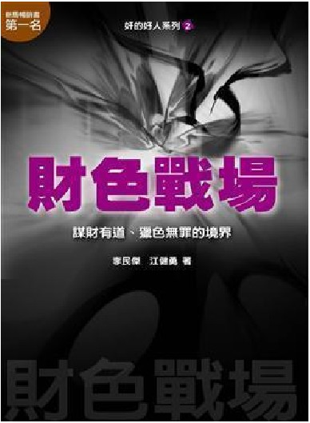

# 奸的好人 2-財色戰場

## 李民傑、江健勇

**簡介** 

武俠小説裏，所有的角色都離不開一個地方——江湖。江湖是個多大的地方，確實的位置在哪裏，小説的作者大概也説不清。反正，英雄每天一定會見到的，就是人。沒見到人，哪來的情節？聼過一句話——三個人就能夠形成一個江湖，因此，也許我們可以說，江湖有的就是人。

見到人，通常是敵人，與英雄爭名、爭利。既然如此，就要打，就要殺——路就是這麼殺出來的，所以一般稱爲“血路”。

還有一種人，是必定會讓英雄遇見的，往往令英雄愛恨交織，難捨難分，而英雄的一生極爲可能就敗在這種人的身上。這種人統稱為“美人”——英雄難過美人關；窈窕淑女，君子好逑；英雄氣短，兒女情長…….

現實的世界裏，古往今來，許多人窮一生精力所追求的，不外乎財與色。當然，也有重名多於財色的，那是人生的另一境界，但也還離不開這個凡塵俗世、花花世界。一個人要是到了這些都能夠超越的時候，他的境界不是世外高人，就是聖人...

### 前 言

當年，我是某家台灣公司的頂級銷售員。某次台灣大老闆與所有的銷售員開會，想聽取我們的意見。我們八十多位銷售員，給老闆提出一個建議：「不如透過強勢的廣告宣傳‥‥」老闆沒等我們講完，就氣定神閒的打斷我們，他挑戰我們說：「廣告宣傳需要大量資金，我可以花得起這筆錢，但如果業績沒有提昇的話‥‥」他停頓了一下，然後瞪眼盯著我們說：「誰來負責？你們願意減薪補回廣告所花費的資金嗎？」

當時，我和八十多位銷售員只有一個反應－－啞口無言。

第二年，同樣的銷售年度大會，新進的行銷經理，被我們這些銷售員慫恿，向台灣老闆提議透過廣告宣傳產品。台灣老闆同樣打斷他說：「廣告宣傳需要大量資金，我可以支付這筆錢，做不到生意，誰來負責？你願意減薪補回廣告的資金嗎？」說完，用極度兇悍的眼神瞪住行銷經理。出乎意料，行銷經理完全沒有迴避，他從容的說：「我願意負上全部責任。」

接著，他問了老闆一個很簡單的問題。

這一次換成是老闆啞口無言。最令人意外的是，這位台灣老闆走到行銷經理的面前抱住他的肩膀說：「我等了這麼多年，終於等到你的出現‥‥」

戲劇性的轉變，讓我上了一場永生難忘的課程。當時，我們每位銷售員都想：「哎呀！為什麼沒想過問老闆這個問題？」一個簡單的問題，竟然可以完全改變一個人的命運，這讓我想起中國人的一句話：「一言興邦，一言喪邦。」

當年的行銷經理，現今成了該公司全亞太區的總經理。我和八十多位銷售員，都沒有看穿這位台灣大老闆心中的城府，更沒辦法看到如何應對他的挑戰的方法‥‥

一般人只能看穿接近表面層次的境界，所以也只能想出一般的方法。

X X X

有一位朋友透過我們的介紹，私底下請教一位和尚，他問和尚，做人應該要怎樣做，才可以圓滿？和尚沒有跟他談高深的道理，他只是用很平淡的語氣說：「每個人只要自己照顧好自己，這個世界就會很好了。」我們這位朋友是崇尚慈悲的佛教中人，但他有一點生氣的跟我們說：「這位和尚竟然講出這樣的話！」我們發現，原來真理是刺耳的‥‥X X X

假設你正在追求一位女士，與她一起吃著東西的時候，你的某個言行讓她反感了，她一氣之下，變臉說：「我完全沒有胃口了，你吃完再來找我吧！」然後就邁步走出餐廳。

此刻，你要追出去，還是不追？

答案可能是連你做夢都想不到的。

我們會告訴你為什麼所有的價值都不是真的。

答案是你已經知道，也已經經歷過了要做一個不平凡的人，就一定要學會看穿深層次的境界，這樣你才能想出非一般的方法，得到你最想要的不凡效果。

### 第一章 財色的智慧

### 財色兼收的經驗和理論

為什麼你要「財色兼收」？

有些人可能會很好奇，為什麼我們要用「財色兼收」這麼負面和低劣的字眼作為標題？答案很簡單，因為有「財」你才能活下去，有「色」你才能傳宗接代！除非你的人生願望是要當和尚或清修之士，否則「財色兼收」肯定是人類社會群體的根本需求。如果你對我們這番人類根本慾望和需求反感的話，我們勸你自行參考著名心理學家馬斯洛（Abraham Maslow）的人類欲求金字塔理論。

千萬不要小看這種根本的需求，因為有許多人窮其一生的精力，所獲得的財富僅僅足夠讓他活下去而已，他的愛情也是－－在完全沒有其他選擇或不敢選擇之下，湊巧地和一位對象在一起。

平平淡淡的經濟能力，平平淡淡的愛情，就這樣過了一生‥‥這些人只能徒呼奈何，時間久了就開始「相信宿命」，時間再久一點就變成「埋怨宿命」了。最後，他們會引述一般是老人家會說的話：「一個人吃多少，穿多少，都是注定的。要賺大錢？獲得嬌妻美眷？談何容易。」

那到底是否有什麼神秘的力量安排了這一切？到底是什麼主宰了我們「應該」擁有多少？

因 果？

曾經有位女學員說，上了我們的課程後，知道可以通過運用多種技巧去做成生意，不過，她覺得身為相信因果的佛教徒，她不應該用太多技巧及手段來強求人生。

我告訴她，我不是聖人，看不出她的因果。但我有一個方法，可以訓練她怎樣靠自己就可以看出「做不做成生意的因果」，而且準確度超過百分之九十。她即刻很好奇又迫切地問我如何看‥‥命 運？

如果真的全靠命運，當算命師說「你吃多少都已經被老天爺注定」時，你應該問他：「是否就算不工作，還會有被注定了的食物自動送到你的口中？」

如果真的有一個真理叫作命運，吃多少都有定數的話，你是不是可以攤開雙手，就會莫名其妙地，獲得你命中該吃的？即使你不願意，也有人會將你命中該吃的都送到你的面前，喂進你的口裡？又或者，假如你真的注定在某個時候「命不該絶」的話，是不是就算蓄意從高樓跳下，也會有人突然打開窗架，讓你的腰帶恰恰勾住窗架角而不致于跌死？如果真的是這樣，你會否覺得老天爺一定是有點心理變態？否則怎會弄出「命運」來跟我們開玩笑？

上 帝？

如果有人說你追不到喜歡的女子，是因為上帝的旨意，那你或許應該問他：「上帝是否親口告訴你，我不應該和那女子在一起？」如果有人說你的事業一直沒有起色，是因為你的因果業障，那你也可以問他：「你是不是真的看到我的因果業障？」這些人講的話都是不負責任的猜測。

因果報應的安慰

我真的不敢肯定世界上到底是否有命運、上帝或業障，但是我覺得那些跟你說「善有善報，惡有惡報，不是不報，只是時辰末到」的人有點不負責任。因為他看到惡人沒有惡報時，就只會告訴對方他的報應還沒有到。如果惡人快死了還不見報應，他就推說來世一定會報。聽到了這句話，除了讓受害者覺得好過一點外，一點用處都沒有。

我當時瞪著這位選擇相信因果的女學員，告訴她如何檢測「做成生意的因果」：如果她在客戶身上，使用過我們傳授的一切權謀手段和所有的 NLP 催眠影響術後，依然做不成生意的話，她才有資格講「這就是因果吧」！

金錢和愛情的獲得，是不是靠命運、因果？

你要經驗還是理論？

在我們的課程中，我們通常都會問：「你認為跟『有經驗』還是『有理論』的人學習，才會讓你比較快速成功？」大部份的人會選擇『經驗』，少數人會選擇『有理論』。選經驗的人認為：「這很明顯嘛，我想減肥，不可能叫大胖子分享經驗吧？」再說，某些著名的成功學大師，如安東尼羅賓之類的，不也老是說「要成功，就要和成功的人在一起」嗎？

如果可以用這句話作為成功法則，那每天和李嘉誠或比爾蓋玆在一起的傭人或司機就會成為成功的典範嗎？他們的成功機率豈不是比其他人更高更頻密？？？大家都聽過華人常說的「富不過三代」吧？既然是父子關係了，夠親近吧？那為什麼「富」卻偏偏「過不到第三代」呢？

反過來說，是不是有理論的人就容易會成功呢？環顧現實世界最能掌握理論的就是學術界人士，如碩士或博士，可是這兩種人通常都替人打工，他們僱主的學歷往往都比不上他們。撇開學術成就不談，那些在課堂裡教學的經濟、商管、金融學者，若憑著幾十個理論和幾百個個案，上陣市場，就能賺大錢嗎？

### 成功者最失敗的地方

白手起家者的遠見

曾經拜訪過一位做大生意的「老」朋友，他是典型白手起家的生意人－－沒有受過高等教育，卻從自己的經歷中創建出自己的生意殿堂。由於他本身沒受過高等教育，因此他希望下一代可以彌補這個遺憾。他灌輸孩子自小就瞭解讀書的重要性，孩子也不負眾望的在外國一家著名大學考獲商管碩士（MBA）回來。這樣一來，爸爸擁有數十年的商場經驗，而孩子就擁有滿腹頂尖的商管理論，這個組合簡直天衣無縫吧！

和這位大老闆巡視工廠閒聊的時候，他的孩子剛巧經過，大老闆就問他的孩子，公司的貨車司機陳伯到哪裡去了？為什麼整天不見他的蹤影？孩子回答說，他吩咐司機去供應商處先將原料載回來。大老闆聽了孩子的回答後，臉色隨即一沉，立刻示意孩子進去他的辦公室。

經驗和理論的衝突

辦公室內，大老闆的臉色黑得如燒了百年的鍋底。我立即感受到無形的戰鬥氣氛，就好像兩大武功高強的劍手，正以最凌厲奪人的殺氣互相對歭。孩子先開口向父親解釋為什麼要吩咐司機去載原料，理由是因為要急著交貨，供應商卻要數天後才能載原料來，所以才吩咐司機陳伯先過去把原料載回來。大老闆聽了就一直罵，孩子則一直解釋，兩父子之間的火藥味，足以將辦公室變成火藥庫。

雙方都堅持自己的意見，正當大家不知道要如何下台的時候，在極度尷尬的情況下，我唯有找了一個藉口，對大老闆說我有事情想請問他的孩子，然後就把他的孩子拉去茶餐廳了。

喝著茶的時候，孩子還忿忿不平的向我大吐苦水，不斷抨擊那個老糊塗竟然為了這樣的小事大動肝火，難怪我們華人的企業都跟不上西方人云雲‥‥。當時，我瞄了他一眼，然後慢條斯理地對他說：「你爸爸這樣做是對的‥‥」（小老闆馬上皺眉看著我），「因為他看到兩樣東西是你看不到的‥‥」

經驗的慧眼

我問小老闆：「你讀過經濟學裡所謂推動市場的『無形之手』吧？」他點頭回答說：「自私的動機。」（註：各位讀者不要被那些童話式的寓言故事騙了，推動社會進步的最重要元素就是自私動機和競爭。）我再問：「那麼你應該也知道從自私動機衍生出來的成本主義這個概念吧？」當下他就略有所悟的愣著了，他明白到自己所犯的錯誤，因為他耗費掉自己的資源，去做了本來應該由別人做的事情－－這就是浪費了自己的邊際成本。

我接著說：「你爸爸還看到第二個重點，那就是人性。」他再度獃了一下，似乎處在似懂非懂的狀況下。我解釋道：「你只要做了這一次，就會有第二次和第三次，甚至無數次，以後你的供應商就會懶惰給你送貨，因為他會能省則省，認為你如果真的急著需要原料，你就一定會自己過來載的！你在不知不覺中寵壞了你的供應商。老兄，你的父親能夠有今天的成就，不是純靠運氣，他的確掌握到了一些即無形又重要的要訣，可惜沒辦法用明確的語言描述出來而已。」

權謀法則

只要有了第一次，就會有第二次，有了第二次，就會有第三次。以後就會有無量無數次。

接著我就和他分享如何對供應商使用洗腦的三部曲，令供應商們安份與聽話，其中部份關鍵的做法，就是牽涉到策略性的無理取閙，甚至去麻煩他的供應商。

經驗的盲點

他聽後感嘆的說，這種能力在大學裡也難獲得。我心裡更感嘆，因為很多大老闆擁有極其珍貴的經驗，要以這種經驗能力賺大錢肯定沒問題，即使面對生意倒閉和破產的困境，我深信他們也可以在短短幾年間東山再起，重振雄風，可惜這些大富豪都沒有把自己的經驗變成具系統的理論，因此沒辦法有更大的突破。

唯有把自己的經驗變成理論，才可能反觀自我，更上一層樓。

當我們談話告一段落時，咖啡室裡的一位女侍應過來問我們：「兩位靚仔，要不要多一杯？」然後她也和我們很親切的閒聊起來。小老闆此刻就開始輕鬆下來，也以「美女」來回敬她說：「你也這麼漂亮，根本就不需要出來工作了，叫男朋友照顧你吧！」女侍應笑得很開心地說：「沒辦法呀，我沒人要。」小老闆展現著灑脫不覊的模樣，就趁機逗弄著女侍應說：「怎麼會沒人要，我看你只是要求過高而已，不如給我你的電話號碼，有空我們可以談談。」侍應小姐沒直接回答，但更親切的對小老闆說：「你多一點過來啦，咖啡室裡的工作很悶，有時候很想有人可以跟我聊聊天。」她去拿飲品時，小老闆一直看著她走進廚房，然後有點興奮的轉頭對我說：「她的反應不錯，應該有機會吧？」看他笑到好像一個處男聽到章子怡悄聲對他說「我要成為你生命中的第一次」般燦爛，我也不好意思給他潑一盆冷水「消暑」。

註

我們不知道這本書會流傳多少個年代，假如未來的讀者不知章子怡小姐是誰，這裡給你過癮地補註：她是二十一世紀初最紅的亞洲女明星，漂亮靈巧、倔強、苗條。當年她因代言名錶時來到馬來西亞一商場，她戴著那種「深怕你不知我是明星」的太陽眼鏡（可遮去半個臉的那種），向群眾揮手時，給我看到她那雙鬆軟的大臂後肌，會隨著搖擺而有韻律地蕩動著。

小老闆顯然陶醉在錯覺的幻想裡，以為有機會可以追到女侍應。

其實他的處境就像一個站在地下鐵軌道上的人，火車從他的背後衝著過來時，他還很享受的閉目仰頭張臂吸氣說：「好涼爽的風啊！」把「危機」誤當作是「良機」。

他的反應讓我想起大公司的老前輩引誘天真的銷售員一般－－「來，你拿多點的樣本給我，我幫你拿給我的朋友看‥‥」，「這次我們會訂貨比較少，因為我們要試一試你們的服務，將來你做的好，我們的需求量是非常大的‥‥。」然後，銷售員回到公司對老闆說：「我們要好好表現，讓他滿意我們的服務，將來‥‥」殊不知，他已經一步又一步踩進對方的陷阱了‥‥。

權謀法則

人類最可悲的不是犯錯，而是他連錯在哪裡都不知道。

小老闆誤以為對女人口甜舌滑，花言巧語就能奪得其芳心，事實上他根本沒察覺自己已經犯下追求女人的最大致命錯誤。

### 以不追…來追女人

普通男人用「拜」來追女人

男追女的過程，和做生意一樣，同樣牽涉到許多經驗和理論的結合。一般人都認為追求女人，口舌要甜，態度慇勤就對了。講得難聽點，就好像拜神一樣：不斷的供奉讚美，期待得到神明的眷顧。但是，我所認識的一些追求異性的「高手中的高手」，是絶對不用甜言蜜語的，也不獻慇勤，他們反其道而行，喜歡在言談中取笑、戲弄甚至貶低他們想追求的對象。

乍聽之下，你也許會覺得如果跟著「高手」的策略來行事，真的就會獲得所追求的女人的「歡心」嗎？如果一不小心，她對你的舉止反感，你不會就遭遇「快速死亡」的下場嗎？

把神「踩」下來的方法

我有一位體重兩百多磅的大胖子朋友，他是一家健身院的會員。

他看上一位擁有天使臉孔魔鬼身材的女會員。某次，趁美女剛練完了某個器械項目，這位大胖子就搖著頭對她說：「你還要多做半個小時，才可以減掉你多餘的脂肪。」美女甚為驚訝，其櫻桃小嘴居然張大到好像想一口就把整粒西瓜吞下之狀！她自覺是健身中心內所有男人的目光焦點，所有男人如果離婚、和女友分手或太太去世的話，她都認為自己將會被他們視作未來伴侶的第一人選，但這位胖子老兄竟然不客氣地一腳就把她「踩」下去了。這種「唐突佳人」的做法，令佳人愕然不已！當時旁邊有另外一位男士就「乘虛而入」的對美女施展「拜」功，對她說：「不！不！你的身材很好，非常好看‥‥幾個星期後，大胖子就和魔鬼身材開始約會了。「神」已經被人從神的寶座上踢了下來。

各位男士，先別急著看到美女就謾罵、批評、陰損及激怒她，因為做「踩」字訣時，正確的聲調和肢體語言的配合都很重要，錯誤或不適當的運用，肯定會引起反效果，「神」會因此覺得你是在污辱她。

（在我 NLP 課程中，對各種的聲調和肢體語言都有深入的教授和研習，同時更需要老師演練示範。）可是高手們如此做一定有他的道理，他們的做法就是以「不追而追」，近似老子的道家思想－－「無為而為」。

取笑或戲弄你想追求的女人，將會出現兩種效果。

你越喜歡她，她就越不喜歡你

古往今來人類的交配心理學史，通常都是男追女。當男追女時，女方的價值和主控權就晉陞了。（註：詳情可參閲我們的第一部作品《勾魂奪心．洗腦催眠》中《格局思想》一章。）當你越用甜言蜜語來稱讚你還沒追上手的女人時，你已經很明確的告訴她一個訊息：「我很想要你！」。

讀者們可能會想：「那麼，我真的是很喜歡她嘛！這樣子講又有什麼問題呢？」問題就是：因為對方還沒喜歡上你！

當對方對你的感覺只是普普通通的時候，一旦她忽然覺得你想更進一步時，她就很自然會退了兩步，尤其是那些很多人追求的女人，這種反應會更明顯。

還記得推動市場的無形之手嗎？

每個女人都要選最好的。假如要以做生意的角度來比喻，就是她要「報價（資源）」最好，「服務（誠意）」又最棒的。（你說愛情不自私嗎？）她不會因為你很喜歡她或愛她，就會「義務」地愛上你，因為她不是做慈善的。

當你直接或間接讓她知道你想更進一步時，你就已經告訴她你很需要她，你很渴望她接受你。你越渴望她接受你，你的價值（價格）就會不斷下降．她對你的好感也自然會相對的下降了。

有沒有發現，這是一個兩難的局勢？你什麼都不做，是不可能會產生感情的，因為對方還沒喜歡上你。但若有所行動，卻又會有反效果！

只要你「進一」的話，對方就「退二」。高手到底會怎麼做呢？

你越不喜歡她，她就越喜歡你

在群體中，最漂亮的小姐通常會得到最多男人的留意、關心、拍馬屁和表白。可是高手們卻會和多數男人唱反調，他們几乎對在座每個人都很關注和友善，他偏偏就會邊緣化這位絶世美女，對她不理不睬，可能還會批評式的取笑她。如果能取笑到全部人都笑是最好的；取笑到全部人，包括她也一齊笑的話，最上品。

高手的作法其實是要達到一石二鳥之效，他讓美女感覺到他並不需要她，因此他的價值就不會降低，這是他要打的「第一鳥」。

另一方面，美女心裡會浮現這個疑問：「為什麼每個人都被他接受了，就只有我還未被接受？」慢慢地，美女就會開始不自覺的改變自己的位置－－希望從「被邊緣化」變成「被接受」。但她卻不知道當她內心需要被這位高手接受時，她自己的價值就會下降，而對方的價值反而提升了，她現在反而隱隱地對高手產生好感了，這是「第二鳥」。

權謀法則

若想提昇自己的價值，使對方錯以為他需要獲得你的接受如何擦出火花

一般情況下，當女人被取笑時，她會出現又好氣又好笑的狀態，這其實就是愛情小說和電影裡面常出現的「火花」！舉例說，如果某小姐說她覺得你的身材需要減肥時，你用冷笑回應：「哼，我就知道你剛纔一直偷看我的屁股。」又，假如某女人發現自己講錯了某些事情，而急忙道歉時，你坦然地答：「不用道歉了，很多女人見到我這個髮型時，通常會緊張到講錯話。」或「我知道我很有吸引力，但我不知道我可以弄到女人講錯話。」等方式，都是「擦出火花」之舉。

几乎每個人都知道「火花」的重要性，但是，那也是是最多人誤解的事情。愛情故事裡最常見的架構就是一對男女如何從互相衝突厭惡對方開始，在幾經轉折下，終於發現他們「其實」是互相愛上對方的！從生理學上的角度來分析，憎恨一個人和轟轟烈烈愛上一個人，兩種生理現象是很接近的，它們都是心跳加速、呼吸變快、瞳孔脹大。

那麼，你們可能會問：怎樣才可以確保對方是覺得有「火花」而不是有「火藥」呢？

愛恨一綫之差

根據美國一項科學試驗，當一群大學生被注射了一種輕微的興奮劑（epinephrine）後，就會出現心跳加速、呼吸變快和瞳孔脹大等身理狀態。當大學生們出現上述狀態時，科學家就會放人進去實驗室叫他們形容當時的情緒。雖然是同一種藥但一組學生形容他們感到恐懼，另一組則是憤怒，還有一組學生則感覺浪漫和出現性興奮的反應。

問題在哪裡？關鍵其實是在進去發問的人。某些人進去會略粗爆的發問，導致大學生認為藥效會帶來恐懼；另一批人則以稍微藐視的態度與大學生對談，令他們覺得藥效帶來「憤怒的情緒；但如果問問題的人是臉帶笑容的異性，大學生們的情緒反應就是春心大動。

所以情場高手就有辦法將這種微妙的情緒加以混淆和轉換。

高手轉恨成愛的妙方

一般的好好先生，受到文化禮儀的洗腦，覺得自己應該要儘量展現出「男士風度」，極度希望被自己喜歡的女方接受。他們把自己是否被女人接受看得太重要了，講話時變成超級小心翼翼，因為怕會不小心得罪了「女神」。這種男人最大的可能性就是成為女方的好朋友，而很多的女性朋友告訴我，這些男人只可以用一個字來形容－－「悶！」

高手呢？當然不會好像好好先生一樣，他們一開始就會把他和心儀對象之間的交涉，推到舒適區外，弄到美女又好氣又好笑，令美女下意識地有這樣的自然反應－－「我好像很氣他，但他同時又弄到我笑，我怎能恨他呢？」既然愛恨是那樣的接近，因此，如果不是恨的話，就是愛了。她又愛又恨，若即若離，乍喜乍憂－－這就是所謂的火花了。

權謀法則

愛情的火花，取決於你在對方的頭腦裡，同時製造兩種反方向的情緒。

當然，你也不要以為弄到有火花就可以了，雖然當火花一擦出時，意味著你的機會來了，但純機會還不足以讓一個女人愛上你，因為如果你一直取笑她和玩著不接受她的遊戲，她就其的逐漸會認定她不是你想要的那一杯茶、不合他口味。所以，在一次有火花的邂逅之後，你還需要有一些舉動，以將火花轉變為愛情的火焰。而且，當你看到「特定的信號」出現時，就必須告訴她，你對她有好感。不過就算看到了信號，時機也對了，但當你對她表達有好感的方式不能讓她感到她需要賺取你的好感時，你的表白也是沒價值的。箇中涉及觀察力、言行包裝、審核、賞罰等等的策略。

同樣的，在面對客戶或老闆時，一般人會認為必須像追求女人一般地儘量討好對方，甚至扮小丑來取悅對方，把客戶當作「神」來拜，期望乞求到生意。為了達到目的很多人都認同拍對方的馬屁是有效的，尤其能夠拍到對方心花怒放，做起事來自然就事半功倍。但也有人發現，馬屁拍到了某個程度，某些客戶反而不再珍惜你！真正拍馬屁的技巧是要「拍」到讓對方覺得是他榮幸地賺取了你的馬屁－－他需要賺取你的認同！唯有如此對方纔會覺得你有價值。

權謀法則

君子愛財、愛淑女，要取之有道，取之坦然。

因為我們又愛財又愛愛情的這種功利的權謀派思想，會被那些勵志派和道德派的人抨擊，因為他們認為心態就是一切。這是目前市場上流行的成功學所宣揚的，但它其實是一個「最偉大又危險的迷信」！

### 第二章 以盲引盲的

成功勵志潮流

### 流行成功學、勵志書和激勵課程的真相

很多人都有閲讀一些勵志書或聽聽激勵演講來提昇自己的鬥志，讓自己更爭氣。特別是在人生低潮期時，看看一些人的奮鬥史來提醒自己「只要堅持下去，還是有希望的」。我們不否認這一點，不過同一時候也要告訴大家這種做法另一面的真相。

冷血無情的成功道理

我曾經有一次在馬來西亞講師協會演講，講題是如何做講台上的銷售。期間我被人問起是怎樣進入培訓和演講領域的，其中有一個聽眾的反應，是我記得最清楚。

他問我：「做這一行，如果遇到挫折，你如何激勵自己？」我回答說：「我從來都不激勵自己。」几乎所有的人都目瞪口獃的看著我。我猜，應該是每個人都覺得激勵自己很重要吧！問問題的人很好奇的再問：「為什麼呢？」我說：「我一遇到挫折或問題時，第一時間就想：有多少個方法可以用來解決這個問題。我根本沒時間去激勵自己。」

我的另外一位夥伴王志堅，後來針對激勵這個問題講得更妙。他說：「什麼方法都想不出來解決問題時，就真的需要激勵自己了。」我個人簡單想法是，反正你遇到問題時，激勵了自己後，始終還是要面對問題，不如儘早想更多的方法來解決問題，這樣會更省時間。

你要問自己，你的「感受」比較重要還是「解決問題」更重要？

如果你認為你的感受比較重要，你可以選擇激勵自己，讓自已感受好一點後再去想如何解決問題。不要小看感受的力量，就好像小孩子哭著不想上學，父母就要想盡辦法去哄他，讓他的感受好一點後，再半推半誘的叫他去上學。（如果各位認為我在指桑罵槐，你沒猜錯，我的確是在影射那些需要激勵了才去行動的人，他們就像小孩子。）另一方面，如果你認為解決目前問題比你的感受更重要的話，你就得想出辦法。想不出辦法就去問人或看書等，看看是否能得到新點子，然後按你所想出來的解決方案去做就可以了。如果還是失敗的話，再想另外一個方法‥‥以此類推。

權謀法則

遇到挫折時，尋求解決為上策，宣洩情緒為下策。

如果你有多餘的時間，你可以調好心情，再度出擊。不過如果你的時間不夠，卻還要調好自己的心情，就是一種奢侈行為了。

這就好像你又怕冷又想在泳池中游泳的情況。你下水池的方法有兩種：一，膽小如鼠的做法，用腳趾頭浸到水池中，覺得冷的話就抽縮回來，接著再把腳趾浸到水中，一步一步的去習慣水池的溫度，之後再用手潑水到身上‥‥搞到最後，你共需要七分鐘才習慣泳池中的水溫。

第二種做法，就是你知道池中的水很冷，但你不管。縱身跳入泳池。剛開始的半分鐘，你可能會冷到發抖，一分鐘後，你就可以自由自在的在泳池游泳了。這才是成年人的行事作風－－不會太過注重感受！

你腦中的毒品

注重感受或情緒的激勵課程之參加者，在外國有個名詞是用來形容他們的，叫 Seminars Junkies。Junk 表示垃圾，Junkies 則是對癮君子的形容詞。言下之意，就是說上課上到「上癮」。這個理由不難明白，情緒是一種腦中分泌的天然化學物品，一個人吸毒後，毒品會代替頭腦激發分泌某些特定的天然化學物品，所以才會令到人有飄然若仙的感覺。

我們的腦內嗎啡（endorphine），會在吃辛辣的食物、運動、笑、吃巧克力、談戀愛，性高潮和吸食海洛英時分泌。只不過，吸食海洛英時，我們的腦會分泌出超過自然份量的腦內嗎啡。當回復正常時，就出現撤退癥狀（Withdrawal Symptom），這就是所謂的毒癮。那情況就好像你在家裡舉行了一個盛大的狂歡會，到了深夜，客人一個又一個的走了，走到人去樓空後，你可能會有剎那的空虛感。假如這種空虛感強到你需要每個星期都要參加類似的派對，不然你就會有點憂鬱，甚至會影響到你的工作的話，這就是上癮了。

常看注重感受的勵志書或喜歡上激勵課程的人會有四個危機：一，效力的維持短

高漲的情緒不可能長遠維持下去，不是講師或作家的功力不夠或你不肯改變，而是天然的人腦神經系統不可能一直分泌同樣的化學物品。剛剛走出一場激勵課程時，會感覺解脫、解放，甚至以為可以征服整個太陽系，但課程過後一段時間，一切就會打回原形。看勵志書的情況也一樣，剛看完時會有感動，接下來呢？

二，次數的重複多

一般人會覺得上激勵課程就等於充電，充電完畢後就在事業上再衝刺。就好像喝咖啡提神一樣，當工作效率下降時，就須要來一杯。

至于上課程所花的錢，是小事，接著下來的危機才是大事。

三，份量越來越大

充電時所產生的情緒力量，確實可以讓一個人勇往直前。但情緒其實就是一種天然毒品，上癮後，未來所需的份量就會越來越大。所以癮君子在醫院開刀前，一定要告訴醫生他長期服用那一種毒品，因為麻醉師要開給他的麻醉劑份量，是比你我所需的更重，否則，手術途中他可能忽然清醒就不堪設想了。

當你接受了大師的激勵後，你會出去沖，去奮鬥，可是等藥力開始消退後，你就得接受大師的特大激勵，才會有感覺。第三次呢？你需要超巨大激勵了。第四次呢？因為常常給同一個大師激勵慣了，感覺沒以前般的震撼，所以你現在就更加需要找另外一位不同的大師再給你激勵了。這也不是大問題，因為市場上的需求無限，供應也是無限，一山肯定還有一山高，你肯定會再找到另一個激勵大師的。

看勵志書，特別是那些關於一些如某某天生或意外殘缺人士的故事，記述他們如何艱苦奮鬥，總而言之看到滿書淚跡就對了。第一次激勵到你的可能是一個沒手的人的奮鬥史，第二次可能是要讀到沒手又沒腳的人才能激勵得動你，第三次呢？要看到一沒手沒腳又沒頭的人之奮鬥史？

四，依賴心情行事

如此長期下去你會養成一個習慣，當你心情好時，才去做你該做的事情。心情不好時就做得馬馬馬虎虎，或索性不做。就好像女人要和一個男人有親密行為時，一定要內有心情，外有氣氛，才可以成事。

假如你也好像女人一樣，要有好心情才能採取行動，你需要向世界上最古老的行業學習。

我們再講得難聽和粗俗一點，做妓女的能不能夠等到有氣氛和情趣才「做」（接客）？你要成功的話，是否要等到心情、感受都調到恰到好處才去做你該做的事？你果真覺得某個目標是你要的，但你又還沒達到的話，你就要像妓女的想法一樣：就算我心情不好，我還是要「做」。

權謀法則

大丈夫做事，不看自己心情好不好，感受好不好。

成功學與權謀學的分別

權謀學是最現實的一派。成功學或勵志派與你談心態激勵，權謀學跟你談手段技巧。成功學非常重視勇敢的第一步，認為做任何事都要將夢想放大數以十倍，只要你敢敢的想，敢敢的做，下定決心一定要，你就能成功。可是，你敢想是一回事，能否做得到又是另外一回事。

昂藏七尺，擁有力拔山河氣概勢，具破斧沉舟的大決心與大勇氣之西楚霸王項羽，難道比不上成功學派的任何一位講師？可是他成功了嗎？

因此，權謀學最重視的是現實，重視的是歷史。所以，做任何事，都需要看有沒有達到你想要的效果，正如鄧小平的名言：「下管黑貓白貓，捉到老鼠的就是好貓！」

勵志派認為一切都是要從心態上改（哈哈，難道老千成功騙到人，賺到錢就是心態正確嗎？）；權謀學認為，如要以改變來達到成功，任何改變的都是方法上的改變，不斷的改變直至你達到你想要的結果－－這就是成功！（想清楚，愛迪生是用一千種不同的實驗方法才能發明電燈泡。科學家的研究也是不斷轉變他的研究方法才成功的。）

沒有誰對誰錯的分別，只有程度的不同。兩派理論各有所長亦有所短，只是各何千秋，各自精彩！

成功學會告訴你心態有問題，就不能成功，你必要改變的心態，直至改變到成功為止。但是，要改變到同時？拿什麼來判斷？標準是什麼？你自己衡量。難道在上激勵課程的時候唱歌跳舞，又哭又笑、吞火、劈板、喉抵彎箭或過火後才自我突破，賺到錢的嗎？

題外話

（如果讀者嘗試以下的舉動，作者和本出版社將不負上任何責任。）

吞火的秘訣是把沾了酒精的捧子點燃後塞進口，然後馬上合口，火就會馬上熄滅。雖然口腔會感到有點熱，但絶對不會被燒傷。或者你戴上濕的棉布手套，然後在手套上沾上酒精，點燃後，是酒精在燃燒，手套則因為濕了水所以不會燒到手。我年輕時有上台表演過這種魔術。

劈板的秘訣是要選對木板，選不對的話，就連空手道高手也不能徒手劈開。劈的時候還要順著木板紋綫來劈，但如果木板之前濕了水，那麼高手就算順著紋綫也劈不開。

喉抵彎箭有兩種作法：一種是把箭抵在鎖骨的骨頭部份，那當然能夠把箭抵彎。另一種做法較高明，就是抵著鎖骨上方的 U 形處，那是整個喉部最柔軟的部份。這一部份是人體的要害處。防身時，你只要用指頭用力插攻擊者的這個部位，他就會叫苦連天。那麼怎樣用這部份來抵硬物呢？其實當你的下巴往上翹起時，這部份的肌肉就會變得稍硬，讀者大可自己試試，但干萬別拿利物來試。

過火的秘訣是，燒紅的炭可以過，燒黃的千萬不可以過。所以安東尼羅賓的過火表演一定要在晚上舉行的，否則白天的光會讓人看不清楚到底炭是燒成紅色或黃色。誰都可以過火，但不可以站火。過火時，步伐要快，但別急到不小心跌倒。我過過兩次火，我沒有跟安東尼羅賓所說的要眼看上方（我看著炭火），心中唸「Cool Moss」，也沒有請神上身。

這也和那些乩童拿起點燃的香在身上掃一樣，不會燒傷，但可千萬別把燃香固定的在一個地方燒。

老實說，比爾蓋茲、李嘉誠或王永慶等其他的大企業家之所以賺到錢，未必是自我突破，可能是靠策略上的契機而已。你克服了過火或高空跳下的恐懼，就只是突破了你敢過火和高空跳下而已。成功學的老師會傳播一個迷信：很成功的人一定好像是成仙成佛般，能夠「轉凡成聖」，突破自我，變成超人。

如果突破自我就可以很成功的話，就豈不是像我們的一位學員所講的：「美國流行電視節目『恐懼因素』（Fear Factor）中的參賽者又跳海又撞車又吃大便般的突破自己，他們不就具備了做數千億元的生意的潛能嗎？」

對權謀學而言，你覺得方法有問題，就改變方法，直至達到效果。

改變到何時，很簡單，譬如：你想做陌生拜訪，用以前的方法，百分之九十的人不肯聽你說，現在你用了權謀手段，有百分之八十的人肯聽你說，那麼，你的方法已經達到效果了，這就是標準了。（這個陌生拜訪的技巧紀錄在《勾魂奪心洗腦催眠》一書中）沒有用的陳腔濫調

相信你們都聽過：「一個人要成功，一定要有偉大的夢想，明確的目標，詳盡的計劃，積極的心態，正確的觀念；你不成功，是因為你沒有下定決心，你還不成功，因為你還沒有下定決心『一定』要成功‥‥。」（破斧沉舟的項羽決心不大嗎？結果又怎樣？最終還是敗在劉邦和韓信的智謀權術上。希望這些人能多懂一些歷史。）非常抱歉，我不得不說這種口號就好像是一個神棍所為，收了你三萬六千元的香油錢，然後叫你在他作法祈福時，一定要誠心誠意，精神專一，你所求的才會有效。如果你不成功的話，神棍會告訴你是因為你還不夠誠意，精神還不夠集中！

如果我們只是重炒這些冷飯給你們，簡直就是侮辱你們的智慧！

上過我們的課程的人，都知道我們是不會要學員們喊口號、做團康、幫助站在你前面的人做按摩、用唱歌跳舞搖屁股來浪費你們的時間。

我們也不會玩花招，弄到你們又哭又笑。（有些課程是很明顯的用唱歌、跳舞和團康來充塞時間）

我們認為，要唱歌去卡拉 OK 就可以了、要跳舞就去「跌死狗」（DISCO）、想用哭來減壓請趕快看苦情片或找一個學過少林大力金剛指的腳底按摩師、要大笑就馬上買周星馳的 DVD 回家看－－這些方法比較實際。很多人沒有想過，為什麼這些人須要玩花招呢？比爾蓋玆（Bill Gates）或壹傳媒的總裁黎智英的演講，需要玩花招的嗎？

答案是不會！他們只會以最紮實的內容轟擊你的思維，這才是智慧型的演講。他們的演講內容就像一顆原子彈，足以炸開你的頭腦，然後讓你開竅頓悟！

讓你從夢幻中清醒

其實，在我們的權謀課程，我們沒有用手段來弄學員們又哭又笑，但是，還是有許多學員告訴我們，這個課程改變了他們的價值觀。

改變價值觀有真假之分，「假的改變價值觀」就如上激勵課程時，講師要你回想過去的你如何不好，有什麼遺憾等，然後用音樂、催眠，試圖把你弄哭。或看了某一本情緒元素很強的勵志書，因感動而發奮圖強的人是很難有持續力。

「假的改變價值觀」對你的人生來說並沒有實質的意義它最大的功效也非常短促，就像運動員在比賽前服用類固醇（禁藥）一樣，藥力消失之後，即刻打回原形。也好像男人吃「偉哥」（威而剛）一樣，是一種假的雄風。真的雄風是你有運動，血液循環好，才會有，這是一種身體健康所附帶的「效用」。

你之所以在上了這類哭哭啼啼課程後，或看了讓你極感動的勵志書後會「覺得」改變了價值觀，是你平常很少將心裡的憂鬱給發洩出來，因此發洩後會覺得似乎解脫了、改變了。這種反應叫作宣洩效應（Catharsis），就如忍大便多時，等你找到「廁所，排泄的那一刻，你也會覺得身心完全輕鬆了，那感覺和大解脫一模一樣。這種課程和書最大的好處，就是讓你痛痛快快大哭一場，將心裡的憂鬱給發洩出來。

怎樣才算真的改變價值觀呢？有三大條件：第一，可以讓你從夢幻中清醒；第二，看透人性、想通人生、看清商場和情場上的遊戲規則；第三，通過第一，第二的條件，你變得更加成熟、穩重。

成功學和勵志派（甚至是你的一些前輩朋友）雖然想要教你成功，但他們卻不小心傳了一個宗教給你，如果你也不小心的誤信的話，你可能會變成一個見習「超人」。

### 偉人背後的暗黑真相

此篇為真正的偉大發明家 Tesla 致敬而寫你想做成功的有錢人，還是神聖的超人？

當有人肯將一般人都不願意告訴你的事情告訴你，那是有價值和有意義的事。一般人都說國王的新衣好看，直到有個小孩指著國王說：「為什麼國王沒穿衣服？」國王和人民才面對現實。當然，真相被指出的那一刻大家都會很尷尬。我們也會盡我們的能力，把市場上對成功的迷思，有如國王的新衣一般，一一的指出。

你可以從流行勵志派教義的架構看到童話故事的「餅印」，即善有善報，惡有惡報。又或者有點像是在看傳統式的美國英雄漫畫，故事中的英雄一定是如陽光般的正面，英雄所擁有的性格就如中國大俠般：大方、勇敢、正義、善良、無私、充滿智慧等。它也教你只要學大俠般的行為思想，你就會成功。你要小心一點，因為他們只是變相的宗教而已。你本來想學賺錢，結果卻變成學做「超人」，學做「義俠」李慕白。

成功者不一定比你好、比你積極

成功學的激勵大師最喜歡用汽車人王亨利．福特一世作為例子，說他如何偉大，如何積極，如何對世人有很偉大的貢獻（如《思考致富》一書也如此描述）‥‥。可是，這些所謂的大師不知道是否歷史的知識很欠缺，他們忘了告訴我們到底他們的成功有沒有用手段？他真的是心態很正確嗎？

亨利．福特一世，其人多疑迷信、粗暴固執，外號有「神經福特」之稱。他不愛捐錢、憎恨猶太人（註：他寫過一本反猶太主義的書，因為散播種族仇恨意識，在美國被列為禁書，馬來西亞的書局卻有出售），還得到殺人狂魔希特拉（屠殺六百萬猶太人的魔頭）頒發徽章。

極度迷信的福特，每遇到十三號和星期五就不敢出門，他也怕看到黑貓、不敢在樓梯下走過。此人迷信程度如此之深，絶對不是積極樂觀的人。

成功學的理論，是給想做聖人的普通人看的接下來讓我們談談成功學鮮為人知的一個真相：成功學的開山祖師－－拿破崙．希爾，以《思考致富》一書，在一九二九年聞名天下。

例出瑣瑣碎碎的十三條規則，一脈相傳下來，發展到現代，可謂「百花齊放，百家爭鳴」、「桃李滿天下」。這些教條式的思想，有沒有人問過：「在真實的世界裡，所有的成功者是否都是這樣成功？如果沒有辦法遵從聖人戒律般的十三條規，是不是就不能成功？」在真實的世界，拿破崙．希爾所例出的成功人物，到底有沒有遵從他的十三條規？如果沒有做到，那麼這本書的價值到底又在哪裡呢？

成功學的開山祖師拿破崙．希爾所例出及推崇的成功人物，據稱都具備了這十三條規的特質。他把成功的人，封為超人或聖人。實際上，有很多成功者並沒有像成功學所說的那麼完美，他們不一定是心態正確的人，不一定具備無私奉獻的精神，也未必有包容的心胸。他們可能是斤斤計較的人，因為生意人如果不斤斤計較．如何賺錢？商人就是商人。無論他們多成功，他們都有可能是小人，更加可能會耍手段、搞陰謀、弄陷阱。千萬不要被隱惡揚善的文化所騙！這種隱惡揚善的文化，將歷史上許多名人包裝成偉大的人物。

一個最像天使的魔鬼

我們選擇大家最熟悉的人物作為例子，那也是成功學最愛舉的例子。（這例子多到媽媽在廚房右手炒著肉，左手切著菜，眼睛看著客廳的電視，左肩夾著電話，右腳在推動著小寶寶的搖籃時，你問她，她也講得出這個人的偉大、都會對他歌功頌德的人物）－－他就是發明大王愛迪生。

愛迪生是不是偉大到好像聖人一樣呢？他發明了電燈泡，那是偉大的發明，我們也認為這個人非常成功，但他是否因為遵守了十三條規、心態正確而成功呢？

拆下假天使背後的翅膀和頭上的光環愛迪生是非常著名和偉大的歷史人物。在小學和中學的教課本裡，都有記載他的事蹟。到底他是否真的這麼偉大？在這裡，我們要傳達一個很重要的概念：歷史通常是由勝利者所寫的，失敗的人沒有機會寫他的歷史。

談起愛迪生，我們會知道他是發明之王，他一生發明了千多種東西。其實，愛迪生是一個很厲害的生意人，其中有大部份的發明專利權並不屬於他，而是他買回來的－－這就是歷史的真相。

愛迪生是一個苛刻、自私自利、說話不算數的人，他既不誠實也不守信。有經濟學家估計過，他用超過三分之二的財產來打很多無謂的專利權官司，打官司的錢比用來投資在發明的錢還要多，最後落得一貧如洗、身無分文的下場。

其中愛迪生最偉大的「經典傑作」是，他不但欺騙了一位有遠見和其有實力的歐洲發明家，還用極度卑鄙的手段來打壓他。請注意，我們不是否定愛迪生這個人的功勞，我們覺得他是一個典型「厚黑學」中的英雄－－面夠厚，心夠黑。我們要帶出的信息是，成功學把他神聖化了。

一個有外星人頭腦的地球人

話說愛迪生和一個名叫特斯拉（Nikola Tesla）的歐州科學家一起合作，而特斯拉才是真正的天才。此人的頭腦比起當代任何一個人都進步許多，他想出來的東西，在那個時代沒有多少人瞭解。其中一個例子是，他曾經發明有火箭炮的遙控船，當他示範給美國的軍事部隊看時，他們竟然不明白這種東西能有什麼軍事用途。

我們都知道避雷針能把雷電傳到大地中。特斯拉因此認為大地儲藏著無窮的電源，他也做試驗嘗試把地中的電源抽出。據當時的目擊者所陳述，他已經接近成功，因為他們見到一道上百呎的雷電從地面閃出來。但結果試驗還是失敗了，失敗的那刻，整個城市的電源因此中斷。到今天為止，暫無人能重複該試驗，由此可見，他的思想是多麼的尖鋭和走在時代的尖端。所以假如你說他是外星人轉世投胎的話，我也會相信。

到今天為止，科學家還在鑽研著他的筆記。有些讀者可能會質疑，他如果這般偉大，為何聽也沒聽他的名字？

特斯拉三十歲前因一個偉大的工業革命發明，而成「那個年代的百萬富翁（那時候的百萬富翁是極之了不起的）。不過正因為他太容易相信別人，結果死的時候身無分文。他是一個完全不懂權謀的人。

（註：即使在今天我們的課本還是讀著收音機是馬可尼發明的，無線電之父其實是特斯拉。這個權謀白痴是在死後才蒙美國政府歸還屬於他的專利權。讀者可自行上網搜查。）外星人替假天使打工

特斯拉從歐州來到美國之前，已經聽過愛迪生的大名。他非常的仰慕他，想替他工作。當時愛迪生已經發明了發電機，叫作 DC（DirectCurrent 單向電流）。而特斯拉有另外一個研究，叫做 AC（AlternativeCurrent 雙向電流），他立刻把自己的研究想法告訴愛迪生，愛迪生聽了之後大吃一驚。

愛迪生覺得這個人是一個天才，所以馬上就聘請了他，但同時他卻覺得 AC 的理論不太可能實現，因為對當時的科技來說，AC 發電廠的可能性實在太遙遠了。雖然如此，愛迪生還是抱著姑且一試的心態，答應特斯拉說：「如果你成功研發 AC 的話，我就給你五萬美元作為酬勞。」

特斯拉聽了也非常的開心，覺得愛迪生就是他的伯樂天真的外星人

沒想到特斯拉真的在幾個月內成功研發 AC，愛迪生因此感到非常的驚訝！特斯拉之後問愛迪生拿五萬美元的酬勞，愛迪生卻告訴特斯拉說：「那只是一個玩笑，難道你沒有美國人的幽默嗎？不過，我還是願意加你的薪水！」

假如你是特斯拉的話，你會怎樣？一個你仰慕的英雄偶像，原來是個騙子！特斯拉一切的美夢，就隨著愛迪生顯露其真面目而幻滅了！

特斯拉當然非常的氣憤，馬上去尋找另外一位投資家協助他發展 AC 發電廠。終於，投資家摩根（J. P. Morgan）願意協助他的研發。

外星人終於幫到地球人

AC 第一次運用，是在美國的尼加拉瀑布。當 AC 在尼加拉瀑布成功運用的消息傳出後，很多人都非常的驚訝。因為當時 DC 的電纜是非常危險的，人們經過街邊的電纜而被電死是一件很平常的事。相反的，AC 安全性很高，而且電力非常強大。特斯拉的成功，使他被譽為現代電流學之父。日光燈也是他發明的，而整個電流供應，就因此有了一個最大的革命。如果沒有他的發明，我們今天的電費就會很貴了。

愛迪生知道後，非常的妒忌，他惡意打擊特斯拉，那情形就像你們常常在電影中所看到的奸詐之徒，如何運用財力與人脈，想盡辦法毀掉對手一樣。

天使暗藏「殺鷄」

愛迪生召開記者會，不懷好意示範 AC 是如何危險的。愛迪生用 AC 發電來電死鷄、小貓、小狗和小鳥等許多小動物，從中告訴人們 AC 的危險。但是，大家對這種示範覺得無聊，即使愛迪生搞許多小動作，公眾還是很相信 AC。

最後，愛迪生決定向政府獻議用 AC 去電死囚犯，他要證明 AC 的電力不只是對小狗之類的小動物造成生命威脅。但他沒有計算過，要電死一個人是需要很大的電力的。結果，愛迪生在公開場合把死囚電得半死不活，引起社會大眾的批評，他才覺得自己做得非常過份。

從此之後，他就不敢再這樣做了。

這是歷史上鐵証如山的事實，我相信很多人應該沒有讀過這一段歷史，但在美國和加拿大，那是眾所皆知的。我們之前以為愛迪生是一個偉大善良、心態積極的一個人，但是事實並不如此。

成功的人跟普通人一樣，有許多缺點，也有許多心理障礙，跟你我是沒有分別的，大家都是用口吃飯用肛門排便，只不過成功的人用了很多可以做但不可以說的權謀手段，他們並沒有實行勵志成功學派的條規，但他們永遠不會忘記市場上弱肉強食的遊戲規則。

流行成功學之所以會把這些人神化，同時又製造了童話式的成功模式，是因為他們把兩樣東西混淆了－－科學和真理。

### 違反成功理論的成功法

宗教和科學都分不清的成功學

一般流行成功學都會帶出的一些宗教情操和迷信，比如心態積極、心地純正善良的人，上天自然就會對他好。只要你有強烈的欲求（決心），有堅定的信念，有目標，能夠把目標心理視覺化，懂得做自我暗示等，你就一定會成功。這種種的條件，被拿破崙希爾和流行成功學的人稱為 P.M.A.（Positive Mental Attitude），或積極正面心念態度。

他們還把成功學當成一門科學，理由很簡單，因為包裝成科學後，人們就比較容易接受他們所講的一切。但他們同時又跟你講，他們所傳授的是宇宙不變的真理（Universal Law），如果你不跟著真理行事，就不可能成功。這個世界上只有宗教是講真理的。這就是他們最自相矛盾的地方：講科學就不講真理，講真理的話就不可能是科學了，真理的意思是最究竟的。但科學家是不相信真理的！

如何用烏鴉來推翻流行了 70 年的成功學凡是在大學裡教導科學的教授，只要教課超過十年，都會看到一個「真理」：科學教科書裡的一些理論，每十到二十年就需要重寫。

也就是說科學是會不斷的被推翻的，比如愛因斯坦的物理學理論就推翻了牛頓的物理學。科學是沒有真理的。在科學界裡，有一個叫黑白烏鴉的比喻，用來比喻理論被推翻的情形。

每個人都知道天下烏鴉一般黑，科學上已經證明了。不過只要我們發現有一隻烏鴉是白的，「全部烏鴉都是黑」的理論就會被推翻了。

所以在這裡我們要帶出一隻白烏鴉－－心態不須積極正面也能有大成功。

惡毒的念頭，飛黃騰達的下場

相信大家都見過善良的有錢人，也見過惡的有錢人，也見過不善不惡的有錢人。第一隻白烏鴉將告訴我們：有沒有錢和善不善良沒有直接關係。

相信因果輪迴論的人認為，一個人有錢是因為他前世有施捨了財或物予他人，導致這一世善有善報。這是一般人把因果論簡單化後的解釋。

擁有正面的心念，不一定會為你帶來好的效果，相反的，抱有負面的念頭也不見得會給你帶來惡果。一些時候，負面的念頭反而會帶來成功。

題外話

我施財給甲，救活了甲一家人（我有功德）。但，甲的其中一個孩子長大後成了強盜之首，搶奪了上千人的財物。如果我沒救活甲的話，甲的孩子就不可能會使上千人喪失財產和生命（因此我間接有罪）。之後，乙的父母被甲的孩子所殺，乙長大後發憤圖強，成為蝙蝠俠或特警，專捉拿強盜，保護了上千人的財物‥‥好了，到底現在我是有功德還是有罪呢？

假設上述錯綜復雜的因果成立，所行的善可能會變成惡，惡也可能變成善。

傳銷界的復仇使者

曾經有一個傳銷業的人在第一次開「客廳創業說明會」時，通知了所有的親友來參加。集會時間是七點，可是他等啊等，等到九點半，他知道不會有人來了。他悄悄的走回自己的房間，途中他迴避他太太不滿的眼神。在房間裡，他很憎恨自己，更痛恨他所有的親友，他永遠記得這「第一次」。

當他在傳銷業的年收入達到美金六個數位而上台演講時他沒有忘記和台下的聽眾分享「第一次」的情景。他如此說「擺好坐位，準備好飲料，播放著音樂，但客廳卻空無一人我當時覺得被出賣，感到失望和憤怒‥‥」

他還說，將有一天，他會舉辦一個最隆重的露天派對，請完所有的親友來參加。當派對進行到最高潮時，一架直昇機從天而降，然後他一手拿著麥克風，一手拉著太太登上了直昇機。當直昇機騰空二十呎，每個人拍手時，他對準麥克風說：「很感謝大家今天的蒞臨，不知道各位還記不記得，九三年五月二十一日晚上七點的那一天嗎？‥‥那一次，我也很有誠意的請你們來，不過你們卻連一個人都沒出現‥‥所以我只要你們永遠記得一樣東西‥‥」他隨即對著所有的親友伸出了威風的中指！

成功者的亦正亦邪能量

流行成功學有很多盲點，他們教你一定要有正面的念頭，把負面的念頭剷除，不可有憎恨心，要原諒所有的人。他們認為只要保持快樂、善良和正面的心就會成功。

很多非常成功的人，多多少少都帶有一些負面的心態，性格也有缺陷，並不是偉大的聖人。根據我們的觀察，發現到這些極之成功的人，通常有五種很重要的性格，其中有四個是一般人都認為很負面的，只有一個是正面的。在我們的權謀課程中，學員們覺得這五種性格的解說，讓他們有開竅的感覺。其中一個最重要的負面性格就是「極端自我為中心」。

相信大家都隱隱約約的知道，很多的成功人士都非常的自我，如；比爾蓋玆（Bill Gates）、索羅斯（George Sorros）、李嘉誠‥‥。

我們計畫未來的日子，將這五種亦正亦邪的性格修煉，寫成書公諸于世。

皇天常負有心人，無為而為的成功是否有強烈的欲求（決心）、信念堅定、目標明確、你就一定會成功呢？這也不盡然，甚至大部份有強烈決心要成功的人，哪怕抱著不成功便成仁的心態，也會在臨門一腳的關鍵時刻，不能如願。所以我們現在要帶出第二隻白烏鴉。

全球最富有的的女作家羅琳（J. K. Rowling），是《哈利波特》的作者。她在寫《哈利波特》時，欲求一點都不強烈，她只想賺到足夠維持全職寫作的生活費就夠了。她也曾經對自己的著作失去信心，也懷疑過自己的著作是否有人會買。她完全沒想過要賺這麼多錢，她也沒有決心要賺這麼多錢，她更加沒有目標要賺多少錢。但她是全球第一個億萬富翁作家，她的成功和正面積極心態沒關係。

當時我們打算寫第一本書《勾魂奪心洗腦催眠》時，也完全沒有強烈欲求和偉大的目標。當時我們只是要把過去講過的一些概念和技巧寫下，並趕在二○○五年十月九日的一個大會售賣。（當天我是馬來西亞講師協會每年主辦的大馬六傑演講大會中的其中一位演講者，大會給了我一個櫃檯。我心想，既然我是演講者，就順便擺一本書來賣吧。）

我非常滿意當天的銷書量，但這也不代表什麼，因為那可能是聽眾聽了我們的演講後的即時效應。假如書是擺在書局裡賣，買書人也沒聽過我們的演講，會有好的反應嗎？但我們還是抱著姑且就一試的心態，把書拿到書局去賣。結果沒想到我們的書在兩個月登上暢銷書排行榜，還排名的第一。而且馬來西亞最大的大眾書局的分店業務員還告訴我們，我們的書竟然被偷過好幾次！我們既開心又關心，不過還是開心的比較多一點。我們完全沒有想過我們的書，會在馬來西亞登上排行榜的第一名，也沒有設過目標要登上二○○六度的排行榜第一名，更加沒有下定決心要在二○○六年的暢銷書排行榜的總銷量超越《達文西密碼》，風行企業界的《藍海策略》，結果在新馬兩地首次出現本地姜打敗過江龍的現象。我們沒有負面思想，更沒有所謂的正面思想，我們只是單純的做而已！

人生不一定要有目標

流行的成功學學說都流傳著另外一個迷信：如果沒有把目標明確的寫下，並把要達到的效果和達成目標的指定日期一一列出的話，目標將不會實現。但是每個人都知道，每逢新年時，上億的人都會設下新年目標，比如要賺大錢、結婚、減肥、追求對像等。可是到了下一年，同一批人將會再次設下與去年相同的目標。這時候，我們要把第三隻白烏鴉帶出場了。

愛因斯坦就是一個「不設目標」的例子。他沒有下決心說他一定要寫出舉世聞名的相對論，他更沒有設下「我在三十歲前一定要悟出相對論」這樣的目標，他也從沒想過他會寫出這偉大又恐怖的理論（因為相對論，才有了原子彈）。他只是一個對數學和物理學痴迷的人，發現相對論是他個人興趣的副產品。

同樣的，我們也沒想過要把權謀手段的思想變成系統化，我們只是迷上了權謀和影響力手段，我們是在互相探討商場和情場上的人性時，漸漸悟出「格局思想」的（請看我們的第一本書）。舉凡上過我們權謀課程的學生，都可以很快在任何的一場談話中發現格局和陷阱，那些對白他們以前可能已經聽過很多次了，但都沒發覺內有乾坤。我們最大的滿足是商場老將也來上課，他們因為擁有生意經驗，也已經摸到格局思想的一些輪廓，所以上課時一點即悟。

另外，我（江健勇）對人類的潛能心靈力量開發也極之痴迷，從十三歲就開始研究到今天，而我研究出來的副產品結果，就是第四隻白烏鴉。

舉凡流行成功學中所講的：目標明確，每天重溫所設目標，每天想像你的目標，每天如唸經般的自我暗示你會成功等等，我皆一一唱反調的推翻。

因為我痴迷而衍生出的《潛能念力學課程》，每次課程結束後的當天晚上，至少會有一個學員中獎（馬來西亞每個星期日晚上是彩票開獎時間，而《潛能念力學》通常是在週末辦的。）信不信由你，我這套學說不是科學，我也沒科學證據，不過我也歡迎潛能念力學的學生，推翻我的理論，因為這就表示有更好的方法開發人類潛能。我這只白烏鴉，將留待機緣湊合時，把它著書留世。

權謀法則

你只要對任何一種學問、技能痴迷，就會在那領域不斷進步。你再用少許手段，就能把你所知的，變成錢。

我們不是說不要有目標、不要相信自己、不要積極、不要善良，也不要有強烈欲求。我們要傳達的是，這些並非傳聞中的真理。雖然我們所教的理論和方法不是最科學的，但我們也希望學生們以科學的精神，把所學的東西推翻、進化。因為世界已經變得太快了，你要進化得比環境更快，才能走在時代的尖端。你要「吃」環境，而不是讓環境「吃」你。

如何面對殘酷的環境

時代變得越來越講求速度，商場的競事也越來越激烈。市場最是無情無義的，現實更是殘酷的。弱肉強食，汰弱留強，適者生存，本來就是自然的規律！即使你想與世無爭，別人也會想盡辦法來侵犯、搶攻你的地盤，這就是生物界所遵照的「食物鏈」。問題是，你想通了嗎？你想面對現實，還是想繼續生存在虛幻的童話世界裡？虛幻的童話世界，又能夠讓你偷安多久？

當你屋篷雨漏，雙親病重，又極需現金才不致餓死，兼要為雙親治病，你是沒有權力消極，更不可能積極樂觀，也談不上有什麼夢想的。你唯一的出路就是殺出一條生路，繼續生存下去，因為這是逼不得已的現實。

這就是殘酷的現實，時代的競爭，也是真實人生！這是街頭鬥士的生存哲學！

如果有人肯告訴你什麼是現實，雖然很殘忍，但那是很有價值的事；如果有人推翻你以前所相信的道理，雖然很無情，但那可以讓你馬上清醒！假設你便秘了一個星期，肚子非常痛，你需要吃的不是止痛藥，而是吃瀉藥或浣腸。如果有人告訴你，你只需要心態正確，有誠意，持續做下去就一定會成功，那麼對方只是喂你吃止痛藥而已。

打仗需要勇氣還是武器？

假設有一個山洞藏了無數的金銀財寶，卻有老虎在一旁守候，若是你想走進山洞內取寶藏的話，你會吃精神鴉片以讓你充滿信心的跑進去，還是是拿起武器（刀、槍、劍等等），或練好武功才走進山洞呢？

請問打仗時，有勇氣重要，還是有武器重要？在太古時代，人類還沒學會製造武器時，打仗確實須要靠勇氣。現在呢？誰擁有殺傷力最大的武器，誰有最毒辣的戰術，誰就嬴。

權謀法則

新的戰場，需要新的武器。

你有信心是因為你做得到；做得倒，是因為你有辦法；有辦法，是因為你有手段。權謀手段就是你最具競爭力的武器，而商場上其中一個最厲害的武器就是「錯覺管理」。

### 第三章 詐騙的手腕

錯覺的魔術

### 狐狸變成老虎的商業秘訣

狐借虎勢

狐假虎威這句成語是源自《戰國策》的寓言故事，是春秋時代一個叫江乙的謀士告訴楚宣王的。

老虎乃森林中最兇猛的野獸之一，弱肉強食根本就是叢林法則。

有一次，老虎捉到一隻狐狸，正當老虎要把狐狸吃掉的時候，狐狸哈哈大笑。

老虎問：「你為什麼不怕死？笑什麼？有什麼好笑？」狐狸說：「我敢跟你打賭，你是不敢把我吃掉的。如果我輸了，你就一口把我吃掉。如果我贏了，就可以証明是上天派我來管制你的，我才是真正天命所歸的百獸之王。」「哼！你是百獸之王？我才不相信！我要一口把你吃了！」老虎忿怒的說道。

「好！我是上天派來的使者，你吃了我你會遭受天譴，死無全屍，所有森林裡的動物都會聯合起來對付你！如果你不相信的話，可以緊緊跟隨在我的後面，你就會發現所有的動物見到我，全部不是讓路，就是被我的氣勢嚇得四處逃跑！」狐狸如此向老虎挑戰。

森林裡最威武的動物到底是老虎還是狐狸？各動物是害怕見到老虎還是狐狸？

這是非常有名的典故，連小學生都聽過。老師們通常會告訴小朋友，故事裡的狐狸，是影射沒有真才實學的無恥小人，假借大人物的威勢來欺壓善良。小朋友心智還未成熟，只能聽老師這樣膚淺的解說這個故事。其實我們還可以以不同的人性心理角度來看狐假虎威，如：狐狸的臨危應變力（不然牠就死了）或藉機推銷力（以後見到其他動物的時候可以問：「你知道我的朋友是誰嗎？」）。而有一個立大業的人就是靠這種藉機推銷把自己的事業推上高峰。

一個以前是狐的虎

我喜歡讀黎智英的文章。黎是以狗仔隊聞名的蘋果日報的老闆，他曾經創辦工廠到開創 Giordano 品牌，把 Giordano 搞上市之後又創辦了蘋果日報、壹周刊。他還在臺灣一座高樓掛上畫了狗頭的布條，表示「狗仔隊來也」！黎是億萬富豪，他的壹傳媒是上市公司，他坦然承認是走狗仔路線，證明他是比較坦蕩蕩的億萬富豪。真小人好過偽君子。

黎智英二十出頭開始創業，他搞的製衣工廠，開始時一個客戶也沒有，一張訂單也接不到，那時候的他非常徬徨。當時他太年輕，沒有後台，沒有人願意相信他。

由於他初出茅廬，沒有勢力可言，便只去找好朋友的父親幫忙，希望朋友的父親能助他一臂之力。朋友的父親擁有香港最大的製衣工廠，製衣行業無人不知。黎智英邀約朋友的父親出來，向他講出自己的困境：沒有人肯與他交易。

朋友的父親聽了眉頭一皺，問：「你想我怎樣幫你？借錢給你？」黎智英搖頭說：「不！」

「入股，讓你擁有大量資金週轉？嘿嘿，還是想要我給你分訂單，給你的工廠包工呢？又或者是想要我介紹生意給你？」「不！不！不！」

又不是？正當朋友的父親一臉茫然，不知道他究竟想要什麼的時候，他又繼續說：「我不是向你借錢，也不是想你入股做我的後台，更加不需要你替我介紹生意，而是要向你借勢用勢！」「借勢用勢？」

狐狸如何借勢蛻變成老虎

「對！就是要向你借一張銀碼一百萬的支票，我保證絶不將這張支票兌現！」

朋友的父親想了一想，恍然大悟，立刻誇讚黎智英絶頂聰明，說他前途無可限量，況且區區一張不兌現的支票根本就是舉手之勞。

後來黎智英拿著支票，到處見客人、接生意。對一些不相信他的廠家，黎智英就向他們展示手中的支票說：「你不給我生意，我知道可能是你不相信我，這不能怪你們。但是，你看一看我手上的支票‥‥看清楚了嗎？是一百萬，我已做成第一單生意，是大廠家開的，你們不信我，也要信他，你不信他，也要相信他這張支票上的公司印章‥‥」

廠家們見到支票，確定是大廠家的公司印章，又是大老闆簽字開出。於是，人人都誤以為他有後台撐腰，於是傳聞開始在商場上一傳十、十傳百、百傳千，最後其他廠家都紛紛願意與他合作。

古時三國演義，有孔明擺下萬人稱頌，千古絶唱的「空城計」，今有黎智英佈下的借勢用勢陣，這再次証明了所有的價值都是假的！

因為價值皆從包裝而來，這就是所謂的「錯覺管理學！」只有百分之五的保險人賺大錢

我們有一位曾經在保險界賺過大錢的朋友（姑隱其名，稱他為 A 先生）。A 先生每次在保險界公開演講中，談的都是自己的成功經驗，他公開說，要成功就必須要有偉大的夢想、要下定決心，堅持到底‥‥。

不過，他私底下又告訴我們，雖然加入保險界的全職從業員都是屬於一群有夢想、肯堅持、夠努力，主動積極的人，可是卻有很多人未必能夠賺到大錢。他們靠的只是努力勤奮、無日無夜的工作、打冷電（打電話給完全不認識你又防備你的人，來自英文 cold call）、陌生拜訪‥‥像洶湧浪潮般的工作壓力永無停頓，與某些人所說的「辛辛苦苦三五年，輕輕鬆松三十年」，根本是另一回事。

保險界曾經有過這樣的統計：在八千名全職代理中，只有百分之五的人（四百人）每月收入是一萬元馬幣以上；百分之四的人（二百二十人）徘徊在五千到一萬元馬幣之間；更多的，百分之九十一的人（老天！是七千二百八十人！）是在五千元馬幣以下。

可是，A 先生為什麼可以做到輕輕鬆松三十年呢？單靠夢想、堅持、努力勤奮、主動積極、日夜工作、打冷電、陌生拜訪就行嗎？而且，他所有的客戶都是企業界的超級富豪！他之所以成功，是因為他在進入保險的首十年內，學會了如何擺空城計。

每一個時空都看到空城計

其實，A 先生能有今天的成就，每走一步都經過精心的策劃和佈署，用了許多包裝手段才達到其目標的。

A 先生所佈署的第一步，是先把自己包裝成一位悠閒的富翁，然後出席各種社團、宗教、高爾夫球俱樂部等的活動，並很快地成為當中的活躍分子。接著，他開始研究各種藝術，如茶藝、書法字畫、古董鑒賞，甚至還涉及相術風水、宗教修行‥‥。他知道這類活動有非常多的企業家參加，而這些企業家均會對各種藝術、宗教或玄學略有興趣。

成為社團、宗教、高爾夫球俱樂部當中的活躍分子後，A 先生開始運用他非常厲害的手段來奪取人心。他以這些企業家的興趣（如茶藝術，書法字畫，古董鑒賞，高爾夫球等）開展話題，並用相術命理風水的理論來吸引一批迷信的企業家。

另外，他從不親自駕駛自己那輛新款的賓士（Benz）房車，而是刻意花錢聘請司機。他還經常假裝忘記帶檔案，吩咐司機把檔案拿到社團、宗教場所、高爾夫球俱樂部等地交給他。有意無意間讓這些企業家知道，他是一位「聘請司機的保險從業員」。這是 A 先生特意佈署的計劃之一。在他還沒有能力買名車時，他就跟五個同事合用一輛名車，他們這五人甚至還合資請一位司機負責接送。

當這些企業家見到 A 先生有司機接送，心裡自然會想：「嘩！做保險能有司機接送，A 先生一定在此領域有很大的成就。」他們因此開始相信他，誤以為他也是有錢人，之後就向他投下巨額的保單了。

權謀法則

當你的內容和其他人都是一樣的時候，包裝會比內容更重要其實，對那些超級富豪而言，他們不敢向你投下巨額的保單，不只是因為你不是有錢人或不夠份量，而是他們不願意暴露自己的財政狀況。

A 先生就是用此錯覺管理手段賺取他人生的第一桶金，也靠這手段成為真正的保險富豪。

傳銷界的空城計

台灣有位傳銷界創辦人（我們答應了他不透露公司商號），他曾經告訴過我們他所運用的手段。他們的傳銷公司開始做宣傳的時候，在某山地拍照，雖然他們當時只能買下該山腳附近的一小片地（面積只足以建一棟屋子），但他們把後面的連綿山脈也拍攝進去，然後他們對馬來西亞的傳銷商說這是他們公司的地，是要用來種藥的。他沒有講騙話，照片中他站在的地方確實是他們公司的地。還有，他們在台灣某棟大廈租了一間辦公室，可是拍照的時候也是把整棟大廈拍進去，讓人感覺好不宏偉。他們在宣傳資料上放上該照片，照片下方寫著該公司名字。他們這樣做也是沒有騙你。

他們告訴所有的傳銷商，他們的公司在美國擁有自己的先進工廠，其實在美國的工廠只是他們的包工廠。換句話說，誰有錢，誰願意下訂單，該工廠也會做同樣的產品給任何下訂單的人。

搞組織，首先就要製造神話，於是他們找到傳銷商甲做最上線（俗稱 001），然後讓十位領袖級人馬全部做他的下線，讓他的組織在短時間內人數暴增。傳銷商甲其實是虛構的神話，是幽靈上線，那些天文數字的收入，向人展示以後，但是就到了分錢的時候，這位幽靈上線並不是一人獨享這天文數字的收入，而是那十位下線全部都有錢分。

當然，最後他們真有足夠的資金是買下該山地來種藥，也購下屬於自己公司大樓。

讀到這裡，聰明的讀者，一定明白為什麼我們在談到錯覺管理的時候，反覆向你們說：所有的價值都是假的！

### 騙就是真理：魔鬼如何說謊

錯覺管理學：合法的騙

包裝的目的是什麼？很簡單，就是要提升價值，而價值根本就是假的，完全是情人眼裡出西施。包裝並沒有直接騙人，它是走在非黑非白的灰色地帶，就好像《勾魂奪心洗腦催眠》的「千萬富翁第一桶金的秘密」一文裡的那位千萬富翁一樣，他用三大佈局來包裝，他沒有直接騙人，他明白所有的價值都是假的原理。他在沒有實力以前，利用人類的「錯覺判斷」，讓其他人以為他擁有雄厚的實力，而把上千萬的生意交給了他。

包裝的手段就是在沒有良心衝突下，如何不直接說謊，而策略性利用人類的「錯覺判斷」，間接向他人展示你要他相信的現象，以讓對方一廂情願的作出對你有利的假設！

令人噴飯的錯覺管理

我曾經應一位中國大陸的演講者邀請，到他公司與他見面。一見面不久，他就好像機關槍般，告訴我他賺了多少錢，又說某某老闆為了見他一面，給他多少美金（沒記錯的話，好像二十四萬美金）之類的談話。然後他說了一些話，讓我忍得很辛苦。

他說：「我辦潛能開發課程時，因為講得太過投入，結果有七次是講到吐血。」

我聽到這裡如果笑出來的話，似乎不給他面子和不相信他。我更怕我一笑的話，他為表清白，現場示範吐血給我看。當時最考我演技的是，我要「咬緊牙關」以控制隨時會失控爆笑的可能，最辛苦的還要儘量與他保持眼神交流，慢慢的點頭以示正在聆聽。

這個人的目的，當然是想我加入他的組織（那是一家傳銷公司）。

但你會相信這個人嗎？

人家告訴你，你就要相信嗎？懷疑是你最好的權力，用你的懷疑來求證！不信比誤信更重要，因此，我們從來就不會介意被人懷疑，甚至被人誤解。

錯覺管理的法則

在我們的腦中，我們對任何的事物，只有三種判斷：價值高，價值低和價值平。當一樣事物被判斷成價值高時，我們就會追求（趨利）。當某事物被判斷成價值低時，我們就會捨棄（避害）。

每一件事物都會有其所附帶的徵兆，如看到煙時，我們會判斷那是有火的關係，當看到海洋上出現十呎高的冰山，我們會判斷冰山其餘整百尺的部份藏在海面下。

權謀法則

要人相信你有火，你就製造煙。

要人相信你有百呎冰山，你就製造十呎的冰山角。

《孫子兵法》一開始的時候就教大家：兵者詭道也！（意思是騙人的意思。）

商場上，有沒有絶對老實不講騙話的人呢？沒有！

當你向客戶報價時，即使你報了一個全城最便宜的價錢，你的客戶也肯定不會說：「老陳，你給我的價錢是全世界最便宜的價錢‥‥」相反的，就算他想竊笑，他也一定會皺眉告訴你：「嗯‥‥你的價錢還是有點貴，不如你回去再跟你的老闆商量一下‥‥還有，你們還有什麼特別的服務？」

老兄，這不是騙是什麼？

三歲的小孩就會騙

古往今來，古今中外，只要是人，三歲前就開始懂得怎樣騙人了，只是三歲後的孩子開始會比較複雜的騙術，目的是不要給別人完全知道他的內心世界。人的「正常」成長過程，就是要決定什麼東西可以給別人知道，什麼東西不可以讓人知道，從而開始划出他個人的界限。「騙」也是動物謀生求存過程中的一種基因和本能，連自然界中的一些弱小動物和昆蟲，都懂得利用保護色來欺騙其天敵，逃過被捕殺的厄運。

為什麼人會騙人？其出發點很簡單，離不開三大原因：第一是為了要保護自己，第二是維護雙方的關係，最後是自利的行為。

詐騙的藝術

馬克吐溫說：「我們都說過謊、騙過人，也都必須說謊騙人。」說謊是手段，騙人才是目的。所以在說謊的時候，你必須要令人願意相信你，那才算是完成了騙人的目的。

為了要令到有人願意相信你，你要學習魔鬼的騙人技巧，說謊的時侯，必須要二真一假、一假二真，或者一真二假－－高手騙人絶不會笨到全部講假話，因為全假的謊言，很難令人信服。騙的目的就是要人信服，要人信服就必須真真假假，假假真真。一大堆的謊言當中，必須要狹著幾句很明顯的真話，聽的人才會信以為真。

譬如：你想要借錢不還，在開始的時候，就不可以一次借很多的錢。你必須慢慢來，一步一步使到對方相信你。你先從五十塊開始借起，然後有借有還，接著你可以借一百塊了，也是有借有還。每次借錢的時候，必須在非常緊急的時候，容不得對方考慮。三番四次，不斷重復，而且數額越借就越大，也快借快還，直到完全得到對方的信任，借你一筆人數目後，你才來一次有借沒還的招數，讓對方防不勝防。

騙人的時候，千萬不要覺得不好意思，心理學家曾經做過統計：成年人每星期平均說一次至三次謊言。

其中有一至兩次是對太太說的。

百分之九十一的人自稱有經常說謊。

百分之二十的人只要一天不說謊，那一天就難以打發。

有人分析過三萬多則謊言，發現大學生平均每三次交談中，就有一次說謊的可能。

連普通的老百姓都懂得騙人，更何況是老奸巨滑的商人？在人騙人的世界裡，你不去騙人，難道坐著等人來騙你？

如果你想騙人，記得要在你沒有良心衝突的情況下，直接說謊，你甚至要策略性透露出真相，在真真假假的佈署下，騙人之前再加一句，跟對方說：「你其實是不必完全相信我的‥‥」，讓對方自己做出對你有利的假設。

當你被騙的時候，不要罵人，問一問自己，為什麼要這麼容易相信人，尤其是商人？

開始學習包裝手段時，你們一定要永遠記住我們教你以下的這個權謀法則：

權謀法則

不信永遠會比誤信更加的安全

一個值得參考的錯覺管理

錯覺管理的方向是因人而異的，沒分誰對誰錯，不過以下這個例子值得我們借鏡。

我和江老師曾經在某酒店聽過某台灣講師演講，演講途中台灣講師開始企圖包裝幾個「事實」。他說辦這個三天兩夜的課程是賺不到錢的，他的目的是為了要幫人，他又說他一年辦這個課程三十六次。

然後他開始玩包裝遊戲，他說他住的屋子有五層高，里奇外外都安裝了最先進的紅紫外線，他有最頂極的國際級防盜系統‥‥講到這裡，在場的一些可愛聽眾就忍不住「嘩！」的贊嘆接近一秒（如果「嘩」到超過一秒，肯定是講師請來的演員，而且還是很差的演員，因為「嘩」到超過一秒，已經是呻吟了。另外，所謂可愛的意思是，這些「真嘩」的成年人應該屬於是比較容易被騙的一群）。

我心理暗自發笑，把頭轉向江老師，碰巧江老師也轉向我，我們四目相投‥‥然後，在場的人就聽到「嘩」聲的背後後，有我們很鬼祟的吱吱笑聲。

以我們的個性，絶對不會馬上相信台上那個炫耀自己身家財產的人，然後又發出嘩嘩的怪叫。假如我們聽到講台上的講師說他不是為了錢，但「卻」一年做三十六次課程（也就是每一個半星期就做一次）；課程賺不到錢，「卻」有棟五層樓的屋子，還有紅外線保安系統等等，第一時間是先假設這個人是在吹牛。不過我們要補充的是：這個人的確擁有五層樓高的屋子，至於他是否辦課程不為了錢，或他辦課程有沒有賺到錢？各位讀者可以去想一想。

期望讀者諸君，你們不止要知道這些包裝手段，同時也要防備這些包裝手段。

永遠記住：不信比誤信更重要！

有了不信的哲學，你才看得出甜品裡面的米田共。

### 商業合法騙術

假使你拿一塊手掌般大小的石頭從山頂丟下山，石頭可能會被撞擊成四分五裂。但是，如果你是在大雪山頂往下丟，那塊石頭滾下雪山的同時也會將細細的雪花聚集，變成雪球，然後越滾越大，到最後其「勢」將如同雪崩，聲勢浩大。單單是觀其下跌之勢，必嚇得人人心驚膽顫，屁尿齊滾！

這就是－－勢！勢可以在心理和感官上造成不一樣的效果。

動物也會造勢。貓要打架前，全身的毛一定會豎立、尾巴翹起、隆背和豎耳，目的就是要讓你產生牠的體積變大的錯覺。商場上有很多這種「貓人」。

看穿雪糕裡面的大便

曾經就有一個「貓人」大老闆來過我們的權謀課前說明會，剛巧在場的一個朋友是認識這老闆的，他告訴我們這大老闆是某商會的重要委員。

講座完畢後，大老闆沒報名上課。原來當天來聽講座的，有八個人是他的下屬，散坐于課室內。事後，我們的朋友就聯絡上這名大老闆，問起他關於我們的講座。大老闆的評價是：我們的權謀課程一文不值！（說我們一文不值實是好事，請看「商場上的間諜遊戲」一篇）。

不過好戲還在後頭。

他那八名員工的代表事後打電話來，一開口就說這名大老闆有多厲害，多有錢，多有地位，如果大老闆來上我們的課程，我們就會有多榮幸，只差沒講到我們要燒香拜神感謝上天大老闆來上我們的課。

好了，講了這麼多的廢話，才開始講真話。那位代表說，他們和老闆想過來上課，不過他們最多只會付一半的錢，其餘的學費將會用他們所售賣的多媒體器材來和我們對換。

其實他們的多媒體器材可以漫天開價，甚至可以上課當天忽然間來多幾個人，半推半就式的跟你說這幾個人是公司的股東，他們要來看看課程的實用性，以後可能要聘請我們到他們的公司做培訓。到了這個時候才推他嗎？

我當時幻想過，如果我對著電話跟大老闆講：「大便用雪糕蓋著來吃，最後還是會吃到大便的。」不知道他會有什麼反應？不過我們還是很禮貌的直接拒絶了他。他們總共搖了三次電話給我們－－誰想要誰已經很明顯了。

試想，如果要造勢，到底是你一人之勢大呢？還是聚集所有的同事，以集體之勢的威嚇力量比較強大？這些「貓人」就是合法老千。

搭幫結隊，物以類聚，同流合污，凝聚力量，這些情況商場老將又怎會不知呢？故，許多以此為目的的商業平台自然應運而生。這類商業平台，聚集所有的商家，互相交流、互找機會，企圖將人際脈絡打開、拉闊。但是，這類商業平台卻是陷阱處處，匿藏著許多合法的老千。

名義上的百萬富翁

什麼是合法老千？簡單地說，做生意喜歡用假相包裝的人就是合法老千。

譬如這些人為了找機會，特意用許多物質資源來包裝自己。他們會駕大車、穿名牌，企圖用最好的包裝形象，在這類商業交流平台攀龍附鳳，結識一兩位大老闆，從此一登龍門，身價百倍。由於這些人將所有的資金全花在應酬，外在的種種包裝上，以致財政出現入不敷出的狀況，欠下一大堆的銀行欠款、信用卡債務，甚至是高利貸。他們根本無力償還，是名附其實的「空心老倌」。

從表面上和法律上來看他們是百萬富翁，所謂的法律上的百萬富翁是不難做到，看你肯不肯跟銀行貸款買名車和大屋子。實際上，他們空空如也！

如果你不幸碰上這類有名無實的百萬富翁，聽信他們的浮誇之言，與他們做生意的話，小心落得血本無歸的下場！

合法商業騙子的習性

這種人最大的特色，就是很接近成功學所描述的人。在他們的口中，他們講的都是積極的話，本來想搞千人的聚會，就誇大說成萬人聚會；他們即使介紹你做生意，在你的面前說要幫你穿針引線，誰知來到現場你才發現，原來他所介紹的客戶根本就沒有想過，他今天來的目的是為你搭橋引路，為你們做紅娘的，搞到你和他都有點尷尬。

在宴會上，他們就像喬吉拉德一樣四處派名片，對每一位商家都熱情交談，但對談的過程，他們又變成賊頭賊腦，眼睛游移不定，四處偷瞄，他們是想看清楚周圍有沒有更加重要而值得接近的大人物，如果找到他想投靠的人物，必對著那位不再值錢的蠢蛋很禮貌的說：「不好意思，等下回來再跟你談，失陪‥‥」曾經有位某商業平台的委員，把父母的所有地皮變賣，連父母的終老儲備金都騙到手，在外宣揚自己的公司有多大，實力有多雄厚。

實際上他的連鎖食店，雖然開了一間又一間，但資金全靠做假賬（本來不賺錢，虧損的賬，將它做成賺錢。）來申請銀行貸款。他根本無心將食店的生意搞好，他的目的只是要分店越開越多，然後將之變賣或掛牌上市，狠狠刮一筆就走人！

他們的心態是「過了海就是神仙」！

這種做生意的手法就像賭徒買大小。開始的第一注押碼用一百來買大，如果莊家開小，他的第二次押碼會變成用兩百再買大；輸了，第三次的押碼則四百買大，以此類推，總之每次都買大，然後價碼越加越大，他們認為總會開大的，只要有一次開大，所有的本錢就一次贏回來。

如果你跟這種合法老千做生意，他拖欠你的賬是正常，以貨易貨也算合理，弄到你舉債破產就是你活該！

有兩類商人，碰上這些合法老千必然中計：第一種是利慾心人的人，第二種是急於脫困的人。特別是第二種人，他們一定要瞭解中國的《易經》裡對困境的解釋。

### 最容易騙的兩種人

合法老千眼中的獵物

在商場上又有兩種最容易欺騙的人，這些人都是合法老千眼中的獵物，要把握這些獵物的弱點太容易了！這些人被成功學洗壞腦，認為人脈就是錢脈，胡亂結交人脈。這類合法老千的外在形象，非常接近成功者形象，如果你以此「人脈就是錢脈」的信念來結交商業朋友，最後的下場就像草原上的羊群，一心一意只顧低頭吃草，連自己身處最危險的地方還不自知，看到有狼時已經太遲了。

合法老千對他們的獵物絶不客氣，也不心軟，即使欠他們的錢，拖他們的賬，殺他們的價之後，也會用成功學裡的假道學告訴他們的獵物：「來，我們心態正確，思想積極，雙贏雙贏！」。當然囉，他們會這樣想：「反正你們這麼相信這些理論，如果我不吃你們，還有很多的老狐狸排著隊，流著口水，等著要吃你們，倒不如由我把你們吃掉，不吃白不吃，讓給別人不如讓給自己！」利慾大的人

第一號獵物是見利忘形的。他們對未來充滿憧憬和希望，日以繼夜想著如何發財致富，一飛衝天。他們認為憑關係，靠人脈，就可以不勞而獲，而且能用最小的成本賺取最大的利潤。

這些人朝朝看機會，夜夜想門路，希望有朝一日可以投機取巧，一夜致富。

「螳螂捕蟬，黃雀在後」是歷史上非常有名的典故，體現了人類為了趨向利益，即使是飛蛾投火，明知道自取滅亡，也在所不惜。正是皆欲得其利，而不顧後患也！

合法老千只要在他們的面前，不斷為他們製造未來的幻想就可以將之獵捕！

我們的一位學員，認識了一對有強烈宗教意識的夫妻，這對夫妻最後從我學員的身上騙走接近一百萬元馬幣。

這位學員有心想投資教育事業，騙子叫他來辦公室時，恰巧給我們的學員看到他在祈禱（製造信賴）。騙子也表現出很好客的樣子，又像是認識好多高官顯貴（製造信心）。大家認識一段時間後，騙子就表示他有意經營一個幫馬來西亞學生申請到烏克蘭去就讀醫科的生意。（投射式的未來幻想，請參閱我們的《冷血救世》一書中「如何看穿和對付偽君子」一文）

騙子要拿你的錢是要有理由的，通常是分階段拿你的錢。像以上的情形，騙子所用的理由不外是要用錢來賄賂各路人馬，以疏通本國和是烏克蘭的官員。當他要你拿錢出來的時候，通常時間一定是緊促的。理由很簡單，時間緊促，人腦會更加機械化的聽話。

騙子把我們的學員帶到了烏克蘭，並拿了他的一筆錢來疏通某官員，但他不會給我們的學員見到該官員。騙子當然會告知該官員不方便接見外人的理由，但因為時間很緊促，很多人是不會想得太清楚的。然後，騙子把我們的學員留在酒店，叫他不要亂出去，因為隨時會有要事要聯絡他。數天後，騙子帶著我的學員到酒店用餐，然後叫他在一旁稍等。接著只見騙子走到另一端和某個烏克蘭人交談片刻，從烏克蘭人的手中接過一個信封。騙子回來時，就很開心的拿出一份檔案給我們的學員看，然後說事情即將要辦妥當了‥‥（我希望各位讀者能夠猜到下一步會發生什麼事情）對！接下來就是狀況不斷出現，騙子一再的要錢疏通。

騙子的這種做法，英語叫作雙綁法則（Double Bind）。當你發現被騙後，向他拿回錢是不可能的，加上一開始就牽涉了賄賂的犯法行為，你更是不可能控告騙子，除非你打算在法庭上認罪做污點證人。

困境大的人

第二號獵物是處于困境中的人。這些人一心急著擺脫困境、跳出困局，因此最容易被利用。他們當前所面對的困境，讓他們煩惱，對前途茫然不知所措。於是，只要他們看到脫困的機會，往往不分析和考慮後果，就一頭栽進去了，因為他們只是一心想避其害，而不顧其後患也！

當這些人處于困境時，便會方寸大亂，也急於脫困。但當你越急於脫困，就更加的「困」！「困」你的不但是大環境，還有你的「心」。

更重要的是，這就是人類「避害」的本性。

急於脫困曹招致更大的災殃

求神問卜，最怕求到「困卦」！

《易經》裡關於困卦的解說是：「澤無水，困。君子以致命遂志。」澤中無水，是為「困」，是處于匡乏、不利的環境下。但環境是暫時的，只要沉得住氣，抓緊時間為自己儲備籌碼、製造有利條件，終會等到轉機的出現。

《易經》說過，人只要「一動」，會有四種可能性，就是：吉、兇、悔、吝。簡單來說，「一動」有四分之一是「吉」，其他的四分之三都是不好的。所以中國人有句老話：「一動不如一靜」－－運氣不好的時候，任何的輕舉妄動，都可能招致更大的災殃；低調、安靜，是最安全的做法。

越窮越見鬼

我們有一位學生，在他最窮困的時候，竟然被兩位老千看上。結果，在口袋空空如也的情況下，還是給老千騙了六百塊的馬幣。話說這兩位陌生的老千主動幫他看相，然後叫他拿著一張空白的紙，用打火機的火焰在紙下輕輕燒烤了一會兒，結果紙上竟出現了「大禍臨頭」四個字。後來他嚇了一跳，老千還說要到他的家看看。我們的學員當時心想，他連錢都沒有，應該沒有東西可以給對方騙到吧！後來，在他家裡的廁所，老千再燒烤多一張紙，這次紙上出現一個女鬼的猙獰形像，嚇得他更厲害。

老千說要消災的話，需要給六百元的香油錢。學員急說他已經窮到沒錢了，但老千用「天堂地獄說服法」（註：天堂地獄法是其中一個我們權謀課程中最被重視的技巧之一）對付他，並問他有沒有六個朋友，說每一個朋友借一百元給他就可以了‥‥學員就這樣上了當。

這個法術的秘密是很簡單的：以毛筆沾上檸檬汁，在白紙上塗寫後，只要用火輕輕的烤一烤白紙，先前所塗寫的東西就會出現在紙上。（很多人認為爛命一條可以天不怕，地不怕，自己什麼都沒有就沒有人可以騙到他，事實上是越困越危險，越困越容易受騙。）易經的脫困智慧

《易經》轉了一個大圈、帶你游了大半個花園，無非是說，你處于困境，最好的方法，不是急於脫困，也不要相信有神仙來打救，最重要的還是不要以為在商業交流平台中的聚集者會幫助到你。相反的，你要「潛龍勿用」，「韜光養晦」，安於困中，慢慢開出一口「井」。

有井才會有水，有水你才能出動！因此，「困卦」之後，接下來就是「井卦」。

又比如你被困在一團亂繩裡，越掙扎就會越困，想越快脫困反而會越困。你唯一的出路是：全身不動，眼觀亂中有序的亂繩，慢慢脫困方為上策。

救苦救難的大善人

合法老千碰到身陷困境的獵物，只要他懂得搞「錯覺判斷」，經常與大人物打交道，製造自己很吃得開的假象，再擺出一副準備聆聽你痛苦的面孔，展現出隨時救苦救難的大善人形象，即使他講的話充滿漏洞，也會讓你中了他的圈套。

屆時，他喜歡怎樣落井下石，或把你打得頭破血流，全都由他自己拿捏。他不會給你面子，也不會有同情心！誰叫你「避害」的時候，不用一用自己的頭腦！

說到底，騙人可以很簡單，佈局更容易，合法老千以要找到這兩大獵物，牽動他們的情緒，製造緊逼的時間，獵物必然為了欲得其利，欲避其害，而不顧後患，紛紛入谷，淪為你瓮中之鱉、鼎中之鹿也！

那麼我們要如何才不容易被騙呢？

### 最難騙的兩種人

在商場上，有兩種人是很難欺騙的，他們絶對不會被表面的包裝所騙，不管身在任何的商業平台，亦難以動他分毫！這兩種人不是合法老千所要尋找的獵物，遇到這些人他們會逃之夭夭，免得徒勞無功，又碰得一鼻子灰，貽笑大方。

特務種性

第一種最難欺騙的人，性格就像特務。他們有一雙鋭不可當的目光，能夠看通和想透「人性的陰暗面」；他們也有福爾摩斯偵探的頭腦，具危機意識，防線設得即嚴又高。

所謂「世事洞明皆學問；人情練達即文章」，這句話言簡意深，值得再三回味咀嚼。洞明的意思就是說你對世間種種的人事，看得清清楚楚，人性種種的陰暗面，也想得明明白白。這種人與人相處，總是心存懷疑，不太容易相信人，他們情願以不信來取代誤信！

根據心理學家的研究，間諜特務憑著職業的本能，很容易就看穿一個人有沒有講騙話。在這些人的頭腦內，已經假設了每一個人做任何事、說任何話都會有他的目的和動機。天下沒有白吃的午餐，每一個機會出現，他們就會像警察盤問嫌疑犯一樣，非常小心謹慎，追根究底，不會輕易相信一面之辭。

這就是他們最大的優點，也是他們最大的弱點！他們對謊言的敏感度非常的高，但對察覺一個人講真話的能力卻非常的低。

這種人的思考模式，就像監獄裡的圍牆，起的又高又堅硬，為的就是防範囚犯逃脫。由於他們明白人類的本性就是自私自利，故人類的所作所為必然是趨利避害的。他們就像偵探小說的主角，推測每個人的動機、目的和手段。

想欠他們的錢，拖他們的賬，或者騙他們入局，簡直難如登天，因為他們相信做任何事都必須付出「血酬的代價」，即使有機會出現，他們首先想到的是：「我要付出什麼代價？」他們最大的本領就是不相信成功學和勵志派的那一套，所有的付出都會先預算失敗後的代價，以最現實的哲學來應對任何的事業！

那麼第二種人最難欺騙的人呢？

冷靜種性

越冷靜的人越難受騙，因為很多合法騙子的伎倆是要透過你的情緒管道才能湊效的。

這是我們課程中常被問的一個問題：如何防止不受手段影響或受騙。我們的答案是，一就是當對方出招時，你要認得那些招數。只要認得出對方所耍的招數，你就不會中招；二，你一定要對自己的情緒敏感。

可能各位讀者會說我們不是說反話了嗎？一面說要冷靜一面又說要情緒敏感。

我在我所有朋友中，是最冷靜的一位。我在加拿大和馬來西亞的朋友或同行，都讚過我的冷靜。但很多人對冷靜有誤解，認為冷靜的人是沒有感覺、沒有情緒的。其實只要你的頭腦是正常的，你是不可能沒有情緒。你只能夠壓抑、轉移注意力來暫忘情緒，除非你對某種情緒已經麻木。

其實我不是沒有情緒，相反的，我對自己的情緒的起落是非常敏感的（請別笑我，第一部讓我哭的電影是宮崎駿 Miyazaki 的動畫「風之谷」）。這可能是拜我以前在宗教界裡的修鍊所賜，讓我能夠抽離的觀察到自己的情緒變化。所以當有人對我出招時，我會很慣性的監視自己的感覺、情緒等變化。情緒一有突變時，我就會反問自己，剛剛對方做了什麼？講了什麼？

要變成第二類人不難－－和對手交涉時，定時監視檢察自己的情緒變化。情緒一有突變或產生衝動時，就要問回自己：剛剛對方做了什麼？剛開始的時候，當然需要一再提醒，但再過一段時間反觀情緒就會變成習慣了。

假如能夠明白各種人性法則和手段的運用（特務種性），又能夠抽離的察覺自己的情緒變化（冷靜種性），就自然難以受騙。

因此，不管你是要備戰進入市場或情場，你都要探討人類的本性，併進一步從人類自私本性中去瞭解每個人行為背後的來龍去脈。

最重要的是你能夠更瞭解自己，你要達到光明正大的財色兼收也就指日可待了。

當然，要瞭解人類本性，讀者諸君就要脫下凡眼，修煉出「陰陽眼」。

### 第四章 透視有形和無形的慧眼

### 為什麼你要學見鬼？

這個世界有鬼嗎？

你相信這個世界上有鬼嗎？坦白說，我真的不知道鬼到底存不存在。不過，我的一些朋友確信鬼的存在。他們甚至言之鑿鑿說，假如家中有鬼的話，你就得請一位大師來驅鬼。驅鬼大師分成兩種：一種是可以看到鬼的，另一種是看不到鬼的。

能見鬼的競爭優點

第一種大師就是擁有傳說中的陰陽眼，他除了能看到陽間，同時也能見到陰間的鬼物。第二種大師的眼睛只能看到陽間。當然．兩種大師都學過驅鬼的法術。

試想一下，如果你的職業是驅鬼師，你是否須要學見鬼呢？再想一下，如果你能夠看到這些無形的存在體，而你同行或對手卻只能看到有形的世界，從生意的角度判斷，你已經占上一個「不公平」的優勢。

陰是代表無形、隱藏的，而陽是代表了有形、顯現的。

在我們人生當中，不管是商場、職場或情場，隱蔽的和具體的事理都重疊式地存在，如果你能夠修煉成「陰陽眼」，看透人性中所有的有形和無形，你擁有的是具有非凡優勢的人生。我們華人有一俗語：「外行看熱閙，內行看門道。」那我們現在就來辨別內行人的慧眼和普通人的凡眼有什麼不同？

權謀法則

慧眼不是看別人看不到的事物，而是看別人不留意的事物什麼是有形？什麼是無形呢？

如我的催眠師父的師父的師父，彌爾頓醫生（Dr. Milton Erickson1900-1980）的觀察力，就是最神奇的實例。他可以從人極微變化的臉色中，檢測出一個人在二十四小時內曾經有過性行為；他有辦法從女人坐下的那一刻，辨識出她當時是否有婚外情的問題；他也能從一個人走路的姿態透視他身體或內臟那個部份曾經動過手術；他更能拉著某人的手，在不需要任何溝通的情況下，漸漸找到他曾將鎖匙藏在某座建築物的某個房間，甚至某個抽屜！

我的 NLP 師父，已故的 Derek Balmer 先生，能夠從某人的走路姿態，看出一支樂隊裡，誰是鼓手。（註：鼓手需要右手敲打敲擊器，左手同時也敲打另一樣敲擊器，而右腳又要踩動另一個敲擊器。他的四肢能夠在同一時間裡各司其職，因此走路時，會有一般人所沒有的微妙動作。）

他們不是擁有特異功能，也沒有可以閲讀別人內心世界的心靈感應術，他們只是觀察力已修煉到常人所不能及的程度。他們所看到的事物，雖細微，但都具有脈絡，因此都有跡可尋。

目前，我還在不斷的修煉著個人的觀察力，雖然還未到達彌爾頓醫生的境界，但我在看女人時，已經開始享受到常人所難以享受的視覺世界了。

### 所有的魅力都是假的

沒有魅力的魅力

很多人認為魅力、氣質、男人味或女人味之類的無形力量，應該是天生的。不錯！高大威猛的男人，或天生麗質的女人，多少都因為先天條件而展現某個程度上的吸引力。但相信我們都見過許多所謂的美人，乍看之下有驚為天人的容貌，再看清楚時卻發現她的魅力消失得無影無蹤。對於這種現象，一般人會有兩種解釋：一、魅力或女人味是與生俱來的，因此如果有就有，沒有的話就沒有。二、他們會認為魅力取決於個人的內涵，當擁有內涵時，就好像氣功師發功一樣，可以在方圓一丈內，以內氣傷人（攝人）。

我認識不少內涵深厚的人，可是他們的魅力就好像你家附近賣牛肉麵的伯父一樣而已！

我們也見過一些女人的言行舉止，在剛接觸時充滿魅力，但跟她相處久了（也許兩個小時），你會發現她的「內涵」，也和你家附近賣牛肉麵的伯母一樣而已。（得罪！得罪！希望所有賣牛肉麵的伯父伯母給給面子，只是比喻而已。）

沒有男人味的男人味

如果各位男士想知道怎樣才叫作真男人味，大可翻閲娛樂雜誌。

如果你的功課做得足夠，曾經做過比較，你會發現好萊塢中較有男人味的一群男星，在擺浦士（pose 意為該藝人認為自己最有型有味的體貌架勢）時，几乎每位都會展現出一種特別的神貌和眼神，但尋遍東方的男星，卻几乎沒看過他們的照片中出現過這種「表情」。粗淺地推論，東方男星中能掌握到隨時可以展示男人味的，可能少之又少。

沒有女人味的女人味

幾年前，我曾接受一家本地電視台邀請，在某個選美資訊節目中，為「馬來西亞國際華裔小姐選美賽」的參賽佳麗作心理分析。過後，我也被邀請出席現場觀賞半決賽。記得在泳衣環節時，隨行的朋友跟我說，某號的 J 小姐在走路時展現出極嫵媚的女人味。我當時就開啟了「陰陽眼」觀察，剎那間明白了！原來 J 小姐走路時的每一刻，她的盤骨、腹部、胸部、肩位、頸項和頭部都以很細微、很輕慢的角度和方向在不斷變化著，因此她的身體不論是在動態還是靜止時，都沒有一刻是完全呈直線型的。

泳衣環節除了把參賽者的身段展現出來，也很巧妙的考驗了她們走路、站立的姿態。佳麗如果走得難看，其魅力就會在剎那間消失。

（想像一下，以下哪一個八字腳會走得最難看：穿長裙，穿長褲、穿比堅尼？）我注意到一些佳麗走起路來頭直、頸直、肩平，總之全身都直，又或者僵硬的保持著某種曲綫，好像機械人一樣；有些則知道自己走得像機械人，希望能夠增加些女人味，就拚命的把臀部左右擺動，她不擺還好，一擺之下更糟糕，因為全身僵直的她，只有臀部在擺動，真是經典的「恐怖動作」！

話說回頭，J 小姐的很多動作都呈曲綫型。她進入決賽後，我跟她合照留念，也順便近距離觀察她。當時她在我的左邊，她下半身朝向鏡頭，上半身向右朝向我，頭部則稍微傾向左邊。這種姿態一擺出來，自然就展現了女性的曲綫美。後來獲悉，原來這位佳麗是名專業舞蹈員，兼溜冰教練。

女人味法則：製造柔和曲綫。

風塵味法則：製造強烈曲綫。

通常在我的 NLP 影響學課程中，很多學員最希望掌握的功夫就是如何從肢體語言中看穿對方有無隱瞞事實。那麼要如何運用我們的陰陽眼去看穿一個人呢？

完美的代價

上文提到我曾被邀請為二十位選美佳麗進行心理分析。記得有位佳麗的準備工作做得最好，她能夠一字不漏把自我介紹的對白重複背誦兩次。我覺得她的策略是對的，因為每位佳麗都希望在發表自己時，儘量包裝得更完美，但有一點卻必須要注意：「這個策略會有一個非常不值得的危機。」

這位佳麗最後獲得亞軍。我個人覺得，若論樣貌、身材和文釆，她都比冠軍好，可是她的致命傷是「太過完美」。第二年，我同樣又受該家電視台邀請，不同的是，這次只為冠亞季軍佳麗做測試。亞軍小姐是一位美貌智慧並重的佳麗，是一位真正以閲讀為嗜好的美姐（不像一般佳麗說喜歡「閲讀」，其實只限于報章的娛樂版和雜誌而已）。讀書是需要集中力和聯想力，所以培養出來的談吐和氣質是不愛書者所沒有的，半點騙不了人。不過她也犯同樣的毛病－－「太過完美！」

（註：我觀察發現，第一名與第二名佳麗的最大分別是，第一名沒有刻意的展現完美。比如，第一年獲得第一名的佳麗拿了她所喜愛的其中一本書在電視節目上介紹，她的朋友事前勸阻她．她依然故我‥‥那本書是和《孫子兵法》有關的。第二年的第一名佳麗更是一位坦蕩蕩的佳麗，她到香港進入決賽時，當曾志偉以問題刁難她時，她答曰：「我哪吃得下，我見到你就飽了‥‥」。兩位第一名的佳麗都沒刻意隱藏。）

當你顯得完美時，反而會讓其他人更想要找出你的缺陷，而當他們發現你的缺陷時，即使是一個非常微小甚至無關重要的缺點，也會被無限放大。再不然，假如他們實在沒辦法找出缺陷（因為人是不可能完美的！）他們就認定你一定是掩飾得很好。

所以，我們鼓勵我們的讀者，去面試、初次約會或剛認識朋友時，最好以幽默和坦然的方式，儘快透露自己的一些小缺點，讓對方覺得你不是個虛偽的人，那他才能夠開始對你坦白和對你倍感親切。

權謀法則

策略性的給人知道你的一些小缺點，反而會使別人給機會你說回那位亞軍佳麗。我在心理遊戲的環節時，測出這位完美的佳麗有自誇和怕輸的缺點。當然，她很婉轉的不認同，但她和主持在對話的過程中，卻出現了自相矛盾的說法。到節目尾聲時，她說會回去慎重的反思，自己是不是擁有這個缺點。說這句話時她微笑了一下，把麥克風交給另一位佳麗。她微笑的那一剎那，她的表情卻實實在在地出賣了自己。因為她用了一個假的笑容‥‥。

海關人員有一種觀人的策略：一般的走私者，在過關後，其肢體語言都會比之前鬆弛，那就會引起海關緝私人員的注意。相同的，這位佳麗覺得自己已過關時，就出現了比之前鬆弛的「特定表現」，這一刻就是人的戒心最弱的時候，你要窺看一個人的內心世界，這一刻就是最好的機會。

權謀法則

嚴守自己從緊轉松的一瞬間，你會短暫性的失去戒心。

再說，一般人都較喜歡用笑容來掩飾自己。我們的笑容基本上可分成兩種：天使和木頭的笑容。

真假笑容的區分

人在笑的時候，臉上的兩組主要肌肉會自然地收縮。第一組肌肉連接著嘴角和臉頰，所以我們笑的時候，嘴角會向上沿伸，臉頰也會稍微的隆起。第二組肌肉是繞著眼圈的，當我們笑的時候，它也會稍微縮緊。

真正的笑容是「整個臉在笑」，假的笑容只有「臉的下半部在笑」。

意思是說，真笑容是嘴巴和眼睛一齊笑，假的笑容就只有嘴巴在笑，造成一副很奇怪的臉孔：嘴巴在笑，但是眼睛卻出奇的冷。當你很有誠意的讚美了一個人後，他卻回應你一個「嘴笑眼冷」的臉孔時，你就知道對方以是應酬著你而已，這就是傳聞中的絶技：「皮笑肉不笑」。

在美國的演員訓練課程中，有一項訓練是這樣的：我們遮著下半部的臉龐，只讓旁人看到你的眼睛，然後只用眼睛對著對方微笑，要做到對方感受到你的笑容為止。讀者們不妨試試看。再不然，可以拿嬰兒來做學習的對象，模仿他們的笑容，因為他們的笑容是最真的。

所以在任何時候，當你講了一些話，對方要是給你一個嘴笑眼不笑的反應，他的心中肯定另有計算。此外，也不要給點頭的動作騙了，有些銷售員在和對方分享產品或服務的時候，發現對方一直都有笑容，又不斷的點頭，但是在成交時，對方就會拋出「讓我考慮一下」的擋箭牌。當他們沒辦法分出真和假的點頭和笑容時，就容易誤把「危機」當作「良機」了！

在商場上，你不但要辨別「真臉」與「假臉」，你甚至要學習商場能手怎樣掌控「變臉」的功力！

商場老手的雙重性格

凡是和老練商人交過手的人，都會注意到這種老將的一個特色：當風花雪夜、天南地北無所不談時，你會發現他是一個最容易相處的人，好客寬厚，絶對是朋友中的朋友。不過，一但牽涉利益時，他可以超越光速的變臉，從一個最友善的臉孔，瞬間變成最嚴厲的審核眼光。而臉色轉變之快，過程之從容，實在令人欽服。這種人，做朋友時坦然，談生意時攻勢凌厲，坦然地做你的對手，也坦然地懷疑你，但談完生意後又坦然做回「肝膽相照」的朋友，這種能力盡顯高手風範！

這種變臉功夫的最高境界，可以在日本老練商人中看到。

日本的商場老將被公認為世界上最難應付的對手。朋友曾跟我分享，日本商人的文化都是最彬彬有禮的，可是一旦和他們交涉生意時，就會即時感受到一股無形的精神壓迫感。

一般的老練商人會在兩種不同情況下變臉：聊天時一副臉孔，談生意時才變另一副。但經我的分析，日本的老練商人修為更高，他們純粹在談生意裡面做變臉。他們談生意時，大部份時間都保持一副友善的微笑臉孔，但在特定或關鍵的時候，他們就會稍微皺起眉頭。對比之下，皺眉所發放的壓力反而更具張力。日本商人變臉的策略也比較有層次感，比較有針對性，內容牽涉到時機、目的、賞罰等，其情緒的起落、份量的控制、眉毛和臉頰的交替運用，實在令人大開眼界。

因此，他們的那種嚴厲，是嚴在骨子裡面的。

權謀法則

大丈夫就是把「愛心」和「嚴厲」修煉到收放自如的人如何看無形的鬼？

你除了要學會分辨這些有形的蛛絲馬跡，你更要學會以慧眼透視無形的動機。問題是，什麼叫無形呢？

最典型的例子就是美蘇冷戰時期的古巴導彈危機。當時的美國總統甘迺迪，和古巴玩了一個十三天的核子飛彈對峙遊戲，當時几乎要觸發一場世界戰爭。

如同有人挾持著一個人質，在被警察持槍包圍時，他對警員說：「再過來，我就殺了他！」你說警察會相信該人的話嗎？他如果殺了人質，就會失去皇牌，警察也可以拋開一大堆程序與顧慮，即時把他射殺！

如果他先警告說，會傷害人質，然後射人質的左腳，接著給警察多一個恐嚇，要是再不退，就開槍射人質的右腳（當然，他還要計算自己還有多少粒子彈），這時候，警方就會想：如果他真的殺了人質，警方也會因此招惹來自民間和傳媒抨擊的麻煩，當政府承受不了壓力，自然就會拿警方來「開刀」。

因此雙方都在玩著一個誰可以看穿誰的底牌的遊戲！

上述挾持人質的手法，就連八歲孩童都瞭如指掌。當他們要脅自己的父母時，會在大型購物中心上演「連哭帶滾」的雜技－－我小時候要脅父母的方法最簡單，我只要「挾持」我的肚子對媽媽說：「如果不買給我，就不吃飯！」只要不吃一餐，媽媽就自然會屈服在我的「淫威」之下。（以上威脅父母手段只作學術參考例子，切勿任意模仿，所有後果本出版社及作者將不負上任何的責任！）但一般父母因為愛兒心切，所以都沒辦法看穿這孩子背後的無形動機。難道孩子真的一生人都不吃嗎？我的父母當時也做了無謂的擔心，小孩子不吃一兩餐就真的會餓壞身子嗎？其實兩方面都在玩著互相測試對方的遊戲，一個就測試父母的界限，另一個就測試孩子的需要有多強。

但有時候在商場和情場上的遊戲，對方可能只要稍微用了一句臨門才變卦話，你的實力和你需要對方的程度就會在他面前原形畢露。

### 看穿被測試背後的玄機

情場和商場上最常見的測試

假設你對一個女人有好感，第一次約她會面時，她答應了你，不過她問你介意不介意她的一位或兩位朋友也跟她一起來，你要答介意還是不介意呢？

或者本來你約了一個客戶見面談生意，臨赴約前一個小時，你忽然接到他的通知，他要請幾位大老闆吃午餐，你就過去某某酒家見他就可以了，這也是個難得的機會，你順便可以把你的產品介紹給這幾位大老闆，因為不管他們的生意有多大，應該也需要你的產品或服務，你去不去？

小心，以上的兩個個案，箇中牽涉了很多層次的權謀手段。

男人自以為自己瞭解女人

首先先講男人的心態。一般男人的想法是：既然我對她有興趣，這也是一個機會嘛，雖然錢要多花點，假設她對我沒意思，也只是花這麼的一次錢而已，不過，假如對方是覺得跟朋友一起來的話，會比較放心，這也是好的。

我在課程中問過一些男人以上的情況，通常都回答說不介意，應該去，因為這是一個機會，而且還可以給女方知道自己有多大方。這是男人以管窺天的想法，但是從女人的角度來看這件事情，那就不是一個男人能完全看透的境界。

女人的探軍情目的

不錯，一般的男人，都可以簡單的看到女方要放心或要測試你是否大方的目的，不過女方的測試其實是更進一步的。女人這樣做，起碼有五個目的。

一，測試你大方的程度。你越大方就表示你越想要得到她，而且你「想要」的程度是大到愛屋及烏，連她朋友的飲食費用也不介意。

二，測試你的財力。這個當然很直接，你請多少？請吃什麼？很間接的會被用來判斷你的財力。

三，她要叫其他的女性朋友來幫幫眼作「裁判團」。她可能就好像明星般，把自己的經理人和褓母們都找來一起面試你，讓他們看看你夠不夠資格跟這位「明星」朋友交往下去。

四，假如你非她所欲，她怕你會死纏爛打，其他女性朋友是要來護駕，幫她脫困的。有必要的時候，其中一個朋友就會說頭痛、不舒服或已經約了某某，她須要跟朋友們一起走。

五，順便和自己的女性朋友聚一聚，既然有個傻瓜心甘情願花錢請吃飯，不吃白不吃，何樂而不為？我們認識一對做空中小姐的雙生姐妹，她們就是第五個目的的能手。

女人的醉翁之意不在酒

她們跟我們說過，在飛機上有人向她們搭訕時，她們會先看這個人是坐哪個等級機艙（頭等、商業或經濟）。如果對方在電話上約她們出去時，她們還會下多另外一個鈎，問對方：「介不介意我幾個同事一起出來？」

一般的男人在這種情況下多會被自己的荷爾蒙沖昏了頭腦－－嘩！本來約一個空姐，現在可以約到兩三個，好不開心。不過他沒想到赴約的下場，就是這班空姐將毫不留情的叫最貴的食物和飲品，最後就「打完齋就不要和尚」，吃了東西就抹抹嘴，拍拍屁股辭別。

商場上的試探軍情

而一般的客戶，就算是他請客，臨赴約前忽然改變計畫也有他的目的。

一，測試你的順從程度。你越順從就表示你越想要得到他的生意，而且你越「想要」的話，他就覺得你越「需要」他了。

不知各位讀者知不知道「想要」和「需要」的分別？你「想要」跑車、洋房和美人，但你「需要」空氣、水份和食物。

請注意：你需不需要他，我不知道。不過我們知道的是，假如對方覺得你是「需要」他的話，你就危險了。

二，測試你的實力。這和第一條有些關連，如果他告訴你有機會做其他大老闆的生意，你很快答應、很興奮答應、很緊張答應等等，他將從你情緒上的反應推測你的實力。

三，他叫其他的生意朋友來幫幫眼做裁判團，看看你夠不夠資格跟他做生意。你現在要更辛苦的向更多個人證明自己的實力了。他也可以叫他的「大富翁」朋友代玩黑白臉的遊戲，給你惡性批評，然後他本人再做白臉來玩壓價遊戲。

四，他想增加他在你眼中的價值。你去到的時候，發現你的客戶是一大班大企業家的「老大」，他們會請教他、拍他的馬屁和認同他，無形中你就會給他加分了，而且上演這種「老大」電影的情節，是很難去求證當中的真假。我可能叫了我一個賣牛肉麵的朋友和一個在夜總會工作的朋友，然後我告訴你，他們一個是飲食業的投資者，一個是做偏門生意的，來壯大我的聲勢和價值。

我們的建議是，對不熟的戰場，最好不要去。可惜一般人都未必能夠看穿這一著。

明知山有虎，偏向虎行山的後果

一般男士們在衡量了優勢和弱勢後，往往還是明知山有虎，偏向虎山行，欲打一場難勝的仗。其中最難過的一關是以上所提到的第三關：面對她的特約裁判團。

你並不是向一個人證明自己，而是向兩個或以上的女人證明自己，而且這些女人不是每天都有機會做裁判團的，她們就如一隻三天沒吃東西，餓荒了肚子的老虎。她們等這榮耀的一天已經很久了，迫不及待的要一口就咬掉你的頭。而咬你咬得最兇的是本來要做護駕的那位女士。她們是阻擋你基因繁殖的魔鬼，你越是要向她們證明自己，你的吸引力價值指數將不斷的下跌。你不單只做了對方的提款機，最要命的是你還給錢買難受，真是賠了夫人又折兵。

如果各位男讀者還是要偏向虎山行，記得不可全無條件的接受，要策略性的「麻煩」她。我會慣性的半威脅說：「可以，不過你一定要答應講幾個好笑的笑話給我聽‥‥講了只有你才笑的話就不算數‥‥」

有一次赴約時，我一見面就說：「來！我的笑話呢？」對方真的準備了幾個笑話；另一次就有一個還未赴約前就用短訊傳了幾則笑話給我，我還回應說：「聽過了，下一個‥‥」沒有經驗的男人誤以為女性希望有朋友陪伴赴約的話，她是為了放心，但其實背後懷有另外一個鬼胎，你沒有「陰陽眼」的話就看不出這一隻鬼了。這就好像太太有時候對老公發脾氣時，會出現兩種情況：一種是坦誠的脾氣；第二種則是要「陰陽眼」才看得出的發脾氣－－「聲東擊西」。

### 太太、情婦的調虎離山

聲東擊西的生氣，是太太的權利

我又被邀請上另一個電視清談節目，擔任該節目的指定心理分析專家。當時主持人問了嘉賓們一個問題：你的太太非常喜歡你給她的訂婚戒指，也常引以為豪的出示給朋友們看，有一天，她發現原來這枚戒指是你跟上一任女朋友求婚失敗所餘留下來的，她只是被你轉贈的人。太太理所當然非常生氣，你怎麼辦？

其中一名嘉賓就說，他會跟他的太太講：「你不是這麼小器為了戒指這種物質上的小事而生氣吧？最重要還是大家開開心心的在一起！」

我即時指出，其實你的太太不是為了戒指而生氣，她其實只是要借戒指這管道來證明她在你心目中的地位！表面上是為了戒指，但葫蘆裡面賣的藥卻不讓你知道。

為何這樣？因為她知道如果直接講明的話，會降低自己的價值（讓你覺得她實際上是真的很小器），所以逼不得已而「聲東擊西」。

假如你不小心的回答說她是為了一枚戒指而生氣的話，其實會使她加倍的生氣否定你，（因為真的給你發現她是小器族，所以老羞成怒。）這時你將發現她越罵越厲害，但也越罵越抽象。這名嘉賓就像是一位看不到鬼（無形動機）的捉鬼大師。

權謀法則

伴侶之間的投訴，50%以上都是「聲東擊西」。

情婦的聲東擊西

這種無形動機，在專業二奶（情婦）的策略上也可以看到。二奶有分為「意外形成」和「預謀構成」兩種，後者屬於專業。一般境界較低的專業二奶通常會用苦肉計來向「男當家」謀利，例如她會說他爸爸欠下黑社會老大很多錢，或她媽媽患有乳癌，她不夠錢給媽媽做「第三次」的乳房切除手術等藉口，來牽動男人那種「助女人為快樂之本」的心腸。（註：如果各位看官看到這裡還沒會心微笑的話，你需要進修幽默感。）

市場上，八九成的二奶都用這種策略，所以我們目前還研究不出到底是男人笨，還是女人沒創意？

如果一個人相信了「助人為快樂之本」，他會發現「自己不助人時就不可能快樂」或 「沒有人給他幫助時他也不快樂」，他會很秘密的等待機會去救人、幫人。天下的專業二奶們都明白要俘虜這種男人時，你只要以受害者或破損者的身份出現就可以。

最近在報章上看到一則大陸的新聞；一名浙江某研究院的五十八歲教授，二○○五年十一月底在互聯網的交友網站認識了一位四十二歲的小姐。兩人網上聊得很投契，四十二歲的小姐寄了十多張玉照給五十八歲的教授，這些照片是章子怡過去的照片，老教授可能是沒有看電影和娛樂新聞的習慣，所以認不出這位「美女」是明星（女的正以慾來勾老漢之心）。這位「小姐」告訴老教授，她目前和丈夫分居，可以隨時離婚（女方正給予希望老漢）。她還說起自己的吸毒史，聲稱自己患有「戒斷綜合症」，經常會休克，若不及時搶救的話就會死去，目前則正在積極戒毒（略述過去的不幸以顯真誠，再施苦肉計，以破損者身份出現）。老教授為「小姐」的坦誠告白，而心生感動，因此想去探望她，給她鼓勵，但卻被「小姐」婉拒。

結果老教授在短短的三十天內，匯款了二十七次，合共五十四萬人民幣去資助「小姐」戒毒。最後，當然是「財到人無蹤」，老教授就「人財兩皆空」‥‥這就是男人最笨的地方：他很秘密的擁有著想拯救女人的慾望，卻把「救人之慾」，誤為「愛上了她」，結果從「愛家」變成真正的「哀家」！

權謀法則

助人是快樂的，但助人並非快樂之「本」。

高手的境界

那麼高境界的專業二奶又怎樣「發功」呢？她們通常會告訴男人：「我不要你的錢，也不要名份，我只是很想跟你在一起。」當然，能成為她們的對象也非等閒之輩。專業二奶們出手的模式是高手的策略。這就是我們將在後面會講到的：低手的要出去賣（銷售），高手要你進來買（引誘）。

專業二奶不直接跟你要錢，而是利用一些舉動，讓男人主動問她。而且她還不會因為男人主動發問時，就講出她的「假困境」。她會進一步先測試男人想救她的意願，只要她把持著自己的機心，讓男人對她的關心發展到「悲憫關愛」的層次，才開始說出她的「假困境」，這時男人就會心甘情願，義不容辭，赴湯蹈火地跳進陷阱，「自殺」去也。

但不管是高或低境界的二奶，她們都採用「聲東擊西」的手段。

各位包養二奶的多情種子，當你看穿了這些無形動機後，就會瞭解無論你的情婦說需要錢或不需要錢，都只是廢話！請把你的資源回饋在你的「正印」身上吧！各位富家子弟也請記得，金錢可以買到身體，但是金錢肯定是買不到愛情的。你只要學會「買到愛情的手段」，身體會「不求而得」。至于想釣金龜的姐妹們，請自強不息！

權謀法則

錢和物質可以短期控制一個人，但卻永遠買不到人心。

這種無形的動機，被運用在市場裡面，就變成老闆、銷售員、客戶、客戶的客戶之間所玩的一場翻天覆地、互相欺詐的遊戲。

而也因為如此，你身為消費者的健康，可能也會受影響‥‥

### 醫生和閻王同一師門

當你去一般的藥房看病時，醫生吩咐你一定要吃完七七四十九粒藥丸時，你敢不敢只吃三十粒？坦白說，我貴為權謀思想的傳授者，也曾經歷過任人魚肉的坎坷經驗。

某年，我到某牙醫處清洗牙齒。一般上清洗牙垢的過程，免不了會出現「含血噴人」的狀況。當時醫生以專業的態度說，因為我流了很多血，所以就開了消炎藥給我，共二十多粒。在現實的世界，醫生賣你一桶藥，誰敢吃半桶？這種情況就近似「閻王要你三更死，誰可留人到五更」。如果透視其中的行為依據和箇中的無形動機，你就會發現原來這只是一個專業網路內的骨牌效應，而第一張骨牌就是藥廠！

達不到業績會砍頭死，達到業績會弔頸死一般的藥廠，每個月都會給他們的銷售員一個營業額。你若達不到目標數額，就要面對停職的危機！這種狀況就會如同砍頭一樣：要你立刻死！

假如銷售員能夠達到公司要求的營業額，不久後公司一定會將該銷售員的營業額再度提高，以達到更高的業績。因此，銷售員在藥廠工作越久，他的壓力會和他的業績一樣：越來越大！！！公司還會為了壯大業績而將銷售員所服務的客戶，再劃分給新進的銷售員，前銷售員辛苦建立起來的客戶群就越來越小！！！那問題來了，客戶群被新人拿去「分享」，壓力變成一個人「獨享」，但不斷上升的營業額，會由誰來分攤呢？這種狀況就好像弔頸一樣：慢性死！

為了生存而做色狼

銷售員為了要達到不斷上升的營業額，在客戶越來越少的情況下，就會想盡辦法把更多的藥物賣給醫生，這種行為在藥界裡被稱為「強暴式銷售」。由此延伸，醫生們被強暴銷售後，就不斷增加庫存的藥物，你認為他們會「醫者父母心」的獨自享用嗎？答案是現實的，因此在逼不得已的情況下，他們半強暴的把藥物推給病人，而廣大的病人，就是第三張骨牌。

據此，各位可以看到一個強暴推銷的「食物鏈」－－藥廠老闆強暴行銷部，行銷部強暴銷售員，銷售員強暴醫生，醫生強暴病人。這種狀況週而復始，不斷重複及擴張地循環，所以當病人蒙受現代醫藥照顧而成為「受益人」時，他同時也是這個制度背後的終極「受害人」！

而絶大部份的病人最大的病況就是「擁有凡眼」，因此看不到藥廠與醫生之間的「陰陽互動」！！（註：感冒發燒時，醫生給的抗生素則一定要服完。）

基于這個原因，美加地區的醫生是不准賣藥的，他只是負責診病和開出藥單。當地的公民必須支付醫療保險費（這背後有沒有強暴，暫且不論，你不妨自行研究吧！），看病時一定要呈交醫療卡，政府則依受理的病人之人數再支付津貼予醫生。病人拿了醫生開的藥單後就可以去任何一家藥劑店買藥，醫生因為不賺取你的藥錢，所以也就沒必要對你「強暴式銷售」了。

弔頸弔不死的方法

如果弔著頸卻又不想死的話，就要用你的雙手緊捉頭上的弔頸繩索，用力扯著它來支撐自己的體重。所以有些較聰明或好像有點「良心」的銷售員，就會跟公司玩一種「收起訂單」的遊戲，以支撐著自己既弔頸卻又不會這麼快死的命運！

「收起訂單」是這樣的：假設銷售員該月的業績已經超過了營業額，他們就會把數額多出的訂單收起不呈報，讓自己剛剛達到或有一點點低於公司所定下的營業額。因為才差那麼一點，公司有時也不會太過介意（當然是不能夠每個月都低過營業額啦！）。如此這般，當月所收下的訂單，就可以用來填補下個月的營業額了。此舉既可拖慢公司提高營業額的速度，又可減低工作量，一箭雙鵰，何樂而不為呢？

如果一般小公司的銷售員沒有「陰陽眼」看穿這一著，他將會被公司當成一頭牛般役使。而大公司的銷售員通常會看到這一著，因此大家都有「互相打聽這個月要交多少訂單給公司」不成文的規定。假如有關公司負責人不是銷售出身，他就沒辦法看穿這種「內在規律」。

這種「收起訂單」的遊戲，可從人性定律的角度中參透玄機。

面對所愛的人，你一定要玩的手段遊戲當你的太太、孩子或情人叫你送東西時，那就是他們開給你的「關懷額」。它和營業額的道理是一樣的，因此你不能根據他們所要求的數量或質量而聽話的完全奉獻，否則，他們會逐步增加「r 關懷額」。

有些大老闆就因為過于寵愛他們的親屬，而使他們沉淪。「富不過三代」的其中一個原因，就是大老闆太快滿足孩子所發出的「關懷額」，把他逐漸訓練成胃口日益增大的敗家仔。相反的，你要學做一個弔頸弔不死的人。（可以參考本書《如何行一善而得千福》一篇）要修煉出「看透無形」的慧眼，你不只要學會看平常最少人注意的地方，更要學會看透其中的利害關係，從人性中的貪婪和利慾熏心，結合常理的利害得失來推斷一個人的行為，這樣的話，你對無形的掌握就會八九不離十了。

商場和情場就等同人類修煉的「進化論戰場」，只要我們能夠運用這種面對現實的「冷眼」來觀照一切，我們就可以慢慢掌握到財富和愛情的真正智慧。例如：你可以在商場上輕易的判斷其他生意人給你的資訊之準確度，甚至洞悉他們說話時隱藏在背後的動機。你將會明白，為什麼你不再需要四處問人：「最近有什麼生意是比較好做的？」

### 商場上的間諜遊戲

懷疑別人，就是保護自己

我有一位擔任國家部長機要秘書的學生。上班第一天，就學了很重要的一課。部長大人說，在政治領域裡，首先一定要堅守政壇第一大戒－－「不可相信任何人」。

乍聽之下，你會懷疑他是不是當了國家中央情報局的間諜！因為間諜必須注意的兩大事項，就是不可隨意相信任何人，以及適當的時候，要發放假消息來干擾敵方的判斷。

只要深入思考，就不難明白為什麼外國人會認為：政治家是世界上第二古老的行業。

那讀者們想不想知道世界上最古老的行業是什麼？答案是：娼妓業。（根據我們不算專業的認知，娼妓業雖然在大部份的國家都不合法，但卻是相對坦白的行業。起碼妓女比政治家還坦白。）簡而言之，人生自保的第一堂課，就是要先學會去懷疑人。其實這也很正常，在孩童時期，我們的父母也會好像這位國家部長一樣地教我們。

各位應該還記得，在幼兒時期，父母也曾教我們不要跟陌生人交談，無論陌生人跟你說什麼你都不可以相信，就算那個人看起來像是觀音菩薩的化身，你也不可以相信，因為寧可錯怪一萬個菩薩，也不可錯信一個壞人。越容易相信人，就越容易受騙。那麼商場上呢？

權謀法則

自保第一口訣：不可隨便相信人。

商場上的亦敵亦友

凡是在商場打滾過的人，可能都在一些商會聽過「大家要聚合起來，真心誠意地交流」之類的對白。其實，這就如「脫褲放屁，和尚避孕」般，廢話也。試想一想，假如是真心交流，那豈不是要把自己的商業秘密都告訴別人？

試問，如果你有一個可以令到百分之九十光臨你店舖的客戶，都跟你買東西的方法時，你會把這個方法和別人分享嗎？

因此，在所有的商會裡，大家其實並不是為了交流，而是為了找商機，攀門路。找到商機後，要展開合作時，大家才考慮要不要互相交流。

沒做過生意或人生經驗不夠的人也許會認為，有必要這樣懷疑人嗎？答案是肯定的，因為這是人類的本性，而藉由這個本性，我們就不難推測出許多商人口是心非的行為。

商業奇才才會問的問題

從朋友的口中，聽到一位商業奇才的獨特見解。他說：「一般的商人都會問其他的商人，有什麼生意是好做的、賺錢的？問這些問題的商人，只能得到一般的成就。因此，如果想要發現真正的商機，就要多問商友：有什麼生意是很難做的？」只要你根據人性的特質來推斷，就不難明白這位商業奇才為什麼會如此發問。

報憂不報喜的真相

任何一個商人擁有了一門很好做的生意，他比誰都清楚，這門生意讓越多的人知道，將會迅速吸引越多的人投入該行業。好做的生意，對商人來說就如同工蜂碰到良蜜，必會引發「群蜂效應」。因此他會盡最大的努力來阻礙更多的人加入這行業，以儘量減少競爭。

據此，最簡單的推斷出現了：如果他是你的朋友，他當然不想你成為他的同行競爭對手。基于這個念頭，他會告訴你，他目前所投身的行業並不好做，還勸你不要進入這個行業。因此我們可以推斷，他講「越難做」的生意，其實就是最好做的生意。（當然，前提是他本身正在做著，但，他卻勸你不要進入的行業。）這種應對方式，是遵循《孫子兵法》的詭道法則：你越是強的，就越要示弱。（能而示之不能，用而示之不用的虛實互用，相反之道。）而這也是間諜的做法，以發放假消息假資訊干擾敵方，這也是一種凡是會賭博的人都明白的法則。

賭撲克牌時，拿到好牌就要裝弱，拿到弱牌就要裝強。當然，這些商人未必有讀過《孫子兵法》，但從商場打滾多年的經驗累積，他們都擁有的一種自保的自然反應。因此，能在商場上立足多年的人，都會下意識的碰觸到兵法理論的邊緣，所以才會有「商場如戰場」這一句話。不過這種靠誤打誤撞而接觸兵法的人，通常都會有一個瓶頸。

生意人的三種境界

這種人最大的缺點就是沒有通過進修理論來提煉自己的經驗。提煉過程其實就像學武術一般，分別有三個層次。

武學中有分心法、內功和拳術三種。最下品的武術見地，是你只想傷害比自己弱的人。那樣的話，學拳術就夠了。但只會拳術者，其實還不具有真正的殺傷力。正所謂「練拳不練功，到老一場空」，無論你的拳術多麼精湛，實際上對具有武功造詣的人，那只不過是花拳繡腿而已。

如果想進入第二層次的武術修為，你就必須修練內功，這樣才能內外合一，勁力齊備。但假如你想得到最上品的成就，要晉身武術最高境界，除「要有拳術和內功，你就必須得到「心法」。

因此，沒有學過「心法，的生意人是最容易被辨認的，因為他所說的論調，几乎都是在報告著負面的新聞，每半年都說最近的整個市道又跌百分之二十（果真如此，三年內豈非全國破產？）。他們一味只是裝弱，不斷以熱誠的態度規勸你別做他那一門生意，別用他所採用的策略。

因此一味盲從跟隨所謂的兵法原則，就會給你的對手輕易拆穿，因為你只是裝模作樣的「假魔鬼」而已。

權謀法則

真正的魔鬼，是把謊言和真言混在一起講，如此才能混淆對方的視線。

報喜不報憂的動機

相反的，假如對方跟你說，某某生意是好做的話，通常就只有一種可能性－－他需要你的投資（錢），或他企圖要將某些貨品轉售於你。直接一點的說，他有某種利用你的考量。因此，他要引你進入這一門生意！反覆想一想，假如他具備實力，獨自就可以進入該行業，他又何必要和你分一杯羹？他如果告訴你生意「好做」，那當然是你的「加入」會給他帶來「利益」囉！

又有一些人會告訴你某種生意會有如何大的盈利，經營時又如何的容易，然後就頻頻問你意向，嘗試即時交易。如果你沒有說出你的意向，他就會這樣說：「如果考慮之後有意思的話，可以聯絡我，我們再看看如何配合。」這種的生意人所採用的，其實是一種下乘手法。

較有經驗的遊說家，會採取相反的策略。

高手遊說法則

他們的遊說，會讓你感到興緻勃勃，但他們卻堅守一個原則：絶不問你有沒有興趣參與。

各位讀者可能會覺得奇怪，為什麼不趁對方興緻勃勃時促成交易？請自問，你推銷的是什麼？如果你是銷售產品和服務，一般上只要時機契合就可以即時做成交的動作。但當你推銷的是一門生意，你尋找的是投資者，如果你直接想達到成交的目的，就會讓對方覺得「你很需要他」，那時候，你的價值就會開始下降了。

經驗老到的高手，會在遊說到你產生濃烈的興趣時，運用暗示的策略（暗示的意思是不可以讓你看出對方是在暗示你），使到你主動的去問他。因為是你主動發問、主動想知道多一點，而他是被動的，那麼他的價值就提高了。

營造好奇心的說話術

如何在交談過程中，以隱晦的方法製造好奇心、使對方主動請問你呢？在這裡舉個例子以作參考：當你剛認識某個人，在談到職業時，你可以說：「我目前從事保險行業，不過以前的我是很憎恨賣保險的人‥‥」之後，你就不再講你的行業而轉述其他話題了。這種伏筆，會使人產生好奇心，進而等待適當的時候反問回你有關事項，而當別人主動問你時，你的價值相對就提高了。

又例如某人是位「協助他人的公司上市」的顧問，他如果是高手，就絶不會在介紹了他的職業後，即刻詳細解釋有關公司要如何上市等細節、然後還頻頻告訴對方假如有興趣可再詳談。

高手有效的做法應該是：當他輕描淡寫的透露了自己的工作是幫助其他公司上市以後，就應該跟對方閒聊其他話題。當聊到某家公司或某個行業時，他可以藉機發表，淡淡的說他發現很多類似的公司都有足夠的條件掛牌上市，營業額也超越上市公司所具備的條件，但很遺憾他們的上市計劃書都少寫三項重點。然後，再繼續其他的話題。

過了一段時間後，如果對方是準客戶的話，就會主動的間高手：「上次你說他們寫少的三項重點，到底是哪三項呢？」（註：這種更詳盡的做法可以參閲我們第四本書《心魔行銷：引誘人的心理手段》）權謀法則

普通人做銷售，高手做引誘。

這個過程就像女人對男人「放電」的原理一樣。根據科學研究，在社交場合中會採取主動的，通常是男人。不過那些主動的男人，几乎都是有意無意的先接受到女士肢體語言上所發出的「放電」信號後，才上前搭訕的。被「電」到神魂顛倒的男人不僅開始採取了主動，還下意識地以為自己需要女方多過女方需要自己。但被「電」的傻瓜卻忘記了女方如果不需要他，會先主動「放電」過來嗎？

魔鬼也會講真心話

當你請問生意人有什麼生意是難做時，他們真的會說真話嗎？答案是還有機會！因為商場中人，也需要賣一賣人情。因此他會將他在這個行業裡所聽回來的消息或親身嘗過的苦頭，用「非正式的施恩方式」告訴你。其實大部份較正派的商人都不會蓄意指條死路給你的。

對你而言，這個處境就更簡單了，因為眾人都覺得難做的生意，涉及者一定不多，只要你能夠有點創意，略作改變，你就如大年初一子時在廟中上了「頭柱香」，嘗到香港人所說的「頭啖湯」或企業人所說的「藍海」。所以，越難做的生意就是越能讓你突破的真正商機。

權謀法則

能力弱者，跟主流，可分蛋糕；

能力強者，可逆流，自做蛋糕。

那麼在男女之間的偉大愛情關係裡又如何呢？我們也發現女方也會有與生意人相同的想法－－「情場上亦敵亦友」。而各位單身的男士們就必須要知道，女方在什麼情況下會情非得已地給你的「混淆信息」，你需要解讀出「混淆信息」中的含意，那就是你什麼時候須「知難而退」，什麼時候又得「知難而進」。

### 別相信只想做朋友的女人

本想追淑女，不小心追出一個朋友當男士們在追求一個女人時，女方若告訴你「我們只是朋友。」或不斷強調「我們是好朋友」時，你們應該怎麼辦？根據局勢的分析和應對的手段，可以分成兩種，就如武術的二大派別。

外家拳和內家拳

第一派的人，就好像內家拳派，他們認為：「還好！因為還有一綫生機。那就先做朋友，無論如何都要保持著目前的關係，然後看準機會才再度出擊，以誠意打動她，希望能夠以柔制剛。」這一派系的人可稱之為「好男人」。

另一派的人，就好像外家拳派，他們強調：「這就是死兆了！女方對我是完全沒興趣了！不要再浪費時間。」這些人有時還會對女人說：「要嘛，就做我女朋友，否則，我也沒興趣跟你做朋友。」他們的做法是：硬碰硬。這一派系的人可稱之為「壞男人」。

可惜，這兩派的男人對女人的分析，只是以管窺天，卻不能看到女人內心世界的全貌。而本派的作法，則超越以上兩派的侷限。

謀權派的雙劍合璧

假設你所追求的女人不斷告訴你，她只是把你當作朋友，你該怎麼辦？一般情況下，我建議你不要完全相信女人的說法。只要打開你的慧眼，從一個宏觀而抽離的角度來檢視她講這句話的潛在動機，你就知道什麼時候要「知難而退」，什麼時候要「知難而進」。

知難而退

假如她強調只是把你當作朋友，接下來很少再接聽你的電話，甚至給你諸多理由迴避與你見面的話，你千萬別相信她要當你是朋友，實際上她是在「間接拒絶你」，希望時間久了你終會「知難而退」。若不信，可以試問自己，哪有真正的朋友會不斷提醒你「他只是當你是朋友」？肯定不會吧?真正是朋友又何必再提醒？不斷強調「大家是朋友」的話會不會太奇怪呢？

我的勸告是：不要浪費時間和精神，也不要妄想能把局勢扭轉，因為其難度就相等於要訓練獅子吃素一樣。這就如打保齡球，你如果不小心把球打入兩旁的溝渠，你是不可能改變結局的。汲取教訓，去追求另外一位更漂亮、更有內涵的女人吧！

知難而進

相反的，假如她告訴你她只是想當你是朋友，可是卻依然和你在電話上通宵傾談，又經常抽空和你見面，彼此交談的話題又親密，你也千萬別相信她。當她不斷的說「我們只是朋友」時，其實她深知自己已對你有感覺，只不過她下意識的希望還能夠把自己包裝得「較衿持」而已。她在思考假如一下子就跟你坦白她對你有意，就會顯得自己似乎很 Cheap（廉價甚至沒價值）。所以，在若有若無之間，她製造了一個若虛若實的「假」難關和挑戰給你。

假如男士們相信了女人在自欺欺人的過程中所說的話，你就對不起自己，同時也辜負了美人，實在罪過！其實給你難關和挑戰的女士最渴望你能夠主動製造一個機會，讓她覺得她是很自然的就和你走在一起。因此，沒有「陰陽眼」的男士就會感到很納悶和無助，他們隱隱約約的感到對方對自己有意思，但對方卻又說只想做朋友。你一有所舉動想再進一步時，就會即刻遇到一堵牆。探其根源，是你的舉動「不夠自然」，導致她就算對你有意，也不能接受你的「刻意」。

而調情高手，就很清楚如何掌握男女交往時的每一個階段（感情轉捩點）！當然，他更瞭解從每一個階段到下一個階段之間所需要運用的橋樑（法則、手段、話術和行為），從而把感情帶到另一個層次。

權謀法則

一個人的「講」和「做」有矛盾時，要從他的行為去解釋假設你正在追著一位小姐時，學會親吻的技巧重要呢？還是學會看出她有沒有動情重要呢？

有些較戇直的男上，在追求心儀對象時，會奇怪地問女人：「請問我可以吻你嗎？」你叫女人應該怎樣回答這個問題呢？這根本就是一個難題啊！她若答：「可以啊！」這豈不是降低自己的價值、不夠衿持嗎？難道是她不想吻你嗎？可能也不是！

那麼，什麼時候才可以吻一個女人呢？

見機行事，愛情手段

要知道什麼時候可以吻一個對你有興趣女人（已經拖到手手），你的眼睛就要修煉到有辦法辨識出箇中的脈絡了，否則大好姻緣（本來是浪漫氣氛），就給你用這道傻瓜問題給摧毀了，因為有些時候火花一過，就很難再擦出來。其實女人想要接吻前，你是可以從她的視線中探測出來的。

女人這段時間會不經意的在近距離看男人的兩個部位，其中一個就是男人的嘴，另一個就是胸部。此刻男人只需要繼續的唸他的肉麻經，同時慢慢的自然靠近，如果女方沒有迴避的話‥‥（我們沒有必要再提醒你之前要記得刷牙漱口吧！你還需要感謝你的上帝或菩薩指引到你買我們的書）你要但男士們請注意，對方如果只是無意間看你的嘴或胸，還不能作準。想進修這種觀察力，可到江老師的 NLP 催眠魅力影響學課程。

注意，到了這個關鍵時刻，你有沒有誠意，心態是否正確，都已經不重要。因為女人不會因你的「一廂情願」、「有誠意」和「心態積極」而愛上你，要不然，世界上又怎會有單戀或失戀呢？我們也不會聽到獵艷高手或愛情騙子的存在了！獵艷高手和愛情騙子之所以會成功，和誠意或心態絶對無關，純粹是因為他們在關鍵時刻用了關鍵的手段和技巧。

### 第五章 自私手段：付出與不付出的智慧

### 快樂、致富的基因：自私

從小到大我們都被灌輸一些理論上很有用的價值觀，如大方是好的，自私不好。

例如孔融讓梨的故事，基本上是告訴我們：好的東西要先讓給別人，次等的東西留給自己，這樣才對，才偉大。假如我們不小心迷信了這個觀念，會有什麼後果呢？你是否認為自己不值得擁有最上等的東西？只有次等或更下等的東西才屬於你的？

給偉大朋友的一個考題

譬如你與一位和你稱兄道弟（或稱姊道妹）的朋友在一起認識了一位很漂亮的小姐，你對她有好感。但你的朋友卻一直告訴你，他非常喜歡她，不過你覺得那位小姐對你比較有興趣。如果你和她最後成為伴侶的話，你會不會因此有些罪惡感？

如果有罪惡感或不好意思的話，你就中了孔融的毒了！你雖和美女互相喜歡，除非你兄弟不存在，你才肯追她。如果你的「兄弟」存在，又表現得很喜歡美女的話，你怕傷了兄弟情，於是就「讓」給他。

這不叫偉大－－這叫作幼稚！

男歡女愛，她喜歡你，你喜歡她，你們在一起是正常的，不是偉大，也不是渺小。如果因為你的兄弟很喜歡她（雖她對你兄弟沒興趣）而「讓位」，那你在犧牲自己的同時，也犧牲了該美女的一段愛情，這就是愚蠢了。兄弟情是這樣的嗎？兄弟喜歡的，你就不可以喜歡嗎？

我不是說有好東西就一定要先給自己，對待自己的孩子時，應該是要孔融讓梨的。其他的時候，萬勿迷信孔融，請參閱我們的《冷血救世》一書中對人性本自私的解說。有些人會認為不斷的給，不斷的付出，就是一種美德。一旦你相信這種不斷付出的精神，你將會在人生中遇到重重無形的危機和遺憾。

幼稚的無私會讓你財色兼失

我還記得我在讀小學的時候，對某個小女生有好感，卻不敢跟她講話，反而一直鼓勵我的同班男生去追她。我說：「喂！你看，她有看過來，她對你有意思，不如你追她！」然後我的那位男同學就會說：「我看不是，她好像是對你有意思，你去追她，一定成功。」我們彼此你推給我，我又推回給你，推來推去，最後小女生給另外一位男生追到了。

還有一次是我住在加拿大多倫多時，有個晚上，我們為了盡地主之誼，帶了幾個第一次到加拿大的馬來西亞朋友去看一些在家鄉看不到的東西－－我們去了一家脫衣舞酒吧。我們喝著酒時也和旁邊另一桌的一個男人聊起天來，結果發現他也是從馬來西亞過去的。他鄉遇故知，我們聊了很多。過了不久，他似乎是看上了一位舞孃，就把她叫了過來。在這種酒吧，舞孃是可以過來近距離跳舞給你看的，只不過是眼看手勿動。舞孃來到後，他們互相打了招呼，他竟然對我說：「你來！你來！我請客。」

他的無私，我已經心領，我笑著跟他說不用了，但他還是跟我來那套：「你來吧！你來‥‥」直到我推了他三四次，那位舞孃也表現得有點迷茫和不耐煩（不知她是否在想「媽的，等一下誰給錢？」，他才有點不自在，示意她可以開始跳舞了，解下她那已經穿得少之又極少的衣飾。

有些銷售員，他們從小到大不斷的被灌輸「自私不好，大方纔偉大」，也就是說拿人家的東西不好，給人家東西才好。當他們長大後做了銷售員，就會變成不太敢講價錢的銷售員。因為當你跟顧客講價錢時，感覺就好像很間接的要拿對方的錢一樣，你因此產生那是「自私行為」的想法，無形中也產生了一種間接式的罪惡感。這種人一就是不好意思做銷售，認為要銷售是件很沒面子的事情，再不然就是他敢做銷售，但卻不敢成交。

我有一個徒弟，在還沒上我們的課程之前，每每面試時，當面試人員問他對薪水的要求時，他會說：「你們就看著辦吧，覺得我值多少，你們就給多少吧！」其實他是不好意思講出他的要求，怕如果講得太高，會嚇得對方覺得請不起他，但如果講得太低，又怕對方看不起他。要求太高怕失去被聘請的機會，要求太低的話，真受聘時又覺得心有不甘。最後他因為船頭怕賊，船尾怕鬼不敢提出自己要求，把自己未來的每個月的飯票決定權，毫無條件的交在別人的手上。

職場面試的自私智慧

老實說，就算你要求得太高，只要對方覺得你是適合的人選，他會開始跟你討價還價的。如果雙方肯讓步的話，你最後得到的月薪將會比先前心日中的數目還高。那麼如果對方覺得你不是適合的人選，他不見得會因為你開低價而聘請你。

薪金價碼若開得比公司預算還高的話，會有以下的結果：一，你得到你要的月薪，因為對方覺得你有這個價值，這是上品結果。二，對方跟你討價還價，因為你是適合人選。雖然沒得到你所要求的月薪，但你最後得到的月薪還是會比先前心目中所設定的數目還要高，這是中品結果（只要對方開始跟你玩談判的遊戲，就表示對你有興趣了）。三，對方覺得你根本沒這個價值，也不是他們要的人。他們其實一早就決定不聘請你，你開高價或低價都無濟於事，對方叫你開價只是禮貌上的例行公事而已，這是下品結果。

相反的，薪金價碼若開得比公司預算還低的話，會有以下的結果：一，對方覺得你確實有價值，但他們不可能因為你開了低過你所值的價碼，而主動每個月給你多點錢。所以你將會如你所願，得到你所要求的月薪，這是上品結果。

二，對方覺得你是物超所值的適合人選，但卻依然跟你討價還價，看能不能每個月給你少點錢，為公司節省開支。如果你妥協的話，你得到的月薪將會比先前心目中所設定的還要再低，這是中品結果。三，對方覺得你根本沒這個價值，也不是他們要的人。他們一早就決定不聘請你，你開高價或低價都無濟於事，對方叫你開價只是禮貌上的例行公事而已，這是下品結果。

以上所見，不管你開價是太高或太低，所得的結果都是一樣的。

一，你得到你開價的月薪。二，對方跟你討價還價。三，不受聘用。

這時候你就要很坦白和很自私的問自己：開高價和開低價，那個比較划算？

如果你不開價，你認為對方會還個絶對公道的價錢給你嗎？

大部份人都不能夠坦然的提出自己的需求，甚至連自己的基因要獲得繁殖的機會，也不敢提出要求。

隨緣是懶人的藉口

我見過一些男人，在面對男女感情生活時，開口閉口都是「隨緣」或「順其自然」。講得難聽一點，他們的態度就是說：「我也蠻喜歡那位小姐的，不過最好是我不須要追求啦。如果她看到我的內涵，然後自動送上門，投懷送抱就最好不過。」這種男人對自己的感情需要，竟然會不好意思到連任何的主動付出都省下。

曾經有一個徒弟寄了封電郵給我，他說：「‥‥我還是單身，但常常結交異性朋友，也認識很多女人。每次約會我都是蠻健談的，跟她們也很談得來，但是為什麼她們總是跟我約會了一兩次就沒下文了？我不是說不想交女朋友，我只是想先結交多點異性朋友，大家先認識認識，以後再打算，我想找到真命公主後，才一心追她‥‥」其實他是想交女朋友的，不然認識這麼多女人幹嘛？只不過他對「追求異性」有點不好意思（等一下我們就會解釋原因），而且他也不明白三局定愛情的原則。

三局定愛情的原則

一般常有約會的單身男女，或有過幾次戀情的朋友們都知道一個不成文的規矩：頭三次約會裡如果沒辦法擦出愛的火花，雙方就很難可以成為情侶。特別是對女人來說，這更是一個非常準確的描述（男士在這一方面的靈活性卻是非常的高）每次有男學員問起我們關於追求異性的問題時，我都會先把這個「三次定局」法則講出來。大多數的學員，包括女性，都會若有所悟的點頭，男士們通常會苦笑的點頭，女士們通常是會心的微笑。而一般的男士在苦笑過後，很快的就會略有所悟又有點兒不甘願的追問：「為什麼？為什麼？為什麼一定會這樣？為什麼一定要三次以內？」語氣之間帶有一種無奈，又好像流失太多機會的遺憾。

讀者們可能也會問：「為什麼三次內一定要擦出火花呢？」三次都還沒擦出火花的話，只有兩條出路：一，三次後已成定局，對方最多只會把你當成朋友看待。二，對方會開始迴避你，因為不覺得你對她有什麼特別的價值，也不想浪費自己有限的青春。

權謀法則

有了一次，就有第二次，有了第二次，就有第三次。三次後，對方開始習慣了頭三次的互動，所以謂之三次定局。

跟一個女人約會時，你若一直都很規矩的跟她談家庭、事業，朋友等普通話題，二次見面後，她就會開始習慣你是一個「普通朋友」了。當你忽然暗示她你對她有意，那將會令她感到不習慣。或者你開始不斷的讚美她，說她又聰明又漂亮又溫柔又賢淑又性感又有氣質又心地善良又有眼光又‥‥

她就會開始覺得你不只是想做她的朋友了，結果她就會不習慣。

（註：這也和人類機械性反應有關，可參閲《勾魂奪心洗腦催眠》一書中對機械反應的解釋。)

愛情不是偉大的，對人有情慾也沒有罪我很不客氣的問這位寄電郵給我的徒弟：「男人喜歡女人有什麼問題？如果男女之間沒有慾望又不好色的話，你爸媽就不會生下你。

你想結交多點女性朋友的最終目的就是要交女朋友，為什麼不直接點？為什麼要對自己正常的慾望不好意思？為什麼要浪費時間兜圈子？」

再說你真的能那麼厲害，能夠用看的方式去找出真命公主嗎？看到的是一回事，真正成為情人後所看到的又是另外一回事。她一天不變成你的女朋友，你根本沒機會去證實她是否你的真命公主。」結果他很快的回了電郵說，幸好他有問到我這個問題，不然的話可能一生人就認命了。

無私好人的緣起

一個無私的好人，在道德上通常是個給予者，他們相信助人為快樂之本，也認為越大方越是好人，越是好人就會有越多人接受和喜歡他們。所以他們的一舉一動的動機，都以考慮別人的認同或不認同為主。他們不敢把自己的需求擺在第一位，認為應該尊重他人的需求多過尊重自己的需求是一種美德。

當我們還是孩童的時候，我們有諸多的需求。有些需求父母能夠給予，有些則不能夠。假如我們向父母提出太多的需求時，父母往往會用罪惡感來控制我們的行為。比如當你要求多一個玩具時，父母可能會說：「你看隔壁的小明多麼的乖，哪像你，要了一個又要一個。」又或者說：「你以為我們家很多錢嗎？你看爸爸工作得多辛苦，你一點都不乖，做人不可這麼自私。」每一次你提出過份要求時，父母就用類似的方法來打斷你，讓你產生罪惡感。你也不能怪你的父母，因為要跟你解釋的話會較浪費時間，讓你產生罪惡感，可以快一點收效。長期下去，孩子就會覺得他的需求好像是不重要的，然後得出一個簡單的結論：多需求就不好，越少需求就越好。

這樣的觀念導致我們長大後，面對對自己的「財」或「色」需求（即報價、要求薪水、男歡女愛），也不敢坦然的提出。同時，我們在履行「助人為快樂之本」的信念時，往往變成了「助人為可憐之本」。

助人並非快樂之本

偉大的男人，能醫不能自醫

有一次，來上課的一位男學員跟大家分享了他的一個問題。他說他的溝通能力是蠻強的，有時候朋友有什麼問題，都會來找他給意見。雖然他不是心理輔導師，但朋友們都很重視他給的建議。他也幫過不少的朋友，尤其是他們的感情問題。他也幫助過很多女性朋友解決她們的感情問題，女人也跟他很談得來。但後來他透露了一個我們想也想不到的事情：他三十多歲，解決人家的感情問題十多年了，但自己卻不曾有過一段感情。

當場就有些女學員問他是不是沒有去追求女人，他說不是。他雖不是很積極，卻也有嘗試過去追求一些女人，但是結果都不理想，大多數的女人都用婉轉的方式拒絶了他，也就是跟他講「我很珍惜我們之間的友誼，不希望這樣子就破壞了我們的朋友關係」等廢話。結果他因此而多了幾個沒有血緣關係的「妹妹」。她們都只是把他當哥哥看待。

追女人的時候，千萬不要做偉大的男人我當時跟他講，其實你不是做了那些女人的哥哥，因為她們根本沒有把你看成男人。她們其實已經把你當成了姐妹，把你當哥哥只是她們的官腔聲明。我還問他是不是一直有幫那些他喜歡的女人解決她們的問題，他很不明白的問我：「那是什麼意思？」我說：「那些女人是否有跟你分享她們的煩惱、問題、挑戰等？

而你有給她們意見，聽她們訴苦，然後跟她們做心理輔導。」他好奇的問：「難道幫人有問題嗎？」我答：「幫助人是沒問題的，不過追求一個女人的時候，不可以跟她做心理輔導來幫她。」然後，不只他，連其他的男學員也開始一起問我：「為什麼不可以這樣來幫她？」有一個男學員還問了一個最經典的問題：「如果不幫她，她怎麼會愛上你？」

這個世界上，有很多很多的男人都迷信一個最沒用的感情策略－－只要我解決完她所有的問題，她一定會愛上我！只要我把她從水深火熱中拯救出來，她一定會愛上我！

要知道，一個人愛上你，最主要的原因不是你能夠解決問題。各位讀者，我們不是說當一個女人跌倒的時候，你不需要扶起她，也不是說有人欺負她時，你不管她。我們想說的是，大部份的好好先生都是拯救者，「很喜歡」解決女人一生中所有的問題，如幫她們修電腦、水喉、汽車等。

權謀法則

女人是要愛上一個「人」，而不是一個躲在「免費服務」後面的男人。

當你一認識一個女人時，你若很快的就找出她有什麼問題，又給她意見幫她解決那些問題時，那情形就好像家裡的水喉有問題，你請了一個水喉佬來修理，哪裡知道修理好後的第二天，水喉佬又出現在你家門前，還跟你閒聊，你雖然覺得奇怪，你可能會勉為其難的跟他聊幾句；但是假如他第三天又出現在你家門前並想跟你聊聊天的話，你就會在感到奇怪之餘，還有點不耐煩。第四天他沒出現，你鬆下了一口氣，怪人終於放過你了。假如第五天他又出現的話，你肯定會不耐煩到要「用紙來包著你的衝天怒火」，你說你紙能包得住火的嗎？

偉大的男人沒人要

你一旦做了一個女人的免費心理輔導第一人選，那她想見你的時候，肯定就是她心靈受到創傷的時候。而且最不值得的是，你要輔導的問題可能就是她和你情敵間的感情。在外國有一句話是用來形容你這種男人的：「You are a girlfriend with penis」你變成了對方的一個有陽具的女朋友。另外一句很辣的形容詞是：「You are her emotionaltampon」意思是你是對方的情緒衛生棉，對方每次有情緒上的垃圾要清除或要排毒時，你就派上用場了。

也就是說，一旦你在開始與女人交往時就把自己定型為「情緒排毒免費專門吸納員」的話，你就很難再跳出那個框框了。我們不是要你不聽女朋友或太太的訴苦，這些是你已經成為對方伴侶後的工作，但在追求階段時，就算你是慈悲化身的耶穌或觀音轉世，或你基因的每個方程式都是「助人為快樂之本」，你也要想盡辦法控制自己。

當你付出你的幫忙給女人而期待對方看到你有做她愛侶的價值時，事實是女方就只能夠看到你的「幫忙」，她沒辦法看到躲在「幫忙」背後的你（成為她的愛侶），她不可能會對你有意思。這些男人最悲慘的下場是，他幫了女人很多忙後，一旦言行上開始直接或間接表示對她有意思時，女方就可能會覺得他所付出的背後原來是另有目的。到時她更不可能會對你有任何好感。

權謀法則

在男女關係裡，你才是「牛排」，你的免費服務只是「醬料」。

明白正常的自私

有時候，就是這種又想要，又不好意思要的扭捏婆媽思想，使很多人在情場、商場和職場上，錯失很多良機。所以，人生的成功在於徹底瞭解自己要什麼和不要什麼。知道了自己的需求後，就要學會如何快速作出決定。決定了後就要去做。要去做就需要用手段。

所以，千萬別迷信孔融讓梨，也不要去迷信「施比受更有福」，因為如果沒有先去受，何以能施？

大部份的宗教都提倡「施比受更有福」，如果我是開教堂或廟堂的話，我也會不斷的傳達「施比受更有福」的思想，因為這其實多多少是和教團生存及擴大宗教勢力的策略有關。

佛教的創辦人悉達多王子，在開悟後自稱為佛。而佛之一字為覺的意思，此覺字是代表自覺覺他－－自己覺醒，再使其他的人覺醒。

那也就是說一半為自己，另一半為別人，而且還是先自覺，再覺他。

所以自覺的部份重要過其他，不然自身難保，何能覺他。

助人是快樂的，但非快樂之本。迷信助人為快樂之本的人，優點是樂於助人，喜于付出。缺點是他喜歡解決人家的問題多過解決自己的問題，因為在拯救別人時，他往往忘記了自己是有問題的！

施和受其實是同等重要的，一旦你迷信施比較重要，你就可能遭遇到以下的一些危機。從中你也會明白為什麼你當人家是寶，人家卻反而當你是草。

### 善有惡報的真心付出

一些迷茫的好公老

有沒有見過一些人，對他的另一半，百般呵護，千依百順，卻換來不被對力重視的下場？當中最可憐的是，男人對老婆千依百順，非常怕得罪自己的老婆，最後卻換來離婚的收場。離婚原因不是有第三者，也不是有經濟上的難題。你責問老婆離婚的原因，她也講不出所以然，來來去去不外就是講一些模稜兩可的氣話。你問老公，他也不明白為什麼老婆要離婚，真是你當人家是寶，人家卻當你是草。

我會跟這些男人說：「你是活該的！因為她下意識的覺得你沒有把她當成人看待。」因為他們把自己的伴侶當成－－「神」。

很多迷茫的信徒

以上的情況，也發生在一些宗教或非宗教團體裡面的明星人物身上。所謂的明星人物，就是教主或接近教主地位的人物。有一個著名教團裡的主要人物，和某個著名自我成長課程的主要導師，在自己的信徒（核心圈子）互動的時候，往往尖酸刻薄。他可以毫無理由的辱罵信徒，甚至還會拿起東西丟人。可是，當面對外人時，就一副慈眉悲目，扮演著救世救民的角色。

我們不是說把某人封成神，就一定會有如此弊病。在西藏和印度，把人封成是「神」的傳統已經有上千年的歷史，他們的系統比較完善。但就算在一個這麼完善的系統裡，也可能會出現問題。當然，這一種系統的支持者就會說：此法可以用來消除信徒的自我傲慢之心。從信徒的這一邊，教義要求他們對師父是完全付出的。至于神、古魯（Guru）、大師，大導師、活佛等那一邊的責任是什麼，通常只有模稜兩可的答案，而且我們還發現信徒的責任，永遠是超過大師的。

依我們的觀察，起碼百分之七十以上的這些「大師」，跟你我沒兩樣，擁有一樣程度的七情六慾。在西藏和印度，最起碼還有一個系統上的優勢：大師有自己的大師。而許多團體裡的「第一代大師」，不管是自封或他封的，几乎是沒有東西可以壓住他們，所以變質的可能性最大。

註

我們也自稱大師，如權謀大師、NLP 鬼才大師、心靈潛能大師。因為我們見過世界級的大師後，發現我們某方面的知識和他們比較起來，有過之而無不及，我們對學生沒有其他要求，只要他們來上課就給錢，或去書店買我們的書就很好了。我們沒有偉大神聖的使命，開課程和寫書只是一門生意，當然也是一門幫到很多人改變的生意。我們也見過學員把我們當是神看待，我們不介意，不過這種學員會被情緒沖昏頭腦，這不是我們的原意，他們也非我們理想的學生。有人批評我們在宣揚教義，如果我們真的是一個宗教的話，這個宗教只有一個教義：你，一定要思考，而且最重要的還是為自己思考。思考的方向可參考我們的《冷血救世》一書。

你對他的心中有神，他對你心中有糞信徒們就說，教主是為了這些人的成長，所以才對他們有不公平的要求。這些都是無理的解釋，因為如果這教主真有能力用尖酸刻薄的方法來使人成長，那他應該對每個人都尖酸刻薄。如果他真的擁有一套尖酸刻苦的方法可以使特定的人成長，那他應該坦蕩蕩的跟所有信徒宣傳，直接講明，不需事後解釋。

當你把另外一個人的地位捧到天上時，把某個人封成神時，你間接的就告訴了被捧的對像你的價值是低微的。

請注意：價值是相對的，你認他是神的話，久而久之他會覺得你的付出都是理所當然的，他對你的要求也會越來越高。他其實不是神，他是人，因為只有人的要求就是無法滿足的（我不知真正的神需不需要靠人來滿足祂的要求）。而且你的態度讓他覺得你的價值微不足道，因此，他不可能會尊敬你所付出的一切。

老公當老婆是神的危機

上文提到那個迷茫的好老公，也就犯了這個「信教主，的錯。我說他活該，他不把太太當成人，因為他把太太當成是神。我身邊有些結了婚和結過婚的朋友，都分享過他們過往的經驗：他們已經把太太捧到在自己的頭上了，但太太還是不滿意，依舊在鷄蛋裡挑骨頭。

各位男士們，想想看，如果你為太太親自下廚八個小時，準備了最浪漫的法國式燭光晚餐，但你的太太最後竟埋怨說那塊魚最好吃的部份沒有對準她，你會怎樣？太太一旦鷄蛋裡挑骨頭的話，你就要留意了。如果她對每個人都有同樣程度的挑剔，這是先天問題。你要問自己是否忍得住和這個女人在一起，因為她一生人將會如此對你。

如果她就只是對你一個人做吹毛求疵的挑剔，那她這種脾氣就是你訓練出來的，因為你硬生生的把一個人當成「神」。

很有用處的男人

有一個男讀者跟我們分享他追求某個女人的經驗，他說有時候那位小姐會要求他從東邊去到西邊載她，然後再一起去到南邊吃燒烤，接著再去北邊喝酒，然後再宵夜，最後再載她回家。雖然麻煩，但因為要追求著她，所以這個讀者順著女方的意，他希望女方能夠看到他的誠意，明白他的價值。殊不知，他在女方眼中已經變成了七十一（國際著名便利店 7-Eleven)－－「便利男」。

一般的女士會跟你說她們喜歡體貼和細心照顧她們的男士，而很多男士們也的確蠻聽話的，女人講什麼他就聽什麼。單身的男士朋友們，如果你們相信這些女人的建議，你失敗的機會將高達百分之九十。

我常見到一些男士，為了要表示體貼，又相信「施比受更有福」的話，就會千方百計去滿足女人的需求。例如約會的時候就問她想吃什麼，然後帶她去吃；問她喜歡看什麼樣的電影，然後帶她去看；問她喜歡什麼玩意，帶她去玩等等。當他知道了答案之後，就好像得到中央情報局（CIA）的間諜通報，以為知己知彼，就能夠百戰百勝。

殊不知，剛開始的時候，部份的女人都可能會高興認識這麼體貼的男人，相處久了就未必了。其實你只是一個「便利男」，變成女方的「提款機」或「司機」。真正的高手，是不會千方百計的去滿足女人的要求的，各位將會在以下幾篇文章讀到。

客戶和女人不一定永遠是對的

這就和我們第一本書《勾魂奪心洗腦催眠》裡所講到的「銷售員對客戶的態度」一模一樣：客戶永遠是對的。這些被女人沖昏頭腦的男人也和銷售員抱著一樣的觀點：女人永遠是對的－－這就是最大的錯誤了！

這些男人通常會堂而皇之的解釋道，他的目的只是為了跟女方交朋友，他沒有要求什麼回報。這些都是自欺欺人的鬼話，你會花這麼多錢在這個女人身上，她有什麼事要求你時，你几乎會為她赴湯蹈火，種種的舉動難道就為了交朋友那麼簡單？

我認識一位女士，她有一次在高速公路上拋錨了，於是搖了一通電話給其中一位對她有意的男士，看他能不能夠幫到忙。剛巧那位男士正在開會，沒辦法接電話，過後他打電話給這女士時，才知道她已經找到其他人幫忙了。當天晚上，這位女士在家裡的房間休息時，她的媽媽跟她講有個人在外面找她。她出門一看，原來是這位好好先生，他拿著一大束的鮮花站在門口外面，看樣子几乎要跪下來道歉了。

這種甘願當女人的奴才的男人，是很難得到女人的芳心的。這個年輕有為的男士是公司大老闆，國外深造回來，有深度修養。這位女士也引以為豪的把他所寫給她的一首英文詩，展示給我們看。不過奪得她芳心的卻是另外一位男士，他無論是修養和經濟能力都未必比得上我們這位會吟詩又有為的「便利男」，而他喜歡這位女人的程度也沒這位文豪深。

女人對超級好男人的反應

你如果繼續「無私奉獻」下去，女方就會有兩種反應。第一，女人會開始疏遠你，給你諸多理由。遇到這種女人是好現象，因為她對你沒有特別的好感，又不好意思不斷的接受你的慇勤，你再繼續的不斷付出，雖口頭上說是無條件，但她已覺得有壓力了。她疏遠你也是為你省下你的一番心血，當然也為你省下一大堆的冤枉錢。

第二，女人在你對她不斷獻慇勤之下，慢慢就習慣了，她將開始覺得你的付出是應該的，你倘若還迷信你有希望的話，你的下場將會不堪設想。若你付出的水準有那麼一次滑落了，她可能會給你一點臉色看，但你覺得自己已經投資太多，故不肯中斷你的付出，你怕這一隻「股」遲些可能會有轉機。殊不知，女人比股票更容易推測－－百分之九十九點九是一跌不起的。

太容易付出的陷阱

如果一個男人在開始約會的時候就不斷的請女人吃貴的東西，漸漸的，女人就會以這種付出作為標準和比較。其實她不是有意要這樣做，是你訓練到她有如此要求的。我每一次和未來岳母見面時都送人參鮑魚，若有一次送罐頭，你認為對方的反應是什麼？

權謀法則

施恩要自薄而厚

同樣的，一位重視化妝和打扮的女人可能會相信，第一次約會要把自己最美麗的一面展現出來。不錯，這種女人確實會讓男人有驚艷的感覺，但是男人也會開始以此來作衡量的標準。假設有一次妳打了三十場的網球，廝殺得天昏地暗，累到有點手腳顫抖，妝化得不是最佳狀態就去赴約，男人可能就會覺得妳貨不對版，掛「豬頭賣狗肉」。

和心儀的男人第一次約會，只要發揮妳六七成的美艷功力就好了。

權謀法則

施媚要自薄而厚

見到準客戶，你就希望能夠以你的付出來得到他的心的話，你將有兩個危機：一，你可能要和其他的競爭者比鬥誰的付出大，正所謂鶴蚌相爭，漁翁得利，最後贏家是客戶。二，你一開始的付出就是客戶眼中的基本衡量標準。你和客戶生意做得越多，你的價錢就會被要求減得越來越低，但同一時候，你所給的付出就得越來越大了。

權謀法則

無條件的付出＝超低回饋的付出

以為無條件的付出，就可以追求到自己想要的女人的話，那其實是間接的是在告訴她：你這個「男人」是沒有價值的，你不過是透過金錢或物質等的付出來彌補自己的不足，希望她可以給你一個機會。

以為無條件的為你的客戶付出，就可以得到他的信任或做成生意也是一種迷信。我們不是說做生意或追求愛情不需要付出，而是要思考如何有策略的付出，好讓對力覺得你的付出是物超所值的。同時，你還要策略性的使對方－－為你付出。

你要永遠記得：如果以後不想麻煩，務必一開始就要麻煩他人。

### 犧牲他人，好人必修

慈悲老闆的無奈下場

做老闆的人也要注意。在做一個領袖時，就算你的性格本是仁慈的，也要硬起心腸。我們權謀課程的一位學員，上課上到一半時，跟我們說很難接受我們的教法，因為他是學佛的。我們就跟他分享了幾個佛陀和耶穌當時的宣教典故讓他安心（祂們其實也就是宗教市場的行銷策略家；譬如佛教裡的《百喻經》就是用來攻擊非佛教教義的策略性經典）。

上完課後，他終於跟大家分享他一直以來的慈悲作風。他容忍員工，細心照料他們，可是當公司遇到很大的麻煩時，他著急的要求一個女員工多做點事情時，這位女員工居然很委屈的哭了出來，還說他為什麼忽然變得這麼沒人情味。結果他逼不得已，只好親自動手。

員工不聽話是老闆的錯

如果你是一位訓狗師，經你訓練出來的狗，不但亂咬東西，還亂大小便和亂咬人，然後你跟我說這是狗的錯，我會相信你嗎？我以後還會請你這位訓狗師嗎？子不孝，父之過。狗不聽話，訓狗師之過也。

（註：讀者諸君，你看《三字經》的某些理念是對的，只不過《三字經》沒有任何的技巧傳授給父親們來影響孩子變得更有孝心。）那位孝順員工的老闆，在女員工一開始上班時就從沒麻煩過她。

工作一個星期後，女員工已經開始用那個沒麻煩的工作量和範圍作為她的工作標準。一旦有麻煩要她處理時，她就會覺得委屈了。錯不完全在她，老闆本身也要付出一半以上的責任，因為她是被老闆寵壞的。難怪一些做過多年老闆的人會請出：「人性本賤」的話來。

做人就要麻煩人

當你要做老闆的時候，馬上就要作出一個決定：你要做個二十四孝的老闆，抑或要做一個被人人孝順的老闆？如果是後者，當員工剛開始上班時，你就須要製造機會給他－－讓他為你付出。就算沒有什麼事情發生，你還是要弄個藉口來「使用」他，麻煩他。因為他才剛開始為你這位老闆工作，只要不是麻煩得太過份，他應該是不會或不敢拒絶你的。因為再屈強的新員工在剛加入一間公司時，還是比較容易屈服在新環境裡的，在還未適應新環境前，是處于一個輕微的能量最低點（註：在《勾魂奪心洗腦催眠》一書中有詮釋能量最低點）。

如何策略性的讓員工為你付出呢？比如他第一天上班時，你在下班前十五分鐘，忽然很緊急的告訴他，你有一樣東西一定要做好，然後你跟他說這只會花他大概半個小時而已，對他來說，五點十五分下班也不會太過份，他一定會答應你的。不過他當然不知道，你這個東西其實須要花四十五到六十分鐘才可能做得完。你不須向他解釋，只要在開始工作的第一二個星期內，使新員工「勉為其難」的遵從你的命令就可以了。

只要新員工「勉為其難」聽從你的命令做了第一次，他就掉進你所設下的陷阱了。任何東西，發生了第一次，就會有第二次。有了第二次，就可能會有第三次，接下來他就變成很聽話的員工了。就好像中國的道家思想一樣，無極生一，一生二，二生三，三生萬物。只要對方有了三次類似的經驗後，他下意識中為你付出的方程式，就已經萌芽了。以後你要麻煩他的話就可以輕而易舉了。

權謀法則

做老闆或領袖的人，一開始就要不斷麻煩其他人。

我認識我女朋友的時候，才相識一個星期，我就麻煩她了。我們也建議你剛開始與新客戶見面時，策略性的麻煩他們，就算只是一些小事，讓他們幫忙你。

我們為什麼一定要麻煩別人呢？因為做人就要別人為你犧牲，做老闆就要多人為你犧牲，要做個偉大的人，你就更加要更多的人為你犧牲！你還需要製造出一些如給小狗跳過去的小圈圈難關，至于這些難關的難度，當然是假的。

### 為何一定要別人為你犧牲

人的偉大，是犧牲者的功勞

有些來上課的學員，不太能夠接受「要別人為你犧牲」的概念，我們還特別標明越偉大的人，就要越多人為他犧牲這一點。這也不難明白，你看耶穌就為了他的使命而犧牲，佛祖也是。祂們的犧牲是偉大的，這是不可辯駁的宗教事實。但當你從歷史事實的角度來看，會發現更多的人為了祂們和祂們的理想而犧牲。（曾經有學員問我們，難道我們的母親不偉大嗎？她不是為孩子犧牲了很多嗎？我們不是說你的媽媽不偉大，其實她偉大的程度不比其他偉人小，只不過為她犧牲的人數太少，少到歷史上沒有為她記載。）職場和商場上的犧牲者

我們的課程中的學員常提到這樣的問題：我公司某部門的主管，常叫我做一些不一定是我份內的工作，他是主管，不做又好像不可以，做了又好像沒時間做自己的東西，但我又希望能在公司獲得到重視，該怎麼辦？

還有一些做生意或銷售的學員就會跟我們說：「我不想沒有了客戶，所以逼著自己去應酬他們，跟他們去喝酒，有時候客戶半要脅的要我陪他們到凌晨三點多，也不知被對方灌了多少杯酒。」以上兩種類型的案例，都有一個共同點：所謂的受害人，都不知道怎樣講「不」！通常他們因為不敢直接拒絶人，結果覺得自己在某個程度上就好像做妓女一樣，為了利益而做自己不喜歡做的事情。我們會說這個比喻不夠貼切，「強暴」可能會比較貼切一點。

受害者的自作自受

如果你不懂得拒絶的話，你就會陷入對方的陷阱。其中一個最大的問題是：一旦對方發現你每次都順從的話，久而久之他就會覺得你的順從是理所當然的。我們也明白，在一些時候，順從是無可避免的，不過被對方侵犯過後，還覺得好像不能夠沒有他，這就叫「自願的受害者」了。

就拿第一個例子來說，你不好意思拒絶主管的要求是因為你希望你的付出會帶來回報，你希望自己的價值籌碼可以提昇，好讓你未來想昇職的時候會有幫助。第二個例子，如果是對方逼你請客，然後逼你喝到凌晨三點才放你走，你這可是雙重犧牲（除非你很喜歡喝酒，而且你還覺得三點鐘走還太早了）。對方其實是拿著很多個小圈圈，然後叫你一一的跳過去。

不管如何，你以為可以增加價值，但你的犧牲卻犯了一個大錯。

你忘記了一樣很關鍵的東西－－對方是在沒有任何付出的情況之下，隨意開口，就叫得動你為他付出。你的付出其實是完全沒有價值的，因為他只單憑「一粒沙」的舉手之勞，就能夠換到你「一座山」的付出。況且，如果每一次對方要求你，你几乎都付出的話，在對方的腦中，你的付出就等於是每天二十四小時，每個星期七天，一年五十二個星期都隨手可得。請問你的付出有沒有價值？

權謀法則

沒有付出就可以得到的東西是沒價值的有犧牲就有愛，沒有犧牲就沒有愛有位學生曾經跟我們說他追求的女人通常都有遲到的問題，一般都會遲到四十五分鐘到一個半小時。他說最近的一個是當中最嚴重的，遲到整三個多小時都沒打電話給他。但很奇怪的是，他卻偏偏最喜歡這一個，好像還愛上了這位小姐。

我說：「我沒見過這位小姐，所以不能妄下判斷她值不值得你去愛，但這些都不重要，最重要的是我很懷疑你是不是真的愛上她。」然後我跟他分析說：「在眾多女人之中，你就為了這位小姐犧牲最多，傻傻的等她等了三個多小時。既然你不可能會認為自己笨，唯一的解釋就應該是愛。換了是朋友遲到這麼久，你一定會責備對方，但你受了我們這個社會觀念和文化的催眠，認為男人不該在女人面前失去風度，你見到她終於到來時，就硬生生的把那口氣吞下。其實你這些犧牲讓你以為自己愛上她。」請記得以下的這個權謀法則：權謀法則

有犧牲就有價值，沒犧牲就沒有價值。

犧牲小就價值小，犧牲大就價值大越難得到的東西就越有價值！人類害怕「失去」的念頭遠遠大於「獲得」的念頭，對比兩者，害怕「失去」的念頭遠勝於「獲得」的推動力！

譬如害怕失去愛情比得到愛情的感覺還要令人瘋狂！

你真的不能沒有她？還是你怕失去你的毒品供應商？

君不見，男女分手後都是如此的痛苦的呻吟哭訴：「我沒有辦法忘記他／她！」、「我不能沒有或失去他／她！」，甚至是「我無時無刻都在想念他／她！」

科學家發現當一個人失去愛情時，體內的 PEA（化學元素）就會無處發洩，同時又會缺乏血清素來控制情緒，於是坐立不安、精神無法集中、若有所失、徬徨無助、胃痛、失眠，容易妒嫉‥‥如果雙方「擁有」彼此後，腦內就會激放出一種鎮定劑的化學物把雙方的愛情由濃轉淡。通常是三年時間，愛情的化學物質便會消失的無影無蹤！（這也是為什麼有七年之癢之說。接近四年時，已經是開槍射空彈了，不過到了第七年才忍不住。）所以，老人家有一個說法：戀愛不要談得太長，否則容易生變。

千萬不要輕易相信市場上的 EQ 專家所說的同理心、人際學、男女論，他們並沒有從人體內分泌的化學角度來觀摩人性。他們可能連忿怒原來是保護人類進步的其中一種情緒都不知道。其實同理心和信賴感是因為催產素（Oxytocin）的效力，而領袖氣概、領導能力、侵略性等都是睪丸酮（Testosterone）的效力。還有，催產素和睪丸酮的影響力是几乎相反的。女人身體催產素多過睪丸酮，而男人則相反。所以女人是比較容易成為騙子手下的受害者，男人則犯罪的比例較大，當然，這也是為什麼大部份的男人，很直接或間接的都有做老大的慾望。還有，如果腦下垂體受到傷害的話，那個人也沒辦法感受愛情。

父母愈是反對，我愈是愛他！

有一位美國女性告訴鼎鼎大名的社會心理學家說，她在十九歲那一年，結識一位二十七歲的男人。開始約會的時候，她並不愛他，但是，在一次父母偶然碰到他們的聚餐（普通的聚餐）便開始從中作梗、對他們的交往橫加干涉後，她從那一刻起就開始愛上他了，父母后來越是激烈的反對，他們愛得就越轟轟烈烈！

她說：「我跟他根本就是兩個世界的人，他絶對不是我要的男人。

如果父母從來就沒有干涉，我即使跟他在一起，也不可能超過一個月‥‥」女方為了要抗衡父母施加的壓力（這就是她為他的犧牲了），因此選擇了原本不太喜歡的男人，在某個層面上，是父母的激將法促使女兒愛上那個男人的。在《冷血救世》一書中的「人生沒有了意義才會成功」一篇所記述：家裡的弟弟要出家，家人如果越反對，將會越弄巧反拙，促使他覺得越有犧牲的價值，他的出家就變成是越偉大的決定。

這就如電腦遊戲一樣，一定要經過不同階段的難關，最後的勝利才是值得的。

權謀法則

為了增加自己的價值，可以策略性製造讓對方「知難而進」的難關。

社會心理學家將這種現象解說成「羅密歐與茱麗葉效應」。

不論是「羅密歐與茱麗葉效應」，還是「梁山伯與祝英台的效應」，所有賺人熱淚的小說、電影可說是同出一轍：原本兩情相悅的男女，總是受到文化、種族、家庭背境、大時代的客觀因素百般阻繞，面對重重困難，最後淒美的分離，所以羅密歐與茱麗葉殉情自殺、梁山伯與祝英台雙雙化蝶而飛！

社會心理學家已經得到肯定的結論：「情侶因為父母的介入、干涉、反對，這對情侶會愛得更熾熱；相反的，干預降低，愛情的感覺反而自然降溫。」

女人要玩的心理戰術

正所謂一理通百理明，男人必然會對越難得手的女人愛得越深，也追得越瘋狂！

女人要做的錯覺管理非常簡單，這種錯覺手法就叫「限量性格局」！

對喜歡妳的男人，忽冷忽熱、時親時疏、不回男人的電話，通著電話總是先結束談話、掛斷電話、不打電話給喜歡你的男人、先結束約會、一周不要見面超過三次、永遠保持一些神祕感等等‥‥用這種「知難而進」的手段，讓天下男人一關一關的過，使他為你瘋狂！

受過儒家思想熏陶的女人，崇尚「三從四德」，她們可能看到上述的手段時心裡會不舒服的說：「我絶對不會用這樣的手段來玩男人，我講求的是真心交往‥‥」拜託！不要自欺欺人！摸摸良心，問一問自己：「當你生日或特別有意義的日子，你想不想你的男人搞一些花樣來逗你開心，給你驚喜呢？」他逗你開心，給你驚喜就是一種手段！男人想要追到心目中的白雪公主，不可能不用包裝和手段。沒有任何手段的感情，對於女人來說，沒有任何的驚喜，更加不會有任何的情趣！

犧牲法則

不管是男還是女，你如果要你的伴侶有強烈的愛的感覺，你要讓他／她為你作出某個程度上的犧牲。在我們的《冷血救世》一書中，「殘忍狠毒含大愛」這一篇就提到：真正的愛是有手段的愛，你真的是愛他，就要給他感受到愛，所以你須策略性的要對方為你犧牲。

針對那個常有過份要求的主管，你要在他麻煩你的時候，想出另一個藉口麻煩回他。務必要讓他知道，麻煩你是一定要付出一些代價的。而且他的那個代價，不管多小，是要馬上兌現的。弄出一個很容易就可以跳過去的小圈圈，這個小圈圈務必是個舉手之勞，而且是他不好意思拒絶的。

故此，所有的價值都是虛幻的，明白價值遊戲的人，就可以「扭曲」價值的大小。在我們的課程裡所傳授的其中一招，就是如何很策略性的使別人為你犧牲，如此才能讓對方覺得你是有價值的。但有很多人因為從小到大都被教導不要去麻煩別人，所以一聽到我們說你一定要使下屬、朋友、伴侶和客戶等為你犧牲，馬上就會眉頭一皺。他們會問：「難道對自己的另外一半也要用這樣的策略嗎？」會問這種問題的人，都不知道另外一個真相－－人是沒有資格接受無條件的愛！

### 無條件的愛＝無條件的害？

草即是寶，寶即是草

我想問大家有沒有見過對伴侶千依百順，只有他為另一半犧牲，卻從來沒有使另一半為他犧牲的人？最後你會看到他當愛人是實，被他愛的人卻當他是草，因為對方在這段感情裡几乎是沒有犧牲，她不會覺得他是有價值的。

只有嬰孩可以接受父母無條件又無私的愛，而且這個無條件的愛是和催產素（Oxytocin）荷爾蒙有關－－媽媽產後，催產素的目的是用來生產乳水和加強母子間的親密感。

人、魔、神的存在條件

夫妻之間也不可以完全無條件。還記得曾經有個宗教意識強烈的女人跟我辯論，說我應該教人愛要無私，不應該教人有條件的去愛人。她說女人就是要人呵護的，還說我這種教權謀的人弄到很多人離婚，變成單親媽媽等。請注意，她已經沒資格講無私，因為她說女人是要人呵護的，我聽了後譏笑她自己打了自己的嘴巴。

我問她，如果嫁了給一個人，你無條件愛他，然後他出軌，你原諒他嗎？假如是無條件就要接受回他，假如你不能接受回他，你沒資格講無條件的愛。假如你真的接受回他，他在數年後又故態復萌，你還會繼續原諒他嗎？如果是無條件的話，就應該再接受回他，但你果真如此實行你這種無條件的愛，你的愛和愚蠢是沒分別的。

當時我還有一句話沒有講出口，因為她已經非常情緒化的引經據典和我辯論了。我當時想說，所有的宗教，包括她所相信的神，也不是完全無條件的去愛的－－信我上天堂，不信我就下地獄。先別管有沒有天堂地獄，祂的愛是有條件的。就算是跟魔鬼交易，祂也是有條件的。換句話說，神、魔、人都是有條件的。

神和魔，前者就好像是有收保護費準證的「政府」，後者是沒準證收取保護費的「黑社會」。當然，政府的好處是它想調高保護費（稅）時，須要要很多人在內部商量才能通過，不是說要亂調就可以亂調的。

智者的斤斤計較法

一般的好人，盲從的迷信做人不可以太過斤斤計較，無條件的為別人犧牲，又不敢拒絶別人的要求，最後就衍生出「好人難做」這句話。我想用一桶冷水潑醒這些人，因為好人進入「好人難做」的格局，是活該的。那情形就是對方願打，你又願挨而已。這種願打願挨的情節，每天都可以看得到。

做人就是要斤斤計較，你斤斤計較得有道理的話，你反而會得到別人的尊敬。完全不斤斤計較的人，就好像一間拆下窗門的屋子，任人出入。這間屋子不是你的，而是一個公共場所。個人界限的劃分，就是以屋子的窗門為標準，只有當你擁有門匙的時候，你才是主人。

權謀法則

一個沒有界限的人，基本上很難被眾人承認是人。

什麼時候不跟女人道歉

曾經有一次，我正在和一位很多人追求的女人交往，某次我們喝茶的時候，我伸手過去撥動了她兩邊的頭髮，笑著跟她說：「你這兩束頭髮，讓我想起西施狗。」她笑了出來，我還對她吠了兩下，再說一次她像狗。她又笑了出來，但然後她就有點生氣了，叫我跟她道歉。

她威脅叫我必須道歉，我沒反應。她開始火了，指著我和瞪著我說：「再不跟我道歉，我就生氣了。」我身體向前傾，很有誠意的看著她說：「‥‥很對不起‥‥你真的很像西施狗。」然後她就又好氣又好笑的看著我。（又氣又笑就是所謂的火花）可能有些讀者會問道這樣做不是很危險嗎？得罪了她怎麼辦？

會問這個問題是因為你有好人的死穴。

不經大腦的道歉會後患無窮

很多好人的死穴是：維持好人形像。所以他們最怕的就是得罪人。

請注意，如果我第一次取笑她的時候，她沒有給任何反應的話，我會馬上的停止那一個取笑方式；如果第一次取笑時她就臉黑黑的話，我會認真道歉。但我這一次的情況是不需要道歉的，假如她叫我道歉，我就很聽話的道歉，那樣的話，她會覺得將來只要我不聽話時，她就可以用同樣的方式，逼我道歉和使我就範。這跟恐怖分子押持著某國人質和該國政府談判般，甚至如果家中的狗在你的床上大解後，你不可摸牠的頭說乖。

對方一威脅你，你就乖乖就範的話，無形中是在訓練對方以後再威脅你。有了一次就會有第二次，有了二次就會有第三次。所以，往後的日子我被她欺負的話，我是不是活該呢？這個故事還有更精彩的後續。

任性的女人的慣用語

話說某天晚上，我再一次和這位小姐用餐。當最後的兩種甜品以很特別的碗盛著上桌時，我就叫侍應多拿兩個普通的碗給我把甜品分在不同的碗裡，那樣我們就可以每人享用兩種不同的甜品。這位任性的小姐（越多人追的女人，越容易變得任性）就叫我把那兩個特別的碗給她，我回應她說大家公平一點，每人一個特別的碗和一個普通的碗。她就嚷著發表她的男女論說：「你是男人，你應該讓給我。」請重複看上面那句話，話中是有玄機的。讀者們請比較一下這兩句話：一，你該讓給我；二，你是男人，該讓給我。

第一句話只是單純的要求，第二句話是可以用來降低一個人的價值的，意思說：－－你不讓給我就不是男人。

就如你的朋友想跟你借錢時說：「大家認識這麼久，能不能夠幫我一個忙？」這一句話是押持著你的人格來降低你的價值的。所以我還是堅決的說不，否則的話，她以後就會用同樣的方式來控制我。讀者們可能會覺得我有一點過疑了，希望大家還記得：狗在你床上大便後，別丟塊狗餅給牠吃。

甜品碗裡面的心理大戰

其實我並不過份，我的要求是很簡單的，大家公平而已。我再次拒絶她時，她的臉色就變了，鼻孔也稍脹大（鼻孔脹大是因為呼吸發生劇變，特別是對力加強吸氣的時候。呼吸頻率和情緒變化是息息相關的），然後她就講了一句男人聽了過後就很難下台的話。

她把餐具往桌上一放，拿了她的手提袋，說：「哼！你給了錢後，到外面去找我。」然後很生氣的往外走了出去。請問一般的男士會怎麼做呢？

一般的男士通常都會跟著走出去叫她回來，如果叫不回的話就可能會道歉，勸請她。老實說，當時我也有衝動要出去把她叫回來，不過我告訴自己：「嘿！我是權謀派的行者，考驗來了，不要給情緒牽動，理智的見招拆招就可以了。」其實，她所玩的就是「攤牌」（ShowHand）的遊戲。

Show Hand！攤牌遊戲

撲克牌中有一種叫 Show Hand 的賭博，在連續發五張牌的過程中，誰桌而上的牌最大，誰就有主控權。在五次機會裡，即使你的底牌很差，但只要你善於利用，不讓對方知道你的底牌，你就有機會使到所有的人相信你的底牌是大牌、你的價值很高，他們沒有辦法贏你。

同時，只要你透過心理戰術，擺好格局，即使對力握有大牌，也會誤以為你的價值高過他。這就是 Show Hand 牌局中，不停地「出口術」、移燈換凳、虛張聲勢、假動作、「拋浪頭」，甚至「曬冷」（香港話：把所有的籌碼推到前面下注之意）的種種花招。這就是在談判、銷售、男女關係、人際關係中所牽涉到的價值和主控權遊戲！在一開始接觸交涉，你就要看出誰的價值比較高，你也要令對方相信你的價值比他大、比他高，第一時間搶到主控權。

男女心理戰的空城計

任性小姐衝出去後，我就按捺著自己，繼續吃我的甜品。一分鐘後，我朝門口處看看，在場的一些食客也莫名其妙的看我。我還是告訴自己一定要忍下去，那情形就像她把所有的籌碼推我面前，想用所有籌碼來告訴我她的底牌大過我。我必須在她下注後，鎮定的再下注。於是我繼續吃我的甜品‥‥兩分鐘後，終於有事情發生了。

她嘻皮笑臉的走了回來，笑著說：「我想到留下你一個人在這裡，不是太好，你會有點可憐，所以就回來陪你囉。嘻嘻。」當時我的內心百感交集，我心想：「媽的，我們權謀派所教的，到了這麼多年後的今天還會給我驚喜。」我知道我們教的東西很有用，但卻沒想到它好用到這個程度。就因為如此，我給這一局的勝利情緒沖昏了頭腦，此刻我應該是要擺明態度，很穩重的對她設下界限，來增加我的價值，但我居然不小心的偷笑起來而忘記設限‥‥不過當天晚上我們就初次接吻了。

如果有些男人相信了要無條件去愛，他們肯定會追出去，但為什麼我會有如此峰迴路轉的結局呢？

自保咒語

各位務必記得一個咒語：「有了一次，就會有第二次，有了兩次就會有第三次。」

我有些做專業培訓講師的朋友和我分享過他們的困境。當他們去到客戶公司提供訓練時，公司老闆和他們談判時，就以長期配合的藉口來壓價（未來式的幻想）。我這些朋友因為心地善良，所以就降價了（開始犧牲）。當然，降價後老闆還是有履行諾言長期配合，不過，每隔幾次配合就會再要求講師降價，老闆給同樣的理由：我給你這麼多的生意，你也要給回一些東西我。

無條件的禍害

有了一次，接著下來第二、三、四次就陸續而來。然後他們就進入了一個虛幻的兩難局勢－－一方面不想失去這個長期的收入，另一方面又覺得非常的不值。這種老闆或客戶最喜歡用雙贏和長期配合的藉口來欺負人，就好像學校裡的小流氓，第一次欺負你，零用錢給他拿了，以後每一次他需要錢時就會想起你。如果你第一次就反抗，可能會被他打，不過假如你每次都反抗，或者報警的話，對方下次要對你下手時就會三思而後行了。

永遠要記得，不可無條件為任何人做事。國外一位著名講師在面對客戶減價時，就會把課程內容放到老闆面前，然後問他：「我可以減給你，不過我會保留兩個內容，你希望把那兩個刪掉？」所以假如對方問你能不能夠再減價，你若無意要減的話，請氣定神閒的拒絶（註：詳細的表情和眼神可以參考我們的第四本書），別說「讓我回去想想」之類的話，除非你已經準備好要減價給別人，不然的話你須要理所當然的拒絶。

如果你常常犯這個毛病，對客戶說「回去考慮」的話，你不妨參考一下你的媽媽是怎樣到菜市場買菜的。當老闆開價十元，你的媽媽會很生氣的說：「四元我就可以買到了！」然後甩手就走。臨走時她會回頭看看老闆的臉色，如果老闆的臉色有點複雜，似乎掙扎要不要接受，好像是告訴你他還在考慮，那麼，你的媽媽就可以猜到老闆的底牌－－第一，我已經開始接近你的底價了；第二，你想要擁有我這個客戶，但又不敢得罪我，好了，我繼續給你施加壓力，逼你投降，我最佳的武器就是跟你反覆強調：我給你這麼多生意‥‥。

為什麼男不壞，女不愛

假知一個女人發現我不順從她時，就用一走了之的策略，我如果拿她沒辦法的話，以後她就會依樣畫葫蘆的出招了。那麼到底是誰的錯？孤掌難鳴也，我願挨的話，她就願打了。

那麼可能你們也會問，為什麼不願挨打時，那任性的女人反而會對你有好感呢？其實很簡單，女人是尋求安全感的動物，所以她會很下意識的去測試一個人的男子漢指數，假如我往你的頭上踩了幾腳你都好像不介意的話，你就不是個真正的男人了。

一個真正的男子漢，不是一個決不妥協的人，但肯定不會因為你的威脅而妥協，這也是為什麼會有「男不壞，女不愛」這句話。其實女人不是喜歡壞男人，不過和好男人比較起來，壞男人較接近男子漢，因為好男人迷信「永不說不」。女人喜歡壞男人是因為她們看不出壞男人和男子漢的分別，有些時候會不小心就愛上了替代品。

好男人以為只要能夠儘量維持「無條件」的形象，在能力範圍裡面可以顯現的多大方就儘量的大方，但這也是好男人把他身邊的女人訓練成囂張的因素。

### 男人太大方.女人會囂張

一位想追女模特兒的男人

我們有位偏向虎山行的朋友正在追求著一位模特兒，追求過程中在所難免的要請她和那些模特兒朋友喝茶、吃飯和飲酒。據他所說，這些所謂的模特兒中，有些是全職，有些兼職，有些只拍過一個百貨公司的傳單廣告，有些則可能是拍過減肥廣告吧，但是是未減肥成功前的模樣。

有個晚上，美女模特兒打了電話給我們的朋友，說她和朋友在某間夜店，希望他能夠過來一起開心。在寧可辜負江山也莫辜負美人的前提之下，他爽快的答應了，還叫她們不要太開心，等他來到才眾歡樂。

然後他用了比超人 Superman 還要快的速度，洗臉、刮鬍子、涂古龍水、吹吹頭髮再換上一件蠻帥氣的衣服，而且還刻意解開頷下的兩粒鈕扣，散髮出毫無胸毛的男人味。半個小時後，他終於來到了獵艷戰場，但是他卻看到他很不想看到的情景。

模特兒邀男人出來玩的真相

其實那班女子已經把東西吃到七七八八了，他心想：「他媽的，叫我來豈不是純粹為了付錢。」心裡雖然不甘願，但礙於好男不與女斗的風度，他只好硬生生的把那口氣吞了下去。當時在場有另外一位男士，一直默默無言。那班女子還好意思說留了些食物給我們的朋友，還很熱情的為他叫了杯酒，然後跟他說她們要先過去附近的另外一家夜店見其他的朋友，叫他吃完後就馬上過去一起玩。

她們離去後，我們的朋友就看著另外一位男士，然後開口問他：「是不是第一次和她們出來？」對方點了點頭，還是沒出聲。半嚮後，我們的朋友再問他：「帳單一人一半？」對方終於開口說：「OK！」結果兩人把帳分了後就離開了，我們的朋友甚至沒有問對方的姓名，因為他不想認識這個人，他彷彿看到自己愚笨的影子。

其實我們這位朋友事業有成，家境富裕，駕寶馬 BMW，買下一所獨立式大洋房，他絶對有辦法不斷花錢在這位小姐身上。不過當時他發現到要追女人的話，有錢只是佔了些方便，並不是追到女人的最重要元素。讀者們可能會想，這些女人真的那麼理所當然的把男人當「提款機」而毫無歉意嗎？其實並不盡然。

美女與被殺的牛

如果這班女人真的可以毫無歉意的話，就不會跟我的朋友說她們會在另一家夜店等他。她們這樣做是因為見到我們的朋友給錢還有絲毫的不好意思。你叫欠你錢的朋友還錢時，他會解釋或給藉口，如「怕什麼？又不是很多錢」。那表示他還有一絲的不好意思。你要想辦法找出他的不好意思是什麼，才有辦法對他下手。但如果對力直截了當說：「還不到給你。你想怎樣？」，那就會比較難影響對方了。

權謀法則

如果能夠看穿對方的不好意思，就表示還有一絲機會可以影響對方。

這種不好意思，就好像你雖喜歡吃牛排和漢堡包，但你並不想看到那只即將被宰的牛。真正吃牛可以吃到完全無愧的人，是那些可以親手殺了牛又吃回自己所殺的牛的人。這種想吃牛但又不想看到牛被殺的情節，很慶幸的讓我有機會目睹到。

有一次，我和家人一起在一家名牛排館用餐。我們的鄰桌有二男二女在用餐，看他們那種規規矩矩的舉止，該是在約會著吧。我推測其中一男對其中一女有意，然後雙方都帶一個朋友出來壯膽，或考慮到彼此沒話題時，起碼可以跟自己的朋友聊幾句，免得出現僵局。但他們太規矩了，搞到我這位 NLP 肢體語言專家都看不出誰是主角。

直到付錢的時候才有答案‥‥

親眼目睹殺牛

其實整個過程雖很規矩，但這兩對男女都有說有笑，四個人也有互相交談。他們一直有保持這種交流，直到其中一個男的舉手叫買單。這位舉手的仁兄應該就是主角了，最過癮的地方是一到付錢的時候，兩男和兩女之間的交流一下子中斷掉，我注意到他們不止交流停頓，兩位女方的身體也雙雙的稍微向後傾斜，通常這種情況是一種在互動中抽離的信號。

這個時候，我開始看到女人只跟女人之間做「內部溝通」，男女雙方的界線一下子劃得一清二楚。男方的「內部溝通」更過癮，他們在做著檯低下的交易－－陪朋友來的男人在桌下偷偷把一些錢塞到男主角的手中。他們把錢交給侍應後，雙方還是各自做著「內部溝通」。一直到侍應把錢找回來後，所有的錢回到男主角的錢包內為止－－「因為牛已經宰殺完畢了」，男女兩方纔開始再度互相交談。

從叫買單開始，直到錢找回來，兩個女的身體都是向後傾的，好像是要躲開什麼似的。付錢的這段時間其實就是「殺牛之時」，女方們在想：這種骯髒的行為，最好不要和我有任何關係，等你們殺完牛後再通知我們。由此可見，雖然整個社會文化在告訴女性「男人是應該為女人付錢」，但大部份的女性依然無法坦然的受之無愧。

既然這樣，不花錢追女人可以嗎？

### 花少點錢才容易追到女子？

為了研究真相，我們曾經做過這樣一個試驗。我們約了兩個剛認識的女人去喝茶，本來是約了晚上九點鐘在咖啡室見面，不過我們八點四十五分就到了。我們這樣做是有目的的。我們一早來到就先把飲料買好，當她們來到時，我們就可以以靜制動。意思是敵不動，我不動。敵欲動，我先動。

男人不請客時，四種女人的反應

麼什敵叫不動，我不動呢？

她們來到約會時，如果很快的就自己去買飲料的話，這是第一種反應；我們就可以判斷這類型的女人是屬於比較灑脫的，也就是比較獨立的女人。

如果她們來到坐下後，一直都沒有去買飲料的舉動，那她們就是希望你幫她們買，但她們卻不大敢說出口。這第二類型的女人覺得男人幫她們買飲料是理所當然的，但還是會有一點不好意思。

假如她們一坐下來就馬上跟你講：「幫我叫個 Cafe Latte。」而且還叫的很理所當然的話，這樣的小姐一定是蠻多人追求的，並給人寵慣了。就算這是你與她的第一次約會，她卻已認定了你是想追求她。就算你不是想追求她，她也會認為你只要再見多兩次面，你也會想追她。對這種女人，你要用間接的「踩」字訣：你取笑戲弄她的份量要比普通女性用得更強。

還有另外一種女人，會問你能不能夠買飲料給她，或者用半開玩笑的方式問你為什麼不買杯飲料給她。這種情況是她在試探著你，看你聽話不聽話。通常在夜店或酒吧較常見這類型的女人，在咖啡室就會少見一點。她雖在試探你，其實還是有一絲的不好意思。

持槍對峙的心理戰

所以當這兩位小姐九點鐘到來時，我們刻意沒有主動問她們要喝些什麼，因為敵不動，我不動。她們竟然也運用與我們相同的策略：敵不動，我也不動。約莫過了十五分鐘，她們還是和我們玩著這個對峙的遊戲。那情形就好像我們互相以槍指著對方的頭，然後我跟你說：「不想死的話，我們一起放手。」你也跟我說：「好啊，大家一起放手。」我又說：「來！一起放手呀！」你卻說：「你放我就放！」‥‥可能半天后我們還是喊著「你放我就放！」最後，我的朋友忍無可忍，他做了一個我想也想不到的舉動。

他不是選擇為了表現男人風度而先把槍放下。他其實是怕「敵欲動」，所以只好「我先動」。他選擇在人家還互相喊著「你把槍放下先，我就放下」的當兒，忽然開槍了！

他搶了先機，問了這兩位小姐：「咦！為什麼你們不買些東西來喝？」她們竟然跟我們說：「哦，不用了，我們今天已經喝了很多水。」我說：「真的可以嗎？」她們說：「沒問題，我們今天真的喝了很多水。」從那刻開始，那種持槍對峙的心理壓力就抒解下來了，我們也開始變得輕鬆，開始一直跟她們開玩笑。

一次女方完全不吃不喝的約會

她們的反應也不錯，間中還捧腹大笑。我們就這樣，從晚上九點鐘一直談到凌晨一點鐘，她們整整四個小時滴水不沾的和我們天南地北，無所不談。中途我們口渴再叫了第二杯飲料，但還是堅持不問對方要不要喝東西，因為很想看看這個試驗的最終結論。我方已間接表明立場，沒有要請她們的意願，所以我們要為自己的立場負上責任，斷不能現在才出錢請她們，如此舉動只會讓她們覺得我們心有所悔。

至于她們之所以四個小時都不喝水，也是要為她們自己所講過的理由負上責任，她們是要我們覺得她們言行一致。

那麼這個故事還有下文嗎？

沒有。那次過後，我們沒有主動聯絡她們，她們也沒有主動聯絡我們，因為那次的約會雙方都沒有放下伏筆表明有想再見面的意願。

以常理來說，我們是主動約人出來的那一方，理應請客，所以是我們不對。但也不要忘了，既然我們表現得這麼差，她們大可以提早離開，不過她們卻沒有這樣做。以我們的推測，她們四個小時都不走，應該是有與我們交往的意願，只不過我方沒有作出任何跟進的舉動。

那麼現在問題來了，第一次約會，男士們該給錢還是不該給？

約會的花錢原則

如果是第一次約會，而且你先邀請她的話，禮貌上你當然要給，而且並不只是對女人，對任何人該當如此。那麼須不須要特意花多點錢呢？不必了，千萬不要第一次見面就花這麼多錢，不然的話，對方會覺得你好像希望能夠用錢買到她的芳心，她會懷疑你不是用真面目來見她，而是用錢和禮物來裝飾門面。（再不然男人希望用「錢」來吸引女人，就只會吸引到愛你的錢之女人）權謀法則

男人希望用「錢」來吸引女人，她只會以「愛你的錢」為主題，「愛上你的人」為副題。

中國人有一句處世名言：施恩要自薄而厚，意思是不可以一下子就用最好的東西獎賞人，不然的話，最後辛苦的是自己。第一次約會你要請客，但去些簡單一點的地方，叫些不貴的東西就可以了。不必刻意叫好的東西來獻媚，你要給她知道你最吸引人的地方是你自己本身，而不是你的錢、身份、地位或駕什麼名車。那些東西只是可以用來襯托出你的性格，你才是主菜。

同樣的，去見客戶的時候也需要用到「施恩要自薄而厚」的策略。

一般的銷售員對客戶的施恩，是想將公司訂下來的服務、折扣、優惠宣傳全都告訴他們，以為這樣做就可以吸引到他們上勾。

當年我在國際藥廠做銷售員的時候，領悟到一個道理：如果你見到客戶，立刻將所有的服務、折扣、優惠宣傳都告訴他們，萬一遇到老狐狸的生意人，他們通常會用三種做法法來對付你：第一、是跟你說他會考慮考慮；第二、他看到你極度失望的神情，才慢慢的威脅你拿更多的服務、折扣和優惠；第三、他們會開出更大的條件和你交換更加好的服務、折扣、優惠。

當我獲得這樣的教訓後，我馬上改變策略。當時我命令所有與我同區域的銷售員，與我聯合起來，無論公司公佈任何服務、折扣、優惠，我們都要保守秘密。見到客戶的時候，要等到對方寫完所有的訂單，才開始告訴他們：「你訂了 ABC 一百件，不如這樣，你再拿多五十件，我跟公司講可以給你這樣的服務、折扣、優惠‥‥」基於人是貪心的，對方通常都會多要那五十件，他並不知道的真相是：無論他有沒有多訂那五十件貨，我們的公司都會有這樣的服務、折扣、優惠。

變換一下手法，我們拿的生意額也相應的提高了。

但假如你是富家子弟，本來就很喜歡請任何人吃喝最好的，那你應該要怎麼做，才不會引來釣金龜的女人，並使人覺得你不是想用錢來買她們的歡心？

### 花花公子的正確花錢方法

不是每個有錢人都可以做花花公子這一篇是寫給很多錢花的人看的，普通人別跟著做。你們可能見過一些人在追求女人的時候，請吃最貴的牛排，請喝最貴的紅酒，然後女人會喜歡上他和愛上他。但也有一些很富有的人，花很多錢在女人身上，卻未能奏效，最多只是找到對他的錢有興趣的女人。這之間的分別，取決於女方對他花錢的態度有何感受。

誰做主角，誰就贏的策略

請注意，有的有錢人並不是花錢在女人身上，他主要是花錢在「自己」的身上，女人只是被邀請加入的配角而已。他的想法是：我本來就是要喝這個紅酒，本來就是要吃那只生猛龍蝦，你順便過來一起吃。另一方面，小男人可能也是有錢人，但小男人花錢在女人的身上時，雖說不求回報，實際上是希望對方可以給他一些好的反應，得到她的認同，所以他很快的就為了要得到對方的好感，把自己貶為配角，馬上給女人做主角。這就是一般小男人和男子漢花錢的分別。

花花公子男子漢就算在追求著女人的時候，他們還是主角，女人可沒有那麼快就可以做到主角，除非她經過「考試」和犧牲來向你證明她值得做主角，但那也只可以在長篇連續劇的其中幾集給她擔任一下主角，連續劇的最重要的角色依然是男子漢。反之，小男人一見到心儀的對象時，在行為上已經告訴對方「你永遠是主角」。這麼容易就能夠做到主角，你說她會珍惜嗎？

配角策略和主角策略的分別

試想一下，一個小男人在酒吧裡面認識一位小姐後，主動買了杯飲料給她，然後就好像小狗一樣的跟著她，也好像太監不斷拍皇帝的馬屁一樣，那位小姐會如何看待他呢？那位小姐最後的可能覺得他就好像是揮之不去的蒼蠅一樣。那麼男子漢的做法又是怎樣的呢？

一個男子漢在酒吧裡邂逅了一位小姐後，他可能會請她喝酒，不過他的心態是盡地主之誼而已。請注意，他認為自己是地主，也就是說他就好像是這個「派對」的主人。他會招呼你，但不要忘了主人是他不是你，而且他還會去招呼其他人，他的目的是要開心，並確保每個客人都開心。他買了杯飲料給你後，會熱情的招呼你，然後他會有禮貌的向你請辭，去跟其他的朋友開心。女人，只是他身邊其中一個配角而已。

看到失敗的花花公子，就是你做男子漢的機會另一方面，小男人（失敗的花花公子）可能會一直跟你聊天，向你報告他的一切，或者詢問你的一切，直到你給他一個理由要先離開。比如你會假裝聽電話或上洗手間，你希望你離開後他會覺得悶而找回他自己的朋友。

我認識一個朋友，就常找機會對這種想躲避失敗花花公子的女人下手。為什麼呢？當女人不幸的招惹到蒼蠅時，她恨不得有個藉口可以少和蒼蠅交談，所以我的朋友就會在這個時候上去搭訕。而且他也蠻大方的，一介入時，他會跟男女兩人都交談。他不會只是跟小姐講話，因為只會跟小姐講話的話，假如之前搭訕的那個小男人的妒嫉心或佔領欲很強的話，他就馬上有個敵人了。通常他加入的時候，女方就會開始放鬆和歡迎他，這是對比法則的力量。

借別人的失敗，增加自己的男人味你本來只是一個普通人，只要女方覺得之前搭訕的人是蒼蠅或周星馳電影中的丑角，你在對比之下就會變成黎明或謝霆峰等美男角色。我這位朋友還會藉此機會，加強他和蒼蠅之間的對比。通常小男人在美女面前都是必恭必敬的，如太監討好皇帝般，連得罪她的念頭也不敢有。所以我們這位男子漢就會採取與他相反的策略，不斷的拿這位小姐來開玩笑。

他可能會跟這位美女開玩笑的說：「你知道我為什麼要上來認識你嗎？因為你讓我想起一個人‥‥」（此刻女人通常就會好奇想知道她到底像誰？他第二十六任的女朋友？初戀情人？童年時暗戀的老師？）然後他說：「你好像我的妹妹，她八歲的時候偷偷拿了媽媽的化妝品來用，把自己的臉頰塗到紅紅的，好像你一樣。」此刻女人就會為自己辯護道：「我那裡會很紅啊！」那麼我這位朋友此時就會趁機打擊他的對手，他會跟那個男的說：「喂，你看，她是不是很紅？」小男人很容易的中計了，他會趕緊說：「沒有啊，我覺得還可以，蠻好看的。」

此刻小男人已經掉入了陷阱還不知情，敵人已經推著大石頭準備要塞著堵出口了。我的朋友再趁機落井下石，忽然對女人說：「你看，這樣的男人才難得，你要好好的珍惜他。」他口頭上是提高小男人的價值，實際「是打擊他的吸引力指數。他越跟那個女的請小男人怎樣的好，她就會越覺得他不好，小男人又不認為我的朋友其實是在攻擊他。小男人的分數越下降，在對比之下，我朋友的男子漢分數就越上昇。這是個一石二鳥的妙策。

我這位朋友之所以能夠很輕易的就打擊到對手，是因為對手一開始就預設了自己是配角的角色，把女方捧到上天似的為她付出，但他們這一類的付出其實是「拋了玉出去，但卻引到磚」。

甚至乎在人際關係、職場或商場上，很多人往往都是在做「拋玉引磚」的動作，常覺得自己的付出根本帶不來他該得的回報。那要如何才能「拋磚引玉」呢？

### 如何行一善而得千福？

拋磚引玉

一位在加拿大某跨國公司做經理的朋友曾跟我分享，他希望能夠得到老闆的賞識而升職加薪。某次公司裡有兩個主要的部門發生強烈摩擦，他施展了他的管理手腕，調停了該次的衝突。當他見到老闆時，就把此事呈報。

我聽了就對他說：「你的策略錯了！」他也認同，因為他的老闆並沒有特別的表示什麼。我告訴他，當時老闆會這樣想：「你來報功，必有所圖。」所以這位朋友所付出的功勞價值因此大打折扣了。他本來是一片真心要為公司效勞，卻只換來一個沒有多大意思的謝謝。

那正是「送了一隻汗血寶馬給皇上，皇上卻說謝謝你送來驢子」一樣。

女人習慣挖給男人的墳墓

我另一個加拿大朋友，在一九九五年交了一個女朋友 Ann。有一次，Ann 透露她之前的男友在冰天雪地的冬天，從多倫多的東區，駕了一個半小時的車到西邊的某家商場買了個很甜的西瓜給她吃。朋友聽了之後，只能苦笑的支吾以對，他還隱隱約約覺得 Ann 在向他拋出一個訊息，讓他聯想到一個問題：「如果我和你媽媽同時掉下海，你會先救誰？」當時的我對格局思想還沒完全參透，所以沒辦法幫到我的朋友。

以上這種問題，我們稱之為格局或陷阱。想瞭解更多關於「格局思想」的朋友，想成為「格局思想」的修行者的人，請自行參閲《勾魂奪心洗腦催眠》。

如何在女朋友身上一按，她就動情我在一九九八年的時候回到馬來西亞，見到一位老朋友，他是我的學弟，言談間他透露了他與女友之間有很多摩擦。我就順便跟他分享一些 NLP 的技巧和人性上的實相，他聽了後也異常的興奮，答應我一定會馬上拿他的女友來試驗。

首先他要在她的身上設下一個動情的按鈕（詳情請參閱《勾魂奪心洗腦催眠》中的「心錨～遙控他人情緒的捷徑」）。每一次他對女朋友講了一些我們外人聽了後會如零下二十度般冷得全身顫抖、如見鬼般毛骨悚然的悄悄話時（女朋友聽了後卻如吃了一噸蜜糖三噸酒般的陶醉），他就會捉準時機，用他右手的四根指背，輕掃她的左腮，再用右掌托住她的左腮，然後看著她說：「你好可愛。」久而久之，這個輕托住她臉腮的動作就成了她的動情按鈕。每一次他啟動這個按鈕時，她就會把過去每一次被感動的情緒帶出來。其目的是：方便以後可以策略性的啟動同樣的感動情緒。

往後他的女友心情一不好時，或兩人有摩擦時，他就看準時機‥‥要看準什麼時機呢？

他要看準當女友的心情有細微轉折時候，他就觸發那個動情按鈕的快樂心錨來改變她的情緒。

情緒是頭腦裡面的化學作用

請注意，我們不可能一直保留著同一個情緒不變，因為所有的情緒，都有賴于腦神經裡面各種不同的化學作用。如睪丸素（Testosterone）會催動性慾（男女都有）、征服感、競爭心等，催產素（Oxytocin）會加強人與人之間的親密感和信賴感，比如母親生孩子後，她自然的就會有很多的催產素，好讓她自然的愛上自己的寶寶，否則可愛的嬰兒就沒人照顧了。談戀愛時，你會很開心，通常是開心到偷偷的笑，這是（Endorphine，Dopamine）的功效。至于生氣或恐懼，那是腎上腺素（adrenalin）所導致的。

內行人才看得出的情緒變化架構

一個人有某種情緒時，頭腦裡會有多種不同的化學材料出現，但頭腦不能放出同樣的化學材料超過九十秒。也就是說，當學弟的女朋友發了數分鐘的脾氣，她很有可能快速的經歷了以下的種種情緒：很生老闆的氣→覺得自己無助→很生氣自己無助→傷感→很生氣自己的傷感‥‥

在一個門外漢的眼中，他們只看到「女朋友發脾氣」，但在一個門內漢來看，就看到女朋友經歷過了起碼五種串聯起來的情緒。在更高境界的「明眼人」眼中，那五個情緒看起來像是串聯著，其實每當這一個情緒轉到下一個情緒時，中間是有一個小空間的。一旦過了這個小空間，下一個情緒就要出現了。而每一個情緒都如一個電腦方程式，當方程式一啟動時，它一定要跑完整個方程式。要輕易的打斷對方的情緒，最好是在這個過渡期或轉折點的空間下手。

情緒對溝通的影響

當時我這位學弟，一看到女友情緒變動的空間時，就捉準時機問她一些問題來延長這個空間，然後他會伸手過去觸摸她的左腮，敢動她動情按鈕的快樂心錨。開始的時候，她會有點莫名其妙，過後開始覺得那件其實也不是什麼大不了的事情，進而就看開了。開動了她的快樂心錨會讓她回憶起和我學弟在一起的種種感動，那些情緒就會變成緩和摩擦的潤滑油。

其實情緒會變成我們看這個世界的過濾鏡。談戀愛時，碰到小鳥的大便掉在你的肩膀上，你會覺得只要阿香還愛著你，這些都沒關係。如果哪天你跟阿香罵架，然後出外時又碰到小鳥的大便掉在你的肩膀上，此刻你會恨不得有種武器可以讓你把上空方圓一里內的鳥都殺死。如果當天阿香和你分手，因為她嫌棄你，這時候小鳥的大便掉在你的肩膀上時，你可能會覺得連小鳥也看不起你！老兄，其實那小鳥是無辜的！

女人無時無刻所拋出的陷阱

有一天，學弟的女友透露了她很喜歡吃某個老字號的粥。有些男人一聽到，就會很快的答應女人會買給她吃，或儘快帶她去吃。這樣做會有什麼後果呢？

曾經有一次上電視節目時，有一位音樂工作者嘉賓對我說，有時候他和太太出外時，如果見到一個漂亮的的女人經過，太太就會問他：「你覺得她漂亮嗎？」然後她就會問第二個問題：「假如和我比起來，你覺得誰比較漂亮？」我把這種問題稱為玉石具焚的同歸於盡問題。

你說對方比較漂亮的話，你死。那麼講你太太比經過的女人更漂亮嗎？

女人喜歡問些使自己失望的問題

請注意，她之所以會問這個問題，是因為她已經意識到所經過的漂亮女人具有「美力威脅」。你要是說太太比較漂亮的話，你得下些功夫。可惜一般的男人都沒有特強的觀察力和審美力，如果你稱讚太太的胸部比較大，你將會掉進一個陷阱：以後如果遇到另一個漂亮的女人經過，她的胸部比你太太的更大，這下該怎麼辦？

要說服你太太她比經過的女人更漂亮一點都不容易，況且，就算這一次很辛苦的給你說服到，以後遇到更漂亮的女人經過呢？你說，是不是「真是冤冤相報何時了？美美相贊何時停？」此時此刻，你就會暗讚守舊的阿拉伯文化，因為所有的女人都戴上面罩，大家不用比。當然，你也會想，全部女人都戴上了面罩，我怎知道哪一個是漂亮的？哎‥‥針無兩頭利。

你的解釋不能夠每次都一樣，不然她就會覺得你虛假了，所以我才稱之為同歸於盡的問題。就算老公是真心覺得自己老婆是最漂亮的，但老婆還是會逼老公用完他讚美太太的一百零一句話，到頭來還是變成同歸於盡。每一個女人都有其美麗的一面，但這種行為是又笨又醜的一面。

價值的哲學

我告訴該位嘉賓說：「你太太的本意，不是要和全世界的美女比較，只不過她想不到更好的方法來得到你的讚美而已。但假如她要得到你的讚美時，你就給她讚美的話，你的讚美就沒價值了。」現場的每個人，包括攝影師也在點頭。

她要讚美，你就給她讚美的話，你就掉入了陷阱。她說喜歡什麼，你就給她什麼，只要數次以後，變成只要她一告訴你，她喜歡某個東西，你也機械式沒有思考清楚，理所當然去買那個東西或為她做那件事情。如此你將面臨兩種危機：一、你的付出是理所當然的，因為有了一次，就有第二次，有了第二次，就會有第三次。只要有一次你沒辦法付出時，她就會怪你。二、她覺得你理所當然的付出是沒有價值的，因為你的付出沒價值，最後就和你個人是沒價值的畫上了等號。

權謀法則

真正有價值的付出不是因為「你要」我就給，而是因為「我要」我才給。

我的學弟謹記我所講過的這個口訣，所以他聽了女朋友要吃那家老字號的粥時，只是輕描淡寫的應答她，基本上他的回答並非肯定，也非否定。然後有一天晚上‥‥

用一粒沙的付出，買下一座山的價值女朋友接到他一通緊急的電話，說他已經在她家門外了。她趕緊的跑出去問他到底發生了什麼事。他說他剛纔經過某處，記起她說過的那家老字號，所以就買了粥給她吃。說完他把一包熱騰騰的粥，交到她的手上。那一剎那，她楞住了，完全說不出話來‥‥當他看到女朋友那一副好像第一次發現臭豆腐原來這麼好吃的驚訝樣子，就趁機在她的左臉設下同樣的心錨記號，對她說：「你好可愛。」

你們可能會問，為什麼要搞這麼多小手段？那只是一包粥而已。

不要小看這些小手段，我還沒回馬來西亞之前，他們兩人有兩次是吵到要分手的，其中一次還要勞煩到我這位學弟，向我們一位前輩請教，最後捧花認錯。我回到馬來西亞時，他們第二次吵架，簡直是一波比一波洶湧。不過現在他們已經結婚，還有了可愛的寶寶。

權謀法則

所有的價值都是假的，所以價值是可以被扭曲。

同樣的，假如在和客戶交涉的過程中，你也是完全順從客戶的意思的話，你也將很難得到他對你的尊敬，因為你的付出不過是你自己的籌碼而已，而且還不可亂拋出籌碼。那麼是不是對方要的東西你就不給呢？

也不是。你可以給，可以付出，不過你付出和給的時候，要完全依自己的意思而給，非依著對方的條件而給。你給，是因為你「喜歡」才給，不是人家叫你給你就給。

給折扣的學問

假設我是賣串燒的，你是我的常客，你每次來吃的時候，我給你少算三串的錢，這個策略有價值嗎？剛開始時是有價值的，但久而久之你會覺得理所當然，如果有哪一天我不在，老闆娘沒給你折扣，你就會有追究的想法。

如果我一開始就不給任何折扣，就不會製造額外的價值。有些讀者可能會想：「是不是他叫的串燒多過某個數目，才給折扣？」剛開始時是會有價值的，不過假設他哪一次吃得更多的時候，他就會期待更大的折扣。

若要打折扣打得有價值，須不按牌理出牌。有時候多吃有折扣，有時候吃再多也沒折扣，有時候吃得少也有折扣。

拋磚引玉

先前我那位加拿大朋友，他呈報給老闆知道他的功勞，就好像一般的二奶要錢策略一樣。他要學的是高境界二奶的第略：不去賣，而是讓別人來買。

舉個例子：老闆知道公司內某人是有問題的，你可能要策略性的對老闆稱讚這個人的優點。當然，這些優點也須是不爭的事實。這個人其實是老闆心中的刺，當你讚美這個人時，老闆就會開始忍不住把這個人的缺點全盤托出，向你證明他其實並非如你所說的那樣。這個時候，你才暗示老闆問題不難解決，但你一定要讓老闆主動問你，你才幫他。這個拋磚引玉的方法將使你付出的價值變高。

所以當你的好朋友與伴侶強烈摩擦時，你千萬要小心介入。伴侶已經是她心中的刺，如果你一片好意不斷的去為她解釋伴侶的優點，可能會不小心產生反效果。理由很簡單，她對伴侶的缺點耿耿于懷，你卻不斷的維護她的伴侶，希望把他的價值提高，但這個價值並不符合她的觀點，她為了要向你證明她的伴侶並不是如你所說的那樣，反而會把他的價值壓得再低一點‥‥你可能會弄巧反拙。

### 明星能量的修煉

做明星和當主角的魅力

很多人會說某些人很有大老闆氣勢或很有老闆魅力等等，看他們或聽他們講話，好像會被他們的老闆氣勢所影響似的。其實，在前面我們已經講過了，氣勢並非一種無形力量，你之所以覺得它是無形的，道理就好像你在看魔術表演時看不出魔術師的破綻一樣。是否只要你的眼睛看得夠快，就有辦法看穿魔術師的秘密呢？

魔術師的秘密

答案是：錯！別以為看得快就看得出他們的秘密，學過魔術的人才知道要往那裡看才是關鍵。魔術師的誤導式動作（Misdirection），其目的是運用手勢、肢體語言和眼神來引導你的視線往一些不重要的地方看。當你看著一方時，他已經在另一方把兔子藏起來了。所以要會看老闆的氣勢，你得知道往那裡看。

老闆的氣勢可以從肢體語言和語調觀察出來，在我們的 NLP 催眠影響學的超級課程中，我們有深入的解剖。這種肢體語言發揮到登峰造極時，就會出現大師或王者的氣勢（我花了一段時間才能做到大師的氣勢收放自如）。

不過，在這裡要跟大家分享的是一些很少人會去留意，能夠營造大老闆氣勢的慣性行為。商場上，一些在社交上得心應手的大老闆通常都暗悉此理。你能不能夠有老闆或領袖的氣勢，就要看你肯不肯做明星，而做明星領袖的須知「問」和「令」的分別。

在我們課程當中，有些做老闆或主管的學員常會問的一個問題：「我叫我的員工做事，但往往叫不動，或者叫得動時，他們都好像做得很不甘願。要怎樣才有影響力？」我會反問回他們：「你是問對方，還是直接給予指揮？」

問：徵求答允的策略

大部份不及格的主管或老闆是如此對員工講話的：「你能不能夠在這個星期內給到我計劃書？」這就是徵求答允的命令模式，這種沒有效率的模式是我們小時候殘留下來的溝通方式。

小時候我們要做什麼、去哪裡玩、要吃什麼、見哪一個朋友等等，都是以徵求答允的模式來向父母溝通的。「媽媽，我可以不可以吃多一快蛋糕？」「爸爸，我可以不可以參加學校的假期旅行？」這種溝通模式的潛台詞是把自己定位成「跟隨者」。

用這種跟隨者的講話方式，命令下屬行動會讓對方很下意識的不知道該不該聽你的話，就好像癮君子在教訓你千萬不要吸毒一樣－－難以置信。

令：指揮的策略

作為一個大老闆或主管，所要扮演的最首要角色是「領袖」，你必須先把自己定位成領導者。

領導者是不需要徵求答允的，他們給予指揮。他們會說：「我要你在這個星期內把計劃書弄給我。」或「我要在這個星期內看到計劃書。」他們不會說：「我希望你在這個星期內把計劃書弄給我。」希望是什麼意思？意思是最好你可以做到，不可以的話我也沒辦法。讀者可能會問：「能不能夠用『請』這個字？」可以用，不過要注意語調（因為在我的 NLP 課程裡面有教命令的語調），不然命令的話變成徵求答允的語調來講，就會有反效果了。

如果你用了徵求答允的語調來講，而期待對方會聽命，那當然就是妄想了。

權謀法則

跟隨著徵求答允，領導者給予指揮。

日常生活中當配角的法則

領袖也不只是在工作上給予指揮，就算請朋友吃飯，他也是指揮你的。別誤會他會這樣說：「我要你星期五八點鐘和我吃鈑。」我們不是這個意思。不過你肯定不會看到的老闆徵求你的答允或意見。一般有領袖風範的老闆，要去喝酒或吃飯時，是不會問你要不要喝酒或吃飯，也很少會問你喜歡吃些什麼。

因為第一個問法是一種徵求答允的行為，第二個問法會把他自己定位成配角。

麥當勞給我的上天啟示

男士們和一個女人第一次約會時，千萬不要用第一種徵求答允做法，問道：「你可不可以和我出去吃飯？」「我可以不可以約你去看戲？」這類話最好不要講，女人最不想要和一個徵求答允的小孩子去約會。我以前對自己的徵求答允行為也不太瞭解，直到有一天‥‥當時我還在加拿大，印象最深刻的一次是我去到麥當勞，我問收銀員：「Can I have a Big Mac please？（我可以不可以要一個麥大包？）」當時他答得很妙：「Yes you can, but do you want it？（你可以要，但你要不要呢？）」那一天，不知道是不是老天爺派了她來開我的竅。

當你問女人「你可不可以和我出去吃飯」時，對方不一定能夠很明確的知道你是在徵求答允，不過她可能會很下意識的覺得為什麼你不能夠像一個真正的男人。她會想：想一起吃飯就講想和我吃飯，你又不是小孩子，為什麼還要問我可以還是不可以？

同樣的，做生意要成交時，你也不應該是徵求答允，因為你一旦問對方要不要賣，你就不再是領導著他了。

作配角的劣勢

把自己定位成配角的人，他們的策略是以對方的世界為重。他們會想辦法去瞭解對方的世界，對方若不喜歡喝酒，他就去喝茶，對方若喜歡日本菜，那大家就去吃壽司。誰是主角？一旦你用配角的行為與我互動時，既然你要做配角，我就自動的預設自己是主角了。只要你自認是配角，你的價值就會低了。

這也是為什麼女人會「男不壞，女不愛」的其中一個理由。好男人常常聽取了錯誤的資訊，這些資訊來自媽媽、姐妹、女性朋友、媒體，還有那些沒有看過我們的書或上過我們課程的男人。基本上，這些誤導的資訊傳達一個訊息：做男人，最重要就是滿足女人的需要，呵護她，無微不致的關懷她等等（如客戶永遠是對的）。

女人雖然常說喜歡男人體貼聽話，但她們身體內的基因，受上萬年的進化論影響，導致她們會出現口是心非的反應。記得我們的權謀法則：不要相信人講的話，要看她的行為。

人類領袖和動物頭目的相同之處

從生物演化的角度，在古代的世界裡，雌性是屬於懷孕繁殖的動物，懷胎後肚子就會大了，行動也變慢了，所以一定需要有雄性動物的保護她。凡是群體生活的動物，都一定有領袖，領袖都是屬於軀體龐大，看起來比較有攻擊性。而動物的領袖通常都可以和自己群體裡任何的雌性交配，許多的雌性動物也希望和領袖交配，因為她懷胎後，得到身軀龐大和攻擊性強的領袖照顧，會比較有安全感，其他的動物也不敢前來侵犯。更何況一旦孩子出生後，有一個這麼強的爸爸一定也可以保護到她的下一代。

同樣的古代時候的人類部落領袖，也尊循動物界的模式。原始時代的領袖通常也是身軀較高大威猛的，而且古代的領袖或皇帝都不止有一個伴侶，古代中國就有後宮三千之說。萬一皇帝身體不夠高，也不要緊，侍從會把皇帝的實座弄得大一點和高一點，所以人們拜見皇帝時都會看到他高高在上。從進化論來看，女人會被那些有征服性的領袖所吸引。

我們不談皇帝的後宮三千，我們也可以觀察到很多白手起家的人企業家，在創業過程中，由於長期給予指揮而磨鍊出一身征服性的氣槪，因此也會很自然的吸引到一些異性投懷送抱。

（各位大老闆讀完上文肯定會很開心吧！原來不是我好色，而是女人自己投懷送抱而已。好色之徒又會說：原來我這麼好色是因為我是天生的領袖，只不過李嘉誠礙於面子問題，不肯聽我這個清潔工人的建議，把電訊公司交給我管理而已。富家少奶奶讀完上文就想上我們的權謀課程，學一些控制老公的手段。）但是假如你不是皇帝或大老闆的話，就吸引不到女人嗎？

女人要的安全感到底是什麼？

其實只要你能夠讓對你的伴侶覺得你有領袖氣槪就可以了，因為女性都追求安全感，她必須覺得你能夠領導她，她才會覺得你有魅力。領袖肯定不是一個很聽話的人，如果女方每次一有要求，你就很聽話的去實行，行為上你已經不是領袖了，她反而變成了你的領袖。

這也是很多好男人追女人失敗的地方。他們太聽話了，只想順著女人的意思去滿足她們。這也是為什麼「男人不壞，女人不愛」的原因。其實女人不是愛壞男人，她只不過是沒有更好的選擇吧了。

壞男人通常不會完全順著一個女人的意思去滿足她。當你完全順著女人的意思時，她反而不尊敬你。女性追求安全感，最安全的選擇就是和一個領袖在一起。當壞男人和好男人互比起來的時候，壞男人比較接近像一個領袖。你不能怪女人，在古代人類社會和動物群體中，領袖具有很大的攻擊能力、防衛能力和豐富的資源。如果你在追求女人的時候，盡顯配角角色，她會選你嗎？

生活中當主角的策略

大老闆要請你喝酒時，會說：「來！我們去 ABC 酒吧喝酒。」想請你吃飯時說：「嘩！好餓。來！和我一起去吃日本餐。」他已經先假設了你會去，他只不過是在通知你而已。你若真的不能接受，他才退而徵求你的意見。

怎樣才算退而徵求你的意見？很簡單，如果你不想到 ABC 酒吧喝酒，他就可以這樣說：「哦？！你怕吵？」然後很好奇的看著你，接下來繼續說：「好，我們到 CDE 去喝酒，告訴你一個很少人知道的秘密，全城就只有他一家有特式非洲香腸。你一定要試試，我擔保你去了一次，還會想第二次‥‥」

通常，沒有上過權謀課程的人，或沒有機會讀到這本書的人，在拒絶了人家第一次以後，如果對方換個方式邀請（還是喝酒，唯一不同的是換了地點），就會不好意思拒絶第二次了。他們或許依然有些許的不願意，但會找到這樣的藉口給自己：「雖然今天沒有心情喝酒，但他這麼熱情，而且他還是我的客戶，也不好拒人千里，反正回家也沒有什麼節目‥‥」－－這一招是對比交換，英文的談判術稱之為 de-link.

權謀法則

領袖者先假設每個人都接授他的指揮；不被接受才徵求允許。

到了餐廳裡，他可能還會告訴你這裡什麼菜很好吃，叫你「一定」要試試看，還說你一定要吃過才算來過這家餐館。請注意，他並沒有說你的世界不重要，只不過他認為他的世界比你的更重要、更精彩，所以他才會主動把你拉進他的世界。他，才是主角。

另外，如果做老闆的請你吃飯，一翻開菜單就大力宣揚這裡的揚州炒飯很好吃，另外一個可能性就是：先下手為強。他是請你，不過，當你看菜單上的揚州炒飯時，一定會看到價錢，那你就大概知道你叫的那一道菜在哪個價錢範圍內，因此你也就不會點吃太高價的食物。

你不會亂來，除非你不想再應酬此人，那樣的話，你愛吃多貴的事物就點多貴的食物。

大老闆在請客時，假如他要你吃多點或試一下吃那一碟招牌鴨眼豬皮牛舌炒竹葉，他不會用手指著菜對你說：「這個吃多一點吧。」他如果這樣做，你只可能會說：「可以，可以，等一下我自己來。」或「不客氣，我已經夠了。」大老闆的一般做法是，他親手將整盤菜拿過來你前面說：「嘿！這個好傢伙你一定要試試看。」一般的人見到菜已經來到面前，都會挾一塊來吃。大老闆這樣做的潛台詞是：他才是真正的主人。

不要以為這只是大老闆才會用的伎倆，一些女人也會這一招。特別是那些很多人追的女人。越多人追求的女人會越習慣指揮男人。比方說，在喝酒時，她不會問你要不要多喝一點，也不會拿起酒瓶跟你倒酒。她會一面跟你講話，一面拿起你的杯，然後就幫你倒酒，再跟你說乾杯！

生意上的主角策略

這些大老闆是在不知覺中為自己未來的帝國鋪好路的。他平時不斷領導著你，也在吃飯喝酒時又是不斷的領導著他的對手、客戶、供應商。當正式的生意交涉時刻來臨時，你們已經習慣了他的領導，結果全部都變得乖乖的，很聽話的，在還沒搞清楚自己是否願意與他做生意前，你口頭上和行為上已經逐步認同了他。

要得到最大的領導權、最大的影響力，不是到了雙方交涉時才開始的，而是一認識對方時就要開始了，平日就要做了。有些學員會問我：「這樣做會不會太過複雜，一見面就要決定以後會不會與這個人有生意上的交往？沒有的話，能不能像平常交朋友一樣對之，如果有的話才用主角策略來對付他？」

我告訴他：「錯了，因為你根本沒有足夠的時間去想，你也最好別想太多。見到任何人，儘量把自己變成主角。如此你才有機會習慣這種領導者的行為。假如對方不是你想領導的人，就拿他來當練靶。」任何時候，你都要想著把自己變成主角、領導者、明星並指揮別人。身為領導者的明星，就能夠輕易的財色兼收。

後 記 看電影學會賺錢和追求異性

在我們的《權謀兵法道》課程中，我們通常會問那些愛看電影的學生一個問題：「一套賣座的電影，通常會有哪些基本元素？」我們常聽到的答案有：演員、導演、故事、動作、愛情、色情、宣傳等等。

這些全都是我們認同的元素，同一時候我們也會反問來上課的學員，有沒有看過一些影片，几乎擁有以上所有的元素，但卻不賣座。每個學生都點頭。

基本上，看電影的人是在追求著觀感時所帶來的情緒反應。好的演員，能讓你有情緒上的反應。好的導演、故事、動作、愛情、色情、宣傳也是為了要讓你有情緒上的反應。几乎所有的賣座商業電影，一開場的短短數分鐘就能讓你的情緒忽然高漲，並牢牢的吸引你，緊緊拉著你想追看下去的慾望。這就是第一印象的重要了。（如果其他元素保持一樣，開場時引發你好奇慾望的劇情，將成為賣座原因根本中的根本。）

1977 年有一齣超級賣座的電影，叫《星球大戰》（Star Wars）。

當時有很多影評都說：「又是另一齣太空電影。」影片才開場時，你會看到一架太空船，從螢幕上端出現，朝著前方遙遠的太空飛去。接著你看到螢幕上端處有些雷射般的電光朝太空船射去。當下我們就知道，應該是有另外一艘太空船正追擊著它。果然，幾秒內我們就看到有個三角形的物體，也從螢幕上端出現了。這三角形的太空船也向前方飛去，我們一看，發現這太空船很大。再看下去，我們發現到，它朝前方飛，一直飛一直飛，而且飛了很久很久還看不到太空船的尾端。這下很多人都看傻了眼，老天，這個龐然大物居然大到如此得驚人！

著名的奧士卡得獎藝人 Robbins William 當時在《星球大戰》的首映禮中驚嘆的喊出：「Holy Shit！」這句美國式髒話（直譯為聖糞，差不多是我的天或我的媽的意思）。試想一下，開場就看到有如此震撼的反應，你已經準備好去看完整部電影了。

近期有套神怪電影 Constantine，內容牽涉到一個能與天使及魔鬼溝通和談判的人。一開場的時候，有一個南美洲人，無意中找到宿命之矛（Spear of Destiny），那是傳說中耶穌被釘在十字架上時，為了確保被釘的人會死，被兵士用來刺穿人脅處的長矛。這個南美洲人一拿到宿命之矛的時候，立即過馬路。忽然間，一個突然其來，一聲如雷霆般的震天巨響，把所有的觀眾嚇得魂不守舍，震撼不已。

原來這個人被一輛快速行駛的卡車攔腰撞到，剎那間沙塵滾滾。

當塵埃散開後，觀眾可以看到那輛卡車已經扁了一半‥‥然後那個人竟然若無其事繼續的走過馬路。這個開場，就在一分鐘半內，使得觀眾產生劇烈的情緒反應，同時又營造了強烈的好奇心。

反觀那些不賣座的電影或藝術電影，通常在開場的時候，會比較為平穩。開頭的一分鐘，可能會看到兩個人在走路，第二分鐘，還是兩個人在走路，第三分鐘，鏡頭聚焦對準那兩個人的腳部和走路動作‥‥如一位在台灣成名的馬來西亞導演蔡明亮所拍的藝術電影《天邊一朵雲》，開場幾分鐘，觀眾就只是看著一個空曠的地下人行道。

在香港電影圈裡，最常被用來比喻藝術電影和商業電影的導演就是王家衛和王晶。我們並不是說王家衛導演的功力高，王晶導演的功力不好，而是說兩位導演所取的方向不同而已。

一個要拍藝術電影，另一個則很明確的知道他拍電影的目的就是為了賺錢。兩位都是成功的導演，也很明確的知道自己要做什麼，不過我們會覺得王晶可能會是比較會賺錢的一個。不要以為王晶是個沒高深見地的人，據說他是一個書痴和具高度修養的人，只不過他做了一個決策而已－－賺錢。（據說他的電影近乎部部賺錢，即使沒有內容的爛片，還是一樣能賺到錢。）一般喜歡藝術電影的觀眾就未必喜歡商業電影，同樣的，喜歡商業電影的人就會說藝術電影浪費他的時間。假如你想做一個兩邊都討好的導演，下場通常會弄巧反拙，變成兩邊都不討好。想達到個人或事業上的頂尖境界，是不可能沒有得罪過人的，更不可能要每個人都接受你。

同樣的，你要做生意時或想追求異性時，你就要先問一問自己，你要拍藝術電影或商業電影？外國人有一句話說：「You want to beright？ Or you want to be rich？（你要正義還是飯碗？）」也就是說，你要為了一口氣，還是為了要得到效果？

兩個選擇是不分對錯的，只是看你有沒有得到你所要的而已。如果你是選擇效果，就要面對現實，不能讓你的個人信念或價值觀左右你的行為和決定。如果你是為了一口氣，就要如廣東人所說的「吃得鹹魚就須抵得渴」，你若堅持了你的信念，飽不了肚子時，你就不能搆怨天尤人。

我們要給你一個問題：你想做王家衛？還是王晶？

附 錄 江相派之扎飛術～揭開祈福黨、金光黨的秘密～

有一次，我正在接洽一單非常重大的生意，突然在會議中收到媽媽的來電，而且是一連數次之多。我有不詳的預感，因為媽媽很少會在上班時間打電話給我們，她怕麻煩我們，更加怕干擾到我們的工作。像這樣不停的來電，並不尋常。

心不在焉地捱到會議結束，我立刻打電話給媽媽。果然不出所料，她一拿起電話，劈頭第一句就是：「民傑，我很慘了‥‥我很慘了‥‥」聽到媽媽這樣哀哀痛哭，我心裡不禁湧現起一股莫名的恐懼。但無論是什麼天大的災禍，既然發生了，都必需沉著應付，甚至還需要把所有的情緒抽離。所以，我故作冷靜，儘量以最溫和的語氣問道：「發生了什麼事，你可以慢慢的告訴我，我現在馬上就趕著回來看你。」

「我慘了，我慘了‥‥我的錢都被人騙了‥‥」媽媽在電話裡哭著告訴我。

相信我，一聽見媽媽說第一句話的那一刻，我真的以為家裡發生了什麼慘禍。我的頭腦陷入一片空白，心臟正準備隨時往下沉，當聽到原來不過是財物的損失，我才緩緩的呼出一口氣，心裡連呼了幾聲「幸好」，然後很平靜的告訴她：「無所謂，無所謂，錢沒有了，可以再找回來，我現在馬上回來‥‥」我從來就沒有想過媽媽會遇到老千，更想不到這種事竟然會發生在媽媽的身上。

媽媽所遇到的，是「江相派」所創的「扎飛術」騙術。

老千集團的師門三寶

在中國清朝時代，由於是北方異族當政，民間的民族意識情緒高漲，許多所謂的義士，或是江湖流寇，都打著反清復明的口號，並建立 7「洪門」之類的幫派集團。當時的社會結構極為複雜、動盪。而在廣州地區，有一個借封建迷信來騙財的幫派集團，稱為「江相派」。

「江相派」的門下有相命先生、神棍、廟祝、江湖賣藥郎中，甚至有遊走商場、菜市場中的老千。據說，這個教派憑著「師門三寶」傳授下來的「法」、「術」、「訣」，達到詐財的目的。這「師門三實」就是：「英燿法」（算命看相，做到好像無所不知的「神通」之術。其中兩招就是：「千隆問屈術」與「天堂地獄法」）；「扎飛術」（在街頭巷尾的菜市場，玩弄神仙鬼怪的伎倆來恐嚇與利誘無知的愚夫愚婦。）；「阿寶訣」（專門針對商界的老闆，像「仙人跳」\*，「天仙局」\*）。三寶中以「英燿法」的賺錢方法最持久，其他的「扎飛術」與「阿寶訣」最多是一次騙一人，所以「師門三寶」中以「英燿法」最為重要。

扎飛術的第一步

話說那天媽媽像往常一樣從菜市場回家，經過一條回家必經的小巷。巷子有點僻靜，媽媽不自覺的加快腳步。

「大嬸，請問你知道陳婆的神廟在哪裡嗎？」突然，一名神色淒惶而絶望的中年婦女（姑且稱之為 A），一把拉住媽媽的手臂就問。

「陳婆？不知道？沒有聽過‥‥」「慘了，慘了，求你救救我，我的老公不要我了，他說我不能懷孕，子宮生瘤，所以要跟我離婚，現在他連家也不回‥‥嗚嗚‥‥如果找不到陳婆，我就很慘，可能我會死的‥‥」說著，A 一面放聲痛哭起來，而且越哭就越厲害，把我媽媽的手臂也捉得更加緊。

最容易受騙的兩種人

「扎飛術」的入門功夫有這樣的說法：「天底下，有兩種人最容易「扎飛」（意思是說有兩種人很容易騙）：第一種人，滿懷慈悲與博愛之人，他們有天使的心腸，菩薩的情懷，這類人可動之以情，故先要瞭解他們最關愛，最擔心的是什麼？然後，以他們最關愛，最擔心的來恐嚇他們；第二種人，自私自利的人，他們心中必然有日夜祈求渴望的事，對付這種人只需要引誘他們，激發他們貪財之心，他們就會一廂情願聽從你的指示。再加上運用迷信的鬼神之說，他們必然會迷迷糊糊地送錢給你。」

媽媽就是第一種人，她最擔心與關愛的就是子女，同時也是滿懷慈悲與博愛之人，見到一位弱者哭得這麼可憐淒慘，本著惻隱之心，自然對 A 好言相勸。越是相勸，A 越是把媽媽的手臂捉得更緊。就在這個時候，有一位身穿華貴衣服的婦女跑了過來（稱之為 B），面露關懷之情，以溫柔的口氣前來慰問：「太太，發生了什麼事？我可以幫助到你們嗎？」B 輕撫著 A 繼續說：「不要哭了，有什麼事講出來，看我可以幫助到你們嗎？我是拜佛的，好心是有好報的‥‥」「扎飛術」與「阿寶訣」的招數，最重要的就是「媒」，所謂無媒不成，無媒不響。「媒」可分為「生媒」與「梗媒」。A 是「梗媒」，B 的出現就是「生媒」（也就是主角出場的時候）。此外，下手地點和獵物的選擇也很重要。此巷向來都沒有人潮，從這一點來推測，這兩位老千都是有做好事前準備的，早就鎖定目標才下手。當時兩人一唱一和，一步步將獵物引入圈套。若是來往的人潮太多，萬一有人停下打岔，就很可能壞事了。

A 梨花帶雨的，將她悲慘的遭遇向 B 再述說一次。說到要找陳婆之時，B 突然打岔，發瘋似的大叫一聲，伸手拉著媽媽另一邊的手臂說：「哎呀！我就是剛剛從陳婆那裡出來的！我剛從加拿大回來幾天，明天就要飛回去，所以才特意買了一些還神的祭品，專門去拜訪陳婆，答謝她老人家解救了我們一家五口，避過大劫！她還告訴我，今天會碰到一個行善的機會，原來就是你們‥‥」A 連忙打斷：「麻煩你帶我們去，麻煩你‥‥」「好！好！好‥‥」B 爽快的答應著，然後轉向對媽媽說：「這位太太你的先生還在嗎？」媽媽說：「去世了很多年‥‥」

「對了，對了，陳婆也說我會遇到這樣的人，你有沒有孩子是做生意的呢？」

媽媽心中非常的驚訝，為什麼他好像什麼都知道，心中開始有點發麻。「有，是排行第二的孩子‥‥有什麼事嗎？」「慘了！慘了！你有女兒嗎？結婚了嗎？」「有‥‥剛剛纔結婚‥‥」媽媽越來越害怕，聲音都有些顫抖了。

「對了，我手上這一包蘋果，是陳婆拜過神，唸過咒的她吩咐我一定要送給你，真的是謝天謝地！」媽媽一頭霧水，但是心理又非常擔心和害怕，到底是什麼事呢？

B 好像是知道一些事，到底那是什麼事？媽媽開始心亂如麻，胡思亂想，疑神疑鬼‥‥（註：我們猜測是有認識李老師一家歷史的人，然後將資訊先準備給這兩位騙子。）A 拉著媽媽，對 B 說：「快，快，快帶我去見陳婆，太太你就陪我好嗎？」

媽媽六神無主，就這樣迷迷糊糊、半推半就的跟著她們走，耳邊還不斷聽到 A 與 B 催促道：「一起去啦，好心有好報‥‥」（註：人在迷糊時，只要被催促，就容易聽人使喚。這就是洗腦的方法之一）看到鬼神的陰陽眼

走了一段小路，途經一座神廟，B 突然站住，很驚訝的往神廟裡面看，並問媽媽：「你的丈夫有多高？」媽媽再次被嚇一跳：「‥‥五尺五左右‥‥」「快！快告訴我，你的孩子是不是很像他‥‥」（註：廢話！大部份的孩子都是像父母的。）

「我看到你的丈夫跪在天后娘娘面前，滿身都是血，求著天后娘娘‥‥」

A 說：「你不要嚇我‥‥，你怎樣知道？」媽媽很怕，但不知道要說些什麼？

「我有陰陽眼的‥‥不要吵，我要聽他們說些什麼？你的丈夫說，你的銀行裡的錢全部被魔鬼摸過，全都是血‥‥還有，你做生意的孩子，有一個大劫，他過不了今天‥‥你的女兒她子宮有問題，無法生孩子‥‥」

「你不要亂亂講‥‥」媽媽几乎哭了出來。（註：一般算命師騙人的法則是很簡單的，你過去的數樣東西給人講中後，你就會很容易的相信算命師給你的預言。就算一個人是真的會算命，他能夠算到過去也不代表他能夠算到未來。）

「不要吵！‥‥天后娘娘說，有一個辦法可以救到你的孩子和女兒，那就是要拿你的錢到這裡來拜拜，天后娘娘會用法力來清洗你的錢‥‥」（註：你銀行拿出來的錢，不可能是當時放進去的錢。除非魔鬼在等著你到銀行拿錢，等錢從柜子裡被拿出來的時候，魔鬼才去摸。）

「我沒有什麼錢‥‥」

B 變了一付面孔，兇巴巴的說：「誰要拿你的錢？你給我都不要！

我看到你的錢，可能會連眼睛都會盲。我才不會碰你的錢，那是被魔鬼摸過的！」又指著 A：「你，敢碰那些錢嗎？」（註：B 看到媽媽正要後退一步時，就會領先的退後兩步，這些是用來消除抗拒的技巧。）「不！不！不！我要去見陳婆！」A 說「你要去見陳婆就再往前走，轉彎的那座神廟就是了。但是，今天我想幫助你的朋友，你說我會騙她嗎？你說！」（媽媽什麼時候成了 A 的朋友了？）

「是啦！大嬸，放心啦，人家都這麼有錢，為什麼要騙你？」（咦？

A 又知道 B 有錢？她們不也是第一次見面嗎？）「你放心，我絶對不碰你的錢。你從頭到尾把錢拿在手上，你自己跪拜天后娘娘。」

「是啦‥‥人家又沒有拿你的錢，怕什麼？」A 介面說「來，我陪你回家拿銀行存摺簿，我們一起去銀行拿錢‥‥」B 不等媽媽答應，就推著她走了。（註：老千在這一段時間，是不會狂求對方允許的，也不再問媽媽同意不同意。如果還問的話，媽媽反而會清醒過來。）

當時媽媽的頭腦很亂，完全無法考慮，但又很怕。怕什麼？她自己也不知道。我再三的追問，才發現媽媽原來是怕被人騙，但同時又很怕 B 所說的一切都是真的，都會一一的應驗。媽媽還想到，如果從頭到尾，都是她拿著錢，對方又怎樣騙到她的錢呢？

不相信我，你的孩子過不了今天

媽媽一面胡思亂想，一面傻傻地被 B 推著回家。B 對她說：「我在外面等你，你自己進去拿。」媽媽拿了銀行存摺簿出來，去到銀行，B 說她要在外面等，因為她不敢看到那些錢，還要媽媽用報紙把錢包好才出來，她還叮囑道：「如果銀行的人問你為什麼拿這麼多錢，你就說拿給你的孩子買車。」

媽媽第一次從銀行拿了三千元馬幣出來，B 問她有多少錢？媽媽說：「三千‥‥」

B 很生氣的說：「算了！你不相信我就算了！你的孩子過不了今天，不要怪我！」（註：你退一，我退二。此乃消除抗拒法。）媽媽急得哭了，只好哀求：「不要再說了，不要再說了！我拿！

我拿！」

第二次她再拿了一萬馬幣出來，B 又大罵：「還有嗎？如果你不相信我就算了，看你的孩子怎樣死‥‥」如是者，媽媽進進出出銀行一共五次，支出單一共拿了五張。媽媽每次進出銀行，都是被恐嚇的。

試問，頭腦清醒的人，怎麼可能進出銀行五次？由此可見，B 是沒有使用任何迷魂煙，也絶對不是坊間或報章報道的那樣，當事人是不清醒下、被迷魂，或被催眠下受騙的。媽媽是既懷疑，又恐懼（被 B 用語言恐嚇）下中招的。簡單來說，對方先製造「能量最低點」\*，讓媽媽的頭腦一片空白之後，進行半推半就的「洗腦」\*，同時使用「千隆問屈術」\*讓媽媽覺得她有神通。運用這些「法術」，B 就可以完全掌握住媽媽的情緒。整個過程中，當事人頭腦一片空白，來不及想東西，任由他人擺佈。如果對方真的有迷魂煙、催眠術，他們絶對不會針對老人家，他們下手的目標會是生意人，甚至會用在銀行經理身上，叫他開保險箱豈不是更好嗎？

事實上，「札飛術」所要找的受害者，全部都是老人家和無知的婦女。「阿寶訣」同樣有製造「能量最低點」的方法，也有「洗腦」，以及「千隆問屈術」，但他們只是針對生意人。

媽媽把錢拿了出來，就在 B 的陪同下，再次回到天后廟。A 還站在廟前等著，一看到她們回來，立刻跑上前來交了兩包東西給 B 說：「陳婆叫你，陳婆叫你，快！快！快！」B 聽到也很緊張，馬上將 A 給她的兩包東西，塞進媽媽的手裡，推著媽媽說：「你自己進去廟裡拜，然後在這裡等我。等一會兒我回來，再陪你把錢存入銀行‥‥」媽媽手上拿著 B 的兩包東西，再加上自己用報紙包紮好的二萬元馬幣，一共是三包東西。眼看著他們轉身正要離去，突然，B 轉回頭，一個箭步衝到她面前，掩耳不及雷迅的從她手上拿回自己的兩包東西才匆匆離去。

媽媽在天后廟裡，足足等了兩個小時，也看不到 B 回來。她只好依據先前 B 給 A 的指示，找到陳婆的廟。果然，在轉彎處，有一座太陽宮，媽媽走進廟裡查詢，廟祝說那里根本沒有陳婆這個人。這時，媽媽才大感不妙，開始心驚膽跳，馬上急步回家把手裡的包包打開一看，才發現金錢不翼而飛了，裡面只是一疊厚厚的報紙。（我們家裡訂的是星洲日報，故媽媽是用星洲日報來包錢的，對方給媽媽的包裡卻是以中國報包紮的。）

事後，我連連追問媽媽所有的細節，一共問了十三次以上，還邊問邊做記錄。之後我告訴媽媽她不是中了迷魂藥或攝魂法，我非常的平靜，對媽媽說：「媽媽，你被騙的錢我會給回你，你不要太難過了。

你的故事很有價值。謝謝你。」

我從來就沒有想過媽媽會受騙，但我很慶幸媽媽的受騙讓我獲得了啟示。媽媽的經歷讓我開始明白到我的責任與使命。當天我心裡很平靜，甚至很充實。我做了一個決定，馬上給江老師打一通電話，告知此事。我們兩人共同把箇中的一些竅門解開，我們還一致決定公開這個故事，因為這樣的案例，讓越多的人知道就越好，我們也瞭解到把我媽媽的故事寫在這本書讓更多的人知道，是很有特殊意義的。

備註：

1\. 「仙人跳」是「阿寶訣」裡的美人計，專門針對好色的大老闆，這些大老闆通常都會被美女引誘，風流快活之後，被美女的丈夫發現，對方捉到大老闆的「黃腳難」，以此證據來威脅大老闆。

2\. 「天仙局」就是用數人設賭局，共同欺騙好賭的大老闆。

3\. 「能量最低點」，可參考《勾魂奪心洗腦催眠》一書的「勾魂」章節。

4\. 「洗腦」，可參考《勾魂奪心洗腦催眠》一書的「洗腦」章節。

5\. 「千隆問屈術」，可參考《勾魂奪心洗腦催眠》一書的「奪心」章節。

6\. 如果讀者諸君，有人的父母被老千所騙，記得千萬不要罵他們。