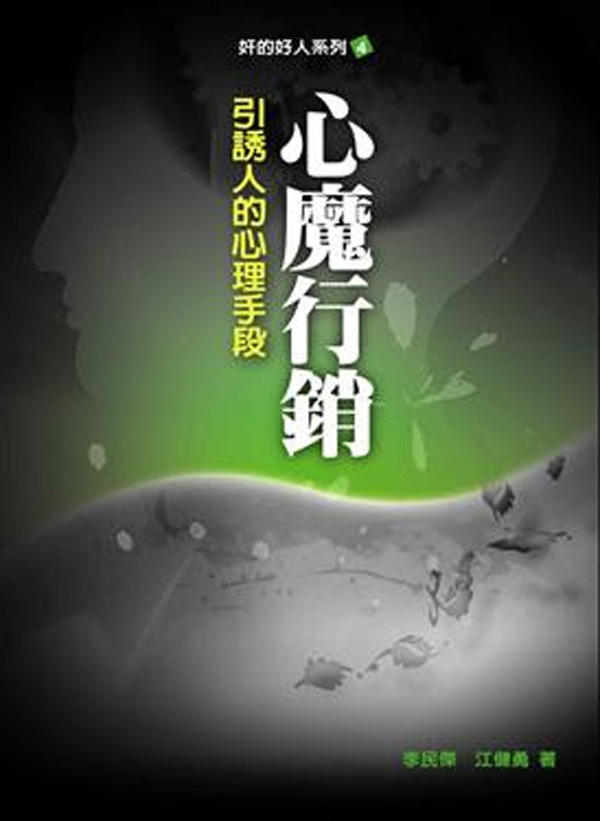

   

Table of Contents

目 录

第一章:无心的谎言被骗的也无怨

> > 死得暝目的人生观 

> > 人类需要浪漫的迷信 

> > 如何讲出高素质废话 

> > 变态的成功欲 

第二章:无需了解人类需求的「引诱定律」

> > 透视对方的隐瞒 

> > 人的需求都是假的 

> > 用矛盾去了解人类需求 

> > 别以真药治假病 

> > 引诱不口渴的牛喝水 

> > 火星撞上金星也没火花 

第三章:引人「入迷」之术

> > 一千零一夜的勾引 

> > 开口和闭嘴皆可引人入迷 

> > ？？？ 

> > 勾魂引欲的魔咒 

第四章:激发「幻想」的意境行销术

> > 无形比有形更具引诱魔力 

> > 吹擂神术 

> > 「意境影响术」的威力 

> > 摄魂夺魄的眼神 

> > 双料自杀的「意境推销」 

> > 说话时的意境诱惑秘术 

第五章:将幻想变成事实之「得寸进尺法则」

> > 说服的放电和过电法则 

> > 示爱后不被拒绝的秘密 

> > 多一个朋友会多一重障碍 

> > 情圣的未交先媾法 

> > 使对方相信命中注定要「给钱你」和「爱上你」的秘术 

第七章:使人自愿上钩的「犯贱」心法

> > 一夜情与推销力的关系 

> > 诚意会招惹更多障碍 

> > 使人自愿上钓的「刁难法则」 

> > 如何借用人类犯贱的欲望 

> > 「知难而进」的诱人之术 

> > 用缺点来使情人爱你爱上瘾 

后 记

如果你不知道读什么书，

就关注这个微信号。

  

微信公众号名称：幸福的味道

加小编微信一起读书

小编微信号：2338856113

 

【幸福的味道】已提供 200 个不同类型的书单

1、 历届茅盾文学奖获奖作品

2、 每年豆瓣，当当，亚马逊年度图书销售排行榜

3、 25 岁前一定要读的 25 本书

4、 有生之年，你一定要看的 25 部外国纯文学名著

5、 有生之年，你一定要看的 20 部中国现当代名著

6、 美国亚马逊编辑推荐的一生必读书单 100 本

7、 30 个领域 30 本不容错过的入门书

8、 这 20 本书，是各领域的巅峰之作

9、 这 7 本书，教你如何高效读书

10、 80 万书虫力荐的“给五星都不够”的 30 本书

关注“幸福的味道”微信公众号，即可查看对应书单和得到电子书

也可以在我的网站（周读）[www.ireadweek.com](http://www.ireadweek.com) 自行下载

备用微信公众号：一种思路

  

目 录

本书由“行行”整理，如果你不知道读什么书或者想获得更多免费电子书请加小编微信或 QQ：2338856113 小编也和结交一些喜欢读书的朋友 或者关注小编个人微信公众号名称：幸福的味道 为了方便书友朋友找书和看书，小编自己做了一个电子书下载网站，网站的名称为：周读 网址：[www.ireadweek.com](http://www.ireadweek.com)

第一章 无心的谎言，被骗的也无怨死得瞑目的人生观

人类需要浪漫的迷信

如何讲出高素质废话

变态的成功欲

第二章 无需了解人类需求的「引诱定律」透视对方的隐瞒

人的需求都是假的

用矛盾去了解人类需求

别以真药治假病

火星撞上金星也没有火花

引诱不口渴的牛喝水

第三章 引人「入迷」之术

一千零一夜的勾引

开口和闭嘴皆可引人入迷

？？？

勾魂引欲的魔咒

第四章 激发「幻想」的意境行销之术无形比有形更具引诱魔力

吹擂神术

「意境影响术」的威力

摄魂夺魄的眼神

双料自杀的「意境推销」

说话时的意境诱惑秘术

第五章 将幻想变成事实的「得寸进尺法则」说服的放电和过电法则

示爱后不被拒绝的秘密

多一个朋友会多一重障碍

情圣的未交先媾法

使对方相信「给钱你」或「爱上你」的祕术第七章 使人自愿上钩的「犯贱」心法一夜情与推销力的关系

诚意会招惹更多障碍

使人自愿上钓的「刁难法则」

如何借用人类犯贱的欲望

「知难而进」的诱人之术

用缺点来使情人爱你爱上瘾

后 记

前 言

同样话题，不同样的冲动

有一年我在办着一个两小时的课程说明会时，我叫了一个资深的演艺圈朋友来听我的讲座。这个朋友常拍剧，有一定程度的演技，而他最强的地方是捕捉感觉来入戏。

当然，我是要他帮我捕捉一些比较特殊的感觉。虽不是每一次，但有数次他捕捉到的感觉改变了我们演讲的方式。

讲座后他说他听过我和另一位也是 NLP 讲师的演讲，虽然我们两人教的东西几乎一样，感觉上却有天渊之别。我问他分别在哪里，他说：「听另一讲师传授一招时，感觉上就好像他一讲完，我就学完了。但很奇怪的，听你传授同样一招时，虽然我都已经在另一位讲师处听过了，但在你一讲完该技巧时，感觉上你好像还有很多东西可以教我。」

我马上把记忆 Rewind（倒带），幸好我有过人的记忆力，也听过另一位讲师的演说。结果我发现，原来我讲授完每一招过后，我会多讲一两句话。往后我们的每一个课程说明会都系统化的用这一套方法，因为我们发现就那么一句话，我们才能在听众脑中播下很重要的「种子」，使到他们有购买的冲动。

我的演讲方式和另一位讲师的对比，就好像一种交通工具──火车。

关键性的差异

普通的火车每小时行驶七八十哩，但在欧洲和日本有一种完全不同境界的地上交通工具，它叫作「子弹火车」。「子弹火车」的时速可以高达三百哩以上。这两种火车在科技上的差异，只围绕在一个重点而已。

普通火车是行走在轨道上的，因为有金属和金属间的摩擦（轮与轨），就算在动力上加速，碍于物理上的限制，它的时速是一定会有瓶颈的。「子弹火车」则运用了磁场相斥的原理，车身浮在轨道上而行，唯一的摩擦力是来自固体和气体。

其实「子弹火车」浮得不高，距离轨道少过半吋，但那一小丁点的差异告诉了我们：失之毫氂，差之千哩。有些时候，人只要作出小小的「关键性差异」，就会得到不同凡向的「大成就」。

很久以前，要制造一辆车的话，需要一群有多元技能的人，花一到两个星期来造车。后来，亨利福特看到了一个「关键性差异」的策略：只要在一个工作生产线上，顺着次序安排不同专业技能的人，生产一辆车只需花九十分钟！

同样的，在一些人际沟通上的「关键性差异」，只要有一个外人能指出问题的所在，我们就可以省下很多冤枉路，可以更具效率的去完成我们的事业。

「怎样讲」比「讲甚么」更重要

在做生意、谈判、销售或面试时，很多人最怕的是：对方问你要多少钱，或者你自己想告诉对方你要多少钱。

有些人上了我的 NLP 课程后，用了一个很简单的表情来跟客户开价，他们发现一个奇怪的现象：过去的每一个客户在听到价钱后，大部份都一定说「很贵」，然后就须劳烦他们解释了又再解释。

不过，在运用这个技巧后，学员们竟然很神奇的发现，跟他们说「很贵」的客户少之又少。

他们现在所报的价还是和以前一样，只不过以前他们的报价表情促使大部份的客户认为「很贵」。他们发现只要你做出「关键性差异」的肢体语言信号，就算讲出同样一个价钱，对方反而觉得「不贵」。

你会跟谁买？

我的一个朋友某次因为有需要而联络上两位不同公司的保险代理员，他们在不同的时候来到朋友家中拜访。第一位来到的时候，驾着马来西亚的国产车「Proton」。在马来西亚买那辆车的话，需费约莫一万二千美金（不属名贵车范围）。他来到朋友家中的客厅时，打了招呼后，就说：「其实我也不知道你们为甚么要买保险，因为不是每个人都需要保险的……」

然后，连眼神也没有和我朋友接触，看着桌子，就开始说下去了。

第二位保险代理就有很大的分别，他驾着威风的宝马 BMW 莅临。他的那一辆车在马来西亚的价钱是大约十三万美金。他的特色是很有亲和力，和朋友一家人打成一片，对保险也解释得很专业。我的朋友虽不熟悉销售技巧和说服手段，但从他口中的转述，我可以断定第二位代理是一个很有成交能力的业务员，而第一位代理的手法则是少有的。

不过，就算双方所提供的保单皆大同小异，友人最后却跟第一位，也就是「卖相」差劲的代理人买了保险。

其实，并不是驾宝马的保险代理员销售技巧差，他的说服功力其实是属于顶级的，只不过，第一位代理员的技巧用得比他更好。如果我们把第一位代理的销售过程录起来，然后播放给第二位代理看的话，我保证他一定会马上如获至宝的把心得写在笔记本上。而且他只需要抄写下该代理员看着桌子讲话的那一段就足够了，其余的部份就任君随便了。

第一位保险销代理看着桌子讲的这一段话，就是「关键性差异」。

他看起来像是普通火车，竟然跑得如子弹火车般快。

国际大企业的迷信与迷思

很多国际大企业，因为相信客户永远是对的，所以每年都作客户需求问卷调察，基本上是希望从现存的客户口中知道他心目中理想和完美的产品是怎样的，然后把它研制出来卖给这些客户，但他们却有一个百思不得其解的问题。

这个困恼着这些外国大公司的谜题是：终于把产品研制出来推进市场时，竟然发现不但滞销，而且先前提供意见的客户也没有给予支持。

但还是有很多大公司迷信客户永远是对的，而且他们还是不明白为甚么现存的客户喜欢说话不算数。

魔术师看魔术表演

我当年在加拿大上着 NLP 课程时，是五月份的春天，也是全年气候最舒服的日子，所以在休息时间，我们全班同学都会在外面晒太阳。有一次，我一时兴起，变了一个高难度的钱币魔术给我的同班同学看。

刚巧在我身后有位同学是个职业魔术师（站在我后面是可以看到戏法的秘诀），由于这个戏法只可以表演给前面的人看，而魔术师同学应该不是我要的观众，所以我就不介意他站在后面。同时我觉得做魔术师的也会尊重表演者，起码会让整个戏法变完后才破解吧，但没想到他竟然看完表演后，半开玩笑的骂我：「很可惜，假如我站在你的前面就好了，我很怀念很久以前那种看到魔术而惊讶的感觉……没想到你的手指可以柔软到这个程度……」其他在我前面的同学就嚷着叫道：「再做多一次！再一次！」对那些在我前面的同学，这个魔术就很有价值了，但在我后面的那位魔术师虽看到了一切，却很后悔没有站在我的前面。

当然，从魔术师的角度，他发现了原来只要手指够软的话，是可以把钱币藏在一般魔术师认为是死角的地方。那一次的表演，恰巧有另外一位加拿大着名的催眠表演师兼魔术师(Mike Mandel)也站在我的前面，当时他也不大肯定该戏法的真相。

魔术师的牺牲和收获

观众看魔术和魔术师看魔术的感觉会有很大分别的，一个就如还相信圣诞老人的小孩，另一个则是圣诞前夕偷偷把礼物放到孩子床头所挂着的大袜子里的爸爸；一个是普通人看电影，另一个是导演看电影，两者会有非常不同的体验。

一旦你一变成了魔术师，你将会在某种程度上失去这种惊叹；不过你将会成为「惊叹制造师」，看到神奇的魔术表演时，你会心想：「要怎么样才会做得比他更好？」

不明白权谋的人，看到一个很有说服力的人时，就好像看魔术的观众般，只会目瞪口呆或发出「呜……啊……哗」的感叹；但上过了我们权谋课程的学员或看过我们作品的读者，都能以魔术师的立场，在任何一个日常生活中的一些情景，汲取更多的人性手段，整个生活就像是一堂上不完的课程；如果一个人对你说他有特异功能时，身为魔术师的你会比较难受骗。

看不看得穿一个魔术表演与你聪明不聪明、眼睛快不快完全没关系；你若未入魔术之门，要靠「门外汉」的头脑去了解魔术的变法，那可能花掉你半生的青春也只能知其一而不知其二。

但是，一旦你选择做魔术师的话，你就要作出牺牲，可能永远再不能做观众了。

所以你们现在就要面临一个很关键性的抉择：你要永远做观众，抑或要做魔术师？

第一章:无心的谎言被骗的也无怨

死得暝目的人生观

两种不需要学手段的人

从古至今的对人处事方法，可以约莫分成两大派。一派相信手段，另一派相信坦诚。很多人认为这两派是完全相反的路线，但在我们的眼中，坦诚也可以是手段的一种。

信奉坦诚政策的人，其实也是有企图的，就是希望能够透过坦诚来得到某些结果，但这个世界上只有两种人可以完全坦诚：一，不食人间烟火的世外高人；二，头脑简单的人。

前者不需要运用到手段，但后者则是碍于智力问题，觉得手段太过复杂，所以学不来；前者已经看破红尘，无得失之心，所以人到无求品自高；后者则早已认命，觉得人生不得要求太高，所以挫折和失望也不大。这两种人，是活得最自在、最无压力的。

信不信「应该」会决定你是佼佼者或受害者？

如果你对人生有要求，但又因为个人原因而不愿意学习手段，一两次达不到成果的话，或者还可以看得开、站得起来，但如果连续跌倒了很多次呢？

你就会开始埋怨为甚么你已经如此的有诚意，但你的伴侣却不谅解你？为甚么老板不赏识你？为甚么别人不给机会你？为甚么朋友不帮你？

而最凄惨的下场是－－「死不瞑目」。惨败后，连「死因」是甚么也不知道。

权谋法则

极少数的世外高人可以先知先觉，头脑简单的人是不知不觉，不部份的人是「知而不觉」。

那么有手段的人能不能够完全「不死」呢？

当然不可能！但你的胜数肯定会大大提高；而且你果真不幸的阎王要你五更「死」的话，你会死得明明白白、死得暝目，因为要学手段的人先要接受一个世界观：你不认为有人会「应该」谅解你、「应该」赏识你、「应该」给机会你和「应该」帮你。

活在「应该世界」里的人全是受害者，因为他们将会有很多埋怨。

权谋法则

强者从不信有「应该」；弱者迷信「应该」。

强者从不相信有「应该」这回事，所以才会面对现实的解决问题；反之，弱者因为相信了「应该」，就可能会认为既然结了婚，老公就「应该」对她专一，朋友发了财，「应该」帮他一把。我会很残忍的认为这种弱者在某个程度上是该死的，而且「应该」该死得不暝目。

单身男士的错误关注

我们有一次做课程演讲会时，其中一个环节有位年轻男士问起我们关于能量最低点的问题。他问：「如你书中所言，你制造了能量最低点后再向空中小姐拿电话号码，这方法的成功率有多高？」我就告诉他我的成功率，然后他又问：「如果不是在飞机上，这套方法行不行得通？」其实他这样问我的目的很明显，就是他很想知道跟小姐拿电话号码的方法。我对他说：「你的问题问错了。」很多想从单身变成「双身」的男士，会认为在认识陌生女性时，最重要就是要拿到电话号码。他们的理论很简单：拿不到电话号码怎样会有下一次？

其实，男士刚认识陌生小姐时，最重要的事情并不是要拿电话号码。一般的男士刚认识陌生小姐时，如果整个过程都在盘算着如何在交涉结束时，可以得到美人的电话号码，这些男士们就会死不瞑目。

借机械式反应之力

要拿到陌生女士的电话号码并不难，只要过程中她没有讨厌你，而你的样子又不像有精神病，然后只要「拿」的方法用得对就可以了。

方法可以从两个门径入手：一，能量最低点，如《勾魂夺心洗脑催眠》一书中的例子即是；二，你可以借用她的机械式反应，这第二个方法是我常用的。

我在飞机上拿过七八个空中小姐的电话号码，失手过一次；跟陌生乘客小姐拿电话号码的纪录是起码二十到三十个，没有失过手。当时的目的并非为了追求异性，纯为做试验而已。我每一次拿到电话后，都会致电求证，结果是每一个电话号码都是真的。

其实这是雕虫小技。其中一个我借用的机械式反应是把对方的名字输入我的手提电话，然后我就把电话交到她的左手上，问：「你的名字是不是这样写？」，当对方点头后，我就会以肯定又带少许命令的语气说：「把你的电话号码按进去吧。」她左手已经拿着了电话，所以要输入电话号码只是顺便而已，而这就是我借她机械式反应之势也。

权谋法则

男士不要问女士可否拿她的电话号码，你的语气和词句都要假设了她给你电话号码是天经地义的事情。

就算她会迟疑一下，只要我再稍微命令多一次，她就会很快的就把电话号码输入。这个试验是好几年前的事了。可能有些人想问我这方法在泡夜店时能用上场吗？因为我讨厌到又吵又烟雾瀰漫的夜店或 Club，所以我在这方面的经验就不多，但理论上基本运作是一样的。

不过，就算你拿到了对方的电话号码，又有甚么大不了？

你要手指还是月亮？

你过了一两天再打电话给她时，可能会有类似以下的对白：「喂，阿妹？‥‥我是阿强‥‥你还记得我吗？‥‥星期六啊‥‥我们在 XYZ 酒吧认识的（其实那一晚可能有五个男人在该酒吧认识了阿妹）‥‥对！那位就是我囉‥‥」不难想像，接电话的女方会觉得好像和一个陌生电话销售员对谈一般。所以，很多男士就有一个挑战：电话拿得到，但约不到对方出来再见面。他们会觉得奇怪：「那天晚上她的反应也很好呀，为甚么才不到两天就这么冷漠了？」

所以佛教徒就有一个这样的比喻：手指指月，指非月。

单身的男子初次与女性见面的话，任务不是以拿到对方电话号码为主。如果你没办法与她擦出任何的火花，就算你再联络到她也无济于事，她还是当你是一个普通人。迷信拿到电话才是最重要的人，误以为指着月亮的手指是月亮，结果他就会「死不瞑目」。

（还有一个很重要的秘诀，各位单身男士务必记得：你主动搭讪的话，最好不要在尾声时或要离开前才问对方拿电话号码，本书后半段会告诉你原因。）

鲁班面前教弄斧，观音之前教慈悲曾经有一个女人来听我的 NLP 课程说明会，从一些迹象显示，我猜测她应该是从事网络传销业的。不是她的打扮告诉了我，而是传销业的人在听课程时的一些特殊反应透露了她的身份。

我发现从事这一行已久的人，来听我的课程说明会时，听到某些主题时，会不断的给很多口头上的「有声」认同，有时还会「认同」得旁边的听众都要偷瞄他们，不知是否怀疑是我出钱请的听众。

（我还注意到说明会的一些听众如果给予「过多」或略微「夸张」的反应，他们大部份是不会付钱报名上课的。我们的课程也有很多传销业的人士自掏腰包上课，不过，这些肯付钱上课的传销业者在听说明会时，没有夸大的反应，而且会较低调。）听完讲座过后，她终于走到报名的柜台来介绍自己的名字，然后就问我：「江老师，你想不想用五年的时间来做四十年的工作？」这个叫作班门弄斧，看过我们的《勾魂夺心洗脑催眠》或上过我们权谋课程的人会认得出这是「勾魂」，但这却是一个错误的用法。

第一个讲是天才，第一百个是庸才，第一万个是蠢才「勾魂」的目的是要打破对方的机械式反应，但是如果一个本来有效的「勾魂」对白，已在市场上广泛的被滥用，就好像炒饭虽要用冷饭，但第二代（翻炒）的杨州炒饭就会变成「革爷（隔夜）杨州炒饭」，第三代就变成「革梁爷杨州炒饭」了，你还咽得下口吗？

当地球上的第一个男人在酒吧里问陌生小姐：「Can I buy you adrink？」（我想买杯酒请你喝，赏不赏脸？），可能会有用，但第六亿八千四百三十二万五千九百七十二个男人讲这一句话就不可能会有用了。（笔者按：她可能接受你的酒，再应酬你几句就消失。在夜店请女人喝酒的正确态度可以参考我们的《财色战场》）权谋法则

再有效的「勾魂」对白，在同一个人的身上用超过两次以上，他就会开始产生免疫能力。

因为我曾经在课程报名柜台处听过类似「江老师，我有一个很好的商机，不知道你有没有兴趣？」「想不想短时间内成为百万富翁？」或「努力付出三五年，风风光光三十年」的话很多次了，所以我就准备有素的反问她：「你是想招我进入你的行业？还是想我对你这句话给意见？」

她好奇的看着我。我接下来就问她是否从事传销行业，她点头默认。我跟她说：「你刚才的那一句话，对社会经验不深的年轻人或者还有用。但如果你遇到一个有社会经验、做过生意的、或者有从事过销售业的人，这句话就一点用处也没有。」有社会经验的人一听到这样的开场白，就会想：「她一定是销售员，你有东西要卖，就直接跟我讲，用不着拐弯抹角，挂羊头卖狗肉，别当我是傻的，你的尾指头一动，我就已经知道你想做甚么了‥‥」那就好像一个曝露狂，穿了件长到膝盖部位的黄色雨衣，但又没穿裤子，然后他忽然出现在你面前，双手捉着雨衣的内边缘，左手在内，右手在外，如吸血僵尸伯爵（Dracula）般环抱着自己，眉毛上扬了两下，色瞇瞇笑淫淫的跟你说：「小姐，想不想看一样很好看的东西？」－－太明显了。

就算你用很厉害的技巧，一旦明显化时，是否是好现象？

其实，推销时有两个最大的禁忌。

销售员给客户称赞，是吉是凶？

如果你做销售，最忌听到客户频频称赞你很会销售，那通常不是一件好事，因为对方已经开始留意到你的销售技俩，表示你的手段已经明显化，客人已经有点抽离了。

如果你在追求异性，最忌女方跟你讲：「你真的很会讲女人想听的话。」因为她已经假设了她现在是给你打分数，就好像女人上牛郎店时的心态，看到一个牛郎对她口花花时，她捏捏牛郎的脸说：「讲得不错，来！再努力一点！给我看看你还会讲些甚么来哄我‥‥」一旦对方开始留意你的技俩，就算你做得再好，对方还是会把整个销售或追求过程当着是你玩的游戏，并会开始跟你「玩」到底。

一百步可以笑八十步

另一个禁忌就是对方完全预料到你的策略，可以从你的第一步推算到第五十步，你已经犯上了一个滔天大罪－－「闷死人」。

其实，这就好像那些不太用脑的港台连续剧一样，剧中一定会有类似以下的情节：

.男主角在街头碰巧遇到了前任女友，前女友的妈妈和爱犬竟然在同一天去世，她非常伤心，男主角于是借个肩膀给她哭；这时候，男主角的现任女友正好去买叉烧包在衔尾经过，借肩一景尽入眼中，她以为男主角与前女友旧情复发。

.好人在电话上「刚巧」讲着一些重要的话，「刚巧」办公室的门又未完全关上，奸角「刚巧」又经过时，「及时」一个「急煞车」，躲在门缝后偷听到了一些他可以「刚巧」用来破坏好人的话。

我有一位女性朋友，由于太熟悉港剧了，所以很喜欢在我们面前炫耀她的「特异功能」：即使她从未看过的港剧，她要推断角色还未讲出的对白，或接下来的剧情，准确度随时高达百分之七十到百分之八十。

和推断港剧的「特异功能」一样，我已经完全推算到这位女传销商所有的步伐，所以我想启发她，于是很直接的问她：「你刚采用的那句对白，已经有很多人问过我了。你不是第一个，为甚么我还要听你讲下去？」

顽石受冤枉

其实当时我是在给她提示，不过她却展示出一副很经典的模样（我称之为「宫女大肚子，太监被冤枉」的模样），一片真心诚意的告诉我：「但，这是事实！是可以做得到的‥‥」权谋法则

纯诚意式的推销，就是以「骗自己」的方式来骗他人现在反而好像是我冤枉了她。

我的感觉就如一个貌似「八两金」的男同性恋者的朋友问我：「如果有一天，你发觉你是同性恋者的话，你会不会考虑我？」我可能会强颜欢笑说：「哈哈，如果这样也有可能的话，应该甚么都有可能了吧。」

（注：八两金是一位经典人物，会在周星驰电影中出现，制造戏剧笑果的丑角，他脸上每一个部份的特征只可以用一个字来形容－－「突」。）

我当时就是如此的强颜欢笑答她：「哈哈，我知道在你的角度这绝对是真的，不过你要考虑一下你的听众可能未必认同。」但她还是不断的告诉我她的话是真的，我心里想：「这是一个死了也不知道自己为甚么会死的人。」

在做人与处事上，我不怕死，我最怕死不瞑目。

同时我也敢斩钉截铁的断言这位女士进入传销业后，会失去很多朋友。她是一位给自己的公司、产品骗了的销售员。

不只是她，很多人都给整个社会骗了，而且骗你的人也是无心的‥‥

人类需要浪漫的迷信

灵异现象的真相

当年我在加拿大的时候，认识了三个属于某个宗教团体的朋友。

有一天，他们与教友在野餐的时候，齐齐站着遥望天空的一个方向。

那一方的天边可以看到很多云，他们一面看一面的指指点点。不久，其他的师兄、师弟、师姐和师妹们就开始好奇的围过去了。

这三剑侠的老大眉头深锁的看着天边说：「喂，你们有没有看到？

我看到一条龙在那边，灰黄色的。」老二则说：「朝左上方飞，对不对？」老大和老三一齐点头。

然后，其他围观的师兄弟也就一直挤眉弄眼的调整他们的视线，尝试着要看见那一条灰黄色的龙。

其实三剑侠根本看不到甚么龙，这是他们跟大家开的一个荒谬玩笑。

那么有没有其他人看到龙呢？

当然没有！不过，围观的一个师兄就说他好像看到龙的影子，另一个就说云彩的形状有点儿像龙，其他看不到的人就很羡慕这三个见到龙的人，有些人还即时拿起照相机朝天的一方猛拍照。

权谋法则

一个谎言听得越多次，无证据也可以成为「事实」的机率就越高。

在这个「见龙」事件，耍弄者只是用了一点演技和几句谎话，就已经让有些看不见龙的人，开始相信有龙在天上飞。同样的，我们身边的人、父母、长辈、朋友和整个社会，也都不断对我们说：「你看！

天上有一条龙！」

人人见龙的文化

这一类的话听多了后，很多人可能就会：相信只要努力、脚踏实地、有才华和以诚意待人，就一定有机会发达。就像巨富李嘉诚先生，逢人就讲他多年的成功都基于一个「诚」字一样。

是否一个开口闭口都讲「诚」字的人就表示他在讲着真话呢？

读过我们第三本书《冷血救世》的人，就应该知道为甚么一个已经成功的人会极力宣扬仁义道德。

另一群愤世嫉俗的人则会认为，发达的人都是在背后干了一些坏事、从事偏门生意、做非法勾当、谋害亲友，才能成功。事实是否如此？

当大部份的人都宣称「见龙」时，它就会在人们的心中变成一个「文化谎言」。

权谋法则

一个谎言听了几个年代，就叫作「文化」。

要脱离「文化谎言」的诅咒，和防备更多「文化包袱」的形成，你首要功夫是要学会分辨「听起来有道理」和「真的有道理」的差别‥‥

大老板就像怀春少女般追偶像

我曾经参加过一个名师讲座会，内容大概是与企业要如何开拓和发展等有关。其实这一类的课程就是告诉你那些跨国霸业如微软、可乐或麦当劳等是怎样做起家的，又如何推广它的市场等。（其实要办这一类讲座很容易，要得到这些资料也不难，因为每一年都有上千本这一类「某某企业如何成功」的书面市。）你听这类讲座的时候，会有好像学到了很多东西的感觉，但回到现实中，却极之可能完全派不上任何实际用场；因为微软的一个行销策略要执行的时候，一出手就可能动用上亿美元。

不过当天的演讲者，并没有花太多时间来讲这一种「听起来很爽，做起来很难」的课题，反之他花很多时间来讲一些国际霸业老板的人生故事。

我发现在场很多听众都听得津津有味，特别是我注意到有几个老板，都带着自己的人马来捧场，并听得连连点头。我还看到其中一个展现出一副「对了，就是这样！」的表情，不时流露出一点「追星粉丝」族般的情怀。

权谋法则

再厉害的人也是「人」。

企业界是一个极需要「迷信」的市场其中让众人频频点头的故事，就是麦当劳创办人雷克罗克（RayCroc）的事迹。话说他某次到某分店巡视时，看到餐馆地上有水，结果马上拿起地拖来把地抹干净。他身为一个亿万富豪，却没有那种很了不起的气势，也不嫌弃做一些低下的工作。

另一个点头率颇高的故事是关于 Wal-Mart 总裁，说他如何富有，但却不喜欢驾名车，生活很俭节、低调。

演讲者还讲了很多其他类似的例子和故事，他还说：「小成靠智，大成靠德」，我看到更多的人点头。

让我们回到现实想一下，如果教所有的老板都抹地、洗厕所、做人低调，他们是否就能成功呢？（我相信很多打工一族最好的减压方法就是：自己手上拿着粘上碎玻璃的鞭，抽打着着清理厕所的老板）权谋法则

在「文化谎言」的大环境里，被骗的不知道自己是受害者，行骗的又不知道自己是施害者。

（做老板的人，请记得制造这种「神话」故事，但不可以制造太多，因为你员工的记忆力有限。他们一定要记得一两个很简单又感动的神话就够了。）

神话背后的阴谋

我的一个学员，是一家国际着名的日本电器企业（P 字头的）的高级经理，他上了我们的权谋课程后才明白为甚么他会「信徒式」的尊敬他的日本总裁。

这位总裁来到他们的分公司时，每个人都把他看得高高在上，并向他鞠躬。有一次，当总裁演讲完毕后，他走下去跟员工寒喧时，正好看到员工喝着咖啡，他跟对方说他很口渴，然后就拿起员工手中喝过的咖啡，一口就喝下去。

自此后，我的这位高级经理学员逢人就称赞这个「总裁神」，到处宣扬总裁没有架子，不介意喝员工口水的神话。

我听到他说这一个故事，就有一个很武断的阴谋论版：总裁每去到一个国家的分公司时，可能人事部经理会给总裁一个名单，告诉他哪几个人是无病的，以助他策略性的在几个人面前喝下他们喝过的饮料。

其实这一类型的故事（我称之为现代企业家传说），对你的生意是一点用处都没有的，但人却最喜欢听，也最喜欢传这类故事。

就如华盛顿砍桃树的「虚构故事」一样，只是传说一则。我们也没有必要去考察到底当年的玄奘大师（唐三藏）有没有一个叫孙悟空的随身侍者护送他到印度。

问题是：为甚么这种故事会如此吃香？

因为人是喜欢听废话的动物‥‥

如何讲出高素质废话

越伟大的精句，你要越防备

上文有提到我参加一个名师的演讲时，听到他强调：「小成靠智，大成靠德。」这一类话就如「大勇若怯」或「大智若愚」等，皆是古今被推崇的名言。它们的架构很简单－－「一个很强的优点要用一个缺点来包装」。

权谋法则

华人的文化应该是全世界

最「精神分裂」或最「虚伪」的。

这一类言词模稜两可，普通人很难辩驳。你如果时常太过依赖感性思维来了解事情，就会觉得这些话好像「道理澎湃」。

大部份人都认为「得道」的高人一定是「大智若愚」，能够达到人生最高境界者，必然是很有才智但看起来又笨拙的人。其实这些观念究竟是后人一厢情愿的迷信？还是「得道」高人一定要装傻呢？

要记得，佛祖和耶稣都不采用大智若愚的策略。佛教的禅宗六祖惠能，只是在开始的时候大智若愚，因为他被同门通缉。当时机成熟做了一派之师后，他就大智就是大智。他扮不扮愚只是策略上的选择而已。

真正的「得道」者理论上应该很潇洒，不会有任何包袱说一定要扮愚或一定要宣称自己有智慧。只有给这一类「高素质废话」骗了的人，才会迷信做人一定要大智若愚、锋芒内敛。

权谋法则

「大勇若怯、大智若愚」是讲给无胆识和没才华的人听，让他们觉得「我不是不想成功，我只不过不想锋芒太露而已。」

这也是为甚么麦当劳创办人抹地、Wal-Mart 总裁低调等故事得以广为传播，因为故事里的「浪漫元素」让大部份「不成功」、「还未成功」和「想成功」的人们产生很大的共鸣。

浪漫毒素的最高境界

我曾经听过一个印度教的师父演讲，他说：「‥‥最近印度和巴基斯坦都进行引爆核子弹的试验。其实，研究核子武器不是问题，核子弹引爆试验也不是大问题，就算核子弹炸死几百万人，也不是大问题。不过，当人的『心』死了，这才是最大的问题‥‥」全场的人马上拍手。这种情况就如当年甘迺迪总统讲过的一精句：「不要问『国家』为你做甚么，要问自己『你』为国家做了甚么。」当时老甘讲了这句话，就「关键性」的停下来，接着赢得全场掌声如雷的回应，往后还变成人人津津乐道的一句话。但从讲道理的角度，我会呼吁所有的人反问国家（政治家）为你做了甚么，因为是「你」把他们放上去执政的，是「你」发薪水给他们的，你绝对有权力追问。

以上甘迺迪总统所讲的这一类型话，我们称之为－－「浪漫废话」。

权谋法则

讲废话不难，讲好听的废话就要有功夫。

九成以上的人都喜欢听「浪漫废话」，但一点实际益处都没有。

可是这些话的含义又模稜两可又若隐若现，所以大部份的人都很难去过滤。其中有一些古人所讲的「浪漫废话」，更变成古今的畅销书。

古代高人讲废话的风采

这种浪漫元素可以散见于各类留芳百世的「畅销」古经旧典中，其中一个古今中外封之为最畅销的策略经典就是《孙子兵法》。

其实孙子根本没有把战略写得很清楚，但战略之道经他笔下却变得充满「浪漫元素」，而且还浪漫得精彩绝伦‥‥孙子说军势要「动之于九天之上，藏之于九地之下」（就好像大石从山上滚下般，势不可挡）；攻击时要「无穷如天地，不竭如江河」（奇兵的运用要好像天地运行一般变化无穷，江河奔流没有尽止）；兵势要做到奇正无穷，循环互换互用，方法是「声不过五，五声之变，不可胜听；色不过五，五色之变，不可胜观」（声音只有五种，你懂得运用，就能发挥出各种不同的音律，将五种颜色互相调配，就会「多姿多彩」）。

孙子还说，你要能做到以上所述，你就等同常山之蛇（这是孙子所用的比喻）。人家攻击你的头，你的尾巴就能反击对方，当人家想从后偷袭你的尾，你也能转头回攻敌人。这些似是而非、模稜两可的比喻，你要怎样想，怎样解释都可以。

但为甚么人喜欢看这种似是而非的东西？

权谋法则

人有做智者的欲望，我看得明白这些不明不白的东西，才能显得我的境界高。

请问：你能否以孙子的「常山之蛇」理论，或根据他所讲的「势不可挡，变化无穷」来设计一套待人处事或公司运作的策略呢？

讲话永远不会错的方法

如果你真能设计出来的话，我会想，到底这是《孙子兵法》的功劳还是你的想像力厉害？据我的观察，市场上以孙子兵法作为主题的书类计有：生意、谈判、销售、管理、投资、股票、地产、社交、爱情、亲子等。我相信若孙子再世的话，他逛书局时可能会说：「妈的！

早知道我来写这些题材！」

其实孙子不厉害，厉害的是读《孙子兵法》的人。

除了孙子，还有多个「畅销」古人，如庄子、孔子、老子等都喜欢以浪漫元素的写法着书，并用了很多似是而非、模稜两可的比喻，讲了很多如古龙小说般的口号式精句。

甚至被所有华人尊为万经之王的《易经》也是如此。《易经》的崇拜者无不认为它可以解释万物万事，其实，如果《易经》不可能错的话，是因为它本来就几乎没有具体和明确内容可言！从四面八方的角度来看《易经》，都是模稜两可，所以才能「永远」对。

权谋法则

由于至终都讲模稜两可的话之人，有可能是智者、宗教家、哲学家、政治家或骗子。

经典和手册的分别

《孙子兵法》就是这一类糢糊智慧的经典，也就因为如此，市场上可以看到有人用《孙子兵法》来讲解任何一个领域，配搭任何一个学说。你抚一抚自己的良心，就算你真的把孙子兵法读得滚瓜烂熟，倒背如流，你有没有信心去领一支军队与敌军交战？

相对的，我们会觉得有些不是那么有「名气」的兵书手册，更有军事价值，写得更具体明确。比如「粮草动后，必先建厕所」，一组军队如果要扎营，需要将厕所设立在溪流上，或者军人的排泄物（可能是上万的军人）若遗留在地上，就要每天撒硫磺，如果处理得不好，可能就会引发瘟疫或传染病。

又比如孙子非常重视的行军四字真言「风林火山」，意思是行动如「风」，肃静如「林」，攻击要像「火」，坚守时像「山」。问题是怎样行动才像风一样？

如果我没有记错，曹操所写的兵书，就很明确的描述了一支军队要怎样「行如风」，他的方法与日本忍者术手册中记载的方法是异曲同工的。

忍者的特异功能

传闻中的忍者都好像会法术。他们会运用咒术，咒术有两种功用：一，如果忍者本身信仰某神，如摩利支天或不动明王，唸祂们的咒可以加强自己的信心（注：这两位神祇是一些忍者的信奉对象）；二，可以用来迷惑大众，做有力的宣传工具。

试想一下，当你追捕一位忍者来到山脚下时，他忽然一唸咒，火光一闪，他就不见了，接着在山上一百米处，又忽然火光一闪，他竟然在那边重现！

你会觉得很惊讶，然后继续追上山。当然，他已经干坤挪移了过去，你再怎么追也追不上了。往后你就会变成忍者的宣传工具，不断告诉他人忍者有法术可以把身体挪移到百米以外。其实，忍者没有法术，这只是一个魔术表演而已。

心理魔术－－忍术与兵法共通之道被追到山脚下的忍者已经在特定地方设好一个可以藏身之处，当他逃跑到该处时，就作状唸咒，偷偷丢下一个火光弹。强光一闪之下，干扰了你的视线后他就躲进藏身处；然后他的伙伴（打扮得跟他同一模样）在半山处再丢下一个火光弹，并跳出来引起你的注意，然后逃跑。此刻，你就误会先前的忍者刚刚移形换影到半山了。

同样的道理，曹操所着的兵法中，有描述到如何以造势来制造「行如风」的假相。

假设你是站在远处了望一山谷，以探敌方的行军，你可能看到一组军队正从左边山坡下进入山谷。山谷处是一大片森林，但下了坡不久后，你却看到那组军队竟然那么快的从森林奔上右边山坡之上，此时你会惊讶叫道：「哗！这组军队的体力好棒！上山坡的速度这么快，真有行如风之势。」事实是你所看到上山坡的行军其实是另一组预先埋伏好的军队。

请问如果两人读兵法书，一个读了孙子的行如风，另一个看了曹操的行如风，你说那一个在战场上比较有实力呢？

其实古代的兵法家就如忍者般，而忍者根本没有神奇的法术，他们是一种武术、暗器术、魔术和心理战术等的综合术士。魔术师若要表演把一个美女从笼子里弄不见，并让她在另外一个笼子出现的话，就一定要借用孪生姐妹。我看过大伟考伯菲（David Copperfield）的美女挪移魔术，消失后再出现在另一个笼子的美女，她的大腿比还未消失前略为粗壮。

魔术师的目的是娱乐：你买了票，所以我表演给你看。忍者或兵法家的目的则是：你还未买票（对我军下判断），也不知道要买便宜还是贵的票，所以我做表演来影响你的决定。

道与术的分别

孙子的兵书属于很巧妙的模稜两可，所以才能广传于世，它只是让读者自行作出合理化的解释，表面上就好像能够适用于任何一个时代、任何一个领域，但没有太多的实用价值；曹操的兵书非常的具体，但反而不能那么容易的传世。

一个是兵法之「道」，另一个则是兵法之「术」。《孙子兵法》只是帮你入门的基础而已，如果你没有兼读曹操之类的兵法书，千万莫妄想你可以做军师。

权谋法则

有道无术，只能纸上谈兵，不能济世救人；有术无道，不能登峰造极。

大学里大部份学术，趋深入时，其学说就越精细。就好像普通药房的家庭医生和专科医生相比之下，你觉得哪一个会赚更多的钱？

越专的就越贵，越精的就越有价值。

变态的成功欲

乱飞的飞机可以到达目的地

想像一下你正在一架飞机上，从新加坡飞往曼谷，飞机应该是朝北飞行。不过，你认为你的飞机会永远都乖乖的在航线上，循规蹈矩的依着空中轨道而飞吗？

根据统计，在飞行航程中，飞机有百分之九十以上的时候不在航线上。假设你的飞机在飞往北方时，忽然有气流把你的飞机吹去左边，偏离了航线，这时，如果你是飞机师的话，你会怎么做呢？

飞机师的工作就是要把飞机带回航线上，所以你应该把飞机带回右边，直到回归航线为止。假如过了不久，你的飞机又被气流冲到右边而再度偏离航线的话，你必须又再调整，把飞机带回航线上。如是者，不断的调整，让飞机最后安然到达目的地。

不过有一类的特种「飞机师」是与众不同的‥‥很有骨气的飞机师

有时候你看到你身边的一些人，他们也好像「飞机师」一样，在他们的人生道路上，也想飞去他们的「曼谷」，但当他们的飞机被气流吹离航线时，他们这类特种「飞机师」却希望「曼谷」可以顺着他偏离的航线移位去迎接他。

这一类人我们称之为「机械人」，是「应该世界」里的众生，这种人占了人口的九成以上。

这一类机械人很有「骨气」，他们的想法很简单：「不是我的错！

为甚么那些人不能接受我？我都已经尽了力‥‥」这里所指的「那些人」，可能是客户、老板、老公、老婆、老爸、男人、女人或孩子等。

总而言之，千错万错，都是别人的错。我没有口臭，是你们的鼻子有问题！

当飞机偏离航线时，需要改变的不是目的地，而是飞机师手中控制着的方向盘。你不能要求整个大地变得平滑，你倒是能要求自己穿鞋子。

权谋法则

相信了「应该」，难成人上人。

这一种人被文化骗了，迷信了「应该」，他们最拿手的就是「自伤」。

蒙眼挥舞双节棍

来参加我们课程的人，当中有些销售员会委屈或生气的说：「我最不喜欢遇到那些思想封闭的客户。」有些单身男士则会说：「为甚么我常遇到的女士都拒人于千里之外？」通常我会向销售员说：「他不是思想封闭的客户，他只是对你这种销售员才封闭。」接着再对那位单身男士说：「她们不是拒人于千哩之外，而是对你这种男人才拒你于千哩之外。」这些委屈者会认为是对方有问题，是对方对人不对事。为甚么他们不能对事不对人呢？他们认为「我的产品这么好，为甚么不给我机会？」

这些人就好像一个傻瓜蒙着眼睛随手选了一个双节棍，然后一挥舞的时候，第二节棍就依物理的回旋打到自己，但他却以为有另外一个人以棍偷袭他，于是他把棍挥得更凶，结果导致自己遍体鳞伤。

成功的障碍：过份期待成功

所以有些时候，别人拒绝或骂他们时，其实都是他们自己一手造成的，因为他们除了目标，其他的一概视而不见。

就好像有些销售员有东西要推销给你的时候，口口声声的说他是为了你好，你不但不相信，还看到他的两个瞳孔里面闪出一个符号－－「$」。你只看到他「专注」的想赚你的钱而已。

或者有些女性读者也会有相似的经验。某些男性结识异性朋友时，口口声声说只是想交个朋友，没有其他的意思，但是你很明显的从他的眼睛看到其他的意图。外国女人会用一句话来形容她们的心情：He was undressing me with his eyes.（他用眼睛来剥我的衣服）。

当然，除非他会巫术，不然眼睛是不可能把你的衣服剥下，只不过男性的想像力影响到他们露出「色眼」，即他们的视线很连贯性、一气呵成的在女人身上做了以下的游览：脸→胸→腿→胸→脸。

对女人想入非非的正确时机

很多时候，男人本来就没有想入非非，只不过他们在认识任何新女性朋友时，都有用眼睛来上下打量她们的高度的习惯。当他对陌生女性作出这种视线测量运动时，女性难免会判断他们正在想入非非。

有收集电影的读者可以参考 Mickey Rourke 在电影《野兰花》（Wild Orchid）中初见女主角时的眼神，但男士们千万莫要对刚认识的小姐就做这种眼神上下的游走，因为时机不对也！

如果女方已经开始喜欢了男方，男人对她做这类眼神就会让女人觉得自己美丽和性感，但太早做的话，他就会被冠上「贱男」之号。

结婚多年的男人，你们要规定自己不定期的对太太施展这种「色眼」，履行赞美太太的定额（即赞她漂亮的 Quota，不一定要靠讲的）。

那么，眼中有$符号的销售员，他的眼神又犯了甚么错呢？

生意中的想入非非

销售员犯了一个和「贱男眼神」相似，叫做温度差距的错误：客户对产品的接受度如普通的自来水，不冷不热；但销售员呈现的热诚度却如沸腾的水。从客户的感受立场来看，他会觉得销售员「诚意逼人」，英文叫做 Hard sell（硬销）。

权谋法则

沟通的意义在乎于对方的感受，而不在乎于你的动机客户觉得销售员对他的钱想入非非并非眼神之错，而是和身体的角度息息相关。

通常我在咖啡室都会见到很多人在谈生意时，一方是要说服，另一方则在判断要不要被说服。读者们不妨在一些咖啡室观察一下，你会发现「说」的人身体向前倾时，「听」的人就会身体向后倾。

后倾是代表了抽离、资讯过滤，或怀疑，而销售员为了让客户感受他的真心诚意，所以就向前倾。

市场上有很多大师或销售学作家都讲：enthusiasm iscontagious（热诚是具感染性的），所以他们的逻辑是：如果热诚具感染性的话，那么只要我的热诚度越高的话，对方被感染的机会就越大吧？

错了！如果说者越前倾的话，听者不但会更后倾，有时候还会闪避（即本来是朝向说者，渐渐的错开后倾三十五度，然后七十度）－－这种情况我们称之为「说者躬，听者仰」。

观察力功课

下一次与陌生人交谈时，很刻意的不断逐步前倾，看看你倾到甚么程度时，对方才有细微的后退或躲闪。

你越有诚意不见得对方会越接受你，所以你要知道「诚意」强到了甚么程度才叫做「逼人」。

诚意和你膝盖的关系

前倾时，如果头一旦开始接近膝盖的垂直线时，你就已经是很有诚意了。但如果对方的诚意不大，你的诚意却开始大过他的话，你就会逼得他更后倾；一旦头一过膝位就是「诚意逼人」了，对方可能就会开始闪避了。

我们在这里奉劝各位在见客户或追求异性时，如果是坐着的话，身体的前倾度一定要遵守一个「戒条」，这个「戒条」是有武学根据的－－「头不过膝」。

在武术打斗中，头一过膝，人就会失去重心，对手就可以轻易的把你打倒。

权谋法则

你的「热度」只需要高出对方的热度一点，就叫做有诚意了。

如果一个在商场上「诚意逼人」或在情场上「淫意逼人」，那就好像飞机才起飞不久，机师就很冲动的急着启动降落措施一样：放出轮胎、机翼控制上飞和俯冲的后半部开始后翘，最后飞机中途就会被逼紧急降落了。

但，还有另一种的情况，你从新加坡飞去曼谷，一切都很顺利，当你飞到接近机场时，才发现原来机场当局还未批准你的降落，你被逼得一直在机场上空盘旋‥‥

第二章:无需了解人类需求的「引诱定律」

透视对方的隐瞒

主流的销售三部曲

有些从事寿险行业的人，因为在事业上遇到瓶颈而来上我们的权谋课程。他们上司所教的见客户方法大约分为三大步骤：第一次见面的目的就是要先做朋友，联络感情，了解客户的身份、职业、收入、询问他对保障的需求，暂时不要谈保险，然后预约第二次的会面。

第二次的见面就是为了向对方呈现保单的计划书，想办法告诉他为甚么该计划书能够满足他的需求，热诚地向他推销，让他不好意思拒绝你，然后说服他签字成交。

第三次见面当然就是要对方的现金、支票或信用卡号码。

基本上，上面的三个步骤和一般主流行销学的理念一样，一、先找出客户需求，二、再针对性的去让客户知道你能满足他们的需求，三、最后就是成交。

但跟随这一路线的销售员最怕遇到一个反应‥‥「不！」不是销售员最怕听到的答案如果在第二次见面时没办法说服客人签字的话，客户通常都讲些「让我回去想想、考虑考虑」之类的话，那就很难会再有第三次的会面了。就算之后再不断的跟进，对方还是不断的说要考虑。

销售员碰到上述的情况，我很明白他们的情绪化感受，那情形就好像你买了一张亿元大奖的彩票，但彩票上所注明的开奖日期却是：任何时候。

你敢随便把彩票丢掉吗？这情况如同上一篇的比喻，飞机已经飞到曼谷机场上空，但机场当局却说还未决定批准你的降落与否。

Yes（肯定）、No（否定）和 Maybe（可能）相比，Maybe 的反应是最糢糊的，它可能是「让我想想」或「我考虑了再给你知道」，这种答案最浪费销售员的资源和时间。

这些保险业务员上过很多销售课程，看过很多保险书，问过上司和保险教练很多问题。他们反而不怕客户明确给一个「不」（拒绝）的理由，因为他们还有一些保险话术可以应付。（这些话术只不过是弄到客户口头上讲不过你而已，对方其实是口服心未必服。）但对于那些没有讲出拒绝理由，只是讲要「考虑考虑」的客户，就让他们束手无策。长久盘旋于他们脑海里的问题是：「怎样看穿对方说的考虑是真还是假？」

这个问题其实已经问错了！

销售老师最怕答的问题

他们也问过他们的老师和上司如何分辨真考虑和假考虑，基本上他们得到的是一些「讲了等于没有讲，答了等于没有答」的答案。上司和老师则叫他们回去自己想，或者说要用自己的智慧去判断，（废话！我有智慧还需要问你吗？），再不然就是说用热诚和坚持来感动对方。

据我们了解，市场上这些销售大师「答了等于没有答」的话，只有一个理由－－他们根本没有一套系统来过滤真假考虑的分别。

我们和市场上这些销售大师的对比是：一个是西门庆，另一个是读过《肉蒲团》的处男；你不能要求处男给到更详尽的答案。

要知道一个人讲的「考虑」是真或假，除了要知道客观条件，还要看他讲了「考虑」后的行为。

透视和分辨真假考虑

现在「西门庆」告诉你：当对方跟你讲考虑考虑的话，他们九成是间接讲了「不」。

你或者会问：「难道客户不可能真的要考虑一下吗？」考虑可分真假，「真考虑」是对方考虑要还是不要你的产品，「假考虑」是对方考虑着如何推掉你。

不错，有些时候客观的条件将会主导了客户能否马上成交，但是如果你的客户除了只是跟你讲「考虑考虑」，其他的一概模糊不清楚，也没有有追问你细节的话，对方几乎已经是完全拒绝你了，他只是希望用「拖字诀」来回避你。

权谋法则

对细节的关心度是意愿的指数。

讲了要考虑后，如果对方还有追问细节和手续问题的话，那个「考虑」的真实性才比较大。而大部份的女人应付追求者的邀约，也会采用相同的游戏规则。

测试女方约会的意愿

当男人约女人时，如果约了两次以上，她都只是给了些「原因」来推掉你，如：要参加某个虚构亲人的葬礼、要唸经超度家中刚被杀虫药喷死的七只蟑螂、或要照顾家中刚割包皮的狗‥‥但推掉你后她却没有 Counter Offer（主动提议）一个明确可以见面的时间，那么对方和你约会的意愿根本就不大。

「主动提议」（Counter Offer），就是细节和手续。

权谋法则

细节是连接「空谈」和「行动」的桥梁又比如说，你约一小姐星期四喝茶，她只是跟你说星期四没有空，但完全没有具体建议何年、何月、何日或何世纪才有空，基本上对方与你见面的意愿不强。我们建议你改变策略，因为你的「飞机」已经偏离了航线，若真无办法，你就改飞去另一机场吧！

对方「要」或「不要」，你都不需要热诚你的客户如果除了说要考虑以外，还有问你其他细节上的问题，他讲出来的话也不会好像《孙子兵法》般模稜两可，基本上他是跟你讲了「我已经是有意愿，只不过现在我希望你能够帮帮我，让我确定这是一个很好的决定。」

这位客户其实是间接向你求助了（当然这个人也可能是你的竞事对手，他只是假扮客户来探军情）。

如果是高价产品，客户又有意愿要购买的话，他一定需要「其考虑」。此刻你实行热诚政策的话，你将会延迟对方的决定，让客户有机会「货比三家」，你流失这个客户的机会就会更大。（我们这本书的后半段会分析为甚么热诚反而会弄巧反拙，也会传授方法应对这种真考虑，使对方快速与你成交）。

假如客户是「假考虑」，你的热诚跟进会被解释为「死缠烂打」，令客户开始讨厌你，从此你就没有机会再见这位客户了。对于那位邀约后却没有 Counter Offer 的小姐，如果你还不断的以「诚意」邀请，你就变成好像挥之不去，同时又烦躁无比的耳边蚊蝇般。我们称这个策略为「绝后」！

为甚么你的对手（客户或想追求的异性）会给你这种「假考虑」？

错看了自己的错误

之前提到的保险业三大步骤，大部份的人都认为销售员在第二步骤才出错，其实他们第一步骤里面的第一步、第一动作、第一句话全部都错了！

当然，在保险业务员的眼中，他是在第二步骤的尾声才看到客户的抗拒，但冰冻三呎非一日之寒，客户不是最后才忽然间想起要抗拒你，而是一开始不久就已经做了决定，他一直不出声是因为他等着机会来抗拒你。

而第一步骤里他们想了解客户的需求，就是他们所犯的最大错！

人的需求都是假的

一个答非所问的真答案

很多初来上我们课程的人都喜欢问：「老师，请问如何紧扣客户的需求？如何问出客人的要求？」我们的答覆通常会让学员觉得更加迷茫。

因为他们问了我们一个不需要问的问题，所以我们「答非所问」的答案是：「大部份的时候，你不需要了解客户的要求。」鸡与蛋问题

是先有需求，后有供应？

抑或先有供应，所以才有需求？

其实要证明客户有没有需求，就好像要证明这个世界上有没有上帝。我们暂时证明不到祂的存在，也不能证明祂的不存在（有些人认为上帝、菩萨、鬼神是虚构的，但「虚构」的东西是否又表示它们不存在呢）。

不用脑而想找真命天子的女人

某次和朋友余小姐叙旧时，她既无奈又失望的叹了一口气：「唉！

现在想要找到个好一点的对象也不容易，我的要求其实都不是很高‥‥」

这种情况在越先进的国家之女性越是有这种感觉，她们也会创造些奇怪的理论，比如西方国家的女性就常讲：「好的男人都已经是人家的丈夫，除非你准备做人家的情妇，再不然他们就是 gay（同性恋）的。想找到有房子，车子、钞票、又细心的好男人简直是天方夜谭。」鸡与蛋问题

是命运决定了你的「理由」？

抑或是「藉口」决定你的命运？

我好奇的问她：「你最理想的男人是要有甚么条件？」她想了一下说：「一定要心地好囉。」我看她的那副表情，知道她是给我机械式反应的答案，这种表情我称它为「录音机」表情。为了帮忙她做人类该做的事情－－思想，我就决定追问下去。我跟着问了一个问题，她的头脑就像发动了引擎就开始在吞吞吐吐、蠢蠢欲动了。

启动一个休息已久的头脑

我问：「你所指的心地好，是甚么意思？」她就「吓！？」了一下，好像很想跟我说：「心地好，不就是心地好囉！还有甚么意思？」但因为我追问下去，她最后很辛苦的讲出了她的要求：「没有不良嗜好。」我继续追问，她指的不良嗜好是哪些，她回应说：「没抽烟喝酒、不讲粗话。」我应酬式的眼张口开，恍然大悟的说：「哦（长音）！

原来如此！」

权谋法则

大部份的人只是隐隐约约的「好像知道」自己的要求原来在她的心目中，我还不算是心地好，因为我有讲粗话；而且她这么辛苦才「想」出来的条件，原来范围是这般大。我也还没问她如果对方不抽烟、不喝酒、不讲粗话，但却喜欢非礼老太婆和偷小孩子的零用钱，她可否接受（因为不想给她刚要启动的头脑过重的负荷）。

我再问她：「除了这些以外，你还有甚么要求？」她开始习惯要用脑了，她说：「只要他有一份正当的职业，爱我疼我就足够了。」从极限了解自己

我故意挑战她的极限而追问：「很简单嘛！这样的男人很多！不过，如果对方是做地盘建筑的水泥工人，除了回家时满身臭汗外，没有烟味酒气，也没有讲那些混杂交叉星星鱼虾蟹感叹号的话，他很爱你，很疼你，你要不要？」

「水泥工人当然不可以！！」

我说：「喂！水泥工人也是正当职业啊！」再争论下去她才讲出她理想的男人，每个月收入要高达马币五六千以上。

为了试探她另一个极限，我再问：「如果他很斯文，不说脏话，如你所说，薪水符合你的要求，但他的长相十足八两金（港星），你能接受吗？」

她指着我笑说：「不！不！不！‥‥给你如花你要不要？」（如花是台湾综艺节目中的一个女丑角）我不断的追问，她才陆陆续续的说出她内心的要求。幸好她不是要求情人有郭富城的相貌，周润发的高度，辛康纳利的谈吐风度，任达华的男人味，梁朝伟深情迷人的勾魂眼神，色情电影中黑人男主角惊人的器量，舌尖又可以舔到自己的额头，又是舞男训练班的老师（不是训练跳舞的那一种）。她不需要有太大的房子（她的理由是她不喜欢清理工作，呵呵，脑筋真的动了），车是要丰田的（因为她说耐用）。

三思而后讲？或三讲而后思？

这位女性朋友现在讲得出自己的男友一定要是好好先生，有高尚的职业，谈吐斯文，不烟不酒不赌不毒不嫖，孝顺父母，照顾兄弟，爱她疼她‥‥

之前的她得不到自己要的男人，是因为她就好像一个不知道自己要飞去哪里的飞机师，所以，一遇到气流时，被吹到哪里，就听天由命了。其实，她是一个「不知道自己要甚么」的人。

就算她终于讲得出「自己要甚么」，但能够讲得出、描述得出，是否就表示她已经知道自己的真正需求呢？

下面的这两个问题请好好的去思考、参究。到底她是：1. 本来就有要求，与我一谈后才开始「知道」自己的要求？

2\. 本来就没有要求，她是与我谈过了后，才开始有要求？

用矛盾去了解人类需求

有很多销售员透过多方面的询问来找出客户们的要求，然后当他们真的做到给对方时，却发现对方好像又有其他的需求，要不然就是不断挑剔他们所提供的东西。

其实客户的需求就如女人的需求一样－－比天气更难预测。

女人心如同千吨碎玻璃

我们在讲课时，常听到一些男学员千篇一律的分享：女朋友希望男友顺从和呵护她，但当他尽量去顺从她的意思时，她却说她希望他再 Man 一点，有自己的想法，做个男子汉。接下来，当他尝试有自己的想法的时候，她又说他很造作。

曾经有一个嫁到加拿大的上海女人跟我讲，她希望她的老公有时候跟她吵吵架，因为他太过顺着太太的意思了。

很久以前我听到这一类的话，会替男士觉得不平，认为女方的精神有问题。要明白女人的心就如同要在千吨碎玻璃里面找一颗碎钻石，还未找到前你就已经伤痕累累。

权谋法则

希望完全服从女友或太太的建议，而变成对方心目中的理想男人──是一个很大代价的妄想。

千万不要用头脑去了解女人

当女性常跟男朋友说：「我希望你能够主动一点，不要别人叫一下你才动一下。」如果你是她的男朋友，你接下来要怎么做呢？

你不主动的话，她就说：「你这个人就是讲不听！」如果你马上主动做一些事情，你就证明了你是一个别人叫一下，才动一下的男人。这是最典型「做也错，不做也错」的例子。

如果在千吨碎玻璃堆里面找到钻石的话，或者伤痕累累也值得；但最怕是女方振振有词的指点你去千吨碎玻璃堆中，找一颗她「以为」存在的钻石。

在男女关系中，矛盾的特权是给女人所垄断的。在电影《As Goodas it gets》中，影帝 Jack Nicholson 饰演一爱情小说家，他被一女书迷追问：「为甚么你会这么了解女人？」他说只要把理性、逻辑和常理全都拿走就可以了。

当然，男人也一样没有理性、逻辑和常理。

暴乳疑云

某个电台曾经有过一个开放给任何人打电话上去的节目，其中一次的话题是：如果你的女友胸部很大，你会高兴吗？

结果很多的男听众都说，身材不重要，重要的是内涵。其中有一位听众说他的女友胸部很大，去到每个地方都有很多男人会目不转睛的看着她。当他与女友一齐见其他男性朋友时，朋友们虽都很规矩，但他们有一行为却让他担心。

他的这些男性朋友有时候也会目不转睛的看其他性感美女，所以他怀疑朋友们会不会趁他上洗手间时偷瞄女友的胸部。（偷瞄方法幻想版：即他其中一个朋友忽然紧张的叫他的女友看后面，当她转头看的时候，其他朋友就趁机直视胸部。然后她迷茫的转回来问：「看甚么？」时，只看到每个人在抹嘴角的口水。）他说自己很烦恼，可是当主持人问：「坦白说，如果你遇到身材很好的美女，你会像你的朋友般多看几眼吗？」听众听了咿咿哦哦，支吾以对的说身材不是最重要。

人家的 F-Cup 女朋友假如穿得如《满城尽是黄金甲》中的巩俐般（我们称之为胸前有「屁股」的穿着）来找你问路，难到你要像盲侠般的闭目指路吗？

权谋法则

大部份的人不知道自己要甚么，再不然就是「以为」知道自己要甚么。

爱屋又不要乌

女人往往会被一个很上进，很有事业心的男人所吸引，很多女性也说男人认真工作时的样子会很吸引人。当男人把她追到手后，又渐渐的把心放置在事业上，女人就会埋怨说：「追我的时候每天都给我打电话，现在却整天都没打一次电话给我。」其实，这个男人本来的习惯就是工作、工作再工作，妳的出现虽让他的心起了涟漪，最后你在他的心目中也占了重要的地位，但妳只是「重要的涟漪」。再有地位的涟漪还是涟漪。

可能以前爱上男友的理由是欣赏他有领袖风范，富人情味，在朋友群里，他讲的话都会被重视，朋友有问题时会来找他开解。结果成了他的女友后，才发现朋友在他的心目中是如此的重要，因为他总是花时间在朋友身上。老实说，如果以前的他没花时间在朋友的身上，他又怎可能得到所有朋友的重视呢？

权谋法则

大部份以为知道自己要甚么的人，都预测不到自己是否享受「自己要的东西」。

很少人可以明确的知道目标达成后，还要继续的付出甚么代价。

你若很喜欢每天都吃肥美爽口、半脂半瘦的红烧猪肉，多年后你见上帝时才问：「我还没准备好上来‥‥要找没有胆固醇的肥猪真的这么难吗？」你认为有用吗？

除此你会注意到有些人决定了「要」一样东西后，他会变得好像传教士般‥‥

我跟你讲话的目的其实是‥‥跟我讲曾经有一次我们和某位白手起家的大富豪一齐吃饭，这位老板是我二十年以上的朋友，他专门承接政府工程，而且都是超过亿元以上的工程。当我们天南地北的聊天时，大富豪告诉我们：「做生意要分散投资，不可以将鸡蛋全放在一个篮子内‥‥」然后他很投入的不断跟我们分享和分析分散投资的方法。

我称这种很投入的分享为「跳出了市场需求量的发表演讲」。

为甚么是跳出市场需求量呢？原因有两个：一，他不是想说服我投资；二，我又没有征求他的意见。

如果你的朋友忽然有一天对你做「跳出了市场需求量的发表」，如传教士般的不断宣扬某某东西的好处时，他不是想说服你，他是在说服着自己！

权谋法则

有人对你发表这种意见时，如果你要他更巩固该信念的话，可用「不强」的理由来劝阻他；如果想要他开始怀疑自己的信念，你就不断的给他超出他所需求的鼓励。

我猜测那位大富豪应该是近期会有一项新的投资计画，他只是借对我发表演讲来给自己一个肯定－－来肯定自己的决定是对的。

除非你口痒，不然千万别跟发表着「自我说服」演讲的人辩论，因为想肯定自己的决定是对的人会把所有五脏六腑和骨髓的内力挤出，发挥甚么小周天大周天、小宇宙大宇宙的能量，与你同归于尽的彻夜辩论到天亮。

其实他分散投资的经历可以用十四个字的来形容‥‥天下的生意，天下乌鸦一般黑

这位大富豪在某段时间听说有一个「股神」正开班授课，于是他就去上了一个一天学费就要三万五马币（一万美金）的股票投资课程。上完课后，他还须上律师楼签一份合约，那是成为「股神」室内弟子的证明。除此之外，他每个月还得给「股神」师父一万马币的拜师费，师父每天就会电邮推荐股票的买卖资料给他。

当年他跟我讲甚么「低买高卖」大理论，我的感觉是「谁不知道妈妈是女人」。我也知道以钱赚钱的理论，比如用一百去赚两百，再用两百赚四百，以此类推赚取双倍数的增长率。理论来说，重复投资十三到十四次你就是百万富翁了。

天下乌鸦一般黑法则

市场数据显示 90%的新产品或新行业会在第一年内倒闭；未倒闭的生意中：有 80%是做得普普通通，只有 20%是赚大钱。有人告诉你某个行业一定赚大钱的话，其实他是说「理论上」一定赚大钱。

拜了股神师父门下六个月后，不算学费和每个月的供师费，我这位大企业家朋友至少亏了二十万马币以上。

后来有一段时间因为流行《富爸爸，穷爸爸》，他又学人投资房地产，结果到了现在还有数间空置的产业。还好的是，他的正业很赚钱，所以这些损失对他来说也算不了甚么！

（我们的一个是地产中介商学员告诉我们：「投资地产，第一手好的产业会流入中介商的手中，直到他们不太有把握的时候，就开始放出来。」我们第一本书《勾魂夺心洗脑催眠》中有提及我那位发展商表哥，他也如此说：「凡很有把握的产业一定是自己先独吞三分之一，接着发给自己的朋友做人情，等建成发售后，大赚一笔。对那些不太有把握的新屋子，通常都不收，全部放出去，越快越好！」）又有一次他告诉我他在某处开了一家咖啡厅，不过几个月内又倒闭了。

企业经验丰富的明星

这位大富豪就好像那些赚到钱的明星般，人家说甚么生意好赚，他们就分散投资在该生意上，所以理论上明星是企业经验丰富之人。

但结果往往都是本业继续赚钱，其他的如餐馆、珠宝店、美容院、服装店、夜店等，通通都亏钱倒闭！（所以好莱坞才出现专门帮明星理财投资的公司。）

这些明星们和我这位大富豪朋友所分散投资的行业可用十四个字来形容－－「不在乎天长地久，只在乎曾经拥有。」还有最经典一次，这位大富豪要从台湾引进某种性玩具产品，他想以数倍的利润攻进马来西亚市场。要知道马来西亚的性玩具市场本来已经不大，他还要将这种性玩具产品交于中药店售卖，结果当然在半年内亏掉所有的本钱。

他们的头脑不厉害吗？没有眼光吗？这些人表面上看起来好像都知道自己要甚么，其实他们只是「以为」知道自己要甚么，所以才美其言为「分散投资」。

我问这位承接政府工程的大富豪：「你都已经这么有钱了，为甚么还要分散投资呢？」

他对我说：「民杰，我虽然赚到钱，不过我永远记住华人的一句名言：居安思危。」

我好奇的问他：「你的意思是‥‥？」没想到他为我阐明的居安思危，竟然是一个另类版‥‥普通人矛盾，成功的人更矛盾

他按着我的肩膀说：「意思是说，赚大钱的时候，要想想你当初甚么都没有的时候。」

其实「思危」的意思是为未来可能变成「甚么都没有」而准备，而不是回想你以前「甚么都没有」。

他之所以对我讲这样的「浪漫废话」，只是一时感叹而已（也许是因为我见过他甚么都没有的时候，所以与我吃饭时就会涌现这种感叹）。感叹是某种特定情绪出现时才讲的话，当另一种情绪出现时，可能又会讲另外一句相反的话，而且还会讲得振振有词。如果你在他清醒过后把该矛盾指出，他又会合理化的用另一套理论来解释。

其实，毫无矛盾或极端矛盾的人都不正常，世外高人和头脑简单的人应该是很少矛盾的，大部份人的「正常」是需要适量的矛盾来维持的。

权谋法则

要深入了解任何人，包括自己，最好是从「矛盾」去观察或反观。

事实上，有钱人不会在赚大钱时去回想甚么都没有的时候，我这位喜欢分散投资的大富豪朋友本身最喜欢说的一句话就是：「我的生活可以过得很简单，有没有钱都一样可以过得很开心。」问题是他曾在夜总会一晚花掉三四万马币而眼睛都不眨一下；他在国外旅游时看到一块奇形怪状的天然大石头，愿意花几万元把它买下并运回家中；你说他在花这些钱时有没有想到当初他甚么都没有？

这是可以「生活很简单、有没有钱一样过得很开心」的人所为吗？

连这么成功的富豪都有如此矛盾的人生需求，那么我们应该怎样来影响人呢？

别以真药治假病

原来男人都不好色

在香港某大学曾做过一项不记名的问卷调查，其中问到男大学生找情人的条件是甚么。答案是我（一个精力充沛的男人）所意料不到的。

香港大学男生们对情人的条件是：头脑第一，性格第二。这份调查你会相信吗？

异性相吸对男人来说，第一个要素一定是外表。最好是天使脸孔，魔鬼身材。我先做个假设，如果你在街上碰上拥有三十六，二十四，三十六身段的女人，不但穿的少，还具有沉鱼落雁的气质，你会多看几眼吗？（男人喜欢看美女是从基因中千万年进化所衍生的本能。通常漂亮女人的脸都是左右均匀的，左右均匀表示基因健康；丰乳表示妳能喂饱婴孩；纤腰表示妳还未被其他男人播种怀孕；美好的肌肤表示青春和健美‥‥）

不过后来我才发现有一种男人是最好色的。

原来我最好色

某次我与女友去参加了一个婚前辅导课程，其中一个环节是讲师问我们：「如果你对自己太太以外的女人产生了感情或有性冲动，很想出轨，你会怎么办？」

我就很坦白的说：「如果我还爱我的太太，对她有承诺，但又阻止不到自己对另外一个女人的性冲动（此处我的手做了一小动作），我会用性幻想来解决。」

所有的人都哄堂大笑，然后讲师就叫其他人分享。我听到很多人发表了如「最重要就是大家要互相坦诚」等的浪漫废话，最后我忍不住的问他们所指的「坦诚」是甚么意思。

有几个人解释说要把自己对另一个女人的动情或性冲动，坦诚与太太沟通。我当时心里只有一个想法：难道你跟你的太太讨论你对她的妹妹和朋友有性冲动吗？怎样讨论？沟通了后就能消除欲望？跟你太太讲其实行房时是幻想着她的妹妹？

权谋法则

不要给一个人为了维护他的社会形象而讲的话骗了这些人只是用着很机械式的官腔，如录音机般的讲一些公关人员在搞形象时才讲的话，所讲的答案就与选美小姐惯例讲 I want worldpeace（我希望世界和平）一样。只要你把这些小姐放上选美的舞台，「社会形象」的录音带就会被启动了。所以，香港名人林燕妮就曾经坦然的透露过一些香港小姐选美的内幕。

原来选美的小姐是最孝顺父母的

很多选美的参赛者被访问时，往往会讲以下的这类话：「其实当时我也不知道家人偷偷帮我报了名‥‥」（言下之意即：我不想参加的，是人家要而已）、「我参加选美是想学多点新东西‥‥」（没有讲出的话是：我不是贪慕虚荣，我是好学而已），而最常听到的是「我很感谢我的家人给我的支持」和「家人对我来说是最重要的」。

最后这两句话也是政治家最常用的，我称这些为有「道德交待」的废话。

政治家用此来标明自己有很重的家庭观念，想借此表示他是爱家的人，并有意无意的希望你们认为一个爱家的人就是「好人」。2005 年时我被邀请与马来西亚国际华裔小姐的冠亚季军作性格分析时，三位佳丽都轮流说「家人最重要」，呵～欠。

其实据香港才女林燕妮小姐说，有些感谢家人支持的美姐其实是骗人的，某选美小姐的父亲还曾经说过：「我哪有支持她！我其实很反对她选美，只不过她一意孤行，逼我支持而已。」大部份的选美小姐都喜欢讲一些最安全的话，爱恨最好别太分明，立场最好不要表态，浪漫废话和道德交待尽量多讲一点。有一个心理试验就证实了单身的女人也会讲这一类的话。

约会时的前言不对后语

曾经有一个心理学家和一个经济学家做了一个男女速配游戏的试验。男女速配基本上是一个晚上和十位陌生异性约会，但科学家多做了一个调查。

在约会之前，约会之后和一个月后，他们会有问卷调察，问参加者喜欢的人有哪些特点，结果他们发现参加者所讲的特点，和他们真正会喜欢上的人是有出入的。

比方说某小姐在约会前的问卷中说她喜欢「稳重」和有「诚意」的男人，但偏偏她在约会中看上的男人却未必符合她之前所点明的条件。吸引到她的男士可能有其他的特点，如有「幽默感」和有「魅力」。

如果在第二天（约会后）再问她同样的问题呢？

她会改口跟你讲她喜欢有「幽默感」和「魅力」的男人。我虽知道女人善变，但当我读到这个资讯时，我还是免不了在想：「没想到可以变得这么快。」更使人迷茫的是一个月后你再问她喜欢怎样的男人，她有极大的可能性会跟你讲回「稳重」和有「诚意」的男人才最吸引她。

各位单身兄弟要小心，原来想告别单身的女人最不老实。

权谋法则

一个人所「讲」的话和所「做」的行为有出入时，当以行为来做最后判断。

原来我是个酒店业专家

话说 2007 年我们在香港与经销商签了总代理的合约后，由于还有多余的时间，我们就到迪士尼乐园游玩。

最后一天，当我从酒店出来，呆在大厅中央等我女友办理退房手续时，有位衣着光鲜的小姐过来向我做关于酒店的市场问卷调查。我于是发挥我一贯做演讲时的风范，给她天花乱坠的讲了许多建议，告诉她里面的装设要怎样彰显中国古代各个主要朝代的特色，服务则采用又要欧式的‥‥

这位做市场调查的小姐当时见我这般「古道热肠」，给了她这么多「宝贵」的意见，还叫我讲慢一点给她抄写下来。她抄了近二十分钟后，问我：「如果我们真的能够做到你所说的，你会不会再来这里？」我说：「我不但会再来，我还会叫我其他的朋友来。」她听后就一副任务达成的模样谢谢了我。

其实，我永远不会再去，香港的迪士尼乐园，不是这个地方好不好玩的问题，而是这一类型的旅游据点，我去过一次就算了。但我会介绍其他人来吗？

为甚么我要骗人?

这样说会比较公道吧：我到过其他国家更大的迪士尼乐园，我都不曾介绍过给任何人，更不会叫江老师去，因为他是一个不喜欢旅游的人。他去美国佛罗里达州（Florida）上课时，最后的一天半有空闲时间，他宁可花在逛书店购书上，也不肯去他不曾去过而又出名的迪士尼乐园和太空馆。你说我会不会叫他去香港的迪士尼乐园呢？

你们可能问，既然你只会来一次，为甚么给她这么多的建议？

答案很简单，我只是从我住过后的感觉，随口说出更加理想的建议，但并不代表它现有的建设不够好，只要她开口问，我自然会将心中的理想、梦想、理论、经验炒成一盘，再加盐加醋，撒糖灌奶的告诉她，至于说他们能否建造我的梦中酒店，我一点都不关心。

在我告诉她所有的要求后 ，她以「条件式成交」（ConditionalClose）的话术问我：「如果达到你的要求你会不会再来？」难道我还会「耍」她说：「哦！不！我不打算再来，我只是讲讲好玩而已。」权谋法则

一般的条件式成交法，只会逼到对手应酬你。

，因为他

们被市场上的一些畅销书和主流的沟通学派所误导了。

引诱不口渴的牛喝水

电脑销售员是全世界最聪明的人

有一次我接到一通从保险公司打来的电话，对方一开始就告诉我他们的一个促销活动，问我能否给她五分钟。这个销售策略在英文叫作 False Time Constrain（虚设时限）。目的是用来使客户安心，让你觉得她不会耽误你太多的时间，当然它的实际目的就是要能够讲到超时。她如 AK47 机关枪，跟我讲了一大堆我完全不明白又记不起来的资讯。这种情况就好像我到电脑店时的经验一样。

本人对自己的头脑有颇高的自信（这是一个完全没有证据的信仰，但我相信我的头脑是世界顶级的），但有两样东西会让我的信心和自尊心暂时下跌，其中之一就是每次与电脑销售员交流时，他们都让我觉得自己很笨。电脑销售员通常会在五分钟内跟我讲十多二十个电脑产品特色的资讯，听完后我肯定是没有问题要问的，因为要问的话，我需要他重新将每一项都要跟我解释一遍。

对牛吟诗

这位打电话来的保险小姐就好像电脑销售员般对我说：「‥‥这个配套有百分之十三的 TGV 回馈，每一年的 DVD 只是区区的百分之六，十年过后你的 KFC 将是你 MNG 的百分之十二，二十年后是百分之十五‥‥」（注：因为我真的完全不知道她在讲甚么，所以以上的这个保险配套是本人胡乱虚构的。）大概三分钟过后我就打断她，我说：「不好意思，停，停，我知道这可能不关你的事，不过你们公司给你的训练实在太烂了，我根本不知道你在讲甚么。你能不能够寄一些资料给我？」她回答说不能够，因为这个促销是纯电话销售的（不知道是哪一位脑震荡经理或培训师设计的对白），我于是就跟她说：「这样的话就不要浪费你和我的时间。」

我这「牛人」不想喝水的话，你是无法把我的牛头压下去的。这种只会讲产品资讯的做法不叫销售。

权谋法则

纯讲产品资讯的销售，是在玩着一个数字游戏──赌她愣了一下，很快的就道歉，也没有问我原因就收线了。这种销售方式叫作「白痴对牛吟诗」销售法，是一种完全不用脑的数字游戏。

而这家公司（我本身有从 AIA、Standard Charted、CitiBank 等接过这类电话）的销售策略所玩的数字游戏，与印度的乞丐之成交率一样。

印度的两种乞丐

我还记得我去印度旅行时，团主已经告诉我们在印度北部的佛教圣地是有很多乞丐的，其中一个山路有接近一千个乞丐；我们上山时，有几个应该是政府人员的男人正拿着棍子呼呼喊喊驱赶众乞丐，不过上到山顶时，之前的一个驱赶员却变得温文有礼，并伸出手跟我们说他也很穷。

在印度的时候，我们整团人都下了一个决心，完全不理会任何乞丐。就算你跟他们说「不」也没用，他们依旧会从山脚痴缠着你到山顶，从山顶又跟到山脚。这种坚持到底的精神，不是每个销售员都有的。

有些乞丐还会软硬兼施，大声的对你喊叫，你一转过来看时，他就会软下来伸手说自己很穷很惨，或许是经验的累积，这些乞丐已经有日本红灯区的皮条客功力：看你的背影一眼就知道你是那一个国家来的游客。

当时有一个十多岁的女乞丐哭哭啼啼的对我哀求之际，忽然转身大骂另一名抢生意的乞丐，接着马上又转回头来继续哭哭啼啼的哀求。我总算见识到了甚么叫「专业」。

除了这些主流乞丐，在印度最后的第二天，我还见识到另一种有策略的讨钱者，他们的穿着整齐，同时又彬彬有礼。

先播种，后讨钱

当天我们去到一个村庄，因为路太狭窄，我们唯有下巴士步行前往几个景点。村民一看到有游客，马上蜂拥而至。他们摊开手掌、卑躬屈膝、展现演练多次的怜怜眼神，口中机械式的说着：「妈惨，妈惨」、「阿啦哇叉，阿啦哇叉」或「阿弥陀婆」。

我也马上很机械式的进入「眼观鼻，鼻观心，心观地」的状态，魔来魔斩，佛来佛砍，一律不管。不过后来我见到数位衣衫整齐的少年走过来，主动扮演一个不同的角色。

他们绝对没有跟你讨钱，一靠近过来就马上做你的个人导游。他很有礼貌的叫你看看左边的田地，跟你说：「这些是芥子田」，指着一个建筑物就说：「这是供养佛陀的牧羊女 Sujata 的纪念塔」，指着另一边说：「这是我们村庄的学校」，不久，他就介绍一个破烂的小屋（笔者按：后来我才知道他是有目的的，讲学校和破烂小屋是他的关键性策略，我们把这种策略叫作「播种」）。

权谋法则

一个爆破专家只需在高楼大厦底层的几个据点装上炸药，就能一举把整栋大厦炸平。同样的，一个游说家，也会先在对手内心几个策略性据点装上心理炸药，一举作出心理引爆。

遍地干爹

我开始看到我们的一些团友有反应了，其实只要一与小导游互相对话，他们的心就容易动摇了。我特别的跟在一位被「导」团友的后面，观察这非正式导游如何出招。

基本上，他们都不会说自己穷，只是不断的向你介绍该村庄的故事。最后，一个慈悲的团友挖挖自己的口袋，给了这年轻人四百卢比，而且他还不是以打发的心态来给钱，他是以「干爹」的身份来施舍。

这「干爹」还叫年轻「导游」写下地址，「导游」很快的写下，同时他还说如果「干爹」的孩子过来印度，也请记得叫他来找「干儿子」。我在想，这「导游」想大小通吃。

要牛喝水，不需要按压牛头

那些盯着人不放的乞丐，由头到尾都没有一个团友施舍，他们只是依赖着不用脑的数字游戏。相反的，「干儿子」导游却很策略性的得到他所要的。乞丐有数十个，「导游」只有四个；而有「关键性差异」的导游只有一个：就是我跟着的那位。

那位导游还帮忙另外一位小导游向自己的「干爹」讨到钱。只见他跟另一位「导游」讲了几句兴地（Hindi）话，我猜测他是说：「五五分账？我叫他也给你钱，你再分一半给我？」他「关键性差异」的地方就是他没有好像其他的乞丐，期望可以把牛头按低。这个「干儿子」只是提醒那只牛其实已经很口渴了，团友本来是不想施舍的，最后还是施舍了。到底小导游播了甚么种？

他讲了甚么话来提醒团友内心那本来就有的施舍欲，并激发了他做「干爹」的幻想呢？

心理种子的讨钱魔法

这位年轻导游在整个过程中，策略性的指出村庄唯一的学校，那位充满慈悲心的「干爹」就问他有没有上学，他说自从他的爸爸去世后，他就停学了，因为家里没钱。

这是导游播的第一个关键性种子，但他接下来的第二次播种与第一次是环环相扣的。

他很策略性的介绍了一所破烂的小屋，它本来是一个诊所，后来荒废了，他希望自己长大后能够做医生。

不久，我们已经走到接近巴士时，「干爹」就对「导游」说：「你记得哦，要好好的读书哦！」

此刻我的精神为之一振，因为我知道这小伙子即将讲些「关键性」的话达成交易。接下来，小伙子就答应团友他一定会好好的读书，然后他说：「不过我们到学校上课，是需要买纸笔和课本的。」我相信各位读者都可以猜到为甚么「干爹」会主动的掏腰包了吧！牛开始相信自己很口渴了。

权谋法则

牛不想喝水，你按不得牛头低，但可以提醒牛很口渴他的方程式如下：没有跟你讨钱（市场差异化，跟其他乞丐不同），没有问你要不要导游，直接假设了他是你的个人导游（不征求允许），你走到哪里，他就解释到哪里，「这是牛粪‥‥，这是人粪‥‥」（给到你一些价值），指出学校，告诉干爹自己本来有上学但父亲去世后就没有上课了（播种：激发同情心），指出破诊疗所，讲出自己做医生的梦想（播种：分享自己的梦想是能够把对手拉进去他的世界的方法，但「如何」说和甚么「时机」才说是很讲究的；在此处他激发对方「父性栽培」之心），最后他答应干爹努力读书，但上学是需要买纸笔的（为干爹制造一个「付出空间」）。

以上的这个方法是很粗略的人际包装法，更精细的做法将会在我们未来的着作中透露，它牵涉到针对性的以你个人的形象（不一定是外表）做「魅力包装」，这方法一用的话，你就会被感动。

权谋魔术师的感想

当时的情景，「小导游」是魔术师，「干爹」是观众，只要你还是观众，你可以常享受看魔术表演的惊叹，你看到神奇的魔术时心里会说：「哗！！到底是怎么一回事？！」当然，小导游影响干爹的这一幕被我这个权谋派的魔术师看在眼里，也让我想起在泰国的另一种「特式」导游小姐也会用的策略。我在想，如果「干儿子」有多个「干爹」，每年一两次寄封信给众「干爹」们求助，说妈妈、爸爸、弟弟或妹妹有病或意外，也将会是一笔不错的收入。

权谋法则

撇开宗教和因果论，我认为印度的乞丐可能终生行乞，而做乞丐是不需要太多的脑筋；我倒认为这类型的导游虽是骗，但不是害人的那种，而且是需要动脑筋的。也许有些人一生都在骗，不过他们却还有机会赚到钱，也有机会脱离骗的行业。我在这里衷心的希望这位小导游有这种远见。

而这些策略，不只是运用在讨钱，在任何的人生试炼场上，我们也可以用得着。

值得鼓励的引诱

人家是否还记得，我们在小学的时候，有几个特别的科目考得很高分数？可能你会认为自己对那一科目有兴趣，不过我相信你再探索深一层的话，应该会发现原来你是喜欢教那一科目的老师。因为你喜欢上了他，所以爱屋及乌的也喜欢上他所教的科目。

其实是那一位老师「提醒你这只牛有多么的口渴」，播了喜欢之种，最后引诱你爱上了那一科目。

那么，你认为你为甚么你会讨厌某一科呢？（各位读者，原谅那位老师吧！）所以，能够做到「引诱」就是影响你的价值上升或下降的因素。

见一知七的观众

马来西亚的翻版业有一个很有趣的「引诱」客户手法：在电影光碟的封面设计上，用电脑绘画科技，在主要角色的手上都加上一支枪。为甚么呢？

据翻版电影光碟商说，光碟封面上有枪的话，销量是会增加的。

所以你可能会看到男主角持枪，女主角也拿枪，连婴孩也拿上一支枪。理由是：马来西亚的人民对电影的要求很简单，只要有暴力和动作，就可以勉强被大部份的人认为是好看的电影。

我们或者说马来西亚的翻版光碟消费者的想像力比较粗糙：封面有枪就表示是有暴力动作，而有暴力动作也就等于是好看的电影。

对电影要求较高的美国观众，动作和暴力片照样是其中一个电影卖座的因素，但美国电影宣传商最拿手的就是如何制作电影的预告片段（Preview）。

销售欲望

有些好莱坞的预告片段，因为剪接得紧奏、刺激、好奇、引人入胜，你一看了预告片过后就会有很强烈的冲动一定要到戏院看，因为你被该片段引诱到了。

权谋法则

卖「欲望」重要过卖「产品」

不过，曾经有一套好莱坞电影在要开拍的时候，因为投资者觉得电影的预算大大的超支，所以忽然临阵退缩的抽起资金，导演也不可能拍出预告片段。结果导演花了四天时间，拍了五分钟的电影开场，然后播给众投资家看。

看完了那短短五分钟的开场后，所有的投资者马上抢着跟导演说：「告诉我们！你需要多少钱？我们给你！」

火星撞上金星也没火花

聆听的知识 Vs. 聆听的智慧

一般市场上的书都会教导：人有两个耳朵，一张嘴巴，所以我们要多聆听，少说话，以了解对方为首要。

教人销售的书认为见客户时，最重要就是要先「了解」客户的需要之后，才有办法提供服务给客户。简而言之：先听了再说。

另外，教导男欢女爱的书会给天下的痴男怨女以下的建议：追求异性时，也是一定要先「了解」对方的需要，如果能够知道对方喜欢哪一类型的男人或女人及其特征、性格，那会更妙。理由很简单，你喜欢甚么样的人，我就尽量做到，你还会不爱上我吗？结论也是差不多一样：先听了再做。

这些书也提供了一些可以问的问题和问问题的技巧，有些人信而行之，结果还真是有效。同样的也有些人信而奉行，所得到的却是别人的应酬或抗拒，有些时候还惹人反感。到底这些书的资讯是正确抑或不正确？

男女互相了解的迷思

如果男女双方只是互相了解的话，这只是一般好好先生和乖乖女士的做法。纯好好先生策略只会让女方当你是哥哥或好朋友，难以跨越友谊的界限；纯乖乖女士的做法，若缺乏吸引对方的外表，男人也很难跨出那一步。

这一种沟通策略最重要是互相了解对方的价值观、人生观、性格，然后分享和交流。这类男女关系的书，强调「聆听」和「沟通」。

市场上如「火星金星」之类的男女关系书籍，都在教这类的沟通技巧，但男人如果跟着这类书的建议的话，是激不起女人任何化学作用的。这种男女沟通的书没有把「关键性」的资讯讲出－－「何时才做聆听和沟通？」

这些书都没错，它们告诉了你应该要做「甚么」，不过，最关键的「甚么时候才做」的资讯却是误导了大众。

权谋法则

知道应该做「甚么」是「知识」，知道「甚么时候」做才是「智慧」。

问客户或心仪对象这一类问题是绝对有效的，不过，你要看到了一些信号才可以问，不然的话对方心里反而会问回你：「关你屁事？」女人的「假要求」是男人逼出来的假设一个男人刚认识一女生时，如果男人很快就不断的问：「你想找怎样的男朋友？」、「怎样的男人会令你心动？」、「男人要做出甚么你才会爱上他呢？」之类的问题，你说女生会从实招来吗？

这一类问题很间接的告诉女方你对她有「兴趣」，除非她也对你有意，不然她就会隐隐约约感到压力。

当女生被你问到她对男人的要求时，她可能勉为其难的回答你的问题，就如参加选美或政治家般，应酬式讲了些浪漫废话和具道德交待的条件给你听。对所汇集到女方的情报，男士窃喜不已，因为发现自己的条件虽不完全符合对方要求，但起码也有七八成接近。不久，你开始采取了攻势，就好像把所谓的「男友计划书」呈现给女方，做条件式的成交。（男士基本上跟女生所传达的讯息是－－「因为你曾经讲过你喜欢 A，B，C，D 的男人，假如我能够提供到这些给你的话，你会喜欢我吗？」）

传统条件式成交的愚蠢

上述这种「条件式成交」手法，你如果碰到的是「强硬派」的客户就惨了。我以前就碰过一个这样「强硬」的客户，他对我说：「你不要问我『假如』你能够甚么，我就会怎样。能够就能够，不能够就是不能够，做生意是没有『假如』的‥‥你告诉你能够提供甚么，我才考虑怎样，不要告诉我『假如』，明白吗？！」不过一般人都不会如此霸道，大多数人会希望以婉转的方式表达。如果一位女士被追求者「条件式成交」的话，你觉得她会怎样回应呢？

如果她觉得你也一片诚意的在她身上花了不少时间、金钱和精力，但她又对你没兴趣，她最安全和礼貌的答法是：「考虑考虑‥‥」「我目前还没准备好要展开一段感情‥‥」「我只当你是朋友／哥哥／弟弟／姐姐‥‥」或最官腔的「目前我只想专注在我的事业／学业／宗教上‥‥」（注：不要以为真诚的付出，对方就会有感觉，请参阅我们的《财色战场》）

请记得，第一，大部份人根本不知道自己真正的需要；第二，就算知道自己的需求，他也没有必要告诉你；第三，他们还可能会不老实的乱讲一通‥‥

不要埋怨政治家讲话不老实，任何一个人都会不老实。所以，若把平常骂政治人物不老实的老百姓逼上任何一个舞台，他们也可能会眼露泪光的讲：「我也要世界和平！」何时要聆听？何时不可聆听？

难道男女之间不需互相了解吗？也不是！那么应该何时做聆听和互相了解呢？

答案是：在擦出火花后，再聆听，再互相了解才有用。此刻的互相了解才会加深双方之前所擦出的火花，把火花变成爱情的火燄。

若只让女方对你产生信赖感但却无火花的话，你就只有做哥哥或好朋友的份。（火星金星之类或一些辅导模式的书所教的沟通聆听法，或者对已经成为伴侣的男女才有用。如果用之在追求的阶段，你将会处处碰钉）。

所以在我们的《财色战场》中就有提到，如果在头三次的约会里都没有擦出任何火花的话，接下来你将会被贴上「没火花」的标签。

这也是为甚么有时候我们会听到女人这样说：「我觉得他很好，但我就是对他没有 Feel。」

请注意，要制造火花的话，要在一开始就与对方打情骂俏，但这一类型的打情骂俏，是会留下活口的，很容易给对方机会报仇或上诉，让对方反打情骂俏回你，如此火花就会产生了。

打情骂俏就是要让对方开始感到很有兴趣了解你之后，你才可以开始进入做互相了解的阶段。这时候，金星火星之类的方法才可以派上用场。当对方已经有想了解你的欲望后，你才在这时正式的去了解对方，此刻对方才会觉得很荣幸能够与你互相了解。

权谋法则

先激起对方的求知欲，接下来你讲的话才会被重视。

面对「有脑不用」人的好消息

根据一个统计，市场上大约有百分之五的客户对你所提供的东西，是有极度需求也有购买能力的。这种客户才听你讲了几句话，就已经决定要跟你买了。就算你不开口，他也会反客为主跟你成交，你根本无须太多的技巧，只要出现他眼前就已经成交了一半了。

另外约有百分之五的客户会很明确的知道他完全不需要你的东西，无论你怎么做、怎么讲、怎么表演，他就是不会跟你买。

剩下百分之九十的人是「不知自己要甚么」和「自以为知道自己要甚么」。这九成的客户，对于自己要买甚么或不要买甚么，没有很明确的概念。同样的，假如你的外型不是奇美或奇丑的话，只有小部份的陌生异性会很明确的喜欢你或抗拒你，大部份的异性是完全还没决定是要喜欢你或抗拒你。

第一个好消息是：你的市场还很大，因为大部份的人还未真正的用脑想过自己要甚么。

第二个好消息是：你不必浪费时间问这群人的需求，你的工作是「引诱」他们，制造欲望和需求。

权谋法则

愚夫做销售，高手做引诱。

可能有些读者会提醒我们「牛不想喝水，焉能压得牛头低？」如果对方没有需要，怎样使对方有「欲望」呢？

第三章:引人「入迷」之术

一千零一夜的勾引

五分钟就决定电影命运的开场

在上一篇我们提到一齣本来是超支的电影，结果导演拍摄了一个五分钟的开场片段给投资者看后，投资者马上就决定无论导演要多少资金，他们都会给予。这套超卖座电影就是：The Matrix（中译名有「梦幻传真」或「21 世纪杀人网络」）这套电影在开场的时候，你首先看到女主角在一个荒废的房间里面，忽然有警察破门而入，举枪命令女主角举起双手。当警察接近她的时候，她忽然发威，折断了警察的手，接着再跳起来，做了一个难忘的经典动作：身在半空，双手上举如展翅飞翔之状，然后镜头冻结（Freeze frame），镜头角度从左边一百八十度转动到右边，之后镜头解冻，女主角踢出一脚，警察被踢到飞出去。（看到此处，我内心「哗！」了一下，这是第一次的情绪反应。）其他的警察见状马上拔枪朝她射击，你发现她可以在墙壁上横跑闪避（第二次「哗！」），然后在两秒钟内，所有的警察全都被她打倒。

在你还未想清楚到底发生了甚么事前，已经有黑衣特务出现来追杀她了。

追杀过程中，我们看到女主角从一栋建筑物，一跃而横跨到对面街的另一建筑物，黑衣特务很神奇的也有这种轻功（第三次「哗！」）。

当女主角逃到一个公共电话亭时，电话亭的电话响起来了；她虽看到一辆大型卡车刻意的撞向电话亭，但她还是照样的一个箭步跑进去迎接（第四次是「咦？！」，因为好奇为甚么她想找死）。

我们就看着她在电话亭内被卡车一撞，但当卡车后退时，女主角已经消失了（第五次也是「咦？！」，为甚么她会不见了）。

请问现在你准备好了要看这齣电影吗？

这种引人入胜五分锺电影「开场白」的方法，能够用在人与人之间的沟通上吗？

一本很奇怪的书

我在几年前到过美国去上课，转机的第一个机场是芝加哥的 O'Hare 机场。由于还有几个小时才上机，我就在机场里的两家书店逛一逛。

我在第一家书店翻着一本书时，忽然听到有一个人问书店的服务员他们有没有某一本书。服务员说：「不好意思，这本书全部卖完了。」五分钟后，另外一个人进来，又问服务员找同样的书。服务员又跟他说：「太迟了，因为太畅销的关系，数天前就卖光了。下一个礼拜你还会飞到这里吗？我们可以帮你留下。」当时，我就很好奇，那到底是甚么书？

半个小时后，我没看到我要的书，所以就去了第二家书店找。当我正在看着书架上的书时，听到一个男人问书店的收银员：「请问你们有没有那一本‥‥」

又一个人问起了那一本书。

店员告知他那本书已经卖完了，这老外就诉苦般的说：「唉！没想到这么快卖完，我很多个朋友都看了，就只有我还没，跟他们见面吃饭时，都没办法明白他们的话题。」他们继续的谈下去，但我没办法听下去，因为我的头脑里一直有个声音回荡着：「那是一本甚么书？到底是甚么书？」然后，我被一句话打断了思绪。

有位女人进来问那店员：「请问你们有没有那一本‥‥甚么甚么书呀？」

哗！又来一次！店员就笑着对她说：「太畅销，全部已经卖完了。

哈哈，这位先生也是想找这一本书。」然后，那老外也跟这位女士说他到过几家书店，都找不着。

我当下就更好奇了，但我要上飞机的时间到了，所以就赶紧的离开书店。

轮到我被人问书名

我参加的课程在佛罗里达州的 Fort Lauderdale，课程共四天。

上完课后，我有一天半的时间是空闲的，从一些同学的口中得知附近有两所超级书局：Barnes & Noble 和 Borders。

最后的那天我在 Borders 逛了一整天，最后拿着两大篮的书到收银处。收银员张眼微笑的说了句有礼貌的废话：「你一定是很喜欢看书的人。」

「是的，我是马来西亚过来玩的。」他问：「哦，马来西亚的书卖得很贵吗？」这下我也笑了起来说：「不不，只不过有些书是马来西亚找不到而已。」（当天我买的其中一本书是教人怎样让自己的原本身份在人间消失，然后怎样再为自己制造另一个身份。）

然后他用他的扫瞄器在我要买的书上「哔！哔！」声的作扫瞄，扫到一半时，他停下来问我：「咦？你有没有看过那一本‥‥」妈的，连柜台的收银员也很兴奋的跟我讲那一本书的名字。我马上跟他讲：「你等我一下，我现在就去拿，它摆在哪里？」结果，在飞机上的回程中我把书看了一半，回到家后，完全不理会时差，两天内就把书读完了。然后，看完的当晚就与几个朋友（包括李老师）见面，当晚每一个朋友都有冲动要看这本书。

请问你现在是否很想知道这到底是一本甚么书？？

把别人脑袋变成海绵

如果阁下很好奇想知道这本书名，这是很正常的。我每次与人分享这故事时，每个人都会追问我该本书的书名是甚么。其实，当我在分享这本「甚么甚么」书的故事时，我就好像 The Matrix 的开场般。

The Matrix 开场的原理很简单：「你很想知道，但暂时不让你知道」，如一千零一夜的故事般，你会乖乖的专注等待，把头脑打开奉上，进入「接收状态」。

这种一千零一夜的策略使人要不断的追踪下去，与之相反的就是报章的新闻写法：把整个新闻的精华结论全部集中在新闻稿的第一段，接下来的文稿才开始写细节。新闻稿如此编写是有目的的，如果一需要在版位上加一个广告，编辑部就可以从任何一个新闻稿的尾端开始剪而不影响新闻稿的内容，因为最重要的资讯全部已经写在第一段了。所以要看报的话，看标题和第一段就够了。

但如果你所提供的资讯，精华都在最后的结论，观听众就没耐性听下去。而最让人有期待的做法就是制造如一千零一夜的「不解之谜」。

当我在跟大家分享这一本奇怪的书时，一样的知情不报，把一些你很想知道的「关键性」资讯收着不放。这时每一个人的心里就会迫不待急想知道那一本书，他们的头脑才能变成如海绵体般，进入了「接收状态」。

权谋法则

能在讲话中制造「不解之迷」，

就能启动头脑的「接收状态」。

听说香港的一个着名导演，在选剧本时，也是依赖这种「接收状态」来断定剧本的吸引力。

这名导演就是徐克，当年如果你毛遂自荐把自己的剧本拿给他，进到办公室见他时，你会看到徐克用一个很奇怪的姿态来听你介绍剧本，因为他要检查自己身体上的反应。

开口和闭嘴皆可引人入迷

名导演的过滤系统

名导演会收到很多人给他的剧本，他不可能每一个都去看，所以徐克就用了一个方法来过滤剧本。

当写剧本的人去见徐克导演时，他会闭上双眼，懒洋洋的躺在沙发椅上，他的审核方法很简单：他要你讲故事。

有些人可能会觉得徐导是否态度嚣张了一点，我倒觉得他是一个工作认真的人。如果你是照着剧本读出来的话，徐导会送客，叫你不要浪费大家的时间，并跟你说：「你照着剧本读，不如我自己读。」其实徐克在听人讲故事时，他有两个反应。

徐克导演的两个「绿灯」

如果他闭目听故事时，听到张开眼睛的话，那是第一个「绿灯」（好信号），他所要的故事就是有能力让一个懒洋洋的头脑「醒过来」。

然后，如果继续听下去时，他会坐起来听的话，就是第二个「绿灯」，他要一个能捉着他的注意力的故事。

权谋法则

任何大小的前倾动作和专注的眼神，表示对方开始对话题有兴趣了。

据说写剧本的人要连过徐克两关的「绿灯」才有机会。

每当我跟人分享上一篇我在美国买那一本书的故事时，每个人都会很不经意的身体不断向我倾，同一时候这些人的眼神会越来越凝视着我。所以明白「一千零一夜」策略的人，只要在话中能够制造不解之谜，就可以很容易的使任何人展现出这两个「绿灯」讯号。

一个制造「绿灯」的人

在本书的前言中我们提到一个保险业务员，他到了我朋友家中后，就说：「其实我也不知道你们为甚么要买保险，因为不是每个人都需要保险的‥‥」接着下来，他就开始讲了一个故事。

这个保险员看着桌子说：「我的老婆，在二十六岁时发现有乳癌，因为发现得迟，所以医生就切除了右边的乳房。不久，我们又发现她的左边乳房有恶性肿瘤，结果又要切除左边乳房。一个女人两边都切掉的心情，不是每个人能够明白的，幸好当时她没有怀孕，如果怀着胎的话，我们真的不知怎办。你别以为有买保险就很容易得到赔偿，其实我们做保险的人想拿到赔偿也不是这么简单‥‥」他在此处制造了一个不解之谜，我的朋友说当时他与家人听到后都静止不动，朋友的妈妈本来是正要进房间的，却停在房间的门口处全神贯注的听下去。保险员启动了这两个「绿灯」后，才开始讲保险的「道理」。

他是用自己太太患乳癌而需做切除手术的故事来先挑起客户的情绪反应（绿灯），然后从这个故事再带入医疗保险如何赔偿、申请赔偿时会面对到的麻烦、保险公司的漏洞、不为人知的一些手续等资讯，而讲这些资讯的目的就是客户需要知道的「道理」。

同样的，谈生意、销售、男追女或女诱男时，我们也需要看到这些「绿灯」。不过你还可以透过一个举动来催生出这一种「绿灯」，这个「关键性差异」的行为就是「静默」。

不出声的引人入迷

在卖座电影《梦幻传真》（The Matrix）中，最经典的一幕就是当摩菲斯（Morpheous）面对面要说服活在电脑虚拟世界里不知情的尼欧（Neo）。当时摩菲斯身体后倾，很准确的描述出尼欧内心世界的困扰和痛苦，然后尼欧问：「甚么是 MatriX？」他对尼欧说：「Matrix 就在你的周围，它是一个被制造出来的世界，用来阻挡你看到真相‥‥」讲到这里他就停下来，静默不出声。

这个恰到好处的停顿使尼欧非常的好奇，也促使他身体向前倾而问摩菲斯道：「甚么真相？」

然后摩菲斯才身体跟着对方前倾，很语重心长、低声细语的说出他要带出的重点：「你‥‥是一个在囚狱里出世的奴隶，活在一个你看不到、听不到和感觉不到的世界里面。」讲到这里，他又停顿下来，然后身体后倾了才说：「很不幸的，没有人可以告诉你甚么是 Matrix‥‥你唯有亲自的去体验‥‥」他讲到这里又停顿静默，这时尼欧头脑的「接收状态」已经进入了高峰，他很想知道更多。

权谋法则

在讲出最重要资讯之前，用停顿静默来启动对方脑中的「接收状态」。

这一刻摩菲斯知道时机已成熟，他也作出另外一个「关键性差异」的举动－－「障碍法」。他从一小盒子中拿出了一个红丸和一个蓝丸‥‥这个关键性方法会在下几篇中透露。

我们可以想像一下，如果摩菲斯讲话时没有停顿，你认为能催生出「绿灯」吗？

看到多少个信号才表示对方被吸引？

在任何一种人际沟通里，通常有一方想「引诱」，另一方在考虑着要不要「被引诱」。

可能是一方想卖，另一方则在想要不要买；一方想追求，另一方就在考虑要不要被追；甚至如果只是纯天南地北，有些时候我们也会看到一方在推销着一个看法，而另一方则在想着要不要接受该想法。

往往想卖或想推销的，身体会很自然倾向客户，而客户的反应通常都是比较后倾。但我们只需要看客户的身体斜度，就可以断定生意能否谈得成、销售能否成交。

如果由头到尾，销售员都前倾，客户都只是后倾而已的话，应该是不能成交了。要说服对手的话，你要弄到他在一次的会面中，有多次的身体前倾。身体前倾是「被引诱」的其中一个信号。

权谋法则

在引诱的过程中，如果对方没有三次以上的「被诱惑」信号，你是在用着一个无效的方法。

前倾是你对一件事情或一个人有兴趣、好奇、或有需要时，身体很自然就会展现的信号。

能引起好奇心者，得天下

谈生意时如果永远是你向前、他向后的话，主控权很明显的被掌握在别人手中了；他也会因此而认定「你」需要他，「他」的价值比你高；他是上帝，你是奴隶。

如果客户认定了「既然你有东西要卖给我，我就有主控权」，他的身体也会向后倾；同一时候，销售员也隐隐约约知道自己不可以随便把主控权交给对方，结果销售员和客户双双都身体后倾。这是典型的「我不需要你，你也不需要我」的局势，双双后倾也表示难以成交。

这个时候，主控权的游戏要占上风，要看到「绿灯」的话，就要靠推销者如何激发对方的「好奇心」。

我们一个广告业富翁的朋友，现在已半退休，常云游四海，还有办法放下俗业半年，到他缅甸的禅修师父处全天打坐修行。在早年的时候，他的第一桶金是在保险业赚回来的。他预约客户的方法往往在第一次的接洽，就能够激发起对方的好奇心。

他约客户见面的时间是最奇怪的，他可能会说：「我们在十二点四十八分见面。」

为甚么他一定要在四十八分呢？？

？ ？ ？

你要在对方脑内激起的三个问号

要让一个人的头脑进入「接收状态」，你所讲的话一定是要可以在对方脑袋里触发三种问题：「为甚么？」、「甚么？」及「如何？」如果对方的头脑产生以上三个问号的话，他就进入接收状态；能够触动得越强烈越好。对方的好奇心越大，越多问号出现，对你就越有利。

权谋法则

？？？

勾魂的功力取决于你能否制造：「为甚么？？？」、「甚么？？？」或「如何？？？」

当这位前保险界的朋友跟客户预约时说：「我们十二点四十八分见面‥‥」对方一定会问：「呃‥‥为甚么一定要在四十八分呢？」此刻他才开始解释：因为他只需要十二分钟就够了，所以，在一点正他就会离开。

接着他给对方三个承诺来铲除初期的抗拒。

消除第一层的抗拒

他第一个承诺是答应对方如果过了一点正他还喋喋不休的话，可以把他赶走；他第二个承诺是答应不会在那十二分钟内卖保险，至于第三个承诺，就是除非客户要见他，否则他以后不会再来拜访客户。

他这个做法除了可以制造好奇以外，还有另一个好处：让客户觉得这个人不会浪费他的时间。

就如女士们在茶座享受着咖啡时，如果有一陌生男士上来搭讪，女方第一个想到的问题是：「这家伙会烦我多久？」还有，他一到现场见到客户时，他还会拿出一个超级笨重的大型闹钟摆在桌上，然后才开始讲话。那十二分钟里，他完全没有问问题来了解客户的需求，他的呈现方式就要好像卖座电影 The Matrix 的导演播放开场给投资家看一样：精彩绝伦。

当然他的销售方法最重要的就是第十二分钟，一讲到第十二分钟时，他就刚刚好把客户挑逗到：你很想知道，但又还未知道。

在第十二分钟停下的时候，每一个客户都会追问下去，就好像看了五分钟的 The Matrix 开场片段后，每个电影投资家都冲动的说出口：「你要多少钱？？？」

权谋法则

对方有没有「追问」你，是断定对方有没有「被引诱」的最好信号。

在七十年代的时候，是最多人误解和不接受保险理念的时代，但他用了这个方法来见客户，十个就有七八个会成交。他在第十二分钟时，做了「障碍法」。

他的成交率在行业里是很高的。

内训和公开讲师的不同

同样的，我们在市场上办公开的演讲和课程多年，说服力和成交率是在专业讲师行业里较高的。

我们的课程不是以人拉人的模式进行，主要是以我们抛头露面，作公开的说明会。你不但被我们的广告吸引到来听，然后还要给我们讲到你有冲动要拿钱出来报名。

我们相信很多讲师会讲得比我们更好，请注意，我不是说他们的内容比我们好，而是说他们的演讲方式会比我们好，因为我们讲话时声调的变化不大，也不会做激情的呼喊或讲到要哭的那一种，所以有很多同行或学员都说：「服了你们。」曾经有个老外听完我近三个小时「声调变化不大」的演讲后，一个箭步冲了出去。不过，几分钟后又见他出现，上来跟我握手说：「没有一个人能够使我静静坐上三个小时，我虽有尿意都忍了下去‥‥」我甚至认识很多演讲功力高深的专业讲师，但到了今天他们都只敢做公司内部培训。理由很简单，要做内部培训的话，你只需要说服主管或老板就可以了；但在公开的说明会时，你则需要攻下每一个人的心。说服公司主管做内训时，所花费的钱不是主管的；但做公开说明会时，听众是拿自己的钱来上课的。

所以，一个公开的课程说明会成功与否，就要看开场的「引诱力」，同时一个演讲的开场，根本不需要花时间去介绍演讲者！

演讲时的错误介绍

我们通常一进场时，完全不介绍自己，原因很简单：如果我已经很出名，我就不需要任何介绍或推崇，因为听众都已经知道我是谁。

如果我不出名的话，再怎样的介绍和推崇自己都没用，那是广告白痴的策略，如同选美小姐说家庭是最重要般，不可能会给人留下任何印象。

想像一下如果我一进场就用最传统的方法来介绍自己，我说：「各位好！我是江健勇，我是加拿大授证的 NLP 高级执行师‥‥NLP 是目前流行的自我成长学说。那么 NLP 是甚么呢？它总共分成三个重点，就是 N、L 还有 P。各位亲爱的朋友，N 就是‥‥」我们称这一种做法为「教授式的读稿授课」。

毫无吸引力可言！

我们通常的做法是直接走到台前，边走就边打一个很简单的招呼，然后马上就会问三个问题来挑起听众的好奇心。

勾魂引欲的魔咒

台上引人入迷的开场白

我们在公开的课程说明会中，第一个问观众的问题是：「有没有试过刚认识一些人，不管他的样貌有多好看，讲的话有多好听，但你就是偏偏没办法相信他？但另外一些时候，你才见到一个人，他才讲了两三句话，你就觉得好像跟他一见如故？如果等一下我告诉你一个让每一个人见到你就觉得跟你一见如故的方法，你们要不要学？」一般的听众都会稍微的点点头。接着我们第二个问题是：「你们应该见过那些训狗师，把狗训练到要牠站就站，跟牠讲 Sit 牠就坐，叫牠滚，牠就会在地上滚。如果等一下我教你们怎样运用训练狗的方式来训练你身边的人，弄到他们也好像狗这么听话，你们想不想知道？」

这时候更多人点头，有些还会有点兴奋的笑着说：「想！」现在他们的「接收状态」越来越热了。

我第三个问题是：「我相信在你们的行业里一定有竞争者，如果我等一下告诉你怎样在跟客户交谈时，不需要讲你同行竞争者一句坏话，但只要方法用得对的话，客户就会很快的就开始淡忘你的竞争者，你们要不要学？」

通常讲到这里，听众的反应就已经很大了，大部份人的头脑已经进入强烈的「接收状态」。

有时候我还会看到一些可能是被朋友、老板或伴侣「拐带」来听讲座的人，本来是脸臭臭的，现在却开始觉得好像来对了地方。你们知道我们花了多少时间来呈献这个「卖座电影」的「开场片段」吗？

大概只需一或一分钟半，听众的好奇心之火就被我们点燃了。

权谋法则

能以「不解之谜」勾起对方的「欲望」后，才能赢得继续讲下去的特权。

运用缺点来吸引人

在我们的第一本书《勾魂夺心洗脑催眠》的附录里，透露过我如何不会讲英文也敢去以英文为媒介语的公司招生意。我跟他们讲：「为甚么我连英文都不会讲，却斗胆上来见你，难道你不觉得奇怪吗？」通常一讲到这里，对方就会傻了一下，然后就比较容易接受我了。

如果你的公司有个缺点，可能是价钱高或折扣低，你见零售商时可以说：「开过店的人都知道，价钱好的话，就越容易卖出去。可是我们的价钱可以说是市场里面最高的，应该就很难卖，但我们的公司已经在市场上生存了 20 年，难道你不觉得奇怪吗？」权谋法则

如果你有一个不可避免的缺点，先把它变成「大特写」的不解之谜来勾起对方的好奇心，再把它讲成一个看起来合理的优点。

在公司里面争取发言权的方法

我们一个学员的姐姐在一家跨国大公司上班，她常埋怨公司里的高层不听低层的提议，自己面对老外时又觉得自信不足，她还说开会时连发言或插嘴的机会都没有。

弟弟上了我们的课程后，把我们课程中的一句咒语教了她（我们的权谋课程中有数十条这些咒语）。其实这些咒语是很简单的，依法一唸咒，听众的头脑就会进入接收状态。公司开会的当天，某段时间白人总裁发表了一轮意见后，学员的姐姐就说：「听了你刚才所讲过的话后，我留意到一个很重要的事情‥‥」讲到这里时，她就跟着弟弟所传下的口诀：停顿静默下来。此时，所有的人，包括每一个外国人都望过来，等待着她下一句话。

当时她只想着一个问题：「我弟弟上的那个是甚么鬼课程？下一次是甚么时候开课？？」（这位姐姐后来有报名上课，她现在在国外工作。）

权谋法则

等别人发现你的才华，就好像如历史小说中姜太公的无钩钓鱼，要等了几十年才有「愿者上钓」的机会。

讲漏了话，更具吸引力

譬如你去面试或谈生意前，看过对方的公司行销策略。见面时你跟对方讲：「你们这个策略会遇到三个问题，当然第二个问题和第一是息息相关的‥‥」接着你就讲出第一个漏洞，记得务必能准确讲得出对方的痛苦，讲完痛苦后就说：「这就是第一个漏洞了。」讲到这里就停下来，后倾的看着对方，给对方一些回应的空间，现在是你让对方好奇追问回你的时候了。如果对方好奇的话，身体必然会前倾主动问你。此时，你的客户就会暂时把主控权交给你。

这个时候你可以再问：「其实这个行销方案是你们公司内部的人想出来的，还是你们请外面的行销顾问来策划？」不管对方怎样回答，你的回应都是一样：身体后倾，认真的说：「哦‥‥怪不得‥‥」

我们敢保证对方头脑的接收状态会在这时进入情不自禁的高峰！

权谋法则

「讲漏话」能够制造如看悬疑小说般的感觉，让人不断的追下去。

如果是在社交的时候，你可以如何「讲漏话」呢？

如何机械式的吸引朋友

其实要引诱人是很容易的，你只需要记起一些预先设计好的对白，再机械式的跟人讲就可以了。由于大部份的人对于「想知道又还未知道」有求知的机械性反应，所以你只要很明显的「讲漏」一些对方很想知道的资讯，你就可以挑起对方的「求知欲」。

如果有个新朋友要请你到他的家喝茶的话，你可以说：「泡茶是我第二个最喜欢做的事情‥‥」然后停顿来给对方一个回应空间，新朋友一定会问你最喜欢的东西是甚么。

或者女读者们与一个会说笑的男人约会时，可以这么说：「你真的很有幽默感，我欣赏的男人都有三个特点，其中一个就是幽默感‥‥」一般男人的「求知欲」就会马上剧增，追问你其他两个特点是甚么（各位姐妹，相信我们，男人并非这么清醒的动物）。

记得，要好像职业魔术师一样，不要急着把秘密讲完出来，如悬疑小说般，让不解之谜一层又一层的打开，逐步的引人入胜，引诱他人对你入迷。

我曾经在飞机上做过几次相同的试验。当我看到坐在我旁边的小姐在看着书，如果那一天我的体内众荷尔蒙又调合的话，我就会问她在看甚么书（请注意，我问的目的根本不是真的想知道她在看甚么书）。她介绍了该书一下后，我就会对她说：「其实呢，我这个人很讨厌看这类型的书，不过，直到有一天遇到了一本书，我就有了一个很大的改变‥‥」

这一刻我会停下来片刻，对方也会很好奇的追问下去，因为我把一大段的重要资讯「讲漏」，必定会挑起对方的－－「求知欲」。

接着下来我就会对她讲我已经「很机械式」讲过了很多次的故事：「大概在几年前，我到美国去上课，我在芝加哥的飞机场等候着我的班机，那边有两家书店‥‥」

第四章:激发「幻想」的意境行销术

无形比有形更具引诱魔力

嫖妓的高潮不会发生在床上

人类最强的优势就是我们的想像力，而人类思想上最容易被入侵的地方也是「幻想」。

香港电影《古惑仔》的陈小春所饰演的角色说过这样的话：「嫖妓最高潮的时候，不是射精，不是神经末梢磨擦的快感，也不是一般人所讲的：女人最性感的时候就是脱衣之时‥‥」。他说性服务最高潮的时刻就是「等待」。

当他在房间内等待着被点名的小姐时，那一刻正是最多「幻想」的时刻。

物欲所带出的真正享受

那一刻的心情是又欢喜又紧张，又期待又要放松。等到小姐来到了，进到房间，衣服脱光时，那种诱惑感就大打折扣了；等到正式交战时，所谓的诱惑感或性感更是荡然无存，代之的感觉就如学生要交功课般，让撩起了的欲火（即勃起）循着身体上的快感途径宣泄了事。

完事后，她就变成只是他记忆中的其中一位妓女。所以有一句话就说：「男人一生中所见过最性感的女人，通常是与他没有性关系的。」这种幻想的感觉和买家具的感觉很相近。

曾经有一位从事家具业十年以上的经理告诉我：「不管把家具设计得有多好看，多华贵，买家有多么的欣赏它，只要你一把它买回去，视觉上的美感最多只能维持十到二十天。一过了『家具热恋期』，它就变成只是另外一套家具而已。」陈小春的角色不是在买性服务，华贵家具的买者也不是买家具，他们是买「幻想」。

权谋法则

能够卖「幻想」的人，就可以制造任何「价值」当然，我们都知道在爱情里面是最多幻想的。

一个浪漫主义的政治家

曾经在李敖的节目中听到他提起一个有关台湾着名文人陈文茜的故事。

当时陈文茜听说在英国有一前途无可限量的内政大臣（布仑基特，被认为有机会成为首相之人选），他是一名天生失明人士，很多人认为他将可能成为第一个盲人首相。但他后来爱上一位有夫之妇，与她有过一段三年的秘密恋情。

当爱情结束时，这位大臣怀疑女方的孩子是他的骨肉，结果他决定要闹上法庭，以法律来争取拜访孩子的权力。

以他的学识，处事手法，他是考虑过公布兼承认这段不伦之恋的严重后果，而他的智囊团也估计出如果他执意上法庭的话，后果将不堪设想，但该国会议员竟然在法庭直认很爱该名妇女。而最终的结局是他引咎辞职，他丢失大好前途后，甚至连孩子的基因也证实了不是他所生。

爱情－－爱上自己的幻想

陈文茜对李敖说，当她听到这一则新闻时，真的有一股很强烈的冲动想飞去英国安慰这位情场失意的浪漫绅士，同时认为能够认识他也是一件人生美事。她觉得一般的政治家如果遇到类似事件时，在爱情（即桃色事件）和政治生涯之间要做抉择的话，爱情永远是会被遗弃的。

权谋法则

男人的偏高睪酮素 Testosterone，使得男人有不断征服（事业或其他女人）的欲望；女人的偏高催产素 Oxytocin，使得女人更注重情感生活。

普通的女性看到这一则新闻，可能也会觉得这个人有点伟大。我的女朋友也觉得他有壮烈的至情至性，但男人则可能觉得他很笨。我倒没有甚么感觉，只是觉得很好奇而已。可是陈文茜比普通女人有更大的感动，她几乎变成如跟随歌手的小歌迷般是另有原因的。

她很仰慕这个浪漫的政治家，是因为对方的人生决策与她相似：陈文茜当年也是为了自己的理想，遗弃了大好政治前途，而选择了文化界的道路。在心理学上，这种仰慕偶像的行为叫作「投射」。

因凝视幻想而爱，因看到现实而分她的偶像就好像一个萤幕，把自己内心的幻想、理想、希望和梦想都投射了上去。表面上她好像是仰慕着自己的偶像，她其实是很间接的仰慕自己。她籍浪漫政治家来印证和肯定自己的行为。

权谋法则

人都是自我为中心的生物。

李敖当时对她说：「当你在前往英国的飞机上，那一段时刻是最美丽的，因为还没有见到当事人，所以你对他充满幻想和期待。可是当你抵达他的住所，一旦正式接触到他的时候，你就开始失去先前美丽的幻想，并慢慢的发现他的缺陷和弱点。」其实发现一个人的缺点也不是甚么大问题，因为人本来就是不完美的，只不过你现在受之前的超然幻想所影响，在对比之下，小小的一个缺点也会变成眼中的沙，令你痛楚泪流。

这种因太多幻想而爱的爱情，就好像神话一样。

当年西藏未被赤化前，是个给西方人很多幻想的神秘国度。后来，大量的西藏喇嘛逃到印度和尼泊尔，开始渐渐的有西方人想亲近他们。目前在多伦多的 Sonam Tobgyal 喇嘛曾经分享过这样的一个故事：一个女洋人因为读过一些书中纪录某些西藏修行者的神奇事迹，满怀希望和仰慕的要到尼泊尔去拜访这些奇人。当她到达尼泊尔时，首先她很惊讶的发现原来喇嘛是需要吃饭的，接下来还发现原来他们也需要睡觉，再后来还继续的发现原来这些圣人还需要上洗手间「大解脱」和「小解脱」。

她的幻想一一瓦解。

如果我们在现实世界中遇到我们的电影偶像时，一样会幻想瓦解。

镜头使人成神的神秘力量

在大萤幕上，导演可以作出对某演员的脸部表情大特写。某些魅力表情只可能在镜头技术中产生，除了放白鸽、飘雪和利用大电风扇把头发吹得飘起来之外，「酷」的感觉往往还可以用慢镜带出。

现实中见到的章子怡小姐没有以慢动作行走，走起路来亦没有树林飘花落叶的衬托，也没恰好遇到风吹她的秀发飘逸。

（现实中的大风可能只是吹到她要不断的用手把贴在脸上的头发拨开，不然的话可能看起来就像《午夜凶铃》的贞子般；壹周刊杂志的记者还拍摄到她如普通人般蹲着看东西的照片。）镜头的各种特写（半身或脸），使很多人都以为男明星都高人一等。同样的，我曾经认为某个女新闻主播身形矮小，直到有一次在飞机上巧遇而畅谈起来才发现原来她很高，只不过她的头比较大，肩膀窄小，在镜头中的对比之下，感觉上她应该是矮小之人。

镜头不像我们的眼睛，它有局限性的视野；有框框的视野和无框框的视野所看到的视觉效果是全然不同的。

完美反而激发不到幻想

荣格（Jung）心理学认为，当你有偶像时，或爱上一个人时，其实就是爱上了自己内心的完美的投射。你在热恋时，其实是爱上了一个自己所幻想出来的角色，而刚好你的对象的一些外表、性格、言行让你觉得他就是你梦寐以求的爱人或偶像。所以热恋期，你基本上是和你内心的偶像谈恋爱。事实上，你的情人也不可能完全符合你心中的偶像。

当一个人跟你的偶像的相似度接近百分百的话，你反而不会有任何的幻想。

要激发一个人的幻想，你反而要从一些看起来好像不重要的「细节」入手。

吹擂神术

第三者推荐力

很多人都知道，记者对你公司或产品的专访，会比广告更具宣传效益和公信力。媒体工作者把这个现象称为「第三者推荐力」，你不再是自吹自擂，而是被他人公认了。

想像一下如果你在酒吧里面认识了一个超级大胖子，闲聊中他透露了他在中学的时候是校际田径比赛的冠军，可信吗？

可能有二到三成的可信度吧！但如果在旁边的另外一个人也告诉你他以前是和这位大胖子同校的，而且还告诉你这胖子其实是花式溜冰比赛冠军得主，那资讯的可靠度就可能高达七八成了。

题外话

多年前曾与朋友在多伦多的脱衣舞酒吧内闲聊，不久，我心血来潮，马上拿出我的笔记本，把我忽然想到的心得写下。我还记得，一写就写了 16 页。

过程中，桌旁的一个老外看到我写得这般入神就问我：「Buddy，你在写甚么？」

我说：「Buddhist meditation（佛教修行）」他就大笑：「Yeah！你很会开玩笑！」原来我自己讲出口没有公信力，他反而觉得我很有幽默感。我的朋友也没有帮口，他还笑着对老外说：「别相信他，他是读妇科（Gynecologist）的学生。」后来，我翻开我的笔记本给他看，里面刚巧有一小张菩萨的照片，他才「哦‥‥」一声（现在他不知道是否觉得我的精神有问题），然后他指着台上的小姐说：「Well,I like to meditate on boobs.」（我还是喜欢做乳房冥想）。

相信我，我当时真的在写着一些修行的点子和看法。

我发誓！

搭讪时的第三者推荐

或者想像一下你是位单身男士，在酒吧里看到了一位值得你上去搭讪的女士。你走了过去介绍自己，告诉她你是一家国际一百强企业的经理，拥有一辆第五系列的宝马（BMW），同时也熟读中国道家房中采阴补阳术和素女经。如此的自我吹擂的时候，这位小姐可能会嘴角歪向一边的微微讥笑你。

但如果女酒保对她轻声说：「喂‥‥你有没有看到那位读着《勾魂夺心洗脑催眠》的男人？他呀，是一个上品男人中的极品，是一家国际大企业的总经理，驾第五系列的宝马。跟过他的女人呀，常说她们忘不了他的舌头，听说他能够把一条粗线含在口内，舌搅唇蠕了一下，然后再张口时，那条粗线已经打成了蝴蝶结‥‥」然后，你会发现这位女士会手拿一条粗线走过来问你：「我听说你是个很值得认识的人‥‥」

魔术秘笈

各位读者可以先把一条打好结的粗线偷偷藏在口内，然后表演时才作状把一条未打结的线放进口中。当你搅舌蠕唇时，是把未打结的线在口腔内藏好；再张口时，就顺势把已打好结的线放在舌尖上给人看。女读者若学会变这个把戏给男人看，肯定会引发对方对你产生无限遐想和幻想。

间接广告术

以上的宣传策略，一个是自己讲，另一个是别人讲；一个是直接，另一个则间接。所以从事 PR（Public Relation 公共关系）的业者就会告诉你广告已经死了，现在的客户比以前聪明，会过滤广告。

确实，第三者的推荐力会大过广告，但市场上无数的产品不能够完全依赖记者的报导，因为如果一份报章太多的记者专写商品的话，读者照样会觉得该份报纸有太多的干扰了。所以，有些资源丰盈的商家就采用了一些间接偷袭的策略。

其中一个策略是超级霸业才有能力做到的，叫作：ProductPlacement（产品安置）。通常商家把产品巧妙的摆进去一个电视或电影的镜头中，观众们看电影的同时，顺便也把商标看进去。

如果大家有看蜘蛛侠电影，会看到有一幕是蜘蛛侠跳到一辆奔驰着的大货柜车，货柜车的四面都有超大型的 Carlsberg 商标。商家除了需要付费给电影公司，我认为也需付费给 Marvel Comics，也就是蜘蛛侠的漫画制作公司。我要是 Stan Lee（蜘蛛侠的创画者）的话，我也会想，你要借用我蜘蛛侠多年的品牌来做广告的话，我一定要收你一大笔。（注：Carlsberg 和 Marvel Comics 都没有给钱我们作产品安置费。）

另外，如果你看成龙电影，有时候也会看到某一品牌的车，做一些超危险、没有剧情需要的横冲直撞。而最过瘾、离谱或荒谬的，是我看过的一些警匪电影，比如男主角（警察）驾着名贵跑车到处行驶。

难道做警察也买得起法拉利跑车？

名车商做这一种间接广告的目的，不是为了影响你马上有冲动去买这种车，这个广告策略所要影响的时日，是以朝代来计算的。

没有意义的兴奋

其实，如果名车供应商直接跟你讲他的车好、他的车棒的话，就好像「叫牛喝水」一样。如果他们让你在电影和电视中看到英雄驾着名车，又载着美女，还在枪林弹雨中出入，好不威风的模样，你就会对那辆车心动了。

在广告或汽车展览会中，你一定会看到名车旁一定有貌美性感的模特儿，正所谓香车美人，但香车美人还是有一定的尺度，所以另一些广告策略就会更直接。

「花花公子」或「楼阁」等男性成人杂志，里面都有部份内容是报导名车的。其理论是很明目张胆、很公然的用性来助销：看到裸女→心跳→看到名车→又看裸女‥‥久而久之，看到名车就会有少许的心跳，但心跳与兴奋并商家的长远计画，他们的目标是要影响你的「人生价值观」。

以文化谎言制造需求

商家所做的一切就是要让你觉得你的一生人可用八个字来形容：平平凡凡，淡而无味。

但假如你拥有名车的话，你就会不再平凡！广告高手在你的下意识中「播种」，种下一个男人该有的人生意义：英雄、美女、性、冒险。

其实现实中的间谍、特务、警察都非电影中所见的，有些间谍的工作跟平常人没两样。当年美国电视台用直升机拍摄 O. J. Simpsons 驾车逃走时，很多观众就讲那是令人打呵欠的警匪追逐。现实中的警察也极少鎗战，因为每一发子弹都要写报告的。在美国 FBI 的培训中，更没有教你如何跟拿着刀与人空手打斗（空手入白刃是电影情节），他们只教特务员如何用棍打手夺刀的反击方法。

但戏中的英雄可以打破所有的局限（别相信人可以横跳空中开枪，那样做的结果只会被人射中之余，还会跌断肋骨。），长期观看这种「间接广告」之下，很多男人都会下意识认为拥有名车，就与英雄、美女、性、冒险有关。就算无法拥有这一切，最起码，你还可以有其中一样。

他们基本上会对你说：「除非你如电影版 007 间谍般，不然这些东西你都不可能得到，但你可以拥有『真正男人人生意义』的替代品－－我们的名牌车。」

一旦买名车变成你的价值观，只要你一开始有钱，你就变成车商的客户。你甚至还会跟朋友宣传这种价值观，并对车商作出最值回票价的投资－－把你的价值观传给下一代。

权谋法则

大部份的人「以为」知道自己要甚么，因为几个主要价值观都是来自商家：打工者驾丰田或本田、生意人驾 BMW 或 Benz、富家子弟驾跑车、三十岁前一定要买屋置业、要送玫瑰给女人（追求或情人节）、结婚要送钻石戒指等等。有多少个人知道自己迷信？

隐隐约约的厉害

你认为这些商家有花时间去询问你希望拥有甚么车吗？

请注意，商家们根本没有花太多的时间去了解你对名贵车的需要，但他们肯定花了很多的时间、金钱和脑力去催眠你（提醒牛很口渴），跟你讲：「你要，你要，你越来越想要，你越来越需要！」而且更重要的是，广告高手没直接讲明拥有他们的车就会让你变成英雄，获得美女、性、冒险等，他们只是让你隐隐约约的在下意识中感受到这些价值观。

相反的，广告白痴却会指名道姓、怕你不知的直接讲出来，这种做法可能会产生反效果，因为他们是在间接的污辱着观众的智慧。

广告商的侮辱

这种白痴手法有时候你应该会在收音机上听到：女：老公，你这么匆忙，要赶去哪里啊？

男：难道你不知道吗？「大彼古公司」新建了超级精明公寓。

女：那个十大发展商的「大彼古公司」吗？

男：对啊！就是这一家，我要赶着去下订啊！

女：他们在 ABC 区刚建了三百五十个单位，每个单位都有自己的保安系统、闭路电视、无线上网和桑那蒸气浴室。

男：对！因为公司口碑好，现在已有百分之七十五的房屋已经卖出去了。

女：那么你快一点去吧，你也帮我买一个单位，用来投资也好‥‥男：哎！怎么我没想到，我的老婆真聪明。

逼不得已的良心侮辱

有时候听到这种毫无吸引力的广告时，我就在怀疑是否时间紧迫，所以广告公司就随便的出货。又或者商家本身又要马儿跑得好，又要马儿不吃草，只想买下二十秒的广告时间，然后把产品的七个重点都放进去。

在鱼与熊掌的难取难舍之下，唯有牺牲听众，因为广告做得不好，没有听众会怪广告公司，他们只会怪商家而已。

我曾听过一个广告界的笑话：设计了平面广告后，如果商家不满意，就把商号放大后再放到广告版位的上方；如果商家还是不满意，就连商家老板的相片也放上去（我称这种为讣告式广告，但我们做演讲行业则免不了，一定要把人头照放在广告里面。）权谋法则

一个广告版位最珍贵（显眼）的地方是顶部，请把最引人注目的讯息放置该处。

有时候在一些社交场合，一些人也会不小心用了侮辱听众智慧的方式来描述自己。

为甚么不需要告诉人你有幽默感？

有些人会偶尔告诉我一些又好笑又扫兴的话，他们会说：「喂，让我告诉你一个很好笑的笑话，我保证你一定会笑的，我从来没听过这么好笑的笑话。」

为甚么我会觉得好笑？因为他的笑话还没讲，我就会先笑他介绍笑话的方法。为甚么会扫兴呢？因为我知道一个再好的笑话，从这一个人口中讲出来，会变得很难笑。

那些有试过网上交友的读者，如果你看到对方的简介写到他是一个有幽默感的人，你会马上相信吗？

其实当你看到这种写法时，你读了后，不会相信，也不会不相信，你根本无法下判断，如果你有我们的经验，反而会开始怀疑。

权谋法则

真正有幽默感的人，通常都不用「幽默感」来形自己我有时候会看到一些讲师的简介，他们可能想让别人觉得他的演讲方式不沉闷，所以就如此写：「某某讲师‥‥生动有趣，以幽默的方式演说‥‥」

如果这是他本人写的话，我敢保证，你去听他演讲时，你将会发现很难用幽默来形容他。

同样的，一些歌手被访问时，都会强调他觉得自己的强处是「个人风格」，但你会发现个人风格强的歌手，通常不强调自己的个人风格。

权谋法则

常强调自己「坦白」的人，你就要怀疑：有人强调「我是为了你好」时，你就要提防。

怎样告诉别人你有幽默感

假设我想给你知道我是一个很有幽默感的人，我正确的做法是直接讲一个笑话给你听。你第一次笑时，可能会讲：「你这个笑话很好笑。」

但如果我连续讲了十个笑话，你笑到脸红耳赤、前伏后仰、肋骨疼痛、胃部抽筋的话，你就不会再说我的笑话很好笑了，你会哮喘般跟我讲：「你‥‥这个人‥‥真的‥‥很好笑。」这就是「广告高手」的行销策略。

网上交友者如果真的想让人觉得你有幽默感可以如此写：「我很有上进心，目前在麦当劳扫地，但我将会很快升职到做炸薯条，有一天我一定会做到炸汉堡包的。」或「我喜欢与有智慧的女性交往，所以，如果你能够用手指来做加减算数的话，我就有兴趣认识你。讲话时如果会用成语的，我会优先考虑。」权谋法则

男女追求的初步，切忌太过严肃。

网友看到以上的简介，会先入为主的觉得这个人不会严肃。以广告高手方法，间接的透露出来，大部份的人都会选择相信。

广告白痴的手法就好像在上擂台打架时，你要打对方的某一部份时，你会坦白的先跟对手直接讲明：「喂！我会起右脚直踢你的腹部。」、「注意我的左拳！」你说对手会不会开始防备呢？

这个也是最近的一套着名电影所犯下的一个让人津津乐道的错误。

「意境影响术」的威力

一部说教的电影

「霍元甲」是李连杰所演的一齣电影，我听到很多的影评都说戏中有太多「说教」的元素。举例，电影中霍大侠的妈妈好像跟他说：「武术其实是要战胜自己而不是别人」；后来霍元甲本身又跟徒弟说教，又跟日本挑战者说教。

不错，我相信导演的目的是要在戏中传达一些正面讯息，但在电影中，这种「直接说教」传达讯息的方式，你只做一两次，观众或者还不会太介意，不过重复多次后，就像太过直接的广告白痴手法，很难让人接受，电影也变得好像唠叨的老母。

导演只纯靠角色与角色之间的对白来「说教」，但却没有用到以电影情节的方式带出所要传达的讯息。女人的性感也可以靠两条路线来发挥，第一种是靠肉：只要样貌身材肌肤好，肯穿得少就能发挥到，这是很直接的方法。

第二种是靠间接方法，男读者们应该看过一些你觉得很性感的女人，但你却发现对方不是天使脸孔魔鬼身材，也不是露肉，因为她是用了「情节」来带出性感。

意想不到的色诱

我在加拿大的时候，第一次观看脱衣舞时很兴奋，因为活到二十一岁都没见过这么多美女宽衣解带。我发现原来很多人讲「女人最性感的就是她自己脱衣的时候」这句话是有根据的。但往后的日子，因为习惯定律的关系，各种不同的脱衣方式、各种身材、各种姿态我都看过，所以基本上我是已经不会再有任何反应了。

权谋法则

就算你是超级的天使脸孔、魔鬼身材，你的情人天天见你的话，久而久之就变成习惯了。

后来有一个晚上，我和朋友在一家脱衣舞秀的大型酒吧闲聊，有一清瘦的洋妞上台，其样貌身材极之普通，服装也只是白色的长袖衣和牛仔短裤。然后音乐一放，是法国歌。

她的舞姿动作很小也很慢（其他的美女多是跳大动作的舞姿），最特别的地方是她完全没有做那些指定的大开大合动作。

三首歌过后她表演完了，我转头看着我的朋友，他也转过来看着我。我们互笑，然后不约而同的用广东话说：「有料到！」这是我们这么多年看脱衣舞没反应后，唯一看到有生理反应的一次。

最让人兴奋的不是她的身材或超级性爱的动作或表情，性感的最高境界其实是从我们的幻想入手的，叫作「意淫」。

权谋法则

意淫是性感之「道」；

样貌、身材和服装是性感之「术」。

她用了「意境」色诱到我们。

高手带出的意境

与其用侮辱观众智商的广告白痴手法，不如用有深度的「意境」带出讯息。

杜琪峰导演的《鎗火》有一幕很过瘾：五大杀手保镳因为奉命要二十四小时保护被职业杀手盯上的黑社会老大，于是全部都在老大办公室外面的走廊等候他会议结束，但整个等待的过程就好像怀孕的老婆送进医院产房后，等了一个晚上都毫无音讯般。

由于等待是最难熬的，于是其中一个杀手开始踢着纸团解闷。他把纸团踢给另一杀手，对方又踢回去，然后他又踢给另外一伙伴‥‥结果，就上演了一幕五人杀手在黑社会老大的办公室外，偷偷踢纸球的小插曲。

杜导演让我们看到五个绝世高手也与常人一样，都有童心，需要玩踢东西来渡过「闷到发霉」的等待。

权谋法则

真正的推销高手都是──「意境专家」说教的演绎

完全没办法用「意境」带出的话，导演就可能会要求五大杀手讲：「很闷啊！闷死人啦！」，或者要求黄秋生对吴镇宇说：「唉‥‥我们做杀手的也是人‥‥」。请问看过电影后你还会记得「杀手也是人」这句话吗？

我也会猜测一些如蔡明亮般自认有崇高艺术细胞的导演怎样运用「意境」来带出「闷境」：镜头会花几分钟来拍摄五大杀手目无表情的看着自己摇动的脚尖。闷的感觉不但被意境带出，连观众也被逼得发闷。

其中，我们注意到一些电视节目，不知道是否「怕」观众智商偏低，所以采用了既夸张又直接的方式来演绎。

无脑（意境白痴）电视情节

我曾经有一次「不小心」看过一齣电视连续剧，剧情发展到太太发现丈夫和狐狸精在家里的床上胡混。晴天霹雳的音乐此刻响起，女演员的脸部扭曲、痛苦、流泪的表情通过特写播出来，然后她声嘶力竭冲到床前大喊：「为甚么？为甚么你要这样对我？」本来已经够老掉牙了，可是我想不到女演员接下来的动作，竟然是拿起剪刀将床单这边一刀，那边一刀的剪破，然后她的对白更是无厘头之至：「我不要这么肮脏的床单‥‥呜呜‥‥」恍如穿梭时光，剧情之土，一如我爷爷时代的黑白电视里所看到的粤语残片。看到这一幕的那一刻，我真像在冬天里正洗着澡，恰巧被冷冽的寒风吹到，同时又看到《午夜凶铃》的贞子从花洒中钻出来般，就连我的心脏肌也起鸡皮答疙！

这让我想起以前看过的一些「富剧情画面」的镜头：女朋友阿花不辞而别，男朋友在海港边仰天长啸：「阿花！！！」（某香港电影就曾嘲弄这一情节，男主角一在海港喊女友名字时，不远处有一男人吶喊：「林青霞！」，再远些有另一个男人嘶叫：「锺楚红！」）。

越细的表情，越有意境影响力

大家都可能注意到，在电影业较不发达的国家，他们的演员还是有点倾向夸大式的演技，至于那些影视业又发达又竞争强烈如美国的电影或电视剧，他们演员的演绎会更倾向细微化，更多层次感。（之前所提到的那位「辣手摧床」的女演员的演绎方式属单一层面，而我们所见过的偶像剧，大部份的演员只有两个极端演绎：单一层次化或全无表情。）

往往就是这些越细微的演绎，观众就越觉得他们的演技精湛。

其实一个人要演生气，嫩的演员就会尝试用「大」动作、「大」表情和「大」声音来演绎，这一点都不难，没上过演技班的朋友都做得到；难的是怎样把这些我们都自然做过的表情细微化、多重化、混体化。

不得不服的美国演员

目前美国其中一个最热门的电视剧 Lost（四十个人流落到一个神秘荒岛的故事），男主角 Jack 某一集在剧中与伙伴被荒岛上的敌人（Others）捉去，他独自被软禁在一个房间内多个星期，他喜欢的其中一个女性伙伴也是同时被捉去，而且生死未卜。忽然，这位女性被敌人带进来见他，他一见佳人，知道她还健在的那一幕，我的女朋友就惊叹的说：「哗！这个人的眼神做得真好。」我也赞叹道：「没想到连那两片小肌肉也控制得到‥‥」女友就嚷着问：「哪两片肌肉？为甚么我看不到？」多层次表情的重要性

其实，当男主角与女角眼神对看时，双眉的内角只是细微的上翘，这也不难做到，但难做到的是他鼻翼两旁的小肌肉（即脸上法令纹与鼻翼交接之处的肌肉），会微弱的毡抖着。

这是乍喜亦苦或喜极而泣，欲哭还抑的激动表情，它的激动是激动在骨子里；如果只是干哭，就只能带出很单一化的苦情而已；这种欲哭还抑的表情，就带出了多层次和混体化的情绪。

这就是这位演员的「关键性差异」，从小小的一个表情中带出不同凡响的效果和混体的感受。上文中那一位样貌身材皆普通的脱衣舞孃，我当年观赏时尚未有现在观人入微的功力，所以看不出她最关键性的差异，但以理推测，她身体上的摇晃和动作，其节拍应该是与性交时的节拍相近，而且更关键性的是她把这些节拍细微化，能够带出「意境」。其他的舞孃只是尽量的把舞姿变得接近像性交，反而「意淫」之念不强。一个是功力深厚的演员，另一个则是嫩演员。

（后半段我们会与大家分享一个方法来辅助你的这种性感能量）多层次表情的出错

一般人做生意、谈判、销售或去面试时，最怕的「关键时刻」是：对方问你要多少钱，或者你自己想告诉对方你要他多少钱。

当你在讲价钱时，如果你觉得贵、觉得自己不够资格、心虚或觉得自己不是百分之一百的坦诚，你就会不小心展示了一些错误的多层次微表情，结果对方也会觉得你所报上的价钱其实还可以再减。

谈生意要报价或面试要求月薪时，肢体语言上有六个简单的「关键性」元素，可以使你的对手觉得你所报的价钱天公地道，它的口诀是：「三平，二中，一停」。

摄魂夺魄的眼神

我怕看着你，你怕看着我

曾经有研究报告指出，人与人之间的面对面沟通，词句的重要性只占了百分之七，语气占百分之三十八，而最大部份的百分之五十五来自于肢体表情。

同样的，我们在与人交涉时，有些关键时刻，眼神保持接触是很重要的。一般市场上的书也说：「与人沟通时要保持眼神交接」，但你认为可以由头到尾的一直盯着客户或朋友的眼睛吗？

记得在中一的时候，我在学校的图书馆借了一本某日本心理学家的书，书中有提到一个现象：如果在街上遇到一个陌生人，他的眼睛刚好也不经意的望向你，只要你继续的看着对方的眼睛，大概两三秒内他一定会闪开。我当时心想：「有这么神奇吗？」所以我就决定要做个试验。

一个很过瘾的眼神试验

一天放学后，在回家的公共巴士上，人群满到可以闻到对方的狐臭或口气的地步。我闷得没事做，就选了附近的一个「受害者」来做我的「白老鼠」试验也。他是一个中年男人，坐在窗口边看着外面的路景，过了不久，机会来了‥‥

他刚巧转过来朝我的方向看，我马上「发功」，双眼不眨的看着他，心中算着一秒，两秒，三‥‥不，只是两秒半，他就马上转回去看路景了。我当时在想：「咦？好像真的有效咧‥‥不过，会不会只是巧合？」所以，我决定要再度求证。

过了不久他真的又看过来，可能是想确认一下那小伙子是不是神经病。当他一看着我时，我又再「发功」‥‥这一次，不到两秒他就闪了。

为甚么人会怕与陌生人眼神接触

我当时很开心，因为原来书上讲的东西是真的，但同时也觉得自己很笨，为甚么要盯着中年男人看呢？为甚么不看女生呢？由那时候开始我就一直看女人，而且是练习怎样和她们保持眼神的接触。

我也发现，一直盯着别人的眼睛时，一定会把对方吓走。理由就好像我们第三本书《冷血救世》中所述，人脑中隐藏着动物头脑的反应。

在动物界里面，眼睛的对视通常是发生在打斗和互相攻击之前，所以互视太久就是提醒我们脑袋里面很下意识的动物反应：「危险！

危险！」但如果我们学会如何策略性激发对手头脑的这种反应，我们反而可以占上风。它的秘密在于「份量」。

权谋法则

在动物界里面，一般的领袖都是带攻击性的，而雌性动物会希望与领袖交配；女人喜欢坏男人的其中一个理由是坏男人的眼神也略带攻击性。

而所谓男人略带攻击性的眼神，就是很稳定的与异性视线接触，时间要比平常久一点（三至四秒，过长就会真的有攻击性了）。

份量决定好坏

就好像海洛因一样，在瘾君子手中是一种上瘾的毒品，过量服食的话还可能会暴毙，不过在医生手中却可以用来救人，可能还能用来帮助绝症病人无痛的渡过他人生的最后一口气。

所以古代的日本忍者，在平时就得服用份量微弱的毒药，逐渐的让自己的身体适应，将来才会渐渐的对毒药产生抗体效用。同样的，核子能若抵御得好就能为人类造福无量，甚至核子弹说不定将来有一天我们真的需要用到它来毁灭一个冲着我们而来的大陨石。

权谋法则

没有东西是绝对的「好」，也没有东西是绝对的「坏」好坏取决于它的用法。

而这种略有攻击性的眼神，如果把份量调配得好，可有很多其他的利益，但很多人却是份量用得不足。

从眼睛的视线看出对方的信念

有一次我在咖啡厅写书时，注意到一个年轻小伙子正在招着一位小姐加入他从事的网络传销行业。在我们《财色战场》一书中的「商场上的间谍游戏」一篇有提到说，当一个人对某个事业只是报喜不报忧的话，很明显的就是他需要你。

这位年轻人也不例外，报喜范围离不开：这个行业可以结交到很多朋友、人生会更加的积极、可以赚到很多钱，同时又可以学到很多东西等。在讲着这些「好消息」时，他不小心泄露了一个不对称的信号。

他在讲着加入该行业的各种好处时，都是看着那位小姐，就除了讲到赚钱。

讲到「可以赚很多钱」的那一刻，他眼神的视线离开了小姐头部以外半尺之处‥‥然后他再讲其他的话题时，又回复看着小姐的脸。

藉此，我粗略的推断，他讲那句话时，其实是连自己也不相信自己讲的话，又或者他自己根本还未做得到。

权谋法则

当对方的眼神不经意的闪开一下，注意一下他当时的话题，然后过一段时间你再重提该话题，测试对方有无相同的闪避。

请别小看这些小动作，听的那位小姐因为没有上过我的课程，可能没办法明确的去分析他这个「信不过自己」的肢体语言。不过，她会隐隐约约的觉得信号不对称，因为他的「口眼不一」也，一般人就此认为对方不具说服力了。

在欧美，父母都会教孩子「讲话时不看着对方的眼睛是很不礼貌的行为」，所以老外们都认为「口眼不一」不可取，但我就是见过一个有权威的老外很不小心的「口眼不一」。

在关键性的时刻留意对方有无「口眼不一」曾经有一个美国人来到马来西亚开演讲大会，这个人是专研潜意识学的博士，共制作了近三百种不同的潜意识光碟产品。他一开始演讲就讲了一个个人经验，借此三分钟开场白来把自己包装得有使命感和神秘感。当然，不久我发现他的使命感的意思就是要把光碟卖给我们。

潜意识学博士一直都保持充满自信的气势，然后他就开始批评各种心理疗法（如催眠、心理分析、NLP 等）的无效，接着他说：「因为这些方法都不是最好的，所以我们才研发了这一种开发潜能的录音光碟，它能够带来真正效果，而且我们已经帮过不少的人‥‥」我看他讲到这一部份时，发现了资讯与行为的不对称。

他在批评着其他心理疗法的弱效时，双眼一直平视看着听众群。

但当他讲到「他的产品才是最有效」的那一部份时，他的视线都一直向着斜下方看，而且还看了五秒以上。

我推断这个人未必完全相信自己的产品。接下来我看了看我手中的产品系列单时，我会心微笑了一下。

权威博士的不对称

事后我发现了产品系列里面有戒烟的潜意识光碟，我回忆起早上开讲之前我经过舞台旁边的一个贵宾室，刚巧博士从贵宾室走出来，全身散发香菸味。我们互相点点头后，他就走开了，但我就很八卦的打开贵宾室，鬼祟的偷看了一下‥‥空空如也，刚才只有他一人在内。

两个小时过后，中场休息时，又见他匆匆的走进贵宾室。我又很八卦的走过去，这次我又偷偷的开门，见他背向着门，转头回望门口处，我就说了一句：「Oops, sorry！」（哦，不好意思），然后把门关上，当时他的左手正想把盒子中的香菸取出来。

同样的，当那传销业的年轻人「口眼不一」时，我也作出很主观的推断，认为这一个小伙子当时也不是赚很多钱的人，所以讲到加入该行业可以赚钱时，心中的自信剎那的动摇，而心中的动摇也相对的动摇了他的视线。

报备不能用诚意

很多教沟通、销售、谈判的老师都会教你，做销售、与人沟通，一定要用「心」。其实，在某些「关键性」时刻，不是用「心」就可以解决问题，特别是面试时被间及你要求的薪金，或谈判销售要报价时，一旦很用「心」来讲，讲得充满诚意反而就会「惨死」。

在开价时，你反而要将诚意的热度减低。充满诚意的「报价」会让你的客户觉得你好像想用诚意来告诉他「这就是我们最诚实可靠，真正可信的价钱」。

我想问大家，当你开价时，你想让对方觉得你是在「说服」对方抑或是在告诉客户一件「事实」？

请问你需不需要用「诚意」来说服别人相信「太阳明天早上一定会出来!」？或很用「心」的对人说：「你知道吗？你妈妈真的是女人耶！！」

既然不能用「诚意」，那么该用甚么心态来报价呢？

报价的心态和行为口诀

你所报出的价钱应该属于「事实」（如太阳每早会从地平线钻出来般的事实），故此你在报价时，声调就要讲到好像在讲「你也有爸爸和妈妈」般。这个声调是平平无起无落的。

这声调就是「报价」时的「关键性差异」元素，「三平」中的其中一平。

「三平」中的另二平是：眉平和颊平。声调、眉和颊皆平时，对方就没办法感受到你有任何情绪。

「三平」的目的是让对手感觉到你所讲的是「事实」，而且还要讲到好像是一个全世界都已经认同的「事实」。

权谋法则

报价（事实）时不可用上任何情绪；情绪来自于你的表情和声调上的变化。

因为报告一个事实是不需要用到任何的情绪，所以新闻报告员的声调和娱乐节目主持人的声调会有很大的分别。

你的眼睛要看对方的哪里？

「二中」即是：眼要大小适中，不可眨眼，像平常睁开眼睛一般，这是第一「中」；然后用你这个大小适中的眼睛看着对方两眼之中的鼻梁处，这是第二「中」。

曾经有科学家用了很特殊的摄影机来捕捉人们的对谈，观察其视线在对方脸上游走的路线。他们发现在比较严谨的场合对谈时，人们通常都会把视线锁在对方鼻梁眉间方寸之地。

所以当视线锁在对方的鼻梁眉间之处时，你就会给人一个很稳定的感觉，请大家记得以下关键时刻：.讲话要讲出话题的重点时

.给予指令时

.给予有承诺的回应时

.跟伴侣讲你爱他的时候

.当客户问你价钱时

.面试官问你「你希望得到的月薪是多少？」、「你目前.的薪水是多少？」时

.老板问你「这东西你甚么时候可以做好？」时.客户或朋友问你「这东西真的可以赚到钱吗？」时我们从小到大不断都被灌输「自私不好，大方才伟大」，也就是说「受」不好，「施」才好。长大后，就可能会在报价钱或要求月薪时，感觉就好像「自私行为」，无形中也产生了一种间接式的罪恶感。

这种罪恶感一出现的时候，往往会影响到眼神变得不稳定，而对方也因此对你所报的价有所保留。

请在此类「关键性」时刻，定眼的看着对方的鼻梁处而回答对方。

当你把重点、承诺或价钱讲完后，马上做最后一个元素－－「一停」，使对方进入能量最低点。要怎样停？停多久呢？

眼神的催眠术

你看着对方双眼，讲完重点或价钱后，停下来，不出声的继续看着同一点两到三秒。

这短时间的「一停」，会让对方有一种轻微的恍惚（即能量最低点），也因为脑中一剎那的小空白，你所讲出的资讯（重点或价钱）就容易钻进他的脑中。而对方觉得你稳定，是因为你报价后的眼神多停了那两秒。

这就是看对手眼睛的「关键性差异」方法，也因为你有展示到这「三平二中一停」细节上的信号，你的对手才会很容易的相信你讲那一句话的自信、稳定和承诺。而报价时用上这六个元素时，对手就会觉得这是天公地道的价钱。

（催眠术中还有一招眼神可以在此把轻微的能量最低点再加深，但也因为加深而只可用来做正式催眠治疗，不适合用于日常的商场、情场或人际沟通上，故不赘谈。Dr. Milton Erickson 曾经用过这一招，不出声的就把一个人催眠。）佛要金装，武林高手也要包装

在武侠小说里，令人难忘的高手角色通常都不会直接被描述。一个武林高手，要怎样给人知道他拥有绝世武功呢？直接跟你讲他有学过少林的大力金刚指，武当派的太极拳，峨嵋派的剑术，全真派的内功，和华山派的轻功水上飘，你真的会完全相信吗？

所以如果对方很有「诚意」的跟你报价，然后很有「诚意」的跟你长篇大论的解释每个细节，告诉你他价钱公道的理由，你反而没有这么快的相信他。

一般的武侠小说是怎样描述绝世高手呢？

想像一下，某下雨天你上少林寺，途中看到和尚们一个个双手提着两个盛满水的水桶，从山下跑着回寺。虽然水桶很大，但每个和尚都健步如飞。后来你看到一个和尚好像跑得有点慢，你心想这个家伙应该是平常少练功吧。不过当时你「隐隐约约」感觉这副画面反而有一些反常的现象。

你再凝神一看，发现到他虽然跑得慢落在后面，但他跑过之处，地上的水迹，不但没有溅起水花，连脚下掠过之处，竟然也没有泛起一丝的涟漪‥‥

你在报价、发号令和讲重点的时候，别人虽可能只会明确的听到你讲的那一句话，但从其他肢体语言和声调的「关键性差异」，就足以让对方「隐隐约约」觉得有很大的不同。

这一种隐隐约约把价值报出的方法，就是意境高手的出招风范，这就是所谓的包装！

别给名牌盖过自己的气势

有很多人都希望在人际互动中作出恰当的包装，为自己增值，但往往事与愿违。一般人都认为要包装到别人相信你是一个成功的人士，就离不开要驾 BMW 或 Benz，手要戴 Rolex 或 TAG Heuer，用 LV 等。箇中就牵涉到个人的气势了。

有气势的人，名牌会变成调味料，加强你（主菜）的味道，增加你个人的气势，这就叫作「示高价」。气势弱的人，身上用太多名牌的话，反而是贴钱做了那些品牌的活动广告牌。如果你身上的「贵气」不足，太多的名牌反而会变成中国人讲的一句话：「猴子穿龙袍」。这就叫作「示低价」。

权谋法则

人是自私的，所以会被高价值诱惑和避开低价值。

苹果电脑当年的行销之神 Guy Kawasaki 就说过：「Don't drive acar that has more character than you.」（不要驾驶一辆比你更有性格的车）我们在这里可以给一些提示：所谓的贵气是一种王者气势的肢体语言术，读者们大可以参考贵族的肢体语言。

在男女关系或商场上，如果要穿透每一个人的心理防卫系统，就要靠意境高手的出招模式。当然，除了肢体语言的「关键性差异」，我们在言谈的内容和资讯上也需要包装出你要的效果，让对方对你的价值产生幻想。

但是，各位读者可能想：要怎样才能把意境高手的这种功力用在日常生活中？

其实你们都已经有了意境高手的包装功力，只不过你们的这股功力是不受控制的，而且还会「非时非地」的乱用，乱出招，结果弄巧反拙。

所以另一种比穿戴名牌更有侵蚀力的「意境影响」包装策略就是「讲故事」。

双料自杀的「意境推销」

男女约会时的风水学

我在写这本书时，有一次在我家附近一家咖啡厅埋头乐干，并听着耳机中能让我集中精神的轻快音乐。不久，坐在我邻桌的一对男女的微妙肢体语言吸引了我的注意力，我于是把音乐关掉，但还假装有节拍的轻点我的头，因为我要偷听他们在讲甚么。

首先我注意到他们两人之间的对谈方式，没有那种熟络的能量，应该是认识不久。而且从他们的言谈间，我留意到一丝类似互相要面试成为男女朋友的紧张感，我推测他们应该是第二次约会。

接下来，我注意到男的已经犯了一个「风水」上的错误：他坐在女方的正对面。

权谋法则

追求异性时，对方要坐在自己随手就触摸到的位置，即旁边或斜边。

如果坐在对方的对面，要做身体的触摸就很难了（身体触摸是激起火花的必须品）。不过，在我关掉音乐后不久，就听到男方犯了一个滔天大错。

弄巧反拙的讲故事

这位男士是个典型的好男人，可能不想有太多的隐瞒，所以迫不待急的把自己真诚的一面展现给对方看。他很快就分享了他过去的一个分手故事。

这位仁兄说他以前的女朋友提出分手时，他问对方到底自己在哪里做错了，他要求前女友老实的告诉他，让他可以哪里做得不好就去做得更好！哪里做得不够就去做更多！哪里错就改！

哗！听起来蛮伟大和痴情的，他的这个意境做法是属于「混合型」的：高手和白痴手法一齐并用。

当他讲着这段故事时，那位小姐的眼睛躲开了他的视线并看着桌子。很明显的这位小姐对他这段故事，不但兴趣不大，而且也有点不舒服。当他讲完故事后，她才回看他，与他讲其他的话题。

权谋法则

如果对方想回避某个话题时，通常视线也会稍微的回避，把压力消化后才会回复眼神交接。

我也不知道他是急于坦白，抑或是想运用激发母性的策略，希望求得对方的同情和关怀，然后由同情转入爱情。想纯粹从同情心入手而追求女性的方法，通常难以奏效。有效的话，该是吸引到那种分不出「同情」和「爱情」的女人。

这种女人从经济效益的立场来看，她的好处是乐于助人，喜于付出；她的坏处是她喜欢解决人家的问题多过解决自己的问题，因为拯救别人时，较容易不面对自己的问题。（美国的心理辅导师，规定要定期见自己的辅导师，以防止拯救别人的同时，忘记了自己也只是人一个。）

权谋法则

找伴侣时，不要找一个比你更多问题的人。

我找伴侣的时候，永远不找比我更多问题、烦恼或麻烦的人，因为我完全没兴趣做别人的拯救者。我可以「帮」她，久久一次需要我「救」她也不要紧，但不断要我救女友就免了，我自己还要解决本身的问题，没有太多时间去不断解决别人的问题。

意境高招所带出的「隐伤」

以上这位典型好男人可能以为坦诚分享的话，就能够增加他的吸引力价值指数，让那位小姐觉得他感情专一，是个肯改过自新的人。

好男人可能觉得这是他的优点，所以有意无意的期望对方知道和接受他这优点。

不过从那位小姐的肢体语言反应中显示，好男人的吸引力价值指数不升反跌，因为他一个不小心用了意境高手的隐隐约约手法，不小心间接的伤害了自己的价值（吸引力）。

他想要隐隐约约的告诉对方他重视感情和专一，不过女方下意识中隐隐约约所得到的结论是：「为甚么你这么伟大又痴情又肯改，但女方还是不要你？到底你有甚么其他问题？」权谋法则

追求着异性时为保不意外降价，严禁分享自己被抛弃的故事。

这种隐隐约约的包装策略，其实是最具说服力的，因为你是让对方「发现」。但这位典型好男人却不会善用，结果再犯下另一个大错－－他接下来开始分享他的情感结论。

广告烂招又带出「明害」

这位好好先生开始做「跳出市场需求量的发表」，他说：「两个人在一起呢，珍惜是很重要的‥‥一二三四五‥‥懂得珍惜是很重要的‥‥东南西北中‥‥学习珍惜是很重要的‥‥金木水火土‥‥珍惜还是很重要的‥‥」

他的发表声明中不断强调「珍惜」，这一刻我的真气一动，真的有冲动想一掌打过去他的后脑，把他拍醒，因为他开始运用广告白痴的手法，想透过直接的方式，指名道姓的讲明他这个男人是很会「珍惜」身边的人。

但事实是，这会让对方过滤你的资讯，暂时对你是否懂得「珍惜」有所保留，因为对方很明确的注意到：你很刻意。

一旦被断定为「刻意」时，你的分数将会狂跌。

我真的很想在那位女生去洗手间时，以英雄救男的姿态，把他的错误全部点出，并给他我的名片然后叫他来上我的课程或买我的书；不过还没发完我的救男梦，他们就双双的离开了－－女的走在前面，男的在后面跟着。

这是一个很有问题的小动作。

题外话

各位男士，平常和追求着的女性一起步行时，千万不要常常走在她的后面，不然的话她变成是领袖，你是小跟班（价值低）。最好是可以并肩平行的走，假如道路狭窄的话，就尽可能走在前面做领导者。

假如已经是伴侣了，女方惯性走在男方的后面，那表示女方一就是和这个人的感情不深了，二就是女方已经接受自己在这个关系中，处于非重要地位。

如果各位男士们的女朋友或太太是超级美女，当你们一齐走进到一个多男人的场合（如酒吧），你反而要先让太太走在前面，因为她一进场所有的男人都会看过来，时间好像停顿般；而你的目的也是要凝聚所有男人兴奋的把目光投射到你太太的身上，然后你就高调的一掌轻打你太太的臀部，又捉捏一下（最好能让每个男人都看到）‥‥所有男人的目光就会萎缩，酒吧气氛回复正常。

这个做法叫作 Territorial Marking（打下领土记号），就如公狗在一些电灯枉撒尿，用自己的气味来占下该领土般。

意境双料自杀法

这典型好男人用了意境高手的方式，他以为该方式可以传达「东」，但却传达了「西」；同时他又用了广告白痴手的做法，想传达「北」，结果别人反而怀疑那不是「北」。

好男人的做法其实已经「示了低价」，就好像一个销售员见客户时说：「以前我们有一个很好的客户，后来不知为甚么，他决定断绝和我们生意来往，我打电话要联络他们的负责人，怎样也联络不上。

我们的公司是最讲究责任的，我联络他的目的也很简单‥‥我们做错的话，你告诉我们，我们就改‥‥」经你如此一讲，就算你是坦白，想「示高价」的标明你公司「负责任」的优点，但你不小心用了意境高手的方式，做了「示低价」的举动，听众反而不会太过注意你的「坦白」和「负责任」了，对方会比较容易看到你们「不知道出了甚么错」。

权谋法则

任何的沟通里只有四个元素：示高价、示低价、有兴趣、无兴趣。

富翁对我们书的评语

某次，我出席一个曾经叱咤商界的老前辈之九十岁大寿的宴会，会上和我同桌的是一位大富豪。他主动和我寒喧，说他有个要好的朋友借过我们的三本书给他看。（笔者按：我们发现有身份地位或「认为」自己有身份地位的人，如果说看过我们的书，通常这么巧都是朋友「借」给他们看的。）

然后，他开始给我一些评语，从封面该如何设计，到形容词的选择都说了。他觉得《勾魂夺心洗脑催眠》写得好，但我们选用「勾魂」的字眼就太过负面，不是每个人都能够接受，最好是选用比较专业的字眼（每一次我们听到有身份地位的人如此来劝我们，我们都再度的更加肯定我们的选择是「绝对的对」）。

他认为我们的《财色战场》写得有偏见，只从男人的角度切入是不全面的（这是大哈哈的废话，我们俩的性别是有睪丸的那一个，我们能负责男人立场，也不认为男人站在女人立场时能够完全没有偏见，所以不会为我们的无能道歉）。

然后他给我们第三本书的评语时，不小心泄露了一个他不想泄露的「广告」。

罪鬼附体

他对我们《冷血救世》的评语甚高，说是人性天书，深入探讨了人生价值观的问题。对谈中他跟我说起举世最畅销的书其实就是基督教的《圣经》。他说《圣经》的畅销是因为它改变了很多人的价值观。

（笔者按：圣经旧约的部份内容是儿童不宜的，包括：暴力、色情、权力斗争、乱伦、复仇。新约才开始标明慈爱、宽恕等。）他说他信奉了基督教，还告诉我，当他受洗时感受到神的力量，他跪在牧师的面前哭不成声，一生人都没有哭过这么凄厉，觉得每个人在上帝面前都是罪人云云。

我一言不发的看着他，当时我只是在想着：「到底是甚么内疚感让你如此痛苦呢？」

这位大富豪见我的头微微的后仰看着他，正所谓「鬼拍后脑」，我猜可能是他心中某个「鬼」一下子冲上了喉咙，所以才请出了他的「哭」和「罪」的关系。但他很快就把心中的「罪鬼」打压入地狱，然后「诚意」的对我说：「我哭，我大哭不是因为我害过很多人‥‥」鬼也错，人也错

哈哈，刚才的那一个是「罪鬼」讲错话，现在是「人」讲错话。

他接着说：「其实罪可以有很多种解释，不一定是害人的，就算你看到乞丐没有给他钱，都可以归纳为罪；看到老太婆拿着很多东西要过路，但又没伸出援助之手，其实那也可能是罪；又或者‥‥」这就是我们先前有提过的「跳出市场需求量的发表」。

我差一点就讲出：「哦，原来看到乞丐没给钱都可能是罪，那么那些没有看到的乞丐呢？朋友妻不可欺，但如果不是朋友的妻呢？」我心里暗笑，我又没有说你有罪，甚至没有说过甚么，今天我们才第一次见面，你没有必要重复向我用尽全力强调，现在我最怕的不是他有没有害过人，而是担心他的口沫会喷到我手上那碗鱼翅。

这个大富翁是某农药厂的老板，而我所认识的另一位农药厂老板有段时间是完全不吃猪肉的。我真的很想问现在这个「甚么都可能是罪」的药厂老板最近他戒吃甚么肉‥‥不打自招的后果

药厂富翁说自己在牧师前哭得如丧考妣时，是用着意境高手的方式，只不过不小心暗示了自己「真的」有「情有可原」的罪；他在解释「甚么都可能是罪」时，是用着广告白痴的手法，越描越黑。（注：如果此药厂老板对其他基督教徒讲此故事，反而是示对了高价；但他对到我们这些真小人就变成了示低价。）如果你只是轻描淡写的「白痴」一次，问题也不大，听者也不会特别在意。不过当你不打自招「白痴」了两次后，对方就开始留意了。

不打自招讲了一样东西三次或以上的话，对方就会觉得你有点刻意。

一旦对方觉得你很刻意，不管你讲的东西是其是假，他都会先假设你既然是刻意的话，就表示你有企图。他会选择不把你所讲的话当真，因为每个人都有一个自保的防卫系统－－「宁可不信，好过误信」。

那么，要怎样跟别人讲故事才能做到不被别人的防卫系统过滤掉？

说话时的意境诱惑秘术

错误包装

上文我们提到很多人无意中常用的包装技巧，就是讲些关于自己的故事。讲故事的影响手法就是可以如广告高手般带出「意境」，而不是直接的「指名道姓」的讲出自己的优点或强处。当然，你的「意境」有无带出你要的效果就另当别论了。

权谋法则

用广告白痴的手法直接讲出自己的缺点，对方反而觉得没甚么大不了。

如上一篇中那位讲自己没有害过人的富豪，他也是用了讲故事的方式来带出一个意境，只不过他还没有上过我们的课程，所以意境如何带出，还没有一个系统化的策略。而那一次他因为给书评给得太兴奋，所以才不小心讲错故事、做错包装、带出了意料之外的「意境」。

这一个意境反让他「示了低价」。

简单来说，如前几章中所述：当男人讲样貌不重要，选美小姐讲家人和世界和平很重要，其有意或无意的目的就是要「示高价」。但他们示高价的方法是用了「广告白痴（说教）」的技俩，所以可信度就低了。我还记得当时我参与的一个选美节目，某个选美小姐说她可以「牺牲小我来完成大我」，请问你相信吗？

相反的，意境高手会用「讲故事」的方法来带出策略性的意境，读者们可能也会认为那些喜欢吹牛的人也会常讲故事，但除非听众的思想简单，不然听了也只会冷笑，因为吹牛的人通常都犯了一个「主题」和「副题」的错误。

弱势的示高价

吹牛的人讲故事时，让对方察觉到他的主题是「示高价」，所以反而对方半信半疑，或者觉得他很刻意。

如果一个人对你说：「喂，你有没有看到最新款的马赛地？哇！

看起来很有霸气，我考虑要不要把我那辆 S-Class 换掉。你有没有兴趣？我便宜点卖给你。」

以上的这个例子常在商会听到，只不过有时是车，有时候是名表。其实他们的目的不是真要卖车，而是要给你知道他目前拥有一辆 S-Class 的名车。当然，他们是要给人知道他们拥有 S-Class 名车即代表他们成功、富裕、有地位等。这就叫作「示高价」。

但对方听的时候，不是不相信，只是觉得这个人很「刻意」的想给别人知道他的财富。

权谋法则

坦诚=无需用脑；刻意=动错脑筋。

或者某人听说你有养狗，他就对你说：「你也喜欢狗吗？我也是很疼我的狗，我有一只西施狗，牠真的很有灵性，我已经养了他六年了‥‥」

他知道你喜欢狗，也让你知道他也喜欢狗，养甚么狗云云，目的是想让你觉得大家都有共同点，最后是希望因有共同嗜好而增加亲切感。我们不否认这个讲故事的策略，能够加强彼此之间的共鸣，但这种亲切感的温度就如一根烛火般。如果对方因为你也喜欢狗而给你加感情分的话（假设从零分到一百分），他充其量就只给你二十分而已。

那么要怎样的讲故事才算是策略性的包装？

意境高手的示高价

正确的讲故事包装法是不以「示高价」为主题。

你的主题是为了与人分享一些有趣、过瘾、好奇或感动的事情，「示高价」是顺便提出的副题而已。

权谋法则

意境白痴是以「示高价」为主题，「讲故事」为副题；意境高手则以讲「有吸引力的故事」为主题，「示高价」为副题。

那个有马赛地的仁兄可以如此说：「你有没有听说过泰国最灵的四面佛？五年前我到那去许愿，在三十岁前结婚和拥有一辆马赛地。

有个前辈教我许愿时要从祂的前面开始默祷，然后顺时钟的在每一个面前默祷。因为如为祈福你就要顺时钟的默祷，如为消灾则要逆时钟而祷。结果我二十八岁时终于买到一辆 S-Class，然后再过一年我就结了婚。所以去年我回去泰国谢神还愿，但是我很生气！早知道当时许愿要求得到 Ferrari 和娶到章子怡‥‥不过现在不可以乱乱许愿要有桃花运了，会有报应的。」

分析意境高手的示高价

上面故事的目的主要是告诉你一个近似神话的主题－－泰国四面佛真的很灵验。

故事最新奇的地方是让你觉得好像学到一些新的事物：原来消灾要逆时钟、祈福要顺时钟的走动来默祷（笔者按：这是我们虚构的，希望以后不会有很多人忽然逆道而绕，因为佛教徒多以顺时绕佛）。

整个故事的转折点是愿望达成了却很生气，因为他说「早知道就许愿娶章子怡」。他也顺便给你知道他是因为拜神而拥有一辆马赛地，如此，听众觉得他是刻意卖弄财富的可能性就大大的降低了。

我们可以再看回上面那个喜欢狗的例子，基本上他是在用着广告白痴的手法，纯粹的把自己爱狗的资讯直接抛出，与做学术报告没有太大的分别。

因为是纯资讯的关系，听众的感觉就很难被启动，印象也会相对难以深刻。那么，怎样才能把资讯包装成为对方有印象的意境故事呢？

见到拖狗美女就可以用的开场白

多年前，我曾经无意中看到一个女同事在打开钱包时，里面有一张狗的照片，我心里就盘算着怎样可以让这个平常少说话的同事可以对我产生更大的信赖感。

我笑笑的指着照片问：「那不是你男朋友吧？」她笑着答：「当然不是。」

搭讪开场白

各位男士，这一个开场白威力是我当时想像不到的，我发现见到拉着狗的女人时，直接问她关于她的狗是一个很好的搭讪开场白；但如果还未讲「狗话」之前，如果以调皮的语气问那只狗是不是她的男朋友，通常都能很快逗得美人一笑。

接着我就开始问她那是甚么品种的狗？这是她的第几只狗？一问之下她的话匣子就打开了。

其实这也不是甚么绝招，任何人把某个人、明星或笼物的照片放在钱包里面的话，照片中的主角应该在他心目中占一要席。从这个话题的角度切入与对方探讨的话，他肯定不会三言两语就交待完毕，而是一定为你做长篇的发表。

她接着就很兴奋的告诉我她养了照片中的狗儿多少年、甚么品种、牠的特性、可爱之处、缺点、她有多么的喜欢这只狗等等。她基本上只是在告诉我资讯、资讯和资讯。

我听她分享到差不多时，就说：「其实在我六年级的时候，我们家也养了一只很聪明的狗，不过，后来我发誓从此不再养狗‥‥」一个策略性的狗故事

其实我这个开场白与先前江老师所讲的「一本奇怪的书」的开场架构一样，她于是很好奇的追问下去：「为甚么？为甚么？！」然后我就告诉她很多年前我家所养的一只非常聪明的狗，每一天我下课回到家时牠一定会站起来要舔我的脸，每个家人一入门，牠就会如马戏班戴上小丑尖帽子的狗儿般站起，尝试要舔家人的脸。

有一天我回到家后，很奇怪竟然没有狗来迎接我。再问家人，他们也都没见到牠。后来，我们全家人出外寻狗，不到一个小时我们就找到牠了。

牠血淋淋的尸体躺在路旁，应该是被快车横撞，惨不忍睹。从那时候开始，我们就决定不再养狗了，因为我们不想再有相同的经历‥‥

一个故事所发出的力量

女同事一直听得很入神，接着她还与我分享她上一只狗老死的故事。她说当时他们全家人都极之难过，所以她很了解我的心情，当年她的狗儿老死时她还因此而严重失眠，再多的 SK-II（皮肤护理）也不够用。

自此过后，我们之间的关系就有了一个转变。

她开始把我当知心朋友，她变成了我的「狗仔队」，除了常与我分享她的狗之八卦新闻，也开始跟我报告她与男友之间的喜怒哀乐。

不过，我有两件事情没有告诉她‥‥创伤的共鸣理论

第一件没有告诉她的事情是：我选择与她分享我家的「马戏班」狗的故事是一个策略性行动。

根据美国一着名演技教练的传授，如果一个演员要在萤幕上与演情侣的对手擦出火花，为了帮助入戏，他要做三样东西：一，先找出一个主要心灵创伤；二，然后心理上先假设演你对手戏的情侣也同样拥有你的这种创伤。

这个「创伤理论」不难明白：拥有相同心灵创伤的人很自动的就会有同病相怜的感觉。当时的我就只是运用了「创伤」来增加我们彼此之间的亲密感，透过讲一个狗的故事，使她把类似的创伤很快的投射在我的身上。

（要推算出她有这个创伤并不难：她爱狗，而照片中的狗不是她的第一只宠物）

但我的目的并非要使她产生情愫，所以我就没有作出演技教练所讲的第三样东西－－启动自己的「性能量」。

这一种「性能量」能够解释到坏男人（Bad Boy）的魔力。

第二件没告诉女同事的事情是，其实我并不特别喜欢我的狗。

如何启动性能量

一般好男人受人文道德的规范，与女人交涉的时候，因为要「尊重」女性的原故，会把「性能量」彻底的关掉。

反之，坏男人之所以得到女人的宠爱，是因为他们的「性能量」从来就不关，因为这是他们的人生价值观。但一般的好男人如果也想启动这种坏男人（Bad Boy）的「性能量」的话，就需要用到「性幻想」。

不过，这演技教练的方法很特别，她认为只是对对手产生普通的性幻想，效果不大。她说是要 imagine theKinkiest sexual fantasy「做最爆炸性、猥琐的性幻想」，诸位读者凭想像力去揣测应该作出哪一类型的性幻想吧！（笔者按：单身男女们，在约会前不妨以上面的两个想像来启动与对方的「同病相怜」和「性能量」，不过需双管齐下。可能你还会使对方觉得你的性感是在骨头里散发出来的那一种。）

灰色地带的真相

但我没欺骗女同事。

我们家的狗确实很聪明，真的每天我们一回到家时，牠就会跳跑过来，然后站起来要舔我们的脸。但每次我都尽量闪开牠，因为我不喜欢被狗湿吻的感觉。甚至当牠横死街头时，我尽了责任收尸，情况极之狼狈，当时心中觉得「实在太麻烦」，所以决定以后不再养狗‥‥因为她没有问，所以我没有把「不喜欢被狗舔」和「觉得收尸麻烦」说出来，当然更没说出我是喜欢或讨厌狗。但喜欢狗的听众却会作出很主观的判断，认为我是爱狗之人。

在我很主观的「灰色地带」想法中，我能够坦然接受对方作出一厢情愿的想法。

权谋法则

「白色信徒」认为只可以讲完全坦白的话，「黑色使者」可以接受欺骗他人也在所不惜，而「灰色行者」是要在不说谎的情况下扭曲对方的判断。

另外，江老师也有一个更犀利的真实「狗故事」，厉害的程度到他不敢随便单独对女士分享这个故事（对方也不需要是养狗之人）。

多年前他发现如果在初次约会时，忘记讲这故事，对方通常至多把他当普通朋友；若有讲此故事时，对方就可以成为他的好朋友；若讲了这故事后再做「关键性」结论，对方就会对他产生男女之间的情素。

各位读者可能会问：这个创伤理论和前一篇那个好男人讲他被女友嫌弃的故事又有甚么不同？

前者在爱狗之人前，你做了示高价（爱狗、为狗悲伤）；后者则在女人面前做了示低价（给其他女人抛弃，被弃后还缠着问对方自己哪里做错）。一个让人惺惺相惜，另一个则是可怜虫。被人抛弃的故事不是不可以讲，除非刚巧对方也不甘被人抛弃，分享被抛弃的经验才能制造共鸣。

这一类型意境高手所讲的故事，是透过人的「幻想」来激发欲望。

不过就算你把幻想激发得很高，但从对方的「幻想」到采取行动还有一段距离。你若只是一味催动别人的幻想，但不晓得「关键性举动」，把对方的幻想变成真实行动的话，会有两个结局：一、 他不跟你买，因为人本来就是懒惰的，他的幻想会慢慢熄灭。

二、 他不跟你买，但在幻想熄灭前，他遇到了另一个也提供相同东西的人。但因为对方有做「关键性举动」，他跟对方买。

简而言之，你种的果给别人采了。

从「幻想」到「事实」之间的桥梁是甚么？

第五章:将幻想变成事实之「得寸进尺法则」

说服的放电和过电法则

为甚么一个很会销售的人不想成交？

我曾经认识一个很会销售的传销业朋友，有一次他在介绍着他的人参粉产品给几位新朋友时，我也刚巧在场。看着他发挥他的销售功力，我注意到这个人最擅长的技巧就是能够制造情绪反应，会讲故事和见证，特别是营造好奇心和兴奋感（幻想）。

他也激发了我们的「求知欲」，然后分享了一些我们很想知道的人参知识，如：怎样分辨野生和培植人参。这对一个销售员来说，无疑是一个雄厚的功力，我看着他的几个听众都已经发出正面的信号：身体前倾、视线大部份时候集中在我朋友的身上、有问细节上的问题等，但是我却发现他没做出成交。

我看到的一幅画面是：对方已经很兴奋了，甚至在所有客观条件下，他们的兴奋几乎到达极点，但我的朋友却一直迟迟不成交，好像是在等着对方主动成交般。

颜面耽误财色之受用

我不知道他是否觉得如果是自己讲出要求的话，好像变成以低姿态在求人般，所以在最后的重要关头总是拖泥带水。这也是为甚么有些人觉得做销售是不大光彩的工作，因为求人的感觉让自己觉得颜面难堪。

也有很多年轻男女喜欢上一个人后，却又不敢对人说，觉得表白最难；这也是颜面问题，怕被心仪对象拒绝，或怕失去矜持而「成交」不到。

情非得已下，这一类「脸皮薄」的人加入销售行业的话，他们就会好像我的那一位人参粉销售员朋友般，难以在最后一关「成交」。

如果你的名气还不到达被《壹周刊》的狗仔队跟踪的话，你根本没有必要太过重视自己的颜面。

权谋谚语

大部份要顾颜面的人，就好像一个未期「地中海」的秃头男士，尝试用长在边缘较长的头髪来遮盖中央的秃头，越遮越难看。

大部份的销售员都以为「成交」是在最后时刻才做的，其实这是一个最致命的错误。很多人都不知道甚么时候要做成交。

看到满汉全席也无胃口

我觉得这位卖人参粉的朋友不明白一个事实：人脑神经系统是无法长期兴奋下去。

他的游说过程最致命的地方是：听众的情绪已从高潮点开始下跌时，他还继续销售，「翻炒」他之前所讲过的东西。这就好像一个人已经饱到再多一口食物就会吐，你说当他看到满汉全席时，他还会有胃口吗？

对方已经完全没有胃口，也不可能再比之前兴奋了，他们的兴奋度继续的滑落，结局是一个非常糢糊的「无疾而终」。

过后我跟他分析他的客户的「有兴趣」肢体反应，他也叹道：「对啊，我也觉得他们很有兴趣，但为甚么后来却又好像意愿不太强？」误信有龙的报应

他还没讲完，我就打断他问道：「怎么搞的？为甚么不成交？」他的头向前稍微一伸，双眼微张，口开开的不知怎么答我，最后才支吾以对的问我：「为甚么你会这样问我？」我就告诉他：「你由头到尾都没有做成交的动作，也没明确的给客户知道你成交的意愿。」然后，他才告诉我一句很矛盾的话。

他说公司的上线和老板都常说：「传销不是销售，而是分享。」这正如我们之前所讲的「三人见龙」事件，在传销和保险业界宣称「见龙」的人何止成千上万。我提点他说：「废话！最后的结果就只是钱进到或进不到你的口袋，这不是销售是甚么？你真的相信你的公司和产品的话，你就要想尽办法把它卖出去，这就是最好的分享！」权谋法则

人具自私本性，无需为自己的自私行为妄加多此一举的良心包装。

他愣了一愣，还未来得及反应前，我又再问他：「一个男士到夜店时，就算陌生女性与他有多次眼神接触，你说他能不能单靠眼神，即无声胜有声的策略，就能够引得美女自动上来搭讪？」似男非男

他顿了顿说：「‥‥当然很难，大部份的男士在这些地方就只是心动和眼动，就是没有行动。」

他说他也试过在酒吧遥望美女，有时候对方还会回望多次，她们应该是有兴趣，但至今未有一位女士会主动过来认识他。

有时候这种情况就好像一些肌肉男在健身院中看到美女在操练时，他们会「极度巧合」的在美人面前，如吴宇森电影中的慢镜般（只差没有群鸽纷飞）、挺胸缩腹、很「酷」的走过；或在美人视线范围附近，右手拼命的上下举动着一个两粒西瓜般大的哑铃，身体朝向着策略性的角度，因为要给美人看到他的肌肉在鼓胀（此处指 Biceps 二头肌），但就是偏偏没有上去认识佳人。

权谋法则

人是喜欢舒适的动物，故此若有两选择，一般人会选较舒适但不一定是有效的行为。

如果纯想用以上这类型的「远距离视觉诱惑」吸引女人，而自己又没有采取行动的话，我们称之为爱情游戏中的「似男非男族」。

「敢」的男人最性福

大家都好像默默的希望在美人面前，能够以肉为饵，钓得淑女。

其他的男人也可能想以貌、车、财或才华为饵，诱惑到美人青睐。在男女互诱的游戏里，男女各司其职，女的放电，男的主动。女人要的是男子汉－－一个敢于去要的男人。

我也告诉这位卖人参粉的朋友一个故事：我认识一个某东欧大学的男泳队成员，他的卓号是「鲨鱼」（和他游泳快无关）。他常说，在练习时，如果泳池附近有美女的话，他的队友就会开始作跳水表演或在池边作暗示「性」的热身动作－－掌上压。

他的队友正在对着女人「放电」时，我这位朋友就已经直接走过去认识佳人了。他常笑曰：「They can work out and develop theirmuscles, but I just want to『work out』with women on bed。」（他们可以继续做运动操练肌肉，我只是想与女人一齐在床上『运动』。）似男非男一族一味只敢加强自己的「饵」，但却不敢主动前进猎取淑女；我这东欧朋友被称鲨鱼是因为他一旦看到他想要的猎物，就会好像动物般，不假思索就过去搭讪。似男非男一族们怎样看他？

他肯定被队友看不顺眼，但这二十多岁的小伙子，他人生中交过的女朋友，用上手指和脚趾，连数两次都数不完。他是一个见到美女时，敢于去「坦然推销」自己的男人。

权谋法则

大胆的人通常惹人眼红，惹人眼红的人通常已经成功。

你要做惹人眼红或惹人同情的人？

我跟这位卖人参粉的朋友灌输了一系列「坦然推销」的教义后，我告诉了他一个比喻：「其实成交就好像雷公一样‥‥」放了电，还要过电

我说，雷电的产生是因为云层中的静电越聚越多时，突然白光一闪，「轰隆」一声，一道闪雷就产生了。

单看表面，你们可能会想只要销售员不断的「挑逗」客户的情绪，制造幻想，他们的正面情绪越聚越多，就好像静电在云层中聚满而泄，「轰隆」一声决定要买，但实际上并非如此。

当静电在云层中不断的堆聚到近泄时，静电会选择一个最短的线路传导到地上。所以当天空乌云密布如泰山压顶，同时又雷电交加之际，而你又刚刚失恋，千万莫学电影中的情节，站立于平原的中央，仰天让雨水洗掉你泪水喊道：「为甚么？！」因为你是该区域的最高点，变成雷公导体的机会就大大提升了。

雷电要闪下前还有一个先兆。云中的负极静电满了，但还要等到与地面的正极静电也伸出一个「想握手」的信号，双方互相接引时，雷电才能闪下。

如果只是不断的挑起对方的情绪静电，但没作成交的话，双方的静电就没法互相「过电」，对方也就没办法从「静电」转成「雷电」，从幻想（情绪）转成行动（成交）。

就好像先前所提到的那些泳队的成员般，看到附近有美女的时候，又做「电光毒龙钻」式的跳水，又做单手掌上压，全都是「远距离视觉诱惑」。只是不断挑起「静电」的话，女方是不可能主动过来成交的。

权谋法则

引诱就是在对方脑中激发幻想，然后再引导对方将幻想付诸于行动。

我讲了这个雷公的比喻后，他有点似懂非懂，幸好这位朋友还会问我一个「关键性问题」：「那么我该怎样成交呢？」放出「想握手」信号的时机

我用手指在空气中比划着一个波浪形的纹线，同时对他说：「在销售过程中，你要注意他们的情绪反应的起落动向‥‥」然后我跟他解释道：「因为人的头脑不能持续的越来越兴奋，一旦过了最高潮点，对方的情绪就开始缓和下来，试问情绪涨起时容易成交？还是情绪下跌时容易成交呢？」他略有所悟的问我：「哦！我应该在对方的情绪到了最高潮时就成交？」

我说：「不错！情绪下跌时不但难成交，当他们离开后，想再见回你的期待感也不强。当对方的情绪堆聚到一个高峰点时，就是你要放出『想握手信号』的时候，这样做，你们才有机会『过电』。不要不好意思，坦然的成交。」

权谋法则

如果客户没有成交的客观条件，你要在他的情绪还未从最高点下跌前离场，否则你将保不住对方要再见你的期待。

然后朋友问我，基本上成交是否如此：

示爱后不被拒绝的秘密

男女示爱和炸弹的关系

我曾经被邀请上一个电视台的直播清谈节目，当天的节目主题是「爱要如何说出口」，节目监制希望我能够跟观众分享如何向心仪的对象表白自己的爱意。

在主持人介绍我出场前，他们播放了一段模拟短片，内容大概是一个男士对自己的女同事有了爱慕之意，就开始一系列的示爱计画，但每次都跟女方说有东西要告诉她，最后却没说出口：比如男士的右手拿着一大束玫瑰藏在自己的背后，在升降机门口说有重要事情要告诉女同事，但扭扭捏捏的欲言又止，最后升降机门开了，结果甚么都没说，女同事觉得他怪怪的。

看完短片后，我已经准备就绪，镜头一朝向我时，主持人就笑着问我：「我看到你刚才一面看就一面摇头，怎样？有甚么意见？」我回答说，片中的男士要示爱时，就好像电影中拆炸弹专家做不到决定要剪蓝线还是红线般。这些人被「文化谎言」骗了，以为一个准爱侣是他们的「终生幸福」，难怪很多人会战战兢兢的看待示爱，散播这个「终生幸福」思想的人简直是变态狂。

权谋法则

请别相信一个心仪对象就是你「终生幸福」的想法，因为这四个字假设了如果这个人不接受你的话，你就终生不能幸福！

我还说就算这个男的成功把那吞吞吐吐的话「呕」出口，也会把女士吓得「鸡飞狗走」（而她也将会好像电影中常见的隧道里面有大爆炸后，火燄逼着出来时般的逃跑），因为她根本还未准备好接受表白。

主持人就问我：「那么正确的方法应该怎样呢？」我讲了一个让主持人目瞪口呆的答案‥‥使对方很不想拒绝你的示爱秘诀

我说：「示爱，就好像要把一只活生生的青蛙煮熟。」如果你想把一只活生生、蹦蹦跳的青蛙煮熟，若将牠丢到一锅沸腾的热水的话，牠一定会「呱！」一声，马上从水中弹跳出来，这就是错误的方法（各位读者，这只是比喻，千万不要作这个实验，我们还不想给「动物保护协会」控告虐待青蛙）。

想把一只青蛙活生生的煮熟的话，先把牠放在一锅凉水中，水中加些泥草，然后点燃一点点的火，只把水煮暖少许。慢慢的，青蛙就习惯了那温度，然后你再把火弄大一点点，水开始温了。如果青蛙还在里面游泳的话，表示牠又习惯了更热的温度了，那么你就须把火再弄大一点。

以此类推，逐步渐进把水的温度提高到沸腾。到了这个时候，青蛙已经习惯了水的温度，牠已经开始被煮着了。然后，在水还没到沸腾前，牠将昏死过去。所以，要煮熟生青蛙的关键性元素就是：「得寸进尺」。

权谋法则

成交或示爱皆遵从「得寸进尺」法则一个追求异性的高手，就好像煮青蛙一样，当他最后表白时，可能就只是一句很简单的「我很喜欢你」，但对手却已经很难拒绝了。

对手就像那一只蒙在鼓里的青蛙般，已经习惯了温度的渐渐提高，最后温度已经到了沸腾（表白）时，她已经不再习惯拒绝了。

一般的男人都可能会想：「对啊！我也用这种得寸进尺的策略，但效果并不理想。」

这就是外行看热闹，内行看门道的分别。

错误的得寸进尺

请注意！很多「好男人」追求女性失败的地方，在于遵从一个一厢情愿的步骤：

1\. 先做普通朋友；

2\. 再做好朋友跟她共患难；然后

3\. 很自然就会发展成男女朋友。

这种「得寸进尺」策略就好像以每分钟看一个字的速度来看书，很难看得明白，也更没有耐性去看完一本书。

我们的课程中就有些「好男人」说，他比较注重细水长流，可是在感情的世界里面，细水长流是轰轰烈烈后才会出现的。在我们的前一本书《冷血救世》中有这样的一个比喻：在擂台上打拳击，每分钟以一记重拳打中对方的话，就算三十分钟内打了对方三十重拳，他也未必会倒下；但如果是三秒内连环打中了六记重拳的话，对方可能就马上倒下了。

只会细水长流的策略的话，你就做了一个决定，以「三十分钟三十拳」的方式来追求异性。以这种稳定温和的方式进攻，十次会有 9.9 次机会对方跟你说她只是当你是朋友，或更惨的下场是她运用一个不存在的亲戚关系来拒绝你，叫你万勿轻举妄动的想搞乱伦：她当你是哥哥、弟弟或爸爸。

权谋法则

「好男人」追求不到异性的惯性错误是选择了自认最安全（舒适）的策略进攻，认为就算得不到情人，也不会失去朋友（准情人）的机会。

在最初被追求时，女方比较注重的恋爱感觉就是「火花」，（专钓金龟者除外），细水长流就制造不出任何火花。好比你有一辆很旧的车，而你已经十天都没开车了，现在要开动汽车会容易还是难呢？

火花－－快速的热身

应该是难吧！就算车给你开动了，你马上就猛踩油门的话，引擎会马上停顿下来，因为引擎还不够热。那么要怎样才能够把引擎弄热呢？简而言之，大约有三种方法。

第一个方法就是开动汽车后，让引擎保持开动五分钟，这个方法就是叫作「顺其自然」的策略。如果你不想「顺其自然」，另一种方法就是保持踩着一半的油门，这个方法比「顺其自然」更能让你的汽车引擎快速「热身」。

不过假如那天你远远就看到你的仇家在两个街口外，带着一群手持武士刀、身上纹了龙虎豹的刺青，脸上有刀疤的流氓，朝你而来，你就得用一种最快的方法来把你的车辆弄热。

猛烈快速得寸进尺

你开动汽车后，猛然的把踩油门踩到底，然后很快的放开油门让它「顺其自然」，马上再猛然踩油门第二下，再放开油门让它「顺其自然」，然后再做第三次，四次，五次等。这就是最快能够把汽车引擎弄热的方法。

每踩一次油门时，就像是一个「小高潮」，第二次踩油门时的「小高潮」会比第一次更高，第三次的「小高潮」会比第二次更热；以此类推可能半分钟到一分钟内，汽车就已经完全「热身」可把车行驶了。

一般赚大钱、有票房的电影，就是用这种「最快热身」的商业元素。这种电影一开场会先来个很大的「火花」（即剧情能够扣人心弦，如 The Matrix），然后就逐步渐进的把你带到下一个「小高潮」‥‥再第二个‥‥第三个‥‥

这与好男人之细水长流「温和」的得寸进尺恰好相反，它是一种「猛烈」的得寸进尺，也就是商业电影炒热起观众情绪的方法，剧情是「猛烈得寸进尺」的一次比一次更高潮、更具张力，直到戏尾的「大高潮」为止。

用「温和法」的成功率，如赌场的赌徒；用「猛烈法」的成功率，则如赌场的庄家般。

权谋法则

竞争越强的环境，越需要用上猛烈法。

在商业电影里面，当你的情绪被炒到最热过后，就是要散场的时候了，这样可以让你留下美好回忆，并期望你离开戏院后能继续的去宣传「电影福音」。这也是电影《哭泣游戏》（The Crying Game）成功的地方。当年很多人看了这齣电影后，会鼓励朋友去看，而且这些看过此电影的人在作宣传时，都有一个默契：严守戏中最难忘的情节秘密。（我到今天还记得那一幕「极度甜蜜时的晴天霹雳」，你们自己想办法去找这齣电影或问人吧。）基本上，一个高效率的「生意推销」或「追求异性」的「关键性差异」，在于它们也拥有卖座电影的商业元素－－「猛烈得寸进尺」的高潮迭起。

整个引诱过程所制造出的情绪反应，需如下图般：那么是否把对方的情绪每炒到一个小高潮时，就叫他买呢？但就算你能够带动对方的情绪，如果你不够功利主义的话，你就有可能会带动到错误的主题而不能成交。

多一个朋友会多一重障碍

人见人皆爱，就是没人买

我曾经观察过一个朋友做销售，他才一见陌生客户，就已经很会找话题来制造融洽的气氛，他还很快的使到准客户大笑好几次。这是好现象，而且这个朋友也曾告诉我他有办法使任何客户开怀大笑－－幽默感无疑是沟通和销售的润滑剂；甚至有些情场高手和女性也透露过：男人能使到心仪的女人棒腹大笑，就已经得手一半了。

不过，这位「幽默高手」的销售员却遇到一个瓶颈。

当他看到准客户的心情进入融洽状态，情绪也有几个「小高潮」后，他就捉紧机会，开始转入做生意的正题。话锋一转那刻，我发现到准客户的脸颊肌肉开始慢慢的、渐渐的平伏下来，身体也微微的后仰。我们的前几篇就有讲到：做销售时最好能够使得对方自动身体前倾。这种开始融洽，一入正题时准客户就开始后仰的情形，就好像你忽然提醒了他本来所预设的防线般。

这位幽默销售员表面上对「时机」好像是已经看准，因为客户已经开始轻松下来了，其实他的「时机」完全错误！

这种情况，是任何说服行业都会面对到的挑战，他们很怕客户的一个反应。

交朋友的坏处

当他们一开始见陌生客户时，他们也想学「好男人」追求异性的策略－－温和的得寸进尺（先交朋友，再做生意），所以一见面时就先讲一些「朋友」应该聊的话题来增加感情，比如跟客户谈谈时事、吃、喝、玩、乐、足球、家庭等。很多市场上的书或课程都说要先做这一类的 Small Talk（家常话），然后后才进入主题。但是我们的权谋派却有相反的看法。

其实如果一见面就跟客户闲聊「朋友」的话题，你会发现要跟客户谈得深入也不是，谈得不深入也不对。如果谈得不深入，就等于是浅浅的应酬而已，没有任何值得一提的益处；如果谈得深入之后，才开始谈生意，对方心中可能会想：「来了，来了，该来的终于来了。」从「朋友」间的话题一转入做生意的正题时，你会发现对方会更防备，很明显的先前的畅快感也随之消失了起码一半，对方的应答也开始变得模稜两可，即非肯定亦非否定。讲到最后时就是一般的「让我想想，考虑考虑」之类的答覆，基本上是八九成在说「不」了。

或者假如是好好先生追求女性时，男方往往喜欢先从最安全、互相认识的「朋友」角度切入，可是一旦变成朋友后才开始讲一些暗示性的话，女方心里可能会想：「咄！跟我讲这么多好听的话，对我这么友善，原来是想对我『那个那个』。」权谋法则

在商场上，最重要的是做成生意，不是交朋友；在情场上，最重要的是先做情侣，再做朋友。

有些做生意的读者未必认同我们的看法，但我们认为先「交情」，再「生意」的信念是本末倒置的。而且大家可以注意一下，在商场上可以做到最高峰的企业家，是完全不怕得罪人和制造敌人的。

要做生意或追求异性时，切忌先交朋友，然后再入正题。

谈生意时的主题和副题

一般的销售高手，通常与新客户或准客户刚见面时，是不用家常闲话来开场的（因为你会浪费掉客户和自己的宝贵时间），他一见面就会很快进入主题，有幽默感的话，他就会在讲主题时去发挥。

他也可以讲家常话来联络感情，但该是谈完主题后才聊；谈完生意后，大家可以轻松的天南地北，风花雪月。当然，一旦他们变成你的客户后，往后见面时就可以先闲聊再谈生意。

权谋法则

就算是见现有的旧客户，如果是要推销新产品，也不可以一见面就先闲聊，不然对方会倚老卖老、持熟行凶的压价。

在商场上，谈生意是主题，交朋友只是副题。

追求异性时的主题与副题

追求异性的高手也与销售高手一样，他们一见到猎物时，决不浪费时间去了解对方的工作、家庭、人生目标（这是很闷的话题，像个不甜不辣又不咸的节目主持人作访谈般）；反之，调情高手会很快进入主题－－「打情骂俏」，了解对方反而是副题。

但一般的好好先生都是本末倒置：把了解对方变成主题，打情骂俏是副题。

在前几章我们有讲过，男人主动搭讪后，最好不要在离开时才跟对方拿电话号码。这就好像一个销售员与客户谈完生意后，马上就走，会让客户觉得你的目的就只为了「生意」。同样的，男士搭讪后，一拿到对方的电话号码后就说要回到自己朋友的座位，女方也会觉得你过来搭讪只是为了一个企图－－「得手」。

权谋法则

搭讪时「得手」──拿到电话号码后，继续的再与她打情骂俏。

一些杂志常建议男士与情人性行为完事后，要继续的深搂女方，千万不要马上走开，不然你会让她觉得有被利用的感觉（我以前也试过女方完事后，就很被动的让我「完事」，身为男人的我也会觉得被利用，不过这是一个很矛盾的感觉‥‥）男士拿到女士电话号码后就走，销售员谈完了生意马上就离开的话，就会让对方觉得「被利用」或认为你太过功利主义，难以持续感情。

一些读者可能会反问我们：「一见面就马上进入主题，难道不会太过功利吗？」

客户比你更功利，女人就好像徐克其实销售员一去见客户时，客户就知道你的目的；男士搭讪时，女方也知道你的目的；你还要刻意从其他旁支的角度切入的话，对方反而会更防你。

客户的资源有限，选择则无限；女人的青春有限，选择权又在她们手上，所以女人的态度就好像徐克导演般：懒洋洋的闭目听你讲故事。如果你不能很快让她们眼睛发亮，身体前倾对你肃然起慕，她们就会送客。

你的客户并不介意你快速进入主题，对方只是介意你的主题根本吸引不到他。如果男士们结交异性时从做朋友的路线入手，中途却「跳线」入男欢女爱，或者是销售员从社交的路线入手，中途才「转线」入谈生意的话，你们将会遇到更大的阻力。同样的，你如果在社交环境中认识到一位新朋友，他却想趁该社交良机推销他的生意，你也会提防。

所以商场或情场高手在一开始杀入正题后，马上会施展两个必杀技：第一必杀技就是如商业电影般的不断启动你情绪的起落，高潮迭起；第二个必杀技是马上开始不断成交。

但普通人都把「成交」和「手续」混淆了。

每个人都误会的成交定义

一般人认为最后阶段的「成交」就是：写订单、给钱或交货的时候。而在男女关系里，很多人认为应该就是气氛最浪漫时，就是你示爱（成交）的时候了。其实，成交或示爱不是在最后的高潮才做。

最后给钱或写订单只是手续上的细节。

真正的成交是要一开始不久就做了，而且还要每一次的「小高潮」都成交一下，开始面谈不久后就成交一次，不久又第二次，再不久又第三次‥‥依此类推。

男女间的表白也和销售一样，最后的示爱（成交）只是手续。男女间的「成交」也是要一开始不久就做，每次对方的情绪有一个「小高潮」，就要示爱一下，然后再第二次，三次。最后，你做正式表白时，可爱的「小青蛙」已经习惯了你所炒起的温度，离不开锅子了。

权谋法则

如果在最后关头才做成交或示爱，就如同把水煮滚时才把青蛙丢进去，对方一定反弹。

成交或示爱是要如下图：

明白了成交的「时机」后，接下来就必须知道成交时所需要用上的「份量」。如果份量用错的话，也不会有任何效果。

成交或示爱的「份量」分两种：「直接」与「间接」。

情圣的未交先媾法

不可以用和尚方式追求女性

很多单身男学员在我们课程中说起他们在追求异性的挑战时，我们通常都会问他们有没有在第一次见面就和对方有身体上的接触。

大多数的男生都会目瞪口呆的问我们「真的可以这样做吗？」或「对方不会觉得我想占她的便宜？」哈哈，可能他们以为我们在办色狼课程。只有和尚见到女性时，不可以有任何接触（尼姑当然也不可以碰触男人，不过我却曾不小心影响到一尼姑与我握手）。所以各位单身的男读者，切记不可以和尚的社交方式追求女性。

另一方面，我们观察到那些很会追求异性的男人，都有一个习惯。

情场万人迷的必修科－－毛手不毛脚这些调情高手，通常很快的就会和一个刚见面的女人有身体上的自然接触。我们并不是说你一见到你心仪的女孩子，就很暧昧的去抚摸她，或对她做全身按摩或毛手毛脚。我们说的，是一种身体上的打情骂俏或自然接触。通常的部位是：肩膀外侧、大臂、手肘或背部等「安全地带」。

我们还发现，那些比较多人追求的女性，除了样貌具吸引力外，通常也惯性在跟男人讲话时去触摸对方。

我的课程中一个女学员就曾经对我说：「我的朋友都说我太过友善（即乱放电），导致多位男性朋友都对我有意思‥‥」她还叫我看看她的表情是否是那种超友善型的。不过，最过瘾的地方是她问我时，她的指尖轻碰了我的手肘一下‥‥大部份的男士受东方文化的洗脑，对于女性身体的碰触都会被「男女授受不亲（即和尚式社交）」的观念牵制。但我们注意到有较多的女性会自然碰触男人的身体，女触男比男触女始终更容易被接受。

权谋法则

不管你是甚么性别，想增加自己的桃花运，就需培养交谈中自然接触异性的习惯。

我会鼓励任何异性缘较差的朋友，在未来的几个月内实行一个改变命运的功课：在交谈中触摸任何新认识的异性朋友（本来的异性朋友可能已经习惯了你的无触摸政策），但要如何的触摸异性才会奏桃花之效呢？

打情骂俏是真的要「打」

男读者们请谨记，所谓身体上的自然接触就如要一起过马路时，很自然的手轻轻在她背后推一推。比如当她跟你分享了一个你刚巧也有的习惯或癖好时，你就拍打她的肩膀一下（不需要拍到对方脱臼）说：「不是这么巧吧！难道你是我失散多年的双胞胎？我也喜欢用大拇指来挖鼻孔‥‥」

或者是你们一齐看到一个体型如职业相扑手的女人穿超低腰牛仔裤，肉团呼之欲出时，你就用手肘偷撞她一下（不要用打篮球和踢足球时的肘撞力道）而说：「你看，国家应该修改法律监管一下，腰围超过一个尺寸还穿超低腰的话，就要给他发票。」又或者你在讲着一个笑话，讲到 Punch Line（即惹笑句）时，要按着或拍打着对方的背而讲。这除了是身体上的打情骂俏，也很下意识的设下心锚（注：请参阅《勾魂夺心洗脑催眠》一书），让对方把你的触摸和开心的感觉连结起来。

不要小看触摸，一言可兴邦，一摸也可丧邦。

摸一下谋财，摸两下害利

在我们最近的公司内部培训中，一个学员分享了一个「触摸力」的故事：他们公司是一家跨国霸业，在某次谈判的残局中，客户要求更长的账期。他们公司的德国总裁特地飞来与客户谈判，他与所有高层开会后，一致决定不能再给更久的账期。

但在谈判的当天，客户那一方就一直不出声，总裁也展现德国人所拥有的强硬。一个小时后，客户的一个女经理进来会议室，坐在德国总裁的旁边，一手轻按他的手肘，跟他说：「最重要是双赢‥‥」我们的学员亲眼看着她只施展了两次的触摸，德国总裁就软化下来。我听了后开玩笑的问学员：「那位女经理漂亮不漂亮？」他说：「一点都不漂亮。」对方尚欠他们三百万美金的，但总裁答应客户多延长一百二十天的账期。这就是「异性触摸的力量」。

权谋法则

谈判时要清心寡欲（防美人计），不可相倍双赢理念（防苦肉计）。

不过，就算初修触摸者已经记得「时机」和触摸「哪里」，也请务必记住莫犯以下几个错误。

「打情」的禁忌

与女性初次会面时，除了「安全地带」的部位，请遵守以下两个戒条：

第一、在要触摸前，你的视线不可以先看你将要触摸的部位（好像先瞄准要摸的地方般）。

第二、也不要在触摸的时候，眼睛看着你的手（好像要检察自己有没摸对地方）。

犯了以上随便一个错误的话，女方就会觉得毛骨悚然（这些错小弟都犯过）；但如果犯了上述错误，女方不但不介意还会对你笑的话，请小心。你想再进一步时，你就可能会听到对方开一个价钱了。

男女触摸法则

最好是一直看着对方的眼睛，一直讲着话，然后同时给对方的「安全地带」一个轻微的碰触。

为甚么想要对方成为我们的情侣时，一开始就要借故跟对方的身体接触呢？

为甚么要有「未交先媾」的触摸？

我们要问问自己，成为情人是甚么意思？有些人说拖到对方的手就是了，有些可能是拥抱，有些可能是亲吻了才算数，当然有些说没有性行为不算数。不管你个人的定义是甚么，我们都注意到一个共同点－－全部都有身体上的接触。

当中的差别，只是程度深浅不同而已。

男士们大可以和一位女士有很深入的交流，可能也会谈到男女感情、性，分享快乐和痛苦、希望和失望、私隐等，表面上看起来也好像是男女朋友才会谈的话题，但如果没有更亲密的身体接触，始终还不算是情人。

也就是说一开始就要向对方注射会成为情人的元素，由一些对方可以接受的接触开始，然后得寸进尺的加深之，才有可能会成为情人。

根据一项科学报告，被触摸时，人体中的雌性荷尔蒙－－催产素（Oxytocin）会增加。催产素是让你感受到亲密感的一个自然化学品。而上文的德国总裁就是因为被激发了一点的催产素，剎那间亲密感和信赖感都被触发，而误信了对方双赢之言。

一开始就要间接性的成交

在男女亲密关系里面，触摸只是其中一个很「关键性」的「间接成交」的方法。除了触摸，还需要到言谈上的「间接成交」，万勿期望见到你的异性朋友时，不断触摸她，对方就会机械式的开始对你有意思。

但是如果在头三次约会中都没有和对方有身体上的接触，对方就会习惯这种交往方式，若第四次约会时你才开始接触她的身体，对方就会不习惯进而产生对抗了。

同样的，在谈生意时，你也须很快的就要对对方作出成交，让对方一开始就习惯被你成交。销售或谈生意时，若没有不断的作出对方可以接受的成交，接着又没有加深成交的话，最后也将很难使对方拿钱出来。若在谈生意的最后关头才拿出你的订单，你将会马上看到对方的眼睛紧张的瞄视你的订单，他会想：「来了，想成交了。」权谋法则

谈生意时，一见面时就要先把订单拿出，放在桌上显眼处。

让对方马上看到你的订单就是假设性的成交，要一开始就做，对方才会习惯被成交。

基本上你在游说对方时，两条路线是并行的：一，情绪的带动（高潮迭起）；二，不断成交。

在不断成交的的路线当中，「时机」是每有一高潮的时候，就成交一次。

每一次成交时的「份量」则是要从「间接」过渡到「直接」，而过渡时需要用到「代名词」。

使对方相信命中注定要「给钱你」和「爱上你」的秘术

借题成交

我和女友第一次约会的时候，她曾经在交谈中提起她的房间很凌乱（我的房间也凌乱），我当时就双眼露出惺惺相惜之光，然后很兴奋的说：「真的？我也是！我的房间非常的乱‥‥这么巧，givemefive！」

Giveme five 就是邀请对方与你击掌来互相鼓励之举；我刻意的把声调调到较兴奋，原因是要制造她情绪的突升（小高潮），然后我们就互相击掌一次（我正在制造身体接触的机会也）。不过，接下来我就摇摇头。

然后我取笑她说：「哗！你又是这么凌乱，我又这么凌乱，我们不能够在一齐，不然屋子肯定会变成大型垃圾缸‥‥」权谋法则

如果要制造双方的火花，可把对方与你的共同点变成打情骂俏的「取笑」。

其实，我在此处已经借我们之间的共同点，偷偷的成交了一次。

在对方脑中播下爱情之种

女士们，假如你在约会时发现原来对方是一个很喜欢烹饪的男人（姐妹们，还不用尽手段留着他！），你或许会兴奋的问他最拿手的菜肴是甚么？最喜欢煮甚么料理？

不管对方的答案是甚么，你都要更兴奋的说些类似「你也喜欢非洲菜吗？？这么巧！我也是喜欢煮非洲菜‥‥」的话，挑起对方的情绪，然后笑笑说：「你又这么喜欢烹饪，我又爱煮饭，如果我们一齐烧菜的话，肯定会在厨房大打出手。我认识很多的厨师，都不能接受另一个厨师在同一个厨房内‥‥」这一种成交的秘诀在于关键性的时刻，做出一个安全的暗示。

本来对方就未曾想过和我在一齐的问题，但当我说了我们「不能在一齐」时，她反而有这个念头了。她的意识「被播种」了。

权谋法则

策略性的「种子」播得越多，之后的成交动作就可以把这些种子一齐引爆。

她脑中的开心情绪，与「我和他能不能在一齐」的念头同时并存，此正面情绪就如肥料，而「在一齐」的念头则是种子。

每一个人都是未成形的情圣

以上的这个成交法是「间接」和「直接」的混合体，它最直接的地方就只有一句轻描淡写的话：「我们不能在一齐」，但我讲这一句话和这个话题时，语气和题材都不能归纳入「认真」的范围。所以在这一次的成交里面，间接的份量是远超直接的，整个成交配套是用了打情骂俏（间接）来包装着那一点点的直接。

其实混合成交法不是甚么新发现，相信很多人都试过跟异性讲：「哗！如果你是我男朋友，我肯定不能原谅你‥‥」或者「假如你是我女朋友的话，你会不会 XYZ‥‥」等。

最凄凉的是一些「引诱智商」（SQ：Seduction Quotient）偏低的痴男怨女，他们很渴望爱情，虽然偶尔也会用上「混合成交」，但就一直停留在这个阶段，不能把关系继续的带引到下一个阶段。

其中一个不能更进一步的理由，就是因为他们在运用这些「混合成交」的时候，没有配合上其他如「时机」、「得寸进尺」或「触摸」等的元素。

还有，他们在这种混合成交法里面，不小心用上了一个很危险的催眠技巧。

时间和记忆的扭曲

在催眠学说里面，有一个现象叫作「时间扭曲」（TimeDistortion）。在「时间扭曲」里，催眠师可以把客人带到过去的记忆或想像中的未来。在催眠师的立场，时间扭曲可以用来作治疗和辅导。

但一个不负责任的辅导师也会不小心用了「时间扭曲」，在客人的脑中制造了「False Memory Syndrome」（假记忆综合征）。在美国就曾经有过一个轰动社会的案件，一个二十二岁女生 Ericka 在参加一个宗教生活营时，在一个基督教辅导老师的追问下，开始记起自己五岁时给父亲强奸过。她还记得被父亲虐打，因为他是撒旦教徒，还曾经在屋子后院举行过邪教仪式，她亲眼目睹父亲和邪教团友祭杀过二百五十八个婴孩，婴尸就埋在后院。她的父亲后来被拘捕了。

这位父亲刚开始不承认自己的罪状，不过后来就一一招认了，还坐牢。当此案轰动后，就有科学家做过试验来证明记忆是可以被扭曲的－－其实 FBI 并没有在后院挖出任何婴尸。

问问题就可以改变一个人的历史

其中一着名心理学家 Dr. Elizabeth Loftus 在两万个人身上做过两百个不同的试验。在她的文献结论中，她宣称有信心可以将任何一个人的记忆扭曲，而扭曲的方法，简单到只是问假设性问题。

她最早的一个试验就是研究罪案证人的记忆，她发现证人的记忆会依照问题的「情绪内容」而扭曲。如果车祸证人被问：「当巴士撞到那一辆车时，它的速度如何？」或「当巴士碰到那一辆车时，它的速度如何？」，证人就会因为听到「撞到」（smashed）而记得巴士行驶的速度比「碰到」（hit）快。

科学家们还试过在成人的脑中种植小时候遇到生命危险、被性骚扰、被魔鬼附体、天生左撇子等的记忆。其中一个试验有三份一的成人记得小时候到过迪士尼乐园和 Bugs Bunny（巴克士白兔，卡通人物）接触过，有些人记得拉过牠的耳朵或尾巴、握过手、抱过牠。但这些记忆全部是不存在的，因为 Bugs Bunny 是华纳兄弟（WarnerBrothers）的杰作，不是迪士尼的创作（可以想像一下：武当山的道士在少林寺接见游客）。

和以上试验不同的是，在人际权谋的立场上，我们是用一些假设性的字眼来影响他人的未来行为。

超越时空的成交法

一般人对一个推销或追求的抗拒，通常都是成交之前才会出现的；明白了这个「时间扭曲」的道理，权谋行者就要在言谈间偷偷的把对方的思想带到成交之后，从而「反果为因」的影响对方。

基本上，成交法就是在对方的头脑里假设了一些是「成交」过后才会有的「细节」。这也许是一些不重要的细节，但却只有成交过后你才会关注的

如先前的例子：「你和我都这么喜欢烹饪，我们一齐煮饭的话，肯定会在厨房大打出手‥‥」多多少少都假设了某个程度上的「关系」，那是变成了伴侣后才会有的细节。如此一讲，就播下了成交的种子。

在做生意或销售的时候，刚开始的时候也要运用这些未来的「细节」来假设最终的达成协议，播下成交的种子。

权谋法则

讲成交过后的假设性「细节」会让对方越来越习惯你的推销或追求，觉得成交是命中注定的。

假设你在推销或游说的初阶过程中，已经挑起了客户情绪的第一个「小高潮」，此处你就需要成交一次了。初次的成交你要用上的份量是「多间接少直接」。当然，在谈生意的时候，我们不能好像男女关系般用「打情骂俏」来包装直接。此时要用的间接成交法就是「讲故事」。

讲故事的份量

一般在谈生意时的讲故事可以分成两种：「见证」和「例子」。

意思是说你可以讲一些过去客人的故事，当然这些故事的题材是要对你成交有利的，或者举一些与成交相关的例子。但要切记这个故事不能太长，除非你的「见证」情节非常吸引人，不然你的故事的长度会忽然提醒你的客户你正在尝试影响他。

「见证」的这个技巧很多商家、销售员都会用，但「份量」和「时机」却很少人知道，在不恰当的时机不断讲见证时，就跟愚夫广告手法没分别；甚至，本来是契机的间接成交，但如果「份量」过少就会无力，过多的话，在客户眼中就变得太过刻意。

所以在道家的内功丹法修行者，就有这样一句话：「神仙传药不传火。」意思是说：「药方可以传给你，但煮药的火候却保留。」而火候的意思泛指练功时意念的强弱「份量」。就如同炼仙丹一样，你看准「时机」把药掷入鼎中，但如果你用的火过小的话，仙丹就未必炼得成了，火太强的话，会把仙丹炼焦。

同样的，在商场上的成交也有它所需要的火候。我们要怎样从这个间接的见证或故事中，去直接成交呢？

你和他的转换成交法

这个方法就需要你借用「代名词」（你、我、他、他们、我们等字眼）的转移来帮你做成交。它的「间接」和「直接」的分别就在于你怎样运用「别人（间接）」和「你（直接）」这两方面的字眼。

如果在推销工程中，我一直只是在用「你，你，你」这字眼，不断讲些「你买了过后会有甚么好处」的细节，对方的防备之心就会大起，心里觉得：「喂！我都还未说要买。」反之，我如果是讲「别人」或「人家」的事情，只要不讲得太长，你的防备心就不会被挑起。况且当你在听着我讲「别人」的故事时，你的头脑还是会有一次成交的间接彩排（幻想）。

权谋法则

要了解任何一个故事，你都需要轻度的投入故事中的角色。

你彩排后，我才马上偷偷的把话锋转变成在讲「你」。

你在彩排后，脑中就已经有了成交的「原型」（Proto type），此刻我就比较容易把「你」偷偷的带领到未来的细节。

「偷步成交」的例子

举例：假如你是销售着某些保健食品或药物，当你在介绍产品时把客户情绪抛上了一个小峰，你可以如此说：「‥‥有些人刚服食这个产品过后，他们通常会有排毒反应，我的姐夫一服用，他头三天就拉肚子，但过后就开始发现自己睡觉睡得很甜。所以，假如你服食的话，我会鼓励你刚开始的时候，最好减低你的食量‥‥」上面这一段话，从「有些人」到「排毒反应」是间接的例子；从「姐夫」到「睡得很甜」是间接的见证；接下来从「假如你服食的话」到「减低你的食量」为止即是直接的「偷步成交」了，因为我们在此处用了三次的「你」。

或者假如你是地产业务员，你带客户看房子时，就指着窗口说：「‥‥当时有一对夫妇，跟我买了间双层屋，也是同样有这一种款的窗户，他们用了 ABC 款的窗帘布配搭，整个气派就很有艺术感。在这里不远的 XYZ 街就有一家窗帘专卖店，你可以叫他们过来这里帮你看看 ABC 款适不适合，因为如果墙壁上了不同颜色的漆，可能会有不同的效果‥‥」

上面的这段话，是先用间接的见证来包装，再直接的把客户的意识带到买屋过后的细节（我建议你去叫窗帘店的人来看看，这表示了甚么？）

如是你是保险业务员，可以如此说：「‥‥当时有个客户就是每年付保金一次，所以他省下了利息，当然不是每个人都有大量现金；或者你也可以用另一个方法，就是给我们十二张预填支票，我确保每个月打电话给你‥‥」（从间接「别人的例子」，转入直接「你可以怎样做」的细节）。

我们在自己的课程说明会里，也如此讲：「‥‥一般的人，他们上我们课程的时候‥‥，所以，你来上课时不只是学到 A，你还会学到 B 和 C‥‥」

你们都应该有办法看到以上四个例子的共同点：先讲别人（他），再讲对方（你）。讲别人的故事时，听众就不会抗拒，因为好像不关他的事。所以历史上才有「水浒传」等着作，安全的影射当代政府。

播种成交的火候

我们先用了「别人」的故事作主题（使你想像投入已经成交的角色一次），然后再越过了成交时刻，讲一些成交「过后」的小事。客户明白这些「细节」时，他就开始有了「想到自己成交」的念头。

如果纯用见证，就好像我们前几篇所讲的那一个人参粉销售员，他不断的只是讲「别人用了产品怎样」，但因为完全没有讲到「你用产品是会怎样」和「你加入我们公司会怎样」，结果对方的头脑只是用了「别人」的角色彩排，未直接幻想到「自己」变成客户后的情景，导致最后不能成交，因为他只挑起了对方的欲望，但却没挑起行动。

权谋法则

只是激发对方的「食欲」，但又没有把自己的餐馆地址告诉对方，他们可能会到「别家」餐馆满足自己的食欲。

你每一次播种时的火候（份量），一定要混合「间接」和「直接」，它的调配可以跟随着由「多间接、少直接」开始，再到「半间接、半百接」，然后再从「半间接、半直接」伸衍到「少间接、多直接」。

引诱一个人从幻想过渡到采取行动，决定成交的过程就如下图：牛本来就想喝水

成交并非最后才问对方：「要不要买？」或「你觉得怎样？」，或问对方要不要跟你在一齐。你由始至终都假设了对方是会跟你买的，或对方是会爱上你的。

你由头到尾都已经假设了「牛是想喝水的，牠还不知道自己有多渴而已。」

然后你就用「高潮迭起」和「不断成交」来使「牛」开始知道自己有多么的口渴，而对方的「购买」或「动情」的冲动就会越来越强，越来越大。

对一个销售员、生意人或异性追求者来说，使得对方越来越冲动是一个非常好的现象。不过这个好现象里是隐藏着一个你心有不甘的危机‥‥

第七章:使人自愿上钩的「犯贱」心法

一夜情与推销力的关系

夜店里的天时地利人和

有些时候我和几个臭男人死党聚饮时，在一点酒精的影响下，他们会开始告诉我一些猎艷经验。除了分享那些错漏机会的遗憾，当然也会把失败的经验做个「临床个案研讨」报告，不过通常最有剧情感的反而是一种很另类的经历。

其中一个「兄弟」就跟大家报告说，一些时候可能是天上的星宿、地上的风水与他当天内裤的颜色配合，他就进入一个所向无敌的状态，比如一进到夜店就发觉女酒保对他暧昧的微笑，诸女酒客也对他眼波流连（应该不是穿内裤时，不小心连几双袜子也塞了进去）。

入场不久就找上了猎物，如果猎艷的过程中共有十步，他那一晚则前九步都一帆风顺；他每走一步，女方也完全受用，他的心里面也很兴奋的在计分：「‥‥一比零‥‥二比零，YES！‥‥三比零！！‥‥」。短短一两个小时内就跟猎物打得火热了，甚至夜店临打烊前还与她不断的激情热吻。一讲到这里时，如果兄弟们的描述还只是停留在「夜店内的热吻」，他是有所隐瞒，我于是就会问大家关心的问题：「之后呢？」

表面上看起来应该是可以「成交」，其实通常是全无下文。

万事俱备，但欠东风

还有一个弟兄说他甚至上了酒店，结果在酒店内女方忽然扭捏起来，说她还未准备好，最后他又气结又纳闷，因为马上退房的话会把酒店费白白浪费掉。

另一位仁兄则告诉我，女方在夜店打烊后已经答应要上他的家，结果到了家门前还未下车她就打退堂鼓，说喝了太多酒，头很痛，又说明天有要事之类要回家，这位仁兄也是位有风度的男士，希望能够给对方保留一个绅士形象，于是漏夜把她载回家。

第二天，奇怪的事情就发生了，他摇了两通电话给她，没人接。

第三通电话，她终于接了，不过非常冷漠。这位仁兄尝试再邀她出来，他再度遇到其他藉口，最后还是不了了之。

权谋法则

客户「越兴奋」，但又不成交的话，未来再成交的机率就「越低」。

在外国，这一类型的女人会被泡夜店的男士们通称为 CockTeaser，直译为公鸡的挑逗者，大约的意思就是「吊瘾者」之意。

与「吊瘾者」懈逅的经验，可以用以下的比喻来了解。

想像一下，你已经看到天堂的门为你而开，天使也站在门口召唤着你进去，你已经走了九步，只差一步就到达天堂，好不开心、兴奋。

你提起了最后一步，脚步还没落地前，碎一声，天使把门关上，然后祂还上锁，对你摇头说：「唉～太迟了。」祂转身走时还哼着：「‥‥好花不常开‥‥」。

你就只有在门外叫喊着：「喂！长翅膀的！别这样玩我，好不好？！‥‥」

以上的这位天使就是一个不折不扣的「吊瘾者」，但我告诉我这班睪酮素溢脑的兄弟，这些小姐不一定是「吊瘾者」，她们极可能只是些无预谋的「吊瘾者」。

我们可以想像一下，这些女性已经跟你（一个陌生男人）上到酒店、进到你的车，不危险吗？难道贪玩不成？

其实不是，她们真的是动了情。无疑他们那次邂逅时，男方的言行确实做到了商业电影般「高潮迭起」的元素，女方的动情键盘上几乎所有的「关键性」按钮都被男方启动。因为如果女方的情绪没被炒起，她不可能当晚就和男方打得火热。只不过她火热之后，天时人和，却地不利。

我以前试过在追求一位已经认识的女性朋友（非一夜情），我们半夜时分在夜店中第一次激吻起来，吻了接近一个半小时。当时我兴奋的要命，因为看到自己修炼的追女术略有小成，但结果也是遇到同样的命运－－ 「临门夭折」。为甚么？

男士们的一夜情临门夭折有两个主要原因：第一，他们忽略了「风水」，没有在事前摆上一个「桃花阵」。

阵地的错误

这些男士们所忽略的是「风水」，这里所指的风水不是要拿起罗盘来看阴宅阳居有没有对准吉方的那一种。这些猎艷者的策略是用对了，不过他们「对」的方法在「不对」的地方运用，所以就不可能达到预期的效果了。

在夜店里就已经从拥抱轻吻演变到滚烫的热吻湿吻，自己和对方的情绪和兴奋度一定是很高涨了。特别是男人在追求女人的过程中，一般都是以血液在某个部位的「容量」来作导向；一旦过程顺畅的话，就想「直捣」国家首都市中心。现在问题来了，在夜店里就兴奋到要进入沸腾阶段，就只会自招「危机」。

就算他们双双认为在夜店的这套「情欲片」需要有续集，只要男士与她一出了夜店的门，女方的情绪就开始滑落了；有时候走到你的车子时，可能已经冷了半截；再花二十分钟去到酒店或你的家时，已接近冷却了。

另一边厢的男士之情绪就没有这么快下落‥‥因为有些「现象」还没有下落。

风水「桃花阵」的重要性

就算不是一夜情，在较正式的男女追求关系里，策略性的摆上一个「桃花阵」的目的就是要让对方的热度可以「保温」。调情高手会策略性的安排好所有的约会据点，但除了第一个据点，他会让女方觉得能够去到其他的据点都是即兴（spontaneous）的。要从一个据点转去下一个据点时有两个做法：一，所有的据点都是顺路的；二，你给到女方一个很强的理由。

只要遵守这两个规矩，女性就会很自然觉得这个男人很浪漫。而我的做法会比较经济：吃完宵夜后，我会带她到几个地方，如：我的中学、小时候苦练羽毛球的球场和我的狗的埋葬地（一小公园），每一个据点我都会有策略性的进行故事分享（意境行销）。由于小公园离我家很近，所以我还会带她上去看书‥‥借由即兴据点转移到了「风水龙穴」之地（如家中的客厅等），才把保着温的情绪再炒到最高点，然后让该发生的事情，很自然的发生。

希望从你的客厅到睡房的那段距离，没有如少林木人巷般的重重机关；我有一个外国猎艷高手的朋友称这种风水为 Laid friendlyenvironment，即塑造一个「过夜便利环境」。

他的住所有未拆开的牙刷、毛巾、明暗可调的灯光、甚至还有隐形眼镜的清洗剂和安置容器。当我听到他讲「隐形眼镜」的分享时，才叹为观止的了解到甚么叫作「博大精深」！

情有可原的暂时性「精神病」

第二个临门夭折的原因是：当女性被男性追求得开始动情时，她们往往会引发轻度的间歇性「精神分裂」。

她会越兴奋时，就越有可能会反弹，这是女性的天然保安系统。

当然，随着年纪越大，这种「精神分裂」（矛盾）会越来越少。

男人通常少有这类矛盾。在美国某大学曾经做过一个试验：如果一个有吸引力的异性走到你面前对你说：「我其实已经注意了你一段时间，我觉得你很有吸引力，所以想和你上床一次。不用担心，我们之后不会有任何的牵连‥‥」，你会有甚么反应？

试验结果是：当俊男对陌生女大学生说这一句话时，百分之一百的女生都拒绝了俊男；但是当美女对陌生男大学生提出邀请时，百分之七十的男学生马上接受（男人在这方面是头脑比较简单的动物，某部份充血时，头脑就缺血了，所以面对色诱时，若只有你知和我知，大部份男人都没有矛盾）。

权谋法则

男人若要以「男人逻辑」来追求女人的话，将会搞得自己一头雾水，因为两个性别的逻辑有天渊之别。

女方这个「精神分裂」的先迎后拒，是因为男方的调情过程由头到尾都没有做一个举动使女方产生「轻度犯贱」。

其实并不只是发生在一夜情，任何时候女方与男方发生第一次性冲动，都有可能临门夭折（这是正常的自保）。

女方临阵「精神分裂」的退缩，与她之前冲动度有相关；她越冲动的话，临阵退缩的机率就越高，这是你的「意境行销」做得太厉害所引致的。

有些时候，在说服别人做买卖时，如果你的推销术太厉害，也会使得对手「精神分裂」。你把本来可以成交的客户游说到他「临阵」大打退堂鼓，那是因为你没有让客户适当的「犯贱」。

诚意会招惹更多障碍

客户已经爱上你的产品，为甚么还是不跟你买？

曾经有一位在药界朋友一直跟我埋怨说，他不明白为甚么在销售的时候，客户们由头到尾都被他吸引着，但往往就是只差那临门一脚。他还说最近连续见了五位新客户，最后都是一样的结果，客户临阵退缩。当然，我听到他这一番话时，就好像我听到一般人投诉自己的伴侣一样‥‥

平常我一听到自己的朋友投诉他们自己的伴侣怎么不好时，我最多只会相信一半，因为我没在现场观察，所以不敢以对方给我的「偏」来「概全」。

我的一个朋友跟女友分手不久后（女方所提出的），他再去见前女友想再续前缘，女方的反应只是重复叫他死心。这位痴情汉朋友约我出来诉苦时就跟我重复强调了三次，他说他看得出前女友其实还是爱他的‥‥

这一位药界的朋友也是同样「痴情」的跟我强调说他的客户虽然没有跟他下订单，但他看得出客户其实还是「爱」他的产品，他真不明白为甚么他们就是不肯与他交易。

权谋法则

对任何人或物痴情，只会阻碍自己的成长。

各位朋友不要把「痴情」和「感情专一」混淆，「感情专一」指对现存的伴侣专一，是健康的；「痴情」指对一个前伴侣专一，这叫作精神自慰。

被吸引的三个信号

所以后来我就提议他让我变成他的跟班，带我一齐去见他的下一位客户，而我的工作就是事后给他一些意见，他很爽快的就答应了。

我做跟班的当天是见一个连锁药房的老板，他很惯例的招待我们坐下后就问：「有甚么可以帮到你们吗？」我这位药界朋友接下来的「引诱」做得很顺畅，客户的身体本来是稍微后倾的，后来开始有点向前；本来他的视线不太集中，后来开始看着我朋友的脸；本来话不多的他，也开始问一些细节上的问题；本来动作不多的他，开始有活力了，会举手划脚。对方的情绪高潮也一个比一个高，所以我也迫切的期待最后的结果是否如朋友所言。然后，整个销售过程最关键时刻来到了‥‥权谋法则

前倾、注视和追问是成功激发对方幻想的三个最重要信号。

高潮时的行差踏错

在销售过程的最高潮后，我的朋友就做正式成交的动作，他的时机和份量都用对了。但他的「青蛙」（客户）可能比较耐热，不但还未昏在热水中，还静了下来默默盘算着。

正当客户还在考虑着的时候，我的药界朋友见状就加把劲，临门一脚的推一推、鼓励他：「放心啦！这个产品现在非常流行，你们的门市分行这么多，肯定很快就卖完‥‥」我一听到时，眼睛也睁大的看着我的朋友，心里想着两个字－－「Game Over！」（完了）。

当局者死不瞑目，旁观者见死不救他还没有把临门一脚的话讲完，我就看见客户从原本倾前看产品资料的姿势，在举目望了我朋友和产品资料后，变成慢慢将身体往后仰坐。背靠着椅子的他从那一刻开始就一直望着我的朋友，微笑的听着，不过这个微笑是那种嘴形不规则的笑容，叫作「冷笑」。

我心想：「‥‥完蛋！看来前功尽废了！」他费了这么多功夫来吸引到客户完全静下来（这是制造了感性火花），然后使到对方全心全意听他解说（理性信赖），把感性和理性的元素都很充份做到了，但看到客户的姿势轻微的转换，我心里频频暗叫不值，因为他还不断以最大的热诚来推销公司的产品。

我没有打算立刻救他，因为我要他牢牢的记住这个教训。当他第二轮歌功颂德完毕后，客户只是笑笑的说：「让我考虑一下，你下次再来吧！」

客户先前是真考虑（不出声），但现在出声讲考虑就不是好消息。

客户说完这句话后，连一项产品都没有向他订购。离开客户办公室后，我的朋友还是百思不得其解。他问我：「到底出现了甚么问题呢？」诚意把入迷的人逼醒

当年我这个朋友是台湾某激励成功学讲师的忠实信徒，这位老师是教人要与自己的产品谈恋爱，所以碰到客户还在考虑、左思右想、拿不定注意的时候，加劲地鼓励客户：「放心啦！你拿这批货，我包你赚钱，我们的这个 ABC 货，肯定很好卖，每个月卖出几百套根本不是问题！！」

我这位朋友就如男人跟女人表白后，而女方还犹豫的时，男人就要剖胸取心般以示诚意。

结果是你不断地催促，对方就不断地考虑‥‥我告诉我这位药界的朋友：「你最后的成交手法有点画蛇添足了，把本来沉醉的客户逼得过度清醒了‥‥」这一位药界朋友在见客户时，由头到尾皆是用着意境高手的技巧来引诱客户，但在最后一关却用了广告白痴的方法。开场和中场都很好看，但尾场的一个难看，在对比之下，会让对方清醒过来。

就如同中国人的相命学说里所讲的一句话：「九清一浊者凶」。意思是脸上有九个地方很好看，但只要有一个地方难看的话，之前的九个美好都会被破坏。

感性＋理性＝？

不管你能够把对手的「感性」炒得多高，在「理性」上又给了很足够的理由，但很少人是能够在完全不考虑的情况下就决定成交的。

就算再冲动的人，也会花上一点点的时间考虑一下。

而这个考虑的出现是他在感性和理性上的正面刺激已经达到饱和状态。在这里的考虑是指对方真正的考虑，对销售员来说是一件好事。当客户进入这个考虑状态时，就是他的头脑正在办着「合理化」手续，考虑（合理化）完毕后，就是对方敲定的时候了。

但因为感性和理性的刺激已达饱和，再剌激下去就会反弹，就好像一个男人追求一个心仪对象，已经追到差不多要发生性行为了，但是女方却在此刻开始犹疑应不应该要跨过这一关‥‥心急的性急

如果此刻男人跟女方讲他怎样的深爱着她、她是他的唯一等之类的爱的宣言，正常一点的女人反而会被提醒「他是不是急着为了性才跟我讲这些话？」

男方一发出爱的宣言时，发现女方还在犹豫，如果男方再加码，投资更多更强的爱的宣言的话，对方的抗拒会更大。

男女双方的第一次性冲动，如果遇到女方抗拒时男方还滔滔不绝的作爱的宣言，会让女士们更加怀疑男方的真诚度。

权谋法则

临成交前越有诚意，客户会越觉得你刻意。

我跟药界朋友说，如果客户的「感性和理性」已经刺激到饱和点时，再鼓励他的话，客户反而会更加的怀疑，更需要考虑（就好像上面「性」急的例子）。

他问我：「那应该怎样做才对！？」我当场教了这药界的朋友一个很简单的方法，让他在客户最后「真考虑」时用。他听了方法后安静下来，若有所思，决定第二天遵照我教的方法试一试。

人之初，性本 X

第二天中午，我接到他的一通电话，来电中他的声音非常的兴奋，我最记得他的第一句话：「原来人是犯贱的。哈哈‥‥我问他效果如何，他说：「我一讲完那一句话，就看到他的考虑表情马上有变化，再讲几句他就马上答应下订单‥‥妈的！你们到底是怎样想出这些方法？太恐怖了，做你的女朋友不知是祸是福，你千万不要给我的老板知道你们有办这种课程‥‥」原来他已经得到了两个客户的订单，当时正在考虑着的客户一听到我教他讲的那些话，很快的就下订单了！

晚餐前我又接到他另一通实践人性本贱理论的电话，他说他又见了两位客户，又成功得到多一份订单。他兴奋的对我说：「这不是巧合，绝对不是巧合‥‥」

当你要游说任何人的时候，你需要用上两种的说服法：首先是需要「外在」说服，即是之前我们所讲的高潮迭起和播种成交。但在最后关头，你最需要的是「内在」的说服法‥‥

使人自愿上钓的「刁难法则」

一群单纯的魔鬼

古印度神话有一个很着名的故事：某次众天神（Deva）和众魔鬼（Asura）有一个协议，他们要在乳海中搅拌出不死甘露。他们用了一座巨山立于乳海中当作搅拌器，然后一条千头巨龙（Vasuki）就主动献身卷着该山，好让天神和魔鬼们可以互相扯动他来搅动巨山。

现在问题来了，谁扯头？谁扯尾？

在请教了军师后，天神很刻意的跟魔鬼说众天神一定要扯龙头；魔鬼因为生性多疑，就认定天神要扯头一定是为了有甚么不为人知的利益或者扯尾会甚么有麻烦，于是众魔鬼最后「自己说服自己」，极力的争取要扯头，然后大家就开始工作了。

这么一扯，就扯了很多年，千头龙因为被人如玩 S&M 般扯得疼痛万分，所以千口频频狂吐烈火，结果扯龙头的魔鬼们每天下班的时候，个个就好像印度烧烤般，焦头烂额。

笔者感想

为甚么当年的魔鬼不重新谈判？如果真有魔，我们会觉得魔根本不可怕，人比魔更可怕，最起码魔鬼不随便毁约或罢工重新谈判。

同样的，当人也像魔鬼般生疑的时候，你叫他扯龙尾，他就偏偏要龙头；你要他扯龙头，他就会说他爱龙尾。

假限制，真业绩

在之前一篇提到连续五个客户都只差那临门一脚的药界朋友，后来明白这个以退为进的原理之后，每逢看到客户在真考虑（如魔鬼之疑）的时候，他就会马上丢出一个「障碍」。

他假装开始收拾东西，然后对客户说：「老板，通常刚刚开始跟我们配合的公司，这个 ABC 产品我们不鼓励你拿太多，因为万一不好卖的话，对你和对我都没有益处‥‥」通常他只要一讲到这里，就会发现客户的「考虑脸色」（魔脸）会马上软化下来：深锁的眉头会松弛，握着下巴的手会放下。

然后他接着对客户说出一个假的障碍：「对你来说这只是另一个新产品，虽然我们的其他客户都很快跟我们再订货，但你没有试过是不可能知道效果如何。因为我们第一次配合，我建议你最好不要订超过五百个‥‥」

其实，我这一位朋友已经大概的知道，那位客户的公司的规模最少会订一百个左右。但他发现当他一限制客户订额时，本来是犹豫着的客户，会忽然的「顿悟」，马上从犹豫变成肯定。客户此刻反而「犯贱式」的觉得这个产品是他们想要的。他也好像天神般叫魔鬼不要扯龙头时，魔鬼（客户）们就偏偏的要扯龙头。

权谋体验

请看以下两句话而注意自己的感受；一，「你最好买一百个以上。」；二，「你不需要买超过一百个。」你会觉得比较容易相信那一句话？

－－这就是正确的「意境行销」！

在对方进入临成交前，在即将「合理化」（即考虑）时，你要停止提供「外在」说服（包括见证、理由、数据等）。但记得给对方一个障碍来以退为进，因为他现在需要的是「内在」的「自己说服自己」！

这一位药界朋友后来被全球的五大药厂挖角，挖角时，新药厂花了一笔价值不菲的官司费来赔偿旧药厂。他后来是该国际药厂最年轻的区域经理，他升职时，欧洲总裁亲自打越洋电话来祝贺他。

敌不动，我不动；敌欲退，我先退在引诱的过程中，你烧得起对方的情绪，又灌输了理由给对方后，最后一定要制造一个「假的障碍」给对方自愿的跨过去。只要对方自愿的跨过，他就不再会有任何的后悔，因为他已经把决定合理化了。

你在推销的时刻，尤其是开新户口的时候，你的身份是销售员，客户是买家的身份，两者是处于即对立又合作的状态。对立的是：你讲的是不是真的？我怕万一买错了怎么办？合作的意思是：我要看看你的产品到底是不是我所需要的。

在客户已经心动而考虑着时，这是最关键的时刻，他要对自己所做的决定感到安心，而让他最安心的方法就是要他「自我说服」，此刻你告诉他关键性的一句话是：「你最好不要买这么多！」权谋法则

知难而进法则是让对方觉得他是自愿的，而且还是自己说服了自己。

请记得，考虑是有分真假两种，假的考虑是对方考虑着要怎样把你打发掉。真的考虑是对方考虑着「要退？还是要进？」这一招以退为进是要在对方真考虑时才用。

知其然，而不知其所以然的大老板我们的一个保险女学员来上我们的课程时，跟我们投诉说公司只是重复的教她们对客户要低声下气、卑躬屈膝，要礼貌热诚到对方不好意思拒绝你，她每一次被客户拒绝后，回到公司报告时还要给上司骂她不够低声下气。

她上了我们的权谋课程后，某次见一家公司的老板时，她以退为进的说：「以你们公司的规模，不管是跟我或其他人买保险的话，最好不要买超过两百万的保单。」

老板一听到这句话，马上双眼一亮，竖起拇指，转身对员工说：「听到吗？这样才是做生意的方法。你们学到了没有？」就算这位老板为自己的员工点出了「假障碍」，员工也只会报以很不以为然的点头。

其实很多在商场上打滚过的人，多多少少都会不小心「中过」或「用过」这一招「假障碍」，不过大部份人都好像上面这位竖拇指的老板般，只是隐隐约约知道「假障碍」的厉害，却讲不出为甚么有效，甚么时机出招才有效，更加讲不出为甚么自己会有这种犯贱意识，要人家叫你别买你才觉得要买。

为甚么人会有这种「犯贱」的行为呢？全因为人类有自由意识的原故‥‥

如何借用人类犯贱的欲望

从小犯贱？抑或喜欢挑战？

曾经有儿童心理学家对两组的二岁孩童做了一个试验。第一组的孩童进到一间房间后，看到两个同样吸引人的玩具，其中一个玩具被一道一呎高的玻璃阻挡着，另一个玩具也在不远处，但完全没有东西挡着。

第二组的孩童，也看到同样的两个玩具，其中一个玩具则被一道两呎高的玻璃所阻挡，另一玩具也是无任何的阻挡。

心理学家的试验，是要看这些孩童会有多快的去接触这些玩具。

他们发现在第一组中，那一呎高的玻璃对两岁的孩童未能构成真正的障碍，孩童可以弯一个腰就拿到被阻挡的玩具，所以孩童们对两个玩具的反应都是一样。

不过，在第二组中，孩童选择绕过两呎高的玻璃去拿被阻挡的玩具，心理学家们发现这一群的孩童会比较喜欢「过关斩将」才能拿到的玩具。这组孩童一看到两个玩具，立刻就要去拿那个有障碍的玩具，根据试验的结论，这组孩童对被阻挡的玩具之喜爱，是没有阻挡的玩具之三倍。

权谋法则

没难度，没价值；有难度，有价值。

小魔鬼与客户的内心世界

总结来说，我们看到人对于难得的东西，自会觉得更有吸引力，但这是有更深层的原因。二岁的小孩已经开始渐渐的知道自己是一个个体，身为一个独立的个体，我们就需要有「自主权」。

而小孩子心中最原始的「自主权」架构，与印度神话中的魔鬼无分别，就是「你叫我做，我就偏偏不做。」如果从另一个角度来看客户的内心世界，当我叫他「不要做」时，因为他是一个独立的个体，他可能就会「偏偏要做！」曾经有一个在商场做的购物试验，就是针对这两种反应。

科学家们设计了两种不同的促销配套，第一个是某产品如果买四个的话，会有特别优惠价；第二个的做法是同样一个产品，但却有「禁制令」限制每个人每次不能买超过四个。

结果心理学家们发现第二个促销配套的销售量是远胜过第一个，因为第一个促销配套基本上是「我鼓励你做，你偏偏不要做」，而第二个配套则是「我不鼓励你做，你就是偏偏要做」。

这个购物试验证明了小孩子心中的原始「自主权」，继续的以另一个精细版的型态，常存于成人的意识中。

人到底有没有自由意识？

所以到了今天，科学家们还有一个「无头公案」：人类的自主权是真的还是假的？

成人在做决定时，虽然已经会在心中盘算着利益，但有手段的游说家在适当的时机，还是照样有办法挑起这种纯为反对而反对的「自由意识」，进而左右你的想法。

因为人类认为自己是个有「自由意识」的生命体，所以我们最喜欢自己有「自主权」的感觉（We are in control），但当一个人沾沾自喜觉得自己有「自主权」时，恰恰就是他居安不思危的时候。而身为一个权谋派的说服家，你要让你的对手「安心」。

权谋法则

要控制人的时候，让对方相信没有人可以控制他，因为他有自主权。

一般让人安心的做法就如父母、推销员、公司高层或国家领导人告诉你：「我们这样做是为你好。」男追女时的男人说：「我只是关心你而已。」

我们听到这类话时，反而是不安心的；正确的做法是告诉对方：「You are in control，你有自主权。」这也是为甚么催眠师面对新客人时，为了让客人放心，一定会给对方讲一个催眠教育。催眠师会说：「催眠师是控制不到你的，只有你能够控制自己‥‥」

往后如果各位遇到一个推销员对你说：「我只是销售员，我们控制不了你的，自主权始终在你的身上‥‥」或者各位女士被追求时，男方跟你说：「你是女人，就算我们男人怎样追你，你是永远握着主控权，决定要或不要还是在于你‥‥」请大家要份外小心！

「知难而进」的诱人之术

魅力工作者的拒绝手段

有一次我在一购物商场对面的户外咖啡座与朋友聚谈，此商场的楼上有一家卡啦 OK（是那种有公关小姐陪唱的那一种）。过了不久我见到几对男女从卡啦 OK 下来，我从女方的辣妹衣着而武断的认为她们是陪男客户的魅力工作者（公关小姐）。我特别注意到其中一位辣妹，倒不是因为她的外表性感，而是她手段的高明。我马上跟我的朋友说：「喂！有东西看。」

从我们的距离，我是听不到这位辣妹与她的中年男伴的对话，但我们还是可以从他们之间的肢体语言来作出猜测。我们看见辣妹与中男子不断的打情骂俏、又抱又楼，男子也开心得春风满脸。但忽然间，辣妹做了一个中年男子和我们都想不到的动作。

她很突然把中年男子推开，然后转身背对着他。我们也不知道这男人继续的讲了些甚么，但女的没有给任何反应；男的趋前想从背后碰碰她的左肩，她马上耸动左肩弹开他的手而转身朝右；男的又想从后右方来触摸她的右肩，她又马上转身向左。

她正在用着策略性扫兴的方法。

推拉式成交秘诀

虽然这是一种可以「上诉」的拒绝，但是中年男子开始越来越紧张（他的动作开始有点像憨豆先生 Mr. Bean 般的神经质了）。如是者，辣妹左闪右躲数次后，结果不知男方讲了甚么，辣妹才很开心的转过身来楼抱了他一下。

中年男子很明显的整个人松弛下来，他们又继续的打情骂俏。不久辣妹又突然发作－－推开他，转身背向他。

男方只好又来一次紧张的抢救，我心里不禁的赞叹道：「高招！」最后她又转回身，中年男子就如如释重担般的展出笑容，然后他们就上了一辆车子走开了。我看着朋友笑说：「成交了！」辣妹用打情骂俏和身体上的接触把中年男子的情绪和兴奋度炒热，当兴奋度达一个高潮时，她就把之前让男方兴奋的东西（她）拿走，此刻的男方才会觉得他更需要；她接下来第二次的把对方的情绪再炒到另一个高潮，但在高潮前又把东西拿走。

策略性扫兴法则

以一样东西挑起对方的欲望，当对方很想要的时候，你却把那挑起欲望的东西拿走的话，对方会更想要。

这样才是真正的「意境行销」技巧，就好像你放风筝，你要拉一点放一点，拉拉放放的，风筝才会越飞越远。放风筝时，不断放二拉一；商场和情场上也一样，要不断的进二退一。「退一」就是作状抛出「假障碍」。

在《一夜情与推销力的关系》一篇中，到夜店猎艷的男士可以向这位魅力工作者学习，这种进二退一的「策略性扫兴」，会把临阵退缩的机率降低；而各位女性读者请谨记这些技俩，遇到会惯性跟你搞「进二退一」的男人时，记得问问他：「喂！奸的好人系列你看了多少本？」。

魔术师的声调影响法

在前几章所提到的电影 The Matrix，其中一幕就是当摩菲斯尝试说服男主角从一个电脑虚拟世界中清醒过来时，他也用了这个「假障碍」的道理。

在摩菲斯讲到最后的成交关头时，他告诉男主角，Matrix 的世界是没办法说明白的，男主角一定要亲自体会。接下来他说：「这是你最后的机会，过了这次就不能再回头了。」然后他给主角两个选择：摩菲斯摊开自己的左掌，手心有一粒蓝色药丸，然后告诉男主角如果他吞下蓝色药丸，他就会继续好像一个普通人留在该世界。

接着摩菲斯继续的摊开自己的右掌，掌心有一红色药丸，他告诉男主角如果他吞下红色药丸的话，他将会知道该世界的秘密。不过，讲第二句话时，摩菲斯也很巧妙的运用上了一个 NLP 的方法。

读者们如果重看这一齣电影的话，请留意他的语调变化；他讲着蓝药丸的那一部份，声调较普通，不过在讲红色药丸的那一部份，他整句话的语气都加重和声调变大。

很下意识的，他是在用着声调来影响主角去选择红药丸。这一招魔术师也会用，他们的术语就叫作 Force（隐逼法）。但这并不是我要谈的重点，因为更重要的是接下来摩菲斯所丢出的一个难关。

以退为进的障碍法

当男主角伸手过去拿红色药丸时，摩菲斯没有因为看到男主角欲拿红丸而肯定地说：「相信我，拿红丸啦！你不会后悔的。」反之他忽然打断男主角拿红丸的动作，并说：「记得！‥‥我只是要让你知道真相，没有其他的意思。」

主角只是迟疑了一下（真考虑），就把红色药丸拿起来吞下。摩菲斯的这个临成交前的打断，是个非常小的「难关」，因为是对方所设的一关，而你又是自愿跨过的，所以就不会后悔了。

客户这时的感受就好像打电玩一样，当他打到要过最后一关，要跟电脑游戏中的老大决斗时，如果太过容易过关就不好玩了。当你看到客户心动考虑的时候，别以为加把劲推前一步，客户就会被打动。

事实上恰恰相反，你推的越厉害，客户的反弹越大，你用多少力推过去，对方就用多少力打回你！

权谋法则

没有难度就可以得到的东西，人类会觉得没有价值。

这一招「以退为进」是要在对方真考虑时做。

心理预防针最后一关的「自我说服」一些推销界的人都跟我们说他们也会面对到「购后后悔」的问题。只要在十四天内，就算客户付了钱和签了约，国家消费法律保护还是能让他们拥有退还权益。而推销员想知道如何让客户购买后不觉得后悔？

他们一贯的做法会分成上品和下品。最下品的做法是在对方签约后，不断的肯定对方的决定是正确的；另一种下品做法叫作「打预防针」，通常是传销业的人做得比较多，即是在客户签约后，提醒对方在他回家后，如果遇到家人、太太、老公、朋友等讲一些负面的话来劝阻他，这些人都不是成功者，他们只是想阻碍你成功。

当你如此跟客户「打预防针」时，除非客户已经把你当作偶像或对你的公司产生了信仰，不然的话他一回到家被劝阻时，照样会受影响。我们的课程就不采用这一套，因为「打预防针」还是属于外来的说服。

上品的做法就要达到内在的「自我说服」，要像 The Matrix 中的摩菲斯一样，临成交前给对方一个自己可以跨过的障碍。

使人知难而进

在游说到对方很兴奋而准备签约时，你必须稍微的打断他，给他一个废话式的「假障碍」，如：「阿强，我知道你很想加入我们这一行业，但‥‥如果你加入的主要原因是为了我们之间的友情的话，我会劝你不要这么快加入‥‥」

然后说：「不过，如果你很清楚的知道你要加入是因为你看到一个赚钱的机会，我希望你加入‥‥」（讲着这一部份时可以轻微的点头。）

请注意，讲这句的时候对方已经很兴奋了，就算你在他还拿着笔要签名的那一剎那给他一个障碍，他依然会很容易的「知难而进」，自愿跨过你所抛出的「假障碍」。

「假障碍」的功夫做得好又能从这方法触类旁通的话，即使在任何一种的游说里，都可以使你的对手觉得他被你说服是他人生中所做过的最好决定。

权谋法则

价值不是真的，所以一个决定的好坏也很主观。

我们的其中一个老板级朋友还不小心的把商场上的「假障碍」法则，误打误撞的用在情场上，结果女方如沦落毒海般不能自拔。各位女读者要千万小心这一招‥‥

用缺点来使情人爱你爱上瘾

让爱上你的人更加疯狂的爱上你

我们的一个企业家朋友，与他追求着的女人临要发生第一次性行为时，在双方一丝不挂，赤裸相对时，他忽然对着女方说：「我有事情要告诉你‥‥其实我们现在还可以分手‥‥因为我是有女朋友的，她目前在国外大学深造。不过我是真的喜欢你‥‥」在「临门一搞」前，他却丢出一个「障碍」给女方，但话一说完不久，女方就哭得梨花带雨。最后女方还是照样与他发生肉体关系，继续的更爱他，男方以「一字马」横跨二国，一脚踏两船进行大劈腿。

这位男士运用了「假障碍」来让女方「知难而进」。当一个女人被情绪推动着向前冲时，男人在她最冲动时坦然让她看到缺点，表面上好像把选择权或自主权交给女方，但是女方的情绪已经推得她很厉害了，最终还是会投向男士的怀抱。此刻，男方的「假障碍」就是典型的「我叫你别做，你就偏偏很想做」。

到底爱情是真的远是假的？

当女方觉得自己选择「知难而进」，过后的合理化结论就是：「既然他已有女朋友，我还冲过去的话，我『应该』是很爱他了」。

犯贱有理

就算有障碍我还是执意要那一样东西的话，才能显得我真的「知道自己要甚么」。

由于大多数的人都不知道自己要甚么，所以当有一样东西能够让她「认为」知道自己要甚么的话，她就会觉得人生从来没有如此清晰过，但这是一个错觉。

这位小姐与我们的朋友维持了近两年的地下情，当中她也一直要求男方与他那在国外深造的女友分手。最后女方有感爱得太辛苦，所以决定到邻国去工作，希望能以工作来淡忘他。但每次男方到邻国公干时，只要摇一通电话，女方就不能自拔的赴约，成了他的兼职情人。

最后，女方为了要回避他，移居到更远的国家。

我相信她一定会觉得这是一段很激、很真的爱情，不过从我的角度观望，这个爱情是一个手段所促使出来的，而一般人所经历过的伟大爱情，都有类似的波折。

这也是为甚么通常令人难忘的爱情故事，一定是有很大的障碍，因为不管是意外或预谋的禁制，被禁的果通常是最好吃的。到底爱情是不是真的？

权谋法则

成熟的人要明白果子好不好吃，与是不是禁果没有直接关系。

如果读者正与一个异性交往时，对方透露自己是有男友或女友、有老公或老婆，他们的动机是甚么？

看透透露的玄机

各位要注意，如果你有兴趣的对象一早就讲明他们已有伴侣，只有两个可能性：一，他们看到你的意愿，但对你没兴趣所以想阻碍你；二，对方很爱自己的伴侣，所以逢人都提。

如果交往半途才提起自己有伴侣，就有三个可能性：一，他／她交往后才看到你的意愿，但对你没兴趣，所以想阻碍你；二，他／她交往后才发现自己似乎动情，所以提出来希望不会有事情发生；三，他／她交往后察觉自己对你开始动情，但不想做坏人，所以提出来让你「知难而进」，如果你还是想进一步的话，就不是他／她的错，因为现在变成－－「不是他／她要，而是你要。」那些有伴侣却跟你讲你是他的唯一，或事后才讲他有另一伴侣的话，是无良心的「劈腿骗子」。对这种人你是要预防，而不是对付。

像我们那位企业家朋友，临发生关系前才讲已有女友，虽然看起来像是有良心，其实那是「劈腿策略家」惯用的技俩。各位男女读者，若遇到种人，不要妄想对方有一天终会只爱你一个，你只会徒增痛苦。当然，如果你也是劈腿族的话，就另当别论（他劈多少个，你劈多他一个）。

各位女读者，如果你遇到一个「劈腿策略家」的男人，先别管他有没有预谋，也别管他讲的元配是否存在（因为一个不曾有女友的处男，如果看过了这本书后，他也能制造一个虚假元配来使出「假障碍」），若他到了最后关头才将你一军，你要怎样「反将」他呢？

假障碍中的假障碍

遇到这种「劈腿策略家」在临成交前使出「假障碍」时你要先假装中招。

如果能够修炼到冷静处事，就占有策略上的优势（广告时间：要让自己变得更能冷静，留意我们未来的书）。你假装中招的意思就是让对方错觉你已经自愿过关，哭不哭得出就任随君便了。

你继续的跟他亲热，而且还要亲热得比之前更激情。自己去想像一下吧，我们的建议是：歇斯底里如疯狂的野兽般，让男方开始有很多很多的幻想，认为这可能是他人生中最激烈、最难忘的一次。

然后你在他最期待和渴望的时候，只差那「临门一搞」，忽然停下来。接着对他说：「我是一个很享受性的女人‥‥但我也是需要安全感的女人，我还是没办法跟你继续下去，因为我只能在最安全的时候，才能最疯狂‥‥我尊敬你跟我讲清楚，但我还没准备好。」然后穿上衣服。

这就是以其人之道还治其人之身，让他死得心不甘、情不愿。

缺点变成卖点的勾之男术

女人要把这一招用在男人身上，其实并不需要等到「临门一搞」才丢出「假障碍」。女人起码可以在三个地方设障碍：被追、表白和「临门一搞」。对方每想过一关，就让他「知难而进」或「知缺而进」‥‥当男方向你献殷勤时，你笑问：「你不是对我有意思吧？」不管对方怎么答（肯定、否定、静默），你都说：「不过，你最好不要喜欢上我‥‥」然后告诉他一个不太吓人的缺点，如果他肯「知缺而进」的话，他已经张口游向有饵的钩了。

当他向你示爱的时候，你先很开心，然后却又给他一个「知难而进」或「知缺而进」的障碍，比如做你男朋友的条件是他要接受你在他的面前挖鼻孔或放屁。如果他肯过关的话，他的口已经含着有饵的钩了。第三关的临门一搞时，你记得再告诉他一个缺点，男人此刻已经脑中缺血了，所以不管你的缺点是甚么，他们都会上钩！

后 记

童言无忌

多年前我在加拿大地铁站里的便利店工作时，有一个女人每天都会带着她可爱的四五岁小女儿，到我们的店来买报纸。每一次女人都会把钱交给她的女儿，再叫女儿把钱交给我。当我再找回零钱给她时，她的妈妈就会叫她说谢谢，但每一次她都是很害羞的躲在妈妈的后面偷看我。不过，有一天这对母女来到时，女儿竟然变了。

她一见到我就笑容灿烂的大声说：「嗨！」我也很窝心的说：「Hi！

How are you？」（嗨！你好吗？）然后她的小手拿着一样东西给我看，她说：「Look what I found！」（你看我找到甚么？）原来她在火车上捡到一个仁济堂「保济丸」（治肚泄）的空盒子，我就笑着跟她的妈妈解释这是华人几千年的传统良药（我知道我是夸大了一点）。后来当我弯腰把零钱找回给这位小妹妹时，她很好奇的问了我一个问题。

她的母亲听了之后马上很不好意思的拉住她，然后跟我道歉。

她妈妈比我更尴尬

小女孩的问题：「What happened to your face？」（你的脸怎么了？）

我马上安抚女孩的母亲，跟她说没关系，然后就笑着跟小女孩解释这些是我年少时挤压青春痘过猛所留下的疤痕，叫她以后长大要听妈妈的话，不要乱挤青春痘。小女孩应该不太明白我讲甚么，但她听得很入神，反而是做妈妈的显得有点尴尬，可能她在替我尴尬吧，但为甚么我反而一点都不介意呢？

可能有两个理由，其一，因为我除了早上照镜会看到自己的样子外，基本上自己是看不到自己的样貌的。其二就是我初恋时的一个经验‥‥

我第一次抱女人的经验

在初恋之前的我确实是有点介意自己的脸，我会想哪有女性会喜欢上这样的脸，更难想像还要亲吻它。不过，我的这个想法在初恋时就被推翻了。

我还记得当她决定接受我的时候，我们马上就第一次额抵额的拥抱（我需强调除了我在对镜挤痘外），这是我人生中第一次这么近距离看另外一个人的脸（当时我二十六岁，之前因为中学开始学佛，所以连 Puppy Love（青春期的恋爱）都没有谈过）。

当时我有一个从没想过的问题：「我以为自己的脸有痘痕的缺陷，如果女生抱得这么近的话，那么我脸上的众多凹洞岂非放得更大吗？」

当我抱着她（一位美女）时，我就得到我的答案了！我发现不管你漂不漂亮，额靠额，鼻碰鼻的近距离看别人的脸时，再漂亮的脸孔也会消失。你也会发现到「哦！这里原来有一个小洞、原来那一边有一个小痘、这部份的毛孔原来是这么清楚、姨？那是甚么？是不是美女的眼垢？」

能够给人视觉上享受的「完美之脸」，是要有距离感才能有「完美」的效果，太靠近就会看到诸多的不完美。

恋爱时的心灵真相

一段成熟的爱情不是因为我们爱上对方的完美，这么近距离看对方的时候，你不是爱上了一张不完美的「脸」，你是爱上了对方的「人」。后来我又发现，有时候你爱上的也未必是那个人，而是爱上了一个自己内心投射出来的「幻想」。

我的一个美国师父就曾经说过：「Woman has no power over youbeyond your own imagination.」（女人是要透过男人的幻想力才能发挥她们的魔力）。透过别人的幻想而发挥影响力的方法就是「引诱手段」。

每个人都想改变命运，殊不知要改变自己的命运，就一定也会牵连到改变别人的命运。改变别人的命运就是「个我」和「大我」之间的交易，而这种交易就是「手段」。

每个人内心的隐密需求

真正有用头脑的「人」（5%），我们的手段再厉害也难影响他们；没有用脑的「羊群人」（95%），根本不知自己要甚么，因为他们的价值观是别人灌输的，而灌输给他们的人也被其他的「羊群人」所灌输。

「羊群人」也不会追究他们的价值观到底是对是错，或来自于哪一只「羊」。

曾经有人问我们，放弃思想的人，严格来说算不算是人？我们纠正他说：「没有思想过的人，还没有资格说放弃思想。」就因为大部份的人都不知道自己要甚么，只要你有手段的去操控和激发他们的幻想，用这些方法来推销产品或自己的话，「产品或你」就是他们「要的东西」了。

所以，当你看到你的客户或你想追的异性时，他们九成是羊群人、是跟随者，而且他们的内心很渴望被人领导，你去「领导」他们其实就是帮了他们，因为他们根本不想去想东西。你的领导只是顺应市场上的「隐秘需要」而已。

权谋法则

人是有被领导的隐密欲望

手段的两个极端：恐惧和着迷

你对着客户时，你就是他的「领导者」；你对着异性时，你就是她的「引诱者」；他们的下意识都很期望能够成为跟随者，但你必须自己先进入这个「领者」或「诱者」的角色。

在西方有一句很出名的销售名言：The difference between rapeand rapture is salesmanship。此话直译为：「强奸和销魂之间的分别是行销手段！」

强奸和销魂的「物质」结果是一样的：发生了性行为。前者让人极度痛恨，因为他所用的手段是强逼式、恐吓式和暴力。

后者则是「意境行销」高手，让人回味无穷，因为他所采用的手段是「引诱」、若即若离、欲退还迎，过程会让你又快乐又失落，欲仙欲死，所以「成交」后，被诱者就会回味无穷。

前者使人恐惧和憎恨，后者使人既兴奋又着迷。

一些读者曾经问我：「在爱情上用手段是不是在欺骗？」很多人会觉得做生意、管理人时要用上一些手段，但爱情应该是彻底的坦诚。这些人都对「骗」和「手段」混淆了。

骗和手段的分别

如果我是「坦诚派」的信徒，我知道我爱上了你，由于我完全不计较后果，我就会直接马上告诉你；如果我是「骗子派」的信徒，为了在你身上得到我要的，我不爱你却对你说「我爱你」，我没有意思与你长厮相守却对你说「我以后会娶你」。

坦诚派是无需用脑的付出，一般的下场是可怜的；骗子派的人就需要动脑筋，在他们的眼中，人人都有机会成为他们的下一个受害者。

唯有「手段派」的人最有竞争力，因为他是现实主义和创意思想的综合体。

如果我喜欢你，但我知道现在坦然讲出来的话，会把你吓走，所以我就计算着，要等到我看到某些信号后才对你坦然表白，因为我知道到在这个关键性时机才讲，你就会感动；或者当你很有效率的工作时，虽然身为主管的我可以马上称赞你，你也会很机械式的开心，但我选择在特定的时机才称赞你的话，你则会更狂喜或感动。

我明白讲的「时机」、「份量」与「如何讲」，这就是「手段」。

所以入世不深的人就会很幼稚的把世界分成「黑」和「白」、「善」和「恶」、「骗」与「诚」两个极端。

黑和白是很容易区分的，但最难下定义的是「灰」。手段派的人就是灰色地带的行者。

当年就有一个很厉害的辅导师，用过一个灰色地带的方法，这个方法是任何正统辅导师听到都会抗拒的（读者们千万勿自以为是的跟着做）。

灰色地带的救人活命

我的催眠太师公弥尔顿医生（Dr. Milton Erickson）曾经在他的辅导生涯中遇过一个想自杀的小姐。如果各位读者曾经有遇过想自杀的人，你肯定会发现你跟他讲一个生命可贵的理由，他就会从你给的理由再复制出三个完全不同的自杀理由（你讲两个理由，他就会丢出六个反理由），到时候你还真怕会越讲越弄巧反拙。

不过，当年弥尔顿医生就很策略性的用了一个「弄拙反巧」的方法。

他问那小姐；「想在甚么时候死？」小姐也傻了，然后弥尔顿就跟她说应该要安排妥当才走。小姐想了想觉得蛮有道理，后来他们就决定了一个死亡日期。

他后来又问道：「要怎样死？」（因为跳、吊或淹等都会有不同的死前经历和死后的模样）。接着他还问这位计划自寻短见的小姐的私人银行户口有多少钱，最后对她讲了一句我认为是最有创意的话。

出师有名的教一个想死的人准备死他对小姐说：「哦，如果你死了，你辛辛苦苦存到的钱就会给别人花了。不如这样吧，你在未死前把所有的钱花光‥‥」然后他建议这位小姐去买一些漂亮的服装、去找发型师、找化妆师来帮她打扮，再去一些平常自己觉得很贵的餐厅好好的吃一顿。其实弥尔顿医生是很间接的在教这位小姐去「奉旨」享受人生。

他也注意到这位小姐的样子其实是好看的，只不过她完全不修边幅，而且还认定自己有一个很难看的缺陷。

一个奇怪的功课

后来从谘询中弥尔顿医生发觉这小姐的其中一个男同事应该是对她有意思，只不过这小姐完全没有信心，所以刻意的回避这个人，其中一个理由就是她觉得自己的门牙缝太宽，所以常不好意思与人交谈，深怕给人看到她的缺陷（根据弥尔顿医生的描述，那门牙缝是要留心才会注意到的）。弥尔顿医生就针对她的门牙缝，给了她一个很奇怪的功课，他要她练习从该门牙缝中把水喷射出来。

她虽觉得奇怪但也跟着做，当她练习到可以准确的射到两三呎以外的地方时，弥尔顿医生再给了她两个作业，其中一个是：星期一上班的时候，她要打扮的份外漂亮，等到该男同事来到公司的饮水器处时，她就要看着他，喝一口水，然后把水从门牙缝中喷向他。

关键性的转捩点

结果当天她真的打扮很吸引人的上班，众同事也很留意她。

在饮水器处，那位对她有意的男同事终于出现了，他的眼睛一亮，赞美的说她最近有点不同了。她看了他一眼，就喝口水，然后展露牙齿，头往前一伸，把水射到他的脸上。

对方被这突然期来的举动，吓得目瞪口呆的进入能量最低点。然后，她就做出弥尔顿医生叫她做的第二件事情。

当男方不知所措时，她就走到他的面前，对他展示最灿烂的笑容，然后一转身就开始逃跑（此处表示弥尔顿已经很明白「假障碍」的运用）。

男同事也开始笑着追她，最后男同事一追上她的时候，捉着她的肩膀，把她转过来，然后在她的嘴上轻吻了一下。（她应该跑得不是很快，不然弥尔顿医生可能下一次的疗程就会对她说：「小姐，我不是叫你逃命！」）

第二天早上，男同事来上班时，手中拿着水枪‥‥不久，他们开始约会‥‥

下一年的时候，弥尔顿医生收到这位小姐的一封信，信中有一张照片，是她与该男同事生下的女婴。

结果，她根本没有结束自己的生命，弥尔顿医生也没有劝过她别自杀。

我的人生中很少有偶像，除了小时候我所羡慕的小叮当，弥尔顿就是我的偶像。

弥尔顿医生是「骗」了这位小姐？抑或是用了「手段」

本书由“行行”整理，如果你不知道读什么书或者想获得更多免费电子书请加小编微信或 QQ：2338856113 小编也和结交一些喜欢读书的朋友 或者关注小编个人微信公众号名称：幸福的味道 为了方便书友朋友找书和看书，小编自己做了一个电子书下载网站，网站的名称为：周读 网址：[www.ireadweek.com](http://www.ireadweek.com)

如果你不知道读什么书，

就关注这个微信号。

  

微信公众号名称：幸福的味道

加小编微信一起读书

小编微信号：2338856113

 

【幸福的味道】已提供 200 个不同类型的书单

1、 历届茅盾文学奖获奖作品

2、 每年豆瓣，当当，亚马逊年度图书销售排行榜

3、 25 岁前一定要读的 25 本书

4、 有生之年，你一定要看的 25 部外国纯文学名著

5、 有生之年，你一定要看的 20 部中国现当代名著

6、 美国亚马逊编辑推荐的一生必读书单 100 本

7、 30 个领域 30 本不容错过的入门书

8、 这 20 本书，是各领域的巅峰之作

9、 这 7 本书，教你如何高效读书

10、 80 万书虫力荐的“给五星都不够”的 30 本书

关注“幸福的味道”微信公众号，即可查看对应书单和得到电子书

也可以在我的网站（周读）[www.ireadweek.com](http://www.ireadweek.com) 自行下载

  

备用微信公众号：一种思路

