## 好好爱钱就会更有钱

*本書隨時舉辦相關精彩活動，請洽服務電話：02-23925338 分機 16。*
*新自然主義書友俱樂部徵求入會中，辦法請見本書讀者回函頁。*

## 譯者序
### 待錢有理，財富自然滾滾來

佐藤傳先生是日本相當知名的一位培訓大師、時間管理大師、成功學大師，同時也是著作銷售突破一百萬冊的暢銷書作家。目前正在第一線服役的政經界第二代、專業經理人、高階主管……等，幾乎都接受過他的指導。

這位來自日本東北、畢業於明治大學的大師級人物，年紀輕輕就在東京都心白手起家自創品牌，主持「創造學習研究所」，幫助個人、企業突破瓶頸，更上一層樓。

他的授課內容融合心理學、行動科學以及親身經歷，慕名而來的政商名流、追求卓越的白領粉絲，讓他的講座場場爆滿，使「阿傳師」的口碑歷三十年不墜。

近十年來，又推出「早餐會」、「晨間咖啡」等課程，儼然成為善用早晨時光的代言人及先驅者。

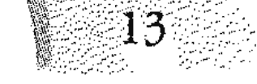

阿傅師賣的到底是什麼呢？簡單的說，就是習慣。習慣這個主題，實在是既不花俏也不聳動，更何況好習慣、壞習慣，誰分辦不出來？誰又不知道好習慣終生受用？既然如此，一個東方人有什麼能耐能夠在企業管理的範疇上自成一派，甚至於賣習慣賣到紐約、米蘭去呢？

譯者認為阿傅師所提示的做法，深具一「可行性、可及性和即效性」，這一點起了很大的作用。哪些習慣會讓人成功？會令人致富？會使人幸福？佐藤先生對習慣的研究就跟他的性格一樣，深入淺出，簡單明瞭。

在佐藤先生的著作裡，你找不到新奇時尚的名詞，也看不到長篇累牘的理論，不過卻有很多闖上書後，馬上就可以動手做的具體提示和實用資訊。例如隨時替錢包減肥，我們可以在一天結束以後，整理一下錢包，把收據、

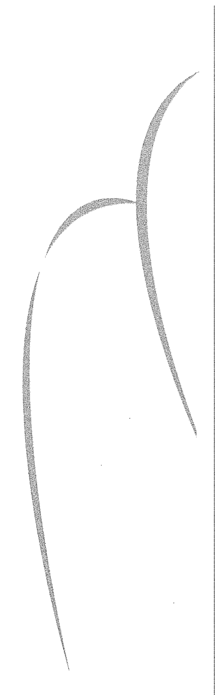

點數或發票等雜物從錢包中取出，因為經濟安定的人，錢包必定是俐落整齊的，只有對錢缺乏安全感的人，才會什麼都往錢包塞，把錢包餵得鼓鼓脹脹的。是不是具體又實用？讀書最怕讀到最後，不知所云或者無從下手，但是，讀佐藤先生的書，你不用擔心這一點。

錢包算得上是我們的日常生活用品吧！

你想過錢包跟財富之間有什麼關係嗎？

套一句大家耳熟能詳的台詞來說：「好的錢包帶你上天堂，不好的錢包直接帶你住套房。」是無稽之談還是經驗談？何不隨手翻開，試讀一篇看看？只要三分鐘！

《好好愛錢，就會更有錢》是佐藤先生另一本引發日本讀者諸多共鳴與實踐的一本小書。因為內容不多，只有四十九篇而已，所以稱之為小書。

佐藤先生透過一個有形的習慣主題——如何使用錢包？從一篇篇小品出發，引領我們建立無形的態度，給我們不同的視界和有用的做法。

待錢有禮，待人也有禮，人緣紅不讓，財源也滾滾。錢、錢包都只是一個媒介，翻開書，你會從字裡行間得到啟發的。

**本書譯者 林雅惠**

## 前言

人出門時或許會丟三落四、忘東忘西，但就是不會忘記帶「錢包」。為什麼呢？

理由其實很簡單，只因爲錢包裡頭裝著「錢」。錢包是金錢的象徵，更是財富的出入口。

金錢雖然只是暫時存放在錢包裡，但錢包的角色絕不是單純的收納袋而已。

錢包關係著一個人「對財富管理的態度」，也代表著本人的「生活方式」。換句話說，想要了解一個人的「財運」如何，看一看他的錢包就知道了。

一輩子都在爲錢苦惱的人，他的錢包往往破損變形。

相反的，事業有成的企業家以及公私兩得意的成功人士，他們使用的錢包必定是一個漂亮有型的皮夾，而且，皮夾裡的鈔票必定放置得整齊平整。

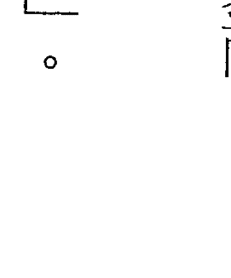

「雖然他用的是個破破爛爛的錢包，但他一向財星高照！」
這種事不可能發生。

本書所介紹的四十九個習慣，每一個都是美夢成真、幸福洋溢的人，在「錢包使用」和「財富管理」上信守不渝的黃金法則。

這四十九個習慣不但簡單易學，而且每一個都有很好的效果，讓我們終身受用。

請把這些好習慣帶在自己的身邊。

只要改變使用錢包的習慣，就會出現不一樣的人生！

讓我們透過錢包這個隨身物品，重寫自己的財富劇本吧！

**習慣的專家**
**佐藤傳**

### 第1章
#### 財運蒸蒸日上！
##### （使用錢包的習慣）

有錢人如何「使用錢包」呢？

他們都有共通的使用習慣。

只要見賢思齊，

你也會成為財富熱愛的人！

何不現在立即改變？

###### 01 把「一萬日圓紙鈔」擺在最前面

雖然有點突然，但還是請你掏出錢包，打開來看一下。為什麼錢包一打開來，第一眼看到的是千圓紙鈔呢？萬圓大鈔被壓在千圓鈔的下方，是嗎？假如你習慣把千圓鈔擺在上面、萬圓鈔擺在下面，證明了你的潛意識一直在自我暗示：「我是一個只配使用千圓鈔的人。」為了提升財運，你必須告訴自己：「我跟萬圓鈔最合得來！」藉此重新塑造正面的自我意象（Self-Image）。馬上把鈔票的擺放順序調換過來吧！在打開錢包的那一瞬間，迎面而來的一定是「諭吉先生」。

*注1：關於諭吉先生的說明，詳見二三三頁*

請把萬圓鈔放在錢包的最前面，五千圓鈔則在萬圓鈔的後面，而放在最後頭的鈔票，必定是千圓鈔。

所有鈔票一定要人頭朝上、方向一致，整整齊齊地被放進錢包裡。

如果你使用的錢包有足夠隔層的話，鈔票就可以按照面額分層放置。最上層放的當然是「萬圓鈔」，然後依序放入「五千圓鈔」和「千圓鈔」，替各個面額的紙幣都設置一個專屬空間。

即使錢包沒有隔層，也要按照這個原則將鈔票由大到小依序疊好，方向一致、整齊不紊地放進錢包裡。

只要這麼一個小動作，你就會變成「夠資格使用萬圓大鈔的人」！無論如何，千萬不要把面額不同的鈔票混雜在一起，不分大小的塞進錢包裡。

一萬圓紙鈔是日本國內面額最大的流通貨幣，充滿了能量。想要提升財運，隨時意識到「一萬圓正在自己的體內穿梭循環」，比什麼都來得重要！

> **NOTE**
> 打開錢包，就看到笑臉盈盈的「諭吉先生」！
> 作者提及的一萬圓、五千圓，我們可以用台幣一千元、五百元置換。

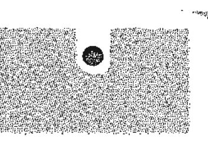

###### 02 錢包裡要擺「年齡 × 1000 日圓」的金額

你的錢包裡頭現在有多少錢？

究竟錢包裡該放多少金額的錢才夠？我們可以用「年齡 × 1000 日圓」來做標準。比方說三十歲的人就放三萬圓，三十五歲的人就放三萬五千圓；依此類推，四十四歲的話，當然就是四萬五千圓。錢包裡的金額多寡要和我們的年齡相對應。

高中生錢包裡放的金額，當然就不應該和大人一樣。

對二十歲的人來說，感覺上是一筆「大數目」的金額，一定和四十歲人眼中的「大數目」不一樣。

錢包裡的金額如果不足「年齡 × 1000 日圓」的話，就好像在塑造「錢怎麼老是不夠用……」的意象。

有一個方法可以幫助我們提升財運，那就是我們應該經常懷抱著「豐盈滿溢」、「富裕感」、「滿足感」，而不是「窮酸感」、「貧乏感」。

當我們打開錢包的那一剎那，萬一阮囊羞澀、空空如也時，心中必定颳起一陣冷風，一波波升起的「窮酸感」、「貧乏感」就這樣如影隨形地跟著我們。

我們的心靈一旦被這些負面感覺占據，就算明白要與人分享的道理，也會做出專攬獨享的事，或者對他人不懷好意……例如，碰到「買二個打 X 折」的促銷活動，就算明明知道用不到二個，也會衝著折扣硬要買二個，最後結果當然是得不償失。

錢包如果空虛，心裡頭就會感覺沉重；錢包如果沉甸甸的，心情就會變得輕飄飄。所以，請在錢包裡放上足夠的金額，讓我們不管任何時候打開錢包，都能有安心的感覺。

**錢包裡的金錢數額要「和我們的年齡相對應」！**

> **NOTE：** 以台幣為例，我們可以以一千元圈換成台幣一百元，而三萬五千日圓，可換成台幣三百五十元。

###### 03 讓錢包在「神聖、清淨的地方」休息

錢包是我們最棒的夥伴，每天都不辭辛勞地為我們奔走。請問你讓自己的「錢包先生」睡什麼樣的床呢？咦？我們需要替錢包準備床鋪？

我們晚上回到家裡，通常只顧著自己上床睡覺，至於「錢包先生」，不是把它丟在提包裡，就是一直放在衣服的口袋裡，不是嗎？如果是的話，根本沒辦法提升財運！

用了一整天的錢包，多多少少也沾染了一些世間的邪氣，疲態盡顯，跟為生活奮鬥了一整天的你並沒有什麼不同。

因此，我們回到家之後，應該把錢包從口袋或皮包裡拿出來，讓它無拘無束地盡情舒展才對。

如果家中設有神桌或佛堂，那裡就是安置錢包的最佳處所。若是沒有……

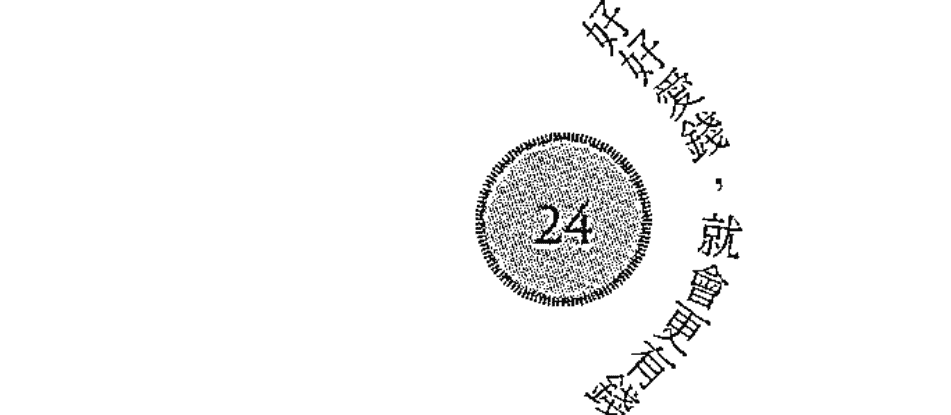

話，可以在自己的房間裡找一個自認為最神聖、最清靜的地方，做為錢包的棲身之處，讓錢包在這處「聖地」充電。

我建議大家不妨使用具有淨化功能的水晶碎石。將整塊水晶壓碎成小粒狀的水晶碎石，一般在網路等通路都可以買得到。把水晶碎石鋪灑在白色的瓷器或玻璃淺盤上，就是一張「錢包的床」了。

當然，沒有水晶床也無所謂，只要讓錢包在主人認為是聖地的地方休息就可以了。

我們使用錢包的時候，最重要的是要認同它也有「人格」，給予相對的尊重。

回家後請拿出錢包，讓它在神聖的地方休息，同時別忘了跟它說一聲：「謝謝你今天的照顧。」

> **踏進家門後，應該直接走向「錢包的床」！**

###### 04 不要把錢包放在「褲子後面的口袋」

大家在選購提包的時候，重點會擺在哪里呢？

必須具備時尚感？要以功能取勝？還是輕巧至上呢？

就我個人而言，一定會先看提包本身有沒有「錢包收納袋」的設計。

無論是有多麼令人驚豔的提包，假如沒有一個尺寸剛好可以讓「錢包先生」舒服地待在裡頭的口袋，我是不會買的。

碰到得帶著錢包在外頭忙碌的時候，應該優先考慮把錢包放在提包裡，而不是擺在衣服的口袋裡。

既然要擺在提包裡，當然建議擺在提包的內袋。

**錢包跟著我們在外面奔波時，一定要把它放在「固定的位置」。**

有些人購物告一段落，在付錢的當下，常常東翻西找不到錢包，這就證明了這個人根本不知道錢包這個人生中的重要夠伴放在哪裡。

還有的人習慣把錢包塞在褲子「後面的口袋」，坐下時，也順勢把錢包

*(註：原文此处有圖片及頁碼提示，保留圖片)*

坐在臀部下面，這實在是虧待錢包的做法。

如果一定要把錢包放在身上的話，就請放在靠近心臟位置的上衣口袋中。

直接把錢包拿在手上帶出門也不妥當。

因為這樣做，等於是讓自己重要的夥伴一絲不掛地走在大街上！

現在，市面上有很多沒有隔層設計的萬用包。

在使用這一類萬用包的時候，無論是便當盒也好、雜誌也好，只要是隨身攜帶的東西，便一股腦兒地通通丟進去，錢包也不例外。要提醒大家的是，千萬不要讓混雜在其中的錢包被壓壞了！

常常把提包弄得雜亂無章的人，不妨利用「袋中袋」等收納用品，可以在眾多雜物中，給錢包多一層的保護。

總而言之，看重我們的錢包，才是提升財運的不二法門！

**對待錢包要像對待「情人」一樣！**

###### 05 隨時替錢包「減肥」

有一次，我看到一位熟悉的女性朋友掏出了一只中間臃腫得不得了，彷彿得了代謝症候群的「大肚皮夾」。我忍不住問：「皮夾裡究竟裝了什麼？」於是，她從皮夾裡拿出了發票、集點卡、掛號證，還有年代久遠的紙條……等等。她的皮夾已經不是錢包了，而是雜物包。

錢包存在的目的是為了方便我們管理金錢，絕不是任何東西都可以存放的萬用倉儲！

一個工作好手，通常都會把辦公桌收拾得井然有序。大家都知道，一團亂的桌面很容易讓人分心，正打算專心工作時，往往就被旁邊的事物吸引而無法專注。

我們使用錢包也是一樣的道理。如果錢包裡頭雜七雜八的什麼都放，代表一個人對金錢的觀念十分薄弱，最後導致財運不濟一點兒也不奇怪。除了現金以外，其他雜物最好不要放進錢包裡，主人要盡量幫助錢包減

肥，完成錢包的「瘦身大計」。

老是把東西往錢包裡塞，把錢包餵得鼓鼓脹脹的人，表示他對錢缺乏安全感。

如果是經濟安定的人，必定把錢包整理得俐落整齊。

我們在一天結束以後，應該整理一下錢包，把用不到的收據和發票丟掉，養成整理整頓的習慣。

利用替錢包「減肥」的機會，可以讓我們再次檢視用錢的方式，未來的金錢運也會豁然開朗。馬上就開始「錢包瘦身計劃」吧！

**請幫助錢包「減肥」！**

###### 06 「卡片」要改放在卡片夾

被塞得鼓脹不堪的錢包，裡頭竟然沒有錢！那麼，到底是什麼把錢包撐得又大又胖呢？

答案是「卡片」。

而且，很多都是跟金錢沒有直接關係、不常使用的卡片。例如，集點卡、會員卡、掛號證……等等。像銀行的金融卡、信用卡等重要的卡片反而少見。

這樣也是讓財富「退避三舍」的做法。

適合放在錢包裡的卡片，頂多就是金融卡和信用卡而已。

而且放入的數量必須以三張為上限，即一張常用卡片，加上兩張備用卡片。

其他卡片應該取出，另外放在「卡片的家」，盡量不要混入錢包內。

「卡片的家」，簡單說，就是整理、存放卡片類物品的「卡片夾」。

卡片夾的形式不一而足，有長皮夾型的，也有名片簿型的。

建讓你準備一個卡片夾，任何形式都無妨。不，或許你應該準備二個。

一個放比較少用到的金融卡和信用卡，平常就把它鎖在家中的金庫裡；另一個放集點卡、會員卡、掛號證：...等，需要用的時候再帶出門。

在整理這些五花八門的卡片時，你會看見自己真正的需要。

**錢包裡不要放不常用的「卡片」！**

###### 07 「錢包大掃除」，運勢大改變

錢包髒了，如果置之不理的話，財運就會像坐雲霄飛車一樣急轉直下。所以，平常就要準備一條軟布，仔細地擦拭錢包。

到了月底，則要替錢包做「大掃除」。為什麼是月底呢？因為要替即將到來的新月份「轉運」！

先把我們的錢包清空，然後把四個角落、還有縫隙裡日積月累的污垢清除乾淨，再把清理好的錢包放在通風良好的地方，以便讓邪氣逸散出去。我們還可以再上一點油脂，然後用布擦拭保養。

說到上油，到底要使用哪一種油脂好呢？答案是「鼻頭的油」！自己的錢包用自己鼻頭上的油來保養，是最好不過的了。

只是，女性朋友應該在卸完妝以後，再做錢包保養。因為化妝品所含有的化學成分可能會傷了錢包，所以，請在素顏的情況下替錢包上油保養。

清潔告一段落之後，別忘了對錢包表達自己的感謝之意：「非常感謝你這個月的幫忙，我很感激，也很滿足。」

就這樣，每到月底替錢包做一次「保養」，等於也在做自我整理，一年十二次，月月刷新自己的心情。

當新舊月份交替之際，真的就有時來運轉般的心情，用全新的自己迎接○月一日的到來！

**每月月底別忘了替錢包做「保養」！**

#### 聚沙成塔，積少成多！
##### （選擇錢包的習慣）

放著現金的錢包，
就好像是裝著人生的魔法袋。
請提醒自已，
不一樣的「錢包選擇方式」，
會帶來不一樣的財運與人生。
你現在正在使用的錢包是好錢包嗎？

###### 08 錢包的生命週期是「1000 天」

你知道錢包也有使用壽命嗎？

錢包的壽命，開門見山直接說，就是「一千天」，大約等於「二年九個月」。

所以，我們每天使用的錢包，應該維持「不到三年就更換新品」的頻率。

一個使用超過三年、已經破損變形的錢包，如果還緊抓著不放的話，代表主人執著於負面的感情，處理起事情來也會拖泥帶水。

錢包必須定期汰舊換新的理由有兩個：

- 使用破舊磨損的錢包，會促使「貧窮」在潛意識裡生根發芽。
- 汰舊換新之際，正好趁機重新思考自己對金錢的態度。

利用這個時候重新審視自己和金錢的關係，或許該下定決心努力存錢了；或許該停止浪費，把錢投資在自己的未來。

###### 錢包應該在「2 年 9 個月」以內汰舊換新！

用舊了的錢包千萬不可以當成垃圾丟棄。建議你懷著感恩的心，把舊錢包帶去神社或寺廟，讓它和過期的護身符一起焚毀。你可以用一張白紙將舊錢包包起來，投入古禮納所，如果擔心寺方有意見的話，不妨先請教廟祝或神職人員。（注②：關於古禮納所的說明，詳見二三二頁）

京都的惠比壽神社（又稱恵美須神社）就有一個邊近馳名的「錢包塚」；或許大家也聽說過鳥取金持神社的「錢包供養」。不妨安排個旅行，順道把舊錢包帶過去處理。

當我們以最誠摯的心，向長年為我們服務的錢包感謝、道別時，也會再為度為自己招來另一個新的財運！

###### 選在「相同的雙奇數日期」買錢包

如果你打算買錢包的話，建議你選在「相同的雙奇數日」購買。

也就是一月一日（元旦）、三月三日（日本女兒節，及中國的王母娘娘壽誕）、五月五日（端午節）、七月七日（七夕）以及九月九日（重陽節）這幾天。

按照陰陽的觀念，奇數為陽（＋），偶數為陰（－），所以，與奇數月相同的奇數日，一向被認為具有非常強大的力量。一年當中有五個「相同的雙奇數日期」，自古以來無不被視為重要的日子。

尤其是九月九日，更是老祖先口中那個不可思議的幸運之日，時至今日仍備受重視。

選在「紀念日」或「生日」換新錢包，則是另一個不錯的選擇。

據說每逢尾數是五的年齡，將是運氣轉換的一年。因此，在二十五歲、三十五歲、四十五歲、五十五歲、六十五歲……等生日的當天，不妨考慮買個新錢包。

三十五歲的生日，一向被認為是人生中最大的轉捩點，請務必把握這一天，替自己換一個新錢包。

除此之外，碰到跳槽、結婚等「人生大事」的時候，也是替錢包汰舊換新的好時機。遇到工作瓶頸或者感情受挫時，想要「換個心情」的人，何不先換個錢包？

我們還可以趁新月或滿月那一天去買錢包。

運勢會大不同喔！

**選在「相同的雙奇數日期」，汰舊換新你的錢包！**

###### 10 要用就用「長皮夾」

「長型皮夾」和「對摺式皮夾」，哪一個比較能夠提升人的財運呢？可想而知，當然是長皮夾！

我們可以試著把自己當成鈔票，揣摩一下紙鈔的心情。

假如自己被放在對摺式的皮夾內，不就得天到晚腰折過日子嗎？

有人希望自己的身體被攔腰折成兩半嗎？

「快放我出去！」如果你是那張被對摺的鈔票的話，一定恨不得馬上逃離那個錢包。一旦逃了出去，就不會想再回到那個地方了，而且還會透過金錢網路一傳十、十傳百，告訴其他鈔票同志說：「千萬不要去那裡！」

錢包是「金錢下榻的飯店」。總是一房難求的飯店，必定是能夠讓客人盡情放鬆、身心都感到舒暢的好飯店。這樣的飯店，客人（即鈔票）當然會蜂擁而至。

但如果是身體非得對摺收起，否則不能睡覺的飯店，還有客人願意登門入住嗎？

同樣是鈔票，一張平整光滑，另一張摺痕歷歷，我們看到前者的心情一定會比看到後者來得好，再說收到前者的人，也會有開心的感覺。

所以包還是不是不要使用「摺疊式的長皮夾」，要用就用長皮夾。

鈔票若是覺得你的錢包住起來舒服的請，也會呼朋引伴擠進來喔！

**「非摺疊式的長皮夾」才是王道！**

###### 11 年收入1000萬日圓的人，請用「5萬日圓的錢包」

你正在使用的錢包，是花多少錢購買的呢？

從以前開始，一個人所使用的錢包價格，就被認為應該與本人的年收入成比例。

說得更明白一些，很多人的年收入都相當於他所使用錢包價格的二百倍。換句話說，使用二萬日圓錢包的人，他的年收入通常在四百萬日圓左右，使用五萬日圓錢包的人，則大約有一千萬日圓的年收入。

別懷疑！何不買一個「對自己而言，價格略高的錢包」試試看呢？這是一個提升財運的好方法！

現在就計算一下。你一年的收入除之二百之後是多少呢？下一次要換新錢包的時候，何妨挑戰這個價位的錢包？

**「目標年收入 ÷ 200」就是你應該使用的錢包價位！**

如果你希望自己的年收入有一千萬日圓的話，就請選購「五萬日圓的錢包」吧！

當然，錢包並不是越貴越好。

然而，錢包是用來存放我們辛勤付出賺來的錢，假如用的是便宜貨的話，豈不是在做負面的自我暗示？

每天每次使用錢包的時候，看到手上「質感、視覺俱佳的好錢包」，也會湧現出無限愛意。當有人讚美這個錢包時，我們便有話題可以回應：「嗯，真的很有質感對嗎？這個錢包是．．．．．．。」多增加與人談話交際的機會，說不定裡頭就隱藏著獲取好工作的機會。

請嘗試這個增加收入的方法——提高購買錢包的預算吧！

###### 12 不要迷信「黃色錢包」

聽說「使用黃色錢包的人會變成有錢人。」
試問一下，你看過用黃色錢包的大富翁嗎？

「黃色」跟金色屬於同色系，都是非常幸運的顏色。不過，人若使用黃色錢包的話，往往花錢如流水，留不住錢財。

如果一打開錢包就能夠看到「黃金」，真是再好不過了！
黃色是代表黃金的顏色，不宜裸露在外，最好能夠用做錢包的內裡，直接接觸鈔票。

話說回來，理想的錢包應該是什麼顏色呢？
錢包的顏色以具有繁茂含意的「深綠色」，最為推薦。
「外綠內金」可說是最佳組合。
此外，如夜的「黑色」、雲的「白色」以及大地的「茶色」、「咖啡色」……等象徵自然界的顏色，也很適合做錢包的顏色。當然，其他讓自己「一見鍾情」的顏色也 OK。挑選錢包的最大重點還是在於，選一個能讓自己興奮雀躍、愛不釋手的錢包。

至於錢包的材質當然要選皮料。這裡說的皮料並不是從石油中提煉出來的合成皮，而是指「天然皮」。建議以哥多華皮革（Cordoba）和小牛皮（Brille Leather）等高級皮革為首選。（注3：關於哥多華皮革說明，詳見一一三頁）

很多有錢人喜歡使用訂做的錢包。現在，透過網路等通路，已經可以搜到不少提供訂製服務的廠家。

**選一個令你「一見鍾情」的錢包！**

###### 13 零錢請放「零錢包」

錢包本來就分爲「紙鈔夾（長皮夾）」和「零錢包（放銅板）」二種，一次擁有二種，錢財才會搶著跑進來。

這是什麼道理呢？很簡單，因為鈔票和硬幣的磁場完全不一樣。鈔票是紙做的，最源頭的材料來自樹木。所以，鈔票的故鄉是地面上的森林。

再來看硬幣。硬幣源自礦物，硬幣的故鄉是位在地下城下的熔岩。

換句話說，鈔票和硬幣原本就是二種「不同的東西」，一開始就沒有哪個好、哪個不好的問題。

因此，把鈔票夾雜著硬幣一起丟進沒有隔層、收納包似的錢包裡，十分不理想。

讓鈔票和硬幣雜處一室，不管是對鈔票、還是硬幣來說，二者過得都不舒坦，誰都想早一步離開！

**「鈔票」和「硬幣」要避免雜處一室！**

假如一定要讓鈔票和硬幣同居在一起的話，請選擇有鈔票夾層和零錢袋設計的錢包，確實將鈔票和硬幣分開放置，不要讓二者互相接觸。

順帶一提，信用卡和金融卡屬於塑膠製品，它的磁場自然也不同於鈔票或硬幣。

能夠另外準備一個「卡夾」存放這些卡片，當然是最理想不過了。不得不把這些卡片放進錢包裡時，要避免讓卡片和金錢有所接觸。

###### 14 第一次使用新錢包請放入「所有面額的新鈔」

新錢包買回來之後，請擺在家中的「聖地」一晚，第二天再開始使用。

新錢包首次使用的時候，有一個重點，那就是別忘了在錢包裡擺滿現金。

「錢包裡頭要是每天都有這麼多錢的話，我一定會天天都開心。」

請把會讓自己開心的「理想金額」放進錢包裡。

提醒大家，第一次被放進新錢包裡的錢，應該用「新鈔」。

銀行有提供換鈔的服務，只要拿著用過的舊鈔到銀行，就可以兌換成等值的新鈔。

接著用「未來的一千天，請多幫忙！」的感恩心情，將新鈔放進新錢包裡。

新錢包裡頭不要只放萬圓大鈔，所有面額的紙鈔，如五千圓鈔票、二千圓鈔票及一千圓鈔票，最起碼也要各放一張進去。

我們平常受福澤諭吉先生、樋口一葉小姐、紫式部小姐以及野口英世先生的照顧不少，這麼做代表我們對「鈔票」的敬意，而且是對所有的鈔票！（註4：關於日鈔上的人像說明，詳見一二三頁）

常常聽到其他人說：「紙鈔要人頭像朝下放進錢包裡比較好。」假如你是鈔票的話，你會喜歡倒栽蔥的姿勢嗎？

鈔票也有「人格」，當它頭下腳上被倒過來時，腦充血的感覺應該只會讓它想火速逃出去才對。所以，請將鈔票的人頭像朝上擺進錢包裡。

紙鈔放進去新錢包之後，六種不同面額的硬幣，即五百圓硬幣、一百圓硬幣、五十圓硬幣、十圓硬幣、五圓硬幣以及一圓硬幣，也別忘了各放一枚進去！（註5：日圓硬幣的說明，詳見一二三頁）

用「第一次放進去的金額」讓新錢包知道：「主人希望我能裝多少錢！」

#### 向幸福的有錢人學習！
##### （尊重錢的習慣）

財運欠佳，莫可奈何！
你就這樣放棄了嗎？
受財神眷顧的人，
不做守株待兔的事。
稍微改變一下「尊重錢的習慣」，
財神也會來敲你的門！

###### 15 請真心把「錢」放在眼裡

請拿出紙筆，用筆在紙上畫「一萬圓紙鈔」的圖形。

你畫得出來嗎？正面和背面的圖案都沒有搞混吧？

什麼？你竟然畫不出來？

一想到我們喜歡的異性，心中總能浮現出對方的影像，再細微的地方也想得到。一萬圓紙鈔不也是我們最喜歡的對象嗎？怎麼會想不起來它的模樣？

這到底是怎麼回事呢？

理由只有一個，你只是大腦（顯意識）喜歡錢而已，你的心（潛意識）根本不愛錢。

如果不改正這種偏頗的心態的話，你的財富將一去不復返！

錢出錢進、循環不停的人，也就是我們口中的有錢人，不僅喜歡賺錢、存錢、花錢，更喜歡「貨幣本身」。他們常常盯著貨幣看到入神，因此，要他們畫鈔票的圖案和大小，總能畫個八九不離十，而且，他們對待貨幣本身一向小心翼翼。

缺乏金錢循環的人，嘴上說愛錢，但實際上可是一點兒也不愛錢。所以，他們老是把鈔票弄得皺巴巴的，更過分的是還把鈔票當便條紙在上頭寫字。

我們偶爾也會收到寫了字的鈔票，不是嗎？

「你的額頭借我寫一下字。」

試想自己是一張鈔票。一個路過的人冷不防地拿出筆在自己的臉上塗鴉，對你來說，這樣的行為難道不是一種羞辱嗎？

假如你希望變成有錢人，就一定得好好地疼愛貨幣。

對貨幣越好的人，財運就會越好。這是真金不換的事實！

**「二萬圓紙鈔」，一定要閉著眼睛也能畫出！**

###### 16 提到錢也要客客氣氣

「把那些散錢給我拿過來！」
「時間到了，就會把那個錢付掉！」
這些都是我們經常可以在街頭巷尾聽到的對話。會用這種口吻說話的人，恐怕都是一些財運不濟的人。

說到錢的時候，請不要這麼「隨便」、不禮貌。

我們用口頭語言來表達金錢時，假如措詞隨便，財運就會像溜滑梯一樣往下掉。

- 不要說：「買單」，請說：「請買單。」
- 不要說：「做工的錢」，請說：「薪資。」
- 其他如「賺不了多少錢」、「錢一下子就見了」之類的話，也請不要說。

一天到晚把「賺不了多少錢」掛在嘴邊的人，便永遠只能賺那麼一點點錢了；動不動就喊「錢一下子就不見了」的人，他的錢就真的如同泡沫一般，一眨眼就消失了。

提到「錢包」，也請用恭敬的態度說：「錢包。」

經常用輕蔑的字眼、不屑的口吻談錢的人，心中必定對錢存在著某種程度的偏見，認為金錢是「骯髒、齷齪的」。

我們從小被教育不可以談錢、談錢太庸俗，以至於在心中烙下了陰影。

事實上，金錢既不齷齪也不高尚。

金錢本身沒有好、也沒有壞，它是中立的一股能量，幫助我們實現夢想。

**稱呼錢的時候要有「禮貌」！**

###### 17 是付錢，不是「扔錢」

很多商店都會準備一個小盤子，好讓客人結帳時可以將現金或信用卡放在裡面。

不過，無論是現金或信用卡，還是「親手」交給對方比較恰當。

同樣是付帳，若能帶著「謝謝你讓我買到底東西！」的歡喜心情，親手將錢遞給對方，那麼，二人之間必定充滿正向的能量，金錢也會同感激喜歡。

萬一碰到沒辦法親手把錢交到對方手中的情況，也要將錢輕輕放在小盤子裡，明確表達我們的「感謝之意」。

最無法苟同的付帳方式莫過於「用扔的方式付錢」。

有些人付錢時，既不把錢交到店員的手中，也不放在小盤子裡，而是很不情願地灑在桌子上，彷彿在說：「錢在那裡，拿去吧，小偷！」

越常用傲慢無禮的態度來處理金錢的人，財運就越差。

想到了嗎？是的，我們把香油錢投入捐獻箱時，不可以用丟的。

正確的做法應該是讓錢輕輕地滑入捐獻箱，盡可能不要發出聲響。

丟錢、扔錢的動作好像在施捨：「喂，拿去！」完全是一種上對下的行為。

一旦令人「感覺很差」時，財運怎麼會靠近你呢？

**請微笑、有禮地將金錢「親手交給對方」！**

###### 18 請看重每一塊錢

你知道一百日圓硬幣的材質是什麼嗎？銀？當然不可能，如果用銀來做錢幣，一定會做越多賠越多！正確答案是白銅。五十日圓硬幣也是採用白銅鑄造。五百日圓硬幣則由鎳黃銅鑄造，五日圓硬幣的材質換成黃銅，十日圓硬幣則是青銅幣。一日圓硬幣是唯一不含銅的錢幣，而是以鋁鑄成。

一日圓硬幣的重量只有一公克，半徑一公分，中間四平八穩地寫了一個『1』。

你知道其他「錢幣」的大小嗎？在手邊沒有實物的情況下，你能夠按照面積從最大的排到最小的嗎？還有，每一個錢幣的圖案，你描述得出來嗎？偶爾，不妨拿著硬幣仔細端詳一番，無論哪一種錢幣都美的令人屏息、令人愛不釋手啊！

當我們講到「錢」的時候，往往下意識想到紙鈔，經常對「零錢、銅板」不屑一顧。

要知道所有的錢都是從最基本的一圓開始累積的，即便是一億圓，也是圓的集合體。

不看重小錢的人，賺不了大錢。

從金錢的角度來看，一萬日圓紙鈔是一日圓硬幣的父母。如果你不好好對待紙鈔的孩子，身為父母的紙鈔也不會想跟你有任何往來，不是嗎？你一定要更喜歡、更關心美麗的錢幣。

**對「銅板」也要愛到不可自拔！**

###### 19 找一台自己喜歡的「電子計算機」

與財無緣的人，看到數字就頭痛，想到計算就退避三舍。倘若不思改善的話，一輩子都要跟財富擦身而過。

- 請在智慧型手機的首頁安裝計算機應用程式。
- 請在提包裡放一個攜帶型電子計算機。
- 請在桌上擺一個桌上型、功能強、用起來順手的電子計算機。

找一個自己喜歡的「電子計算機」放在身邊，隨時可以拿起來噠、噠、噠節奏感十足地敲出數字。

有空的時候，還可以就自己的收入和支出做各種計算。

- 「嗯，保那個保險一點兒意義也沒有。」
- 「繳了那麼多入會費，結果都沒有在用……。」

就這樣，無意間察覺到不必要的花費，找到更有意義的用錢方式。

**用「電子計算機」和數字談戀愛！**

說到電子計算機，夏普和卡西歐都是知名的廠牌。不過，我個人比較偏好佳能，因為它特別配置了「千」、「萬」、「億」三個單位按鍵。因此，不管做多大金額的計算，都很簡便。

再者，佳能計算機的液晶畫面也會顯示「千」、「萬」、「億」等國字，光是看到了，心情就感到愉快萬分，不是嗎？

平常就要養成用歡喜的心情與數字相處的習慣，這樣你的金錢指數也會直線上升！

###### 20 用「綁鈔帶」做我們的幸運物

基本上，適合放進錢包裡的只有錢。不過，也有例外的時候，那就是為了吸引財運而放的「幸運物」。

從前的日本人把錢包叫做「蟾蜍嘴、蛙嘴」，習慣在「蟾蜍嘴、蛙嘴」裡放一個小小的青蛙吉祥物。沒錯！他們祈盼金錢快「回來」。（注5：關於青蛙吉祥物的說明，詳見「三三頁」）

幸運物能夠增強錢包的能量的。

- 露出滿臉笑容的個人照或全家福照片，也適合放在錢包裡做幸運物。
- 龍是繁榮的象徵，與龍有關的物品同樣推薦。

把幸運物放進錢包的夾層袋，讓錢包充滿好運氣。

我們也可以在錢包裡放入「名片」。

在購買錢包的時候，理應將姓名烙印在上頭。錢包上有沒有印我們的名字，我們對它的愛和重視程度也會有所分別。錢包如果沒有烙印姓名的話，別忘了用名片來代替。這樣做也有另外一個好處，萬一遺失了，可讓拾獲者藉名片與本人聯絡！

誠如上述，可以幫助我們提高財運的幸運物不勝枚舉。你知道哪一種最好嗎？

答案是「綁鈔帶」，也就是捆紮一疊一百萬日圓鈔票，綁在鈔票正中央的紙帶。

假如你有機會接觸到整疊百萬日圓鈔票，在拆綁鈔帶的時候，小心別撕破它，記得把它留下來悄悄放進錢包裡。

日後，它會為你帶來許多同伴（〃一百萬日圓）！

**悄悄放一個幸運物在錢包裡，可增強主人的財運！**

###### 21 「賺錢」、「花錢」、「存錢」三者要平衡

金錢包括了三個要素，分別是「賺錢」、「花錢」和「存錢」。

「賺錢」、「花錢」、「存錢」，三者所占的比重一樣大最是理想。

三個要素最好也能夠以同比例一起成長。

不過，實際上，做得到的人少之又少！

三者之中，任何一個所占的比重若遠遠超過其他二個時，就會出現失衡問題。

- 「花錢」無限上綱，就會變成敗家。敗家不好，顯而易見。
- 換做「賺錢」占大部分的比重，又會如何呢？賺的越多，應該越幸福才對。然而，也有許多人操勞一生，仍舊逃不出「賺得還不夠」的緊箍咒。
- 讓「存錢」的比重越來越大的人，他的人生未免也太乏味了。

現在，把「儲蓄當興趣」的年輕人似乎有日益增加的傾向，為了將來夢想，存錢並沒有什麼不好，可是，一旦變成不投資自己的儲蓄狂，財富也不會對這種人死心塌地的。

務必要讓「賺錢」、「花錢」、「存錢」這三個要素均衡發展。

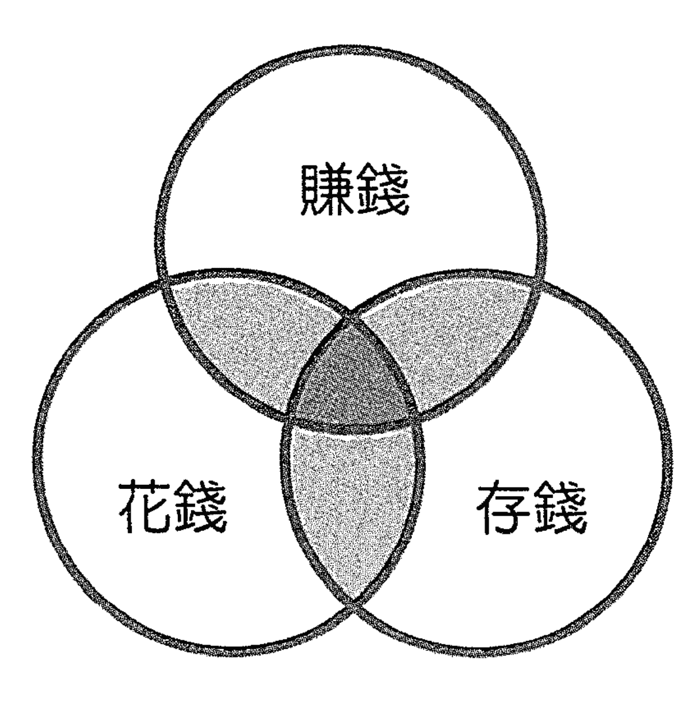

> 做個懂得「賺錢」，懂得「存錢」，也懂得如何「花錢」的人！

#### 夢想和錢包都變大了！

（儲蓄的習慣）

人若沒有「儲蓄」的習慣，
無來由的不安全感，
便會咻！咻！地不時襲上心頭。

不需要勉強，一天一塊錢也無妨。

儲蓄最大的關鍵全在一個「恆」字！

聚沙可以成塔，只要笑著持續、笑著盼望。

### 22
## 一次備妥「3種錢包」

不兜圈子，直截了當告訴大家！我們的錢包又分為三種。亦即「皮錢包」、「銀錢包」和「金錢包」。

所謂的「皮錢包」，指的就是一般皮革製成的皮夾。

「銀錢包」說的是銀行的帳戶。

「金錢包」則是指個人私有的小型金庫。

想要招財進寶的人，一定要同時擁有這「三種錢包」。

「銀行裡已經有帳戶了，不過家裡沒金庫！」

如果家裡設一個金庫的話，大家應該也會把錢放進金庫裡才對。

既然準備了儲物箱，就會充實它的內容。

要是沒有儲物箱，可就永遠也不會有滿箱驚喜出現的一天。

我們從「銀錢包（銀行）」裡領出來的錢，應該擺在「金錢包（金庫）」裡管理，只拿出必要的部分放在「皮錢包」隨身攜帶。

這個銀錢包、金錢包、皮錢包的循環，正是獲得財神垂愛的重要關鍵。

準備好三種錢包，並且善加利用，你的收入和支出將與以往截然不同！

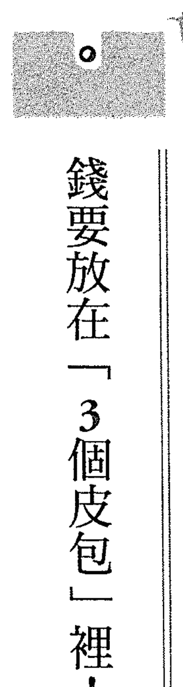

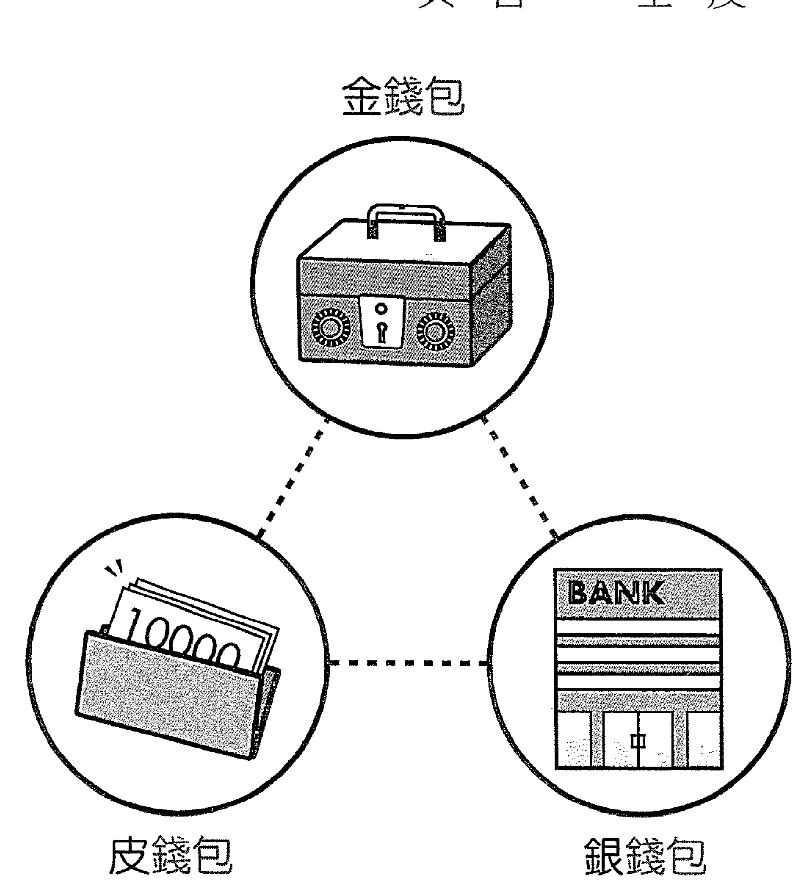

### 23
## 家裡也要有「金庫」

到銀行提款之後，就直接把領出來的錢放進錢包裡，習慣把所有的現金帶在身上到處走。這種人很多，不是嗎？也就是說，大多數的人只有皮夾裡有現金！

萬一碰上意外發生的時候，就危機管理來說，家裡頭沒有現金是非常不明智的行為。因為碰到大地震等非常時期，ATM無法提供服務，完全派不上用場。

事業有成的人，總是習慣在家裡放一定金額的現金。

倘若你也想成為成功人士的話，請在家中準備一個「金錢包」，也就是「金庫」吧！

一講到金庫，不少人會聯想到大型的保險箱。其實，我們放在家裡的金庫可以是網絡上買得到的手提小金庫，也可以是親手打造的美麗木箱。

無論選用哪一種金庫，最重要的是裡面一定要有隔層，這樣才能將鈔票和錢幣分開放置。

我最喜歡把收銀機拿來擺在家中當做金庫使用。

收銀機不但可以上鎖，還可以使不同面額的紙鈔和硬幣各有所歸。如果買的是古董店的中古收銀機，更可成為家中的藝術裝飾品。

有了金庫以後，手邊還有多少面額的錢？隨時隨地都可以一目瞭然。像那種對領了多少？花了多少？又剩下多少？全無概念的用錢方式最糟糕。把提領出來的錢先放入家中的金庫，有助於我們提高對金錢的敏感度。

金庫在金錢進、出的中間，扮演緩衝、過渡的角色，著實重要。

「錢擺在桌上或抽屜裡就好了，有需要特地準備一個金庫嗎？」

當然有需要！錢也有錢的歸宿，把它和文具或衣褲袋子等放在一起，你想錢會欣然接受嗎？

###### 做一個讓自己鍾愛一生的「金庫」吧！

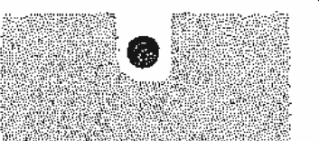

###### 開一個「儲蓄專用帳戶」

你現在正在使用的「銀錢包」，也就是「銀行」的帳戶，叫做什麼名字呢？

「叫做什麼名字？不就是存款帳戶嗎？」

不是不是，存款帳戶只是一個通稱，帳戶本身還分成很多種類。

譬如活期儲蓄帳戶、定期儲蓄帳戶、儲蓄理財帳戶……等，各有各的名稱和功用。有些銀行就把這些不同類型的帳戶全部彙整成一個，統稱為綜合帳戶。

我們通常會開設一個活期儲蓄帳戶，配合公司發放薪資需要以及自動扣繳水電瓦斯費等等。這種帳戶無論是對轉帳或者扣款來說，都非常的方便。

正因為活期儲蓄帳戶使用起來非常方便，所以，很容易讓金錢在不知不覺中溜走。

為了增加提款、轉帳的不便性，開設一個「儲蓄專用帳戶」吧！

請到銀行的櫃台申辦「儲蓄專用帳戶」。

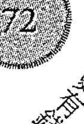

告訴承辦人員：「不要金融卡，只要存摺就可以了。謝謝。」
這是專門辦給儲蓄用的帳戶，只存不取，不需要提款，自然不需要任何卡片。

辦好了以後，別忘了把存摺帶在身邊。碰到可以使用存摺存款的 ATM 時，就存一點錢進去，金額多寡都無所謂。
這種儲蓄專用帳戶，領錢需要用到開戶印鑑，但存錢卻只要存摺就可以完成。
雖然每次存進去的錢不多，可是久而久之，就會累積成一個大數目，如此一來，儲蓄的動力會變得更強烈！
當你看著戶頭裡的結餘時，記得輕輕地說一聲：「非常感謝、非常滿足。」

###### 養成隨時、隨地、隨手「儲蓄的好習慣」！

### 25
## 利用「定期扣款」強迫儲蓄

有些人即便辦了儲蓄專用帳戶，也會因為本身的意志力太薄弱而存不了錢。有這種困擾的人，最能夠利用的工具就是金融機構的自動扣款功能！也就是每個月按時從薪水裡扣款的「定期定額」儲蓄。

只要帶著存摺和開戶印鑑到公司合作的薪資轉帳銀行，告訴櫃台人員：「我想辦定期定額、零存整付存款」就可以了。

有些銀行還提供「自動轉存」的儲蓄方式，當存戶活存戶頭裡的餘額在指定的日期到達指定的金額時，銀行的系統就會依設定的條件自動將活存金額撥至儲蓄專用帳戶。善用零存整付搭配自動轉存，小錢也能慢慢累積財富。

對儲蓄來說，跨出第一步，趁早建置起自己的「儲蓄系統」最重要。

打算每月扣款進行儲蓄的人，每月的扣款金額應該定多少呢？

一個不變的原則是——量力而為。儲蓄好比是肌力訓練，必須讓身體感到微微吃力，才會顯現效果。

我們可以從一至二萬日圓開始存起，在行有餘力的前提下，逐步增加定存的額度。

有的人一開始就設定一個超出能力範圍的目標，一旦帳戶存款不足扣款失敗，到最後反而讓好不容易才開始的零存整付被迫提前解約。

在做定期定額的儲蓄時，最怕本人對這筆錢左思右想、遲疑不決，我們要把儲金當成是「不存在的東西」。

> 「儲蓄第一優先，剩下來錢才拿來花用！」
> 謹守把儲金當做不存在的原則，才能強迫自己存到錢！

> 「用剩下的錢再拿去存」，抱持著這種想法就永遠存不了錢！

## 夢想和錢包都變大了！（儲蓄的習慣）

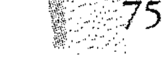

###### 養成「記帳」的習慣

有一個方法可以幫助我們避免浪費、多存一點錢，那就是記帳。只要把花錢的內容記下來，便可以知道自己究竟有沒有把錢花在不該花的地方。

試舉「在便利商店買餅乾」為例。有的人在便利商店買餅乾並不是因為肚子餓，而是結帳時看到就順手拿了一包，不是嗎？

雖然一包餅乾只花區區一百日圓，但如果一星期買一次的話，一年有五十二個星期，就得花五千二百日圓，更何況這種花費對健康來說，一點兒好處也沒有。

為了避免金錢一點一滴的流失，請準備一本記事本。

每花一次錢，就在記事本上記錄該筆花費的金額和用途。

由於這本記事本並不是家計簿，所以不需要統計全部的支出，也沒必要做收支結算。

我們只要將花費的金額和用途逐筆記錄下來，留待自己日後回顧。

###### 消費紀錄

所有的支出在這本記事本上都一目了然，我們可以隨時翻閱自己過去的消費紀錄。

這一天在超商買了一包餅乾；啊，隔天又買了一包！哇，還有這一天也是！說不定就因此發現了不必要的消費！

記事本上列了一長串類似的消費，金額雖然不大，但卻經常發生，而且消費的目的只是為了滿足口腹之慾。

我也是透過記帳才驚覺到自己喝太多咖啡，進而戒掉喝咖啡的習慣。能夠幫助我們累積財富，乃至於提高生活品質者，正是具有一石二鳥功效的「記帳大作戰」！

利用「記帳大作戰」降低不必要的消費誘惑！

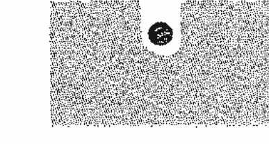

###### 「日曆錢包」值得你多加利用

我有一個朋友花錢一向出手闊綽，也因此總是陷在調頭寸的窘境中。為了留住錢財、擺脫窮忙，他自創了一種「日曆錢包」儲蓄法！

他先到文具店買三十十一個信封，然後依序在每個信封上編號，一直編到三十一號。

每一個信封裡頭裝的正是編號當天的預算，而每一天的預算金額，朋友都已經事先做好規劃。例如，除了工作以外沒有其他活動的日子，該日的信封袋裡便只有午餐費；如果已知有出差行程的話，就再加入出差的費用。

至於房租、水電、瓦斯……等生活基本開銷，則全部透過銀行自動扣繳；另外還會準備一筆預備金，以備不時之需。

每天早晨，朋友按例將信封袋裡的當日預算移到錢包裡。比方說今天是十五號，他就抽出第十五號信封袋，然後把裡頭的現金拿出來放進錢包以後再出門。

一天的花費最多就是「信封袋裡的預算」！

假如錢包裡還有剩下的現金，朋友回家後，便直接把錢拿出來放回當天的信封袋，決不會留給第二天使用（這是很重要的關鍵！）。

到了月底，朋友拿出所有的信封，將裡頭沒用完的現金通通回收，然後存入銀行的帳戶。

當他決心用這個方法強迫自己儲蓄時，第一步就是找一家專賣高級品的文具店買信封。朋友挑選了磅數較重、開口較大的西式信封。正因為他使用的是品質佳、外表美觀的信封，所以讓他產生了精打細算的念頭：「看今天能夠再少花多少錢？」這種遊戲似的感覺也讓他樂此不疲。

一個月後，朋友很快地從「不花錢」當中得到快感！

說到如何防止一擲千金，讓自己每天都能做到當省則省的對策，日曆錢包這個習慣稱得上是上上策。

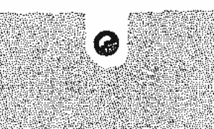

###### 每天的花費都不能超過「當天的預算」！

###### 按使用科目「分袋」規劃預算

對很難做到按日細分所需預算的人，可以考慮以下的替代方案，那就是針對不同的使用科目「分袋」編列預算。

這個方法可說是控制消費、強制儲蓄的基本對策中的基本對策。

每個月的薪資入帳之後，應先將收入減掉房租、水電、瓦斯費、存款金額以及保險費……等固定支出。

扣繳掉上述的支出，戶頭裡剩下的錢才是當月能運用的金額。

請將該筆金額一次提領出來，然後按照不同的使用科目分別裝進相對應的信封袋裡。

信封上的科目除了一般「食」、「衣」、「行」以外，還需要編列一些能夠反映本人生活方式的類別。譬如「進修費用」、「購書費用」、「約會支出」……等，能分多細就分多細，而且越具體越好。經計算之後，便將該科目的預算放進信封內。

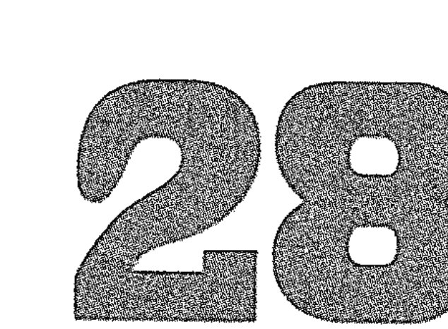

信封裡有多少錢，就是當月份能夠動用的所有金額。假設約會支出的信封袋裡放了三萬日圓，而月初的某次約會就把三萬日圓全部花光，那麼，一直到月底的約會費用便通通是零。為了避免這種情況發生，本人勢必得學習如何把錢花在刀口上。每到月底，如果有錢剩下來的話，並不是挪到下個月花用，而是把它們拿到銀行存起來。長久以往，便會在不知不覺間累積一筆不算少的財富！

利用這個方法的人，應限定自己一個月只能從銀行提領一次。如果不自我約束、身上現金不夠就到提款機領錢的話，錢就會很快花光，月底就得四處去調頭寸了。

###### 按「科目別」規劃每個月的預算！

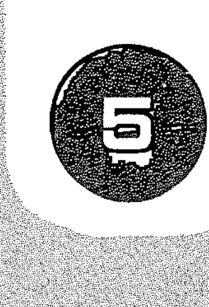

###### 天天都開心！

##### （用錢的習慣）

你如何對待自己的錢呢？

其實，金錢本身一直很在乎這個問題。錢最想去的地方，
當然是「善待」它的人的懷裡。我們究竟該怎麼用錢，
才會讓錢愛上我們呢？

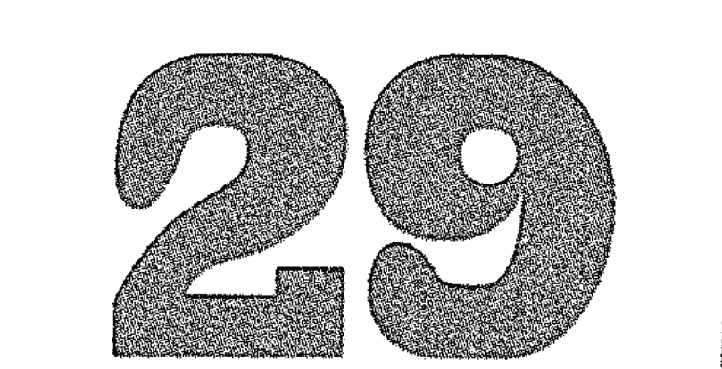

###### 請跟錢說：「慢走，再見。」還有：「歡迎回來！」

「哎，錢又跑掉了，真討厭。」

當你從錢包裡拿出鈔票，準備付錢的時候，千萬不要有「不滿足」的心態，不要感到「匱乏」，不要付錢付得不甘願！

付錢是讓金錢暫時離開自己身邊的一種行為。你所付出去的錢帶著能量，變成店員的薪酬，成為店家永續經營的資金。這筆錢還會流轉出去，從一個地方流動到另一個地方，好比使社會順利運作的潤滑油。

人類想要生存，必須靠血液不停地在體內循環。對社會來說，金錢就是它的血液。

正因為錢不斷地在社會各處循環流動，我們的社會才會變得如此豐富。無論是血液或者金錢，都不可能固定停留在某處不動。一旦停滯不前，人就要生病了，社會也不例外。

貧窮、犯罪、階級待遇就是金錢不流動所招致的社會惡疾。

付錢可以有效預防上述的疾病發生，是營養社會、使社會正向發展的了不起行為！

每當我們掏出錢包裡的錢時，別忘了對它說：「慢走，再見。」
同樣的，當我們拿到錢要放進錢包時，也記得說聲：「歡迎回來！」
付錢時，在心中向錢「道別」，讓錢帶著「滿滿的愛」踏上旅途。
如此一來，金錢就擁有充沛的活力能夠四處去旅行，等到時機成熟了，
它會替我們帶回來更多的同伴！

讓錢帶著我們「滿滿的愛」去旅行！

###### 「永遠帶著微笑付現金」

能夠用貸款方式購買的物品，應該只有房子！

不管是買車子也好、買家具也罷，請「付現」，並且「一次付清」。

購買其他物品，例如時鐘、皮包、外套、化妝品等等，就更不用說了。簡單來講，除了房子以外的東西，都不應該用借錢或貸款的方式取得。「什麼？不可以借錢買東西？怎麼可能？」大呼難以置信的你，請仔細聽我道來。

不想帶大把鈔票出門的人，有時候會使用信用卡購物付款。利用信用卡應先確認自動扣繳的帳戶有足夠的餘額這個前提，同時以一次繳清為原則。

發卡銀行很喜歡客戶利用他們提供的「最低應繳金額」服務，以便藉此從中獲利。使用信用卡消費，卻只繳最低應繳金額的做法，只會讓財富、財運離你越來越遠，因為到最後所支付的成本一定超過當初的消費金額。

為了滿足購物慾望，不顧一切先預支後付款的心態，實不可取！

付款有以下三個原則：
- 當下付清
- 用現金支付（不要辦分期付款，不要用支票或其他票據）
- 笑著付錢

應該付的錢並不會因為晚點付，就可以少付。
請學會「笑著付現」這個用錢的好習慣。

「最低應繳金額」是裹著糖衣的毒藥！

###### 做有「故事性」的消費

越是昂貴的物品，越要對購入背景有所堅持。讓我們以鋼筆為例。想要擁有一支鋼筆時，可以上網點一下滑鼠，過幾天就收到貨了。

換個方式看看。「這支鋼筆是去歐洲玩的時候買的。我一直想要一支鋼筆。那一天在佛羅倫斯的石板路巷子裡逛來逛去，無意間走進一家小小的文具店，一眼就看到了它！」「後者的鋼筆珍藏著一段美好的回憶，不是嗎？日後只要本人手裡拿著這支鋼筆，必然想起這段『故事』。」

如果有人說：「好漂亮的鋼筆。」「本人也會愉快地回應：「是啊，這支鋼筆是……」「彼此之間的話匣子就這麼打開了。

倘若物品本身充滿了紀念性、故事性，物品的主人會加倍珍惜它，對它愛不釋手。

有些人會為了一點折扣，特地趕去拍賣會的現場，跟著混雜不堪的人群，
擠在烏煙瘴氣的環境裡，採購物價值不妥的商品。
甚至有的人還會到價格特別低廉的商店挑選高價品，殊不知這些商品的背後隱藏著不為人知的內情。說不定架上的精品包充滿了原主人的負面能量，因為它的主人遇到了莫大的難關，逼不得已只好忍痛將它賣掉。
當然，並不是所有的二手物和拍賣品都不吉利。
譬如一位事業有成的成功人士搬進了豪宅，他原本白手起家的房子本身即有很好的運氣。後來買到這間房子的人，他的運勢也能夠被帶旺。
我們買進來的任何物品，假如缺乏購入背景、不具故事性的話，對它的喜愛終究難以長久。碰到有人讚嘆地說：「高級的精品啊！」本人恐怕也會下意識地回答：「哪有？都是不值得一提的便宜貨啦！」像這樣自貶好不容易買來的精品的身價，也不是在貶抑自己的運勢嗎？

> 價格越高的物品，越需要在有「故事背景」的情況下出手！

###### 花錢之前先想一想是「消費？浪費？還是投資？」

金錢只有三種用法。

那就是「消費」、「浪費」和「投資」。

用錢買柴米油鹽之類的生活必需品，屬於「消費」，我們花出去的錢就很有價值。

不過，原本用其所當用的「消費」，一不小心就會變成「浪費」。

比如說白米正在做低價促銷，如果你不假思索地買了一大堆回家，還沒吃完就長滿了米蟲，只好忍痛丟掉。這時候，消費就變成了不折不扣的浪費。

再看另一個例子，一般人都認為把錢花在美容整形上是一種浪費，假設有一個人因此得到自信魅力，對當事人來說，這筆錢就成了極有效益的「投資」。

換句話說，「消費」、「浪費」和「投資」之間只有一線之隔，全看用錢的人如何使用。

「對我而言，這些錢肯定是對自己的投資！」「呸，怎樣又賭輸了呢？」錢就要像這樣用才有價值。

最糟糕的用法就是這種，只留給人無限後悔的浪費。

一個人的人生品質是高是低，就看他如何把「浪費」降到最低，以及如何增加「投資」。

從現在開始，請養成花錢之前，先問自己這筆錢是「消費？」、「浪費？」還是「投資？」的習慣吧！

一個小小的步驟將使你的用錢方式產生一百八十度的大轉變。花錢之前的自問自答，重要性不言可喻！

記得先問自己這筆錢是「消費」、「浪費」，還是「投資」？

###### 錢要如何在拓展人脈（人際關係）上？

誰會跟你一起去吃飯、喝下午茶呢？每次餐會茶敘通常有多少人呢？假如是男女朋友之間的約會，當然是兩個人。如果是朋友間的聚會，有時候是三個人，有時候是五個人，也有十個人的時候。

不管出席人數多寡，大抵來到現場的人，彼此都已經認識了。建議你偶爾也嘗試一下把錢花在拓展人脈（人際關係）上。

- 「這個建議可以考慮，反正都要吃飯，請別人多介紹幾個朋友讓我們認識也不錯！」

你也是這麼想嗎？我的想法正好跟你相反。你應該積極地替自己的朋友介紹朋友。

朋友 A 若搭配朋友 B，可能會成為很強的業務拍檔。

正在找女朋友的C和D小姐看起來挺登對。

為了撮合這些人，我們動用自己的交际費用。

大家一起喝咖啡，介紹當事人認識之後，即使開口說：「我有事先走了，你們慢慢聊。」然後起身揮揮衣袖離去也無所謂。

雖然今天我們為了介紹兩個人認識花了一些金錢和時間，但兩位當事人對我們的「感謝」，總有一天會回到我們的身上。若有人因此得到了千載難逢的賺錢機會，一點兒都不奇怪。

真心替他人設想的人，終有一天會積攢出「信用」這個無與倫比的財產。

###### 讓金錢變成人與人之間的「黏著劑」！

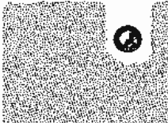

###### 「刷卡消費」累積紅利點數

缺乏自制力的人不可以使用「信用卡」。不用說大家也知道，這是一個非常重要的大原則！請讀者務必堅守這個原則，並且繼續往下看下去。

倘若你是「一個能夠確實做到自我管理的人」，那麼，凡是每個月固定要支出的費用，通通「用信用卡支付」，可說是個聰明的用錢方法。為什麼呢？因為刷卡消費所帶來的「紅利點數」，也有不容小覷的一面。

信用卡留一張就好，這樣才能集中火力有效累積點數。而且，金額越大宗的消費，越值得用信用卡付款。

比方說房租。每個月以刷卡方式支付房租，長期下來也會累積到一笔可观的點數。又如電話費、水電、瓦斯費，以及有線電視的收費……等，所有的支出都用信用卡解決，而且盡可能用同一張。（注7：有關信用卡扣款授權的說明，詳見一一三三頁）

如此一來，行動電話月租費之類的支出，光靠刷卡的紅利就可以完全折抵了。

無論如何，我必須再耳提面命一次，只有能夠確實做好自我管理的人，才可以使用信用卡。

而沒有辦法做到自我管理的人，手上有了信用卡又會如何呢？

自我管理不佳的人，他手中的信用卡會像斷線的風筝一樣，完全無法控制。只要看到自己喜歡的東西，就刷卡購買，到時候繳不出錢來，便只繳最低應繳金額，如此不停重複，卡債也越滾越大。

只繳最低應繳金額的刷卡方式，繳清後的成本將遠大於當初的消費金額，實在是非常大的損失、非常危險的做法。

說它是通往錢坑的入口，一點兒也不為過。

###### 做個聰明的「用卡人」！

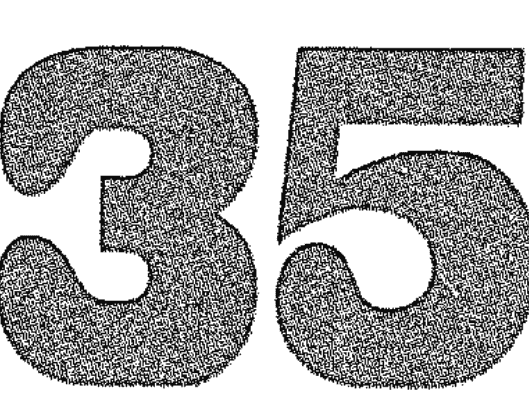

###### 每天早上到銀行「刷本子」

你知道自己每天花多少錢嗎？

為了掌握數字、確實做好財富管理，記帳絕對是有必要的。每天回到家以後，應該打開錢包，數一數裡頭還剩下多少錢，然後紀錄在記事本上。

我個人還有一個比上述的手動記帳方法更簡單的秘技。（不過，這個秘技適合對金錢具有高度自我管理意識的人）

每天早上帶著存摺到銀行的ATM，先把錢包裡剩餘的錢全部存回戶頭，再領出當日的預算金額。（注③：關於ATM功能說明，詳見一一三頁）

這一存一提都會在存摺上留下紀錄，我們根本不需要數錢包裡還有多少錢，也不需要花時間做紀錄！腦袋還算靈光吧？

事實上，我是從一位事業做得有聲有色的朋友那兒學到這個方法的。

到銀行的ATM存提款是他每天早上必做的例行公事。一早前錢包裡沒花完的錢存進戶頭，再領出一天的預算三萬九千日圓。

為什麼預算是三萬九千日圓呢？朋友說三九的（日文）發音與「Thank you」相近，取諧音搏個好兆頭。再者，他常搭計程車，需要比較多的千圓紙鈔，所以就定了這麼一個數字。

每個人每天的預算金額當然沒有必要跟他一樣。

何不就自己的情況自行規劃預算，依樣畫葫蘆向我那位朋友學習呢？

每天早上「先把錢包裡剩下的錢存進帳戶」，「然後再把錢領出來」，這正是學習的重點。

透過「刷本子」的動作重新喚醒我們對金錢的重視，好用全新的心情迎接金錢。

###### 養成「刷本子」的習慣，刷新我們對金錢的愛意！

###### 讓成功自動來敲門!

##### （工作的習慣）

想要「賺大錢」，必須具備哪些條件呢？
- 除了能力、體力之外，
- 最重要的莫過於我們的心態。

倘若心態不正，
任憑你再積極努力，財富也不會親近你。
你抱持著何種心態面對工作呢？

###### 36 做一個「有志之士」

金錢就是變形的「謝謝」。
金錢變成感謝的象徵，從一個人的手中傳遞給另外一個人。
金錢變成「感謝狀」，答謝你在工作上的付出。

「謝謝你為我們做出那麼好的產品！
「謝謝你給我們賓至如歸的服務！」
許多多的「謝謝」被說出口的時候，意謂著金錢正不斷地在循環。
反過來說，假如有一個人一天到晚抱怨：「手邊怎麼老是沒錢？」「可以想見這個人很少得到別人的感謝。不被感謝的人，誠屬可悲。
因為他在工作上的表現幾乎得不到別人的認同，沒有人願意向他說：「謝謝！」
有多少人都會感謝你正在做的工作呢？
你的財富盡在此。

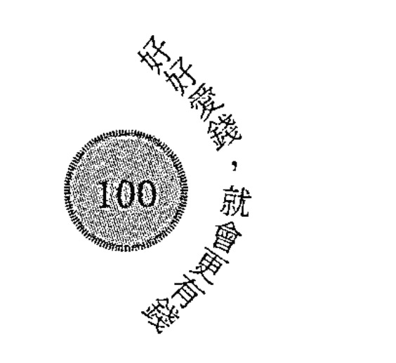

日文的「働く」是工作的意思，讀做Hara hara。Hara 在日文裡，漢字寫做「傍」，hara 的漢字是「樂」，「働く」也是讓旁邊的人快樂的行為。「為了讓某些人幸福、為了看到某些人的笑容。」「為了讓所有和自己有關的人幸福，我們挺身而出工作。」「為了讓所有的人幸福！」你若能夠懷抱著這種「志向」，財富自然會靠攏過來。邁向工作人生的第一步，就是要懷著遠大的志向。

金錢是「感謝狀」。做讓大家歡喜的工作吧！

###### 37 養成「零錢捐」的習慣

真正成功幸福的人，都有一個共通點。
- 他們喜歡「樂捐」，一向默默行善。
- 而且，他們的說法都相當一致。
  「每次捐錢以後，就會有令人感到不可思議的好業務找上門來。」

這並不是要大家希望有好工作的時候，就趕緊去捐錢。事實上，每個人捐款的對象和金額都不一樣，他們也很纳闷為什麼捐款之後，總會得到超過捐款金額以上的業務？
這究竟是什ㄅ魔ㄎ呢？

能夠樂捐的時候，經濟上必然相對穩定，心靈上必定溫柔善良，本人因此有比較多的心力，可以激發出比較好的創意，同時擁有良好的人際關係！
像這樣的人當然也會受到幸運之神的眷顧！

明白了其中的緣故以後，我們可以反過來利用這個循環。

**養成樂捐的習慣，為我們召喚幸運。**

講到樂捐，沒有必要打腫臉充胖子。

便利商店的收銀檯旁邊不是都有一個募款箱嗎？找零以後，我們可以把零錢投進去，就算投一塊錢也無所謂。

「只投一塊錢好嗎？太丟臉了吧？會被人笑啊！」
一點兒也不丟臉！連一塊錢都不肯捐的人，有什麼資格取笑別人呢？

帶著「回饋社會」的心，讓金錢離開錢包，出去環遊世界吧！

###### 用錢包「回饋社會」！

###### 擁有二個以上的收入來源

佛教有「身」、「口」、「意」的說法。

- 「身」是指如何行動？
- 「口」是指如何表達？
- 「意」是指做何思考？

「思考」、「言語」以及「行動」三者如出一輀，就是一種幸福的生存方式。
當三者之間沒有任何落差，只有和諧、一致時，可說是來到了幸福的頂峰。

然而，世上有很多人做的不是心裡想的事，說的也不是真心話。
譬如，言不由衷地說：「全部都被協理說中了，協理果然是協理！」
特別是完全倚賴一個收入來源的人，只會設法死守住這個來源不放，也因此使自己的身、口、意產生很大的不一致。
「萬一少了這筆收入的話……。」諸如此類的想法經常驅使本人為五斗米折腰，迫使本人不得不看付給他酬勞者的臉色，成天生活在提心吊膽之中，人生盡是無奈。

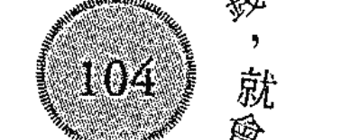
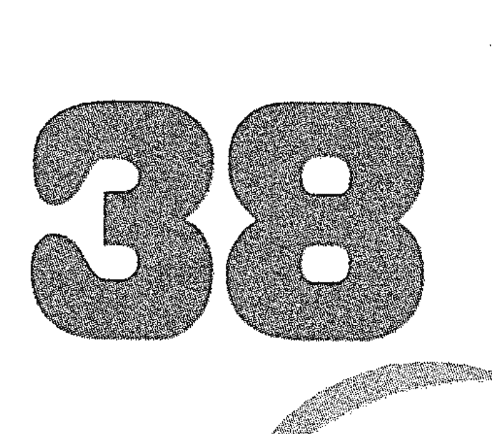

請讓自己擁有二個以上的收入來源吧！

即使是公司明令禁止兼差的上班族，也可以利用網路做網拍等，賺點零用錢，不是嗎？

當然，無論兼何種差都不能夠影響到正業。

只要有其他的收入來源，即便不多，也能不必仰賴社會和他人，真正做自己，選擇自己想要的生活方式。

當我們擁有自己想要的生活之後，壓力便不再如影隨形。少了壓力，人會有更多的心力處理自己的本業，能夠更自由地發揮想像力，二者相辅相成，事半功倍，收入也就水漲船高了。

###### 請增加「金錢的入口」！

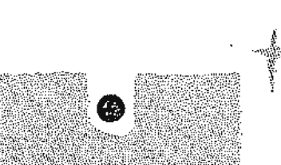

###### 39 利用「錢包」穿針引線

你不知該如何開口和別人談「錢」嗎？現在就傳授給你一個好用的祕訣。
請拿出自己的「錢包」，別忘了帶點驕傲的表情。
- 手中的錢包無論是質感還是色澤，都好的令人驕傲。
  「好看嗎？這個錢包還非常好用喔！」
- 「○○告訴我有一個好看又實用的錢包，我馬上就跑去買了！」
- 一邊拿著錢包，一邊跟對方閒聊。
- 「對了，你聽說過錢包裡的錢和錢包本身有關係嗎？」「我們平常用的錢包，要是好錢包的話，裡頭的钱就會越來越多。」趁這個機會把話題轉移到金錢上面。

以天氣做為談話的開端，怎麼談都很難切入業務或工作的話題。

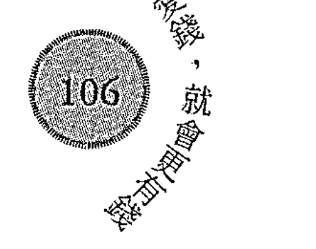

同機而動，以「錢包」做為談話的開端，接著藉題發揮，隨後自然而然就會談到與金錢及工作有關的題目。

為了提升工作運，我們必須要能夠節奏明快地和別人談錢。要和別人談錢，別忘了帶著笑容談，而且，表現要積極、態度要「溫和、大方」，這樣才能創造雙贏的局面。

碰到這種時候，正需要借助錢包的力量，使我們順利地與對方談錢、談工作。

「自從換了現在這個錢包以後，工作運突然變得很好！」我們還可以透過錢包，展現自己的工作績效於無形呢！

###### 多聊一些和「錢包」有關的事吧！

###### 談成功自助來敲門！(工作的習慣)

###### 41 給自己一個「專屬的理財空間」

由於我經營的是個人工作室，一手包辦各種和錢有關的計算及手續是常有的事。

因此，我準備了一張小小的輔助桌，遇到要處理這些作業時便移到該處。也就是說，這張桌子是我的「理財專用空間」。

我們在思考一些金錢方面的重大問題時，都不希望受到外界的干擾。

我有一位朋友到DIY商店買了一塊書桌用的桌板，又在二手商店找到了兩個箱子。他把桌板架在兩個箱子上面，形成一張桌子，做為他個人「專屬的理財空間」。

我還知道另一位朋友，特地買了一張摺疊式桌子，只有在算錢時才搬出來用。

如果沒辦法挪出空間專供處理金錢時使用，可以試著仿效上述的例子，讓意識感覺自己置身在一個專用空間。

無論是處理帳單、收據，或是整理錢包、核對帳務、查看存簿、收存發票……等等，只要和金錢有關的事，都應該在整潔的桌面上進行，不該出現在桌面上的雜物當然要盡量排除。

有的人習慣利用餐桌做這些事。在餐桌的話也無妨，不過，要確實將桌面擦拭乾淨。另行舖上一塊漂亮的桌布，也是個不錯的變通方法。

餐桌還得收拾乾淨才行，千萬不要出現醬油瓶、筷子籠……等不相干的物品！

總而言之，處理金錢方面的事物時，敏感度很重要。

我從周遭很多成功者的身上印證了一句話：「越是尊敬金錢的人，越能賺錢。」

###### 為自己準備一處「專屬的理財空間」吧！

###### 41 把「上網」變成一種投資

沒日沒夜的打電動、黏著電視消磨一整天⋯⋯。完全把時間浪費在這些事情上的人，一定要花錢投資某些設備。那就是買一台最新的「筆記型電腦」以及「平板電腦」。

既然有時間打電動、看電視，何不把這些時間拿來上網？前往某個網站收集業務相關資訊，或上「YouTube」收看和自己工作有關的影片，遠比打電動、看電視得有建設性，不是嗎？

以前說到上網，非得坐在書桌前盯著笨重的電腦不可。現在的筆記型電腦就不一樣了，不但效能與輕薄兼具，而且電池的續航力奇佳。走到哪就帶到哪，不管是公園也好、咖啡館也罷，只要是你喜歡的地方，都可以拿出筆記型電腦輕鬆連上網際網絡。

如果是平板電腦就更自由了，連躺在沙發上都能操控自如。若能善用這些產品的便利性，使用者隨時隨地都可以獲得對工作有幫助的寶貴資訊。

我大力推薦「TED」網站。TED收錄了很多各領域傑出人士的演講影片，大部分都有日文翻譯字幕，提供給我們一個非常好的學習平台！

有空檔就到TED瀏覽的人，和在網絡上閒晃的人比起來，兩者日後的收入必定產生很大的差距。（注③：TED說明，詳見一三三頁）

聰明的消費者懂得如何把錢花在「網絡」投資上。

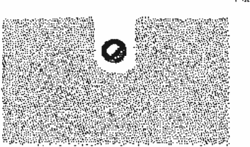

買一部「高性能筆電」和「平板電腦」吧！

###### 多利用其他「金融機構」

俗話說：「大樹底下好乘涼。」時至今日，可能要改成：「大銀行底下好乘涼」了。

或許是因爲日本的經濟前景不明，民眾充滿了不安，導致大家對大型行庫趨之若鶩。

不過，大型行庫原本就有很多優質的企業客戶，而且，不用多花心思，客戶就會自動送上門來，怪不得大型行庫一般都有不太重視個人客戶的傾向。

其實，除了大型行庫以外，我們還有其他的選擇。

首先推薦給大家的是俗稱「網銀」的「網路銀行」。

有了網銀帳號以後，只要透過國際網路，手指動一動就可以輕鬆完成匯款、轉帳等動作，不僅省時、方便，而且手續費也有優惠。有些網路銀行還採用「動態密碼（One Time Password，亦稱為一次性密碼）」系統，客戶每次操作時產生的密碼都不一樣，大幅提高使用上的安全性。（注⑩：台灣網路銀行說明，詳見一一三三頁）

網路銀行值得我們利用，請不要因為對網路交易的安全性存有疑慮便因噎廢食。

另一個金融機構也值得我們利用，那就是地域性的「信用合作社」。跟大型行庫比起來，信用合作社以小額客戶居多，所提供的服務可說是無微不至，一切都是以客為尊，非常的親切。一有款項匯入帳戶，即便是少的數額，也會用電話通知存戶。（注10：台灣信用合作社說明，詳見一三四頁）

能夠讓我們放心把錢交給它保管的金融機構，並非只有大型行庫而已，還有其他很多金融機構值得我們研究評估。

對受薪者來說，這是一個很重要的心態。

###### 試著做「網路銀行」和「信用合作社」的客戶！

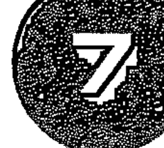

###### 讓金錢更愛你！

##### (儲藏幸福的習慣)

富有，不一定幸福。

不過，哪兒有幸福，財富也會往哪兒去。

所以，你需要時時刻刻「都有好心情」。

現在就有好多、好多的事物，可以讓你立刻擁有好心情。

###### 怎能不讀「理財書」？

「錢要是能夠自動送上門來，不知道該有多好……」

從來不「讀」理財書，卻想要財源滚滚而來，這不是癡人說夢嗎？人生只有付出自己的精力和時間，才能得到回報。

如果你想要比現在更有錢，就必須撥出時間，確實從「學習理財」開始。

有錢人最大的秘密，是他們知道許多和理財有關的事。

這些事不僅是省錢技巧而已，包括了稅金、保險、利率、借款……等等，和實質上的經濟結構有關的知識，我們應該重新學習。

- 我們可以從閱讀財經雜誌或理財書籍著手。
- 圖書館有很多淺顯易懂的財經書籍，不想買的人不妨利用圖書館的資源。
- 其次，要積極吸收熟悉理財等相關業務者的經驗。
- 碰到不明白的地方，必須踊躍發問、聽取建議。

提醒你注意一點！我們絕不能從頭到尾只仰賴一個人的意見，因為你無法確認對方是否誘導我們走向對他有利方便的著陸點。

銀行行員、證券營業員、壽險業務員、財務規劃師…‥等等，都是可以讓我們請教的人，每個人都應該擁有八位能夠提供理財建議的專家。

不單單是理財這個項目而已，對任何人來說，「學習」都是一輩子的事。帶著笑容，用興奮、歡喜的心情一起快樂學習吧！

###### 想要理財，請養成「學習」的習慣！

###### 知「足」

人真是不可思議，不管錢賺得多或賺得少，日子都過得下去。理由很簡單，只要收入能夠負擔實際的支出就辦得到了。

年收入有二百萬日幣的人，住在經濟能力所及的公寓裡，在二百萬的範圍內建立自己的生活。

年收入有二億日幣的人，「買了一艘遊艇，為了停一個比較好的港口，沒想到得花更多……。」「錢賺得多的人，也是花費不省。結果，無論收入有多高，永遠都覺得少了點：「哎，錢要是能夠再多一些，不知該有多好……。」

京都的龍安寺有一個石製的「洗手槽」，上面刻了四個有趣的文字。水槽的中央有一個像「口」字的蓄水孔，這個口子與上下左右四個文字共用偏旁，組成了「吾唯足知（我只知道人要知足）」。釋迦牟尼佛說：「知足者雖貧亦富，貪得者雖富亦貧。」這個水槽透過圖案化的方式，可說是將釋迦的「知足心」闡釋得淋漓盡致。

真正富有的人，從來不會為財物焦慮發愁，也不會為金錢惴惴不安。

真正富有的人，只看「自己擁有的」，從來不會去想自己沒有的。

###### 感謝「自己擁有的一切」！

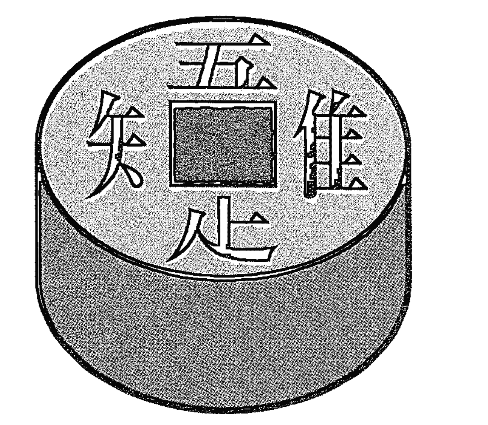

###### 45 「珍惜當下」，樂在其中

我有兩位朋友，他們的生活方式剛好成對比。

朋友甲是一位年收入超過一億日圓的男性。因為高所得的緣故，每年繳納的稅金都超過五萬日圓，再加上只要遲繳一天，就要被加徵滯納金，因此，每到報稅季節，朋友甲就會為該怎麼繳稅大傷腦筋。他總是短缺五百萬日圓，只好四處向朋友借錢周轉，好不容易才趕在最後一刻完成繳稅。

雖然朋友甲很會賺錢，但他卻一天到晚追著錢跑，為錢焦頭爛額、暴跳如雷。就連迪士尼樂園的遊行隊伍通過他的面前時，依舊緊握著行動電話不放，對著電話的那一頭大發雷霆、咆哮指責！

朋友乙是派遣公司的女職員，年收入大約二百五十萬日圓。她一個月實領二十萬日圓，每個月都會撥三萬日圓到定存，她還在自已非常喜歡的花店打工，一年下來也存了將近五十萬日圓。

她利用家裡的陽台種了一些香草。有時候，她會泡一杯香草茶享受悠閒；

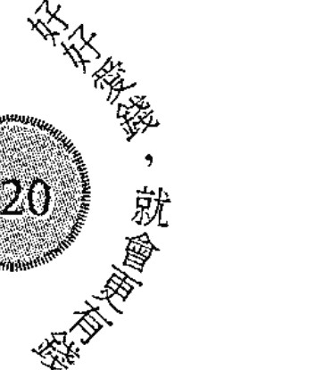

有時候，她到附近的公園散步、欣賞有趣的照片。她的臉上總是掛著笑容，從從容容地度過每一天。

說完了。你認為哪一個才是富有的人呢？是每年負五百萬日圓的朋友甲？還是每年正五十萬日圓的朋友乙呢？

答案絕對是後者。

如果每個月都要花好幾百萬，縱使有能耐一年能夠賺好幾千萬，內心也會一直有不安感：「萬一有一天沒錢花……。」像這樣的人一點兒也不富有。

做一個能夠用全體會「當下」、珍惜眼前一切的人吧！

###### 不要變成「為錢提心吊膽」的人！

###### 描繪「金錢前方的願景」

來一道填空題。
「人們想要的不是金錢，而是______。」
請問空格裡要填入哪一個詞呢？

答案是「自由」。其實，我們希望擁有的並不是金錢本身，我們只是想要求自由而已，想要一種愛怎麼花錢，就能怎麼花錢的自由。

- 假如有很多錢的話，等於有了環遊世界的自由。
- 假如有很多錢的話，就可以隨心所欲地買自己想要的房子，自由自在把它改造成自己想要的樣子。

金錢並不是目的，只是獲得其他東西的手段而已。

金錢之於人生，就如同氧氣之於身體一般。

沒有氧氣，人活不下去，人絕對不能缺氧。可是，人活著的目的並不是為了呼吸，同樣的，金錢也不是人生的最終目的。

「道德淪喪的經濟是罪惡，
經濟凋敝的道德是空談。」

這是二宮金次郎（本名二宮尊德）的名言。金次郎生於江戶時代，終其一生奉行儉約不淪，使貧窮的農村浴火重生。用比較貼近現在的話來講，就成了：

「少了願景的金錢是罪魁禍首，
沒有金錢的願景是做白日夢。」

這在告訴我們，金錢和願景同等重要，就像車子的兩輪一樣。
我們究竟要用金錢達到什麼目的呢？
描繪「金錢前方的藍圖」，讓財富自己靠過來！

> 用雀躍不已的心想像「自己想要用金錢得到什麼？」

###### 47 「有借有還」，還要立刻還

什麼原因會使運勢一落千丈？再也沒有比「借錢成癮」這個答案更令人扼腕的了。

現在，動不動就向銀行做消費性融資的人大量增加。這些人還沒有領到薪水就預支消費，一點兒也不認為先享受後付款有什麼罪惡感。「領了薪水馬上拿去還，又不會被催款，有什麼關係？」然而，事實真的如此嗎？

「融資」這個詞本身就大有文章，日文直接用平假名寫成外來語「キャッシング(Cashing)」，在在給人冷漠無情的感覺。融資，簡單的說，就是「借錢」。

目前，每年有將近四萬人走上自殺之路，「無力還債」是造成這些人輕生的主因之一。

所有借錢成癮的人都是從「小錢」開始借起。起初只借一萬日圓，下一次就嘗試借三萬日圓；借了三萬日圓以後，就覺得借五萬日圓也無所謂，就這樣墜入一場醒不了的惡夢。

除了房貸以外，任何的金融借貸都不應該被允許。

金融借貸只會讓實際付出的成本不斷往上攀升，有借款就應該設法早日清償完畢。

不論你是為了什麼理由欠下債務，首要之務永遠都是傾全力償還。

債務未清之前，財運是不可能提升的。

為了償還舊債，又去借一筆新債的做法，終點將會是地獄。

用自己賺的錢確確實實的還，必定有還完的一天。

切勿被「想借錢給你的人」所迷惑！

###### 只帶「撲滿（存錢筒）」也可以出遊

「最近都沒有出去玩！」

試著詢問百般無聊、抱怨連連的年輕人：「為什麼？」答案竟如此令人驚訝。

「因為沒有錢啊！出去玩不用花錢嗎？」

咦？出去玩一定要花錢嗎？

和厭惡的人共進晚餐，不管餐點有多高級、多美味，都如坐針氈。相反的，換成和自己喜歡的人在一起，哪怕吃的只是拉麵、炒飯，也會快樂無比。

快樂與否，其實取決於自己的心態。世界上有很多快樂的事，根本不必花錢就可以得到。

「怎麼可能有不花錢就可以得到的快樂？」如果你正好有這種要命的負面想法，請馬上放手，還給自己一個自由吧！

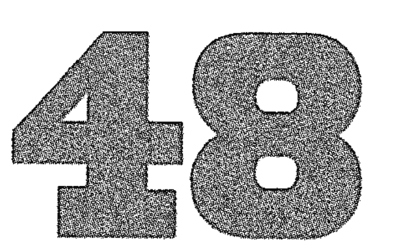

拿出紙筆列出花不到五百日圓就辦得到的快樂事情。

- 看著江戶時代的古地圖，走訪遺址片段，尋幽訪勝。
- 散一散步，然後找個地方泡個湯。
- 和朋友一起喝咖啡，天南地北無所不聊。
- 到圖書館找本喜歡的雜誌，消磨半天時光。

你可以寫出好幾件事，不是嗎？

你列出的越多，人生的深度就會跟著改變。

####### 真正的快樂躲在「不用帶錢包也能辦到的小資旅行」背後！

####### 追求「不花錢的玩樂生活」吧！

###### 和喜歡的人「談錢」

「夫妻本是同林鳥，大難來時各自飛。」啊！這句話把生活的現實面說的毫不保留。不過，事實的確如此，我們周遭不也是有很多因為錢而分手的夫妻、情侶嗎？

「什麼？原來連這種錢也捨不得花？」

「可惡，為什麼背著我偷偷花錢？」

第一次知道對方的金錢取向時，往往大受打擊。

婚前只知道對方收入頗豐、出手闊綽，婚後才知道對方負債累累、苦不堪言。

之所以會發生這些問題，全在於事前沒有弄清楚對方的「金錢觀」所致。

夫妻倆都要上班嗎？

- 錢要存在誰的戶頭？
- 薪水、家用要由誰管？或者各管各的？

彼此的成長背景不同，金錢觀必然需要磨合。

跟喜歡的人「談錢」同等重要。

如果你難以啟齒，不妨請錢包幫個忙。

「對了，你都用什麼樣的錢包？你看我的⋯⋯。」

用錢包做開場白不失為一個好辦法，藉著錢包開誠布公地陳述自己對金錢的看法。

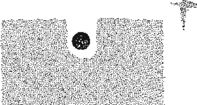

####### 打開錢包，讓對方了解「自己對金錢的看法」！

## 結語

「別急別急，時間還多的很。」

不把時間當做一回事的結果，就是一轉眼截止日曆迫在眉睫。

「下個月要開始減肥，這個月就大吃特吃吧！」

太過姑息的結果，就是站在體重計上面時，被自己的體重重重一擊。

說到金錢管理，無論是與時間管理或與體重管理，都非常相似。

我們可以斬釘截鐵地說，只要是對金錢漫不經心的人，都有做不好自我管理的傾向！

正因為如此，我們才要藉由重新檢視錢包的動作，解決人生的課題。

以「錢包的習慣」為突破口，其他人生問題自然會像推骨牌一樣迎刃而解。

有讓你「想要嘗試看看」的習慣嗎？哪怕只有一個，也是機會。

請從小小的「錢包的習慣」跨出第一步。跨出了這一步，你的事業、愛情、人際關係……等等，還有一切的一切，都將開始朝向好的發展，你的財富也會在不知不覺中增加。

請一面體驗如此令人歡喜又令人驚異不已的效果，一面實踐四十九個「錢包的習慣」吧！

我確信「錢包的習慣」才是改變你一生的契機。

習慣的專家 左藤傳

## 編輯注

**P.20**

- 注1：福澤諭吉為日本明治時期的著名思想家，是知名私立大學慶應義塾大學的創辦人，為明治六大教育家之一，對明治維新運動影響深遠。其肖像被印在日本最大面額的鈔票——一萬圓紙幣上。

**P.37**

- 注2：日本神社或寺廟提供給民眾祈求的護身符和各類招福物只有一年的有效期，而古禮納所就是一個讓民眾把去年求得的護身符等拿回來燒掉的地方。

**P.45**

- 注3：哥多華皮革指的是馬臀皮鞣製而成的皮革，由於西班牙哥多華大多出產此類皮革，故稱為哥多華皮革。

**P.49**

- 注4：樋口一葉（一八七二～一八九六年）為日本十九世紀著名的女小說家，是日本五千圓鈔票上的人像；柴武部（生卒年不詳）為日本鉅作《源氏物語》的作者，是日本二千圓鈔票上的人物之一。
- 注⑤：日文「青蛙」的發音和「回來」的發音一樣，所以取同音做隱喻，意在祈盼金錢快快「回來」。
- 注⑥：野口英世（一八七六～一九二八年）為日本的病理學者，是日本一千圓鈔票上的人像。

**P.62**

- 注⑥：日圓硬幣分五百圓、一百圓、五十圓、十圓、五圓和一圓六種，硬幣上的圖案由大至小依序為竹葉、櫻花、菊花、平等院、稻穗、樹苗等圖案。

**P.94**

- 注⑦：在台灣，水電、瓦斯、電信費屬於公共事務費用，可直接向發卡銀行辦理信用卡授權，有線電視費用則必須洽當地有線電視業者索取授權書；至於房租，讀者們可以想成旅遊時的民宿費、飯店住宿費，或日租型套房費用……等，均可直接透過信用卡支付。

**P.96**

- 注⑧：台灣的 ATM 提存款機，目前只有存紙鈔的功能，尚無存零錢功能。

**P.111**

- 注⑨：TED 上繁體中文字幕的影片，大約近二○○○部，目前仍在不斷更新中，該網站網址為 http://www1.cctv.com/translate/languages/kh-tw。

**P.112**

- 注⑩：臺灣網路銀行和一般銀行一樣，都是由使用者自設一組密碼，爾後就固定同一組密碼，但可隨時更改。

**P.113**

- 注⑪：在臺灣，各家信用合作社的服務內容均不同，建議先致電當地信用合作社的客服中心，確認有無提供匯款通知服務。

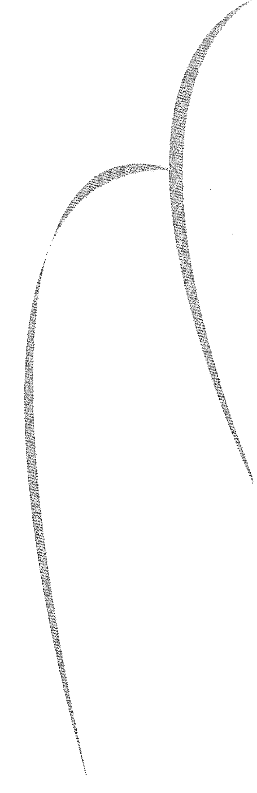

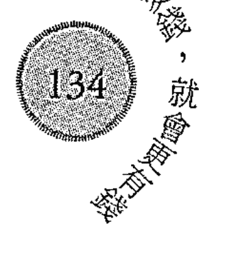

---

**《當文明成為高牆》**
為什麼生活在進步的社會卻不快樂？

◆丹尼爾．昆恩 著（美國透納小說獎得主）

◆頁數：256 頁 ◆定價：280 元

作者丹尼爾．昆恩於 1991 年以《大猩猩對話錄》獲小說透納獎，其嶄新的生態觀、世界觀和對人類文明的顛覆解讀，引起了美國社會極大的迴響和省思，因此有人形容他是「當今世紀最偉大而且最有洞見的思想家」。他以絕妙驚人的說服力、清晰睿智的論證，探討如何避開文明中毫無意義的競爭，字字珠璣、言簡意賅的見解，讀來令人冷汗直冒卻又無法罷手。

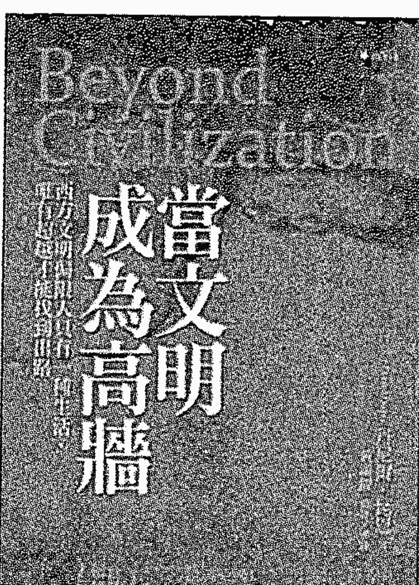

**《鷹飛基隆》**
台灣最美的四季賞鷹祕境

◆陳世一 著（自然觀察者）

◆頁數：224 頁 ◆定價：450 元

本書一針見血道出猛禽性老鷹在台灣的處境；文字不是文藝派的奇思妙想，只是純然率直地想寫出旁人尚未看透的老鷹飛行美學；本書從未以生態攝影書自居，可是每張照片都捕捉到老鷹生命之舞的靈魂本質；作者鮮少將生態教育掛在嘴邊，怎知字字句句都表達了愛老鷹的人道關懷見解；這本不是生態旅遊導覽書，卻將台灣最美的賞鳥贏勝地及隱藏版基隆港漫遊路線無私分享。

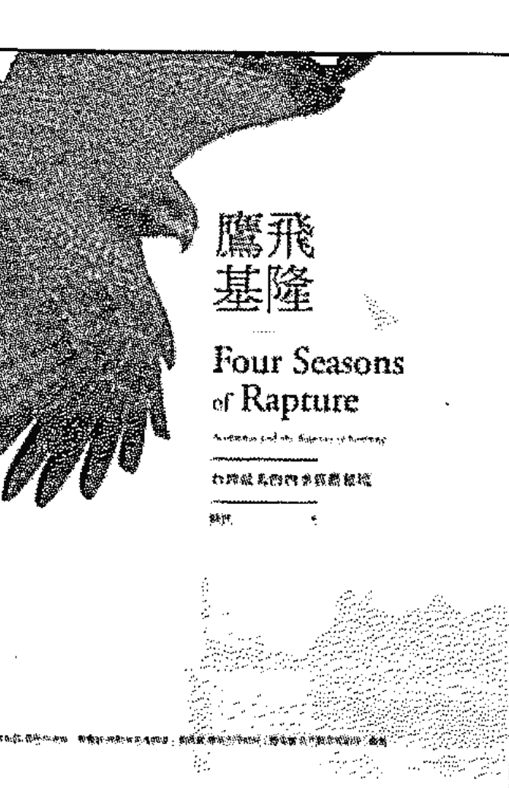

訂購專線：02-23925338 分機 16
劃撥帳號：50130123 戶名：幸福綠光股份有限公司

---

**《【彩色圖解】環境荷爾蒙》**
認識偷走健康・破壞生態的元兇
塑化劑、雙酚 A、戴奧辛、壬基酚、汞…

©社團法人台灣環境教育協會 著

©頁數：208 頁 ©定價：380 元

本書透過 40 篇輕薄短小、淺顯實用的識毒錦囊，教你輕鬆理解什麼是「環境荷爾蒙」，如何簡單安全的使用各種便利生活的化學材質！更特別邀請毒物專家陳修玲參與全書審訂，同時訪談食安、減塑生活、安全農業等各領域專家，從確保安全的標準下提供各種適合在現代便利生活的減毒生活建議，善用各種現成標章或生活知識，對毒物風險可以從容應對，不再杯弓蛇影。

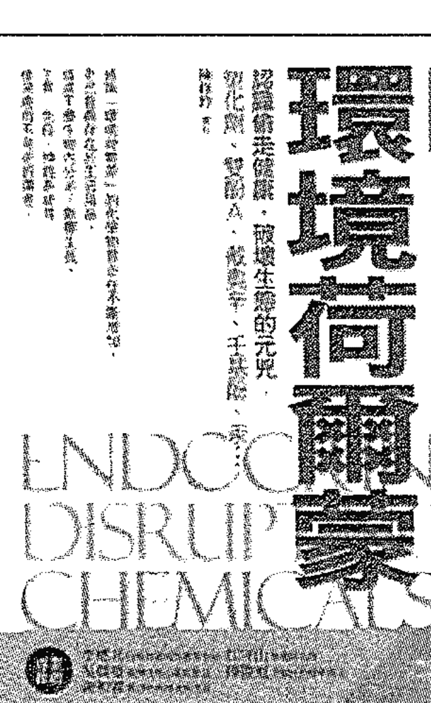

**《走讀日本森川里海》**
里山復育的行動實錄
自然環境再生，找回和諧共榮的永續生態

©日本自然環境復原協會著

©頁數：192 頁 ©定價：350 元

本書由日本環境復育專家共同執筆，內容包括日本推動自然環境復育 20 多年的復育成果，以及各地社區環境問題、復原方案。書中所呈現的案例，依照地區，分成北海道、東北、關東、近畿、四國、九州、中國、中部等八區，再依區介紹該區內的實際案例，對象主題相當多元，內容層次更加豐富。除日本案例外，本書也收錄了四個型態不同、復育成果具有代表性的台灣案例。

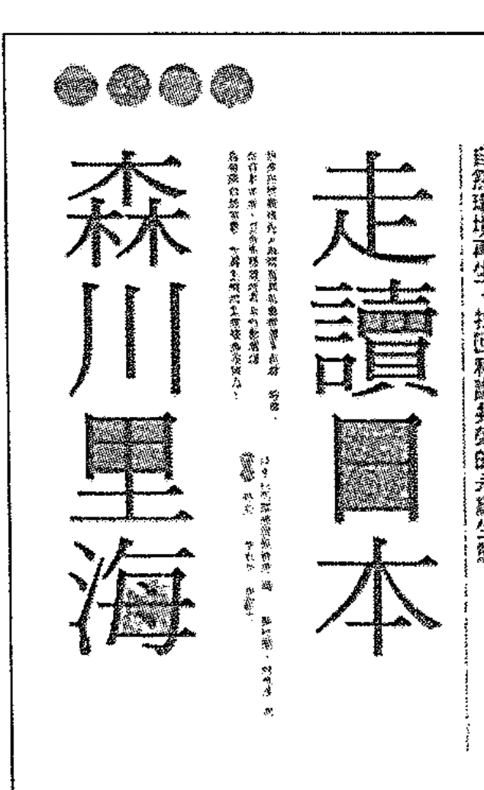

訂購專線：02-23925338 分機 16
劃撥帳號：50130123 戶名：幸福綠光股份有限公司

---

**《輕鬆自在走好最後一哩路》**
幸福全人生，生死皆自主

◎川嶋朗 著（日本整合醫療權威）

◎頁數：216 頁 ◎定價：260 元

人們為長壽付出多少代價，第一線的醫師最知道。作者目睹許多病患插滿維生管線，為多活幾天飽受折磨。不當的延命治療，讓許多人處在「想死卻不能死」的痛苦中。本書從專業醫師角度，分析各種延命治療的特性，及可能的副作用，讓人們了解這些處置的真面目。

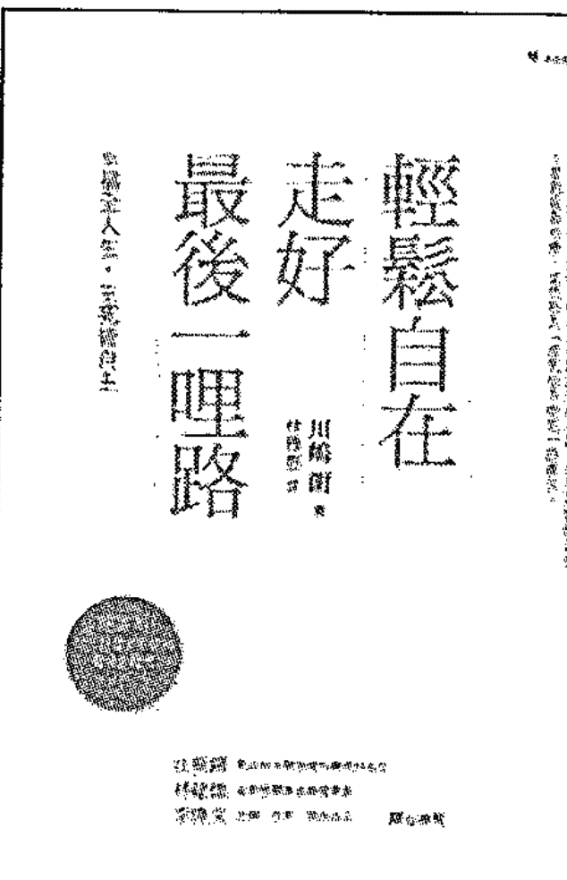

**《93 歲的老媽說：我至少要活到 100 歲！》**
朗朗照護：70 多歲姊妹，照護 93 歲媽媽的開朗自在手記

◎米澤富美子 著（慶應義塾大學名譽教授）

◎頁數：224 頁 ◎定價：320 元

本書敘述作者在照護高齡母親的海嘯中載浮載沉的過往，努力不讓自己溺斃在洪流中。但願能不覺苦、不覺難的堅持下去，讓負責照護的自己可以「樂觀開朗」，被照護的媽媽也能夠「歡喜爽朗」，雙方都「朗朗」過日。

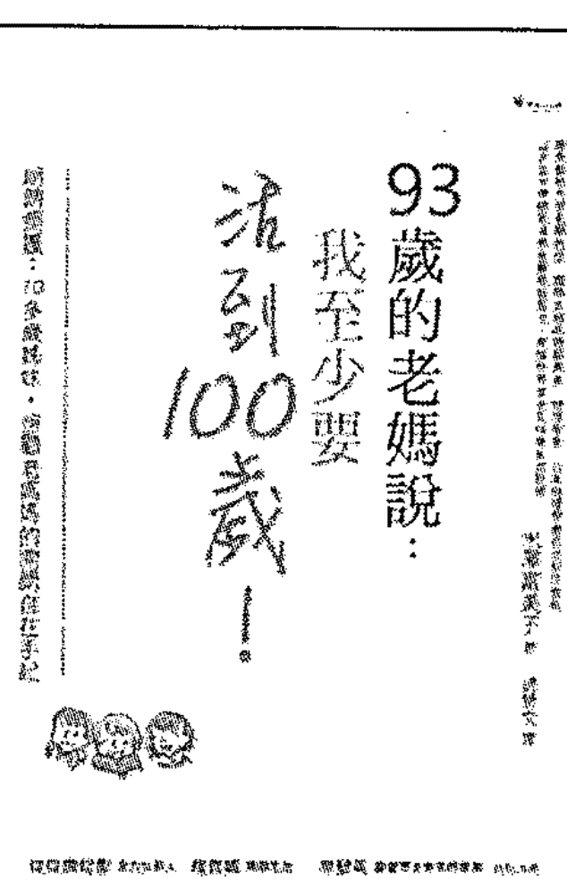

訂購專線：02-23925338 分機 16
劃撥帳號：50130123 戶名：幸福綠光股份有限公司

---

**《一個人的生活》**
雖然有點寂寞，卻獨享自在

○ORANGE PAGE 編輯企劃

○頁數：160頁 ○定價：350元 ○尺寸：17*23公分

本書內容取材自不同領域而有所成就的美食家、漫畫家、設計師、攝影師、作家等，她們分屬不同年齡層，各自因為不同的理由，過著一個人的生活。用自己所領悟的方式安排生活。雖然偶爾會有孤單、不安的情緒襲來，可是，她們異口同聲表示「不受打擾的自由時間、一個人獨享的自在空間，再再難以被取代」。

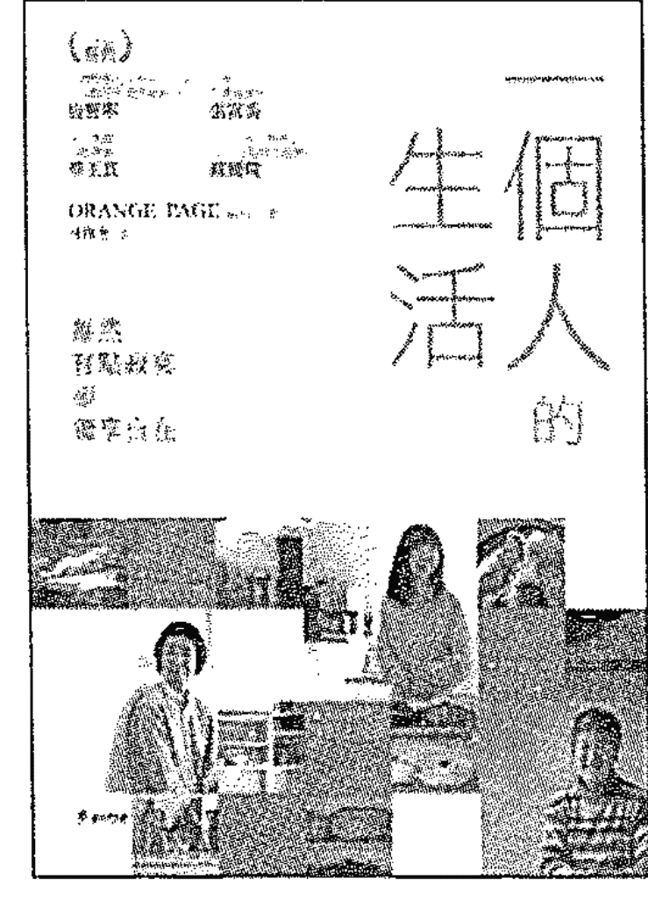

**《放手吧，沒關係的。》**
沒有低谷就不會有高山，沒有結束就不會有開始；留下真正需要，丟掉一切多餘，人生會更輕鬆美好

○枡野俊明 著（曹洞宗德雄山建功寺主持）

○頁數：288頁 ○定價：300元

所謂的「煩心事」，就是「煩惱也解決不了的事」。該放手的便放手，這樣才能把有限的人生時間美好運用。心理的慾望太多、環境雜物太多，生活就會更煩躁。選擇過簡單而從容的生活，人生將如釋重負，加倍輕鬆喜樂。

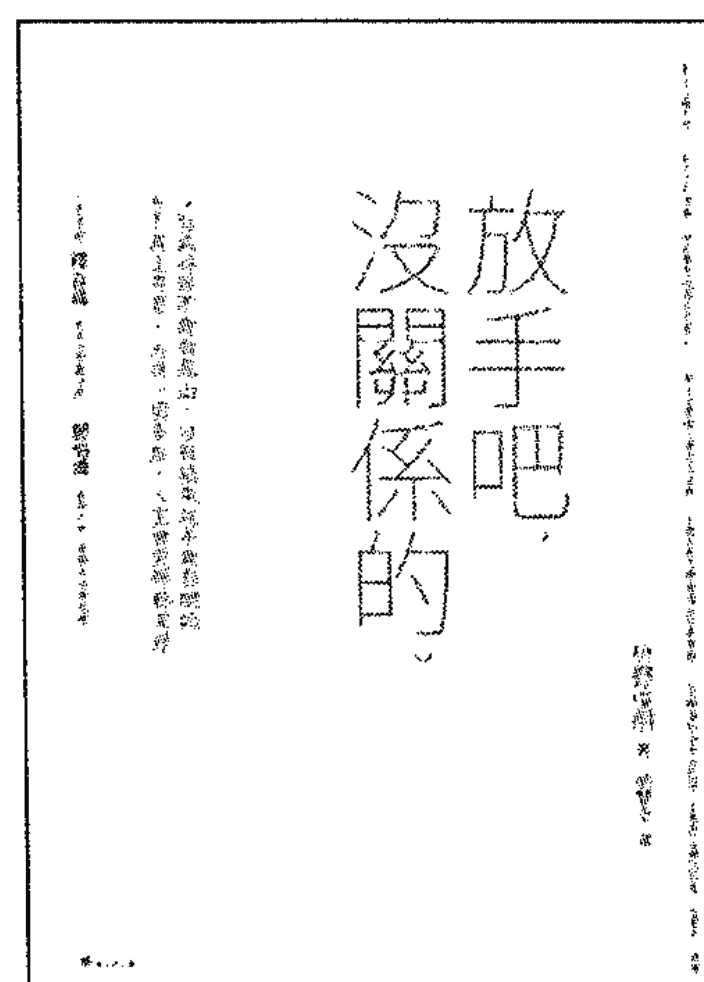

### 新自然主義 綠生活｜新書精選目錄

| 序號 | 書名 | 作者 | 定價 | 頁數 |
| :--- | :--- | :--- | :--- | :--- |
| 1 | 放手吧，沒關係的。沒有低谷就不會有高山，沒有結束就不會有開始；留下真正需要，丟掉一切多餘，人生會更輕鬆美好 | 枡野俊明 | 300 | 288 |
| 2 | 狗狗心裡的話：33 則毛小孩的療癒物語 | 阿內拉 | 250 | 160 |
| 3 | 生命中的美好陪伴：看不見的单親爸爸與亞斯伯格兒子 | 黃建興 | 250 | 184 |
| 4 | 綠色魔法學校：傻瓜兵團打造零碳綠建築（增訂版） | 林憲德 | 350 | 224 |
| 5 | 我愛綠建築：健康又環保的生活空間新主張（修訂版） | 林憲德 | 260 | 168 |
| 6 | 千里步道，環島慢行：一生一定要走一段的土地之旅（10 周年紀念版） | 台灣千里步道協會 | 380 | 264 |
| 7 | 鷹飛基隆：台灣最美的四季賞鷹祕境 | 陳世一 | 224 | 450 |
| 8 | 【彩色圖解】環境荷爾蒙：認識偷走健康・破壞生態的元兇 塑化劑、雙酚 A、戴奧辛、壬基酚、汞… | 台灣環境教育協會 | 208 | 380 |
| 9 | 綠色交通：慢活、友善、永續：以人為本的運輸環境，讓城市更流暢、生活更精采（增訂版） | 張學孔 張馨文 陳雅雯 | 380 | 240 |
| 10 | 亞曼的樸門課堂：懶人農法、永續生活設計、賺對地球友善的錢 | 亞曼 | 380 | 240 |
| 11 | 我們的小幸福小經濟：9 個社會企業熱血追梦實戰故事 | 胡哲生、梁瓊丹 卓秀足、吳宗昇 | 350 | 240 |
| 12 | 英國社會企業之旅：以公民參與實現社會得利的經濟行動 | 劉子琦 | 380 | 240 |
| 13 | 省水、電、瓦斯 50% 大作戰！！跟著節能省電達人救地球 | 黃建諎 | 350 | 208 |
| 14 | 我在阿里臺深呼吸：從地理的「阿聖臺古道」，見證歷史的「那瑪-卑南道」 | 張見 陳柏鈞 | 330 | 208 |
| 15 | 恆春半島祕境四季遊：旭海、東源、高士、港仔、滿州、里德、港口、社頂、大光、龍水、水蛙窟 11 個社區、部落生態人文旅行 | 李盈彥 張倩瑋 張見 | 350 | 208 |
| 16 | 一個人爽遊：東港、小琉球：迷人的海景、生態、散步、美食、人文 | 洪浩唐 | 330 | 190 |
| 17 | 荷蘭，小國大幸福：與天合作，知足常樂：綠生活＋綠創意＋綠建築 | 郭書瑄 | 320 | 224 |
| 18 | 挪威綠色驚嘆號！活出身心富足的綠生活 | 李濠仲 | 350 | 232 |

訂購專線：02-23925338 分機 16
劃撥帳號：50130123
戶名：幸福綠光股份有限公司

### 新自然主義 新醫學保健｜新書精選目錄

| 序號 | 書名 | 作者 | 定價 | 頁數 |
| :--- | :--- | :--- | :--- | :--- |
| 1 | 減重後，這些疾病都消失了！劉博仁醫師的營養療法奇蹟⑤ | 劉博仁 | 330 | 224 |
| 2 | 吃對保健品②天然篇：江守山醫師教你聰明吃對 12 大天然保健品 | 江守山 | 330 | 224 |
| 3 | 好眼力：護眼、養眼、治眼全百科：百大良醫陳瑩山破解眼科疑難雜症 | 陳瑩山 | 330 | 224 |
| 4 | 筋骨關節疼痛防治全百科：有科專家游敬倫整合中西醫學最新對症療法 | 游敬倫 | 330 | 224 |
| 5 | 腎臟科名醫江守山教你逆轉腎：喝對水、慎過毒、控三高 | 江守山 | 330 | 280 |
| 6 | 完全根治耳鼻喉疾病，眩暈、耳鳴、鼻過敏、咳嗽、打鼾：劉博仁醫師的營養療法奇蹟 | 劉博仁 | 330 | 240 |
| 7 | 情緒生病，身體當然好不了：黃鼎晟醫師的心靈對話處方 | 黃鼎晟 | 330 | 240 |
| 8 | 健檢做完，然後呢？從自然醫學觀點，拆解數字真相，掌握對症處方，找回健康！（附 CD） | 陳俊旭 | 350 | 272 |
| 9 | 動動腳趾頭：1 分鐘拉腳趾健康法 | 松藤文男 金井一彰 | 280 | 176 |
| 10 | 挺起胸伸直背：1 分鐘脊椎矯正健康法 | 酒井慎太郎 | 280 | 184 |
| 11 | 顧好膝關節：1 分鐘關節囊矯正健康法 | 酒井慎太郎 | 300 | 224 |
| 12 | 轉轉腳踝：1 分鐘足穴位健康法 | 福辻鋭記 | 250 | 128 |
| 13 | 1 分鐘治好腰痛：50,000 人親身見證，最有效的腰痛改善法 | 小林敬和 | 280 | 192 |
| 14 | 都是自律神經惹的禍【體重篇】：自律神經專家郭育祥的健康瘦身必修學分 | 郭育祥 | 320 | 256 |
| 15 | 安心好孕：江守山醫師教你遠離毒素，健康受孕、養胎、坐月子 | 江守山 | 192 | 350 |
| 16 | 如何挑選健康好房子【增訂版】：江守山醫師的安心選屋指南 | 江守山 | 272 | 420 |
| 17 | 不運動，當然會生病！【增訂版】：游敬倫醫師的極簡運動療法 | 游敬倫 | 288 | 360 |
| 18 | 你的聽力受損了嗎？台灣將近 10% 人口聽力受損！ | 余仁方 | 208 | 220 |
| 19 | 體態決定你的年齡：黃如玉醫師的脊骨平衡逆齡手冊 | 黃如玉 | 202 | 350 |

訂購專線：02-23925338 分機 16
劃撥帳號：50130123
戶名：幸福綠光股份有限公司

## 好好愛錢，就會更有錢
改變錢包的習慣，瞬間提升金錢運
（原書名：瞬間提升金錢運）

**作者** 佐藤勝
**譯者** 林雅惠
**特別企劃** 胡慧文
**版型設計** 陳瑪馨
**排版** 洪祥閎、柯妙嚀
**總編輯** 蔡幼華
**責任編輯** 何喬
**編輯部** 王桂淳
**編輯顧問** 洪美華
**行銷** 莊佩璇
**讀者服務** 黃麗珍、洪美月、巫毓麗

**出版** 新自然主義
**地址** 幸福綠光股份有限公司
**地址** 台北市杭州南路一段 63 號 9 樓
**電話** (02)2392-5338
**傳真** (02)2392-5380
**網址** www.thirdnature.com.tw
**E-mail** reader@thirdnature.com.tw

**印製** 中原造像股份有限公司
**初版** 2013 年 5 月
**二版** 2018 年 4 月
**郵政帳號** 50130123 幸福綠光股份有限公司
**定價** 新台幣 200 元（平裝）

Saifu no Shukan
©Den Satoh/Gakken Publishing 2012
First published in Japan 2012 by Gakken Publishing Co., Ltd., Tokyo
Traditional Chinese translation rights arranged with Gakken Publishing Co., Ltd., through Keio Cultural Enterprise Co., Ltd.

本書如有缺頁、破損、倒裝、裝訂錯誤，請寄回更換。
ISBN 978-986-96117-2-5

**總經銷：聯合發行股份有限公司**
新北市新店區寶橋路 235 巷 6 弄 6 號 2 樓
電話：(02)2917-8022 傳真：(02)2915-6275

**國家圖書館出品書預行編目資料**
好好愛錢，就會更有錢：改變錢包的習慣，瞬間提升金錢運 / 佐藤勝 著；林雅惠譯.-- 二版. -- 台北市：新自然主義，幸福綠光，2018.03
面： 公分
ISBN 978-986-96117-2-5(平裝)
1. 成功法 2. 財富
177.2
107003274

### 新自然主義 讀者回函卡

書籍名稱：《好好愛錢，就會更有錢》

- ■ 請填寫後寄回，即刻成為新自然主義書友俱樂部會員，獨享很大很大的會員特價優惠（請看背面說明，歡迎推薦好友入會）
- ★ 如果您已經是會員，也請勾選填寫以下幾欄，以便內部改善參考，對您提供更貼心的服務
- ⊙ 購書資訊來源： □逛書店 □報紙雜誌廣播 □親友介紹 □簡訊通知 □新自然主義書友 □相關網站
- ⊙ 如何買到本書： □實體書店 □網路書店 □劃撥 □參與活動時 □其他
- ⊙ 給本書作者或出版社的話：

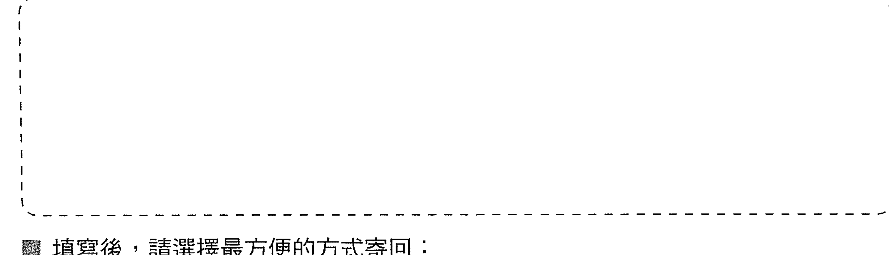

- ■ 填寫後，請選擇最方便的方式寄回：
    - （1）傳真：02-2392-5380
    - （2）影印或剪下投入郵箱（免貼郵票）
    - （3）E-mail：reader@thirdnature.com.tw
    - （4）撥打02-2392-5338分機16，專人代填

姓名：__________ 性別：□女 □男 生日：______年______月______日
- ★ 我同意會員資料使用於出版品特惠及活動通知

手機：__________ 電話（白天）：(__________)__________
傳真：(__________)__________ E-mail：__________

聯絡地址：□□□□□ _______縣（市）__________鄉鎮區（市）
_______路（街）____段____巷____弄____號______樓之______

年齡：□16歲以下 □17-28歲 □29-39歲 □40-49歲 □50-59歲 □60歲以上
學歷：□國中及以下 □高中職 □大學/大專 □碩士 □博士
職業：□學生 □軍公教 □服務業 □製造業 □金融業 □資訊業 □傳播 □農漁牧 □家管 □自由業 □退休 □其他

#### 寄回本卡，掌握最新出版與活動訊息，享受最周到服務

加入新自然主義書友俱樂部，可獨享：

##### 會員福利最超值

- 1. 購書優惠：即使只買1本，也可享受8折。消費滿500元免收運費。
- 2. 生日禮：生日當月購書，一律只要定價75折。
- 3. 社慶禮：每年社慶當月（3/1~3/31）單筆購書金額逾1000元，就送價值300元以上的精美禮物（贈品內容依網站公布為準）。
- 4. 即時驚喜回饋：
    - (1) 優先知道讀者優惠辦法及A好康活動
    - (2) 提前接獲演講與活動通知
    - (3) 率先得到新書新知訊息
    - (4) 隨時收到最新的電子報

##### 入會辦法最簡單

請撥打02-2392-5338分機16專人服務；或上網加入http://www.thirdnature.com.tw/

（請沿線對摺，免貼郵票寄回本公司）

姓名：

地址： 市 鄉鎮 路
縣 市區 街 段
巷 弄 號 樓之

### 新自然主義

### 幸福綠光股份有限公司

GREEN FUTURES PUBLISHING CO., LTD.

地址：100 台北市杭州南路一段63號9樓
電話：(02)2392-5338 傳真：(02)2392-5380
出版：新自然主義·幸福綠光
劃撥帳號：50130123 戶名：幸福綠光股份有限公司
