# 如何开发孩子的阅读潜力

## 发刊词｜你真的会给孩子读绘本吗？

说起阅读，其实现在已经有越来越多的家庭非常重视从小培养孩子的阅读习惯了。

几乎每个有小孩子的家里都少不了各种各样精彩的绘本。

在买绘本这件事上，家长们往往也是特别慷慨，不管是成套的系列，还是经典的单册，不管是国内的还是国外的，凡是得奖的、有人推荐的、想得多的，统统都买回家，买了就安心了，尽到父母的责任了。

有时候，孩子的绘本数量甚至比大人自己的藏书还多。

如果你是一个关心孩子教育的家长，我相信你也一定花了不少时间陪孩子读绘本。

亲子共读的确是培养孩子阅读兴趣和阅读习惯非常好的途径，不过我要问你一个问题：**你真的会给孩子读绘本吗？**

在回答这个问题之前，先做个自我介绍：我是周育如，台湾清华大学幼教系主任，长期从事儿童发展研究。同时我也是两个孩子的妈妈，跟你一样，我也得从小给他们读绘本。不一样的是，我还研究观察了大量给孩子读书的年轻爸妈。

这门课分享给你的，是我多年研究和实践的结果。

关于给孩子读绘本，你可能要说了，绘本本谁不会呀？不就是把书读出来、给孩子讲故事吗？很难吗？

我给你分享一个我们曾经做过的实验。我们把家长邀请到实验室，提供故事书让他们跟孩子一起读，并且提醒他们用正常的自然的方式就好，不用因为参加实验，就要特别表现。

整个过程我们录下来分析，结果发现大部分家长讲得好生动，讲得头头是道，简直就是优秀的演员。而他们的孩子则像一名听众一样，在一旁看爸妈表演。

整个过程中，孩子的表达很少，互动很少。亲子共读变成了父母的表演时间。

你可能会说：我把故事讲得生动，有什么错吗？

生动当然比不生动要好。但你也许忘了一点：我们跟孩子亲子共读的目的是什么？并不是为了要给孩子读一百个，甚至两百个故事，而是要培养出孩子自己的阅读能力，让他将来有一天能够脱离开你，自己独立阅读。

换句话说，你给孩子读书的最终目的，是为了有朝一日不读。

但是，在我过去的研究试验中，发现大量父母，花了钱花了时间，却没有实现这个目的。跟孩子读了好几年绘本，到了孩子上小学一年级的时候，还是需要每天给孩子解释作业题到底是要他做什么。

而且，比起看书，孩子更喜欢电子产品。辛辛苦苦陪孩子读了好几年绘本，几乎白读了。

问题就出在这里——在亲子共读方面，在培养孩子的阅读能力方面，家长普遍存在着非常严重的目的和方法的错位。

那么，给孩子读绘本，和培养孩子们的阅读能力，这两者之间哪里错位、哪里不对劲呢？

我要告诉你，亲子共读不纯粹是父母给孩子讲故事，阅读能力跟听故事的能力不能画等号。

下面我给你拆解一下儿童阅读所包含的听觉、视觉、语言、认知、情绪五个方面的能力。

这些年来，随着脑科学的发展，已经有许多技术可以用来探究人类活动时的大脑反应。比如用功能性磁共振成像技术来观察人在从事某种活动的时候，哪一块脑区血氧浓度会明显升高，最终显示，那部分脑区显影就会更亮。

那么你来猜猜，孩子在阅读的时候，哪些大脑的区域发亮了呢？

你可能认为阅读嘛，就是讲讲故事看看书，所以听觉的区块会发亮，视觉的区块会发亮。

但我们的大脑研究显示，阅读绝不是那么简单，它牵涉到非常复杂的能力。

首先，当然是视觉和听觉信息的接收，大脑的视觉区和听觉区开始活化。

然后，大脑就要进一步处理和加工这些信息——我看到的是什么意思，我听到的是什么意思？所以阅读涉及的还有图像的处理、文字的解码，还有语意的提取，因此语言区就会明显活化。

同时，语意提取之后，还要有背景知识的提取。什么意思呢？通俗地说，就是需要思考，这个东西对我既有的认知体系来讲有什么关联。还要做因果判断和推理，故事才能继续下去。这时候，人的认知区块整个都发亮，整个都活化起来了。

最后，在阅读的过程中，还要有情绪的介入，还会刺激杏仁核和海马回等情绪相关的区块。所以，阅读不是只有听、只有讲，对于孩子整个大脑的活化，是全方位的。

还有研究显示，孩子在阅读时如果有成人的陪同，并进行解释和探讨，大脑的活化会更加明显。比起孩子从事一些低阶的玩玩具活动，比如排列积木，阅读这件事会牵涉到更多的复杂技能的同时运用。

这也是我们为什么这么强调开发孩子的阅读能力，因为在孩子的早期教育中，阅读对于大脑的智能发展，有超出其他的优先级作用，是非常值得父母投入去培养的能力和习惯。

那么回过头我来总结一下，阅读要牵涉到图像的处理、文字的解码、语意的提取、背景知识的提取，以及情绪的投入等等。

那么这些能力的发展，是需要你用亲子阅读来帮助孩子一步步发展起来的。

所以，高质量的亲子共读，不是简单地讲讲故事就完了，应该以提升孩子的能力为核心，尽量让说的人是孩子，读的人是孩子，反应的人也是孩子，父母不要把所有角色都抢来做。

你可能会说，“我的孩子根本不认字啊，他怎么读呢？”

在这门课里，我会一步一步给你示范，怎么调动你孩子的积极性，逐渐把阅读的主动权交给他。

按照这些方法坚持做下来，研究发现，大多数孩子都能在上小学之前认识 1500 左右的汉字。这样他日常生活的阅读的覆盖率就已经在九成以上了，他其实就已经有能力自主阅读了。

而且，他很可能已经养成了阅读的习惯，能从读书中发现无穷的乐趣。

在接下来的七节课中，我就手把手教你怎样通过亲子共读，开发孩子的阅读潜力。

前四节，我要带你来认识孩子阅读发展的四个阶段，分别是翻书期、图片期、故事期和文字期。

注意，这四个阶段，是按照孩子的能力来划分的，而不是按照年龄来划分的。

在每一阶段，孩子的阅读能力和表现都是不同的，比如在图片期这个阶段，孩子其实并没有在看字，也并不能完全听得懂故事，他就乱乱看，而且未必从第一页就开始看，而是拿起书本乱翻，翻到哪页有他喜欢的东西，他就看那个东西。

这时候你给他读绘本，可能会感到很挫折，因为他可能会表现得很不专心，这时就需要你有特别的观察和共读技巧了。

而到了下一个阶段故事期，他开始关注情节了，你的共读方式也要晋级了，需要有一些思维上的引导，来完成这个时期共读的任务。

所以这四讲，我会一一告诉你，每个阶段孩子的表现特点是怎样的，他们的能力培养重点是什么，并且手把手示范，在不同的阶段，你应该怎么做，才能提高孩子的阅读能力。

那么前四讲实际上是一个基础篇，教你怎样给孩子读绘本，怎样通过亲子共读来引导孩子自己阅读。

接下来我们进入升级篇，在第五、六、七三讲，我会教你怎样通过阅读，来发展孩子的三大能力，分别是语言能力、认知能力和人际关系及情绪的管理能力。

这三大能力都是对孩子成长至关重要的能力。很多父母都很重视，甚至花了大把力气和金钱去培养，报培训班、上早教等等。可是，这些能力并不一定要报班去学，你只要通过好品质的亲子共读技巧，加上有质量的陪伴，就可以把孩子的三大能力培养起来。

在这三讲，我会用具体的绘本来示范，怎么在阅读中提高这三大能力。相信用我的方法，你会和孩子在阅读的时候有不一样的收获。

既然已经花时间和力气陪孩子阅读了，你一定希望每一次阅读都对孩子有真正的帮助，因此我邀请你马上进入课程，学习开发孩子阅读潜力的科学方法。

### 1. 翻书期：让孩子认识“书”并爱上它

这一讲，我要跟你谈谈儿童阅读的第一个阶段“翻书期”的选书方式和共读技巧，以及如何培养孩子的阅读习惯。

翻书期，或者说**整个的儿童阅读行为应该是什么时候开始呢？**

事实上只要当宝宝可以坐在你腿上、坐得稳，就可以开始阅读了。一般来说，可能在 **6 个月** 左右。

你可能会想，**6 个月** 大怎么阅读啊？又听不懂。

的确，这个阶段的孩子其实并不会真正意义上的阅读，他们一开始拿到书会啃会撕，因为他不知道书本的功能是什么。

但是，慢慢地他们发现书上有彩色的图案，这些图案好像跟日常生活里的东西一样。所以，他们开始知道，书可以看，并且还可以一页一页地翻，就会有不同的图案出现，这就是孩子阅读的开始。

如果你坚持每天跟孩子共读一段时间，他就会发现“嗯，书和其他东西是不一样的，这个叫做‘书’的东西一出现，我爸或妈，就会把我抱到腿上，用和平常不一样的声音跟我说说话，而且说得特别多、声音又好好听哦！

然后，这个叫做‘书’的东西，上面有好吸引人的颜色和图片，而且，这个好像我看过，哦！这是一颗球、这是奶瓶、这是鞋子、这是布娃娃，我也有一只一模一样的。”

所以，孩子很快会发现，书上有的东西真实世界中也有，这就叫做表征概念。一旦开始有这个概念，他就会去留意、去观察书中的图画和真实生活中的东西到底有什么样的连接。这时，他的书本概念就出来了，这是阅读启蒙很重要的第一步。

当书本的概念萌芽，你的孩子就不再把书当作一般的玩具拿来啃拿来撕，拿来咬，他开始会察觉这是个特别的东西，而且会期待随之而来的互动。要是你观察到你的宝宝看到书会特别兴奋、会主动拿给你，你就知道他喜欢而且有新的领悟了。

注意了，一旦这样的行为出现，表示你们的第一步已经成功了，你就不要敷衍他，一定要当一回事，真的开始跟孩子「亲子共读」，跟他讲、让他玩、让他摸摸看、翻翻看、按按看，把书中的图和生活中的东西指给他看，就像玩游戏一样。这时候，其实阅读就已经开始了。

所以，总结一下，在“翻书期”，我们的目的有两个：

一是帮助宝宝发展“书本”的概念，二是培养他们对书的兴趣。

也就是说，让宝宝认识书，并且爱上它。

## 翻书期的选书三原则

那么在这一阶段，你要找什么样的书给孩子看呢？

你绝对不可能一开始就狂力说故事，因为他根本不知道你 在干嘛，所以在阅读 的早期，我给你三个选书建议：

- 第一，可以选择与小宝宝的日常生活紧密结合的书。这样更容易让孩子把 书本上的东西与现实的东西相对应，发展出书的概念；
- 第二，可以选择互动性强的书。现在的宝宝书都设计得很好，例如里面有 小机关可以翻开来，看看后面藏了什么，好比说在书里会有一个沙发，沙 发下一翻开，有只小狗躲在里面之类的，孩子一打开就好惊喜；或是有些 软软的毛、刺刺的或沙沙的触摸区，甚至有的地方按了会有声音，或是有 香香的味道。

这样的书拿到孩子面前，孩子会觉得「欸，可以摸」、「唉呦，一按有声 音」然后撕也撕不烂，就引发了孩子对书本的兴趣。还有些书，他吃饭时、 洗澡时都可以读、还可以当玩具玩，他就会喜欢、对书这个东西建立起好 感。

- 第三，选择结实耐撕、安全无毒的书。这个时期的宝宝会把书拿来啃，所 以最好是那种撕不破的、可以啃、可以玩的纸板书、布书、塑料书等等。 另外还要注意安全无毒，这样宝宝摸到了或者放进嘴巴里也没有关系。

## 共读技巧：多感官投入、多互动、多重复

和小宝宝共读的时候，你要把握三个原则：多感官投入、要有互动，多次重复。

第一个原则，「多感官投入」。这很容易理解，就是听、看、摸、闻、操作，想得到的感官全部一起来就对了。你读个几句或几个字，就要停一下，让宝宝看一看、玩一玩，甚至唱几句歌，让他用他这个时候可以做得到的方式进入书本的世界。

第二个原则是「要有互动」。意思是说，要让宝宝有参与感、有事可做。例如你可以比著书说「看！这里有只小狗」、「汪汪汪！」然后你在头上比个耳朵，对宝宝「汪汪」几声，或假装咬咬宝宝。下次讲的时候，你讲到小狗，就让宝宝讲「汪汪汪！」或让他用手假装咬咬你。

透过动作也好、手势也好、拟声词也好，目的都是让孩子在阅读的过程中成为一个参与者，阅读的乐趣才会持续。

讲到这里我要提醒你一下，**不要有过度期待**。有些父母以为，我开始陪宝宝共读了，宝宝就会配合我演出完美的亲子共读感人大戏，其实这样的想象几乎是不可能的。

小宝宝的注意力短暂、对书也还不了解，他可能听几句就挣扎着要爬走，或是一点都不专心听你在讲，更别说一本书从头听到尾。你不要有过度期待、也不用觉得挫折。他如果专心，你就多读两下，不专心也不要勉强，一两页也好，「开始做」就是了。

第三个原则是「多次重复」。给孩子阅读不是讲很多很多本书，而是一本书讲了又讲、讲了又讲，这样才会熟悉，互动才出得来。有经验的爸妈都有体会，孩子会有几本特别热爱的书一直要你讲，讲到你都觉得这有什么好讲，都讲这么多遍了。

但，这就是孩子的需要。他需要在一次又一次的重复中，熟悉书中的语句、熟悉语言的结构、熟悉当中的概念和连结。这是打底的功夫，他的重复一知道理解出来了，他才会和你讨论，向你发问。

所以，不要觉得烦，就陪着他一次次重复，当孩子听满足了，理解足了，到时候可以换本书了，他会让你知道的。

## 尽早养成阅读习惯

最后，我要来谈一谈孩子的阅读习惯如何养成。之所以要在“翻书期”这一讲里谈这一点，是因为阅读习惯的养成，很重要的一点就是，尽早开始。

为什么我们一直强调养成阅读习惯那么重要？而且还要从小培养呢？因为视觉和听觉是人类最强势的感官，一旦你的孩子习惯电子产品的声光互动效果，你很难把他拉回来阅读。

阅读要耗的脑力这么多，电子产品看起来又非常轻松，要是没有阅读习惯，孩子绝对会选容易的做，他长大之后，手机一拿就上网、就打游戏，谁跟你阅读呢？

所以，你要趁着孩子小的时候、他的大脑还在快速建构的时候，要想办法把阅读的习惯，植入在他大脑的架构里面，让他的大脑习惯阅读、喜欢阅读、熟悉阅读的处理，让他一天不阅读就觉得怪怪的，浑身不对劲。

怎么能做到呢？要注意三点。

首要一点就是尽早开始。建议 6 到 8 个月，就像前面说的，宝宝大概可以坐在你腿上、稳稳的坐着，可以陪你看个几分钟，就可以开始了，因为这个时候的介入最快速最有效，孩子也跑不掉。

第二点就是「每天都读一点」。多也好少也好，一定要坚持。一项行为在时间维度上不间断的重复累积，才会转化成内在的习惯。如果哪一天不读了，他自己就会感觉少点什么。

第三点，阅读最好是「固定时间」。比如说像我自已家里面，我习惯固定每天睡觉前讲故事给孩子听，从绘本讲到文字书，讲到有一天孩子长大了，就换他讲给我听。

而且，如果你有不只一个孩子，孩子之间还会互相讲，像我家姊姊我说了几年故事，之后就会有模有样的讲给她弟弟听。看他们姊弟俩互动的画面，很有趣，也很感动人。

如果你没办法在睡觉前念书给孩子听，或是说孩子一听故事就太兴奋、不睡觉，你也可以每天吃饱饭后陪他念念书。

这种固定时间的共读时光，会让孩子每天有个生活的期待，知道时间到了，爸妈就会陪我说故事，就像吃饭睡觉一样，是我这个小小孩人生的一部分，是天天都要做的、美好的、值得期待的事。

## 本讲小结

在宝宝 6 个月大开始，就可以跟他共读绘本了，共读的三个原则是多感官投入、亲子间要有互动、一本书多读几次。

在孩子童年 0 到 6 岁这段黄金时光，你要尽早开始共读、而且每天都读一点，然后固定时间，你就这么持之以恒的天天做，阅读的习惯就会建构在孩子大脑里了。

### 2. 图片期: 一步步把主动权交给孩子

这一讲我要和你谈谈在孩子阅读能力发展的第二个阶段——图片期, 你应该怎么给孩子共读绘本。

在试听里我提到过, 孩子阅读能力发展的四个阶段, 不是按年龄来分的, 而是按能力和表现。那么孩子有怎样的表现就说明他进入图片期了呢?

进入这个阶段的孩子, 拿到书会先去挑他觉得有趣的画面, 还会观察很多跟故事轴线不怎么有关的细节, 但很明显的, 他已经越过了乱翻乱咬的阶段, 真正对书本有兴趣了。他会仔细地看画面, 专注度出来了, 看书的时间拉长了, 你就知道, 他来到了一个新的阶段, 这是很重要的一个跃进。

但这个时候很常见的一个情况是, 孩子注意的和你注意的不一样, 父母因为懂文字, 本能的就会把焦点放在与故事轴线有关的画面讯息上。

但孩子才不管你, 他对什么有兴趣就看什么, 所以你在讲东, 他却看西, 你就生气了, 你会觉得「我都花时间陪你看书了, 你还这么不认真, 都不专心听我讲故事。」

可是你好好去看看你的孩子, 他有没有在专心看? 其实有耶, 所以这时候你要做的事情, 不是去生气, 而是去看看你孩子到底在留意什么, 然后帮助他做三件事情: 指物命名、丰富形容、口语延展。

接下来我跟你说明这三件事的具体做法。

- 第一个，指物命名。假设图片上有只狗，你问孩子，「这是什么？」「喔，狗狗」，这就是命名，很简单。
- 但只讲狗狗就好了吗？不，我们还要做第二件事，丰富形容，也就是你要去想办法去形容这只狗。你可以问孩子，「那狗狗会怎样？」「汪汪汪嘛」，所以你可以说「这是一只会汪汪叫的狗狗」，这样就够了吗？不，你还可以继续讲，「那这只狗狗是什么颜色的呢？」「喔，白色的，然后呢？小小的，胖胖的，好可爱的狗狗喔！」
- 你看，从指物命名，「狗」，到你形容它的叫声、它的颜色、它的体型，当你们对话的用词愈来愈丰富，句子愈来愈长，就已经在做第三件事，口语的延展。这时候你就已经在帮助孩子往叙事方面走了，当他有了这些能力之后，才会顺利迈入第三个阶段，你所期待的专心也就慢慢出现了。

为了让你更能现学现用，现在我就用一本书做完整示范。这本书是《好饿好饿的毛毛虫》，这是很著名的儿童绘本。

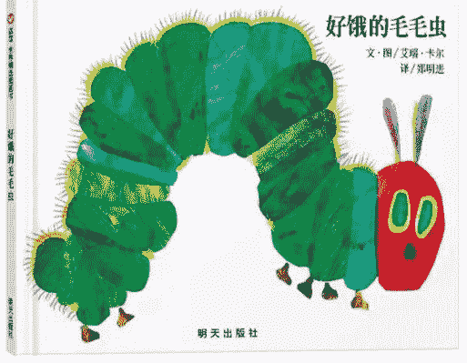

一般的父母都怎么陪孩子读这本书呢？通常是看着封面说“今天妈妈买了一本新的故事书喔，你看，这边有一只什么？喔～有一只好大的毛毛虫喔！来，我们来看里面讲的是什么。”然后就翻页了。

一本书少说也要二、三十元对吧，结果封面就这样跳过，太浪费了，每一本书我们都要物尽其用，光是封面你就可以做好多事，我来示范给你看。

我会跟孩子说：“来，你看妈妈今天买了一本新的故事书。你看这边有什么？有一只毛毛虫。那是什么样的毛毛虫？”

小孩就说“很大的毛毛虫。”

“很大，然后呢？”

“然后，呃，绿色的。”

“喔，很大，绿色的毛毛虫，还有呢？你还看到什么？”

“还看到红色的脸啊！”

“红色的脸，还有呢？”

“还有，绿色的眼睛。”

“还有呢？绿色眼睛外面有什么？”

“绿色眼睛外面还有黄色的眶。”

讲到这里爸妈还不可以翻页，还要继续问：“眼睛上面还有什么呢？”

“呃，还有触角，紫色的触角。”

“哦，紫色的触角，触角是长长的还是短短的呢？”

“长长的触角。”

“还有呢？你看毛毛虫身体下面有什么？”

“嗯，它还有脚！”

“对耶，它还有脚。我们一起来数一数 1、2、3、4、5、6 六只脚，对不对？那还有吗？”

......

你就这样，一直问一直问，孩子就会一直观察一直观察。先引导孩子去观察画面，然后带着孩子指出画面上所有东西的名称，再加上形容，包括这东西的大小、颜色、形状、数量。

当孩子每说出一点或者说出一个新的描述时，你要做的就是要先称赞他。等到孩子做了很多描述后，你也不要翻页，接着你要做一个非常重要的事，就是把孩子刚刚讲出来的所有词汇和形容，用自己的话串成完整的句子。

你就说“喔，好棒喔！你刚刚说你看到了一只好大的毛毛虫。这只毛毛虫呢，有绿色的身体，红色的脸，绿色的眼睛，眼睛外面呢，有一个黄色的眶，它还有两个紫色的长长的触角，而且它还有 1、2、3、4、5、6 六只脚，它真是一只很特别的毛毛虫！”

好，那你说我第一天这样做，明天怎么办？

第二天拿来故事书，你还是可以看着封面说：

“我们今天来比赛，妈妈先讲，然后换你讲，讲不出来的人就输啰，好，我先，绿色的身体，换你！”

“红色的脸。”

“好，换我。”

“绿色的头，6 只脚。”

……

然后就一直轮流，你会发现一次一次孩子观察的点越来越多，从一开始的一、两个到最后讲一大堆。为了赢过你，他可以对一只毛毛虫做淋漓尽致的描述，这就是口语延展最好的练习。

说到这里，你会问，这**是在干嘛呢？**这是在给孩子长大写作文打基础。我不是夸张，上小学写作文，如果一个孩子写：“这边有一只毛毛虫，好大只哦”，这样能拿几分？

如果另外一个孩子的形容是：“我看到草丛里有一只毛毛虫，它好大只，它有**绿色**的身体，**红色**的脸，它绿色的眼睛外面还包着**黄色**的眶，而且啊，它还有长长的**紫色**触角， 还有六只脚呢，这只毛毛虫真是与众不同啊。”你说，这样又可以拿多少分呢？

孩子写作的能力不会从天上掉下来，而是在你陪他共读的时候你每次都这样做，孩子观察的能力、描述的能力、串成完整语句的能力，就会培养出来。

在图片期这个阶段，除了利用图片练习指物命名，丰富形容，做口语延展，仔细观察和描述画面，那要怎么能让孩子知道，这一页又一页的画面之间是有关联的？现在我就来说明，在这阶段怎么跟孩子讲故事。

这个阶段你要有耐心，因为一本故事书，至少要讲五六遍，而且每一遍的方法还要做调整。

- 第一遍：不讨论，不发挥，逐字念。

我在给孩子第一遍讲故事的时候是不讨论的，为什么？

因为孩子第一次听故事，他对内容完全陌生，他也看不懂字，他只能听大人讲。所以第一遍讲的时候，我就会一字一句，按照书上写的，把故事从头讲到尾，“月光下，一个小小的卵，躺在树叶上……”巴拉巴拉，讲完就结束了，孩子的耐心大概也就这样。

- 第二遍，启发观察。

第二天，我又拿出相同的故事，我继续讲，可是第二天跟第一天的不同是，孩子已经知道故事的大概内容了，所以第二次再讲的时候，我会做些改变，你听听看有什么不同？

“我们来讲这个故事喔，月光下，然后呢？好，有一个小小的卵，然后呢？躺在叶子上。虫卵是什么颜色的？那这个虫卵怎么样？怎么样还记得吗？它变成一只？喔，它变成一只毛毛虫，真的吗？我们来看是不是变成一只毛毛虫，哇，真的，真的变成一只毛毛虫了，然后这只毛毛虫怎么了？”

你听得出来，这跟第一天的差别在哪里吗？第一天都是我在讲，因为孩子不知道故事嘛，可是第二天，我就边讲边问「然后呢？接着呢？什么出来了？」真的吗？发生了什么？」虽然主要还是我在讲，但是孩子已经知道内容，她就会去回答，他会帮忙补充内容。

到了第三天第四天第五天，我还是可以讲同一本书，但慢慢减少讲解，增加提问。「好，我们来讲这个故事，怎么样？喔，好，月光下，喔，然后呢？喔，这样子，然后呢，喔，然后它就肚子饿了，真的喔，那然后呢？」

你发现了吗？我越讲，内容就越少，我越到后面越不说内容了，我只负责讲连接词「然后呢」、「接下来」、「然后呢」。说故事的主角变成谁？变成我的小孩。

当小孩对故事越来越熟，我甚至可以赖皮说「今天妈妈累了，你讲给我听，你当妈妈我当宝宝，开始。」我只要在一旁「喔，真的喔，你好棒喔，你好厉害，好会讲」这样就好。

所以，这个阶段说故事的原则就是，第一次不讨论，先让孩子熟悉故事，之后一天一天重复讲，在重复中做变化，一次一次的把主动权给孩子。你只要学会这种有技巧的偷懒，就会发现，说故事的主角，从你变成了孩子。孩子原本在听你讲，现在是你听他讲。

有时候，我会开玩笑说，亲子共读就像是武侠电影里传授功夫，一个人坐在前面，一个人坐在后面推他背，把功力传过去。其实就是这个概念，你要把孩子能力培养出来，你要逐步放手。

## 本讲小结

图片期的孩子，喜欢观察他有兴趣的画面，你可以带着他观察画面、指物命名、丰富形容，做口语的延展。

在说故事的时候，第一遍不讨论，等他熟悉故事后就重复讲，在重复中做变化，在变化中把能力慢慢的放给孩子。

善用这些方式，你光是讲一本就非常值得，如果能讲个十几二十本，孩子的能力一定会出来。只要你家的孩子正在看绘本，每一本新故事，都可以用这种方法读起来。

### 3.故事期：有讨论的阅读才是好阅读

这一讲，我会跟你谈谈在孩子的阅读能力进入“故事期”以后，怎样和他共读绘本。

首先，要怎么判断你的孩子已经进入故事期了呢？你可以去观察，当你在念故事的时候，孩子还是像之前一样，爱看什么画面就看什么画面，还是开始忽略那些跟故事轴线无关的画面，而是去看跟故事有关的画面。

这是一个非常重要的指标，这个时候他会去观察主角在做什么，而不是观察配角，这就表示他开始能够留意故事，进入故事期了。

你看，我不会跟你说年龄，而是给你一些判断读信号。因为孩子成长有快有慢，阅读能力也有落差，所以你要留意观察孩子的行为，判断这个时候孩子可能进入什么时期，你要用什么方法引导。

### 口语讨论是阅读重点

一旦孩子进入故事期，这个阶段你要做两件事，第一个就是延续之前「读图期」阶段的共读技巧，也就是上节课讲的指物命名、丰富形容和口语延展。当他在看东西的时候，引导他加上描述，让他尽可能用完整的语句一直讲下去，提高孩子的叙事能力。

第二件事，就是当孩子可以专心听你讲故事，而且能够很丰富很流利的叙事之后，接下来你就要跟他进行口语讨论了。阅读不只是在做语言能力的扩展，它还有很多的理解能力和因果逻辑思考在里面，所以口语的讨论就成了这个阶段的重点。

### 共读技巧：确认理解、预测和回想、延伸讨论

那口语讨论该怎么做呢？有三个方式：

- 第一个，确认理解。你要先确认孩子到底有没有听懵，他知不知道这个故事在干嘛。
- 第二个，预测和回想。*什么叫预测？* 就是你看到这一页，然后问问孩子「接下来会怎样呢？那然后呢？你觉得之后会怎样？」这叫预测。
*那什么叫回想？* 讲完故事之后你问他「故事讲完了，这个故事在讲什么呢？你还记得多少？」所以读一本书，你可以适时的让孩子往后预测，往前回想。
- 第三个，延伸讨论。就是除了讲故事本身文本内的讯息，还可以去做天马行空的发挥。

我现在一个个详细解释给你听，如何用这三个方式来跟孩子做口语的讨论。

第一个，*确认理解*。你知道吗，孩子的认知层次有时候跟我们大人不太一样。你讲得很清楚，他却听得很模糊；或是你以为你讲的他已经了解了，他却是完全解读成另外一回事。所以确认理解非常重要，是口语讨论最基本的要求。

确认理解的方式很简单，你只要问孩子说「欸，他怎么了？他做了什么事？他怎么样？妈妈刚刚讲了这个，你知不知道什么意思？」或是孩子在听故事的过程中有问你问题，那你就去解释，帮助孩子知道这本书的故事在讲什么。

顺带提一点，有些父母会把故事中比较难的字，自行替换成简单的口语，这是不必要的。因为好的绘本和文章，字字句句都是经过推敲的，我建议你先照念，如果觉得这个词难，就问问孩子知不知道意思，如果孩子知道，就过去了，如果不知道的话，你就解释一下。

例如，故事里写「和风徐徐」，你别自己换成「有点风在吹」，意境就全没了，或是有些古典的童话会出现「寒喧」，例如王员外和李员外寒喧，老实说，孩子大概也不会听不懂，从上下文和画面，孩子总不至于把寒喧当成寒冷。

你可以暂停一下问问孩子知不知道什么是寒喧，如果孩子说大概是打招呼吧，就表示他懂了，如果不懂，就跟他解释一下。为什么要这样做呢？这样做的好处是，孩子会在阅读中不断累积新的语汇，如果你每次都先帮孩子简化，他反而就学不到新词了。

接下来，当他听懂故事之后，就可以开始做预测和回想了。你可以在故事有出人意料的发展时，问孩子说「欸，这只小熊走进森林了，我们要看下一页之前，你知不知道牠接下来会发生什么事？」

孩子可能会说他的想象。那你就可以问他「为什么牠会发生这个事情呢？你觉得呢？」让孩子往下做预测。

为什么孩子可以做预测？预测不是乱猜，而是孩子根据之前阅读的经验，根据故事里头的线索，去推测接下来的情节。所以你叫孩子去预测故事，就是让他练习整理之前得到的讯息、然后去推论的一个逻辑思考过程。

一本书孩子还不熟悉时，通常都会要求你反复讲好几次，在每次反复讲的过程中，你每次都可以问问预测的问题，你可以问问「接下来呢？你觉得会发生什么事呢？」这个步骤就是推测，同时也是复习。

当孩子熟悉情节之后，就可以把预测再进一步，改成「如果他当时不这么做，会有什么不同的结果？」或是「如果是你，你会怎么做？为什么？」让孩子试想不同的结局和可能性。这又比预测更高一层，进入沙盘推演、多角度思考的境界。

不管孩子怎么答，别批评他，可以说「真的啊，你觉得会这样啊！」你也可以顺便分享你自己的想法，你自己也来预测预测、推演推演，孩子会从你的分享得到新的领悟，于是一次一次的预测推演，他就会产生新的想法。

再往下一个策略叫做回想。就是故事讲完之后问问孩子「你还记不记得这个故事讲什么？」你叫他讲，就会发现，孩子刚开始回想的时候，他是跳跃式的。明明一个故事你是很顺的讲下来，他回想的时候，一下讲这里、一下讲那里。

这种现象不只发生在孩子身上，我们大人也是。

比如说我出去演讲，最后结束的时候，就问问现场听众说「我今天讲什么，大家可以现场回馈一下吗？」有时就会发现，大家听到的都不太一样。

最主要的原因是，每一个人的注意力本来就高高低低，专注的点也不一样，而且，每一个人理解事情的程度也不一样，所以就会出现一种现象，我讲出去的讯息只有一种，但别人听到的却是千百种，这是很自然的现象。

同样的道理，你讲一个故事给孩子听，讲完之后你问他说刚刚我讲什么，你会发现孩子说出来的点可能让你非常惊讶。

所以，「回想」这个方式可以让你知道他听到什么、他留意到什么、他为什么这样留意，他的这个回馈，不只对孩子能力非常有帮助，其实也为你提供了非常重要的讯息。

另外，别小看“回想”这件事，脑袋想和嘴巴说出来是两回事，要能回想又说出来，孩子要有好的组织能力，才能把脑袋中散乱回想到的讯息，通过口语，串连成完整的语句。

因此，一开始孩子通常是随便的点状的乱回想，想到什么说什么；慢慢地他的回想会变成线状的，甚至依故事的时序来回想；最后发展成能用口语有顺序的把故事情节完整说出来，这就说明孩子在用大脑重新整理和组织内容了。

这个过程中，仔细观察孩子的变化，你会体会到他的思考质量和口语的进步过程。

做了「预测和回想」之后，就可以进行到「延伸讨论」了。

你可以问问孩子「这本书里面，你喜欢谁？为什么你喜欢他？你讨厌谁？为什么你讨厌他？哪里让你觉得有趣？哪些地方令人难过？」问问孩子对于这个故事的想法跟感受是很重要的，因为这可以让他练习发表个人评价，这是批判性思维的起步。

表达看法和感受的能力永远是重要的，不管是拿来考试，还是写文章或人际相处，都需要这个能力。一样的，他讲了什么，你都要稍微夸张点，表示一下你的惊讶、认同和赞美，然后你也说说你的想法和感受，父母的分享会让孩子的思考质量再提升。

不过一定要记得，你分享的时候千万别长篇大论，点到为止就好。你要一直一直提醒自己，孩子才是阅读的主角，不是我。

另外，故事都会有个结局，你还可以问问孩子说“这个结尾你喜不喜欢？如果不喜欢的话，这本书换你写，你觉得应该要怎么收尾？”这样的讨论可以让他去想象不同的结尾，让他练习编故事。

“延伸讨论”我们试图从文本里面的内容转化成连结到孩子的生活经验。很多父母以为连结生活经验就是借书教训孩子、道德教诲，故事讲完就说“你看，故事主角这样，所以你就这样。”

如果你的“延伸讨论”都在借机教训，说故事对孩子来说就变成一种惩罚、一种检讨。你觉得孩子会喜欢吗？我遇过一个例子，妈妈讲完故事又猛讲大道理，孩子忍耐听着，直到忍不住问妈妈“好了吗？我可以去玩了吗？”

我就觉得，哎，这孩子一定不爱阅读时光，天天对孩子吾日三省吾身，任谁也受不了。既然下了功夫、花了时间陪孩子共读了，总要让这时光亲亲密密、好玩好听好回忆才是。

所以在“延伸讨论”这个步骤，你只说“欸，你看他发生这个事，上次你也曾经去哪里做这个事，你有什么感想呢？”让他想办法连接到生活经验，去做一些发表和讨论就可以了。

## 本讲小结

当孩子进入故事期阶段，他会开始把注意力放在故事轴线上。这时候，一方面，当他在看东西的时候，你可以引导他加上描述，让他用完整的语句一直讲下去；另一方面，你要跟他做口语讨论，包括“确认理解、预测和回想、延伸讨论”。

> **最后再次提醒你**，千万不要把亲子共读当成课堂教学，只有保持阅读的快乐和弹性，才能让你们彼此都能乐在其中。

### 4. 文字期：做好两件事，帮孩子高效认字

这一讲我要跟你谈谈孩子阅读能力发展的最后一个阶段——文字期，你该如何陪孩子阅读。

如果你是持续在陪孩子共读，一般来说，当孩子大概到幼儿园中班、大班的时候，就会进入到文字的阅读。孩子会逐渐发现，他看的是图，可是你念的是字，所以他就开始会对文字有兴趣，他会想要去认读这些文字。

**这里我要提醒你**，孩子进入这一阶段的年龄是不一定的，有的孩子早一些，有的晚一些。晚的孩子父母也不要着急，你要看孩子的反应来调整共读策略。

你要怎么知道孩子开始进入这个阶段了呢？如果有一本书，你照字念，每次都念一样，孩子有照相机一样的记忆，会一字不漏记下来。

要是放开书你自己讲，一定会跟原文不太一样，如果这时候孩子说“爸爸你不要乱讲，明明这个就不是这样”，你就知道说，喔，他对文字的兴趣出来了。这又是一个判断信号。

这个时候你要做的事情是，赶快支持他，把他的注意力往文字上引导，那接下来他就可以逐步向独立阅读的方向去发展了。可是如果你没有注意到或者不支持他，继续看图片、讲故事、讨论，那么他的能力就会停滞不前。

那在“文字期”这一阶段，你可以做什么事呢？

### 第一件事：逐字指读

你可以选一些孩子已经很熟悉的故事，你在读的时候，手指拿出来指着字念，因为孩子对故事熟悉，他可以跟着读，这过程孩子会发现中国文字“一字一音”的对应关系，也会发现文字的排列顺序是由左到右，由上到下。

指读一段时间之后你会发现，孩子下次跟你去街上，他就会跟你说“那个字我认识，我在书里看过，那个是大，那个字我也看过，那个是宝”，所以说，“逐字指读”是帮助孩子认字的一个非常重要的开端。

因此，一旦进入文字期，你给孩子念书就乖乖地按文字照念就好，固定的内容重复念，他就能比对文字，这样认字就会很快。

如果他对故事够熟，他就自己可以指读，你会看到他明明看不懂，却装模作样地用手比着字在念，但一字一句比对下来，他就开始真的认字了！

### 第二件事，“留意部件”

当孩子已经开始认字，假装自己看得懂、好像自己在读的时候，你就可以引导他去注意文字中的“部件”。

什么叫“部件”呢？说白了就是组成每个字的零件。比如“晴天”的“晴”，就是由“日”和“青”组成的，“日”和“青”就是“晴”这个字的部件。

中国文字是方块字，很像拼积木一样，是这个组这个、那个组那个。

#### 虽然中文的造字方法有六种，象形、指事、会意、形声、转注、假借，但有非常高的比例是形声字，将近 90%，而形声字的部首表“意”，偏旁表“音”，所以一个字你只要看部首，就大概可以猜到它是什么东西，再看那个偏旁，就大概知道它怎么念了。

比如说孩子在念书的时候，他认识一个字叫“青”，青色的青。“青”是一个部件。

过阵子呢，他可能看到另一个字，“青”旁边出现了一个“虫”，你可以先跟孩子说：“你看，这个字有‘虫’边，这个字是在讲昆虫哦！”那孩子就会知道这可能是某一种虫，你再让他猜这怎么念，他说“蜻”，蜻蜓的蜻，猜对了。

过阵子，他又看到一个新的字，“青”旁边出现了三点水，孩子看到水部，他知道是一种水的状态，然后你让他猜这个字怎么念，他就念成“清”，他又猜对了。

好，再来一个字，他看到“青”旁边有一个“目”，表示眼睛的目，这个时候他知道大概是某一种眼睛的状态，他可能会默念成“眼青”。这时候他会觉得很怪，因为在他口语中有“眼睛”这个词，所以根据上下文，他会自己改念成“眼睛”，然后他就认识了“睛”这个字。

你透过“留意部件”，教孩子去看看字里面的结构长什么样子，看到虫部就猜是某一种昆虫，看到草部就知道是某一种植物，当孩子脑袋里累积了大量的部件之后，他就可以自己去拼、自己去读了。

你知道吗？根据研究，中文里面，一个孩子只要具备 **1500** 字的识字量，他就可以看懂周遭文字达九成以上。

也就是说，虽然中国文字成千上万，但孩子只要具备基本的识字量，他日常生活的阅读就不成问题。而这 **1500** 个字，只是由 **300** 多个部件组成的。所以，认识部件，是一个识字的非常高效的方法。

据我所知，香港的孩子们认字就是透过部件来认的，他们在很短的时间内累积大量部件，自己就会去拼、看到文字就可以去读。

但在台湾不一样，台湾小学的识字教育，一开始让孩子学注音符号，跟拼音差不多，用注音符号拼音，许多孩子一开始学得很痛苦，好不容易在小学一二年级学会之后，又叫他不要用注音了，叫他写汉字。

可是，有一个调查发现，香港孩子跨过 **1500** 字的识字门坎的年纪，整体比台湾孩子早将近一年。

通过大规模的对比实验，可以知道，当孩子在文字期的时候，其实家长不用先去管拼音，可以尝试帮助孩子在亲子共读中，通过“留意部件”并且分析它们，来帮助自己的孩子提前认字。

孩子一旦开始认字，他就可以自己读了，这也是帮你自己在减轻负担。要不然孩子上了小学天天陪着做作业，给他念题，这样多头疼。

## 多给孩子提供主题丰富多元的书

如果孩子在幼儿园中大班开始做这些事，等他到了小学一年级的时候，他的识字量会相当大了，就可以跨进大量阅读的门槛，迈向独立阅读的阶段。而一般来说，孩子跨过这个独立阅读的门槛，一般要到小学3年级。

而当你的孩子可以独立阅读的时候，你其实就可以放手了，因为他自己已经可以阅读，不再需要你读给他听了。到了这个时候，别觉得失落，这表示作为父母，你在开发孩子的阅读潜能方面简直可以功成身退了。

到了那个时候，你能做什么呢？只有一件事：提供书给他读就好了。

你可以为他准备一些桥梁书，就是相对于绘本来说，文字多一些、图像少一些的书，文图比例大约在1：1，很适合小学一、二年级的孩子阅读。

此外，你还要提供更多元、更多主题的书籍给孩子。

如果有可能，就换他说给你听。像我家小孩到了这个阶段，我都会装傻问他“那本书好看吗？讲什么呀？讲给妈妈听听。”孩子就会说一大堆，哪里有趣啊，哪里又瞎扯呀，你会体会到，他不只说还评论，那时他就已经是阅读高手了。

当父母的，这时会备感欣慰——我当年落下的阅读种子，如今开花结果了。

说到这里，阅读能力发展四阶段的共读技巧就谈得差不多了。在孩子幼年期，通过亲子共读，帮助孩子完成独立阅读的目标，已经算实现了，这就非常了不起。

有了这个能力，孩子不光是上学轻松，理解其他学科，数学、科学、历史等就更容易，而且他还可以靠自己的力量突飞猛进地扩大阅读量。

## 小作业

你可以回头想想，你的孩子到底现在在哪个期。很多父母陪孩子一直共读，却从来没有想过这个问题。

你的孩子还在看图片吗？还在做故事讨论吗？还是早已经进入文字期，可是你却完全没有察觉。今天给你一个功课，回去陪孩子阅读一下，然后看看你的孩子到底在什么期。把你的发现告诉我们。

接下来的三讲，要谈的是升级篇，希望你通过通过阅读来发展孩子的语言、认知，以及人际关系和情绪的管理能力。

这些能力虽不算是早期儿童阅读的核心目标，但却是孩子成长更重要的三个目的，我们接下来就看看该怎么做。

## 5. 怎样在阅读中发展语言能力

从这一讲开始，我要告诉你如何用阅读促进孩子各项能力的发展。这一讲集中来谈谈语言能力。

语言能力其实包含了很多要素，主要有语音、语意、语法和语用四个方面。

在前面的几讲里，我已经提到如何通过不断扩展的描述，让孩子的口语能力得以延展，也说明了怎样进行有效的讨论，帮孩子整理思路、组织语言。

而这一讲，我要特别谈谈不是那么容易教导的两种语言能力：“语法”和“语用”。

## 多听重复句型，培养语法能力

我们要怎么通过阅读来培养孩子的语法能力呢？其实很简单，这方法就是：

“不断听重复的句型，直到产生新的创造。”

我们原本就有母语的环境，再加上阅读的帮忙，就会产生很好的效果。一个最简单的方法之前是提过的：一本绘本反复地讲，讲到孩子非常熟悉为止。

另外，还有一个方法就是——选择有重复句法设计的书，这样在阅读中就会不断产生重复，加深孩子对语法的理解。

比如有一本绘本叫《打瞌睡的房子》，就是重复语句不断递加的设计。

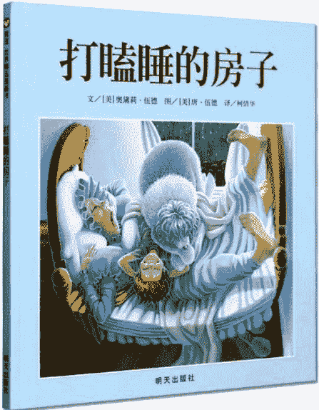

它一开始说“有一栋房子，打瞌睡的房子，房子里每个人都在睡觉。”

接下来每一页，它都会增加一句新的，然后把前面说过的句子再重复一次。

比如下一页就是“那栋房子里有一张床，温暖的床，在打瞌睡房子里，每个人都在睡觉。”

再下一页就是“在那张床上，有一位老奶奶，打鼾的老奶奶，在温暖的床上，床在打瞌睡房子里，房子里每个人都在睡觉。”

以此类推，后面又增加了小孩、小狗、老鼠，但都是一样的设计，先增加一句新的，然后后面重复前面念过的句子。

我曾给孩子们念过这个故事，幼儿园的孩子，才听完一遍，就已经可以把后头所有的句子全给念出来，非常厉害。

所以像这样一个很简单的绘本，当中复杂的句法是孩子平常自己做不到的，但因为重复迭加的设计，孩子听完了，使用这句法的能力就变成他的了！

举了中文的例子后，接下来我要介绍有同样功能的英文绘本。

其实很多父母都很关心的就是“哇，我好想让我的孩子学英文喔，可是我英文又不好，是不是要把他送去英语补习班呢？”

然后你会发现，补习班的那个外国老师，一堂课可能只教几个颜色，绿色、红色、黄色，然后拿那个爱的小手，叫孩子去拍一拍，抢答一下，Green、Red、Yellow。

就这样，这样一堂课平均就要一二百块钱，就学到三个颜色，真的是很浪费钱，然后孩子回来也不知道学到了什么。

其实你只要找到这种有重复句型的英语绘本，你只要念个几遍，孩子英文能力很快就出来。例如我们来看这本书，Eric Carle 的《Brown Bear, Brown Bear, What Do You See》。

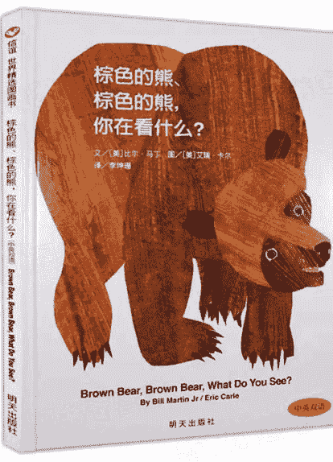

好，我现在念几页，听了之后你就知道当中的奥妙了。

故事一开始，图像上有一只棕色的大熊，文字写着“Brown Bear, Brown Bear, What do you see?”，“棕色的熊，棕色的熊，你看到什么？”

下一页翻开，是只红色的鸟，所以文字写着“I see a red bird looking at me”，“我看到一只红色的鸟正在看着我。”

接下来，它就会问这只红色的鸟说"Red Bird, Red Bird, What do you see"然后下一页就看到一只黄色的鸭子，所以回答"I see a yellow duck looking at me"。

既然现在是黄色的鸭子了，那接下来会问什么呢？答对了，一定就是"Yellow Duck, Yellow Duck, What do you see"然后呢，下一页是蓝色的马，所以句子就会是"I see a blue horse looking at me"然后一样的句型，就一直重复下去。

所以你就会发现，一本书念完一次、两次、三次，十几种动物，十几种颜色，很多的句型，孩子不费吹灰之力就全都学会了。

这样一本书才二三十块，是不是比送去补习班，一堂课两百块钱只学到三个颜色，要划算很多呢？

像我的儿子，小时候就很爱念这本书，念到后来，他还会自己造各式各样的句子，例如他会说"Dear Mommy, Dear Mommy, What do you see"然后我就回答说"I see a naughty boy looking at me"很棒吧！

所以，我们其实只要找到这种有重复句型的绘本，然后念给他听，你的英文能力根本就不用很厉害，孩子很短的时间内就可以学会很多的英文单词和句型，他就可以用来造句了。

## 多体会绘本情境，培养语用能力

接下来，我要再来讲一个很特别的语言要素——语用，语言的语，用法的应用。

你知道什么叫语用吗？语用解释起来就是，我知道什么样的人，在什么样的情况下，他说出来这个话是什么意思。

我举例给你听，比如说，你的小孩玩玩具搞得满地都是，你可能会很生气，你就叫他收，然后你去厨房做点别的事，过了一阵子你回来现场，发现他不只玩具没有收，还把她们丢得到处都是。

你就很火大对不对，你就跟他说：“好，很好，你继续玩没关系。”你说了什么话？你说：“好，很好，继续玩没关系。”但是你的意思其实是什么，你的意思是：“你赶快收玩具喔，否则你皮在痒了。”

所以，这个时候语用理解正确的孩子，听到妈妈说：“好，很好，继续玩没关系。”他会做什么事？他会赶快收玩具，对吧。可是语用理解异常的孩子，听到妈妈说：“好，很好，继续玩。”然后他就听妈妈的话继续玩，然后呢？就“死”得很惨。

这个东西就叫“语用”。像这种例子比比皆是，可是，很多时侯我们常常会把孩子语用理解的困难，当成童言童语，觉得他很可爱、觉得他很有创意，或是忽略他。

像这种状况，如果孩子很频繁地发生，而且你长期不去关注他，你会发现，随着孩子脱离他的可爱、童稚、可以被原谅的阶段之后，他去上小学上中学的时候，他就会开始在人际关系上出很多问题。

老师可能不太喜欢他，同学也不太喜欢他，为什么？

因为他就是让人一接触就很生气，不想再继续交往下去的人，就算他长得很清秀很可爱也没有用。这其实就是语用的障碍，这样的孩子听不懂人家话语背后真正的含意。

那语用要怎么教呢？

其实不太容易，你要经常带孩子去察觉这种人际互动中，微妙、确实存在，而且让他心领神会的东西，真的不简单。而“阅读”就可以帮这个忙。

例如五味太郎写的《语言图鉴》，它当中有一本叫《话中有话》，就是专门在呈现“语用”的概念。比如说，书本的一开始，它会让孩子看到，同样的一句话在不同的语言情境中，可能是完全不同的意思。

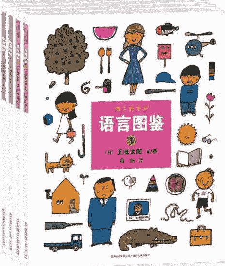

这本书中有很多很有趣的例子，例如你会看到两个青少年，一个小男生、一个小女生，小男生在跟这个小女生说：“呃，我家有可爱的猫咪喔。”那这个小女生就回答说：“我最喜欢猫咪了。”

你以为他们在谈论猫吗？其实不是，其实这个男孩子的意思是“我很喜欢你”，那这个女孩子的回答是什么？她说的是“我也喜欢你！”

听懂了吗？他们表面的话语是在谈猫，但事实上他们其实是在互表心意，这个东西就叫做语用，就是你到底听不听得懂别人到底在说什么。

《语言图鉴》这套书，就捕捉了非常多这样的场景，让孩子去理解说"喔！原来是这个意思"。

好，我再提一个书上的例子。妈妈带小孩出去，然后小孩看到一个东西说："妈，我要买，我要买，我要买。"妈妈就说："喔，好，下次再买。"请问妈妈说"好，下次再买"是什么意思？对，意思就是："我绝对不会买给你！"是吧？好，那孩子有没有听懂呢？类似像这样，就是语用。

如果你发现你的孩子，经常有一些异常的、好像不太知道人情世故、不太会跟人家沟通的话，也许你可以仔细去听听看，他有没有这种好像语用能力上特别弱的状况。

如果有，你可以找一些合适的绘本，透过绘本的场景，去跟他讨论，这个状况其实是什么意思，这个人这样讲到到底要做什么。然后当孩子有了这些察觉、这些领会，你再让带着他去观察日常生活中人和人的互动。

像这样的练习，对于语用理解特别有困难的孩子来说，会是很好的帮助。

### 绘本清单

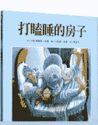
《打瞌睡的房子》

《Brown bear, Brown bear, What do you see?》

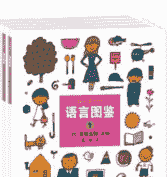
《语言图鉴》

## 6. 怎样在阅读中发展认知能力

这一讲我来向你示范，如何通过阅读，来促进孩子认知能力的发展。

认知是什么？认知其实包括孩子大脑的一切感知、思维、想象等过程。讲起来很抽象，但它其实表现在一些基础的能力上，比如说注意力、观察力、思考能力、推理能力。

这些能力汇集起来，就转成比较高层次的认知，孩子就会面对一个问题，从不同角度来思考、去理解当中的因果逻辑，然后再往上，长出解决问题的能力。

而这些基础的认知能力，事实上在阅读中，可以做很多很多的学习和加强。

接下来，我要分三个部分来讲解。如何透过阅读去提高孩子的“观察力”“观点取代能力”，以及“创造力”。

## 用绘本培养观察力

先来看观察力。有很多绘本都可以很好地锻炼孩子的观察力。

比如有本书叫做《小金鱼逃走了》。如果你跟你的小孩读，你就会发现小孩超爱这本书的。

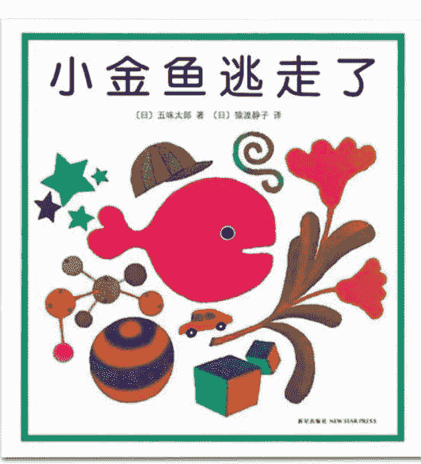

这本书很简单，就是一只小金鱼从鱼缸逃了出来，然后躲在窗帘、躲在糖果罐、躲在游乐园、躲在各式各样的地方。画面的设计就是让它混在很多东西中，让孩子去找找小金鱼到底在哪里。

这时候，小孩就得在一堆鱼目混珠的图案中，找出真正的小金鱼。这是很有趣的观察力训练。市面上这类让孩子找东西的书很多，你都可以拿来用。

还有一本书是进阶版，就是著名的《威利在哪里》系列，威利在海滩上、在街道中、在山上，到处都是一大堆长得和威利几乎一模一样的人混在那儿，孩子的任务就是要在这一大堆人当中找出威利来。

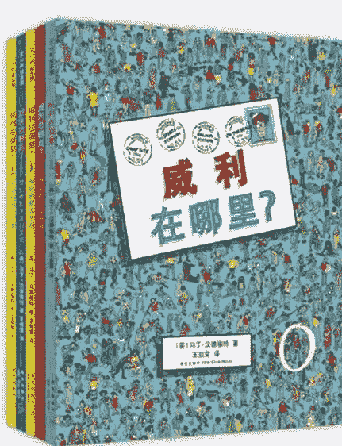

这完完全全就是考验他的观察力和辨别的能力，很有趣的是，这种大人会看到昏头的画面，小孩都可以非常厉害地硬是把威利给找出来。

## 用绘本培养观点取替能力

绘本除了可以发展孩子的观察力，还可以帮助发展观点取替的能力。意思是说，我能了解从别人的角度来看这件事情会是什么样子。

观点取替包括三个方面，包括视觉的观点取替、认知的观点取替和情感的
观点取替。

例如，有本绘本叫做《鸭子？兔子？》

这本书画面上的动物，从右边看像是长耳朵的兔子，但从左边看又像是
嘴巴长长的鸭子。然后两方从不同角度看，相互争执这到底是鸭子还是兔
子。在这绘本中，孩子有机会看到不同视觉角度造成的不同观点。

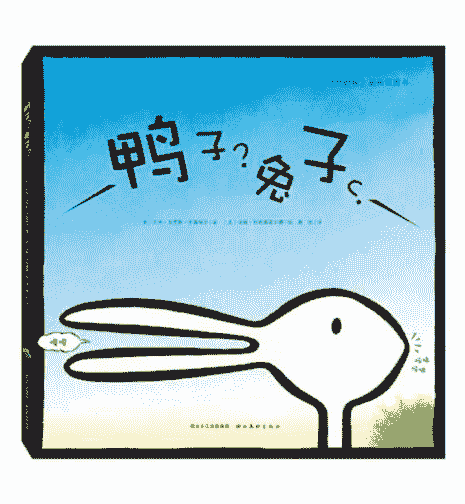

还有一本很有趣的绘本叫做《鳄鱼怕怕 牙医怕怕》，这本书是谈情感观点取舍很好的例子。鳄鱼怕牙医、牙医怕鳄鱼，整本故事用重复的句子表现了不同人物的不同观点。

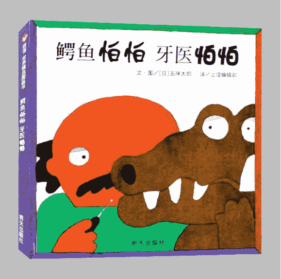

你跟孩子讲的时候可以问问他，“鳄鱼在怕什么？”然后，又可以问问他“牙医又在怕什么？”就是在这两边人物不同立场的切换中，孩子就有机会感受这种相对的、对他人心智和情感的了解和体会。

## 用绘本培养创造力

在认知里面，除了我刚刚提到的观察力和观点取替能力，其实还有一个很重要的能力叫做创造力。

创造力其实是很难教的，因为它牵涉到更复杂的向度，比如说“流畅、变换、独特跟精进”。什么意思呢？

举个例字来说，假设我现在手上拿一个纸杯给你看，然后我问你说：“纸杯可以拿来做什么？”你可能会回答：“嗯，纸杯常见的用途就是拿来装水嘛。”然后呢？

如果是小朋友，他可能会回答：“纸杯可以装水、装开水、装汽水、装果汁、装牛奶……”他可能都在装东西，可是他如果可以无限地一直装下去、装各种饮料，那也很厉害，对不对？这表示，这个孩子可以在同一个向度上的流畅度很厉害。

可是有的孩子不是在同一个向度上，不断地产出更多的什么水、汽水、饮料，他可能会说：“这个杯子啊，不只可以拿来装水，它也可以拿来当笔筒，它可以拿来当帽子，剪一剪它还可以做风车。”

你看，刚刚那个孩子是很流畅、相同的向度不断地产出新的语料。可是，现在这个孩子就不一样，他是在不同的向度产生很多不同的答案，这就是“变换性”。这是创造力的另一个维度。

那有的孩子呢，他并不是在同一个向度上说出很多很多答案，也不是产出很多不同向度的答案，但是他讲出的那个答案，你问一百个小孩，不会有一个小孩说得这种答案的，那这种孩子创造力的特性，就叫做“独特”。

创造力呢，看起来好像是一种与生俱来的能力，它就好像突然在那里了，也不知道怎么教，但其实不是。在日常生活中，如果你可以给孩子更多好的引导，去观察、发现、思考、推理，孩子的创造力是可以被教出来的。

好，接下来我再用具体的绘本，来给你介绍怎样在阅读中引导孩子增强创造力。

日本有一个很有名的绘本作家岩村和朗爷爷，他画的一个绘本，叫做《小猴子坦坦的帽子》。

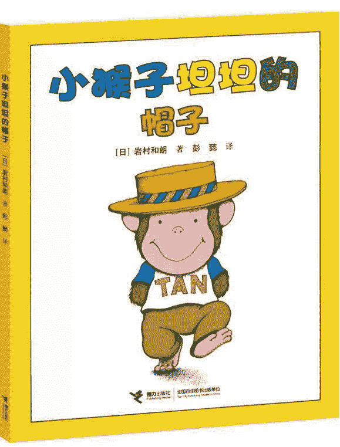

这个坦坦呢，戴了一顶帽子，那帽子就帽子嘛，有什么了不起？可是对坦坦来说，这个帽子其实不只是帽子喔！

它是这样说的：“这是坦坦最喜欢的帽子，这是一顶会让人家非常非常开心的帽子？”为什么非常开心呢？

因为你看，它把帽子拿来干嘛？拿来变把戏、拿来滚轮子、拿来当飞盘射、 拿来做各种用途。

所以你看，帽子原本只有一个功用，不过就是戴在头上，但是在这本书里， 坦坦对这个帽子做了很多很多的变化。

所以，孩子在读的过程中，他会觉得非常的惊奇。哇！原来帽子可以做这 么多的事情！

那下次呢，你不一定要拿帽子，你随便在家里拿一个东西，问小朋友说： “这是什么？”“这个是一个手套。”“它还可以是什么？”孩子就可以有很多的 想象。这就是创造力的练习。

另外还有一本书叫做《Not a Box》，中文叫《不是箱子》，也是类似的设计。

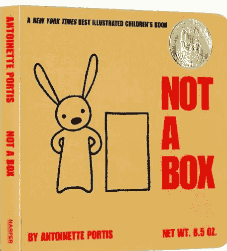

故事里面有一只小兔子，它有一个箱子，你就会问它说：“欸，这是你的箱子吗？”它说“不是”，它就坐在里面，说“这是我的车子”。然后又问它说“喔，这是你的车子吗？”它又说“不是，这是我的……”它就不停地回答不是，然后不停地想出新奇的点子。

你知道吗？你给小朋友讲了这本书之后，你下次就会发现，家里任何平凡无奇的东西，孩子都可以想出好多好多你想都想不到的用法。

现在的小孩，因为生活条件比较好，父母就给孩子买很多的玩具。但是很多玩具不仅贵，功能还很固定，这使得孩子玩完这类玩具后，变得很不会玩。他就只会照它原本的功能玩一玩，然后跟你抱怨好无聊，这样也无聊，那样也无聊，什么都不够好玩。

甚至，之后他只能靠电子产品来过活，没有电动、没有网络，他就活不下去，最后只能倚赖非常强烈的视觉声光刺激来寻求快感。为什么会这样？因为孩子没有办法在日常生活中，变出无穷的乐趣，就因为他没有创造力。

所以，**我强烈建议**你在这样日常的生活中，可以带着孩子多读这种有变化的书，多玩有很多玩法的玩具，亲子生活就会有更多乐趣，孩子就会有更多想法，他就会变得很有创造力。

## 本讲小结

这节课我给你举了几个例子来提高孩子基础认知能力，并且告诉你，怎样从阅读中培养孩子的观察力、观点取替能力和创造力。

希望的是你能够从我今天的举例和书单中受到启发，自己在生活中可以陪孩子一起找找，有哪些书可以促进孩子智力发展，有哪些玩具哪些活动可以让孩子更有创造力。希望你在美妙的亲子共读时光中，帮助孩子提升认知能力。

### 绘本清单

《小金鱼逃走了》

《威力在哪里》

《鸭子？兔子？》

《鳄鱼怕怕 牙医怕怕》

《小鸭子逃走的帽子》

《NOT A BOX》

### 7. 怎样在阅读中提高孩子的情商

最后一讲，我要和你谈一谈如何通过阅读，来提高孩子的情商。我主要侧重讲两个方面，一是促进孩子对各种人际关系的理解，二是提高孩子的情绪管理能力。

### 促进孩子对人际关系的理解

不知道大家有没有这样的感觉，就是现在的孩子比我们这一代普遍生活条件更好，资源更多，也更聪明。但与此同时，某种程度上来讲，你会觉得现在的孩子有一种“聪明有余、可爱不足”的感觉。

怎么讲呢？其实仔细分析，主要是很多孩子其实不是很懂得怎么跟自己相处、怎么跟别人相处，然后对人的尊重、理解、同情心、同理心都稍差了点。

尤其是那种父母教育程度很高、从小就很细心栽培孩子的那种家庭，这种状况会比较严重。因为孩子就这么一个，就这么宝贝，所以，大家处处为他想、关心他的一举一动，只要他一个眼神、一个动作，父母、祖父母就立刻响应。

这反而让孩子不用去管别人的感受、不用学习如何去跟别人相处。结果，他对人的敏感度因此就变迟钝了。孩子里头的那个原本该有的良善的、温柔的、体贴的心，反而就不知道跑到哪里去了。

那么阅读，其实就是你可以跟孩子去讨论很多人际关系的一个很好的机会。

人和人之间的关系很微妙，其实需要一些小事去体会。

举个例子，孩子最密切的应该是跟妈妈嘛，对不对？日本有个绘本作家，叫做宫西达也，它有一个作品，叫做《最喜欢妈妈》，就很值得推荐。虽然书名叫做《最喜欢妈妈》，但你仔细看，书里的对话非常有趣。

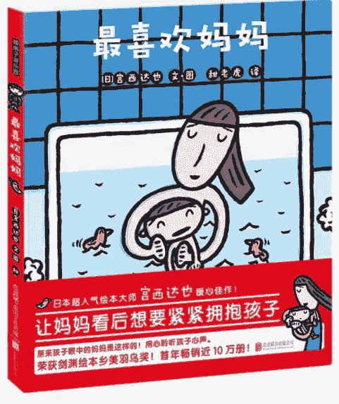

我在做亲子共读研究的时候，邀请孩子跟父母到我们的实验室来，结果大部分来的都是妈妈。我们就拿这本书让他们读，结果就发现这真的是激发母子激烈对话的一本书，非常好玩。

这本书一开始，孩子说：“我啊，最喜欢妈妈了。虽然妈妈常常跟我说，快点起床，别赖床了。”你再听一次，它的反差是这样：“我啊，最喜欢妈妈了”，“虽然”妈妈会这样这样。

好，接下来呢，他说：“但是啊，如果妈妈那时候不要这样子说，妈妈能够紧紧地抱着我，温柔地说，早上好啊，我就会更喜欢妈妈了。”

你看，孩子在表达他的诉求，他很喜欢妈妈，可是妈妈其实做了一个让他不开心的事，对不对？可是，他还是知道“妈妈很爱我啊”。但是，妈妈，如果你用一个更温柔、更好的方式，我会更爱你。很有趣吧！

接下来呢，他又说了：“我啊，最喜欢妈妈了。虽然呢，妈妈会跟我说，赶快把脸洗干净，但是啊，如果妈妈能够笑笑地对我说，脸洗干净之后，就会变得神清气爽喔！我啊，就会更喜欢妈妈了。”

类似这样，这本书把日常生活中，妈妈会怎么做、可是如果怎样、我就会更喜欢妈妈了，这种心情很有趣地呈现出来。

然后，在讲这本书的过程中，你会看到，实验室里的那些妈妈都觉得好受伤。你看，我这样掏心挖肺地对你，你这个不孝子，还要抱怨！对不对？

但是到最后面，它有个很有趣的转折，就是当这个妈妈终于结束了一天的疲惫，她就跟孩子说：“孩子啊，你最喜欢妈妈，妈妈其实也最喜欢你了。虽然你......这样这样那样那样”

哇！妈妈绝地大反攻，把孩子的各种罪状狠狠地数落了一顿。然后，妈妈又说了：“可是不管怎样，你还是我最爱的宝贝。”很有意思吧！

在这个对谈的过程中，你可以看到，妈妈跟孩子彼此之间，都有机会反刍跟思考自己平常的行为，这是孩子对他生命中第一个最紧密的、最密切的人际关系地重新思考。

好，当你跟孩子读像这样的书的时候，你就可以跟孩子去谈，“亲爱的孩子，我最喜欢你了，虽然怎样怎样”。“虽然”这两个字很重要对不对，但“虽然”之后，你千万不要只有“虽然”，只有“虽然”你就是在否定他。

重要的是，“虽然”之后，你要讲，其实我想要的是这样，如果这样，你就更体贴了我的心，你就会更好。

你有没有发现，这其实是一个人际之间的协商，是个找到更佳的解决策略、更佳的相处之道的一个好的方法。孩子跟妈妈可以如此，跟爸爸、跟其他家人都可以这样对话。

除了跟妈妈的关系、跟家人的关系之外，孩子就会往外发展了，他开始会去上学了。

我要介绍一套书，叫“十二生肖幼儿成长绘本”。内容大概就是有一个小朋友去上幼儿园，他以为我可以这样做、可以那么做，结果呢，就行不通。行不通怎么办，他会找到一些解决的方法。

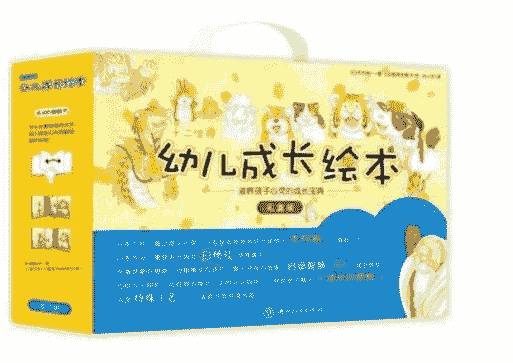

这套书很可贵的地方是，它里面完全没有指谪的意思，它就是孩子去上学的时候容易遇到的各种事情，像是我怎么跟人家相处、我怎么玩玩具、我怎么交朋友。

然后当我遇到这个状况，我用我以为可以解决的方式去做的时候，啊，不行！然后换个方式之后发现，喔，原来我可以这样做，喔，原来我可以那样做。

像这样的书，某个程度上，是帮助孩子解决生活中实际问题以及促进学校人际关系，是很好的学习用书。

现在有很多孩子包着尿布就去上小小班了，这些这么年幼的孩子，他在家的人际互动那么有限，现在要直接去面对这么多的小朋友，对他来说其实是很不容易的过程。

那他要怎么样去体会到我如何在一个团体中跟人相处、我遇到困难要怎么去解决。我觉得陪孩子读像这样的书，对他来说，就是一个很好的对谈和教导。

尤其是孩子刚入幼儿园的时候，你真要好好陪他读这样的书。阅读这样的书可以帮助他解决很多人际关系上的困扰，帮他找到很多解决问题的方法。

### 提高孩子的情绪管理能力

说完对人际关系的理解，我还要特别讲讲情绪管理方面的书。

因为这不仅仅是对孩子们来说非常重要的功课，而且研究发现，华人父母很爱做道德教海，但比较少地关注孩子的情绪感受和表达。这就导致很多孩子并不能很好地认识和管理自己的情绪，以至于上了学就是没办法跟自己、跟他人相处。

这是很基础，也很重要的部分，值得爸爸妈妈们多留意。

这里有一套很出名的情绪绘本，叫做“我的感觉系列”。这套书是心理学家写的，所以你会发现它的文学性好像没有那么高，但是它写得很精准，而且是从情绪发展的取向来写的。

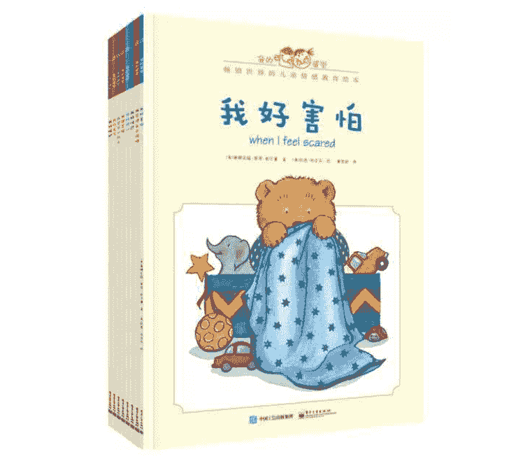

它的每一本书都是孩子会有的某种情绪，比如其中一本是《我好难过》，书中的主角小兔子会说：

> “当没有人要跟我玩的时候，我好难过；当我想念妈妈的时候，我好难过；
> 当我这样那样的时候，我好难过……”

所以读到这里，孩子就可以理解到说，喔，我现在这种感受，这种情绪，它的名称叫做“难过”，而且相同的情绪可能是很多种不同的原因造成的。

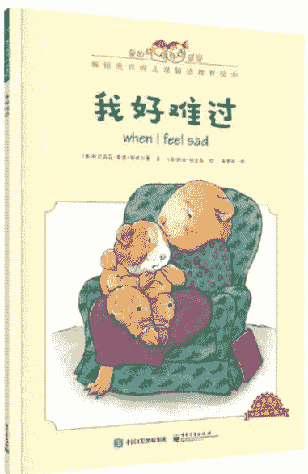

接下来，这本书就会出现第二种结构，它开始描述难过的感受是怎么样的。例如它会描述难过是一种灰灰的、累累的感觉。

描述完之后，就出现第三种结构，它句子变成：“当我难过的时候，我可以找人说说说话，我可以找妈妈抱抱，我可以出去玩，我可以这样、可以那样……”

这就是在找解决方法了，它就在教孩子各种处理情绪的策略。

所以，这套书讲出了情绪发展的三个层面，包括情绪的表达、情绪的理解和情绪的调节，也就是什么场景会导致这个情绪，这个情绪有什么反应，最后是当你有这个情绪的时候，你要怎么去做调节。我觉得这是对孩子情绪学习很好的一套书。

另外，我也很建议父母可以在读这本书的时候，结合孩子亲身经历过的事情和有过的情绪，多去跟他们讨论、对谈。

比如你可以问孩子说“你最近有没有难过的时候啊？是因为什么呢？你当时是怎么做的呢？以后再难过的时候，你还可以怎么做呢？”等等。像这样的对谈，会非常有利于帮助孩子认识和管理自己的情绪。

现如今很多人在成长过程中，到了后来遇到的最大困扰不是事，而是人。

所以，如果孩子小的时候，就能对人际关系和情绪有很好的学习和了解，学会怎样和人相处、去同理、去协商，去找出解决办法，对孩子来说，真的是一生受用。

### 绘本清单

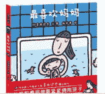

《最喜欢妈妈》

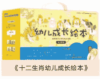

《十二生肖幼儿成长绘本》

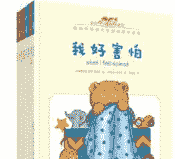

我的感觉系列

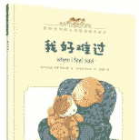

《我好难过》

## 课程小结

前四讲，我按照孩子阅读能力发展的四个阶段，也就是翻书期、图片期、故事期和文字期，分别给你介绍了每个阶段孩子的阅读表现和能力特点，以及针对这些特点，你应该怎样有技巧、有重点地跟孩子共读绘本。

再提醒一次，给孩子读多少故事并不是你的目的，你的目的应该是一步一步地把阅读能力传授给他们，最终实现让他们自己独立阅读。

后面三讲，我分别用具体的绘本书目，给你示范了怎样通过阅读提高孩子的语言能力、认知能力以及情商。虽然我说亲子共读的核心目的，是帮助孩子培养阅读习惯和独立阅读能力。但始终，阅读是一项综合活动，对孩子的能力提升是全方位的。

我的孩子曾经不止一次跟我说，小时候我陪他们阅读的时光，是他们非常珍贵美好的回忆。因此，我很诚挚地希望这门课程，对你和你的孩子来说也很受用，同时也祝福你在阅读中拥有亲密的时光和美好的回忆！谢谢！
