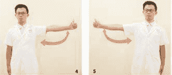
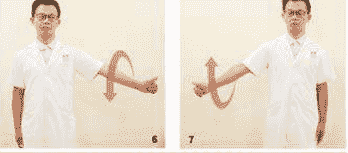
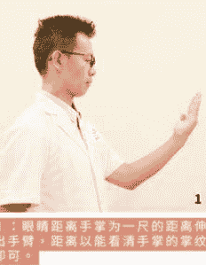
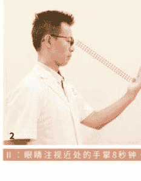
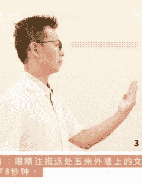
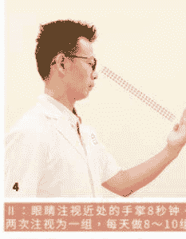

# 如何管好孩子的视力

## 发刊词 | 你为什么要重视孩子的视力问题

中国是大国，很遗憾，我们也是近视眼大国。世界卫生组织的最新研究报告，目前全世界大概有14亿近视患者，其中6亿在中国。而且，这几年，近视有低龄化的趋势。你天天接送孩子，肯定也有感觉。

根据北京大学发布的《国民健康视觉报告》，中国高中生和大学生的近视比例都超过70%，就连小学生的近视率都达到了40%。而在美国，中小学生的近视率仅为10%。当然，全世界的人视力都在下降，只不过我们中国降得速度特别快。

有些家长以为，反正可以配眼镜，近视看不清的问题，不用解决，大不了配个眼镜，孩子长大嫌戴眼镜不好看，可以再配隐形眼镜。虽然我是个眼科医生，我得告诉你，近视的问题没那么简单，视力不好对孩子的影响是多方面的。

首先，近视会影响孩子的自信心和人际交往。尤其青少年格外敏感，担心高度近视眼球突出，觉得戴眼镜不好看，在学校里，又会被不懂事的同学取笑、起外号，这些心理波动，都会影响孩子的学习和成长。

虽然视力下降是个全球大趋势，但是作为一个聪明的、负责任的家长，你仍然有必要尽量延迟孩子近视时间，帮孩子减缓近视发展的速度，也尽量减少视力不好对他未来职业选择的限制。咱们说直白一点，你帮他前期做好预防，他在心理更成熟、更强大的时候，才面对近视问题，总是好的。

其次，戴眼镜不方便，会直接影响孩子运动。因为戴眼镜不方便，孩子就容易减少运动量，有些项目的选择也会受限制。而运动少，本身又进一步加剧孩子近视，就成了恶性循环。

如果是高度近视，孩子眼睛的视网膜会特别薄，运动中眼睛受伤的几率更大，所以我也要特别提醒你，如果孩子有高度近视，跳水、蹦极、篮球、拳击、过山车这种比较极端的运动项目，一定要格外慎重。像打篮球这种有伤害动作、跳跃性大的运动，也要做好防护。

最后，才是我们眼科医生管的，会有少数人因为病理性高度近视，引发一系列像是眼底出血，视网膜脱落，继发性的白内障，青光眼等等疾病，既危害健康，也不好治疗。

所以，不管是从孩子的形象、心理、运动、健康，还是未来职业发展的种种方面考虑，作为家长，都应该重视孩子的视力管理。

0~7 岁是孩子眼睛发育的关键时期，也是很多包括近视在内，多种眼部疾病的治疗黄金期，作为家长，用对方法，持续关注，才能帮孩子尽量去避免、延缓近视的发生。如果不得已，最终近视了，也要尽量能维持低度近视，别发展成高度近视。

我在出门诊的时候，曾经接诊过一个三年级的小姑娘，她的爸爸妈妈当时在上海做生意，爷爷奶奶非常溺爱她，每天都让她看电脑，用手机，玩很长时间电子游戏。结果，她的视力从 1.0 降到了 0.2。爸爸图省事，带她到眼镜店做了检查，当天就给她配了一副 300 度的近视眼镜。戴了一段时间，孩子眼睛非常不舒服，还经常出现疲劳、疼痛、重影。爸爸带着孩子来医院找到我，我给孩子验光后，得到的结果让所有人震惊：孩子竟然是 250 度的远视！一个没有近视的孩子，带着一副 300 度的近视眼镜，而且戴了一个学期，孩子爸爸知道结果后真是追悔莫及！

后来，经过一段时间的调整治疗，孩子最终摘掉了眼镜。控制了上网、玩游戏，最后视力恢复到了 1.0，也不用再戴眼镜了。但是，由于戴了一个学期的近视眼镜，孩子还是出现了内斜视，也就是我们常说的“斗鸡眼”，这是不可逆的，未来还需要手术干预。

给假性近视的孩子配戴近视眼镜，最直接的影响就是会增加孩子眼睛的负荷。戴了眼镜后，不仅不能控制近视，反而会增加近视度数。所以，我们医生常常把这种给假性近视配的眼镜叫做“有毒的眼镜”。

作为眼科医生，我看了太多视力有问题的孩子，也接触了大量父母，或者因为知识不足，或者因为关心不够，没有对孩子的视力进行早期正确的干预。或者为了图省事，给孩子配了“问题眼镜”，不但加剧了孩子视力的衰退，甚至引发其他眼病，等再回来找我的时候，很多孩子的情况都已经不可逆转了。

每次遇到这种事，我都痛心疾首。而且，这几年，随着科学发展，对儿童视力尤其是最普遍的近视的治疗和矫正，也有了一些新手段。哪些靠谱，哪些不靠谱，家长的困惑也很多。

所以，我这门课的初心，是想总结自己多年的临床经验，也结合最新的科学进展，让你对孩子的视力管理，有一个基本全面的认知。尤其对一些常见问题，自己心里有数，知道如何应对，对商家的各种宣传，也能有个基本判断。总之，对孩子好的，家长能参与和干预的事，我都会告诉你。

我先来概括介绍一下课程内容：

第一讲，我会告诉你无节制、不间断的近距离用眼和开着灯睡觉，才是导致孩子近视的罪魁祸首。我还和你分享了帮孩子预防近视，家长要做的六件事。其中最重要的是帮孩子养成良好的用眼习惯，合理地控制电子产品的使用，鼓励孩子多做户外运动。

另外，我还会教你三种新型的护眼操，坚持做，就可以帮孩子缓解视疲劳，预防近视眼。

第二讲，教你怎么通过孩子的表现，判断孩子有近视的苗头，比如歪头、眯眼和揉眼，这可能都是近视的信号。

第三讲，万一已经确诊近视，配镜之前你要带孩子去正规医院散瞳验光。要特别强调的是，孩子配眼镜矫正视力的"金标准"是1.0，太高或者太低都不合适。给孩子选择的眼镜一定要安全、舒适。

我还会特别提示低度近视的孩子应该如何配镜，儿童运动眼镜、太阳镜应该如何选择。总的来说，参考孩子自身的情况和特点，就是最好的配镜原则。

第四讲，我来谈谈用于孩子的低度近视矫治的 OK 镜，也就是角膜塑形镜。临床上，它已经广泛应用，技术也比较成熟了，但具体操作中，我会提示你作为家长需要注意哪些问题。

第五讲，对已经患了高度近视的孩子特别有用，我会重点说说后巩膜加固手术是怎么回事，适合什么样的孩子，术前术后又有哪些需要特别注意。

第四讲和第五讲，都是我平时出诊的时候，家长问得最多的问题。

通过这五讲的内容，希望你对孩子视力管理有一个基本的了解，遇到问题时，不急不慌，有理性的判断和科学的对策。同时，希望能引起你对孩子视力管理的关注，让我们一起守护好孩子心灵的窗户，让他们从小就拥有一双明亮健康的眼睛，受益终生。

### 1. 怎么帮孩子预防近视

除了个别先天性疾病，绝大部分人生下来，视力都是正常的，就算近视会遗传，那也是说如果父母近视，孩子近视的风险会高，会更容易近视，但也不是百分百会近视。所以，在阻止或者延缓近视这件事上，父母还是可以有作为的。

那么，这一讲我先来跟你说说怎么才能让孩子的近视来的迟一点，轻一点。对于孩子还没近视的家长来说，马上行动，就会有用。哪怕孩子已经近视了，这些方法也能帮助孩子减缓近视发展，尽量不让孩子的视力发展到高度近视。

#### 一、什么是孩子近视的罪魁祸首？

想要预防近视，总得先找出罪魁祸首吧，在源头上给它断掉。对于很多家长来说，这个罪魁祸首，并没有找对。

首先，现在的孩子被手机、电脑等各类电子产品包围，所以，很多家长都会认为，电子产品是导致近视的原因。真的是这样吗？

我给你讲一个真实的门诊案例。有个家长带着 5 岁的近视眼宝宝来找我，家长很不服气，他和我说“我们平常完全不给孩子看电子产品，也不玩手机，孩子为什么还会近视呢？”

后来，通过聊天，我了解到孩子很小的时候就开始学弹琴，每天连续弹几个小时，眼睛一直盯着琴谱看。这样近距离、长时间的连续性用眼，孩子就近视了。

所以啊，孩子看手机、电脑，和近视之间，不是直接的因果关系。近视真正的原因是无节制、不间断的近距离用眼。

你一定要牢记这句话，后面我也会经常提及这个观点。理解了近视的真正原因，才能真正有效地帮孩子预防和延缓近视。你最需要关注的，就是持续关注孩子的近距离连续用眼的时间。哪怕不打游戏不看电视，看书写字，也一样要注意。

其次，有个影响孩子视力的因素，容易被很多父母忽视，就是开着灯睡觉。

美国宾夕法尼亚大学医疗中心有一个专门的实验。

专家对 479 名 0～16 岁的孩子进行了分组了调查。

结果发现：

开夜灯睡觉的孩子将来发展成近视的可能性更大，对不到 2 岁的孩子视力的影响尤其严重。

很多孩子小的时候会怕黑，睡觉不让大人关灯，久而久之成了习惯。这个习惯，确实对小孩视力发育影响很大。所以，孩子最好在一个黑暗的环境里入睡。

当然，不是你听了我的课，回家马上就能睡觉关灯的。如果孩子已经习惯了，还得慢慢纠正。孩子怕黑，主要是心理原因，这是人类的普遍心理。

所以，解决关灯的问题，你得从心理上入手，不管是给孩子讲道理、讲故事，还是读一读相关的绘本，心理问题解决了，关灯睡觉才能实现。

如果实在怕黑，也可以慢慢过渡，比如可以用调光灯，每天一点每天一点调暗，或者说服孩子，不开卧室的灯，把走廊的灯打开。这些你要慢慢适应。

#### 二、预防近视，家长要做的六件事

说完了导致孩子近视的真正原因，下面，关于预防和延缓孩子的近视，我来跟你分享，家长可以做哪些事。

第一，给孩子营造一个良好的用眼环境。

在家里的室内布置上，可以选择颜色柔和的壁纸，给孩子选可调节高度的课桌椅，方便孩子保持眼睛和书本之间合适的距离。家里最好用全光谱灯泡，这类灯泡更接近自然光，一般购买说明里面都会有标注。

第二，在饮食上给孩子做好保障。

为了孩子眼睛好，咱能吃点啥呢？我们中国人最爱这么想。比如，为了明目养眼，吃鱼肝油，或者吃羊肝等动物内脏。

在这里，我明确表明观点：吃动物内脏明目这个说法，没有科学依据。动物的眼睛里含有胶原蛋白、不饱和脂肪酸和少量的 DHA，这对增强大脑记忆力和思维能力有一定作用，但对视力健康没有帮助。

那有没有食物对视力有好处呢？现代医学研究表明，富含矿物质的食物，可以增加孩子巩膜的硬度和弹性；富含叶黄素的食物可以促进视网膜细胞的再生成。所以，不用迷信羊肝、鱼肝油，反而是常见的水果、胡萝卜、西兰花、玉米和绿色蔬菜对眼睛更有好处，你可以常给孩子吃。

第三，帮孩子养成良好的用眼习惯，对预防和延缓近视最重要。

孩子要特别注意这么几条：

- 不在极端光线下看书，写字，比如夏天正午的太阳光，就对眼睛特别不好。
- 不在车内、走路等运动的状态下看书。
- 不在被窝里躺着看书，尤其是不能用手电筒偷着看书。
- 持续近距离用眼 20 分钟，就要有意识停下来，休息一下，望望远处的建筑、绿色的树木。

孩子小的时候，看书、写作业时，你可以定个小闹钟，到点就督促他起来活动活动。也让孩子渐渐养成这个习惯，即使没你提醒，他也能自己有意 识这么做。

第四，合理控制电子设备。

看电视、看电脑 20 分钟停一停，说起来容易，但坚持做到特别难。具体应该怎么做才更有效呢？

3 岁以下的孩子，最好不看电子产品。当然，不给孩子看电子产品，你就得用玩游戏、听故事把他的时间占掉，否则，光说是做不到的。

3 岁以上的孩子，每天使用电子屏幕的时间，包括手机、PAD、电视，不超过 40 分钟，最好分成两次，每次不超过 20 分钟。现在的电子设备都有儿童模式，可以把观看时间定成 20 分钟，20 分钟后自动暂停，就可以强制孩子休息放松。

再大一些的孩子，没那么容易控制了，尤其是游戏厂商又设计了各种各样让孩子陷入心流状态、忘记时间的办法。这个时候就要多给孩子安排其他活动，来减少电子产品对眼睛的伤害。

第五，鼓励孩子多户外运动

户外运动是全世界眼科医生公认的预防近视的法宝。美国专家最新研究表明，每天户外运动 2 小时，能够有效预防近视。

户外运动能够影响孩子体内的多巴胺分泌，而多巴胺能够抑制眼球变长，缓解视疲劳和近视眼的加重。每天 2 个小时以上的户外运动，就可以抵消一天因为近距离用眼带来的近视风险，孩子患近视的可能就会大大下降。

第六，帮孩子养成做护眼操的习惯

传统的眼保健操，你应该很熟悉了，网上有人讨论按摩眼郡穴位有没有用的问题，其实在我这个眼科医生看来，做眼保健操，孩子总得把眼睛闭上，而闭眼休息本身，就暂停了近距离用眼和连续用眼时间。所以，学校里的眼保健操，孩子当然应该积极参与。

除了传统眼保健操，我再给你介绍其他三种适合孩子做的护眼操：

1、新型眼球运动操

我和我的团队在眼保健操的基础上，又进一步研发了眼球运动操。它最大的好处是，让眼球运动起来，增加眼球周围肌肉的血液循环，达到缓解视疲劳的作用。

怎么做呢？保持孩子的头不动，把两支手臂伸直并抬平，双手竖起大拇指，看着正前方的手指，让孩子的眼睛追随着手指做顺时针和逆时针的运动，这样就调动了眼球周围六条肌肉的协调运动。

这个操每八拍为一圈，一次 3～5 分钟，一天一到两次。

##### 新型眼球运动操步骤

I：头部不动，把两支手臂伸直并抬平，双手竖起大拇指，看着正前方的手指。

II：保持头部不动，眼睛追随手指做上下运动。

III：保持头部不动，眼睛随手指从里往外做往返运动。

IV：保持头部不动，眼睛随手指在身前做画圆圈运动。

2、眼内瑜伽操

这也是一种非常简便的放松、缓解眼睛疲劳的办法。

具体做法是，孩子在一尺距离内伸出手掌，距离以能看清手掌的掌纹就好。注视 8 秒钟，然后注视五米外墙上的文字或者室外的树林、建筑 8 秒钟，再看手掌 8 秒钟。两次注视为一组，如此反复重复，每天 8～10 组。

##### 眼内瑜伽操步骤

3、家庭乒乓球

在家里的屋顶上，用一根线吊起一个乒乓球，让孩子在屋里打乒乓球。打乒乓球的时候，孩子双眼必须紧紧盯着穿梭往来、忽远忽近、旋转多变的乒乓球，这样也可以起到预防近视的作用。

这几种办法，可以交叉结合。在家里变换着进行训练。孩子的眼睛有很强的适应力和可塑性，如果能坚持训练，就会远离近视，还会增加眼睛的调节功能。

长期对着电脑，用眼过度的大人，常用这些方法也能有效缓解视疲劳。

#### 本讲小结

复习一下，无节制、不间断的近距离用眼是导致近视的直接原因。为了达到帮助孩子预防和延迟近视的目的，除了改善家庭用眼环境、注意饮食之外，作为家长，你能做的就是帮孩子养成良好的用眼习惯，合理地控制电子产品的使用，鼓励孩子多做户外运动。

另外，我也教了你三种新型的护眼操，也能起到帮孩子缓解视疲劳的作用。方法都不难，难的是坚持。

希望你能帮助孩子在这些用眼细节上坚持养成好习惯。

### 2. 怎么快速判断孩子的视力问题

上一讲，你了解了孩子近视的预防。但从全球的大环境来说，各个国家和地区，人们的视力正在普遍下滑。可能你做了各种防范，但孩子的用眼习惯还是没那么好，视力还在持续下降。

这个时候，作为家长，你就要及时发现孩子近视或者假性近视的征兆，及时采取干预措施，或者帮孩子配眼镜。这一讲，我就和你重点说说怎么发现孩子视力有问题。

#### 一、孩子参考视力的计算公式

现实生活中，我发现很多家长都不知道，人不是生下来视力就能达到 1.2 或者 1.0 的。就像孩子生下来之后要长个子一样，孩子的视力也有一个生长发育的过程。不同年龄段，孩子的视力标准也不同。

如果想初步判断，六岁以下的孩子，视力能不能达到正常水平，我告诉你一个最简单的判断标准。这里有一个计算公式，就是：周岁年龄乘以 0.2，得出的结果就是孩子的参考视力。比如你的孩子 3 周岁，那他的参考视力就是 3*0.2，也就是 0.6。

知道了这个公式，你就可以自己计算孩子的参考视力了。而且，你会发现孩子在五岁之前，并不能像你想象中考那么远。所以，你可别轻易就给孩子下近视眼的判断。

**我要提醒你，**尤其 3～5 岁这个年龄段，是孩子视力发育的敏感期。这个年龄阶段，孩子眼睛的视功能都在逐步完善，而且大趋势上，近视越来越低龄化，你尤其要留心和注意这个年龄段孩子视力的变化。

尤其要注意，如果孩子是近视性弱视，一定要在 3～5 岁的视力敏感期治疗，5～7 岁治疗效果就会变差，7 岁以上几乎治疗无望。

#### 二、做好两件事：定期检查+日常观察

怎么才能发现孩子视力的问题，家长日常需要做两件事，**第一件，**定期带孩子做视力检查，掌握孩子的视力变化；**第二件，**通过日常观察，及时发现孩子的视力问题的征兆，尤其是在早期，假性近视的阶段，及时干预的话，有可能恢复正常视力。

我们先来说说视力检查。

从三岁开始，孩子最好每半年做一次视力检查。这一点就像你开车系安全带一样，都是用最小的成本可以保障最大的安全。

视力筛查之所以非常重要，是因为儿童的视力发育期是 0～7 岁，也是儿童眼睛疾病的黄金治疗期。

专业的眼科医生，有足够的经验来做判断，可以最大程度帮你预防眼部疾病的发生。出现征兆及时预防，出现问题，及时治疗，都能最大程度避免严重眼部疾病的发生。

3～5 岁是孩子视力发育的敏感期，孩子的眼睛视功能在逐步完善，如果错过了这个阶段，之后再进行治疗难度就会大一些。

所以，我建议你从孩子 3 岁开始，要给孩子建立视力档案，并且每半年进行一次视力检查。将每一次给查的视力值都记录下来，观察孩子视力变化的情况。

这个阶段，孩子已经识字了，你可以教孩子认识视力表，3 岁孩子正常视力应该为 0.6 左右，如果孩子第一次查时视力正常，你可以每隔半年给孩子查一次，如果第一次的视力有所偏差，你需要每隔 3 个月给孩子查一次。

说完了定期视力筛查，我要在给你讲讲，日常家长怎么观察孩子视力问题的征兆。毕竟，不是所有父母都能坚持定期带孩子去做检查，那么，学会通过孩子一些细微动作的变化，发现问题，就变得特别重要了。

对于家长来说，日常最难判断的是孩子的轻度近视。孩子在轻度近视阶段，特别是刚刚有近视征兆的时候，只有一百度，甚至五十度的近视。这个程度，作为家长，如果不掌握一些技巧方法，很难发现孩子眼睛的异常。

下面我就来教你几招，通过观察孩子日常的行为举止，发现近视的征兆。近视初期，大部分孩子都是假性近视，如果发现及时，处理得当，都能恢复正常视力。所以掌握这个判断方法，还是很有意义的。

第一个表现，看电视凑得太近。

##### 第二、眯眼看东西。

这个现象比较好观察，就是孩子在看电视或者看绘本，不管看近处，还是看远处，都会习惯性、下意识地眯起眼睛。这个动作意味着孩子可能有 100 度以上的散光，200 度以上的近视了。

家长要注意：眯眼的动作一定是看远处、看近处都会经常性地眯眼，如果是偶尔的动作，也不用担心。

##### 第三、歪头看东西。

这个判断难度稍微大一点，是要比较孩子平时看东西，和聚精会神、集中精力看东西的区别。有的孩子平时看东西，没有异常，一旦集中精力看东西时，就会把头歪向一边。

比如：孩子拼乐高玩具或者玩拼图，手里做比较精细动作的时候，需要眼睛离得特别近才能看清楚，孩子就会歪头看。

这个情况，有两种可能，一种是近视散光，还有一种可能是近视同时伴随着斜视。

长时间歪头，会对孩子的生长发育产生非常严重的影响，比如脊柱、面颊、牙齿会出现畸形。即便等孩子大了以后，再戴眼镜或者做手术矫正，面部畸形和脊柱畸形也不能改变了。所以，你要特别注意。

##### 第四，看东西揉眼。

有些孩子长时间盯着一个东西看时，就会用手使劲儿地揉眼睛。

正常的孩子，双眼视力是一致的。但有些孩子会一只眼睛视力好，一只眼睛视力不好。有些甚至双眼视力相差还很大，比如一只眼睛 100 度，另外一只眼睛 500 甚至 1000 度。这种情况，我们把它叫做屈光参差。

有屈光参差的孩子，度数大的和度数小的两只眼睛总是在打架，它们会产生一种相差，大脑中枢不能把两只眼睛的物像融合在一起，孩子不仅有视疲劳的感觉，还会有重度的弱视。

这时，孩子就会用手去揉那只视力不好的眼睛。揉眼睛，本身就是对视力不好的一种缓解，同时也是一种克服视觉干扰的动作。

屈光参差，隐蔽性非常强，因为有一只眼睛视力正常，所以不容易被家长发现，也很容易被家长忽视。很多孩子经常揉眼睛，如果你发现孩子经常用手揉一只眼睛，就一定要关注这个现象，带孩子去医院做视力筛查。

##### 第五，到户外见了阳光，喜欢闭一只眼。

孩子到户外，见了强烈的阳光，双眼会同时眯住，这是正常的反应。但如果孩子只眯住一只眼睛，你就要注意了。

户外眯一只眼最有可能的是患有下面三种眼疾：

- 第一种是斜视；
- 第二种是单眼的重度近视或者是单眼重度远视，因为孩子两眼不能同时看，产生了复视，也就是看东西重影，就要闭着一只眼克服干扰；
- 第三种就是有可能同时伴有斜视和近视。

所以，日常生活中，家长要牢记上面咱们提及的五个表现，多留意，多观察。这五个表现，对号入座，如果有了相关症状，继续留意观察，确认是经常性的、习惯性的动作，比如每次看电视都离得特别近，或者，只要集中精力看东西，就要歪头，这就算经常性、习惯性的动作。孩子有这些症状，你就要带孩子去医院检查了，让专业的眼科医生给你一个说法。

#### 本讲小结

六岁以下的孩子，可以用周岁年龄乘以 0.2 来判断孩子的视力水平；为了准确掌握孩子的视力状况，三岁以上的孩子，最好每半年到医院做一次视力筛查。

平时在家，你可以通过孩子的五种表现来判断孩子是否有近视的征兆：看电视凑得太近、眯眼看东西、歪头看东西、看东西揉眼睛、到户外见光眯住一只眼睛。

希望你平时可以多多注意，一旦孩子出现其中一种奇怪的表现，你就需要提高警惕了，最好及时带孩子去医院进行检查。

### 3. 孩子如何验光配镜

如果孩子已经被确诊为近视，只做的眼保健操就不管用了，最直接的解决办法就是要配眼镜。尤其是到了学龄期的孩子，配眼镜可以安全提升视力水平。

对于孩子来说，配眼镜的流程跟成人有很大的区别，要想配一个合格、安全的眼镜还真不简单。

这一讲我就和你说说，怎么帮孩子验光配镜。

#### 一、为什么不能在街边店配眼镜？

配镜前，要先做两步检查。

第一步要做眼病的筛查。因为看不清东西的原因，并非只有近视一种，比如弱视、青光眼等，最早的症状都是看不清楚东西。

第二步散瞳验光，确认真假近视。

排除眼部疾病之后，配镜之前还有最关键的一个环节——验光。

我的建议是一定要去正规医院做散瞳验光，不要随便选个眼镜店。因为眼镜店常用的是电脑验光。孩子眼睛自带调节系统，调节力强、马力大、动力足。这种调节是随时变化的，常常会骗过电脑验光仪和验光师，结果也自然是不准确的。

而正规医院通用的散瞳验光，原理是通过使用专用散瞳剂，让孩子眼睛过强的调焦系统失灵，验出真实的近视和散光度数。

但要特别提醒的是，散瞳验光后，通常需要 3 到 4 周以后，眼睛才能恢复正常视力。尤其是学龄期的孩子，上学上课都会受到影响，这也是很多家长和孩子不愿去医院散瞳验光的主要原因。

但我的主张是，为了长远考虑，宁可忍受这三四周暂时的不舒适，也要对孩子的眼睛负责，提前帮孩子做好规划安排，避免误诊错诊。

#### 二、矫正视力金标准 1.0

有了准确的验光，就可以配眼镜了，到这一环节，作为家长，只要配合医生完成配镜就行了。我要提醒的就是，儿童配镜，不能配足，世界公认的儿童最佳矫正视力是 1.0。

眼镜矫正视力太低，孩子看不清，近视会加重；眼镜矫正视力太高，会增加孩子眼睛的负担，产生视力疲劳等多种危害，两种都不可取。

另外，我接触到的在门诊配近视镜的孩子中，有非常大比例的斜视同时伴发，也就是“近视+斜视”的情况。

这种情况的配镜原则是：外斜视要配足，内斜视要低矫。

简单解释一下，外斜视就是黑眼珠向外偏斜，内斜视就是黑眼珠向内偏斜。

外斜视要配足，比如孩子是 400 度的近视，同时伴发外斜视，那就一定要配足 400 度。

内斜视要低矫，比如同样是 400 度的近视，如果孩子有内斜视，那只需要配到 250～350 度就够了，配足了会加重内斜视。

我告诉你这个配镜原则，并不是让你帮孩子去具体操作，只是在医生给孩子配镜时，有个正确的判断和参考。

#### 三、挑选眼镜的原则

给孩子选眼镜，首先要尽量让孩子参与选择，他才能喜欢佩戴。

选眼镜时，尽量让孩子选他喜欢的颜色、款式。否则，如果孩子觉得不好看，在家长注意不到的情况下，就会偷偷地把眼镜摘掉，那眼镜就白配了。

接下来，你要帮孩子选一副安全、舒适的眼镜。安全、舒适说起来简单，真正做起来门道可不少。

先说安全，一方面材质要安全，要确保孩子不受伤害。比如，在踢足球、打篮球等运动状态下，或者在相互打闹过程中，都要有基本的安全保障。

另一方面，眼睛架的大小，也关系到视力安全。

先说材质安全。

1. 选择树脂材质的眼镜片、眼镜架

先来说说镜架，选择树脂镜架，是因为它重量轻，鼻托的设计比较低，不会影响孩子的鼻梁骨发育。而金属等其他材质的镜架偏重，易生锈、变形，容易导致孩子面部过敏，还会压迫鼻梁和太阳穴，影响孩子眼睛的发育。

所以，镜架选择一定是只选对的，不选贵的。

镜片也是一样，选择树脂的镜片不易碎，不会伤害孩子眼睛。

2. 选择合适的眼镜架

眼镜架的大小，要根据瞳孔距离来匹配，大小要适中。

这一点，大的原则是尊重医生的建议。在医生指定的款式范围内选择镜架。医生会准确测量瞳距，根据瞳距的大小，来推荐眼镜架的款式。

另外，建议你一定要去正规的眼镜店、视光中心、眼科医院进行验配，记住一定不能买三无产品。

##### 再说舒适度

主要提醒你注意下面 3 个细节：

1. 建议你为孩子选择超薄镜片。因为镜片薄了，重量就轻了。超薄镜片在价格上不会相差太多，舒适度却会增加很多。

如果不知道具体的薄厚，帮孩子选镜片时，你只要记住选折射率在 1.60 以上的就可以了。折射率是指镜片对光线的曲折能力，是表示镜片厚薄的主要参数。目前市场上的树脂镜片折射率一般在 1.49～1.74 之间，折射率越高，镜片越薄，1.60 以上的就是超薄镜片了。

2. 这两年有些孩子追求时髦，喜欢带大框眼镜，而我的建议是不要选择大镜框，而且近视度数越高，就越不能选。因为，近视镜片边缘厚，中间薄。度数越大，镜片边缘就越厚，再选择大镜框，眼镜就会变沉，会经常往下滑，影响配戴舒适度。

3. 最好选鼻托高，可调节的眼镜。孩子的鼻梁一般比大人低，镜架鼻托低，眼镜会贴向眼球，甚至会碰到睫毛，孩子的眼睛会非常不舒服。

家长选定眼镜后，还要跟孩子特别确认下舒适度，一定要让孩子说出真实感受，是不是压鼻梁，是不是勒耳朵？会不会往下滑？如果孩子经常运动，建议你还要让配镜医生，给眼镜腿加上专用的防滑垫，防止在运动时，眼镜会滑落。

前面这些细节，听起来有点啰嗦，其实就是为了确保让孩子每天都要坚持配戴。如果因为不喜欢，不舒适不戴了，就起不到矫正视力的作用了，反而会加重孩子的近视。

孩子带上眼镜了，我还要给你提个醒：

你要特别关注孩子的反应，主动跟孩子沟通，如果孩子不愿意戴、戴完之后鼻梁或脸颊有明显的压痕，眼镜有点歪，看东西头晕或者不清楚，你就不要坚持让孩子戴眼镜了。

一定要拿着眼镜到医院或者眼镜店，请专业人员通过一种叫做焦度计的检 查仪器，检查一下眼镜度数是不是合适，是不是符合国标标准。

#### 四、配镜最常见的五个问题

前面提到安全和舒适会直接影响孩子的佩戴效果和感受，在我日常接诊的 过程中，还有一些认识的偏差，也会影响孩子的佩戴感受，同时也是家长 每次必问的问题，我也做了一个梳理。

**问题一、戴眼镜是不是会让眼球突出？**

不会的，眼球突出，是近视本身造成的，不是戴眼镜造成的。眼球由于高 度近视而变长了，变大了，突出了，而眼眶却没变，眼球就会显得凸出到 眼眶的外面了。

**问题二、儿童能戴隐形眼镜吗？**

绝对不能，因为孩子的眼睛没有发育成熟，眼角膜组织比较柔弱，配戴隐 形眼镜，容易造成眼睛发炎、感染，严重的会角膜感染，甚至会引起孩子 眼睛的失明。

**问题三、低度近视的孩子需不需要戴眼镜？**

这个问题，我给你一个明确的指导原则，戴不戴眼镜，要看孩子的裸眼视 力和调节力，也就是孩子不戴眼镜时测出的眼睛度数和眼睛本身看远看近 不断变化的能力。

**按照裸眼视力：**

如果孩子裸眼视力低于 0.5，就应该常戴；裸眼视力高于 0.5，就可以选择性地配戴。

**按照近视度数：**

只要是近视，看黑板就都要戴；250 度以上的近视，除了看黑板要戴，看书也要戴。

**问题四、孩子运动的时候要不要戴眼镜？**

平时运动较多的孩子，可以为它专门配一副运动眼镜备用。这种眼镜的眼镜腿不带铰链，比较轻便。

**问题五、孩子能不能戴太阳镜？**

可以戴，但有 3 点你要特别注意：

1. 选择质量有保障、有防紫外线功能的太阳镜。鉴别太阳镜能不能防紫外线，可以用紫外线灯照一下，紫外线灯一般眼镜店里都有。
2. 如果是暴晒的天气，或者海边等特殊环境，应该戴太阳镜，可以有效保护孩子眼睛。
3. 5 岁以内的孩子，如果不是刚刚说到的特殊环境，最好不要经常佩戴太阳镜。因为太阳镜透光性不好，对孩子视力发育有影响。

要注意：正常视力的孩子不要配戴有近视和散光度数的太阳镜。如果你给孩子配了太阳镜，还不放心，那可以去专业机构进行检测，确保太阳镜没有度数后再给孩子使用。

如果孩子户外活动多，还可以专门配置带近视度数的太阳镜。这种太阳镜在室外是可以变色的，到了室内就恢复到正常眼镜的无色状态。这样，孩子就不用配戴两副眼镜了。当然，带有度数的优质太阳镜价格也较贵。

#### 本讲小结

总结一下，你一定要在散瞳验光后再帮孩子配镜，配镜的核心原则是：孩子视力矫正金标准是 1.0。

安全、舒适是具体的配镜标准。在配镜的过程中尽量让孩子参与其中，你要帮孩子选择合适的镜片和镜架，他感到舒服，才能保证随时配戴。

同时，我还回答了你最关心的 5 个问题：戴眼镜并不会让孩子眼球突出；不能为了美观让孩子戴隐形眼镜；低度近视的孩子需要根据裸眼视力和近视度数来选择戴不戴眼镜；运动时，可以给孩子选择专门的运动眼镜；对于太阳镜，切记一定不要再三无产品。

### 4. 如何有效治疗低度近视

戴眼镜毕竟不方便，而且也不美观，遮挡了孩子心灵的窗户，所以，很多孩子的家长，都在关心戴上的眼镜还能不能摘掉？有没有什么方法可以缓解近视、控制近视的增长？

说到这里，我肯定地告诉你，如果你的孩子是 600 度以下的近视，还真有！而且技术上相当成熟了。这是一种特殊的隐形眼镜，医学名称叫“角膜塑形镜”，他的英文名称叫 ORTHO-K，也就是我们常说的 OK 镜。

这种眼镜，孩子睡觉的时候戴上，第二天视力就可以恢复到 1.0。现在，OK 镜已经成了很流行的预防、控制近视的神器，曾经有段时间，大到三甲医院，小到视光中心，眼镜店都在推广。很多家长也跃跃欲试，但又有很多担心。

这一讲，我会从我专业眼科医生的角度，结合临床的实际使用效果，客观地讲讲 OK 镜的原理，全面给你科普一下相关知识。

#### 一、OK 镜真的能治疗近视吗？

OK 镜，医学上准确地叫角膜塑型镜，是一种隐形眼镜，但它是硬性隐形眼镜，跟普通成人戴的软性隐形眼镜完全不同，是通过改变角膜前表面形态来矫正近视眼的。角膜塑型镜有控制近视增加的作用，而普通隐形眼镜只能进行单纯的视力矫正，让你看清楚东西，而不能控制度数的增长。

OK 镜上世纪 60 年代就问世了，分为日戴型和夜戴型两种。大概 14 年前，美国食品药品监督管理局 FDA 批准夜戴型 OK 镜的临床使用。FDA 的标准被世界卫生组织认定为世界最高食品药品管理的标准。

从这个角度，也可以说明，它的安全系数是非常高的。最近几年，国内的技术也非常成熟了，国家药品监督的力度也很大了，OK 镜开始比较广泛地用在儿童近视的防治上。

OK 镜为什么能在短时间内能提升裸眼视力？我来跟你说一下它的工作原理。

想知道这个原因，首先要了解它的结构设计。如果做一个比喻，OK 镜的工作状态就像一个神奇的视觉工厂，这个视觉工厂在孩子戴上睡着以后就开始工作了，塑形镜把角膜表面的细胞和泪液膜，重新做了挤压和排列。原来近视眼的角膜面是拱形的，加工塑形以后就变得平坦了。

所以，经过一夜配戴塑形镜的孩子，早晨一睁眼，角膜的形状已经发生了改变，视力会上升到了1.0，甚至1.5。有了这样的视力水平，孩子无论是在学校看黑板，还是正常的读书就都不费劲了，眼睛很舒适，这就是OK镜发挥作用的整个过程。

经过一段时间的配戴治疗，孩子的近视就会得到有效控制。而眼角膜的视觉加工重塑的过程，都是在孩子睡梦中不知不觉完成的。

OK镜还有个优点，就是能避免儿童近视的加重。因为孩子戴上OK镜，角膜已经按照医生检查后的处方，进行了个性化的定制，在晚上角膜经过了重新地全面“塑形”，孩子早晨起来，正前方和周边的视力都能达到1.0，这就是配戴OK镜的科学道理，OK镜可以有效避免近视的进一步加重。

而普通眼镜只能矫正瞳孔中心的视力，视网膜周边的矫正视力达不到1.0，还会残留部分近视。这个残存对成人没有影响，但会造成儿童视力的进一步发展。

#### 二、OK镜安全吗？

首先，答案是肯定的。

全世界范围内，每年几千万的孩子都在配戴，并且，通过了美国的FDA认证。这个认证体系，是全世界最严格的认证标准，被奉为行业的标杆。因此，只要遵照医嘱科学的配戴，大量的临床案例佐证，这在医学上被认为是绝对安全可靠的。

在临床上，我和我的团队已经验配了 6000 多副角膜塑形镜了，视力基本都能矫正到 1.0，而且，到目前为止还没有出现严重的并发症。

不过，家长还是担心一个问题，一般戴隐形眼镜，会带来角膜炎，角膜穿孔，干眼症，角膜变薄等问题。OK 镜也是隐形眼镜的一种，会不会也存在于这些问题呢？在这里，我可以告诉你，经过半个世纪，技术不断更新，OK 镜的安全性现在己经非常高了。

OK 镜的透氧性非常高，是普通隐形眼镜的 4~5 倍，而角膜塑形镜是根据孩子的角膜形态而工作的，对眼睛的切合度和舒适度都高于普通的隐形眼镜。

由于角膜塑形镜的直径比较小，相应他占据的面积就比较小，泪液在眼睛中的活动空间就很大，所以不会带来干眼症等问题。角膜塑形镜是通常是晚上配戴，这样就会避免白天风沙等对于镜片的影响，不会积攒灰尘。

听我前面说了这么多，总结下来佩戴 OK 镜，是百利无一害，甚至是孩子睡觉就能把近视眼给治了，这么多好处，很多家长一定非常心动，恨不得赶紧给自己家孩子配一副。有这样想法的家长，一定要听我下面的提醒。

#### 三、给家长的三个提醒

第一，如果想戴 OK 镜，配戴之前，一定要去正规的眼科医院，给孩子做一个基本的筛查。要检查的项目有：角膜硬度，角膜形态，眼压水平，角膜散光，有没有其他眼病等。

通过检查以后，还要给孩子进行角膜塑形镜的验配试戴，这个知识点后面我会详细介绍，这些都没问题，才可以给孩子配戴角膜塑形镜。

第二，哪些孩子适合配戴呢？ 有下面 5 个条件：

1. 年龄在 7 岁以上。
2. 近视度数低于 600 度，散光度数低于 200 度。
3. 孩子没有角膜的疾病包括：角膜混浊、角膜新生血管等，这些都需要在医院进行专业的检查。最重要的是，孩子要有良好的卫生习惯，比如，不用脏手揉眼睛，看书时注意坐姿等等。

而你也能按医嘱定期带孩子复诊。复查频率我会在后面详细介绍。

4. 能够通过试佩戴。医生会根据孩子的角膜形态和近视度数选择试戴片让孩子试戴，一般需要 1～2 个小时，之后，医生再评估孩子能不能适应。

如何评估呢？主要看三点：
- 孩子的镜片滑动度是不是很大；
- 几个小时的配戴能矫正的近视度数；
- 另外要看看，镜片在孩子眼睛上的松紧度。

这三点，都需要由视光师来进行判断，他会根据孩子的试戴情况告诉你孩子是否可以配戴，如果试戴后效果不好就别勉强配戴 OK 镜了。这一点上，家长要听从医生的建议，不能自作主张。

5. 目前，配戴一副角膜塑形镜的费用几千到上万不等，跟普通的眼镜相比，这算是价格不菲了，这一点家长也要有心理预期。

最后，配戴后，家长也要特别注意：

- 第一，无论角膜塑形镜效果如何理想，都一定要再为孩子配一副备用的框架眼镜，在孩子发烧、感冒、旅行、游泳和眼睛有炎症的时候备用配戴。当孩子出现这些情况时，一定不要再坚持戴角膜塑形镜，要换成备用的框架眼镜。
- 第二，配了 OK 镜以后，一定要定期带孩子到医院去做复查，这样会更安全。

通常情况下，孩子配戴角膜塑形镜后第一天、一周、一个月后需要进行复查，以后可以每 2 个月进行一次复查。这是因为视光师要观察孩子眼睛塑形的情况、视力保持的情况、镜片的磨损程度以及是否会出现一些其他的问题。

#### 本讲小结

在这一讲里，关于角膜塑形镜，作为一个眼科专家，我可以负责任地说，配戴它是有效且安全的。但我也要严肃地说，不是所有孩子都合适，一定要根据自己孩子的状况，谨慎选择，还要定期回医院复诊检查。

角膜塑形镜是低度近视的防控神器，那么对于高度近视的孩子，我们又该怎么治疗呢？下一讲，我们聊聊高度近视的手术治疗。

### 5. 如何有效控制高度近视

#### 一、为什么要重视高度近视？

我们国家是一个典型的高度近视高发国家，即使在还没有完全发育成熟的孩子中，高度近视的发病率也在逐年上升。更让人担心的是，目前高度近视已经成为我们国家第二大导致失明的眼病。

因此，孩子一旦被确诊为近视，你一定要关注他的近视发展程度。当然，终极解决方案就是让孩子避免近视，这也是我们整个课程的初衷。可是万一孩子发展成了高度近视，也不是完全没有办法。

这一讲，尤其适合家里有高度近视的孩子或者自己有高度近视的家长收听。因为首先，我要跟各位家长明确，高度近视是有遗传风险的。高度近视的父母一定要特别注意孩子的视力情况。

其次，谈起高度近视，要了解高度近视分为两种：

一种是单纯性高度近视，这种近视并不可怕。有一个简单的标准可以判断，就是到了十八岁，也就是成年后，近视度数逐渐稳定，没有逐年增长，而且没有眼底病变。这里说的眼底病变没有明确的标准，你可以理解为只要没发生过近视导致的眼底疾病就可以了。

另一种是非常严重的眼病，就是病理性高度近视，表现为近视超过600度，而且，每年还会超过100度的增长。这类高度近视的近视增长非常可怕，近视度数会一直发展，一生中眼球都在不断变长。

而且，伴随着眼球的前后直径变长，也就是眼轴在增长，由此带来很多的眼底病变，一旦出现视觉损害和眼底病变，一般不可逆转，严重者甚至会导致失明。所以，病理性高度近视的孩子，如果一旦确诊，需要尽快手术。

在此给你详细介绍高度近视的两种类型，目的就是为了让你尽早识别区分，不同情况使用不同的治疗方案，别让孩子的近视程度再加了。

最后，就像我们试听里讲到的，如果说近视会给孩子的身心发展造成严重的伤害，那高度近视给孩子带来的伤害就是成倍的。所以，更要引起你的重视。

上一讲，你知道了OK镜对600度以内的早期高度近视有非常好的控制效果。但如果近视超过600度，每年增长速度在100度以上，而且父母又有一方是高度近视。这个时候，再想通过物理手段控制住近视程度，就很难了，因为这种情况大概率就属于病理性近视。

高度近视，如果成年十八岁以上，可以用我们常说的激光手术治疗，不满十八岁，激光手术绝对不能做。如果孩子有病理性近视，每年近视还在增长，而且又不满十八岁，那到底有什么好的办法，来预防高度近视发展呢？

接下来，我给你介绍一种非常直接有效的治疗方法——后巩膜加固手术。

#### 二、什么是后巩膜加固手术？

后巩膜加固手术主要针对高度近视的未成年儿童或者青少年，尤其适合度数还在增长的病理性高度近视的孩子。手术的目的跟成人不同，不是为了帮孩子摘掉眼镜，而是要预防和有效控制近视的加重。

如果我们把眼球比喻成为圆形的乒乓球，那高度近视的孩子眼球就变成鸡蛋一样的椭圆形，眼轴变长了之后，孩子的眼球壁组织就会变薄，后巩膜加固术是在变薄的眼球壁上缝上一个补丁。

一段时间以后，这个“特殊的补丁”会跟孩子的眼球壁和谐地“生长在一起”，这样，就可以增加眼球壁的厚度、弹性和牢固性，也就可以控制眼球变长了。

说到这，你一定会问这个手术安全吗？答案是肯定的。

后巩膜加固手术有 50 年历史了，已经在世界上很多国家开展，临床上也有大量病人接受了这个手术。因此，我对这个手术在国内的引进、发展情况非常了解。

目前，这个手术在我们国家已经很成熟了，而且从术后追踪的效果看，手术不但可以预防高度近视的进一步发展，还能帮助控制各类眼部并发症。

需要提醒的是，除了手术本身，手术最终的效果，还和孩子眼睛近视的程度、遗传情况，还有手术后用眼卫生等等有关。

#### 三、哪些孩子可以做后巩膜加固手术？

作为一个从业多年的眼科专家，我负责地告诉你，不是所有孩子都能做后巩膜加固手术的。这个手术在临床上的选择是很严格的，能做手术的孩子主要有下面三个特点：

- 一定是病理性高度近视，而且每年近视度数的增长超过 100 度；眼轴长度超过 24 毫米，而且每年都在增长。
- 有家族高度近视病史。
- 有高度近视眼底改变。

上面说的眼轴超过 24 毫米是成人的界限，对于一些高度近视的儿童，眼轴的长度我们还在进一步研究和摸索中。

以上三点，除了家族近视病史，从家长的角度很难判断。其他都需要到眼科门诊配合各类专项检查，才能判断。建议你每半年带孩子做一次常规、固定的检查，由医生为孩子建立一个视力档案。

知道了哪些孩子需要做后巩膜加固手术，再来说说这个手术，家长要注意哪些问题。

#### 四、选择手术，要注意的问题

后巩膜加固手术是一种预防性的手术。由于遗传等因素，病理性近视孩子的近视程度每年都会增加，而且还伴随着很多高度近视的并发症。所以，如果有条件，孩子还是应该尽早选择手术。

这个手术本身难度比较高，更重要的是后巩膜加固的材料选择很重要，我们既要考虑到加固材料的弹性、刚性、硬度、与眼球的亲密性，还要考虑到他的排异性。手术需要在全麻的条件下进行。为了保障效果，还需要有经验的医生在显微镜下进行精确操作。

这里要强调的是，医生一定要是经验丰富的且方便联系的，手术后的眼睛护理也很重要，你需要经常跟专家沟通，把孩子手术后眼睛的情况及时汇报给专家，让专家指导你更好地护理。

作为家长，你还要做好充分的术前准备和周到的术后护理。

术前准备和术后护理

如果准备给孩子做手术，除了常规的术前检查，在手术前，医生还会详细地了解孩子整个家族的近视情况，不只是爸爸妈妈，很多时候还要了解和孩子有血缘关系的其他亲戚是否有高度近视的情况。

作为家长，你一方面需要积极配合医生，告知正确、全面的信息，了解孩子需要检查的项目和注意事项。另一方面，也要安抚好孩子的情绪，鼓励他积极配合医生的检查，不要害怕和担心。

手术之后，你也要继续做好“心理医生”。不但要关心孩子身体上的不适感，还要一直陪在孩子身边，给他心理上可依赖的安全感。

此外，具体的术后护理，我也有 3 点要提醒你注意：

1. 手术后的当天，一定要让孩子卧床休息，你要帮孩子把枕头抬高，免得加剧他眼部的水肿。
2. 不要让孩子下床，不要剧烈运动，不要大声谈话、咳嗽、咀嚼坚硬的食物。让孩子保持大便的通畅，防止引起高眼压。
3. 术后的第二天，需要找医生拆掉眼部包扎的敷料。敷料拿掉之后，要使用含抗生素的眼药水给孩子滴眼睛。

除了这些，最重要的一点提醒你，手术后并不能“高枕无忧”，你要时常提醒和监督孩子，不要长时间用眼、近距离用眼，在饮食方面记着为孩子增加富含钙质、叶黄素的相关食品。

做好术前安排和术后护理，你一定还关心这个手术有没有什么副作用。接下来，我就具体说说后巩膜加固手术的并发症。

如果是娴熟的眼科医生主刀，只要手术操作得当，就不会有太多的临床并发症。有一些并发症是一些常规的手术后的小问题，经过处理，很快都会痊愈。

在我做过手术病例中，极个别的在手术后眼轴还在增长，近视度数还在增加。但是，这并不是后巩膜加固手术造成的。而是因为孩子在手术后，没有控制连续用眼的时间，过度用眼导致的。

总之，我可以负责任地告诉你，这个手术在我多年的临床观察中，是利大于弊的。这个结论供你参考。

#### 本讲小结

这一讲，自己或者孩子是高度近视的家长要尤其重视高度近视的危害。我重点给你讲解了后巩膜加固手术，它适合病理性高度近视的孩子和成人，可以有效控制高度近视的加重。

如果选择这个手术，你要特别注意孩子的术后护理，尤其要避免让孩子长时间、近距离的用眼。希望可以帮到你和孩子。

### 课程小结

《如何管好孩子的视力》到这里就要结束了。五讲的内容，从你最关心的孩子近视预防讲到儿童视力监测、筛查、配镜，再到低度近视和高度近视的治疗。

这里面，提醒你最重要的就是在三个关键点做好防护：

- **第一**，在孩子视力正常的时候，不要让孩子眼睛太疲劳，可以常带孩子进行户外运动，多让孩子做做护眼操。
- **第二**，要特别注意孩子歪头、眯眼和揉眼等常见动作，这些都有可能是近视的信号。一旦确定孩子得了近视眼，要在第一时间配戴眼镜，眼睛度数一定要配足。太高或者太低都对孩子眼睛有伤害。
- **第三**，低度近视可以用OK镜帮助治疗，高度近视持续加重，可以用后巩膜加固手术来控制，要注意术前准备和术后护理。
