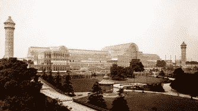
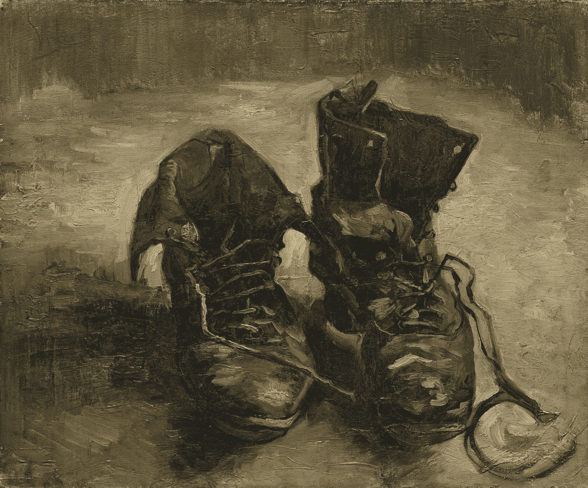
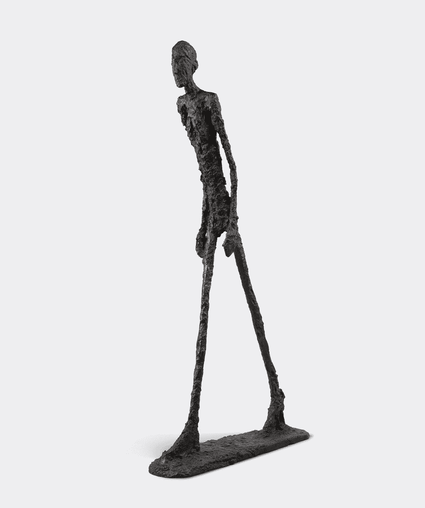
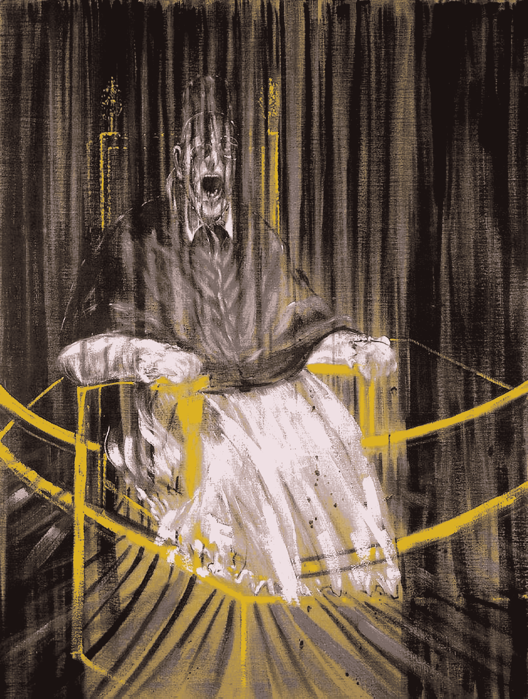

# 存在主义通识课

存在主义通识课  
 前言  
 1.什么是存在主义哲学  
 2 克尔凯郭尔：非此即彼的人生选择  
 3 陀思妥耶夫斯基：现代社会中的虚无处境  
 4 尼采：直面虚无的深渊  
 5 胡塞尔：用现象学的全新方式看世界  
 6 海德格尔（一）人，存在的追问者  
 7 海德格尔（二）：人，被抛入世界的存在者  
 8 海德格尔（三）人，向死而生的存在者  
 9 海德格尔（四）人，诗意地栖居者  
 10 雅斯贝尔斯：边界性境遇与超越性  
 11 伽达默尔：作为阐释的生存  
 12 阿伦特：政治性的生存  
 13 萨特（1）：“恶心”的存在体验  
 14 萨特（二）虚无与自欺  
 15 萨特（三）自由的重负  
 16 波伏瓦（一）：模糊性的生存  
 17 波伏瓦（二）：被塑造的女性  
 17 加缪（一）我们是否应该杀死自己？  
 18 加缪（二）我们是否应该 Sha 死他人？  
 19 梅洛-庞蒂：身体性的生存  
 20 存在主义的谢幕和余波  
总结

## 前言

在《懒人专属群周报》分享了 20 期的存在主义哲学课，现在小懒将这些内容汇总成册，方便对这块兴趣的朋友查阅。

这部分小懒会放在咱们懒人专属群的《[通才计划](https://lazybook.netlify.app/#/data/13_course)》部分。后面也会继续分享哲学类的书单，当然，还有其他课程。

届时可以到手册的 13 通才计划模块自行查看更新，到专属群 q 群公告查看下载：

[`lazybook.netlify.app/#/`](https://lazybook.netlify.app/#/)

小懒也会整理出*离线版 pdf 和 epub，在线版文档*供大家阅读。

## 1.什么是存在主义哲学

存在主义作为一场哲学运动，可以追溯到 19 世纪中期，在 20 世纪 20 年代正式诞生，到了 80 年代逐渐落下帷幕。刚刚提到的海德格尔、萨特和加缪就是最有代表性的三位存在主义哲学家。  
这种哲学最大的特点，就是把个人具体的生存体验当作哲学讨论的中心问题。所以我们把“存在主义”理解成“生存主义”可能更合适一些。

说存在主义关心个人的生存体验，好像让它变得可有可无了。毕竟没有人比我更了解我自己的生存处境，也没有人能代替我体验我自己的生活。那我为什么要听这帮存在主义哲学家来给我讲我的生存体验呢？了解存在主义能帮我看清哪些我自己看不清的问题呢？这场 40 年前就落幕了的哲学运动，对今天的我还有什么用处呢？

如果放到历史里面来看，“关心个人的生存体验”其实是一场巨大的哲学革命。存在主义出现以前，传统的哲学家们喜欢构建普遍、抽象的理论，他们想用严丝合缝的体系和无懈可击的逻辑去碾压和征服读者。所以，传统哲学虽然也会讨论“人”和“人的存在”，但通常都是从普遍和抽象的角度来谈的，他们关心的是“人类”而不是“个人”。

所以在回答人生意义、自我、情感这些问题的时候，传统哲学也都会给出一些抽象的回答。但是存在主义想要推翻传统的哲学体系，彻底转换哲学的视角，去关注每个鲜活的个体真实的生存处境和具体的生存体验。比如萨特就详细地描述过一男一女在酒馆里调情，两个人态度上的微妙变化，以及从这些变化里面折射出来的生存态度。

在传统哲学里，这样的讨论肯定是登不了大雅之堂的，但是在存在主义这里，却成了重要的哲学主题。因为关注个人具体的生存体验，存在主义就会格外强调人非理性、情感的一面，还要把传统哲学不屑一顾的很多负面情绪当作哲学分析的核心，比如我们面对世界的荒谬感、面对人生的虚无感、面对死亡的焦虑感。

说到这里，你是不是已经有点听不下去了？心想我过着九九六的生活，整天跟周围人的“死磕”、“内卷”，我还不够惨、还不够焦虑吗？为什么还要去听这帮存在主义哲学家给我讲虚无、荒谬和焦虑呢？

先别急，你的这些抗议恰恰是我们今天依然要去了解存在主义的原因。因为存在主义哲学家用最深刻哲学分析让你看到，这些情绪不仅你会有，那些最智慧的头脑也会有，而且比你体会得更深、更广，表达得比你更精准、更到位：

\-你是不是有时候会感到自己跟周围的人总是不合拍，活得非常别扭？萨特会告诉你，那就对了，我们之外的这个世界充满偶然性，总是会跟我们的预期不同，我们面对世界和他人的时候觉得别扭，甚至感到“恶心”，都很正常！

\-你是不是有时候会觉得工作和生活单调乏味、没有意义，不知道自己该干点什么？加缪会告诉你，那就对了，这个世界对于我们来讲就是荒谬的、没有意义的，他把人生比作希腊神话里的西西弗，整天推着一块大石头上山，但是每次推到山顶，石头又会自己滚下来，就这样周而复始。你的人生再悲催，还能比这个更惨吗？

看到这些描述，你是不是觉得存在主义是一种特别丧、特别颓、特别悲观的哲学？但是我想告诉你，情况恰恰相反。整个哲学史上，没有哪种哲学比存在主义更加积极进取了。而且存在主义的积极进取，不是盲目乐观，也不是给你灌心灵鸡汤。它不是告诉你要专注自己的内心，获得精神的胜利；也不是给你许诺美好的乌托邦或者来世的救赎。

存在主义把虚无、荒谬、焦虑这些负面情绪最充分地展现在你的面前，然后告诉你，这些就是我们每个人生存中的常态，也没有什么可怕的。人生就是在它们之上创造意义。因为我们是自由的，有各种选择的可能性，人就是在自由选择的行动中自我塑造的。整个哲学史上，没有哪种哲学比存在主义更高扬人的自由，更主张要去过一种本真的、不自欺的生活了！

这么看来，就算存在主义作为一场“哲学运动”落幕了，但是作为“哲学思想”，它根本不可能落幕。这一点非常重要，因为只要我们活着，存在主义就能够帮助我们更好地理解生活。它总是能够帮助我们看到人生最惨淡的底色，然后依然给我们鼓舞，活出我们每个人自己的人生。  
借用一句时下很流行的话：“世界上只有一种真正的英雄主义，那就是看清生活的真相之后，依然热爱生活”（罗曼·罗兰）。存在主义就是这样一种英雄主义的哲学。

我们说，存在主义的思想不可能落幕，还因为这些哲学家讨论的很多问题、提出的很多洞见，早已经深入到我们的日常语言、文化和生活里面了。一个明显的例子就是你熟悉的那些存在主义的名言。但是记住这些名言跟了解存在主义完全不是一回事。因为我们很容易望文生义地误解那些名言。

比如，萨特说的“他人即地狱”。这句话经常被拿来形容人性的恶毒，周围人的恶意。其实萨特还真不是这个意思！他并不是想说人有多坏，而是在刻画一种生存境遇和生存态度。他人是外在于我的东西，是偶然性的一部分，所以和我产生冲突非常正常。如果我放弃自我，生活在他人的目光和评价中，他们就会成为我的地狱。想要摆脱这种可怕的境遇，最重要的就是活出自己的人生。

其实对于很多存在主义哲学的名言，我们都有着类似的误解。只有把这些话放到这些哲学家的思想脉络里，再进一步把它们放到存在主义的思想脉络里，才能充分理解这些名言真正的含义，理解它们给我们的思想带来的强烈冲击和其中蕴含的巨大智慧。

我的这门课就是想把这些存在主义哲学家最深刻、最有温度、也最值得我们玩味的洞见介绍给你，更重要的是希望通过他们的思考，你能够更好的思考自己的人生境遇和人生选择。  
在设计这门课的时候，我考虑了两种思路。一个是按照主题来讲，比如说虚无、荒谬、自由、死亡；另一个就是像现在这样按照一个一个哲学家来讲。

这两个讲法各有利弊，最后促使我选择后一个思路的其实是这样的一个考虑：  
很多存在主义哲学家都有着非常不一般的人生经历，他们有的敢于跟整个国家的文化圈子和教会为敌、有的在死刑的前一刻被改判流放、有是贡献了举世瞩目的经典爱情故事、有的作为犹太人被迫流亡在异国他乡名声远播……按照人物讲最大的好处，就是你除了能收获一些有温度的哲学观点之外，还能结识一些有血有肉的人。

让哲学和具体的人生结合起来不正是存在主义最重要的特点吗？

不过我要提醒你，我们虽然是按照哲学家来讲，但是我要讲的，不是他们完整的思想传记，而是这些人是怎么薪火相传，花了 100 多年的时间，最终汇聚出了“存在主义”这股浩浩荡荡的哲学思潮。每一讲，我们都要来看看：这位哲学家往这个潮流中放了一点什么新的东西？

具体来讲，这个系列会分成三个单元。

第一个单元是“存在主义的前传”，我会为你介绍四位对存在主义哲学正式诞生做出了巨大贡献的人，这里面有把人生选择变成哲学核心问题的克尔凯郭尔，有深刻揭示了虚无问题的陀思妥耶夫斯基和尼采，还有为存在主义的正式诞生提供了有力武器的胡塞尔。之后我会分成德国和法国两个系列来为你介绍主要的存在主义哲学家，两边各有四位代表。

第二个单元，在德国系列这边，我们会重点介绍存在主义哲学最耀眼的明星海德格尔，在他身边还有同事雅思贝尔斯，学生伽达默尔和阿伦特。

第三个单元，在法国那边，我们有四位著名的存在主义哲学家：萨特、波伏瓦、加缪和梅洛-庞蒂，他们一度是非常好的朋友，他们在咖啡馆里抽烟、喝酒、聊天，共同推动了这场运动在法国的发展。  
讲完了这些，在最后一讲里，我还会为你介绍存在主义作为一场哲学运动是如何落幕的，又如何在落幕后把它的影响波及到当今思想和生活的方方面面。

## 2 克尔凯郭尔：非此即彼的人生选择

在上一期提到，通常说的“存在主义”运动是从 20 世纪 20 年代开始的。但是，如果要追问它的源头，我们至少还需要向前追溯一百年，追溯到 19 世纪初的丹麦哲学家克尔凯郭尔。在哲学史上，他被称为“存在主义之父”。

克尔凯郭尔这个名字你不一定熟悉，但是在丹麦，他的地位是可以跟安徒生相提并论的，他的写作才华横溢，是丹麦历史上最有名的文人。克尔凯郭尔出生在 1813 年，只活了短短的 42 岁。他一生最著名的作品基本上都是在 29 到 33 岁这短短四年间创作完成的，像《非此即彼》《重复》《恐惧与战栗》等等。

我大概算了一下，他在这四年里创作的作品，翻译成中文就有三百多万字，真是不能不佩服他的天才。

请你注意，1813 年是一个什么年代？那个时候德国古典哲学，还是蒸蒸日上啊：康德去世还不到 10 年；黑格尔还在当中学校长，还没当上大学教授，他学术生涯最辉煌的时期还没有到来。而克尔凯郭尔 1855 年去世的时候，德国古典哲学的最后一位大师谢林也才刚刚去世一年。

克尔凯郭尔这一辈子，可以说都生活在德国古典哲学这座大山的旁边。

克尔凯郭尔的祖国丹麦，也正好在德国的旁边，从丹麦首都哥本哈根到柏林，距离 300 多公里，这也给克尔凯郭尔冷眼旁观德国古典哲学，提供了一点距离感。

那这点距离感，产生了什么呢？

产生了哲学史上一颗全新的种子。这颗种子后来发芽，长大，在哲学的土壤里撕开了一道新的口子。而之后一百多年的一代代哲学家，把这个口子越撕越大，形成了蔚为壮观的存在主义运动，彻底颠覆了传统哲学。

在谈论克尔凯郭尔撕开的口子之前，我们先来看看“传统哲学”有什么特点？

如果用最通俗的语言来概括，就是三个字：“盖高楼”。从柏拉图开始，亚里士多德、阿奎那、笛卡尔、洛克、康德、黑格尔，都是体系的建造者，他们都是从一些最基本的概念出发，比如实体、理念、经验、上帝，建造一个自己的哲学大厦，而且几乎每个哲学家都要先把之前哲学家的大厦推倒，从地基开始重建。

大厦竣工以后，再贴上一个自己的标签，比如柏拉图主义、笛卡尔主义、康德主义，这样就算“功德圆满”了。这是一种上帝视角的哲学，好像世界上发生的一切都尽在哲学家的掌握之中。

克尔凯郭尔年轻的时候学的就是这种哲学，他还带着仰慕之情，从哥本哈根跑到柏林去听谢林的课。但是几堂课听下来，克尔凯郭尔大失所望，后来一辈子都要反对这种从抽象观念出发的哲学。

克尔凯郭尔反对传统哲学从概念到概念的逻辑推演，那他主张什么呢？他主张要把个人的生存处境当作哲学的核心问题。讲到这里，我要请你停下来，用心体会一下 200 前发生的这个转向。

在我们今天这个时代，从个人的生存处境出发来思考世界，似乎是一件理所当然的事情。育儿指南、婚恋指南、职场指南、理财指南，到处都是这些“眼前的苟且”，如果想要想点超越个人生存处境的大事，那才是“诗和远方”，那是奢侈的事情。

但是放到 200 年前的思想界可不是这样。那个时候，工业革命才刚刚发生，城市化的浪潮还没有到来，社会复杂度还没有那么高，人生道路的选择也没有那么多。知识精英能思考、也愿意思考的，都是一些超越性的问题。

理解了这个时代背景，你就知道了克尔凯郭尔提出“哲学要关注个人的生存处境”是一件多么石破天惊的事了。

传统哲学用概念做逻辑推演，用上帝视角看问题，就好像站在太空看地球，一切都是井然有序的，是静态的。而回到人的生存处境呢？道理还是那些道理，逻辑还是那些逻辑，但是每往前走一步，都是惊心动魄的。

你升学填报志愿的时候，上了这个学校就不能上那个，此后的人生就会大不相同；你恋爱的时候选择伴侣，和这个人结婚就必须放弃那个人，此后的人生也会大不相同。甚至你今天晚上选择赴哪个饭局，遇到了哪个新朋友，得知了哪个新消息，此后的人生也可能会大不相同。每往前走一步，世界都会逼着我们做出大大小小的选择，而所有的选择都会给我们带来或多或少的焦虑和恐惧。

克尔凯郭尔把这种情绪说成是“**面对自由的眩晕**”，就好像我们站在悬崖旁边往下看的时候的那种感觉。这种面对自由选择的眩晕感，让他用“非此即彼”做了自己最有名的一本书的书名。

克尔凯郭尔的人生，也最好地诠释了“非此即彼的选择”和“面对自由的眩晕”。我来给你讲讲他的三次不同寻常的人生选择。

第一次是 1840 年 9 月 8 日，就在拿到硕士学位之后不久，27 岁的克尔凯郭尔突然向当时只有 18 岁的姑娘雷吉娜·奥尔森求婚，姑娘也同意了。但是短短一年之后，克尔凯郭尔又突然反悔了，收回了婚约。

你想，哥本哈根城本来就不大，出了这么一件事，肯定是街谈巷议的大八卦。对于还是小姑娘的雷吉娜的打击，更是可想而知。

更奇怪的是，各种迹象表明，克尔凯郭尔一辈子都对雷吉娜用情很深。他不但终生未娶，还做了很多事情来纪念他和雷吉娜之间的爱情。

比如说，他会在札记里记下每一次跟雷吉娜的相遇，相遇时两个人每一个细小的动作和表情；再比如，每次出版作品的时候，克尔凯郭尔都会专门制作两个小牛皮精装本，保存在一个红木柜子里，一本给自己，一本给雷吉娜。

在遗嘱里，克尔凯郭尔对别人都只字未提，只提到要让雷吉娜继承自己所有的遗产，如果她拒绝接受，就把财产变卖之后捐给穷人。

隔了将近两百年，我们或许没有办法还原克尔凯郭尔到底为什么这么做了。但是，“爱就在一起，不爱就分开”，这个在今天人看起来似乎天经地义的道理，放到一个具体的人生选择里，似乎并不奏效。

我要给你讲的克尔凯郭尔的第二个独特的选择，是他重新演绎了“哲学家”和“权威”这两个词之间的关系。在他之前，哲学家总是想要建一座思想的大厦，然后用自己的名字来命名。要确立权威嘛。

但是克尔凯郭尔不然。他喜欢用假名出版作品，前前后后用过的笔名有十几个。那他是刻意隐瞒，担心被人迫害吗？也不是。后来他在一本书里还大大方方地承认了自己就是作者。所以，解释只能有一个：他就是要亲手拆除那个权威的大厦。

我写了书不假，但是请关注我写了什么，而不是因为它是哪个权威写的。你看，这是不是也很符合他的哲学主张？不要痴迷于某个哲学家讲出的道理本身。每个人自己的生存处境才是核心。你们每个人都可以到我的书里来找你们自己的问题和可能的答案，但是不要管这是不是权威的结论。

我要给你讲的克尔凯郭尔第三个独特的人生选择，是在生命的最后阶段。他从小在非常浓厚的宗教氛围里长大，但是他对信仰的理解却是高度个人化的，他认为一个人灵魂的拯救，只能通过他与耶稣基督的直接联系实现，而不需要体制化的教会作为中介，特别是不需要腐败的丹麦国家教会作为中介。

于是在生命的最后一年，克尔凯郭尔近乎疯狂地写作，攻击丹麦国家教会。在这一年里，他出版了 3 本书，在报纸上发表了 22 篇文章，还自费出版了 9 期杂志，所有的文章都是他自己写的。

他把官方教会的牧师和食人族相提并论，甚至还不如食人族，因为他说“食人族是野人，而牧师是有学问、有文化的人……食人族吃的是敌人……而牧师却制造出一种假象，好像把自己最高的爱献给了他要吃的人”。

他把自己比作一个纵火犯，要点燃整个基督教世界，点燃人们的反抗热情。在攻击官方教会的过程中，克尔凯郭尔也和自己唯一在世的哥哥决裂，因为他哥哥就是丹麦教会的牧师。在临终前，克尔凯郭尔拒绝了哥哥的探望和最后的宗教仪式。

克尔凯郭尔的一生短暂而绚烂，他始终真诚地面对自己的内心，追求自己心中的真理。但是我要再次提醒你，克尔凯郭尔心中的真理，不是传统哲学里那些放之四海皆准的“客观真理”，而是对于他自己而言的“主观的真理”，那就是面对人生的每一个境遇，忠于自己的内心，勇敢地做出“非此即彼”的选择。

在这一讲的最后，我想引用克尔凯郭尔在《致死的疾病》这本书里的一句话作为结束，他说：

“我们最大的危险是失去自我，而它却可以在这个世界里安静地发生，就好像什么都不是；相反，失去别的东西，不管是失去胳膊、失去腿、失去五块钱，还是失去妻子，都会被人注意到。”

这句话提醒我们，**失去自我是一件多么容易的事情，而我们要做的就是认真对待每一个非此即彼的选择，不要让“自我”轻易溜掉。**

## 3 陀思妥耶夫斯基：现代社会中的虚无处境

上一讲，我们说了丹麦哲学家克尔凯郭尔。他有一个称号，叫“存在主义之父”。因为他撕开了一道口子：让人们把注意力从普遍性的哲学原理，转向了个人的生存处境；把哲学的思考对象从抽象的概念转向了人内心的感受。所以，他是一位有开创之功的人物。

但是别忘了，克尔凯郭尔生活在 19 世纪上半叶，距离存在主义哲学大行其道，还差一百年呢。换句话说，整个 19 世纪，都是存在主义思潮的酝酿时期。

所以，从这一讲开始，我要再给你介绍两个 19 世纪的人物：俄国的陀思妥耶夫斯基和德国的尼采。我们来看看，这两个人是怎么在克尔凯郭尔之后，一步一步深化了对个人生存处境的讨论；看看克尔凯郭尔撕开的这道口子，是怎么被越扯越大，从涓涓细流变成大江大河的。

说起来也很有趣，我们这门课要讲的前三位都不是学院派的哲学家，他们都是集哲学家和文学家于一身的人物：克尔凯郭尔是富家公子，自由职业者，和安徒生齐名的文学家；陀思妥耶夫斯基是 19 世纪最杰出的小说家之一；尼采在大学里教的是古典学，他也是德语文学中赫赫有名的人物。

这些人的双重身份，也从一个侧面印证了存在主义是对传统哲学的反叛，不管是从形式上还是从内容上都是这样。

还有一点不知道你注意到没有，这几个人在地域上的分布也很广：北欧人、俄国人、德国人。这也说明，存在主义思潮不是哪一个思想家的独创，它反映的是一种现代之后人们的普遍处境。不同文化中的人是以不同的方式感受到了同一个问题。

这一讲我们就来说说陀思妥耶夫斯基。他最有名的作品当然是《罪与罚》和《卡拉马佐夫兄弟》，不过我今天不说这两部作品，而是要给你说说他的一部更早的作品——**《地下室手记》，它被誉为“存在主义的伟大序曲”。**

陀思妥耶夫斯基出生在 1821 年，比克尔凯郭尔小 8 岁。因为生活在不同的文化圈，他没有读过克尔凯郭尔。但是有意思的是，他们因为反对不同的敌人，都关注到了人的生存处境这个问题。

什么敌人呢？克尔凯郭尔反对的是德国古典哲学；陀思妥耶夫斯基反对的是空想社会主义。德国古典哲学和空想社会主义，看起来是风马牛不相及的两回事，但是它们在底层是相通的。它们都相信，人用理性可以充分地理解世界，甚至可以设计一个理想的、没有剥削和压迫的乌托邦。

其实陀思妥耶夫斯基年轻的时候，也是空想社会主义的信仰者。26 岁的时候，他怀着浪漫主义的革命理想，加入了一个带有空想社会主义性质的小组，他们一起读禁书，一起讨论如何改变俄国社会。结果他因此被捕，还被判了死刑。

就在他要被执行枪决前的最后一刻，戏剧性的一幕发生了：死刑判决被收回了，变成了流放西伯利亚做苦役，陀思妥耶夫斯基就这么捡了条命。经历了这样一场生死劫难之后，陀思妥耶夫斯基对于一切基于理性的空想，也对真实的人生，有了全新的认识。

没错，《地下室手记》就是对空想社会主义的反思。它是陀思妥耶夫斯基结束流放，第一次去西欧游历之后创作的小说。小说的篇幅不大，翻译成中文大约就是一个十万字的中篇，我强烈建议你自己去读一读。

《地下室手记》的主人公是一个没有名字的小公务员，40 岁，住在一间环境恶劣的地下室里。他在工作和生活里都极其平庸，甚至相当卑微，总是被人欺负。最近他从一个远房亲戚那里继承了一小笔遗产，然后立刻就选择了提前退休，彻底退回到自己的地下室里，用写日记的方式打发无聊的时间，记录下自己对地面世界的思考。

在这位“地下室人”看来，地面上的那个世界是理性、科学、技术主宰的世界。他用了两个比喻来描绘这个世界。

第一个是简单的数学真理 2 乘 2 等于 4。

**“二二得四”代表了人们对理性和科学的追求，代表了人们在数学、物理、化学、生物这些领域发现的科学规律。**这些规律一旦被人发现，就有了“二二得四”这样的确定性，就会趾高气扬地站在人们面前，告诉人们能做什么，不能做什么。而人在这些坚硬的“墙壁”面前，只能俯首称臣，接受这些规律以及它们带来的一切结果。

“地下室人”用来描绘地上世界的另一个比喻是伦敦的“水晶宫”。

它是 1851 年第一届世界博览会的场馆，占地 92000 平米。这座宏伟的建筑完全是由铁和玻璃构成的，从设计到完成只用了不到一年的时间。它代表了工业革命时期人类技术的最高成就，也象征了大英帝国作为世界工业中心的辉煌。

**在很多欧洲知识分子的心中，这座水晶宫还是人类乌托邦的象征，象征着人类生活中的所有东西都可以用技术的手段事先安排好、计算好，并且完美地实现出来。**下面是一张这个水晶宫的宏伟照片，你可以想象一下，对于生活在 19 世纪的人来讲，它会带来怎样的震撼效果。

但是，陀思妥耶夫斯基笔下的这位“地下室人”可不这么看。他觉得，这座“水晶宫”不是什么美好的乌托邦，而是对人真实生活的压制。

他承认，“二二得四”这样的科学真理是人没有办法质疑的，但是如果整个世界都充斥着这样确定无疑的真理，那我们过的就不再是真实的生活了。毕竟，理性终究只是理性，那仅仅是全部生命机能的一小部分。真实的人生除了理性之外，还有内心的骚动、各种非理性的情感和欲望，生命绝不仅仅是用正确的方式算出二二得四。

至于水晶宫，“地下室人”感到的只有恐惧。那些空想社会主义者试图用清单列出人的全部利益，比如财富、自由、安宁、快乐等等，然后再进行计算，选取利益最大化的方式来组织社会。这样就剥夺了个人选择的自由。在“地下室人”看来，这些人忘记了一点，那就是人类在本性里还有一种冲动，那就是对于破坏和混乱的热爱。

人的核心利益里面还包括了天马行空地思考，恣意妄为地行动。用“地下室人”的话说就是“人需要的只不过是一种独立的意愿，无论这种独立要付出多大的代价，也无论这种独立会导致什么后果。”

上面这些，就是“地下室人”看到的地上世界。科学和技术的飞速发展，让人们掌控世界、掌控生活的能力越来越强。但是，与此同时，个人的选择被剥夺了，个人生活的意义被取消了。“地下室人”是极少数对这种处境有清醒认识的人，但他除了写日记之外，也难以对抗这种虚无。

他会带着赌气的意味，故意在生病之后不去医院，他会“享受”牙疼带来的呻吟，“享受”山穷水尽、没有出路的绝望。用这种方式去确认他还是一个生存着的独特的个体。

作为一个 21 世纪的人，如果你喜欢读严肃文学，那对于这类描述自己内心绝望感的作品，可能不会觉得有多稀奇。但是你想，《地下室手记》出版的时候是 1864 年啊，这本小说可是开了风气之先的。**在文学史上，陀思妥耶夫斯基塑造的这个“地下室人”，是可以跟莎士比亚笔下的哈姆雷特、塞万提斯笔下的堂吉诃德、歌德笔下的浮士德相提并论的人物，都是文学史上最有原创性和典型性的形象。**

后来的陀思妥耶夫斯基，就是沿着这样的一条道路，用一生的作品不断地对人性进行拷问。木心先生就说过：“现代人喜欢真实——在陀思妥耶夫斯基之前，以为自己写得很真实了，到陀氏一出，啊！文学能这么真实！在文学史上，若将现实主义比作一塔，陀思妥耶夫斯基就是塔尖。”

你看，陀思妥耶夫斯基能够获得如此高的评价，就是因为他对人性的探索，抵达了一种空前的深度。

尼采在 1887 年初偶然读到了这部小说，之后在给朋友的信里和作品里都赞叹陀思妥耶夫斯基，说他是唯一一个能让自己学到东西的心理学家。

之所以这样说，正是因为陀思妥耶夫斯基剖析了现代人的虚无状态。而虚无主义的问题，正是尼采一生关注的核心问题，也是存在主义能够发展成一场哲学运动的土壤。说到这里，你也就能够理解这本《地下室手记》，为什么被称为“存在主义的伟大序曲”了。

陀思妥耶夫斯基揭示的那种虚无的生存状态，放到 19 世纪中期具有革命意义，但是也绝不仅仅限于 19 世纪。如今科学技术对生活的掌控力已经越来越升级了，网购、外卖更加方便了，我们可以足不出户地安居在自己的“精神地下室”里：

算法计算出最佳的配送路线、最短的配送时间，配送员就只能在这种严密的控制下疲于奔命；人工智能为我们提供了更多的数据信息和技术分析，帮助我们更快捷地做出理性的选择，却少了我们自己做出决定时的反复思量和权衡。

我们不得不扪心自问：科技在带给我们高效的生活的同时，帮助我们摆脱了“地下室人”面对的虚无处境了吗？

好，在这一讲的最后，我想引用《地下室手记》里的一句话作为结束：“我们大家都或多或少地脱离生活……以致于有时候竟对真正的‘活生生的生活’产生了某种厌恶，当别人向我们提到它的时候，我们就会无法忍受。”

## 4 尼采：直面虚无的深渊

前面的课程都在分享存在主义酝酿时期的几位关键人物。克尔凯郭尔是撕开口子的人，他把具体的生存处境带到了哲学问题的前台，陀思妥耶夫斯基更进一步，在《地下室手记》里揭示出了现代人生存处境中的一个难题，那就是虚无主义的危机。

在他的最后一部小说《卡拉马佐夫兄弟》里，陀思妥耶夫斯基还问出了一个经典的虚无主义问题：“如果上帝不存在，人是不是可以做任何事情？”

我们这一讲要说的尼采，就把陀思妥耶夫斯基假设的那个“如果”变成了坚定的断言：上帝确实不存在了，而且是被杀死了！这样，尼采就把陀思妥耶夫斯基所描绘的虚无主义，又向前推进了一步，把个人的生存问题更加赤裸裸地暴露在了虚无的深渊面前。

尼采是个绝顶聪明和敏锐的天才，24 岁就当上了巴塞尔大学的古典学教授，但是因为身体欠佳，34 岁就退休了。他到处旅行寻找适合自己居住的地方，但还是在 44 岁的时候精神崩溃，彻底丧失了工作能力。

在短短 20 年的学术生涯里，他写出了十几部哲学名作，像《悲剧的诞生》《查拉图斯特拉如是说》等等，还把格言体写作运用到了极致，甚至把德语散文的写作水平都提升了一个档次。尼采的作品《偶像的黄昏》，副标题叫作“如何用锤子从事哲学”。

这个比喻再恰当不过地描绘了他一生的工作。尼采的思想所到之处，传统哲学的宏大体系、传统宗教的至尊地位、传统道德的金科玉律，都被他统统砸碎，也为即将到来的存在主义运动扫清了障碍。

**宣告“上帝之死”就是尼采对西方思想挥出的一记重锤。**在《快乐的科学》这本书里，尼采借一个疯子之口，用非常戏剧化的方式宣告了“上帝之死”。

这个疯子大白天打着灯笼，跑到市场上，吵吵攘攘地说他要找上帝。周围的人逗他，问他上帝去哪儿了？是迷路了吗？是躲起来了吗？这个疯子一脸严肃地告诉他们：

“我们把上帝杀死了……咱们大家全是凶手！……上帝死了！永远死了！……”之后这个疯子又突然停下来，把灯笼摔在地上，悻悻地说：“我来的太早了，这件惊人的大事还在路上……”

在尼采看来，西方人长久地生活在上帝的权威之下，上帝为人们的生活提供了意义的源泉。但是现代的科学革命和世俗化进程，把这个为人们提供意义的上帝杀死了，而且这个“祛魅”的过程是不可逆的，所以“上帝永远死了”。

不过，对于 19 世纪 80 年代的人们来讲，“上帝之死”的消息还宣布得太早，他们还没有清楚地意识到这一点，但是人们迟早会认识到上帝已经被人们杀死了，迟早要面对“上帝之死”后价值的虚无。

我们通常都会说，“上帝之死”代表了虚无主义的极端形式。这么说不能算错，但是还没有达到尼采对虚无主义洞察的最深处。在尼采看来，否定人生意义的虚无主义并不是伴随着“上帝之死”才来的；相反，它是伴随着上帝而来的。这个曾经给人提供生命意义的上帝本身就是否定生命意义的。

我知道，这句话听起来有点悖谬。给人提供生命意义的东西怎么会同时否定生命的意义呢？要理解这一点，我们需要先了解尼采怎么看待生命的本质和意义的。尼采认为，生命的本质说起来很简单，就是四个字：“权力意志”（will to power），一切生命体活着都是为了克服阻碍，增加自己的力量，实现自我超越，从植物到人类概莫能外。

在人类世界，这种权力意志在希腊、罗马、日耳曼，那些古代民族的尚武精神里可以清楚地看到。这些民族崇尚的是强者，是现世的胜利和荣耀，他们要成为主人。而基督教代表的是弱者和奴隶，他们强调谦卑、忍让，不关心现世，而是把眼睛盯着来世。

后来，基督教获得了胜利，主人和奴隶的角色颠倒了。自我否定、自我牺牲被当作善的、道德的，而自我中心、争强好胜就成了恶的、不道德的。这样，基督教就用一种反对生命的方式，压制了人的权力意志。

基督教的教士们还发明出了很多手段，防止人们对压抑生命的本能产生不满。尼采提到了教士们发明的五种麻醉人们的手段。

第一种是催眠，教士们用教义的灌输，用冥想、苦修之类的训练，降低人们对生命意志的要求，让人们进入一种类似冬眠状态，追求一种无我的精神解脱。

第二种手段是机械性的活动，什么时间做礼拜，什么时间忏悔，什么时间劳动，都是规定好的。这些按照明确的指示进行的活动，可以分散人们的注意力，甚至填满人们有限的意识。

第三种是给人微小的快乐，基督教里有各种慈善和表彰，这些都能给人带来微小的快乐，减轻人们的痛苦。

第四种手段，是群体认同，就是让人结成一些小的团体，形成一种相互依赖的关系，这样人们就能把不满的情绪释放在小团体之中，而不会对整体造成威胁。

第五种，是让人的某些感情得到过度的发展，从而压制其他的情感。教士们特别注重培养信徒们在上帝面前的罪责意识，有了这种意识信徒就会心甘情愿地接受苦修和责罚，主动放弃自己的权力意志。

这样，基督教就用上帝和一系列手段，压抑了人们追求生命价值的权力意志，给人们提供了虚假的意义。

如果在尼采看来，上帝是虚无主义的源头，那“上帝之死”不是能够帮助人们克服虚无主义吗？别急，事情还没完。

“上帝之死”确实打消了基督教本身带来的虚无主义，但是又带来了新的虚无主义，因为上帝没死的时候，人们好歹还有上帝这个意义的来源，可以安顿内心。

如今“上帝死了”，人们又要面对新的意义真空。但是人们又惧怕直面虚无，所以还会再去寻找其他的意义之源。**尼采认为，现代科学在杀死了上帝之后，就会成为新的上帝，成为人们新的意义源泉，从而带来新的对生命的否定，就像陀思妥耶夫斯基的“地下室人”看到的那样。**

不知道我在前面讲教士们发明的五种操纵手段时，你有没有觉得有点似曾相识？在今天由科学主导的世俗生活中，那些手段只是稍微改头换面，其实还在继续操纵着我们的生活。我们一一对应着看一看：

说起催眠手段，如今有人用游戏催眠自己，有人用刷短视频催眠自己；

说起机械性的活动，如今有朝九晚五或者九九六的工作状态，有各种工作指南，满满的日程表，都让我们深陷其中；

说起微小的快乐，如今我们可以在点赞、转发，这些小的善行和小的赞美中体会到很小的快乐；

说起群体的认同，如今我们也可以加入各种微信群、网络社区来获得这种认同；

说起片面发展某一方面的关注和情感，如今经过算法筛选的“信息茧房”给我们提供了绝佳的机会。

你看，我们现在过着以科学为指导的生活，但其实和宗教的生活没有太大的差别，甚至压根就是一种新的宗教。那依然是一种自我否定的生活，依然是在压制我们生命的根本冲动。

上面讲的内容可能有点稍微复杂，我来给你总结一下。在尼采的著作里面，可以看到三个层面的虚无主义。

第一个层面是宗教本身带来的虚无主义，尼采认为，不光是基督教，世界上的主要宗教，像印度教、佛教、伊斯兰教都带有强烈的虚无主义色彩，它们都关注来世，否定现世生命本身的价值，并且发明了一系列的手段，去压抑人们的权力意志。

第二个层面的虚无主义，是传统宗教信仰崩溃导致的虚无主义，人们原有的意义根基被推翻了，标志就是尼采最著名的宣言“上帝死了”。

第三个层面的虚无主义，是“上帝死了”之后，人们又把科学当成了新的宗教，制造了新的虚无主义。

“虚无主义”不是尼采发明的概念，但是尼采肯定是对虚无主义认识最深的人。他像先知一样看透了宗教和世俗社会共同的虚无主义本质。**但是尼采绝不是虚无主义者，他最深刻地揭示虚无主义，是为了用他的方式去克服虚无主义。**

那就意味着回归生命本质的“权力意志”，不断超越自己，扩大自己的权力意志，成为尼采所说的“超人”（Übermensch），也就是超越常人陷入虚无的生活状态。这种超越不是一劳永逸的成就，而是一个时刻都在进行、贯穿一生的过程。

能够做到这一点，就是尼采所说的“积极的虚无主义”，就是在洞悉了虚无的深度和广度之后，依然肯定生命的价值，并且用“超人”的意志去“重估一切价值”。

尼采对传统价值的颠覆和对虚无主义的诊断，对存在主义运动影响巨大。他用锤子敲碎了宗教和科学这两个人类的靠山，让人们赤裸裸的面对虚无的生存处境。之后的存在主义者都会从这一点出发，给出不同于“超人”的应对办法。

在这一讲的最后，我想引用一句尼采非常著名的话作为结束，他说：“与怪兽搏斗的人要注意，不要让自己也变成怪兽。当你长久凝望深渊，深渊也会回望你。”

虚无主义就是这样一只怪兽，一道深渊，要活出自己的生命意义，我们就需要与这只怪兽搏斗，就需要凝望虚无的深渊。同时我们也要随时提防自己被虚无吞没，丧失对生命真正意义的追求。

* * *

懒人附录：

*   [《查拉图斯特拉如是说》epub 电子书下载](https://lazyman.lanzoul.com/iPyx50c60frg)
    
*   \尼采著作集九册（含《查拉图斯特拉如是说》《悲剧的诞生》《权力意志》《快乐的科学》《朝霞》《偶像的黄昏》《瓦格纳事件》《论道德的谱系》《不合时宜的沉思》） 下载\

## 7 海德格尔（二）：人，被抛入世界的存在者

在上一讲我们说到，海德格尔是要用一种“回到事情本身”的现象学态度，去描绘人实际的生存状态，特别是要去关注那些被以前的哲学家忽略了的东西。

海德格尔认为，只有重新揭示这些被传统哲学遗忘的东西，我们才能更好地理解人这种特殊的存在者，也才有可能更进一步，去揭示存在本身的秘密。

在海德格尔看来，最容易被哲学家遗忘的就是人最日常的生存状态。他用了好几个非常生动的词，来描绘人的这种生存状态。听我来给你慢慢说。

我们每个人都生活在这个世界里面，那我们是怎么进入这个世界的呢？是被父母生下来的嘛，这个太显然了。可是，我们会不会被生出来、在什么时候被生出来，不是我们自己选择的；我们的父母是谁，被生在一个什么样的家庭，不是我们自己选择的；我们生在一个什么样的社会和国家，也不是我们自己选择的。

我们就是以这种非常被动的状态进入世界的，而这些我们不能选择的时间、地点、家庭和社会环境，对每一个人的生存又有着重要的意义。海德格尔用了一个很生动的词，说我们是“被抛进世界的”。

不管是海德格尔挑的这个德文词 werfen，还是中文译者挑选的这个“抛”字，都传神之极！它既传达了一种被动的无奈感，又不像“扔”那样有一种被遗弃的感觉。被抛进世界，给了我们每一个人“勉为其难”的起点，我们不得不进入自己的生存。

人被抛入世界以后，不可能单凭自己独立地活下去，总是和其他人共同生存，也就总是会受到其他人的影响。

我们小的时候，看到别的小朋友要什么，自己也想要；大学生选专业的时候，很多时候是因为父母和老师的希望；毕业工作了，看到别人买 LV，自己也想买；当了爹妈，看到别人的孩子上奥数，自己也想给孩子报名；出去旅游，别人拍照打卡的地方，也是我们一定要去留下脚步和照片的地方。

我们大多数的时候，都是这样自觉不自觉地受着别人的影响。而且，我们还经常说不出影响我们的这个“别人”到底是谁，肯定不只是自己的父母、自己身边的一两个同事或者朋友，我们周围还有数量巨大的图书、广告、自媒体，等等，这些东西都在或明或暗地影响着我们。

所有的这些人和东西，组成了一张无形的大网，把我们罩在里面。我们完全不自觉地沉浸其中。海德格尔把这种生存状态叫做“常人”（das Man），也就是平常的、日常的人，生活在平均状态里的人。这样的人不是具体的、活生生的，所以海德格尔没有用通常指“人”的阳性冠词 der（“他”），而是用了一个中性的、指称物的冠词 das（“它”）。

我们被抛入世界之后，大多数时候就是过着“常人”的生活，那是一种没有经过思考，“别人”做什么我也做什么的状态。这种缺乏反思、忘记自我的“常人”状态，就是海德格尔说的“沉沦”（verfallen）状态。

我们有很多种陷入沉沦的方式，前面说的遵循“常人”的平均状态只是其中一种；其实很多时候一味追求所谓的“个性”或者“新奇”，“常人”都做的事情我偏不做，“常人”不做的事情我偏要做，这也是一种“沉沦”，是沉沦在了被“个性”和“新奇”罩在网里的状态。

处于沉沦状态之中的特点，就是我们屈从于某种现成的概念、学说、信条，屈从于某种现成的看待事物的方式，而没有用自己的眼光去审视、去判断。

在讨论“沉沦”时，海德格尔说到了两个不太起眼的小事，特别能显示他对生存体验的独到观察，这两件事就是“闲谈”和“好奇”。在海德格尔看来，“闲谈”和“好奇”分别对应着“交谈”和“观看”这两种人类活动，是“交谈”和“观看”在沉沦状态下的表现。

“交谈”本来是应该进行实质性的交流，不管是为了共同完成一件工作，还是为了分享思想和情感；而“观看”原本是人们认识世界最重要的方式，就像我们说的现象学的观看那样。交谈和观看，原本应该是为了彰显人的存在。但是处于“沉沦”状态的人们，大多数时候进行的都是浮皮潦草的“闲谈”，有点类似于我们说的“扯淡”。

“闲谈”或者“扯淡”是人云亦云、鹦鹉学舌，进入大脑的信息完全没有经过任何加工处理，就变成了我们的谈资，又被说了出去。而“好奇”，海德格尔确实是用了一个中性含义的德文词 Neugier，但是给它赋予了更多的贬义，所以我觉得翻成“猎奇”可能更好一点。

在沉沦状态下，人们带着好奇心或者猎奇心，而不是严肃的态度，去观看最热点的新闻、最劲爆的八卦，用最快捷的方式获取信息，注意力不断转换，为“闲谈”捕捉材料。闲谈的人多了，那些谈资反而具有了某种权威性，主导了公众意见，人们不需要真正懂得一个东西，就可以根据这些大众化的意见侃侃而谈，随意发表自己的看法，甚至无需为这些闲谈负责。

我们可别忘了，海德格尔的《存在与时间》是在 1927 年出版的，但是他描绘的这种带着好奇心的闲谈，不正是我们大多数人今天在做的事情吗？

在海德格尔看来，好奇和闲谈，没有展示更多人类的存在，而是封闭了人的真实存在。在闲谈中，我们越是觉得自己懂得了这个东西，我们就越是加深了对自己的封闭，让自己生活在漂浮的、无根的状态之中；也就加深了我们的沉沦。

从一个角度看，我们每一个人其实都生活在“沉沦”的状态，既无可选择，又无可厚非。我们总是要使用某种语言，总是要和周围的人进行交流，总是要遵守基本的礼仪和行为规范，如果不跟周围人保持步调的基本一致，怎么可能呢？我们整天的操劳就是沉沦的一部分。

我们每天都在忙忙碌碌地活着，总是关心世界上和我们的周围发生了什么，总是去操心和照料周围的人和事。“沉沦”就是人最日常、最基本的生存状态。

海德格尔也特别强调，“沉沦”这个词本身并不一定带有很强的贬义，跟“堕落”、“道德败坏”完全不是一个意思。它描述的只不过是“常人”一种深深的不自知的状态，他们甚至是带着安定的情绪，自以为过着真实、完满的生活。

但是从另一个角度讲，这种“沉沦”的状态，又是非常危险的。它的危险在于，让我们的“自我”消散在世界当中，遗忘了“我自己”这个独特的个体，遗忘了“我自己的人生”。我听到很多学生和朋友抱怨，生活没有意义，因为他们从小为了父母而生活、为了考出好成绩而生活；好容易学完了开始工作了，又要为了挣钱而生活、为了孩子而生活。

他们从来没有真正思考过，怎样的生活才是“我”真正想要的生活，怎样才是“为了我自己而生活”。想要摆脱“沉沦”的状态就是首先对自己问出这样的问题。说到这里，我们在“前传”里反复提到的“虚无主义”就又浮出了水面。“沉沦”就是一种带有很强虚无主义味道的状态。

和“沉沦”相反的生存状态叫做“本真”（Eingentlichkeit），就是活出真正属于自己的生活。但是想要达到本真状态，却非常困难。因为沉沦才是生活的常态，拥有巨大的惯性，像漩涡一样很容易把我们裹挟而去。

即便是突然有一个时刻，你意识到了自己过的只是“常人”的生活，开始扪心自问，想要做出改变。但是下一刻，你可能还是会不由自主地回到那种沉沦的状态，或许只是因为那样更容易，或许只是因为被各种因素掣肘不得不那样。偶尔的灵光乍现还是远远不够的。

下一讲，我们就来说一说，比这种“灵光乍现”更能给人当头棒喝的东西，那就是死亡，特别是直面自己终有一死的事实。它更能够迫使我们认识到自己的沉沦状态，甚至能够帮助我们超越沉沦状态。

到这里，我们就说完了海德格尔对人们日常生存状态的描述。这里面的三个关键词是“被抛”、“常人”和“沉沦”。我们每一个人，都是以被抛的方式来到这个世界，以被抛的方式陷入常人组成的大网，也以被抛的方式沉沦在日常的闲谈和操劳里。

海德格尔讨论的这些概念，都是传统哲学里见不到的东西，同时又特别能够彰显人独特的存在方式。了解了这些概念之后，你是不是觉得每一个都不陌生，甚至都说到了你的心坎里；但是如果没有人跟你说，你又想不了海德格尔这么深，说不了他这么透彻？

如果你有这种感觉，那你就把握到了海德格尔哲学的精髓，也明白了我们为什么说“存在主义”是从现象学这个母体里面脱胎而出的。海德格尔观察的方式是现象学式的，是要“回到事情本身”；而他观察的对象，绝不是现象学关心的意识结构、对象的本质这些东西，而是活生生的人的生存。

“存在主义”就是因为深深扎根在人的生存里面，很快就长成了一棵参天大树。

在这一讲的最后，我想引用海德格尔在讨论“好奇”时说的一句话作为结束。他说好奇的特点是“不逗留在操劳所及的周围世界之中，涣散在新的可能性之中……好奇无处不在而又无处所在……此在在这种方式中被不断连根拔起。”

这句话提醒我们，在好奇中，我们的注意力始终在转变，没有认真思考就立刻奔向了新的东西，从来不会逗留，这样的状态让我们的生活消散在一片空虚之中，失去了根基，加深了我们的沉沦。沉下心来，细致地观察，仔细地思考，我们才有希望摆脱沉沦，回归本真。

## 8 海德格尔（三）人，向死而生的存在者

上一讲，我们讲了海德格尔如何描绘人最日常的生存状态，那是一种被抛进世界之后，混迹在常人之中的沉沦状态。

虽然海德格尔强调，这些词都不是道德上的贬义词，但是不管怎么样，和“本真的生活”相比，“沉沦”这两字听起来还是挺悲催的。那我们有什么办法摆脱沉沦，达到“本真”呢？

当然有，但是并不容易，而且可能还需要某种偶然的机遇。你可能听说过海德格尔的一句名言，“人是向死而生的”。这话是什么意思呢？是让我们视死如归吗？就像我们说“人生自古谁无死，留取丹心照汗青”。要想明白怎么过上海德格尔说的“本真的生活”，我们就得透彻地理解他的这句名言。

我们当然都知道“人终有一死”。不过，**嘴上说“人终有一死”，甚至说着“我终有一死”，和清晰地认识到“我将会死去”，将会不再存在，是完全不同的两回事。**就像美国作家威廉·萨洛扬说的：“每个人都会死，但是我总以为自己不会。”这话乍一听好像很可笑，但是你如果仔细品，一定会越品越有味道，甚至越品越觉得后背发凉。

当我们随口说出“人终有一死”，或者“我终有一死”时，死亡是一个外在于我的东西，一个和我无关的“死亡事件”。就像是谈论一个名人的死，或者谈论第二次世界大战中战死的人数。

我们当然也会悲伤，也会感慨一句：“哎，人生无常，要珍惜生命。”这么说的时候，我们当然也“知道”自己终有一死，但是这种“知道”是一种“闲谈”意义上的、人云亦云的“知道”。

说完了“人生无常，要珍惜生命”，我们还是会该干什么干什么，不管是从心态上还是从做的事情上，都和之前别无二致。这些时候，我们其实是把自己排除在死亡之外的，就像萨洛扬说的“总以为自己不会死”，至少认为死亡离自己很远。这种非常外在的对于死亡的意识，并不会帮助我们进入本真状态。

那什么样的死亡意识可以做到呢？就是真切地与自己将有一死面对面，清楚地认识到，我的死亡是一件最本己的事情，是任何人都不能替代的事情。我只能“亲自去死”，而且我还不知道死亡什么时候会来。

在这里，海德格尔又用了一个非常生动的词，说死亡“悬临”（Bevorstand）在我的头上，随时可能落下。清楚地意识到死亡的悬临，就是看到死亡将会让我彻底坠入虚无。这种虚无还不是讨论人生有没有价值那个意义上的虚无，而是更根本的、存在论上的虚无，我们之前提过的那个“为什么存在者存在，而虚无却不存在？”的终极问题向我们扑面而来。

**这种与死亡直接面对面的体验，就像是对一个人的当头棒喝，可能会惊醒沉沦之中的人。**

不过，这样的“棒喝”绝不是带来醍醐灌顶、豁然开朗的畅快淋漓。它不是从理性上认识到了一个什么新的知识，因为我从来都知道自己终有一死；它给人带来的是一种难以名状的情绪，海德格尔把它称为 Angst，这个词有害怕、忧虑、焦虑、恐惧之类的意思，中文学界通常用畏惧的“畏”字来翻译它。

海德格尔强调，我们要把这个“畏”和另一个近义词“怕”（Furcht）区分开来。“怕”是指向某个具体的对象的，会让我们退缩，比如我站在玻璃栈道边，面对下面的山崖，会感到害怕，不敢迈腿，这是“怕”。那“畏”呢，它不是针对某个具体的东西，它是一种弥漫性的情绪，是意识到自己被抛到世界之中，要面对终极的虚无的情绪，是一种没抓没挠、内心无处安顿的感觉。

同样是死亡，我们可以怕它，也可以畏它。当我们怕死的时候，是把死亡当作一个确定的对象，在这样的情绪之下，我们会陷入沮丧，无法行动。而**面对死亡的那种“畏”，给我打开了一片空旷的区域，让周围的世界和“常人”都退去了，我们清晰地意识到了自我确定无疑的个体性和无可替代性。**

这种体验可能来得很突然，某个至亲的去世，自己生了一场大病，或者出了一场事故；也可能是慢慢来的，比如人到中年的危机感，或者细细地品味了海德格尔的著作。这些都有可能让我们遭遇“畏”的情绪。

海德格尔用了一个“回家”的比喻来解释“畏”。他说沉沦的常人状态就是一种安定自信的感觉，就好像我们舒舒服服地待在家里。而“畏”呢，它可以把我们从沉沦中抽离，熟悉的周围世界崩溃了，家变成了一堆瓦砾，我们变成了孤零零的个体。“畏”就是这种茫然失所的感觉。

这种“畏”的情绪有可能转瞬即逝，我们依然回归沉沦，它也有可能成为我们迈向本真生存的第一步，唤起我们的“良知”。

我知道，“良知”这个词听起来特别有道德意味，是说人在判断什么事情应该做什么不应该做的时候，要遵从内心的声音，服从良知良能。但是就像讨论“沉沦”一样，海德格尔再一次去掉了“良知”这个词的道德意味，完全从个人生存的角度去理解它。

**“良知”的意思就是清楚地看到，自己是区别于他人的个体，应该遵从自己最本己的诉求，反思自己之前的沉沦。在良知的推动下，我们会转变人生态度，按照死亡悬临在头上的意识去行动，去安排自己的生活。这就是海德格尔说的本真的生活。**

我们讲了半天沉沦、死亡、良知，现在终于说到了“本真的生活”，你是不是有一种被压抑了许久之后，重见天日的感觉？特别想知道这种生活到底什么样？是不是很美好？不过很遗憾，不管是海德格尔还是我，都不能告诉你“本真的生活”到底什么样。

“本真的生活”，在一个意义上确实比沉沦的生活要美好，因为我们毕竟过上了属于自己的生活，而不陷入常人的大网不能自拔。

但是从另一方面讲，如果我们把“美好”理解成确定的、容易的、快乐的，那“本真的生活”很可能一点都不美好，甚至是这些词的反面，它充满了不确定性、困难和痛苦。“本真的生活”没有给我带来任何内容上的确定性，因为海德格尔去掉了良知、本真这些词的道德意味，只强调人的个体性，所以他不会也不能告诉你具体应该去做什么。

“良知”呼唤出来的不是某个可以事先确定的行动，而是直面虚无的勇气，鼓励我们超越“常人”的外在限制，直面自己生存的各种可能性。这种勇气要求我们带着决断去进行选择，采取行动，并且为我们的行动负责。完全出于个体性做出“决断”，没有让我们的选择变得更容易，反而让选择变得更困难了。

我们不能再用父母告诉我们要做什么，同事朋友建议我要怎么选之类的托词，为自己开脱，“本真的生活”意味着我们要面对选择的开放性和紧迫性。因为人从本质上来讲就是一种由可能性构成的存在，自从他被抛入世界，就要面对数不胜数的可能性。

当他沉沦在常人之中时，可能性的数量可能被周围的人大大减少了、选择的难度被大大降低了。一旦面对“本真的生活”，这些可能性就都被敞开了。但是只有在这个时候，我们才是真正自由的。

在这里，海德格尔甚至颠倒了两千多年哲学传统里的一个被反复重申的命题：“现实性高于可能性”。在海德格尔看来恰恰相反，是“可能性高于现实性”。人之为人就在于面对可能性，做出各种不同的选择，克尔凯郭尔所说的那种“非此即彼的选择”。这样的选择往往意味着更多的纠结、更多的责任，还有伴随舍弃和错误选择的痛苦。

这么看来，**本真的生活真的不一定美好，至少不会是轻松惬意的。但是不管怎么样，按照良知过本真的生活，才配得上是我自己的生活。**本真性的生活就好像醒着，而沉沦的生活就好像在做梦。我们醒着不见得过的美好，但是至少可以去清晰地描述醒着和做梦的场景；但是在做梦的时候，却不可能去清晰地描述做梦和醒着的场景。

在这一讲里，我跟你说了海德格尔的一个著名命题，“人是向死而生的”。这种对死亡的认识，带有一点悖论的味道，它让我们通过直面虚无，去克服虚无。这听起来有点像我们之前讲过的尼采。只不过海德格尔说的这种虚无，不仅仅是“上帝死了”之后真善美这些价值的虚无，而是和存在相对的、更加彻底的虚无。

尼采号召人们用权力意志克服虚无主义，重估一切价值；而海德格尔让我们遵循着良知的召唤，带着决断过上本真的生活。

死亡是一个我们通常不愿意过多提起的沉重话题，孔子的一句“未知生焉知死”，给我们中国人定下了讨论死亡基调。而在西方，自从柏拉图提出“哲学就是练习死亡”，死亡始终和哲学有着不解之缘，是哲学始终要去面对的终极问题。

不过大多数哲学家都在试图提供面对死亡的安慰。但是对于存在主义哲学家来讲，死亡作为一种真切的生存体验，却有着格外重要的意义，它可以穿透我们生存的表层，直达内核。或许，不是回避死亡，而是认真思考死亡，才是我们克服对死亡恐惧的最好方法。

最后，我想引用海德格尔关于死亡的一句话作为结束，他说：“向死存在是向着一种可能性的存在，也就是向着此在本身别具一格的可能性的存在。”活出“别具一格的可能性”，就是我们本真的生活。

## 9 海德格尔（四）人，诗意地栖居者

前面三讲，我们主要的关注点都是海德格尔的《存在与时间》，特别是他关于个人或者“此在”的讨论。《存在与时间》1927 年出版，算是海德格尔的早期代表作。不过这本书其实是一部没有完成的作品，海德格尔原本计划讨论完人的问题之后，还要回到“存在本身”，但是因为种种原因，返回“存在本身”的部分就没有写出来。

从 20 世纪 30 年代中期开始，海德格尔经历了一场重要的思想“转向”。之前，他要从个体的“此在”出发去追问“存在本身”；而在之后，他**要直接去倾听“存在本身”的声音，让存在自己显现出来。**

“倾听存在本身的声音”这个说法是不是一听就很有诗意？甚至是有点玄学的味道？确实，海德格尔后期的作品读起来越来越有点高深莫测的感觉了。很多学者都抱怨，看不懂海德格尔后期的著作，甚至不知道他到底在写诗还是在写哲学？

在这一讲里，我就帮你从海德格尔玄妙莫测的晚期思想里，清理出一条线索来。

我给你找的这条线索，就是海德格尔的另一句名言——“人，诗意地栖居”（dichterisch wohnet der Mensch）。这大概是海德格尔最著名的金句了，不知道感动了上个世纪八九十年代多少中国文艺青年。我读大学的时候，还有朋友拿这句话当自己的座右铭。

人们通常对海德格尔这句话的理解，类似于“生活不止有眼前的苟且，还有诗和远方。”意思是提醒我们不要忘记生活中那些诗意的、美好的东西。

但是，这个理解其实和海德格尔的原意相差甚远；而且这个金句也不是海德格尔自己说的。它来自德国诗人荷尔德林，他是海德格尔最欣赏的诗人，海德格尔称他为“诗人中的诗人”。中国诗人海子也非常喜欢他，还专门写过一篇《我热爱的诗人——荷尔德林》，其中写道：

“从荷尔德林我懂得，诗歌是一场烈火，而不是修辞练习。”

那海德格尔到底怎么理解荷尔德林的这句诗呢？要回答这个问题，我们需要从海德格尔对艺术的独特理解说起。

我们通常都会认为，艺术的作用是给人带来审美的愉悦。但是在海德格尔看来，这样就大大看低了艺术。真正伟大的艺术作品，是给观看者打开一个完整的、有意义的世界。海德格尔用梵高的作品《农鞋》做为一个典型的例子。

看到画上的这双破旧的皮鞋你是什么感觉？在海德格尔看来，梵高画这双鞋，当然不是为了写实地描绘鞋这种我们再熟悉不过的器具，也不是为了让你产生审美的愉悦，而是为了展开一个农人生活的世界。

海德格尔非常富有诗意地描绘了这个世界，我给你念几句，你感受一下：

“鞋具磨损了的黑洞洞的敞口，凝聚着劳动步履的艰辛。这硬邦邦、沉甸甸的破旧农鞋里，聚积着寒风料峭中，迈动在一望无际的，单调田垄上的步履，坚韧而滞缓。鞋上粘着湿润而肥沃的泥土……在鞋具里，回响着大地无声的召唤，实现着大地对成熟谷物的宁静馈赠……”

你可以沿着海德格尔的思路继续想象下去。但是，让人信马由缰地想象也不是艺术作品的意义。梵高这幅画的意义在于，展开了一个场域。“场域”，是一个哲学家很喜欢用的词，你可以把这个词理解为一个具体的情境。

比如，你在某个下午的阳光下，突然看到了窗前的一朵小花。这道阳光，这朵小花，就是在这个具体的场域里，它们不是一个抽象的概念，是具体情境里的存在。梵高的画就展开了农人生活这样一个场域，让农鞋这个原本不被人注意的存在者，被这个场域照亮了，从而获得了意义。

这个照亮具体存在者的场域，就是“存在本身”。我在这里说的“照亮”，就是海德格尔所说的“澄明”（Lichtung）。我们在前面几讲提到“为什么存在者存在？”这个大问题的答案，就在于“澄明”。

在原本混沌一片的“存在”中，出现了一道光亮，照亮了一片场域，一些东西进入了这个场域，形成了一个有意义的整体，构建起了一个“世界”。那些具体的存在者就在这样的一个“世界”里面获得了自己的存在。

在“存在本身”原本混沌的状态里，去掉某些遮蔽，把存在的某个部分展现出来，这就是海德格尔说的“真”或者“真理”。在这里，海德格尔要颠覆西方两千多年的真理观。

所谓的“真”，通常指的是我们的判断符合事实，比如我说“现在下雨”，如果外面确实在下雨，这句话就是真的。但是在海德格尔看来，用这种方式理解的“真”还不够“原本”。**海德格尔强调“真”这个词在希腊文里的本意，就是去除遮蔽（aletheia），让存在自行显现。**

海德格尔认为，每一件伟大的艺术作品都展开了一片澄明的存在，一个真实的世界。

说完梵高的《农鞋》这个小例子之后，海德格尔又提到了一个大例子：古希腊的神庙，建筑艺术的典范。神庙为人们展开了一个诸神与人发生关系的世界，面对高大肃穆的神庙，我们进入了希腊人的世界，想象着阿波罗神给人们颁布神谕，人的生与死、灾祸与幸福、战争与和平，多少人、多少城邦的命运在这里被决定。

这就是艺术作品对于人类的意义。艺术家倾听到了存在的声音，然后在自己的作品里开启了存在的场域，也让观看者同时进入澄明无蔽的真实之境。

在这里，海德格尔又颠覆了传统哲学对艺术的理解。自从柏拉图开始，西方主流的美学观念是“摹仿论”，艺术作品是对真实事物的模仿，比如梵高画《农鞋》就是对真的农鞋的模仿，所以艺术跟真理相去甚远。

而海德格尔却要反其道而行之，认为真正的艺术跟摹仿无关，反而是艺术开启了真实的世界。艺术作品凭借原创性的力量，冲击着常规和平庸的日常生活，开辟出新的存在、新的真理、新的历史。

说完了艺术作品对于开启存在的作用，海德格尔又向前推进了一步，说一切艺术作品本质上都是“诗”。这么说肯定会让人很惊讶，他凭什么说绘画、雕塑、建筑、音乐，这些不同的艺术形式，本质上都是诗呢？

原因在于，诗歌的表现形式是语言。荷尔德林在另一首诗里说：“人被赋予语言，那最危险的财富，人借语言见证其本质”。哲学自古以来认为，人与动物最本质的区别就在于人拥有语言，而语言又和理性联系在一起，都是“逻各斯”（logos）这个词，所以说“人是理性的动物”和说“人是语言的动物”其实是一回事。

那语言为什么是“最危险的财富”呢？因为语言可能会对“存在本身”构成威胁。**语言可以揭示存在，同时又很容易遮蔽存在，不仅因为人类之中谎言随处可见，更重要的是，因为当我们使用一套惯用的语言，很多观念就变成了现成的、理所当然的，从而让人陷入沉沦，让存在本身被遮蔽和遗忘。**

那诗人可以做什么呢？伟大的诗人总是用新的语言，把存在带入澄明。而语言是人类的本质，所以诗歌就比其他的艺术形式更根本地揭示存在、创造世界，其他艺术的创造活动都是要在诗歌的创造之上才能进行。

我们看到，在人类各个文明的源头，诗人都是主角，在希腊有荷马史诗《伊利亚特》和《奥德赛》、在印度有《摩诃婆罗多》和《罗摩衍那》，在咱们中国有《诗经》。

诗人为诸神与万物“命名”，这个命名活动，就是在混沌中建立一个澄明的存在场域，让被命名的万物进入存在，显现出来。海德格尔说“有语言处，才有世界”。

所以对他来讲，**语言并不是人们使用的工具，而是规定了人之存在的东西。**在这个意义上，海德格尔甚至主张，人不是语言的主人；相反，语言是人的主人，是语言支配着人，占有着人。这么说，海德格尔又颠覆了西方长久以来对语言的工具性认识。

说到这里，我们就可以理解“人，诗意地栖居”这句话到底是什么意思了。它并不是提醒我们“生活不止有眼前的苟且”，而是具有更根本的、存在论上的意义。诗人用语言创造了供人栖居的世界，我们都栖居在诗人建造的世界之中，所以人的生存从根本上讲是带有诗意的。

沉沦中的人会忘掉原本的诗意，而“本真的生活”就是捍卫由诗人开启的真理，不要让它沉入庸常的沉沦境地；“本真的生活”还意味着人可以成为新的诗人，倾听存在的声音，开启更多的澄明之境。这就是从存在主义的角度看，人为什么必然是“诗意地栖居”，又如何可以更好地实现“诗意地栖居”。

好，到这里，这一讲的内容就给你说的差不多了。在这一讲里，我带你了解了海德格尔后期思想的一些关键环节，也是他想要颠覆西方哲学传统的几个关键之处。我来给你简单总结一下：

第一，海德格尔要颠覆传统的真理观，根本的真理不是判断与事实相符合，而是去除遮蔽，让存在者自行显现；

第二，海德格尔要颠覆传统的艺术观，艺术作品不再是对真实事物的模仿，不是为了给人带来愉悦，而是真理的源头；

第三，海德格尔要颠覆传统的语言观，语言不再是人们发明出来的交流工具，而是人的存在本身，不是人使用语言，而是语言在使用人。

在这一讲的最后，我想引用海德格尔在《论艺术作品的本源》里的一句非常诗意的话作为结束，在这句话里，他把艺术之“美”与“真”直接联系起来。他说，在艺术作品中“遮蔽着的存在澄明了。这样形成的光亮，将它的闪耀嵌入到作品之中。这种被嵌入到作品之中的闪耀就是美。美是无蔽的真理的一种现身方式。”

## 10 雅斯贝尔斯：边界性境遇与超越性

前面四篇介绍了德国的存在主义代表任务*海德格尔*，接下来这篇分享的是他的同时和朋友卡尔·雅斯贝尔斯，后面再介绍他的学生*伽达默尔和艾伦特*

说到卡尔·雅斯贝尔斯，你不一定熟悉，但你可能听过*文末的轴心时代*，这个著名的理论就是雅斯贝尔斯提出来的，他把公元前 8 世纪到 3 世纪的时期称为“轴心时代”，这个时代在中国、印度、波斯、希腊等等很多地方都涌现出了高度发达的文明，为之后的文化发展奠定了基调。

不过这是雅斯贝尔斯在思想史方面的成就，我们按下不表，还是来关注他给存在主义哲学做出的贡献。

雅斯贝尔斯出生在 1883 年，比海德格尔大 6 岁。他不是哲学科班出身，开始学的是法律和精神病学，还在精神病诊所里面工作过一段时间，三十多岁以后才开始系统地学习哲学。在 1920 年代，他跟海德格尔一样都很看不惯德国的哲学界，既不喜欢做出僵化的概念区分的那种新康德主义，也不喜欢满嘴行话、空话的现象学。

他们想要共同酝酿一场哲学上的革命，把哲学建立在具体的生活经验之上。这就是未来的存在主义。这个时候海德格尔和雅斯贝尔斯是非常亲密的朋友，也是为了哲学的未来共同战斗的战友。海德格尔曾经在给雅斯贝尔斯的信中说：

**“要对大学里的哲学思考进行根本性的改造……我们需要结成一个看不见的共同体……要根除众多的偶像崇拜，必须将今天哲学界里的巫师们的卑劣和可耻的行径昭然于世。”**

海德格尔在 1927 年出版了《存在与时间》。五年后，雅斯贝尔斯出版了一套三卷本、总共将近一千页的巨著，这本书的名字很朴素也很有野心，就叫《哲学》。雅斯贝尔斯既是在呼应海德格尔，也是在暗中跟他竞争。正是这两本书，为德国的存在主义奠定了基础。

不过雅斯贝尔斯的风格跟海德格尔相差很大。海德格尔善于力拔千钧的发问和力透纸背的分析，是那种才华横溢的天才思想家；而雅斯贝尔斯的气质更接近学者，而且在讨论中带有明显的心理学和他个人经历的印记。

雅斯贝尔斯从很小的时候就有心脏病和肺气肿，这两种病让他有一种随时可能死去的焦虑。他经常感觉呼吸困难，说话语速很慢，也不敢太大声。他的存在主义思考就和他自己患病的经历和对死亡的焦虑有关。

在雅斯贝尔斯的思想里面，最重要的概念是“边界性境遇”（Grenzsituationen）。这里面“境遇”这个词很好理解，人不可能生活在真空里，总是身处某种境遇之中，可能是一些机会或者挑战，可能是顺境或者逆境，大多数的境遇也都带有偶然性的色彩。

那“边界性境遇”是什么呢？**“边界性境遇”指的是必然与我们的存在联系在一起的，界定了我们作为人的生存的境遇，特别是那些威胁到我们日常生活的安全感和稳定感的境遇。**

比如说，我们的生活中一定会经历痛苦，一定会和其他人处于矛盾和斗争之中，一定将会死去。雅斯贝尔斯用了一个很有趣的比喻来描述边界性境遇，他说：“我们看不到边界性境遇背后还有什么别的东西，它们就像一堵墙，我们撞在上面，对它们无能为力……”

那面对这些边界性境遇，我们要怎么应对呢？有两种办法，一种是闭目塞听的态度，假装没有看到它们，这就类似海德格尔说的此在的“沉沦状态”。另一种就是瞪大眼睛直视边界性境遇，把它们当作契机去转变自己的日常生活，通过三重超越实现本真的生存。

我结合雅斯贝尔斯对死亡这种边界性境遇的精彩分析来给你说说这三重超越是什么意思。

第一重超越：我在边界性境遇中感受到，自己不仅仅是一个存在着的“东西”或者“物品”，过着没有反思、现成给定的生活，而是真切地感受到“我这个独特的个体”的生存。

我们都知道，人是会死的。仅仅是知道这一点，或者是念叨着这句话，死亡还只是一个外在于我的事实，并没有构成我的边界性境遇。只有当某个亲人或者朋友的死给我造成了刻骨铭心、难以忘怀的痛苦，或者我对于自己的死亡感到深深的恐惧和焦虑，不能再用遗忘和回避的态度面对的时候，死亡就变成了我的“边界性境遇”。

这样我就实现了第一重的超越，原本物化的存在，变成了个体的生存。雅斯贝尔斯甚至不无夸张地说：“生存只能形成于对死亡的战栗之中”！

在这之后，边界性境遇可以给我们带来第二重超越，让我们从认识上把握这些边界，把它们看作人生的各种非此即彼的可能性。当我在死亡的战栗中感受到了自己的生存，我就开始掂量死亡给我保留了哪些可能性，哪些才是对我的生存真正重要的东西，哪些是可有可无的东西。

比如说，作为一个哲学老师，我会在头脑中排除掉金钱、地位、荣誉这些身外之物，而保留教师这个对我的生命最重要的可能性。这时我就有了第二重超越，边界性的体验给我敞开了生存真正的可能性。

这第二重超越还只是在认知上的。再下一步，第三重的超越，就是我基于之前的感受和认识，从我的自由出发，做出实际的行动来明确自己的生存。这样我就从可能性的生存超越到了现实性的生存。

当我真正把哲学老师作为生命的重心，就会享受自己作为老师的角色，把更多的时间放在备课、上课、跟学生讨论问题上，而不是参与到学术斗争，或者争取各种头衔上。这个时候，死亡这种边界性境遇就给我带来了第三重超越，我可以带着不再畏惧死亡的决断去生活。

在我们的一生中，面对边界性境遇的体验和这三重超越都不是一劳永逸的，而是需要反复经验、反复思考、反复实践的。我们本真的人生，以及“我”这个个体，就是在这样一种动态的过程中被塑造的。

你可能还记得，在讲海德格尔的时候，我们也讲过他对死亡的理解。在这里，我们就来看看，这两位德国存在主义的奠基者，对同一个问题的分析有什么相似和不同之处。

他们的相似之处比较明显，都是把对于死亡的焦虑感，当作显示一个人生存的重要因素。认识到自己将会死去都有“当头棒喝”的作用，可以惊醒沉沦中的或者物化的人，给我们敞开一种本真生存的可能性。

不过在我看来，他们之间的差别更有意思，也更能刺激我们对生存的思考。在海德格尔那里，对死亡的焦虑是不能消除的，我们始终要带着这种弥漫在生存中的情绪，做出自己本真的选择，我总是孤独地面对死亡、孤独地做出本真性的决断。这种孤独感，既是人在直面死亡时的情绪，又是海德格尔哲学思考的特点。

他喜欢在黑森林的小屋里孤独地思考和写作，然后用他横空出世的发问和思考，震惊世人。他的思想总是有一种高处不胜寒的孤独感。

而在雅斯贝尔斯这里，只有在边界性境遇带来的第一重超越里面，我才是孤独地感受死亡带来的恐惧。而在第二和第三重超越中，我最终实现了在死亡面前的无所畏惧。而且这种超越了对死亡的恐惧的生活，是和他人共同实现的。

所以，在雅斯贝尔斯这里，他更强调交流的价值。在他看来，哲学或者寻求真理的活动绝不是一项孤独的事业，而是在交流中展开的。雅斯贝尔斯曾经说过：“两人相遇，才有真理”；他的很多学生和同事都从这种平等的交流中受益良多。

好，这一讲到这里就讲得差不多了。我们看到了雅斯贝尔斯和海德格尔作为朋友和战友，一起开辟了德国存在主义的道路，也看到了他们在思想上的一些重要差别，这些差别，还有雅斯贝尔斯后期研究兴趣的转向，让他们在思想上渐行渐远。

这里我们再回到两个人的交往，看看他们在人生轨迹上是如何渐行渐远的。

这里的导火索就是 1933 年希特勒的上台，反犹倾向越来越严重。雅斯贝尔斯的夫人是犹太人，海德格尔因为跟纳粹走得比较近，就开始疏远雅斯贝尔斯夫妇。1933 年他在一次拜访雅斯贝尔斯之后，甚至拒绝和他夫人告别。

自从这次尴尬的会面，直到 36 年后雅斯贝尔斯去世，他们都没再见过面。二战后，两个人恢复了通信，自觉理亏的海德格尔，曾经尝试过几次冰释前嫌，但是都被雅斯贝尔斯冷冷地避开了。

雅斯贝尔斯一生都没有原谅海德格尔，这不是因为他冒犯了自己和夫人，也不是因为海德格尔曾经亲近过纳粹，而是因为海德格尔始终没有正视自己的错误，表现出悔改的姿态。

在雅斯贝尔斯 80 岁生日的时候，海德格尔寄上了热情的贺信，带着留恋回忆两个人在 20 年代的亲密关系，而雅斯贝尔斯在客气的回信中，表达了对海德格尔人格的质疑。在信的最后，他说：“我从遥远的过去向您致以问候。”这对曾经的朋友和战友之间一切美好的关系，都停留在了那个孕育存在主义的 20 年代……

好，这一讲就到这里。最后我想引用雅斯贝尔斯在《哲学导论》中一句非常耐人寻味的话作为结束：“生存就意味着超越，只要我真的是我自己，我就确信，我并非由于我而是我自己。”

## 11 伽达默尔：作为阐释的生存

这一讲给你介绍一位通常不被算在存在主义者里面的哲学家：伽达默尔。

他身上最重要的标签是“哲学阐释学的创立者”。但是他曾经跟随海德格尔学习，他的阐释学也直接来自海德格尔对人的生存分析，并且对存在主义做出了某种推进，所以我还是把他算进了广义的存在主义阵营。我希望到这一讲的最后，你也会同意我的这个决定。

伽达默尔出生在 1900 年，2002 年去世，活了 102 岁，完整地跨过了整个 20 世纪。而且在 101 岁的时候头脑依然清晰，还可以参加学术会议。他真的是完美地实现了“百岁人生”的理想。

伽达默尔在 22 岁的时候，就在马堡大学拿到了博士学位，导师是当时非常有名的新康德主义哲学家纳托尔普。第二年，意气风发的伽达默尔遇到了比自己大 11 岁的海德格尔，这次相遇彻底颠覆了伽达默尔的认知，用他自己的话说：“完全动摇了我从前的所有自以为是”；“海德格尔学说中蕴含的诗意和能量，使我经历的所有东西都变得苍白”。

随后的 5 年，他给海德格尔做助手，上了很多他的课，跟随海德格尔做自己的教职资格论文，也见证了《存在与时间》的诞生过程。从 20 年代开始，海德格尔就对伽达默尔产生了决定性的影响。

不过伽达默尔本人相当大器晚成。年轻的时候，他把主要的精力都放在了教课，还有处理像系主任、校长这样的行政事务上。直到 60 岁的时候才出版了自己的代表作《真理与方法》。这本书也成了《存在与时间》之后，德国哲学界最有分量的著作，开创了“哲学阐释学”这个思想流派。

现在我可以来说说“阐释学”是什么意思了。阐释学的英文是 Hermeneutics。这个词的词根是希腊神话里的信使神赫尔墨斯（Hermes），他的一个重要任务就是把诸神的信息传递给人类，所以*“阐释学”的意思就是传递信息、把一个本来不好理解的东西说清楚的学问。*

这个词在中文里有好几种不同的翻译：诠释学、解释学、阐释学，说的其实都是一回事。相比之下，我更喜欢“阐释学”这个翻译。

人类文明的发展，离不开对过去的理解和阐释，这里有对经典文本的阐释，特别是宗教的、法律的、文学的和哲学的文本，也有对历史事件、民族认同、艺术作品的阐释，所以阐释本身是一件很自然的事情。作为专门的学问，现代阐释学是从 18 世纪的德国发源的，阐释学主要的目的是提出一套阐释经典文本的方法。

海德格尔独树一帜，把现象学看作阐释学，把自己在《存在与时间》里所做的工作说成是 “生存的阐释学”，也就是把人的生存处境中那些原本隐而不显、容易被忽略的东西揭示出来。在人的生存处境里，有一种就是去认识和理解事物。

*人总是在尝试理解周围的一切，理解就是人的生存方式，对世界的每一种理解都是对生存的理解。所以搞清楚人如何理解事物是“生存阐释学”的一个重要方面。*

海德格尔对人的生存处境做了很多的阐释，但是对于“理解”这种处境和“阐释学”本身并没有做出系统的讨论。

这也就成了伽达默尔思考的出发点，他的“哲学阐释学”和传统阐释学最重要的差别就在于，他不是要给出一套方法去指导人们如何进行阐释，而是要讨论一个更基本的生存论问题：我们的理解是如何发生的？想要理解某个东西，就离不开阐释，阐释文本、阐释历史事件、阐释周围人的一举一动。

伽达默尔认为，要讨论理解的可能性，需要从人的有限性说起。人总是在寻求理解世界，但是人没有上帝的全知视角，人的理解总是有限的。伽达默尔也反对笛卡尔以来的那种过于乐观的启蒙理想。这种理想认为我们可以先扫清一切障碍，然后从像“我思故我在”这样确定的地基开始，凭借理性的力量，一路把真理的大楼盖起来，实现对世界的充分理解。

伽达默尔认为，人这种有限的认知者，是不可能实现这样的理想的。我们只能从一个现有的框架开始自己的理解，也就是从一系列的“前见”（Vorsicht）开始。这些“前见”是在家庭、学校、社会、文化、传统中形成的；简单来说，就是被我们的历史和传统塑造的。

我们常说的偏见，或者有色眼镜，都可以归入“前见”的范畴；但是前见也不一定都是错误的，我们从小学到的知识也都是进一步学习的“前见”。这些“前见”给我们提供了一个“视域”（Horizont），也就是一个视野的范围，让我们在这个范围内理解和判断事物。

比如说，我的“前见”告诉我，柏拉图是一个只关心理性、不关心情感的哲学家。我的前见还告诉我，恺撒是一个权力欲极强的人，他想要摧毁罗马帝国，自己独揽大权，所以他才会带兵夸过卢比孔河，挑起内战。

那么，这是对柏拉图哲学观点和恺撒跨过卢比孔河最好的阐释吗？我能不能改进自己的理解呢？

想要改进自己的理解，首先就要正视人的有限性，承认我们每个人的前见和视域都带有局限性，都只是暂时的。然后带着开放的心态，去展开与历史文本、历史人物的“对话”。这里说的“对话”，就是去了解与这个文本或者这个人物相关的历史背景、语言知识、后续事件，等等。也就是尽可能地了解文本作者或者历史人物的“视域”。

在这个“对话”中，我才能越来越清晰地看到我的视域和他们的视域有什么差别；然后认识到，我之前用来理解历史文本和历史事件的那些“前见”，哪些是随意的、妨碍理解的、应该抛弃的；哪些又是合理的、有助于理解的、可以保留的。

比如说，随着我对柏拉图写作背景的更多了解，和我对他更多作品的仔细阅读，我意识到，他并不是片面地强调理性，而是要在理性与情感之间达到平衡；再比如，我通过阅读更多的史料，了解到，恺撒夸过卢比孔河之前遭到了政敌的算计，他挑起内战并不仅仅是因为自己的权力欲，而是有很多的迫不得已，他也有很多纠结和无奈。

这个时候我就需要修正自己的前见，也就是实现了对文本和历史事件的更好理解。

伽达默尔认为，历史文本和历史人物永远是外在于我们的“他者”，我们不可能进入历史人物的头脑，用和他们完全一致的方式思考，所以也就不可能绝对客观、精确地还原文本的含义，还原历史人物的每一个意图。阐释始终都是一个未完成的、开放的过程。但是，这种开放性也并不意味着我们要落入另一个极端，接受“历史相对主义”，完全随意地理解历史。

我们还是能在不同的理解之间分出高下。因为我们能够通过对话，分享那些历史人物的“视域”，从而实现“视域融合”（Horizontverschmelzung）。“视域融合”也是伽达默尔阐释学里最关键的概念，意思就是说，通过对话，让理解者的视域和被理解者的视域，交汇在一起，实现更好的把握被理解者的意图。

那我凭什么说自己可以跟古人实现“视域融合”呢？这里，我们就要回到海德格尔的“生存的阐释学”了。“视域融合”之所以可能，就是因为一切文本和事件，说到底都和人的生存境遇有关，所以对文本和事件的“阐释”，就是进入他者的生存境遇，分享他者的生存经验。而这种进入和分享之所以可能，又是因为一个关键的要素，那就是语言。

人类的语言具有可交流性，语言的本质就是共享的经验。伽达默尔说过一句非常有名的话，“语言就是能够被理解的存在”。*我们的理解是和语言同在的，不能用语言表达的东西就是不能理解的东西。世界通过语言进入我们的理解。*

通过“视域融合”，我们改善着自己对历史文本和历史事件的理解，也通过这种理解更好地理解了塑造我们自身的历史和传统。这种与他人的对话“把遥远的、陌生的东西带到近前，让它们再次开口说话，以一种新的声音说话”。我们在他者的声音中被唤醒。

到这里，我给你介绍了伽达默尔“哲学阐释学”的一些核心观点。最后我们再来看看，他给“存在主义”贡献了什么？我觉得下面三点非常重要。

第一，他更细致地发展了海德格尔开创的“生存阐释学”，很有洞见地解释了人如何获得理解；

第二，伽达默尔把个人的生存与他所处的历史和传统紧密地联系在了一起，而在海德格尔那里，“此在”更像是一个缺少历史的个体；

第三，伽达默尔进一步发展了雅斯贝尔斯那里的“交流”概念，把个体带入了更深入、更广泛的交流和对话，*因为一切理解都意味着交流和对话，只有在阐释和对话中，我们才能更好地理解他者，同时也更好的理解自己。*

在我看来，这三方面的贡献，足以把伽达默尔这个哲学阐释学的开创者也划入“存在主义”的阵营。

好，这一讲就到这里。最后，我想引用伽达默尔在《真理与方法》里关于对话的一个精彩说法作为结束，他说：“对话中的相互理解不是某种单纯的自我表现和自己观点的贯彻，而是转换进入一种共同性之中，在这种共同性里，一个人不再是曾经的他。”

## 12 阿伦特：政治性的生存

这一讲我们接着伽达默尔，来说说海德格尔的另一位学生，汉娜·阿伦特。阿伦特这个名字估计你并不陌生，她是 20 世纪最重要的政治思想家之一，对许多重大的问题都做出了重要的思考。如今，她最有名的观点应该算是“恶的平庸性”或者“平庸之恶”了。

她写了一本书叫《艾希曼在耶路撒冷》，里面详细地记录了以色列审判纳粹高官艾希曼的过程。阿伦特发现，参与了屠杀很多犹太人的艾希曼，其实并不是人们想象中的恶魔，而仅仅是一个不会自己思考，平庸到可笑的官僚。

阿伦特 1906 年出生在一个犹太家庭，18 岁的时候到马堡大学上学，就在那里，她遇到了当时 35 岁、已经有两个孩子的海德格尔。美丽、聪慧的阿伦特，与思想深邃的海德格尔就这么擦出了爱情的火花。

开始了一段长达 6 年，既是公开的师生，又是秘密情人的日子。也是因为这种特殊的关系，海德格尔没有把阿伦特留在身边读博士，而是把她送到了好友雅斯贝尔斯那里读博。这也给了阿伦特一个绝佳的机会，去见证德国存在主义的两位奠基者如何去完成他们的代表作。

纳粹上台以后，阿伦特的犹太身份就成了巨大的问题，她进过监狱，也进过集中营，几经辗转才逃到了美国。

纳粹发动的世界大战和对犹太人的疯狂屠杀，让阿伦特极为震惊。同样让她震惊的，还有德国知识分子对于纳粹的反应。按说这些平时推崇理性、主张道义的知识分子应该有起码的良知，就算是不公然站出来反抗纳粹，至少也应该采取不合作的态度。但是她看到的，却是大量知识分子主动投入了纳粹的怀抱。

特别是海德格尔。一个可以如此独立、如此深刻地思考哲学问题的人，居然会认为纳粹是德国的希望，还主动与纳粹合作。这让阿伦特充满了失望和愤怒，直到 17 年后的 1950 年，两个人才恢复了联系。对纳粹暴行的震惊和对德国知识分子的震惊，让阿伦特毕生的思考都和权力、犹太人、恶行、知识分子的社会责任这些话题紧紧地联系在一起。

阿伦特这些政治思考的出发点，也是她对存在主义的主要贡献，就在于她对海德格尔的回应和对人政治性的思考。这些思考集中体现在她 1958 年出版的重要著作《人的境况》和一系列的文章里。

阿伦特批评海德格尔在政治上非常幼稚，既不懂政治，也看不起政治，认为哲学沉思远远超越了政治性的公共生活。此外，海德格尔存在主义的标志性特征，就是强调个人要孤独地面对死亡，由此产生摆脱沉沦的决断。孤独地沉思和孤独地死亡，都是典型的非政治境遇。

而阿伦特坚定地认为，海德格尔强调个人生存里面，那些好像与政治无关的特征是错误的！阿伦特很有洞见地看到了死亡的反面：人的出生。表面看来，我们是赤裸裸、孤零零地来到这个世界上的，就像我们终将孤身一人离开那样。但是如果我们深想一步就会发现，绝非如此。

出生这个事件，恰恰显示了个人与共同体密不可分。我是由父母生出来的，我的父母又来自他们的父母，我生活在某个家庭、某个社区、某个国家之中。如果说死亡是把个人与他人扯开、孤立起来的境遇，那出生就是一种把个体与他人牢牢绑定在一起的境遇。

阿伦特还更进一步，认为死亡其实也不像海德格尔说的那么孤独，也带有很强的共同体色彩。阿伦特不否认，我们自己的选择和行动塑造了每个人生存的意义。但是一个人完整的人生意义，只有在他死后才能盖棺定论。而这个盖棺定论的工作，必然只能交给他所属的共同体去完成。

死亡让一个人把自己完整的生命意义交给他所属的共同体，让共同体对他形成一个前后连贯的“叙事”或者说“故事”。至于这个共同体是一个家庭、一个工作单位，还是一个国家，或者整个世界，取决于一个人生前做了哪些事，但是不管怎样，给人生赋予完整意义的工作都属于一个共同体。

这么看来，我们生存的一头一尾，出生和死亡，就都是和他人、和共同体紧密联系的。在出生与死亡之间，我们就更是跟共同体密不可分了。

有某个共同体，就意味着一群人生活在一个共同的境遇之中；同时也就意味着有复数的、多元的人。共同的境遇和彼此不同的个体，正是我们“政治性”的核心特征。那些塑造了“自我”的、我自由选择的行动，看似是我这个个体进行的选择，其实都是和我所处的共同体，以及我的政治性密不可分的。我们可以从两个角度看这件事。

第一个角度很好理解。就是我的任何行动都不是孤立的，总是要和他人发生关系。如果我不想让自己的行动徒劳无功，就要把自己的行动编织进其他人已经进行了的和正在进行着的活动，而这只能在一个共同的境遇中实现。

第二个角度对阿伦特来讲更重要。她认为，在公共生活里面，我们才能真正行使自由，公共生活才是更加“本真的生活”。这听起来好像有点违反我们的常识，我们通常都会觉得公共生活意味着权威、约束，我们在公共生活里面也需要更多的面具，总之就是各种不自由。那阿伦特为什么认为公共生活才成就了我们的自由呢？

这是因为，在公共的生活里，我们让自己的言谈和行动暴露在公众的视线之中，同时为公共的利益考虑，用公共的理性交流，承担公共的责任。在这样的生活里，我才能充分发挥自己全方位的能力，才是一个大写的“人”，才能充分展现我的自由。

在阿伦特这里，自由并不意味着我可以在几个现成的选项里，按照自己的喜好随便挑一个，而是像孕育一个新的生命一样去行动，每一个这样的自由行动，都是一个新的开端，带来新的可能性。

在阿伦特看来，把自己局限在家庭和私人生活里面，那才是“非本真”的生活，是一种“低于人”的生活。她肯定不会把如今很多人过的那种整天宅在家里，养个宠物、刷个剧、打个游戏的生活，看作是真正的自由生活。

阿伦特认为，在公共空间中与不同的人自由而理性地交流，对人的生存来讲至关重要。如果这种公共生活被破坏了，不仅会导致政治上的畸形，也会破坏人的道德。

像纳粹德国这样的国家，就是取消了人的多元性，取消了理性讨论的公共空间，把人变成了奴隶。而消除了政治的公共空间，人就会丧失独立思考的习惯和能力，从而变得“平庸”，就会造就像艾希曼那样作恶的官僚。

我们看到了政治性的公共空间对于自由行动的重要意义。这里还有一个问题：那就是自由行动带来的混乱。我们每个人都是能力有限的行动者，哪怕是大家都出于公共利益，按照自己的判断行动，也可能带来难以预料的后果。

所以在一个共同体里，总是可能充满不确定性和不稳定性，而这又会反过来影响和剥夺我们行动的自由。阿伦特看到了这个问题，她认为我们需要两种能力去保障自由的行动：一个是宽恕，另一个是承诺。

宽恕针对的是过去的行动。我们的任何行动，都带有不可预见性和不可逆性，即便意图很好，也总是有可能出现偏差，从而把行动者带入某种困境。

比如说，我看到一个孩子落水了，就跳下河去救他，结果因为我的水性不够好，没有救上来。我是出于好意，但是失败的结果是我没有预料到的，孩子的死，这个后果也是不可逆的。如果当时不是我，而是另一个水性更好的人跳下去，孩子可能就得救了。

看到孩子的父母哭得死去活来，我一定会为自己的行为感到内疚，这种内疚可能会让我的后半辈子都无法释怀。这个时候，只有那个孩子父母的宽恕，可以帮助我摆脱这种处境，让我真正放下自己的过失，重新回到生活的正轨上来。阿伦特说，宽恕让过去行动的结果成为过去，从而为新的行动创造了可能。

和宽恕相对，承诺是面向未来的，能够在一定程度上消除人类行动的不可预见性。当一个人做出了庄严的承诺，一个共同体的成员承诺遵守某种规则，我们就对未来有了更加明确的预期，虽然这种预期不是 100%有效，但是依然给我们提供了可以据此行动的确定性，就像是在茫茫的大海里投下了一些可以停靠的岛屿，或者在茫茫的荒原中树立起了一些路标，让人们可以有迹可循地前进。

承诺的能力确保了人们未来的生存，给出了开始一个新行动的依据。

好，到这里，阿伦特关于人的政治性的讨论，就跟你说得差不多了，我们这个关于德国存在主义的单元也要画上句号了。

在这个单元里，我们看到了海德格尔如何用天才的洞见为存在主义奠定了基础，也看到了在他之后雅斯贝尔斯、伽达默尔和阿伦特对海德格尔的反思和修正：

雅斯贝尔斯把海德格尔充满阴郁的“向死而生”转变成了“不畏死亡”的坚定行动，同时突出了交流的意义；伽达默尔强调了个人生存中，带着历史和传统提供的视域，他也进一步把交流和对话变成了塑造个人的要素；而阿伦特更进一步，把公共性和政治性变成了个人生存的底色，让个人彻底告别了孤独。

在这一讲的最后，我想引用阿伦特在《人的境况》里关于新生与政治性的一句话作为结束。她说：“新生的要素内含在所有的人类行动中，而行动是最典型的政治活动，那么新生，而非人终有一死，才是政治的核心范畴。”

在这句话里面，阿伦特颠倒了海德格尔：我们不是“向死而生”，而是“向着新生而生”!

## 13 萨特（1）：“恶心”的存在体验

本期开始，将分享存在主义代表人物：*萨特*

分三期分享完，看完详细你对存在主义和萨特都有一个基本框架~

从这一讲起，我们要开始一个新的单元，把目光从德国转向法国。我们从法国存在主义，最有标志性的人物，萨特说起。

**萨特大概可以算是 20 世纪最有名的公共知识分子了，他在二战之后的法国是一个现象级的人物，所有重要的文化、社会和政治事件都少不了他的身影。**

除了标志性的存在主义哲学之外，萨特还有很多传奇的经历：比如说，他和波伏瓦保持了长达 50 年开放的爱情；他在 1964 年荣获了诺贝尔文学奖，但是却拒绝接受这个大多数作家梦寐以求的荣誉；再比如，因为反对殖民主义运动，萨特的公寓曾经两次遭到了炸弹的袭击。

萨特和克尔凯郭尔一样，都用自己的作品和人生共同诠释了“存在主义”的核心诉求：个人面对具体的人生境遇，坚定地做出非此即彼的选择。所以关于萨特的这三讲，我会结合他的人生经历，综合他的哲学和文学创作，来为你讲解萨特独特的经历和他丰富的思想。

萨特出生在 1905 年，一岁的时候父亲就去世了，他从小对其他的玩具和游戏一概没有兴趣，唯有对书充满了痴迷，在七八岁的时候，他就已经读了很多法国和德国的文学名著。因为酷爱阅读，又非常的聪慧，家里人把他当作天才看待，萨特对自己的才华也有相当的自信，很早就相信自己是天才的作家，是为文字而生，为文字而死的。

萨特学习出众，高中毕业就顺利考进了法国最有名的巴黎高师，学习哲学。20 世纪初的法国哲学界跟德国差不多，主要的声音都是理性主义和科学主义。

但是萨特始终对这种“假大空”的哲学很不以为然，他想要解决两个问题，一个是理论上的：怎么打破传统哲学在主观与客观之间的对立；另一个问题是实践上的：就是怎么把哲学跟实际的生活联系起来。

1932 年，萨特的朋友雷蒙·阿隆给他介绍了胡塞尔的现象学。与胡塞尔的这次相遇，让萨特的思想发生了决定性的转向。波伏瓦在她的回忆录里记录下了当时非常有戏剧性的一幕。

萨特、波伏瓦和阿隆在咖啡馆聊天。阿隆对着面前的酒杯说，如果你是一个现象学家，就可以用特别的方式去描述这杯鸡尾酒，那就是哲学。听阿隆讲完，萨特兴奋得脸色煞白。他冲到书店，买了一本关于胡塞尔的书，一边走就一边读了起来。

第二年初，萨特就启程去了柏林，准备认真研究现象学。不过因为纳粹的缘故，德国的政治气氛非常糟糕，萨特也没有去弗莱堡去拜见胡塞尔，只是靠自己的阅读来理解现象学。

那胡塞尔的现象学让萨特看到了什么呢？

你可能还记得，胡塞尔最重要的贡献就是认识到，意识的结构总是指向某个意识之外的对象，所以始终都是主观与客观统一的，这样就超越了传统哲学里面的主客二分。同时，用这种新的方式看世界，就会发现很多传统哲学家不屑于关注的东西，比如一杯鸡尾酒、一个圆形、一种情绪，这些东西都有了全新的哲学意义。

在一篇短文里，萨特用非常形象的方式描述了现象学带来的革命。他说，传统哲学对意识和认知的看法是一种“消化”的模式，就像蜘蛛用自己的唾液裹住昆虫，把它们吞下去、分解掉、变成自己的营养。这就是用主观的意识去同化外物，磨去它们的棱角。

而现象学的革命意义，在于提出了一种方向完全相反的运动。人的意识不再像口袋一样，把外面的东西装进来、消化掉。意识只能冲出去，到外面去和对象结合，而对象总是棱角分明地矗立在那里。

萨特的原话很有文采，他说，我们的意识“被抛到了干燥的尘埃之中，崎岖不平的土地上、物件之间，被遗弃到了一个无动于衷的、充满敌意的、倔强的世界之中。”

阅读胡塞尔的这段时间，萨特也完成了自己的第一部长篇小说《恶心》（La Nausée），把他对现象学的理解和自己的生存体验完美地融合到了这部小说里。

《恶心》这个标题是不是一听就非常刺激，非常有话题感？不过萨特一开始构思这本小说的时候，标题更像是哲学专著，叫做《论偶然性》，他后来还想过《忧郁》，《关于心灵孤独的论文》。最后，是他的出版商想到了《恶心》这个响亮的名字。结果，“恶心”也就成了萨特第一个被人们所熟知的哲学和文学标签。

《恶心》这部小说是以主人公罗冈丹的日记形式讲述的，几乎没有什么情节，不过是他对每天平凡生活的记录，读了什么书，见了什么人，做了什么事。

小说的一开头就特别有现象学的意味，萨特这样写道：“最好是逐日记录事件……别漏过细微的差别和细枝末节，哪怕它们看上去无足轻重。千万别将它们分门别类。应该写我怎样看这张桌子、街道、人、我的那包香烟，因为它们发生了变化……”

罗冈丹在世界各地游历了很多年，觉得生活没有什么意义，于是来到了一个叫做布维尔的海滨小城，准备研究 18 世纪的冒险家罗尔邦侯爵传奇的一生，想通过研究别人的精彩生活，为自己的生活找点意义。但是有一天，他在海边拿起了一块石头，却产生了一种让他浑身不自在的情绪，就是想要呕吐的那种“恶心”。

这种情绪最开始只是偶然闪过，但是逐渐弥漫到了生活的各个方面，不管是待在家里、图书馆里还是咖啡厅，不管是走在街上、看书的时候、思考的时候，这种恶心的感觉都如影随形。

表面看来，恶心来自生活缺乏意义。

罗冈丹曾经盼望着自己的生活中会有冒险和奇遇，这些经历能给生活带来意义。但是不管是他自己的生活，还是从历史资料里看到的罗尔邦侯爵的生活，其实根本没有什么奇遇，所谓的“奇遇”不过是人们讲出来的“故事”而已。在实际的生活中，人们只是进进出出，日子一天接着一天，无缘无故，不过是一种没有止境的，单调乏味的加码。

有一天，罗冈丹坐在公园里，看着面前的一棵栗子树的树根，那些黑黢黢的、丑陋的、相互缠绕的树根让他突然明白了“恶心”更深层的根源：让他感到恶心的就是“存在本身”。这些丑陋的、屹立在自己之外的东西，就是充满偶然性，甚至荒谬性的存在本身。

自己之外的世界是一个危险的、变幻莫测的、无法预料的地方。从根本上说，我们没有办法解释某个东西为什么是这样而不是那样，存在就是存在，它本身没有意义。

我们都知道世界上充满了偶然性，一张彩票、一场事故、一次偶遇，都是偶然的。但是萨特说的这种偶然性比我们通常说的要深刻得多，这种偶然性是植根在人类意识的基本结构里的。

这就是我们前面说到的萨特对于胡塞尔的理解，意识总是“被遗弃到一个无动于衷的、充满敌意的、倔强的世界之中。”对象没有办法被意识消化，意识只能离开自己，去跟这个绝对外在的世界相遇。这不是我们通常说“世事难料”的那种偶然性，而是说只要我们有所意识，这种完全无法掌控的偶然性就一定会相伴而来。

认识到了自己恶心的根源之后，罗冈丹也认识到，他之前执着的那个想要获得意义的“自我”其实是完全空洞的，他感到自己变得苍白，逐渐消失……

在后来的回顾中，萨特说“我就是罗冈丹”。这种与无意义的偶然性相伴的感觉，是萨特从小就敏锐地感觉到的，比如说父亲的缺席，他和继父关系的紧张，在学校里又被人欺负，等等。他自己经历过的那些孤独、焦虑、无意义，都转化到了罗冈丹的恶心的感受之中。

萨特甚至说，恶心是一个人面对存在时必然产生的感觉，一个人如果没有这种感觉，就是还没有意识到自己的存在。这也是萨特整个存在主义哲学的出发点：人的生存处境是充满偶然性的、没有意义的。

不过萨特在小说的最后，还是给读者留下了一个稍微光明一点的结尾。罗冈丹在咖啡馆里听他最喜欢的一首爵士歌曲的时候，那种恶心的感觉就会暂时消失。每个音符好像都是必然的，没有任何一个可以被替代。

罗冈丹感到艺术似乎可以对抗生命中的偶然性，于是决定离开布维尔，去巴黎追求艺术……这个结尾也是萨特自己的写照，面对恶心的存在体验，萨特也走上了一条用文学和哲学创作对抗偶然性的道路。

在这一讲的最后，我想引用《恶心》这部小说里非常耐人寻味的一段话作为结束。这段话关于实际生活和“讲故事”之间的差别。罗冈丹说，实际生活是没有止境、单调乏味的加码，但是当你讲故事的时候，一切就都变了：

“事件朝着某个方向发生，而我们从反方向来讲述……叙述是逆向进行的，瞬间不再是随意地相互堆砌，而是被故事的结尾啄住，每一个瞬间又引来了前一个瞬间。”

萨特的意思是，我们平时的生活和工作，其实是陷入各种充满偶然性的细节中的，那些细节是缺乏意义的；只有当你把事情做完了，把它当作故事讲出来的时候，这些经过筛选的细节才有了严丝合缝的意义，我们所有的“历史叙事”不也都是这样的吗？

## 14 萨特（二）虚无与自欺

在上一讲，我们说到了萨特早年的经历和他的成名作《恶心》。《恶心》在 1938 年出版，让萨特成为了众人瞩目的文学新星，有评论家把他和卡夫卡相提并论。

不过萨特还有没来得及享受“名人”带来的各种好处，第二次世界大战就爆发了。萨特被应征入伍，立刻变成了“众人”中的一个。因为一只眼睛从小失明，萨特就没有被派上前线，而是被安排在了法国和德国边境的一个气象站里工作。

二战刚开始的时候，德国的军事行动集中在东线，法德边境上没有任何打仗的样子，这段时间被称为“假战争”或者“静坐战”。萨特的工作也非常的轻松，每天除了基本的工作之外，有 12 个小时可以用来看书和写作。

就是在这个时候，萨特认真地读了海德格尔的《存在与时间》，还创作了长篇小说《理智的年纪》。他很享受这段时光，在给波伏瓦的信里曾经吹牛说，如果战争以这样的节奏继续进行下去，等战争结束的时候他可以写出 3 本小说和 12 本哲学著作！

不过好景不长，纳粹德国很快就调转枪口，以迅猛的攻势征服了荷兰、比利时和法国。萨特在气象站一枪未发就当了俘虏。更悲催的是，被俘的那天，1941 年 6 月 21 号，正好是他 35 岁的生日。

萨特在战俘营里被关了 9 个多月。在这段时间里，萨特就开始构思一部可以和海德格尔比肩的哲学著作。在战俘营里，萨特又一次得益于自己眼睛不好，拿到了就医许可证。结果一离开战俘营，就直接逃回了巴黎。

在巴黎，萨特得以和波伏瓦团聚。之后，他们几乎每天都在咖啡馆里写作，用写作来表达对纳粹德国的反抗。如今这些咖啡馆都成了人们游览巴黎的打卡地，特别是花神咖啡馆和双叟咖啡馆。

这里我顺便提一句，他们当时每天泡咖啡馆，并不是因为什么小资情调，而是有更现实的原因——战争期间供暖不足，咖啡馆是为数不多的、可以暖暖和和地工作的地方。

有了之前在气象站和战俘营的阅读和思考，萨特奋笔疾书，只花了不到一年的时间就完成了将近 700 页的大作《存在与虚无》，这也成了他一生最著名的作品。《存在与虚无》一听标题就知道，是在向海德格尔的《存在与时间》致敬，同时也是在发起挑战。

**海德格尔要从时间性出发去理解存在；而萨特认为，想要理解存在，就需要首先理解虚无。**

我们常说“说有易，说无难”。“虚无”就是什么都没有，这怎么讨论呢？确实，在整个西方哲学史上，都有一种“对虚无的恐惧”，哲学家们基本上都会回避“虚无”这个话题，最多是像叔本华、尼采那样讨论人生意义的虚无。但是萨特却非常独特地把“虚无”变成了哲学的核心概念。

那萨特是怎么讨论虚无的呢？要理解这个问题，我们还得从他对胡塞尔的理解说起。在上一讲，我们提到，萨特通过阅读胡塞尔，认识到人的意识并没有什么本质，不是像口袋一样，可以把对象装进来，消化掉。意识只能越出自身，与意识的对象结合。

在《存在与虚无》里，萨特把他对人类意识的理解又向前推进了一步。他把所有的存在区分成两大类，一类叫做“自在的存在”（L’être en-soi），简单来说就是没有意识的东西，是意识之外的对象；而另一类存在，叫做“自为的存在”（L’être pour-soi），指的是有意识的人。

“自在的存在”本身是充实的、与自身同一的、被动的，它们是完全不受意识左右的偶然性，也就是我们在上一讲里看到的让罗冈丹感到“恶心”的那些东西。

与自在的存在相反，意识这种“自为的存在”本身是空洞的、缺乏同一性的、不断流动变化的，意识本身什么都不是。所以，萨特说人这种自为的存在，从根本上来讲就是虚无。

理解了人虚无的本质，我们也就明白了萨特的一句名言**“人的存在先于本质”，他把这句话称作“存在主义的第一原理”**。萨特对于存在主义的这个概括，听起来好像没什么大不了的，但是仔细琢磨，却具有颠覆整个西方哲学传统的意义。

在西方哲学里，至少从柏拉图开始，主流的观点都是本质先于存在，比如说人的本质就是理性，圆形的本质就是与某个点距离相等的点的集合。这些带有普遍性的本质，在某个具体的人和具体的圆形存在之前就已经确定了，所以说“本质先于存在”。

但是在萨特看来，只有自在的存在，也就是那些没有意识的东西，才是“本质先于存在”的。一棵树、一张桌子，在它们存在之前，本质就已经确定了，一棵柳树苗就会长成柳树，一张桌子就是供人写字、吃饭的家具。

但是对于人这种“自为的存在”来讲，就完全不同了。因为人从根本上讲就是虚无，而虚无就是没有任何本质。一个婴儿在出生的时候得以存在，但是他这个存在是没有本质的，我们不能说他是好是坏，是工程师还是公务员，甚至不能说他是不是理性的。

因为在拥有存在的时候，他没有任何的确定性，他的一生充满了开放性，有无穷多的可能性，只有通过他日后有意识的选择，才能获得某种稳定的性质，拥有某种类似“本质”的东西。

认识到人的生存中这种根本性的虚无，会带来什么样结果呢？萨特同意海德格尔的看法，也认为直面虚无会让人产生“畏”这种情绪，而这种情绪又会带来两种截然相反的反应。一种是下定决心转向本真的生活，超越虚无，我们在下一讲重点讨论这个。

另一种反应，就是在“沉沦”中去寻求自我安慰，这就是萨特说的“自欺”（mauvaise foi），这个词的字面意思是错误的、坏的信念。

我们需要注意，萨特这里说的“自欺”不是简单的自欺欺人，或者对自己说谎，比如说我明明很丑，非要骗自己说自己很帅。在对自己说谎的时候，我的意识里面其实还有一个骗人者和被骗者的二元结构，而萨特说的“自欺”，只有一个单一的意识，是意识在面对虚无的惶恐时，一种带有保护性的反应。

萨特说的“自欺”有两种不同的形式。一种是把自己的过去当作带有决定性的，让现在和未来成为某个过去必然的延伸，好像自己的本质已经被决定了一样。这样，我们就不需要在面对不确定的时候那么惶恐不安了。我可以安慰自己说，是我的出身、教育、职业决定了我一定会成为什么样的人，一定会做什么样的事。

但是萨特认为，这样说的时候，我们就把自己变成了一个像树、像桌子一样的“自在”，把自己物化了，把本质放到了存在之前。

自欺的第二种类型是“为他人存在”（L’être pour-autrui），也就是为了他人生活，按照他人的要求生活，成为他人希望我成为的样子。

我们经常看到，有些父母牺牲了自己的全部生活，把所有的时间和精力都用来服务孩子；也有些孩子的一切选择都由父母做出，努力活成父母想要他们活成的样子。这些都是萨特所说的“为他人存在”，这也是一种自欺，把自己的本质和他人的要求绑在一起。

从这第二种“为他人存在”的自欺出发，我们就可以理解萨特的另一句名言“他人即地狱”了。这句话，是萨特在 1944 年创作的戏剧《禁闭》中的一句著名的台词。

《禁闭》的场景是地狱，不过萨特对地狱的设定很有意思，这里边没有各种各样令人恐怖的刑罚，反倒是一副旅馆的样子，有很多的房间。在这部戏里，三个人先后被带到了一个房间，房间没有出口、没有镜子、没有窗户，三个人只能在彼此的眼睛和言语中寻找自己的形象。

其中一个人叫加尔森，他是个和平主义者，不愿意上战场，结果因为当逃兵被人枪毙了。

下了地狱以后，他总是想着别人在指责他是懦夫，受尽了精神上的折磨。他感到了很大的不公平，只因为这一件事，他的人生就被所有人定了性。

然而，因为他已经死了，也就没有机会再去改变别人对自己的看法了。他感到绝望，发出了这样的呼喊：“你们的印象中，地狱里该有硫磺，有熊熊的火堆，有用来烙人的铁条……啊！真是天大的笑话！用不着铁条，他人就是地狱。”

加尔森绝望地呼喊，让我们看到，如果太依赖他人的判断生活，我们就像生活在地狱里。从这个角度看，有多少人虽然活着，却好像已经下了地狱呢？同时我们也看到，对于一个还活着的人来说，活成自己真正想要的样子有多么重要。

加尔森之所以绝望，正是因为他已经死了，没有机会再改变了。而我们这些活着的人，总还有机会，活出自己的人生和希望实现的本质。如果不做出努力，我们就是自愿生活在地狱之中了。

说完了“他人即地狱”，我们这一讲也就差不多该结束了，我来给你稍微总结一下。萨特存在主义有一个非常独特的特点，就是强调虚无的重要性。他笔下的“虚无”，超出了陀思妥耶夫斯基和尼采说的“上帝死了”之后带来的价值真空；也超出了海德格尔从死亡的角度所说的虚无。

萨特把虚无变成了人基本的存在属性。从虚无出发，我们也就理解了萨特的两句名言“人的存在先于本质”和“他人即地狱”。

在这一讲的最后，我想引用《存在与虚无》中关于自欺的一句话作为结束，他说：“自欺是为了逃避人们不能逃避的东西，为了逃避人们所是的东西。”

他这里说的我们想要逃避又不能逃避的东西，就是我们的存在本身，也就是虚无本身。

## 15 萨特（三）自由的重负

在上一讲，我们说了萨特存在主义的关键词“虚无”。在萨特那里，虚无不仅仅给人带来惶恐、焦虑、自欺这些负面的东西，也正是它带来了人的自由。一提到自由，我们总是或多或少有种莫名的兴奋感，会很自然地想到裴多菲的那句名诗“生命诚可贵，爱情价更高，若为自由故，两者皆可抛。”

如果你热爱自由，那读萨特的书肯定会非常对你的胃口，他是最崇尚和追求自由的哲学家。《存在与虚无》里讲了那么多的“虚无”，其实最终都是为了讲“自由”。萨特把虚无推到了极致，也同时也就把自由推到了极致。

我们在上一讲里说到，人是“存在先于本质”的，一个人成为什么样子，完全是由他的自由选择决定的。人的存在、虚无和自由从根本上来讲就是一回事。没有什么东西可以限制虚无，我们可以把自己的意识聚焦在任何自己想要关注的对象上，由此出发做出选择。

所以人只要存在就是绝对自由的，所有的障碍和栅栏，都因为意识到我的自由而虚化了。笛卡尔说“我思故我在”，这句话就是笛卡尔哲学大厦的坚固地基，萨特也想给自己的自由哲学找一个坚固的地基，于是他把笛卡尔的这句话改写成了“我虚无故我自由”。

听到这里，你会不会觉得很奇怪：萨特说的这种“绝对的自由”好像完全不符合我们的常识。我们在做选择的时候，总是要考虑各种各样的因素，比如在求职的时候，我总是要考虑一下自己过去受过什么教育，工作需要哪些技能，工作强度怎么样。

我这个哲学老师总不能一拍脑袋就说，我要去当宇航员吧？这么看来，我的选择并不自由，或者说我的选择总是受到各种限制。

萨特当然知道我们在做选择的时候需要考虑这些。他所说的“绝对的自由”也不是空中楼阁，不意味着我们可以不管不顾地做出选择，更不意味着我可以为所欲为。

每个人都生活在特定的“处境”之中，比如我所在的城市、我周围的人、我的过去，所有的这些都是我的处境，它们给了我自由的可能性，我可以自由地去选择关注哪些东西，然后选择自己的目的，安排自己的行动。

处境总是外在于一个人的偶然性，它们本身是中性的，既不是障碍也不是帮助，只有在和人的选择发生关系的时候才有意义。在萨特看来，哪怕是一个看起来被剥夺了自由的囚犯，也享有这种选择的自由。

他可以选择老老实实地遵守规则，做一名囚犯；也可以选择尝试越狱，这是他的自由。如果这个囚犯的目的就是像萨特当年做战俘一样好好看书，那么监狱就不是障碍，甚至可能成为帮助；但是如果他的目的是越狱，那监狱就成了他的障碍。

你看，萨特讲的自由就是这么极端。不管是外在的环境，还是自己过去的经历，都不能真正限制一个人的自由选择。人在各种处境中都是同等自由的，任何处境都不比其他的处境给人更多的自由，处境是自由的产物，而不是决定自由的东西。

说到这里，你还觉得“自由”是一个令人兴奋的东西吗？从一个角度看，它确实是一种解放；但是这种解放同时也意味着是一个重负。

萨特说“我是被判为自由的”（Je suis condamné à être libre），也有人把它翻译成“我注定是自由的”，或者“我命定是自由的”，但是我觉得这两个翻译都不如“被判为自由的”那么形象和有力。自由对人而言是一种宣判、一种责罚，一种不得不承受的负担，永远是我要为之负责的东西，而不是可以坐享其成的权利。

面对这种绝对的自由，我没有了为自己开脱的借口，我就是我选择成为的样子，不是基因、家庭、教育、社会环境决定的。即便我想要逃避选择，荒废自己的人生，或者用抽签、扔硬币的方式做出随机的选择，那也都是我的选择，也都是在行使我的自由。

只要我还活着，自由就始终笼罩着我。我可以选择成为任何样子，唯独不能选择成为不自由的！自由的选择就会带来责任，而且这种责任无时不在，无处不在。无论我做什么，都不能在哪怕是短暂的一刻脱离我的责任。

这种绝对的自由经常会把一个人抛进进退维谷的两难境地。比如萨特的很多法国同胞，如果为了保全生命对德国人妥协，当了卖国贼，可能会带来终生的愧疚；而如果参加了抵抗运动，又可能把自己和家人置于危险的境地，这同样也会带来道德上的负担。

这个时候，没有任何确定的和必然的标准可以来帮你做出选择，自由和责任的重负就在你的肩上，让你无处逃遁。

更进一步，萨特还认为，这种自由的重负超出了一个人自己的责任，与他人的处境紧密地结合在了一起。只要我介入了一种处境，那么这个处境就变成了“我的处境”。哪怕是一场世界大战，只要我参与其中，就是我决定了它的存在，整个战争的重负就落在了我的肩上。

萨特说“我对战争负有深重的责任，就如同是我本人宣告了这场战争……从我在存在中涌现时起，我就把世界的重量放在了我一个人身上，没有任何东西、任何人能减轻这重量。”

这种由虚无而来的绝对自由当然会让人产生巨大的惶恐和焦虑。大多数人会自觉不自觉地逃到自欺之中去寻求安慰和庇护，假装自己无需行使自由，无需承担责任。但是自欺不能给人提供真正的庇护，因为那也是一种自由的选择。

与其自欺，不如正视自由的绝对和沉重，严肃地看待我们的过去和周围的处境，然后做出严肃的选择，勇敢地为自己的选择承担责任，不找借口、不逃避，这就是本真的生活态度。自由来自虚无，自由也是我们对抗虚无的唯一武器。

除了《存在与虚无》这部哲学作品最终落在了自由的问题上，萨特的大多数文学作品也都围绕着自由的主题展开，特别是他的小说《自由之路》三部曲。

这三部作品表现了一个叫马蒂厄的中学哲学老师追求自由的道路。第一部叫《理智的年纪》，背景是 1938 年 6 月的西班牙内战。马蒂厄觉得自己应该去支持西班牙人民反对法西斯政府，但是却下不了决心摆脱自己现在的生活。

他的情人马塞尔怀孕了，但是马蒂厄早就不爱马塞尔了，想要让她去堕胎，可是当时的法律又明令禁止堕胎；马蒂厄爱着另一个姑娘，但是却不知道是不是应该表白。总之，马蒂厄想要实现自由，但是却陷入沉沦的日常生活难以自拔。在小说的最后，他感慨道：“没有人妨碍我的自由，是我的生活吸干了我的自由。”

三部曲的第二部叫《缓期执行》，背景是 1938 年 9 月的慕尼黑危机。英国和法国的领导人希望用对希特勒的绥靖政策，“延缓”迫在眉睫的战争危机。马蒂厄痛恨战争，谴责法国领导人的懦弱，又感到自己无能为力，无力反对集体的疯狂行为。他想要行使自由，但是却不知道如何行使，他个人的自由与整个国家的集体行动联系在了一起。

到了小说的第三部《灵魂之死》，背景已经是法国陷落之后了。马蒂厄意识到每个人都对世界承担责任。他认识到自己之前的犹豫不决是多么的错误，于是主动做出了选择，加入了抗击纳粹的游击队。在一段精彩的描写中，马蒂厄爬上钟楼，对着德国人开枪，每一枪都是为了他之前的一个错误的选择：

这一枪是为了他不该爱的女人，这一枪是为了他本该离开的女人，这一枪是为了不敢写的书，这一枪是为了没有进行的旅行……最终，马蒂厄这个曾经软弱的哲学教师，成了萨特笔下的存在主义英雄。

前面我们说了萨特如何在哲学和文学作品里面刻画“自由”，“自由”这两个字也是萨特一生的最高追求。他的一个个人生选择，都体现出他对自由和本真生活的向往。

萨特在 24 岁的时候，就跟波伏瓦约定，要过一种开放的爱情生活，两个人不结婚，双方都可以有自己的情人，但是要对对方完全诚实，这样的状态保持了整整 50 年，而且萨特丝毫不介意把自己给波伏瓦和其他情人的信件公之于众，他希望自己的生活也对公众透明，用这种方式对自己的选择负责。

萨特不希望任何官方荣誉约束自己的言行，限制自己的自由，所以他拒绝了战争勋章、拒绝了法兰西科学院的院士头衔、拒绝了各种文学奖项，还成了有史以来第一个主动拒绝诺贝尔奖的人，闹出了一场不小的文化和政治风波。

第二次世界大战之后，萨特以一种要把全世界扛在自己身上的责任感，参与了各种政治活动，成为了 20 世纪最著名的公共知识分子；同时他还以近乎疯狂的节奏写作，为了保持头脑的兴奋，他大量的喝咖啡、抽烟、喝酒、服用带有毒品性质的药物，结果在晚年彻底失明，健康状况非常糟糕。

这是他为自己的选择付出的代价，并且毫不后悔。

到这里，我就用三讲为你介绍了萨特的人生和主要的思想。在整个哲学史上，很难找到第二个像萨特那样执着于“自由”的人了，他这种执着于自由的存在主义，既让人兴奋，也让人倍感压力。

在这一讲的最后，我还是引用《存在与虚无》中关于自由的一句话作为结束，你可以再去感受一下萨特笔下的那种绝对自由的冲击力。他说“人不能时而自由时而受奴役，人或者是完全且永远自由的，或者就不存在。”

## 16 波伏瓦（一）：模糊性的生存

在前面三讲，我们了解了法国存在主义最重要的旗手萨特。从这一讲开始，我们要来看看法国存在主义思想家的群像，了解一下波伏瓦、加缪和梅洛-庞蒂。

他们三个人都跟萨特有着非常密切的关系，波伏瓦与萨特相伴一生，加缪和梅洛-庞蒂一度都是萨特的好友，但是最终因为哲学和政治立场上的分歧，分道扬镳。这两讲我们先来说说波伏瓦。

提到波伏瓦，你的第一反应是什么？我估计有两个标签是大家最容易想到的：一个是萨特的伴侣；另一个是女性主义运动的代表，因为她写了一本书，叫做《第二性》，系统地论述了女性是怎么被男性塑造成“第二等的性别”的，这本书唤醒了女性的平等和解放意识。

在这两讲里，我就分别来说说这两个标签，同时我也想澄清一下围绕这两个标签的很多误解。这一讲我们先来看看“萨特的伴侣”这个标签。

萨特和波伏瓦之间的感情经历绝对堪称传奇。波伏瓦出生在 1908 年，比萨特小三岁。1929 年，24 岁的萨特和 21 岁的波伏瓦，以第一和第二的优异成绩通过了法国国家哲学教师资格考试。随后他们一起学习，很快就讨论到了两个人的关系。

他们俩都是渴望自由的青年哲学家，不想要那种传统的、彼此忠诚的爱情或者婚姻，于是他们约定，要保持一种平等和开放的爱情。他们俩是彼此“本质的爱”，同时允许各自有其他“偶然的爱”，但是要对彼此完全坦诚。这个约定最开始的期限是两年，但是从这一天起，直到萨特在 1980 年去世，他们把两个人之间“本质的爱”维持了整整 50 年。

在这半个世纪之中，萨特先后跟十几个姑娘发展出了“偶然的爱”；波伏瓦也和至少三位男性与三位女性发生过“偶然的爱”，但是都没有摧毁他们俩之间“本质的爱”。波伏瓦在 1986 年去世之后，与萨特合葬在了一起，给这段爱情神话画上了完美的句号。

这么看来，说波伏瓦是萨特一生的伴侣显然毫无问题。但是很多人由此认为，波伏瓦在思想上完全追随萨特，她的作品只是萨特的通俗版本，甚至有人认为波伏瓦的作品是由萨特代笔的。

萨特去世的时候，很多报刊上的讣告都对波伏瓦只字不提；而波伏瓦去世的时候，几乎每一篇讣告都会提到萨特，把波伏瓦说成是萨特的学生、追随者、崇拜者、传播者，等等。总之，波伏瓦被人们看作一个缺少原创性，只是在萨特身后亦步亦趋的“伴侣”。

这一讲我就想告诉你，人们对波伏瓦的这个印象是错误的，严重低估了她作为一个存在主义哲学家的地位。

首先，我们必须承认，波伏瓦有着非常出色的哲学造诣。她是有史以来最年轻的通过法国国家哲学教师资格考试的人，而且那一年是她还是萨特应该得到第一名，评审也是有分歧的。波伏瓦对哲学著作的阅读范围和认真程度都远远超过了萨特。

萨特是那种天马行空的哲学家，有很多自己的想法，却没有多少耐心去阅读别人，他阅读别人通常都是为了刺激自己的思想。而波伏瓦对那些她读过的哲学家有着真正的理解，可以旁征博引地使用从古希腊到 20 世纪的哲学资源去论述自己的想法。

其次，波伏瓦确实是白纸黑字否认过自己是哲学家，她的主要作品也确实是文学为主。但是她否认自己是哲学家的这段话经常被人误解，在晚年一次接受采访的时候，波伏瓦做出了澄清，她说：

“我说自己不是哲学家，指的是我不是系统的创造者。同时，我又是一个哲学家，因为我研究了很多哲学，我有哲学学位，我教授哲学、思考哲学、把哲学写进书里。”

她之所以更喜欢用文学表达哲学思想，是因为她觉得纯粹的哲学论证会对读者造成压迫感，好像作者在强迫读者接受自己的观点，而文学可以把读者请到特定的情境之中，给读者更大的自由去看到作者观点如何展开。

第三，波伏瓦和萨特之间的关系，也绝对不是简单的“追随”，更谈不上“师生”。他们始终保持着严肃的哲学对话。萨特这个身材矮小、相貌丑陋的男人，给美丽高贵的波伏瓦带来的从来都不是身体上的诱惑，而是思想上的吸引。波伏瓦曾经说：“身体和心灵的伙伴，别人也可以，但是思想的朋友只有他，不可替代。”

萨特也在一次采访中说，他和波伏瓦之间的爱主要是思想上的，他和波伏瓦展开过很多思想上的辩论，接受了波伏瓦的很多批评。他说：“如果没有波伏瓦的批准，我永远不会允许任何作品发表，或者公开给任何人。”所以，在某种程度上，我们难以分辨萨特作品中的内容是萨特本人的思想，还是属于他们两个人的思想。

接下来，我想用一个很有代表性的例子，带你看看他们俩思想上的差别。从这里我们可以看到波伏瓦作为一个哲学家的独立地位，也可以看到波伏瓦和萨特对人类生存境遇的不同理解。

在讲萨特的时候，我们提到过他的两个著名说法，一个是“人是被判为自由的”，另一个是“他人即地狱”。在萨特那里，每个人都拥有属于自己的、赤裸裸的、绝对的自由，一个人本真的生活就是要去运用自己的自由，超越自己的处境。

自我与他人之间的关系也总是带有冲突性，是一方对另一方的支配。萨特对于绝对自由的强调和对他人的敌视，让他在《存在与虚无》里几乎没有讨论任何道德问题。

但是波伏瓦认为，这样看待自由、他人和道德是有很大问题的，于是她写文章公开地批评萨特。

在波伏瓦看来，人从来不是孤独的存在，不能孤立地行使自由。像萨特那样强调一个人绝对的自由是没有意义的。我们总是和他人联系在一起，所以我们的自由总是有限的，与他人相互制约的。我们不能行使绝对的自由，而只能行使在某个情境中的相对自由。

一个人如果试图对抗他人，把他人当作“地狱”，他就会失去自由，也失去自我。相比萨特，波伏瓦更愿意强调人际关系中积极的方面，她认为我们之所以能够成为现在的自己，是因为出现在我们生命中的其他人，有父母、老师、朋友、爱人，还有陌生人，自我是不断被他人塑造的，始终处于一种“生成”的过程之中。

从人的这种总是与他人互动的生存状态，波伏瓦提出了一个很有意思的概念，叫做“模糊性的道德”，或者也可以翻译成“模棱两可的道德”。在波伏瓦看来，人类在本质上就带有模棱两可性或者模糊性。

我们既是主体也是客体，既是意识也是物质，既是理性也是非理性，既是自由的也是不自由的，既相互分离又相互依赖。但是传统哲学总是想要打压这种模糊性，把人概括成“理性的动物”、“思维的主体”，或者“物质的构成”。

这些对人的简单概括，正是存在主义要反对的东西。存在主义是一种关于模糊性的哲学，要展示人真实的生存处境。

我们可以设想一个情境：

韩梅梅和李雷谈了三年的恋爱，李雷有房有车、在单位深得领导器重，他们俩感情不错，也都见过了家长，准备领证。但是就在领证之前，韩梅梅发现李雷还跟前女友偶尔眉来眼去，感觉很闹心，犹豫要不要按原计划领证。

这个时候，如果是萨特，就会告诉韩梅梅，你有绝对的自由，可以选择离开李雷，或者和他领证，不管怎么样，都要独自承担这个自由的责任。

但是波伏瓦就会更加体恤韩梅梅处境的模糊性，承认这个时候她既是理性的又是感性的，既是行动的主体又是他人行动的客体，既是独立的又和李雷、双方的家人朋友相互依赖。这个时候，她的自由是受到了限制的，做出选择确实不容易。

那么从人类生存的模糊性出发，怎么理解道德呢？

这种“模糊性的道德”肯定不是建立在某种客观的、普遍的原则之上，比如康德说的绝对命令，或者功利主义者说的快乐的最大化，而是来自具体的人之间真实的交往。因为我的自由总是嵌入他人的自由，我要行使自己的自由，就必须要首先尊重他人的自由，这就是波伏瓦所说的“道德”。

它作为规则限制了一些人类的行为，比如奴役、伤害、杀人；同时也给人的行动赋予了内容：我们应该把他人看作和自己平等的自由人看待，要帮助那些受到奴役和压迫的人获得自由，所以就要求存在主义者积极地介入世界，投身于解放他人的斗争，这些斗争可以是反对种族歧视的、反对殖民主义的，也可以是我们下一讲要讨论的反对性别歧视的。

我们看到，同样是面对人的生存处境，萨特强调的是孤立的自我、极端的自由和超越的激情，他的存在主义是飞在天上的。而波伏瓦则强调受到他人约束的自我和具体情境中的自由，始终希望存在主义保持更强的现实性。

他们展示了人类生存处境中的两个相反的面相，也展现了存在主义哲学的丰富性。波伏瓦对萨特的这些批评对萨特产生了很大的影响，他在后期的思想里，也更加关注社会和政治，更强调为了他人的自由而抗争。我们又一次看到了两个人在思想上的融合。

在这一讲的最后，我想引用波伏瓦在《模糊性的道德》里的一句很简短的话作为结束： “人只有在他人的存在中才能找到自身存在的理由。”

## 17 波伏瓦（二）：被塑造的女性

这一讲，我们继续来说波伏瓦，谈谈她在“萨特的伴侣”之外的另一个著名标签：女性主义的代表。说到这个标签，我们自然要说到她最著名的作品《第二性》。这本书对于 20 世纪女性主义运动的重要性怎么强调都不过分，它被誉为是“女性主义的圣经”，之后的女性主义思想家们排着队向波伏瓦和《第二性》致敬。

同时，《第二性》也是被误解得最深的女性主义著作，人们说它是“最常被批评、却最少被阅读的著作。”这么说一点都不假。提起《第二性》大家耳熟能详，但是又有几个人真的读过这部上下两卷，将近 1000 页、非常博学的著作呢？

评论家们断章取义，甚至是空穴来风地批评波伏瓦有伤风化，说她主张性解放、性自由、同性恋；说她饥渴、下贱、淫荡、性狂热，甚至是女色情狂。《第二性》还被当作是色情文学的代表，上了教会的禁书目录。

但是这真是大大地冤枉了波伏瓦。她在这本书里，其实广泛地使用了哲学、文学、社会学、生物学、心理学和人类学的思想资源，探讨了一个非常严肃的问题：那就是作为女性到底意味着什么？

波伏瓦动笔写《第二性》其实非常的偶然。1946 年 6 月底，波伏瓦刚刚写完了《模糊性的道德》。之后她坐在咖啡馆里，盯着面前的白纸，脑子里空空地思考着下一部作品要写点什么。这时候，她的朋友，雕塑家贾科梅蒂走过来跟她说：“你写什么都行啊！”

于是波伏瓦想到了女性这个话题，想到了“作为女人意味着什么？”这个问题。之后她花了两年多的时间写出了一生最著名的作品《第二性》。这本书在 1949 年出版，给 20 世纪的西方思想界投下了一颗像原子弹一样的东西。它的爆炸力之强，对整个思想界和整个社会的影响之深远，都很少有哪部作品可以相提并论。

波伏瓦在很年轻的时候，就思考过“作为女性意味着什么”的问题，毕竟她选择了一条对当时的女性来讲非常不寻常的哲学道路，又拒绝了女性传统的婚姻和家庭。她之前的策略是无视性别的标签，追求自己认为最值得追求的东西。

但是当她开始深入研究和思考这个问题时，她就被震惊了。

首先是被可以找到的资料之少震惊了，占全部人口数量一半的女性，却在人类两千多年的学术研究史中处于绝对的边缘；其次她被本来就为数不多的资料里，对女性的误解之深，观点之荒谬震惊了；最后，令波伏瓦震惊的还有她研究之后的发现。

波伏瓦深刻地意识到：“女人不是天生的，而是后天形成的”。这句话是《第二性》下卷开篇的第一句话，也是全书里面最著名的一句话。

“女人不是天生的，而是后天形成的。”这句话体现了存在主义哲学的核心观点：“人的存在先于本质”。生物学意义上的女性当然存在，但是除了身体结构上的不同之外，她们并没有什么属于“女性”的本质。

人们经常归于女性的那些特征，像软弱、敏感、迷人、依靠直觉、充满母性，看似好像是女性的本质，但其实都是由社会和文化塑造的，特别是由社会中占主导地位的男性塑造的，是父权制的意识形态。所以人们常说，波伏瓦的一个重要贡献是区分了生物学意义上的“性别”（sex）和社会文化意义上的“性别”（gender）。

这种父权制的意识形态，是在人类演化的早期出现的。

当时，人们迫于生存的需要，根据男性和女性的生理结构和生育角色，把社会按照性别差异组织起来，男性负责对外的狩猎、保卫和战争；女性被安排在家里养孩子，从事相对较轻的劳动。这样的分工，就给了男性更多的自由去发展思想、组织社会和政治，也就逐渐发展出了男性主导，女性从属的意识形态。女性成为了“第二等的性别”。

波伏瓦考察了生物学、心理学、社会学的证据之后，强有力地论证了，没有任何证据表明，女性是低于男性的，女性在任何方面都不是天生的“第二等的性别”。

在人类生产力发展水平相对比较低的历史阶段，这种男女之间的性别分工，甚至是性别等级，还有一定的道理，所以这种父权制在世界各地都普遍存在。但是到了现代以后，传统社会的自然和经济条件都已经不存在了，绝对的内外分工按说已经没有理由继续存在下去了。

可是男性怎么会把已经到手的权力拱手让出呢？他们为了维持对女性的优势地位和权力关系，依然给女性“洗脑”，培养她们继续关注身上的“女性气质”，继续要求她们温柔、迷人、顾家，做一个贤妻良母，并且用华美的衣服、高级的化妆品、看似优雅的生活方式诱惑女性。

男人用这些标签，把明明是自己强加给别人的境况称为“幸福”。差不多就是我们今天说的 PUA 的放大版。

别说是波伏瓦生活的 20 世纪上半叶，就是男女平等的观念早就深入人心的今天，这些标签也依然普遍存在。我们就从身边的孩子说起吧，小女孩从小家长就告诉她们一定要有“女孩的样子”，要做个“淑女”，要穿漂亮的衣服、举止安静文雅、不能疯跑疯闹，她们通常学习的课外项目也是书法、绘画、跳舞。

这些观念好像都是天经地义、无需反思的。

但是在波伏瓦看来，这些标签对女性来讲都是陷阱。它们让女性害怕一旦失去了这些所谓的“女性气质”，自己就失去了价值。虽然现代女性可以接受教育，进入职场，但是因为这些标签根深蒂固的影响，走上职场上的女性也往往会觉得自己不够温柔、缺乏魅力，甚至不像个女人。

所以，女性总是受到这种矛盾的折磨。为了追求事业就要放弃女性的魅力；保留女性的魅力就要放弃事业。女性的自我也总是处于分裂的状态：一边是作为爱人和母亲的自我，另一边是在广阔的的世界里能够成为的自我，二者不可兼得。

父权制的思想和安排，把女性限定在低等的位置上，在方方面面剥夺了女性的自由和平等。这种剥夺在教育、职场、政治上相对明显。波伏瓦也特别讲到了爱情和性这两个相对而言没有那么明显的领域。

波伏瓦看到，爱对男性和女性有着非常不同的含义。对男性来讲，爱情是生命的“重要部分”，但终归只是“部分”；而对女性来讲，爱是生命的“全部”，只有被男人爱，她们的生命才有价值。即便是在 20 世纪的法国，就在波伏瓦身边受过教育的女性之中，依然有很多人受到家庭的胁迫，不得不放弃学业和事业。

在当时，人们心目中的理想爱情依然要求女性为了所爱的人牺牲自己；理想化的女性是男性欲望的客体，甚至是男性的性工具。女性的欲望和快感没有被考虑进去，她们的身体被当作供男性消费的“驯服的身体”。波伏瓦敏锐地观察到：

“从原始文明至今，人们总是认为性交是一种‘服务’，男人以礼物来感谢女人，或者保证养她们：但服务就是把自己交给了一个主人，在这种关系中没有平等的交互性。”

我们在前一讲提到，波伏瓦的存在主义就是要追求自我与他人之间的平等的自由。所以她号召女性真正拥有自己的身体，和男性平等地享受性爱。波伏瓦从来就没有主张过无条件的性解放，她只是要求女性在这方面得到平等的尊重。

《第二性》出版的 1949 年，法国的保守势力还非常强大，所以这本书给波伏瓦招来了如潮的批评，甚至让她失去了一些朋友。不可否认，《第二性》并不是一本完美的书，里面有一些过于普遍、过于仓促、甚至是过于夸张的结论。

但是同样不可否认，《第二性》以强有力的方式揭示的问题，是每一个男人和女人都不得不正视和反思的。它不仅成为 20 世纪女性主义运动最重要的推动力，也促使人们重新审视男性，因为越来越多的人看到，“男人”其实和女人一样，也是后天形成的，所谓的“男性气质”也同样是文化建构的产物。

《第二性》出版以后，波伏瓦成了全世界最著名的女性主义者。她主办女性主义杂志、推广女性主义著作、组织各种运动为女性争取堕胎、免遭暴力的权利。

不过你可能不知道，波伏瓦在很长时间里也都否认自己是一个女性主义者，就像她当年否认自己是一个哲学家。原因也类似于她当年否认自己是一个哲学家，因为她对“哲学家”这三个字有某种特定的理解。在她看来，“哲学家”就等于体系的建造者。

1965 年以前，波伏瓦也一直否认自己是一个女性主义者，因为在她心目中，“女性主义”，还是从十九世纪就开始的那种相对温和的，给女性争取投票权的女性主义，而她要求的比这要激进得多，是两性之间更实质的平等。所以直到她看到心目中的那种女性主义运动在蓬勃开展，性别关系在发生变化，才愿意承认自己确实是一个女性主义者。

波伏瓦曾经说，希望自己的《第二性》有过时的一天。如果人们能够停止对女性的物化，给女性平等的地位，她在书里的那些分析，也就失去了意义。不过直到今天也没有哪个国家、哪个社会敢说自己真正实现了男女平等，那依然是我们需要努力的目标。

在这一讲的最后，我想引用《第二性》全书最后的一句话作为结束：

“在既定的世界中，要有人来建立自由；为了取得最高的胜利，男女超越他们的自然差异，毫不含糊地确认他们的友爱关系，是必不可少的。”

## 17 加缪（一）我们是否应该杀死自己？

前面五讲我们了解了萨特和波伏瓦这对“存在主义伉俪”，下面的两讲，我来给你介绍在当时的法国，名气不亚于萨特的阿尔贝·加缪。

和萨特一样，加缪也是一个非常全面的作家，他写小说、戏剧、哲学著作，政论文章。从哲学上讲，加缪没有萨特的深度和广度。

和波伏瓦一样，他也不止一次否认自己是一个哲学家，尤其否认自己是一个存在主义哲学家，但是所有人都同意，他是存在主义这场哲学运动中不可缺少的一环。因为加缪提出了存在主义哲学最著名的问题之一：我们是否应该杀死自己？

在他的名作《西西弗神话》的开篇，加缪这样写到：“自杀是唯一真正严肃的哲学问题。判断人生值不值得活，这本身就是在回答哲学的根本问题。”要充分理解自杀问题的严肃性，以及加缪的回答，我们需要来先了解一下加缪的生平和他的一个哲学标签：荒谬。

加缪 1913 年出生在法国的北非殖民地阿尔及利亚，家里本来就很穷，父亲还在他不到一岁的时候死于第一次世界大战，母亲因此受到了巨大的打击，几乎耳聋，靠打工勉强维持一家的生计。幸好一位小学老师发现了加缪的聪慧，说服家人让他参加政府的奖学金考试，靠着政府的奖学金和亲戚的帮助，加缪才得以完成了中学和大学的学业。

他本来想继续读完博士，但是因为肺结核，没有通过体检，只好去报社当了记者，他报道穷苦人民的悲惨生活，调查政治事件背后真正的原因，揭露法庭审判背后的黑暗真相。

坎坷的经历，让加缪很小就开始思考人生意义的问题，这也成了他一生创作的主题。1938 年加缪读了萨特的小说《恶心》，很欣赏萨特对人生缺少意义，充满焦虑感和荒谬感的描绘。加缪进一步发展了萨特的观点，写出了“荒谬三部曲”。这里面包括中篇小说《局外人》，哲学论著《西西弗神话》和戏剧《卡里古拉》。

其中《局外人》和《西西弗神话》在 1942 年先后面世，一举奠定了加缪作为文学家和哲学家的声誉。

《局外人》的第一句话非常有名：“今天，妈妈死了。也许是昨天，我搞不清。”寥寥几个字，就展现出了主人公默尔索那种百无聊赖的局外人态度。和一般人不同，默尔索拒绝把自己的生活串联成一个完整的“故事”，它们只是一个又一个单摆浮搁的事件，不管是升职加薪、和女朋友谈婚论嫁，还是处理母亲的后事，都是这样。

有一天，默尔索和一个阿拉伯人发生冲突，开枪打死了那个人。这本来是一桩过失杀人案，罪不至死。但是在法庭上，默尔索又用一种局外人的态度给自己辩护，居然说他杀人是因为太阳晃眼。这个莫名其妙的辩护，让法庭的关注点从杀人这个事实，转向了他缺少悔罪的意识。

这个时候，他在处理母亲去世这件事情上的冷漠态度，就被拿来做了旁证。最后，法官认定他缺乏人性，判处了他死刑。《局外人》的整个故事和加缪极简的叙事风格，让人读起来充满荒谬感和冷漠感。

在《西西弗神话》里，加缪更是把人生的荒谬推到了极致。

他描写了希腊神话里的一位国王西西弗，因为欺骗诸神，被罚在地狱里推着一块大石头上山。每当他费尽力气把石头推上山，石头又会重新滑落，西西弗只能从头再来。你还能想象比这更悲催的人生吗？这个神话故事最好地展现了加缪讨论自杀问题的背景：如果人生注定是没有意义的、荒谬的，我们是不是应该选择自杀呢？

这不仅仅是一个理论问题，更是一个关乎行动，关乎生死的现实问题。只要人生在世，就一定会问出关于“人生意义”的问题：我到底为什么活着？但是加缪否认这个问题有现成的答案，否认这个世界本身有什么意义。

他反对用任何神学的、哲学的、科学的方式给人生设定整体的目的、给世界设定整体的意义。在他看来，这个世界是外在于人的，不能从根本上得到认识，所以世界一定会挫败人关于意义的追问。这样一来就出现了一个尴尬的状况：人一定要追问意义，但是又注定不可能得到期待的答案，这就是荒谬感的根源，荒谬就是人与世界之间必然的联系。

如果世界注定没有意义，如果人生注定荒谬，我们能怎么办呢？面对“我们是否应该自杀？”的问题，加缪又能给出什么样答案呢？他给出的答案是：坦然接受这个世界的荒谬性，用真诚的心过好当下的生活，感受生活中的美好，这就是我们能够赋予生活的全部意义。

默尔索在监狱里等待着执行死刑，有一天夜深人静，他感受到星光洒到脸上，听到了田野发出的声音，闻到了监狱外土地和海水的气味。

长久以来，他第一次想到了母亲，突然理解了母亲为什么要在晚年再找一个未婚夫，为什么想要让人生重新开始。这些短暂的美好，就是人生的意义。在等待死刑的时候，默尔索与这个世界和解了，他接受了世界的冷漠，他感到自己的过去是幸福的，现在也仍然是幸福的，他只要享受活着的每一刻就够了。

而在西西弗那里，他不断重复的努力，以及对于自己努力终将毫无成果的清晰意识，就是胜利本身。神之所以认为重复地推石头是一项极其严厉的惩罚，就是因为这件事看起来毫无意义，而重复的痛苦比一次性的痛苦更能够摧残一个人的意志。

但是西西弗用坚持不懈的行动表明，神加给他的惩罚，没有实现神想要的结果。当西西弗看着石头滚落，用自己的意志走下山，坚定地重新开始推石头，他就证明了自己比那块石头更加强大，比命运更加强大，比诸神更加强大。

所以在《西西弗神话》的最后，加缪说，“我们应该想象，西西弗是幸福的。”

默尔索和西西弗的行动都带有很强的悲剧感，但是对人的脆弱性和局限性的清醒认识，加上对世界和人生本无意义的清醒认识，让他们克服了悲剧感和荒谬感，也让他们配得上“幸福”这两个字。

加缪认为，传统的宗教信仰和各种关于这个世界的哲学和科学学说，都不能帮助我们真正克服荒谬感，因为它们给出的答案要不让人们放弃今生，要不过于宏大宽泛，不适用于每一个活生生的个体。

自杀更不是对抗荒谬的办法，因为自杀意味着承认荒谬的胜利，那不是对抗，而是投降！唯有直面荒谬，珍惜当下，才能创造出此时此地的意义，哪怕这种意义只是闻到了海风的气息，只是又推着石头前进了一寸。

说到这里，不知道你是不是感觉到了加缪和萨特的一些相似之处？他们都认为人生中充斥着恶心和荒谬感，而且这些感觉都来自人与世界的基本关系。萨特认为它来自意识的基本结构，而加缪认为它来自人追问意义而世界沉默不语。

总之，恶心和荒谬都是必然的，这就是人生在世不得不面对的生存境遇。萨特笔下的罗冈丹和加缪笔下的默尔索这两个形象，也经常被当作镜像一般的人物。萨特和加缪的存在主义，在起点上确实非常相似。

进一步的相似性在于，他们虽然描写了这些负面的情绪和感受，但是一点都不悲观，都认为我们要直面恶心和荒谬，保持抗争，勇敢地活下去。这些相似性，让他们一见如故，结成了亲密的友谊，经常一起泡咖啡馆，一起喝酒，一起聊文学、聊政治、聊哲学。

接下来我们要再深入一步，看看加缪和萨特在思想上的差别。

在萨特那里，恶心和虚无来自人的意识结构，但是这些感觉并不会限制我们去理解世界，也不会妨碍我们给世界赋予意义。相反，虚无给人的自由提供了几乎无限的空间。人可以用自由去超越虚无。

所以萨特式的存在主义，用一种更加积极的姿态指向未来，通过对未来的筹划来给当下赋予意义。而在加缪这里，荒谬感来自我们与世界的深层关系，无法消除、无法超越，人只能接受与荒谬共存的现实。正视荒谬，真诚地关注当下，就是人所能实现的最大幸福。

萨特和加缪在哲学立场上的这个差别，随着时间的推移会越来越明显，后来又糅合了政治立场上的差别，最终导致了两个人彻底决裂。我会在下一讲为你讲述他们之后的故事。

这一讲的最后，我想引用加缪在《西西弗神话》里的一句话作为结束，他说：“幸福与荒谬是同一个大地的两个儿子，他们是不可分的。如果说幸福一定来自于发现了荒谬，那可能是错的，因为荒谬感还可能产生于幸福。”

发现了世界的荒谬性，可能会成就我们的幸福；同样，在转瞬即逝的幸福感之中，也蕴含着荒谬的阴影。这就是加缪对人生悖论一种耐人寻味的表达。

## 18 加缪（二）我们是否应该 Sha 死他人？

在上一讲，我们讨论了加缪前期思想的两个核心概念：荒谬和自杀。加缪要回答这样一个问题：如果这个世界是荒谬的，我们是不是应该杀死自己？他的回答是，自杀并不是对抗荒谬的办法，而是对荒谬的投降，我们要与荒谬感和解，关注当下的美好，继续生活下去。

在这一讲，我们来看看加缪的后期思想，还是两个关键概念：反抗和杀人。加缪要回答一个和自杀平行的问题：如果我们要反抗这个世界上的不正义，是否应该杀死他人？

经历了第二次世界大战，特别是经历了地下抵抗组织的生死考验之后，加缪发展了早期思想中那种与荒谬和解的姿态，开始更多的讨论“反抗”的问题。加缪依然认为，世界对人来讲是荒谬的，缺少整体性的意义。但是他肯定了人本身的意义和价值，每个人在肯定自己的生命之外，还要为别人同样的生命做点什么。

加缪认为，所有人都渴望自由和尊严，面对各种剥夺自由和尊严的压迫，总是会产生反抗。但是加缪所说的反抗是对当下明显的奴役、压迫和不正义进行的反抗，而不是基于某个未来的图景所进行的大规模的、有组织的暴力活动。加缪始终坚持具体的人才是最终的目的，拒绝用抽象的原则来代替个体的人。

在法国被德国占领期间，加缪就反思过是不是应该对德国占领军实施暴力反抗；在法国解放之后，加缪反对用死刑对待那些曾经跟纳粹合作过的法国人；当美国在广岛扔下原子弹之后，加缪怒斥这种屠杀平民的行径；他也反对自己故乡的阿尔及利亚人用暴力革命反对法国的殖民统治。

面对二战中正义与邪恶的厮杀，二战后的冷战和意识形态之争，加缪既坚持反抗的必要性，又拒绝从一个简单的立场出发做出忽略个人生命的判断，这在那个特殊的时代确实代表了宝贵的道德良心。

就像早期写作“荒谬三部曲”，加缪在二战之后又完成了“反抗三部曲”。 分别是小说《鼠疫》、戏剧《正义者》，和哲学著作《反抗者》。

在《反抗者》里，加缪问出了那个关于是否可以杀人的问题。他说：“只要不知道我们有无权利去杀死我们面前的另一个人，或者同意他被杀死，我们就一无所知。由于当今的一切行动都指向直接或间接的杀人，在知道我们是否应该，以及为什么应该制造死亡之前，我们不能有所行动。”

加缪之所以提出这个问题，是因为在他看来，20 世纪上半叶就是一个屠杀的世纪，人们习惯了“合理地杀死他人”。两次世界大战和此起彼伏的革命，都得到了理论上的辩护。他称这些杀戮是“逻辑的罪行”，是有计划的、有组织的大规模杀人，并且用理性的方式为这些杀人进行辩护。

要探讨是否可以杀死他人的问题，就要去考察那些看起来最正当的杀人理由，如果这些都不足以证明杀人的正当，杀人也就失去了理由。那么什么是最正当的杀人呢？一个是法庭判处罪犯死刑；另一个是反抗奴役和压迫。但是加缪认为，这两个理由都不足以为杀死他人做出无可指摘的辩护。

加缪反对死刑。他认为死刑根本无法起到威慑坏人、保护无辜者的作用，相反，它还会助长罪犯的穷凶极恶，让那些乐于看到死刑的人变得冷酷和残暴。死刑只是满足了人们寻求报复的本能。在加缪眼中，死刑就是国家组织的谋杀，无法保证不会错杀无辜的人，而且会给等待死刑的囚犯制造巨大的痛苦，相当于杀死了他两次。

在小说《鼠疫》里，加缪描写了一个为废除死刑四处奔波的青年塔鲁。塔鲁年轻的时候，他的检察官父亲带他去看庭审，本来是希望儿子可以子承父业也做检察官的。塔鲁看到父亲在法庭上代表法律和正义慷慨陈词，坚决要求处死被告；而另一方是沉默的、充满恐惧的、不断咬着自己指甲的被告。

塔鲁被那个被告深深吸引了，那是一个具体的、活生生的人，不是一个可以用“被告”两个字简单概括的抽象物。这场庭审之后，塔鲁再也无法面对父亲，选择了离家出走，在之后的人生中不遗余力地反对死刑。在塔鲁身上，我们也看到了加缪反对死刑的坚定立场。

第二种看起来有理由杀死他人的情况，就是反抗明显的奴役和压迫。就像奴隶反抗奴隶主；法国大革命推翻国王和贵族；法国地下组织反抗纳粹德国的占领。这些反抗揭示了人类共同的道德诉求，也把个人和人类整体联系了起来。所以，加缪改写了笛卡尔的名言“我思故我在”，把它改成了“我反抗，故我们存在”。

但是加缪也揭示了反抗的一个悖谬之处。反抗者的目的是要实现所有人的团结一致，是承认主人、国王、贵族，甚至纳粹也是人，只是不承认他们作为压迫者的身份。但是在正当的反抗中，杀人很可能是不可避免的。但是被反抗者杀死的也是活生生的人，杀死他们在一个意义上背离了所有人的团结这个初衷。

更有甚者，在杀死压迫者的同时，很可能还会造成无辜者的死亡，比如炸毁纳粹乘坐的火车可能会杀死同车的平民。所以在加缪看来，反抗者需要做好准备，用自己的死去弥补这些杀戮造成的良心谴责。

在这里，加缪又用了另一个古希腊神话中的形象，来描绘他心目中真正的反抗者。这一次他选择了普罗米修斯。普罗米修斯本身是个神，但是却和人类团结一致，从宙斯那里盗取了天火送给人类作为礼物。

普罗米修斯知道自己必将受到宙斯的惩罚，但是义无反顾地接受了这个惩罚。他被捆绑在高加索山上，鹰每天来啄食他的肝脏。普罗米修斯象征了加缪心目中真正的反抗者。他们可能为了反抗不得不杀死他人，但是这并不能为杀人做出充分的道德辩护，反抗者就要有舍己为苍生的气魄。

《反抗者》这本书集中论述了加缪的反抗哲学。但是这本书的出版引发了一场轩然大波。很多保守派的人士对这本书大加赞赏，但是像萨特这样的激进派，就很讨厌加缪这种高高在上的道德说教。萨特的存在主义是指向未来的，是要用未来给现在赋予意义，所以他更加拥护那种许诺了美好未来的革命，也要为革命中的暴力和杀戮辩护。

面对加缪的《反抗者》，萨特感到特别为难，他既不能保持沉默，又迫于和加缪的友情不好直接开火，于是就请一个年轻的同事弗朗西斯·让松写了一篇书评，发表在萨特创办的《现代》杂志上。让松的这篇书评对加缪极尽冷嘲热讽。

加缪的书叫《反抗者》，也就是“反抗的人”，而让松书评标题是《反抗的灵魂》，他讽刺加缪想在现实的历史进程中，以一种灵魂与肉体分离的方式，保持自己灵魂的善良。而这是不可能的，任何人都不可能在政治斗争中独善其身，在政治斗争中要么是朋友，要么是敌人。

这篇书评让加缪感到了双重的侮辱。一方面是书评的内容；另一方面是萨特本身没有出面，而是让手下一个名不见经传的年轻人出面攻击自己。

加缪写了一封针对主编的信予以回应，把他和萨特之间的矛盾公开化了。在信中，加缪指责书评的作者有意误读他的作品，还讽刺萨特，说自己在二战中参加了反抗德国的地下运动，是一个真正的反抗者；而萨特待在咖啡馆里什么都没有做，如今却对他指指点点。

加缪对萨特的这个讽刺，击中了萨特的软肋。很多人都知道，萨特在二战之后那么积极地投身政治运动，一个重要的原因，就是想要弥补自己在二战中没有直接参与抵抗运动的良心不安。

这下萨特可坐不住了，以自己的名义写了一封公开信，对加缪的学术和人格都进行了恶毒的攻击。他批评加缪思想肤浅，哲学上无知，论证混乱、错误连篇。从人格上讲，早年的加缪真诚而富有活力，但是现在已经严重脱离现实，虚荣、自负，喜爱说教，写作的时候就像是一个警察和法官。

萨特的这封公开信，让两个人彻底绝交。他们俩曾经是法国思想界的“双子星”，存在主义运动的两个旗手，如今的矛盾却激烈到了无法调和的地步。他们之间的这场交锋，也远远超出了两个个体之间的交锋，而是代表了两种世界观，两种对待生命和存在的方式之间的交锋。

之后的 8 年，他们没有再见过面，也没有再联系过。直到加缪在 1960 年 1 月 4 日因为车祸突然去世，萨特才在震惊和悲痛中，给这位曾经的好友献上了一篇言辞恳切的短文。

萨特深情地说，他们虽然反目，但并不妨碍两人在这个世界里一起生活，并且知道彼此的工作。他把加缪放到了伟大的法国道德家的谱系之中，承认加缪处于他们这个时代的中心，面对现实主义和拜金主义，让人们相信还有道德存在。

在文章的最后，萨特带着加缪式的存在主义语调这样说：“在他的作品以及与这些作品不可分割的作者的一生中，我们可以辨认出一个人与自己未来的死亡抗争，为了赢得每一瞬间而做出的纯洁的、胜利的努力。”

这一讲，我就以萨特对加缪的这句评价作为结束。

## 19 梅洛-庞蒂：身体性的生存

我们在之前的周报已经分享萨特和加缪。这一讲我们来看看萨特“朋友圈”里的另一位重要人物，梅洛-庞蒂。

在我给你讲的这四位法国存在主义者里面，梅洛-庞蒂是唯一的一个学院派，其他三位，萨特、波伏瓦和加缪，都没当过大学教授。梅洛-庞蒂出生在 1908 年，和波伏瓦同岁，上大学的时候就和萨特、波伏瓦成了很好的朋友。

相比萨特和波伏瓦对文学和哲学的广泛兴趣，梅洛-庞蒂更专注于现象学的研究，因为对于现象学的重要贡献，他在 44 岁的时候当选了法兰西学院有史以来最年轻的哲学讲席教授。

梅洛-庞蒂是一个很独特的现象学家，也是一个很独特的存在主义者。

说他是个独特的现象学家，是因为我们通常认为现象学比存在主义宽泛，因为胡塞尔开创的现象学首先关注事物的本质，而不是人的生存。

但是梅洛-庞蒂对现象学的看法与众不同，他认为现象学本质上必然是存在主义哲学，因为想要“回到事情本身”，就意味着首先要去描述我们的经验，而我们的经验总是和某种生存处境联系在一起的，所以现象学必定要首先描述人的生存，也就是必然是一种存在主义哲学。

说梅洛-庞蒂是一个很独特的存在主义哲学家，是因为相比其他存在主义者，他不是那么关心情绪、选择、死亡、责任这些存在主义的典型话题，而是关心如何描述我们对事物的观看、身体的运动如何实现，这样的一些非常基础性的问题。在他所有的研究中，对人类身体的关注都处于最核心的位置。

我们前面讲的那些存在主义者，都把主要的注意力集中在思想或者心灵的层面，不管是讨论选择、自由、意义、理解，都是思想层面的东西。他们好像忘记了房间里的一头大象，我们人类，首先是一个拥有身体的存在，没有了身体思想怎么会产生呢？

不过，这也不是存在主义者的疏漏，而是整个西方哲学的疏漏。从哲学诞生开始，哲学家关注的都是我们要去如何认识世界、如何认识人，而“认识”似乎显然是一个思想层面的事情，肉体最多被当作一个工具、一个通道，让我们获得思想的材料。

不仅如此，肉体还经常被看作思想的限制和拖累，柏拉图就曾经说过“肉体是灵魂的监狱”；笛卡尔也说“我思故我在”，是我的思想，而不是我的肉体，决定了我的存在。这两句话就是整个哲学史对肉体态度的缩影。

梅洛-庞蒂对存在主义和整个哲学史最重要的贡献，就是把“身体”这头房间里的大象领到了前台。他在 1945 年出版的《知觉现象学》里，用一种革命性的方式，重新描述了身体的意义。

梅洛-庞蒂的首要任务就是批判心灵与肉体的二分，论证身体不能被仅仅当作一个“客体”，跟思想这个“主体”相对。对于“我是谁？”这个问题，传统哲学会说“我就是我的思想”，而梅洛-庞蒂给出了一个颠覆性的回答：“我就是我的身体”。

他这么说当然不是要否认我有思想，而是想说，思想活动永远都是跟身体密不可分的，身体不是思想的奴仆，而是我们对世界打开的唯一大门，我们只能通过身体才能跟这个现象的世界发生联系，不管是视觉、听觉，还是反思、推理，都首先是身体性的。而且在意识到感觉和思想之前，身体性的“知觉”就已经参与了我们对世界的认识。

为什么这么说呢？我举个例子你就明白了。

你走进一个房间，房间里有很多东西，但是你的目光立刻被一个白色的雕像吸引过去，定睛一看，那是梅洛-庞蒂的雕像。你能看到这个雕像，是因为视觉让这个雕像进入了你的意识，你在观看这个雕像的时候，屋子里的其他东西好像就虚化了。

但是，在这一屋子东西里面，你的视觉怎么就瞄准了这个雕像呢？这个就不是视觉本身的功劳了，而是视觉发生之前的某种身体性的能力，这个就是梅洛-庞蒂说的“知觉”。

看清这个雕像之后，你的知觉可能会引导你的视觉再去关注屋子里的其他东西，而这个时候，关于那个雕塑的视觉又虚化了。这样看来，身体性的知觉就类似相机的对焦功能，把我的意识引向被它锁定的对象。

前面我们是从认知的角度来讲身体的重要意义。现在，我们再换一个角度，从运动的角度看一看。

梅洛-庞蒂认为，我们的很多运动都不是思想或者意识先对身体发出命令，然后再开始一个运动。身体从来都不是独立于思想的工具或者客体。比如，我从椅子上站起来之前，不需要首先去检查自己是不是有两条腿。

在打乒乓球、网球、篮球的时候，我们的很多动作都是下意识的，完全是身体性的反应，如果在做每个运动之前都要等着意识发出命令，那肯定什么机会都错过了。这时，我们的身体自己好像就具有了“思考”的能力，可以用最好的方式对具体情境做出分析和反应。

你可能听说过如今很流行的一种认知理论，叫做“具身认知”，简单说就是，身体状态的变化，也可以反过来改变我们的大脑。比如，演讲之前，你要是觉得很紧张，可以先找个没人的地方蹦蹦跳跳，身体的兴奋可以反过来让大脑也兴奋起来。

你看这是不是和梅洛庞蒂的理论很像？这一点都不是偶然的，因为正是梅洛-庞蒂给具身认知理论提供了重要的哲学基础。

这种对身体性的强调，也可以帮助我们理解存在主义哲学里的一些关键概念。比如说，梅洛-庞蒂从身体性的角度，支持了波伏瓦说的人类生存的模糊性。在波伏瓦那里，这种模糊性是因为人生处境很复杂，我们的意识需要考虑很多因素。

而在梅洛-庞蒂这里，这种模糊性更加根本，因为我们不能清楚地区分某个感觉、想法、决定到底是来自身体，还是来自意识。

还是因为强调身体性，梅洛-庞蒂全面批判了萨特对自由的理解。萨特的自由概念可以概括成下面三个要点，梅洛-庞蒂全都不同意！

第一点，萨特认为，我们的自由来自虚无，因为意识在和对象结合之前什么都不是，只是虚无。而梅洛-庞蒂认为，我们是身体性的存在，所以必然生活在这个世界上，任何时候都不可能处在虚无之中。

第二点，萨特认为，我们的自由来自虚无，所以这种自由是绝对的，要么全有要么全无，没有程度之分。而梅洛-庞蒂认为，我们身体的处境极大地影响了我们实现自由的程度，所以一个带着镣铐的囚犯，就比一个自由的人少很多自由，认为他们俩拥有相同的自由实在是荒谬的。

这样看来，自由就不是一个要么全有要么全无的概念，而是一个可以有不同程度的概念。我们总在某种程度上被决定，在某种程度上是自由的，而且我们不可能给这两个方面划定一个确切的比例，是三七开，还是四六开。

第三点，萨特认为，我们的自由总是盯着未来去筹划自己的行动，可以完全不顾及过去和现在。而梅洛-庞蒂认为，我们的身体性让自由拥有很大的连续性，而不只是盯着未来。

因为我们从一出生就在身体之中，身体性的认知保留了很多过去的记忆，所以在自由里也要考虑人过往的经历，就算我能在思想上把很多过去的记忆隔离开来，只着眼未来行使自由，我的身体也不答应。过去、现在和未来，是靠身体性联系在一起的，这样我们才是一个连续的个体。

总结起来看，梅洛-庞蒂认为，萨特之所以在理解自由时犯了这么多的错误，说到底就是因为他还是把自由当作了一个没有身体参与，单纯思想层面的事情。萨特哲学的出发点虽然是想要打破主观与客观的二分，但是最后还是落入了笛卡尔式的“我思”之中。

梅洛-庞蒂对萨特的这些批评很有洞见，萨特后来也在回忆录里承认，自己早年对自由的理解确实有点太极端了，是一种带着“意识形态”色彩的自由，梅洛-庞蒂的批评帮助他修正了自己的想法。

这种哲学上的分歧并没有影响两个人的关系。二战以后，梅洛-庞蒂还大力帮助萨特创办了左翼杂志《现代》，并且以评论员的身份写了很多政论文章。但是非常遗憾，后来他们还是在如何评价斯大林和苏联的问题上，产生了严重的政治分歧。

在 1953 年爆发了一场激烈的争吵之后，彻底分道扬镳。又过了 8 年，梅洛-庞蒂在 53 岁时因为突然中风英年早逝。加缪和梅洛-庞蒂相隔一年先后突然离世，让人不得不感慨，人类生存境遇中的偶然性是多么无法把控，又是多么的荒谬。

好，到这里梅洛-庞蒂对存在主义的贡献就给你讲的差不多了，同时，法国存在主义的单元也要画上句号了。在这个单元里，我们了解了四位曾经的好友。

萨特把意识的虚无性推到了极端，同时也赋予了人极端的自由和极端的责任；波伏瓦试图修正萨特对自我与他人关系的负面看法，让自由具有更强的现实性；加缪因为强调人生的荒谬性，把萨特始终面向未来的关注转向了当下；而梅洛-庞蒂则把萨特对意识的片面强调，转向了具体情境中的身体，从身体性的角度理解我们的生活经验和我们与世界的联系。

最后，我想引用梅洛-庞蒂在《知觉现象学》里关于自由的一句话作为结束，他说：“我们在一种错综复杂的混沌中参与到世界和他人之中。处境这个概念，既排斥在我们开始参与时的绝对自由，也排斥参与结束时的绝对自由。”

这句话很好地概括了梅洛-庞蒂对模糊性的理解和对萨特的批评，他的意思就是，我们不管是进入还是离开某个人生处境，都带着巨大的模糊性，而这种模糊性拒绝我们用绝对的自由来看待自己。

## 20 存在主义的谢幕和余波

专属群周报分享*存在主义哲学*介绍已经来到最后一讲。

这个系列尽管从内容上来讲不是很多，每周花个几分钟下来就能看完，可覆盖面非常广。

从空间上讲，我们从北欧丹麦的首都哥本哈根，穿过了俄国的圣彼得堡和西伯利亚的冰天雪地，然后长久地流连在欧洲的文化中心德国和法国，看到了弗莱堡、马堡、海德堡、黑森林、德国和法国的前线，还有巴黎的景象，中间还穿插了北非的阿尔及利亚和作为流亡之地的美国。

从时间上讲，我们一路从克尔凯郭尔出生的 1813 年，讲到了伽达默尔去世的 2002 年，跨过了将近两个世纪的西方思想发展。

作为一场哲学运动，存在主义在 20 世纪八十年代逐渐落下了帷幕。我们这门课里讲的几位主角，都在 60-80 年代告别了人世。加缪和梅洛-庞蒂在自己最有创造力的 60 年代英年早逝，阿伦特和海德格尔在 70 年代先后离世，萨特和波伏瓦在 80 年代与我们告别。

一场哲学运动和它所处的时代，以及这场运动里面的伟大人物息息相关。存在主义运动也不例外。它得益于一个剧烈变革的时代，和一些伟大的头脑。

存在主义的先声出现在 19 世纪中期，像克尔凯郭尔、陀思妥耶夫斯基和尼采这样的天才思想家，先于那个时代的一般人，嗅到了现代人面临的社会危机和思想危机，也看到了传统哲学在这场危机面前的无能为力。

随后爆发的两次世界大战，印证了这些天才的预言，缺少刹车的科学主义、理性主义和虚无主义，给全欧洲和全世界带来了浩劫，也把人原本按部就班、四平八稳的生活撕得粉碎。所以我们也就不难理解，存在主义运动为什么会在第一次世界大战之后的 20 年代产生，又在第二次世界大战之后迅速达到巅峰。

有三位天才的思想家，顺应了这个历史的大势。

胡塞尔为摧毁传统哲学提供了现象学的全新武器；海德格尔拿起了老师的武器，用一连串惊为天人的存在之问，逼出了人生存处境中那些深刻而隐微的问题；萨特又用自己天才的文学和哲学写作，把胡塞尔和海德格尔开辟的道路推向社会，把存在主义从一场学院里的哲学运动，变成了一场广泛的社会运动。1968 年爆发的法国五月风暴，就被人誉为是一场“萨特革命”。

经过其他存在主义哲学家的进一步发展、细化和批评性的讨论，人的生存处境中，有越来越多的面向展现在了人们面前，可以开辟的土地越来越少了。与此同时，随着和平的来临，人们的生活重新归于平稳，逼迫人进行反思的境遇也逐渐消失了，存在主义作为一场哲学运动就失去了它继续爆发的火药。

但是就像我在发刊词里说的，作为一场哲学运动，存在主义会经历萌芽、发展、高潮、落幕，但是存在主义所揭示的人类生存处境，是和人本身紧密联系在一起的，只要人这个物种还在，存在主义的思想就不会过时。

存在主义经历的这个发展过程，其实和任何一种哲学运动，任何一种科学运动、社会运动、思想运动，都是一样的。我们可以拿现代自然科学做个非常粗略的类比。现代科学是从中世纪的神学世界观里诞生的。

最开始，是有越来越多的人感到传统神学世界观对世界的解释力不足。之后，哥白尼和伽利略这样的科学家，对天体做出了精确的观察，又设计出各种实验，点燃了人们重新解释世界的热情。

这股潮流日益勃发，形成了现代的“科学革命”，在牛顿的时代达到蔚为大观，在自然科学的各个领域里都取得了丰硕的成果。再往后，这套方法和理解世界的方式，不再是某个人或者某些人的专利，而是成了科学家进行研究的基本方法，一直延续到今天。

你看，存在主义的发展演变，是不是和自然科学如出一辙？

最初的存在主义者面对的传统哲学，就像是神学的世界观，不再能充分解释人们的生存；存在主义使用的现象学方法，就像是直接的经验观察和实验；存在主义运动中的那些天才哲学家，就像科学革命里的哥白尼、伽利略和牛顿；存在主义落幕成为认识世界的常规手段，就像如今的科学家都在用科学革命时期奠定的方法来进行科学研究。

科学革命的伟大之处，还在于它从最初的天文学和物理学，越扩越大，在生物学、化学、医学等等的领域，都取得了丰硕的成果。存在主义作为一个哲学运动，在它发展壮大的过程中，也同样波及到了哲学以外的广阔领域，形成了一圈一圈逐渐扩大的涟漪。

受到存在主义哲学影响最大的肯定是文学领域。在咱们这门课里，已经讲到了像陀思妥耶夫斯基、萨特、加缪这样杰出的文学家，除了他们之外，还有很多人都是存在主义运动的一份子，像大家耳熟能详的爱尔兰剧作家萨缪尔·贝克特（Samuel Beckett, 1906-1989），他写出了存在主义的著名戏剧《等待戈多》，开创了荒诞派戏剧的潮流，“荒诞派”这个名字正是来自加缪对人类生存的刻画。

再比如捷克小说家米兰·昆德拉（Milan Kundera, 1929-），他的《不能承受的生命之轻》动人地刻画了“生命的重量”，这个非常存在主义的话题。除了这两位之外，像奥地利的卡夫卡（Franz Kafka, 1883-1924）、美国的威廉·福克纳（William Faulker, 1897-1962）、法国的安德烈·马尔罗（André Malraux，1901-1976）、日本的村上龙（Ryu Murakami，1952-）等等，也都是存在主义小说家的代表。

存在主义直接进入的另一个领域是心理学，在我们这门课里，雅斯贝尔斯就是从心理学和神经病学转到存在主义哲学的；梅洛-庞蒂也因为对人类心理机制的细致刻画，当过一段时间的心理学教授。

在他们之后，奥地利的心理学家维克多·弗兰克（Viktor Frankl，1905-1917）和美国的心理学家罗洛·梅（Rollo May, 1909-1997），开创了“存在主义精神分析”和“意义疗法”。特别是弗兰克根据自己在集中营里的经历，写出了非常感人的作品《活出生命的意义》，在他去世的 1997 年，这本书就已经被翻译成了二十多种语言，在全世界销售超过了一千万册。

存在主义直接触及的第三个领域是美学和艺术。在课程中，我们提到了海德格尔对艺术作品的独到分析。伽达默尔、萨特，梅洛-庞蒂也都对艺术有着非常独到的见解，引领了存在主义式的艺术分析。比如梅洛-庞蒂就把塞尚（Paul Cézanne，1839-1901）称为第一个存在主义画家，因为他最早发现了主体的视角，而不再是把画的对象当作一个简单的客体来如实地加以描绘。

存在主义思想也深深地影响了当代艺术家的艺术实践，比如说雕塑家贾科梅蒂（Alberto Giacometti，1901-1966）就是一个很有代表性的存在主义艺术家，他用独特的手法去表现空间和人的观看，他最著名的雕塑就是一些又瘦又高的走动着的人像，这些作品表现了人生存中的孤独和脆弱，但是即便如此依然坚定地前行。

另一位存在主义画家英国的弗朗西斯·培根（Francis Bacon, 1909-1992），以怪异的笔法表现了二战后那一代人焦虑、恐惧、幽闭的情绪，还有个人身份的消散。（我在音频的文稿里给你放了两幅作品，一个是贾科梅蒂的《行走的人》，另一个是培根的《教皇英诺森十世》，你可以感受一下他们作品的冲击力。）

除了文学、心理学和艺术，我还可以给你列举很多存在主义哲学对当代神学、政治学、社会学、交往理论等等方面的影响。但是从上面这三个例子里面，我们已经足以看到，这场哲学运动虽然落幕了，但是它揭示的问题和给人带来的启发，早已经随着这场运动的影响，波及到了当代人思想和生活的方方面面。

第一个是我为你讲解的这些存在主义哲学家，哪一个单独拿出来，都够一群学者研究一辈子，他们的思想里还有太多值得探索的细节。我们这门课的容量毕竟很有限，只能挑最重要的一些方面，也不可避免地要做一些简化。

第二个方面的意犹未尽，是我只挑选了存在主义的 12 个代表为你做讲解，不得不忍痛割爱舍弃很多我也很喜爱的哲学家，更不用说文学家、心理学家，和包括电影导演在内的艺术家了。

第三个方面的意犹未尽，是这门课按照人物的顺序讲解，而且突出的是每一个人给这场运动增加的新东西，所以很多存在主义哲学的有趣主题，特别是对一些人类情绪和处境的具体分析，我们也不可能充分展开。

希望你看完这个这个系列，也和我同样有意犹未尽的感觉；也希望这种意犹未尽，会促使你去阅读更多有关存在主义的著作，思考更多有关存在主义的问题，最终能够用存在主义给你提供的方法和思路，去更好地观察你自己和周围人的生活，做出自己的存在主义分析。

哲学的语言难免晦涩，但是存在主义的命题永远常青，这些问题也会伴随我们的一生。我向你保证，你一生中，会无数次感受到和海德格尔、和萨特一模一样的命题，只不过，他们用的是哲学家的文字，而你可能是在家里、在办公室里、在艺术馆里，在电影院里。

最后，我想引用海德格尔最喜欢的诗人荷尔德林的一首诗结束我们的全部课程，这首诗叫做《更高的生命》，也期待存在主义哲学能助你拥有更高的生命：

*人选择自己的生命，自己的决定， 离虚幻而识智慧，思辨、追忆， 那沉入世界的追忆， 而无物可惊扰他内在的价值。 辉煌的大自然使他的日子美丽， 常在他深处，精神孕育新的追求 崇敬真理， 孕育更高的意义，及一些奇妙的问题。 人因之亦能认识生命的意义， 称其目标为最高者，最美妙者， 如此体察生命的世界合于人性， 尊更高的生命为崇高的意义。*

# 总结

花了 20 分钟，终于从每份《懒人专属群周报》里把存在主义哲学部分摘录出来，单独整理成册。

作为小懒平时的*生存指南*，小懒很喜欢跟大家分享这类内容。

前段时间有群友留言反馈，因为周报里的这些哲学课，自己也对哲学感兴趣，自己去找了书来了解更多。

其实这也是小懒做《通才计划》的目的之一，我希望分享一些体系类的内容，书籍和课程至少是成框架展现某方面知识的，而不是一个点，一条线。

这本小电子书一共 6W 字，不会花太多时间。

小懒希望大家都能有所收获，感谢你们的阅读，你们花在这上面的时间，让小懒的整理有了意义。

