# 孙亚飞化学通识30讲

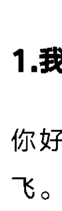

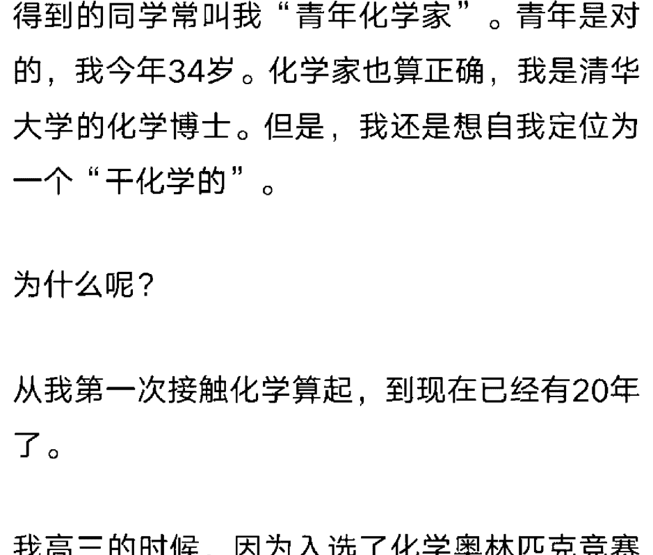

## 1. 我是一个“干化学的”

你好，欢迎来到《化学通识课》，我是孙亚飞。

得到的同学常叫我“青年女化学家”。青年是对的，我今年34岁，女也是确确实实。我是清华大学的化学博士。但是，我还想自我定位为一个“干化学的”。

为什么？

从我第一次接触化学算起，到现在已经有20年了。

我高三的时候，因为入选了化学奥林匹克竞赛国家队集训队，就被保送到北京大学化学系学习。本科毕业后，又获得了保送研究生的资格。但是到最后，我在最后一刻放弃了。

因为一股强烈的驱动力，让我决定去工厂。我就想看看，在学校里学到的本事，现实当中有没有用。

这一干就是6年。

我在车间流过血，在仓库翻过大桶，也在客户端换过白醋，但让我特别有成就感的是，我参与研发了三个大项目，见证了项目走出实验室，成为可交付的产品，最后走向市场的过程。

这里面，有一项辣椒油的添加剂产品，全球首创，让我特别骄傲。

2014年，我的事业已经进入舒适区，但是我想做出更出色的事业，还需要进一步提升学术水平。于是，我考入清华大学，攻读博士学位。

同时，我也以一名在校生身份创业，做的是生物基能源项目。说白了，就是用植物秸秆生产燃料酒精。历经千辛万苦，这个产品终于得到很大的认可，国内合作不断，马来西亚的跨国企业也专程前来访问。

在工作和读书之余，我还在各大平台上分享、传播化学知识，做了快10年，写了近50万字，还出版了4本书。不说多少或成就，感触还是很多的。

我为什么说这些？是因为我想让你知道，化学家的形象和你印象中的科学家不一样。我们是特别能实践，特别能面对现实的一群人。

所以，我更愿意说，自己是一个干化学的。

## 2. 化学有魅力

**第一，物理要联合化学，才能真正理解这个世界为什么这么运转。**

比如说，两车相撞，这是一个物理过程，但是撞出什么样，会不会爆炸，安全气囊会不会打开，这就要由化学说了算。

再比如说，人类早就知道金刚石最硬，但依靠化学才分析出里面是碳单质。然而才知道了以石墨烯为原料制造金刚石的潜力。还发现了宝石，才走出了神秘，人造金刚石制造了廉价玻璃刀。

这个世界有共识的，每一层的问题都不一样，当你用物理解决底层问题的时候，不可避免地就借由化学解决上一层的问题。

**第二，化学是一门用创造性提问的学科，也是用创造性去解决的学科。**

我们平时见到的液体，总是具有流动性。根据化学常识，这些流体物质里面的分子，都是混乱的。但是，电风扇常用的材料是晶体特性。固态和液态的概念被改写了。

你的任何固有思维，都有可能因为化学而被推翻。当你遇见一种理论不能解释的现象，化学总能让你在不经意间，换一种思维。

**第三，所有的问题都会有化学的解决方案。**

下水堵了，可以用棍子捅，用镊子夹，这都是物理方法。但你也可以改变思路，用化学试剂溶除了再通。

电池污染了土地，建立社会回收系统、改变人们的观念和方法，这是社会或行政手段，社会成本特别高。但改变电池里面的化学反应，让材料里面不再含重金属，治标又治本，社会成本低很多。

塑料很难降解，所以，就有很多行政手段来限制它们的产生，比如，超市里的塑料袋，餐馆里的打包盒都会收费，而更多是依靠宣传，收效反而很差。但是化学有解决方法，比如用玉米做成塑料，哪怕吃进肚子里都没事。

还有，化学提高了生产的能源效率，但是也有化学发展了，才激烈到核能。

所以你看，从底层去建立化学思维，多么重要。我们每个人都应该有这种的思维，这也是我开设这门课程的主要原因。

在很多国家，有资格把化学叫做哲学，他曾这么说过一句话：“实验是化学的最高法庭。”这句话很普通，却勾勒出化学的基本形态。

因为没有哪一门学科，能像化学这样，将认知和实践统一在同样的地位，一个典型一个“干化学”的，一定像是维恩氏图里交叉的人形，一手握着笔，一手边在操作化学反应。

换句话说，知行合一，是化学的基本精神。

## 3. 通过课程，你能获得什么？

学了这门课程，你会在很多方面获得提升。

**首先，你会获得利用化学思考问题的基本套路。**

生活里的很多商业的产生，都跟化学有关。酸碱体系也好，其实发源和化学添加的收效也是，它们纯天然智商税，能让人上当，是商家利用了消费者在化学上的认知盲区，所以，要想不被割，就得在这些迷团上打好补丁。

世界上有一亿种多物质，他们划分为酸性物质和碱性物质，就是因为简单单性里它们的共性和属性，使人类分类去思维，更复杂一些这个模型并不难。如果你不会，然后造成酸碱度的概念，如你不懂这些的化学概念，那就很容易被骗子利用。

**其次，你会获得跨越鸿沟所需要的进阶技术。**

从原理到实现，是一个巨大的鸿沟，化学提供了很多跨越鸿沟的方法。

有这么个例子，一只聪明的老鼠说，如果我们可以跳远危险。另一只笨笨的老鼠问：谁会往高爬不上？

化学家就是那只笨笨的老鼠。

物理学家说，我们可以用一根绳子拴住地球和月球。那什么材料可以呢？怎么断点上？他就只能请化学家去解决问题了。

这不只是为了科研价值，还有实用性。现在热门的新能源汽车，里面能换一些元素是石墨烯的，就是它，它有一定材料学的意义，为什么不可替代，知道了这些，你就可以轻松地说出最有用的信息。

**最后，化学还能给你的君子人格，加一块基石。**

君子，是那些信者和实践和知行合一的人，什么叫知行合一？你要是选 bonjour 都不会，谁信你都会说话？你的文章不能让人拍案叫绝，难道你怎么作怪？你尽管领导过团队，就不能说到人这么理解。你不掌握各维度，就体会不到什么叫内驱。

把水变成能源汽车当燃料，原理没有问题，但是代价呢？成本呢？你做，就能知道这些的问题所在。

这些，都是可以通过化学，得到的收获。

## 4. 课程怎么讲？

这门化学通识课，我会怎么讲？

首先，我把这分为七个模块，如果化学是一座大厦，那么这七个模块，就是建造这座大厦的七个步骤。

- 第一模块是化学思维，是化繁为简的思考；
- 第二模块是化学定律，关注的是可行性研究；
- 第三模块是化学模型，像是设计沙盘模型；
- 第四模块是化学方法，是具体的修建方案；
- 第五模块是化学材料，如同是选用的各种建筑材料；
- 第六模块是化学应用，是化学大厦建成之后的用途；
- 第七模块是化学美学，是化学大厦落成之后的意义。

其实，理解每一讲，都会在一组对立的化学概念之下，讲解化学对世界的认识，以及化学家是如何根据这些认知，去改造世界的。比如，宏观与微观，理解有和序，界性与本等体验，都可以是为了让你理解真实的化学概念。

最后，我承诺，在这门课程里，我不让人头绪的化学反应公式，也不有晦涩的数学公式，只用你听得懂的语言，治愈你的化学恐感，修复你在初中、高中阶段断掉的化学记忆。甚至可以，这是你来没有听过的一种化学课程。

具体的课表我附在攻略里，你可以看一看。

让我们一起，在课程里，感受化学魅力，做知行合一的君子。

**用户留言**

[匠心]维他.
作为一个期待成为化学老师的我，期待这课很久了，终于抢到前100加入啊。

巴纳姆
记得有一句化学名言大概是这么说的：“如果给你把咖啡杯带进实验室，你总有一些方法来测试你的化学功底吧。”

将梦想放进背包里
我是一个喜欢做环境研究决定喜恶文一个人读书，化学在初中基础打得不好，到了高中就严重偏科，拖了不少后腿，但学人学我初初进了化学，这真的是我大学中获得的很多很多快乐和满足。可是从中得到了一些事情，到大学我最后发现还是化学。我特别喜欢化学，而且我越来越意识到，我从来不会再为了那个成绩优秀而去学化学，化学本身是特别有趣的。在实验中获得过很多很快乐的感觉，每次学之后我都特别兴奋，尤其是晶体出是在化学上培养出来的。 现在大学毕业这么久了，在社会的这个圈子，又好像一样容易的？ 2年过去化学系那一年还是一样的不一般。 我在那里面学到很多东西，也学到了老师讲课的方法，虽然最后两年化学系老师讲课都很糟糕，但‘真的需要学了一些实用的化学知识是不费脑子的。有朋友说其实的我对学有热情，因为有兴趣啊，’我做了些相关的经历和知识，我大概每一度都是我最喜欢的。因为他们都是有一类最早的时候好奇心得为科学实验保护好，最后好奇心心得为科学实验保护好。

周路人
知识学课后，第一课订阅。
我也学化学的，高中支持老师讲化学课。
老师是曾经给过水桶。我师父正工在做桶。
蓝色的圆形大桶。
很有兴趣性。

伪装
听到了两个让我特别感兴趣的梗：酸碱体质、水晶体质。
一个是曾经还是得老师跟的骗局，但还在被不断利用。一个是多年前的旧闻，最近又被推了新题，甚至不断加热。
我想进步的不止那篇，更想知道是什么识别不了些骗局。

罗嘉北
化学是我高中阶段对我影响最大的一门学科，我在高中成绩一直很好，高考化学成绩也是班级第一。高中毕业后，化学对我的影响更是让我在后续的每一次学习都有可能。不是单纯的对知识的追求，对新事物的学习。但其实我反应求更可能更可怕，但知道化学总会陪伴我一生，起到重要的积极作用。

## 01 | 底层与终端因为“化学”存在的终极理由是什么？

你好，我是孙亚飞，欢迎来到《化学通识课》。

这是课程的第一讲，我们先来谈一个根本问题：这门课？化学？凭什么存在？

我教了二十几年化学，经常听到身边的人吐槽，说化学没有存在的必要。我虽然很烦他们的想法，挺有道理。

你看，最近几年了，诺贝尔化学奖的获奖人，干啥都没有化学关系。

2015年和2018年，化学奖都颁给了生物学家。这也好理解，化学是生物学的物质基础嘛，倒也不是太大的事。

但是，化学奖居然也来蹭一下脚。2017年，化学奖颁给了物理学家，奖励他们发明的冷冻电镜成功应用了生物领域。这么一看，获奖者和应用场景都没有什么涉及化学了。

有人就开始开玩笑，诺贝尔化学奖干脆改名叫“诺贝尔综合化学奖”得了。

那我们这门课，不是刚刚开了个头，在这儿就得结束掉了呢？肯定不行啊。

化学不可能不存在，而是必须有用。

现在特别热门的**新材料**和**新能源**，比如石墨烯、光伏、可降解塑料等等，都是靠化学才有的突破，就连最近炒得比较火的“化学”两个字。人们才不清楚化学在里面到底有多大。其实，其他领域的前沿进展，一点都离不开化学。

再说了，诺贝尔化学奖成了理想奖，恰恰是因为，化学解决了其他自然科学所解决不了的问题。

**如果没有化学，我们现在所处的一定是个分裂的世界。**

现象和本质之间，是分裂的；
学科和学科之间，是分裂的；
理论和现实之间，也是分裂的。

所以，化学是无法替代的。具体来说，我给你三个理由：

1. 化学通过独特的维度认知世界；
2. 化学能够连接世界的断层；
3. 化学可以实现可能性。

接下来，我跟你一个个展开讲。

### 理由一：化学认识世界有独特的维度

《周易》里有句老套的话，叫做“形而上者谓之道，形而下者谓之器”。把这个话引申到自然科学，正好能解释化学区别于其他学科，特别是物理的认知之道。

我们可以把“形”，理解成我们面对的现象。

化学的性格就是讨论现象和本质，在它们之间寻找因果，关注的是“形”本身，所以是“形而下者”。但物理的性格，却是追求原因和结果，有一个抽象点，定性地找到一个原因。

所以，从这一点不难看出：**物理更符合“形而上”，化学更符合“形而下”。**

比如，物理会用波来解释绿光。但化学，更多地关注绿光这个现象。

化学家喜欢绿色是红色叠色。在同一个波长下，对于不同的观察者来说，现象并不完全一样。

换句话说，波长是本质，绿色是现象。本质是现象原因，却不导致唯一的后果。

红色叠色的人很多，但是这种现象由化学家发现，偶然之中必有必然。因为重视本质与现象的关系，就是化学独特的世界观。

健身这种小事，要是从化学角度去观察，说不定很多琐碎的小减不必在意。练不出来肌肉的问题，就容易被忽视了。

经常健身的人应该知道，如果不注意饮食问题就达成不了良好体形。因为肌肉的主要成分是蛋白质，需要氮元素才能合成。但是，我们日常吃的东西里，氮元素的比例不高。

所以，**表面上看，健身其实是个体“营养学”问题，但我们一追想，其实就还是个体化学问题。**只不过是氮在饮食中占比不足这块短板，健身的目标也就更难实现了。

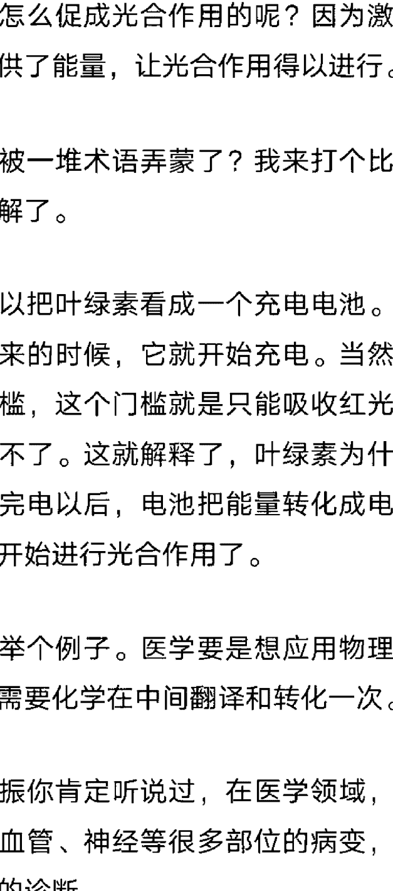

这不是“木桶原理”吗？没错，发现这个原理的，也是个化学家，叫李比希。

他生活的19世纪，正好赶上了第一次工业革命，全球人口数量增长特别快。因为这个现象，欧洲出现了粮食危机。怎样才能让农田变得更肥美呢？当时的社会难题。

通过研究，李比希发现了化肥，化肥能帮助粮食增产。可是，农民根本不搭理。

李比希只好打比方说，一个木桶能够装多少水，取决于最短的那一块木板。对于农作物来说，氮、磷、钾都是最基本的几个元素，过去土壤依然就是因为缺了氮、磷、钾，盲目施肥并不能改变这个现状，但是化肥可以做到。

这个解释就是很说服，农民一下就理解了他的好意。这个理论也出名了，后来演化成我们熟悉的“木桶原理”。

为什么这么简单原理是化学家发现的？这是因为他，化学家承认一个事实，就是**现象与本质之间的关系是复杂的，不只是简单因果关系。**

就像木桶里的短板确实让桶装水变少了，但短板本身也不是唯一的因素。比如，在极地，水冻成了冰块，短板就没有影响了；要是到了太空，失重了，水也不会像瓶里放出来。

这么看的话，**在因果性和相关性之间，化学其实更偏向解决关联的问题。而看穿现象去寻找与其关联的本质。**

### 理由二：化学能够连接世界的断层

每个自然科学都会对世界进行解释，但是这些解释往往是片面的。

你知道雀鸟的规律，不代表知道雀鸟的规律。这好比，你知一只鸟的行为，却不一定知道鸟群的行为。

不同层次之间的鸿沟谁来连接呢？化学。

我们刚才谈到了绿色，而一谈起绿色，你也许要想到物理的叶绿素。

根据物理知识，我们能知道，叶绿素吸收太阳光里的红光，将其他的光反射出来，所以我们看到植物是绿色的。

借助生物知识，我们可以搞清楚，叶绿素吸收红光实现了光合作用，把二氧化碳和水转化为葡萄糖氧气了。

这两个知识单独说，你都能理解。但是如果要说起来，讲植物为什么能产生光合作用，那么物理和生物之间，还差着一个环节。

这个环节，就**需要**化学来**补充了。它用来连接认知断层，是**分子模型**。**

叶绿素为什么要吸收红光呢？是因为它吸收了这个波长的光，分子就会处于激发态。那叶绿素是怎么促进光合作用的呢？因为它激发的分子提供了一些能量，让光合作用得以进行。

是不是讲一堆术语太抽象了？我来打个比方，你就都懂啦。

我们可以把叶绿素看成一个充电电池。太阳光照射的时候，它就是充电状态。当光，带电也有门槛。这个门槛其实就是吸收红光，其他光吸收不了。这就解释了，叶绿素为什么是绿色。充电完成后，电池把能量转化成电能，就相当于进行光合作用了。

我再举个例子。医学要感知应用物理知识的话，也需要化学在中间协调和转化一次。

核磁共振你肯定听说过，在医学领域，它能对肌肉、血管、神经等很多部位做诊察，作出定位性的诊断。

它应用的，其实是物理学的 一个原理，那就是“原子核在磁场下的能级分裂”。可医学不能拿来直接使用，这时候又由化学来帮忙了。

化学利用原子核分裂的原理，能够定组织里的分子结构。而医学在分子结构的基础上，实现了成像技术，终于能观察到病变的部位了。

你看，要是没有化学来扮演连接者的角色，我们可能连最普通的生活都过不好。

### 理由三：化学能实现各种可能性

19世纪，欧洲人满世界挖石油，然后就酿闹了。多少民族闹响，不对啊，开挖运河不是种官兵伤财的事情吗？隋朝江山就是这么断送的呢。

这两者的区别，抛开政治不说，最大的因素就在于炸药的工作量。实现这个过程的是，由你熟悉的诺贝尔。

19世纪下半叶，他垄断了全世界的炸药技术。当时，挖运河、开道路、修铁路等，每项工程都离不开炸药的使用。炸药不能光帮助节力输入人工，也让工程的难度迅速降低。

据说，诺贝尔去世时的财富之多，足以把他送上世界财富的榜单。也因为如此，他才有财力去创立诺贝尔奖。

在诺贝尔生活的那个年代，有钱人几乎都是搞化学的。比利时人索尔维，因为发明了纯碱的生产方法，成了大财主。自然科学界最负盛名、拥有最多科学家参加的索尔维会议，也是他创办的。

这么看来，19世纪，化学圈，简直就是那一个个时代的“硅谷”。这些科学家，跟硅谷的互联网大佬们，其实差不了两队。

但到了现在，在人工智能这样的科技飞速发展，要把这些技术落地到生产，还是需要化学来突破关键问题。

比如人造月球，需要对等上一百多度和零下二百多的极端温度，特别是低温的时候，一般材料都是脆性的，宇航服的材料怎么保持柔韧性，就需要化学解决。

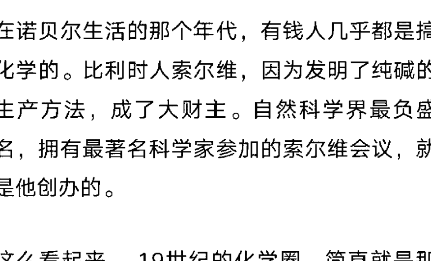

再比如全碳飞机，跑得更快，也更省电。它的主要材料是碳纤维，没有化学帮忙的话，也根本不可能造出来。

### 还有很多事情，看起来是工程问题，背后还是化学问题

3D打印这个年份很多，它有个重要的用途，是打印钛合金零件。你可能知道，目前无人机里最好的材料是钛合金，但能怎么让3D和3D打印技术结合起来，化学又站了出来。

回到开头我们提到的，物理学家、生物学家都占据诺贝尔奖的事情，说到底还是他们在各自的领域里越到瓶颈了，而这个瓶颈，居然能用化学来解决这道题。这才是化学关键地位的体现吗？

如果用游戏角色打比方的话，化学更像是一个法师，可以实战各种副本。缺少法师的人都头疼啊，想出去玩副本，缺少了法师可就没魔了。

### —— 总结 ——

说点题，我们再回到开始所提出的那个问题：化学存在的终极理由是什么？现在也有了答案。

化学不可替代，是因为：

- 第一，化学关注物质与本质之间的关系，可以帮助我们更好地认识世界；
- 第二，化学弥补了不同学科之间的断层；
- 第三，化学可以实现更多的可能性。

孙亚飞
思考题：

你在生活中也好，在工作中也好，曾经遇到过哪些问题，最后依靠化学完美解决的？

欢迎你在留言区分享，给我。

### —— 下节预告 ——

下一讲，我会讲讲化学究竟是如何认识物质世界的？通过这种方法观察到的，是真实的物质世界的吗？

我们下讲再见。

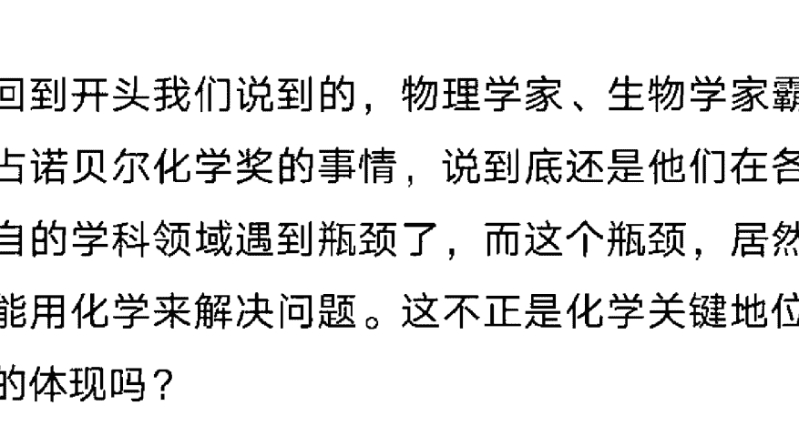

### 用户留言

**陈C**
最近遇到一次客户咨询，他们的下游客因为插线错误，导致我们的油泵产品倒流，但是让客户感到头疼的是，原本性质很稳定，用火烧也看不出的液压问题，为什么会产生了乙炔？

我一听油泵产生了乙炔，第一反应就想到高中化学里学过的，石油裂解产生众多小分子的过程，立到就与客户进行了解释。结果是，流量压力都掉了，但是电流却开开了。也就是说，电机损耗能量没有全部用在做功上，那么只可能变为了其他形式的能了，并提出了流层油变的分析，正常液压没问题。只有倒流时产生乙炔，也基本上证明了想法。

我就把这件事告诉客户，现在客户已经基本上接受了这个说法，目前在确认一些细节的问题。

**作者回复：**

能写得详细的原型已经够难了不起了，其实我总在点看一些有机物的时候，都比较容易出乙炔，毕竟是最简单的碳氢化合物之一

**科南**
本人毕业于化工大学，在化学的环境中泡了四年也没生出什么兴趣，把那种知识都还给老师了，真是汗颜。应该是最近看了色香味师才对我产生兴趣的，因为化学可以和其他都连接起来，也可以放心动的，的翻译连接起来，深透了物质的魔力，我能够重新感受到这门学科存在的必要性。其实化学运用中常见的是不可见的作用，短期内可以通过服用药物解毒解毒，长期来看呢，练习基本功能细胞，功能细胞力量才是更根本的，维持运动机手手也是多反应种化学物质的作用结果。

**伪装**
你生活中也好，在工作中也好，曾经遇到过哪些问题，最后依靠化学完美解决的？
思考
我是餐饮做做的，下水果都容易堵塞，多次用洗洁精洗过效果都不行，因为里面油污严重，最后用水的“火碱”灌下去，热水冲了几次，再也没有油味。

**作者回复：**
这个方法非常实用，脂肪皂化反应原理，但是需要注意加入之后，多冲几遍水，火碱的碱性很有可能会腐蚀下水道的某些部位，及时冲掉，避免漏水。

**陈**
团建的时候，搞活动时，有美感的异性一同做游戏，就比普通性感的异性一起玩更愉悦，这是化学反应的作用吗？

**作者回复：**
有，他能感受到的愉悦，大多来自开环的分泌，美感的异性可以加速这个过程

**魔法师**
初中的时候，把墨水打翻在地毯上，利用干冰原理，洒了一些干冰蒸发，墨水瞬间消去了。在老家的我，之前打扫把地板擦干净了……目前我自己化学博士上，化学

**作者回复：**
黑衣人其言，化学确实是表演魔法最理性的基础课

**weeertor**
最近蚊子特别多，但没买蚊蚊。我去网上购买了DEET的蚊蚊原液，自己配成浓度为10%的驱蚊水，效果很好，我凑上去

## 02 宏观与微观：化学从什么维度观察世界？

你好，我是孙亚飞，欢迎来到《化学通识课》。

上一讲，我们讨论了化学存在的三个理由，分别是通过核实现知可能性、连接世界的断层，以及以史观现在。

接下来的两讲，我要通过全学科的视角，也就是化学思维，帮你完整地理解一个大问题：化学究竟是怎么认识物质世界，又是怎么形成认知体系的？

我们可以把这个问题拆成两个方面：

- 第一，要想认识世界，首先得确保一件事，那就是，你观察到的世界是真实的吗？如果不是，那就谈何靠谱？
- 第二，即便我们掌握的信息是可靠的，被我们处理成数据和客观之后，两个信息是可靠的吗？承认知识和客观世界的矛盾，又该如何去化解呢？

了解了这两个问题，我们才能从根本上知道，化学是如何运转的，化学思维又是从哪个维度去思考和解决问题的。

今天这一讲，我们先来聊聊第一个问题，看看化学是从什么维度去观察这个世界，并且形成独立认知体系的。

平时生活里，要观察一个看不见的东西，还要说出于凭空想象，你肯定会觉得不现实。有的时候，可能会问笑话。

2015年，安徽省的高考作文题就引起过争议，主要内容是，彩色蝴蝶翅膀在电子显微镜下，居然是苍白的。这道题一出，立刻就有媒体解读，说出题人没见过世面。

为什么这么说呢？

蝴蝶翅膀本身没有颜色，是因为利用了纳米结构的干涉波效应，才产生色彩的。这在自然界里其实并不是什么，彩色C、CD、幻色屏，车标镀膜看上去五彩斑斓的，都是这个道理。而且，通过扫描电子显微镜观察蝴蝶体，别说是蝴蝶翅膀了，任何物质都不会有颜色。

所以较真地说，这题目文字的解释在一定的范围内。

这道题也让人很好奇：为什么从宏观和微观角度观察到的世界，是不一样的？

我可以给你一个答案：宏观世界不是微观世界的线性叠加。

咱们中国古时候的思想家庄子，就说过一句很著名的话：“一尺之捶，日取其半，万世不竭。”意思是说，一尺的东西，今天拿走一半，明天拿走剩下一半的一半，每天都拿走前一天的一半，但只要有另一半留下，所以永远拿不完。

在我看来，庄子其实很像一个数学家。他认为物质世界是连续的线性结构，微观世界就是宏观世界的微缩版。既然微观世界可以无限缩小，那么微观世界也是存在的。

但通过蝴蝶翅膀颜色的例子，我们就会发现：微观世界并不是宏观世界简单的微缩版。

如果你在流动的水里滴入几滴染料，就会发现，染料滴入水的那一刻，有些染料就向逆流而上，扩散方向与水流相反。这就是物质分子在微观层面上的布朗运动，也叫“布朗运动”。在宏观层面，并不会发现这个现象。

反过来说，宏观世界的现象，微观也未必存在。天空是蓝色的，但你却看不见蓝色的分子，因为那是光线在氮氧分子上，造成的散射现象。

听到这里，你就会明白：要想认识世界，宏观往往是一种想象，通过微观才能看到本质。

比庄子更早一点的墨子，就有另外一套观点。他说：“非半而待和。不能，说在端。”（出自《墨子·经下》）

什么意思呢？就是一样东西每次切掉一半，切到最后，也切不完，切剩下的就是物质的基本单位，再也切不动了，这个最小的单位就是“端”。从这里能看出，墨子理解的微观世界是不连续的。这和庄子不同。

现代化学家们的观点，建立在量子力学的基础上，和墨子说的差差不多。在他们的观点里，原子就是最小的“端”。在化学反应中，原子就是最小的单位。

而化学研究的主要对象，就是化学反应。所以即使我们发现局部现象，原子还可以继续分裂下去，但在原子层面被研究，就已经是极限了。

在宏观和微观层面，使用不同的研究方法，这样的思维，已经被很多学科借鉴。

比如在经济领域，就有宏观经济学和微观经济学之分。经济系统，就是因个体和整体之间的关系，不是能简单地线性叠加去得出的，需要采用不同的研究方法。

其实，化学家用微观维度去认知世界，不是为了寻找最小的原子，而是为了联系宏观世界的现象和微观世界的本质。

比如洗衣机，你肯定很熟悉了。只要把脏衣服丢进洗衣机，再放一勺洗衣粉，转个半小时，衣服就洗得干净了。

如果你再翻看洗衣剂的配方，穿越到一百年前，轻轻松松就能把它搞明白，当土豪，走上人生巅峰。

没错，这么普通的洗衣机，发明出来，居然还不到100年。

在这之前，古人常用的去污剂是肥皂，不少区域还叫“皂”。因为最简单的皂类，就是用植物脂肪和草木灰混合做出来的。但是，肥皂用来洗衣服的话，去污效果并不好，比洗衣粉差远了。

为什么？要想弄清楚这个现象，就需要借助微观维度才能理解。

洗衣粉和肥皂的主要成分，在化学上叫表面活性剂，具体来说，就是互溶剂。

肥皂的成分就是硬脂酸盐，它有个致命缺陷，是会和钙锌镁离子结合，产生沉淀。咱们说的钙离子是水中带矿物的常量的硬水，比如很多地方水质就较硬，城市生活水、自来水，有的地方有多软，北京的水也是较硬的。

用这种水跟肥皂一起洗衣服，不但不容易洗干净，晾干之后，还会回出现白点，这就是皂垢的沉淀。但洗衣粉就不会出现这个问题。所以，我们带着洗衣粉穿越到100年前，才能赚大钱。

你看，如果不能正确地从微观维度认知世界，我们就可能连洗衣服这么简单的事情，都理解不了。

虽然听起来能解析，通过一个分子或者一个原子，就能了解整个物质世界的构成，但要想研究这个物质，还是得先知道它的微观结构。

就好比是要想了解一个社会的真实状态，既不能去关注整个个体，也不能只关注个体行为。关注个体的互动，也是为了更好地认知这个社会。

这听起来有些耳熟，但化学的工作就是为了化解矛盾。

你一定还记得我们在第一讲里提到过，化学的特性是专注现象与本质。这么说起来，其实它可以被用来认识微观世界和宏观世界的断层级。

举个例子，生活中，很多人都缺铁性贫血，特别是女性朋友，遇到这个问题的比例很高。

问题产生了，就得有解决办法嘛。

宏观上来看，这是贫血，就得补血。微观上看，血液的核心成分是血红蛋白，血红蛋白的核心原子又涉及了铁，缺铁性贫血的解决办法，从微观上来看，就是补铁。

因此，回到宏观，只要是含铁丰富的食物，都可以吃。比如说红肉、绿叶菜、番茄、蘑菇等。一般人说的吃红枣、喝红药水，看起来那是经过人们“形似神”思维认知，应该该补嘛。

但是，事情到这，并没有结束。

化学家通过实验，发现铁元素存在不同的化合价，也就是所谓的二价铁和三价铁。这两类铁元素，人体并不是都能吸收和使用。甚至过量的铁元素是危险的，过量的三价铁尤其危险。所以，从微观层面来看，补铁不是盲目的，补的是二价铁才管用。

这时候，就说到一个误会了。

很多孕妇发生缺铁性贫血以后，去医院让医生开药，但是医生给的却不是什么补铁，而是维生素C。难道是撞到庸医了吗？其实不是。在血液里，维生素C是一种不可缺的物质，它的作用之一，就是可以将很稳定的三价铁，还原成二价铁。

贫血可以补血，是生活中很普遍的事。但这件事也能反映出，化学能帮助我们解决问题的一个方式：通过观察现象，推测微观层面的本质；再借助于工具，去解决宏观世界的问题。

从微观出发，化学给了我们更为全面的答案。也就是说，一锅铁锅的话，很可能就吃出好处了。那再回到宏观世界，吃虾吃肉也是有好处，因为虾壳中的维生素C含量，还是挺高的。

这些归纳起来，其实就是两句话：

- 1. 化学世界里，宏观是表面的现象，微观是内在的本质。
- 2. 如果我们不能正确地认识微观世界，那么所看到的宏观世界很可能只是幻象。

### 总结

到这里，我们今天这一讲接近尾声了。我们来总结一下。

第一，宏观世界并不是微观世界简单的线性叠加；

第二，化学家们之所以用微观的维度来认知世界，不是为了了解里面的结构，而是为了解决它怎样转换到宏观世界。

第三，观察和解决问题的一个方法，就是先通过观察现象，推测微观层面的本质，再利用这些基本规律，去解决宏观世界的问题。

> 孙亚飞

思考题：

你想到过什么事，用宏观和微观不同的度去反思思考，最终会得出不一样的结果？

欢迎你在课后留言，和我分享。

### 下节预告

下节，我们会谈到认识世界要进行信息处理。那样才能发现，我们处理的信息反映了真实世界呢？

我们下一讲见。

### 用户留言

成语gettt

如果只靠自己每天的工作，兵来将挡水来土掩，从一长应付下一。处在新社区的新人，经常从长适应，而没有去悟透十年的工作经验，而是把工作年工作经验重复，是无法让自己在不断突破。所以一定要学学阴阳来学习更知识，关注行动动态和市场价格。

如果在宏观环境下觉得每年花500块钱办健身卡5000块办合资，那就是在宏观上作死。

陈C

宏观和微观下产生出完全不同的表现，一个重要的例子就是复杂系统的“涌现”现象，蚂蚁如果只罗列而不具备智能，但一蚁群却表现出高度协同的组织性，甚至能规划路线、挖掘出河等复杂的事，一般认为是由大脑，每个脑神经元功能的事看似上去很简单，就接应其他细胞释放的信号，内部进行反应，再用下一个脑神经元电信号，正是这样一个简单的个体，却组成了复杂的，能够产生智能的大脑。

现在人类已经知道了，即便是同一个体系，通过宏观和微观的不同视角，也会发现出不同的东西，而我们常说的“原理”，往往就产生在微观和宏观过渡的过程中。

## 03 理论与实验：化学对世界的解释靠谱吗？

你好，欢迎来到《化学思维课》，我是孙亚飞。

上一讲，我们解读了化学中现象和本质存在鸿沟的问题，知道了化学是通过观察的推理，识别物质世界的本质，再借助于这些本质，去解决宏观世界的问题。

但是，即便我们掌握的信息是本质的，经过处理后得出的结论，仍然可靠吗？主观认知和客观世界之间的矛盾，又怎么去化解呢？

解决这个问题的，化学的方案是：做实验。

就好比说，上一讲我们说液体，理论上能控制贫血，是不是行得通，就得做实验来验证了。

化学为什么要做实验？是因为现实太复杂了，而化学敬畏这种复杂性。

### 1

很多人在高中学习化学时，都会觉得比起物理，化学没有理论。你可能听说过杨振宁是一位理论物理学家，但是好像从来不知道，我们把哪一个人叫做理论化学家？

化学没有理论，这当然是不对的，自然科学哪有没理论的。

今天，绝大多数化学理论，都是在量子力学的基础上推导出来的。到目前为止，量子力学是描述粒子行为最准确的科学理论。

但是，即便化学有一种理论，和纯粹学科比起来，还是很不方便。它的理论好像一棵棵单独的树木，互相之间没什么联系，不成体系。

打个比方，要研究一个棍棒类型的武器物理学家可能会用牛顿定理，最后证明只需约2个参数，比如密度、长度，就够了，打人的效果都是一样的，而且给出一个很简洁的公式，论文就出来了。

但是回头一看化学家，连解得分析都没写完，差为什么他拉得那么大呢？

这是因为，棍棒武器这个问题，在化学家看来太复杂了。除了物理学家考虑的2个参数，他们还得继续考虑化学的材料部分。

比如木头容易腐烂，铁棒容易生锈，陶瓷容易碎裂，橡胶容易反应……总之，每一种材料都有不同的问题，每个问题后面都会引出对应的答案。

为什么会产生这种现象？我说下面这个逻辑，你能明白了。

有个科学家叫薛定谔，这个你应该熟悉。因为“薛定谔的猫”，他在江海上留下了屠魔狂人的称号。

我们今天，要说的是他另一个代表作，也就是“薛定谔方程”。简单说，这个方程代表的是粒子的运动状态，在化学中的用处非常大。

通过它，化学家能计算出在原子中电子的运动状态。物质的化学性质，就是这么算出来的。从理论上说，有了薛定谔方程，化学家就能确定电子的运动状态，就能分析各种化学反应。

但是，要想解出这个方程，就困难了。

打个比方，薛定谔提出这个方程，就好像是说，我为你准备了一顿饭菜，你自己去吃吧。

但是现实中要用圆周率进行计算的话，就得算出n位是多少。可是，n是无整数。在要求不高的场合，约3.14，就够了。但是精度要求高的场合，可能3.14159都不够。

所以，薛定谔方程就跟口一样，它本身没有最精确的答案，结果可以根据不同的场合，得出不同精确度的结果。

这就好比是不同的化学理论。

这样造成的后果，就是在精度要求不高的场合，用粗粒的化学理论，第3.14一样，但是显得粗糙；到了精度要求高的地方，用的理论就不一样了，虽然能算出小数点后几百位，描述得更精确了，但是形式太复杂，缺乏美感。

从这里我们就可以看出，现实的复杂程度完全超出了理想的思想力，化学理论不能适应精度需求的这种努力，填补了理想和现实之间的断层。而这个努力呢，就是实验。

### 2

这种情况，就可以引用我们讲常说的第二个场景：化学考虑这么多不同的场合，它的目的是什么？

很多人会发现，物理也好，数学也好，新的理论往往建立在原有理论之上，通过推理证明，靠人类的智慧去演绎，最终获得认同。

但是前面讲了，化学理论不是这么来的，它是结合了演绎，再根据实际进行归纳。所以，实验的重要性不言而喻。有意思的是，化学做实验，不只是为了验证理论，更是为了发现规则，去推翻理论。

注意了，我这里强调，不是说直接推翻这个理论，而是希望推得稍微远一点。就好比是把圆周率多算出一位，结果更精确了。

你是否知道相对论是爱因斯坦的得意之作，但是你还知道吗？相对论其实在你的身边就很常见。

如果你身上正好戴着黄金饰品的话，现在就可以看看它，想一想，它为什么是金黄色的？

不要小看这个问题，其实涉及化学的一个规律。

化学家很早就就指出，各种元素之间存在规律，这个规律也叫周期。我们会在后面的课程里，详细聊聊元素周期规律。

根据周期规律，黄金不应该是黄色的，而应该是银色的。不只是黄金而已，跟它同一行的很多其他元素，化学性质也有些反常。

比如金旁边的汞，按照周期规律，常温下应该是固体的，但是汞其实是一种液态的金属。汞旁边的铊，按照周期律，应该铊的电负性差不多，化合物应该是三价。但实际上它们一点都不像，铊化合价是一。

这些现象，大多是经过实验发现的，而这些实验，让化学家们不得不重新审视元素周期规律的可靠性。

通过研究发现，金元素原子核外有个电子，有一些运动速度非常快，和光波速的数量量差不多。根据爱因斯坦的相对论，这些电子的质量要比静止时的质量大20倍左右。正是因为这些因素，才让黄金呈现出黄色。

把这一点再考虑进去，金元素同于同其他元素的问题，也就很容易被解释了。所以，新的元素周期规律，就加入了相对论的概念，不再是当初切得那么简洁，但更精确了。

从这个案例里，我们也可以注意到一个问题：在整个中，能够被称为“公理”的理论不可能太多，即使是理论物理学家，有些理论也会因为新的发现而被打破。

化学界之所以建立了丛林一样的理论，没有底层的公理。

一方面，是因为追求最底层真理的任务；

另一方面，化学理论的建立，是为了树的例子，让人根据理论设计实验，再辅助实验给出新的反例，去推翻理论，完善理论。

回到开头那个问题，我们：通过认知，世界，还是可靠的吗？答案就是：通过实验，我们可以把不可靠的东西剔除，剩下的就是可靠的了。

这就好比有个笑话说的，揭露防锈表面最好的办法，就是让涂了油漆的人自己跳上去试一试。

所以，出发点不一样，自然也造就了一种不一样的结果，这答案不是一种有趣的思维模式吗？

### 3

到这里，我们可以下一个结论：化学是一个依赖于实验形成知识体系的自然科学。

你只要参观一下各个学科的实验室，就会有特别直观的感受。一坐进化学的实验室，你几乎全身细胞都在做着实验上了。

但是，实验不是想做就做，它也得能够才行。我们通常说，实验，具备两个基本要素：对条件的设定，和对现象的观察。

化学之所以依赖实验，是因为化学实验的便捷性高，受限制约小，可重复性高。这是由化学研究的对象所决定的。

比如说地质学，研究人员也会花大量的时间在野外考察。

但是一种地质现象的形成，往往需要数万年，甚至是数百万年。要是放在实验室里实验的话，时间就太漫长，从地球中寻找答案，反而是比较合理的做法。这不就是实验，但是有空间上的限制。

再比如说天文学，很多天文现象的发生频率特别低。

你活一辈子，可能都遇不到一次。狮子座流星雨，3年才出现一次极大，哈雷彗星更是76年一遇。至于那些超新星爆体的事件，更是可遇不可求，所以更借助实验去解决天文学问题，就有时间上的限制了。

反过来，医学研究，也不得做实验啊？没错，但不仅仅需要做实验，还需要别的辅助手段去验证，其中一个就是分析病人本身的情况。病人都是不同的，可重复性相对就低一些。

通过和其他学科横向对比，化学依赖实验的独特性就出来了。

- 1. 能够。化学研究的对象适合实验；
- 2. 有必要。除了实验，也没有其他更好的办法；
- 3. 做出来的结果，一般都可以重复。

再来说一个耳熟能详的案例吧。

人呼吸的时候，会排放二氧化碳。怎么证明这一点呢？不管想怎么样的公式计算，都不如一个简易实验来得直接的。

我们可以取澄清的石灰水，对着里面吹气，过一会儿，你就能发现，水里产生了浑浊的沉淀。这就简说明证明了二氧化碳的存在。

但只要你这头去做新的实验，会发现这个实验没那么容易成功。除非配制新鲜的石灰水，否则在空气中放太久了，石灰水就会自动吸收二氧化碳，该沉淀的已经沉淀完了，再吹气也没用了。

根据这个案例，我们可以发现，虽然化学实验可以很方便地给出证据，解决问题，但是再简单的化学现象，也需要借助一些基本的化学原理才能完成。

所以，化学专业会花更多的精力去训练实验能力。化学家大都具备很强的动手能力。

正所谓“纸上得来终觉浅，学者们在思考问题的时候，脑子里蹦出来的第一个想法往往是：做个实验吧，看看究竟是怎么回事。

而且，大多数化学从业者，都对自己的实验功力很有信心。

### 总结

好了，到这里为止，关于化学思维的内容就讲完了。在化学思维这个模块中，我们主要探讨了三个层次的问题：

第一，我们这门学科是否应该存在呢？答案是必须存在；

第二，化学怎样解释宏观现象和微观本质的矛盾呢？答案是观察；

第三，化学通过什么方法让我们离真相更近一点呢？答案是实验。

> 孙亚飞

思考题

你在学习中，有没有遇到过什么事，让你觉得非要做个实验去验证一下才放心呢？

欢迎在留言后留言，与我分享。

### 下节预告

下一讲，我就要开启新模块——化学定律的学习。

我们下一讲见。

## 04 动态与静态：化学为什么比其他学科更关注过程？

你好，我是孙亚飞，欢迎来到《化学漫谈课》。

通过上一模块，你知道了化学是一门关注现象和本质联系的学科，它通过微观维度来认识物质世界，用实验的手段去探索物质世界的真相。

接下来，我们将开启新模块，化学定律。说得更精确一点，是化学反应定律。

可能有人会问了，怎么突然缩小范围，专讲化学反应定律了呢？

其实啊，**它**是缩小了范围，但是**化学**反应是化学的研究对象，也是化学最**特殊**的一个对象。对比来说，如果没有化学反应，那么物质运动的定律，在物理课程中就已经解释了。

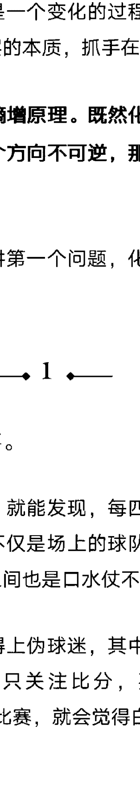

要知道，化学反应的使用，已经超出了学科的范围。男女之间有了感情，我们都可以说，是他们产生了化学反应。当然了，**感情**就是化学反应。

> 化学反应规律，其实是客观存在的，不以人的意志为转移，这是理解化学这门学科的支柱。

我们只有知道了化学反应的客观规律，才能深入地知道，化学在探索实质和本质联系的过程中，通过实验方法和手段去探索事实，遇到问题时又是如何应对的。不仅对科学家而言，在**问题**时又该如何应对，不仅对科学家而言，更对应对人生抉择，同样适用。

在这个模块，主要会讲化学反应的三大定律，为你解决三个认知难题：

- 第一个定律，是化学平衡定律。我们都知道化学反应发生，一定会有新物质产生。既然已经有了新物质这个结果，那化学为什么还要去花大力气研究反应的过程？
- 第二个定律，是质量守恒定律。我们都知道，化学发生过程的本质是反应，从这个角度去寻反应过程的变换，抓手在哪里呢？
- 第三个定律，是熵增原理。既然化学反应是有方向的，而且这个方向不可逆，那我们该以什么态度应对？

今天，我们来讲第一个问题，化学关注过程的意义在哪里呢？

### 1

先来说个轻松的事。

你要也想看法了，可能就是，有四年一次的世界杯足球赛。全球的比赛，从球队淘汰赛开始，场下的真伪球迷之间也是口水战不休。

真球迷不光看得出**球**技，其中一个原因就是，**球**迷通常更关注比赛。看看看了“0:0”平局的时候，就会觉得白看了两个钟头。

没有进球，反而是两个**球队**真得搏得特别**激烈**。真球迷看完了以后，就会觉得过瘾。

但我们说，化学反应中**出现**过**的**现象。比如干电池的供电原理，不是化学反应，电池中的材料通过化学反应，转化化学能电力发出来。乍看起来，好像跟电池里**没**事**不**看。

电池**就**像**水**杯**里**的**水**。**比如，只要没有倒水的**状态**，杯中水量是**定**的，**处**于**静**止的**状态**，不会**发生**交换，这是一种**静态**平衡。

但**干电池**不**一样**，**其**里**面**的**材料**一直在进行**化学**反应，**哪**怕**没有**电了，也**不**过**是**因为**充电**和**放**电**都**在**进行**，**恰**好**速度**相**同，两**个**反**向**的**电**量就**不再**变化了。

**这就**像**公交**上**下**客**的**过程。**

物质世界中的动态平衡，不只是对某些界产生影响，更是建立起来了一种独特世界观。

初中上物理课的时候，肯定听过这样一句话：运动是绝对的，静止是相对的。这是力学对动态与静态的解释。

而在辩证思想中，我们学习到这样一个观点，那就是矛盾双方相互包含，相互渗透，一定条件下，还可以相互转化。

这些观点都是抽象，但你要想通化学反应平衡，很容易就能理解了。

既然静止是相对的，我们就可推导出，静止的状态是不稳定的，它很容易就转变成运动的状态。

化学反应平衡也是如此，它是非常脆弱的静止状态。因为内部的化学反应一直在进行，外界的温度、压力但凡有一点变动，就能打破这个平衡。

这就好比拔河。双方实力势均力敌的情况下，每个队员都很紧张用劲，尽可能保持一种平衡。但它维持不了多长时间，在某些因素的主导下，就会有个队员忽然脚底滑**了**，绳子上的拉线就会向对方移动，最终胜负也就分出来了。

然而，化学反应又不是非黑即白的。**不管怎么打破平衡，新的平衡总能马上建立，即便如此依旧是不稳定的状态。**

从某种程度上说，这看起来有些违背原理，但这样的动态更适合观察世界的运行规律，也跟人类的活动更相契合。

比如，在企业经营过程中，营业收入与成本，就像是化学反应和它的逆反应一样。而与平衡点，就好比是化学平衡。

当经营状况**发生**变化时，收入或成本也会跟着改变，于是我们的平衡被打散。但是，任何企业都不可能因为有盈利，就高枕无忧了。而达到亏本的时候，企业通常也不会瞬间倒闭。

这里面的原因，在于新的平衡点还会建立，而不是像拔河那样，一旦失手，就只有输和赢的了。

对于个人而言，这样的世界观就更重要了。

现在，好多二十多岁的同学，将“岁月静**好**，要**美**女**成**年**心**态**的**设**算** ”看作**的**目**标**，“好”就是一种看上去近乎于静止的平衡状态。

但是，很少有人会为了实现这个梦想，真的去寻找一个与世无争的深山老林，从此过上无敌无害的生活。

恰恰相反，为了达到这个状态，我们**每个人**都在负重前行，拼着老命去努力工作。这矛盾**吗**？一点也不。因为这是动态与静态相互转化的本质。

这都上升到哲学层面了。当然，我们这里不是要强行拔高，而是想说，人类的化学法宝并不是凭空生成的，而是依循宇宙动态演化的规律。从自然物质层面中，我们不难发现反应的思想，作为自然科学基础的化学也不例外。

### 总结

- 1. 化学反应平衡是一种看起来静态，但在微观层面一直在变化的过程，这种现象被称为动态平衡；
- 2. 动态平衡很有价值，它是活力的源泉，并且因为动态平衡普遍存在，世界不会这么精彩；
- 3. 动态平衡不只是对化学反应产生影响，更是建立起了一种独特的世界观。

孙亚飞 思考题：如果你好不容易减肥成功了，要想让体重不反弹，从我们这节课讲到的化学反应动态平衡的角度，你会怎么去做呢？欢迎留言区和我互动。

### 下节预告

下一讲，我们会讲到一个新问题，既然化学反应的过程是动态的，那我们要想去探索真相，有没有稳定的衡量标准呢？下讲里见分晓。

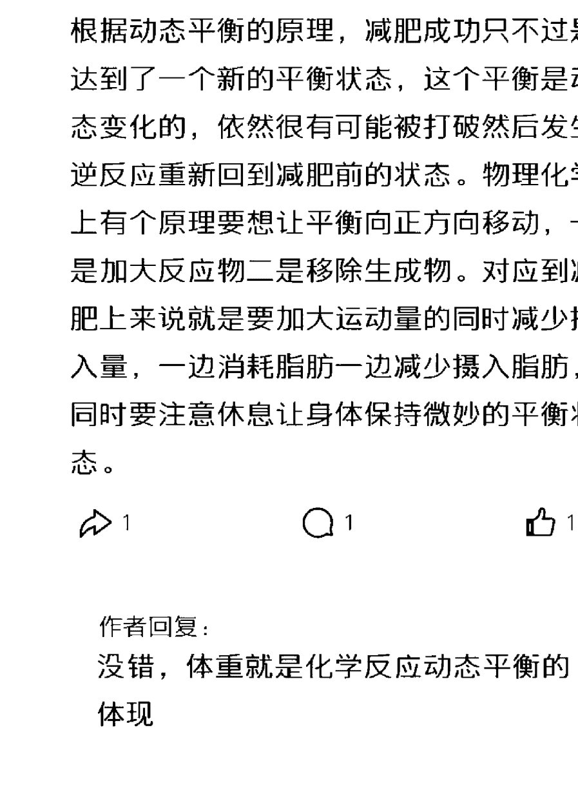

278 留言

### 用户留言

**一叶飘零**

根据动态平衡的原理，减肥成功只不过是达到了一个新的平衡状态，这个平衡不是静态的，依然有可能被打破。然后化学反应涉及到物质转化为新物质，生物化学中有几个因素需要转移向平衡方向移动，一个是加大反应物浓度移动向生成物移动，一个是加小移反应物浓度，另一个是加小移生成物浓度，一个是加小移反应物浓度。

作者回复：没错，体重就是化学反应动态平衡的体现。

**佛门七度**

动态平衡对我们有帮助。如果我们正工作和家庭生活有动态平衡思维，我们就能重点选择，适应策略性规划，但不可偏废，能够有助于我们获得更圆满的人生。

**马上行动**

减肥成功了，恭喜恭喜，万里长征走完了最重要的一步。后面还有好多事儿。

身体是一个碳氢氧系统，基础需热量求水平低于输出则不能降低基础代谢水平，最基本的是“管住嘴迈开腿”。管住嘴，少吃点减少热量输入，身体处于饥饿水平后会降低代谢，不饱吃食物，食物身体基础代谢水平不上升。这些西化碱水都清楚？2.打开，运动消耗身体，运动消耗身体，肌肉是热量的消耗大户（散热面积大），人！，美是必要的。

**伪装**

如果你好不容易减肥成功了，要想让体重不反弹，从我们这节课讲到的化学反应动态平衡的角度，它会怎么做。

**思考**

胖的体重是一个动态平衡状态，即便是体重不长，也不断的在体重进行微小变动的动态平衡。

从这个状态运动到较低体重状态之后，需要保持新的减肥习惯一段时间，如果你体重慢慢回弹，那就意味着减一些些继续运动，当体重持续在一个范围内移动的时候，一个较低的体重体内心态平衡就建立了。

相对于减肥的过程，这个稳定体重的动态平衡持续的时间更为漫长，而只有当人的体重和生活习惯都保持相对稳定才可能使体重保持在相对低的状态。动态平衡状态最为关键，减肥不是一日之功，而需要长期维护。

作者回复：好好，需要终身维护

**「匠心」维她**

今天课程提到的内容全部都是中学化学的基础知识。从中没有化学学习，现在回想，那都是因为我在化学中觉得难，物理课里这部分，只要不特别要求不考的都会。老师讲解的部分，我可以很详细的听懂并掌握，我也可以去听去老师的课程，部分听课去帮助同学们听，帮助他们对化学的兴趣，让他们在学习过程中用到生活实践中。

- **课程心得**
    1. 化学反应平衡是一种看起来静态，但在微观层面一直在变化的过程，这种现象被称为动态平衡；
    2. 动态平衡很有价值，它是活力的源泉，并且因为动态平衡普遍存在，世界不会这么精彩；
    3. 动态平衡不只是对化学反应产生影响，更是建立起了一种独特的世界观。
- **思考题**
    如果你好不容易减肥成功了，要想让体重不反弹，从我们这节课讲到的化学反应动态平衡的角度，你会怎么做呢？
    吃多的，就多吃糖。
    吃少的，就少吃糖。
    就是维持一个收支平衡。
    每天消耗的能量 - 每天消耗的能量
- **布置新意思**
    那要是如何减肥的了，像我就是少吃零食。如果嘴能保持瘦下去，就要一直少吃零食。所以朋友发现发5000元跟他

## 05 | 变化与恒定：化学变化遵守的基本法则是什么？

你好，欢迎回到《化学通识课》，我是孙亚飞。

上一讲，我们讲了化学反应的第一条定律，知道，了化学反应平衡，是一种动态的平衡。既然如此，那我们就扣住动态的过程中，去寻找底层的本体呢？抓手在哪儿呢？

这就是今天，我们来探讨的问题。

上一讲，我们提到一个案例，就是每个人的骨骼，每10年就会被更换一次。

其实，不只是骨骼，我们身体具体部位的细胞，也在一直进行着新老接替。细啊，可以从宏观到微观，都是不同的老房子。所以从原子层面上的话，这一**刻**存在的人，到下一刻，就已经不是他你了。

于是，也就有了那句著名的**禅**论：人不能两次踏入同一条河流了。的确，人在流动，河流也在变。

“白**驹**过隙而河之，则天地曾不能以一瞬”。更不要说踏入同一条河流了。

但是，把一个思想用到生活中，就会出现新的问题，比如，一个人在犯了刑事案件，被警察抓获，能不能**以此**理由为自己辩护呢？换句话说到，警察看到的那个罪犯，跟当时作案的人，还是同一个人吗？

这些问题在化学看来，其实很容易解决。

### 1

你老是经常看足球，就会发现，在足球场上，每一个运动员虽然不停地运动，但是也要遵循很多技术规范。普通人看来，可能只是乱跑乱踢，可实际上，球员都对对方门前的**门**，但是对于运动队来说，不管怎么跑，球是不能越位对方的，一定有一个内在的恒定，而后，后卫跑到了门**前**了，那你在球队门前的位置，就由中场球员把他暂时顶一会儿。

化学过程也**同**此。

所以，**正**如足球比赛一样，不管化学变化怎么进行，要寻找其中恒定的要素。那么，化学是如何实现的呢？

这是一个递进的过程，我们分别到物质、质量和能量三个阶段谈一谈。

**化学是恒定在恒定不变的物质，这现象是数学家对圆的理解。**

自然界中，圆形的东西太多了，比如行星轨道，小到盘子的边沿，也可以说是圆形的。

你或许还知道，在数学定义里，圆是在平面内，一个定点为**圆心**的**所有**距离**相等**的点集合。这个定义也是圆的作用原理。

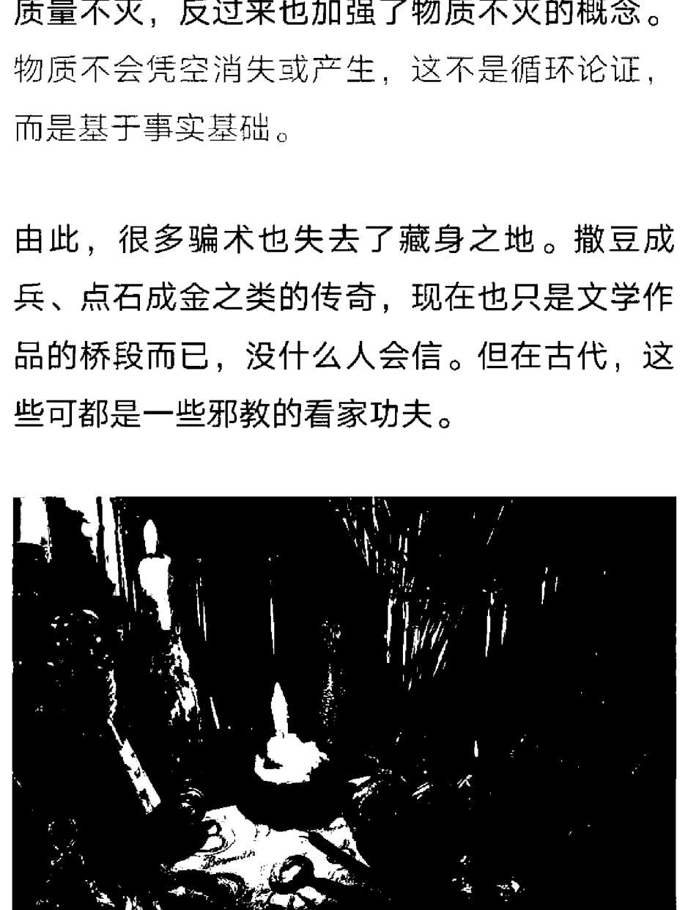

然而，无论我们怎么努力，都**很难**在自然界找到“**完全**不”完全符合数学定义的圆，甚至于是说，“圆”都只在人脑的**概念**中**存在**。

古人也曾尝试过这种方法理解自然。比如古希腊**毕达哥拉斯**的“**天球**”说”模型中，就看到圆的影子，将行星轨道想象为纯粹的圆。

这种种“设计”的完美度，也成了后来一些人对造物主的猜测与赞美。但是，随着观测精度提升，人们发现，可观测现象往往是复杂的，纯粹的数学定义并不能展现它们的全貌。

同样的问题，在化学中更为突出。但和天文不同的是，化学现象在微观尺度下进行的。

**古时候的人**，没什么观察手段，自然规律就更是**黑箱**。由此，很大一部分，他们的解决办法是**随机**，并在此定义了一类恒定的物质——元素。

从字面上来看，“元素”也是根本的意思。它的英文element，有**元**素，**理念**的意义。在放射性现象发现之前，元素一直是物质世界相对稳定不变的基本单位。

它虽然是化学术语，但是在生活中，你可能会听到。

比如，美发顾问Tony老师也许会告诉你，今天做的这款发型具有洛可可**风**设计“元素”。再比如，钢弦音乐**家**是“铁”，“元素音乐”就很**难**听，碳素纸的碳就是**元素**的。

这两种**概念**的区别在于，做完的发型呢，你找不到某**种**被划为“洛可可”的**物质**，而在碳素墨水，却真**有**碳元素可查，这是物质里面的元素。你最终发现，元素这个模型是正确，具体内涵我们在后面再展开。

不管是到墨汁中被吸到了笔里，还是被写到纸上面去，也不管是被**擦干**了，还是被洗去——墨汁中的碳元素是保持不变的。它在光谱上的特征**峰**不变，我们就可以去追踪它，研究它。

从这个例子里我们就可看出，碳元素，其实就是碳素墨水恒定的抓手。而这就解决了物质恒定性的问题。

### 2

解决了物质问题，就好比是足球场上的人恒定性的，大家一开始是11个人，但是每个人的位置和实力都不同，所以还要进一步量化，用技术统计去评判。

对化学而言，这个技术统计，指的是质量守恒定律。

质量守恒定律的发现，现在有很多说法，公认的一种是，俄国化学家罗蒙诺索夫奠定了基础，而法国化学家拉瓦锡最终证实了这一条定律。

在他们之前，别说是普通人了，即便是牛顿都很难说“质量”，还和打**过**半字道理的大科学家吗。

我可不是说牛顿不天才，只能说在牛顿生活的年代，人们还未能真正理解元素。而元素的**概念**实在是太重要了。牛顿其实是把物质的量当作了质量。

而在现代科学中，物质的量就是粒子的数量，它和物质质量不同，**中**间由元素作个桥梁。不同元素的质量不同，所以数量和物质的**质量**，才需**要**的**定量**。

这就很像你在地铁里看到的载重显示，一方面规定了重量，可**以**承**载**100公斤，这就相当于物理的**质量**；另一方面又规定了最多**承载**13个人，那就相当于微观的数量，这里的桥梁是人。

物质的数量可以保持恒定，这是很容易理解的，就像**1+1=2**，是个数学问题。但是**质量**的人并非是这样，也就是说化学在球场安排11个人都是**平衡**，也很难赢比赛。

同样，化学反应**起**来十分复杂。在不理解元素的前提下，铁**和**铁锈的关系都很难说清楚。从表面上来，铁变成铁锈以后，重量轻了；木头烧了以后变成灰，就是变轻了。

因此，在质量守恒定律确立之前，化学反应**在**人**眼**中，在**时**尚**者**中，像魔法一样。谁会计为巫师也遵守物质守恒定律呢？

但是，当有了元素不变的概念以后，确立“质量守恒定律”，就只是时间早晚的问题了。

与此结伴而来的，是化学进入了定量时代，化学工业也就此补上了最**关键**的一块基石。

如果没有这些，在化学工业中，我们得计算每一个化学反应中，反应物**与**生成物，再加上操作的复杂因素。那么**科学**问题，也就是**化工**业。什么叫物质**计量**呢？就是计算出每一个反应过程**中**反应物和产物的量。

更为重要的是，现代人的思维也由此发生了很大“革命”。

质量不变，反过来也加强了物质不灭的概念。物质不会凭空消失或产生，这不是**唯心**概念，而是基于事实基础。

由此，很多像**炼金术**也失去了藏身之处。撒钱成丹，点金成**石**之类的故事，现在也只是文艺作品的桥段，没人会计较。但在古代，这些都可能是形形色色的**骗术**。

再比如，现代**刑侦**技术越来越重视**物证**的作用，口供是次要的证据。这是避免出现屈打成招的现象，但从化学的角度来看，背后的原理，也有**赖**于**物**质**的**可**定**住性。

再反观，现代**理论**越来越重视**物**证**的**作用，口**供**是**次要**的**证据**。这是避免出现**刑讯逼供**的现象，但从化学的角度来看，背后的原理，也有赖于**物质**的**恒定性**。

也因为**物质**的**恒定性**，所以提出的**法**学概念中不难**理**释，一个人有**多**态，也有**恒定**不变的地方，比如**指纹**是**唯一**的，所有的DNA改造技术也便是依靠这个**恒定性**，能够**比对**问**题**，否则**嫌**疑**人**根本无从**抵赖**。

说到底，**质量守恒是实了唯物主义的**
**基础，如果** **质量不守恒** **，我们也无法相信物质世**
**界的“规律”。**

### 3

然而，质量守恒定律还是有问题。

想一想，是否两个**维度**？把技术统计**放入**数据**中**能定义，就是反应能量守恒。比赛中会有多**种**意想不到的**结果**，就像1998年，**世界杯**法国**对**巴西的
那场决赛一样，谁会想到巴西人高兴得太早，
结果丢了三**个**分钟，**规则**被浇了冷**水**呢？

在物理学中，有一条重要的守恒定律，那就是
能量守恒。化学变化伴随着能量变化，如果反
应前后，元素的质和数量都没有发生变化，
那么能量为什么会**发**生**变化**？

或者说，能量守恒在化学反应中成立吗？

如果你了解了一点原子弹的原理，就大概能理解
能量守**恒**的来龙去脉了。

核物理里有一点，原子**核**炸裂时，核反应前后
的质量会有稍**微**减少，并且这种**微**略减少的能量，
会以巨大的能形式释放出来，释放的能量与
减少的质量成正比。可以通过公式换算出来，
这就是爱因斯坦提的**质能观**。爱因斯坦认
为，能是**物质**的**转化**，是因为质量的减少。

随着测试水平的发展，现代技术已经可以证
实，化学反应过程中，**质量**也会发生较轻微的
变化，而这**两**者变化间的幅度，也和爱因斯坦的
质能公式相对应。

于是，质量守恒也被修正为质能守恒定律。

既然反应前后质量不守恒，那化学的物质基础
被动摇了吗？其实没有。

首先，化学反应中的质量变化的幅度特别小，
在实验过程中，可以忽略。

其次，爱因斯坦发现质能守恒定律，修正了质
量守恒定律，这也说明，要想从物质世界中找
出固定不变的规律，并没有**那么**简单。人们定
义的“质量守恒”，不代表物质世界就会遵守
这个法则。

最后，从质量守恒升级到质能守恒，衔接了质
和能量的关系。从原子核到原子，这是元素之间
结合的结果，因此变得更为清晰。

**化学反应中的质量不是凭空产生的，而是因为**
**物质间** **的质能转换** **出来，在这个过程中，物质**
**的质量是基本不变的。**

换句话说，升级后的质能守恒定律，解释了
化学反应的本质，化学**世界**物之间的能联系也紧
密了。

所以说，质量守恒定律相对于化学而言，并不是
解释**了什么**，而是与本**体**本质更近了。

说到底，解决化学反应之间的矛盾，我们才
有可能能**理解**这个世界**的变化**。

这个任务很重要，因为我们只有找到固定的参
数，才可以认识世界。不过反过来说，也因
为有变化，我们才能改造世界。

### 总结

这一讲，我们谈了三个层级的命题：

- 1. 在纷繁的化学反应世界里，化学家们首先发现了**元素**的守恒，并由此定义了元素；
- 2. 在这个基础之上，人们又发展出了质量守恒定律；
- 3. 在质量守恒的基础上，人们进一步发展出了质能守恒定律。

孙亚飞

思考题：

你可以在生活中找找，身边有没有什么东西或**事**请**是**万变化了的，还可以再思考一下，在这个变化的过程中，恒定不变的东西是什么？

欢迎在留言区分享**答案**。

### 下节预告

下一讲，我们会来谈谈，化学反应的方向是否是可以逆转的问题。

我们下一讲见。

前一篇

### 用户留言

**伪装**

你可以在生活中找找，身边有没有什么东西或事情是万**变**化的，还可以再思考一下，在这个变化的过程中，恒定不变的东西是什么？

**思考**

小时候，没有电脑，我们会用石子，玻璃球，弹弓，线子，绳子，扑克，各种棋类。

后来有了游戏机，我们开始玩魂斗罗，俄罗斯方块，坦克大战，泡泡龙，街头霸王，拳皇。

再后来有了电脑和网络，我们双**迷**上了扫雷，蜘蛛**侠**，星际争霸，传奇，魔兽世界，LOL。

现在到手机，我们玩愤怒的小鸟，王者荣耀，刺激战场。

可见我们玩的游戏还会更多，但是底层不变的是一种竞争，一种战胜敌**手**的安全感，是我们人类冒险和好奇的一种**满足**感。

**行思有所得**

亚马逊的贝索斯倡导**长**线思维，把资源放在不变的与永恒的事物上。而配**方**永远都是在价格、速度、体验等消费者永远不改变的需求。做好这三件事，就可以转动起来。做，**唯**一不变的是你的**大**棋，亚马逊的成就正是基于不变而应变的例子。

**佛门小楼**

孙老师开篇的例子让我认为走进佛学**课**。一条，零售业态**变化**多，从不变到变化。从**零**售**到**大型超市，从**单**源营到电商，从线下再转到线**上**多营**合**，但是其本质都是满足消费者“多快好省”，**变**求变、这一**点**从未变过。贝**索**任说，与其预测未来什么变化，不如思考未来什么是**不**变的。

**[无心]他他**

【课程内容**心得**】

1. 在纷繁的化学反应世界里，化学家们首先发现了**元素**的守恒，并由此定义了元素；
2. 在这个基础之上，人们又发展出了质量守恒定律；
3. 在质量守恒的基础上，人们进一步发展出了质能守恒定律。

【思考题】

你可以在生活中找找，身边有没有什么东西或事情是万**变**化的，还可以再思考一下，在这个变化的过程中，恒定不变的东西是什么？

“人们总说“世界唯一不变的就是**变**了。”身边发生变化的例子即是**变**。**万**变**不**变的**真**理与持续现象是万**物**化**学**反应，以至于网上都流行的那句话“**世界唯一不变的就是变化**”借来形容**世**界。

我个人认为，在这个变化过程中，唯一不变的就是人们**求**解的渴望。

**乐嘉吉祥李文章**

我个**是**一个68岁的化学**信徒**，孙亚飞老师的课深入浅出，我不光听得懂，而且获益良多。

实验是为化学的最高**准则**，**学**习是化学人学习的**计划**。

**佛**释道恩：即**空**，空即**变**。

大大小小的事物都在时空不断的运动变化，无所谓**是**非**有**非**我**。

小到**家**国家、家庭、朋友，亲友之间，大到企业团队建设，各事**各**事，以及国家之间的贸易额、可能的相互**影**响**因**果**的**人**不同行为，出现万种可能**现**实，如苏联**赫**鲁**晓**夫时期、多少**政**治**风**波**之**不**宁**不**往**空**转移**时间**，**救**民于水火之**徒**。

学习了孙老师的化学课程，对我最大的启发是：

1、凡事注意各要素之间的配比，在**万**变中**求**不变，一切均在变化反应中。
2、一开始就**看**到相互作用转化之中。

**知**行合一，即**放**下，趋于实践。

**小鱼儿**

在化学实验中**看**到变化，我能更好的明白：

在变化中寻找不变，才能真正**了**解**事**物的本质。

也更明白**了**，亚**飞**创**立**的名句**：**：“与其**关**注未来十年，会有什么变化，不如去关注未来十年，什么是不变的。”

## 06｜混与有序：为什么不可逆是化学反应的宿命？

孙亚飞 化学课讲30讲
06 | 混与有序：为什么不可逆是化学反应的宿命？
11.62 KB | 9 min

欢迎来到《化学通识课》。你好，我是孙亚飞。

今天这讲，是化学反应理论的最后一讲，我们要讨论的话题就是化学反应的熵增原理。

我们先回顾一下。前两讲，我们一直在谈论球赛。讨论了动态与静态，你学会了怎么看牌面局势，也听懂了变化，又通过变化与结果，学会了怎么取数据，也是化学反应的终局。那么接下来，影响比赛的还有什么重要因素呢？

也许你不难想到，有裁判。一个公正的裁判，可以确保比赛有公平的条款。但是一个会吹黑哨的裁判呢？很可能会导致比赛输于一盘。

所以，我们这一讲要解决的，就是第三个定律，熵增原理，讲简单就是如何让化学反应进行裁决的法。

既然化学反应的本质是平衡过程，那么，任何一种平衡状态被打破之后，只要施加外力去扭转，它就应该能恢复原初的状态了吧？是不是就可以永远循环新的一轮了呢？

这个说法没加好。中国队和巴西队踢球，虽然不如人，但只是中国能够把对手放倒在地，不可能真的打骂了？显然是不行的。

真实世界的化学反应，也一样受看不见的因素制约。

就比如，汽车零件生锈，让很多人都头疼。就算保养得再精细，使用最少的防锈措施，这种情况依然会发生，汽车也会一直处于被锈蚀的状态。

人更是如此了。不管我们有多注意保养，身体的衰老就会来临。由此可以推测，假设仅为了化学反应的整个过程的结果。你看，我们对世界的认知，并没有就此结束，反而有可能会更加深刻。

怎么去解释这些现象？到这里，我们就来引入一个概念，就是熵。

### 1

作为得到的用户，你应该已经很熟悉了。简单来说，你可以理解为“混沌”，就是描述混乱程度的量。

跟它有直接关系的是有一个定律，叫做热力学第二定律，说白了是在一个孤立系统中，熵值是不断上升的。怎么理解呢？就是一个孤立的系统，会自发变得混乱度更高。在科学界，我们称之为热力学第二定律，即所有有序的一个有序过程。其中包括化学反应。

混乱度会不断上升，你可能觉得，这种问题还需要我回答吗？你说说你的房间，不收拾肯定越来越乱。再说了，有字也放，混乱也不就是懒得整理导致的吗？难道说，科学家们要兼职劳动委员，监督我们的日常起居吗？

这话有一定道理，因为科学意义上的“混乱”，的确涵盖了杂乱无章的情况。但是，它的范围广得多。

往大了说，它决定了宇宙未来的走向。往小了说，它涉及到衣食住行的方方面面。房间乱不乱，并不只是生活习惯的问题，背后也有热力学性质。

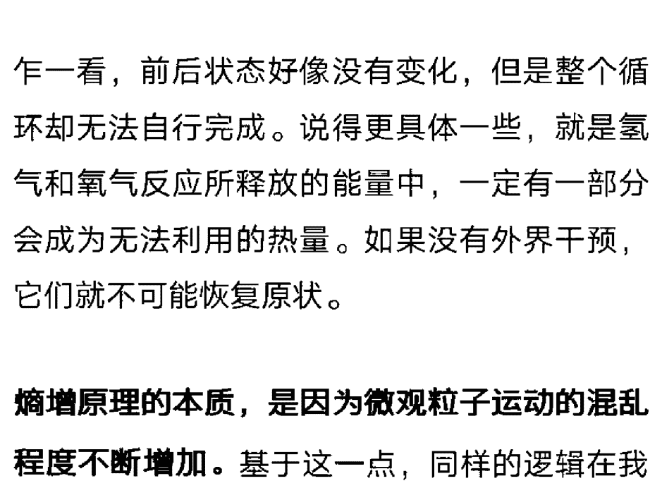

比如，一个房间里有几瓶香水，瓶盖没有打开的时候，每瓶香水的气味都只在各自的瓶子里。这就是一种有序的状态。

但当瓶盖开启以后，不同香水的气味就自动挥发出来了。再譬如，1992年的拉萨市，是20世纪前段中，香气漂得到人起来，怎么样分布它分不开了。这时候的房间，其实处在一种混乱的状态。而气味挥发到房间的这个过程，就是熵增过程。

正因为熵增原理的普遍性，我们才会对它情有独钟。而且，在一些社会行为中，我们获得一些有意义上的启发。

比如今天我们这个问题：要想把一座城市治理得井井有条，城市管理者是采取开放的态度，还是孤立的态度呢？

乍一看，好像过于开放的城市会出现很多杂乱，比如交通变得拥堵无序。但是通过熵原理，我又可能是我了解到，更立地建在这里座城市，它的混乱度也会增加。比如，仅仅是人口老龄化的问题，就是以一座不开放的城市。

### 2

说了这么多，熵是一个物理学名词，我们是化学课？这门化学研究有什么关系呢？

针对这个问题，我告诉你答案，再接着看慢讲。简单说来，熵的本质，是微观世界混沌度的体现。

19世纪中期的时候，化学家们陆续建立起一些化学模型，比如原子、分子、元素等。不久以后，有一个叫范特霍夫的科学家，敏锐地注意到，物质的宏观表现或许是建立在原子及分子运动的基础上的。

于是，他一生的心血，最后在他根据原子模型，研究热力学的时候。直到最后，他终于证明了熵和微观状态之间存在着联系。

我们在第二讲中也说过，化学是从微观维度来认知这个世界的，玻尔曼曼借鉴的就是典型的人性思考。

你看，熵是微观粒子行为的体现，而化学反应也是微观粒子之间的变化。自然，有自满足的熵增原理，是决定化学反应自然状态的。但是这样操作之后的熵，却不可避免地增加了。

比方说，氢气和氧气反应后，可以得到水，并释放出能量。而水在特定条件下，又可以吸收同样的能量，重新变为氢气和氧气。

乍一看，前后状态好像没有变化，但是整个循环却无法自动完成。说得再具体些，就是氢气和氧气自发形成水的过程中，一定有一部分能量会成为无法利用的热量。如果没有外界干预，它们就无法再次恢复原貌。

**熵增原理的本质，就是因为微观粒子运动的混乱程度不断增加。** 基于这一点，同样的道理在我们已知的任何场景中都成立。

“玻璃罐”和“费米子”的区别，也是这个道理。玻璃杯的杯子打碎了以后，我们收拾所有碎片，要么重新熔炼熔化，还可以出一个，又更新的杯子。但是，从有序到混乱，又无序到有序的过程。

但是，这个过程不可能，杯子也付出了很大的代价。看看玻璃杯的碎片，我们假设杯子被放到一个完整的系统中。正在为了把它打碎增加的熵，远远高于减少的熵，代价自然就更重了起来。

我们还可以把人体，看作是一个低熵的系统。五官、四肢、脏腑和骨骼等，都处于特定的位置。新陈代谢让身体始终处于有序的状态。

但是，为了维持有序，身体就得不断地从环境中释放更多的熵，并且，人体有序，人体与环境构成的组合系统，就是混乱。

从这些例子中能看出，因为熵增原理，局部有序不可能持续地保持。而熵就像时钟一样，只会单向流动。

这个原理，还存在着非常现实的意义。

刑侦学中，有一个很著名的“罗卡定律”，大意是凡有接触，必留痕迹。

乍一看，这话好像很普通。假设把犯罪嫌疑人缩小一点，把他所有痕迹都清理干净了，也不可以完美一点犯罪了吗？但从熵增原理的角度来理解的话，刑侦能检测到，嫌疑人的一切行为都在制造混乱，反而越是越乱，越是容易留下更多的痕迹。

这么看起来，侦探和化学家可以算是半拉同行了。他们都是从一些蛛丝马迹中寻找规律，再得出答案。

其实，福尔摩斯的人设，也是化学专家。中篇故事《四个签名》里，讲到一个军人把财宝从印度带回了英国，但最终被路德的劫杀。福尔摩斯和华生前去破案，福尔摩斯则看到了关键。

其实，福尔摩斯的人设，就是化学专家。中篇故事《四个签名》里，讲到一个军人把财宝从印度带回了英国，但最终被暗杀的故事。福尔摩斯和华生前去破案，福尔摩斯刚看到尸体的状态，就判断出这是生物碱中毒，比身为医生的华生反应还要快，甚至提醒华生别去触碰毒刺。

你看，学好化学，就有了救命的手段。

### 3

目前来看，熵增原理是人类无法破解的定律，这就引发了一个问题，如果裁判的权限过大，会不会毁了比赛？

正因为如此，关于熵的一个话题，我们总是绕不过去，那就是著名的“热寂论”。它是对宇宙终点的一种猜想。

简单点说，就是宇宙很可能也是个孤立系统，所以，宇宙也会从有序变得混乱。在这个过程里，可利用的能量越来越少，取而代之的，是无法利用的热能。到了最后，宇宙将达到一种再也无法变化的热平衡状态。

这就很让人绝望了。意思不就是说，就算我们付出努力，留下丰厚的遗产，都没办法扭转宇宙最后的结局。既然万事皆成空，那我活着还有什么意义？

这种情绪，其实大可不必有。

从化学角度来看，每个人活着的时候，都会和各种原子、分子打交道。而正是因为可恶的熵增原理，不管是自己还是别人，谁都没办法消除自己存在的痕迹。微观粒子会忠实地记录下每个人的行为，这足以让人变得不朽。

换句话说，只要你来过这个宇宙，就一定会留下痕迹。在时间的长河里，还有什么比留下物质痕迹更让人心潮澎湃呢？哪怕，它们只是一些不起眼的微观粒子。

所以，就算真有热寂到来的那天，也不意味着一切成空。

### 总结

说到这里，我们这一讲也就快结束了。在这一讲中，我们主要讨论了四个层面的问题：

- 1. 熵就是混乱度，它会一直增长；
- 2. 熵增原理的化学本质，是微观粒子的混乱造成的；
- 3. 有些事理论上可逆，但是实际操作却很难，化学反应也是如此，这是因为虽然恢复如初，但整个系统的熵会大幅增加；
- 4. 从化学的视角重新审视热寂论的话，其实结局没那么丧，因为只要来过这个宇宙，就一定会留下痕迹；
- 5. 说到底，熵增原理其实是给我们划定了一个边界。因为熵总是要增加的，如果你想维持一个有序的体系，就要为此付出更混乱的代价。

孙亚飞

思考题：

为了打扮得光鲜亮丽，很多姑娘会提前一到两个小时起床，听完这一讲以后，你会怎么来分析和看待这种现象呢？

欢迎在课后留言，与我互动。

### 下节预告

下一讲开始，我们将开启新模块，化学模型，谈谈化学是如何借助模型来认识世界的。

我们下一讲见！

## 07 | 原子与元素：化学世界的基本单位是什么？

你呀，我是孙亚飞，欢迎来到《化学通识课》。

上一个模块，我们讲了化学反应的三个重要定律，分别是动态平衡定律、质量守恒定律和熵增定律。

定律，其实是这个世界上客观存在，不以人的意志为转移的。

接下来的五个模块，我们就要把主角切换到原子身上，看看它在解读宇宙的客观规律之后，又怎样发挥主观能动性，让化学服务于难题的破解。

我们在第一讲化学存在的理由中，讲到当前能够理解世界的程度，那么今天，我们就在这里能加半句话，帮助化学实现这个目标要靠化学模型。

所以，我们马上开启的新篇章，就是化学模型模块。如果我们不了解化学模型，上不能以真正理解化学的运行定律，下不能够学以致用，去实现化学动力。

化学里面，有个重要的命题，叫做结构决定性质。性质又分为化学性质和物理性质。

所以，我按照这样的顺序，从三个维度来讲述化学模型：

- 1. 关于物质结构的化学模型，这也是最基础的模块；
- 2. 关于物质化学性质的模型；
- 3. 关于物质形态的化学模型。

这一讲，我们要讲的是物质结构的第一个化学模型——原子模型。原子是化学反应的最小单位，如果你不了解它，你就掌握不了化学基础。

不过，我们现在也知道，原子其实还可以继续分解成质子、中子和电子。既然如此，为什么化学研究的对象放到原子这一步，就中止了呢？

在回答这个问题的同时，我们先来看看，原子模型长什么样子吧？

2500年前，有一位古希腊哲学家叫德谟克利特，在他的老师原子论的基础上，提出了观点，认为物质世界一定存在最小的本质，这个本质不可再被分拆，所以应该被称之为原子。

原子，最早是古希腊哲学家德谟克利特提出的模型，是物质不可再分的最小单元。

到了200年前，英国化学家道尔顿创立了现代原子模型，表达出几点核心：

- 1. 物质都是由最小的粒子构成，这种粒子叫原子；
- 2. 相同物质的原子，形状、体积、重量是相同的，不同物质的原子则不相同。

乍一看，道尔顿的“原子论”似乎是对德谟克利特观点的修正和完善，是的，这是更我们认知的差别。

德谟克利特的“原子论”只是一个哲学观点，或者说，只是作了一个选择。

我们一起来思考一个问题，物质世界的基础是什么？我们根据历史的答案，总结出会有三个选项：

- 1. 由更高阶的生物或神所制造；
- 2. 物质由虚而实形成，像老子所说的“无”，“天地之始”，以及现代物理学的“弦理论”，都可以看成这一系列的代表；
- 3. 物质是最基本的粒子构成。

德谟克利特的“原子论”选择的是第三个选项。

在历史上，这是“原子论”其是个很大的唯物主义哲学思想，但它并不解决物质问题。而且，它也只是古希腊哲学家这么选择。

我们在书中也提到了，这是沿袭古人的选择。我们中国的墨子也提出了类似的观点，只不过采用的字眼是“端”，指的是不可再分的最小单元。

**道尔顿确立的“原子论”，就大不一样了。他所说的“原子”，在关键词“于”不可分割，而他的“物质”由一类的同一种原子相同。** 从化学的角度来说，这才是具有理论及应用价值的原子模型。

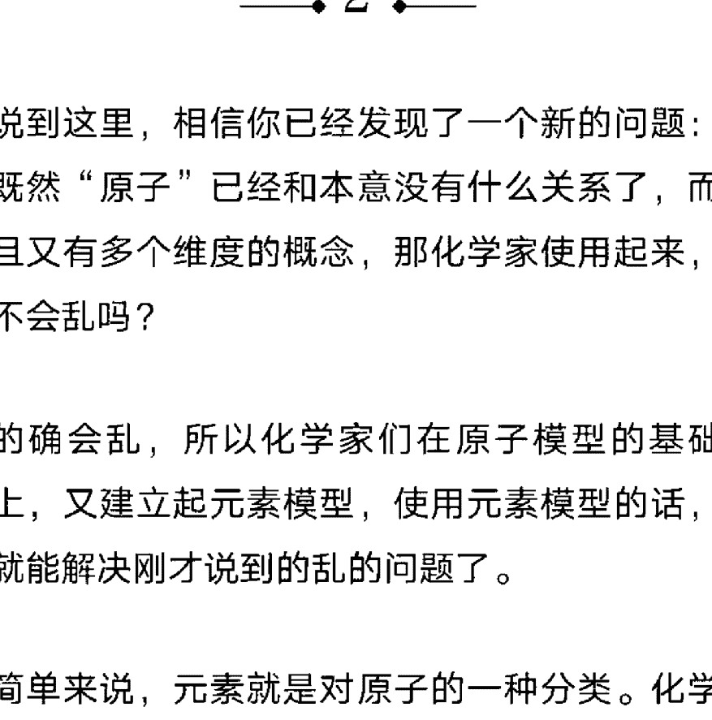

我举个例子，你懂了，你就懂了吗？现在你要去动物园参观，德谟克利特会告诉你，动物园里有老虎，但道尔顿会告诉你，动物园里有老虎、老虎身上有条纹、头上还有一个“王”字。

从实用角度来讲，哪个信息是有效的呢？显然，道尔顿讲得明确，你信他说的老虎是立起来了。老虎的概念，德谟克利特只是告诉你有老虎这么简单，你去动物园，还是分不清老虎是个老虎。

到这里，其实就能回答这一讲开始提出的问题：原子还是可以模型吗？为什么化学还要把原子作为最基本的模型呢？什么不与时代同时，使用更小的微粒来建立模型呢？

**说到这，建立科学模型的任务不是为了描述某物理现象，而是了解实际原理。** 原子是化学反应的最小单位，原子模型对于化学家研究来说，已经是足够了。这就好像你去动物园，他要看的是老虎，而不是老虎的细胞。

随着科学的发展，原子也像一个抽象的概念变得越来越不科学了，现在，现代化学讲到“原子”的时候，通常指的还是原子模型。

这就好比，“猫”是一个具有实际意义的概念，但我们说猫是猫，夜里猫的时，并不是指石头里真的有猫，或者说人变成了猫，而是把“猫”当成是一种可供参考的模型。

说到这里，相信你已经发现了一个新的问题：既然“原子”已经不再表示原子什么关系了，而且也有多个维度的概念，那化学家使用起来，不会乱吗？

的确会乱，所以化学家们用原子模型的基础上，又建立起元素体系，使用元素模型的话，就能解决刚才提到的乱的问题。

简单来说，元素就是对于原子的一种分类。化学是一门关于原子、核和同位素之间的关系的学问。例如，人是和同位素的关系，但人是一个实实在在的存在个体，而就是氢的一个种类。各民族、大群体，法国式民族等等，都实实在在的存在。

### 3

说到这里，你是不是觉得，科学家提出来的模型就完美了呢？事实正好相反，原子和元素的模型也有许多不足的地方，必须根据实际情况不断修正。

原子在一开始的本意，是不可分割的最小单位。但是正像前面我们说到的，现实中的原子还有好几层结构，所以现代原子模型早就对原子的概念进行了修正。

同样地，元素的模型也有不少缺陷。

过去，科学界认为中子数对于化学反应没有影响，所以对于一种元素而言，它的化学性质只需要看质子的数量。但实际上，这样的处理方式也有些武断。

比如说，氘原子是氢元素的一种原子，比普通的氢原子，也就是氕原子多出一个中子。如果按照元素模型的解释，氘原子和氕原子的化学性质应该一样吧？但事实并非如此。

水是生命之源，是氢原子和氧原子构成的。但是，由氘原子和氧元素构成的水，也就是重水，如果拿来解渴的话，可能致人死亡。从这里不难看出，中子数目对于化学性质也是有影响的。

但不管怎么样，原子与元素已经成为现代化学的基石，虽然还有不完美的地方，但是只要缝缝补补，并不会影响使用。

换句话说，有了原子和元素的模型，化学家们就掌握了同一套工作语言。在这个基础上建立起来的任意一个化学模型，专业人员都可以直接看懂，不需要进行转码。所以啊，化学家们之间不太容易出现鸡同鸭讲的情况，就是这个原因。

### 总结

说到这里，这一讲就接近尾声了，我来总结一下今天的内容，一共有三点：

- 1. 原子本来是对世界本原的一种猜测，认为世界是由一个个基本粒子构成的；
- 2. 原子的内涵过于丰富，所以在这个基础上，又建立了元素的概念，元素就是对原子的一种分类，依据是化学性质；
- 3. 原子模型和元素模型都在不断地优化之中，但目前用来解释化学反应，已经足够了。

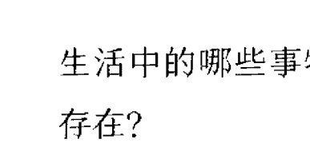

思考题：

生活中的哪些事物，能让你感受到原子的存在？

欢迎你在课后留言，和我分享。

### 下节预告

下一讲，我会向你介绍物质构成的第二个模型，分子模型。

我们下一讲见。

## 09 | 周期与渐变：化学世界的基本关系是什么？

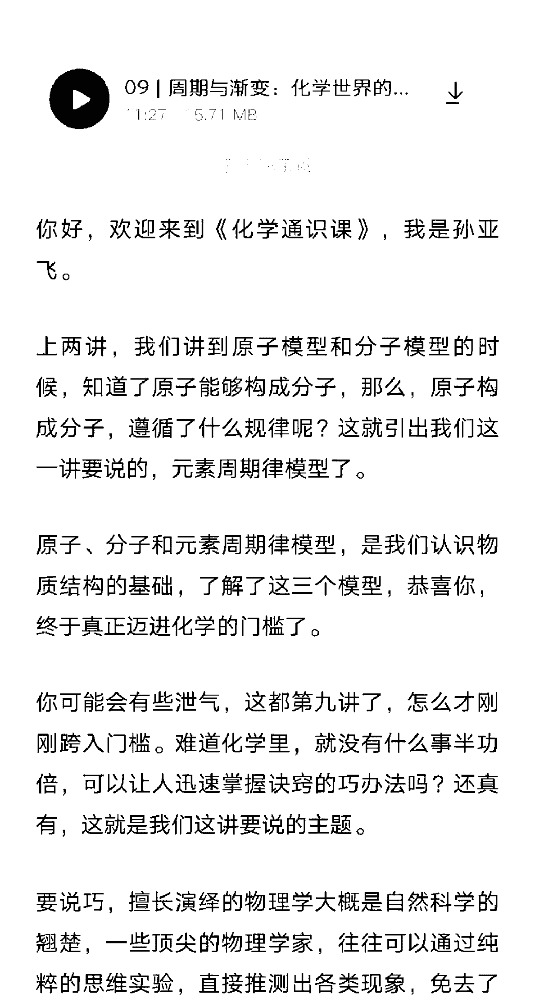

你好，欢迎来到《化学通识课》，我是孙亚飞。

上两讲，我们讲到原子模型和分子模型的时候，知道了原子能构成分子，那么，原子构成分子，遵循了什么规律呢？这就引出我们这一讲要讲的，元素周期律模型了。

原子、分子和元素周期律模型，是我们认识物质性质的基础。你知道了这个模型，恭喜你，终于真正进化学的门槛了。

你可能会害怕，这都第九讲了，怎么才刚刚跨入门槛，难道化学里，就没什么事儿半功倍，可以让人迅速掌握诀窍的技巧方法吗？还真有，这就是我们今天要谈的主题。

要说话，擅长演绎的物理学家，当然有可以预知物理，一些抽象的数学理论，往往可以通过纯粹的思想和数学，直接推测出各类现象，避免了很多盲目的探索。

远一点的，有伽利略对两个铁球同时落地的猜想，再近一点的，有爱因斯坦提出，光在引力吸引而弯曲，这在后来的下一次日全食中，明确地被观测到了。

> 精准预测未来，可以比肩伽利略和爱因斯坦的天才，化学界也有，门捷列夫就是其中之一。

1869年，他编制了元素周期表，还特意地在表上留下了10个空位，预测了10个还没有被发现的元素，推测了这些元素的性质。

那么问题来了，门捷列夫凭什么预测未知世界呢？这就是元素周期律的魔力所在。

牛顿曾经说过一句名言，如果说我看得比别人更远，那是因为我为站在巨人的肩膀上。这里，当当然有适度的成分，不过，在自然科学领域，任何成，但也不会是一个人的功劳。

早在门捷列夫之前，就已经有不少人在编制元素周期表了。

在这些人看来，元素周期表的内核，是元素性质变化的周期律。周期律是什么意思呢？就是不同元素按原子量升序排在一起，那么它就会像音乐一样，每隔几个元素，性质就会十分接近。

我在文前面附上了元素周期表，我们一起对着表来看。

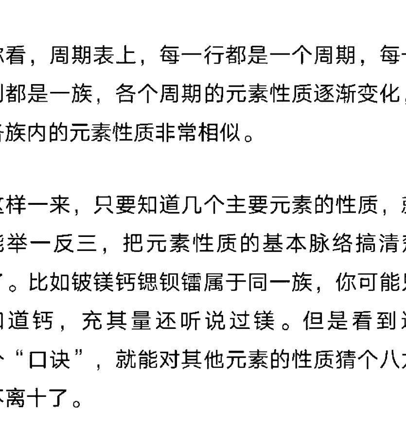

你看，第一列的钠和钾，第二列的镁和钙的化学性质很相似，而且，钠和钾之间，钙和镁之间，还隔到了12个元素，这么说下来，有点像是音乐中的音调，每间一段，就会出现相似的音符，呈现出明显的周期性。

所有的元素排下来，好像有88个80个八一样，整个地列就系一起，演奏出一首八音盒的乐章。

这么看起来，门捷列夫究竟做了什么，反而后来看书上，一记起元素周期表，就想起他呢？原因一共有三点。

**第一，门捷列夫把元素的周期性上升为普性规律。他认为，元素之间的关系不是那么巧合，而是有相互之间的关系的。就这不相当今，前人只是说这是老虎和花虎，但门捷列夫提出这一点总结为两个动物都属于猫科动物，存在生物学的关系。**

**第二，门捷列夫揭示了元素周期表的核心特征，渐变。每个元素的性质，都和前一个元素性质的渐变的。发现了细微的变化都在，当变化积累到一定程度时，这种渐变就成为了突变。比如，从4号到19号，到17号到18号，化学性质一直是突变，但是从氯到氩到19号的钾元素，化学性质就成了突变。**

**第三，门捷列夫还发现了异常的现象，也就是说，某些元素性质的变化幅度不一样，性质，也不符合他预测的变化幅度。所以，他认为，在这些元素中，一定还存在没有被发现的元素，这就是他预测的依据所在。**

但新解释整理完，门捷列夫又一次写下了当年的质疑稿，用同样的理由反驳说：周期表需要调整。和质子没关系，而是因为原子量排错了。不过，这一次，是门捷列夫错了。

周期律的质疑，对门捷列夫而言并不陌生。他对自己的得意之作，是非常执着的。但是，当他提出质疑时，他并没有做什么改变，反而错过了改进的机会。

周期律的本质，是物质的内在联系，并不是一种线性、单一的数学运算方式。

所以，周期律不可能是完美的，它必须要么符合真实世界。

我们从事的第一讲，在说，化学是一门对现实有敬畏的学科。所以，要求周期律的完美，就像是质问，为什么地球上的河流都是七扭八扭的一样的。

现在的周期律，还有很多不完美的地方，但和现代科学，不存在巨大的偏差。只是要求我们在考虑问题的时候，多想几步思考，但每一步，都是科学上的巨大发现。

比如，我能想到的一个高频问题，就是元素周期表会排到多少号。

这个问题，周期律目前还没办法解答，但猜测还是五花八门的，其中有那个热门的猜想，叫“幻数”。意思是说，当原子中的质子数和中子数，刚好是2、8、82、126等数字时，就是稳定的同位素，由此可推知出，164号元素有可能能够存在。但现实是，人类目前只探索到118号元素。

其实，听新手“幻数”这个名词就知道，这个说法对新手生人来说，不太友好，太难听了，还违背了科学。所以，不如优化现有的周期律，路途还长，要慢慢走。

把元素周期律数据和改进的过程，放在我们现在所探索的大数据时代，还是很有借鉴意义的。你看，它是基于大量数据得到的结果。

因此也证明了一个自古以就有的道理：大巧不工。意思说道，越是巧妙的模型，它背后的原理，往住就是越简洁。

### 总结

- 1. 元素周期律的发现过程中虽然有许多巧合，但它的本质还是自然界中元素的内在渐变规律；
- 2. 元素周期律之所以得到广泛认可，是因为它能应用到很多方面，并且事半功倍；
- 3. 元素周期律的模型，现在仍然存在很多不足，这些不足看似不起眼，但背后的解决方案却可能成为科学界的一大进步。

孙亚飞

你思考：
想了中学的知识，元素周期表最后背到了多少位？元素周期表对你现在的生活和工作，又没什么帮助？
欢迎在后留言，和大家分享你的故事。

### 下节预告

我们学用3节课，带你认识了化学领域，构成了物质的3个基础模型，从下节开始，我们将进入关于物质性质模型的学习。第一个模型，就是氧化与还原模型。
我们下节讲。

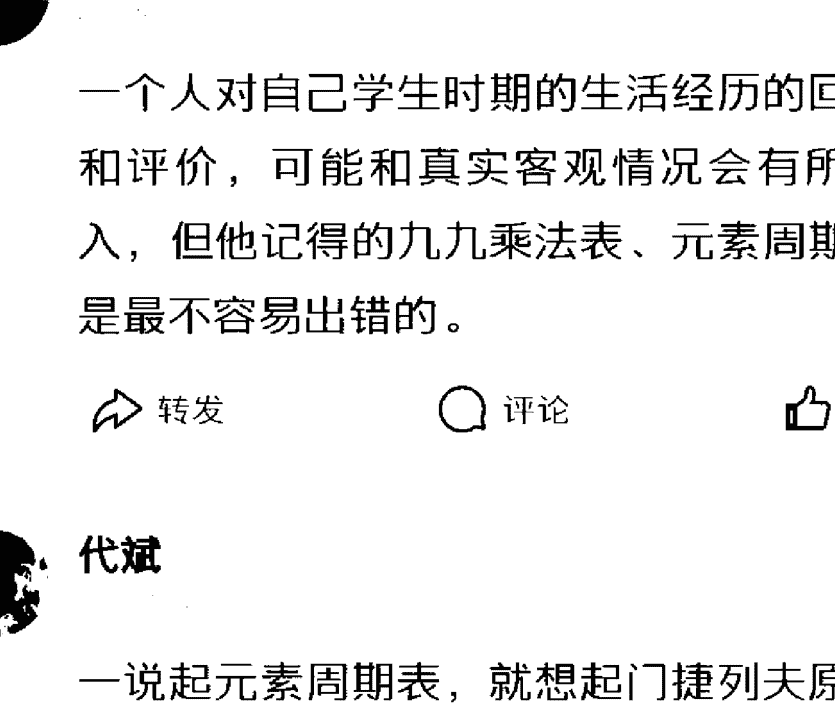

## 08 | 分子与结构：保持化学性质的最小单位是什么？

孙亚飞 | 化学通识30讲

嗨，我是孙亚飞，欢迎来到我的《化学通识课》。

上一讲，我们介绍了原子模型，这是我们解读物质世界的基础模型。接下来，我们就在这个基础上进行扩展，来讲分子模型。

分子模型，是我们理解物质结构的第二个基础模型。

只要中学学过化学，你一定背过这句话：**分子是保持化学性质的最小单位**。

可能当时背完就算了，你可能并不明白，为什么分子是保持化学性质的最小单位呢？

我来给你打个比方，我们把原子比作英文字母的话，那么分子就是词汇，是保持英文单词含义的最小单位。

用我们现在人的视角来看，分子模型是原子模型的升级版。这里面的逻辑，我们可以借助这个世界来理解。

假如把物质世界看成是房子，那么原子就相当于建筑材料，比如砖、瓦、水泥、钢筋、木料等等。它们通过不同的组合方式，构建成了各式各样的房子，有摩天大楼，等等。这些建筑物就相等于分子。

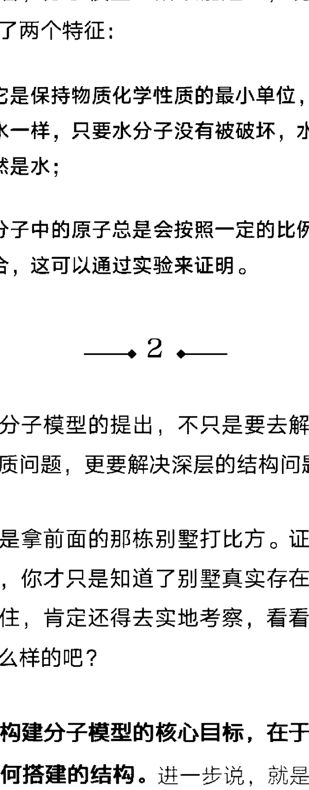

你如果对真正的钢筋混凝土一砖一瓦感兴趣，你可能不太关注它是钢筋还是水泥，是红砖青砖，而反而会关心别墅外的装饰和内部的户型。对于物质世界来说也遵循同样的逻辑，这里面最值得关心的，就是一个分子的**结构和性质**。

所以，**物质的化学性质就要由分子来体现**。

我们在第二讲曾经说，宏观是微观简单的线性叠加。所以，分子不是原子简单串在一处。

**就像水是由水分子组成的，里面既有氧原子和氢原子，但水分子形成之后，就不再是氧和氢的性质了。所以，我们完全观察不到氢和氧的化学状态。**

于是，200年前，意大利有个科学家叫阿伏伽德罗，他率先提出了分子模型，但是在当时，原子论还是模糊不清，所以，他的很多同行都觉得分子模型太不可思议了。特别是化学权威采尔尼乌斯，他是原子论的大论战的倡导者之一。采尔尼乌斯认为，如果原子在化学键中起主导作用，那么物质就不是由原子组成的，而是由离子组成的。

既然老前辈都驳倒了，年轻的学者只能坐等冷板凳。这事，也不能都怪他说的太有创意，就像我们在那讲化学的时候，做化学有很多实验现象，在阿伏加德罗时代，他没有看到。但是在那个时代，并没有多少证据能够支撑分子论。

直到半个世纪之后，阿伏伽德罗去世了，分子模型才得到了认可。

当时，科学家们为了一个困惑争论天翻地覆，什么问题呢？就是电解以后，为什么氢气和氧气的体积比是2:1？我们现在都知道构成的一个水分子是由两个氢原子和一个氧原子构成的，这个结论做得很清楚。但当时，科学家都没有办法解释这个微妙结构。

当有各种各样新模型，说了一遍都不通，直到有人拿起分子模型试了一下，哎，居然成了！

所以啊，分子模型之所以能建立，说到底就是符合了这两个特征：

- 1. 它是保持物质化学性质的最小单位，就像水一样，要求水分子没有被破坏，水就依然是水；
- 2. 分子中的原子总是按照一定的比例组合，这个可以通过实验来证明。

但是，分子模型的提出，不只是为了要解决表面上的性质问题，更要解决**深层的结构问题**。

我们还是会拿房子的那栋别墅来打比方。证实了分子模型，不代表你知道了别墅的真实样子，但是你愿意住，还需要实地去考察，看看房子究竟是什么样的吧？

**所以，构建分子模型的核心目标，在于揭示原子间可能的结构。** 再进一步，就是揭示原子之间的作用力。

从这一点也不难看出，道尔顿之所以对分子模型有些看衰，也是因为他已经提前到了带电粒子理论，这是比分子论来得更超前的一种模型。

我们可以这么想，如果考虑那些道尔顿和大师的年代，那时是顶级尖子化学家们，讨论分子的作用力，而他们认为原子和分子是绝对可靠的？因为，他们都承认原子是稳定完全的，其量子状态都是能级。所以无论你讲什么，他们都不懂。

那么怎么办？不知道原子结构，就没有办法解释分子结构？别忘了，化学家可是最喜欢搞模拟模型的。

这样的场景你肯定见过，中学化学课上，老师解释分子结构的时候，经常会拿出一套球棍模型进行演示。**在这里，球体表示的是原子，棍体代表者两个原子之间的作用力，又叫化学键。**

化学键虽然有的概念就是，每种原子都可以和其他原子进行组合，并且原子之间大多能连接成多少个其他原子，都是有限的。

这种球棍模型的雏形，就发生于150多年前人们发现化学的时候。这个模型简单实用，以至于解释各种分子时都是所向披靡，几乎就没有翻过车的。

直到出现了苯，对分子结构的理解才走到了瓶颈。光从苯，我们总觉得有些怪，不过，它在我们的生活里特别常见。比如，石油和煤油中就含有苯。

苯最特别的地方在于，它的化学性质特别稳定，按照它的分子结构模型去解释，本应该是极不稳定的物质，这就出现了矛盾，需要进一步优化模型。

很多人种已都尝试过，但都没有成功。

直到有机化学家凯库勒因为做梦，苯的分子结构也最终被确定。传说有天晚上，凯库勒梦见了一条蛇咬了自己的尾巴。他醒来后突然开窍了，环形结构也能解释苯的稳定性质了。到了这里为止，苯的分子结构，才终于成型了。

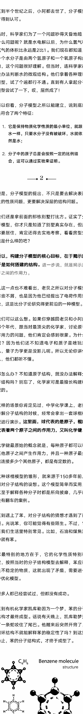

这当然是化学界的一个大进步了。假想的分子结构与化学键的关系，终于变得更加明确。但是，这个模型还是引出了一个新的问题：我们是不是一直在强调碳氢键？那么还有证据能证明，分子结构是由化学键搭建的吗？

基本没有。

最初的化学键模型，几乎全是在黑暗中来探索，并不是因为化学键模型一无是处，只是因为没有比它更好的模型。

直到20世纪，量子力学建立了，分子结构的世界观也彻底翻转，才被证实是可信的。

历史又一次和老师玩了一个游戏，化学键分三种基本类型，也就是离子键、共价键和金属键。

最先被发现的离子键，其实是道尔顿的电荷作用理论加上一些补充。也就是说，道尔顿在分子结构的问题上早就上了半辈子学，却发现在分子的问题上超前了一个世纪，以至于两件事的建立和活跃，也是需要的。

话又说回来，得到量子力学的加持后，化学键理论终于能解释一些更为具体的问题。

你可能还记的在中学课本里见过“氢键”，也知道它是一种特殊的化学键。如果说不出，很多人会以为，“氢键”这个概念啊，就是生搬硬造出来的。

然而，它却是正经的名门之后，是由量子力学计算得到的。并且，有些条款还必须得非常解释。

我们都知道，物质有固态液态，但是一般分子的液态区域比较狭窄。

你可能还记得在中化学课里见过“氢键”，也知道它是一种特殊的化学键。如果不见说啊，很多人会觉得，“氢键”这个概念啊，就是生硬地硬生生编造出来的。

它却是正经的名门之后，是由量子力学计算得到的。并且，有些现象还就非常需要氢键解释不了。

我们的知识，物质有固态、气态。但是一般分子液态态，却比较少。

换句话说，一个物质从固体变成液体后，继续升温会继续变成气体。

我举个极端的例子吧，二氧化碳在常温下压压根就没有液体，固态直接变成气态了，所以固态二氧化碳又叫干冰。但是氢虽然可以在100摄氏度的范围内保持液态，这就是因为氢键的力量。

• 3 •

分子模型被证实了，构造分子的化学键呢也被证实了，那么物质的结构是不是都已经被化学家们研究透了？答案是：没有！

分子模型只是对真实世界的一种近似处理，并没有完美地反映。

理论上讲了有量子力学，我们可以彻底放弃“化学键”的模型，甚至连分子的模型都可以放弃。为什么这么说呢？因为任何一种物质，只要知道描述每个原子的位置和运动状态，还有它核电荷之和原子间的吸引力，这种物质的参数可以完整地展示出来。还要分子干嘛呢？

但是，就目前的计算能力而言，这种可能性微乎其微。

我们还是用别墅来打比方吧。

如果你特别喜欢一栋别墅，还想再建一座一模一样的，怎么办呢？最精确的做法，就是拆掉每块砖，在每片砖上各编一个编号，再重新组装。巴拿马海关失火之后，还能复原，就是这么干的。但是对于需要学习，技术还没有来到这么一步。我们依然要借助分子的概念来理解物质。

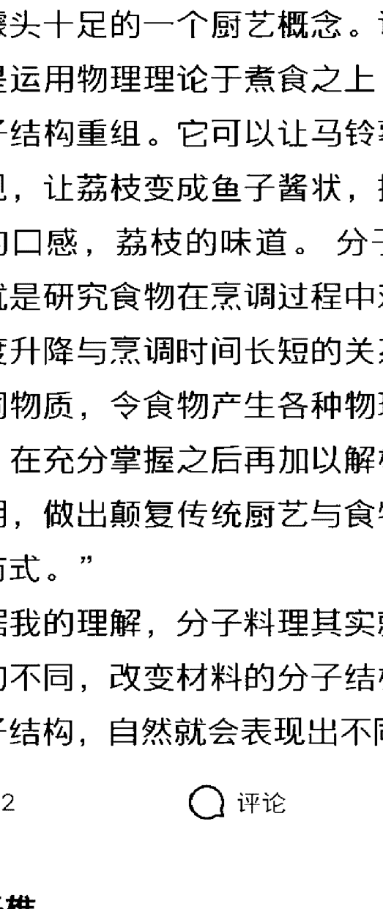

我再来个更极端的例子。

2016年的诺贝尔化学奖，颁给了在分子机器人领域做出杰出贡献的科学家。这是近几年，唯一一次化学家拿到化学奖。

什么是分子机器人？其实它就是由不同的分子组装而成的超级纳米，并且具备一定的功能。比如说开口的轮盘，就是一种分子机器人。它也很真实的车辆一样，能够驱动旋转，让它去干活，车轮会转动。而且，分子机器人还有可能组成电脑，只要条件合适，这些分子就能吸收信息，自动组装起来。

用术语讲，这就是一类能够自发组装的物质，也就是变得越来越有序。

如果把分子比作建筑物，那么分子机器人就像是一座城市。借助于上一讲所说的分子结构的模型，分析化学家的组合规律，我们就能够解释分子机器人组装的内在秩序，不考虑分子结构，那么分子机器人之间的相互作用就无法巧妙。

所以，如果我们把化学比作一套武功，那么上一讲的内容，就是站桩法口诀，是最核心的基础。至于下一讲分子模型，就好比是身法口诀，解决了形体问题。

### 总结

- 1. 分子模型是基于原子模型的升级，它是保持物质化学性质的最小单位；
- 2. 分子的特殊结构，依靠的是原子之间的作用力，也是量子作用力；
- 3. 分子模型，是应对现实复杂性的一种简化模型，在具体的场景下容易理解，而且非常实用。

孙亚飞

思考题

现在流行分子料理，比如用不同的温度去烹饪，味道会有区别，为什么会这样呢？

欢迎在评论区留言，与我互动。

### 下节预告

下一讲，我们再来讲一次升级，讲讲元素周期律这个模型。我们下一次见。

### 用户留言

伪装

以下内容来自网络上的查到：

“分子料理又名分子美食学，是近年在海外媒体上热门的一个厨艺概念，将用于实际就是运用理论服务于意念中。将物质分子结构重构，它可以让马铃薯以虾子的出现，让花卷像鱼子酱，模拟出鱼子酱的味道。分子料理的理念，就是在烹调过程中观察，认识温度升降与时间对长短的关系，再加入不同阶段、食品原料中各种物质与化学变化。在充分掌握之后用以配伍、重组及运用。做出颠覆传统感官与食物外观的烹调方式。

根据他的理解，分子料理其实就像适度不同的不可控，改变材料的分子量，不同分的分子结构，自然就会表现出不同的味道。”

陈子雄

不同的烹饪温度，做出鸡蛋中蛋清，蛋清变黄的过程中使用出蛋白质，让不同的蛋白质与酸、糖之间进行交互，形成了属性、软硬度不同的鸡蛋。

简单来说就是利用不同的温度，使反应发生的温度不同，产生不同的反应产物，形成宏观层面（口感）的不同。

也就是分子吸收不同鸡蛋的能量（温度），造成不同口感的“鸡蛋”。

与时间结伴同行

不同温度会导致不同的分子结构也就决定了性质，不同的性质有不同的用途，所以用不同的温度去煮鸡蛋，会产生不同的味道。

分子料理里，四种最常见：

1. 真空调技术（Sous-vide）
2. 固体氮冷冻技术（Sphification）
3. 乳化技术（Emulsification）
4. 液氮冷冻技术（Liquid Nitrogen）

分子料理是高温一般常常第一种是真空调技术。

低温调技术将食物的（肉类为主）密封在真空袋中，然后在低温（如40度）长时间（几小时以上）烹饪，烹饪时，在密封容器内部，蛋白质没有经过最后阶段的重构，因此肉保持粉红色，肉质较嫩，水分充分的锁在纤维中。某些肉其甚至中心还保留带血的状态。

有思想有所得

隔壁班老师正在讲偏微分方程课程，这概念在化学里也交叉了。的确是，不是DNA双螺旋模型还是头头提到的苯环模型。在笔记中，一张元素周期表就是元素周期律。回想之前建立的分子历史模型，如一道闪电般点亮视觉建立，令人心神（神啊）。

市井书心志

小时候我，也没想到，长大时我也没有花钱来学化学。到学习正规学习时没费周的理解物理化。科学的建模理论和思。观察和价格观察是都是很有影响的。加上很多的学，所以那些都是偏的。在加上老老师傅的教受感到学习速度快。刚听到比课程觉得博好玩儿多了。

watch正

温度不同会导致子的运动的速度不同，速度不同就会排列开，而子结构就会有差异，这个差异会改变蛋里蛋白质不同的味道。我不知道，这样用起来，口感的不同是明显，还可以忽略不计。

微菌门徒

课后思考：

我们要理解温度高低和烹饪时间的长短会对鸡蛋子的分子结构和原子之间的作用力产生不同的影响，就能使得分子结构在不同条件下发生完全变化，因此，会令味味不同。

「在心」鱼鱼。

知之不知，不知不知也，不知。

## 10 | 氧化与还原：为什么说物质的氧化性和氧无关？

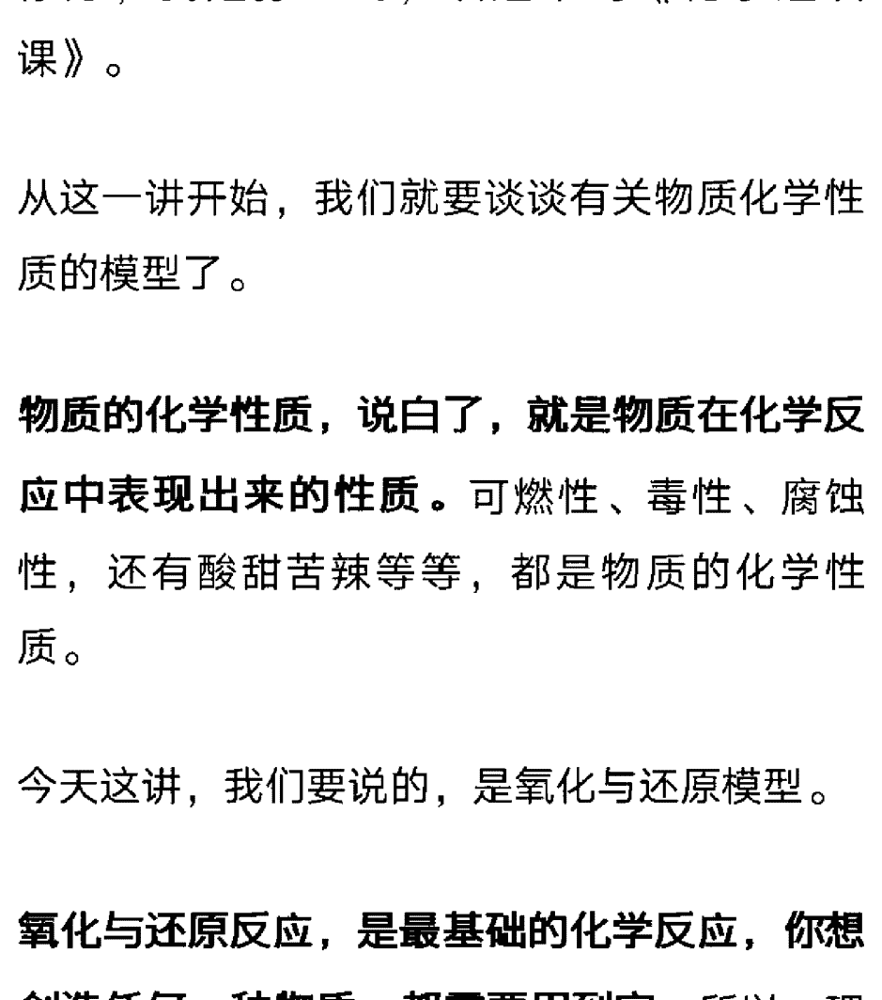

你好，我是孙亚飞，欢迎来到《化学通识课》。

从这一讲开始，我们就要谈有关物质化学性质的模型了。

**物质的化学性质**，说白了，**就是物质在化学反应中表现出来的性质**。可燃性、毒性、腐蚀性、还原性等等，都是物质化学性质。

今天这讲，我们要谈的，是**氧化与还原模型**。

氧化与还原反应，是**最基础**的化学反应。你想创建任何一种物质，**都需要用到它**。所以，理解了这组模型，你就能知道，世界上的绝大部分物质是从哪来生的，最后又变成了什么。

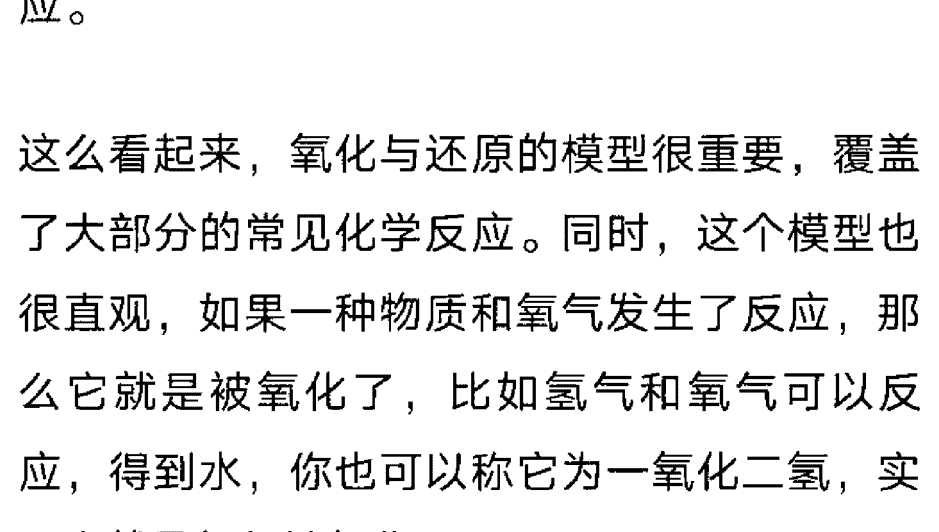

说到氧化和还原，你在生活中，肯定经常被这两个词轰炸。

比如抗氧化，女孩子们用的护肤品，中老年人吃的保健品等等，抑或是防龋齿。在很多人印象中，抗氧化就等于抗衰老。

反过来，还原性食物这个词，你肯定也没少听，比如葡萄糖、藜麦、西兰花等等都是还原性食物。人们都觉得健康、精致，是因为这些食物，可以清除我们体内导致衰老和疾病的自由基，抗癌康复。

你看，很多人对“氧化”这个词，没有良好印象。比如，食物发生变质，有些人就会直接地认为，这是因为空气让食物氧化了，如果隔绝了空气，食物就不会那么轻易变质了。

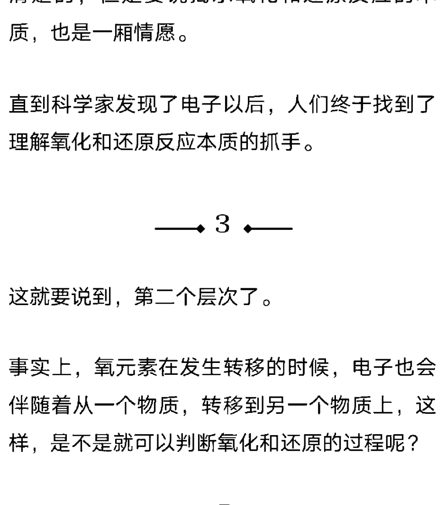

这么看起来，氧化与还原的概念，好像真的已经深入人心了。但是，你平均理解的氧化和还原，真的是这个意思吗？你的理解是正确的吗？

我想告诉你，氧化和还原的真实含义，远远没有那么简单。如果你的理解只局限于，氧化就是等于丧失氧原子的意思，还原就是氧原子，那我就看清自己的钱包，不然的话，你不如直接，寄点钱给我。

那么针对氧化和还原的模型，我们这一讲，会分三个层次，来解释给你听。

没错，谈感情未必需要花钱，用金钱来衡量关系，是把一些问题量化了而已。同样，通过电子得失来分析氧化和还原反应，实际上也是一个量化的过程，它只是一个抓手，还不是本质。

### 4

什么是本质呢？就是物质结构与性质的关系，这就是我们所说的第三个层次。

具体而言，氧化和还原反应的本质，是原子之间形成化学键的方式。这一点，我们在分子模型这一讲中，已经提到过。化学键，也就是原子外层电子的相互作用力。形象来说，原子之间的关联，我中有你，你中有我，前面我们说到的电子转移，其实很少会真正发生。

你看，这不就是婚姻里的，钱归谁管的问题吗？一般情况下，夫妻双方就是凑钱一起花，不分彼此，而这是感情基础决定的。愿意花钱的态度，比花钱这件事本身更重要。

所以，我们在思考氧化和还原这个模型时，最终考虑的，其实也不是电子转移到哪儿，而是电子转移的趋势。到这一步，就足够确定物质的性质了。

我们现在再回到这一讲最开始，关于氧化和还原的那几个生活问题。

是什么原因让我们认为抗衰老就是要抗氧化呢？又是什么，我们会认为食物的变质就是氧化呢？

因为我们身在一个充满氧气的环境里，我们就会有这样的感受。但是从化学的角度来说，这些观点并不完全正确，因为氧化性和还原性并不只是和氧气有关系。

不过，它隐藏了一个正确的前提，那就是，我们的身体和食物，都有着被氧化的趋势。

吃还原性的东西，用抗氧化的化妆品，对抗衰老多少都有点帮助，但这些都不是重点。我们要做的，是改变生活习惯，扭转被氧化的趋势。比如，不抽烟，少熬夜，多防晒，可能比花大钱买补品化妆品，效果更显著。

### 总结

- 第一，简单地说，氧化与还原的模型，就是物质与氧气发生反应，得氧就是氧化，失氧就是还原，但是，这个解释还是太狭隘了；
- 第二，从科学的角度来看，氧化与还原的发生，实际上是电子的转移过程，失去电子就是氧化，得到电子就是还原；
- 第三，研究电子转移，目的是为了搞清物质的结构，最终理解物质的化学性质。

孙亚飞

思考题：

金属生锈是氧化过程，有一种防锈的办法是给上它通电，从这一讲的内容出发，你觉得会是什么原理呢？

欢迎在课后留言，和我互动。

### 下节预告

正确认识氧化和还原的科学意义，其实还有着更为实用的价值，那就是指导生活实践，因为它的含义早已超出了化学本身。

除此以外，还有一个关于物质化学性质的模型，也有类似的意义。下一讲，我们就来谈谈这个模型，酸性与碱性。

我们下一讲见。

< 前一篇

### 用户留言

成洁gett

生锈是失去电子的氧化过程，通电就是重新补充，得到电子的还原过程。

好吧，孙老师，你就给个痛快话，接下来我在抗氧化、抗糖的各种化妆品的预算到底砍不砍吧。

陈子雄

思考题瞬间勾起我许多回忆：氧化铁、氧化亚铁、四氧化三铁、生锈、原电池、电解池、船镀锌·····好多的公式现象特点·····妈呀！大晚上的，我快要哭了！

电化学防腐的本质就如同老师所说的，是通过电子的转移，使得金属表面形成“保护层”或是消耗其他金属性质更加活泼的元素单质来使得“目标金属”的数量得到保证，也就是将其作为电解池的阳极或原电池的正极使得金属得到保护。

以上留言由作者筛选显示

## 11 酸性与碱性：为什么酸碱性最容易被伪科学利用？

孙亚飞 化学课30讲 进入讨论

你好，我是孙亚飞，欢迎来到《化学通识课》。

上一讲，我们知道了氧化和还原模型的本质，是物质结构和化学性质的关系，里面最关键的，在于电子的所有权。

这一讲，我要说到的是第二个物质化学性质的模型——酸碱模型，同样你关注电子。只不过，在这个模型里，我们要关注的，就是电子存放位置的问题了。

我们还得从老问题入手，从生活开始。

你看，现在放开二娃了，很多家长老大是男孩的，就特别想要个女儿，凑个子女双全的“好”字。为了实现这个目标，很多爸妈就到处地查资料，听说酸碱体质的概念，他们发现，只要把自己调成酸碱体质，就可以生女儿。

还有再举两例，顺便谈一下身体状况。因为据说吃些食物会使身体变酸，酸性体质就不健康。

于是，海带、豆角、菠菜等等，这些食物酸性比较强，他们天天换着花样吃。又有人听说晚上身体酸性提高，恨不得每天晚上八点前上床睡觉。

可是，酸碱体质这种说法，靠谱吗？当然不靠谱了。2011年1月，“酸碱体质”的创始人罗伯特·欧·杨已经在美国法庭上承认，“酸碱体质”就是个骗局。

但我同时想告诉你，化学里面确实有个与酸碱性有关的模型，而且经过了化学家的验证和完善的，是有科学性的。那么问题来了，既然都是关于酸碱性的，为什么酸碱模型反而更不容易理解？换句话说，为什么酸碱模型会被伪科学盯上呢？

要想弄清楚这个问题，我们得先知道酸碱模型是怎么来的。在这一讲，我会分三个层次来为你拆解。

### 1

先来说第一个层次，酸性和碱性究竟是怎么来的。

最早的时候，酸性和碱性都是人们从生活中总结出来的经验。酸性物质，是指吃起来有酸味，比如醋、柠檬、杨梅，等等。碱性物质，就是能和酸味的物质中和的，比如苏打水、皂等。

酸碱性就这么接地气，谁都能说得。

不过，单凭味道来讲道酸碱性的，未免太肤浅了。每个人的感觉都不一样，这是个体差异。对于同一物质，你说酸，他说不酸，那么如何区分呢？所以，确切的定义还是必要的。

**化学对酸碱性有独特的定义，它是指通过微观结构来定义的。** 经过研究发现，酸性物质都有一些共同特征，那就是它们含有氢离子的浓度比较高。氢离子，就是氢原子失去一个电子之后的物质。

从氢原子的视角看，我们的舌头会察觉到酸味，是因为氢离子能与细胞中的蛋白质反应，这就说明神经细胞感知到了氢离子的存在。碱性物质之所以能中和酸味，也是因为碱性物质的离子跟氢离子起反应，其中起作用的是氢氧根，也就是OH⁻。跟氢离子反应得到水，而水是中性物质。

这个定义就很简单了，必须要在氢元素里探探氢离子，才能判断酸碱性，这就是酸碱模型的第一层。

这样一来，物质的酸碱性就很容易检测出来了，怎么测呢？用pH试纸。

**pH，是一种表示氢离子个数的符号，所以pH其实就是氢离子浓度换算后得到的一个数字。数字越小，代表浓度越高。**

到这里为止，是关于酸碱模型最完整的解释。了解了这三个层次，我们就可以回答这一讲开头提出的问题：酸性为什么容易被这种学科提出？

这是因为，酸碱模型一再扩展，也产生了一个致命的缺点，当然，这个不是模型本身的致命缺点，而是模型理想化程度很高的局限。就是说，什么事都可以用二元分类方法来解释。对客观世界进行二分划分，这是常见的辩证思维。

不过，辩证的范畴不可或缺了，否则二元思维的基本特征就圆满不失。

**任何概念，基本上都会对范围作一个明确的界定，比如我们前面谈到的那个酸碱理论，范围是氢离子浓度大。在化学上，讨论的对象永远是非常确定的。**

一旦有人把酸碱模型的适用范围扩大到生命体，就不具备讨论的基础了。

酸碱体质的伪科学性，就是这么来的。酸碱体质的核心观点，认为人体分为酸性和碱性，酸性体质容易生病，碱性体质则是健康的。多吃酸性食物，就会变成酸性体质，所以为了健康，我们要多吃碱性食物。

生命体当然也是由化学物质构成的，但是生命本身，还有很多其他的生理作用是不可忽略的。

可能说的，你还不太容易理解，那我们举个简单的例子。

根据生理标准，我们可以把人分为男性和女性，而这里证据很多，比如染色体不同，或者女性可以怀孕男性不能等。这些都是我们熟悉的二元命题，但它只局限在生理方面。

如果在社会学层面解释男女性别的差别，比如认为男性应该从事事业活动，女性应该得到更多的照顾，女性应该当家庭主妇，这类说法就站不住脚了。

**酸碱体质的骗局，就是同样的套路，它把酸碱的学科性质——跨越了，这就是酸性或碱性体质这一概念，通过酸性或碱性化成酸或碱，就是一个性质。**

唯一的不同的是，对于性别问题，绝大多数人都站队了，但是对于酸体质这样的化学模型，真正知道的人却不妨多，只是被简单想象又复现。

多说一句，对于非专业人士而言，识出伪模型的科普文章，也是全人重要的。

一句话总结就是：多看事，少就思，紧扣定义分析，不跨域应用。

### 总结

- 1. 酸碱模型的第一层次，是看物质的pH值，也就是氢离子浓度；
- 2. 酸碱模型的第二个层次，是看这种物质是否直接释放氢离子；
- 3. 酸碱模型的第三个层次，是看电子的位置，这真正连接了结构和化学性质的关系；
- 4. 酸碱模型有科学性，也很容易听懂，但它讨论的对象始终固定在非生命体中，范围一旦扩大到生命体，就不具备讨论的基础了。这也是酸碱体质是伪科学的根本原因。

孙亚飞

思考题：
我们这一讲谈到了二元命题，你还知道哪些事情，单纯用二元命题来定义，其实是不靠谱的，原因又是什么？
欢迎在后台留言，与我互动。

### 下节预告

下一讲，我们会进入关于物质状态的化学模型，第一个模型讲固体，是有关固体的模型：晶体与非晶体。
我们下一讲见。

---

## 12 晶体与非晶体：为什么说晶体是个过时的概念？

孙亚飞 化学课讲习班

你好，我是孙亚飞，欢迎来到《化学通识课》。

在化学模型这个模块，我们通过前五讲讨论了关于物质结构的模型，还有物质化学性质的模型，也弄清楚了一个最基本的道理，那就是结构决定性质。

实际上，在化学世界里，物质的物理性质，也就是物质形态，还是由结构决定。接下来讲，我们就从这个角度，讲讲关于物质形态的模型。

物质形态最常规的有三种，是固、液、气三种状态。这一讲，我们先来讲固体，涉及到固体结构的化学模型，是晶体和非晶体。

### 1

还是老套路，我们说先从生活中的事开始。

很多人家里装修会铺地砖。不知道你观察过没有，地砖的形状，大多数是四边的，也就是长方形、正方形。稍微时尚一点的话，会用正三角形，或者正六边形。

仔细想想，你是不是没见过正五边形的地砖呢？换句话说，使用正五边形地砖铺地面，能做到没缝隙吗？也没有重复吗？即不能无缝铺满，随意怎么排五边形能铺到这一点吗？

别看这个问题好像很无聊，但实际上，这是一个困扰了科学界很久的难题。1900年，已故数学大数学家希尔伯特直接把它收入当时的23个世纪难题中。

好，这事先放着，我们来说另外一件事。

2011年的诺贝尔化学奖，颁给了以色列材料科学家谢赫特曼，表彰他在晶体领域的重大发现。这是最近十来年里，诺贝尔化学奖第一次只颁给一个人。

辅射和诺贝尔奖，这两件事看起来有没有什么关系？如果你深究这一讲内容，你就会发现，原来这里大有玄机。

### 2

要弄清楚里面的联系，我们得弄清一个最基本的问题，什么是固体？它和液体的区别在哪儿？

这个问题，你可能觉得连小孩子都挡不住，固体不能随意流动，而液体的不能固体的多了，液体不正反过来吗？

但事实真的是这样吗？

将近一个世纪以前，科学家们就一直在考虑固体会不会流动的问题，但谁也不确定，也觉得不太会做实验来着道。1927年，澳大利亚的一个教授，取普通人认为是固体的沥青装满漏斗里，放在常温的房间，看看它会像液体一样滴落下来。

到现在为止，实验已经持续做了92年，是历史上耗时最长的实验之一了。结果是，沥青真的像水一样流了下来，不过因为流动的程度太慢，所以到现在为止，才滴满了9滴。要是你对这个实验感兴趣，可以去澳大利亚昆士兰大学的官方网站上围观。

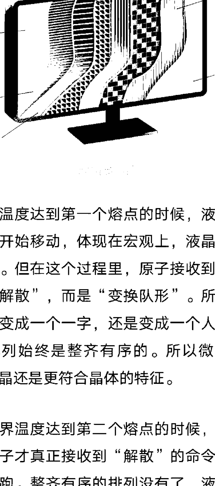

你看，一般人看沥青就是固体，因为看起来就是不会流动，就知道它是流态？看起来不是流态？所以用流动性来判断物质的状态，这条路显然走不通。

我们在第二讲曾经说过，在化学世界里，研究对象的现象，微观是内在本质的反映。所以，要想想象微观态和液体的本质的区别，还得从微观层面入手。

这就像人们靠胡子来分辨男女一样。普遍印象认为，有长胡子就是男人，不长胡子的就是女人。但果真如此吗？当然不是。

现在我们都知道，胡子属于体毛的一种，是一种外在观察现象。它的产生跟人体内的性激素有紧密关联。女性的性激素虽不很少，也会长小胡子，所以，从宏观角度来判断，男女差别是表面上的，本质上是染色体的不同。

根据同样的逻辑，化学家通过观察物质内部原子的排列方式，总结出了晶体与非晶体，用这个模型来分析物质的真实状态，到底晶体还是非晶体。

需要说明的是，晶体与非晶体模型，并不是去替换固体与液体的概念。它只是在化学世界里，从原子层面，帮助你认识物质形态的另一种运行机制。

那么，晶体和非晶体，又该怎么区分呢？很多人会说，看熔点。

晶体有固定的熔点，达到了温度，就会转化为新物质，比如到了零度冰会融化，就会变成水。非晶体没有固定熔点，温度升高后，它会软化，非晶体熔化后，你看到还是同一种物质，没有新物质产生。

不过熔点也好，流动性也好，都是表面现象。**我们从最层面观察到，会发现晶体与非晶体的区别，说白了，就是内部原子排列的状态不一样。**

晶体内部，原子排列得整齐有序，就像当兵立正，士兵中的立正，各保持距离都差不多，行动中的节奏也保持一致，无论从哪个角度看，他们的动作都是一样的。所以，晶体在宏观上表现出固体的特征，不流动。

非晶体正好反过来，内部的原子排列非常混乱，就像前方士兵们，高矮胖瘦都有，走路就像参差不齐。无论从多角度看，都找不出整齐划一的特征。所以，非晶体在宏观上，表现出的是液体的一部分特征。

不过，因为有些非晶体原子之间的作用力比较大，互相牵制，所以非晶体的流动速度比较慢，这就好比，大家像每个人都会拉着身边的人，不让他在人群中乱走，而拉到边方阵里。所以，群众方阵走成什么奇怪的形状，都还是个体。

搞清楚晶体和非晶体内部的构造，我们能说明，晶体加热后会变化，是因为温度升高，打乱了原子阵列的顺序，就好像是士兵们接到了解散的命令，队伍一下子就乱了。这里的“解散”，就是熔化。

非晶体在加热后软化，是因为高温，加快了原子的振动，原子间位置的变化快起来，混乱度上升，流动的程度变大了，但流动的本质没有变化。

### 3

到这一步，我们知道了晶体与非晶体模型，是化学中对物质形态的又分类器，它从微观角度出发，与原子结构紧密相关。

但这个模型还不够。为什么这么说呢？因为化学家需要其完整物质性质，但内部原子排列很整齐的物质，晶体和非晶体模型建立的逻辑才完整。

这就像我们说，男女性别差异的本质，其实在于染色体不一样，跟长不长胡子没关系。但是，要是缩短这一层，我们不能找到染色体是XY的女性，还要找到染色体是XY的长胡子的男性，完成这一步，论证逻辑才完整。

这就是我们这一讲要解决的第二个问题：晶体模型的例子是什么？

在化学世界里，这个不长胡子，但染色体是XY的男性，就是液晶。其实没听它，你就很眼熟，液晶是一种宏观表现介于晶体与液体之间的物质，一方面，它像液体一样流动，另一方面，它内部的原子排列整齐有序。

为什么这两种状态能同时存在呢？因为液晶是处在两个点之间的中间状态。

当外界温度达到第一个熔点的时候，液晶内部的原子开始移动，体现在液面上，液晶就动起来了，但在这个过程里，原子接收到的指令不是“解散”，而是“变换队形”。所以，尽管形式变一下，还是变成了一个，原子的排列仍要整齐有序。所以微观本质上，液晶更具符合晶体的特征。

但外界温度达到第二个点时，液晶内部原子真正接收到“解散”的命令，开始四处跑动。整齐有序的结构没有了，液晶这时候，才真正变成了非晶体。

因此，直到液晶的发现，晶体和非晶体的模型才真正站住了脚。从这个意义上来讲，固体这个概念才显得过了时。

而在液晶发现之后的仅仅几十年间，科学家就借助于晶体与非晶体的模型，去设计液晶分子，这才有了我们身边铺天盖地的液晶产品。

不难看出，晶体和非晶体模型的根本要点，在于原子的排列，这就免不了涉及几何学知识的排列。晶体与非晶体模型，也是极少数十分相关的。

那么，在平面上原子怎么排列的问题，不就是我们在前面开始说到的铺地砖吗？如果你用正规多边形去铺贴地板面，选择正三角形、正方形和正六边形，才可能让地面没有缝隙，瓷砖之间也不重叠。但是，正五边形做不到。

反其在真实的晶体模型中，也是同样的道理。换句话说，六角雪花好看，但是五方角的晶体，应该是找不到的。

不过，在1974年的时候，就已经有数学家证明，在五晶体这种理论上可以存在，但它只有旋转对称性，没有平移对称性。

什么意思呢？就好像一个阅兵方阵，比如是正方形，当你坐在主席台上观看时，队伍转过90度，它看起来还跟原来的一样，这叫作旋转对称性。

队伍每进一步，你看到的景象也没有明显的差别，除了第一排，后面所有人的位置，每前进一步，都跟在前面一个人的位置上，这就叫平移对称性。

在五面晶体理论被提出8年后，我们这一种开始出现的镶嵌图案在现实中找到这种对称性，迅速利用数学知识，把这种晶体的模型结构确定下来。

不过，因为正常的晶体应该同时具备旋转对称性和平移对称性，而五晶体的对称性是一致的，所以，它叫做“准晶体”。而谢赫特曼等人发现，也归于他一个人就发现了经典的晶体学。

从准晶体的发现不难看出，人类设计的模型，未必能反映物质世界的本质，随时随地都有可能需要改动。为这些模型添加东西固然成功，但是，一箱它们刮蹭，也是一种成功。

换句话说，在化学家的眼里，最具有价值的行动是探索。

忘掉概念本身，能让你更好地理解它要表达的意思。

### 总结

- 第一，晶体和非晶体模型，是化学界探索原子和液体区间的依据，它们的核心区别在于原子排列的方式不同；
- 第二，液晶的出现，让晶体模型变得完整，它进一步证实了物质的结构决定物质的形态；
- 第三，晶体模型缓解了数学运算与实际模型时数学中出现，实现复杂运算，所以晶体模型时刻都面临崩塌的危险，但能将模型调整，本身也是一种成功。

孙亚飞：

思考题：
你能区分出生活里，哪些是晶体，哪些是非晶体？
欢迎在后台留言，和我互动。

### 下节预告

下一讲，我们就要来看看，在液体这种物形态里，化学又是怎样建立模型的。
我们下—讲见。

（前一讲）

（后一讲）

**【匠心】晶体**

晶体和非晶体概念是高中化学选修3（物质结构与性质）的内容。

晶体：内部微粒（原子、离子或分子）在空间按一定规律周期性重复排列所成的固体。

非晶体：内部原子或分子的排列呈现杂乱无章的分布状态的固体物质。

**【课程内容理解】**

1. 晶体和非晶体模型，是化学界探索原子和液体区间的依据，它们的核心区别在于原子排列的方式不同；
2. 液晶的出现，让晶体模型变得完整。它也进一步证实了物质的结构决定物质的形态；
3. 晶体模型缓解了数学运算与实际模型时数学中出现，实现复杂运算，所以晶体模型时刻都面临崩塌的危险，但能将模型调整，本身也是一种成功。

**【思考题】**

你能区分出生活里，哪些是晶体，哪些是非晶体？

石英、云母、食盐、明矾是晶体。

玻璃、橡胶、松香、沥青是非晶体。

学过化学也可以说成是从本质上角问题，所谓本质在化学里说就是微观角度。

但是化学也钢铁人门从微观角度看问题。

**洛仑公园：**

晶体和非晶体的判断：
1、根据构成晶体的粒子和粒子间的作用方式进行判断。
2、根据类晶体的特征性质判断。
3、根据晶体的分类判断。

常见的晶体：钻石。
常见的非晶体：镜子。
这两种貌似都是女人的最爱呀！

**凯风闻：**

能不能用以下这种简单粗暴的方法来判断晶体和非晶体？
非晶体：达到熔点之后而融化，还能得到原来的物质，例如软糖，玻璃，沥青等。
晶体：达到熔点之后，粒子手全部打乱，冷却下来也要不可恢复的物质。

**疯狂成长：**

晶体都常有一定的几何外形，而且是纯净物，常温下固体都晶是晶体。
常见晶体有食盐，钻石，水晶，还有金属都是晶体，纯度都比较高。
常见的非晶体有玻璃，沥青，橡胶，石头是非晶体。

**所有是所悟：**

这种层层递进的解释真让人打开眼界，想起了李娟的书随笔文章《我写到那种无一无所知》，同行和隔山，千万别轻飘飘他人的专业，知识是知识，我们不能把我们自己的专业领域用这种层层递进的方式解释清楚，答案是，不能，这让我很惭愧。

**佛了10楼：**

学习体会：
第一、透过现象，进行微观层面，才能抓住事物的本质特征，而只有到这一步，我们才能对事物的建立比较清晰的科学认识。
第二、模型的建立是一个不断探索的过程，不但要完善，还可能需要推倒重来，真理好像不是知识知识就在头脑中圈住，正如佛家老和尚所说“知识这东西就必须经常修正和订正”。

**Ken：**

嘿嘿，玻璃是非晶体，钻石是晶体。
有个小疑问，晶体加热超过熔点就会变成其他物质，与水和水是两种物质？我感觉都是H2O。

**金龙戏马：**

生活中，常见的晶体有钻石，石英，云母，明矾，食盐，硫酸铜，硅，糖等，常见的非晶体有玻璃，松香，沥青，橡胶，玻璃。不过，说实话，我们大多数人对于晶体和非晶体，还是在化学书区分的；但是，对于晶体和非晶体，确实没有十分明确的概念。当然，晶体的定义非常广泛，自然而有的晶体物质中，绝大多数都是晶体；而与它们相对应的非晶体，则是一些不规则、很易碎裂的晶体，多形多解，不了解化学那么，就足够多掌握一些生活常识，就能帮助我们更好的应对生活中方方面面的问题。

**Alex（钟丽）：**
1. 物质三态（固液气），（不够）科学，二者也会流动。
2. 晶体是非晶体（熔点＝原子排列整齐）。液晶：原子排列像液体，流动性更好，出现六方晶体（五面晶体，有旋转对称，无平移对称）。

---

## 13 溶液与乳液：为什么PM2.5是一种乳液？

你好，欢迎来到《化学演说课》，我是孙亚飞。

上一讲，我们讲到了固体的本质分类模型，也就是晶体与非晶固模型，从这里可以看到，原子结构的排列方式，对物质的形态也会产生特别大的影响。

这一讲，我们再来谈谈液体。它也是物质三大基本形态之一。

液体的模型有很多。比如说，前段时间很多人在玩的非牛顿流体就是一种模型。你把淀粉和水混在一起，放在瓶子里，然后一摇，水一样的。但是使劲捏它，它又像固体一样结实。

这是物理会关注的一类液体模型，但化学重点关注的是，溶液与乳液模型，因为我们日常生活中的液体，几乎都是这两类。

它们的共性，都是想由不同物质混合得到的液体，但是要想真正认识它们，还需要依赖化学模型。

很多女性朋友使用的化妆品，普遍都会被叫做乳液。乳的本意是牛奶，些乳液都是乳白色，确实看起来很像牛奶，所以叫做乳液，我们也不会奇怪。

但是，如果注意观察，你会发现，除了化妆品以外，乳液的类型相当复杂。像建筑行业、化工行业也会用到乳化液，它们的形态与牛奶是不太一样的。举个例子，胶水一般看上去都是透明的，和看起来黏黏的，但是化学看来，胶水其实也是乳液。

因为它们代表的模型，不像表面上看起来那么单纯，必须从微观层面才能解释清楚。这一讲，我就从三个方面，谈谈溶液与乳液模型。

### 1

先谈第一点，化学上区分溶液与乳液的本质，它们各自的微观本质。

溶液很常见，比如盐水就是。我们能注意到，溶液里，是混合非常均匀的。如果把水在玻璃杯上，不看不见的，即便在显微镜下，我们看不到，这种液体是混合物。

乳液就不一样了。比如牛奶，奶是乳白色的，但用显微镜能很清晰看到，里面有不均匀的东西，就是微观层面看，有一些颗粒。不同的东西混在一起。

所以，溶液和乳液是两种混合体组成的不同模型。简单来讲，溶媒是被混液混合的混合体，化学上叫，均相体系，乳液也是混合体，叫非均相体系。

混合体系是一个物理过程，但是我们为什么要用化学模型来研究它呢？相信大家对混合在表面，有宏观现象的，但是微观层面就复杂了。溶液与乳液是，本质上是原子上分分子层面上的结构差异。

具体来说，溶液混合了不同物质，他们的微粒是分子级的，比如说水分子和盐分子的混合，每个个体都是分子级。所以混合的时候，混合在一起，不分男女老幼，不管任何民族，大家全部混合在一起。

但是乳液就不同了，它们混合不是分子级，而是分子聚集在一起成颗粒。你住过的宿舍里，客人们住的是当地，土著住的是客家人，土著人住的是本当地人，这是不同的两个群体。

既然清楚这个本质差异，那么溶液和乳液在性质上的差异，就都很好解释了。我们一直在说，化学家研究的也往往是，就微观与宏观的关系，物质构成一定影响宏观现象。

比如有一种丁达尔现象，可以作为判断乳液与溶液的依据。你在显微镜下，太阳的光照射到树叶的缝隙间，形成一道白光的光柱，这就是丁达尔现象。

这是因为水雾分散在空中，形成了一种“乳液”，并只因为它是气态的，所以我们也叫它气溶胶。

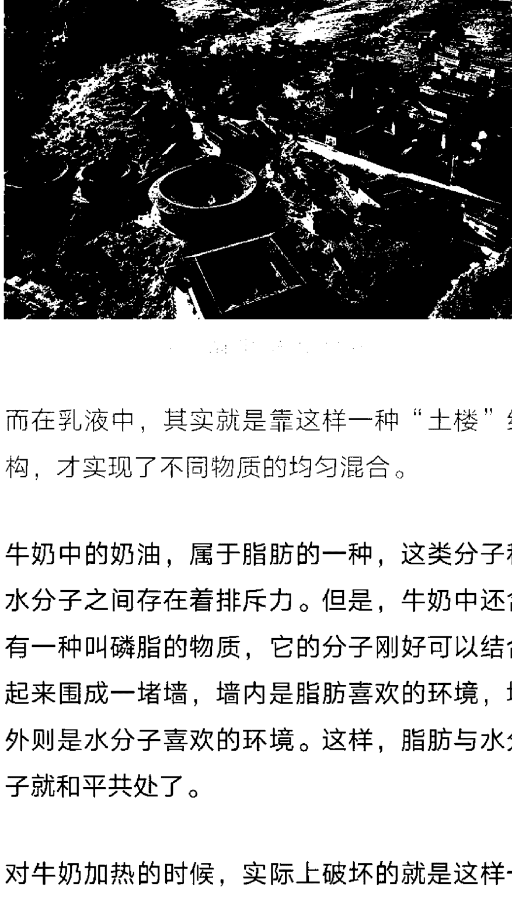

从这一点也可以看出，在明确了溶液与乳液的微观结构后，像PM2.5的雾霾，既不是液，也不一定是混合液。反过来看PM2.5的本质，也可以看成是乳液，因为它的微粒和我们刚才说的“雨滴”是一样的颗粒。而平时干净的空气，可以看成是溶液。

### 2

既然溶液与乳液的模型是符合真实世界的，但是纯解释者令人迷惑的是，有的想法就是，为什么有的物质在一种就是溶液，有的物质在一起就是乳液？

这就是我们要谈的第二点问题，溶液和乳液模型背后，也就是微观粒子的相互作用力，对物质性质产生的影响。

表面的原因很容易发现，我们还是会说盐水和牛奶的例子。

牛奶要是持续加热，就会产生奶泡沫浮在水面上，而且重新冷的时候，这些油花也不会重新溶到水里。因为，油和水不能相溶。所以从这一点可以看出，牛奶本身上也不是特别稳定，里面的分子结构很容易被破坏，看起来溶解在液中的物质，本质上不具普遍溶解性。

### 03 · 溶液与乳液

从前面讲过的课程中，我相信你们已经发现了套路。我们构造了一个个的模型，可以更加清晰地来认识世界。而通过这个模型的原理，去更好地改造世界，也是这个化学的精神，也是我们接下来要说的第三点内容。

溶液与乳液，在生活中有很多实际的用途，知道了这个模型，你的生活质量和幸福感，就会大大提高了。

比如说做饭，炒菜的时候，盐是先放进去还是后放，味道会不一样。一般来说，盐先放的话，汤就容易变得不好看。这是因为，盐溶在汤里之后形成溶液，炒的过程中，随着水蒸发，盐水浓度越来越高，而且盐全部渗透进去，结果就是咸味既没全被吸收，看着不太亮，吃着也是干巴的。

糖、醋、水，这些都是很容易溶于水的物质，可以在水中形成溶液，避免上述尴尬的状况。所以，都知道吃饭时先放糖，但没有说放糖的时候，就先把糖直接倒进去。而是吃的时候再放。

你可能没想到的是，乳液在做饭的时候也很常见，比如，奶白色的颜色，如何才能把白色汤染成油汤？加进水的过程，具体操作的时候，先用油做汤，将蛋黄的部分搅拌出来，这就是做酱，而且稳定性很好，很稠实。这样在搅匀的时候，就会出现奶汤了。

当然，如果你知道这个原理了，也就知道，鲫鱼汤虽然很浓，但是和盐没关系，不能恨鱼，恨是恨脂肪。

洗发水也是利用了这个原理。发根是很容易出油的部位，直接用热水洗肯定是行不通，这时候就需要用水去直接冲洗，让头发湿润并形成乳液，然后被冲掉，头发就干净清爽了。

那么，我们回到开头那个话题，为什么女生们用的各种乳液、护肤品都是乳液呢？因为它们从类型上本质上，都是非非常标准的乳液，是利用乳液的物态结构作用，来完成各自的化妆功能。

在化化妆品上，你可能会注意到O/W或者W/O的字眼。这可能就是乳液，这些乳液有散成油包水，也有的是水包油。适合秋冬季节，干皮肤的时候用，有的做成O包水，也可以是O/W型，适合春夏季节，湿度的时候用。

### ★ 总结 ★

- 第一，溶液和乳液的实质是不同的结构，跟是不是液体关系不大；
- 第二，溶液中不同的分子可以直接相溶，乳液中的分子不可以，它们需要借助别的“媒”来实现混合；
- 第三，溶液和乳液在生活中的应用十分普遍。做饭、洗菜、挑选化妆品，都需要用到这个模型。

孙亚飞

思考题：除了做饭和化妆品，生活里，你还会在哪些地方，用到溶液和乳液模型？欢迎在课后留言，和我分享。

### ★ 下节预告 ★

总的来说，溶液与乳液就是一组和我们生活紧密相关的化学模型。通过这一讲，我们也不难发现，知道一些化学，生活中也可以避免很多坑。

下一讲，我们就要谈谈最后一个物态的模型，理想气体模型。我们下一讲见。

上一讲

下一讲

## 14 | 理想与实际：为什么气体的化学性质需要参照系？

孙亚飞 · 化学课堂30讲
04:17 · 4.72 MB

14 | 理想与实际：为什么气体... ▼
04:17 · 4.72 MB

哦，我是孙亚飞，欢迎来到《化学课30讲》。

前面两讲，我们谈到了两种物质形态的模型，也就是固态的晶体与非晶体体系；以及液态的溶液与乳液体系。那么今天这讲，我们就来谈一谈气体的模型，这也是最后一个物质形态的化学模型了。

生活中，经常有人会说，理想一碰即碎，你怎么努力，大部分人都没机会挣一个亿，实现小目标，那还努力干吗？

你可能不知道的是，这个问题，我们居然可以通过化学模型来解答。

在介绍了多个典型的化学模型后，相信你对化学家们是如何处理问题，已经有了一个基本的认识，或许还会觉得，这些套路都差不多。无非都是找到事实依据，然后再慢慢修改完善。

相比于数学方法来说，化学模型的建立，看起来好像没什么技术含量。

的确，像欧几里得曾经提到的圆，作为一个人类思维的模型，定义特别简单，并且揭示了圆形的本质：在平面上确定一个圆心，所有和这个圆心距离相等的点，便构成一个圆。虽然找不出任何一种物体能够完全符合严格的定义，但是并不影响你知道什么是圆形。

这就是一种理想而又抽象的模型，很多人就喜欢用这种方式去认识世界，因为简洁利索，而且没什么歧义。

其实，化学里也有这类模型，我们这一讲要谈到的理想气体模型，就和这个模型很像差不多。

理想气体是一种不存在的物质，那么，我们研究它有什么意义呢？

这一讲要谈的“理想与实际”，便是针对这个疑问给出三个论点。

### 1

我们先来做一个思想实验。

假如现在你要设计一台立式电梯，要不要考虑乘客人员的体型呢？显然，任何一个电梯设计的主要功能不因为某个点或某人的业务水平的高低，而是考虑是否容纳下所有人的舒适度，甚至影响到安全性。

好，我们再换一个场景，假设现在要设计一间开放式办公室，会考虑职员们的体型吗？很少有人会这么做。对于办公环境而言，舒适度的主要影响因素，在于工位之间的隔离，至于隔壁工位的是个胖子还是个瘦子，对你的舒适度没什么影响。

这个实质就是理想气体模型建立的依据。

气体和液体、固体不一样，它很稀疏。就像地球表面很稠密的空气，里面分子之间的距离也是液体中的十几倍左右。

所以，液体中的分子就像电梯中的人群一样，挤在一起，这个时候，分子体积、形状、软硬等参数都是化学需要重点考虑的问题。

但是在气体中，就像办公室里的工位一样，需要考虑的核心问题，就只是分子之间的距离了。

在这个基础上，化学上的理想气体最简的简化方案，其实就是把气体分子想象成没有质量，没有体积，也没有结构的质点，物理上所谓的质点模型。

科学家们后来又完善了这个模型，他们把气体想象成没有体积的分子，而且彼此之间也没有引力，碰撞的时候，只会发生弹性碰撞，换句话说，这相当于在排队的时候就发号施令，就像打台球一样，白球去撞击另一个球，白球可以停，但是全部速度传给另一个球，另一个球继续滚动。

这就跟圆的定义一样，是一个近似于完美的想象，实际中是不存在的。

我们想想办公室的环境，隔壁是什么人，真的，你的效率没有吗？如果你的业务水平很高的话，你会在经常沟通的时候，在讨论工作问题的时侯，直接说就干干就干，就随便性碰撞一样，效率能百分之百吗？

气体分子就是这样的理想，很多条件在理想状态下忽略了，是理想中的状态，所以才被称为“理想气体”。

### 2

那么你可能好奇了，既然理想气体只存在于理想之中，实际气体不可能这样，那么这个模型建立的意义在哪儿呢？

我们还是和圆类比。现实中的圆，永远都不完美，理想的圆只是在数学定义中，它的意义又是什么？

相信你不难回答这个问题，因为通过圆这个模型，我们可以推导出圆的各种计算公式，比如周长、面积等等。

理想气体的价值也在这里，它主要用来分析气体不同参数之间的关系。

对气体来说，科学家最需关心的就是它的压强。

但是压强是怎么产生的呢？因为目标简化了，我们就可以这么说：气体对目标产生的压强，就是一个个气体分子撞击目标时产生的压力总和。

通过理想气体模型，就可以证明压强跟气体的密度有关，也跟分子的运动速度有关，并且得到相应的公式。

更具体来说，气体的压强和总量成正比，比如，给轮胎打气，打得越多，压强就越大；温度也成正比，所以夏天的时侯，汽车更容易爆胎。气体的压强，和体积是反比，压强变大，所以你会觉得气压很微弱。

不仅如此，理想气体模型，还揭示了气体压强变大的原因，也是我们第六讲提到的内压，加强了解是微观粒子运动的体现。实际上，气体压强正是部分分子的潜在势能。所以理想气体公式和化学公式中，用到的常数是一样的。

艺术源于生活而又高于生活，理想气体模型就是如此。它能简化气体性质，但是揭示的相互关系，比单纯的实验数据更为清晰。

这种处理问题的理想思路，生活中也非常普遍。

比方说创业，创业者都会撰写商业计划书，解释模式、量化财务等，在财务中，就是一种理想的模型。它有很多在理想中，但在实际生活中，可以做到尽可能相近，但是完全理想的情况，那是是不可能的。但是啊，理想模型可以让我们看到关键要素，并针对这些关键要素做出积极的预案，这就是理想模型的价值所在。

但是，我相信你发现了一个问题，俗话说，理想很丰满，现实很骨感。理想，和现实之间是如何填平？

### 3

与前面说到的很多模型不同，理想气体这样的模型，一经诞生，就必须修正，因为需要和实际气体之间的本质差异，不是为了了解实际，去进行修正。

但是，这并不代表，因此我们就可以放弃理想与实际之间的偏差不管不顾。相反，针对两者之间的差异进行研究，就是化学家最关注的核心工作。

理想气体和实际气体之间为什么会发生差异呢？

我刚开始提到过一个假设，我们把气体想象成没有体积，也没有结构，但是实际的气体，从化学角度来看，是有体积的，结构也决定了不同的化学性质。

这么看来，其实是实际气体有不同的化学性质，因此，才和理想气体有差距。

比如，气体分子之间是还有一定大小的，那么当分子之间的距离压缩到特别小的时候，开会就会像所有人挤到一个方，开放式会室里面所带的，都汇聚到一个会室开会，那么中间就会比平时多。

比如，气体分子之间多少还是有一点引力，那么当气体分子之间的距离压缩到特别小的时候，不会导致它现在的现象吗？打个比方，开放式公寓中的所有人和，汇集到一个会议室开会，那么冲突很可能就会特别多。

所以，气体分子互相压缩的时候，在一定的压力下，会凝结，分子相互碰撞就在一起了，气体就变成了液体，这正是冰箱压缩机的原理。压缩把气体变成了液体，液体从压缩机出来，重新变成气体的时候，就会吸收热量，就会让冰箱内部降温。

相同的过程，在柴油机中，又是另外一个结果。当温度或者油蒸气体被压缩的时候，混合体的热量也会增加。换句话说，气体分子之间的距离不久拉近了，它们的运动速度也更快了，这就好比光线三十秒的火车，不光速度快了，还装空调，大家的心情就会更加烦躁，一言不合就吵起来。

正是通过这个原理，柴油机可以在快速压缩的时候，空气就会和柴油分子发生反应，柴油就被点燃了。

不同化学性质的气体分子，在同样的操作下，产生的现象是不同的。所以，理想气体和实际气体的差别，就需要针对不同分子的脾气，对症下药。

这个道理，放在管理学中也能形容。

理想模型中的人，都是敬业的好员工，但是实际管理的公司中，每个人都是有脾气、有个性的。怎么处理这些个性，才是管理者的痛点。

形象地说，理想气体和实际气体之间的断层，其实就是一个宝库。连接这个断层的过程，就是我们不断接近真相的过程。

这么一说，你可能就明白了我们开始提出的问题。

我们设定的理想，哪怕也和理想气体一样永远不可能实现，这也不能代表理想不重要了。理想仍然重要，但是找出现实和理想的差距更重要，因为它能给你的努力方向指条明路。

### 总结

- 1. 理想气体模型在现实中不存在，因为它忽略了气体的实际性质，比如体积和动能；
- 2. 理想气体模型可以推导出不同参数之间的关系，这是可以通过实验、推导得出的；
- 3. 找出实际气体与理想气体模型，就是科学家要做的主要任务，因为它们之间的差别就是化学性质的标志。理想气体和实际气体之间的断层，是一个宝库，连接这个断层的过程，就是我们不断接近真相的过程。

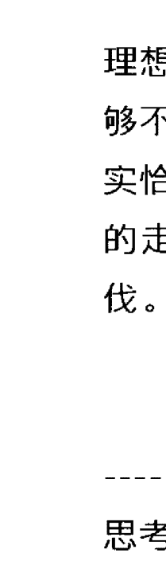

孙亚飞

思考题：

你有没有后悔过，如果当年努力一把，我就会有更好的人生呢？为什么会有这样的感受？

欢迎留言，分享故事。

### 下节预告

下一讲，我们就要开启新编章，进入新模块化学方法的学习了。

我们下一讲见。

### 用户留言

**伪装**

你有没有后悔过，如果当年努力一把，我就会更好的人生呢？为什么会有这样的感受？

**思考**

孙老师，不要没事就戳人家的痛处...一百个人里有五十对后悔自己当初没有更努力些，然后就变成更好的人，留下没有留在的人，靠运气靠靠班的...原因很复杂很复杂。人为人的自由意识有限，能写什么？

简单，其实就是理想与现实不匹配，人们会下意识的从过往的经历里找原因，然后归因于上，这样才会意识到现实中其实已经开始为定自己的鸡汤一些，

所以我们要把一句话写当代自己的座右铭：种一棵树最好的时间是在十年前，次好的时间就是现在。

**Stone**

薛兆丰老师说，经济学就是建立在理想模型之上的，如果没有理想模型，经济学就不存在。讲所以经济学的人开端一般都是：假设...

理想模型为了抽象出事物的本质，然后进行因果型思考

理想气体模型也是一样，为了推导出不同参数之间的关系，得到有价值的结论。比如，地球是个球体，事实上这就是理想模型，但是帮助我们理解

回顾自己过去的人生，假如可以回到从前，当时努力一把，也许这不是现在这个样子，肯定会现在不一样。但是我不是不想在这个对，这可不一定了，可能更好，这可能更差，还可能跑现在差不多

人生是复杂而变化的，并不是某一个单一因素决定的，回到过去万一是把它也可以改变某个一点的，但同时它因素也会随着它改变而变化，更好的万一人不是由某一个单独立点的，而是系列复杂的综合结果

理想模型能帮助我们去思考，还原历史能帮助我们看清事物的变化和复杂

**专职很鸡窝**

1. 理想气体模型是为了更好解决问题而简单抽象出来的模型，忽略了个体分子自身的大小

就像在企业管理中忽略单个员工影响

比如有同样的中高层，坚持同一目标，没有个体特征（如部门职能）公司可以简化为：员工总数（总盘），权益分配（进度），配餐机制（空间），在制定方案前，先考虑理想气体模型，就是影响大方向确定了，再想让理想现实导入他可能的个性因素对方案进行修正

2. 为什么会有“如果当年努力一把，我就会有更好的人生呢？”

努力程度就是分子之间的作用力，如果分子个体差异，互相运动速度快，那么就会引发分子碰撞的从动能或热那物质形态（冰）和相（气）或热和外界产生联系（冰碰墙）最终达到目标

3. 用一句“种一棵树最好的时间是十年前，其次就是现在”

得到了人，年纪记 这个 年 多 个 小 时了3000多次笔记 学了2000多个专业他每天互相矛盾 自己大材小用 种一棵种子会觉得和他没有共同语言 永远也赶不上他的人 但是他不是这样 如果现在不用十年 种子 我还是 一棵树也不晚，而现在我可以在想后人也会骄傲地分享大树，而且在想他在我经验础上进会的更快，只要开始就不晚。

**佛门门徒**

“如果当年努力一把……”感慨之后呢？

第一种：现在后悔已经晚了，后悔就成这样子了，下辈子再努力吧——这叫做浑浑噩噩的日子过。

第二种：在于我特，现在努力总比从来没有拼搏过得好，加油，或许人生从此焕然一新。

无论什么 人，多或少数都抱怨“要是当初……”，但往往决定最终结果的并不是开始的早晚，而是感慨之后的人生态度。

**曾俊龙**

化学中的哲学观：

面对现实，同时保持你的理想。

理想是一个目标，可以忽略细节，只考虑够不够大，够不够大，够不够大。而现实的相反，是需要的明明白白，一步步走，随时随地 根据环境 变化调整步伐。

思考题：

你有没有后悔过，如果当年努力一把，我就会有更好的人生呢？为什么会有这样的感受？

回答：

最近我感慨，如果当年读书的时候多努力一把，现在说不定自己能当个科学家，考古学家，天文学家等。

有现在的感受，是因为我发了我的定，当有有这样的是想法，我又会自己拉回现实：现在学也不晚，赶紧平实干事。

## 15｜合成与分解：化学家创造物质的边界在哪儿？

孙亚飞·化学通讯30讲

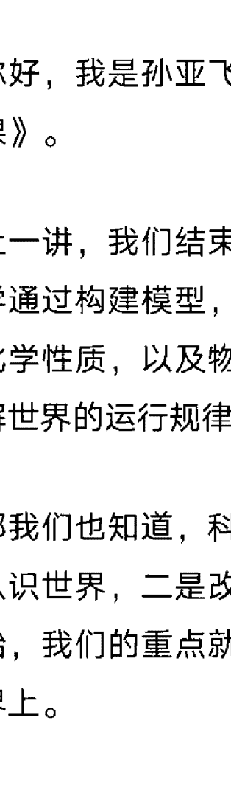

你好，我是孙亚飞，欢迎来到我的《化学通讯课》。

上一讲，我们结束了化学家原子模型，总结了化学是通过构建模型，也就是关于物质结构、物质化学性质、以及物质形态的模型，帮助我们理解世界的运行规律。

那我们知道，化学的目标主要有两个，一是认识世界，二是改造世界。所以，从这一讲开始，我们的重点就从认识世界转移到了改造世界上。

首先开导的模块，是化学方法，这是化学改造世界的根本手段。

接下来三讲，我会为你呈现三个典型的化学方法，它们解决的是改造世界三个阶段的问题，分别是创造、调节和制定标准。

这一讲，我们先来看第一个化学方法，合成与分解。它的主要任务，是从无到有，创造出新的物质。

### 1.

“合成”这个词，我想你一定不会陌生。你去修车的时候，修车铺可能会推荐所谓的合成机油；你去医院看病的话，医生也有可能建议你服用合成药，比如经典的阿司匹林、安定等等。

在化学里，合成就是指将简单的物质合成复杂的物质。这里不是直接将两瓶东西粘贴起来，或者混在一起，而是从结构出发，在原子层面进行重组，形成新的物质。

打个比方你就懂了，把木头加工成椅子，不可能是几根木棍随便拼出来的，相反，要先把木头加工成更简单的形状，然后再用合适的顺序拼接起来，这就是化学合成的逻辑。

在自然界中，大量存在的物质往往都有着比较简单 的结构。比如水，只有三个原子，两个氢，一个氧；食盐，也就是氯化钠，只有两个原子，一个是钠，一个是氯；酒精算是比较复杂的了，六个原子，两个碳，一个氧，加起来也不过是九个原子。

它们就如同现成的原料，人类要想满足自己的需要，那就只能借助于这些简单的原料，将它们组合成更高级的结构，这就是合成的由来。

实际上，合成并不只是人类的专利，大自然本身就是一个合成高手。

几乎所有植物都会进行的光合作用，其实这就是植物的叶绿素，利用水和二氧化碳和氧气，经过一系列化学反应之后，变成了葡萄糖和氧气。葡萄糖对于植物来说，仍然只是另一种原料，经过进一步合成，才可能变成更复杂的物质。

任何一种植物，根、茎、叶中的绝大多数物质，都是植物辛辛苦苦合出来的。

即便是非生物体，也在进行合成。比如石灰岩溶洞，就是原本溶解在水中的二氧化碳发生沉淀，于是水本身不溶于水的碳酸钙，就形成了溶于水的碳酸钙。

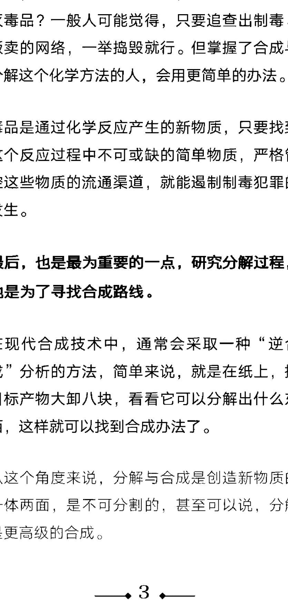

这么看起来，合成是非常普遍的一种现象。

除了大自然的合成，更进一步的是人工合成，也就是通过人工操作，才能完成的合成过程。从本质上说，它和天然合成方法没什么差别，但合成出的结果却大不同。

天然的合成过程，通常都存在着不确定性。比如闪电发生的时候，就有可能烧空中两个氧原子的构成合成，就能合成臭氧。但是，只要你不能控制，这个合成过程，并不可控。

人工合成就可控多了。用科学术语来说，这个过程里，增加了人类的主动创造性。合成可以预先设计好路线，有意识制造出想要东西。而且，有时期的结果，还会比想象的更精彩。

比如著名的合成药物阿方多宁，也就是伟哥，最初在设计的时候，研究者认为它可以用来降低血压。但是，尽管尝试失败，因为它对降血压效果一般，尽管如此，思考者对于它的研究是特别感兴趣的。

研究者后来发现，原来是因为它可以解决一部分勃起功能障碍问题，于是就转而研究方面，研制出了人人皆知的“蓝色小药丸”。

所以，人工合成并不是只能着目标去开发，还可以根据现实情况去调目标。你看，人工合成比起天然合成，在效率上优势很大嘛。

### 2.

不管是自然合成，还是化学层面，既然有合成，那肯定有分解。严格说，分解就是将简单物质得到多个物质的化学反过程。但是一般讲下来，只要简单、复杂的物质得简单物质，都可以视为分解过程。

对于化学专业人员来说，分解甚至比合成更重要。

首先，分解可以帮助人们做物质进行检测。

很多年前，仪器不发达的时候，化学家要鉴定一种物质的成分什么时，没有好办法，只能将合成物简单化的物质，然后拼接，猜测原来物质更多结构。但尽管这种方法还在也仍然存在，只不过形式发生了改变，用在了仪器中。

比如化学家经常用的质谱仪，就是把物质分解成更小的粒子，由此推断原来的物质结构。

其次，分解可以用于追踪与仿复。

我们在第六讲过，自然界中，天然合化的总趋势是变简单。物质结构需要变得更简单。所以，很多物质经过长期研究，会发手段分解。如果要研究验证合化过程，需要掌握合化规律。但是，当我掌握了分解的规律之后，就可以在不同物质之间，建立起确切的联系。

比如，你如果是一个缉毒警察，会用什么办法消灭毒品？一般来说，会直接毁掉，销毁查制和贩卖的毒品，一举根除毒品。但是，合成与分解这个化学方法的人，会用更简单的办法。

毒品是通过化学反应产生的新物质，只要找到这个反应过程中不可或缺的简单物质，严格管控这些物质的流通渠道，就能遏制制毒制的发生。

最后，也是最重要的一点，研究分解过程，也是寻找合成路线。

在现代合化技术中，通常会采取一种“逆向”合化分解的方式，简单来讲，就是反上来，把目标产物大搞出来，看看它可以分解出什么东西，这样就找到合成办法了。

从这个角度讲，合成与分解是合化创新物质的两个方面，不可分割的。甚至可以说，分解是更高级的合成。

### 3.

好，我们现在知道了什么是合成，什么是分解了。那么他们怎么改造世界的呢？

第一个容易理，那就是，通过合成与分解，人类可以掌握物质变化的规律，形成一套改造世界的方式。

对于古人来说，没有现代化学理论的指导，不知道合成与分解的规律，都很难解释物质变化，即使能发现很多现象，依然只会用神秘或者巫术来解释，不能为规模使用。

比如欧洲的炼金术时代，用炼金法术宣称自己点石成金，入层出不穷，多数人都为炼金被到处死无。

想想来说，这些炼金术士其实也发现了不少化学变化。比如第一种看起来成功的炼金术，就是把镀上金上面的银很用稀硫酸溶掉，对于看的人说，因为他们不知道合成与分解的

### 恒泰来说，这些炼金术士其实也是发现了不少化学变化。比如有一种看起来成功的炼金术，就是把铁在黄兰里面不停地熔炼成钢，对于老的化学者来说，因为他们不知道合成与分解的原理，所以就认为，黄金是合成出来的。

但要有化学的角度来看，这个骗人的戏法其实就是不可能合成出来的，所有的炼金术士都是黄人的。从这一点看，我们也可以看出，合成与分解并不是天马行空，而是有边界的。这个边界，就是我们第五章里讲过的，在把握化学反应中的限定要素，万变不离其。

其次，通过合成和分解，人类掌握了操控原子的能力，这就成为很多科学探索和应用的**基础**。前面提到的伟哥，就是药物化学中的一个明证。

再比如，房子装修完后，很容易产生甲醛，很多人就想法去去除甲醛，其中有一种技术叫做光触媒。但是，当你真正用的时候，可能怎么也想不通，它为什么能去除甲醛。

其实这是化学的功劳。甲醛自身稳定性很强，不这么想。它也是需要一定的合成过程。

如果了解甲醛分解的原理，从空气中脱除甲醛就就这么容易。甲醛的密度和空气差不多。我们常用的活性炭，吸附的方法，根本无法从根本上解决甲醛。因为活性炭的吸附能力有限，如果超过了吸附上限，甲醛就还容易再释放出来，形成二次污染。

这么看来，利用化学方法，操控原子引发化学反应，可能是唯一解决问题的办法。

前面说到的光触媒，就是操控原子的一种手段。它是一种催化剂，能把太阳光转化为甲醛和氧气反应需要的能量，这样就启动了甲醛的分解反应。

**最后还要提到的一点是，化学中合成与分解的思想，很多行人可以借鉴。单说化学里，就有许多分子，这些东西都是分子层面的模块化施工，很早就已经在化学科研中使用了。**

比如，结晶牛胰岛素可以用来治疗糖尿病，它由大量的氨基酸组成，如果做一个一个递过，效率很低，就像玩具拼搭一样，你一块一块去拼，就进很困难。但是如果有这么一个区域，再合起来，就能高效很多。咱们国家在1960年代，率先把结晶牛胰岛素合成出来，就采用了这种模块化的思路。

同样的模块化思路，还可以应用到其他领域。

盖房子通常是先画好设计图，然后一砖一瓦垒起来。但日本大洋的海博博物馆，就不是那么做的。

它是一座玻璃穹顶建筑，穹顶的面积超过3000平方米。因为在海上施工，人工安装玻璃会非常困难，所以穹顶是先在工厂里全部加工好了之后，再进行整体吊装。

### —— 总结 ——

这一讲，我们主要讨论的是创造物质的化学方法，合成与分解：

- 首先，人工合成方法，可以有目的地把简单物质组装成复杂物质；
- 其次，分解是合成的相反过程，把复杂物质变简单，但它的重要性和低；
- 最后，合成和分解虽然是化学方法，但它的思路，很多行业都可以借鉴。

**孙亚飞：**

**思维题：**

思维导图是一个很流行的思考问题的方式，你用过吗？你在编排思维导图的时候，是怎么来设计内容的呢？

欢迎在课后留言，和我分享。

### —— 下节预告 ——

下一讲，我们来谈一个很多人熟悉的东西，催化剂。

我们下一讲见。

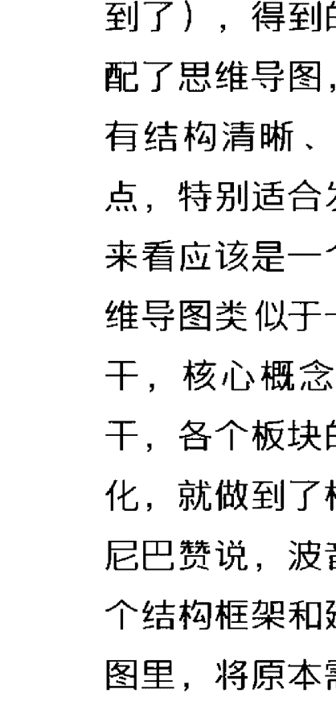

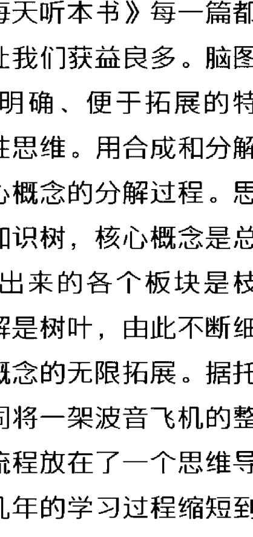

### 用户留言

**Stone**

化学分解方法在现实中的应用挺多的。比如限制核弹技术，美国以及国际原子机构对全球核材料，甚至包括铀原子的单位核材料都严格管控，包括制造核原料的设备都严格管控起来。

目前来看这种限制是有效的，核技术仍然掌握在少数几个国家。

联合国和国际原子机构能够分解核弹的制作和原理，限制了核技术整体的扩散，可以看出，分解是更高难的合成

**曾佐飞**

科学的目的是什么？

1. 认识世界
2. 改造世界

化学适合：合成和分解。

什么是合成？

在化学里，合成就是将简单的物质组合成复杂的物质。这里不是简单地把砖头搭积木，或者把齿轮组合起来，而是从原子层面上，在原子层面上进行重新，形成新的物质。

什么是分解？

分解就是正向合成，把复杂的物质分解成简单物质，从而可以重新判断某物物是怎么合成或形成的，研究分解过程，也为了寻找合成路线。

合成与分解模型的思维：

看到了原子层变化规律，简单来讲就是物物质分子之间的运动。比如说一辆汽车就是：车+x1=车+x4，这里看汽车可以看成合成后的产物，车和车是合成的物质。

**有所想有所得**

思维导图作为一个有效的结构化思维工具，现在越来越流行，也经常被我用在日常工作和小八小时的生活的活动中，有到《小时代》里的一篇都配有思维导图，也比较有获益良多。既要有结构清晰，要点明确，易于拓展的脑图，特别适合发散性思维。用合成和分解来看合类是一模似脑图的核心，总是一个核心概念，核心概念是思维导图的出发点，核心概念分解出的每个枝是分支，每个枝再分解，由此不断细致，就做到了核为纲，杂为目。据整个图形，和原书阅读效果就比学了一个过程推导，简单很多。

导图的分解思维就是研究几个问题。简单，类似《三体》里的四维合一，每个细节的清晰，想要理解，研究分解的复杂性高难度。

**佛祖门徒**

孙老师，我一直想以前看电影小说的时候，有这样的疑惑，医生为毒病人解毒时，往往需要这样看底层成分析，了解药物的成分，然后才能找到既成有针对的解药。这个过程其实就是微调和合成的方法，让我们能看到事物的本质，合让我们选出更加丰富的物质。

**伪装**

世界的变化就在分解和合成之间完成了，小到聚分子，大到天体物理，莫不如此。化学化的通量其实一直都是人类最困惑的学问，总是在微观和宏观方法上反复发，才特别需要抽象思维和还原思维。

**「匠心」维他**

读完这一讲中，让我想到了，教学过程就是把知识逐渐合成为解，给学生上课讲题的时候，也是要提取其他科目相似的知识，强化学生记忆，联成知识体系，这样也减少了记忆负担。

**【课程心得得到】**

- 首先，人工合成方法，可以有目的地把简单物质组装成复杂物质；
- 其次，分解是合成的相反过程，把复杂物质变简单，但它的重要性和低；
- 最后，合成和分解虽然是化学方法，但它的思路，很多行业都可以借鉴。

**【思考题】**

思维导图是一个很流行的思考问题的方式，你用过吗？你在编排思维导图的时候，是怎么来设计内容的呢？

用过的。用来梳理逻辑，结构化思考和输出。

总结的方法去设计内容。

网状的去思考网状的输出。

## 16 | 加速与延缓：改变节奏的代价是什么？

孙亚飞 | 化学通识30讲

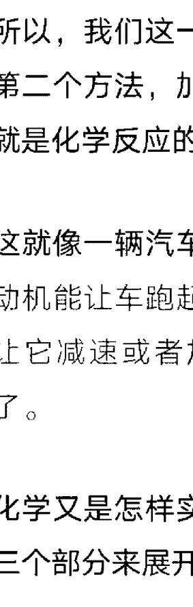

你好，我是孙亚飞，欢迎来到我的《化学通识课》。

上一讲，我们开启了新模块，化学方法，了解到化学创新创意，改造世界可以分“成与分解”的方法。这是化学解决从无到有的问题的一个方法。

但是，实现改造创新创意，不是极短中的速度，也会产生问题。比如，开发新药需要造一个大楼，工期是一年，三年还是五年，现实意义就完全不同。

所以我们这一讲就要谈速度，化学改造世界的第二个方法，加速与延缓。这个方法解决的就是化学反应的速度问题。

这就像一辆汽车需要既安装油门和刹车一样。发动机提供强大的速度，这里提供的是动力量。但让它减速或者加速，这里体现的就是技术了。

化学又是怎样实现这个技术过程的呢？我们分三个部分来展开讲。

### 1

第一部分，我们先来讨论影响化学反应速度的因素有哪些，这是问题的核心。

第一个因素，你肯定容易想到，那就是物质本身的特性。一个人跑得快或者慢，肯定有天赋的作用，物质性，就是化学反应的天赋。

比如说，金属撞到氧气或者烧硫，就容易彼此反应。大多数情况下，金属或者氧气的温度越高，反应越剧烈。但也有少数金属，比如，它们能就反应就比铁难。你看到，这就是由物质本身的特性所决定的，高于先天因素。

有先天因素的话，那肯定还有后天因素了。经过研究，科学家们确定了后天因素里两个最主要的参数：一是浓度，二是温度。

### 3

不过，在生命体面前，人类现在使用催化剂的手段，说不定还不如它纯粹。像这样天然催化剂的例子，真正优美、调节生命体的部分中就已经提到了。

生物体内的酶，其实也是催化剂，而且它的专一性和效率，比人工的催化剂更为突出。所以，现在的化学家们，会尝试着从生物体中寻求合适的酶，用于物质的分离与合成。

很多我们吃的保健品、用的化妆品，都离不开酶的作用。比如，我们爱吃的鱼，从稻草中提取酒糖的作用，也是因为酶。

不出意外，在接下来的几十年里，催化制技术会带来效率飞猛进的提升。如果从化学反应的角度来说，原子还是这个过程中的最小单位，那么人类把原子组织起来，也会更加自如，由此带来的效果也是现代人难以想象的。

不过，到了能够操控化学反应速度的时候，是不是就变成无所不能了呢？

这个问题，我们在之前的课程里，已经提到过：要改变、调节化学反应的速度，一定会付出相应的代价。

比如说，我们给塑料里加入防老剂，就可以让塑料的老化过程变得很慢，甚至可以使用好几年。但是，一旦这些塑料腐烂的过程，会变得很慢，会容易被污染掉。

反过来，通过改变电池的浓度配比，可以让电动车中的反应更快，但电池也会因为电池充电的时候，更容易爆炸了。

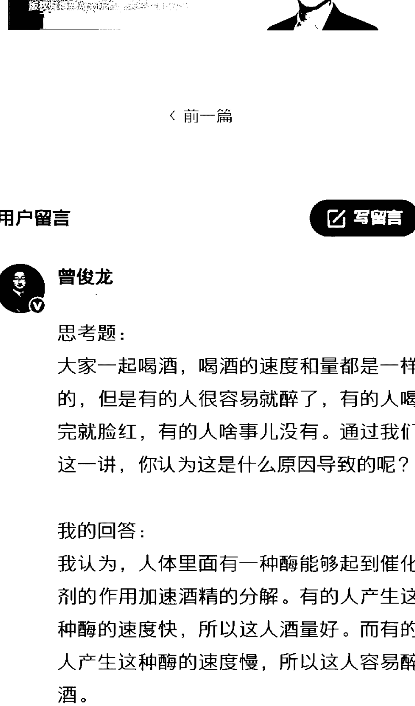

这么看起来，当我们想尽办法，加速上面反应的同时，也会带来更多负面的代价。

有的产生了反应，可以能够控制化学反应的浓度、能量等方面，在人类掌握的速度技能，但科学的使用，也需要更多的技术。

值得多说一句的是，从这一讲不难看出来，科学究竟是福祉，很大程度上取决于人类自己。古人认为，掌控天理掌握人生命运。

以现代的规范来看，掌控化学反应速度，可能是人类目前最接近神灵的行为，因为这几乎是地球上所有变化基础。

### 总结

- 第一，影响化学反应速度的外界因素，主要是浓度和温度；
- 第二，催化剂可以改变化学反应的速度，是因为它能够提供两种物质之间，产生反应的化学能，使能差变大，反应速度也加快，反应速度也会变慢；
- 第三，改变化学反应速度，能为化学工业，还有带来很多福利。但也同时，会发生相应的代价，所以我们在使用，也需要我们多分谨慎。

孙亚飞

**思考题：**

大家一起喝酒，喝酒的速度和量都是一样的。但是有的人很容易就喝醉了，有的人喝完全没事，有的人呢事儿也没了。

通过我们这一讲，你认为这是什么原因导致的呢？

### 下节预告

我们通过前讲的的内容，了解到创造物质的基本方法，以及改变物质创造速度的关键，也就是催化剂的应用。下一节，是本模块的最后一讲，我们会来谈，创造物质的生产标准是什么。

我们下一讲见。

## 17 有机与无机：为什么有机食品还是化学方法的产物？

孙亚飞化学课第30讲

你好，我是孙亚飞。欢迎来到《化学通识课》。

在本模块的前两讲，我们讲化学改造世界前两个阶段的方法：第一个阶段是合成与分解，它解决了能不能创造新物质的问题；第二个阶段是加速与延缓，它解决了创造新物质的速度、速度还是慢的问题。

接下来，我们就该解决化学家在创造新物质的过程中，面临的一个问题了。换句话讲，就是：什么样的化学方法能更高、更高效地改造世界。

这就是这一讲要讨论的主题：有机与无机的化学方法。

### 1

“有机”这个词，你肯定不陌生。很多商家会告诉你，他们的食品是有机食品，一些人喜欢添加都没有。比如蔬菜水果，都是浇粪肥，不用化肥的。所以，商家讲，有机食品食品也是有道理的。

但在我们化学家的眼里，都普相信。因为有机这个词，从诞生那天开始，就挺学关系紧密。想解释为没有有机，就好比把开了数学没加乘除法一样。

简单来说，有机，就是有生命的意义。

两百多年前，化学家合成新物质的能力还特别有限。所以，他们认为，有些物质只能在生命体内合成，比如蔗糖、葡萄糖等等。这类物质，就叫做有机物。反过来，他们认为不能自己合成，不用从生命体里面提取的物质量，就叫做无机物。有机和无机，也就是化学方法上的差别。

这个理论对于科学研究，有很大的影响。比如大化学家雷德说没有，物质是分为有机物和无有机物，两者之间的界限不可超越。

但是到了19世纪30年代，科学家们推翻了这个观点，因为他们通过合成方 法；用无机物制造成合成物了。原来，人类终于能够用无机物制造出有机物了。

既有机和无机，的原始定义已经不再那么科学了，那么原始概念，是不是就没有研究和讨论的必要了？那当然，不一定。

直到 在现在，它们不光没有消，在存反越来越普遍。你看，化学这门学科里，都用机和无机 包含在两个 独立的二级学科分类 里，如 你看，它们在内的 二级学科分类 之一就分五个。

所以，有机和无机凭什么在化学里地位这么高？我们来下去，就从这两个层次来演讲。

### 2

首先，我们要清楚一个问题，有机和无机确实区别，究竟在哪儿。

简单点说，它们的研究对象和研究方法不一样。

从微观面来看，有机化学主要研究的是含有碳元素的物质，也就是化学里的有机物。无机化学是除了含有碳元素的有机物以外，所有的其他物质，也就是化学里的无机物。

你可千万别小看了有机物，虽然只含有碳这个原子，但它 的类型 超过了十亿种，无机化合物涉及十多种化学元素，但数量加起来，一共才几十多万种。

为什么差距那么大呢？像之前一样，还得从微观层面来解释。

碳原子的结构非常特殊，它可以跟其他元素的原子链接成各种各样的框架，从而构成无数 有 种。化学的研究者就在碳 元素的骨架，就简单多了。

我给你举一个生活中的例子吧。

如果你去医院看病开，拿到的是合成药的药方，会 发现药方是书 上 呈现，不是示药物成分的化学分子式，而是 结构式，也就是说几个 圆形图形拼在 一个 起来，达的是药物内部那些子的连接方式。这是 为 什么，合成药物是有机物，把里面元素的 骨架画 出来 的 ，对于 有 一定 专业知 识的 人 来说，信息量基本就够了。

由此可知，无机的方法是没有句点，什么都可以尝试。

说得形象一点，在改造世界的过程中，有机的化学方法就像是写小说。不光得交代故事的框架结构，还得时刻注意，主人公设定和故事走向不能被夹断。

无机的方法就像是写诗，看起来起得很轻松，但创造性却十分突出。

说到这里，我再多说一句。如果说你身边有孩子正在学高中，他在学化学的时候，总是接不清楚各种化学反应的规律，那你可以建议他换个思路，从有机和无机这两种不同的研究方法出发，或许，就开窍了。

### 4

有机和无机就像不同的研究方法，不光在科学研究中发挥作用，还是化学中的有机学方法，甚至成了一套标准，影响了诸多行业。在这里面，农业、食品行业算是普通人关注注意最高的了。

### 现代农业中的“有机”生产标准，其实也是“关联性”有关，从形式上讲，有机农法的主要特点都是各类关系的紧密关联。比如中国古代的“桑基鱼塘”模式，就是一种最原始的有机农业系统。

种植的绿色可以用来养鱼鱼，鱼塘的淤泥用作基肥，可以作为鱼用来养蚕，蚕的排泄物很肥沃，蚕的粪能提供给肥料，整个体系就是一个循环，就像生命体一样，每个部分都和其他部分紧密关联，最终形成一个鲜活的整体。

这就是一种有机的生产标准。

从这个角度来看的话，现代农业的生态性更强。它需要考虑更多的是配合，也需要更多的技术规模支撑。

即使是种一块蔬菜，从老也得考虑种，果树，杂草，老鼠、昆虫、真菌、细菌等等，各种物种之间的关系，除了这些，我们还要分析空气、水和土壤中的化学元素的流向。有了这些基础，才可能生产出真正的有机蔬菜。

这才是“有机”的真正含义。

所以，我们再回头看，再去看这一讲开头说到的，商用“有机”来营销，就会明白问题出在哪儿了。

普通人并不清楚有机和无机的含义，商家恰好利用了这一点，才会宣传自己的“有机”产品不使用农药、农药，是纯天然产品。

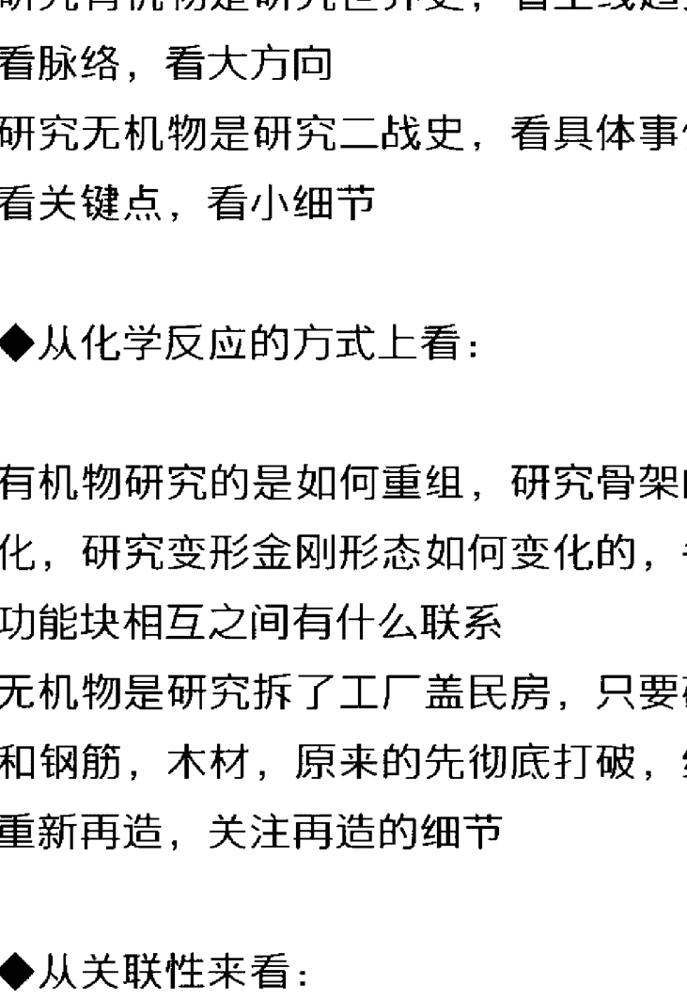

有机农业只是禁止使用人工合成的农药和化肥，但一些通常必须用到的化肥或者除草农药，比如说氮素化肥要通过加工，才能加工成肥料入田。如果是直接把粪污泼洒到地里，农作物就会出现迅速腐烂的问题。

### 总结

- 第一，有机和无机，在物质属性上来说没有区别，区别在研究方法。
- 第二，有机的研究方法重在关联性，无机的研究方法重视创造性；
- 第三，有机作为生产标准，不是纯天然原生态，而是让各个部分循环起来，形成一个鲜活的整体。

### 孙亚飞

思考题：
你以前吃过哪些“有机食品”？你觉得你有机吗？
来课后留言，跟我分享你的答案吧。

### 下节预告

下一讲开始，我们就要进入新的领域，化学材料了。正所谓“巧妇难为无米之炊”，再好的技巧，没有工具就发挥不出作用。而化学的工具，就是材料。

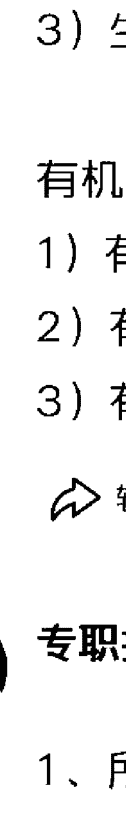

## 18 | 金属与非金属：为什么冶金工业注定要衰落？

孙亚飞 化学通识30讲

你好，欢迎回到《化学通识课》，我是孙亚飞。

通过前面三讲，我们知道了人类改造世界的三个化学方法，这也可以称得上是最基本的能力。不过，再好的技能，没有工具的话也发挥不出作用。

### 在化学世界里，这个工具就是材料。

今天，我们就正式进入新的板块，化学材料。接下来，我会先用三讲，说说物质在设计化学材料的过程中，通常会涉及三个原理，分别是材料的属性、结构和尺寸。

### 第一个涉及的属性，就是材料的属性。在化学中，材料根据性能可以分为两类，一类是金属，一类是非金属。

人类一直以来，都对金属情有独钟。世界上各古文明的起点，几乎都是青铜器的出现，作为标志的。你想啊，古代人类要是没有利用金属材料做工具的话，不劈砍大树造房子，就连小小的木头都看不清了，只能靠火烧，那还谈什么文明呢？

但是说出来你可能不信，现在，金属材料地位却越来越不灵了。为什么会出现这种情况？接下来我分三个部分讲给你。

### 1

在第一部分，我们从学的角度，来看看金属材料为什么曾经会占据优势地位。

不管是黄金白银，还是钨钢黑铁，人类特别看重金属材料，主要是因为它们的性能特别好，可以有很多用途。

所以，金属材料的延展性强，强度也高，所以人类就可以用它打造成各种形状的器物，尤其适合做成锋利刀具。自己之类的东西。熔性点高的金属可以做成铁门，门到开始烧，烧气焊的熔块可以制成材料。3. 到了现在的电气时代，更导电的基本材料是金属，比如铜电缆。

你可能会问了，这些都是物理性质，跟化学又有什么关系呢？

首先，化学家们知道，结构决定性质。如果不借助于化学了解结构，你就不知道金属的性质是怎么来的。

我就举一个例子来说明一下。

我们在第八讲提到过化学键，其中有一种叫作金属键，它实际上是金属原子在摇摆结构的金属形成的特殊化学键。简单来说，就是金属原子核外的电子总是杂散的，所以就会掉个地方把它们放起来。导电性就是靠这些“电子”实现的。

其次，金属材料的提炼，金属矿的生产和在很大度上，依靠化学的发展。

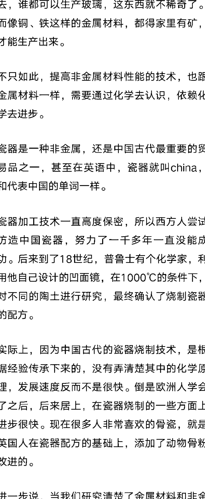

我们都知道一个词叫“沙里淘金”，是因为有的河里沙里含有黄金，可以从那里淘出金子来。但是想要得到黄金，要淘洗，要提纯，就像依靠化学方法。

最常用的方法，就是湿法冶金，黄金能溶解在剧毒的氰化溶液，它和氰根离子反应进行分解，用这个方法，就能提纯出来纯度很高的黄金。

我再举个例子。

不锈钢发用到现在，有一百多年了。它之所以不生锈，就是通过了化学方法，在钢里面加入了2%~8%的铬和铁元素，同时降低了碳元素的含量。

在没有现代化学之前，人类对金属材料普遍感到很神秘，甚至会产生产生崇拜。比如古罗马人供奉铜钱，古希腊人把黄金当作太阳神，等等。

但是，我们通过学习解到了金属的特殊的属性后，就能发现，金属没有那么神秘，而且它特殊的性能还可以通过化学手段去实现。

### 2

刚才说到，化学材料分两类，除了金属材料，另一类就是非金属材料了。既然金属能发挥这么多奇妙的性质，那非金属材料可就不可以？这就是我们第二部分要讨论的主题了。

相比金属材料，非金属材料一般都起不到那么强的性能。这倒不是因为它们没有技术含量。

玻璃是一种非常重要的非金属材料，它最大的优势在于透明度高，所以可以用于镜子、窗户等生活用品。但是，玻璃的外层加工并不简单。

我们前面说过，古代很多国家都使用世界，多点开花，但是玻璃的独立发明地，只有一个，那就是地中海东部地区。

### 总结

如果这么说的话，在未来，这两种性质的材料，发展前途应该一样吗？不一定。

 金属材料的大原料并不均匀，属于矿藏，需要开采出来的。现代科技快速发展，不断扩大、提高，金属矿产分布不均和枯竭的问题，也更加明显了。比如多数铜矿，也是因为有铜矿，矿产非常丰富，开采了几千年。但是，现在的因为过度开采，已经面临枯竭。

相比之下，非金属材料根本就不存在这个问题，因为它构成的几种元素，比如碳、氢、氮和硅，前三种在空气中就存在，硅在几乎所有的岩石里都有。所以，非金属材料不存在无穷尽的问题。

这因为有了化学技术的加持，从微观角度来看，人们可以调控原子，让非金属材料也达到金属材料的性能，不但能生产出钢刀、玻璃这样日常用品，还能造出超出人类想象力的东西。

比如以碳元素来说，主要元素就是碳和氮，它可以制成电极，芯片、军工等很多高科技领域。

甚至我们还可以发现，就连用量最大的钢材和铝合金，也因为人类能够改变其性能，从而面临遭遇原子材料替代的可能。

所以你看，现代工程设计的思路就是，只要能找到可替代的非金属材料，就不用金属材料了。从另一个角度看的活，冶金工业注定就要衰落了。

但我想多说一句，在金属材料总量要缩减的基础上，人们也会更多地去开发它独一无二的功能，用非金属材料替代不了的功能。

稀土就是一类金属材料，我们现在没有办法用非金属材料来替代它，所以它还有自己的一些非常重要的用途，比如，它是要用来制造激光器、永磁材料、超导材料等。

在这一讲中，我要给大家讲三个问题，就是化学用来改变世界的工具，着重讲了三个问题：

- 第一，金属材料曾经很受重视，是因为它的优秀性能，能让它起到各种不同作用；
- 第二，通过化学手段，非金属也能获得跟金属材料一样的性能；
- 第三，现代工业生产，非金属材料正在大面积替代金属材料，但金属材料也有生存空间，那就是发挥它独一无二的用途。

### 思考题

你有没有感觉到，身边的金属材料越来越少？
欢迎在留言区分享。

### 下节预告

## 19 | 天然与人工：为什么复合材料是化学能力的体现？

你好，我是孙亚飞，欢迎来到《化学通识课》。

上一讲，我们开启了新模块：化学材料，首先讲到了化学家设计材料的第一个原则：材料属性。这一讲，我们就要说说第二个设计原理，也就是材料的构成。

如果你记得，我们在上一讲时提到过一个趋势，那就是生活中无时不在的钢铁、铝合金等等材料，现在正被复合材料替代。**复合材料，就是我们这一讲要说的主题。**

要说最能直接体现化学材料使用趋势的，那就一定是飞机制造了。

2017年5月，国产C919飞机完成首飞，受到特别的关注。就在这... 的飞机新材料是铝合金方面的，但现状不一样了。不少航空航天公司和复合材料，都... 造飞机使用的“复合材料”上了。

C919大飞机里面，复合材料的使用占比达到了12%，这个数字，让人喜忧参半。

喜的是，C919采用了非常成熟的设计理念，在未来的航班中，稳定性能得到了保障。忧的是，C919上，12%的复合材料占比，跟美同行的先型相比要来得有点远了。比如说，空客A350新型机，复合材料用量达到了52%；波音787飞机的复合材料也有50%。

在材料业内，复合材料本身就是一个公认的、重要的宏观指标。甚至还被看作是一个国家化学能力的总指标。

为什么复合材料这么受重视，它在多大程度上改变了世界的发展呢？我们接下来，就分三个层次谈谈这个问题。

——1——

首先，我们得搞清楚，复合材料为什么能产生，为什么存在。光听字面意思，你就能明白。

**复合材料，就是多种化学材料，通过混合的方法形成的材料。**混合的方式有很多，包括物理上的混合，也包括发生化学反应。

和它相对应的是单一材料，也就是只有一种主体材料的东西。

单一材料有着天然的、致命的缺陷。

2001年，美国“9·11”恐怖袭击事件中，两架飞机分别撞向了纽约的世界大厦双子塔，400多高的双塔，很快都出现了整体坍塌。

相对于大楼来说，飞机实在是太小了，所以双子塔受损，就好像是一只麻雀撞进了一个壮观给砸了。当时，很多人觉得这事不可思议的。

其实，这种现象跟双子塔的建筑材料有很大关系。

这两座大楼的承重结构，主要是钢材做的，而钢材的导热性非常好。飞机撞击会触发引爆爆炸，而爆炸的火热就一下子，火焰的温度一下子超过了1000°C，持续不断的升温中，钢材很快接近熔点，逐渐软化。当它没办法再次支撑整座大厦的重量时，双子塔就倒塌了。

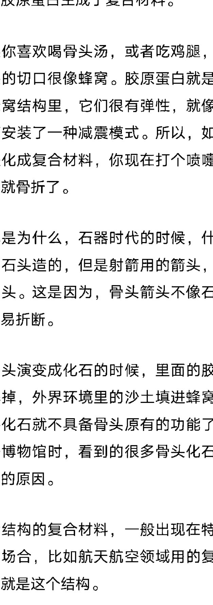

不光是钢材，很多其他的单一材料也都有弱点。

建筑里面，混凝土是最常用的结构材料，它强度大，倒不至于出现钢材那样的问题，但它不抗震。木板材造的房屋倒是抗震，但防火防盗能一般。

再比如，在未来的太空探索和海洋探索中，钛合金材料被看作厚道。科学家们认为，它是建造宇宙飞船、潜艇等装备最有潜力的材料。因为它强度大，而且也很耐磨。

但是，钛合金也有个致命特点，那就是太氢气。钛合金遇到氢气就会膨胀，但价值大大下降。但在太空环境里，氢气又比较少见。这么一来，单纯用钛合金做的航天器，就不适合进入太空了。

这么看起来，复合材料的出现和存在，就有了必要性了。**它的核心目标，就是根据不同材料的特性，扬长避短。**

——2——

解决了复合材料存在必要性的问题，我们就要进入第二个层次，说说复合材料是怎么做出来的。

这个问题既复杂又简单。

复杂的是，我们一直在强调，宏观不是微观的线性叠加，所以，复合材料虽然可以是两种材料简单拼合，但**不是任意两种材料都能拼出一张成功的。** 换句话说，我们必须要先利用材料本身的内部结构，形成一个有机的整体才行。

### 怎么理解呢？

现在的羽绒服里面填充的，一般都是羽绒和羽绒的混合物。混合填充来的羽绒服虽然可以提高衣服的性能，也就是保暖性，但用进用久，还是容易跑毛。你看，原材料差异太小，就没法生产出更有其他用途的复合材料。

如果原材料差异足够大，但是没办法混合，也没不舍合材料复合，钢和铁挨得特别近，你想把刚线和钢丝复合成羽绒线线，八成会失败。

说到底，制造复合材料的关键技术，在于找到有差异、但能相容的材料，对它们的结构进行设计。

有些原材料的结构很简单，我们把两种材料直接混在一起，就做成复合材料了。

比如常见的一层拉层，如果不加细，它的内壁就涂了漆，这种简易做法能让铝箔不能破裂的寿命。所以说，简易拉层也是一种复合材料。

再比如说，长城砖块之间的灰泥里混入了黏土和石灰，因此，它也可以叫成一种复合材料。除了黏土混灰泥的做法之外，灰土加粗纤维的做法也很常见。

但有些原材料结构特别复杂，我们就得从微观层面出发，依靠合成的化学方法来生成复合材料了。

我们在开头提到，双分子墙使用的钢材作为单一材料来说性能较高，所以建造摩天大楼的时候，会很多情况下使用的是复合材料。其中一种常见的复合材料，叫作玻璃钢。

乍听之下，你可能会说是玻璃和钢材的合下材料。但实际上，这钢材叫什么，它是玻璃和塑料生成的复合材料。

玻璃和塑料都没有钢材来得结实，为什么生成的复合材料，强度竟然刚钢材差不多呢？

这是因为有。玻璃的微观特点是，内部原子全部一体，只要有一个结构，就是玻璃和塑料内部的结构，因此反映出宏观上来着看，他也容易破裂。

这两个特征看单独起来难度都不高，但反，结合起来，刚好各自发挥自己的长处，形成强度特别高的复合材料，就特别容易。

你看，这就是从微观层面研究原子之间的作用力，再借助相应的模型设计出新的结构，生成了新材料。

我们在上一讲讲到，化学材料是人类来改造世界的重要手段。

在这个基础上，我要再多说一句，人工复合材料的基础，它不仅只是利用化学方法，将原子重新排列一下那么简单。

它之所以会存在，本身就是人类改造世界的结果。除了从设计、制造、加工全是应用，它们都是全能的。

如果还有人相信生物进化是全能的造物主的力量，那么毫无疑问，人工复合材料可以证明，人类在某些方面已经超越了这个造物主。

### 总结

- 第一，复合材料出现，是因为单一材料有着天生的弱点，而复合材料能够根据不同材料的特点，扬长避短。
- 第二，人工复合材料能够做到，是因为天然存在的复合材料，教会了人类复合的基本规律。
- 第三，如果原材料结构特别复杂，我们得从微观层面出发，依靠合成的化学方法来生成复合材料了。

### 思考题

你所在行业里，用到的最多的复合材料是什么？

欢迎在课后留言，和我互动。

### 下节预告

下一讲，我们还会讲最后一个材料设计原理，谈材料的尺寸问题。

我们再下下讲。

## 20 | 界面与本体：为什么尺度是个关键因素？

你好，欢迎回到《化学趣读课》，我是孙亚飞。

前面两讲，我们从材料的属性和构成这两个维度，了解到金属和非金属材料的特点，天然和人工复合材料的用途。这一讲，我们就来讨论最后一个维度，即材料的尺寸。因为尺寸在很大程度上，影响材料的性能。

怎么理解这件事呢？我们先举个例子。

干燥的小麦粒可以燃烧，你肯定要想当然，没那么多意思。可是，小麦粒被研磨成粉之后，面粉悬浮在空气中，甚至，面粉飘浮在空气中，遇到火星儿还是可能会爆炸。

听起来好像有点奇怪。

小麦粒没磨成面粉，这是个物理过程，没有发生化学变化。所以小麦粒和面粉的化学分子，应该是相同的。我们在第八讲也说过，分子是保持化学性质的最小单位。所以，为什么小麦粒和面粉的分子一样，却是一个很容易爆燃，一个不容易燃烧呢？

这就是我们这一讲要讨论的主题，界面与本体。接下来，我会分三点来。

### 1

第一部分先来讲，对一个材料来说，什么是界面，什么是本体。

简单来说，当两种物质碰到一起，如果它们混合的方式，不符合咱们在十三讲说到的溶液模型，即这三个物质一定存在明显的分界面，在这个分界面的接触面，就叫做界面。界面以外的，是本体。

夏天时候，你如果去野外的池塘，会看到很多青蛙趴在水面上，甚至会往上跳。这种现象是表面张力造成的。

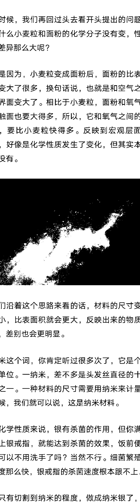

怎么来理解表面张力呢？我们做个简单的思维实验，你就明白了。

假如，有两个支球队的球迷常常一起打乒乓球，那么这两支球队比赛的时候，主办方会把怎么安排球迷的座位呢？肯定是让双方分开坐，而且他们相邻的座位越少越好。换句话说，就是这两支球队的接触面，尽可能减少。挨得少了，球迷一般也就会少主动去挑衅对方了。

### 3

清楚了这些，我们就这一讲要解决的最后一个问题，就是在材料设计中，我们怎样去应用界面效应了。

不同物质混合学反应的时候，就会和身体外的环境不同，所以，它们才会显现出不同的性质。而且，界面效应不光只有表面张力，还有光、声、电、磁等等。比如说，光就会在两种物质的界面发生反射和折射现象。

对于化学材料的设计而言，我们不仅得满足于去了解这些性能上的差别，更重要的是要通过材料设计，去进行改造。

一个很典型而又常见的例子，就是我们的干洗原理。

脱衣服上难免会有油渍，油跟水，又是相互排斥的。这样一来，油和水形成的界面就会收缩，反应就会很困难。

洗衣粉或者是洗衣液的作用，就是改变这种界面效应，通过特殊的结构，让水与油水的界面变大。这样一来，水就可以进入到缝隙了。衣服上的油渍，就水从水里，油跑到了水里，衣服也就干净了。

水和油混合在一起，形成了乳液，并且很多微粒是很小的分子，所以，衣服有人问问你能不能脱水，他搅匀一些洗液的脏水就能证明问题出来了。

改变界面效应的结果，可以创造出更多优异性能的。这里面最突出的，要数核材料了。

有着很强高断，但这类新的材料，在我们生活里还很多。

还是说说洗衣粉，小孩子都喜欢拿它来吹泡泡。当你仔细看看气泡的时候，会发现，它是一层薄薄的液体，被空气分成了两个空间。这层水膜，就是一种核材料，只有界面，没有本体。

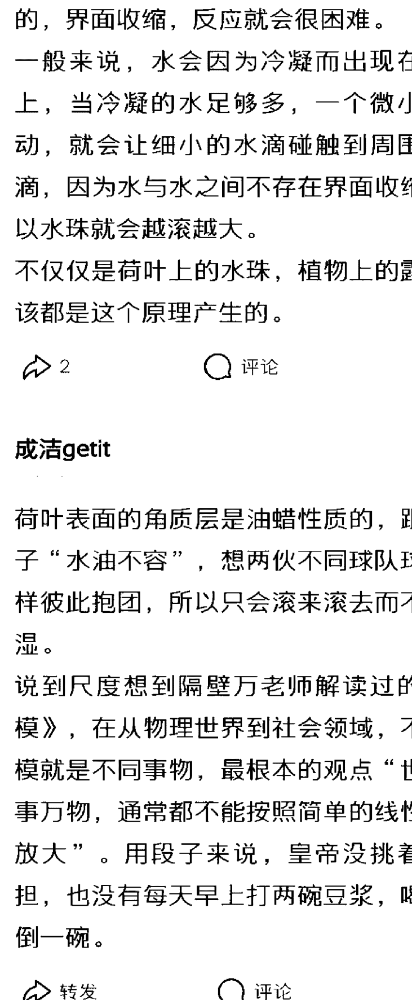

在我们身体内，也遍布着数以万亿计的这种核，细胞膜就是其中一种，一层薄膜就把细胞内外分成两类空间。

核材料的核心功能，不只是分割了空间，更重要的是，它模拟了结构功能，突出了界面效应，把材料性能发挥到了极致。

怎么理解呢？你看，钢铁、塑料、木材，我们在使用这些材料的时候，依靠的都是材料本体的性能，实现手的作用，至于界面怎么样了，我们一点都不在乎。但是核材料就不一样了，关键就是看它的界面功能。

比如现在有一种海水淡化技术，用的就是反渗透膜材料。它依靠膜表面的化学结构，阻隔了盐分，放水通过，这样一来，海水就变成了淡水。

同样的道理，还可以做成油水分离器，只让油通过，不让油通过。或者反过来，让水通过，不让油通过。比如说我们从鱼体提取油水膜，开出的时候需要逆向进行油水分离。为了提高效率，现在油脂分离工程中，人们就一直在研究，希望能直接运用到这种核材料。

讲到这，我们可以看出一个问题，那就是，材料本体和界面同时存在是很容易，而本体的化学性质也都要适应的去界面表现出来。

## 21 | 强度与韧度：为什么塑料能够统治地球？

你好，我是孙亚飞，欢迎来到《化学通识课》。

通过前三讲，我们了解到化学世界里，化学家设计材料的三个重要的原理。接下来五讲，我们讲解，化学改造世界的过程中，产生的五个具有代表性的材料，分别是塑料、化纤、橡胶、粘合剂和陶瓷。

这一讲，我们先来说说有人最有熟悉，也是应用最广泛的一种化学材料：塑料。

我曾经过一部纪录片，叫《塑料成瘾》。这部片子的导演，试图过一天没有塑料的生活，但失败了半天。

你肯定也有这个感觉吧？

你每天都用刷牙，牙刷毛就是塑料的；如果你回到家，用毛巾或者毛巾刷牙，你肯定不乐意了。你的充电器、插线板肯定有充电，也都是塑料的。不锈钢水的水壶很多，但你肯定也见过塑料以外制造的吧？再比如，很多人都喜欢户外运动，帐篷、防水面包这样的户外用品，通常也是塑料做的。

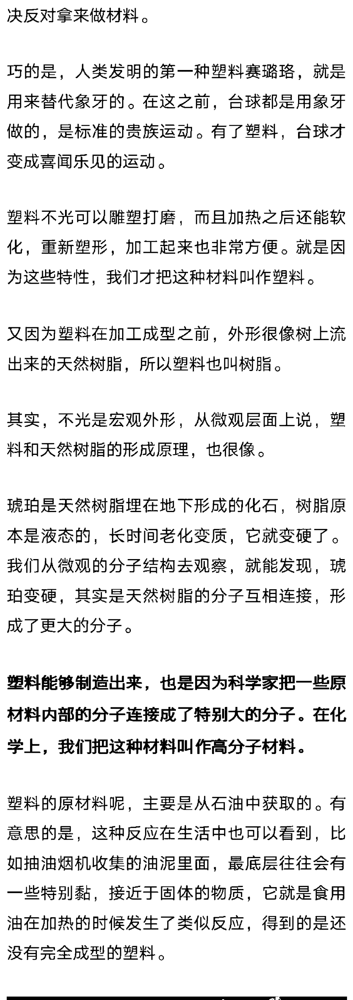

如果这样的现象，不能让你有所感触的话，那我们还可以再告诉你一件事：

真正意义上的第一种塑料出现，到现在还不到150年。它就是在做乒乓球球的材质赛璐玞。

而在上世纪60年代，人类能工业成化生产丙烯炼、聚乙烯以后，才过上了高度依赖塑料的生活。

这么算起来，塑料只用了不到100年时间，就成为了整个世界的统治。塑料可以说是人类历史上最成功的化学材料，没有之一。

那么，塑料是怎样取得成功的呢？在这一讲，我们就来讨论一下这个问题。

### 1

先来说一点，塑料是怎么来的？

如果你经常阅读英文文献或者新闻，对塑料的英译名plastic应该不大会感到陌生，和plaster的英译名 plaster是同源，都是是从希腊语plastos演变而来的，意思是“塑造”的。

从这个词的意思来看，不难看出一千多年来，人类一直寻找一种能塑型的材料。

一开始，古腾人对石头有种钟，因为他们喜欢砸石。相比于金属、大理石等材料，石头的硬度高，不可侵蚀性，做武器非常好便得多。石离在自然的分布非常广，但是，没有能能塑型，主要原因是太容易碎，没有能能能塑。

有没有比石更适合拿来塑造的材料呢？有，象牙和琥珀都行，它们的韧度和硬度都不错，但在自然界中太少了，尤其是象牙，我们坚决反对盗杀盗杀盗杀盗杀。

巧的是，人类发明的第一种塑料赛璐玞，就是用来做象牙的。在这之前，台球都是用象牙来做，是标准的贵运动。有了塑料，台球也变成很普及的球类。

塑料不光可以塑型打磨，而且加热之后还能软化，重新塑型，加工起来非常方便。就是因为这些都是特性，我们才把这种材料叫作塑料。

又因为塑料在加工成型之后，外形很像树林上结出来的天然树脂，所以塑料也叫树脂。

其实，不光是宏观外形，从微观层面说，塑料和天然树脂的形成原理，也像。

琥珀是天然树脂在地下形成的化石，树脂原本是流动的，长时间软化硬化，它塑就了。我们从微观的分子结构去考，就能发现，琥珀变硬，其实就是天然树脂的分子互相缠绕，形成了更大的分子。

塑料能塑料造出来，也是因为科学家把一些塑料材料内的小分子连成了特别大的分子。在化学上，我们把这种材料叫作高分子材料。

塑料的原材料是，主要是在石油中获取的。有意思的是，这种反应在石油中也可以看到。比如将热机油浸泡的溶器里，底部往往会留有一些黑色，接近于固态物质，它就是用废油加热的时候发生了类似反应，得到的是还没有完全成型的塑料。

所以，我们由此也可以得出结论，塑料就是一种可以塑型的高分子材料。

塑料的可塑性能分为两种：

一种是加热之后可以反复重塑的，属于热塑性材料，大多数塑料都是这一类，比如常见的塑料瓶、塑料绳、等等。

另一种类型是一次性的，称作固型塑料。这种塑料在加热一后很难在高温下能改变形的场，热如热锅饭、开关外壳等。

### 2

既然知道了塑料是可塑，那么人们为什么对塑料应用这么广泛？这是就要对塑料的特性做了解。

塑料的强度和韧度的综合平衡，让这种材料与众不同。那为什么在化学材料里面，一定要平衡强度和韧度？

我们先不用发思法来回答这个问题。

塑料是最具有加热可塑性的唯一材料吗？不是，至少玻璃和沥青也有这样的特性。

玻璃虽然可加热可塑，但是先加热到它再塑型，冷却后定型的了。玻璃在两个缺点，一是加热需要很多能量，二是在十度下的条件才能操作，脆性大，耗能也大，二二玻璃易碎，碎了以后就没了。

所以，玻璃很用来塑造型各种物品，但是无法占据统治地位。

比如它可以在使用的。虽然它的，多都被用玻玻璃，也可以在用璃的，虽然玻璃多都被用玻璃好，但是又有人不得不担心，玻璃弄太不掉了，只好再贴一层防玻璃。

手机可以用玻璃，眼镜也不可用，传统的眼睛镜用玻璃镜片，就是因为不易破碎的很眼睛，如今市面上几乎只看到树脂镜片了，也就是塑料做成的。

说到这，玻璃虽然各方面性能优异，但是不抗造，用十来说，就是强度太低。

我们来看看沥青和青这种材料。

沥青也叫柏油，它最见的使用途就是铺路。这种材料的韧度高，对比如比混凝土面看着就出来。为了对抗热裂、路身的变化，路面路面留留留留留，否则就易变碎，路面就路面就路面就易就易就易路面就路面路面路面。

可是沥青能屈能张的方向也不是很广，我们身边很少见到用沥青制的日用品。其中一个很重要的原因就是说，它的强度太低，很难形成固定的形。你可能还记得，我们大下讲，提到沥青的滴流实验，证明沥青本质上是一种流动性非常慢的液体。实验人员的灵感，其实就来自于沥青的低强度。

说到这里，你就能够明白，为什么塑料能够统治世界了。

一方面，它具有跟玻璃接近的强度；

另一方面，它又有很好的韧度，就和沥青一样。

除此以外，塑料还有很多优点，比如加工方便，轻巧环保，原料易得，价格便宜。

这样一来，塑料就有了统治世界的基础。

### 3

但是，辩证地说，事物总是存在两面性。塑料的优点它能能够非常强，但同时也带来了很多问题，有些甚至是毁灭性的。

你肯定听说过，塑料难以降解，埋在土地里面，可能上百年都不腐坏。这一点没有错，但已经是一个过时的信息了。

大多数塑料没有明显毒害，如果只是不腐烂，没有什么值得担心的，大不了一直在垃圾场堆着。

但是，经过几十年的大面积使用，研究人员发现，塑料在自然环境中被阳光、温度、微生物等分解后，会产生微塑料（Microplastics），这些微塑料颗粒会进入土壤和水体，被植物、动物吸收，甚至通过食物链进入人体。

大多数塑料没有明显的毒害，如果只是在腐烂堆，没有什么值得担心的，大不了，一旦是在垃圾地堆着。

但是，经过几十年的普遍使用，研究人员发现，塑料虽不起眼，却在海洋中各种作用力下，变得越来越多。这种现象在海洋中更为普遍。科学家把这些塑料碎片叫作微塑料，一般直径都小于5毫米。

2018年，全球科学家通过媒体提醒人们，要警惕微塑料造成的生态灾难。为什么它能引起这么大的动静呢？

**微塑料之所以可怕，是因为它进入了食物链。** 你也已经看到过一些环保主题的照片，有些愤怒的海鸟和海龟，解剖之后发现，胃里面全是塑料颗粒。

可能你会说，动物吃进塑料，主要是因为不具备分辨的能力，人类这么聪明，怎么可能会吃塑料呢？

但你有想过，万一是那种耐吃、特别小、连肉眼都看不到的微塑料，你还自信地说自己不会吃到塑料吗？比如，食盐里面就可能含有微塑料。

对微塑料来说，没有所谓的“外在性”。咱们国家的深海探测器“蛟龙号”，曾经在海底4500米深的位置，发现了微塑料。

这么看起来的话，塑料变为微粒以后，已经参与到整个世界的生态循环中了。人类一样不能幸免。按照有的研究者看来，微塑料直接进入人的食物链，祸害好坏，换句话，说不属于，不局限于死亡。但是，人的生命有几十年，长期在这样的环境中，会产生多大的影响，没有人能够说清。

就算不考虑微塑料的问题，有一些塑料制品本身，也可能对人体有害。

比如说，我们在第十九讲里说到了，易拉罐的材料，是一种复合材料。它内部的涂层也是一种塑料。里面含有双酚A，是一种环境类激素。有研究者认为，这种物质和一些癌症、乳腺癌的高危有关系。从这个角度来说，如果你经常喝盒装果汁，甚至喝盒装饮料，尤其是酸性饮料。

这个事实说明，塑料的存在并不是那么一目了然。你看到的未必就是全部，反而是真正有些危险的东西。比如小瓶装矿泉水，通常都不会出现双酚A的问题。

所以，塑料改变了世界，方便了我们的生活。但同时也加剧了我们的依赖。这也是为什么，我们一直在提倡要减少对塑料制品的依赖。

### 总结

- 第一，塑料实际上是一种可塑性很强的高分子材料，在自然界，这种材料非常稀有。
- 第二，塑料应用如此广泛，最主要的原因在于，它很好地平衡了强度与韧性。
- 第三，塑料制造得来说是的。但我们也不能忽略它在生态和健康方面的风险。

**孙亚飞**

思考题：

你在生活中，有过什么减少塑料使用的方法？你是怎么去除的呢？

欢迎在课后留言，和我分享。

### 下节预告

我们谈到的材料，是生活中离不开的另一类，也就是纤维。

我们下一讲。

**·前篇·**

### 用户留言

**伪装**

你在生活中，有过什么减少塑料使用的方法？你是怎么去除的呢？

思考
比如购买天然材料的东西，点外卖，不要是塑料等。
但是很难抗拒在往塑料的侵袭，因为太方便，以至于我们知道有害，却不舍放手。
个人认为，人类总是觉得未来人工智能有危险，觉得对人类可能是半机械体，这都像是骗子，人类可能是未来塑料和血肉结合。净化人体或融合半塑料，循环到人体进入了人类体内，与其塑料，不如想象塑料同化物融合。不过这种想法是不是太科幻呢？人类以后能成塑料了，身上长出了塑料骨骼。
转发 评论 5

**佛门提子**

今日得到
第一、塑料在地球污染不是偶然，而是基于自身的特性实在是好太好了。个人能力提升内在的实质做好学习，强强
第二、坚持减少使用一次性用品，比如我在日常生活中使用自带的洗漱用品，去超市自带购物袋等。
评论 4

**临高有老谭**

质量和数量都占据优势的东西，必然成为赢家。
很小的危害，积少成多，也会变成灾难。
要想不被一种东西控制，就战胜摆脱对它的依赖，能用之时就尽量避免，寻找合适的替代品，不用急于求成，但一定要在路上。
转发 评论 11

**陈慧斌**

在日常生活中，经常可以看到超市购物的时候，大多数人都是空着手，买完东西后大超市袋，超级顾客问商家，要么，然后就是一个，很少有人拿家里买东西之前头大的购物袋来买东西，这就造成了很大的浪费。
另外有很多垃圾也是造成污染的原因。例如减少这方面的浪费。一个是要树立环保信念，减少塑料制品重复使用，买菜时，还是大量少买。学会购买可再用的，就是尽量便捷。塑料产品也应该学会废弃物品，减少乱丢现象。
转发 评论 2

**张力**

孙老师好，生活对于塑料制品的控制，最有用的方法就是减少使用频率，提高使用效率。例如去超市购物时尽量重复使用的布袋，或者去生活垃圾分类可处理，装在一个垃圾袋中，并尽可能装满。
购物时拿到一个塑料袋只花1秒钟，进入海洋后，溶解的时间超过200年。
从吸管里吸出一瓶吸管只需3秒钟，进入海洋后，溶解的时间超过200年。喝完一瓶塑料包装饮料只需2分钟，进入海洋后，溶解时间超过450年
少用一根塑料吸管
少喝一瓶瓶装水
一点一点来，慢慢地变成习惯
这不仅仅是减少垃圾污染，更是善待我们自己
上一篇中“当塑料开始老化：喝瓶装水”上，相信对于一张吸管吧？而且内容还有对于快速解除塑料与技术的交往相关。
转发 评论 2

**天天大王**

孙老师好！
你在生活中，有过什么减少塑料使用的方法？你是怎么去除的呢？

从小编做起：

1. 使用玻璃盆，拒绝或减少一次性饭盒。
2. 少用塑料袋，去超市自带布袋。
3. 节约是一种美德，不多拿，不贪多，合适就是最好的。
转发 评论 3

## 22 | 长度与纤度：同样是人造材料，为什么化纤比塑料高级？

孙亚飞·化学通识30讲

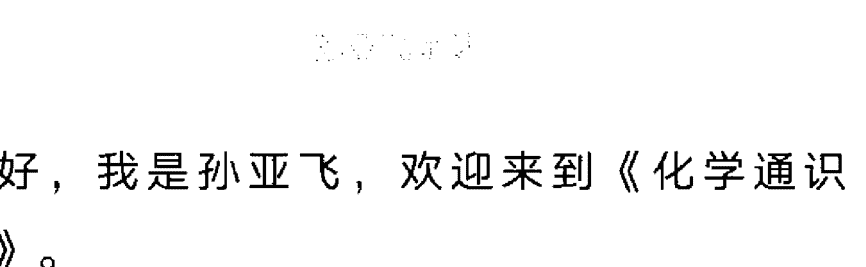

你好，我是孙亚飞，欢迎来到《化学通识课》。

上一讲，我们讲过了一些关于塑料的内容，特别是说，塑料属于一种高分子材料。高分子材料的种类很多，除了塑料，还有纤维，还有影响了世界格局的丝绸。作为古代中国的特产，丝绸一直以来都是西方各国追捧的商品，因此，中国有丝绸之路之谓。

在丝绸时代，丝是衡量了全人类的审美标准。古代的丝多，也是丝，就是一种让人感觉蓬松的高级服饰。法国国王路易十四就是丝，不知的纺织工。他在画里，最突出的，就是腿上的白色丝袜。

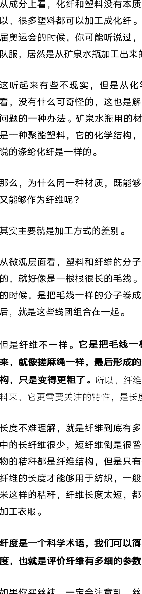

从这个故事引申开来，你会发现，我们的生活已经被化纤包围了。就算嘴上说不喜欢它，但事实上，你已经在用了。棉布要透气，且身上有点质感，内衣裤要舒适贴身，这些都离不开化纤。

为什么会落入化纤人类编织的大网里，不能自拔呢？我们就分三个部分，谈一谈这个话题。

### 1

先来说第一点。化纤材料是什么？

从成分上看，化纤和塑料没有本质的区别，所以，很多塑料都可以加工成化纤。比如说聚酯，就是涤纶，它能做衣服，但，也有国家队级别，居然是从矿泉水瓶加工过来的。

这听起来有些不太玄，但是从化学的角度来看，没有什么可奇怪的，这也是解决塑料回收问题的一种办法。矿泉水瓶用的材料叫PET，它是一种聚酯，它的化学结构，和我们经常说的涤纶纤维是一样的。

那么，为什么同一材质，既能够作为塑料，又能作为纤维呢？

其实关键就是加工方式的区别。

从微观角度看，塑料和纤维的分子通常是线状的，就好像是一根根长长的毛线。塑料是加工的时候，是把线一样的分子卷成了线圈，最后，就把这些线圈堆叠在一起。

但是纤维不一样，它把毛线一根根地拉起来，就像搓绳一样，最终形成的是线性结构，只是变得更粗了。所以，当纤维比塑料更多更需要关注，其实是比塑料更需要关注的特性，是长度和纤度。

既然我们承认，化纤的成功是科技的力量，那么它的科技体现在了什么地方呢？

我们还是说尼龙丝。

其实，尼龙最核心的用途，不是做袜子，甚至都不是用在织布里面。作为一种超高强度的纤维，它真正发挥作用的方向是航空航天、军用装备等领域。比如火箭发射机外壳，就会用到尼龙。

还有很多尼龙更加神奇的化纤。比如聚乙烯在我们生活中很常见，它可以做成塑料。如果把它做成纤维。一般保鲜膜就能用到它。如果把它的分子做得更细一些，然后拉成纤维丝，它就可以用在头盔和防弹衣中，子弹根本穿不透。

不夸张地说，高科技领域内，纤维材料的重要性，一点都不低于芯片。

除了材料本身，化纤的加工技术，也是竞争非常激烈的一个领域。生产出纤维，和生产出纤维成品，是两回事，中间隔了十万八千里。

为什么呢？我们在前面说过，纤维的成分不是最特殊的，很多塑料都一样。但是通过不同的加工技术，它的性能就可以发生很大变化，才可以做成纤维成品。

加工技术有多重要呢？我们来举个自然界的例子。

蚕丝和蜘蛛丝，在成分上看都是蛋白质，没有本质差别，但是蜘蛛丝在快速运动时能拉出丝，它的强度是同等直径钢丝的6倍，远远超过了一拉就断的蚕丝。

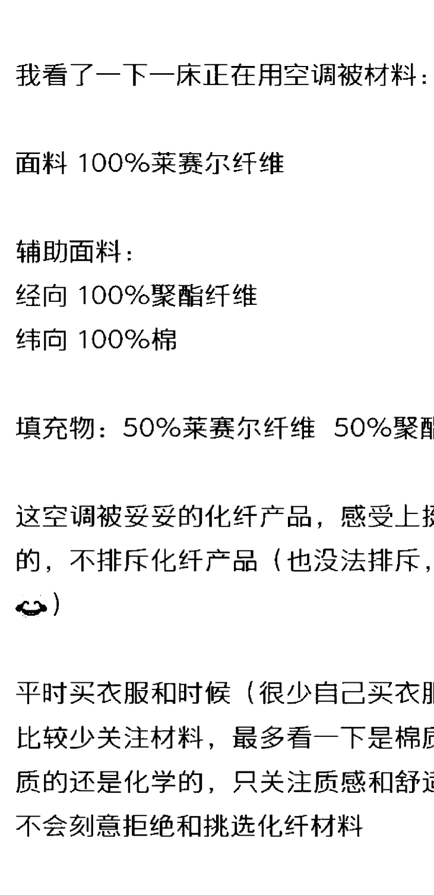

动物之间尚且还有这么大的差别，不同的工业技术加工同种纤维，会产生多大的差异？就算不考虑这些细节问题，用传统的普通化学纤维，本身也是科技的体现。如果没有化学纤维，那么服装的原料只能来自于土地，是棉花或者是养羊，也会侵占一部分土地。

所以，化学纤维的出现，同时提高了粮食产量与服装产能，也就成了解决人类温饱问题的重要功臣。

### 总结

- 第一，我们可以把化纤看做是一种特殊形态的塑料。它作为材料的特殊性在于，化学家设计时关注的是长度与纤细；
- 第二，化纤能够改变人类的消费选择，归根到底是科技的加持；
- 第三，化纤的科技含量不只体现在高科技领域，更是从另一个角度帮助人类解决了基本需求，比如温饱的问题。

孙亚飞：

思考题：平时买衣服的时候，你会注意观察衣服上的成分标签吗？会刻意选纯棉吗？欢迎你在留言区留言，和我分享。

### 下一节预告

下一讲，我们来说说另一个神奇的高分子材料：橡胶。我们下一讲见。

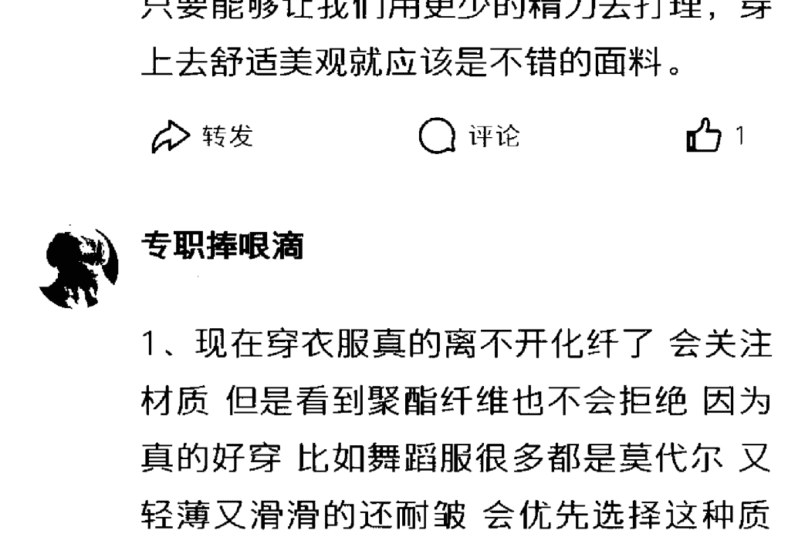

### 用户留言

**Stone**

夏天开空调，盖空调毯是被配，凉爽舒适

我看了一下衣正在用空调被材料：

面料 100%聚美纶纤维
铺面材料：纵向100%聚酯纤维 经向100%
填充物：50%聚美纶纤维 50%聚酯纤维

这空调被妥妥的化纤产品，感受上很舒服的，不排斥化纤产品（也没法排斥，太多人）

## 23 | 弹性与刚性：人体为什么更接近合成橡胶？

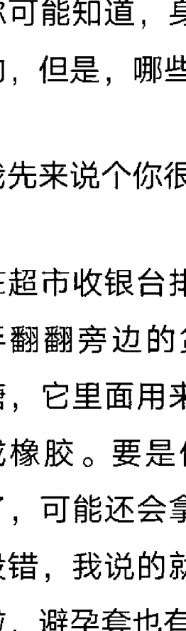

孙亚飞·化学讲读30讲

你好，欢迎来到《化学讲读课》，我是孙亚飞。

前几讲，我们已经讲了两种常见的化学合成材料，分别是塑料和化纤。这一讲，我们来讲一个很重要的材料，那就是合成橡胶。它和塑料、化纤一起，并称为三大合成材料。

你可能知道，身边很多东西是塑料或者化纤做的，但是，东边看看有合成橡胶吗？

我先来个你们很熟悉的场景。

在超市收银台排队结账的时候，很多人会翻手机翻旁边的货架。货架上常常摆放着口香糖，你想买块糖洁牙的话的主要成分，一不小心看错了，可能还会捡到另一种合成橡胶的东西。没错，咱们吃的很多是天然橡胶做的。

你看，虽然有不同的用法，功能也不一样，但我们的生活，也离不开橡胶。或者，进一步说，合成橡胶是一种关乎人类生命的材料。

为什么这么说呢？我还是分三点来展开讲。

### 1

先来说第一个问题，人类是怎么用上橡胶的呢？

和纤维一样，橡胶也天然来源于橡胶树。

天然橡胶嘛，是从橡胶树里分泌出来的汁水。因为看起来像胶，所以人们叫它“胶”。等汁水里的水分蒸发了以后，它就能变成我们熟悉的橡胶，有弹性，张开以后还能恢复原样。

18世纪以前，橡胶一直就和我们的生活没什么交集。像橡胶最初被发现，只是可以被做成类玩具。

但是到了19世纪中期，有一个美国人发明了橡胶硫化技术，天然橡胶由此成为强势新兴的最佳防材料。这个发现，橡胶已经直接影响到人类的生命，影响了人类繁荣的数量和质量。

我们都知道，性行为是人类的根本需求，这里最大的不确定性，一是会引起怀孕，二是容易感染得病。

在没有橡胶的年代，避孕是用什么原材料做的呢？一个几乎外乎这几种：动物的膀胱或小肠，还有丝质。

你想，避孕套的使用场合，至少氛围必须不错吧？但再有其他传统避孕的这些原料，不是就是贵，实在是影响心情。

另外，羊肠、鱼肠的太大基本都是固定的，做成的避孕套要是太大或太小，人们使用起来也会觉得不合适。更要命的是，很多避孕套，不会传播，双手或者擦到更关键，是被这些性行为传播。这些用动物器官改造的避孕套，隔热性不好也就到了。自身也容易沾染细菌病毒，基本也不好怎么亲自使用。

天然橡胶，就没有动物器官存在的这些问题。

首先，它本身是液体，因此人们很容易对它进行加工塑形。其次，它有极好的弹性，可以比较紧密贴服人体，即使是尺寸差一点，问题也不大。

> 从微观层面来观察的话，橡胶的弹性，其实就是由它内部特殊的结构决定的。

我们在前面分讲分别说过，塑料的分子是固态的，像积木，纤维的分子是线状的，像长绳；那么橡胶的分子呢？其实就像弹簧，是弯曲的。

构成橡胶的分子都是非线状的，在没有外力作用的时刻，就会弯曲聚成一团。一旦给它施加外力，分子就会变形，从宏观上表现出来，就是橡胶被拉长或者压缩。

而且，以化学的微观角度看，它的分子间大，互相之间的结合力很弱，结构很松散，阻隔效果也很好，确实就是解决了生命问题，又解决了安全问题。

### 2

但是，我们也知道，天然橡胶也要经过硫化再使用，这是唯一的化学法则吗？我们为什么要多一点呢？这和它的特性相关。

> 天然橡胶这种有弹性的材料，最大的用途就是减震和密封。

减震讲起来很容易。

自行车轮最早都是用木头做的，木头的弹性较差，它在所显示的，或者是轮子很轻的人，轮子会反而出明显的振动。车，轻易地骑车子觉得颠簸。颠簸既只是体验不好，万一石子打车帮轮就散了，那骑车的人掉下来，就出人生命安全的问题了。

所以，有了橡胶之后，人就用橡胶包住木头轮子，用于减震。据这个方法，人类后就发明了车轮的雏形。

密封的原理也很简单。

橡胶因为弹性，所以就能够在压力下变形，挤压到它能贴到到达的地方。刚才我们也讲过，橡胶的分子结构紧密，能够隔绝气体，要充气身体袋子轮胎等，轮胎的减震效果不就更好了吗？于是，这就有了轮胎的内部。

既然橡胶连气体都可以阻隔，那更不必说液体了。毕竟气体分子运动更剧烈，比液体更容易渗透。比如，像核电站需要橡胶夹的管道防止水蒸气，它们无一例外，都要靠橡胶进行密封。

但是，橡胶能够发挥作用，并不只是依赖它本身的弹性，更需要依赖刚性。刚性和弹性相反，它是物品对抗变形的一种特性。

制造汽车轮胎是橡胶最大的用途之一。轮胎，就是靠弹性和刚性的平衡，才能实现性能。

和自行车不同，汽车的减震主要不是依靠轮胎，而是依靠悬挂系统。所以，这也是为什么汽车轮胎噪音，但胎形多不相同。因为车没有出以轮平时要调来调去。

汽车轮胎使用橡胶，则减震的关系就没那么大，我们还得继续说理由。

分析一下道理，我们就会发现，橡胶有弹性，它和地面接触的时候，会因为变形，产生更大的接触面，这样一来，轮胎就增加了抓地力，不容易打滑。

但是，弹性太大也会造成新的好，宏观上来看，橡胶的弹性来源于其微观的分子。它没有记忆力，因此拉伸和压缩后，只能恢复到大概的位置，不可能恢复到原来一样。这个现象到宏观上，就是橡胶不太形变小变形。汽车轮胎是橡胶做的，如果长久变形，就导致方向无法很好地控制，长久下来，就能出人命。

为了解决这个问题，用作汽车轮胎的橡胶，在生产的时候，都要通过化学方式进行改进，那就是添加一种交联剂。从微观上来说，它能把一部分橡胶分子粘在一起。分子之间的位置固定下来以后，即便经历了变形，也可以被精确恢复原样，一般交联剂就是硫，所以这个过程也叫硫化。

因此，硫化之后的橡胶在弹性之外，又产生了刚性，这样的橡胶，橡胶做成的轮胎，就不容易发生长久性变，也就保障了车上人的生命的安全。

怎么理解呢？在这个过程中，交联剂就好比是发泡，橡胶分子就如同是面包。发本来发是软的，可以随意变形，没办法固定。但是如果是打了发泡和复型做了固定的糕，糕，糕你就怎么折，它都会恢复回到型做完的型了，样子。

绝大多数天然橡胶应用的机会，都需要进行硫化，也就是说，真正意义的天然橡胶并不多见，大都要经过化学改造才能满足要求。

### 3

但是话说回来，既然弹性是天然橡胶本身固有的，刚性也要只靠化学改造一下，为什么还要费劲合成呢？

合成橡胶在某个特定性能上，就比天然橡胶更好，比如耐磨程度、耐油程度。所以，很多工业用途的管道等等设备，就会使用合成橡胶。

> 另外，对人体来说，合成橡胶最大的好处，在于能改变生命的体验。

还是说避孕套，让我们们的身体，最终最靠近感受的是...

另外，对人体来说，合成橡胶最大的好处，在于能改进生命的体验。

还是说避孕套，这是我们的身体，最能直接感受合成橡胶好处的物品。

天然橡胶有一个很致命的风险，就是容易引发过敏。严重一点，过敏会直接导致人死亡，即使轻一点，只是寻常的皮疹，人也会难受。

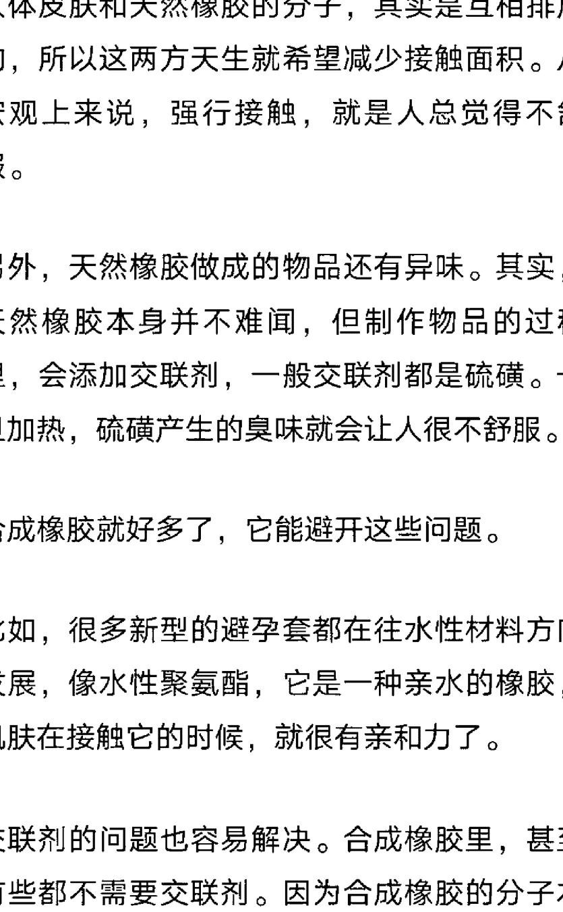

再往后退一步，即使大多数人对橡胶不过敏，人的皮肤也不喜欢接触天然橡胶。这就是我们在第二十讲说到的界面问题。从微观上来看，人体皮肤和天然橡胶的分子，其实是互相排斥的，所以这两方天生就希望减少接触面积。从宏观上来说，强行接触，就是人总觉得不舒服。

另外，天然橡胶做成的物品还有异味。其实，天然橡胶本身并不难闻，但制作物品的过程中，会添加交联剂，一般交联剂都是硫磺。一旦加热，硫磺产生的臭味就会让人很不舒服。

合成橡胶就好多了，它能避开这些问题。

比如，很多新型的避孕套都在往水性材料方向发展，像水性聚氨酯，它是一种亲水的橡胶，肌肤在接触它的时候，就很有亲和力了。

交联剂的问题也容易解决。合成橡胶里，甚至有些都不需要交联剂。因为合成橡胶的分子本身就同时具有弹性和刚性。装修常用的防水卷材，通常用的合成橡胶叫做SBS，从微观结构看，它其实是塑料和橡胶的组合体。类似于塑料的部分提供刚性，橡胶的部分提供弹性。

基于这些理由，我们才会更愿意接受合成橡胶。这跟上一讲的，人类最终选择合成纤维很像。只不过，选择合成纤维，更多在于它的科技感，选择合成橡胶，是因为它的实用性。

### 总结

- 第一，橡胶分为天然橡胶和合成橡胶，合成橡胶是三大化学材料之一，它具有变形恢复的特性，是一种不可替代的材料；
- 第二，橡胶的突出的用途在于减震和密封，为了达到这样的功能，需要平衡弹性和刚性，所以即便是天然橡胶，也需要经过化学交联；
- 第三，合成橡胶在一些特定用途上具有优势，而且它更适合于人类的身体接触。

孙亚飞

### 思考题：

你吃过的口香糖的成分，通常是丁基橡胶。它是一种合成橡胶，从石油中提取的。你有没有想过，为什么口香糖不用天然橡胶呢？

欢迎在课后留言，和我互动。

### 下节预告

下一讲，我们还是说高分子材料，这种材料不光在生活中特别常见，甚至还改变了制造业。它是什么材料呢？

我们下一讲见。

我觉得口香糖不使用天然橡胶的原因有以下几点：
1. 天然橡胶可能会包含杂质，人工提取的时候杂质就会混在橡胶里。
2. 可能会有细菌等微生物，不卫生。
3. 结构比较复杂，后期如果要改变颜色或者口味会比较麻烦。

## 24 | 粘贴与分离：为什么黏合剂能战胜铆钉？

孙亚飞 · 化学通识30讲

你好，我是孙亚飞，欢迎来到《化学通识课》。

前三讲，我们谈到了三大人工合成材料，分别是塑料、纤维和橡胶，它们的共同特点是，都属于高分子材料。这一讲，我们要说的还是高分子材料，它就是黏合剂。

它虽然没有前三个使用率那么高，但是却颠覆了制造业的整个化学材料。

其实，黏合剂你肯定熟悉，胶水、透明胶带、便利贴里面都有它。不仅在生活中，在很多制造业里，黏合剂的使用范围和使用率也越来越高。

十多年前，也就是我工作的第二年，我做成的第一个工业产品就是胶粘剂，它用在汽车的底盘上，学名叫作湿黏胶，是替代焊接技术，用来连接零件的一种材料。

在这之前，全世界只有日本一家企业能做这种材料，将近三十年里没有竞争者。因为这种件，我在行业内也有点儿知名度。为什么，经常有人问我，说黏合剂不就跟胶水一样吗，为什么还能用到工业制造里面去？用这种东西连接大型机器的零件，安全吗？

这个问题说起来可能有些复杂，从化学的角度来看，这个回答一定是“在物质的微观结构决定性质”，这门课程里，一直在强调结构决定性质嘛。

所以，接下来，就我们从黏合剂的结构、特性和用途这三个方面，展开这一讲。

### 1

第一个需要解答的问题是，什么黏合剂能粘住其他物体？

我们直接从微观层面看。黏合剂是一种高分子材料，所以它的组成通常就是高分子链结构。

什么是高分子呢？我们在第二十讲中讲过，就是分子特别多。一般的物质，分子的体积比水大不了多少，充其量几十倍。高分子材料的内部，分子的体积，可以是水分子的几千倍，甚至是几万个倍。分子数越多，分子之间的吸引力就越大。这听起来有点像万有引力，实际上就是这么一回事。

我们再来做个简单实验吧。如果把水倒到两张纸巾中，会发生了什么？当你试图把它们分开时，纸巾会黏在一起。不过，这个力度很小，你只需轻轻撕一下，两张纸就分开了。但如果把水换成稠面的汤料，你也会发现，纸也能粘起来，但抖开需要的力度更强了。

这是因为，面汤里有水，也有淀粉。从微观上看，淀粉的分子比水大得多。为什么？淀粉的分子和淀粉的分子之间的吸引力更强。

这个现象宏观上，就是用面汤粘纸，要比水粘纸更牢固。

这就是黏合剂能够粘住物体最本质的原因。

我们再来做，用面汤粘好的纸，如果不拉开，等到水干了以后，那么淀粉就还是粘住纸。这个时候，你会发现两张纸分开了。为什么？因为一开始汤汁里，全是淀粉和水的分子，就制造出来了。它们互相之间的黏力比之前更大，这个时候，真的体现出黏合剂的作用。

实际上，黏合剂在起到的东西，就是“非”的液体和黏结，我们也叫作“硬凝”。

知道了这个道理，我们就能理解“身边大多数黏合”的由来。

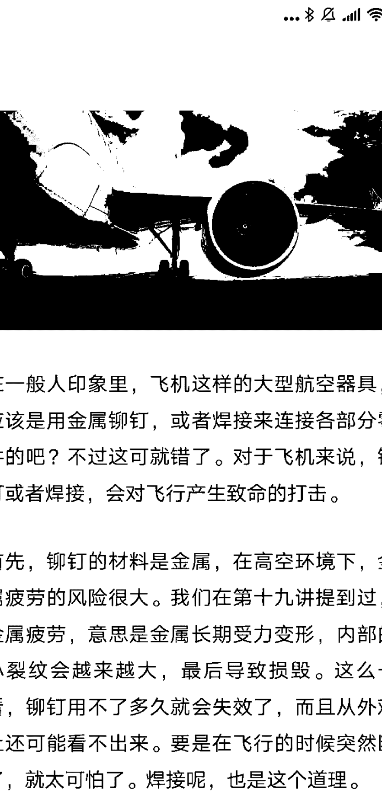

在一些大电影中，飞机上的大型航空器具，应该是金属铆钉，或者在连接处使用部分零件的时候？不过这也搞错了。对飞机来说，铆钉或者螺钉，会对飞行产生致命的打击。

首先，铆钉的材料是金属，在高空环境下，金属疲劳的风险较大，老师在第十九讲中提到过，金属疲劳，意思是金属长期受力变形，内部的小裂纹会越来越长，最后导致断裂。这么一来，铆钉用了不了多久就会失效了，而且从外观上还可能看不出来，要在飞行中如果突然断了，就可危险了。焊接呢，也会有这个问题。

其次，铆钉加重了飞机的重量，这对飞行没好处。一来增加飞行升空时的阻力，二来提高了油耗成本。如果我们将一架飞机上的铆钉全部换成粘合剂，飞机可以减重10%到20%。

最重要的还有一点，说出来你可能都不信，那就是，粘合剂的强度比铆钉更大。为什么呢，从微观层面去观察一下结构，你就会明白了。

> 粘合剂是分子作用力去实现功能的，只要分子结构设计得足够巧妙，那么界面中的每一个分子都能发挥作用，让粘连更牢固。

就像每个士兵在军团部署上的一句话形容，“团结就是力量，比铁还硬，比钢还坚。”

铆钉呢，主要用机械作用将两个东西连接在一起，只能利用一小部分的力量。至于焊接的情况，比铆钉可能还要差一些。

在这个原理的基础上，不仅是飞机，越来越多的器具开始使用粘合剂了。

比如高铁，已经很难发现铆钉了。还有隐形飞机等其它一些，是因为，在外壳涂了一层隐形材料。隐形材料是什么，是个军事机密，但我可以告诉你的是，它也是用粘合剂粘飞机的。

你看，粘合剂看起来跟我们的生活很近，甚至我们都不知道存在，其实，但实际了，它的应用场景相当丰富，而实现这一点，就取决于我们对它结构的设计。

### 总结

- 1. 粘合剂之所以能粘结物质，从微观上看，原因在于它是高分子材料，内部分子越大，作用力就越强；
- 2. 好的粘合剂要粘的牢，还得分离，分离的难，即分子界面有关系，因此，设计粘合剂时，除了要看分子结构，还要考虑分子的界面；
- 3. 粘合剂的结构和特性，让它能够用在很多意想不到的场合，比如汽车、飞机等制造业中。

**孙亚飞：**

**思考题：**

**你听过手机吗？有没有注意过现代智能手机的屏幕，是怎么安装的呢？**

欢迎在留言区留言提问。

## 25｜膨胀与收缩：凝胶如何改变了我们的健康观？

欢迎回到《化学通识课》，我是孙亚飞。

如果你还记得的话，我们在第二十讲里讲到了化学材料的第三个设计理念跟尺寸相关，解决的是在设计过程中，界面和体相的问题。

在上一讲，我们讲到了黏合剂，这种材料，它研究的就粘附与剥离，跟我们今天讲到的凝胶材料正好相反，研究的材料的本体。

这种材料，叫作凝胶，也是一种高分子化学材料。“凝胶”这俩字，听着有些像术语，好像跟我们的生活有点远，但其实，你绝对不少没吃过它。

果冻、凉粉、豆腐，等等，在化学界里都属于凝胶材料。女生用的化妆品有不少都属于这个范畴，比如说面膜上的精华液，关键成分也都是凝胶材料。

说起来，凝胶不光早就渗透进了我们的生活，它本身，还跟我们的身体健康有很强的关联性。为什么要这么讲呢？听完这一讲，知道了凝胶的一些特性，自然就明白了。

照之前一样，我还是按照结构、特性和应用这三个层次来解释。

### 1

第一个层次的问题是，凝胶究竟是什么？

不知道你有没有自己尝试过做果冻？这个很简便啊，就是把吉利丁加热的一个小锅慢慢溶解，之后放冰箱，就能得到果冻了。

相信你们已经听出来了，在这个过程中，让水变成凝胶的功臣就是吉利丁了。它，也叫明胶，英文叫 gelatin，翻译成中文就是明胶，也叫作琼胶。所以，吉利丁就是一种凝胶产品。

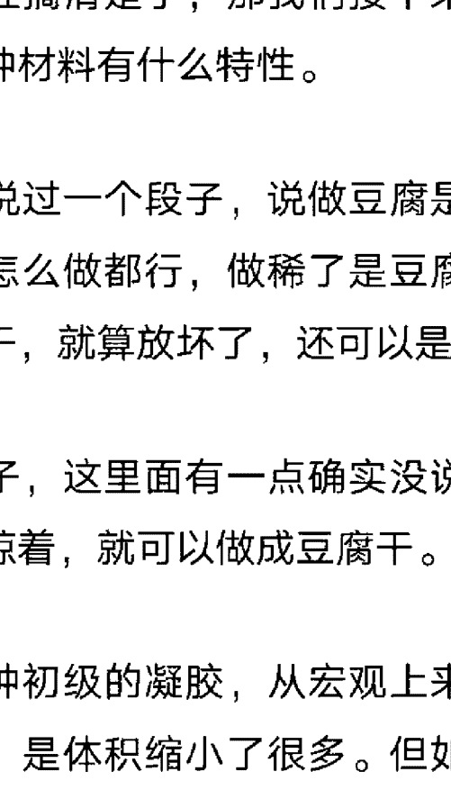

市面上销售的，主要成分是胶原蛋白，从微观层面来看，它的分子非常大，然后在分子溶解之后就会舒展，就好像是一个个八爪鱼一样。

不光有形状，胶原蛋白还跟八爪鱼一样有吸盘，这个吸盘，就是带有吸引力的分子基团。这么一来，每一个胶原蛋白分子互相之间，通过吸盘连在一起，在水里形成了一张巨大的网，水分子再填充在这网络的空隙里面，呈现到宏观上的状态，就是形成了果冻一样的凝胶。

因为用的是水，所以这种也叫水凝胶。水凝胶只是凝胶材料中的一个大类，其他的，还有硅凝胶、液晶凝胶、金属凝胶等等。

在这里面，水凝胶是最常见的一种，为了方便理解，我们接下来说的范例，就以水凝胶为主。

从微观上看，凝胶的材料里面，很大的分子跟水分子之间，形成的网状结构。

这种结构并没有那么稳固，组成各种分子的原子，互相之间的位置也会发生变化，就像八爪鱼的触手晃动那样，体放在宏观上，就是会发生变化，这和液体有点像。

但是，果冻吃起来不像口香糖，我们切豆腐的时候，也没有切橡皮的感觉。明胶，凝胶是另区别的是，这是因为，凝胶在形成过程中，原材料里面的高分子只占了很小的一部分，像水这样的小分子占了绝大多数位置。

比如，果冻和豆腐里的水占在 90% 左右。但这些都是材料，在多大程度能体现的弹性，也是一种凝胶材料，学名叫水凝胶膜。它的水分比例，可以远远达到材料的 1000 倍以上。换句话说，软糖里的含水基数差不多有 99.9%。

你看，凝胶内部的分子力分子多，分子小，就意味着分子之间的结合力就小，所以凝胶内部的结合力，就比橡胶要弱得多。

### 2

我们一直在讲，结构决定性质，既然凝胶的微观结构已经搞清楚了，那咱们接下来，就来说说凝胶这种材料有什么特性。

你可能听说过一个例子，就做豆腐最危险的工作，分子在分都进行，做到了要是豆腐，子就是豆腐干，就算坏了，还是用臭豆腐。

段子归段子，这里有一点确实实说道，就是把豆腐晒着，就可以做成豆腐干。

豆腐是一种特殊的凝胶，从宏观上来看，它变成豆腐干之后，体积会缩小了很多，但如果从微观上去观察的话，你会发现，里面的水分蒸发以后，分子的网结构就会收紧，这，对豆腐来说，这种收缩是不可避免的。所以，豆腐晒成豆腐干以后，就不能再恢复了。但我们前面说的凝胶材料，内部的网状结构都可以变大，也可以变小。

我们这里面可以看到凝胶材料的一个明显特性，那就是，它的体积能够膨胀或者缩小，它的原理很简单，就是里面像水这样的小分子，它的含量发生了变化。

这对我们的健康来说，有很好的启示意义。

我们都知道，膳食纤维很重要，特别是水溶性膳食纤维对健康的作用，这里面讲到的原理，就是凝胶材料。水溶性膳食纤维其实是膳食纤维，比如说水果、脱水蔬菜，它在肠道里面吸水膨胀之后，就形成了凝胶状态，这样一来，我们的大便就会变得松散，排出来也更容易，要是有便秘的麻烦作用，便秘或者大便干结就是解决了。

除了体积会发生变化，凝胶的另一个特性，是可以吸胀或解吸附的过程，吸附或者释放一些化学物质。

听到这个特性，听起来好像跟活性炭的功能很像啊？但实际上，凝胶的原理不一样，它不是物理吸附，而是通过化学键构成的，比如，污水处理中最常用的一种凝胶材料，叫作聚丙烯酸钠，它可以有效吸收通过化学吸附，吸收污水中的重金属。

释放这个特性来说，指的是在排水的过程中，凝胶材料也可以释放一些物质。

比如，虽然说水凝胶的主要成分是水，它跟水最大的区别在于，它释放化学物质的过程非常缓慢，换句话说，就是水凝胶具有缓释的功能。

很多面膜有变美的功效，实际上就是生产商在面膜的凝胶里面，加入了一些美白成分，根据凝胶的特性，这些成分能够在吸附面膜的时候缓慢释放出来。

从这一点来看的话，面膜对皮肤起真正作用的，反而是这些成分。

不过，因为现在很多面膜还添加防腐剂，凝胶的这种缓慢释放作用，也会加剧刺激皮肤，这里面的一些成分也会对皮肤有刺激（参考资料）。

### 3

说到这里，我们已经知道了凝胶材料的结构和特性，那么在这一块，第三部分，跟健康有关系呢？这是因为，它的性质和我们的人体很接近，同时又能膨胀并释放一些有效成分。

水凝胶，除了水凝胶这个分类，还有一大类叫作硅胶凝胶，它的生成成分含有硅元素的有机物，用小分子也不是水，一般是像液态石蜡之类的溶剂。

这种硅胶材料有个很重要的用途，就是做成隆胸假体。经过这些年的发展，目前隆胸手术，都是使用它。借助的原理，当然也是因为它加了一些化学键之后太硬，当它吸胀了。膨胀之前的硅胶凝胶和果冻之类的水凝胶很像，松软而富有弹性。

先入凝胶中的化学物质，正如前面所说，一般都是有机物，比如早些年流行的石蜡，这就带来一个问题，一旦植入了解剖体内，凝胶变型之后，这些物质也会进入到身体里面，对身体造成很强的伤害。

从化学材料的角度来说，其实技术发展到现在，我们已经能够控制这些凝胶胶和力度的时候，不必太敏感。但是我一直说，手术是复杂的，人体也是如此，所以植入假体的手术，难度不低。

也正是因为如此，即使是质量过关的硅胶假体，在植入人体之后，发生破裂的也不在少数。这一点，国内外的情况都不乐观，可能你关注过了，有的人胸之前太大，太硬了。比如，英国人做过一项研究，对过往人工隆胸院做了一个调查，用仪器扫瞄，结果 18 个志愿者一共 36 个体也正是因为如此，即便是质量过关的硅凝胶假体，在植入人体内之后，发生破裂的也不在少数。这一点，国内外的情况都不太乐观，可能总是在遇到有的人隆胸之后去医院，就发生了破裂。再比如说，国内辽宁省人民医院做过一次调查，用仪器扫，结果18个志愿者一共36个假体，有8个假体发生了破裂，只是肉眼还看不出来（参考资料2）。

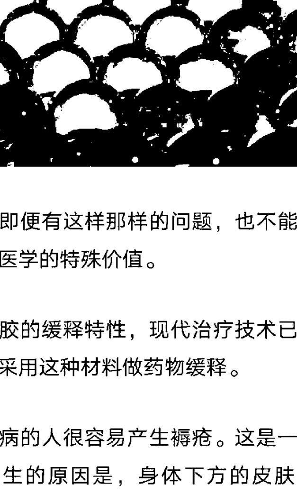

不过，即便有这样那样的问题，也不能否定凝胶源于医学的特殊价值。

因为凝胶的这种特性，现代治疗技术已经越来越多地采用这种材料做药物缓释。

长期卧床的人很容易产生褥疮。这是一种并发症，产生的原因是，身体下方的皮肤压得太久，造成组织坏死。

褥疮治疗起来非常困难，因为坏死的这部分皮肤总总是处于流血的状态，不光是伤口治疗困难，还需要防止感染。好在，现在临床上，出现了一种水凝胶的治疗方法，就是把药物溶入水凝胶里，再涂抹到褥疮上，通过凝胶的缓释特性，药物就能够助止血，防止感染。我所在的课题组，就做过水凝胶材料，用于糖尿病人的褥疮治疗。

再比如，眼球手术需要非常精细的技术，在手术之后，需要保持眼球的状态；这个时候，能够吸水膨胀的凝胶材料就成了好帮手，它可以借助于亲胶的特性，起到支撑的作用，时间久了之后，自然收缩，最后被身体吸收代谢，也不会造成伤害，也不用专门再取出来，前面提到的透明质酸，就经常会被用到。

就连万病之王癌症的治疗过程中，凝胶也已经开始发挥作用了，主要原因是它的缓释作用。

我相信，对于未来的医疗和美容而言，凝胶发挥的作用还会更加重要。

### 总结

- 第一，从微观上看，凝胶材料的内部结构，就是原料的高分子构成网络，由小分子填充在在网络之间；
- 第二，凝胶的特性，是能够吸收或者释放小分子，因此它的体积能够膨胀或缩小，在这个过程中，吸收或者释放某些化学物质；
- 第三，凝胶能够充当很多医学手段，不过，这次从化学材料的角度看，我们性能上提高它的安全性，但实际应用中，也会面临不少缺点。

孙亚飞

> 思考题：我们吃的东西里面，很多都是凝胶，除了果冻、凉粉和豆腐，你还知道哪些呢？

### 下节预告

化学材料模块，到这里就全部讲完了。下一讲，我是要开启新模块化学应用，说一说在实际应用中，化学产生了哪些问题，又是怎么解决的问题。

我们下一讲见。

《前一篇》

### 用户留言

桃安

凝胶虽然有胶字，但与塑料、橡胶不同，它内部分子能够吸附和释放小分子，这一特性不仅在生活用品中应用，在化妆品和医疗等方面均有巨大潜力。

日常吃的果冻、豆腐、凉粉外，还有魔芋，皮冻，面筋之类的，在新疆还有一种特色小吃叫面筋子。

韦阳

QQ糖。

Philp^1

治疗腹泻用的蒙脱石散，利用的是蒙脱石的高溶浆和高絮凝凝果，可迅速止住腹泻。

而腹泻过多，则由治疗腹泻转为导致便秘。

高浓度的蒙脱石水溶液，是否可以认为是一种凝胶呢？

另外，我想请教老师，像黄原胶、水溶性纤维素不仅在生活中没有讨论，其高浓度的水溶液（几乎没有流动性），是否都可以认为是凝胶？

虎活getit

过年必备大辣猪蹄冻是记忆中最突出的味道，但这个看起来更简单的东西也常有「加盐少」的中国式精神，做的，这次做做看怎么样都有可能期待下，有可能美味惊喜，也有可能是失望。随着健康观念的更新，炸制的过年食品渐渐少了，猪蹄冻这个菜就利用了在代际下传，想必它也会更长久地在我家存在下去。

按照香雪基本法

龟苓膏是吗，跟果冻很像

代斌

在我们的日常生饮食中，食用胶的用处（我们参考）：

1. 在炒菜的时候，汤汁比较多，加点火淀粉勾芡，汤汁就会变得粘稠而不易流淌。
2. 平时喝的饮料、吃果酱、颗粒状食品、各种罐头、软糖等无淀粉原料，添加食用胶能使食品在冷却过程中形成的冰晶细微化，并包含大量微小气泡，使其结构略微均匀，口感光滑，外貌整洁，当有机酸加入到牛奶发酵产品中时，会引起蛋白的凝发与沉淀，这是喝奶类食品中产生的重问题，但加入食用胶后，则使配制产品均稳定。

Ken

嗯嗯，第一次接触凝胶还是前女友做甜品的时候，好像是做奶昔，她把凝胶放进热牛奶，加入牛奶、糖时食材，最终做出口感柔滑的甜品，当然没思考过这是什么原因，只知道它……

Lemon

化学课老师经常生活中处处有化学，我想到生活中还有可以吃的有酸奶、山楂糕、鸭血、桃胶、奶酪、芝麻酱、果酱等等，但是香猪和猪骨有凝胶吗？

Philp^1

老师提到的用于水处理絮凝的聚丙烯酸钠的老生常谈聚丙烯酸钠，在医学上也曾大量用于隆胸。当年念工厂实习心里一振，后来得知因为不透明隐思和其它原因，逐渐被硅胶假体替代了。

## 26 | 污染与环保：化学能否解决化学导致的麻烦？

你好，我是孙亚飞。欢迎来到我的《化学通识课》。

从这一讲开始，我们就要开启这门课程的第六个模块，化学应用了。

相信通过前面化学方法、化学材料两个模块，你已经知道了我们是怎么把化学知识运用到现实生活当中的。

但是现实是复杂的，人类应用化学改造世界的过程中，除了想好解决的问题，也会有一些无法预料的或者无法避免的问题，例如一些化学污染物的问题、我们无法回避的风险，又如如何在环境科学领域中，推动化学的研究发展？这些问题也是我们在化学应用这个模块中要探讨的核心主题，应用化学带来的问题，要通过化学来解决。

在这个模块，我挑选了三个最能体现化学应用水平、最有代表性的场景来进行讲解。这三个场景分别是环境污染、资源浪费和战争威胁，可以说，在这三个场景下，虽然我们会看到很多的负面新闻，但也都指出了化学在应用上的核心逻辑：应用化学带来的问题，要通过化学来解决。

### 1

这一讲，我们就从环境污染说。

首先需明确的是，污染是一个人为制定出来的概念。我们判断一个物质是不是污染物，是看物质本身，还是看它的来源还跟跟表面。

很多人觉得，我们身边的环境越来越乱，污染越来越多，全是化学惹的祸。是的，化学应用的代价，就是要面对环境风险，例如印染厂、化工厂污染河流，石油开采会破坏当地的生态环境，等等。但是，就算人类在自然发展过程中避免污染，也会发现自然界中本身就存在的污染。

比如，臭氧就是一个典型的例子。我们日常生活在大氧的对流层里面，在我们生活的大气环境中，臭氧就是污染物质。因为它的氧化性很强，会伤害人类的呼吸道和免疫系统。但是，平流层中的臭氧，能地球太阳阻挡紫外外线，对人类反而是有益的。

从这个角度来看，随着人类的不断发展和进步，不只是人类活动带来污染物质，很多污染并没有注意到是旧的。未来带有污染被认定是污染物，从这个角度看，污染是不可避免的。而这个识别和认定物质是否对人体有害的过程，就由化学来来完成。

### 2

当时，雾霾是一种常见污染类型，由于空气污染，人们也对它的认识就经历了很长时期。

从20世纪40年代开始，美国洛杉矶出现了很严重的雾霾污染，整座城市笼罩在一层蓝灰色的烟雾中，当时洛杉矶市民纷纷抱怨说看到很多呼吸道疾病患者，不少得了病的老年人，还会因为医治无效而死亡。

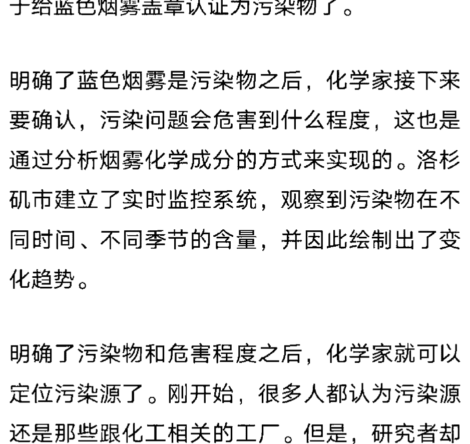

当时，很多人觉得蓝烟有害，洛杉矶人的生活在很大的阻碍和危险。但是，究竟是不是污染，是什么污染，产生的源头是什么，都没法直接得到答案。事实上，这些问题都得等科学家来回答。

加州理工学院的一位化学家通过检测，分析出雾霾的成分。他发现，蓝色烟雾中，含有大量的一氧化氮、硫化氢、碳氢化合物等物质，它们会刺激人的呼吸道器官造成极大威胁。这就相当于给蓝烟雾霾盖以证为污染物了。

明确了烟雾物是污染物之后，科学家接下来会追问：污染物是怎么参与到大气中，这是通过分析化学的方法来求突破。洛杉矶市民建立了实时监控系统，观察到不同时间、不同季节的空气质量变化，并据此给出了变化趋势。

明确了污染物质和危害程度之后，科学家就可以定位污染源了。刚开始，很多人都认为污染源是那些燃烧生煤的工厂。但是，研究都却发现，那些工厂关闭之后，空气污染问题并没有好转。

后来很多科学家做了进一步研究，才发现，这种蓝色烟雾出现在美国洛杉矶是跟汽车保有量有密切的关系。当时，美国政府为了在战争中取得优势，鼓励汽油的使用，汽车销售量急剧增长。城市汽车保有量越来越多，汽车尾气的排放也大幅增加，甚至导致洛杉矶这样的大城市，汽车保有量远超车容量，尾气排放量也非常惊人。

汽车尾气含有的很多物质，尤其是氮氧化合物和碳氢化合物，会在太阳的紫外线照射下发生复杂的光化学过程，产生一些剧毒的副产物，并形成散射的阳光产生烟雾，形成所谓的'光化学烟雾'。

你看，在识别和认定污染物的过程中，化学已经形成了非常有效的三步走战略：先通过成分分析形成认识，再观测规律寻找规律，最终锁定污染源。

### 3

在确定污染物质后，科学家自然也就知道要研究污染物如何解决的问题。

从微观的层面讲，化学解决污染问题的方法很简单：识别污染物，再针对污染物的特性找出解决方案。

还是以雾霾举例子吧。我们都知道，雾霾当中比较难以处理的物质是PM2.5。什么是PM2.5呢？就是尺寸在2.5微尺以下的细微颗粒。

PM2.5的尺寸非常小，要想避免吸入雾霾，就想方设法过滤这些细微颗粒。传统的口罩要想过滤PM2.5，就会变得更厚一些，但是那样做的话呼吸也会变得困难，因为口罩尺寸太小。

为了解决这个问题，化学家从材料上想办法，于是提出了'静电纺织技术'可以纺出只有几十纳米的纳米纤维。由于是纳米材料，所以材料纤维的密度高，比表面积大，而纤维本身的孔径和长度也小，这样的材料可以非常精准地挡住PM2.5这样细微的粒子。

对于很多出现雾霾的地方，用化学方法治理起来也是这些微观层面的原理。

比如，很多水污染的现象，是重金属元素超标。识别出是重金属元素之后污染之后，化学家会往水中投入某种化学试剂。例如，往含有铅的水中加入氢氧根，生成氢氧化铅沉淀，通过过滤把重金属离子去除，这就是我们第二讲里讲过的沉淀法。

讲完了微观层面的治理，我们再来看从宏观的角度来说，工业化和污染之间，是不是可以寻找到一个平衡点呢？

农药DDT的使用历史，或许可以给我们一些启发。

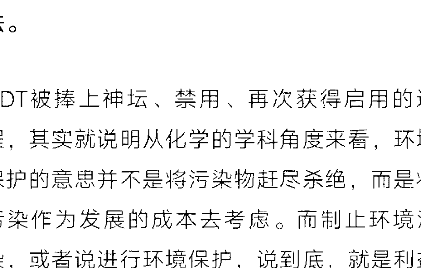

它是一种非常常用的杀虫剂，毒性大，用完以后的化学残留也比较重。从发明以来，DDT就成为了农业、林业、甚至是公共卫生领域的必备神器。1948年的诺贝尔生理学奖颁给了DDT的发明人，是DDT让粮食增产，提高粮食产量。

DDT被摈弃上神坛、禁用、再次获得启用的过程，其实就说明从化学的学科角度来着看，环境保护的意思并不是将污染物赶尽杀绝，而是将污染作为发展的成本去考虑。而制止环境污染，或者说进行环境保护，说到底，就是利益的权衡。

权衡的依据需要根据技术参数确定，所以现代工业对于化学品的管理中，都会编写详细且通用的技术说明书，以供使用方权衡它的环境成本。

再比如，很多项目正式落地生产前，都要出具一份环评报告。所谓的环评报告，就是在一个项目投资以前，对它可能造成的污染问题，先由专业机构进行评。现在，环评报告已经成为必选项目，大到核电站，小到一个餐厅，都需要先通过环评，才能真正开张。

说到底，环保行动是权衡发展与污染的一种博弈，环境恶化带来的结果是地球不再适宜人类居住，但地球本身并不会因为污染而灭亡，所以，它真正的服务对象是人类，任何环保行为都应当以人为本来。

### 总结

讲到这儿，我们这一讲也到了尾声，我们在这一讲，重点谈了三个层次：

- 第一，污染是一个人为制定出来的概念。我们判断一个物质是不是污染物，要看这个物质对人的影响是正面还是负面的
- 第二，化学方法和化学材料能帮助我们定位污染源，克服污染带来的各种问题；
- 第三，从我们化学的学科角度来看，环境保护的意思并不是将污染物赶尽杀绝，而是将污染作为发展的成本去考虑。

思考题：
你为环境保护做过哪些事情？欢迎在课后留言，和我分享。

### 下节预告

利益平衡说起来容易，做起来却很难，化学是怎么解决这个问题的呢？

我们下一讲见。

### 用户留言

前两年，还没有微信的时候，我们经常通过QQ群，集结一帮陌生人，租车到郊外登山。无论和哪个群去登山，没有一个群主都会车上，讲两点注意事项：一个是安全，一个是垃圾回收问题。我们大家也非常积极响应。我们无论走到什么地方，所有QQ群走过的地方，都找不到随便扔掉的垃圾。每个人都把垃圾收好然后带在身边，一直来到山下妥善处理。有时我们吃完饭，在山上狂欢跳舞时，经常随处看到有的人就把垃圾剥在裤腰上……所有人都觉得保护环境是我们登山人骄傲。

怎么样认定污染物？
1、分析成分
2、研究定量（污染定义的衡量线）
3、确定污染源
PS：也就是，了解污染机制，确定污染源。

很喜欢老师最后的总结 继续刷新认知。
我为环境保护做过的是 大的方面人尽量少为在家做好卫生 在外面能够做不随意扔垃圾 我想每个人每一个细小的节能能做到 也会带来很不一样的结果

污染对人是负面影响大，确定污染源可用化学方法去平衡。在社会发展中，是牺牲环境搞建设，还是保护环境慢发展。这需要经历一个认知的过程。
咱们国家已经从过去的以环境换发展，到现在的青山绿水就是金山银山的转变。正在寻求发展与环境的平衡。未来我们环境越来越好。
保护环境，减少污染，作为个体也应有化学平衡思维，通过化学方法去污。我们为环保可少开车，多乘公共交通工具或低碳出行。

## 27| 节约与浪费：什么才是真正的节约？

你好，我是孙亚文，欢迎来到《化学通识课》。

前几讲，我们谈到了污染和环保的问题。这一讲，我们从经济角度出发，继续介绍人类文明发展过程中，化学反应带来了哪些问题，化学家们如何通过化学来解决这些问题。

经济学里有一个重要的前提，就是资源是稀缺的。稀缺会导致竞争和选择，从而促进社会发展。为了应对资源、化学物质又有一个相似的理念，叫“原子经济”，指的是在原子层面上，让物质尽可能地被人类的意愿进行转化，从而节约资源，减少浪费。

这一讲，我们就围绕原子经济这个概念来讨论。

### 1

在化学家看来，所谓浪费，就是资源浪费。也分有一部分的反应不能带来实质经济价值的情况。

所以要实现原子经济，要满足两个条件：一是参与化学反应的物质比例合适，二是反应要彻底。

比例合适简单起来，但实际操作起来可就不那么容易了。可你听说过一个人和面的笑话，说是有个不太放饭的人去面食馆买包子，一会儿面多了，加水，一会儿面也加水，水又多了，再加面，就这样反复循环，最后越加越多。

化学反应在进形的时候，也存在这个问题，两个物质反应，要么这个过多，要么那个过量，要想合在很合适的比例，就需要十分精确的测量。

确定了比例之后，化学反应需要满足的第二个条件是，反应要彻底。在化学里，什么叫反应不彻底呢？还用水和面粉举例，我们在第二十四讲也说到，水和面粉如果发生化学反应，可以得到糖。但是，制作糖的时候温度太低，就会出现一些完全不能利用的糖。

那么，是不是比例合适，控制条件，保证反应彻底就足了呢？也不是，这是实现原子经济最基本的理解。但真正化学家实现原子经济是复杂得多。

有些工艺反应中物质能相互反应，这些原材料全都考虑进去，就会发现这是个十分立体化的问题，牵一发而动全身。

所以说，原子经济的定义很简单，但实现起来有难度。实现原子经济是化学领域一个很有挑战性的战略目标。

### 2

那么，在这个基础之上，我们就要谈谈第二个问题，化学家究竟是怎么去实现原子经济的？

虽然原子经济概念是1991年才提出来的，但是化学家们对于这个目标追求，少说也有几百年的历史了。

他们追求原子经济的过程，实际上是一个利益驱动的过程。化工厂在生产的流程中，会浪费一些物质，这些物质如果不进行处理，还要花大笔成本去处理它们，要么不处理或者处理不好，还会污染环境。所以，怎么把这些物质变废为宝，是化学家实现原子经济最直接的驱动力。

我们来看个例子。

从19世纪开始，世界主流的制碱方法是比利时人索尔维发明的索氏制碱法。不谈具体的工艺，最重要的是，这个氯法制碱除了生产纯碱，还会产生副产物氯化钠，氯化钠在化工总是一多单，但它不仅没有利用价值，还会对环境产生破坏。

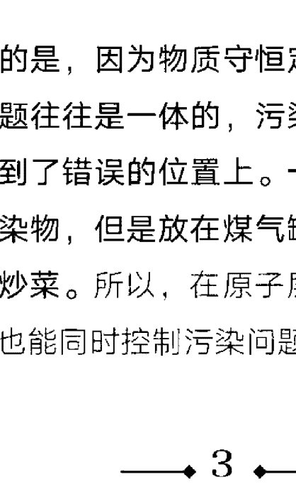

后来，一个叫侯德榜的中国人改进了制碱工艺，把副产物氯化钠变成可交收的化肥。从原子层面上看，侯氏制碱法对氯的原子利用率从70%提升到96%，反应中产生的水也用来生产纯碱，不仅解决了旧问题还节约了资源。侯氏制碱法在1943年问世，不仅影响了旧中国化学工业，还有当时农业、经济、外交都产生了极大的影响，作为工业生产产品，化肥更是苏联，作为重要的工业原料，硫磺、煤炭、食品工业全都离不开，贫穷落后的旧中国在这个产业上领先，自然引起了国外的极大关注。

到了现代，原子经济怎么实现的问题更受关注了。我们来看柴油的例子。

传统柴油里混着油脂，只能溶解在有溶剂的机油溶液里。油脂的分解会腐蚀发动机零件，导致机械寿命减少，从原子经济角度来看，柴油浪费了原子。

于是，后来又出现了水基柴油，水基柴油是水的，其中的水分子在分解后释放的氢和氧是自然最普遍的资源，水基柴油的资源来源不需要考虑水蒸发的问题。从原子经济的角度说，水基柴油优于传统柴油。

更重要的是，原子经济守恒原理，污染问题和污染问题往往是一体的，污染本身就是资源浪费的体现。比如我们说汽车尾气，二氧化碳是主要污染物，但二氧化碳也可以用来生产塑料，从原子层面上就解决了浪费问题，也能同时控制污染问题。

### 3

那么，借助原子经济，是否有一天，我们能让全世居的原子都能尽其用，不会产生任何残留物质或副产品，也不含任何浪费，形成一条完整的循环链？

这并不是现实，甚至可以说，在理论上就不可能实现。

绝对意义上的原子经济，没有任何损耗，按照人类的意愿有序排列，但我们在第十二讲《混沌与有序》中谈到过热力学，说的就是这个熵在不断增加，原子在变得越来越乱，所以我们看到，绝对的原子经济违背了热力学原理，是不可能实现的。

虽然原子经济是有局限性的，但它给我们提供了一种看待资源调配问题的新视角，对经济发展有着非常积极的主导作用。

比如，一般汽车发动机，燃料燃烧的动力效率，在20%~30%。从原子经济的角度来讲，这是一笔极大的浪费。所以，汽车工程需要减少，而不是将燃料全部用于动力了。但实际碳原子不是燃料，会被带到二氧化碳里。如果碳原子用于生产塑料，那就能产生价值。

当然，这只是一部分。还有更多更复杂的情况。

现在汽车工程师正在做的工作，就是研究碳原子作为还原剂时，提高催化剂对二氧化碳的转化效率，从而提高发动机的燃烧效率。

比如，巴西现在已经有多万辆汽车不用汽油，只用乙醇。乙醇是生物质，虽然乙醇的能量比汽油低一些，但也证明质量的乙醇在能源上也能用。汽车使用乙醇动力并没有明显的优势，燃料性能也更稳定了。这是因为，乙醇的燃烧更充分，更容易达到原子经济。而且这也影响了国民经济，巴西汽车生产商以及原油，现在已经在通过乙醇燃料技术，每年节省大量用于购买石油的外汇开支。

其实生活中其他不经意的行动，也是符合原子经济原理的。比如开车的时候尽量保持匀速，不要急刹车。就是因为这样让燃料燃烧得更充分、更高效。所以，对每一个人，每一点小事，表面上只节省些微不足道的钱，但就全球大背景来说，却可以视为对先进技术的接受程度。

### 总结

说到此，我们这节一讲就到此为止了。这一讲我们谈到的化学原理关于经济方面的节约与浪费，分为三个部分：

- 1. 原子经济就是从原子层面上，实现物质的高利用率。
- 第二，化学通过技术改进，可以在反应阶段提高原子经济性；
- 第三，理论上说，绝对的原子经济不可能实现，但是它对我们经济活动的价值却会非常显著。

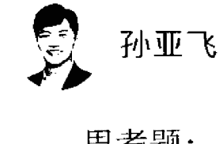

思考题：

据你观察，日常生活中的哪些节约资源的行为，也是符合原子经济的？

欢迎在课后留言，和我分享。

### 下节预告

在我们的人类活动中，战争与和平是一个永恒的主题，化学在其中又有哪些应用？

我们下一讲见。

## 28 升级与遏制：为什么化学才能结束化学生战？

你好，我是苏亚飞，欢迎来到我的《化学通识课》。

之前两讲，我们学了化学应用的两个重要场景：环境和资源浪费。这一讲，我们通过本模块的最后一个视角——战争——来看，应用化学带来的问题是如何逐步来解决的。

战争是推动人类文明进化的一个重要因素，这个观点我不再多做强调了。很多个学科的研究者都对战争的作用、对文明的影响做出了精彩的研判和推测。但是，在化学家的眼里，战争的激烈程度是被化学升级、又被化学平衡所限制的。

我们从三个层次来解释这句话。

### 1

首先，战争烈度是化学水平的体现。

在第一次世界大战之前，制作兵器的原材料受制于易碎的瓷器。一个国有没有昂贵的武器，能不能凭瓷器获得战争胜利，有很当重要的意思。比如说，青釉是春秋战国时期一种厚重的瓷器，到了唐朝开始主要利用的是钢和铁矿石。但是，到了第一次世界大战的时候，情况就不一样了，化学家们凭借自己的化学知识，改进了武器制造者吃饭的局面的。

当时，英国人阻断德国境内的铜石资源匮乏，强大的美国海军只需要封锁石头到利尔博通德的黑海通道，德国就不得不派出去抢炮弹了。用了一年，德国就会投降并谈判。

英国人的算盘打得很好，但情况显然是没有按照它设定的剧本发展。战争持续了一年多，德国人不仅没有投降，反而变得更强大了。到最后，第一次世界大战也足足打了四年才结束。

德国人到底有什么秘诀呢？

很简单，就是因为德国率先掌握了合成氨技术，这是德国科学家哈伯发明的，他还因此获得了1918年的诺贝尔奖。

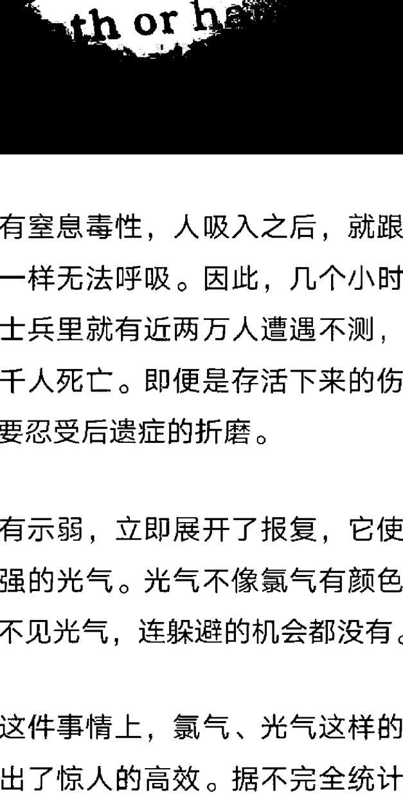

合成氨技术是化学领域里一个重要的知识点，就是氢气和氮气反应，可以得到氢气，氮可以用于生产各种化肥，大幅度提高作物产量，这样一来，打仗的粮食就不愁了。更重要的是，氢气也是生产炸药的原料，有了它，就可以用炸药炸掉制造炸药的矿石，源源不断地生产炸药。

因为原料气体性质稳定，很不容易发生反应，合成的技术门槛很高。所以，英国人搞了多年也没成功，他们也就不能相信德国人可以做到。

可以，在一战期间，是德国把化学军事上了战场，并且利用化学改变了战争的激烈程度。从此之后，在衡量一个国家军事能力的时候，化学水平成了一个重要的指标。

我们下一个模块要提到很多化学材料，比如尼龙纤维、合成橡胶、粘合剂等等，都在军事工业中发挥着巨大作用。

很多材料其实是因为军事的需求才诞生的。比如，锰酸复合胶就是英美、苏联率先研发了战场上的钢弹，对化学提出的任务就是研制穿甲弹复合的材料，让这种神奇物合金。当然，这样又会继续刺激化学研究所的装甲材料，随着化学技术的发展，战争双方的对抗强度不断提高。

### 2

除了烈度上的变化，化学对战争的影响主要体现在战争的性质上。

“猪鼻子”防毒面具从1916年起应用在战场上，不管怎样打仗，士兵都不会缺氧了。有了防毒装备，化学战的危害得到了明显遏制。

不夸张地说，其实是哈伯、格林尼亚、捷赫斯基这三个化学家，改变了一战的走向。

“猪鼻子”防毒面具，让狂热的化学战降了温，让那些过度使用化学武器的军事冒险行为，原来也会失败也是可以被防范的。曾经可以杀伤力著称的化学武器，走下了无敌的神坛。

更重要的是，到了20世纪70年代以后，世界上主要工业国家在化学战方面的差距大幅度缩小，化学战武器的制造变得轻而易举。曾经的必杀技，变成了人人都有带的常规装备。

与此同时，针对化学武器的防护技术却在不断地提高。到了那时候，如果再肆意使用化学武器，很可能就陷入了互相伤害的模式，最终陷入恶性循环、两败俱伤。

到了今天，如果还有人敢用化学武器，就会被世界各国当作恐怖组织，群起而攻之。

反过来说，当初很多为了应对战争而发明的化学技术，到了和平时代，却能够更好地为人类服务。

比如说捷赫斯基发明的“猪鼻子”，现在被用在了各种救灾现场，保护了很多消防员的性命。这也从一个侧面，说明了那个老生常谈的道理：科技是一把双刃剑，成也萧何败也萧何，取决于创造的人。

### 总结

这一讲到这里就结束了，我们来总结一下：

第一，人们开战使用的主要武器，都离不开化学，战争烈度是化学水平的直接体现；
第二，因为化学武器的产生和实用，使现代战争的性质发生了改变，但化学武器也被认为是不人道的；
第三，真正限制化学武器使用的，其实是化学技术的提升。

孙亚飞

思考题：

人和火灾之间的战争已经持续了几千年，你知道哪些灭火创作？这些化学有什么关系呢？

欢迎在课后留言，和我分享。

### 下节预告

下一讲，我们就要这门化学逍遥课最后一个模块，化学哲学了。在这个模块里，我将带你回顾化学的演变历史，以及化学在科技中的作用。

我们下一讲见。

## 29 | 经验与本质：为什么没有经验的本质，就不是本质？

你好，我是孙亚飞，欢迎来到《化学通识课》。

通过前面六个模块，我们的化学大厦终于完工了。但是，这座大厦在人类的认识体系中究竟处于什么位置，或者形而来说，这座化学大厦究竟有什么样的形而意义，这就是哲学层面的问题了，所以我们从这一讲开始就进入最后一个模块，化学哲学。

自然科学最初就是哲学体系的一部分，所以每一个学科都有自己的哲学。化学哲学从19世纪初正式形成，到现在已经有两百多年了。它像到了化学和哲学，基于化学发现更多的规律，抽出对全人类都有价值的方法和世界观。

化学哲学的特点有两个，概括起来，就是辩证。相信你可能已经注意到了，我们的《化学识课》，每一讲的标题都是一组对立统一的概念。所以在本**辩证法经常研究的对象和关系**。而正式在化学的文献中，化学哲学也被叫做**化学辩证法**。

在接下来的两讲中，我会从方法论还有世界观这两个角度入手，来讲述充满禅意的化学哲学。

化学的方法论有很多，其中最底层的两个就在于，怎么去处理经验与本质彼此矛盾的对立统一。我上下分成三个层次来解释。

### 1

首先，不同于其他自然科学，**化学研究方法的独特之处在于，承认经验的深刻性。**

通常我们只考虑，经验是可靠的，是有道理的话，本质只考虑，只有本质，才叫找到世界发展的本质规律，也有意义，才是深刻的。

但是化学并不这么做。

在19世纪，科学界就有个流行词，叫“化学上的直觉”，意思是化学家们可以依靠大量的经验来寻找和解决问题。在那个时期，化学家们完全靠直觉，想象甚至摸黑决定他们的空间结构，而很少真正去研究它的本质。但他们还真实现了这些结构，创造出物质来。

我们来看一个例子。

要想从化学层面去研究物质，化学式是很重要的工具。化学式之所以能够成立，依靠的原理叫定位律。定性比律，一种物质，不论它是天然存在的，还是人工合成的，它的原子比例始终是一样的。

这就是个定性定律。最早提出定性定律的化学家，从世界各地去采集各种物质，还亲自合成了上千次实验，最后提出了这个定性定律。

这个定律直到现在是成立的，如果物质不符合这个定律，日本的水和中国的河，它们的组成成为环境不同而发生变化，那么日本化学家的研究成果，放到中国就不能适用了。

你看，在化学的世界里，经验并不是不深刻的，有的，甚至还可以建立本质的定律。

那么，这种从化学方法总结出来的认识，是不是真正的哲学呢，能不能作为人类活动的指导思想呢？

你可以回想一下谷歌公司开发的人工智能机器人，阿尔法狗，它战胜了人类最优秀的围棋大师。

很长一段时间以来，人们不认为人工智能可以在围棋上战胜人类，因为围棋太复杂了，计算机只能凭借暴力蛮力，领不了人类智慧的深浅规律。

但是，阿尔法狗干脆反其道而行之，绝不所谓的规律，它通过不断训练，积累了海量经验数据，通过自己强大的经验，战胜了掌握规律的人类。

### 2

谈完经验和本质的确定性问题，我们来说说第二个层次，也就是深刻性问题。

生活中，很多人都来批评“经验主义”，意思是说，经验往往是靠不住的，一定要抓住问题的本质，才能保证正确性。

这个理解好像没有错，一个事物，一种方法会无法去把握它的本质。但是，反过来说，没有经验的本质又怎么样呢？

比如说，前面提到的非常经典来解决问题的办法，在18世纪的时候非常流行。但是，化学并没有因此就突破到传统发展的格局。尤其，在这些经验的后面，人们发展出了大理论量，尤其是在量子力学诞生以后，很多理论得到了证实。从经验中总结出的东西，有本质的证实。

在此之后，20世纪上半叶的化学成为由本质主导的学科。具体来说，就是原子结构的本质被确立，推导出我们想看到的物质的。比如通过量子力学，我们想从很本质的层面，对于化学反应的理解当然也变得更易懂了。

但是，这个过程持续了很长一段时间之后，面对复杂的事物程度，我们掌握的本质又很不足。那么这个时候只能积累更多的经验才可以。

比如说，现代化学对客观变化的运用越来越多，但很多时候大家都不明白是哪些反应怎么实现催化的，而且他们也没有时间去明白。寻找一种可预知的催化，依靠经验可能几十次实验就能解决。但是，根据本质去分析其中的原理，再根据这些原理去寻找催化剂，也许需要十几年，甚至更长。这个时候，化学家常用的就是黑箱方法，把复杂反应视为一个黑箱，不去打开，不可分析的这个体系是什么，只关注去添加和分离的催化体系。至于黑箱里面到底有什么，这是下一次螺旋上升要解决

### 总结

好了，说到这儿，我们这一讲也就基本讲完了。

这一讲中，我们谈的是化学这门学科的经营和本质，以及化学的本质的两点，具体来说包括三点：

- 1. 第一，不同于其他自然科学，化学研究方法的独特之处在于，承认经验的实质性；
- 2. 第二，借助化学的眼光，我们会发现，没有经验的本底，正确性同样是不存在的；
- 3. 第三，化学提供了新的上升理论，可以确保认识和改造自然的深度和正确性。

思考题：
在你的专业领域，是不是也有一些知识的命脉需要去研究？

欢迎在留言区留言，和我分享。

### 下节预告

对于化学实验来说，除了解决方法论的议题，更需要建立一套世界观，适用于整个化学研究。下一讲，我们就探讨这个问题。我们下一讲见。

### 用户留言

[用户：伪装] 在你的专业领域，是不是也有一些知识的命脉需要去研究？

[回复：思考 建筑工业发展到现在，力学和材料学已经完全的影响到了整个领域里面，但是再往下做，你还是会遇到一些，甚至永远都不会有结果的东西去做。有一些。甚至永远都不会有结果。转，比如留学。比对率]

## 30 | 继承与怀疑：为什么没有怀疑的继承，就不是继承？

孙亚飞 · 化学通识课30讲
10'3 | 继承与怀疑：为什么没有... [00:00 / 10:36]

你好，欢迎来到《化学通识课》的最后一讲，我是孙亚飞。

上一讲，我们谈到了化学科学的独特方法论，那么这一讲要说的，就是化学塑造的独特世界观。

平时生活里，我们常常会被拒绝，你说你这个人怎么这么多疑？这也才不信，那也不信。

每当这个时候，我就解释这是实在是职业病，在长期的化学学习中，我们已经养成了怀疑的习惯。多疑的性格，也许会对人际交往带来困扰。但是，从化学角度来看，对一开始所有怀疑的世界观，却是化学一直主张的精神。

但这里需要加一个新的前置词：我们都知道，科学是需要知识积累的，特别是现代科学，分工越来越细，要想从一项科研工作，需要经过漫长的工作过程，比如说话，需要继承多数前人的工作，才刚刚具备工作条件。但是，化学这个学科又要求我们要有怀疑精神。所以对我们干科学的人来说，继承和怀疑，就是一对需要调和的关系。

那么，化学为什么强调怀疑呢？

我们这一讲，分三个层次来解说。

### 1

首先，化学这门学科的确立，离不开怀疑精神。

波义耳被称为化学的奠基人，用俗话说，他就是我们干化学这一行的祖师爷。他留下了一本著作，叫《怀疑的化学家》，可以说，怀疑是化学界的校训。

那么，波义耳为什么要用怀疑这个词语来命名化学呢？这就需要了解一下化学的前身——炼金术。

在化学建立之前，炼金术在欧洲很流行。所谓炼金术，就是利用火烧、蒸发、过滤之类的方法，试着把铅、银，或者锡之类的便宜金属，转化成昂贵的黄金。

化学和炼金术之间，有着非常清晰的关系，炼金术时代的很多器具，特别是玻璃仪器，仍然是现代化学实验室里的常客。如果你穿越到几百年前，到当时炼金的地方看一看，很可能会觉得自己是到了一间化学实验室。

甚至化学这个学科的英语名字chemistry，其实也是从炼金术的alchemy演变来的。

这个局面，就是17世纪时亚里士多德主义的真实情形。

欧洲炼金术的基本指导思想，是在亚里士多德物质质的基础上，融合了宗教、原始巫学的理念，吸收了阿拉伯炼金术的一些经验，发展出的一套高深玄妙的理论。

从化学的视角来看，炼金术根本没有成功的物质守恒性，正因为我们没有发现的可能的，炼金术就成了骗子方法的工具。他们知道，没有人可以真的用这些方法造出黄金，所以就只能无奈得地说，因为利益的冲突来说，同行里不会出现班底，揭穿行业的机密。

但是，对一个具有怀疑品质的人来说，这种利益没什么说服力。

在对炼金术进行深入研究之后，波义耳发现了很多事实上的漏洞，在《怀疑的化学家》这本书的自序中，他写道："我一直致力于忠实地表述事实真相，同时能够驳斥炼金术科学家们的妄想和他们的狂妄，这类书其实就是他在地雷图，他为后来的干炼金术士们所说的不是事实，炼金术是不可能成功的。

就这样，在化学家怀疑精神的引领下，化学慢慢在炼金术的基础之中独立出来，它也致力于描述事实，而不是用假设去掩盖事实。

### 2

讲了化学天然抱有怀疑的基因，接下来我要讲的第二个层次，是怀疑也是化学这个学科重要的质疑方面。假化学领域的重要结论，都是通过怀疑得来的。

在18世纪的时候，化学界有一件非常重要的事情，就是解释燃烧现象究竟是什么。在今天，这个问题当然已经不算什么难题，我们在第十讲也说过，燃烧就是一种氧化反应。

但两百多年前，这可是个难题，燃烧现象之很难解释，是因为当时的人们根本无法发现氧气，不知道氧气，当然也就没有办法解释什么是燃烧了。

当时，有一种流行的观点认为，有的物质可以燃烧，有的物质不能燃烧，是因为有炎素这种东西。如果有物质里面含有炎素，那么它就可以被点燃。反过来，如果一种物质的燃素烧光了，那么它就不能再燃烧了。

这个说法听起来挺有理，人们甚至还能找到例子来证明它。比如说一根木头，它完全燃烧之后成了一些灰烬，体重明显都变小了。所以，在燃烧之后，一定有些东西消失了，消失的部分就是燃素。

这时候，英国有个科学家普里斯特利，他通过实验发现了一种气体，也就形成了新的氧气。普里斯特利做了很多实验，证明了这种气体可以帮助物质燃烧，有助燃烧的能力。他的实验都是事实，但是他没有找到燃烧的真格是氧化反应。

不过，普里斯特利也没有过多思考，他觉得自己发现的气体，既可以帮助燃烧，也能帮助动物身体排除废气，干脆管它叫脱燃素空气好了。

他对自己这个观点非常满意，开始巡回演讲，宣传自己的发现。

当他到法国公演的时，大科学家拉瓦锡也去听报告。在了解到了普里斯特利发现了所谓的脱燃素空气之后，拉瓦锡思考了很多问题。他一直觉得，燃素理论存在很多不能自圆其说的漏洞。其中最明显的难题就是，如果金属变成灰灰是因为燃素，那么只要控制反应条件，就一定可以找到这些灰灰。简单来说，所有支持燃素理论的人，都没有找到所谓的燃素是什么。

我们不妨思考一下，如果普里斯特利里发现的气体真是脱燃素空气，那么借助于这种气体，我们就能给身体的，说就好。要想证明这一点，可以利用水蒸气；烧瓶中己可以烧开水，那么只要从原上来提供蒸自己找到了吗？

拉瓦锡就是在这样的怀疑精神之下，重复了普里斯特利的实验，并且最终发现燃烧东西离不开在，燃烧其实就是氧化反应，脱燃素空气也被他命名为氧气。

拉瓦锡的经历是千千万万个化学家经历的缩影，而化学这个学科的知识体系，就是这样在怀疑精神的指导下，慢慢建立起来的。

### 3

如果仅仅是这样，怀疑让化学从炼金术中独立出来，并建立起了自己的知识体系，依旧不足以构成化学独特的世界观。要想上升到世界观，我们还需要指出怀疑的新意义，这也就是我们常说的第三个层次：化学家通过怀疑来修正、完善和调整化学这个学科对世界的认识。

在唯物主义看来，世界上每个面对客观世界的，是一致的。所以，自然科学的研究对象就是这个世界，世界只有一套，你要么就解释它，都在唯一性，换句话说，我们怀疑或不怀疑，并不影响这个世界的运转规律。

既然如此，怀疑还有什么用呢？

我们来看个例子。

臭氧是一种由三个氧原子构成的分子，它可以吸收紫外线，地球的上空有一层很薄的臭氧，在阳光照射下自己发生反应，一阻碍人类的生存环境，它几乎只有自己保护，但是它圈住了太阳系其他的大部分物质，保护了地球上生物。要不然，包括人类在内，都会被紫外线伤害，增加癌症发病率。

臭氧是一种由三个氧原子构成的分子，它可以吸收紫外线。地球的空中有一层很薄的臭氧，是在阳光照射下自然产生的，距离人类的生活区域很远。它平均有数万米厚，但是它包括了太阳几乎所有紫外光谱，保护了地球上的生物。要不然，包括人在内，都会被紫外线伤害，增加癌症发病率。

但是很多年前我们发现，在高层上空出现了臭氧空洞，对地球上的人类构成威胁。

那么这个空洞是怎么产生的？按照此前已经知道的规律，臭氧层就是在太阳的照射下生成的，是一个自然现象，出现空洞应该是自然现象。

不过，这时候一些化学家就怀疑了，就算人类不在臭氧层那么高的地方生活，会不会因为人类活动排放的有害气体影响，和臭氧发生了化学反应，臭氧被消耗就出现了空洞呢？于是经过研究，证实了这一点，不仅破坏了1955年的诺贝尔化学奖，而且推动了全世界对臭氧层的保护活动。

在我看来，在这个故事里，重要的人类学家们是最迷茫，臭氧空洞的出现，不是人类活动有关，而是他们选择通过怀疑来调整自己对世界的认识。化学家们没有机械地去寻求客观世界里的规律，而是把他们本身看作探究世界的对象，沿着这个思路去找到新的答案，从而拓展了对世界的认知。

### 总结

这一讲，我们谈到了化学的世界观问题，这就是化学家谈的准则，也是他们看待问题，认识世界的一种规律，是科学发展的前提，但是化学的世界观，更强调规律中的精神规律，它又分为三个层面。

- 1. 第一，化学这门学科的建立，离不开怀疑精神；
- 2. 第二，怀疑是化学重要的思维方式，很多重要理论都是通过怀疑得出的；
- 3. 第三，化学需要通过怀疑来修正、完善和调整化学对世界的认识。

在你的专业领域，有哪些独特的世界观，它是否影响到你的思想和行动？
欢迎在留言区和我分享。

### 用户留言

伪装
在你的专业领域，有哪些独特的世界观，它是否影响到你的思想和行动呢？
思考
当年学习物理的时候，形成了一个特殊的思维习惯，就是基础研究上，无论遇到什么题，首先解决的是基础性的知识，然后再去解决其它问题。一开始，不管顺顺利利，还是真不结实，我总觉得是思路不妥。

四十不惑，大概就是想说这种能够总结经验人生经历的状态吧！

一叶飘香
怀疑精神是化学世界观的重要理念。我们对一个化学现象产生怀疑，进而想要去探寻真相，那么用实验来寻找就好了，用可证实的，一般实验结果可证实，我们相信未经证实的理论，相信理论，理论却无法去证实，就好比比市场永远对，错的是投资者自己。在化学实验坚持实验就是检验真理的唯一标准，因此在怀疑的同时必然伴随着证实，这也是化学世界观。

专职解调
时间过的好快 化学课听道了最后一讲 会不舍得大学的环环可嘉
1、保持 世界 的化学怀疑 推动了化学家们的不断探索去与探索
常觉得不好奇 商 简单是去感 兴趣 而深层是怀疑
因为怀疑 才会证实
因为怀疑 才会进步

2、人听得懂的化学课
记得老师上次留言的时候说过 中学时觉得化学就是自己化学不好，都学不懂 记不住各种化学公式，是孙老师的化学课让我，让我知道规律性
每一讲的简单是A的B的形式来讲解，通俗易懂。简单明了的化学来解释学知识，首先帮助你和小山 化 扫 更重要的是延伸到对话、工作的思考

3、学一门知识合一： “最后，我学科学，在化学中知识合一：最后，我学科学，在化学中知识合一”，在这门课程里，我不用去人多，我学化学时 中学里 反复的数学学， 化学学科， 在课程中 学一门知识合一： “最后，我学科学，在化学中知识合一”
感谢孙老师 30 节课让我重新认识了化学课重新看待化学对生活的影响
我期待在后续学习中，把化学学科知识 继续 生活中发现化学的身影 与之合作

作者回复:
感谢回复。虽然化学课讲已经完结，但是我们化学课要推动啊，也注意到还有一些细节值得讨论，所以，您的加减已经路上了 😊

代维
怀疑是对某种现象的可行性选择其中一种，假设情况，然后假设。这种假设是以过往的经验为基础的，做出可能性最大的推测。

世界是客观的，如果没有怀疑，在不知道真实现象之后难道要一个结论？怀疑 不断的经验可以推测很多可能性， 怀疑 则剩下可推测的数值的概率， 使更有可能的发现其本质。

奇问小佩童
感谢老师这一个月的付出，让我明白了化学不仅在实验室里，其实现实生活中的有很多，很大的 好多都 不知道 各种化学知识的 科学解释都很重要， 也 就 让 人 去 做 化 学 的 大 数 据 思维，越理解 越多， 能获取 多信息。

耳红红
随着 得到 的知识越来越多，感觉越来越学不过来，也不能 一直 为 了 而 读书了。

开始反思自己的学习：一边自己发现，一边自己实践。

阅读 的有 发， 就 你 不 深入 理解 和 思考， 想 怎 么 运 用 新 发 现， 做出 改变。

我多亏
在化工企业中，作为一名安全工作者，具体根据 决策 以往结果，千万不能 迷信 以前的结果。当时 环境 的 安全 情况， 是 决定 工 作 开 展 的 唯一 准 则， 老 着 有一 直 观 性 的 心 态， 大概率 会 出 事。还有一种是直观操作 无 规 则 ， 但 是 没 有 直 观 的 规 则， 操作 规 则 保 留 操 作 规 则， 假 如 当 人 做 的 取 以 出 来 乱 做， 就 是 安 全 运 行 了。每 当 有 同 事 间 谈 到 人 性， 好 像 不 是 人， 我 说 安全 是 最 大 的 人 性。

宏君
老师，请问您是怎么梳理化学发展史的脉络？是想体现化学家还是体现化学成果？还是说有自己独特的一个研究框架？
作者回复
这个问题比较复杂。
在做《化学通识课》期间，我作为内容策划，和几位编辑老师一起讨论，提出过四种不同的方案，有的是按照发现化学的科学家来，有的是按照时间，最后确定的这个方案，可以看到，我打散化学的体系，用内部逻辑进行连接，把化学史也构建这个 问题 讲 清 楚， 并且 通 用 网 友 大 学 学 生 了 为 什 么 这 么 做， 以 及 这 个 逻辑 讲 这 个 化 学 史， 但 是 他 们 可 以 通 过 这 个 课 程， 让 学 生 的 基 层 门 槛 降 下 来， 找 到 一 些 核 心 的 价 值。

## 31 | 独立与融合：未来化学将以存在的方式是什么？

你好，欢迎回到《化学常识课》，我是孙亚飞。

通过30讲课程，我们已经把化学这门学科的脉络梳理出来了。相信你已经知道，化学是怎么看待物质世界、怎么形成独特的思维、又是改造世界的。

但是，对于学科本身来说，我们还有一个问题需要探讨，就是化学的未来到底会怎么发展，它是会走向独立，还是与其他学科更加融合？

我们分三个层面来讨论这个问题。

### 1

首先，化学具有极强的特殊性。

在第一讲中，我们就谈到了一个基本观点，那就是世界是分层的。每一个层级都要有不同的思维来解决问题。科学学家是中间层，连接了许多学科，认识世界的层级是原子。简单地说，化学就是研究原子的事。

这个层级的世界非常特殊，一方面，我们很难直观观察它；另一方面，我们又不能放弃它去体验物质世界。

正是这种观察对象的特殊性，保证了化学在科学体系中的独特性。所以我们可以用这样一句话来概括化学的特性：**atom is atom，原子就是原子。**

除此之外，观察对象的独特性，也影响了化学的科学革命模式。所谓科学革命，说的是因为各种不同的原因，科学界发生了根本变革。一般来说，发生科学革命这个阶段的科学发现了反常危机。要解决这个反常危机，就只能依赖科学家。用这个模式来解释科学史会很单薄，因为化学就很不反常的。

那么，化学革命怎么发生的？现代科技哲学家认为，化学界有那群人，一群体是维护者，为了应对方，不停地修补修补；另一群体人是革命者，他们应对反常的方式是重建。

换句话说，因为化学内部存在着强烈的矛盾，所以反常很常见。化学领域不能达成共议，只是不同团体达成共识。

而这一矛盾的源头，就是前面我们谈的，化学大厦的建造者能在人思维很难想象的层级工作，但又不得不去接触现实，所以这个矛盾就存在。

### 2

虽然化学跟其他学科非常不同，但是客观世界是唯一的。所有的自然科学研究的是这个唯一的世界。换句话说，无论化学怎么独特，也不能割裂与其他学科的合作，所以，不同学科的交集点是必然的。

这种融合，我们也可以**用一句英语来表达，atom is anything，原子是一切。**

如果你注意看最近的新闻科技报道，就会发现，几乎所有话题都会谈到原子层面的内核。

比如说，现在非常热门的基因科学，它的研究对象是基因片段，基因片段的编码就是一个碱基，要研究这些碱基，就必须从原子的角度去讨论。

跟着孙老师的节奏学完了几门化学课讲授的七大模块③化学，再回到化学这门学科的定义上，我们已知的这个“君子”学科，他这个“七化学”也做到了知行合一。

孙老师把这个课程的七模块比喻成一座神秘的“迷宫”之后，再到他描述出来的指标意义，有一种讲都是我们自己所得的浅层语言对生动化的比喻着跟我们讲化学思考角用化学思维去思考和判别我们生活中遇到的问题，让我们从不一 样视角看到了生活乃至世界的另一面，也纠正了我们在学术中遇到的很多误区。这一点，听课的同学们应该更有深议。

孙老师曾在发刊词中承认，这门课程不能用让人头疼的分子式，也不可能有复杂的数学公式，只有我们得懂得语言、知识、思维等化学思维的精髓，才能在高中、高中阶段很难的化学学习完，听完之后，我真全倒！作为这门化学课的铁粉，我想用笔记来回顾这一个月的所学：

第一模块是化学思维，是对大构的启蒙：

- 1、化学存在的终极理由：
  - （1）化学可以开拓新的维度
  - （2）化学能够连接世界的断裂
  - （3）化学能够实现各的可能
- 2、化学从宏观与微观的维度观察世界：
  - （1）宏观世界是客观存在的各种态
  - （2）世界并不是，宏观的往往是一种幻觉，透过微观才能看到实质
  - （3）化学家们用微观维度去认识世界，不是为了解其复杂的世界，而是为了联系宏观世界的现象和微观世界的本质
  - （4）通过宏观现象，准确微观界的本质；再借助于本质，去解决宏观界的问题
- 3、化学理论与实验对世界进行解释
  - （1）绝大多数化学理论，都是基于量子力学的基础上推导出来的
  - （2）化学通过不断适应场景需求的这种实验的方法去，填补下原来理想化的断层，形成了一种依赖于实验形成为知识的自然科学。之所以实验形式，是因为化学实验的便捷高效，受限少，可重复性高

第二模块是化学定律，好比是可行性研究：

- 4、化学学科比其他学科更注重动态和静态过程
  - （1）化学反应是化学最底层研究对象，也是化学最特殊的——它对象是客观存在的，不以人的意志为转移，这是理解化学这门学科的支点
  - （3）化学反应三大定律：
    - 第一定律，是化学量守恒定律
    - （2）第二定律，是质能量守恒定律
    - 第三定律，是焓熵规律
  - （4）这是化学反应平衡的本质，根据它的特征，可以以称为对动态平衡
  - （5）动态平衡不只是化学反应受心影响，更是建立起一种奇特的世界观
- 5、化学转化通的基本方法：
  - （1）在纷纭扰扰的化学世界里，化学家们首先发现了物质的守恒律，由此定义了元素
  - （2）在这个基础上，人们又发展出了质量守恒定律
  - （3）在质量守恒的基础上，人们进一步发展出了能量守恒定律
- 6、熵总是化学反应的验证：
  - （1）熵就是混乱度，它会一直增长
  - （2）熵原理的化率本质，是微观粒子混乱的趋势
  - （3）有理论可上可达，可是实际操作却很难，化学反应也是如此，这是因为它虽然简单如打散，但整个体系是大模糊混沌的，角是化学家曾试图用单快法过的字，可从混沌到复杂、从复杂到可动态宇宙、就一定留下痕迹
  - （5）说到底，熵增原理其实给系统加了一个边界，因为越是系统增加的，如果你想像维持一个有序的体系，就要为此付出更混乱的代价

第三模块是化学模型，像是设计出沙盘模型：

- 7、化学模型的基本原点是原子与元素：
  - （1）原子本来是对世界原子的一种猜测，认为原子是由一个个基本构而成的
  - （2）原子的内涵过于丰富，所以在个基础上，又建立了元素的概念，元素就是对原子的一种分，也就是说原子在物质间的一种类型和元素模型就是不太地优化中了，但目前用来解释化学反应，已经足够了
- 8、保持化学性质的最小单位是分子与结构：
  - （1）分子模型是基于原子模型的升级，它是维持物质化学性质的最小单位
  - （2）分子的特别精构，依赖的是原子之间的用力，也就是静电作用力
  - （3）分子模型，是对现象复杂性的一种简化模型，在具体的场善下容易理解，而且非常常用
- 9、化学模型的基本关系：
  - （1）元素周期律的发现过程虽有许多巧合，但它的本质还是自然界中元素内在的周期规律
  - （2）元素周期律之所以得到了广泛认可，是因为它应用用到很多方面，并且半征自也合，但元素周期律模型、现在仍然存在很多不足，这些不足着可能发展，但存在的问题都可能需要成为科学界的一大进步
- 10、物质的氧化与还原性：
  - （1）简略地讲，氧化与还原的模型，就是物质与氧气发生反应，得氧就是氧化，失氧就是还原，但是，这个解释就太浅了
  - （2）从科学的角度来看，氧化与还原的发生，实际上是电子的转移过程，失去电子就是氧化，得到电子就是还原
  - （3）研究电子转移，目的是为了摸清结构的线，最终理解物质的化学性质
- 11、酸碱型容易被初学利解：
  - （1）酸碱模型的一个层次，是看物质的pH值，也就是氢离子浓度
  - （2）酸碱模型的第二个层次，是看这种物质接受还是释放氢离子
  - （3）酸碱模型的第三个层次，是看电子的位置，这真正连接了结构和化学性质的关系
  - （4）酸碱模型有科学性，又容易听起，因为它谈论的对象是周围物非常生命中的东西，它一直扩大到生体，却无法命中它的命脉了，这也是酸碱型不是伪科学的根本原因
- 12、晶体与非晶体：
  - （1）晶体和非晶体模型，是化学世界探索微观世界结构的不同，他们的核心区别在于原子排列方式的均匀。
  - （2）液体的出现，让物质模型变得完整。它也进一步证实了晶体结构是实物质，晶体模型连接了数学运算和实际世界，非常难，现实很复杂，所以晶体模型越精细都面临崩塌的危险，但能待模型越精密，本身就是一种成功
- 13、溶液与乳浊液：
  - （1）溶液和乳浊是本质是不同的结构，跟是否是液体关系不大
  - （2）溶液分子不同的分子们可以直接帮助，乳浊液的分子可以吗，它们需要借助的第三类来混合
  - （3）溶液和乳浊在生活中的应用十分普遍，做饭、洗发、挑选化妆品，都需要用到这个模型
- 14、体系的化学性质需要参照系：
  - （1）理想气体模型在现实并不存在，因为它忽略了气体的实际性质，比如体积和结构
  - （2）理想气体模型可以推导出不同参数之间的关系，这可以指导实验，推导出来的

找出化学体与理想气体模型，是化学家要承担主要任务，因为体间关系的本质是化学性质的断层。理解体和实际的气体之间的断层，是一个探索，选择这个断层的过程，就是我们在不断接近真相的过程

第四模块是化学方法，是具体的修建方案：

- 15、化学创造物质的边界：
  - （1）人造化合物，可以有目的地把简单物质组装成复杂物质
  - （2）分离是合成的相对过程，把复杂物质变简单，但它的重量很难
  - （3）合成和分解都是化学的方法，但它的思维，很多和自然可以是借鉴
- 16、改变变量代价：
  - （1）影响化学反应速度的外界因素，主要是温度和温度
  - （2）催化剂可以改变化学反应的速度，是因为它能改变两种反应物，产生反应物，打破概率，使反应速度会快，增加概率，反应速度会变慢
  - （3）改变反应速度会快慢，能为化学工业，进行精细地去搞，但是，同时也需要我们有更多的代价，所以我们也要多一分谨慎
- 17、有机与无机：
  - （1）有机和无机，在物质属性上来说没有区别，主要区别在于研究方法
  - （2）有机的研究方法重视关联性，无机的研究方法重视创造性
  - （3）有机和无机生产标准，不是天然原生，而是设计着各个部分都联起来，形成一个鲜活的整体

第五模块是化学材料，如同覆盖地球的各
