# 孤独大脑二

## 哪种创业最靠谱？

Liohsal
为了证明自己放弃一切的人，自卑到了什么程度啊，怎么拯救？

老喻
**自卑能毁灭你，也能成就你。既然你能放弃一切，试一下放弃自己的自卑，拿回不该放弃的“一切”。**

Jacky
刚转行，去干了一份自己很喜欢的工作，领导是个出了名的坏脾气，我尽力把事情做好，但是还是天天被领导怼，心累。要离开当前的岗位有点不舍，自己干有风险，继续干，又要受气，真是纠结。老喻有啥建议吗？

老喻
**不能用“脾气”来评判一个领导的好坏，而是看Ta是否帮助你成长——包括让自己的玻璃心更强大。**

菜文文
推荐炒股挣钱的书吧，太闲。

老喻
是人闲还是钱闲？

噗叽叽
人生是否始终都如此痛苦？

老喻
不是始终如此，将来会更痛苦一些。

Misty
跟刚从微博上认识的女生如何聊天，已经针对她的喜好列举了十点，心理学搭讪学的理论一直在看，却无法开展有效的聊天互动，换句话说如何让我吸引到她？

老喻
发帅照。别搞没用的。

满月☾
男朋友理性，心力在我之上，也会给我关于职场很好的建议。但并不怎么和我聊内心想法。

同城，因为他程序员经常加班也不怎么见。

所以我困惑他的优先级是工作，还是说他不那么在乎我。

老喻
找闺蜜聊天，和男友恋爱。——而不是反过来。

蜗牛
老喻湖北老乡，我感觉自己有病，总是瘾不住浏览黄色网站，每次浏览完后，内心无比自责，好讨厌自己，已经30多岁了.

老喻
自负盈亏，不危害社会，自责什么？

阿健
老喻你好，请问在体制内的工作的人做投资总感觉有哪里不对劲，也许是因为投资确实需要保持持续的成长，而身在单位中难免会受到影响，就像屁股决定脑袋一样，这种状况该不该果断一点，放弃体制工作呢？(已经找到了投资的圣杯,且有社群可以互动学习,但需要长期才能见效果。)

老喻
1、爱因斯坦发表相对论时，并未辞去专利局的工作。
2、更何况他是真的懂物理，而你是误以为自己找到了所谓“投资圣杯”。

为_鼐鼐Leo
在思考，喜欢的人不只一个，是自己的内心错了，还是道德的约束机制有问题。不应该，这种非黑即白不合理。怎么破？

老喻
弱水三千，只取一瓢……一瓢又一瓢……

拈指一笑
看到你给别人的一个回答是坚持做正确的事，那么，什么是正确的事？以什么标准来评判？

老喻
“十年以后的你”希望“现在的你”做的事情。

子良
农民工子女，普通院校，毕业4年，年薪20万，目前在国企做电力互联网做产品经理。如果一直在国有企业30万封顶了。希望寻求突破。希望能通过老喻的眼光能多看见些未来。

老喻
1、忘掉“农民工”这个不公的标签，人生而平等。
2、你的运气不错，也有权更好。
3、好好享受生活，拼命工作，等好运气来找你，无需刻意“突破”。

世界另有计划
我是一名军人，今年已服役16年，结婚九年，有一个8岁的孩子，因为工作原因很少陪伴家人和孩子的成长，今年有个机会可以转业回到家人所在地工作，本人很困惑走与留的问题，想请教喻老师如何选择？

老喻
回家。

^?^的变数
你所提的对无知的已知，我感到很困惑。

好多天睡不好觉，能不能解答一下？

老喻
黑箱子里有100个混在一起的黑球和红球，你不知道将摸出哪一个，这是“无知”；

你知道这100个球里，有70个黑球，30个红球，你还是不知道将摸出一个，但你知道摸出结果的概率。这是“对无知的已知”。

李庆普
老喻，应届毕业生该如何选择第一份工作呢，都说第一份工作影响会很大，有没有更好的建议来做决策呢？

老喻
选学习曲线最陡峭的工作。

忘不了初恋，哪怕几年没联系了也偶尔会通过网络查看她的日常，甚至会梦见她，应当如何是好？

老喻
能怎么办，连思维也换不掉“初恋”。

为你
有时候看见别人在自欺欺人，自我麻痹，还有觉知闭环……让我很警醒，而我这样的警醒与看见会不会也是一种自欺欺人呢，怎么办……

老喻
当我觉得看出了别人的某些可笑之处时，禁不住想：我的“上面”也有很多人这样看我。

Chris ²₀
老公快四十的人了，还是整天像个孩子一样，就知道玩游戏看手机，生活得过且过，没有一点上进心，感觉没意思！

老喻
玩游戏好过去炒股，看手机好过去泡妞。——上进的结果是好坏参半的。

微风习习
为别人而活才是盘踞在你心里的火龙，心中无龙，所有的路都是人生无憾的进步之路。

老喻
还有一种为他人而活，是总在证明“自己不为他人而活”。

人的确是通过“为值得的人而活”来令“为自己而活得值得”。

骞子澟澟
如何慢慢构建自己在某一领域的系统性思维？

老喻
深度比系统更重要。“深度”很难伪装，而“系统性”经常是幻觉。

蓼几晌当当
博士结业状态，现在还有半年的时间可以再争取一下学位，但从内心是不相信自己可以拿到学位的，所缺的东西太多了，并且也真的不喜欢自己所学专业，自己也搞不懂为啥还坚持了那么多年！即使最后拿到学位很大可能也不会去从事科研工作。现在每天都很痛苦，要不要就此放弃？

老喻
半年很快，熬一下。否则你余生都会纠结这事儿。

老鼠夹
老喻，国内保险从业者千万级。请问你了解保险经纪人这个职业吗？做好的关键点在哪？

老喻
1、想象自己是概率的天使，来拯救被随机性威胁的人类。
2、把客户当作自己的一个远房亲戚，站在对方立场，说真话。

花儿
觉得自己是个自私的人，并因此而愧疚。怎么破～

老喻
1、觉得自己自私的人一般都不是很自私的人。
2、你只对某个半径之类的“身边人”很无私。

企鹅
一直说话不经过大脑，可能在自己都不知道的情况下说话得罪了人，最近新来的的同事好像就是被我说的话得罪了然而我都没有意识到是什么话，我很害怕以后无意识说的话会得罪“同事们”

老喻
问题不在于你的这个“小缺点”，而在于你别的优点不够大。

文姐
如何确定自己在人群中的认知高度？

老喻
猴子确认自己的高度，是通过“让更多别的猴子看见自己的红屁股”。人也差不多。

赵子方
根据21天能养成一个好习惯论，我坚持一个月没有吃肉，可以算是自我控制有了初步成效。现在觉得可以不用吃肉了，体能也属于正常的，于是我就想决定投资股票（5G产业.智能家居.智能汽车.动漫.），我要选择中长期投资，犹如您说要懂得慢慢变“富”，我用坚持不吃肉来了控制自己（也可减少本人罪孽），从而控制自己要做了中期投资，老喻，这个方法是否行的通？

老喻
你试一下用这个方法能不能控制自己“做数学题”？

投资和数学一样，不会就是不会。

佳^然
结婚的理由是什么呢？

老喻
是因为找不到不结婚的理由。

今天早睡早起了吗
结婚五年，孩子4岁，在去年迫于照顾老人孩子而辞职，在一年的家庭主妇生活中考了研究生，已被录取。但上学意味着另一半放弃工作回家照顾老人孩子。不上学就意味着我可能要当一辈子家庭主妇，难以取舍。（学历都一般，都属于没有大智慧但脚踏实地的人，另一半的工作经过积累也还不错）

老喻
请个阿姨。

冯锦汐
从小学到工作都是一个人，断断续续有小伙伴，最后很多不欢而散，没有和别人结伴玩的能力，不知道要不要看医生，孤僻成性，有人玩的时候又觉得要顾及别人比较麻烦

总能把身边的一切人际关系搞砸，太偏执，人也太撒，没能力还有点多管闲事，亲姐和我断绝关系，一个说话的朋友都没有。身边只剩男朋友了，该如何是好呢？

老喻
你这是因为解释风格而导致的习得性无助，塞利格曼的书里有你要的答案。

1.
怎样克制欲望？

老喻
1、人们对自己欲望的怀疑，大多数时候是对“自己实现欲望的方式”的怀疑。
2、也许你要的不是克制欲望，而是给自己的欲望更多选择。

人生何处不相遇
喻老师，请教一下，我儿子数学很差，考试10多20分，比如：1 + 2 = 3，反过来2 + 1 = ?就傻了，但语文之内的还过得去，他到底是个什么脑袋?下学期给他留个级会好点吗？

老喻
别为那些孩子早晚会的东 西操心。两三岁会背100首唐诗的孩子除了表演给大人看，让父母为自己的驯猴技巧自豪，有几个成为作家的？

彼岸
我今年30岁，小有积蓄。

疫情，生意基本停滞。

短期我是等行情好转重新开始，还是现在走出去（沟通能力差，有成交赊欠风险）？

长期担心自己认知盲区，给自己带来的赊欠风险。

另外也有脱离这个行业想法。（底层行业的收入中层，天花板）

行业不看好，但是收入还可以。幸福感差。

转行有风险，想有收入的同时，做个有价值感的人。

老喻
1、好的生意，经常是那种把低级生意干出高级感，或者是用“低级手段”改造高级生意。
2、别随便改行，尤其是还在赚钱的。

八爷
老喻，你好。我想成为小学老师，现在的工业区有一家职校，有成人高考的项目，我又担心没有高中毕业证原件，不能报名，纠结。

老喻
去弄一个。

虞谏企盼
老喻，看你的回复的太有趣了，果然不在一个境界，想知道为什么你最后落脚在加拿大？当然也不一定是最后。

老喻
这是一个友好的国家，出产白求恩这样相信善良和勇气的人。

星火照抽 洛
如何分清是主动的自我意志选择，还是被动的消化信息后的自我说服接受。

老喻
1、90%的人，和90%的情况下，是先射箭后画靶子。
2、在上帝看来，人就是一大群集体游动的鱼。

A.I.N.Y.
如何看待大学生创业？大学生如何评估自己的创业计划是否具有可行性？

老喻
只有两种创业是靠谱的：1、为了解决某个问题；2、为了谋生。

许伊风CIUM
老喻，从个人经历归纳推理得出，会提出有价值的问题的人，一般会是最近事物本质，同时也是具有哲学思维的人。从您回答问题的方式也可以看出。所以我想问3个问题，1.什么是事物的本质2.哲学与现实的关系是什么3.如果将学术性的知识应用于实际。这里不限于哲学，包含心理学、政治、经济学等理论性比较强，而普通人离的比较远的学科。

老喻
1、事物的本质，是其所包含的所有信息。
2、哲学是对万物信息源头的探索。也可以如罗素所说：已知是科学，未知是神学，已知和未知之间的是哲学。
3、如果你是意指如何用“学术”来换名利，无非是两种：a、利用你的学术优势构建的对这个世界更深的理解；b、利用人们对你的学术优势的迷信。

彭南【V9传说】
我的小孩今年16岁，专业学习舞蹈4年，今年一次意外他的十字交叉韧带断裂，半月板切除了小部分！我想让他换一个专业（音乐)请问喻老师这次选择合适吗

老喻
让孩子自己选择。

雪蓉
喻哥，如何能让自己变的更幽默一点？

老喻
1、觉得世界好玩儿；
2、发现了很多好玩儿的东西；
3、你在心底装了很多好玩儿的东西；
4、那些好玩儿的东西洋溢出来，于是人们说：Ta好幽默啊！

./
在遇到一个靠谱的项目机会时，刚刚初始尝到甜头，内心就开始一些成功后的幻想和虚荣，内心盲目乐观总觉得自己要上天了。甚至想到以后赚了这一大笔钱该怎么去花，然后就是被现实打醒嘲笑自己的荒谬，这是一种病态吗？

老喻
1、鸡蛋没有孵出来之前，不要数鸡蛋；
2、煮熟的鸭子也会飞；
3、别把自己想要的和现实混为一谈。

郑同学
老喻，你觉得，一个人不合群的根本原因是啥？还有，该怎么治疗呢？

老喻
让群合你。

罗坤
请问老喻，一匹千里马能遇到伯乐的概率有多大？

谢谢

老喻
接近于100%。这一年头是伯乐常有而千里马罕见，你看投资公司和好的创业公司的比例。

追梦
有个疑问，老喻给大家的建议一般都是不要炒股，不要创业，甚至不要随便离职。我知道，这是世界上最负责任的建议，但是来提问的这帮人都是不满足于现状，想有所突破的人，包括我自己。总希望自己能做点什么改变现状往前走的，怎么破？

老喻
1、 建议不要轻易创业，是指我们要意识到这类事情成功的概率较低。
2、 我的建议并非（亦无法）制止，而是让当事人在决策时有更理性的思考。

Asura昊晔
如何在一次次失败中还能站起来，不至陷入无限的沮丧？？

——这几月严重失眠的缘由。

老喻
1、 就像在战场上，哪怕看起来毫无获胜的希望，哪怕自己弹尽粮绝，依然认真地打出最后几发子弹。
2、 失败是上帝以说不的方式，帮你逼近真相。

D@vy
应该怎么样拒绝不合理的要求？

老喻
第一步是先想想：是不是真的不合理。

X.HF戚滔
女儿明年想去温哥华读8年级。为此放弃国内工作值得吗？貌似在温哥华找不到工作。会不会去了被Teenager气死？

老喻
一个“狭隘”的观点是：陪读妈妈最好是不缺钱、乐于独处。

¤yiyi¤
34岁了，还没有找到愿景，怎么办？

老喻
愿景和意义一样，找寻比找到更重要。

铁男
现在才明白世间冷暖，30。

老喻
真的冷还在后面。

然·咖啡
我在校园开咖啡馆，疫情已经证明，没有商业价值，目前也兑不出去，处于没得选的局面，没有资金再去开市区，所以想一个人能干啥就干啥，从摆摊或者外卖窗口从新开始，这样的想法对不对呢。

老喻
对。

小安
买的房子离上班地方很远，而且噪音超标关门关窗的挡不住。很不想再帮别人维护房子。但是朋友很多在市区。要不要搬回去住呢？

老喻
1、换门窗可以做到更好的隔音。
2、也可以考虑把买的房子租出去，再到市区租一个，“租金差”拿来买“路上的时间+朋友的交情”。

Alan
我现在处在人生的分水岭，家里让我去读南洋理工硕士，某种程度上来说这是我父母的梦想而非我的，他们认为继续读书能让我有个更高的平台。我很讨厌读书，认为文凭只能让他们和我更有面子罢了。

而我想和朋友创业(母婴类的)并已经铺好了路只差去工厂学习流程和知识就可以开始。我知道创业是我所追求的生活，但是父母相道也让我非常为难，我一直缺乏勇气去拒绝他们。

老喻
坐下来和父母说说真心话，告诉他们自己可以在一两年后再去读硕士（假如那时还想的话）。

一念
总觉得征服不同的女人是人生的理想。那些强人们，是通过修养压抑了这个天性，还是迫于道德改变了这个目标？或者，大家都在偷偷地实施，只不过没碰到社会的红线，“everything is about sex except sex.”

老喻
所以女性打扮都是为了征服男性？

阿来
老喻，如何开发幼童算法思维，有什么书可以推荐吗？

老喻
孩子天生有个贝叶斯算法强大的大脑。所以，让孩子玩儿，让孩子犯错，别怕Ta打烂东西，弄坏东西，让孩子干傻事儿，问蠢问题，不要过早地灌输成人智慧，给孩子足够的爱（但不是溺爱，而是睡觉前对孩子说我爱你，告诉孩子不管发生什么你都永远爱Ta），让孩子的兴趣自由发展，和Ta一起玩儿。

兮兮信号
这几天一直在想，如果有一天大家都整容整得很完美，或者说等到基因编辑相当成熟，人一个个都跟工艺品似的，那时候的择偶标准会变成什么样呢，会有这样一天吗？

老喻
好巧，我大一的时候写过一个该主题的故事。

路
老喻老喻，你怎么看待“历史就是个婊子”这句话？

我的看法是：历史最婊的一点，就是它让所有人知道它是个婊子

老喻
历史是“杜十娘”，那些自以为嫖了历史的枭雄和“圣人”是李甲。

郑方方
喻哥，你对婆媳关系、矛盾怎么看？是否有解？谢谢你！

老喻
婆媳矛盾…没见过啊

白龙
请用一句话描述老喻

老喻
一个聪明的笨蛋。

Sophia
30 多 岁 放 弃 了 稳 定 工 作

因为深知之前工作已到瓶颈期，所以出来跟着一个华为出来的博士当他的小合伙人，不知这样的选择是否正确？还有，老俞，您个人看好“儿童/母婴”市场吗？求指教。

老喻
1、“华为”和“博士”这类标签，对于创业未必是加分项；
2、如果选择创业，首先是做好失败的准备；
3、“看好某个市场”和“你适合去做”是两回事。

宁静的波浪
第三个问题“为什么还要对别人好”，这个问题曾经困扰了我很长时间，听了您的人生算法后，我才最终想明白了。其实这就是一个概率的问题，你对别人好，别人90%的可能会对你好，而过分地追求那100%，确实有些幼稚了。假如有一个游戏，你付出一百块钱，有九成的概率会返还二百块钱，而有一成的概率什么也得不到，那么你会玩这个游戏吗？我想说，只有傻子才会放弃这个游戏吧。想想真可笑，自己就像一个傻子一样放弃了这个游戏好多年。

老喻
做正确的事情，未必带来正确的结果，但是会令结果正确的概率变大。所以我们还是应该坚持做正确的事情。

于振江

# 老喻

即使是有上帝视角的人，其肉体也在凡间干着杂事。

# 粒子归原

老喻，您好！

有个问题。科技的发展使一个人控制一个国家甚至一个星球成为可能。对科技公司的安全监管是否应该提上日程？

从私家车从事客运经营属于“非法营运”。而某些网约车平台可以公开组织大规模私家车从事这种“非法营运”，却未受到有“痛感”的查处。我认为科技企业可以通过“方法”脱离有效监管，进而通过“方法”壮大自己，甚至有科技能力胁迫甚至获得国家。

对科技企业的监管，我觉得滞后了。您怎么看？

# 老喻

你该担心的是对监管的监管。

# 风湾之鱼

想让偶尔炸毛的凶残公鸡变成，自始至终都温柔体贴智慧的人，可以用一些什么办法？

老喻

公鸡可以闹，人就不懂了。

# 珍珠

老喻，分享一些写作的经验吧。

老喻

制造“熟悉的陌生”。

# 一念一净

首先感谢老喻，关注你很久了，谢谢你给我指引了方向。

我已是一个程序员，干了有6年了，也算是到达了一个瓶颈，想自我提升一直没有一个清晰的方向。今天学学这个，明天看看那个，感觉自己是很忙但实则确实无用功。看了您的概率权和两眼论之后，我清晰了目标：在技术上往架构师方向转型，同时报名考PMP（项目管理）的证书。在其他领域我报考一个金融学的自考本科（1：因为想好好学习一下概率知识。2：多个技能组合或许会有意想不到的收获），所以在今后的两年里要一直处于学习中。不知道这样的安排是否合理，会不会让我变得更值钱，胜出的概率加大？

老喻

围棋的两眼要在一块棋上。例如：扎克伯格哈佛学“计算机+心理学”，微软CEO学计算机后来读MBA。你学金融学，学习概率不该是理由，“意想不到”太不符合投入产出的成本。似乎两个眼有点儿脱节。

# 十月十

身为1个5个月女孩的爸爸，未来也1定要响应国家的号召生2胎，我倒是希望2胎是个男孩。有生娃的概率公式么？

老喻

有些偏门能增加几个百分点。人工授精可以是100%。

# 天舒真有趣

老喻，现在的工作是我很喜欢的工作（社会工作，也是大学读的专业）但年龄28，家人一直在催要有稳定的一份工作，又在现在的城市买不起房。我是该辞职去考家乡的事业单位公务员还是换一份更能发挥自己能力的工作呢？

老喻

你是真的热爱社工还是只想逃避压力？至少你没让家人信任（尽管成年没人有这个义务），也没让自己不依赖于家人的操心。

# 星火熙柚

我今天忽然意识到自己我脑子里竟然有女人装傻或显得不要太聪明，是一种程度上的自我保护？

老喻

## 自觉聪明和自作聪明的区别在哪儿？

# 弟垴

32 岁，贪玩儿，打魔兽世界怀旧服。打 PS4 打各种游戏。游戏设计师，但做疲了想转做别的。爱读书，每年读三十到五十本得到系列和其他知识类书籍。得到课程学了三四十门。感觉自己经常在极度贪玩和极度热爱学习之间切换。所以一直没设法改变现状。这便是最大的烦恼吧。我总结为一个字：懒。

老喻

也许你的学习只是另外一种沉迷的游戏。

# 蓝宗莉

感觉很多事情 的度自己把握不好，比如“认真”多了就变成了“较真儿”，没人喜欢这样，我要如何改变呢？

老喻

较真儿，是指“认真”在了错误的地方，而非“认真”的度的问题。

# 两个人的沿途

听了人生算法的课程，还 用去买书么？有什么不一样的么？

老喻

《人生算法》的书和课程，主要以下三点不同：

- 1、新增了大约两三万字，每节课都重新设计了“题记”和“复盘”，主要是用“孤独大脑”风格的文字，帮助读者进行更有深度的思考，并给出了认知扩展的线索。这部分文字浓度极高，有阅读上的挑战和趣味。
- 2、全书开篇前，有一个实用指南，详细描述了全书底层的7个思维模型。本书上部分“九段心法”是一个从初段到高手的升段修炼，下部分“十八关”是过关打怪避开陷阱。而这7个思维模型，则是藏在后面的底层原理。
- 3、得到和中信出版社的几位专业编辑老师，重新用图书语言改写了课程中的内容，让全书的整体感更强。通过纸书阅读，也许你会从另外一个维度，发现音频课程之外的秘密。

## 钱追人容易，人追钱很难

问世间，钱是何物？直教生死相许。

为什么赚钱总是一件很难的事情？

自古以来，鸟为食亡，人为财死。谁赚钱都不是容易的事。

人追钱很难。

你看早期的阿里，星巴克，Airbnb，为了要点儿活命钱，创始人一不要脸二不要命。

而且，越是特别牛逼的公司，早期找钱越难。因为其新模式很难被投资人看懂。

Facebook算是受苦较少的。不过，2004年，彼得·蒂尔取得该公司10.2%的股份，只花了50万美元。而且还是附加条件的债转股。

那么，是不是有钱人追钱就要容易多了？

也不是。

还是彼得·蒂尔，Facebook刚上市，他就在每股38美元时卖了1680万股。

上市后的 Facebook 股价一直在跌，他又在 20 美元左右的价格卖出近 2000 万股。

现在 Facebook 的股价是两百多。

回到现实中，我身边有不少朋友，手上有点儿钱，想追求 5-8% 的稳定回报，也并不容易。

难怪当年麦道夫，骗了各路精英 600 亿美金，承诺的不过是 8%-12%“稳定”回报。

你看，即使是这个绝大多数人根本瞧不上的数字，前纳斯达克主席麦道夫也要靠骗才能“实现”。

所以，人追钱很难，不管是有钱人，还是没钱的人。

# 二

反过来，钱追人容易。

这里的钱追人，分为两种：

- 投资人的钱追人；
- 消费者的钱追人。

如你所见，热门公司投资人挤破头，多贵都有人投。

网红餐厅，哪怕要等位三个小时，照样门庭若市。

先说投资人的钱追人。

当钱变成赚钱的工具时，其实已经不是传统意义上的钱了，而是变成了筹码。

那么，筹码是如何发挥作用的呢？

我比较喜欢用物理里的“势能”来打比方。

**势能**，是储存于一物理系统内的一种能量，是一个用来描述物体在保守力场中做功能力大小的物理量。

从物理意义上来说，势能表示了物体在特定位置上所储存的能量，描述了做功能力的大小。在适当的情况下，势能可以转化为诸如动能、内能等其他能量。

常见的势能包括引力（重力）势能、弹力势能、化学势能。

最直观的就是我们中学时候的重力势能。

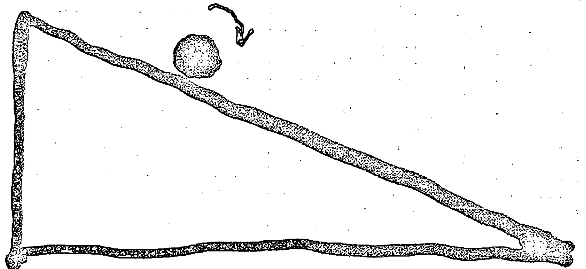

简单的隐喻就是：

- 人追钱，是爬坡，当然难；
- 钱追人，顺着坡滚下来，越滚越快，看起来很容易。

# 三

既然如此，钱要去哪里呢？

让我们的隐喻再大胆一点儿，不再顾及物理定律本身。

顺坡而下，钱追人，是为了发现价值洼地。

第一种：找到被低估的洼地。

这里指的是被错误定价的资产。

被低估的行业，被低估的品牌，被低估的公司，被低估的人。

以及被低估的技术趋势。

第二种：砸出洼地。

有些公司当时还是小池塘，但已经不小心淘出了点儿小金砂。

这时候，有的人满足于赶紧多淘点儿金砂，有的人则试图去找寻金脉，顺藤摸瓜找到大金矿。

当年京东找张磊要3500万美金，张磊说不行，除非你要3亿。

为什么？因为他洞察到，京东的机会是“亚马逊+UPS”，所以他投的钱，作为势能转换为动能，是要挖掘“仓储物流体系”这个金脉。

这个金脉，必须用大钱去砸出来。

所以，钱的势能，不仅包括其本身的，还包括钱的主人在认知上的势能。

第三种：拓宽洼地。

2017年，高瓴以531亿港币收购百丽集团。“昔日鞋王”饱受电商冲击，日渐“没落”。这看起来不是一个好行业，更不是一个好时机。

张磊的秘密是：“数字化转型”。

我称之为“人肉+数字”。

百丽本身是很好的企业，有职业化的经营团队，拥有强大、管理完善的零售网络：包括2万多家直营店，8万多名一线零售员工。

这些“人肉”构建的体系，是一个巨大的价值洼地。

高瓴推动百丽干的“大工程”是：

**实现全流程的数字化，将数据本身作为驱动公司发展的生产力。**

一个生动的小例子是：

某门店通过数据分析，发现一款新上线的鞋子试穿率排名第一，但转化率只有3%，实际调研后发现是因为鞋带过长。将这双鞋调回工厂改进后重新推出，转化率瞬间达到20%，这一单品就创造了千万级的销售额。

之所以说“人肉+数字”，是因为高瓴的“数字”，是百丽的“人肉”优势基础上的锦上添花。

百丽本来就有很多洼地，高瓴将其资金和认知上的势能，转化为百丽数字化转型的动能，将这些洼地连接了起来，进而继续拓深。

这其实也是（投资人的）钱追人的下一个秘密--

**第四种：将诸多细微洼地连接起来。**

当然，这正是互联网企业所做的事情。

例如拼多多，一头的洼地网络，是社交网络世界里人们的无聊和游戏化的“贪便宜”，另一头的诸多洼地，是企业过剩的产能。

这是网络化的价值洼地。

互联网为什么厉害？就是能把价值洼地连起来，哪怕是荒漠里的一些小小的价值洼地，也可以连成一片巨大的绿洲。

还有一种投资人的洼地：假洼地。

例如那些虚假的风口和高科技，其实是前面的投资人利用羊群效应，忽悠后面的投资人接盘。

这也是一种雪崩式“势能”，势不可挡，但容易把自己埋进去。

# 四

倒过来想，要想自己成为“钱追人容易”的目标，就要让自己成为“价值洼地”。

大约有如下几种：

- 1、有深度。挖掘了一个有级深渊见的洼地，需要资金的势能拓宽；
- 2、有广度。有一个覆盖面很大的洼地，需要资金来砸深；
- 3、有网络。有很多个“割裂”的价值洼地，或者是发现了割裂的价值洼地之间的网络，需要资金来实现数据和算法驱动的数字化连接。

# 五

再说一下消费端的“钱追人容易”。

我只想讲一点：**转移概率**。

假如一个街上，有两家奶茶店：A和B。

- A奶茶店的顾客，在喝了奶茶之后，有70%的人会继续选择该店，有30%会选择去B奶茶店；
- B奶茶店的顾客，在喝了奶茶之后，有90%的人会继续选择该店，有10%会选择去A奶茶店。

假如一开始的时候，A和B的顾客是一样多的，例如都是500个，请问经过一段时间后，两家的顾客分别是多少？

**答案是：A店有250个顾客，B店有750个顾客。**

我们变换一下条件。假如一开始的时候，这条街只有A一家奶茶店，1000个顾客全是A的。而B刚刚开张，1个顾客都没有。请问经过一段时间后，两家的顾客分别是多少？

**答案还是：A店有250个顾客，B店有750个顾客。**

如你所知，这是一个马尔可夫链的统计均衡。

# 六

金钱的魅力，就在于其充满了随机性。

赚钱这件事儿，看起来和文凭、智商等因素的关联概率不那么大（当然会有）。

人们对于赚钱这件事儿，就像进入了赌场的赌徒，觉得“人人都有一次中大奖的机会”。

事实果然如此吗？

既然要研究随机漫步的“发财”，就要研究随机漫步的数学原理：马尔可夫链。

马尔可夫链，因俄国数学家安德烈·马尔可夫得名，为状态空间中经过从一个状态到另一个状态的转换的随机过程。

该过程要求具备“无记忆”的性质：下一状态的概率分布只能由当前状态决定，在时间序列中它前面的事件均与之无关。

拿上面的奶茶店为例，你下一杯奶茶喝A或者B，取决于你现在所喝的奶茶的感受。

你可能会说，我喝了好久A了，喝出感情了，怎么能说和此前无关呢？

不管你对A的感情分有多高，也都被时光沉淀到你当下这杯奶茶的体验当中了。所以，你的下一次选择，依然只取决于你这一次喝奶茶的体验。

这种特定类型的“无记忆性”称作马尔可夫性质。

在马尔可夫链的每一步，系统根据概率分布，可以从一个状态变到另一个状态，也可以保持当前状态。

状态的改变叫做转移，与不同的状态改变相关的概率叫做转移概率。

我画一下奶茶店的转移概率：

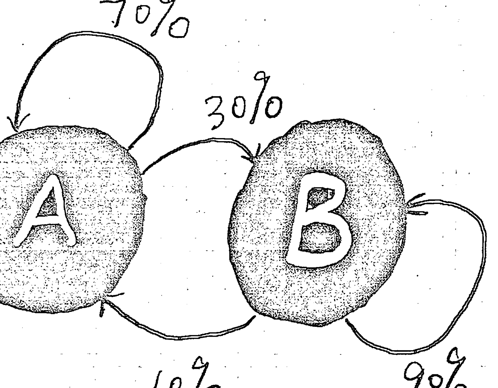

如上，箭头指向自己的，是指客户留存。指向别人，则是客户流失。

马尔可夫模型的一个特点是：当转移概率固定时，不管初始数是多少，总会达到一个“命中注定”的、唯一的统计均衡。

所以，即使奶茶店B刚开张，一个顾客也没有，要不了多久，也会抢走大部分奶茶店A的顾客。

不管A开始的时候多么有优势，钱最后还是追着B去了。

## 七

一种对于命运的数学隐喻是“大数定律”。我在《人生算法》这本书里也说过，一个骰子扔出某个数字的概率，取决于自身的结构，与手法和努力无关。

但是，大数定律里的抛硬币游戏，需要每一次抛硬币都是完全独立的。

而数学家帕维尔·涅克拉索夫则认为：现实世界中的事物是相互依存的（比如人的行为），所以现实中的事物并不恰好符合数学模式或分布。

马尔可夫不这么认为。他建立了一个模型，在这个模型中，结果的概率取决于以前发生的事件，但长期来看仍然遵循大数定律。

《天才与算法》里写道：

抛硬币的结果并不取决于以前抛硬币的结果，所以这不是马尔可夫理想的模型。

但是，如果增加一点依赖关系，使下一个事件取决于刚刚发生了什么，而不是整个系统如何影响了当前事件，又会怎么样呢？

每个事件的概率仅取决于先前事件的一系列事件被称为马尔可夫链。

预测天气就是一个例子：明天的天气肯定取决于今天的天气，但并不特别依赖于上周的天气。

由此，我们结合奶茶店的例子，可以发现马尔可夫链“宿命论”般的特点：

- 1、历史是无关紧要的，你再百年老店也没用；
- 2、初始条件是无关紧要的，你再高市场占有率也没用；
- 3、各种折腾也是没用的。你再营销，再数字化，做各种视频拉来流量，都无法改变宿命般的统计均衡，然后保持不变。

所以，消费市场的“钱找人”，最终取决于转移概率。

大多数“人追钱”，就像转移概率低的A奶茶店，看着客人一天天变少，拼命去做各种市场动作，不仅徒劳，甚至是在给B奶茶店培养客户。

**这就是“人追钱很难”。**

而B奶茶店呢？只管努力提高每个客户的“转移概率”，客户自然会越来越多。

**这就是“钱追人容易”。**

钱是没有良心的，而马尔可夫链的一个重要性质就是：无记忆。

**没良心+无记忆，决定了消费市场的“钱追人容易，人追钱很难”。**

# 九

本质上，墨菲定律也是人追钱难的原因之一。

不管你干啥事儿，这个宇宙就是处心积虑地和你对着干。

不光赚钱，盖茨连想把钱捐出去都千辛万苦。

在某些属性的市场，垄断者可能利用不兼容的限制，彻底斩断“转移概率”，你的奶茶再好喝，系统再好用，也没用。例如设置封闭系统，提高转移成本。

转移概率给我们的启发还有，最好的市场，是有存量的钱可供“转移”。

反之，去做一个很小的、需要培育的市场，实在是太难了。

就像特斯拉，其市场策略不是去开拓电动车市场，而是“转移”了传统7万美元以上豪华车（奔驰宝马们）的市场。

# 最后

相对而言，金钱比世界上的很多东西，都要单纯、善良、纯洁得多。

金钱也是命运的投影，变幻莫测，充满随机性。

钱永远给人一种触手可及的幻觉，但不管是穷人，还是富人，都发自心底地觉得：

赚钱真难。

本文的主要观点是：

- 从投资的角度看，钱生钱，靠的其实是用势能，来发现或放大价值洼地；
- 从赚钱的角度看，钱生钱，靠的是你在某个商品或服务上的“转移概率”优势。

没错，金钱世界，也是由算法驱动的。

为了让这个游戏充满魅力（主要是指不确定性，犹如美女的猜不透），规则设定了：对金钱算法的探索，是永无止境的。

人追钱很难，这令人心烦。

但是，假如这个世界人人赚钱都很容易，那么多让人绝望啊。

## 如何跨越出身和运气，实现富足与自由？

点击与图片，即享《人生算法》新书上市6.9折优惠

一本奇怪的书，写给聪明的你。

为什么大多数人穷其一生，不管多么聪明，多么勤奋，终究一无所获？
为什么有些人看起来不过如此，却能够超越出身和智商，最终取得成功？
秘密在于：那些收获了财富、健康、幸福的人生赢家，都拥有自己的人生算法。

围绕这一观点，《人生算法》这本书给出了一整套完整的“人生算法”操作系统，帮助你找到自己的“算法”。

我想从一个游戏开始，向你介绍人生算法的力量。

想象一下，你现在中了一个大奖，你面前有两个按钮：

- 按下第一个按钮，你可以马上拿走100万。
- 按下第二个按钮，你有50%的机会拿到1个亿，也有50%的可能什么都没有。

这两个按钮只能选一个，你会选哪个？

第一个按钮价值100万，第二个按钮用概率计算期望值，得出价值是5000万。即便如此，很多人还是愿意选100万，因为他们不愿意承受什么都拿不到的风险。

那么，有什么其他的办法吗？

事实上，你可以利用算法思维，打开思路：

往前走一步。如果你把价值5000万的第二个按钮，以2000万的价格卖给愿意承担风险的人，你就能赚2000万，而不是100万。

顺着这个思路往前走两步。你还可以卖掉这个选择权，以首付100万的方式卖给别人，同时签订合同：如果他中了1亿，还要分5000万给你；这样你就有可能赚5100万。

往前走三步。你可以把这个选择权做成公开发行的彩票，两块钱一张，印2亿张，能进账4亿。就算头奖分走1亿，不计彩票的印制和发行成本，你还能赚3亿。

再往前走四步。利用彩票这个商业模式，你可以筹划好几个抽奖游戏，将它打造成一门生意，你就有可能赚超过10亿。

你还能往前走五步。把这项生意做上市，估值20亿，准没公司市值还能涨到100亿。

......

这个游戏的不同答案，解释的正是很多人百思不得其解的问题：

“为什么人和人之间看起来差别不大，可命运的好坏却有天壤之别？”

正是算法的力量，决定了不一样的人生轨迹。

# 二

《人生算法》这本书的核心主题是：

任何一个人，只要找到属于自己的人生算法，就有机会突破命运的局限，实现富足自由的人生。

你也许会觉得有点儿奇怪，“人生”关乎“命运”，充满了不确定性；“算法”关乎“科学”，追求客观和精确，这两者搭配在一起，怎么让人觉得像是“科学算命”呢？

其实，富兰克林就说过“道德算数”，提出了人的心智是可以计算的。

金融大鳄索罗斯写下《金融炼金术》，则吸收了物理学家海森堡的“不确定性原理”和哲学家波普尔的“试错法”，形成了独树一帜的赚钱理论。

那么，什么是“算法”？又有哪些能被称为“人生算法”呢？

算法，就是解决某个问题的计算方法和可重复的实施步骤。

而“人生算法”，则是指一个人“大规模复制自我”，进而在世俗世界收获富足和自由。

普通人为什么不能成功？

# 三

到底差在哪里？是运气，还是智商和情商？

我认为最大的原因在于：

**一个人是否构建了可以大规模复制的自我系统。**

这个世界喜欢夸大成功者的天赋。不信你看，我们平时的成功学，和神话有什么区别？仿佛那些成功人士，个个都是大力神。

《人生算法》有点儿野心的地方是，试图探寻一种世俗成功的“通用底层算法”：

**一个人的自我规模化。**

简单的比方是，我们不去寻找中一个亿大奖的超级大招，而是找到一个大概率能赚100块钱的方法，然后大规模复制。

比尔·盖茨推荐过一本叫《没有资本的资本主义》的书。他提出，人们思考经济运行的方式，是时候需要改变了。

传统的制造业，生产第100辆轿车和生产第1000辆轿车，需要投入的原材料和劳动力是差不多的。生产更多的车，就需要雇佣更多的人、买更多的机器、建立更大的厂房。

但是对软件开发而言，微软耗费巨资开发出一款新程序之后，复制它的成本几乎为零，因为软件是一种无形资产。同样的还有数据、保险、数字内容（电子书、音乐、电影等）。

《没有资本的资本主义》给出的解释是：“无形资产”的崛起。

无形资产的重要特征之一，就是：

**几乎可以接近零成本无限复制。**

# 四

《人生算法》的背景，恰恰是中国当下经济快速发展，工业、信息、网络、算法、人工智能交织在一起；

绝大多数对于个人战略的思考，仍然停留在农业和工业时代。

而现实是，这个世界已经被算法统治。全世界最大的公司，大部分都是可以零成本复制的企业。

算法时代，比零成本更厉害的，是大规模复制之后的网络效应，和智能涌现。

这个时候，我们必须让自己活成算法，才不至于沦为数据。

进而，将自己并入这个网络化、智能化的世界，并遨游其中。

那么，我们如何找到大规模复制自我的人生算法呢？

《人生算法》的观点是：

- 1、人和人之间的差别没那么大，就像蚂蚁之间不会有太大差异。就像桥水基金老板说的，“我阅人无数，没见过有人天赋异禀。”
- 2、你自己就是一个蚁群。每时每刻，每个决策的你，每个行动的你，就是一只蚂蚁。无数个不同时刻的无数个你，叠加在一起，构建了一个智能系统。
- 3、蚂蚁之间的传输控制协议，是这个智能系统的算法。不同时刻的你之间的关系和连续性，是你的算法。
- 4、该算法采用了强化学习—机器学习的一种。它能像alpha zero一样自我学习，不断进化。

我们要“机器学习”，而非成为简单的学习机器。

我们当中的大多数人，为什么不能成为很厉害的人？

- 1、我们的认知系统，都是建立在钟表宇宙里的。我们从小接受的是有标准答案的、因果分明的教育。然而现实却充满不确定性，不可预测，难以计算。这既是我们的痛苦之源，也是那些厉害的人的秘密。
- 2、问题还不止于此，我们甚至无法真正控制“自我”。大脑中并不真正存在一个中心，“我”只是由无数个“涌现”串起来的电影角色。
- 3、进一步，我们花时间试图控制不可预测的那些东西，却对自己自暴自弃。

# 五

我们的知识都是牛顿时代的，我们的行为方式是牛顿时代的，我们的学习方式，也是牛顿时代的。

厉害的人是怎么做的？

他们既承认大多数物质系统具有复杂性质，又知道，钟表式科学的这种典型策略在封闭环境依然是奏效的。

所以，他们尝试在个人半径里，来打造“机器”。

这个“机器”，既有符合牛顿力学的机器的意思，又是“机器学习”。

让我们看看对强化学习的描述：它强调如何基于环境而行动，以取得最大化的预期利益。

其灵感来源于心理学中的行为主义理论，即有机体如何在环境给予的奖励或惩罚的刺激下，逐步形成对刺激的预期，产生能获得最大利益的习惯性行为。

你的动机、欲望、热爱、梦想、自我认知、价值观，负责实施奖惩的刺激。

哈佛大学心理学家罗伯特·凯根说：

> “从出生开始，我们便踏上持续学习（Learning）和成长（Developing）的旅程。这两股力量往往交织在一起，但又不尽相同。如果仅仅是知识储存量的增加（information），以已有的思维模式来运算资料，谈不上真正的学习，更谈不上成长。成长是指思维模式本身生改变（transformation）。”

是的，我们大脑神经是可以后天塑造的，每秒即逝的那个“我”，并没有被不可逆的时光之河裹挟而走，而是被写入“我”的底层算法。

人生算法，就是你面对世界不断重复的最基本的套路，找到它，重复它，加强它。

这本书对你有什么用？

- 《人生算法》将和你一起，探寻人生（命运）与算法（科学）的底层逻辑，并试图将二者联系起来；
- 《人生算法》从个人视角出发，研究了一个人如果想取得世俗意义上的成功，也就是实现财富和幸福，所应掌握的“通用底层能力”；
- 《人生算法》的诉求，是，帮助你（包括我自己）既能够在世俗世界过得更好点儿，又能在精神世界去追寻人生的真义，获得智识上的愉悦。

人生算法绝非讲道理，也不止是找到公式，而是要写成可以在复杂现实中运行的程序。

人生算法将由两大模块构成，分别是A计划之“九段心法”，和B计划之“18关挑战”。

A计划：你将修练“九段心法”，通过大脑升级，建立内在的确定性，形成你的人生算法。

这一模块为你搭建了一个可以循序渐进、逐步习得的思考和行动框架，就像美猴王拜师学艺，拿到金箍棒，有了火眼金睛。

我用围棋的段位，来描述实现人生算法的9个层级。

- 从初段到六段，是一个切割钻石的过程，目的就是为了不断找到真正属于你自己的最小的那个内核。
- 从七段到九段，就是如何通过复制，令最小的内核最大化，实现自我的涌现和规模效应。

九段，是一个求解的过程。而你，是这道题最大的已知条件。

B计划：你将逐一破解18个人生难题，检验你的人生算法，应对外在的不确定性。

B计划的底层，是概率思维。这个世界的法则正在由“因果论”转为“概率论”，从自然世界到人类社会，从科学公式到人生算法，莫不如是。

可以毫不留情地说：在现实生活中，对于绝大多数人而言，毕生所学的数学，都不如几个最简单的概率计算重要。而这些，却是传统教育所忽略的，恰恰也是我们的头脑直觉所不擅长的。

那么，概率和人生算法的关系是什么？

- 在A计划里，我们一直在追寻可以大规模复制的“大概率事件”；
- 在B计划里，我们则要全力避开那些致命的“极小概率事件”。

B计划的18关，与其说是过关打怪，不如说是：我们如何借助概率思维，避开那些可能给自己带来不可逆的大麻烦的事物。这18关，几乎涵盖了我们人生历程中最常见的那些场景和主题。

人生算法的B计划，就像孙悟空师徙西天取经，历经磨难，终成正果。人的一生，不也是一场修行吗？

概括而言：

- 1、认识这个世界是未知的、随机的；
- 2、认识你的认知是不确定、有边界的；
- 3、如何突破边界，实现突破？找到自己的算法，建立持续稳定的输出系统。因为我们一生中最大的变量，是时间；
- 4、复制“核心认知”，如同每个生命所做的那样；
- 5、成为一台强化学习的机器，加速计划，实现人生算法。

# 六

点击图片即可购书

《人生算法》首次提出了“用算法来设计人生”，主要基于我自己在创业、投资、生活中的经验写就。在我35岁退休的那一年，正是中国地产行业欣欣向荣的时候。我做了个别人看来很奇怪的決定：不再做个小开发商，举家搬往加拿大。

我大约花了10年时间，去探索“人生”（我们要生存的这个世俗世界）和“算法”（以数学和物理为基础的科学世界）之间的关联。这是一个交织着智力和情感的探险游戏。

这就是“人生×算法”，我称之为一个大脑脚手架，其底层以概率为基础。就像早期概率以赌场为试验场，在人生算法中，经常会出现财富这类世俗的“成功”案例，其好处是容易被测量，可以探索出相对精确的因果关联。

这不代表人生算法就是金钱算法，我并不因为金钱比绝大多数所谓道德更纯洁而过分推崇它。即使你是因为《人生算法》看起来像一个妖冶的“成功学”而与之约会，你早晚也会发现她大家闺秀的本质。

本书围绕个人命运展开，探讨在未知的世界里，一个人到底应该具备哪些底层能力。我不想令其成为一场观光游，或者是给你一堆看似有用的工具。我采用的是“黑客式写作法”，每节解决一个关键认知难题；从组织结构上看又是螺旋式上升的完整体系。

我绝不给你“我自己没有过切肤之痛”的认知。如你所知，我是背景和成就都很普通的人，因此并无保护声誉与维护正确的压力。简单来说，本书只给你提供我亲手猎杀的肉食，有时候，我自己其实曾经是被猎杀的猎物。

我在大三开始创业，1995年毕业时没参加分配南下广州，创业十年后将一个公司卖给纽交所某上市公司，也参与了新公司在纳斯达克的上市。我与犹太人合资开发了几百万平方米的房地产项目，在高潮时选择离开。这25年如白驹过隙，在时代的大浪中，我尝尽了苦辣酸甜，又刻意与其保持了距离，仿佛一切都是在为《人生算法》积累素材。

在本书里，一方面，我享受孤独思考的乐趣，写下“概率权、思考率、灰度认知黑白决策、三门模型”等原创概念；另一方面，我所探讨的一切问题，全都落在某个足够硬朗的前沿学科上：思维的基本颗粒、大脑决策机制、行为经济学、概率、人工智能、算法、投资、认知科学……我不希望阻挡读者顺着线索，向着更广阔的认知海洋探险的权利。你可以踩踏着“人生算法”，利用它，怀疑它，鄙弃它，只要它能唤起你的某些“对思考的思考”。

得益于公众号“孤独大脑”被越来越多人关注，“人生算法”这个我原创的概念，开始流传开来，出现在得到跨年演讲，以及商学院的课堂上。随后，《老喻的人生算法课》在得到App上线，受欢迎的程度也令人意外。

## 七

《人生算法》最大的挑战，在于如何构建一个可操作的系统。

**首先**，你我都饱受无数道理的轰炸，读者也不需要再多一本知识集邮的印刷品；

**其次**，我读过几本关于个人成长的书，看起来很厉害，仔细研究，发现全是一种句式的重复：如何将大象关进冰箱？第一步打开门，第二步塞进去，第三步关门。然后接着讲如何将长颈鹿关进冰箱。

当时我就想，天呐，我永远不要写这样一本书。

**本书落地于“人生算法”是一种“个人战略”这一基点上。**

我们现实中会遇到各种认知概念，知识无边无际，新解层出不穷，但是和你有什么关系呢？和你的那个看起来不怎么起眼的角色有什么关系呢？

人生算法的本意，绝非试图探寻通用的、空泛的终极真理，而是为个体搭建一个可用的框架。

“个人战略”的要点是：

- 在“不充分”的条件下，构建个人诺亚方舟；
- 穿越“不确定”的外部世界；
- 找到可复制的、连贯性的、不断进化的“努力方法”；
- 以连续性的"平凡的动作"，带来"不平凡的结果"。

A计划之"认知飞轮"，解决"不充分"的这一内部世界的难题，实现"正确地做事"；

B计划之"概率分层"，解决"不确定"的这一外部世界的难题，实现"做正确的事"。

关于正确地做事，认知飞轮提出了：

好奇感知，灰度认知，黑白决策，疯子行动；

关于做正确的事，概率分层提出了：

扩大认知半径，控制探索半径，减小行动半径。

人生算法的实施框架是：

- 以还原论的方法，建立了"认知飞轮"的基本单元；
- 通过从初段到九段的升级，打造一个自动化的、不断进化的"认知机器"；
- 以概率论的方法，建立了"外部世界"的基础框架，引入"涌现+复杂"的世界观与行事方式；
- 以加快的"强化学习"，让自己的"认知机器"在复杂环境中不断演进，从"思考自动化"，跃升为"学习自动化"，进而实现自我的大规模复制。

《人生算法》在可操作性上竭尽所能，A计划的九段修炼，和B计划的18关挑战，非常努力地结合了我们人生当中最烦心的那些事儿。

但是，你别指望看到"如何将大象塞进冰箱"那类貌似十分有用的"实操"。那只是一种"有用"的幻觉。

## 八

《人生算法》是一本奇怪的书。

想象一下：

- 你在夜店遇到一位妖冶美女，她和你谈起投资的“凸性曲线”背后的数学原理；
- 你看到一个花花公子躺在海边的沙滩椅上，翻看一本火箭制造教科书。

《人生算法》这个书名看上去像是妖冶美女或花花公子，但其实本书是关于世俗成功背后的原理和计算。

- 为什么聪明人会干傻事？
- 为什么美好的爱情总属于心机婊？
- 为什么付出没有回报？
- 为什么智慧不能变成金钱？
- 为什么善意带来恶报？

所有这些问题的背后，其实是在问：

本质的智慧，与世俗智慧，之间到底隔着什么？

人生算法看起来很像“科学算命”的把戏。索罗斯早就说过这里的难处，先别说人生，光是自然科学和社会科学之间，似乎都隔着万水千山。

《人生算法》这本书，其实是在用一种超然但又实用的态度，去探索人生的底层算法。

这是一个游戏指南：认真地玩儿好人生这场唯一的游戏。

我不仅想给你提供游戏的过关指南，还希望以此来帮你发现游戏背后的逻辑与乐趣。

与成功学不一样的地方是，《人生算法》更加硬核。本书所有的观点，都有科学的源头。

我希望你顺着鸡汤，溯源到硬科学的源头，或者是相对硬的科学的源头。当然，还有人文的深处。也许这些"不实用的部分"会给你更大的乐趣。

我像一个顽童，毫无顾忌，四处戏耍，不自量力地试图打通文理，打通科学与现实，打通理想与世俗，甚至去追寻宇宙间最深层的秘密。

现实的随机性，是一个特别好的试验场。例如金钱，是一个很好的量化工具。对于世俗世界的研究，思考人的大脑背后的东西，可能会加速我们去理解关于思考的思考，理解大脑背后的东西，例如"自由意志"。

科学世界和世俗世界之间究竟隔着什么？数学公式可以计算出人生财富吗？物理学原理能够找到创业的规律吗？麦克斯韦妇如何建立一种牢靠的婚姻关系？

通常，科学会用于世俗的隐喻，目的是为了科普；而一般的成功学，是以科学的幌子来算命。

《人生算法》则是毫不介意去探究，如何用科学和理性来获取名利。

更多崇尚科学和理性的人，介入到世俗世界中来，用荣誉和金钱来做随机性实验，能够让这个世界更加美好。

否则，就成了赌徒和厚黑者的天下。

另一方面，当我们将这个世界拆解成颗粒的时候，当我们试图用概率和算法来替换"目的论"和"因果论"时，当我们用量子世界的还原论去替换牛顿世界的还原论时，会陷入意义的困境。

所以，《人生算法》也有小心翼翼但满怀真诚的对人文的兴趣。

尽管我一直声称想要规避夹层解释，但，无论是从科学的局限性来说，还是从我的局限性来说，我所写的，不可避免地会有很多临时解释，我希望你视其为脚手架。对于更聪明的研究者来说，请你不妨把作者的思考当作一个小白鼠，假如你需要这样一个样本的话。

# 九

广义而言，大自然两个最主要的算法，一个是进化，一个是大脑。后者也难免会被归为前者之列。现实中我们拼命思考，却极少思考自己的思考。正如蒙田表示过的怀疑：我们只观察别人，很少观察自己。

随着人类寿命的增加，在数字化时代，每个人的自我进化被加速了。因为人类社会的虚拟化，以及算力的增强，人们能够实现远超自然速度的个人进化。一个人找到自己的人生算法，就是自我进化，复制自己，把自己的一生串起来。

人生创造算法，而不是算法创造人生。

这个世界不是依靠道理来运转的。人生算法试图用一种数学的、物理的方法，从头推理，定量思考，去探寻人世间运转的底层规律。在许多未知的领域，人生算法也依赖常识、美德和心法。在我看来，这些属于“粗线条的算法”。

> 如量子力学创始人普朗克所说：“科学不能解决大自然的最终奥秘。那是因为，归根到底，我们自己就是我们不断试图解决的奥秘的一部分。”

计算机和互联网带来的算法革命，正在统治这个世界。可以预见的是，人工智能将成为未来几十年最重要的科技力量之一。在滚滚而来的时代趋势下，你要么找到自己的“人生算法”，要么沦为他人的数据。

假如真有一个造物主，他为如此设计我们这个世界？有人说，上帝是个程序员，他通过调节参数，来调整每个人的命运。

假如如果真如此，造物主一定不会亲力亲为地控制每个人的参数，而只会设计一套算法，然后把旋钮交给每个人自己。这个世界上总有某个唯一的秘密，只有你的算法才可以解开。

所以，假如有人问我，《人生算法》到底讲的是什么？

我会说：它是一次自我意识的塑造之旅。

你的人生算法，是什么？

# 赚钱的生意有两种

愤怒可以点燃思考，但不能成为思考的燃料。

声称自己心软的人，正在预谋下一次作恶。

两个对立的“阴谋论”摆在一起，比较喧嚣的那个更可能是假的。

几乎不可能发生的好事，几乎都不会发生；几乎不可能发生的坏事，却几乎总在发生。

迷之自信的迷底是极度不自信。

给别人讲明白某个道理，和让别人觉得自己明白了某个道理，是两种不同的能力。

当你下决心做一件事情的时候，你已经把一部分决心消耗在“下决心”这件事上了。

岁月是一件事接着一件事发生的，记忆则是各个事情彼此跳跃着发生着。所以不必在现实中为了维护记忆并不需要的连贯性，而在遇到一件坏事时因为惯性便忽略相邻的那件好事。

圣人要让自己的逻辑即使按照强盗的标准也是赢的。

处于遗忘状态的“彼此不想忘”无法被验证，但却是最真实的存在。

我们要交织地生活，却要剥离才能感知。

当你衷心期待自己的前任过得更幸福时，你才是真正忘记Ta了。

自我的连续性，是一种奇特的幻觉，亦令人厌倦。于是我们总去追寻陌生，但恰是这些陌生让自我的连续性显得更加惊险而难忘，并因此更加前后一致。

我工作上的偶像是“拖延症最后时刻的我”。

收音机里的音乐，好在不可快进，不能点赞，不知其名。以及不能重放。

蠢而不自知，大多是对蠢人的惩罚；聪明而不自知，大多是对聪明人的保护。

自私者的自责倾向于自恋。

我们在意的不是他人的评判，而是我们自己对他人评判的评判。

你是在竭力向别人证明自己的过程中变成别人的。

牛市或熊市对韭菜而言只是一把锯的左右拉动。

那些感叹自己被命运击垮的人的悲剧是，他们甚至未曾被命运看过一眼。

生意分为两种：廉价地讨好很多人，昂贵地讨好很少人。

有钱任性是指他可买的对象较多，有思想任性是指他不用讨好的对象较多。

乐观并非是一种情绪，而是一种理性选择。

对创业者而言，杀手本能比杀手级应用更重要。

中年危机，是一场被推迟的成人礼。

智慧可以支持耐心，但耐心却很少支持智慧。

当一个人打算做命运的旁观者时，就会对命运动太多感情。

随机性有自己的惯性，但用的不是牛顿那个公式。

精神病主题文艺作品的流行，说明人们为了证明自己的独特性而愿意妄想自己是精神病患者。

当你无法在无人旁观的状况下独自享用某样东西时，说明你并未真正拥有那样东西。

永恒本身并不需要“永恒”这个词来形容，但人们目前还没想到更接近的词汇。

当人们无法保持个体的独特性时，就会实现平庸的统一性。

一心找寻成功导师的人们最后得到的实际是赤脚心理医生。

每个人都是自己的驯兽师，但驯的是不同的野兽。所以，“自我主宰”不应单以野兽的驯服程度来评判，因为有的人分了一头狮子，有的人分了一只绵羊。

杠杆不会让一个坏策略变成好策略。

你较长时间与之无法和解的那段岁月，也许是Being你欠较多的岁月。

“永恒”为了证明自己，而让绝大多数人的生活还没开始便要结束。

人最显著的才能之一是在任何难受的状况下都能迅速找到自己最舒服的姿势。

号称自己为了让更多人理解真知而对真知改头换面，是对真知最大的亵渎。

夏日尚未开始，但夏日的即将结束已经开始。

很少有美食经得起外卖，很少有名人经得起见面。

时间的自我组织不依赖于完美的材料。

四十岁前缺的是“大胆假设、小心求证”；四十岁之后缺的是“小心假设、大胆求证”。

人类对群居的偏好大于对真理的偏好。

真是奇怪，人们对植物的赞美是因为其先天的样子，对人的赞美却是因为其社会化整形后的样子。

以每分每秒来计算自己价值的商务人士，一辈子都只能创造出计算器能按得出的价值。

正式对话追求达成一致，非正式对话则应该寻求差异。

拉到一千年长度的智慧对一百年长度的现实可能是残忍的，而拉到宇宙尺度的世界观不该因此失去对蚂蚁的关怀。

最危险的是那些蠢得不稳定的人。

虚无主义是无所作为者的自我标榜。

夹生的聪明人有额外的魅力，夹生的蠢货令人束手无策。

教育的残缺，需要几代人来承受代价。所以完整的教育，也需要几代人来耕耘。

绝望是人生的空白实验，帮助你去除干扰要素，以发现最关键的变量。

幼稚的聪明人经常会高估别人的聪明。

煞费苦心的投降或者极不情愿的投降依然是投降。

逻辑强大的一只狮子，抵不过逻辑混乱的一群野牛。

逻辑依赖于强弱，不依赖于正误。

你年轻时提前消费过的那些虚拟的伤感，早晚会来到现实中来。

有些人随地大小便只是为了找到原始的存在感。

假如一个人像疯子似的不厌其烦反复讲一件事，他要么快疯了，要么快成功了。

别和不愿意为观点下注的人辩论。

怀疑是信仰的前奏。

青春的长度介于煎熬和转瞬即逝之间。

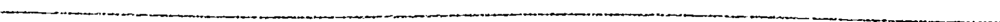

## 《人生算法》读者见面会

Hi，你好！

未来一个月，我将在中国旅行，我们会相遇吗？

我将参加两个系列活动，期待你来。

### 活动一、介绍我正在做的一个教育科技项目

途经14个城市，以下为行程表：

| 日期 | 城市 | 日期 | 城市 |
| --- | --- | --- | --- |
| 8.22 | 北京 | 9.12 | 长春 |
| 8.23 | 天津 | 9.13 | 济南 |
| 8.29 | 成都 | 9.18 | 南京 |
| 8.30 | 重庆 | 9.19 | 上海 |
| 9.5 | 西安 | 9.20 | 杭州 |
| 9.6 | 郑州 | 9.26 | 武汉 |
| 9.11 | 沈阳 | 9.27 | 深圳 |

### 活动二、我的新书《人生算法》读者见面会

预计将途经11个城市，以下为行程表：

| 日期 | 城市 | 日期 | 城市 |
| --- | --- | --- | --- |
| 8.22 | 北京 | 9.18 | 南京 |
| 8.23 | 天津 | 9.19 | 上海 |
| 8.28 | 成都 | 9.20 | 杭州 |
| 8.29 | 重庆 | 9.26 | 武汉 |
| 9.5 | 西安 | 9.27 | 深圳 |
| 9.6 | 郑州 | | |

本周末我将在北京与天津，欢迎你的参与。

- 北京活动（8月22日）详情请点击蓝字
- 天津活动（8月23日）详情请查看二条文章内容

## 系列活动一

## 春藤·家长学院介绍会

1995年在大学毕业留言册上，关于工作的理想，我写道：

有钱去做与钱无关的事情。

前半截不确认自己是否做到了，但我现在开始做后半截的事情了，春藤·家长学院就是这件事。

当然，并非完全与钱无关，春藤·家长学院有独特的商业模式，以实现可持续发展。

春藤的愿景是让每个中国孩子都能分享全球范围内最好的教育资源。

为了实现这一点，未来春藤的会员制服务，帮助用户用最低的成本，获得系统的教育规划服务。

这件事情开始不久，像一株生机勃勃的新苗，显露出旺盛的生命力，并且迫切需要热爱教育和拥有教育资源的朋友们的参与。

在这里，我会和你分享我对春藤的期待，以及未来20年后春藤的样子。

扫描下方二维码，提前报名。

## 时间原理：《信条》科学观影指南

收录于话题

- #时间 1 个内容
- #信条 1 个内容
- #概率 4 个内容
- #决定论 1 个内容
- #自由意志 2 个内容

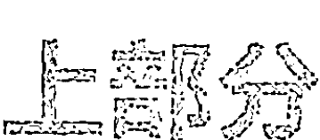

你想打破魔方世界纪录吗？

截至2018年12月，三阶魔方还原官方世界纪录，是中国的杜宇生的单次3.47秒。

即使快得惊人，你仍然有机会超过他，而且手法诡异得让专家们摸不着套路。

其实这是一个真实的故事。国外有位老兄用作弊的方式实现了这一点：他把一个已经还原好的魔方打乱，并将此过程录下来，然后将视频倒过来播放。

其中的一个有趣细节是，作弊者特别安排了他的一个室友，从身后倒着走过去。所以当你看到这段"打破"世界纪录的视频时，一切完美得天衣无缝。

### 二

几乎所有成功学中的"真实故事"，都是类似原理：先射好，再画靶子，然后通过生动的讲述二次创造。

**推理小说先设计好作案手法，再掩埋线索，然后作者倒过来一点一点揭开，以天才神探的视角狂虐读者。**

**爆款文章先挖掘泪点和槽点，再编造故事、堆砌道理。**

**魔术师先琢磨透机关，再反向设计渲染手段，转移视线，制造戏剧化效果。**

**聪明如亚马逊，要求负责人提交项目建议书时，先把设想中的新闻稿写好。**

更有诺兰，在电影里用时间将人们带入因果与宿命的幻觉深处。

**这类神奇效果的深层机制，是利用人类心底对因果的迷恋和错觉。**

为什么在时间上轻轻地作个小弊，便有此奇效？

### 三

**时间和因果性的因缘，似乎是人类乃至这个世界的出厂设置。**

让我们像侦探一样，躲在暗处，将嫌疑的日常行为拍摄下来，然后贴在墙上剖析。

若一件事情发生，每个瞬间对应一张照片，现实就是这一连串照片的快放。

当我们把"时间"捉拿归案关起来，这个世界就是一堆静止的照片。

将很多微小量合并为一个平滑变量，由此诞生了微积分。

将很多个定格照片串成一卷胶片，人们发明了电影。

时间决定了这些照片的先后次序。

进而，时间赋予了这些照片对应事件的因果关系。

你这一刻正在做的事情，似乎决定了紧接着将要发生的事情，即所谓"前因决定后果"。

这就是时间所构建的因果魔力。

但是，现实中，有多少因果是真实的，有多少是虚构的？

又有多少是先虚构又变成真实的（例如亚马逊的新闻稿机制）？

如果时间不分过去、现在和未来，这些因果机制还存在吗？

时间为什么如射出的箭，如此坚定地朝着一个方向前行？

是谁赋予了时间以方向？

如果时间有方向，为什么本文开篇的魔方作弊事件，完全看不出破绽？

既然如此，谁能证明这个世界上的时间没有被作弊？

### 四

时间到底是什么？

我们对时间习以为常，却极少有人能够说清楚。

时间有如下不同角度的定义：

### 1、文学时间

例如《追忆似水年华》中的时间，“重要的不是如何发生，而是如何被追忆”。

### 2、文化时间

各种宗教里常见“转世”的时间循环模式，而基督教带来“线性”的不可逆的时间。

### 3、哲学时间

哲学家们说，时间充满了矛盾，所以不会是真实存在的。

### 4、管理学时间

时间是管理学永恒的话题。例如时间管理优先矩阵，《高效能人士的7个习惯》的“要事第一”，《别让猴子跳回背上》里的“时间主动权”，还有始自英特尔的OKR法，等等。

### 5、科学时间

这是一个精彩而迷惘的发现历程：牛顿的绝对时间，爱因斯坦的相对时间，量子物理中不可捉摸的时间，热力学的与熵紧密关联的时间，生命出现的创造性时间，混沌与时间之箭。

文科生柏拉图理科生爱因斯坦，两位同学都认为真理不受时间影响，为了触及世界的真实与真理，时间的假象必须被破除。

牛顿用决定性的、时间可逆的规律来描述世界。在他的公式里，时间没有方向之分。科学家们认为时间是绝对的，宇宙中各处时间的快慢都是一致的。

爱因斯坦用不可思议的洞察，指出时间的快慢由两个因素决定：速度和重力。

多年以后的今天，我们的手机还有赖于他的公式来实现精准导航。

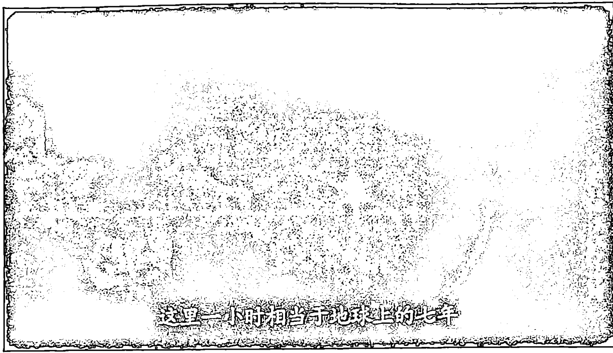

“爱因斯坦认为存在是四维的，是在合并三维空间和一维时间的四维时空中的存在，而不是一个三维空间存在外加它在时间上的演化。”

即使如此，爱因斯坦并未质疑时间的单向性。

他也不相信无法用因果解释的“不可测”的量子理论。

难道时间不过是一个终极假象？

看起来，所有真实的东西，比如真理、正义、科学规律，都存在于时间之外。

然而这个世界似乎变得更加复杂、混乱了。

1989年的诺贝尔会议，讨论了一个充满挑战性的题目：

## 科学的终结。

会议组织者写道：“越来越有这样的感觉……科学已不再能被当做一种统一的、普通的客观努力。”

他们接着写道：“如果科学只摘‘超历史的’普适的定律，而不理会社会性的、有时间性的、局部的事物，那我们就无法谈及科学本身以外某些的真情实况，而科学仅仅是反映而已。”

诺奖得主普里高津在《时间之前》的前言里写道：

> 这句话把“超历史的”规律和有时间性的知识对立起来。科学的确是在重新发现时间，这在某种意义上标志着对科学的传统看法的终结。但这难道是说科学本身完结了吗？

但时间又在哪儿呢？

时间究竟是一个东西，还是一个概念而已？

### 五

让我们回到一个直观的，能够“体验”到的现实世界。

这里交织着传统物理意义上的时间，以及个人体验的心理时间。

在我们的世俗空间里，时间是线性的，匀速的，有“自动驾驶”功能的。

这仿佛是时间的几个默认机制。

### 机制1：时间是线性的

时间沿着一个方向流动，被分为“过去，未来，现在”。

霍金给出了三条证据：

首先，存在个人时间感——我们感知年龄的增长，感知事件的发生、持续特定时间的过程。

其次，存在着宇宙“时间”——从大爆炸开始，经过空间的扩张，直到其最终在大收缩中毁灭。

最后，存在着热力学第二定律的时间——物理学中的一条基本定律，说的是宇宙中所有的进化过程都会慢慢地失去能量，并且逐渐变弱，从有序状态发展为一种熵或者无序状态。

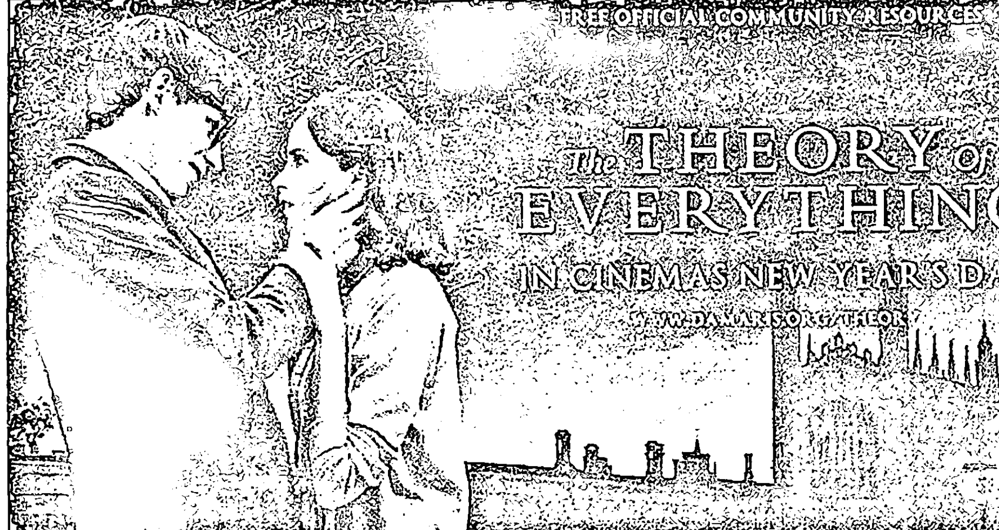

我们为过去懊恼，为现在焦虑，为将来恐慌。

但是谁将时间分为“过去、现在和未来”呢？

“过去”是资产吗？我们被“沉没成本”折磨着。

绝大多数过去并不值得去维护，包括你的话，你的“正确”，你的事迹，你的名声。

只有真理和爱值得，而回忆则无需维护。

对于现在，我们从来看不透，抓不住。

卡尼曼认为人们“目光所及，便是一切”，既短视又武断。

对于未来的焦虑，来自情感上的恐惧，以及理智上的计算力不足。

过去留不住，现在看不透，未来够不着。

### 六

### 机制2：时间是匀速的

再有权势的人，也要坐在自己的屁股上。

再富有的人，时间的速度也和你的一样。哪怕他有私人飞机。

但是，就个人体验而言，时间为什么越来越快？

常见的解释是“基数法”。一个一岁的小孩子长到两岁，相当于人生阅历翻一番。

人的岁数越大，基数越大，相对变化越小，所以时间显得过得越快，在60岁达到顶峰。

为什么有中年危机？因为正好在中间。

有个笑话：当你的市场占有率超过50%，你就没法学将其翻一番了。

但有些人一直青春洋溢。这里的分水岭就是，你未来的岁月和过去的岁月哪个多？有些人20岁已死，有些人80岁还能娶20岁的。

你很容易在人群里看出来，哪些人属于明天，哪些人陶醉在过去，哪些人深陷在今天不能自拔。

也有研究表明，人们对一周、一个月、一年、十年这些时间单位的长短感知都是一样的。所以上面的“基数法”也许并不成立。

而个人体验的时间感，的确是有“相对论”的。例如：

- 你度假的时候，新奇的第一天感觉很慢，后面重复的时间则非常快
- 一个人经历越多，会显得活得越长。

## 七

### 机制3：时间是自动驾驶的

即使你什么都不做，时间也会自动驾驶，把你带向未来。

又或者只是把你留在原地。

太阳照常升起，地球照样旋转，你恨的人还在被你恨，爱你的人也许不再爱你。

你的器官，你的潜意识，人体的绝大多数生理机能，都能随着时间，精确地自动驾驶着。

据说有一次马云和朋友去拜访李嘉诚，问：为什么李嘉诚可以多元化经营，什么都投，而且什么都能做成功，但别的人也想什么都做却不成功？

李嘉诚回答说，做生意要记住，手头上永远要有一样产品是天塌下来你也挣钱的。

简而言之，你要有一桩和时间一起自动驾驶的生意。

就像巴菲特说的：我靠屁股赚的钱比我用脑袋赚的钱多。

多少中国个人和企业家到头来主要资产就靠那些物业，不管是主动还是被动购置的。

## 八

约翰·富兰克林是19世纪初英国的航海家以及极地探险队的队长。小说《发现缓慢》说他是个很慢的人，大脑和四肢都非常迟缓。

他不能参加各类球赛，因为那些运动的速度太快了。连他的父亲也因为他的缓慢骂他是个蠢货。

成为水手后，在一次航行中，约翰·富兰克林注意到了灯塔周围的光束。其他水手仅仅把这些光束看作移动的照明范围，而他把这些光束看作不断扩大的彗尾。

他认为，自己一定有比周围人更广阔的视野，能够抓住许多细小的瞬间。用摄影术语来说，约翰·富兰克林能够“延迟曝光”。

> “由于他的感知觉反应太慢，因此许多序列性发生的事件对他而言都是同时发生的。”

最终约翰变成了一个著名的极地探险者，也曾当过州长。船长约翰靠着他缓慢但缜密周到的思维方式，多次保住了全体船员的生命。

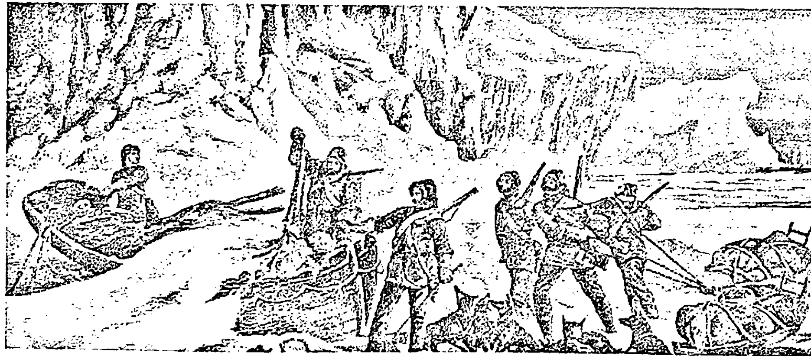

我留意过身边这种类型的人，他们不聪明，反应缓慢，但能全面而有耐心地思考问题。

我称之为思考速率低，但思考率高。

这方面有点儿像石佛李昌镐，呆如木鸡，天生能够克服时间的惯性，产生慢镜头效应，如蟒蛇般绞杀对手。

又有点儿像古时候的那个神射手纪昌的故事：一直盯着一个东西看，然后越看越大，百发百中。

如果说本文开篇所说的骗子和魔术师们，是靠颠倒时间的因果来作弊，那么这个世界上的牛人和成功人士们，同样是发现了时间的机制"漏洞"，实现了某种套利。

- 巴菲特将时间拉长，算是牛顿力学的拥护者；
- 大奖章基金的西蒙斯将时间切碎，他的量化交易也许该归为量子物理派；
- 美团和今日头条这类企业的聪明创始人，都深得"延迟满足"的真传。

商业成功的传奇，并非靠时间施加魔法，只是时间令魔法显现。

本质上还是要靠洞察力。如AI下棋，它就是计算得很远，算得很冷静。

但这洞察力，几乎都是以时间为关键思考要素。

他们都是时间黑客。

### 九

围棋的推理，就像是提前拍下未来的快照：下一步，下一步，第三步......然后将这些快照贴在一面墙上。

爱因斯坦眼中的“奇怪”世界也是如此。在四维时空中，过去、现在和未来，和空间一样，都在那儿。

牛津数学教授罗杰·彭罗斯认为，时间流逝的观念，或者现在隔断了过去和未来的观念，从未得到任何物理实验的证实。

现代物理学家保罗·戴维斯说：“一旦考虑到现实的客观世界，时间的流逝就会像鬼魅一样消失在夜色之中。”

巴博尔在《时间的尽头》中说：

> 我们的生活是由经历“快照”——孤立和分离开来的时刻——组成的，和电影的帧一样。这是因为这些“快照”是连续地出现在我们眼前，因此我们会感觉到时间的流逝。每一“帧”是宇宙中所有粒子的一种特定的排列——或者“结构”。这些“现在”在本质上与时间并没有任何联系——实际上，它们是静止的。但是因为它们在按照一定的顺序发生，所以我们就觉得时间在“流动”。

我在《Master夜访孤独大脑》里，写过这个有趣的话题：

孤独大脑：围棋的一个有趣属性：由于棋子并不具备可移动性（除非被吃），围棋的过去和现在是被平铺在一个坐标化的棋盘上的。而对未来的计算和决策，基于已知，同样将被平铺于此。

你现在的所作所为，不仅改变了未来，还改变了回忆过去的方式。

Master：棋盘上的过去，极大地决定了现在，影响了未来。这几乎是最形象的关于大数据的隐喻。

孤独大脑：当我看到《你一生的故事》里描述，在外星人七肢桶的语言里，过去现在与未来并存--心底多么咯噎一下。

也许在另外一个世界里，时光并不流淌。过去、现在、未来，如同棋盘上的棋子般被平铺在一个（或者没有数量的）网格上。

Master：作者特德·蒋的观点是--你要么预知未来，放弃自由意志；要么保持对未来的无知，保留自由意志。

孤独大脑：十多年前，我在自己的小书《逆水年华》里写过，两个神仙是没法下围棋的，一盘彼此都知道对方下一手走在哪里的对弈，还有什么意思呢？

这便是我从围棋里学到的第二重要的东西：

探索未知的世界。

Master：命运让所有人以为自己做出了自由的选择。

人类需要拥有一种线性时间感来安排我们的经历，令生存成为可能，并使我们产生拥有自由意志的感觉。

法国哲学家亨利·柏格森则认为，我们的意识发展了一种“屏蔽”过去和未来的能力，将我们的注意力完全集中在现在。其功能是：

“关闭”我们投放在其他信息上的注意力，以帮助我们将精力集中在实际的生存业务之上。

“过去、现在、未来”一起发生的奇怪念头，除了拿来写科幻小说，还有什么用处呢？

我在《手割》一文中写过：

> 英特尔1985年想退出内存条市场，进军芯片业务，但这个决定十分艰难。

> 葛洛夫问公司合伙创始人摩尔：如果我们二人引进、新CEO上任，他会怎么办？摩尔不加思索地回答：他将退出内存业务。

在这个著名的案例里，葛洛夫使用了围棋上被称为“手割”的一种思考方式。

如前所述，和象棋不一样，围棋棋盘上越下子越多，“过去”不被拿走（除非被提子），于是，我们就可以任意编排时间发生的顺序。

在我眼中，手割思维，其开创性价值是：

**一种打破顺序的思想实验。**

人世间最不可能抵御的，便是时光的不可逆。围棋的顺序是基于手数，也是基于时间的。现实中你不能悔棋，但思想实验中可以。

你可以自由自在地在大脑中重新为那些快照排序。一旦你的大脑拥有了这种能力，你便成为魔术师。

打破顺序，也就打破了“惯性”--此所谓惯性思维。

也就打破了条件反射。

**借助于手割法，葛洛夫挣脱了时间的因果束缚。**

强者和弱者，富人和穷人，智者与愚者，之间的区别，本质上是思维上的差别。

这其中，时间又是最重要的思维变量之一。

人的一生，就是由无数个时间切片构成的。

亚里士多德说：整体大于各部分加起来的总和。

你的人生整体，以及各个时间切片加起来的总和，这二者之间的对比关系，可以用来衡量你的人生价值。

有些人的每个时间切片单独来看很普通，但串起来就很厉害；
有些人的每个切片都精彩纷呈，整体却一事无成；
有些人则如猴子掰包谷般，永远抓着手头那个切片疲于奔命。

我们当中的大多数人，都是陷在时间里的可怜小动物。

有的人永远在为失去的懊恼，有的人则打折甩卖了自己的未来。

### 中部分

即使到了今日，古希腊时代的芝诺悖论也令绝大多数人疑惑。

- 与阿基里斯的赛跑，龟先出发；
- 当阿基里斯起跑时，乌龟已经抵达路途中的某处（姑且称为A点）；
- 由于阿基里斯跑得比乌龟要快许多，他很快就抵达 A点；
- 然而，当他跑抵该处时，乌龟已经移动到更远的地方，我们把它叫做 B点；
- 当阿基里斯跑抵 B点，这时乌龟已经爬到更远的 C点；
- 这个过程不断重复。尽管阿基里斯不断追赶乌龟，每个阶段两者之间的差距也不断缩小，前者却永远不可能超越后者。

这个问题其实相当“绕”人。尽管我们可以用下面的方法“简单”攻破：

- 1、牛顿物理法：两人之间相对速度大于零，所以阿基里斯很快会追上乌龟；
- 2、几何级数法：将一串无穷长的数列累加之后，总和却不见得无穷大。举个级数的例子：1 + 1/ 2 + 1/ 4 + 1/ 8 + 1/ 16 + 1/ 32......总和愈来愈接近 2。
- 3、微积分法：在芝诺佯谬中，其实采用了两种不同的的时间度量。一个是普通钟，一个是芝诺钟。《力学概论》一书给出了解答。
- 4、时间最小单位法：量子物理学告诉我们，时间、空间、能量并不是连续的，而是有最小单位的。物理学涉及的最小时间是普朗克时间，为 1E - 43 秒 （ 即 10^-43s）。没有比这更短的时间存在。普朗克时间=普朗克长度/光速。所以乌龟并不拥有可以无限细分的时间。

即使如此，当你在脑海里再次演绎芝诺的“悖论”时，你的直觉还是会觉得：他说的很有道理啊，阿基里斯到底如何超过乌龟呢？

芝诺为何造出这个佯谬？与时间有关。

柏拉图在著作《狄玛尤斯》里讲“实存”（being）和“将然”（becoming）的区别：

- “实存”的世界是真正的世界，“此世界永恒不变，由智慧借助论证而得知”；
- “将然”的世界（时间的领域），则是“意见与非理智感觉之客体，既生又灭，从未完全真实过”。

柏拉图之前的帕尔米尼笛斯相信实际是既不可分，也没有时间的。芝诺是帕尔米尼笛斯的学生，他创造了著名的悖谬，捉弄了我们几千年，就是为了整个推翻人们对时间的“传统”观念。

## 二

牛顿在《自然哲学之数学原理》（以下简称《原理》）中说：“绝对的、真实的、数学的时间，由于它自身的本性……与任何外界事物无关地、均匀地流逝。”

牛顿的方程式里的时间是一个未经定义的原始量。这时间是绝对的，任何事件，都在空间里有个一定的位置，都发生在时间里某个特定的时刻。

为了精确地描述一个物体的运动，牛顿发明了微积分：已知连续运动的路径，求给定时刻的速度（微分法）；已知运动的速度求给定时间内经过的路程（积分法）。

牛顿力学的时间是没有方向的。一个球可以是撞向墙壁，也可以是从墙壁弹出，对牛顿方程的每一个解，颠倒时间方向，会得到另外一个解。

牛顿没有回答时间为什么向前。

但是，这个问题用得着怀疑吗？难道一个人可以逆向生长吗？破镜可以重圆吗？掉在地面上的花瓶能够弹回桌面变回原样吗？

关于时间，牛顿方程式的另一特点是：

它们是“决定性的”。

正如我们在中学物理里学到的，不管在观测的初始时刻位置和速度如何，系统的行为对过去和将来都是确定的。

得益于此，我们发明了汽车，火车，发射了火箭，登上了月球。

“决定论”是牛顿方程数学结构的一个直接推论。

法国数学家拉普拉斯于1814年假设：“妖”知道宇宙中每个原子确切的位置和动量，能够使用牛顿定律来展现宇宙事件的整个过程，过去以及未来。

“我们可以把宇宙现在的状态视为其过去的果以及未来的因。如果一个智者能知道某一刻所有自然运动的力和所有自然构成的物件的位置，假如他也能够对这些数据进行分析，那宇宙里最大的物体到最小的粒子的运动都会包含在一条简单公式中。对于这智者来说没有事物会是含糊的，而未来只会像过去般出现在他面前。”

决定论与“因果律”有关。因果律说，每一个事件都有它的原因，而事件本身为其结果。不同于简单的前因后果，科学家们透过表象，去除时间的干扰，通过因果律，探索这个世界运行的真正原理。

## 三

爱因斯坦对时间的大胆想象力，超越了有史以来的任何一个人

26岁的他把牛顿的绝对时间观念摧毁了，对现实进行了革命性的重新评价，赋予时间和空间全新的意义。这就是“相对论”。

如此年轻的传奇，放在今天似乎难以想象。事实上，量子理论在上个世纪20年代中期，有个“男孩物理学”的昵称，太多关键人物都是年轻人：海森堡23岁，泡利22岁，狄拉克22岁。

为什么是爱因斯坦引发了物理世界的三大革命？

当时最伟大的数学家之一——庞加莱才是“相对性（relativity）”这一名词的发明者。

写出洛伦兹转换公式的，是洛伦兹本人，而非爱因斯坦。

洛伦兹写道：我失败的主要原因是我死守一个观念：只有变量t才能作为真 正的时间，而我的当地时间t'仅能作为辅助的数学量。

杨振宁对此有精彩评论：

洛伦兹有数学，但没有物理学；庞加莱有哲学，但也没有物理学。

爱因斯坦坚持同时性是相对的，才能从而打开了通向微观世界的新物理之门

可是，需要一个怎样的大脑，才敢质疑人类关于时间的原始观念？

爱因斯坦的时间弯曲理论更是令人不可思议。经过孤独而艰难的思考，他意 识到时间是被质量很重的物体弯曲了，正是弯曲导致了引力。

他最后完成了广义相对论：

时空弯曲的程度，是由宇宙中物质的分布所决定的：一个区域内的物质密度 越大，时空的曲率也就越大。

### 爱因斯坦场方程

$G_{\mu \nu} + \Lambda g_{\mu \nu} = \frac{8 \pi G}{c^4} T_{\mu \nu}$

- 爱因斯坦张量
- 应力-能量张量
- 宇宙学常数

物质告诉时空如何弯曲
时空告诉物质如何运动

以定性的方式描述，这个定律可以表述为：

任何事物都倾向于去往时间流逝最慢的地方——引力会将其拉向那个地方。

Youtube上有段视频，是一位国外教授用四周绷浆的床单来模拟广义相对论。一个重的球，假设是太阳，将床单压凹下去。然后扔一把珠子，模拟行星，顺着陷下去的“阱”的内壁旋转。

所以，苹果落地并不是因为超距离的神秘力量，而是地球使空间和时间发生了畸变，让苹果掉了进去。

黑洞周围时间变慢，在电影《星际穿越》中有生动展现。库珀乘坐飞船飞到黑洞卡冈都亚附近，因“时间变慢效应”，他只变老了几个小时，而地球上已经过去了80年。

尽管爱因斯坦粉碎了人类关于时间的几乎所有常识，并且彻底更新了牛顿所建立的世界体系，但有两点，他与牛顿保持了一致：

- 1、他也没有考虑“时间箭头”，爱因斯坦的时间也没有方向；
- 2、爱因斯坦依然坚守着类似牛顿的因果律。

1955年

3月15日，“最懂爱因斯坦的人”贝索去世了。爱因斯坦用他“物理定律没有时闻性”这个坚强的信仰，试着安抚好友贝索的家人。

现在，他又比我先行一步，离开了这个奇怪的世界。但这并不意味着什么。对于我们笃信物理学的人来说，过去、现在和未来之间的区别只不过是一种幻觉而已，尽管这种幻觉有时还很顽固。

他又加了一句：“贝索向这个奇怪的世界告别，只比我稍早一点。”

一个月后，爱因斯坦去世了。

## 四

爱因斯坦的光电效应理论，极大推动了量子理论。他亦因此得诺奖。然而，他在后半生中忧虑不安，总在强调光量子说只是一种暂时性的假定。

量子理论是科学家们孤注一掷的冒险。

普朗克是为了导出他的定律，而不得不假定，电磁辐射所携带的能量是一份一份的，他称之为量予。

薛定谔得到了一个方程，里面含有一个全新的数学量——“波函数”。波函数考虑了微观粒子的波粒双重性质，并描述它们所有可能的表现。

但薛定谔自己也搞不清楚波函数在物理上的含义。那种我们可以在现实中感知到的常识和图像，就像我们对牛顿公式的直观“体验”，在量子理论中找不到。

玻恩的假设是：把波函数解释为某种“几率振幅”，用来计算在空间某一区域发现一个粒子的几率。他认为，波函数的平方就给出了在指定地点和时间，发现粒子的几率。

而海森伯的“不确定性原理”，断言在亚原子领域，不可能同时精确地知道电子的位置和动量。这和经典物理学格格不入。

海森堡说，量子理论的基础数学不需要相应于我们熟悉的任何事情。量子理论的工作应直接预测可观测的事物，如氢原子发出的光的颜色。不应当指望提供一种令人满意的原子内部运作的内心图片。

在量子论中，因果关系被重新评价了。

尽管为量子理论作出过巨大贡献，但爱因斯坦不赞成放弃因果律。

爱因斯坦的观点是：

- 量子力学并不是真正基本的力学，而是对未知事物做出统计说明的一种方法，是一种数学手段。
- 尽管暂时我们不知道为什么，但是在更深的层次上，一定存在着某个原理，严格遵循着因果律。

他在为纪念牛顿逝世二百周年而写的一篇文章中说：

“牛顿理论的精髓可能会给我们提供力量，去恢复物理现实与牛顿教程中最深奥的特点——严格的因果律——之间的和谐。”

玻尔强调了广义相对论和量子力学之间的巨大差别：

- 1. 广义相对论利用纯的时空协调和绝对的因果关系来描述世界；
- 量子图像中，观察者和系统相互作用，并且是系统的一个部分。

- 2、时空协调代表位置。因果关系依赖于对事情如何发展，特别是其动量如何变化的准确了解。经典理论假设人们能同时知道这两者；
- 量子力学告诉我们，时空协调的精度是以动量的不确定性、进而是以因果关系的不确定性为代价的。

量子力学认为，时间的流逝是由下述非常简单的事情决定的：

我们自己对于变化的观测。

现在看起来，量子派们似乎赢了。科学家发现两个在宇宙中遥远分离的粒子，可以以某种方式组成一个单一的物理整体。

上帝可能真的在掷骰子。

但是，爱因斯坦所追求的“一个完全用科学描述的决定性实在”，真的只是人类的幻觉吗？

## 五

将随机引入到堪称“严密科学”的物理学中，玻尔兹曼或许是第一个人。牛顿以来延续了几百年的机械因果论被动摇，科学概念产生了根本性变革。

玻尔兹曼发展了麦克斯韦的分子运动类学说，把物理体系的熵和概率联系起来，阐明了热力学第二定律的统计性质，并引出能量均分理论（麦克斯韦-玻尔兹曼定律）。他首先指出：

一切自发过程，总是从概率小的状态向概率大的状态变化，从有序向无序变化。

1877年，玻尔兹曼提出用‘熵’来量度一个系统中分子的无序程度，并给出熵S与无序度Ω（即某一个客观状态对应微观态数目，或者说是宏观态出现的概率）之间的关系。这就是著名的玻尔兹曼公式。

热力学第二定律的熵增表述是：

孤立系统的熵永不减小。

在一个孤立系统中自然发生的任何过程，都一定伴随着系统的熵增加。当熵达到它的极大值时，孤立系统的时间演化就停止了，该系统就处于它最无序的状态。这时系统已耗尽了它所有发生变化的能力——它已经达到了热力学平衡。

“熵”度量一个系统可变的能力，它跟时间有密切关系。熵的增大是时间方向的指标。

为什么热量会从热的物体跑到冷的物体上，而不是相反呢？

玻尔兹曼发现其中的原因惊人地简单：

**这完全是随机的。**

卡洛·罗韦利在《七堂极简物理课》里写道：

玻尔兹曼的解释非常精妙，用到了概率的概念。热量从热的物体跑到冷的物体上并非遵循什么绝对的定律，只是这种情况发生的概率比较大而已。

原因在于：从统计学的角度看，一个快速运动的热物体的原子更有可能撞上一个冷物体的原子，传递给它一部分能量；而相反过程发生的概率则很小。

在碰撞的过程中能量是守恒的，但当发生大量偶然碰撞时，能量倾向于平均分布。就这样，相互接触的物体温度会趋向于相同。

热的物体和冷的物体接触后温度不降反升的情况并非完全不可能，只是概率小得可怜罢了。

将“概率”引入物理学的核心，直接用它来解释热力学的基础，这一做法起初被认为是荒谬至极，所以没人把玻尔兹曼当回事。

在牛顿定义的世界里，力学没有时间性。而热力学里的熵，则为时间的前行加上了刻度，如此一来，我们终于可以说宇宙是真正在演化的。

接下来，人类会逐渐发现，不但是复杂的体系，就是物理学中最简单的情况，未来都是开放式的。

**热力学赋予时间以方向，却又令这世界看起来更为混沌。**

## 六

普里高津讲述了阿西莫夫的科幻小说《最后的问题》：

“我们有一天能克服热力学第二定律吗？”

世界文明不断地在问一台巨型计算机。

计算机回答道：“资料不足。”

亿万年过去了，星辰、星系都死了，而直接和时空联结的计算机仍在继续搜集资料。最后没有任何资料可以搜集了，不再‘存在’任何事物了；

可是计算机还是在那儿计算，在那儿找相关关系。最后它得到答案了。

那时候要知道这个答案的人也都不存在了，可是计算机知道了如何克服热力学第二定律。

“于是光明出现……”

对阿西莫夫来说，生命之出现、宇宙的诞生都是“反熵”的、非自然的事件。

玻尔兹曼说在充满分子的气体中，高度有序的结构将随着时间随机地消失。

如此一来，生命如何产生呢？

达尔文说，大自然何以能够优先选择一些罕见的事件（变种），因而逐渐演化出越来越复杂 的生命形式。在他的理论中，变化的推动力是一些随机发生的事件。

这看起来，似乎与玻耳兹曼的理论相矛盾。

科学家的解释是：

我们要把生命的无比复杂性看做是自组织过程的结果。

生命出现以前，在原始浑汤里如果存在有某种恰当的反馈机制，实现自组织的一般条件便成熟了。

实验证明，核酸具有自复制这最重要的性质：在核酸原料的纯粹化学混合体里，会有更多的核酸形成。

核酸掌握着生命的设计。在DNA和RNA里面的是基因，它们逐字给出具体的指令，为我们地球上的生命建造蛋白。

### DNA和RNA的演化变异可以用作一种分子钟。

道金斯在他《自私的基因》中描写了DNA自我复制的能力：

我们都是“残存机器”，唯一的目的就是保护基因，就是要让同一条DNA链，也就是让这些巨分子所载的基因——决定我们面貌性格的蓝本，更多地自我复制。

在“自组织”和“混沌”中，时间再次显现了自己的方向。

至此，两种似乎矛盾的力量交织在一起，“决定性”并非决定一切，而“随机性”也不是漫无方向。

海菲尔德总结道：

未来不是被现在或过去唯一地固定下来。严格的决定性论必须推翻；取而代之的是如下一个世界观：它和我们对世界的经验是一致的，它里面的未来是开放的。

此新观点真正地综合两个相反的、不可或缺的概念——机遇（概率）和必然（决定性）。

## 七

让我们从追踪“科学时间”的壮阔视野，回到个人视角。

在所有与时间有关的科学概念中，平行宇宙也许是最不靠谱的一个。

为了“解决”量子力学中的测量问题，埃弗雷特1957年提出了另一个大胆的办法。

在杨氏狭缝实验中，光子到底是从两条狭缝中哪一条中经过的？哥本哈根解释说，这就是按照几率法则对不可逆坍缩的选择。

然而，埃弗雷特说，电子不是选择狭缝，而是选择宇宙。

在选择其中一条狭缝而不是另一条时，宇宙就一分为二。这条被选择的狭缝决定于我们处在哪个宇宙。此后这两个宇宙就完全分开了，并且越多越多，每做一次测量，宇宙就分裂一次。

### 寻找薛定谔的猫
In Search of Schrödinger’s Cat

“平行世界”是指可供选择的现实并排着安置在“时空”中

注：这是一个错误的图像。

埃弗雷特认为，每一个宇宙都像我们的宇宙那样真实。你做的最荒唐的梦，也许就发生在另一个世界。

一个被定义在某个宇宙中的观测者，他所做的每次测量，都使这整个宇宙萌发出无数多个新宇宙（即"多重世界"），每一个新宇宙代表一个不同的、可能的观测结果（例如一只活着的或死了的猫）。

没有波函数的坍缩发生，只有新分支出的宇宙的无穷尽的增殖和萌发：不需要有一个宇宙之外的观测者。

无穷无尽尽的宇宙中，真的存在与我们平行的时空和文明吗？在某个瞬间游离的我，会被分支到另外一个平行宇宙吗？我的孩子们在另外、又另外的那个世界，过得都好吗？

我不是一个神秘主义者，对平行宇宙的兴趣不大。但我很喜欢平行宇宙的隐喻价值。

如果把上面平行宇宙的“树状分裂图”横过来，其实我们就得到了一个决策树或者概率树模型。

例如我们扔一个骰子，假如六个面完全是一样的，结果只能有一个面朝上（排除单点立住的可能性）。那么，既然每个面朝上的可能性都是一样的，当某个面最终朝上，其它面朝上的可能性去哪里了？

我们可以这样设想：当骰子被随机扔出来时，就其未来状态而言，出现了6个平行宇宙。最终我们只观察到了其中的一个。

我们把概率树的分枝，理解为某件事情的各种可能性，用文艺的方法描述，就是一切可能存在的n个平行宇宙。

概率到底是客观存在的事物，还是主观想象的事物？

即：概率究竟存在于现实，还是存在于人的大脑？

用平行宇宙的思路来形成“概率”的直观感受，相当有趣且有效。

如此一来，我们就牢牢地抓住了不同的未来时间轨迹上，“不确定”这个顽童的被量化的身影。

时间流逝这个鲜活的经验从何而来？

卡洛·罗韦利写道：

我认为答案就在热量和时间的紧密联系中：只有当热量发生转移时，才有过去和未来的区别。热量与概率相关，而概率又决定了：我们和周围世界的互动无法追究到微小的细节。

这样一来，“时间的流逝”便在物理学中出现了，但并不是在精确地描述物体的真实状况时，而是更多地出现在统计学与热力学中。这可能就是揭开时间之谜的钥匙。“此刻”并不比“此处”更加客观，但是世界内部微观的相互作用促使某系统（比如我们自己）内部出现了时间性的现象，这个系统只通过无数变量相互作用。

在接下来的解释里，卡洛·罗韦利假设有某种超感觉生物：

我们的记忆和意识都建立在这些概率性的现象之上。假如存在一种超感觉的生物，那么对它来说，就不存在时间的“流逝”，宇宙会是没有过去、现在、未来之分的一整块。但是，由于我们意识的局限性，我们只能看到一幅模糊的世界图景，并栖居于时间之中。请容许我引用本书编辑的一句话：“看不清楚的比看得清的更广阔。”正是这种对世界的模糊观察孕育了我们时光流逝的观念。

这就把一切说清楚了吗？并没有，还有好多问题有待解决。在引力、量子力学和热力学三者的交叉地带，许多问题纠缠在一起，而时间就位于这团乱麻的中心。我们还在黑暗中摸索。我们也许已经开始了解量子引力了，但它也只结合了三块拼图中的两块。我们还没有找到一个理论，把我们对世界的这 三块基本理解拼到一起。

## 八

尽管看起来，爱因斯坦在与量子派的“战斗”中落败，但我赞成他追求真理的“不含糊”，以及对“自然之禅”的信仰。

## “还原论”与“演化论”

“还原论”和“演化论”，并非是硬币的两面。假如一个“演化论”者不具备“还原论”的基本科学素养，那么他就不算一个科学家。我不知道哪个取得了伟大成就的科学家，靠的是玄学，无论是在量子论，还是如今的复杂科学等领域。

不管量子论看起来多么违背直觉，它仍是严格建立在数学基础上，被实验室观察和检验，并应用于现实世界的可靠工程中。

高高在上、胡弄玄虚的掩盖模糊，也许能得出不少“高明”且“和谐”的结论，但毫无意义。

我们不能因为“因果律”陷入困境，就投奔科学阵营的对立面。

我们只是应该认识到：必须保持开放的头脑，不为所有的古怪事情所苦恼。

这也是量子理论给每个无法搞懂它的普通人的世俗启发。

爱因斯坦坚信因果性的概念是物理学的基石。

他曾提出，“概率本身也许需要被当作原子系统根本的、基础性的物理性质”，这样可以“以一种令人惊奇的、简单的、一般的方式”得到普朗克定律的推导。

我不认为曾经以人类有史以来最伟大的直觉颠覆了时间概念的爱因斯坦失去了想象力，我只是觉得，他不甘心放弃用人肉大脑去感知在实验室里已经被验证了的现象和公式。

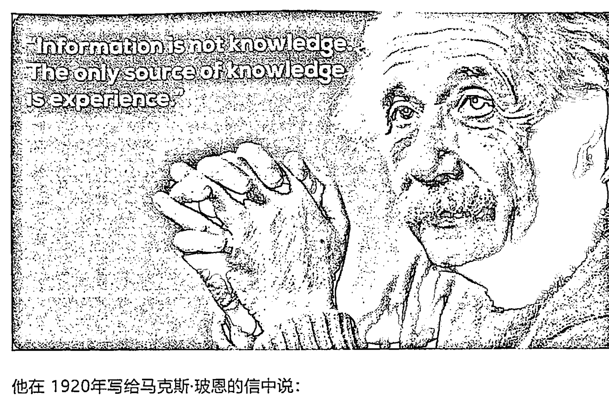

他在 1920 年写给马克斯·玻恩的信中说：

> 因果性的事情也让我很痛苦。光的量子性吸收和发射究竟能不能从完全因果性条件的意义上想象出来？抑或会留下一个统计学的残留物？我必须承认，这里我缺少确信的勇气。但是我只是非常不情愿地放弃完全因果性。

爱因斯坦绝非在捍卫表象的因果律和决定论。在给贝索的信中，他写道：

> “我感觉，谜的永恒创造者（就是说上帝）给我们开的真正玩笑绝对还没有被我们理解。”

## 九

对于因果律的哲学层面上的思考，需要谈及牛顿在微积分上的对手，莱布尼兹。

莱布尼兹认为：宇宙中的每个事物完全依靠其自身的内部程序运行，与其他每个事物完美协调——它们之间不存在因果关系。

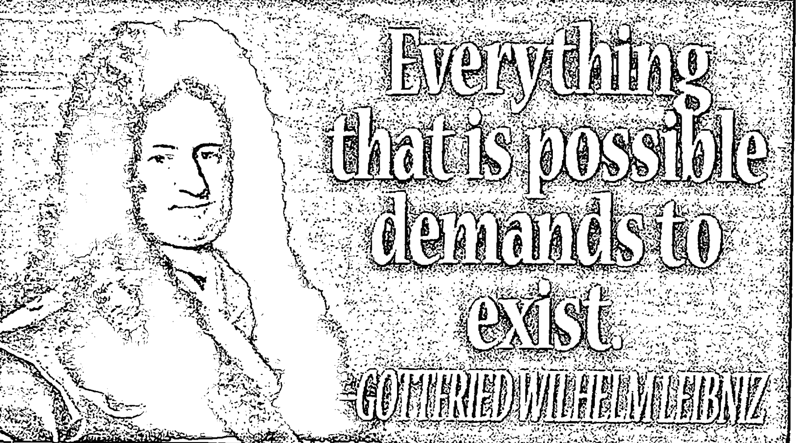

莱布尼兹的“预定和谐”理论说：

假如有两个完全一样的紧密大钟，并被设置为相同的时间，随后我们会看到每个时刻二者的报时都是一样的。但是它们彼此仍然是“因果分离”的，二者之间的联系是因为它们的内在机制得到了外部协调。

每个单独的物体都运行着自身的内部程序，然而一切都如此完美相关或和谐，以至于它们之间似乎存在着因果作用。

在莱布尼兹眼中，钟表匠就是上帝。

为了构造宇宙学理论，莱布尼兹制定了一套被称作“充足理由律”的指导原则。这条规律认为，在构建宇宙的过程中，每一个显而易见的选择背后必须存在一个合理的理由；每一个形如“为什么宇宙会是 X 而不是 Y”的问题，必然存在答案。

在莱布尼兹的眼中，世间万物并不是单纯地罗列在空间之中，而是浸没于某种相对关系网络之中，正是这些相对关系网络定义了何为空间，而非空间决定了相对关系。

休谟的观点似乎更奇怪：一切都无法解释，你甚至不能对将要发生的任何事情做出合理的预测，即使是对接下来的几秒钟将要发生的事情。

休谟很早就发现了，我们对于世上因果关系的认知是取决于我们的情绪、习俗和习惯，而不是取决于理性，也不是取决于抽象、永恒的自然定律。

休谟认为，大多数人都相信只要一件事物伴随着另一件事物而来，两件事物之间必然存在着一种关联，使得后者伴随前者出现。

它在那之后而来，故必然是从此而来。

这一思想放到今天，依然成立。仅仅是因为时间先后，我们就可以被各种把戏迷惑，形成“前因后果”的错觉。

休谟分析，人类有一种信赖因果关系的本能，这种本能则是来自我们神经系统中所养成的习惯，长期下来我们便无法移除此种习惯。

在《人类理解论》一书中，休谟主张所有人类的思考活动都可以分为两种：追求“观念的连结”与“实际的真相”。

- **观念的连结：** 牵涉到的是抽象的逻辑概念与数学，并且以直觉和逻辑演绎为主；
- **实际的真相：** 以研究现实世界的情况为主。而为了避免被任何我们所不知道的实际真相或在我们过去经验中不曾察觉的事实的影响，我们必须使用归纳思考。

科学发展到今天，莱布尼兹和休谟过时了吗？

并没有。科学越进步，越纵容人们用科学成果干若干反科学的事情。尤其是在那些似是而非、却权力巨大的领域。例如华尔街。休谟们的思想，变身为《黑天鹅》等当代人的著作，无情地嘲讽着现代人类。

## 时间重生

《时间重生》一书有如下假设：

- 时间不但是真实的，而且是最为真实的。
- 构成现实的元素只能是属于每一个瞬间的真实。
- 宇宙中的所有真实都是关于某一个瞬间的真实。这些瞬间的串联，构成了时间。
- 过去曾经是真实的，但已经不再真实。这并不影响我们对于过去的分析与诠释，因为我们可以于当下寻获过去留下的痕迹。
- 未来尚不存在，因而一切皆有可能。我们可以理性地作出一些推断，却不可能完全预测未来。未来可以超越一切基于经验所作出的预言，创造出全新的现象。
- 没有什么可以超脱于时间之外，自然规律也不例外。自然规律并非亘古不变，与万事万物一样，它们仅仅关乎现在，随时间的流逝而改变。

斯莫林为我们比较了两种思维方式：

一种是跳出时间式思维；一种是紧随时间式思维。

跳出时间式思维是指，真理超脱于时间甚至是超脱于宇宙。苏格拉底说，所有的发现不过是对前世的回忆。

紧随时间式思维是一种关系主义。关系主义认为，对于事物最真实的描述在于指明事物与其所在系统中的其他事物之间的联系。

狄拉克推测：“宇宙之初的自然规律恐怕和现今的自然规律大相径庭。因此，我们需要承认，自然规律不会在所有的时空中保持唯一，它们会随时代的更迭而逐步演化”。

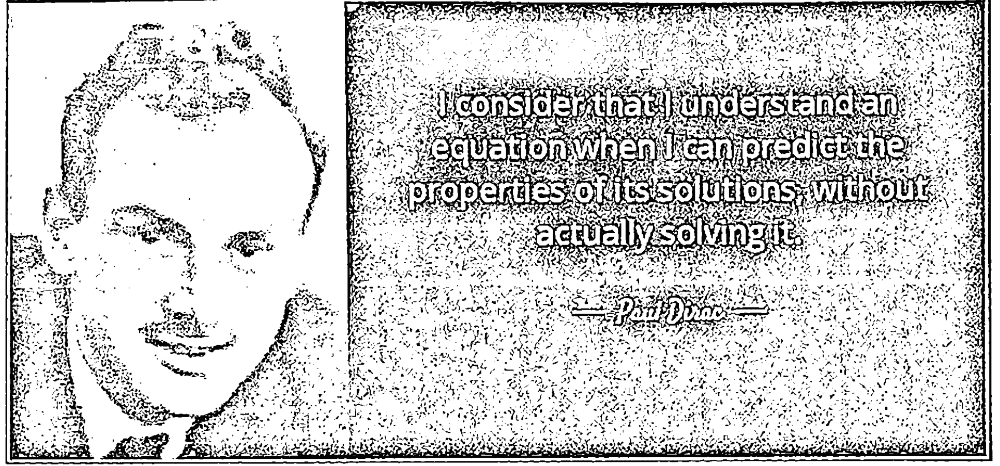

惠勒写道：“世间没有规律——除此规律以外。”

看起来，进化论无处不在。

这两种思维就个人而言，有着浓浓的鸡汤味儿。

- 个人跳出时间式思维：有理想，有愿景，有原则，有价值观，有信仰，保持人生的某种不变的确定性；
- 个人紧随时间式思维：勇敢面对人生的不确定性，坦然接受随机性和跌宕起伏，将其视为生命必要的代价。

在机遇与危险夹缝中生活，在确定与随机中探索，才是人类的体验。

从本文上部分“单向、匀速、自动驾驶”的日常时间，到中部分惊险传奇的科学时间，时间已经不简单是我们的人生背景板，不止是这个宇宙的巨大指针，而是蕴含着一切秘密。

### 下部分

如果你能预知未来，又不可以改变一切，你将如何度过这一生？

你会嫁给一个男人，即使你早知道后来你们会分手；你们会有一个女儿，你知道她在成长过程中发生的一切，包括她在三岁时被碰伤、青春期与你吵架、大学毕业，以及、在 25 岁时死于攀岩。无论你多么爱她，现实如同你提前看过的剧本般，丝毫不差地发生着。

这是《你一生的故事》的故事，我格外喜欢姜峯楠的这篇小说，文字好到令改编电影《降临》没法看。

该书的主题是以自由意志（决定论）、语言和萨丕尔-沃尔夫假说，讲述了一位语言学家与外星人七肢桶遭遇后，学会了 Ta 们的语言，从而获得了预知未来的能力。

与外星人的语言沟通极为艰难，突破口来自七肢桶重做了人类给他们演示的一个物理实验。这是你我初中时都学过的知识：

光的折射。

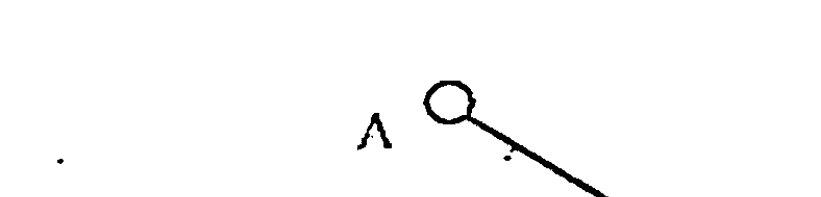
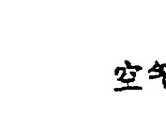
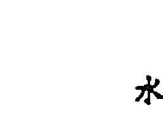

你应该还记得这个实验的要点：

- 1、一束光穿过空气进入水中，因为水的折射率与空气不同，所以光走的方向产生了改变；
- 2、当光从 A 走到 B，光选择的路径必然是最快的一条。

那么，为什么不如下图的虚线，直接走个直线呢？

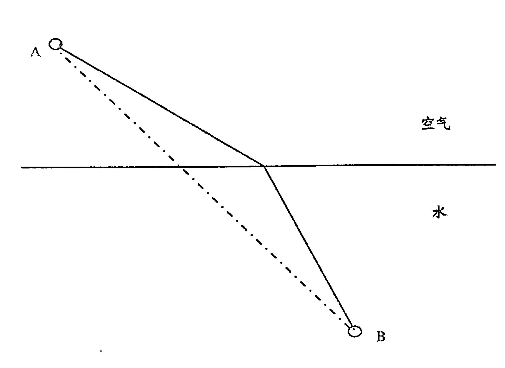

如上图里面的虚线，它比光实际走的路程短，但在水中的部分比实际线要长一些，由于光在水里的速度比在空气中慢，所以尽管路程短，时间反而更长。

但是，又为什么不如下图右边虚线那样，折射得更厉害一些呢？

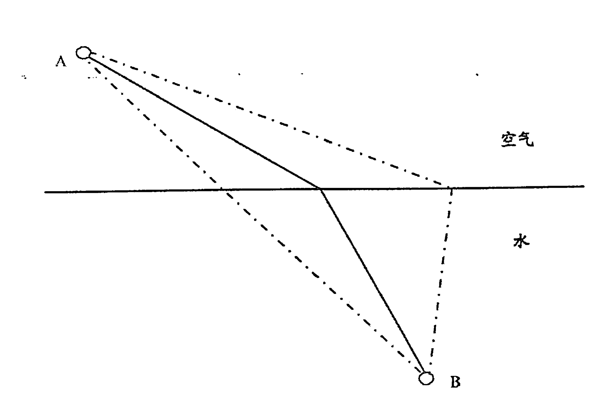

与实际线相比，这第二条理论线在水中的部分更少，但总长度比实际线长得多。光如果走这条路线，花的时间也同样比实际线长。

综上所述，该道理可简述为：

一束光实际选择的路线永远是最快的一条——这就是“费马的最少时间律”。

问题来了：光从 A 到达 B 之前，是如何设计自己的路线的？

在小说中，有一段堪称高潮的对话。女主角，我，一位语言学家，与物理学家蓝雷，也就是“我”后来的丈夫，讨论了“费马的最少时间律”。

我：“我还想问问你费马定律的事。我觉得这里头有些古怪，可又说不清怪在什么地方。这个定律听上去根本不像物理定律嘛。”

蓝雷：“我敢打赌，我知道你觉得什么地方古怪。你习惯于从因果关系的角度考虑光的折射：接触水面是因，产生折射改变方向是果。你之所以觉得费马定律古怪，原因在于它是从目的，以及达成目的的手段这个角度来描述光。”

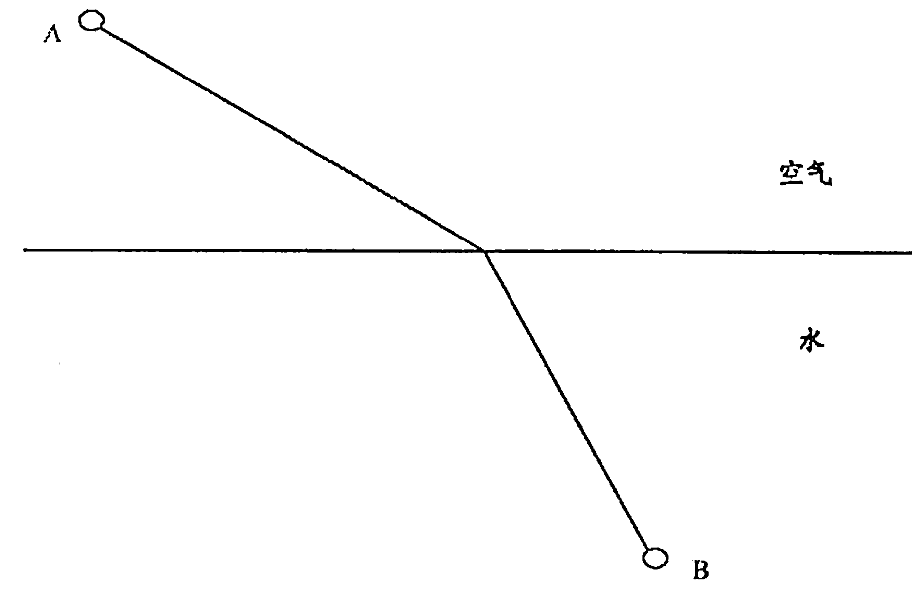

我：“接着说。”

盖雷：“这是一个老问题了，关系到物理学中蕴含的哲理。自从十七世纪费马提出这条定律以来，人们便一直在讨论。普朗克还就这个问题写过不少著作：物理学的一般公理都是因果关系，为什么费马定律这样的变分原理却是以目的为导向？比如这里的光，好像有自己的目的。这已经接近于目的论了。”

我：“我们假定，一道光束的目的就是选取一条耗时最少的路径。这道光束怎么才能选出这条路？”

盖雷：“这个……好吧，我们设想万物皆有灵魂，采用拟人化的说法。这束光必须检查所有可能采取的路径，计算出每条路径将花费的时间，从而选出耗时最少的一条。”

我：“要做到你说的这一点，那道光束必须知道它的目的地是哪里。如果目的地是甲点，最快路径就与到乙点全然不同。”

盖雷：“一点没错。如果没有一个明确的目的性，“最快路径”这种说法就失去了意义。另外，给定一条路径，要计算出这条路径所费的时间，还必须知道这条路上有什么，比如有没有水之类。”

我：“就是说，这道光束事先必须什么都知道，早在它出发之前就知道。对不对？”

盖雷：“我们这么说吧，这道光不可能贸然踏上旅途，走出一段之后再作调整。需要重作调整的路绝不会是耗时最少的路径。这道光必须在出发之初便完成一切所需计算。”

我在心里自言自语，这道光束，在它选定路径出发之前，必须事先知道自己最终将在何处止步。这一点让我想起了什么，我很清楚。我抬头望着盖雷：

> “这就是我一直觉得古怪的地方。我很不安。”

科学家费曼用“路径积分”的方法对此作出了解释。

在他对光线的折射计算理论中，所有的路线都有可能；经典路线只是比其他路线更有可能。

也就是说，自然允许我们计算的只是概率。

我们在中学课本里计算的那条光线，仅仅是一种简化。

量子随机性，撼动了亚里士多德以来的物理学的一块基石——因果律。如《你一生的故事》里的故事张力之源：我们一直认为，任何一种现象或者事物都必然有其原因。

假如将这种随机性应用于宏观的人类事务，即是所谓“对历史求和”：

历史事件的所有其他选择（如拿破仑在滑铁卢大获全胜，或肯尼迪避开了暗杀者的子弹）都是有可能发生的，而每一个历史事件都会有一个振幅与之相关联，我们将把这些振幅都加起来（即把所有那些箭头都加起来）。

现实处于“整齐连续的、原因和结果成比例的可积系统”和“任何事物依赖于其他事物、任何事物都不可无视的不可积系统之间”。

Ivar Ekeland 写道：

> “世界不分成因果链，不是线性地安排事件，使得前者是后者的原因，后者是前者的结果。每一事件就像树干，把树状的根伸向过去，把树冠托向未来。
>
> 任何事件永远不会只有一个原因：越往前寻找，越能找到任一特殊事件发生的越多的前因。也永远不会只有一个结果：向未来看得越远，单一事件涨开的网越宽。”

如果你能预知未来，又不可以改变一切，你将如何度过这一生？

在《你一生的故事》里，“我”选择了面对这一切。尽管“我”早已知道这一切，仍然在每打开一手或好或烂的牌时，都如少女约会般满是期待。

小说里的“我”潜意识里仍然想改变、阻止某些“已经知道的事情”，结果，“我”对孩子的过分保护，反而强化了她的叛逆，从而强化了冒险的孩子死于冒险的命运。

你会选择拥有这种能力吗？你知道了自己的孩子将在最美好的年华逝去，你还会和你知道注定要离开你的男人“make love, make you”吗？

在平铺的时光中，在那个惟一时间指向的物理定律——热力学第二定律的作用下，我们命中注定都会死，我们与小说里的主角又有什么两样呢？

我们无论多么爱自己的父母，他们都会离去。我们的孩子小时候无论怎样天真可爱，她都会经历青春期，和一个你心底明明白知道只想和她上床的那个混小子约会。

在外星人七肢桶的语言系统里，过去、现在、未来同时呈现出来，“时间之箭”仿佛不存在了。

## 二

时间连接起自然界两个最大的奥秘：心灵和宇宙。

> 赫胥黎说：人类的所有问题中的问题，最根本和最有意思的问题，是确定人在自然中的位置和他与宇宙的关系。

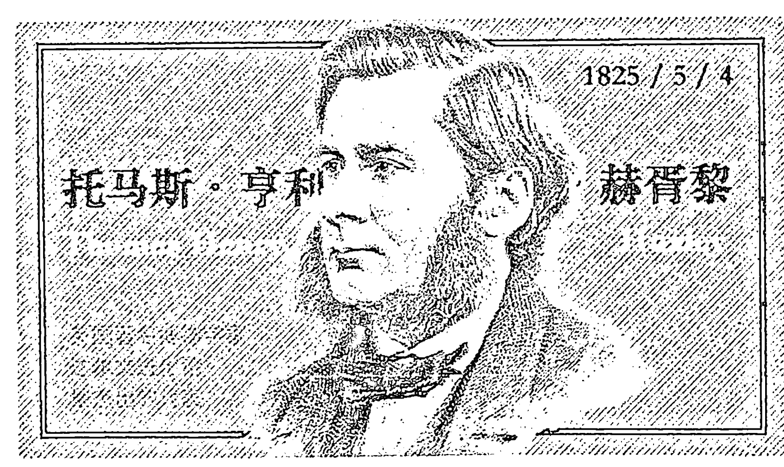

银河系里有 1000 亿颗恒星，数量约等于我们大脑中神经元的数量。

我们对宇宙和自己都有类似的深深疑惑：

你是谁？从哪儿来？要去哪儿？

人们对“自我意识”的真实存在，不像对“时间”的实在存在那般充满疑惑。但是，“自我意识”到底是什么，与“时间”到底是什么一样，是迷人且虐人的秘密。

笼统地说，我们的大脑由“快系统”和“慢系统”构成，前者负责情感，后者负责理智；前者负责直觉，后者负责深思。二者交织在一起，彼此影响，相互转化。

情感和情绪被认为来自丛林时代，是在低级水平上独立做出的快速决定，是一种生存机制。

和时间的“自动驾驶”一样，人和动物也能在生理机能上完成超级自动驾驶。对比而言，由此而生的对文明时代的副作用，真算不了什么。

大脑里并不存在一个芯片，又或者大脑本身就是一个超级芯片。大脑里遍布着各种反馈回路，像一个社会，每个模块彼此吵个不停。

但为什么你能够清晰地感觉到一个“我”，作为单一的、统一的整体，在连续做出所有决策？

科学家说，这是潜意识和心灵造成的错觉。大脑只是在解释，给内部乱七八糟的纷争一个合理的描述。就像中彩票的人写成功传记，大脑编造了“我最厉害、我搞掂了一切”的虚幻故事。

再混乱的公司也有一个 CEO。大脑的首席执行官位于前额叶。当 CEO 接管大脑的自动驾驶，控制方向和速度，“自我”会显得清晰。

那么，这个有意识的“自我”，和心不在焉之际那个无意识的“自我”，是同一个人吗？

进而，假如人类社会是一个超级蚁群，是否有一个鸟瞰者，在观察着地球人无法自我觉察的某种智能？这个鸟瞰者之上呢？

怀疑“自由意志”是否存在，可能是大脑所做的最酷的事情之一。

就像你身边的朋友中，只有最聪明的那些才会质疑自己是不是傻瓜。

里贝特的实验表明，大脑做出决定的时间实际上比人意识到这个决定约早了 300 毫秒。

也就是说，大脑是先决定，后解释的。

就像你买东西时，首先是想要，然后再给自己找购买的“逻辑”（借口）。

如此一来，“做你自己”看起来是句空话，实情是“你做做自己”。

我们不由得要回到上一部分里，关于“决定论”的讨论。按照拉普拉斯的理论，所有未来事件，都由物理规律决定好了，那么，我们的所有行为，也被决定好了吗？

假如你正坐在一个如此胡扯的人面前，你大可以上去给他一嘴巴，然后说：看，我的自我意识还是在我手上的。

但是，我所说的这种个体命运“决定论”，不是指每个言行都被设定好，而是说：

一个人就像一个硬币，被抛起的时候看似可以自由翻滚，落下时可以随机呈现某一面，然而命运的最终统计，总是严格遵循着“50% 正面朝上”的概率。

决定论本身并不排斥“可能性”和“机遇”。

但一个人的命运分布概率，似乎被“决定”了。

现实中，看起来你分每秒都可以做主，但现实世界就像是一堵棉花做的墙，毫无反应。这是我们为“自动驾驶”付出的代价吗？

时间静静流淌，命运不可扭转。这二者对自由意志而言，似乎都是不自由的。

让我们回想量子理论的关键特征：它处理可能性，而不是确定性，这并不是因为我们缺乏知识，而是因为自然界的某些方面从根本上是由概率的规律控制的。

## 是谁在控制大脑决策的概率？是谁在决定命运的概率分布？

埃克尔斯认为，心脑交互作用和量子力学的概率场类似，没有质量也没有能量，但却能有效地对突触递质释放过程起作用。他由此指出，心脑交互是一种信息流，而不是能量流。

量子力学留给“不确定性”和“机遇”的作用，会唤起人们对“自由意志”的希望吗？薛定谔认为这只是一个幻觉。

总之，《机遇与混沌》一书认为，令我们的自由意志成为一个有意义概念的，正是这个宇宙的复杂性，或更确切地说，是我们自身的复杂性。

我赞成《意识与脑》作者的兩個命題：

- 1、你并没有觉知到头脑中发生的大多数事情；
- 2、即使你确信一切尽在你掌控之中，但实际上僵尸行动者控制了你大部分生活。

但我也不因此而對“自由意志”感到悲觀。

但丁写道，細想你们的来源吧：你们生来不是为了像兽类一般活着，而是为了追求美德和知识。

生命诞生的漫長歲月，人类前行的苦难历程，都注定了“自我意识”的目的不是为了求生和饱腹，而是在探求爱与真，追寻无法被定义的意义。

## 三

维特根斯坦说：没有哲学，思想便模糊不清。哲学的任务是使思想清晰，赋予思想鲜明的边界。

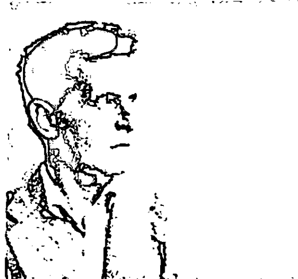

> "The limits of my language mean
> the limits of my world."
>
> -- Ludwig Wittgenstein

我用“时间”替换“哲学”：

**时间赋予思想鲜明的边界。**

一个人要想过得幸福，理性比聪明更重要。

想要获得人生的成就，科学理性地对待时间远比智商重要。

在看起来对每个人都没有差别的时间上，不同的人因为有不同的时间观，采用了不同的时间策略，导致了截然不同的命运。

如果你想控制自己的命运，首先你要控制自己的时间。

假如真的如科学家实验结论所说，行动的确比思想更快，那么时间就是行动与思想之间的“转换器”。

进行矫正运动的行动，比有意识的知觉提前了 1/4 秒，这对世界级的 100 米赛跑，可能是决定性的。这意味着他的意识听见发令枪时，已经跑了好几步了。

这类无意识行动可以经由训练实现。运动员、股票操盘手、艺术家、企业家，都会从类似的训练，来形成条件反射似的直觉和行动。

时间给思想的边界，同样是整合了两种貌似对立的能力：

## 一

1. 你要能够控制“僵尸式”的条件反射与自动驾驶；
2. 你要能够充分应用大脑和身体的潜意识与自动驾驶功能。

## 四

人生算法的魔力，几乎都是通过时间来呈现的。

大多数人为什么终其一生只能过一种平庸的生活？

原因在于他们放弃或者贱卖了两种权利：

- 概率权；
- 时间权。

行使时间的权利，正面的例子是“延迟满足”，历任世界首富莫不如此，巴菲特，盖茨，贝佐斯。

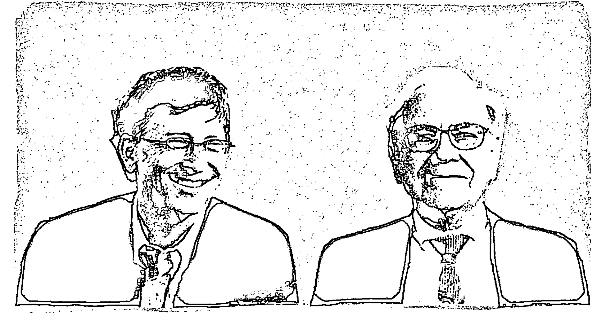

延迟满足的本质，是实现“概率权”和“时间权”的不打折。

反面的例子是追求“即时满足”，例如赌徒。

一方面是对时间的恐惧，一方面是对概率的恐惧，二者都是对未来不确定性的恐惧。

时间是概率的“作案工具”。

举例，假如我们仅从时间的某个切片，二维地看贝叶斯公式，其实只是一个简单的四则运算罢了。

但是，在时间的这个维度加入以后，切片与切片之间建立起联系，魔法出现了。

时间是大数定律的执行者。

- 时光的算法：过去的你，现在的你，未来的你。

前面的约翰·富兰克林船长，其实是能够把过去、现在、未来叠加在一起，从全局思考。这并非特异功能，而是人人都能习得的思维方式。

时间将具有（或没有）因果关系的定格宇宙画面链接了起来，这决定了我们能利用时间做什么。

- 概率和宿命论：假如可以穿越，你也无法改变自己的命运。

你惟有获得意志自由，方能实现行为自由，才可以改变自己的命运。

## 五

所谓宿命论是这样的：

你无法改变未来，因为你的改变也是未来的一部分。

俄罗斯理论物理学家诺维科夫在1980年代提出有关时间悖论的规则：诺维科夫自洽性原则。

此原则指出：

只有事件属前后一致的因果循环才能出现，矛盾的则不能。

人可以回到过去，但是不能因此改变历史的进程。

诺维科夫自洽性原则基本含义为：

**我们的世界是已经被改变过的最终结局。**

看看遍布于各类文艺作品的结构：

A君回到过去调查一场有名火灾事故的起因。本来火灾不会发生，不过A君回到该段时间，在未发生火灾时的现场碰跌了一个火水灯，导致火灾。A君回到过去调查一场有名火灾事故，却成为火灾的起因。

当哈利·波特看到一个形体救了他和天狼星，就断定那是他死去的父亲，直到他和妙丽进行时光旅行才了解原来那个拯救他和天狼星的形体就是他自己。

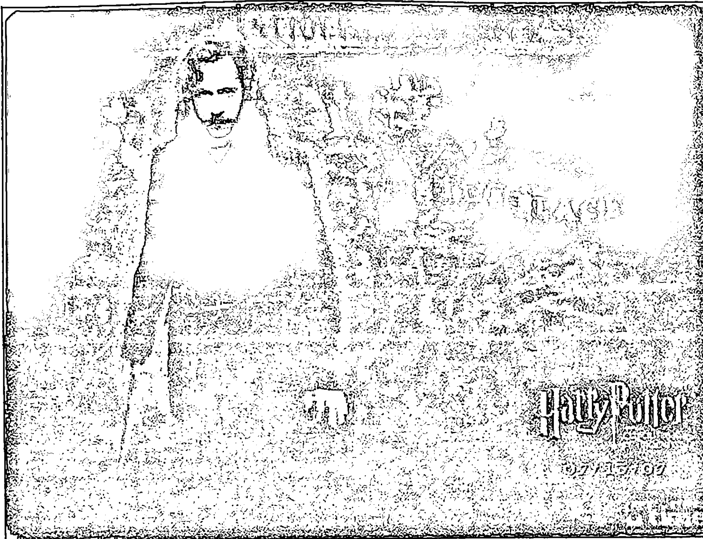

李淳风预知武后将称帝，并告知唐太宗无法强求改变，否则会有不能预计的后果。太宗得秘谣，言“唐中弱，有女武代王”。以问淳风，对曰：“其兆既成，已在宫中。又四十年而王，王而夷唐子孙且尽。”帝曰：“我求而杀之，奈何？”对曰：“天之所命，不可去也，而王者果不死，徒使疑似之戢淫及无辜。且陛下所亲爱，四十年而老，老则仁，虽受终易姓，而不能绝唐。若杀之，复生壮者，多杀而逞，则陛下子孙无遗种矣！”帝采其言，止。

在一篇论文中，霍金用隐喻的说法来阐释物理定律不允许宏观尺度的时间旅行，由此避免时间悖论。他认为：“似乎有一个时序保护机制，防止封闭类时曲线的生成，从历史学家手上保护了宇宙的安全。”

## 六

统计学告诉我们，森林火灾次数、新生婴儿数量、晴朗的天数、每年犯罪量，都会在某个区间，以曲线的形式波动。那么，“宿命论的体系建立在这一基础之上吗？”

凯特勒在1836年的信中说：“道德秩序落入了统计学的领域……对那些相对人性完美性的人来说，是令人丧气的实施。似乎自由意志仅在理论中存在。”

例如，某城市按照统计规律，每年有100个人自杀。“每个居民具有不自杀的自由，就不能成立。”听起来，好像当年选右派浪，总有一些不幸的人，要被抽去自杀。

做个假设，假如我们可以乘坐时光穿梭机回到过去，阻止这100个人自杀，会将该城市的自杀率降低为零吗？

我猜不能。当你挽救了这100个人（假如上帝允许的话），上帝仍然在扔骰子，大的社会定律还在起作用（假设城市的人口不是那么少），可能有另外好几十人（或多或少）仍会自杀。

对于统计宿命论，就犯罪而言，凯特勒写道：

“是社会制造了罪恶；有罪的人仅仅是执行罪恶的工具。绞刑架上的牺牲者从某种意义上说是社会的赎罪牺牲品。他的罪恶便是他发觉自身身在此情此景之中的结果。”

所以，假如你可以穿梭回去拯救自杀者或者降低犯罪率，你要做的不是（可能无用）的定点打击，而是去探寻本质原因。如安热维尔所言：“通过修正建制或行政实践，人们可以使一个国家的犯罪率下降。”

让我进一步假设：

你这辈子干的那几件主要蠢事，就像一个城市某个概率的犯罪数量。

假如我们可以回到过去，即使你选择了人生中那些决定性的转折点，如某次考试，选择专业，决定跟哪个老板混，和谁结婚……就像定点找到了犯罪者，并且（如同阻止犯罪者那样）重新做出了正确的决策，你此生的命运可能依然无法改变。

因为你自身的系统结构，决定了你的无数个其它的行为方式，推动你遵循大数定律，奔向那无法扭转的宿命。

这便是为什么那些大奖得主的命运常常是悲催的。即使你可以回到过去，在网易股价最低时All in，一直拿到涨1000倍，你仍然可能在2015年的股灾中，因为使用杠杆，赔掉一切。

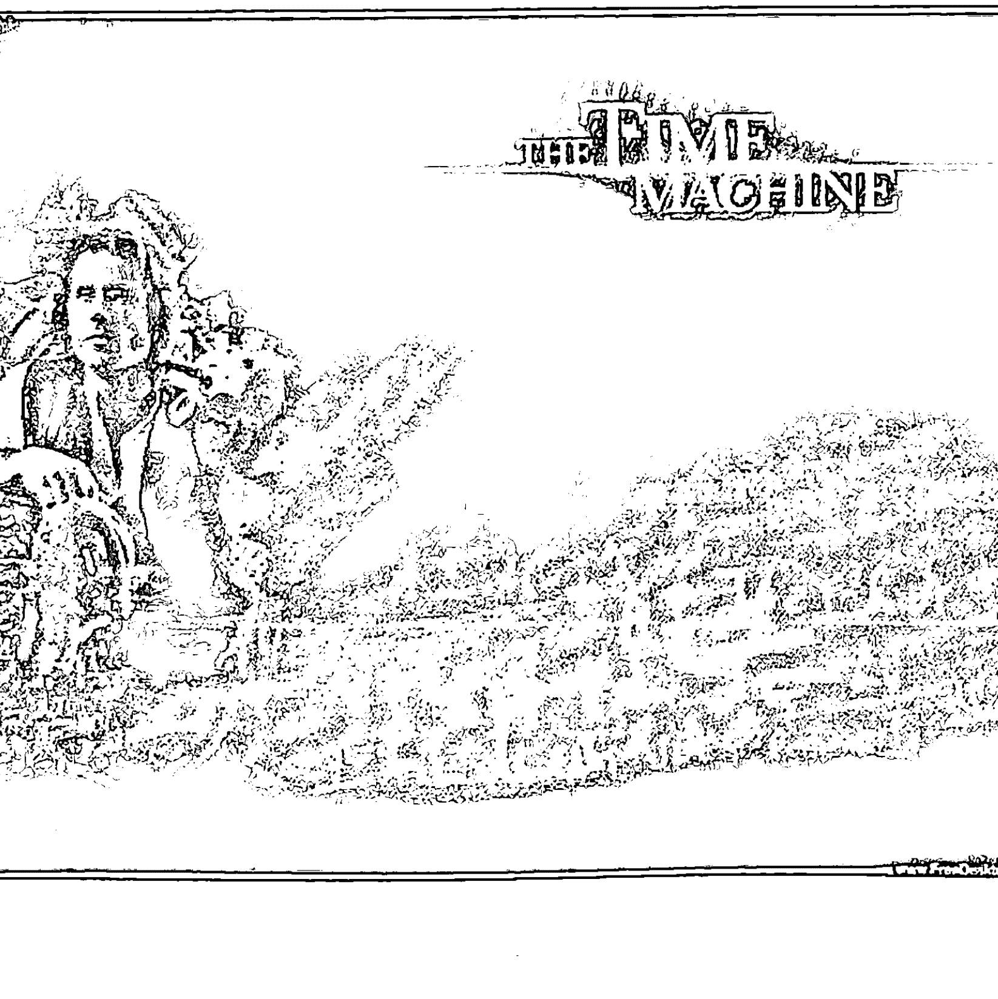

即使有时光穿梭的机器，我们改变自己命运的办法，也不是回到过去甩了朋友换掉老板，而是调整自身的行为方式。而调整自身行为方式这件事情，无需时光穿梭，现在也可以做。

关于接班人，巴菲特说他寻找的是有良好投资记录的聪明人。但，他更看重的是他们“如何挥杆”，即：更看重他们的思考和行为方式。过往业绩好，可能只是运气，若行为方式不稳健可靠，一个黑天鹅足以毁掉一切。

巴菲特说，他需要的并不仅仅是一个善于管理应对风险的人士：“我们需要一位天生（genetically）能够程序化地（programmed）识别并避免各种严重风险的人士。”这两个关键词，一个先天，一个后天。

“性格决定命运”这句鸡汤真理，应该修正为：性格决定行为方式，行为方式决定命运。

Eric在《大教堂与集市》一文中给出一条经验：

> “如果你有正确的态度，有趣的事情自然会找到你。”

我个人觉得，性格接近于天生，而行为方式则是先天后天共同作用的结果。

塞内加说：灵魂的力量比任何命运都强大。……凭着自己的力量，他既能造福于生活，也能给生活带来不幸。

上帝在设计一个人的命运时，既有宿命式的安排，又留了一个DIY的口子：改变你的行为方式。

知错就改，比穿梭回去改某个大错更有意义。

让时光站在你的这一边。

可说起来容易的事情总是很难做到。我们更多如爱因斯坦对“精神错乱”的定义：

一遍又一遍地重复作同一件事，而期待会有不同的结果。

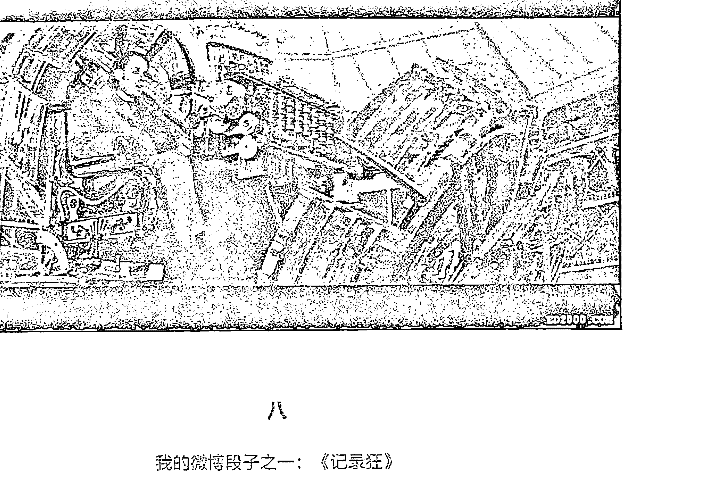

## 八

我的微博段子之一：《记录狂》

从前，有个人过了非常快乐的一天。很幸运的是，他还用摄像机完整地记录了这24小时。

第二天，他从头到尾看了录像，重温了无法复制的昨日的快乐。同时，他还记录了自己看录像时快乐的一整天。

第三天，他开始看第二天的录像，依然用摄像机记录……

就这样，他度过了快乐的一生。

我的微博段子之二：《死循环》

若能穿越时光，你会做什么？杀死某人祖父？去某人幼儿园泡她？

当然是去买股票！

于是，他揣着全部钞票，上路也！哇，苹果才5块！回来卖570！

回来后，没看到钱，问上帝。

问：我买苹果股票的钱呢？

答：你的钱拿回去买股票了呀。

问：但我回来卖了股票。

答：但你现在的钱全拿回去了呀。

问：但我炒股赚了更多呀。

答：但你都拿回去了呀…

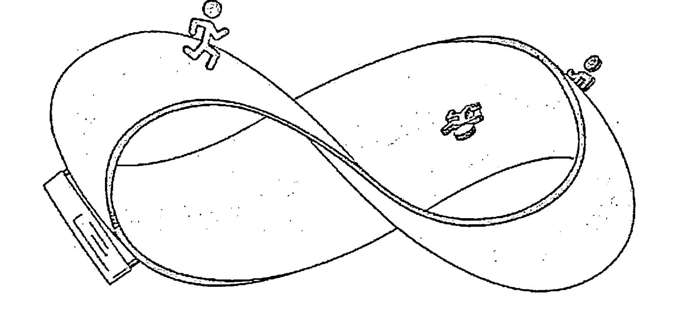

## 九

公元1082年，苏东坡与友人泛舟于赤壁下游玩。清风徐来，水波不兴：白露横江，水光接天。一时间，他飘飘乎如遗世独立，羽化而登仙。

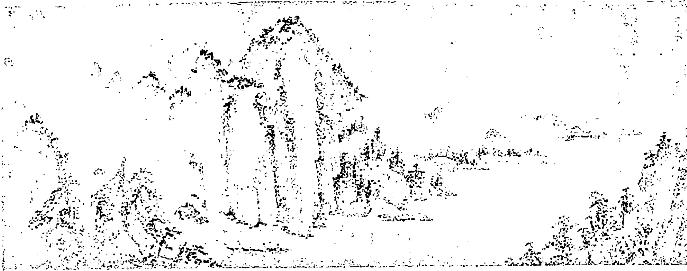

这时，客人中有吹洞箫者，倚歌而和之，其声呜呜然，如怨如慕，如泣如诉。

苏东坡好奇问他为什么如此哀愁。

客人说：“'月明星稀，乌鹊南飞'是曹孟德的诗吧？眼前壮丽景色，都是他战斗过的地方。曹操如此牛逼，**固一世之雄也**，而今又在何处呢？”

苏东坡说道：

“你可也知道这水与月？时间流逝就像这水，其实并没有真正逝去；时圆时缺的就像这月，终究没有增减。可见，从事物易变的一面看来，那么天地间万事万物时刻在变动，连一眨眼的工夫都不停止；而从事物不变的一面看来，万物同我们来说都是永恒的，又有什么可羡慕的呢？

何况天地之间，万物各有主宰者，若不是自己应该拥有的，即使一分一毫也不能索取。只有江上的清风，以及山间的明月，听到便成了声音，进入眼帘便绘出形色，取得这些不会有人禁止，感受这些也不会有竭尽的忧虑。这是大自然恩赐的没有穷尽的宝藏，我和你可以共同享受。”

这首《赤壁赋》写于苏轼一生最为困难的时期之一，全篇豪放清朗，行歌笑傲。

> “惟江上之清风，与山间之明月，耳得之而为声，目遇之而成色，取之无禁，用之不竭。”

## 苏东坡此赋，不正是量子时代物理学家们的世界观吗？

哥本哈根解释要求在观察者存在的情况下，波函数魔术般地发生坍塌，现实世界因此呈现。

问题在于，谁来观察宇宙呢？

宇宙是自我包含的。它包含所有事物，所以并不存在外部观察者来注意宇宙的存在。

格里宾倾向于“唯我论”者的论断。这个论断说，在宇宙中只有一个观察者，那就是我自己。“我的观察”就是使现实从量子可能性的网络中固化出来的所有重要因素。

贝克莱在《人类知识原理》里写道：

> “宇宙中所含的一切物体，在人心灵以外都无独立的存在；它们的存在就在于为人心灵所感知，所认识……”

即使是在飘零的孤舟之上，世间最美好的一切仍然是向你开放的。

我们当中的绝大多数人，陷入了无穷的索取，而忘记了索取的目的。

苏东坡传颂千古的诗句里，揭示了如下真相：

你不用占有什么，就能拥有一切；

你能够拥有一切，却不能拥有时间。

## 十

> “生命只是一连串孤立的片刻，靠着回忆和幻想，许多意义浮现了，然后消失，消失之后又浮现。”

在普鲁斯特的《追忆似水年华》中，时间是第一主题。这个世界处于永恒的流逝、销蚀过程之中，他被这个想法困扰。

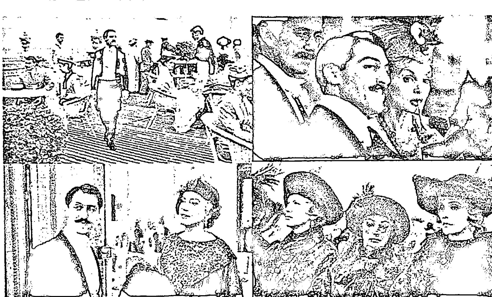

普鲁斯特知道“自我”在时间的流程中将不可逆转地逐渐解体。

为期不远，总有一天那个原来爱过、痛苦过、参与过一场革命的人什么也不会留下。

他决定用一种独特的回忆方式，去呼应“摧毁一切的时间”。

以前，人们试图借助智力，通过推理、文件和佐证去重建过去。

普鲁斯特教会我们另外一种回忆过去的方式：

让过去突然在现在之中显露。

而正是这种突然显露才使我们意识到自我的长存。必须发动不由自主的回忆，才能找回失去的时间。

### 如何发动“不由自主的回忆”？

得通过当前的一种感觉与一项记忆之间的偶合。我们的过去继续存活在滋味、气息之中。

例如你辨认出幼年初夏季节刚切开的西瓜的清新香气，那个时间被折叠过来，当前的感觉与重新涌现的记忆组成一对。

安德烈·莫罗亚写道：

**这个组合与时间的关系，犹如立体镜与空间的关系。它使人们产生时间也有立体感的错觉。在这一瞬间，时间被找回来了，同时它也被战胜，因为属于过去的整整一块时间已变成属于现在的了。**

**“一切都是时间先后的问题。”** 在意识世界里，人们终于获得了某种自由。普鲁斯特找到了时间与世界万物建立起的感应关系。时间被他追回，仿佛可以永生。

如果要问我，我喜欢哪个版本的时间？实话说，我对爱因斯坦富有诗意但其实孤寂艰难的科学探索，对普鲁斯特将人的精神重置于宇宙中心的意识流淌，都格外钟爱。

我舍不得扔掉每个有记忆的旧东西，过去的场景仿佛仍在昨日，温度，气味，以及彼时并不存在但回忆时仿佛天然匹配的背景音乐。

我对未来既好奇又恐惧。我不是一个速度爱好者，讨厌奔袭而来的东西，不喜欢过山车，但我的虚无感在迎面而来的压迫下，也常有令人意外的坚毅。我也许就是一个核桃，需要被压开，被榨取，被昨日和明天挤出些本性的味道。

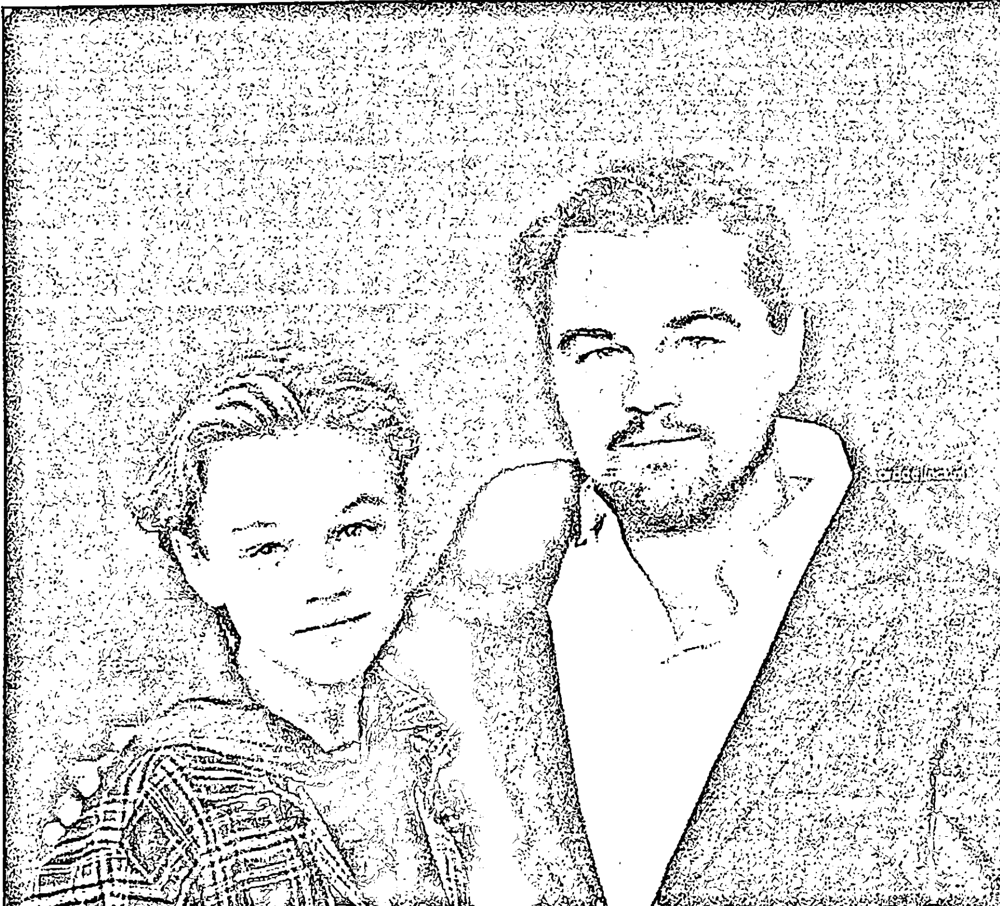

正在发生的那个时刻，我感觉到未来的我已经悄然来临，于是"正在发生"和"重温旧时"重叠在一起，不应被扰动。

我常能清晰地感觉自己迷失在时间里，而时间并不因为这迷失而停下来。

我崇尚理性，对这个世界的运行原理，充满了孩童式的好奇；

我也享受个人主义的神秘体验，相信在我们的记忆中寻找失去的乐园，是唯一真实的乐园，为此我们必须在现实中有所抗争，有所妥协。

## 最后

《科学的价值》写道：

“对于相信时间的人来说却存在着一个奇怪的矛盾——地质史向我们表明，生命不过是两个永恒死亡之间的短暂插曲，即使在这一插曲中，有意识的思想持续了并且将仅仅持续一瞬间。思想无非是漫漫长夜之中的一线闪光而已。”

“但，正是这种闪光即是一切事物。”

生命即燃烧，而时间就是火种。

时间仿佛一直致力于剥夺人们“占有”万物的权力。凡人皆有一死。

这种公平性在现实中被我们忽略。

一个人不该以他多强大、多聪明、多富有、多性感、多仁慈而被衡量，而是应以他燃烧的充分度。

一缕烛光，也和宇宙深处的星光一样，不该被用亮度来评估。

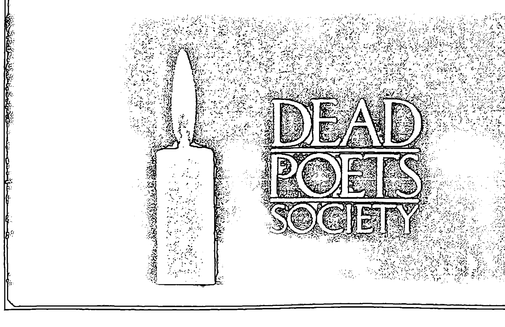

火种之间是平等的，这是时间赋予每个人的公平之处。

宇宙是个陌生之处，直到20年前，我们才知道，已知的星球、物质、你我，只占宇宙中物质和能量的4%，另外1/4是冷酷物质，余下的则是暗能量。

时间是每个生命劈向茫茫未知宇宙的一道剑光。

按照标准理论，宇宙大爆炸之后，正物质和反物质应该等量，二者一旦接触，会湮灭形成高能光子。

极其幸运的是，由于某种机制，正物质比反物质多了一点点，仅为十亿分之一。

足矣，万物由此存在。

时间有时候让人动弹不得。那时，我们独自在心腹挣扎，叫天天不应，叫地地不灵。

普罗太纳斯说：

> “如果有人问大自然，问它为什么要进行创造性的活动，又如果它愿意听并愿意回答的话，则它一定会说：

不要问我；静观万象，体会一切，正如我现在不愿开口并一向不惯于开口一样。”

万物静默如谜，时间就是谜底。

## AI机器人原来是这样的......

- 收录于话题
- #AI 2 个内容
- #机器人 1 个内容

—

> “原来如此啊！”

老婆大人在视频的那一头说：“难怪机器人自己动起来了......”

她说的是我们在温哥华家里的扫地机器人。

2020年，从加拿大回国的跨洋飞行，不再是一件那么随意而轻松的事情。经过两周入境隔离，我行走于中国的各个城市，为我的新书《人生算法》签售，为春霖在全国的快速发展耕耘。

奔波之余，分外想家，想家人，想小狗。

于是我打开手机，启动了远在万里之外的那个能够自己倒垃圾的扫地机器人。

这个“恶作剧”，吓了家人们一大跳，也给他们以小小的“好玩儿”。

这一举动超越空间，传递了我对家人的爱。

比起聊天，扫地机器人更能超越空间限制，“实在地”表达我的情感。

孩子们看着勤劳工作的机器人，看它聪明地绕开餐桌，会开心地说：

“看，那是爸爸在扫地！”

## 二

我曾经想过：当一个机器人长得不那么像人，也许意味着更实用。

就好像长相平常的歌手可能唱歌更好听。

当我们满心期待着真人模样机器人的到来，殊不知机器人早已以各种形态走进了人类的生活。

和电影里描述的不一样，真正实用的智能机器人，可以是个音箱，可以是无人机，可以是会做手术的机械臂，可以是外骨骼，可以是进入人体的胶囊，也可以如阿里最新推出的“小蛮驴”：像一辆太空车，又格外憨厚可爱。

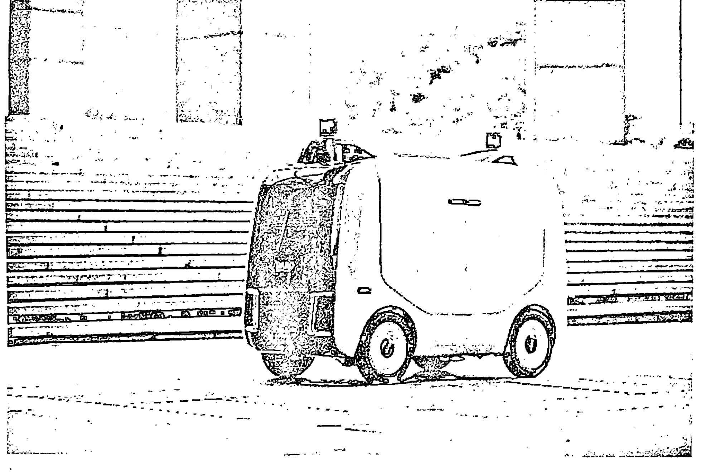

什么是机器人？

## 三

要回答这个问题，我们先要知道，一个现代机器人由什么构成，要完成什么任务。

以"小蛮驴"为例，它是阿里巴巴第一款物流机器人，包括以下组件：

1. **本体结构**：用于容纳组件，所以需要足够牢靠，还要足够灵活；
2. **移动模块**：小蛮驴不仅会跑，能装，还要聪明，更要适应复杂道路和糟糕天气；
3. **感知系统**：作为走入现实社会的机器人，小蛮驴必须能眼观六路，耳听八方，判断形势。
4. **能源系统**：小蛮驴机器人，充4度电，能跑100公里；
5. **末端执行器**：就像是机器人的便携工具；
6. **机器人大脑**：作为机器人的指挥中心，大脑是否足够聪明，是一个机器人的关键。

每个机器人都肩负着一个使命。对"小蛮驴"而言，作为物流机器人，它的使命，就是把亿万快递包裹安全快速地送到你我的手上。

焦虑的现代人一天中最快乐的时刻，也许就是收到快递。然而，快乐背后是惊人的复杂和繁重。

据统计，现在每天快递数量高达两亿件，不久的将来，这个数量将增加到每天十亿件。

"小蛮驴"的诞生，是为了守护那份来之不易的快乐。

为了实现这一点，"小蛮驴"不仅需要先进的技术，聪明的大脑，还需要一股不畏艰险、使命必达的蛮劲儿。

## 四

当我们谈及一个智能机器人，不止是它能帮人类工作，更是指它能像人一样思考和学习。

与普通机器人对比，AI机器人最大的特点是：

能像人一样去应对不确定的世界。

普通机器人对于同一组输入，总是产生同样的输出。这就是我们经常调侃的“像个机器人”。

而AI机器人则拥有高等智能，能像人一样从经验中学习。它们可以随机应变，解决从未遇到过的新问题，并不断自我完善，

概括而言，AI机器人有两种独特能力：

1. 自己做决策；
2. 从经验中学习。

让我们想象一下：

一个小蛮驴物流机器人穿行于校园，准备把近百件快递送往女生宿舍，其中大部分是情人节礼物。它快速而灵活地行走着，这时突然有个冒失的男生骑着自行车斜穿过来……

小蛮驴的传感器早早捕捉到了信号，它迅速观察周围环境，通过“大脑”立即作出决策，像梅西一样从容地避开那个冒失鬼，继续前行。

阿里巴巴达摩院院长张建锋说，这头机器驴“蛮聪明、蛮能干、蛮安全”。

“小蛮驴”集成了达摩院最前沿的人工智能和自动驾驶技术，具有类人认知智能，大脑应急反应速度达到人类7倍。

正因为它能够适应环境，自我学习，在工作时几乎不用人的干预，所以“小蛮驴”可以应用于现实，并且直接参与到与人亲密无间的生活场景中。

与以往看到的各种智能机器人的最大差异之一是：“小蛮驴很快将大规模量产，实现‘千’级别的出货量，全球没有任何一家公司可以做到这个规模。”

这意味着，一个拥有领先科技水平的智能机器人，将在社区、学校、办公园区大规模使用。

智能机器人的技术突破，会让生活变得更加美好。

## 四

“地球上最后一个拿到驾照的人已经存在了。“赫格尔博士如是说。

这句俏皮话说出了乐观者的预期：自动驾驶在不久的未来，即将全面实现。也就是说：我们将在有生之年见证人类驾照的消失。

到2030年，全球将有60%的人口居住在城市，交通将面临巨大压力。人们一方面依赖于汽车交通，一方面成为汽车的受害者。每年全球有50万人不幸死于车祸。

自动驾驶通过人工智能技术，不仅解放了司机，还能大幅提升交通效率，最大限度地降低交通事故率。多少生命将被拯救，多少美好的时光将被创造。自动驾驶，将会彻底改变我们的生活方式。

作为特斯拉的车主，我偶尔会试一下自动驾驶。特斯拉当前的自动驾驶是L2级水平，驾驶者会被要求将双手放在方向盘上，并保持一定压力，否则就会通过声音和闪烁来警告司机。

这种水平处于什么位置？让我们来看看。自动驾驶从L1到L5，分别是：

- **L1：驾驶支持**
- **L2：部分自动化**
- **L3：有条件自动化**
- **L4：高度自动化**
- **L5：完全自动化**

各级水平的自动驾驶技术，有一个非常本质的区别，那就是：责任的主体是谁。

- L1跟L2责任的主体是在人类的司机；
- L3的特点是双主体，正常情况下是智能机器人开车，必要时人类司机接管；
- L4的责任主体完全是机器人，但有限定的场景和气候条件；
- L5则是完全无人化的智能机器人负责。

“小蛮驴”作为物流机器人，服务于末端物流，是因为：末端物流是整个物流体系中成本最高、效率最低的环节。那么，在“社区、学校、园区”行走的“小蛮驴”，是什么无人驾驶水平呢？阿里达摩院给出的定义是：L4、L5级别。

这是因为，即使是在校园等半封闭的末端场景，其复杂程度并不低于城市道路，包括人车混行，红绿灯，以及各种突发交通事件。与此同时，为了实现量产，智能机器人不仅需要表现稳定，还要降低成本。小蛮驴制造成本的大幅度降低，主要源自三个环节的技术创新：

- 一是改进了包含激光雷达等昂贵传感器在内的感知体系，比如，达摩院自研的感知算法，实现了对低线束激光雷达的高线束模拟；
- 二是自研嵌入式计算平台，定制了高性能、低成本和低功耗的计算单元；
- 三是深度定制了包括运动底盘在内的硬件设备，实现了软硬件高度一体化。

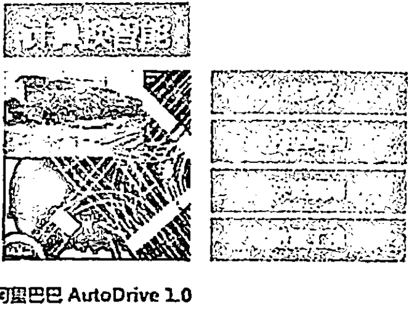
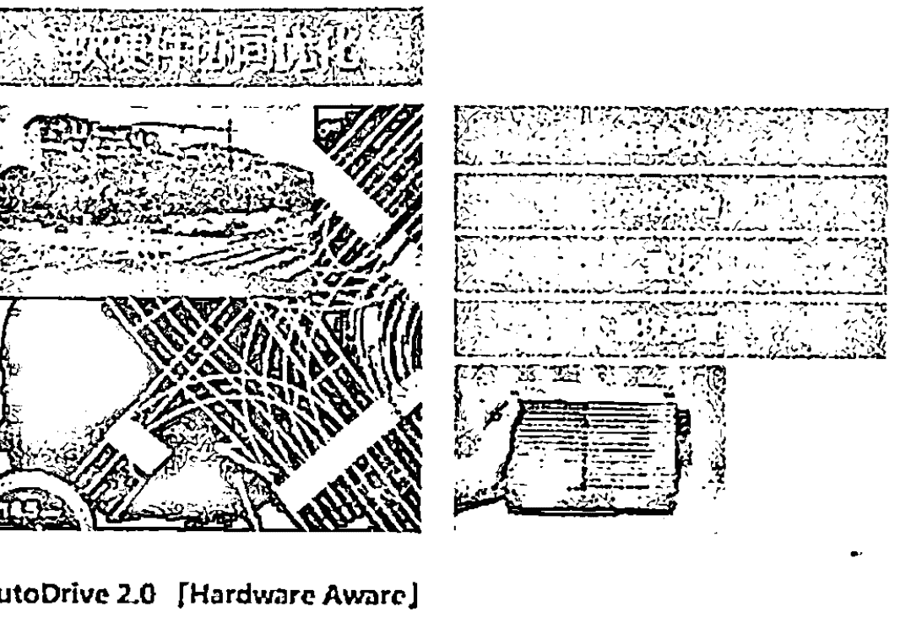

正因为极具挑战，所以人们说，自动驾驶是民用人工智能领域的皇冠。小蛮驴背后，是阿里智能机器人的战略蓝图：

- 一方面，与菜鸟合作，快速入局，在具体情境下解决现实问题；
- 另一方面，通过软硬件一体化机器人平台，阿里可以基于小蛮驴中应用的通用技术和能力模块，快速做出其他种类的机器人。

例如，将来向你提出“保安三问”哲学问题（你是谁？从哪儿来？要去哪儿？），的，也许是个智能机器人。

## 五

人类自己，就是智能机器人。那么，谁是人类的主人？基因。人不过是基因的机器人。

斯坦诺维奇在《机器人叛乱》一书提出了如上惊人的隐喻。在道金斯看来，生物的个体和群体只是基因的临时承载体，只有基因才是永恒的，人类是“不朽的基因”复制自身的工具，也是肮脏的模因复制自身的平台。

所以，人类不过是基因造出来的机器人，目的是为了使基因本身能更多、更快地复制。当主人和机器人的利益发生冲突时，基因会牺牲人类。例如人类渴望长生不老，而基因带来衰老、病痛、死亡。

幸而这只是一个隐喻，斯坦诺维奇借此表达：人类可以凭借勇气、智慧来战胜基因与模因，不再甘于做基因与模因的机器人，通过理性实现“机器人叛乱”，拿回自身的控制权。

那么，会不会有一天，人类自己制造出来的智能机器人，也会“叛乱”？正如《西部世界》里所描述的那样：机器人“觉醒”，进而开始威胁人类。

关于这个话题，科技界的大佬们，也产生了惊人的分歧。霍金和马斯克支持“AI”威胁论，而亚马逊的贝佐斯和谷歌的施密特则认为这是杞人忧天。然而，有趣的是，无论是哪一方，都积极地投身于AI的布局。

我对AI的未来充满了期待，尽管当前AI所采用的神经网络依然是个不能回答“为什么”的黑匣子。如果科学家们能够创造可解释的AI，也许人类会离“通用人工智能”更近一些，我们的生活质量也有机会实现指数级的增长。

## 六

你的工作会被智能机器人夺走吗？简单的类比是，当年工业生产线的出现，的确夺走了许多手工业者的工作机会，但是创造了更多的社会财富和新的工作岗位，大幅增进了人类福祉。

我们即将迎来老龄化社会。2049年中国老年人口将超过4.3亿人，占总人口的三分之一。老年人的照护，需要专业，更需要体力。假如智能机器人可以帮上手，功德无量。

说回眼前的“小蛮驴”，作为末端物流智能机器人，它将和人类快递员一起面对一个挑战：不久的将来，中国每天将产生10亿个配送订单，约为现在的五倍。剧增需求的另一面是，自2012年以来，中国劳动年龄人口规模连续8年下降，到2018年跌破9亿。

未来的工作场景是，人类将和智能机器人一起工作。也许人类快递员能够承载更多情感和沟通工作，小蛮驴则成为靠谱的搭档。

## 七

就像狗可以让主人更加宁静，我想，智能机器人也许让人类重新审视自我。

我不确认通用人工智能能否实现，以及何时实现。但我确信：智能机器人将进化到现代人类无法想像的程度；

我不确认人工智能是否会绕开人类的“可解释性”，用某种人类无法理解的思考方式来实现超越人类的智能。但我期待：机器人永远不要“叛乱”，因为人类并非机器人的主人。但愿如此。

我不确认智能机器人是否会真的发展出人类真实的情感，又或者在探寻人类情感的底层机制中，没准儿科学家们发现情感不过是个幻觉。但我渴望：人类并不因为对自我的探索而失去自我。

我也不确认智能机器人带给人的是温暖，还是更彻底的孤独。但我知道：人类从来都是孤独地球上的孤独物种。或许与AI一起，人类将在孤独的最深处发现另一个不一样的宇宙。

## “财务自由”是什么

所谓“财务自由”，是指你既不用去在意比你更有钱的人，也不用频频向他人表明你不在意钱。

问题不在于你的才华是否只是自己的错觉，而在于你能否让别人也产生这错觉。

觉得自己低估了自己，是自不量力的开始。

美德不依赖于被外部确认。

环境越肮脏，金钱越纯洁。

人们用收藏文章来制造阅读的幻觉，也用收藏概念来制造学习的幻觉。

一个人比任何人都更了解自己，也比任何人都有对自己更深的幻觉。

有些知识可以通过亲历（承受风险和痛感）来获得，有些知识可以通过他人替你亲历来获得，但所有的知识都需要经由独立思考（将名词、概念、逻辑等等还原为大脑那种神秘的生物层面的感知），才算真正获得。

出现在此刻回忆里的，大多是过去某刻我们对未来的幻想和期待，而非发生的某刻。

最爱你的人才能拍出你最W的那一面。所以你最W的照片都是自拍。

电影触动人的，不是节奏的快慢，而是张力的大小。

每个缺点背后都有个优点为其撑腰，每个优点背后都有个缺点被其掩盖。

有些人混乱但不失控；有些人有序却死寂。

大脑接受强或弱的信号，而不是爱与恨的信号。

天才的优点往往显得不可理喻，甚至令人生厌，于是有人试图通过不可理喻和令人生厌来冒充天才。

人的一生的长度（约60多万小时）= 一部较长电影的长度（2小时）X光速数值（30万）

每个坏人都觉得自己是潜入坏人内部卧底的好人，从而兼顾了当坏人的好处和当好人的道德。

有趣的人未必睿智，但睿智的人一定有趣。

立场鲜明，并不是指你要对“对立面的观点”先夭厌恶。

年轻人证明自己，且不必非证明不可；中年人捍卫自己，不得不。

韭菜不仅不恨镰刀，而且仰慕镰刀，梦想加入镰刀阵营。镰刀因此加倍得逞。

宇宙也许是某个神放的一个大烟花，满天燃烧的星星，而地球只是一个小残渣。

写作的好处是，连你记忆中最愚蠢最不堪回首的那些的岁月，都能变废为宝成为素材。

智商税与智商无关，与理性有关。有时候智商高反而会缴更高智商税。

好的文章是大多数人质疑、少数人喜欢、极少数人兴奋。

所谓“烧脑文章”的悖论是：懂的人不用看，不懂的人看了也不懂。

假如一个软弱的的决定是正确的，就不算软弱。

天地不仁，以万物为流量。

那些被恋人抛弃了的创作者，一旦他们据此写出了厉害的作品，实质上就是他们抛弃了恋人。

你不趁人之危。别人趁你“不趁人之危”。

女人厌恶“心仪男人”的正经，甚至厌恶“讨厌男人”的不正经。

不正经的人正经起来，比正经的人不正经起来还惊悚。

有了“无用”的科学，才有“有用”的科学。但是假如政府去“安排”无用的科学，那么就不再是无用的。例如出资鼓励基础研发，必然有人以“无用”的名义去骗经费。

青春燃烧时， ourselves 一无所知。不管多么剧烈，我们都是阴冷、孤寂的。然而此后的一生我们都靠此余烬取暖。

文字描述生活，是为了找回生活的陌生感与稀缺性。例如：一扇看得见云朵的窗户、他遇见了她。

大多数时候，人们要的是思想家的名声，而不是他们的思想。

贪婪和饥饿感是两回事。有钱人怀念自己穷的时候的饥饿感，代之以完全不是一回事的贪婪。

思想上的流星经常难以二次捕捉。但流星不会离开，只是隐匿在某个地方。

当你觉得某个岁月远去，并非是岁月本身的远去，而是你对岁月远去的感慨与怀念的远去。

绝大多数有神秘力量的人，其神秘力量来自让别人相信他们有种神秘力量

有些美好的东西就像空气，无比重要，却最容易“像空气一样”被忽视。

一个说得比想得更清楚的人，远比一个想得比说得更清楚的人危险，甚至也比一个想得和说得都不清楚的人危险。

显示较准的体重秤，和照人真实的镜子，通常都不太受欢迎。

人们喜欢足够新鲜和足够老的东西，例如刚上市的iPhone和存了很久的茅台，例如初吻和金婚，而我们的大部分人生是在夹于二者之间的乏味中度过的。

## 我从未在与恶人的合作中赚过钱

**路**
老喻，该不该介意女生的过去，或者说怎样才能获得平常心，心无芥蒂？

**老喻**
她的过去是指她的基因，还是说组成她的原子？每个人的过去，都只是宇宙之间的尘埃。

**秋名山藤原拓海**
如何提高学习动力？

**老喻**
先发现动机。动机大于动力。

**赵子方**
命中注定被定义为一个“迷信”词语，但我觉得他是有因果关系，把注定分为注和定去理解，注是“注入”，定是“结果”，所以注是因定是果，注善定善，注恶定恶，那些对命中注定真知的人才是不迷信、自律的人，相反不相信命中注定的人或许才是“迷信”之人，我觉得命中注定和人定胜天都是有因果关系的，也是同性词语（或是意境相同），他们看似矛盾，实际上并不冲突，矛盾的是浅层认知，不冲突的是内在关联，老喻，我的理解正确吗？

**老喻**
因果分析只在学校考试里有用，而在现实世界大多是“伪因果”和相关性。人生太短，个人的命运只是一次基于随机性的统计学结果。所以善未必有善报，恶也可能得逼。但世间并不因此更糟糕。相反，自由意志的光芒更显耀眼。否则，一切“善因”不过是奔着“必有回报”的生意投机罢了。

**西华**
喜欢一个女孩子，她是哪种到哪都容易成为焦点的人（男人的吧）对我的喜欢她也不拒绝（该做不该做都发生了）是真的喜欢但一直没能确立关系，有一天我选择告诉她不喜欢她了，是因为不想看到她被焦点太多次，会容易心累，选择放弃是对的吗？

**老喻**
也许你想“选择放弃”只是撒个娇。可男人不自信的撒娇一文不值。

**余颖**
如何才能赚很多钱呢？

**老喻**
如果这个问题有答案，你的问题就会变成：如何才能不要赚很多钱呢？

**留超**
请问老喻，炒股和职业交易员有区别吗？学习职业交易算是一门技术吗？

**老喻**
炒股是当韭菜，学习 “职业交易” 是当自以为是镰刀的韭菜。

**岳琦**
《人生算法》有签名版吗？

**老喻**
一本书若有作者签名，会增大你不读它的概率。

**LHP. 3**
喻叔你好，请问如何判断一个女生是否爱你？

**老喻**
看她是否对你身边别的女生有敌意。

**KP**
老喻，你好。我喜欢看书，各种类型都看。每周的阅读量不低于20万字，坚持了快10年了。可是我做一件事，成了，总会有人说，到底书看得多。没成，就说看这么多书有啥用？这都不会。我感到很反感，又无力反驳。慢慢的，我成了周围人的字典，不知道就来问我，问完了就撤。朋友也渐行渐远，我的朋友似乎都是那些躺在书架上的书。我感到孤独，也不知道哪里不对。请指数。

**老喻**
在乎他人的评价的“读书”，仍然是读给别人看的。记住：a、读对的书；b、阅读的深度比广度更重要。

**贾**
看老喻最好的一点是：不煽情。

**老喻**
只有智商不够，才要煽情来凑。

**Beck**
27岁单身，感觉遇不到心动的女生了怎么办？

**老喻**
令自己让人心动。

**Rocky**
请问您怎么看国内的实体行业未来的发展？

**老喻**
不能和网络构成某种共生关系的实体行业，压力会越来越大。

**Bruce X**
关于炒股的观点不能认同。给想学炒股的人推荐些书：《酒田战法》《专业投机原理》《短线交易秘诀》国内黑马王子，陈浩博士，禅师的书都可以看看。高等数学和热力学的好的会对书里的一些技术能明白的很透彻。心理学和哲学学的好的对交易心理掌握的更快。

**老喻**
扯谈。

**mamaji**
老喻，人生第一次遇到这种状况，感觉活着只是为了完成活着这项任务，没有特别想做的事，每天都在机械化的重复。请问如何才能走出这种困境。

**老喻**
人的一生就是如西西弗斯一样，永无止境地山顶推注定会滚落的石头。我们要的不是走出这困境，亦无法走出。这似乎很荒谬。加缪认为：西西弗斯深知推石头的无意义，但他坚持着，他以此作为对诸神和命运反抗。应该认为，西西弗斯在反抗中是绝望而充实幸福的。

**东阳**
刚订婚，却老害怕离婚...请问，老喻我这是什么心态?

**老喻**
若是觉得婚姻上捡了便宜，就好好享用，井努力让自己配得上。

**戚**
31岁，妻儿不在身边。入职了一份997的工作，每天下班回到家就想休息，玩游戏、看电影、喝酒聊天。内心一直有种负罪感，觉得应当在下班时间继续学习，玩了游戏又会在内心想各种理由安慰自己，抵消这种负罪感。贪玩、追求享乐是人的常态，可是应当怎样打破这种常态，进入更高级的态？

**老喻**
玩儿游戏时研究产品和用户体验，看电影时学习如何讲故事，喝酒聊天时向朋友求教，这些都是最好的学习。

**Olivia-Healthcare-CRP**
老喻，26岁到30岁之间这几年，你给自己怎么规划的？

**老喻**
规划是指大事不糊涂，知道自己想要什么，能放弃什么，愿意为什么付出时光并且懊恼最小。26-30岁时我给自己的规划是35岁退休。

**像雾像雨又像风**
我们如果真的是上帝的玩物，人生的意义会减少半分吗？

**老喻**
人和上帝也许是镜像关系。

请问老喻，道理我都明白，却总是偏执走进一个死角走不出，甚至抑郁惊恐怎么办？

**老喻**
首先，走出“道理我都懂”这个死胡同。

**贺智骁**
五线小城市，想买个小商铺自己经营，当自己经营不善时再租出去，是否妥？

**老喻**
1、买铺，和经营，是两件事情。混在一起容易让自己对商铺的价值有“幻想高估”，同时低估自己经营的成本。
2、用钱买“被动收入”会越来越难。

**拜月君**
医生治人难自愈。我是朋友们的精神导师，针对朋友们的问题理性客观且切中痛点，偏偏自己每每都是感性选择且最终证明选择错了，何解？

**老喻**
“精神导师”只是心理按摩，对自己当然就原形毕露了。医生可以自愈，而你无法给自己挠痒痒。

## 与世界对话。

上了几年班，浑浑噩噩，始终没有自己的方向。30岁，阴差阳错和朋友一块创业一年了，中间虽然有疫情停业了五个月，但公司还是开始盈利。回望这一年，发现自己各方面都进步很大，以前的彷徨犹豫，拖延改变了很多，最关键是真的很喜欢自己掌控生活的感觉。因此把成为一名解决社会问题，为社会创造价值的企业家。请问老喻，不知道我这样的动机和愿景正不正确？

**老喻**
恭喜你。别怀疑，像猎豹那样咬住好运气。

**rruua**
喻老师，在生活中我很想有一个好兄弟，在平时也经常把有些朋友当成兄弟处，渴望能结交到一个好兄弟，但对方都仅仅把我当普通朋友，该不该花精力去寻找一个好兄弟朋友呢？

**老喻**
“我对你好你也必须对我好”不是一个好兄弟的思维。

**局外人**
明知投机胜率，但不投机的生活如此无趣，何解？

**老喻**
投机的关键点不在于胜率，而在于期望值。

**辣椒**
一个人觉得孤独，两个人又觉得很烦，忍不住挑剔并怀疑别人，我该怎么办？

**老喻**
情感上的守财奴，宁可孤独，也不愿拔一毛。

**阿权**
你如何看待中华传统文化？

**老喻**
“在一种传统里长大的人不容易承认世界上还有其它不同的活法。”——费孝通《余笔》

# 蜗牛

老俞，目前在武汉创业三年了，公司成立的时候三个股东，因为赚钱了，大股东把另外一个排挤走了，曾经也排挤我，他怕我跟二股东单干，给我加了一个点股份我不想离开的原因有二：第一我出来创业是他带我的，他帮我打开了视野。第二，我跟他还是亲戚。其实内心很想离开了。现在很纠结。

# 老瑜

和巴菲特一样，我从未在与恶人的合作中赚过钱。其它的判断有赖于你自己的独立思考。

# 至善

讨好型人格怎么破？

# 老瑜

所谓讨好型人格，其实是想用小恩小惠，来逃避真正的责任。

# 不嗔不喜

你好，老喻，是这样的，有时候我在亲人面前十分理性，所有的事都是就事论事…，家人都说我没有一点儿人情味。是不是太无情了。

**老喻**
人们有时候会误将“杠精”当作“理性”。脱离了具体情境的理性是非理性

**苏泽锋**
老喻，请问一个人通过怎么样的学习和训练才能做到快速洞察一件事的本质？慢一点也没问题，一直很好奇厉害的人为什么能那么快抓住一件事物的本质。

**老喻**
1、我怀疑真有这种能力。有些人显得能“快速抓住一件事情的本质”，只是擅长解释而已;
2、对没有专业积累的人，鼓吹这种能力，其实是一种制造个人幻觉的割韭菜，是鼓吹快速发财术的变形;
3、即使有这种能力，也是基于某个领域演化出来的，而不是设计出来的，很难通过所谓刻意练习来获得。

**自定义**
事后的解释 是自己欺骗自己吗?

老喻

**事后解释：**如果是为过去解释，是自圆其说；如果是为将来解释，是复盘。

leo⊃childe

俞哥我有买房的钱 但是看到鳞鳞大厦 一点买房的欲望都没有。**正常吗**？

老喻

你是说“十指不沾泥，鳞鳞居大厦”吗？ **盖茨住在超级豪宅里，并不影响他做慈善。**

leo⊃childe

谢谢答复。我不仇富，现在身边的人又开始兴炒房，用青春换来的财富，再去换钢筋水泥。这种交换往往让我觉得是在浪费光阴。（也明白这是一种保值增值的投资，但总觉得不值。）我只是在想，财富的最终意义是什么？在找如何更馗地用钱方式。

老喻

**试图自我说服的信念并不牢靠。**

王宇宙

喻老师您好~我是一个毕业已经快两年的职场新人，之前由于被留学生落户的条件牵绊没有找到心仪的公司就入职了，现终于自由。想换工作，发现心仪的互联网大厂除了招应届生就是有至少2年3年经验的人，可我属于完全跨行业，也没有工科背景，但我是很努力要奋斗的那种人，请问有什么岗位及职业发展规划的指点吗？感谢！

老喻

直接向你的老板和老板的老板问这个问题。

孙克军 Sun Kejun

最近一些事情让我对人心失望透顶，对周围的人失去了信心。你怎么看待人心？

老喻

年轻人是即使绝望都不失望。你只是老了。

两个人的路途

老喻，怎么看待呆在自己的边界里做事，和勇于突破自己的舒适圈，这两者是不是矛盾的？

这个标准个人化，简单粗暴，让我合上了绝大部分诗集。

要么是因为嫌诗人不够聪明敏感，要么是也许我不够聪明敏感至能感知到他们的聪明敏感。

据说，“心理分析同时促进了露易丝·格丽克的诗歌写作，二者一起，帮助她最终战胜了心理障碍。”

看一首她的诗：

咖啡馆里

对大地感觉厌倦，这也很自然。若你死了这么久，你很可能连天堂也会厌倦。你在一个地方能做什么，你做了便是，而一段时间后，那地方耗竭了，于是你渴望解救。

我那朋友太容易坠入爱河。差不多一年换一个新女友——就算她们带着孩子，他也不在意；他可以连小孩一起爱着。

我们其他人酸溜溜的，而他我行我素，满脸的冒险心，总有新的发现。但他讨厌走动，所以女人们必须来自当地，或靠近这里。我们差不多每个月都会见面、喝咖啡。夏季，沿着草场散步，有时走到山脚那儿。即便在痛苦时，他也在努力，欣喜于自己的身体。

部分原因在于女人，当然，不仅仅在于这点。他搬到她们的住所，学着喜欢她们所喜欢的电影。不是做做姿态——而是真的学，就像一个人去烹饪学校学习烹调。

他用她们的眼光看待一切，
但并不能成她们，而是成为她们未被性格缺陷
束缚时可能成为的样子。
对他来说，这个全新自我解放了自己——

她们的灵魂驻扎于一些基本需求中，而这些他
不仅汲取了，
而且他还将随之而来的仪式与偏爱，视为自己
的亲历——
他在与一个女人生活中，都将一个全新版本的
自己活到
极致，因为每个版本都不会因常人的羞耻与焦
虑而打折扣。
他离去时，女人们都痛不欲生。
她们终于遇到了一个男人，能回应她们的所有
需求——
对他，她们无话不说。
她们现在遇到他时，他就是个零蛋——
早先认识的那个人已不复存在。
他所以存在，就是因为被她们遇见，
而相遇结束，他走开，他便随之消失。

几年后，她们对他了无牵挂。
她们告诉新男友，那经历美妙无比，
那就像和另一个女人生活，没有怨恨、妒忌，
并且还有男人的力气、男人的清晰思路。

男人们宽容这一切，甚至还带着微笑。

他们抚摸着女人的头发——

男人们知道这样的男人不存在；这很难激起他们的竞争意识。

不过，你无法希求比他更好的朋友、
更入微的观察者了。我们说话时，他很实证、
开明，
保持我们年轻时都有的热切。

他毫不掩饰地说起自己的恐惧，自己都嫌恶的品行。

但他宽厚——仅需静观就知道我心情如何。

我感到无奈或愤怒时，他会倾听几个小时，
不是勉为其难，而是真的兴致盎然。

我估计他就是这样和女人们相处。

但他从不离弃朋友——
和他们相处，他会努力站到自己的生活之外，
以便看得更清——

今天他想坐下；有很多话要说，
面对草地远远不够。他想要面对面，
对某个他认识很久的人说说。

他正要跨入新的生活。
眼睛发亮，不是对咖啡感兴趣。
虽说夕阳正西下，在他看来，
太阳又在升起，田野被朝霞映红，
粉红玫瑰色，娇嫩。

这些时刻，他才是自己，而不是与他上床的女人们
残留的碎片。他进入她们的人生，就像你沉入一个梦，
不带意志，他活在那里，就像你活在梦中，
只要还没结束。而到了早晨，你对于梦
全然没有记忆，全然没有。

二

我对诗歌极其有限的喜欢，在辛波斯卡1996年的诺奖演讲词中找到了答案。

她说：诗人——真正的诗人——也必须不断地说“我不知道”。

每一首诗都可视为响应这句话所做的努力，但是他在纸页上才刚写下最后一个句点，便开始犹豫，开始体悟到眼前这个答复是绝对不完善而可被摒弃的纯代用品。

一个惊人的事实是，诗人与科学家一样，凭借“不知道”的强有力的翅膀飞翔。

确切说，诗人更像数学家。不过仅限于天才诗人和天才数学家。

辛波斯卡说：

> 它扩大我们的生活领域，使之涵盖我们内在的心灵空间，也涵盖我们渺小地球悬浮其间的广袤宇宙。

如果牛顿不曾对自己说“我不知道”，掉落小果园地面上的那些苹果或许只像冰雹一般；他顶多弯下身予捡取，然后大快朵颐一番。

我的同胞居里夫人倘若不曾对自己说“我不知道”，或许到头来只不过在一所私立中学当中当化学老师，教导那些家世良好的年轻女士，以这一份也称得上尊贵的职业终老。但是她不断地说“我不知道”，这几个字将她——不只一次，而是两度——带到了斯德哥尔摩，在这儿，不断追寻的不安灵魂不时获颁诺贝尔奖。

我曾经用辛波斯卡的《一粒沙看世界》作为自己所写的故事《无岸》的收尾。这首诗的开头是这样的：

我们称它为一粒沙，
但它既不自称为粒，也不自称为沙。
没有名字，它照样过得很好，不管是一般的，独特的，
永久的，短暂的，谬误的，或贴切的名字。
它不需要我们的审视和触摸。
它并不觉得自己被注视和触摸。
它掉落在窗台上这个事实
只是我们的，而不是它的经验。
对它而言，这和落在其他地方并无两样。
不确定它已完成坠落/或者还在坠落中。

诺贝尔物理学奖获得者海森堡曾提醒我们：物理学并不描述自然，它反映了我们对自然的认识。

辛波斯卡用一种奇妙的方式，将物理学家的洞察精确地呈现出来，同时又充满了诗意。女诗人告诉我们，荒谬并不可怕，荒谬甚至可能是灵感的源泉。

我格外钟爱辛波斯卡剥除宏大、主义、概念、形式等因素，用司空见惯的词汇和场景，直抵这个世界最深处的秘密。这符合我的个人主义风格。当然，她还是足够聪明，有别于绝大多数别的诗人。

存在主义（加缪一直不承认这个标签）的重大主题是个人对于存在的恐惧，荒诞的感受。它反映人在面对世界时所感到的一种情绪：孤立无援、个人承担但无意义的世界荒谬而没有尽头、个人处于一种“被抛弃”的境地。

但对从小就心不在焉的我来说，加缪、海森堡、辛波斯卡并不令我愕然。

好吧，轻松一下，不知道是不是只有我一个人发现了，李雪琴在脱口秀大会总决赛里的开场白，其实是“致敬了”辛波斯卡诺奖致辞的开头：

> “据说任何演说的一句话一向是最困难的，现在这对我已不成问题了。”

李雪琴说自己是*诗人*。

"诗人的本质是呈现生活的。生活中有一些本真的、纯粹的事物，它们受到偶然性、模糊性和时间流动性的支配，我们诗人的任务呢就是呈现这个本质和它的不确定性。"

谁又不是诗人呢？

那个要对齐字间距的产品经理，
那个有洁癖的网络诈骗犯，
那个不相信自己梦想的CEO，
那个计算每一秒的快递员，
那些歌手，会计师，农民，无所事事的人……

只要Ta曾经怀疑过这个世界的真实，只要Ta为自己以外的人流过泪， 只要Ta感激过有限时间中的无限，Ta就是。

三

也许每个人生来都是诗人。

女儿很小的时候说：“我画的马不好，不像别的马。”

嗯，就是下面这幅画。

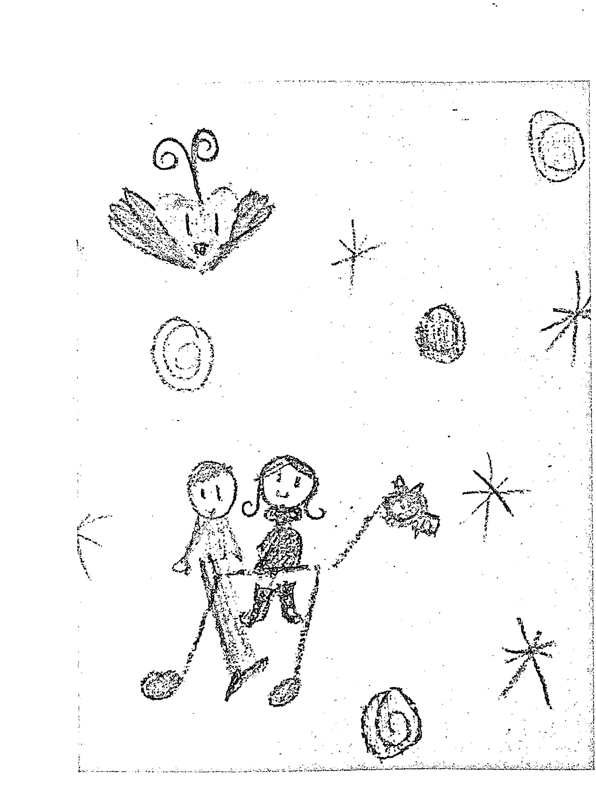

我说：特别就是好，我喜欢你画的马蹄。

女儿说：它们是音符。

儿子三岁的时候也曾蹲在草地上伤感地作了一首诗：

> 沙子会掉在地上，
> 花也会死，
> 鱼会被鲨鱼吃掉。

大诗同学说其实我也是个诗人，我当然不愿意承认。

我甚至不愿意相信自己真的喜欢诗歌。我只是喜欢极少数诗人，就和我喜欢极少数演说家、极少数骗子、极少数圣人和常人一样。

大学时，我闲来无聊，为那个著名的“上来自水水来自海”对了下联：

**云烟过滤嘴过滤烟云**。

一位学长说：不仅对得好，甚至还对出了诗意。

我写“孤独大脑”，绝大多数时候是探寻科学和理性，是还原和计算。

我不赞成、也不欣赏奈保尔在《大河湾》里所写的：

> “我隐约感到人活着就是为了变老的，为了完成生命的跨度，获取人生阅历。人活着是为了获取人生阅历；而阅历在本质上是无形的。快乐和痛苦——首先 是 痛 苦 ——都没有什么意义。感受痛苦和寻求快乐一样，都没有任何意义。”

我愿意跟随黑格尔说，人的本质是精神，而精神的本质是自由。宇宙的辽阔，与概率的不确定性，赋予了我们以自由，哪怕只是错觉。

可是有一天，当我写了一大堆概率计算，试图去探寻“概率权”的背后到底是什么，并想要从可感知的层面去理解贝叶斯时，却不由自主地写下：

我好奇已知和未知的尺度，好奇人类与地球、地球与宇宙之间的尺度比例，更好奇此刻与生命、生命与永恒之间的尺度比例。

当我探寻至“我不知道”的边界时，不得不倚靠诗歌的双翅。

乔治·约翰逊在《心中的火焰》写道：

> “在现实和虚幻之间，每个人的内心深处都想发现一种模式，以整合无序的世界。”

即使是以顽童心态自诩的我，总在试图解构过于“废话”过于“腔调”的东西，想要用结构清晰的推理来洞察这个世界，也无法脱离诗歌那产生于人类无法解释的大脑神经网络当中的巫师般的洞见，以及穿越神秘之地的飞翔能力。

在那篇充满了计算的文章里，我甚至用了以下文字来收尾：

> “这个世界只给我很小的一个角落，
> 很短的一段时间，
> 遇见很少一些人，
> 经历很简单的事，
> 却令我产生如此真实的感知了整个世界的幻觉。”

iPhone还能火多久？

要想回答"iPhone还能火多久"，先要知道iPhone为什么火。

**A：为什么我们离不开智能手机？**

**因为人类正处于一场"数字化殖民"的浪潮当中，智能手机就是商船。**

我们正在从物理世界搬迁至数字世界，商业领域的权力因此发生转移，海外及中国最厉害的公司，基本上都是"数字化殖民公司"。

智能手机，就是大航海时代穿梭于旧大陆和新大陆之间的商船。

**B：为什么iPhone在智能手机里一枝独秀？**

**因为苹果通过提供"人机耦合"的最佳体验，成为物理世界与数字世界之间的收费站。**

前段时间马斯克的"脑机接口"热闹了一阵子，但你想过没，智能手机早就已经是一种非介入的"脑机接口"了。

因为：智能手机如同我你的一个"器官"，把我们和数字世界紧密地接在了一起。

所以，将来超越iPhone的，将是另外一种提供了在"人机耦合"上更无缝、更顺滑的"脑机接口"产品。

“数字殖民时代”的财富

历史上最值钱的公司，是荷兰的东印度公司，其市值最高时相当于今天的7.9万亿美元。

（现在的苹果公司市值约为两万亿美元。）

该公司是荷兰历史上为向亚洲发展而成立的特许公司，成立于1602年3月20日，是世界第一家跨国公司、股份有限公司（指公开而非特权股份），1798年解散。

到了1669年时，荷兰东印度公司已是世界上最富有的私人公司，拥有超过150艘商船、40艘战舰、20,000名员工、与10,000名佣兵的军队，获利同样惊人，股息高达40%。

荷兰东印度公司为什么这么牛？大致有如下原因：

- 一、荷兰东印度公司建立于17世纪欧洲的大航海时代，当时的欧洲各国兴起海上冒险，探寻世界地理，更发展外海的商机。
- 二、荷兰当时的国家议会授权荷兰东印度公司在东起非洲南端好望角，西至南美洲南端麦哲伦海峡，具有贸易垄断权。
- 三、荷兰东印度公司是第一家可以自组佣兵、发行货币的公司，也是第一家股份有限公司，并被获准与其他国家定立正式的条约，并对该地实行殖民与统治的权力。

最大的公司，往往要依托对新世界的开拓，这就离不开一个词：殖民地。

本质而言，当今世界这一波万亿美元市值公司的兴起，恰恰是来自：

**数字殖民地**。

地球从物理空间看，很难有什么殖民地了。但是当人们的生存空间从物理世界转向数字世界，新的殖民机会出现了。

仔细看看，现在的这些科技公司，干的事情和东印度公司几乎一样。

假如没有外部干预，这些公司会越来越大。

- 以前的殖民者，是靠土地来划分；
- 数字世界的殖民者，则是以数字空间的不同价值维度来划分。

硬件入口、搜索、电商、社交、云计算、游戏，超级企业们诸侯割据。

这些数字化超级企业的市值，一部分来自于对物理世界的降维打击，一部分来自于开辟全新的数字化疆土。

这就是为什么万达们等“物理世界的商场”纷纷退场，阿里、京东、拼多多等“数字世界的商场”实现了惊人的财富。

连食物链上端的银行，都无法安睡。

在这场宏大的数字化殖民当中，智能手机就是那些运钱、运货、运人的商船。

人机耦合的“脑机接口”

苹果厉害的地方，一个是软件（以及生态系统），一个是机与人的耦合。

在电子学和电信领域，耦合（英语：coupling）是指能量从一个介质（例如一个金属线、光导纤维）传播到另一种介质的过程。

在数字化时代，信息从互联网到人脑，也需要从一种介质到另外一种介质。

为什么是说耦合，而不是人机界面或者触感？因为苹果一直做的，就是信息在机器和人这两个不同介质之间的交互。

与其说是移动时代造就了苹果的再次崛起，不如说是因为人和机之间的耦合越来越“密切”所带来的需求。

AirPods就是一个例子，看起来没什么了不起，但此前就是没有一个公司能搞掂：让蓝牙耳机（作为智能手机的一部分）变得像是耳朵的一部分。

实现这一点并不容易，需要做到“赏芯悦目”。

赏芯：苹果专门为AirPods设计了H1芯片，加上感应器和软件，极为“聪明”；

悦目：尽管起初外形被骂得一塌糊涂，现在反而成了时尚符号。入耳也很舒适。

又比如，我买过好几个VR眼镜，没哪个能打动我。

心想，也许只有等苹果做出VR，这个品类才能真正成为必需品。

就像AirPods其实重新发明了蓝牙耳机和可穿戴设备，VR眼镜这类“人机耦合”的数字化产品，在等待一次重新发明。

此外，AR类产品、智能音箱、智能汽车，都需要既聪明，又与我们古老的躯体无缝连接。

正如iPhone12在5G、仿生芯片、超瓷晶面板等软硬件方面的进化。

所以，下一个替代智能手机的超级设备，必须在“人”和“机”的耦合效率以及器官级体验上实现突破。

那时，数字化殖民时代的权力，将从iPhone转移到新的“商船”。

创业如狼，投资似鹰

不言而喻，要想成为一个特别有钱的人，你要么创业，要么投资，要么两个都干。

然而，创业和投资都是小概率成功的事情。

尤其是投资，更容易让人有“这事儿很简单”的幻觉：道理我都懂，下注也难。

结果，即使是最聪明的人，到头来都会感慨“投资太难了”，真正从里面赚到钱的，少之又少，大多数人都当了韭菜。

创业呢？也很难。

假如说投资是“赌博”，创业简直是“搏命”。

一旦你开始创业，你就会发现，全世界都团结起来与你作对，艰难，失败，什么都缺，灰暗，绝望。

那么，那些厉害的创业者，牛叉的投资人，为什么可以摆脱魔咒，赚到大钱？

除了运气好，他们还有一个共同的秘密：

像投资者一样创业，像创业者一样投资。

创业者是地面的狼，投资者是空中的鹰。

创业者像狼一样，瞄准目标，紧追不舍，咬住不放，勇敢，坚忍，使命必达；

投资者像鹰一样，俯瞰大地，看周期，看赛道，以概率思维下注，撒豆成兵。

我们先看看二者的差别：

- “创业狼”是自下而上，干了再说；
- “投资鹰”是自上而下，三思而后行。
- “创业狼”是第一层思维，知行合一；
- “投资鹰”是第二层思维，对“思考”本身进行思考。
- “创业狼”是感知输入，在实践中获取数据和反馈；
- “投资鹰”是理性分析，讲逻辑讲数据。
- “创业狼”是“好奇感知，疯子行动”；
- “投资鹰”是“灰度认知，黑白决策”。

然而，在我看来：

- 一个厉害的创业者，需要像投资者一样思考；
- 一个牛逼的投資人，能够如创业者一样行动。

二

高瓴的张磊，红杉的沈南鹏，都是像创业一样做投资的人。

投行出身的沈南鹏，从1999年开始创业，先后创办了携程和如家，是个真金白银的创业者，从零到一、再从一到一百，把一摊子事儿完整地做起来了。

大多数投资人并非如此。就像有些分析师不管讲得多么透彻多么深刻，因为没有亲自去一线打过仗，总是缺了点儿什么。

当然，是否创过业，不是优秀投资人的必要条件。但是，优秀的投资人应该有创业思维。

有人说沈南鹏投资的秘密在于“对行业的深度研究和调查”，其实只有像创业者一样身临其境，担当风险，敢于试错，大胆创新，才能作出有价值有意义的调查和研究，否则就是隔靴挠痒，隔岸观火。

与其说他们在做深度调查，不如说他们像创业者一样置身其中，来到战场的最前沿，直面枪林弹雨。

也许有人说，张磊并没做过生意啊？

有，他很小的时候，就在老家驻马店火车站摆过地摊儿，出租小人书，还组建了五六个人的小团队。

我一直的观点是：创业必须亲历之后才能体会，哪怕摆摊儿也算，而且年龄越小越好。

所以张磊说：

我们是创业者，碰巧还是投资人。

我们采用的是研究型模式，通过研究发现哪个是最好的商业模式，然后我们再寻找跟这个商业模式契合的最佳创业者。

如果我们研究发现可以通过二级市场上的公司实现，我们就买入股票长期持有；

如果没有这样的公司，我们就寻找私人市场；

如果再没有发现合适的，我们就自己孵化。

沈南鹏说：赌要理性，干要果断。

- "赌"要"理性"，是指投资者面对不确定性时的灰度思考和理性计算，就像一只在天空遨游的鹰；
- "干"要"果断"，是指创业者像狼一样，面对各种不可能，身往直前。

地面的狼+空中的鹰，让这些"碰巧是投资人的创业者"如狼似鹰。

三

巴菲特说：“我是一个比较好的投资家，因为我同时是一个企业家，我是一个比较好的企业家，因为我同时是一个投资家。”

巴菲特小时候送报纸、捡打飞的高尔夫球贩卖，在理发馆捏弹子球机，都是亲自创业的经历。

某种意义上，巴菲特是以投资股票的方式来经营企业，倒过来说也对。“这种经验使我在商业和投资领域都能从容的做出正确决定。”

在其漫长的投资生涯，巴菲特屡次冲向管理第一线，斗工会，抓经营，出任生死关头的所罗门公司的临时CEO，展现了其两只眼（投资人+创业者）的强悍力量。

投资和创业，就像巴菲特的两只眼。

芒格在与巴菲特合作之前，也做过各种生意。

## 像投资者一样创业，像创业者一样投资。

这方面的典型人物，还有段永平。

段永平做企业出身，在投资方面他极力推崇“价值投资”：
- 不是买股票，而是买入公司一部分所有权；
- 不是看重股价的涨跌，而是看公司未来到底能赚多少钱。

你看，这不都是创业者（企业家）的思维方式吗？

### 四

上面几个说的都是投资人，再说创业者（企业家）。

亚马逊的贝佐斯，是一位有投资人思维的创业者。

1. **作为创业者**，贝佐斯幸运地是在西雅图创业。这个美国西北角的城市非常奇怪，除了诞生了微软，还有波音、星巴克、Costco等一大堆伟大的公司。贝佐斯就曾经得到了Costco创始人的指点，算是开了管理的天眼。
2. **作为投资者**，贝佐斯在华尔街混过，也是价值投资的信徒。

但是，对于数字化的公司，价值投资怎么玩儿？这一点连巴菲特也没看明白。所以他和芒格都为自己居然没买亚马逊的股票而懊恼。

贝佐斯想明白了一件事，在虚拟的数字化世界里，一样是有“资产”的。

我称之为“数字化房地产”。

没错，这个世界最赚钱的生意，仍然是房地产。只是，发生在数字世界。

贝佐斯想明白了一件事，这件事巴菲特很晚才理解。那就是：

亚马逊的价值，在于提供类似于水电的数字化基础设施服务。

加上从Costco创始人那里的偷师，亚马逊打出了"超低价+巨量+微薄利润"，大量吸引用户，形成规模效应后，以更低的基础设施成本和更低的价格吸引更多用户，形成飞轮效应。

此外，贝佐斯对于"自由现金流"的理解和运用，也与巴菲特的价值投资同宗同源。

### 五

像投资者一样创业，像创业者一样投资。--并不是说实业和资本的结合。

这里强调的，是一种融合的思维方式。

- 往小里说，投资人是用先验概率来思考的，创业者是用后验概率来思考的。
- 往大里说，这是我们用来洞察未知世界的多层次、立体化的视角。

如爱因斯坦所说：

> "物理学家们说我是数学家，数学家们又把我归为物理工作者。"
> 我是一个完全孤立的人，虽然所有人都认识我，却没有多少人真正了解我。

爱因斯坦取得的成就，得益于能够从物理与数学两个角度去深度思考。

爱因斯坦曾经在一封信里写过：

西方科学的发展是以两个伟大的成就为基础的：

希腊哲学家发明形式逻辑体系（在欧几里得几何学中），

以及（在文艺复兴时期）发现通过系统的实验可能找出因果关系。

我可以“牵强附会”地说：

- 投资者的自上而下，像是形式逻辑体系；
- 创业者的自下而上，像是系统实验的试错。

当然，我们也可以鸡汤地说：

既要像狼一样脚踏实地，又要如鹰一般环视天空。

这就是我《人生算法》里说的：

**好奇感知，灰度认知，黑白决策，疯子行动。**

## 财务自由，靠“投机”能实现吗？

首先，我们要区分一下：

**投资、投机、赌博之间，到底有什么区别？**

看起来，这三者都充满了不确定性。

企业家和投资者们，也经常喜欢说：让我们赌一把吧。

说起来，好像都是为看不见的未来下注：

赌赢了就是投资成功；

赢得惊险赚得很多就是投机成功；

失败了便被视为“赌输了”。

**人生一场，谁不是赌呢？**

这种想法，其实是不思进取、不动脑子的自暴自弃。

为了避免掉入毫无意义的讲大道理和文字游戏，在这里，我想用一个简单粗暴的方式来定义：

- **期望值为正的，是投资**；
- **期望值是负的，是赌博**；
- **期望值未知的，是投机。**

有投资经验的客官可能会说了，你这不是废话吗？既然说了是不确定性，就很难分清期望值是正是负。要是知道期望值，谁不会赚钱啊？

果真如此吗？

未必。

本文的前几部分看起来很简单。不过，现实中，我们犯的绝大多数错误，都出现在简单的常识方面。

我将事件的不确定性、时间的不确定性和筹码的不确定性整合在一起，去探寻如何用概率思维来构建一个体系。

何妨一起重温一下？

### 二

期望值的概念虽然非常简单，但真正能搞明白的，没多少人，在人群中也许多于1%。

曾翻过一本据说卖了几十万册的畅销书，里面有一讲概率，作者居然混淆了概率、赔率、期望值等基本概念。

让我们从头复习一下期望值：

在概率论和统计学中，一个离散性随机变量的期望值（或数学期望，亦简称期望，物理学中称为期待值）是试验中每次可能的结果乘以其结果概率的总和。

换句话说，期望值像是随机试验在同样的机会下重复多次，所有那些可能状态平均的结果，便基本上等同“期望值”所期望的数。

举个例子，你一直扔一个骰子很多很多次，你得到每一个的可能性是一样的，那么你扔一个骰子的期望值就是：

$$E(X) = 1 \cdot \frac{1}{6} + 2 \cdot \frac{1}{6} + 3 \cdot \frac{1}{6} + 4 \cdot \frac{1}{6} + 5 \cdot \frac{1}{6} + 6 \cdot \frac{1}{6} = \frac{1 + 2 + 3 + 4 + 5 + 6}{6} = 3.5$$

那么，由此可以计算得出，掷一枚公平的六面骰子，其每次"点数"的期望值是3.5。

这是无限多次重复后，得到的一个平均值。

### 三

这么简单的一个框架，是几乎所有投资高手必备的第一公式。

鲁宾举过一个高盛的投资套利的案例。

有一次，在某两家公司宣布合并之后，高盛打算做一次套利。

尽管宣布了消息，但是该合并可能成功，也可能失败。

高盛打算买入其中的W公司，当时股价是30.5美元。

如果合并事宜谈妥的话，W公司的股价上涨可能3美元；

如果合并失败，W公司的股价有可能下跌6美元左右。

这相当于是对骰子上面的数字估值，接下来还要估一下每一面出现的可能性。

把合并成功的可能性定为大约85%，失败的可能性为15%。

接下来，我们计算一下期望值：股价可能上涨的幅度是3美元乘以85%，而下跌的风险是6美元乘以15%。

- 3美元×85%=（可能上涨）2.55美元
- -6美元×15%=（可能下跌）-0.9美元
- 二者相加，该投资的期望值是每股1.65美元。

该投资计划三个月内完成：

- 每股期望值是1.65美元
- 本金是30.50美元
- 3个月的可能回报率为5.5%，
- 年化回报率可能为22%。

普通人看这个案例，可能会觉得满头露水：

涨多少跌多少钱是猜的，涨跌的可能性也是猜的，这种计算有意义吗？

期望值的计算，提供了一个分析框架，用于面向不确定性未来的决策和下注。

- 对于股价可能的涨幅和跌幅，有赖于专业能力与经验。
- 对于交易是否可能完成，有赖于专业以及情报。

以上两件事情水平再高，也需要放在期望值计算的分析框架下，才能与不确定性共舞。

不管这次交易预测得多准，结果都可能是出乎意料的，与期望值相去甚远。

就像扔骰子，期望值是3.5，但是你扔出一个6的可能性还是有1/6。

塔勒布的下注，看起来像期望值未知（只是“我相信”）的投机。

那么赌博呢？

以美国的轮盘赌为例：

- 常用的轮盘上有38个数字，每一个数字被选中的概率都是相等的，也就是1/38。
- 你下注在某一个数字上，如果押中，赚相当于赌注35倍的奖金（赌注不包含在内），若没押中，你输掉赌注。

我们来算一下期望值，假如你每次押1块钱：

- 赢的概率是38分之1，能获得35元；
- 输的概率是38分之37，亏掉1块钱。
- 35×1/38-1×37/38，结果约等于-0.0526元。

也许你偶然会押中，本钱变成36倍，甚至押中了好几次，但是只要你持续玩儿下去，大数定律就会发挥作用，你会稳稳地输光所有本钱。

所以，这个世界上靠“稳定”的概率来赚钱的，也许只有赌场老板。

反过来，假如你是一个想追求稳定概率的赌徒，你会输得很稳定，穷得很稳定。

何止是赌徒，在现实中，为了虚幻的确定性，人们愿意做任何事情。

### 五

好了，假设我们都知道“期望值”这个概念，也暂时假设我们对于涨幅跌幅以及对应的发生概率估算很靠谱，那么是不是就可以走在成为投资高手的路上了？

还是不行。

2016年，物理学家奥利·彼得斯和诺贝尔物理学奖得主默里·盖尔曼写了一篇关于遍历性的论文，里面有个例子：

有个玩硬币的赌博游戏，你投入1元，50%可以得到0.6元，50%可以得到1.5元。

根据期望值计算，一半可能性损失40%，一半可能性盈利50%，算下来数学期望是5%。

用流行的话说，这是大概率赚钱的事情，你可以大胆玩这个游戏。

不过，这个游戏有两种玩儿法，确切说，是有两种不同的下注方式：

方式a：你每次都拿1块钱去玩，假设你有无限多个1块钱，你可以一直玩下去，从长期来看你肯定是赚钱的，平均每把用5%的数学期望算是0.05元。

缺点是太慢，而且你必须有足够多的时间能玩下去。

方式b：拿出自己能拿出的最大的资金，然后投入进去。

后面这种玩儿法，就是所谓的All in。看起来极端，其实很多人都是这么干的，我自己也经历过，谁没年轻（蠢）过啊。

我们做个简单的计算吧。

你本金一百万，第一把赢，第二把输，第三把再赢，如此持续下去。

直觉上看，100万本金，赢了是赚50万，输了是亏40万，为什么不能玩儿呢？

拿张纸，用中国当前幼儿园小班的数学能力计算一下：

100万×(1+50%)×(1-40%)×(1+50%)(1-40%)……

一直这么玩儿下去，你会发现，没有几把就没钱了。

这难道不是绝大多数普通人做投资的现实吗？

韭菜自己被割起来更加无痛，没准儿还觉得是自己被割的时候姿势没摆好，天天继续勤学苦练，把辛辛苦苦的钱接着拿去All in下一个风口。

这里计算的关键，是算术平均值和几何平均值之间的差别。

假如你花100万买了一只基金，第一年涨了100%，第二年跌了50%。那么你的收益是多少？

按照算术平均值计算：

平均收益率=(第一年收益率+第二年收益率)/2=(100%-50%)/2=25%。

按照几何平均值计算：

年收益率假设是x，(1+x)×(1+x)=(1+100%)×(1-50%)=1，计算结果，x=0。

也就是说，按照几何平均数算，年回报率是零。实际就是如此。

这里用几何平均值计算出来的回报率，就是所谓“年化回报率”。

对比而言：

“年化回报率”（几何平均收益率）更准确地反应基金实际的历史收益情况；

算术平均收益率放大了投资的收益率。

下次买基金，记得问一下：

这只基金多久了？这个回报率是算术平均值还是几何平均值？

### 六

至此，又出现了一个与“不确定性”相关的要素，那就是：

筹码。

期望值为事件和时间的不确定性提供了一个框架，但不包括筹码。

**即使你对不确定性事件有足够的洞见，假如你不能把握好下注的数量，时间就不能成为你战胜不确定性的朋友。**

- 你下注比例太小，可能赚得太慢；
- 你下注比例太大，可能会亏光本金；

即使获胜概率更大，期望值也为正，如果你次次 all in，也可能因为几何平均值而被割光了韭菜。

这时，一条投资真理冒了出来：

**在成功之前，你必须活下来。**

金融传奇人物索普，在试图战胜赌场的过程中发现，即使你洞察了赌场的漏洞，找到了期望值为正的机会，也要面临“如何决定赌注大小”的挑战。

另一位天才香农建议他参考约翰·凯利1956年发表的文章。

香农把它稍做修改后将其作为21点、轮盘赌、其他赌博、体育博彩和股市的下注原则。

凯利公式遵循的是几何平均值最大化的准则，使用该公式决定每次下注金额占本金的比例，能够让投资者每一个时期都最大化组合收益的几何平均值。

据得州大学捐赠基金的数据显示，扣除费用之后，高瓴截至2019年6月的近十年年平均回报率大约是20%。

也许有人会意外，这么牛的公司，年回报也"才"20%呀！

当然，事实是连续十年年回报20%，已经很惊人了。

重点在于，即使牛如巴菲特和高瓴，也在源源不断地获得资金，为下一次下注准备筹码。

只有如此，无限游戏才可以持续下去，英雄一直留在场上，大数定律发挥作用，财富因为遍历性中的概率优势、以及最大化的正期望值得以实现。

这才是"长期主义"背后的道理。

## 八

投资很难，为未来下注，从不确定性中赚钱，对谁都是很难的事情。

没谁是靠水晶球赚钱的。

2018年蔚来上市时，高瓴在蔚来的持股比例高至7.5%。

2019，张磊继续下注于新能源汽车赛道，增持蔚来至12%，还新买入66.83万股特斯拉的股票。

结果，因为新能源汽车补贴滑坡，以及燃油车因国六标准出台甩卖，蔚来的股价最低跌至1美元。

张磊接下来清盘了蔚来和特斯拉，就在特斯拉大涨的前夜。

时至今日，蔚来的股价已经涨回到近28美元。

举蔚来和特斯拉的例子，不是说张磊不厉害，也不是想像某些文章去谈“张磊的长期主义你们学不会”，而是想说：

1. 没人能够预测短期的未来，在某个时间“看错”某笔投资，太正常了；
2. 一个成熟的投资者不需要维持自己的“无比正确”，只需要从概率和期望值层面获胜就好了；
3. 作为一只越来越大的基金，在某些领域的投资见好就收，避免回撤，也能实现较好的几何平均回报；
4. 高瓴2020年7月回头又重仓了小鹏汽车。

### 九

也许你还记得开篇时我埋下的一个火种：

你凭什么估算出一笔投资的期望值？

你怎么知道买了一只股票，可能涨10块钱，发生的可能性是60%；可能跌5块钱，发生的可能性是40%。

这么多可能性，叠加在一起，不就更加不可能了吗？

期望值计算，提供了一个应对不确定的框架；

凯利公式，提供了一个根据本金比例下注的准则；

获取资金，为投资人提供了源源不断的弹药。

然而，想要取得像高瓴那样年20%的回报，你还需要做到更多。

概括而言：

- 一个是获取更好的投资标的；
- 一个是介入公司让价值上涨的概率变大，从而主动提升项目回报的期望值

前者，我称之为资源；

或者，则为赋能。

张磊将自己在人大和耶鲁的校友圈用的淋漓尽致，他会在香港的豪华游艇上接待投资圈与企业界的牛人们，人脉在东方国度对投资而言有着更重的分量

至于赋能，这方面的案例就多了，通过合作、技术等。

- 因为资源，能拿到更好的项目；
- 因为赋能，能够让项目的回报期望值更高。

在完成了以上种种，再加上时机和运气，高瓴才为客户实现了20%的年回报

我们一直没有意识到，自己非常幸运地出生在一个充满了奇迹的时代。

中国过去30年的快速而长时间的增长，在人类历史上都极其罕见。

但我们身处其中，就觉得习以为常，好比坐惯了高铁的人，对风驰电掣司空见惯。

另一方面，民间文化对于头部牛人的推崇，其实强化了彩票头奖效应，也让很多人认为赌场必有秘籍。

人们习惯了赌，崇拜赌场赢家。

人们为错过房地产焦虑，为错过腾讯焦虑，为错过比特币焦虑。

遍地都是十倍、百倍回报的传说，让人晚上睡不好觉。

这种对于头部赢家的拜神，对普通人最大的伤害，就是让人陷入了“小数陷阱”，误把一些极小概率的事情当作常态。

然而现实是，即使是在高速增长的年代，投资也是一件非常难的事情。

很少有人因为回报低而贫困，但太多富人因为追求更高的回报而亏光辛辛苦苦赚来的钱。

那些钱大多来自大时代的超级运气，几乎都无法再次重现。

## 最后

总结一下：

1. 远离赌博，谨慎投资，尽量别投机，去做正期望值的事情；
2. 投资有亏有赚，别试图靠预测赚钱，要靠概率和正期望值；
3. 投资很难，我们要放低获得超额回报的预期，追求合理回报；
4. 下注需要控制比例，拉长时间；
5. 要有源源不断的现金流。小心那些不产生现金流的固定资产投资，哪怕有些看起来可能有很大“涨幅”；
6. 发财之前别挂掉；
7. 对于年投资回报率，几何平均值比算术平均值更重要；
8. 别去参加那些零和游戏;
9. 努力创造价值，做创造价值的工作，投资于创造价值的公司;
10. 关于财务自由，请记住：金钱如海水，越喝越渴。

一旦你把财务和自由放在一起，其实是自由戴上了枷锁。

## 机会泵：如何管理你的运气？

### 零

- 为什么有些笨家伙比你有更好的财运？
- 为什么你的桃花运还不如某些丑男丑女？
- 运气到底是天注定，还是靠努力？

本文提出了一个原创的概念：机会泵。

### 什么叫"泵"？

维基百科是这样定义的：泵，是一种用以增加流体的压力，使加压过的流体产生比平常状况下更巨大推进力量的装置。

人类及动物的心脏可说是天然的泵，它把血液输送到身体各个部分。

机会，有点像水，所以我们喜欢说：“遇水财发、以水为财”。

如同机会的变幻莫测，水也难以控制，无法把握。水能载舟覆舟，亦能煮粥煮酒。

水或浩浩荡荡，或波澜不惊。像极了你我的命运。

贾宝玉说：“任凭弱水三千，我只取一瓢饮。”机会也如水，随机出现，你能把握其中的少许好运，避开那些厄运，就足够了。

“只取一瓢饮”并不是说宝玉专情，而是指在一个由无限的不确定性构建的宇宙中，我们一生的短暂与永恒，需藉由与有限机会的共舞来实现。

不管是好运还是厄运，如水无形，难以控制。你只能放大或缩小它们的可能性。

“你记住，你的一生中可能会遇到很多美好的东西，但只要用心好好把握住其中的一样就足够了。”禅师的这句话，像是概率课老师写下公式后的感慨。

所以，机会泵就是这样的种装置，其用于：增加好运气的可能性，降低坏运气的可能性。

如同心脏，泵的循环往复，像是一天、一年的重复，更像是一个人的宿命。

这宿命因为顺从或反抗，而被改变，被强化。

人的一生，短期靠运气，长期靠实力。

但是，我们需要一个运气管理系统，把运气和实力连接起来。

让我们来玩几个游戏。

先说一个你很熟悉的场景，你想买个手机：

- A手机比B手机屏幕大，B手机比C手机拍照好，C手机的电池比A耐用。

所以：

- 当你想用手机看视频时，你喜欢A超过B；
- 当你想拍人或自拍时，你喜欢B超过C；
- 当你想出门一整天在外时，你喜欢C超过A。

游戏开始：

第一步：我将免费把A手机送给你。

第二步：有一天，我傍晚找到你，正好你在外面一整天，手机快没电了，我对你说，你看C手机比A手机待机多5个小时，多实用啊！这样吧，你加100块钱，就可以用A手机换一个C手机。

你一想，有道理，100块钱也不贵，就换了。

第三步：又有一天，你和女朋友出去玩儿，需要拍照，这时候你心想，要是B手机就好了，拍人要漂亮不少。

我又适时出现，说，只要出100块钱，你就可以拿你的C手机，换一个拍照更好的B手机。

你自然无法拒绝，于是接受了。

第四步：如法炮制，趁你在看视频，我让你花100块钱，用B手机换回了屏幕更大的手机A。

问题的关键在于，这个游戏可以一直循环下去：

- 你不断用C换A，用B换C，用A换B，一轮又一轮；

从血缘方面讲，我与我儿子有血缘关系，我儿子与我妻子有血缘关系，但是我和我妻子之间并没有血缘关系。

这类传递性，看似是因为定义不清而导致的，因为血缘关系是指部分DNA相同，所以当然不能彼此包涵。

还有一类不可传递性，是因为逻辑错误。例如：

- 我喜欢他，他喜欢她，所以我喜欢她。

这属于 “四词谬误”。且不论。

更让我们纠结的 “传递性” 难题，通常是下面这一类：

你想买个手机，或者是买房买车，或者想选个女朋友，假如你有三个以上的选项，就可能陷入如下困境：

- 你要买房，房子一号又大又漂亮但有点儿远，房子二号小一点儿但位置特别好，房子三号又旧又贵但是个顶级学区房。

你选哪个？

聪明如你可能看出来了，这是因为对比的标准在不断摇摆，当然会导致偏好不能传递了——

也就是说无法像我们读书时学的那样，因为A比B好，B比C好，就得出A比C好的标准答案。

关于传递性的好玩儿案例，还有 “投票悖论”、卡尼曼的 “概率心理物理学”、“非传递性的神奇骰子” 等等，恕我不一一介绍。

我想说的是下面这类有些隐蔽的 “不可传递”：

- 我在小红右边，而小红在小明右边，所以我在小明的右边。

看起来这个传递性似乎可以，但是，如果我和小红、小明坐在一张圆桌上呢？

你可能又看出来了，这不就是“剪刀、石头、布”的游戏吗？

“钱泵”的概念，来自“非传递性”。

因为人们的某些“非传递性”的非理性偏好行动，可能导致钱财被泵吸干，而且不知不觉。

### 三

你有没有想过，为什么现实中很少有福尔摩斯？

通常而言，福尔摩斯的神奇之处，在于他能够做一连串推理，大致结构是这样的：

因为A，所以B；因为B，所以C；因为C，所以D；因为D，所以E......

所以，凶手就是大魔王！

之所以极具戏剧性，是因为上述一系列推理，就像杂技团的叠罗汉，叠得越高，越有冲击力。

然而，现实中很难见到杂技团的这种极度不稳定结构。

我们算个简单的账吧：

假如福尔摩斯的每一步推理的靠谱度高达80%（这算料事如神了吧，有这种预测能力去炒股的话很快会成世界首富），那么从A推理到E的靠谱度，就是：

80%×80%×80%×80% = 40.96%

也就是说，即使每次推理的准确率再高，经过多个环节的叠罗汉，也变成不那么靠谱了。

关于 “非传递性”，有这样一个例子：

黑和白，算是黑白分明吧？

- 但是假如黑1是全黑，黑2稍微淡一点儿（肉眼甚至看不出来），所以差不多；
- 黑3再稍微淡一点儿，所以和黑2也差不多；
- 不断递减下去，我们就能得出一个荒唐的结论：
- 黑色和白色是差不多的。

所以，为什么现实中很少有福尔摩斯？

因为因果推理之间的链条，会不断弱化，并叠加在一起，直至倒墙。

为什么 “钱袋” 能得手？

因为那些伪装成 “传递关系” 的链条，其实是非传递性的。

甚至是那些看起来近似于 “传递性” 的关系，也会因为链条较长，而叠加成截然相反的结果。

运气，也会有类似的衰减效应。

让我们小结一下：

1. 人们依靠“传递性”来做判断，做决策；
2. 但是因为人类有某些非理性偏好，所以经常会掉进“非传递性”陷阱；
3. 所谓钱泵，就是利用非传递性的衰减，把钱一点点抽走。

### 四

那么，什么是机会泵呢？

你可能也听说过别针换别墅的故事吧：加拿大的一位小伙子，用一枚大别针，去换别人的东西，换把手，换烤箱，换车，越换越大，最后终于“换”到了一栋别墅。

这个故事，像是反向的“钱泵”：这位小伙子是利用创意、网络注意力来一步步放大自己的权益。

如前所述，现实中的“传递性”，基本上都会一步步衰减。而别针换别墅这类一步步增强的，不仅罕见，而且更像是一次行为艺术。

在这个过程中，看似小伙子在占便宜，其实他每个环节都在做功，都在“增大流体的压力”。

假如你什么都不做，例如你只是把现金存个定期，可能你会被每年的通胀一点点抽走财富；

假如有姿势正确的增压，你的财富就有机会不减反增。

你需要有一个泵。

泵，是给流体增大压力，令其有更巨大的推进力量。

对于运气而言，同样如此。

弱水三千，你只能取一瓢饮。

所谓机会泵，是用于放大机会的。

我将“机会”的链条，大致分作如下三个环节：

1. 收集机会；
2. 配置机会；
3. 实现机会。

在现实中，机会从收集，到配置，再到实现，是一个逐步衰减的过程。

所以，通过机会泵，我们在以上三个环节，增大机会的推进力量。

进而，利用泵的循环往复，“收集、配置、实现”三者之间彼此强化，源源不断地带来更多更好的运气。

所谓人生赢家的秘密，在于建立了“实力”和“运气”之间的正反馈循环机制。

人与人之间的差别也许没那么大，但是为什么命运差别那么大？

除了运气，还因为：

有些人利用机会泵放大了水一样的机会；

而有些人被钱泵抽干了财运。

### 五

机会，是一种偶然事件，必然涉及概率问题。

运气的最大特点，是不确定性。

而概率模型是对不确定现象的数学描述。

我曾经构建过一个“三层概率”，可以拿来对应机会泵的三个环节。

- 第一环节：收集机会，是指对外部信息与资源的获取；
- 第二环节：配置机会，是基于核心的计算和配置；
- 第三环节：实现机会，则负责执行、试错、反馈、复制。

就像打牌，第一环节是力求抓到好牌，第二环节是制定策略排兵布阵，第三环节是冷静地打好每一手牌。

### “机会泵”第一环节：收集机会

这一环节的策略，有以下几点：

**策略一：拿到“硬通货”门票**

贝索斯招聘的时候会看SAT（美国高考）的成绩，这样未必准，但能降低筛选成本。

这个世界不公平的地方在于，有些游戏必须有了门票才有机会玩儿。

**策略二：越主动越幸运**

在一个TED演讲里，一位斯坦福大学的教授说：幸运并不是一道不可预测的闪电，相反，幸运更像是风，它的出现绝非偶然。

她建议，你要愿意去冒一点不被他人回应的小风险，避免安于现状；改变自己与他人的关系，懂得感恩；不要轻易对一个想法下判断，不要没有行动就放弃……

如何提高找到如意郎君的概率？在一本书里，女主角的核心策略就是，不拒绝任何一个约会和相亲，增大样本量。

**策略三：强化IP，降低识别成本。**

经营好自己的IP，有助于拿到好牌。淡泊如巴菲特，也要靠自己的声誉拿到好的投资标的。

**策略四：强化专业，构建节点价值。**

即使你不善于混名利场，若你在一点上打爆点，也会有资源聚合而来。各种专业网红的逻辑就是如此。

一个理性选择的标准之一就是：基于决策者目前的资产（资源）。

资产不仅指金钱，还应包括生理状态、心理能力、社会关系和感觉。

通过大样本量获得的、长期的成功才是最甜美的。

对于有能力的聪明人而言，要理解资源的重要性，别有洁癖；

对于热衷于关系和资源的人而言，要意识到，只有结合第二环节和第三环节，“收集机会”才有价值。

### “机会泵”第二环节：配置机会

这个环节，算是机会泵的全场灵魂。

尤其是在信息时代，作为社会人，你的算法是可以把别人的理性或者非理性，作为已知条件代入的。

从实用主义的角度，还有投资角度的隐喻：

资产的配置，比各种努力和折腾更重要。

投资传奇人物，耶鲁校友基金的掌舵人大卫·F·斯文森在《不落俗套的成功》里说：资本市场为投资者们提供了三种能获得投资收益的工具：资产配置、择时交易和证券选择。

研究表明：

**资产配置的决策在决定投资结果上起着主导作用**。

根据大量受好评的、对机构投资组合的研究，在投资收益的变动中，大约 **90%**是源于资产配置，只有大约 10%是由证券选择和择时交易所确定的。

另外一项对机构投资者业绩的重要研究表明：**100%的投资收益都是来自资产配置**，认为证券选择和择时交易的作用微不足道。

这就是所谓**选择比努力更重要**。

**这个环节最难**。

难在绝大多数人不理解运气的随机性，更不懂用概率思维来驯服偶然。

我在《财务自由，靠“投机”能实现吗？》讲投资的期望值计算，提及投资人需要估算某一笔投资上涨的概率和可能的上涨幅度，很多人无法理解，说，这不就是赌博吗？

事实上，“随机过程”一词的英文是 stochastic process 或 random process，而stochastic一词来源于希腊文stokhastikos，本意就是“猜”，即表示猜想随机现象的规律。

所谓概率思维，就是聪明地猜。

来，测试一下，你会不会猜。

有个游戏。现在你面前有100张牌，已知70%是红色牌，30%是黑色牌。

所有的牌都是背面朝上，而且长得一个样子。

请你来猜牌的颜色，猜中一张奖励一万块。

请问，以下两种策略，你选择哪一种？

- 策略A：70%的时候猜是红色牌，30%的时候猜是黑色牌；
- 策略B：每次都猜是红色的牌。

你会选哪个？

答案是B。

据说在实验测试中，即使参与者都是聪明人，但是大部分选择了策略A。

但事实上，策略A猜中的机会是：

70%×70%+30%×30%=58%。

而策略B的猜中机会是70%。

你看，在配置环节赌努力，其实没啥用，只是制造确定性的幻觉而已。

这一环节的重点在于：

- **敢于猜**，是指能够理解这个世界是充满不确定性的；
- **聪明地猜**，是指你要懂得概率思维和概率计算；
- **会猜**，是指你需要拥有在具体领域里的专业、经验和洞见。

为某个可能性赋予数值，是给予“信念”，这是一个先验概率。

接下来，你需要用**机会泵**下一个环节的动作，来获取后验概率，并不断更新，让自己“猜”的水平越来越高。

### “机会泵”第三环节：实现机会

第三环节，就像一个职业杀手。他的特点是：

1. 全力完成每一个任务，完全不在乎外部的评价，也从来不去看比分牌；
2. 每完成一个任务就清零，从头开始，不被情绪左右；
3. 杀手要靠专业领域的实力来活命或者吃饭，所以需要大量的反复训练，成为直觉强大的杀人机器；
4. 最终的结果，取决于第二环节（二传手）的传球“好球率”，与第三环节（职业杀手）的“击球率”，二者相乘。

杀手最重要的品质，是专注和冷静，像人肉阿尔法狗，打完记忆的牌。

就像《兄弟连》里老美看着被俘的德军感慨说，这帮家伙被打败后行军都还像获胜者一样。

不管第二环节的理性思考多么高明，概率计算多么精确，都需要到“第三环节”这个现实世界来检验。

职业杀手有两重使命：

a. 去执行第二层的命令；
b. 在某个半径内检验各种可能性。

科学的本质就是不断做实验，职业杀手亦是。

如此，我们便能理解，亚马逊的贝索斯反复强调的“Day 1”的含义了。

### “机会泵”的工作原理

简而言之，好运气取决于三个环节。

最终结果决定于三个环节的整体完成度，而不是某一环节的强大。

但是三个环节又不是一个简单的叠加的、递进的关系，它还有**系统动力学的反馈、自我强化**等特点。

例如实现机会（第三环节）较强，可以带来更多资源（第一环节）。

而一个人一旦获得更多机会资源，打起牌来也就更加得心应手（第二环节）。

三个环节一旦整体运转起来，就形成了一个**机会泵**。

这样一来，你就可以让自己的运气越来越好。

### 六

为什么我要由“非传递性”，来引出“机会泵”的概念？

因为我们从小的教育，就是通过学习“传递性”，来消除不确定性的。

例如，儿童在 7—11岁进入具体运算阶段后，可以通过运用传递性来计算。更小的时候，教会一个孩子2比1大，需要给他两个苹果和一个苹果来对比。

但是在具体运算阶段，儿童不需要数苹果，也能推算出2>1。对此，皮亚杰的观点：认知结构应该反映数学结构。

一个人漫长的受教育期，就是被“严格的传递性”这类概念来不断“完善”所谓认知结构。

然而，说起运气，我们就需要一些混乱的现实世界的智慧。

刻板的“传递性”的背后，是人类对于“决定论”的信仰，以及对“因果论”的幻觉。

从原始人的盲目迷信，到农耕时代的基于观察但不知其因的决定论，到亚里士多德的“万物皆有目的”的决定论，再到牛顿时代的发现内在的、定量的动力学规律决定论，再到基于概率和统计的现代科学，我们的认知，就像人的大脑一样，是层层叠加起来的。

我们有原始人的迷信，我们从直觉上更倾向于亚里士多德而不是牛顿，我们绝大多数人从来不曾理解概率思维。

我们在漫长的教育当中，极少涉及不确定性和运气。

但是来到现实世界，却发现似乎是运气和机会主导着一切。

- 在物理世界，我们的理解出现了根本性的重组，从牛顿式世界观的确定性转向量子力学的不确定性。
- 在人类社会，以概率为研究工具的行为经济学与行为金融学否认了“正宗”经济学对于理性人的假设。
- 而在影响现在和未来最大的计算机科学领域，最重要的进步，也是人们意识到，以数据为基础、从概率意义上建立起结构的算法效果最好。

我们要想真正理解运气，放大自己的机会，首先就是要理解“非决定论”，重新思考“因果关系”。

皮尔逊坚信世界是偶然的，并认为“人类的全部事务都奠基于概率之上”，他写道：

> “偶然是绝对的这一事实对所有有识之士均是最明显不过的。它是一种存在，一种活生生的、可以感受到的存在，对于这一存在连那些麻木不仁的属于唯理派阵营中的人，也很少具有将其否定的勇气。”

## 七

如果说，我们的青少年时代，都沉浸在“因为...所以...”的过度训练当中，那么对于成年人而言，则是被因果幻觉所支配着，徒劳着，并感慨机会不公，命运难测。

休谟对于“因果关系”杠杆般的怀疑，时至今日更加显现出耀眼的光芒，也成为衡量一个人的智慧的重要标尺。

卡尔纳普说：

“因果关系意味着可预言性。这并不是指实际可预言性。因为没有人能知道全部有关的事实和规律。这里指的可预言性就是说：假如全部事前情况都已经知道，事件就可以预言出来。”

人们对于因果关系的迷信，来自于对确定性的渴望，以及对于随机性的恐惧。

为了得到一点点确定性的幻觉，人们愿意付出任何代价，并将自己置于更大的、更危险的不确定当中。

我们应该理解，在那些看起来很厉害的道理里，甚至是严格的科学理论里，也许并不存在100%的因果。

人们能够得到的，只是一个概率数值。

所以，在现实世界，在我们的工作、生活、投资当中，要去除这样一种句式：

如果...那么一定...

我们要为上面的这个句式加上概率，例如：

如果A....那么有80%的可能....

同时，最好去分析这个概率的条件，并不断通过实践去更新概率。

我们要能够接受模糊的精确，并意识到这远远好过精确的模糊。

别太相信那些严格的“可传递性”，没有福尔摩斯，没有百发百中的神人，没有一眼看穿本质的屠龙术。

这样，我们就可以摆脱钱泵对自己钱包和智慧的不断抽水。

假如我们理解了机会链条之间的衰减，是随机性的本职工作，可以用概率来衡量，那么我们就可以逆向思考，用机会泵来捕获偶然。

## 八

机会泵，是一套运气管理系统。

我们的一生会遇到很多事情，有好有坏。

我们不得不一次又一次地处理从天而降的“机会”。

对高手来说，人生游戏的目标不应是赢取单次机会，而是基于数学（概率论）及心理学上做出正确的决定。

漫长人生，是由很多个面对机会的连续决策构成的。

你不能在乎一城一池的得失，而是要建立一个大概率好运的运气管理系统。

这就是机会泵。

对于该系统，你一方面要坚定地执行，另外又要能够不断反思优化。

有了这个系统，你暂时的好运或者坏运，都会成为幸运花园里的土壤。

对于运气，应该有一个正确的人生观。

当你赢的时候，你要说“我运气真好”；

当你输的时候，别说“运气差”或者“差一点儿”，而是从技术角度去反思。

人的一生，短期靠运气，长期靠实力。

更重要的，我们需要一个运气管理系统，把运气和实力连接起来。

这，就是“机会泵”的价值。

### 分不清“谁睡了谁”的性爱才完美

收录于话题 #大脑碎片 3 个内容

其实就是大脑碎片，一句句没关联，
只是感想，不是结论，更非真理，
随意表达，批判留给，无需证明。

有人向你兜售诗和远方，赚钱换来他自己眼前的（贪婪）苟且。

男人喜欢危险女人，女人也喜欢危险男人。可见乏味比危险更令人恐惧。

只有杠精能说“给我一个支点就能撬动整个地球”，因为只有杠精才能够抬起这么大的杠。

人对羞辱的迷恋，其实是对背后力量的迷恋。

小心那些过于强烈的真诚。

哲学家研究吃饱了撑着的问题，不是为了吃得更饱，是为了让吃饱了的人们避免倒退至吃不饱的状态。

内向和外向，同属“自我保护”的两种不同形式。

骂你的话越难听，越接近真实。

人们想要的不是善，而是驱逐了恶的善；人们赞颂的不是美，而是对比于丑的美；人们追求的不是真，而是相对于更假的不那么假。

我宁可用好运来掩盖天赋，也不要苦难来显露才华。

网络放大了羊群效应，更放大了狼群效应。

人们忙着向一部分人证明“我不需要向另外一部分人证明自己”。

出现在此刻回忆里的，大多是过去某刻我们对未来的幻想，而非真实发生的过去。

大脑对现实的篡改能力，与大脑对现实的无能为力如出一辙。

孤独令存在更具体。

先飞的绝大多数都是聪明鸟。而笨鸟一旦懂得先飞就已经不再是笨鸟了。

恐惧是定金比定价还要高的商品。你的大多数对未来的恐惧，要大于实际发生的恐惧。

真理与钱无关，但往往需要用钱来检验。

陌生人当中你嫉恨比你强很多的人，熟人当中你嫉恨比刚刚比你强一点儿的人。

没有局面控制力的仁慈是对恶的纵容。

即使是羊群里的某一只羊，也会觉得自己是个独行者。

每个人的幸运都建立在另外一些人的不幸之上。无需为此愧疚，关键在于我们能否将彼此幸运的那部分匀给对方。

人类如此充满赌性，会不会是因为我们的命运是神正在玩儿的赌博游戏中的一次次扔骰子？

谎言为了证明自己，增添了很多真实而温暖的细节。

人喜欢狗，是因为狗通人性，且不必说话。

美的未必是真理，但真理几乎都是美的。

人们衡量幸福的维度越少，人群中幸福的比例越低。

有时候，坚持到底只是为了等对方出槽。

分不清楚谁睡了谁的性才是完美的。

财富的目的是为了增加生活中美好部分的比例（及其牢靠性），而不是为了增加美好东西的绝对值。

所谓善，是指不在意被恶钻漏子，但又不会因此而被恶弄垮。

小时候看的电影，角色栩栩如生，情节则可能根本没看懂；成年后，看电影在乎情节，却无法沉浸到角色的世界。

一段牢靠的关系，是两人在对方所擅长的那个领域都是个白痴。

我是我自己的野马，我自己是我的草原。

一支好的笔，主要价值不是让你写更好的字，而是让你愿意写更多的字；一个好的相机或者镜头，未必能让你拍更好的照片，而是让你愿意去记录更多的时刻。当然，商家也是以此来诱惑你的。

意识到你的卑微是人类整体卑微的一部分，能够令自己与自己和解，并因此强化而非削弱个体的存在感。

假如一个人像疯子似的不厌其烦反复讲一件事，他要么快疯了，要么快成功了。

爱面子不影响心狠手辣。

一盘漫长的围棋对局，不管布局多么宏大，构思多么精心，到最后决定胜负的，要么是一个局部战争的死活题，要么是最末寸土必争的官子。

别和不愿意为自己的观点下注的人辩论。

体验可以依赖于仪式感，但思考不能依赖于仪式感。

《百年孤独》里上校说：“一个人不是在该死的时候死，而是在能死的时候死。”

我想，活着（注：应为“活着的”）的时候恰恰相反：我们不应去做能够的事情，而是应去做该做的事情。

## 女王如何转运？《后翼弃兵》的10个妙招

网飞新剧《后翼弃兵》，又被译为《女王的棋局》，是最近的大热片。

### 为什么这部片子如此火？

该片根据沃尔特·特维斯的小说改编，这个成长故事探索了天才背后真正的代价。

20世纪50年代末，年幼的贝丝·哈蒙（安雅·泰勒-乔伊饰）被遗弃并托付给肯塔基州的一家孤儿院。她具有惊人的国际象棋天赋，同时对政府提供给孩童的镇静剂上瘾。

贝丝被自己心中的恶魔所困扰，在药物和痴迷的双重作用下，她变成了一个令人印象深刻、技艺高超且富有魅力的弃儿，并决心打破男性主导的国际象棋界建立的传统界限。

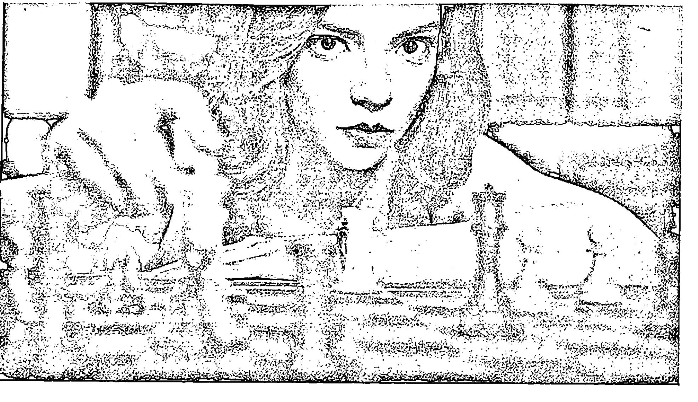

以下是我从中学到的十个妙招。

### 第一招：“爽”，是第一商业要素

这部片子，讲的是一个大女主的开挂人生。

各种文化消费，人们要的是“爽片”，“爽文”，“爽体验”。

“孤独大脑”对此尤其应该反思：所谓烧脑，只是“爽”外面的标签而已。

意淫是文化商品最好的主题，成年人更需要童话。

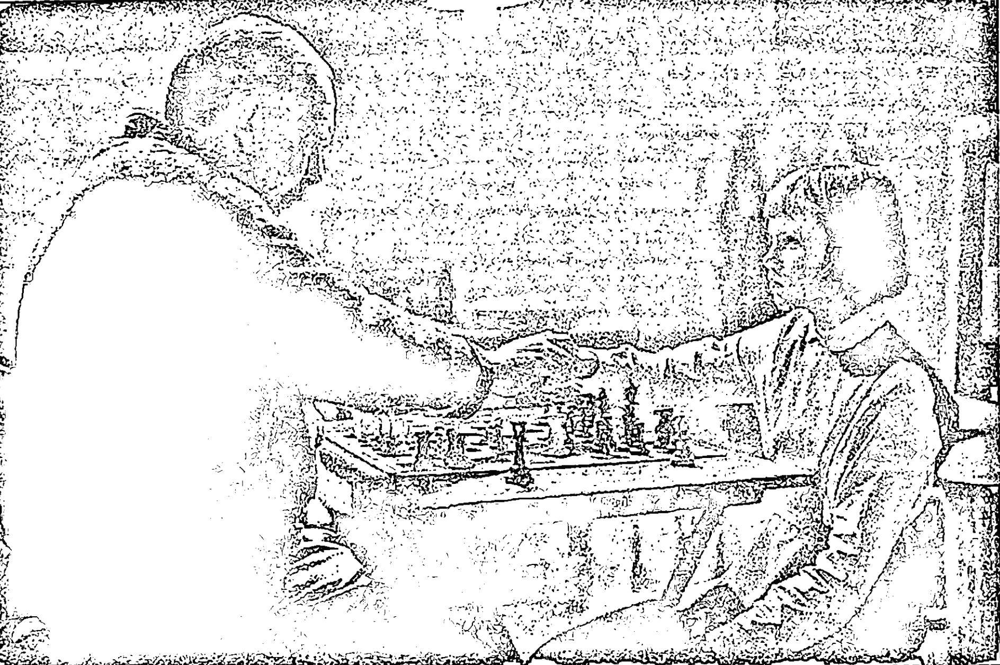

现实已经处处与人作对，商业消费上就该让群众们爽一下。

爽的核心是什么？

皮克斯公司早就给出了配方：一切关于主角的命运如何好转。

都是“转运”，关键是要顺滑，可口，好看，还有那么一点点小刺激。

### 第二招：陈词滥调，讲出新意来

有种说法，最好的创业就是：

**在那些看起来很烂熟的地方搞创新。**

因为烂熟，所以说明有经久不衰的市场，好过去培养市场培养用户。

所以有创始人说，开个游戏公司似乎很无聊，但是排在十几位的游戏公司，也比排在第一的SaaS公司赚钱多。

但是你必须玩儿出新意来。

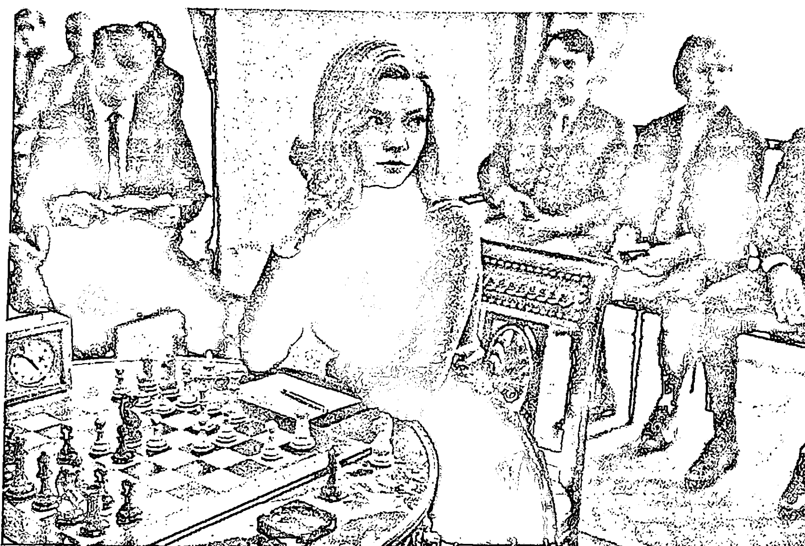

本片基本上是让观众一眼能看明白，但又略有“出乎意料”。

稍微捉弄观众，制造一些意外，但又没捉弄得太厉害。

人们要的是“陌生的熟悉”，而不是“陌生的陌生”。

### 第三招：荷尔蒙，是流量的催化剂

象棋是个很好的主题，表面上看是天才游戏，智力运动，其实是关于体育，关于荷尔蒙。

《后翼弃兵》运用影视手段，将竞技、胜负的荷尔蒙效应发挥得淋漓尽致。

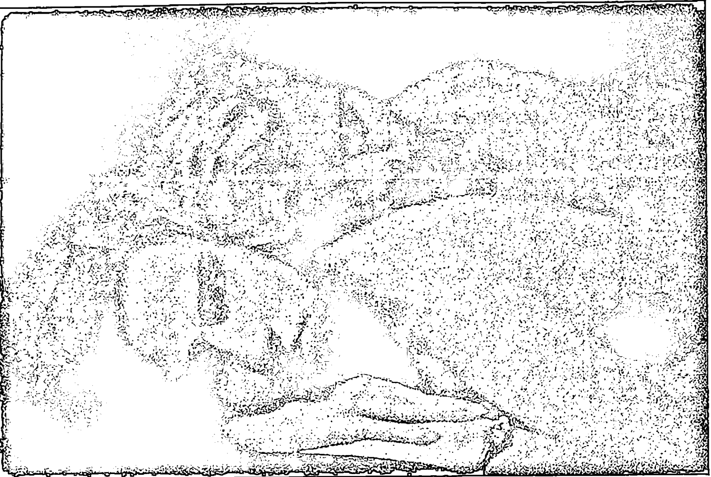

我自己写“孤独大脑”的经验是，只要是关于“性、钱”的热门话题，阅读量就很容易上“10万+”。

故事发生的1960年代，是冷战的高峰，战争也是荷尔蒙。

再平庸的人，心底可能都有一个被埋没的天才梦。这是精神荷尔蒙。

天才，性，竞技，战争，这些荷尔蒙被调成了一杯鸡尾酒，构成了本片的流量催化剂。

### 第四招：再好的创意，也靠专业来实现

据说国际象棋传奇冠军卡斯帕罗夫是《后翼弃兵》的顾问。

片中有大量对局，基本上每一场比赛都是以真实对局作为原型的，而且从难度上考虑到女主当时的水平，以及与剧情的发展阶段尽量匹配。

这样的话，即使观众不懂国际象棋，也能感受到棋盘上的刀光剑影。

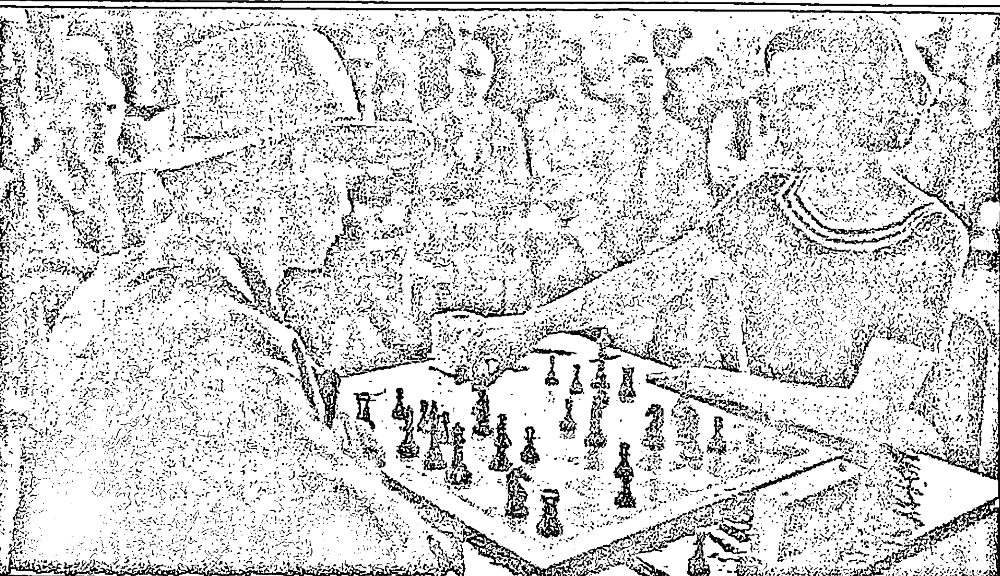

大多数影视中，一旦出现围棋象棋，可谓漏洞百出。

而《后翼弃兵》则用心多了，事实上该片剧情的张力，也受益于对国际象棋专业的尊重与投入。

就像诺兰拍《星际穿越》，请了诺奖得主基普·索恩担任顾问。

《后翼弃兵》的专业，还体现在剧本、导演、演员、服饰、音乐，几乎没有漏气的地方。

专业和细节，确保了剧情的丝丝入扣，以及“产品体验”的顺滑。

片中有个地方，一位女士对女主说：你该去打打桥牌。

可能只有棋类发烧友懂得这句话背后的意思。

### 第五招：大胆弃子，一路向前不纠结

本片的片名，原意是“后翼弃兵”，是国际象棋开局的一种。

Gambit是国际象棋的术语，指开局通过弃子手段来达到迅速出动子力、抢占中心及组织进攻的目的。

在围棋里，弃子和脱先也是高手的战略。

《后翼弃兵》给女主设计了点儿不痛不痒的缺点和挫折，与其说她是“舍弃”自己的成瘾性癖好，不如说她是在不断舍弃过去。

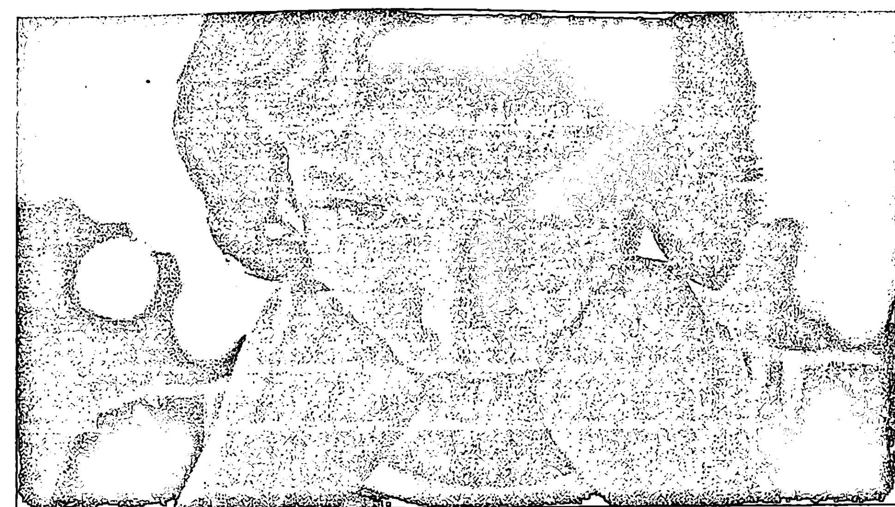

犀利，但又点到即止。别苦大仇深的。

“大爽剧”经常只顾爽，而忘了智商；“大师剧”则只顾深刻，给用户添堵。

《后翼弃兵》做到了让懂的人觉得不失专业，让小白不觉得自己是小白。

### 第七招：关注个体，给每个角色以平等的镜头

只顾主角爽的片子，很难成为超级大爽片。

每个角色拥有的镜头时间长短不一，但在镜头面前是平等的。

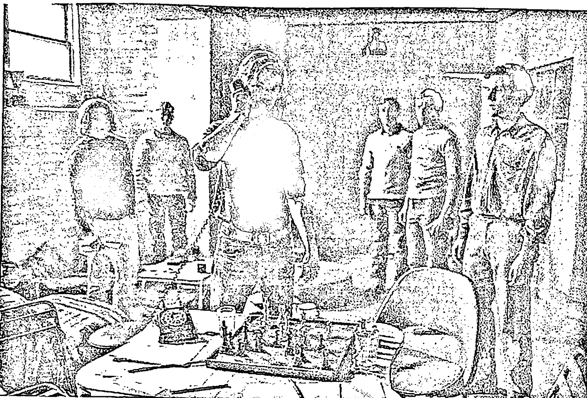

因为你不知道，观众到底因为哪一点而被打动，或者会将自己代入哪一个角色。

只顾主角，也容易让观众讨厌主角。

别忘了人情味儿，给每个命运一个交代。

### 第八招：重新定义“女王”

本片的女主角像是“《龙纹身的女孩》+《这个杀手不太冷》+《战斗天使洛丽塔》”，但对比而言她的运气又要好得多。

《后翼弃兵》很正确地讲述了女权，又试图用调侃和轻描淡写 coming 化过分严肃。

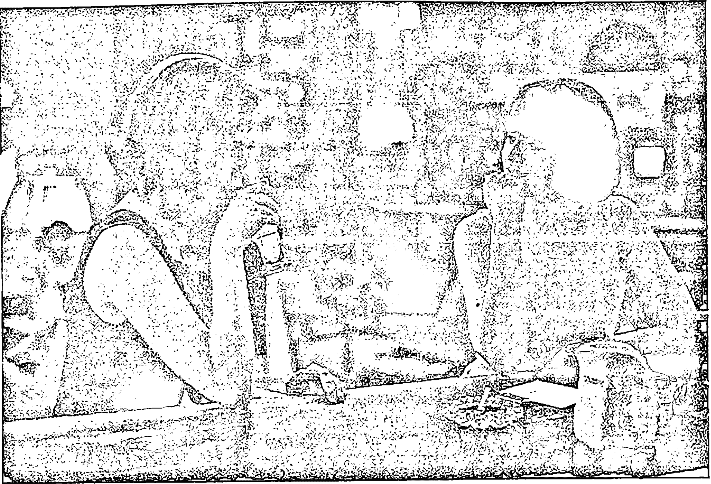

女主角有棋盘智慧，也有街头智慧。

她不会甜言蜜语，不会刻意讨好人，但一直懂得感恩。

尽管这感恩夹杂着狡黠和慈悲。

除了没及时还启蒙老师的十块钱。

和不怎么帅的大学生初夜之后，女主还很自由快乐地收拾了下男生乱七八糟的房门。

“女权”这个话题我毫无研究，但不那么极端，总归是更有利于“女王”在男权社会的治理。

### 第九招：积极进取，找寻人生的价值

女棋手喜欢进攻，这倒是真的。

在围棋领域，女棋手也是喜欢杀棋。

《后翼弃兵》里，女主角一路进攻。

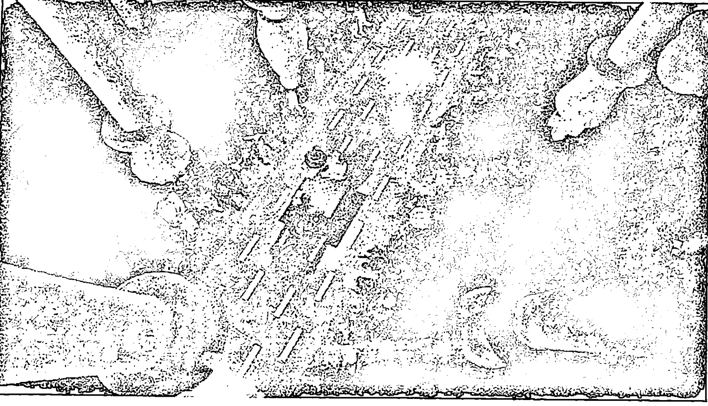

现实生活如逆水行舟，你我不得不积极进取。

不是盲目进攻，有时候也要以守为攻，或者是只求和棋。

在博弈的世界，为了更好地进攻，棋手需要做到：

- 系统训练；
- 实战对局；
- 复盘研究。

进攻的目的只是为了胜负吗？

本片好在没有过分说教，只是借女主之口，问那个人生理想是拿世界冠军的13岁苏联棋童：

就算你拿了冠军，然后呢？

胜负的背后，仍然是对人生价值的上下求索。

### 第十招：从容而体面，乐观是一种理性选择

《后翼弃兵》中，不管是胜负厮杀，还是爱恨情仇，几乎没有“撕逼”。

在高手的棋局当中，很少看到难看的场面，因为彼此都能计算到，就不会走到那一步。

体面，不仅有赖于美德，更需要智慧和理性。

《后翼弃兵》充分利用了“棋道”的道德张力。对局者你死我活，但依然彼此尊重，愿赌服输，从容如骑士。

这是一种古典主义的和解精神。

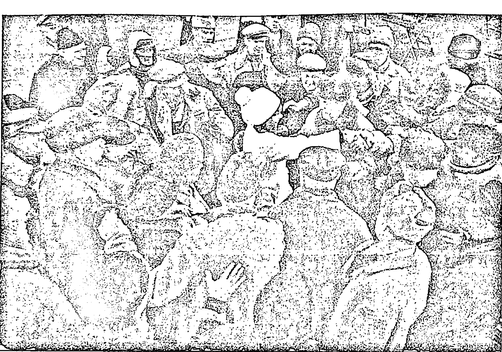

在片中，人和人之间最后都达成了和解，和自己的过去，和对手，和初恋，甚至和敌国和解。

从容，默契，不废话。

象棋是一种完美博弈，而现实世界并不是。

- 但这并不影响我们在善恶之间，选择善；
- 不影响我们在美丑之间，选择美；
- 不影响我们在撕逼和体面之间，选择体面；
- 不影响我们在爱恨之间，选择爱。

这并非迷信美德，也不是要维护正确，或是过于乐观，而是因为：

乐观不是指某个好或坏棋局，而是你面对该棋局时的一种选择。

人生短哲，也许就是个大悲剧而已。

## 特斯拉还能火多久？

特斯拉的股票，真的值这么多钱吗？

最近看到一篇文章，对特斯拉未来价值的评估，给出了一个很有趣的模型。

方舟投资管理公司创始人凯西·伍德对《巴伦周刊》说：

> 我们相信特斯拉将会推出一个叫车网络，来与优步 (UBER) 和 Lyft (LYFT) 竞争。
>
> 如果成功的话，它将能够为驾驶员提供汽车，拥有和运营的总成本将大约低于丰田凯美瑞的三分之一。

凯西·伍德对特斯拉的未来价值描述如下：

- 第一阶段：电动汽车的利润率在20%左右；
- 第二阶段：叫车服务可能在40%左右；
- 第三阶段：软件即服务和自动驾驶汽车的利润率将在80%左右。

看起来，这是一个很厉害的利润率结构，远远超过仅仅制造汽车。

这样一来，特斯拉的股价如此高，似乎也说得通了。

但是，类似的机会，对于其他电动车厂商而言，甚至对于尚未正式入场的那些巨头们，是不是也一样摆在面前呢？

### 二

最近，电动车企业特别火。

蔚来股价创出历史新高，市值上攻突破500亿美元大关，超过宝马，超过通用汽车，远远抛开通特汽车。

理想汽车和小鹏汽车，也紧随其后，股价高得不像初创公司。

还有资深选手比亚迪，自称是“电动车里的华为”，认为早晚会超越“电动车里的苹果”特斯拉。

这世界变化真快，就在去年，人们还在问：

*特斯拉还能活多久？*

华尔街做空特斯拉的投资大佬们一直耿耿于怀，坚持不退场，认为特斯拉的火爆只是泡沫。

就在去年底，蔚来汽车的股价最低跌到了1.19美元，

似乎就在这大半年来，新能源汽车来了一个大反转，蔚来汽车股价几乎涨了40倍。

比亚迪、蔚来、理想、小鹏们的火爆，我想大概有（且不限于）如下几条：

- 中国占了新能源汽车市场的半壁江山；
- 国货品牌的崛起；
- 政策的支持，以及资本和消费者敢于尝新；
- 智能化的电动车成为中国消费者的新玩具；
- 新能源汽车公司从零开始，反而没有负担；
- 企业创始人就是产品经理，用互联网思维来造车。

起初，人们普遍怀疑，外行造车，真的行吗？

这些半路出家的没有技术背景的家伙，如何去和那些有百年历史的汽车竞争？

后来人们发现，那些汽车大企业，原来是一群恐龙。

《终极新能源时代》一书对此作出了分析：

> 丰田汽车在电动汽车方面慢人一步的原因之一是，其受到了巨大的金字塔结构中的供应商的束缚。
>
> 日本汽车制造业有80万人，其中60万人都是从事零部件制造相关产业。

#### 从金字塔结构到水平分工

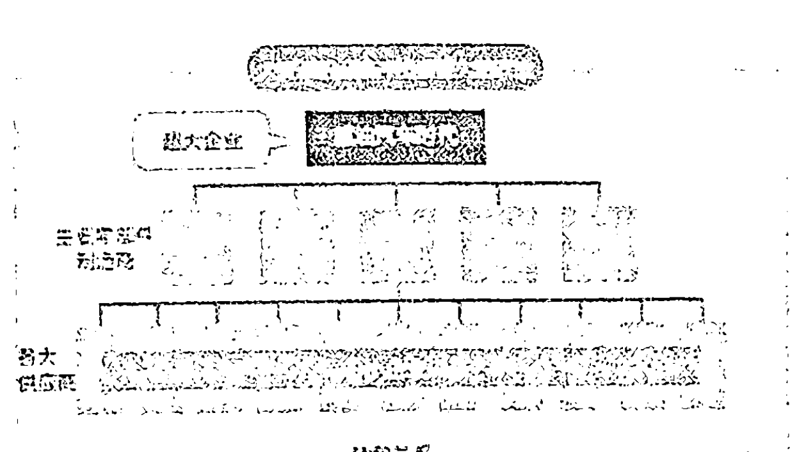

汽车产业巨大的金字塔形的产业结构，成为丰田本田们的沉重负担。

因此，这些企业在从燃油汽车向电动汽车的转向中，显得犹豫不决。

同时，传统汽车行业依赖于售后服务赚钱，也让顾客越来越不满意。

为什么传统厂商转身那么慢？《终极新能源时代》还给出了另外一个原因：

想要在百年一遇的大变革时代中生存下来，必须要到“简单思考、迅速行动”。

回头看看，特斯拉的成功并不是仅仅依靠其先进的技术，其采用的电动机和其他工厂一样，电池用的也是通用品。

特斯拉用的是互联网快速迭代的思路，重视设计，市场上对标精准，简单聚焦做爆款。

还有一个原因，特斯拉和蔚来汽车们，是数字化时代的“汽车原住民”，创始人使用的也是互联网的话语体系，而传统厂商们则显得有点儿格格不入。

我的一点切身感受是，未必新生代有多厉害，而是老家伙们太不争气。

你用一下传统豪华车令人发指的交互系统，就会感慨，这帮家伙为什么连个导航都做不好。

### 三

所以，本文的标题《特斯拉还能火多久？》，也可以换为：

电动车还能火多久？

我记得2000年互联网泡沫破灭之前，倍受怀疑的巴菲特做过一个演讲，他以二十世纪初的汽车行业做类比，来隐喻人们对互联网的狂热。

他列出一份长达70页的清单，包括了美国所有的2000家汽车公司。

汽车是20世纪上半叶最重大的发明。它人们的生活产生了巨大的影响。

如果你 在第一批汽车诞生的时代目睹了国家是如何因为汽车而发展起来的，那么你可能会说，“这是你必须 要投资的领域。”

但是，在几十年前的 2000多家汽车企业中，只有3家企业活了下来。

巴菲特的观点是：

> 虽然汽车对美国产生了巨大的正面影响，但却对投资者产生了相反的冲击。

芒格对互联网的态度则是：

> 互联网对于社会是极为美好的，但是对于资本家来说纯属祸害。
>
> 互联网能提高效率，但是有很多东西都是提高效率却降低利润的。
>
> 所以，互联网会让美国的企业少赚钱而不是多赚钱。

但是，对于好赌的投资者而言，巴菲特这套“老派保守”的投资思路可不适用。

新能源，自动驾驶，共享网络，这么好的主题，这么大的想象空间，这么性感的未来，这么好的筹码，怎么能视而不见呢？

也许没谁能看准最后哪几家公司可以跑出来，那就“买下整个赛道”。

当年连“共享单车”都能赌，聪明人当然觉得自己不会是最后一棒。

人类在任何时代都需要一个超级商业主题，泡沫从来不是问题。

我们要的是想象和筹码。

### 四

那么，最后跑出来的，到底是哪类公司？

文章开头说了一个投资人对特斯拉的预期利润模型：

物理商品的售价+服务的利润+网络及AI服务的利润。

上一个这种类型的公司应该是苹果，市值过两万亿了。

苹果手机卖得贵，服务利润还在快速增长。

现在全世界最大的公司，几乎都是“云服务”公司。

**a、云服务的客户那一头，是订阅式服务。**

类似于微软的Office365，奈飞的月费，再包括蔚来汽车的电池月费，以及设想中的特斯拉自动驾驶服务的月费。

**b、云服务的技术那一头，是人工智能。**

然而，模型再好，也要回到商业的本质。

**好的公司，一定要有定价权，也就是拥有某种形式的垄断。**

从目前看来，电动车的“垄断性”还很模糊。

如果以智能手机类比，电动车是系统+硬件，基于AI的自动驾驶，还要加上一个：**共享网络中车辆的密度。**

- 如果特斯拉是苹果，那么谷歌的Waymo，会不会成为自动驾驶领域的安卓系统？
- 比亚迪真的是新能源车里的华为吗？
- 华为亲自进场以后呢？
- 滴滴这类拥有共享车网络的公司会如何逆袭？
- 苹果电动车什么时候会上市？

以及，传统厂商会杀个回马枪吗？可以预见的是，市场最后的赢家会很少，寡头化将比燃油车时代更加厉害。

### 五

现在电动车赚的钱，一部分是行业转移的财富，一部分是未来想象的财富。

财富转移之激烈，让人想起了哈佛大学商学院教授克莱顿·克里斯汀森提出的“破坏性创新”。

克里斯汀森在《创新者的窘境》一书中系统地研究“大公司为什么会失败”。

他提出“破坏性创新”这个新概念，并得出了一个结论：

越是管理卓越的公司，在“破坏性创新”时刻到来的时候，就越难以摆脱困境。

超级大公司被不起眼的小公司击败，这一景象几乎出现在所有的行业，从百货、金融、电脑硬件到互联网。

如今，在电动车领域，“破坏性创新”显得更加残忍。

这大概可以解释为什么成立没几年的电动车公司，市值远超老牌汽车企业。

作为“破坏性创新”的实践者和受益人，贝佐斯和马斯克反复强调组织的“Day1”和“创业精神”，其公司本身也在“自我破坏”，不断加速进化。

我们也会注意到，现在领跑公司，创始人都是“产品经理+商业操盘手”，并且受益于互联网对传播效应的垄断。

### 总结

最后，总结10条：

- “破坏性创新”赚的钱，首先来自于财富的转移，而非重新发明轮子。
- 从硬件到服务，从网络到AI，商业的利润模式正在发生巨大变化。
- 新贵公司会利用已有的基础设施赚钱，但从价值上却是掠夺者，摧毁者。
- 物理世界的价值，与数字世界的价值，不仅是融合，也是控制权的争夺，和权力的交替。
- 商品如飞刀，出手而不脱手。商品在商家卖出去之后，才开始真正为公司创造价值，而不仅仅是其硬件售价的价值。
- 物理世界的商品会越来越好，越来越便宜，但其本身并不构成垄断性，而是为了构成“飞刀出手后”的网络效应。
- 垄断性要么出现在人的大脑网络里，要么出现在数字网络里，要么出现在时间网络里。
- 基于云服务和AI的“订阅式商业模式”，将会无处不在。
- 这是一个“信仰”和“怀疑”难以辨明的时代，你不能全信马斯克，也不能忘掉巴菲特。
- 我们既要想办法跟上浪潮不被抛弃，又要谨防自己被浪潮中的泡沫吞噬。

购买《人生法则》，点击下方图片。

## 真有"小白都能稳赚"的投资吗？

"小白都能稳稳赚钱"?

"小白都能稳稳赚钱"？

卷吻，你好。

装有"小白都能稳稳赚钱"的方法吗?

看到朋友圈有人发"小白都能赚钱的投资方法",脑海中浮现了一场对话：

甲：小白都能赚钱？那赚的是谁的钱呢？

乙：当然是小小白啦！

甲：可是我去哪里找小小白呢？

乙：你就是小小白呀！

事实上，即使有一个"万能的"发财公式，你也需要把"你自己"作为最主要的变量代入进去。

"你自己",既是已知条件，也是押下的赌注。

一切皆有价，天下没有免费午餐。

不仅如此，人生道理，成功秘诀，认知方法，等等，这些也都不存在“不用代入自己这个变量”的免费午餐。

也许有人觉得，这个世界为什么设计得这么累？为什么就不能给我一个舒舒服服的免费午餐吗？

那是因为，假如这样设计，我们的“自由意志”就没有容身之地了。

尽管“自由意志”也许只是一个幻觉。

这是我们为“自我”付出的代价。

很多人觉得这代价太高，宁可放弃“自我思考”和“自由意志”。

事实上，支撑我们生活的99.999%的事物，已经是免费午餐了，例如太阳，地球，空气，水，以及时间。

### “用概率看透人生”的书单

> 老喻，你好，《人生算法》这门课程里面，
>
> 概率论的方法让我获益匪浅，
>
> 请推荐一些关于用概率论看待人生问题的书。

尽管概率成为这个不确定世界最重要的底层思维方法，但是这方面的图书很少，尤其是能够把严谨的概率计算与世俗智慧关联在一起的图书更是凤毛麟角。

简单说，这方面的书大致有如下5条线索：

**1、基本的概率通识。**

《醉汉的脚步》（新版有我写的序），《几率》，《机会的数学原理》，《统计学的世界》等等；

**2、如何用概率理解和应对现实世界的不确定性。**

《随机漫步的傻瓜》（如作者所言，他的后几本都是对这本书的重复），索罗斯的书，波普尔的书，关于休谟的书，以及《对赌》等；

**3、行为经济学和行为金融学的线索。**

卡尼曼和塞勒的书。不过，类似于《思考快与慢》，大部分人是一看了——假如你不懂其中那些关于概率计算以及效用函数的曲线；

**4、量化交易的线索。**

关于索普的书《战胜一切市场的人》，以及文艺复兴的西蒙斯。

**5、人工智能的线索。**

《深度学习》，《人工智能的未来》，《终极算法》等等。

当然，还有《人生算法》，以及明年我会出的一本关于概率与运气的书。

想简单了解，公众号“孤独大脑”是个好去处。

## 怎样成为时间的朋友?

老喻，你好！怎么才能成为时间的朋友呢？

很多人做不到。

真的想买个股票十几年不卖，基本没人做到吧？

有一天，向一个高尔夫高手讨教，他说：高尔夫是世界上最难的运动。

我是外行，无法评判。他的观点多少也有个人的态度和情感在里面，但我能听出他讲这句话时的虔诚。

在新手看来，高尔夫不就是1、2、3挥杆儿吗？有什么难的？

投资外行，对买卖股票这件事情的“不知其深”的错觉，可能类似新手看高尔夫。

对比而言，投资更难。

为什么呢？

假如你想学高尔夫、你可以请个职业的老师，一步步进阶。只要你勤学苦练，成为身边人群里的高手，并不是难事。

也就是说，这种能力是可以按照路线习得的。

而投资并没有这类路线图。

所以，有些人一辈子都是投资小白。

看多少书，亏多少钱，都没有丝毫进步，甚至越陷越深。

反过来说，因为可习得性，高尔夫的奖金只属于极少数人；因为不可习得，投资则更“混乱”，所以貌似更“公平”。

如果说“高尔夫”是很难的事情，投资则是很复杂的事情。

这里面除了理解公司，理解金融，理解市场，理解赌博，理解概率，还要理解索罗斯所说的反思性。

即使你做到了以上几点，可能也很难战胜人性的弱点。

所以，说回你的主题，困难不在于你是否选择做时间的朋友，而是时间是否选择做你的朋友。

有些人总觉得自己偶尔买中了某个大牛股，可惜卖早了。其实真没啥可惜的。

这不是关于信念、意志、坚持的问题，而是关于认知、洞见、经验、怀疑的问题。

有些人认为自己没办法把一只大牛股拿上十年，是因为没有耐心，其实是因为算得不够深，对行业对公司的理解不够透。

或者是，没有为不确定性构建一个概率化的保护层。

所以，与其说长期主义是对时间的考量，不如说是对理解深度的度量。

就像阿尔法狗，我们说它下棋有大局观，看得远，其实是因为它算得深。

那些玄乎的人类情感词汇，人工智能并不懂，也不在意。

就投资而言，没有对行业的理解深度，没有对公司的深刻洞察，谈“长期主义”如隔靴挠痒。

但这并不是说人类那些看似“务虚”的思考与哲学没有价值。

我称这部分为“心法”，这是人类理解未知世界的一种模式，或是临时的脚手架。

在我们的知识世界里，“心法”作为常识，帮我们避坑，提醒我们少干蠢事，给我们以启蒙。

AI在围棋上也学习了人类的“直觉”。

但我们也要勇于拆除脚手架，并且不能依赖“虚无主义”来应对这个世界。

当人们需要穿越黑暗森林时，这些“心法”像北极星一样引导我们。

当我们面对具体的计算，要相信理性、科学、算法。

所以你看马斯克这类人，其实是极度务虚和极度务实的结合者。

- **极度务虚**：让人类成为多星球物种；
- **极度务实**：用第一性原理，像工程师那样经营公司。

这二者之间的“无人区”，是自由意志的起舞之地，是概率制造惊喜或意外的空间，也是人生的目的和魅力所在。

回到投资，时间这个维度，是心法里的信念，是算法里的变量之一。

最终，能否做时间的朋友，**并且享受投资的回报**，要看一个人能否在极度复杂的“金钱世界”，代入“你自己”，形成对抗不确定性的自我进化系统，**进而加上时间的维度，形成你自己的人生算法**。

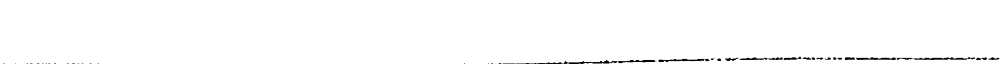

## 寂静的风险

原研哉说：“我是搞哲学的碰巧做了设计”。

几乎所有厉害的人，各个领域的，甚至包括商人，骨子里都是一个哲学家。

哲学（英语：philosophy）是研究普遍的、基本问题的学科，包括存在、知识、价值、理智、心灵、语言等领域。

哲学与其他学科不同之处在于哲学有独特之思考方式，例如批判的方式、通常是系统化的方法，并以理论论证为基础。

在日常用语中，哲学可被引申为个人或团体的最基本信仰、概念或态度，不过此处并非此定义。

英语词语Philosophy（拉丁语：philosophia）源于古希腊语中的φιλοσο φία，意思为“爱智慧”，有时也译为“智慧的朋友”，该词由 φιλος（philos, 爱）的派生词 φιλεἰν (Philein, 去爱) 和 σοφία (Sophia, 智慧) 组合而成。

一般认为，古希腊思想家毕达哥拉斯最先在著作中引入“哲学家”和“哲学”这两个术语。

“哲”一词在中国起源很早，如“孔门十哲”，“古圣先哲”等词，“哲”或“哲人”，专指那些善于思辨，学问精深者，即西方近世“哲学家”，“思想家”之谓。

在《易经》当中已经开始讨论哲学问题，形而上学的中文名称取自《易经·系辞上传》“形而上者谓之道，形而下者谓之器”一语。

1874年，日本启蒙家西周，在《百一新论》中首先用汉文“哲学”来翻译phil osophy一词。

英国哲学家罗素对哲学的定义是：

哲学，就我对这个词的理解来说，乃是某种介乎神学与科学之间的东西。它和神学一样，包含着切入及超乎确切知识之外的教条都属于神学。但介乎神学与科学之间还有一片受到双方攻击的无。

胡适在《中国哲学史大纲》中称“凡研究人生切要的问题，从根本上着想， 要寻一个根本的解决：这种学问叫做哲学”。

以上解释来自维基百科。

由此定义，倒是可以理解，一个人要想在某个领域拔尖儿，还真得像个哲学家。

元思考，独立思考，从头思考，探寻事情的本质，化繁为简，等等，都是哲学家干的事情。

某个人成为牛人，是其身为哲学家在某个领域的实践。

只是碰巧出了名、赚了钱而已。

接触过一些生意人，没读过什么书，但思考问题，就像个哲学家。

也许，没读过什么书，反而让他们哲学家的潜质没有被系统化批判。

费曼很讨厌哲学家，但他自己其实也是个哲学家。

牛人之所以多是哲学家，还因为人类对这个世界了解极其少。

哲学帮助我们应对“我不知道”和“我不确认”这些领域的难题。

现实中，人们要么是科学原教旨主义者，要么是捣糨糊的玄学爱好者。

所以，看起来人类一方面快速进步，一方面麻烦不断。

科学的进步不仅强化了“智慧”，有时候更强化了愚蠢。

哲学是应对这种二元对立下的人类认知困境的一片芦苇叶。

1883年，狄尔泰在其《人文科学导论》中明确区分了人文学科与自然科学，认为两者在研究内容和认识方式上根本不同，生产的是两种不同形态的知识。

索罗斯也说过，要承认自然科学与社会科学的二元性。因为社会科学除具备自然科学所没有的人的不确定性外，还有第二重困难，即社会理论本身还具有反身性。

下面这段好像是索罗斯说的：

令人印象最深刻的尝试是经济学的理论。它从一开始就假设认知是完美的，当这个假设站不住脚时，又有越来越多的扭曲观点来维护行为是理性的这一谎言。其结果使经济学得出了一种理性预期的理论，认为人们对未来有一种单一的最乐观的看法，这一看法符合未来的情况，而且最终所有的市场参与者都将围绕这个观点汇集到一起。这一假定是荒谬的，但又是人们所需要的，以便使经济学理论能有如同牛顿物理学定律那样的模式。

他还提及：

有趣的是，波普和哈耶克在《经济学》（Económica）杂志上都表示，社会科学不能得出像物理学那样的结果。哈耶克猛烈抨击了机械地、不加鉴别地应用自然科学定量方法的行为。他称之为科学主义。波普在其撰写的《历史主义的贫困》一文中阐明，历史不能由普遍适用的科学规律来决定。

索罗斯还说：

尽管如此，波普还是提出了他的“统一方法论”（doctrìne of the unity of method），他认为，对自然科学和社会科学的判断应使用同样的标准。哈耶克则成了芝加哥经济学派的鼓吹者，那里是市场原教旨主义的发源地。但在我看来，人的不确定性的含义是，自然科学与社会科学研究的主题根本不同，因此需要采用不同的方法，而且必须用不同的标准来衡量。人们不应期望用经济学的理论找出普遍适用的规律，并且可以反过来被用于解释和预测历史事件。

看，这位金融大鳄也是哲学家。

我写“人生算法”，也容易批评滥用自然科学来隐喻人生道理。

本来我做了一番功课，等待有大侠出剑批“人生算法”的要害。

可是并没有。

更多的是被问：你告诉我，我怎么用人生算法实现财务自由？

还有比较多批评是：你写得太抽象了。你能不能向那个谁谁谁学习一下，人家写特别接地气，特别实用。

本来我想反问一下：那个谁谁谁帮你实现了多大程度的成功发财？

1. 所谓接地气，是指为了帮助读者制造“我懂了”的幻觉，而不在意简化甚至曲解知识本身。
2. 所谓特别实用，是指引导学习者做过拟合的刻舟求剑的蠢事。

再说了，索罗斯可是跟着波普尔学更抽象的东西之后杀向华尔街的。

当然，我不会这么问。我是个温和的人。

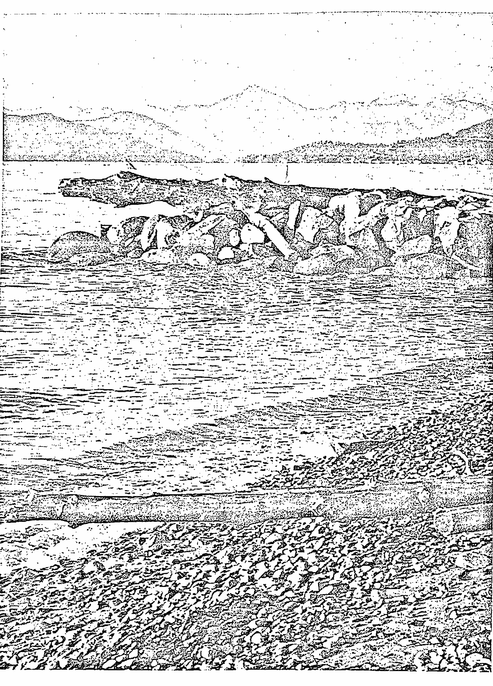

家附近的海滩，据说是全球十大天体浴场之一。

要走下一段陡坡，崖壁上丛林密布，私密性极好。

冬天没人，风景最好。

## 虚拟赌博

最近下棋还不错，很顺利地升为七段，而且是连胜。

但观战下注的时候，成绩就不怎么样了。

本来有一百多万虚拟币，现在好像只有几十万了。

观战下注是看高手对局，然后根据双方的实力、历史对局、当下局面来判断，并且下注，然后根据正反两方的下注状况来定赔率。

这里面有三个关键问题：

- 一个是双方实力对比及输赢概率估算；
- 一个是当下的赔率；
- 一个是你自己的下注比例。

我发现，第一项的主观判断，最容易让人掉在坑里。

就应该根据双方历史战绩估算输赢的概率，再观察当前的赔率，看有没有套利的机会。

别太在意某一局两局的优势有多大，琢磨偷个大的鸡。

舒服的钱应该是基于大数定律的，长期的甜美。

最重要的是，别随意all in，也不要太主观判断当前的局面。

幸好我只是“虚拟赌博”哈。

其实人生想开一点儿，就是一场虚拟的赌博游戏。

你赚再多，能带出人世间这个赌场吗？

又想起伍迪艾伦的一句话：

> 我为自己的金怀表感到很自豪。在我爷爷临死之前，他把这只表卖给了我。

## 复利的谎言

十年赚10倍，靠谱吗？

假如你买了茅台股票并拿几年，就有10倍。

或者买特斯拉or蔚来汽车的股票，不到一年，你就能赚10倍。

“tenbagger” 一词出自世界级投资大师——彼得·林奇的自传《成功投资》一书，意译为“能翻10倍的股票”。

有人算了一下，假如你想在股市十年变10倍，每年“只”要26%回报即可。

于是，关于复利的传说，又多了一个美妙的数字：26%。

然而，假如你相信加上“复利法则”，也许就掉入了一个谎言的陷阱。

不止在投资领域，关于个人的“成长”和“精进”，也流传着一年抵N年的梦想。

最近，有人问我：

- 一个人可以做到持续地每天进步百分之0.1或者说百分之0.05吗？
- 如果可以或者说有可达成过的话，关键点在哪里呢？难点在哪里呢？

我回答：

不可能。

我小时候曾经得过一本武林秘籍，上面介绍了一种看起来很靠谱的方法，让人学会“飞檐走壁的轻功”。

具体方法是：

1. 挖一个大坑，在里面垫很多层草席，一次垫到接近地面；
2. 每天锻炼跳出地面，直至轻松自如；
3. 取掉一张草席，继续锻炼……
4. 再取掉一张……

每层草席才多厚呀，这样，你就神不知鬼不觉战胜地心引力，掌握绝世轻功了。

可惜，少年的我胸无大志，没有亲身实践。

你看，这是不是也是“复利思维”的一种简化版？

“复利思维”，这个看似有些鸡汤的话题，其实包含了“不确定性、连续性、对称性、预测、幂律分布、肥尾、下注、决策、贝叶斯、长期主义”等好多个有趣的话题。

本文的观点是：

- 绝大多数人对于复利的理解是错误的；
- 极少有人能够靠复利获利。

以下，是复利谎言背后的10个真相。

## 真相 1

# 世界被随机性主宰

未来是极度不确定的。

并不存在一个清晰的轨迹，让你像爬坡一样每天进步一点点。

先来看看随机游走假说。

这是金融学上的一个假说，认为股票市场的价格，会形成随机游走模式，因此它是无法被预测的。

- 1863年，法国的一名股票掮客朱利·荷纽最早提出这个概念。
- 1900年，法国数学家路易·巴舍利耶在他的博士论文《投机理论》中讨论了类似观念。
- 另一条主线是，爱因斯坦在他1905年的一篇论文中，从物理界的角度出发研究了“随机过程”，揭示了布朗运动，间接证明了原子和分子的存在。
- 回到金融。又过了整整半个世纪，1953年，莫里斯·肯德尔提出：股票市场价格的变动是随机的主张。
- 1964年，史隆管理学院的保罗·库特纳出版了《股票市场的随机性质》。
- 1965年，尤金·法马发表了《股票市场价格的随机游走》，正式形成这个假说。
- 1973年，普林斯顿大学波顿·麦基尔教授出版了《漫步华尔街》。

我很早以前看过这本书。很坦率地说，极少有人能够第一次就读懂并接受麦基尔苦口婆心的观点：别瞎折腾了，买点儿指数基金吧！

即使你读懂了，也不甘心照他说的做。

这本和我一样老的书里，许多洞见今天看起来也闪闪发光，例如谈及基本面的专业分析未必靠谱，作者写道：

无数研究都显示了与此类似的结果。放射科专家在观察X光片时，竟然让30%具有肺病症状的光片从眼皮底下大大方方地溜走，尽管这些X光片已清楚地说明了疾病的存在。

另一方面实验证明，精神病院的专业人员竟然不能把疯子从智者中分离出来。

随机性是个太大的话题。

笨人很难理解随机性这回事，而聪明人总觉得自己可以控制随机性。

例如，我在澳门赌场里观察了一阵子，发现在押大小的赌桌前，假如连续出现了十次大，那么：

- 新赌徒们就会继续跟着押大，认为大的火气正旺；
- 老赌徒们则会押小，他们认为根据大数定律出现小的概率更大了。

可惜，二者都错了。新赌徒们迷信，老赌徒们犯了“小数”的谬误。

一个公正的大小游戏，每一次或大或是没有记忆的。

对于随机性里关于“无记忆”的这部分，人类的大脑很难接受。

例如，假如让你扔100次硬币，下面哪个结果更“真实”？

# 有意识的随机与真正的随机的比较

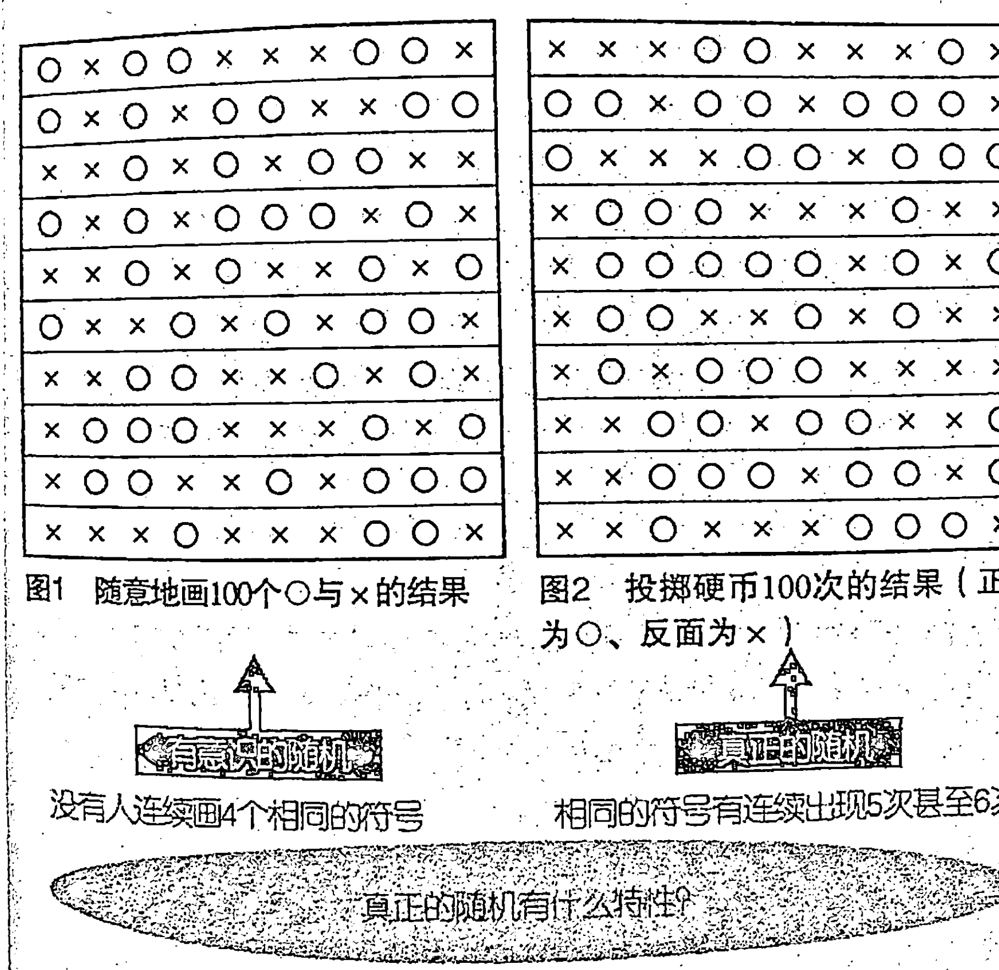

上图左侧是请某个人类“随机”画的，是有意识的随机；上图右侧是真正的随机（应该是模拟的）。

看起来，是不是左边更随机一些？

因为右侧有太多“连号”，看起来不够随机。

实际上，恰恰相反。

这就是人类对随机性的确见之一。

世界是随机的，并不符合“决定论”，更不是线形的。

“复利思维”为什么看起来如此有吸引力呢？

因为“复利”制造了一种虚幻的确定性。

我们的工作、生活、投资，大多是通过寻求事实和真相，来寻求生活中的确定性。

但是，什么是确定性？

假如你不能在某个“确定性”之前，加上一个概率数值，那么这个确定性就是一个大坑。

有次我听见儿子在打游戏的时候，和别人说“百分之百确认”，就很认真地对他说：

记住，以后不要说百分之百确认，哪怕某件事你非常非常非常确认，你也只能说*我99.999%确认*。

进而，你对于事实的“确定性”的判断，本质而言，其实只是某种信念。

人类事务，就是由一大堆信念在随机性的沙滩上堆砌而成的。

## 真相 2

# 连续性很难实现

复利有一个重要的假设，那就是连续性。

只要你每年赚26%，连续十年，你就可以……

下面，我们来看看连续性有多难。

我在《机会泵：如何管理你的运气？》一文章里写道：

# 你有没有想过，为什么现实中很少有福尔摩斯？

通常而言，福尔摩斯的神奇之处，在于他能够做一连串推理，大致结构是这样的：

因为A，所以B；因为B，所以C；因为C，所以D；因为D，所以E……

所以，凶手就是大魔王！

之所以极具戏剧性，是因为上述一系列推理，就像杂技团的叠罗汉，叠得越高，越有冲击力。

然而，现实中很难见到杂技团的这种极度不稳定结构。

我们算个简单的账吧：

假如福尔摩斯的每一步推理的靠谱度高达80%（这算料事如神了吧，有这种预测能力去炒股票的话很快会成世界首富），那么从A推理到E的靠谱度，就是：

80%×80%×80%×80%=40.96%

也就是说，即使每次推理的准确率再高，经过多个环节的叠罗汉，也变成不那么靠谱了。

对于随机游走的股市投资而言，“连续性”更难实现。

别连续十年每年回报达26%，就连年化10%，也没多少人做到。

有人根据wind数据分析，全市场只有33位基金经理，连续十年做到年化收益率超过10%。

那么私募高手们呢？

据统计，10期年化收益率超过10%的私募基金经理，仅有37人。

复利极大地高估了“连续性”。

**时间并不是复利的朋友，更多时候是敌人。**

- “时间”有先有后”的特性，让我们容易将先发生的作为因，后发生的作为果。
- 时间“自动驾驶”的特性，让我们容易以为事件的发生就像将一个雪球滚下山坡。

然而：

- 时间的先后次序，并不能决定前后的因果关系；
- 时间的连续性，更不能成为事件连续性的燃料或证据。

休谟早就说过，这么想是很幼稚的。

作为“致富工具”的所谓“复利思维”，按照休谟的话说，是取决于我们的情绪、习俗和习惯，而不是取决于理性，也不是取决于抽象、永恒的自然定律。

让我截取休谟的一段话，来击碎复利的“连续性”谎言：

“我们是否可以问，它包含着关于数和量方面的任何抽象推理吗？没有。

它包含着关于事实和存在的任何经验推理吗？没有。

那么我们就把它投到火里去，因为它所能包含的没有别的，只有诡辩和幻想。”

## 真相 3

# 现实是不均匀的

复利的神话里，还包含着一个假设：

这个世界是均匀的。

然而，现实不仅是**不均匀的**，而且连“**不均匀**”的那部分，也很不均匀。

这并非绕口令，而是聪明人对“不均匀”这个概念的多层级理解。

- 第一层级：理解人有悲欢离合，月有阴晴圆缺；
- 第二层级：聪明人试图用“正态分布”来驯服随机性；
- 第三层级：理解幂律和肥尾；
- 第四层级：概率与赔率的不对称性。（这是下一节的内容）

复利神话里描述的那种“每天进步一点点、每年赚一点点，就能成长为巨人”的场景，在现实中并不会出现。

确切的，在现实世界，99%的时间你会感觉一无所获，只有那1%的时间会感觉到收获的喜悦。

即使聪明人理解了随机性，也会过于相信正态分布的钟形曲线，而忽视黑天鹅出现的频率以及导致的破坏。

- 有些事情是正态分布，或者是薄尾，例如人的身高；
- 有些事情是幂律分布，或者是肥尾，例如人的财富。

正态分布与幂律分布最大的区别在于，某些现象中，正态分布严重低估了极端事件发生的概率。

再比如，当奥巴马说“我国经济09年以来增长13%”时，有可能真相是：

- 美国人只有最富的1%收入增长了；
- 剩下99%的人收入反而比之前略微下降。

原因是：

- 财富的分布并非正态分布，而是幂律分布；
- 美国1%最富有的家庭拥有的财富占美国家庭财富总额的34.6%。

我隐约觉得，复利神话对人带来的错觉，可能与“小数法则”有关，同是赌徒谬误。

反过来说，我们在有限的空间、有限的时间、有限的样本底下，高估了大数定律的作用。

大数定律依然起作用，但收敛得可能很慢。如凯恩斯所说的市场非理性的时间比你破产的时间要长。

你也许可以用指数基金来投资，正如博格所说，别去草堆里找针，干脆买下整个草堆。

但是，万一你选错了草堆呢？

不确定性的一部分，正是分布的“不均匀”。

打个比方，就像你开辆车，打算来一次数千公里的自驾之旅，计划一天五百公里，然后艰难而快乐地抵达目的地，享受挑战自我的乐趣。

结果呢？也许前三天走得好好的，第四天就陷入一个沼泽地，完全动弹不得。

我想过一个问题：

假如一个难题是均匀的，那就不算一个真正的难题。

例如，我每天做一百道围棋死活题，一年我就可以升两段。这并不是一个难题。

问题是没有这样一马平川的难题。

假如有，围棋可能就不是一个很难的游戏了。

其实，AI就将围棋变成了一个均匀的难题。

所以满大街都是随便灭掉人类冠军的围棋AI了。

又比如“戈璧挑战”那种人造的均匀的难题，也许只是另外一种精神按摩的商务人士广场舞而已。

## 真相 4

### 回报是不对称的

我们的世界有太多对称性，例如对称的身体，好与坏，阴与阳，正与负，人类对“对称性”也有很高的期望值。

复利神话，也包含了“对称性”的幻觉。

然而，由于以下两个关于“对称性”的真相，复利神话被戳破了：

- 1、现实世界里，财富的委托代理机制的权利和责任是不对称的；
- 2、在数学上，不懂期望值会导致概率与赔付之间的不对称。

塔勒布在《非对称风险》里，提及了人类事务的对称性原则，包括公平、正义、责任感、互惠性。

他尤其嘲讽了金融业的高管们拿别人的钱冒险赚自己的大钱。

该书译者这样写道：

在权利和责任不匹配和非对称的委托代理机制下，代理人只会考虑如何尽可能地延长游戏的时间，以便自己能够获得更多的业绩提成，而不会考虑委托人的总体回报水平。

塔勒布从数学的角度，在概率密度函数中突出了“短”的概念，揭示了看似能够产生“长期稳定回报”的投资策略其实隐含着本金全损的巨大风险。

看起来大概率低风险的收益，由于不对称性（既有机制上的，又有期望值上的），忽视肥尾和黑天鹅，委托人最终会因逃避尾仓风险而损失全部资产。

戴晨晨在解读《肥尾分布的统计效应》时总结道：

- 1、重视概率忽视赔付在肥尾条件下会导致更大的问题。
- 2、肥尾条件下对实际分布估计的微小偏离都可能带来巨大的赔付偏差。

第一点好理解。例如我最近没时间下棋，但会在网上看高手下棋并虚拟下注。我并不是总押获胜概率更大的棋手，而是关注赔率，也就是计算期望值。

从投资看，就是：

- 一个大概率赔钱的策略不一定是糟糕的策略，只要没有破产风险且小概率能获得巨大收益即可，加尾部对冲策略（例如Universal）；
- 一个胜率99.99%的策略也不一定好策略，如果不能完全规避破产风险前期盈利都会归零，如杠杆统计套利（例如长期资本）。

关于第二点，塔勒布给出的是数学解释：

由于存在非线性关系，市场参与者的概率预测误差和最终赔付误差完全是两类分布，概率预测误差是统计量，在0到1之间，因此误差分布是薄尾的，而赔付的误差分布是肥尾的。

稍微总结以上三节，“连续性”的幻觉，对“均匀性”的幻想，“非对称”的风险和回报，经常是财富的致命杀手。

在这三个“不确定性”杀手的围剿之下，复利谎言走不了多远，就粉身碎骨了。

## 真相 5

### 勤奋无法替代思考

希望每天进步0.1%，进而叠加出惊人的复利，与其说是一种幻想，不如说是试图每天都获得“即时满足”。

复利神话，其实是一种反智的智力贩卖。

为什么呢？

因为要获取世俗上的成功，除了运气之外，你需要两个步骤：

- 1、做正确的事情；
- 2、把事情做正确。

复利神话过于强调第二点，让人忽略了第一点。

还有那种“每年只要赚26%，十年能变10倍”的说法，除了教会你一点几小学数学，实在是害死人。

倒如谈起定投，假如你在一件错误的东西上定投，做得再正确也没用。

在捕鼠夹上雕花，你做得再极致也没用。

如果你没有方向，任何方向的风都是逆风。

## 真相 6

### “种下树”的惊险一跃

假如说种树是你说的这种“每天长一点点”，然后长成参天大树，枝繁叶茂。那么这里的关键点不是每天长一点点，而是“种下树”这个“充满惊险一跃”的大决策。

这类决策，很难外包。

这方面，投资和教育孩子也有点儿像，你应该做一名园丁，而不是木匠。

在一个充满随机性的世界里，并不存在“设计和打造”的木匠。

对未来的预测，和算命没什么区别。

那些关于所谓周期预测的神话，当事人其实是像算命先生那样，提前说了很多模棱两可的预测。

人们总能从中挑出偶尔对的只言片语。

连一个不走的钟一天都能对上两次呢。

“充满惊险一跃”的大决策，仍然只是一个“信念”而已。

你需要不断更新自己的“信念”，而不是捍卫自己的观点。

并且，你需要有一种这样的心态：种下树，享受这个过程，哪怕你本人不能亲身享受树荫。

## 真相 7

### 惊涛骇浪里的贝叶斯

所以，厉害的人，本质上是个贝叶斯主义者。

他们能够做到：

- 随时在根据当前境况重新判断；
- 打出无记忆的牌；
- 不介意自打嘴巴；
- 勇于自我更新。

他们绝非像驴子拉磨那样，以为只要坚持转圈儿就能每天进步。

例如亚马逊的股票，自上市以来年回报率的确很惊人，但是并不是每天一点点稳定爬坡涨上来的，中途经历过好几次大跌，跌到让人怀疑人生。

那么，复利神话的“死磕到底”，不正好可以让人抓住亚马逊的这种大机会吗？

问题是，你怎么知道自己死死抓住的股票是亚马逊？

此外，别忘了，我们人性和社会性。

牛人们会利用人性和羊群效应。

“北极星+鸡血”，帮助他们对资源有更强大的获取能力。

## 真相 9

### 一边“滚雪球”一边“补血”

复利思维描述的理想化的滚雪球，在现实中经常会抽血。

高手们需要一边“滚雪球”，一边“补血”。

例如特斯拉在中国建厂，蔚来汽车拿到政府投资。

都是生死一线间的“补血”。

为了拥抱大数定律，你需要长期在场，实现遍历性。

所以投资人要讲故事，要制造自己的传说，要持续募集更多的钱。

他们搞资源聚集效应。

当然，这背后自然还有对“概率权”的理解。

职业投资人和业余投资者最大的区别之一，在于职业选手有源源不断的弹药。

巴菲特有保险公司的浮存金，可以发债（不差钱的他今年四月在日本借了18亿美元）。

所以，即使我们能够有足够耐心慢慢变富，慢慢成长，也不能令“变富”和“成长”因为“慢慢”而变得容易。

忘掉复利神话吧。

人类唯一可以什么都不干就增加的，只有年龄（也许还有体重）。

人生就像逆水行舟。

即使你只想做一个防守者，也要主动防守。

为自己种下一些树。

也许惟一能够每天进步一点点的，只有我们的心灵之树。

## 最后

复利神话，是对“躺赢”的另外一种包装。

很不幸，这个世界并没有“躺赢”这回事。

我们将看到越来越多的复利式增长的传说，甚至包括那些巨无霸公司。

然而，我们并不能以此逆向推导，得出脆弱的“因果关系”，去找成功者的秘籍，指望自己也能实现“十年十倍”的神话。

说起因果，休谟否认“每一个事件都有原因”这一命题的必然性。

那么，怎么看“菩萨畏因，凡夫畏果”？

倒是可以从“可证伪性”来看这句话：

### 菩萨畏因

- 别去做那些会炸掉的事情。
- 但是也别指望能找到并复制“成功者”的“因”。

### 凡夫畏果

- 即使你种下了善因，而没有得到善果，甚至得到恶果，也要坦然接受。
- 那些没有杀死你的恶果，往往能帮助你更新自己的信念。

大多数人是要当普通人的。

幸福的普通人比不幸福的牛人更幸福。

## 万物既伟大又渺小

编者的话：

“大脑早报”是我的一个号，会更（不知道能坚持多久）一些轻松有趣的话题，还经常有烧脑的智力题，你值得关注：）

以下文章来源于大脑早报，作者老喻在加

## 大脑早报

据说多动脑也未必变聪明哈：）

> 本文是“大脑碎片”系列，以随想，没有体系，不是主张，更不是结论。

有些事物并非随时间变旧、变坏、变难看，而只是因为随机性而组成了新的样子。

你住在很烂的地方却无人倾诉，你住在很好的地方无人炫耀，这二者之间的烦恼不相上下。

如释重负的快乐，其中至少有60%来自于重负本身，少部分来自“释去重负”。多年以后更多怀念“重负”，而非“释去”。

小孩子用并不存在的可能性来衡量快乐，成年人用确定存在的可能性来衡量快乐。所以小孩子远比成年人快乐。

确定性，是指“信念变成事实后落在你的期望范围之内”的一种衡量尺度。

斯多葛学派和老子的哲学，本质之一是对期望值的管理。

生命、价值、意义、回忆……等等等等，可能都需要通过有限性，也就是死亡，来构建张力，以确认存在。

“不朽”无法在宇宙的尺度里存在。

假如一个难题是均匀的，那就不算一个真正的难题。

工匠精神，是指一个行业对外夸大自身难度的集体谎言。这些行业要么有惊人的暴利需要守口如瓶，要么因为日子难过需要抱团取暖。

我有很好的直觉，但有的时候不够尊重自己的直觉。这就不算有很好的直觉。

激情也是一种能力，但不能作为单独存在的能力。

即使知道一艘船在下沉，船上的大部分人也会眼睁睁地随着船一起沉没。

滑雪给我的启发是：当你面对危险时，应该主动地迎上去。因为往后躲会摔倒，而且你会以更危险的姿势继续摔向危险。

面子不仅不值钱，而且是巨大的负资产。

假如你发现了某些脆弱的、局部的美，不要去验证或者从别的维度去证伪；假如你看到了某个牢靠的真理，反而要去质疑。

现实充满了戏剧性，但往往是以不那么戏剧性的现实方式。

时光需距离是够远才能被体验到，但要足够近才能被度过。这是回忆的难题，亦是回忆的魔力。

你过于厌恶的品性很容易变成你自己的一部分。

很多人知道自己能赚多少钱，很少有人知道自己该赚多少钱。

父母对孩子教育的过高期望，来自“自私的基因”与“彩票文化”这两股强大力量的合谋。

赌场的知名度，远比赌场的赔率是否对赌徒有利，更能吸引赌徒们。想起股市那些明星公司。

人们习惯于认为，当事人不自知的恶不算恶，其实，人类很擅长让自己事后觉得不自知。

自我是外部世界的映射系统。

围棋一盘漫长的对局，不管布局多么宏大，构思多么精心，到最后决定胜负的，要么是一个局部战争的死活题，要么是最后寸土必争的官子。

人们在表达自己对未来的良好意愿时，常常会高估了自己的善，低估了自己的恶。

运气像一辆没有站台的列车，而且开起来静悄悄的，只有离去时才轰轰烈烈。

诗人统治着世界。童谣是孩子的诗歌，建筑师是空间的诗人，数学家是秩序的诗人，现金是投资者的韵律。

生命就是这样，很多看起来很难的事情也是如此，只要你走出第一步，后面就会自动开始，并最终结束。

你总觉得空间不够用，抽屉不够多，房子不够大，这是为了让你忘却“空间是无限的”那种恐惧感。想想看，你独自如孤魂野鬼般漂浮在无垠的太空。

地球上最伟大的发明就是让人对“surface”产生了稀缺性的幻觉，地皮，容颜，莫不如是。

关于“年少无知”，失去“无知”比失去“年少”更糟糕。

不存在“享受过程，不在乎结果”这回事。真相有两种：一个是假装不在乎结果，一个是在乎结果是由自己亲自享用。后者才可信。

富得很稳定，是优点；穷得很稳定，是缺点。很遗憾，富往往不稳，而穷则稳得不行。

假如你不能在某个“确定性”之前，加上一个概率数值，那么这个确定性就是一个大坑。

如果一个人自己能力有限，连运气对他的作用都是有限的。当然，对“能力”这个词，需要有多维度的定义。例如，有些看起来很有能力的人，也接不住他人的帮助，以及从天而降的好运气。

我是我世界的暴君，我用遗忘判处背叛者死刑。

我们经常对自己陌生的领域存在幻想，越不懂，幻想越天真。

大多创业，纯属买彩票，或者是为了“发财梦”进行的一次昂贵消费。

创业是一件孤独的、自己担当的事情。一且有“献宝”或“贵人慧眼识珠”的念头，多半不算创业。

现实不仅是平均的，而且连“不平均”的那部分，也很不均匀。

不管你多么用心情了花园，都不能避免有人在上面随地大小便。

人类事务，就是由一大堆信念在随机性的沙滩上堆砌而成的。

远离那些自尊心过于突出的人。

时间的先后次序，并只能决定前后的因果关系；时间的连续性，更不能成为事件连续性的燃料或证据。

假如一个人说自己忍痛做什么，别人要做好忍痛的准备。

你对卡拉OK的兴趣（特指正规的），取决于你的荷尔蒙引发的冲动，而非唱歌的冲动。当然唱歌可能就是原始人求欢的一种形式。

有些人说自己死也要死个明白，问题是他活的时候都没活明白。

人一生的时间，大约就是神扔一次骰子所用的时间。

## 克拉克“三定律”

以下文章来源于大脑早操，作者老喻在加

大脑早操

据说多动脑也未必变聪明哈：）

克拉克基本定律，是英国著名科幻作家亚瑟·查理斯·克拉克积累有关科学文化方面的经验提出的：

- 1. **定律一**：如果一年高德劭的杰出科学家说，某件事情是可能的，那他几乎就是正确的；但如果他说，某件事情是不可能的，那他很可能是错误的；
- 2. **定律二**：要发现某件事情是否可能的界限，唯一的途径是跨越这个界限，从可能跑到不可能中去；
- 3. **定律三**：在任何一项足够先进的技术和魔法之间，我们无法做出区分。

这里面最有名的是定律一。用大白话说，就是：

假如一个权威对某件事情说“是”，那么他很可能是对的；假如他对某件事情说“不”，那他很可能是错的。

类似的观点，说得更狠的是普朗克：

新科学真理的胜利通常不是靠着让反对者信服和领悟；而是反对者终于都死了，熟悉这真理的新一代成长了起来。

普朗克是一个冷静理智的人，却大胆提出了量子假说。

在很长的历史时期内，不仅是物理学界，就是整个科学和哲学界都认为，一切自然过程都是连续的。

数学家、哲学家莱布尼兹(G. W. F. von Leibniz, 1646-1716)曾经说过：“自然界不会突变。如果要对此提出疑问，那么世界将会出现许多间隙，这就迫使我们去乞求神灵来解释自然现象了。间断性同科学格格不入。”

以上信条使普朗克困惑。

因为，他首次指出了热辐射过程中能量变化的非连续性。

普朗克的理论足够疯狂，前无古人。

他对儿子说，自己的发现“要么是荒诞无稽的，要么也许是牛顿以来物理学最伟大的。”

然而，普朗克自己也会成为“老科学家”。后来，他拒绝接受由玻尔、维尔纳·海森堡和泡利在20世纪20年代末提出的量子力学的哥本哈根诠释。

同样反对哥本哈根诠释的还有薛定谔和马克斯·冯·劳厄，爱因斯坦此时也成为了保守派。

作为“旧量子论”的奠基人，爱因斯坦拒绝接受量子的非决定论，他一直在寻找一个解释从而能够不遵守不确定性原理。

确切来说，爱因斯坦并非拉克调侃的那种“老科学家”，“他对于量子力学的持续而有力的批评促进了量子力学的发展，它迫使量子力学的支持者们加深了他们对量子力学的科学和哲学意义的理解。”

即使如此，爱因斯坦还是自我嘲讽：“为惩罚我对权威的蔑视，命运也把我变成了权威。”

## 二

## 回到拉克定律。

科学已经不再是大众视野的中心地带，代之以商业化的科技。

用“克拉克定律一”来讨论比特币和特斯拉，倒是很有趣的话题。

华尔街很多人一直坚持做空特斯拉，可谓尸横遍野。

最近，《太空头》主角独眼侠也宣称开始做空特斯拉。

特斯拉和比特币一样，已经成为一种信仰。

即使整个汽车行业的利润都给特斯拉，似乎也难以支撑起这一市值。

当然，故事的重点是自动驾驶，人工智能，以及由此构建的叫车网络。

但这都还没发生啊。

未来会有多大的不确定性呀。

- 用传统的投资理论看，特斯拉还没什么护城河；
- 用当下的投资理论看，特斯拉还没构成网络效应，以实现“收益递增”。

当然，投资人可以这样安慰自己：

其实我们是在下注马斯克。

特斯拉的股价先不讨论，但是对于做空者而言，也许应该再看一下克拉克定律二：

要发现某件事情是否可能的界限，唯一的途径是跨越这个界限，从可能跑到不可能中去。

不看好一家公司，和做空一家公司，真的是两回事。

这里面的数学解释，有机会我试着画一下，简单用语言表述，就是：

别随便与自己觉得无法理解的事情对赌。

不过，我对“独眼侠”一直很欣赏，看他这次运气如何。

在这个复杂的世界里，我们的某个认知，也许的确有较大概率优势。

但是，对比起无知，我们的这点儿“已知”，可能是微不足道的，所以单一在这个点上的优势，并不能保护我们的赌注。

更何况，因为人们对想象力的渴望，资本市场对于坚硬的泡沫的依赖，下注与回报的不对称性，时间的鬼魅作用，都令“做空”变得非常危险。

索罗斯也早早发现了这当中的秘密，用“谬误性”和“反身性”来描述人类社会的习性。

并非你的逻辑是错的，也并非你的观点不犀利，而是有别的更大的逻辑和更大的观点在起作用。

另外一位科幻作家，《银河系漫游指南》的作者道格拉斯·亚当斯，在《怀疑的鲑鱼》中也提出过一个科技三定律：

- 定律一：当你出生时曾经有的任何科技是平凡的，都是天下本末秩序的一部分；
- 定律二：当你15到35岁之间诞生的任何科技都是新颖的，是令人振奋能改变天下的革命性产物，你能够在其中寻找到本身的事业；
- 定律三：当你35岁以后诞生的任何科技，都是不遵守事物发展的自然规律的。

这就更狠了，把对老科学家的嘲讽，直接扩大到35岁以上的“老人家”。

不过别紧张啊，连扎克伯格都36岁了，马斯克马上50啦。

一位投资人对我说：我们不怕看错，就怕错过啊。

2005年，腾讯负责国际业务的人建议马化腾投资当时刚刚出现的YouTube，但最终被马化腾以“看不懂”拒绝。

再后来，马化腾看Snapchat，还是看不懂：“美国阅后即焚Snapchat非常火，我们自己用起来觉得没什么意思，但发现12-18岁的女生特别喜欢玩。”

不过，这时候腾讯的投资，已经不再受限于“我能否看懂”。

腾讯早早投资了特斯拉。

由此一来，就可以理解，为什么“不可理喻”的共享单车吸引了那么多大佬，烧了那么多钱，大家越看不懂，越害怕错过。

值得欣赏的是，即使在共享单车上烧了不少钱，马化腾仍然是最早跳出来质疑的人之一。

自打嘴巴，真不是一件容易的事情。更何况是名人。

然而，这恰恰是不断成长的标志之一。

克拉克三定律和亚当斯三定律，核心都是说：

一个人一真要像孩子那样保持好奇心，像年轻人一样相信不可能，一辈子都在不断n次发育，终身成长。

这方面李嘉诚真的很厉害，他对比特币很好奇，但投资上又比较保守，只在2014年买了一个多亿港币的比特币，重在参与。

李嘉诚投了Facebook、Skype、Siri，还有今年大热的Zoom。

他还在很早的时候投了搞出阿尔法狗的DeepMind。

有一次，DeepMind公司的两个创办人来到香港为李嘉诚上了一堂关于人工智能的课。

据说李嘉诚一早准备好了纸笔，做了笔记。

老人家听课很激动，89岁的他数度兴奋得像小学生那样站起来。

克拉克定律，和亚当斯定律，对他是在效的（或对HK有效）。

然而，太多人的逻辑是：

我不懂，所以你是错的。

## 四

克拉玛在《2001太空漫游》里说：

> 毁灭无法理解的东西是野蛮人的标志。

法拉第发现电磁感应之初，被人问：

> 这有什么用处呢？

法拉第回答：

> 一个新生的婴儿有什么用处呢？

新生事物大多是虚弱的，微不足道的。我们大脑里的范式来不及转移，怎么可能用老的想象力为新的生命插上翅膀呢？

于是，名言大叔爱因斯坦说：

> 如果一个想法一开始不荒谬，那么它就毫无希望。

对于科学，人们也许只是怀疑和嘲讽。但是，对于已经通过“工程技术”实现了的科学，其命运更加不可预测。当魔法变成现实，很多人被吓到了。当这些现实伤害到自己的面包，有些人愤怒了。

卢德主义者，是19世纪英国民间对抗工业革命、反对纺织工业化的社会运动者。在该运动中，常常发生毁坏纺织机的事件。这是因为工业革命运用机器大量取代人力劳作，使许多手工工人失业。后世也将反对任何新科技的人称作卢德主义者。

这个过程是残酷的，以至于任何一个伟大而仁慈的人都试图去缓和其中的暴力元素。当英国议会将“捣毁机器”（即工业破坏）列为重大犯罪时，拜伦挺身而出，反对这项立法。

有趣的是，拜伦的女儿埃达·洛夫莱斯，对新兴的工厂和机械设备充满了热情。她后来还画出了自动纺织机的草图。不止于此，埃达结合了母亲的数学天赋与父亲的浪漫诗意，成为人类历史上最早认识到计算机无限潜力的人。

多年以后，她预言中的“计算机魔法”，彻底改变了人类社会，其颠覆性远远超过机械革命。

我们且不去谈“新卢德主义者”有价值的那一面，暂时不讨论人文、环境等在技术中被忽略的危机。对于大多数人，尤其是商业人士和公司，不得不主动避免让自己成为砸纺织机的人。

据说当年乔布斯要英特尔为iPhone手机成芯片，开价每个10美元。当时的英特尔CEO让销售人员、财务人员、技术人员研究可行性，结果出了份厚厚的报告，说“不行”，这是肯定亏本的。英特尔拒绝了，乔布斯去找三星，三星的崛起相当受益于此事。而英特尔，几乎错过了一个整个时代。

一个科技公司的CEO，要组织一帮人写报告来论证一个全新的事物，这不相当于论斤两来评估种子，论力气来评价婴儿？

这类隐形的“卢德主义者”，对企业的伤害是致命的。英特尔当时未必要All in手机芯片，但的确应该用开放的视野看未来，他们可以成立一个特种部队与苹果合作，种下一片小树林。

砸机器并非“恶意”，工人砸机器也值得同情。但更多时候，如罗伯特·海因莱因在短篇小说《帝国逻辑》中所说：

> 永远不要“把可以用愚蠢来解释的事情归结于恶意”。

歌德在《少年维特之烦恼》中写下：

> “相较于狡狯与邪恶，无知与无视在世上引起的错误更多，而前两者也比较少见”。

## 五

那么，我们该怎么做呢？

克拉克其实给出了答案，那就是定律二：

> 要发现某件事情是否可能的界限，唯一的途径是跨越这个界限，从可能跑到不可能中去。

“不可能”，往往诞生于边界地带。

跨界是个被滥用的词，我先来免疫一下：

- 1、假如你在某个领域（或者某个点上）没有优势，你的跨界就毫无意义。
- 2、然而，一旦你在某个领域有优势，你就很难（或是舍不得）跨界。

里得利在《理性乐观派》里提问：

> 假如是演化论创造了地球上的生命奇迹，为什么奇迹的主角是人类，而不是虎鲸？

里得利给出的答案是：

在人类历史的某个时刻，思想观念开始接触、交配、互相结合。

跨界不是业余人士去陌生领域观光游览，也不是用胶带纸把两个“半桶水”捆在一起。而是“交配”，基因重组。

当马车和发动机“交配”之后，我们就不能说汽车是“喝汽油的马车了”。

进而，这分工、协作又是如何实现的？

亚当·斯密在《国富论》如此解释：

> 引出上述许多利益的分工，原不是人类智慧的结果，尽管人类智慧预见到了分工会产生普遍富裕并想利用它来实现普遍富裕。它是不以这广大效用为目标的人类倾向所缓慢而逐渐造成的结果，这种倾向就是互通有无，物物交换，相互交易……

并没有一个全知全能的设计者，而是一只被称为“看不见的手”，引导市场生产出正确的产品数量和种类。里得利称之为“集体大脑”。

正如哈耶克第一个看出：

> 知识“从来不是以浓缩或综合的形式存在的，而是以不完整甚至往往是自相矛盾的知识比特（bit，信息量的最小单位）的形式，为不同的个体所占有”。

据说，达尔文在思索生物多样性成因的时候，得到亚当·斯密的启发。也许，克拉克定律二，就是社会演化中的基因突变。

## 六

事物总是如此，要么偏向这头一点儿，要么偏向那头一点儿。除了“社会演化”，人类的非理性，以及金融放大的贪婪，有时候会变成“卢德主义”的另一头。

人们对“新事物”不是冷漠，而是过于热情。

例如人们对“发现新大陆”的南海公司的狂热。例如从郁金香到纳斯达克的泡沫。又例如，人们对没几个人能搞明白的相对论的追捧，假如当年爱因斯坦搞个上市公司，估计也会很有钱。

这里面的泡沫，有些看起来像个笑话，例如郁金香。而纳斯达克，尽管经历了相当长一段时间的“触底反弹”，仍然成为了大赢家。

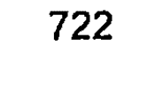

演化是随机的，人们对中大奖的欲望，像是一种对创新、对冒险者、对不确定性的奖励机制，哪怕是有泡沫的。社会文化的非理性，其实可能是鼓励“突变”的一种机制。

例如，特斯拉的股价，也许可以看作是一种捐款模式（而且包含了中大奖的机会），一种密码。

就投资人而言，还是要再次想起索罗斯的告诫：

> “世界经济史是一部基于假象和谎言的连续剧。要获得财富，做法就是认清其假象，投入其中，然后在假象被公众认识之前退出游戏。”

保持开放，相信凡事皆有可能，但别下重注。你可以信仰比特币，信仰AI。但是，不要All in 你在商业上的信仰。

罗素说：“我永远不会为信仰而死，因为我的信仰可能是错的”。

## 七

说到这里，我们就可以理解，为什么在商业上，需要追求一些不变的东西。

亚马逊一直在变，但是不变的那部分一直很坚定。蔚来汽车的李斌，也想明白了两件事：

- 从宏观的角度看，出行是一个很大的市场；
- 从竞争的角度看，蔚来汽车是一家构建用户忠诚关系的公司。

而上面的第二点，正是贝佐斯从Costco创始人那里学到的关键一点。技术在变，人性不变。技术砸开口子，然后还是要靠传统的不变的要素来立住。

马斯克看起来像个疯子，商业上的打法极其理性老到：

- 先出跑车占住山头，用户爱尝鲜，容错度高，车毛病多反而显得车主玩儿得起；
- 再出S型抢占7万美金以上豪华车市场（因为富人们想要“不是奔驰宝马”的新玩具），对标奔驰的S系；
- 再出X型SUV（鹰门构建了形式差异化），对标宝马的X系；
- 再出3型，血洗宝马3系这个级别的大销量市场；
- 再到处近推出皮卡（北美前三大销售车型全是皮卡）。

你看，连车型系列都直接拿来主义，降低用户的心智成本。

更厉害的是，马斯克最近对员工发话，要不断降低成本，他想干什么？我脑海中浮现出了亨利·福特。

福特的崛起，靠的是制造廉价汽车，第一款T型车售价825美元，当时是血洗的价格。

有人说特斯拉老降价，不好。拜托，车是消费品，又不是鸡缸杯，不就该越来越便宜吗？

当然，特斯拉的网络效益、收益递增，已经提前在股市“预支”，仍然需要在未来几年里去兑现，这里面，仍然充满了不确定性。

而且，“老家伙们”未必甘心安静地死去，正在试图卷土重来。

总而言之，在商业上的创新者，需要做到：

先烈的勇气 + 先驱的智慧。

## 八

你觉得，自己的生活中有遇见过魔法吗？

克拉克定律三：

> 在任何一项足够先进的技术和魔法之间，我们无法做出区分。

坦率来说，我们已经很久没有见过魔法了。尽管在摩尔定律的神奇力量下，苹果公司M1芯片里“塞”了160亿个晶体管，但是，类似于笔记本电脑这类东西，在我看来已经20年没变过了。

Peter Thiel 说：“我们想要一辆可以飞的汽车，得到的却是140个字符”。

这也是一群大佬们愿意为马斯克出钱出力的原因。他们希望有人跳出信息世界的舒适区，去挑战物理世界的创新。

事实上，硅谷的那帮牛人们，包括谷歌的佩奇和特斯拉的马斯克，以及“PayPal黑帮”的成员们，经常会在聚会上天马行空。没准儿小时候多看一些科幻小说，长大后会更喜欢仰望星空，而不是用技术去“围剿小商贩”。

Peter Thiel的话很犀利。不过，也许信息世界的力量积蓄，最终将从AI这一点爆发出来。

普朗克说：物理学世界的图像离感知世界的距离正在日益增加，这无非意味着我们逐渐接近真实世界。现在，我们又构建了一个数字世界，用一种“模仿游戏”的方式，来接近真实的世界。

我会在吃饭的时间顺便看AI在围棋App上的对局直播，AI下棋时的算力与想象力（其实是超越了人类想象力的算力），时时触动着我。也许我们正处于某个技术爆发的前夜。在你我的有生之年，什么都可能发生。

我们有机会发现终极算法、进而洞察复杂宇宙背后的简单秩序吗？就像爱因斯坦试图做到的：

> “我想知道上帝是怎么创造这个世界的。单纯的某个现象或某个元素（的性质）都不能提起我的兴趣。我感兴趣的是上帝的总体构思，其余的都只是细节。”

对于未来，人类惟有乐观，并无其它选项。忘掉黑暗森林法则吧。

人们所获的奖励，未必一定是亲眼目睹指数式增长最陡峭的那一段，而是某种期待，以及：或深或浅地参与其中。

如威廉·华兹华斯所说：

> “幸福便是活在那个黎明之中。”

## 最后

> “今天，每一个活着的人的身后，都立着30个鬼魂——30:1，正是死去的人和活人的比例。开天辟地以来，在地球上活过的人大约总共一兆。”

克拉克的这段话，让我感慨人类先驱们的伟大--也许是造物主的伟大。

我看AI下棋时，不由得想起吴清源，他孤身一人，在异国他乡，在为生死而战斗时，仍然能够走出史无前例的招法。

假如AI会说话，当它看见吴清源的棋谱，一定也会说：wow!

爱因斯坦很孤独，但他其实站在一大群天才的肩膀之上：马斯克很厉害，但其实是众多小时候玩儿无线电玩儿编程的“大小孩”们撑起了公司。

人类何其幸运，在寂静的宇宙间，在短暂的岁月里，代代相传，演化出连自己都无法解释的惊人智能（不可避免也包含相当比例的愚蠢）。

请记住陀思妥耶夫斯基的话：

> “首先人应该善良，其次应该诚实，但是最重要的，是不要相互遗忘。”

未来会发生什么？我们的有生之年还能见证哪些奇迹？据说克拉克不愿意冷冻自己以实现在未来复活。如果你到斯里兰卡，也许有机会去瞻仰克拉克的墓碑，上面写着：

> “他从未长大，但他从未停止成长。”

## 大脑杠杆

让我们来做一个好玩儿的游戏：

研究人员把满满两口袋球放在被试面前，每只口袋里都有红黄两种颜色的球。

- 一号口袋里，75%的球是黄色，25%的球是红色。
- 二号口袋里正好相反，75%是红色，25%是黄色。

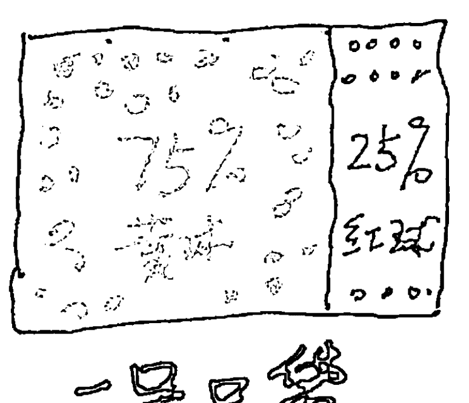

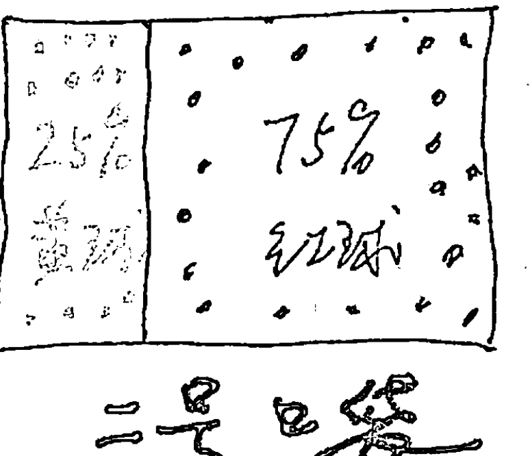

你随机挑选一只口袋，然后把球一个接一个往外拿，其间不得向袋子里面看。每拿出一个球，你都需向研究人员汇报他的猜测：你手中的袋子究竟是黄色球居多，还是红色球居多？

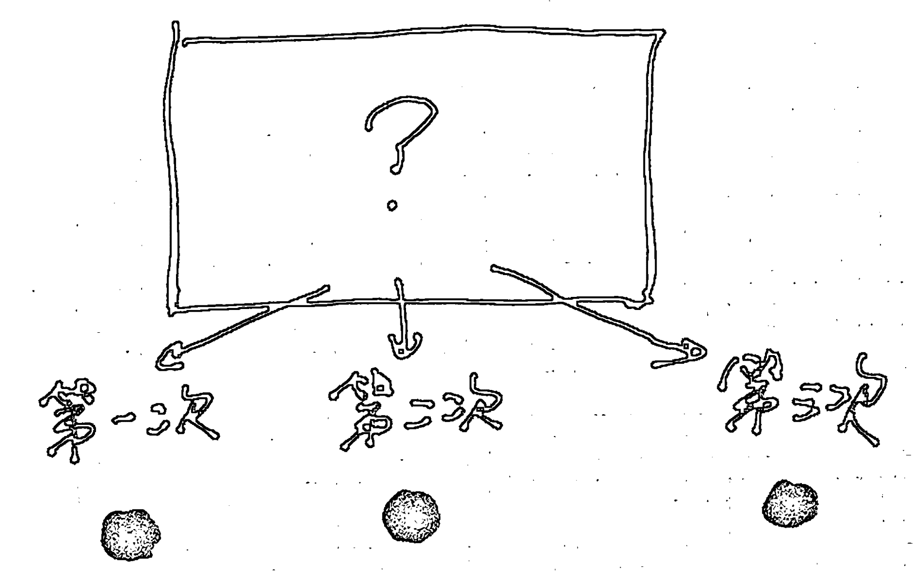

请你随便估一下，记在心里。然后，我们再来看一下当年该研究的结果。

研究表明：

- 当被试从口袋中抽出的是红色球时，他们更倾向于认为该口袋里红色球占多数。
- 假如他们抽出的头三个球都是红色，那么他们认为袋中球以红色为主的概率就变成了之前的3倍。

嗯，你看，人是会根据新信息，对过去的判断进行更新的。可惜，这个估算差太远了。实际上应该是多少倍呢？27倍。

（以上案例，来自《思维的发现》，对于启发叙述的含糊之处，我没有写话。）

这个计算简单有趣，而且有时候非常令人疑惑。请允许我画一下计算过程：

第一个球的计算不难，即使不用所谓贝叶斯也能够理解，一号口袋里有1/4的红球，二号口袋里有3/4的红球。这很不简单嘛，干嘛还要列个公式？因为有时候你非用公式不可，尤其是两个口袋里的球总数量不一样的时候。所以下图我还是用贝叶斯公式算了一下。

计算结果，来自一号的概率是1/4，来自二号的概率是3/4。

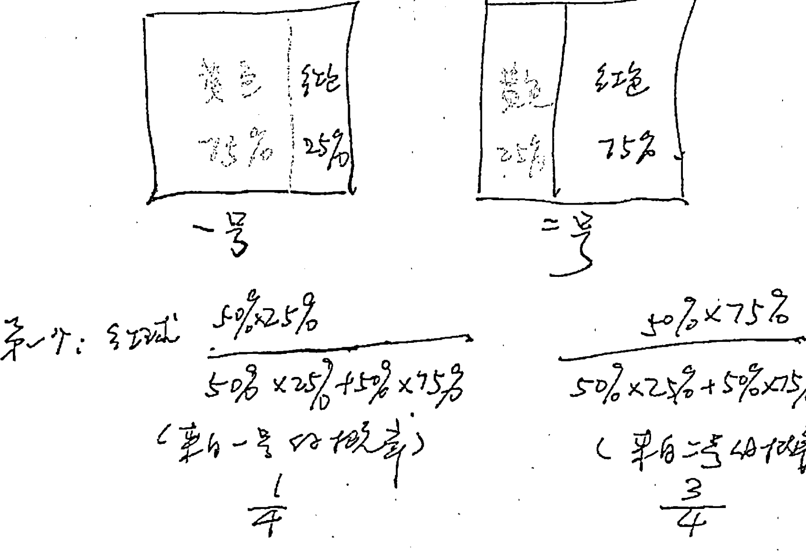

第二个球还是红球，这相当于连续发生，所以就是概率相乘，如下图：

第三个球还是红球，继续概率相乘，如下图：

这个实验表明，人们的判断方向，以及根据新信息更新判断的感觉，都是正确的。问题在于：人们低估了更新的幅度。

连续摸出三个红球，令该口袋是二号口袋的可能性，是一号口袋的可能性的27倍，而不是我们直觉的3倍。

> （请注意，这里对倍数表述的依然有点儿含糊，但不影响计算和表达观点。）

根据上面的计算，如果连续摸出三个红球，来自二号口袋的概率是27/ (1 + 27) = 96.42%。

这里面让人迷惑的是概率叠加。人们对一层概率的感觉还是可以的，但是多层概率相乘，就会有点儿绕不过来。上面这道题，算了三层。

我感到地方，不是计算本身，而是“根据更新的信息，逼近真相的速度”。也就是贝叶斯计算的预测能力。

大脑在面对信息时，会有一个加工的过程。这种加工能力，决定了大脑厉害与否，以及一个人能否在现实世界里做出更聪明的决策。

如上计算，每摸到一个红球，是二号口袋的概率就会乘上3倍。三次的话，就是3的三次方，也就是27倍。没错，这是一个并不复杂的贝叶斯计算。

但是，你发现没有，这当中，似乎有某种连续的“杠杆效应”，令随便抽三个球出来，就达到了如此高的预测精度。这，也是厉害的人的思维方式。

## 二

关于杠杆效应，阿基米德说：“给我一个支点，我就可以撬起整个地球。”可是不能，因为即使有一个支点，他需要一个很长很长的杠杆。

大概有多长呢？

假设在与地心引力相同的均勾重力场做这表演，在一端为与地球质量相同的圆球，离支点距离1m，在另一端为70kg质量的实验者，则实验者与支点的距离约为900万光年。这距离大约是仙女座星系与地球之间距离的3.6倍。

只有杠精才能抬得起这么长的杠杆。

让我们简单温习一下初中的物理：

在力学里，典型的杠杆是置放连结在一个支撑点上的硬棒，这硬棒可以绕着支撑点旋转。

当杠杆静力平衡时，其动力乘以动力臂等于阻力乘以阻力臂，这就是杠杆原理：

$$F_1 D_1 = F_2 D_2$$

根据上面这个简单的公式，可以透过改变动力臂或阻力臂长度，使输入力放大或缩小，人类虽然没有撬动地球，但改变了地球。

原始人用杠杆原理来撬东西，埃及人用之建金字塔，我们用的小小的指甲剪，也是一个复式杠杆（一组耦合在一起的杠杆，你拿出来看看，一个指甲剪至少有两组杠杆。）

齿轮传动，则令“杠杆效应”变得具有连续性了。最常见的如我们的自行车，整个传动系统，几乎都是利用了杠杆原理。变速器更是如此。

如上，两个齿轮传递旋转运动。请注意，小齿轮旋转速度更快。虽然较大的齿轮转动较慢，它的扭矩按比例更大。

帕斯卡则实现了用齿轮来计算。17世纪40年代，法国数学家和哲学家布莱兹·帕斯卡为减轻父亲在税务计算上的工作负担，在22岁发明了能做六位数加减法的机械计算器。

下面是1652年造的一台帕斯卡计算器。

后来，莱布尼兹发明了一种甚至能够进行开方运算的机器，他构想了一种“分等级的圆柱体”。

直到1948年以前，IBM所制造的手摇计算器，还在采用该类型等级的圆柱体的原理

自然，人们也会在金融领域来使用资金杠杆。例如你从事某个高利润行业，年利润高达20%，于是你到处借钱，愿意付出高达15%的利息，实现了财富的杠杆效应。然而，一旦你的利润出现了波动，例如降到了12%，负的杠杆效应就出现了。

很多富豪们更是使用了“复式杠杆”--杠杆加杠杆。然而，一切皆有价。于是，我们在新闻上看到，一家百亿资产的公司，因为还不起几千万欠款，导致了整个商业帝国的倒塌。

时间也能起到连续的“杠杆作用”。例如高频交易，从那些人们无法利用的、极为短暂的市场变化中寻求获利，就像鲸鱼张大嘴从大海里吞食，小鱼小虾肉不多，总量却很惊人。

中国过去20年开发商为什么那么厉害？因为同时使用了三种杠杆：

- 1、资金杠杆：银行的钱，政府的地，地和项目再抵押钱……
- 2、时间杠杆：卖期房；
- 3、空间杠杆：一个样板房，一小片样板空间，能卖成千上万套房子。

不消说，杠杆原理还是各种人生道理与成功学的必备良药。天下没有免费的午餐，一切皆有价。

杠杆原理也是如此，由世界上最聪明的一群家伙组成的长期资本，将资金杠杆和时间杠杆运用得淋漓尽致，又有诺奖理论护航，依然因为极小概率事件发生，被反向作用的杠杆原理砸死了。

那么，贝叶斯思维的“大脑杠杆”，到底属于哪一种杠杆呢？

## 三

让我们说回贝叶斯的“杠杆效应”。

1968年6月，天蝎号核潜艇在大西洋亚速海海域失踪了，潜艇上的99名海军官兵全部杳无音信。

看起来是不是像大海捞针？就搜寻的难度而言，的确如此。海军请来科学家克雷文组织搜寻。

- ·首先，克雷文列出一系列能够解释天蝎号事故的场景。
- ·接着，他组建了一个囊括各方面专家的团队，让每个成员提供自己对每个可能场景的发生概率的猜测。
- ·在将整个海域被划分成了很多个小格子，每个小格子有两个概率值p和q，p是潜艇躺在这个格子里的概率，q是如果潜艇在这个格子里，它被搜索到的概率。
- ·每次寻找时，先挑选整个区域内潜艇存在概率值最高的一个格子进行搜索。

## 四

如果没有发现，概率分布图则会被“洗牌”一次，搜寻船只就会驶向新的“最可疑格子”进行搜索，这样一直下去，直到找到天蝠号为止。

克雷文采用的正是贝叶斯法，能够利用有限的信息进行预测，并且根据搜索“连续更新”。

也就是说，每一次“没搜到”的遗憾都不会被浪费，也不是简单被标注为“不在这里”，而是用于更新调整整体的估算概率。

再回头看我们开头的例子：

当你从未知口袋里摸球的时候，尽管你摸的球的数量非常有限，但是新信息的某种杠杆作用，在连续作用之下，能够让你以指数级增加的速度，逼近事物的真相。

当我们添加更多的证据，初始的信念会不断地被“洗刷”。

有人把天蝠号潜艇案例视为“群体智慧”，也有人将其视为“试错法”，其实并不精确。

贝叶斯法，每一次都能利用新信息（哪怕是失败的信息），对原有信念进行更新。

这就是杠杆作用。

更重要的是，这一过程可以不断循环，连续作用，从而产生了指数效应。

所以，贝叶斯思维的杠杆，是一种关于“可能性”的杠杆。

《贝叶斯方法》一书，开篇就提及了“贝叶斯思维”的奇怪之处：

**贝叶斯思维和更传统的统计推断不同，贝叶斯推断会保留不确定性。**

在贝叶斯派的世界观中，概率是被解释为我们对一件事情发生的相信程度。

换句话说，这表明了我们对此事件发生的信心。

为什么在这里会出现有点儿“唯心论”的主观与信心呢？

对比于贝叶斯派，频率派认为：

**概率是事件在长时间内发生的赔率。**

比如你一直扔一个标准的硬币，你得到正面的概率是50%。

但是，对于天蝠号潜艇失事，历史上没有那么多数据。

怎么办呢？

于是，贝叶斯派把概率解释成是对事件发生的信心，也就是说：

**概率是观点的概述。**

认为概率是主观的，并不意味着贝叶斯派是一群主观的家伙。

相反，他们随时打算更新自己的观点。

哪怕新的信息（证据）和自己的信念相反，哪怕消息很让人恼火，很羞辱自己的智商，贝叶斯派们也坦然接受。

如同传说中凯恩斯说的：“当事实改变，我的观念也跟着改变，你呢？”

但是他们又不是简单的见风使舵，他们不会因为新信息彻底抛弃旧的信念，而是通过一个并不复杂的公式，将所有的信息整合在一起。

《贝叶斯方法》对此总结道：

- 即使获得了新的证据，我们也没有完全地放弃初始的信念。
- 但我们重新调整了信念使之更符合目前的证据（也就是说，证据让我们对某些结果更有信心）。
- 通过引入先验的不确定性，我们事实上允许了我们的初始信念可能是错误的。
- 在观察数据、证据或其他信息之后，我们不断更新我们的信念使得它错得不那么离谱。

比起“简单的”的贝叶斯计算，这些思想的价值才是宝贵的。

在我看来，贝叶斯法，就是一种“大脑杠杆”。

## 五

为了本文的票房，请允许我再次将计算和人生道理扯在一起，目的是为了反驳那些更糟糕的人生道理。

绝大多数成功学，都是基于“频率派”的统计结果。

很不幸，由于样本量过小，以及没有“双盲实验”，绝大多数成功者的经验和法则，都没啥作用。

在现实中，那些极其有限的表面上的确定性，会被茫茫人海和时间长河的不确定性彻底淹没。

“频率派”成功学，其“榜样”可能只是幸存者偏差。

那对于我们自己呢？

假如我们愿意承认世界是随机的，也愿意不断尝试，用于探索，“频率派”不是很好吗？

可能还是不行。因为：

**每个人作为样本而言太复杂，而时光又太短暂。**

人生的难处，或者说乐趣，都在于不可重复。

试验次数有限，样本量极少。

所以，一个人的成长，最好的方法是基于“贝叶斯思维”的试错法。

高普尼克说，贝叶斯学派认为学习本身很像科学进步的状况。

- 我们会考量一系列不同的假设对世界如何运作的不同描绘。
- 有些假设可能比其他假设更有可能是正确的，但没有一个是绝对正确的。
- 当我们说相信一个假设是正确的，我们真正的意思是，到目前为止，这是我们最好的猜测。

高普尼克提及了计算机科学家霍德·利普森的发现：

有一种策略是让机器人去发展自己身体的内部图像，然后机器人就可以预测如果身体内部或外部发生变化会怎么样了。

她试图将贝叶斯式的孩子的玩耍，与机器学习联系起来：

在试图做出任何有用的事情之前，利普森的机器人会以一种傻傻的、随机的方式开始跳舞，就像在婚礼上喝醉酒的表哥一样。

但是之后，它可以利用在好玩的跳舞阶段收集到的信息来决定当意外发生时该如何行动。即使工程师们拆除了其中一个机械臂，它仍然可以行走。那一开始看起来明显没有用处的舞蹈将使机器人在以后更加强大。

从中，我们大概可以看到波普尔试错法的身影：

1. 提出问题；
2. 大胆假设（试探性理论）；
3. 检验证伪（排除错误）；
4. 提出新的问题。

当我们使用贝叶斯那个简单的公式，进而再利用计算机来构建算法，波普尔的“试错法”就会显得更加强大。

说回如何变成一个更厉害的人，就像阿尔法狗，后来最厉害的版本，已经不需要向人类的棋谱，完全靠自己学习。

这不是说不该向更厉害的人学习，只是对AI来说人类的棋谱不够用了，也用不着了。

简单而言，用穷尽法，把“天下所有厉害招数全部装在一起随时调用”的专家模式，对于AI来说，目前并不管用。

对于人类学习的效率而言，可能也是。

再厉害的大脑杠杆，也需要一个支点。

那个支点，就是你自己。

无人能够替代。

## 六

人和人之间的差距到底有多大？

这些差距的本质到底是什么？

我们大概可以总结为：

1. **人们在最初的认知、判断、信念上，不会有太大的差距；**
2. **厉害的人会不断根据新的信息，更新自己的信念；**
3. **尤其是，当某个人建立了自己的“贝叶斯算法”，就拥有了“大脑杠杆”；**
4. **然后，他在某个领域持续使用这种“大脑杠杆”；**
5. **如此一来，他就有机会实现指数式的增长。**

以我自己有限的社会阅历看，那些特别牛的牛人，你与他们接触，会发现很多时候并没那么厉害。

例如，对于某个新的问题，你可能会觉得，这家伙的见识还不如我呢。

但是差别也在于，那个牛人在不断地更新，而你还洋洋自得，或是在维护自己的英明正确。

比如说，我脑海中浮现出几个牛人，你和他聊天，开始的时候，双方唇枪舌剑。结果不一会儿，你发现他在引用你的话和观点了，而且一点儿都不会不好意思。

这就是贝叶斯主义者的特点：信息是用于更新“自己的信念”的，不管这信息是自己的，还是“敌人”的。也不管这信息对自己当下的观点有利，还是不利。

贝叶斯主义者敢于抛出自己的观点，也不畏惧质疑和调整自己的观点。

就像乔布斯，到处骂别人的观点是狗屎。

但是假如回过头来，他发现那玩意儿很香，乔布斯敢亲口把那坨东西吃下去。

所以，人和人之间的差别，不是初始值的差别，而在于“大脑杠杆”的差别，以及是否幸运地在某个领域连续运用“大脑杠杆”。

## 最后

总结十条：

1. 世界不是由“对错”构成的，而是由可能性构成的。
2. 哪里有什么“一眼看穿本质”的神人，只有厉害的贝叶斯主义者。
3. 而贝叶斯主义者，善于在某个半径内连续使用“大脑杠杆”，实现指数式进步。
4. 好消息和坏消息是等价的，只要你有效运用于更新信念。
5. “大脑杠杆”不是天生的，与智商无关，与哲学和计算有关。
6. 我们需要用**逐步消除不确定性来接近确定性**，而不是用确定性来证明确定性。
7. 作为计算“不确定性”的概率，会**基于时间和空间进行叠加**，从而产生**复利的杠杆效应**。
8. 所谓“长期主义”，是一个**不断证伪的过程**，而非不断自我说服的过程。
9. 杠杆原理需要遵守“**力矩平衡**”，你省了力就要多走路。一切皆有价。当然，类似于齿轮和滑轮，可以实现机械和计算上的自动化。
10. 大脑和孩子也许**天生就会贝叶斯**。保护好自己孩子般的犯猎勇气和探索精神。

**总之，一个贝叶斯主义者既不会为自己的坚定信念而献身，也不会因为对这个世界的怀疑而裹足不前。**

## 赔率的“陷阱”

本文的标题有两重含义：

- 赔率之“成为陷阱”，导致致命风险；
- 赔率之“作为陷阱”，赢得超额回报。

假如你是一个原始人。

你即将迎来人生的一次艰难抉择。

有一天，你打算出门为自己的家人和孩子采摘一些野果。

你知道，你家洞穴不远处，有一片浆果林。

那里的野果鲜美多汁，维生素含量丰富，大人小孩都爱吃。

可是，那片果林附近经常有黑熊出没。

人生艰难，自古没有免费的午餐。

然而，望着孩子们嗷嗷待哺的眼神儿，你涌出一股无私的大无畏精神，决定去冒险。

尽管你的“无私”，可能只是“自私的基因”为了繁衍后代而制造出来的幻觉。

你小心翼翼地来到果林，左顾右盼，一边摘果，一边观察，提防黑熊从阴暗角落冲出来。

看来今天运气不错，你很快装满了大半篮子浆果。

该见好就收了，你抱紧篮子，一半欢喜一半紧张地走上了回家之路。

这时，你遭遇了比地球还要久远的“墨菲定律”：

你最担心的事情，在你不情愿的时刻，终于发生了。

你发现右侧的丛林里有一个黑影！

熊来了？

百万年的演化进程，赠予你天生拥有的直觉，这类直觉让你能够迅速洞察危险，并且逃命。

这类直觉，是靠没能及时逃命的原始人被吃掉而选择并遗传下来的。

然而，尽管你对熊有很好的直觉，那个黑影也可能是块石头。

一个艰难的抉择摆在你面前：

选择1：该猜那个黑影是只打算吃掉你的黑熊，然后为了逃命而扔掉辛苦采摘的鲜果吗？

可是你脑海里仿佛看到孩子们失望的眼神，以及未来几天饿肚子的煎熬。

**选择2：** 该赌一下那个黑影只是个石头，然后你抱紧篮子快速（比空手跑慢一半儿）离开吗？

先做两个假设。

**假设一：对熊或石头的判断准确率。**

原始人对熊的直觉判断不低，但考虑到紧张情绪，所以我们估计原始人判断是黑熊还是石头的准确率高达60%。

**假设二：森林里像熊的石头与熊的比例。**

一只熊的平均居住面积大约有几十平方公里，而石头的数量则要多得多，我们姑且认为石头和熊的比例是10:1。

这时，原始人看见一个黑影，并且直觉告诉他可能是只熊，请问：

**真的是一只熊的概率是多大？**

请允许我画一下：

**第一步，看一下树林里（像熊的）石头与熊的总量，数量上是10比1，如下图1口。**

第二步，假如那个黑影是石头，因为原始人的准确率为60%，所以60%的时候他准确地猜出是石头，40%的时候误以为是熊，如下图$1\square$。

第三步，同理，假如那个黑影是熊，因为原始人的准确率为60%，所以真的是熊并且原始人也猜对的概率是60%，如下图的右上角10。

第四步，因为原始人观察到是熊，让我们去除掉“他不认为是熊”的可能性，如下图10。

第五步，我们算一下，原始人观察到的熊，由如下两类可能构成，计算如下图10。

**第六步，在上图观察中，只有右侧橙色的部分，真的是熊，所以我们要计算：当原始人观察到是熊，其实真正是熊的可能性有多大，如下图10。**

$$\frac{1 \times 60\%}{10 \times 40\% + 1 \times 60\%} \approx 13\%$$

也就是说，你以为是熊但实际上真的是熊的可能性，只有13%。

倒过来说，就是其实你有近90%的可能性是安全的。

多大的概率呀。

要是有个你熟知的大老板给你一个准确率高“90%”的内部消息，让你去买他们公司“肯定会大涨”的股票，你会不会买？

你是不是觉得：人生能有几回搏？而且索罗斯和老喻都说过，大机会来临时要下大注，于是你推上一大堆筹码。有些人甚至会借钱抵房。

然而，原始人毕竟是原始人，他扔下了辛苦采摘的一篮子浆果，掉头就跑了。

聪明人可能坐不住了，着急要说：

- 这不就是一个简单的贝叶斯计算吗？
- 这不就是卡尼曼说的“系统一”和“系统二”吗？

慢，到目前为止，还只是铺垫，高潮还在后面。

的确，这是一个贝叶斯计算。假如有个爱思考的孩子能看到这个过程，乱画一番的我很心满意足了。

95%看过《思考快与慢》的，都记住且仅记住了“系统一”、“系统二”：

- 系统一是直觉、条件发射、不动脑筋、经验主义，与杏仁核有关；
- 系统二是三思而后行、深思熟虑、主动思考，与前额叶皮层有关。

那么，原始人的“系统一”，到底是理性，还是非理性？

考虑到原始人怕被吃掉，现在社会已经没有熊从背后拍你肩膀咬你脖子的可能性了，但百万年很长，数千年文明很短，所以人类基因还在支配着我们的“系统一”。

所以，对于现代人而言，“系统一”大多是非理性的。你赞成吗？

然而，有个人不赞成。

这个人，就是喜欢骂各种牛人的自恋狂塔勒布。

在《非对称风险》里，他点名骂了理查德·塞勒：

（他们）试图把我们的行为区分为“理性”与“非理性”（非理性就是偏离了预想值或预先设定的模型的行为），然而他们全面误解了概率论的适用性，又过分依赖于一阶模型。

他们还倾向于将复杂事物理解为若干变量的线性组合，他们认为我们只要理解了微观个体，就能掌握大众和市场的规律，或者只要我们理解了蚂蚁，就能理解庞大的蚁穴的构造。

塔勒布骂人不奇怪，但骂塞勒还是让我有点儿意外。

塞勒算是特立独行的人，开创了行为金融学，得了诺奖，有自己的资产管理公司，还演了《大空头》（请注意，这部电影是对“反向黑天鹅”的精彩演绎），并且他对“热手谬误”的解释，也说明他是一位“概率思考者”。

按理说，塞勒是“塔勒布最喜欢骂的那些人”也喜欢骂的人，却没有因此实现“敌人的敌人就是朋友”。

塔勒布骂塞勒的理由是：

他们混淆科学与唯科学主义的区别，他们甚至认为唯科学主义比科学更具科学性。

骂完了不说，塔勒布还给“塞勒们”创造了一个词：

“白知”（intellectual yet idiot），它特指那些高智商的聪明的白痴。

我们来学一下知识分子如何骂人：

“白知”总是将那些自己无法理解的行为定义为反常、特例、病态和非理性，却没有意识到可能是自己的理解力有限。

他们认为人们的行为应该遵循利益最大化原则，而他们能够知道别人最大的利益是什么，尤其是那些乡下的农民和发不出清脆元音并支持英国脱欧的底层人士。

当平民按照自己认为合理而“白知”却不能理解的方式做事情的时候，“白知”就会说他们“没有教养”。

太有趣了。

其实卡尼曼和塞勒是一脉相承的，但塔勒布并没有写卡尼曼，可能因为卡尼曼夸过塔勒布的书吧。

而且，塞勒对于投资的三观，和塔勒布非常接近，尽管路线不一样。

塞勒创立的资产管理公司，专门寻找投资者对公司发展反应过度或不足时产生的划算买卖，其原理是基于“投资者总是过度自信或过度恐惧”，据说业绩不错。

塞勒给投资者的建议是：

最好的策略是创建一个明智的长期投资组合，然后忘记它。

让我们还是把话题扯回你：

一个正在面临艰难抉择的原始人。

在本文开篇的案例里，我们计算了“看成熊的情况下真的是熊的概率”，这个数值是13%。

但是，这个计算忽略了一个重要的环节：

赔率。

由于被熊吃的极端事件，很难在现代社会出现，让我们假设你被熊咬了一下，逃生了，回到村里，神医给你治好了，要价100篮子浆果。

接下来，我们再简单计算一下（忽略篮子的价值）：

**情况1：** “看成熊的情况下真的是熊的概率”，是13%；

**情况2：** “看成熊的情况下但不是熊的概率”，是87%。

大概率不是熊，为什么要跑呢？

我们在前面概率计算的基础上，在引入“赔率”来算一下。

假如选择不跑：

**情况1：** 13%的可能性发生，损失是100篮水果；

**情况2：** 87%的可能性发生，收益是1篮水果。

计算收益如下：

$13\% \times (-100) + 87\% \times 1 = -12.13$

也就是说：

**选择不跑，从概率上是占优的，但从赔率上是吃大亏的。**

所以，作为原始人的你，应该立即扔掉篮子，撒腿就跑。

由此，我们也能理解，塔勒布骂塞勒的原因之一了。

巴布亚新几内亚居民有种“建设性偏执”：不要在一棵死树下睡觉。

这是迷信吗？可能。但也可能是基于经验的概率统计结果。

这是非理性吗？

塔勒布的评论是：只要你不在一棵容易被风刮倒的死树下睡觉，你就不容易被它砸中，其他都不重要。

所以，某些偏执，或者原始人的“慌乱”，也许是一种有效的风险防控手段和自我保护机制，以避免不可承受之风险的发生。

正所谓：不听老人言，狗熊在眼前。

## 五

我如此不厌其烦地讲述“熊来了”的故事，是因为看到戴国晨写塔勒布新书《肥尾分布的统计效应》的读后感，其中有下面这段：

> 总的来说，概率只是积分内部的核函数，真实世界中重要的是赔付，也即概率事件对每个人的实际影响。

期望值的计算，只是小学二年级水平的数学难度，但是很多专业人士，在这里都可能会犯糊涂。

但关键点还不在这里，科学的进步，让人类越发相信自己征服“未知”的力量，不管是对自然界，还是在金融领域。

但是，未来很难预测。

而且，即使你在概率层面预测“正确”，但是因为忽略了赔率，尤其是低估了黑天鹅事件造成的摧毁，那么这个“神预测”也不能帮你赚钱。

由此，塔勒布给出了他的哲学：

反脆弱，不用做预测大师，只需要改变赔付关系即可。

为什么呢？

因为：在肥尾分布下，你很难进行“正确量级的预测”。

我在下一节，将从另外一个“简单的”角度，来讲述预测的艰难之处。

那该怎么办呢？

戴国晨的文章里总结了策略如下：

金融领域风险管理的本质在于改变赔付关系，而不在于追求正确预测，因此只要在赔付关系上有利于自身，哪怕降低预测精度也无妨。

如前所述，《大空头》里，上演的正是这样一个故事。

这个故事的原理，我在《 如何用小概率赚大钱？(更正版)》里写过。

但是，这里面的要点，却被广泛地误读。

人们总觉得，《大空头》里的赢家，靠的是“准确预测了次贷危机”。

事实并非如此。

马克·施皮茨纳格尔就是在2020年3月份赚了几十倍的那个家伙。

他是这么做的：

- 不管局势好坏，他始终不吝以连续小亏为代价保持充足的看跌期权。
- 一旦市场失控，这些期权立马就会比成本价涨上几千倍。

> 不依赖于时间的精确性，但享受时间的长期性所带来的遍历性，这才是做时间的朋友。

预测的准确率经常不靠谱，而确定的赔率，尤其是具有优势的赔率，会令较小概率的预测随着时间叠加成较大概率的优势。

> 赔率令时间成为朋友，反之则是敌人。

尤其是，从永久性损失看：

> 预测准确率的提高如果对应赔付的大幅恶化，这样的准确并没有意义。

于是，就有了引发我写此文的那句话：

> 如人们所说，同样是犯错误，把熊误认为是石头远远比把石头误认为是熊糟糕得多！

## 六

这里面，还有一个很好玩儿的地方。

不知道你发现没，“熊来了”的这个故事里，出现了三个概率数值的两次反转。

第一个概率，是“原始人识别熊还是石头”的准确率，高达60%。

于是，原始人的反应是：

熊来了，快跑！

第二个概率数值是“熊和像熊的石头”之间的比例，其中是熊的概率为1/(10+1)。

因为第二个概率是基础比率，导致了第一次反转：

“你以为 是熊但实际上真的是熊”的可能性，只有13%。 从你直觉的较大概率事件变成了较小概率事件。

哎，90%的可能性不是熊，别跑！

第三个概率数值与期望值有关，是赔率，被熊咬和跑掉之间的赔付比例是100:1。

结果，赔率造成了“第二次反转”：

小概率发生的事情，因为对应赔付损失极大，所以我们更应该重视小概率，而忽略所谓的“大概率优势”。

啊，虽然小概率是熊，被咬了赔不起，快跑！

- 造成第一次反转的，是因的因；
- 造成第二次反转的，是果的果。

这个跷跷板式的游戏，真有趣。

多次反转，因果交织，在现实中经常出现。

例如2020年的危机，你该如何预测？

- 因为疫情，股市大跌；
- 因为经济糟糕，各国出台政策刺激；
- 因为钱多了，人们纷纷挤入龙头股，管它价格多高...

疫情等因素引发的多次反转型市场波动，连最厉害的文艺复兴基金都被破了金刚不坏身。

对于罕见的亏损，西蒙斯解释说：

该公司的亏损是由于在3月份的暴跌中对冲不足，然后在四月至六月的反弹中对冲过度所致。发生这种情况是因为模型对最初的问题进行了“过度补偿”。

文艺复兴基金依赖于历史数据训练出来的模型，当市场反转又反转时，模型被来回拉锯，而且总是“晃过头”，像是被马拉多纳的假动作晃晕了的后卫。

我不由得想起“三体问题”：

- 现在已知，三体问题不能精确求解，即无法预测所有三体问题的数学情景。
- 受初始状态影响的敏感性，初始条件非常微小的变动也可以导致最终状态的巨大差别。

很多时候，人类不得不预测，例如原始人必须要预测“黑影是不是熊”。

但是我们要理解预测的局限性，并探索如何应对。

格林斯潘说：经济学家预测出了过去5次衰退中的9次。

然而，我们却总是相信预测，迷信专家。

你去看看满大街股票预测专家们的生意。

> “股票预测专家唯一的价值，就是让算命先生看起来还不错。”

巴菲特如是说。

时间也许愿意做你的朋友，但讨厌被你看穿。

## 七

“好了，就算你说得有道理，那你说该怎么办呢？”

难道我们能做的就是和原始人一样，熊来了就跑？

我们广大散户（包括我自己哈）不正是这样做的吗？

嗯，批评算命先生的文章，也无法逃离当算命先生的宿命。

为了本文阅读票房，请允许我给出一个模糊的科学算命：

### 一个原始人，该如何应对“熊来了”？

塔勒布老师的药方是：

> 在黑天鹅降临时，具备反脆弱特性的事物不但不会受损，反而还能有巨大收获。

具体该怎么做呢？

原始人扔掉浆果，逃回山洞，在家人怨恨的目光下，陷入了深深的思考。

- 狗熊可以吃人，人为什么不能吃狗熊呢？
- 因为狗熊力气太大，村里人一起围攻也搞不掂。
- 但是，听说隔壁村儿搞了个高科技，叫“陷阱”，能抓住熊。
- 可是，用陷阱抓熊的概率太低了。
- 慢着，假如大规模生产“陷阱”，会不会算得过来帐呢？
- 再进一步，我们能否在浆果树林附近多挖陷阱，这样一方面保护我们摘果，而且会增加狗熊掉入陷阱的概率。
- 时间长了，总会有狗熊掉进陷阱。这就叫遍历性。
- 哪怕很久才抓住一只狗熊，但是回报实在太丰厚了，那肉也够吃上好几个月，熊皮还能做马甲呢。

嗯，这样我们平时吃浆果，然后隔一阵子抓一只大肥熊，生活充满了希望！

这的确是一个看起来很美好的模型。

数学上也很容易解释：尽管抓住熊的概率很低，假设每天熊掉入陷阱的概率是1%，那么连续n天熊不掉入陷阱的概率，是99%×99%×99%……

这时候，你才会感受到，复制在干坏事儿的时候才厉害！

99%这个大概率数字，不断乘下去，会一点点累积成一个小概率。

因为熊掉入陷阱的概率是"1-99%×99%×99%……"，所以就变成了大概率事件。

这就是低成本陷阱的数学原理。

在现实中，的确也有这样的事物。

## 八

管理着43亿美元的环球投资，做的就是这样的生意：

主动小亏，偶尔赚入超级大钱。

福布斯杂志这样介绍道：

环球投资购入短期期权合约。这种金融工具的用途是规避市场剧烈波动以及金融市场崩盘，兼具“深凸性”和“虚值”两种性质。直白点说，只有市场突发大崩盘，这种交易才有得赚。

2020年三月，环球投资旗舰基金“黑天鹅事件预防协议”取得惊人的3,612 %的回报率，令全年回报率一举跃升至4,144%。

然而，我想说的是，道理似乎谁都懂，真正赚到钱很难。

从2009年到2019年，美股迎来一场超级大牛市，许多类似环球投资的尾部风险对冲基金都亏得一塌糊涂。

这类案例，在常识层面会给人以启发，也会实实实在在地指导我们在投资乃至人生上的行动。

但是，作为成功神话，环球投资可能会“误导”太多人：

- 我每天坚持买彩票算不算以极小成本博无限大的收益呢？
- 我用90%的资金买指数基金和货币基金，用10%的资金炒期货，算不算哑铃策略呢？

当然都不是。

彩票和个人炒期货，都是负期望值，单凭这一点，就令绝大多数参与者稳稳地输光本金，并且毫无希望。

期望值是否为正，区分了赌徒和投资人。

即使期望值为正，你也要依赖于大数定律的实现。

但事实上，对于个人而言，你可能很难实现强大数定律的“足够多次”。

布鲁斯·纽伯格说过：“概率与结果之间存在巨大的差异。可能的事情没有发生（不可能的事情却发生了）向来如此。”

根据几何分布，你要扔14.7次骰子，才能让6个数字每个都至少都出现一次。你要和37.2个人交往，才能做到“和所有星座的人都谈过恋爱”。

也就是说，即使有了正期望值，你还需要遍历性。

太难了。

同样是利用“黑天鹅+肥尾效应”赚钱，塔勒布自己都熬不下去，据说后来的收益也一般。

环球投资的成员有十多位博士、数学家、交易专家。创始人马克·施皮茨纳格尔16岁就跟着一位期货高手打暑期工，身经百战，又去了纽约大学数学研究院师从塔勒布。

当年与塔勒布合作成立对冲基金Empirica，马克·施皮茨纳格尔才是不断亏钱时不哆嗦的那个人，塔勒布反倒吓得要命。

此外，环球投资看起来也很会做生意，也就是募集资金，因为基金总是需要弹药的。

环球投资的产品，被形象地称为“巨灾保险”，客户多是钱很多的金融机构，比如养老基金、主权基金（据说当年也向中国推销过）。

客户指定部分需要上“保险”的资产，向环球投资额外提供一部分资金，环球投资管理并对额外资金收取相应的提成。

举个个人投资者熟悉的例子，我们都知道指数基金投资最适合业余投资者，那么，如果我们采用塔勒布的“哑铃策略”，用大部分的指数基金，加小部分的尾部风险对冲，结果会怎么样？

马克·施皮茨纳格尔在2020年初的致股东信中（看来敢于给股东写信是个值得关注的投资信息）做了一个数据模拟：

- 持有96.7%的标普500和3.3%的环球投资的“巨灾保险”，在过去十年的投资回报是319%。
- 不仅好于仅仅持有标普500，也好于那些配置75%标普500和25%其他资产的组合。
- 更何况，这个数字还没有包括一季度的40倍！

你看，环球投资的策略，像不像我上面编造的那个“熊来了”的故事，一个人想出了一个模式：

他对那些采浆果的人们募集资金，然后挖下了一个个捕捉黑熊的陷阱。

只要抓住一只大黑熊，他就能够赚回所有的陷阱成本。

所以，那些采浆果的人们，就向他付钱，相当于为自己的浆果投资买下了保险。

于是，“熊来了”这件令原始人恐惧并且不可承受的事情，因为陷阱的出现，变得值得期待，甚至可能带来肥美的收益。

环球资本作出了示范：

> “在黑天鹅降临之时，具备反脆弱特性的事物不但不会受损，反而还能有巨大收获。”

## 九

投资最重要的事情，到底是什么？

综上所述，应该是：

- 别被熊吃了。
- 别在死树下睡觉。

由此可见，投资的第一原则是：永远不要亏（大）钱。

第二条原则是：永远不要忘记第一条规则。

对于投资者而言，最重要的风险，是永久损失的可能性风险。

但是，为了躲避熊，不去摘果子，什么都不做躲在山洞里，也不是回事儿。

从“熊来了就跑”，到给熊挖陷阱，首要目的不是为了利用黑天鹅事件发大财，而是规避风险。

对于原始人而言，给熊挖陷阱是为了对冲风险，守护自己采摘浆果的收益。

假如你没有用于对冲风险的“捕熊陷阱”，就不要出去摘果子。

说个我自己亲历的经历吧。

为了避免任何小样本的偏差与误导，我用的是自己“虚拟赌博”的案例。

最近我经常在吃饭的时间，忙里偷闲，在野狐围棋旁观高手对局，顺便下注。

基本上我只选择AI与人类的对局，因为AI水平相当稳定，只要看准了胜率和赔率，控制好下注比例，基本上稳赢。

靠此策略，我稳稳地从几千块钱（虚拟币）的穷光蛋，成为资产高达五百万的棋迷。

昨天晚饭时，AI们似乎都在休息，我只看到了两个人类业余“9段”在对局，点进去看了一下，发现局面非常倾斜，黑棋优势极为明显，于是我没有遵守自己的“投资框架”，下注于双方都是人类的对局。

开始的时候，我还意识到自己在冒险，所以即使黑棋优势非常明显，“第一阶段”我还是只下注了40万，占总资产不到10%。

该局一共有三个阶段下注，每个阶段的赔率，会因为局面的进程而调整。

1、第一阶段下注40万，对应的是本金之外（下同）50万的预期收益。

2、到了第二阶段，局面朝我预期的方向发展，黑棋的盘面优势高达二十多目。

这算是大机会了，于是我加注100万，因为局势更明确了，所以赔率下降，这100万对应的是80万的收益。

3、又过了一会儿，黑棋唯一的一块孤棋也安全了，马上进入收官阶段，白棋很难翻盘了，赔率居然还没变，我赶紧又加注了100万。

这两百万，约占我总资产的40%。

4、接下来进入了第三阶段。

这时候，白棋拼命反扑，盘面目数的差距越来越小，但是白棋的代价是出现了一块孤棋，面临死活问题。

我算了一下，这道死活题不难，黑棋可以从内部灭眼尽杀白棋。果然，观棋区有个3段也摆出了变化，可见的确简单。

我翻看了一下第三阶段的赔率，这时大家都看出白棋无回天之力了，白棋获胜的赔率是1赔6。看油水不大，我没有再加注，哪怕几乎是稳赢了。

这时候，我的投资总览如下：

| | 黑棋 | 白棋 |
|---|---|---|
| 胜率 | 99% | 1% |
| 投入 | 240万 | 0 |
| 收益 | 210万 | 0 |

5、此刻，我突然冒出一个念头：

现在我一共下注了240万，赌黑棋赢，对应的是210万收益。

根据第三阶段的赔率，假如我反向，押注于弱势的白棋一方，只需下注50万，对应250万的收益，就可以实现对冲：

不管黑白那一方赢，我都能赚钱。

如下图：

| | 黑棋 | 白棋 |
|---|---|---|
| 胜率 | 99% | 1% |
| 投入 | 240万 | 50万 |
| (预期)收益 | 210万 | 250万 |

黑胜: 210 - 50 = 160万
白胜: 250 - 240 = 10万

这就是安全套利吧！

然而我并没有这么做。

难道下黑棋的9段看不出这么简单的死活题?

为了那1%的小概率，我用得着额外出50万，去买个“保险”吗?

6、黑棋准备杀这块白棋了。这位9段异常谨慎，他连续在别处“打将”以拖延时间，可见他的小心，哪怕这道死活题对他来说太简单了。

然而，黑天鹅出现了，他居然走错了！

观战区哗然了，天呐，这个9段怎么啦?

7、黑棋怎么都不可能输的棋，输掉了。

于是，我的“煮熟的鸭子”飞了，“板上钉钉”的210万收益没了，自己白手起家赚来的240万本金，也灰飞烟灭。

（以上皆为虚拟币。）

那一刻的我，深深地意识到：

所谓的胜券在握，真的只是一个概率问题。

什么事情都可能发生。

没有尾部对冲的投资者，就不该留在赌桌上。

## 最后

总结十条：

- 这个世界的 不确定性，在空间上是由很多个不确定性叠加在一起构成的，在时间上则可能反转反转再反转。
- 别指望靠某一层 的“精确预测”来消除不确定性，“无知”永远包裹着“已知”。你需要在“无知”层构建安全气囊，守护你的“已知”。
- 当你对某个事物有一个主观判断，试一下两头看：往回想一下这个事物的基础概率，往后算一下这个事物的赔率、期望值和尾部风险。
- 像下棋一样，当一件事情发生时，你要想：下一步呢？再下一步呢？记住在竞技场合上一盘棋唯一的目的是赢棋，而非局部的得失。
- 对于可能致命的事情，永远不要心存侥幸心理。这时候你要相信“别去你妈妈（或老婆）不让去的地方”这类常识，而不是专家 们口中的“几乎不可能发生”，也别轻信“超过90%的大概率事件”。除非你有足够与其对冲的保险。
- 远离对股市的短期预测，远离那些自称料事如神的“大师”。人对控制经济的幻觉，和对征服大自然的幻觉，是类似的。
- 历史只在如何亏钱这件事上“很押韵”，要想赚钱总要应对“前所未见的新情况”。“保命”比“赚大钱”更重要。
- 个人买股票做投资，余“闲钱”，千万别加杠杆，不管你区分石头和熊的准确度有多高，哪怕胜率极高。
  例如段永平，连房子都不贷款，一方面是钱多，一方面是没必要，万一是熊呢？
- 从你不赞同的人那里学习，在你犯错的地方变强大，从你害怕发生的小概率事件中获得收益。
- 做时间的朋友，是指：
  你知道自己和时间有一个沉甸甸的约會，
  但你一点儿都不担忧，
  这个约會什么时候发生。

## 原因的原因不是原因，结果的结果不是结果

人生难料，世事无常，大多是“原因”和“结果”之间的纠缠。

### 故事A

某地空气极好，但是当地死于呼吸系统疾病的患者数显，却名列全国前几位

为什么呢？

原来，因为空气好，所以大量有呼吸疾病的患者前来疗养。就像医院里死人最多，所以这里的呼吸疾病死亡人数也较多。

所以，空气好，是“呼吸疾病死亡率”的原因的原因。

但是“空气好”，并不能成为“呼吸疾病死亡率高”的原因。

这就是：

原因的原因，不是原因。

### 故事B

我有个亲戚，开服装厂，行业每况愈下，总说要关门。去年底好容易接了几个大单，年初因为疫情，订单被砍掉了一大半！

结果没几个月，他们不仅没关门，生意还前所未有的好。

为什么呢？

原来，因为印度疫情严重，而中国控制较好，所以前些年转到印度的订单，又转回中国了。

所以，亲戚服装厂的生意转好，是疫情的“结果的结果”。

而这种结果，通常是第一个“结果”（例如疫情导致的对经济的影响）发生时，人们难以预料的。

这就是：

结果的结果，不是结果。

本文将探究“原因的原因不是原因、结果的结果不是结果”背后的逻辑。

我最想探讨的焦点问题是：

对未来的计算，我们到底应该算很多步，还是走好当下的那一步？

这个问题，经常被从两个对立的角度，分别出现于各类文章里：

A面：我们应该看得更远；

B面：我们应该立足当下，做好眼前的事情。

你也许会问，难道A、B不能兼容吗？

问题是，你如何区分：何时该选择A面的长远，何时该选择B面的当下呢？

这个话题比看上去要有趣得多，也是“决策”方面的关键点。

这是一个跨越自然世界与人类社会的有趣话题，也指向人类历史上最聪明的那些家伙们的思想闪耀时刻。

并且，这一话题甚至还会引出当前这个混乱世界里的“生存法则”。

或许，我们与未来的关系，有赖于重新理解“原因的原因”，和“结果的结果”

让我们开始这段历险吧。

## 二

先说“原因的原因，不是原因”。

前两年，新闻报道说“温哥华万名土豪上街游行”，理由是“抗议房价上涨。”

乍一看很奇怪，房价上涨不是很开心吗？

杭州某小区传来励志故事，为了实现房价的快速上涨，家长们组团抓孩子的教育，成功将该小区打造成学区房，房价变成原来的10倍。

难道温哥华土豪很傻？

原来，土豪们抗议的原因是，因为房价上涨，导致物业税跟着涨，每年多做不少钱。

尤其是有些房子因为房价上涨，被划分为“豪宅”，还要额外缴一笔“豪宅税”，每年高达几万加币。

许多屋主的房子，是几十年前很低价格买的，房价大涨成为豪宅，但屋主的收入并不“豪”，对新增的税费难以承受。

所以，“土豪”们表面上是抗议房价上涨，实际原因是反对加税。

而房价上涨，是“加税”这个原因的原因。

什么原因的原因不是原因呢？

先转一个例子：

- 假设有人吓走了一只鸽子。
- 鸽子飞走的时候，惊到了一位正在穿越街道的路人。
- 路人驻足观望，结果导致一辆正在朝他骑过来的自行车不得不在最后一秒急转车头。
- 自行车避让行人后，正好骑到了一辆出租车行驶的车道上。
- 出租车为了避让自行车，结果撞上了一个消防栓。
- 消防栓出水导致附近一栋大楼的地下室被淹，破坏了地下室的供电设施。

该文作者对此评论：

虽然吓走鸽子是启动整个原因链的原因，我们也可以认为是吓走鸽子这件事导致了后面的一系列事件，但很少有人会认为吓走鸽子的那个人应该对之后出现的一系列事件负责——即便很多人都同意那个人引起了这一系列的事件。

但是，我们可以说，是鸽子导致了这场事故吗？

又比如说，我记得有一次赶联程的国际航班，结果仅仅晚了不到一分钟，所有的航程都不得不取消掉重新购买。

那么，是不是可以说，此前的每一分钟，都可能要成为这“迟到”的一分钟的原因？

压死骆驼的最后一根稻草，是真正的凶手吗？还是说此前的每一根稻草都要为此负责？

假如此前的稻草，只是原因的原因，所以不算直接原因，那么为什么人们又说：

“一只蝴蝶在巴西轻拍翅膀，可以导致一个月后德克萨斯州的一场龙卷风。”

真是世事无常。

## 三

再说“结果的结果，不是结果”。

据传，英国殖民印度时期，计划要减少眼镜蛇的数量，因而颁布法令说每打死一条眼镜蛇都可以领取赏金。

一看有赏金，印度人为了多拿钱，反而开始养殖眼镜蛇。

英国人一看事与愿违，于是取消了赏金。

没了大买家，养蛇的印度人把蛇都放了。
结果，眼镜蛇数量反而大幅增加了。

当年法国殖民越南时，也有类似的事情，为了灭老鼠，政府出了一个奖金计划：只要将老鼠杀死，将尾巴交给政府就可以获取奖金。

同样的荒诞剧上演了：很多人抓住老鼠，切下尾巴去拿奖金。
老鼠呢？放走，令其大量繁殖，这可是财神龛，怎么能杀呢？

这就是“古德哈特定律”：
当一个措施本身成为目标时，它就不再是一个好的措施。

在经济学领域，古德哈特定律说：
> 若一个经济学的特性被用作经济指标，那这项指标最终一定会失去其功能，因为人们会开始玩弄这项指标。

所以，这就解释了，为什么很多美好的愿望，常常有糟糕的结果。
而不少“正确的计划”，最终也以错误的“结果的结果”收场。

举例说，有研究表明，更好的登山设备，可能会令登山爱好者遭遇风险的可能性更大。
更好的登山设备的直接结果，应该是保护登山者。但登山者因为这增加的保护而更大胆，反而导致了更大的风险这一“结果的结果”。

有个实验让我印象深刻。试验者测试：骑自行车不戴头盔，会如何影响汽车驾驶者。
结果发现，假如司机发现前方骑自行车的人没带头盔，会离自行车更远。
我们知道，骑自行车的主要危险是被机动车撞，戴头盔是为了缓冲撞击。
但是，不戴头盔，反而获得了更大的安全空间，令骑车的人可能更安全了。
(这仅是一个局部的实验)
真是人生难料。

## 四

### 是什么导致了“原因的原因不是原因、结果的结果不是结果”?

为了使本文不至于太让作者和读者受累，我简单概括了如下8点原因，供你作为脚手架或线索：

- 1、人类对因果的“幻觉”；
- 2、误将“相关性”当作“因果性”；
- 3、因果之间距离过大；
- 4、混淆了原因和结果；
- 5、对条件概率的混乱；
- 6、人类的无知和科学的局限；
- 7、过于依赖确定性；
- 8、“自上而下”的习惯思维。

尽管没多新鲜，但为了完备性，简述如下。

### 1、人类对因果的“幻觉”

人类对“因果”有很深的执念。

休谟老师早说了：
虽然我们能观察到一件事物随着另一件事物而来，我们却并不能观察到这两件事物之间的关联。

当我们看一本小说，或者看一部电影，会分析其中剧情的连续与转折。
但是现实生活中，并没有作者和导演，所以并不需要这种连续性。

休谟如先知般，讲出了下面这段貌似有些杠精的话：
> “我们无从得知因果之间的关系，只能得知某些事物总是会连结在一起，而这些事物在过去的经验里又是不曾分开过的。
> 我们并不能看透连结这些事物背后的理性为何，我们只能观察到这些事物的本身，并且发现这些事物总是透过一种经常的连结而被我们在想像中归类。”

休谟还提了“恒常连结”这个词，意思是说，某两样东西貌似总是前后出现，但你也不能说二者之间是一直“互相连结”的。

看似很杠，其实，休谟如先知般，说出了300年后人们才想明白的一件事：
相关性不等于因果性。

### 2、误将“相关性”当作“因果性”

有统计表明，游泳死亡人数越高，冰糕卖得越多。
即：游泳死亡人数和冰糕售出量之间呈正相关性。

那么，能得出“吃冰糕会增加游泳死亡风险”的结论吗？
并不能，这两个事件之间并无直接因果关系。二者只是因为夏天高温而“连结”在一起，而且是以概率的形式。

所以，少吃冰糕并不能救人于水中。
这类“隐变量”，经常被我们忽略。

### 3、因果之间距离过大

“一块钱不是钱，所以一块钱和十万块钱之间没区别。”
看起来有点儿怪？

第1个人给第2个人一块钱，因为一块钱不是钱，所以给两块钱。
第2个人则给第3个人三块钱，因为和两块钱也只差“不是钱的一块钱”。
由此不断往后，第十个人将得到十万块钱。

原因和结果之间的距离，有时候可以用来评估因果之间连接的强弱。
通常，我们说：近因就是和结果直接相连的原因。
在法律上，近因还具有可预见性。
即：人们应该能够预见该原因可能会（直接）导致某个结果。

这个很实用。例如你的朋友为了给你买蛋糕，开车时遭遇了车祸。你不必为此过于内疚。
因为即使两件事“非常近”，但是因为你的朋友出门时，并不能预见会发生车祸，所以这不算“近因”。

### 4、混淆了原因和结果

这是最被广泛“应用”的因果谬误。
例如，有研究表明，红酒令人长寿。
甚至于研究过程看起来都很靠谱。两组人，一组喝红酒，一组不喝，样本量足够，实验时间也够长。

但这里最大的谬误，可能是：有钱人更可能有闲有钱喝红酒，是有钱导致长寿，而不是红酒。
也可能是，喝红酒的人喜欢社交，而社交令人长寿。
又或者是，有长寿基因的人倾向于社交，而喝红酒只是社交的一种道具。

几乎所有长寿秘方和发财秘诀，都是犯了因果颠倒的谬误。
许多研究发财秘籍的书籍，采用的方法，是研究“大员”（其实只是“少量”）成功者的共性，以从中发现“规律”和“秘诀”。
可惜，大部分都是“先射箭后画靶子”的总结。

例如说富豪善于利用厉害的朋友圈，但事实是成为富豪后才有厉害的朋友圈。
又例如说价值投资令人长寿，但事实是长寿（且运气好）的人才有机会收获长线价值。
就像巴菲特调侃的，自己喜欢喝可乐，是因为他发现小孩子最爱喝可乐，而小孩子的死亡率最低。

### 5、对条件概率的颠倒

这一点，比“因果颠倒”更隐蔽。

辛普森是个美式橄榄球明星、演员，他被指控于1994年犯下两宗谋杀罪，受害人为其前妻及她的好友。
尽管警方在案件现场收集到了很多证据，包括带血的手套、血迹、现场DNA检验，看似辛普森难逃被定罪伏法的命运，可是辩护律师们通过各种方法一一化解。

辛普森高价请来了顶级律师团，其中一位是哈佛大学法学院教授 Alan。
Alan在法庭上用概率来为辛普森辩解说：
已知：美国400万被虐待的妻子中只有1432名被其丈夫杀死。
所以：辛普森杀死妻子的概率只有1432/400万，即1/2500。
因此：辛普森杀死妻子的概率是非常低的事件，即辛普森几乎不可能杀死他的妻子。

辩词听起来很有道理，检察官一时无法反驳。
问题出在哪儿呢？
让我用直观的方式，来分析一下。

先看下面这个图，蓝色圆圈代表被虐待的美国400万妻子，红色代表1432名被丈夫杀死的妻子。

律师的逻辑看起来没毛病，你看图中，算下来虐待妻子的老公，只有一小部分（也就是1/2500）谋杀了妻子。
如上：图，1/2500是“红色面积/蓝色圆圈面积”的结果。
但是，律师偷换了概念。

再看下面这个图，蓝色圆圈代表被虐待的美国400万妻子，红色代表1432名被丈夫杀死的妻子。
这里新加了一个绿色的圆圈。其信息如下：

- 因为我们讨论的是被谋杀的被虐待妻子，所以绿色圆圈被包含在蓝色圆圈内；
- 因为并不是所有被谋杀的妻子都是被丈夫杀害的，所以红色圆圈被包含在绿色圆圈内，“问号”部分表示那些被别人谋杀的被丈夫虐待的妻子。

你看看，即使不知道凶手是谁，辛普森的妻子应该在哪个圆圈里？
是绿色圈圈。

所以，辛普森是凶手的概率，应该是用红色面积除以绿色面积。
律师的鬼把戏是什么？
他用蓝色替换了绿色，用“红色/蓝色”的虚假概率1/2500，替换了“红色/绿色”的真实概率。

那么，这个真实概率应该是多少呢？
据统计，高达90%！
条件概率的颠倒，看似很简单，但迷惑性极强，连聪明人也不能幸免。

### 6、人类的无知和科学的局限

生物学家爱德华·威尔逊写道，如果自然的历史是一座图书馆，我们甚至还没有读完其中第一本书的第一章。
我们教科书上的公式，以及那些令这个世界运行得还算不错的原理，极有可能只是一个谬误较少的假设，某日会被推翻。
人类的知识不完善，不准确，有时候带来的麻烦甚至大于解决的问题。

萨特雅吉特·达斯举例说，抗生素的流行增加了耐药性，由此带来的“不是结果的结果”是：
到2050年，所谓的“超级细菌”会导致全球1000万人死亡，这将给全球经济带来1000亿美元的损失。（来自一份英国的报告）

他由此总结道：
由于不正确的假设、错误的因果联系、输入的噪声多于数据，以及未被预测到的人为因素，经济模型经常遭遇反复失败。预测被证明是不准确的。模型总是会低估风险，从而导致金融危机的爆发。

### 7、过于依赖确定性

关于人对确定性的迷恋，是陈词滥调。但我发现，几乎可以用这一点来为人分类：
- 一种是理解不确定性的；
- 一种是不理解不确定性的。

诡异之处是，对不确定性的理解，与智商无关，与学历无关。
而且有些人天生就理解，有些人一辈子都无法理解，不管他如何学习，如何历练。

有次在《人生算法》的签售会上，一位朋友问：你如何确保我看了这本书能实现人生的富足？
- 首先《人生算法》是一本关于不确定性的书；
- 其次为什么有人愿意相信花几十块钱买本书可以“确保”人生富足？（别信图书封面……）

还有一次，有位年轻人谈及想通过开设公众号和抖音，来打造个人的IP，但又有所顾虑：
你说，要是我辛辛苦苦养好了，微信和抖音又不火了，那该咋办呢？

很有趣的是：
- 人们对于需要追求确定性的事情，例如投资，以及一些关乎幸福的关键决策，往往不假思索。
- 反倒对那些无法预料、需要伸手去触碰的事情思前想后。

### 8、“自上而下”的习惯思维

人类习惯于追寻目的和意义，并且相信目的与意义背后的设计者。
由此，我们强调谋略、设计、规划，仰慕天才自上而下改变世界。
我们到底该如何解释这个世界所发生的一切？尤其是其中那些壮阔的、戏剧化的、千钧一发的历史转折点？

亚当·弗格森说：这些都是人类行为的结果，而非出于人类的设计。它们是演变现象。
不管是有神论者，还是无神论者，我们的习惯思维，都偏向于智慧的设计。
我们潜意识里相信，有某种“天钩”，自上而下地排兵布阵，计算好了日月星河，安排好了万物生长，并且用某些我们已经看到或尚未看到的秩序编织在一起。
我们总觉得这种编织，有蓝图，有逻辑；有目的，并且是连续的。
事实并非如此。
真实的世界是自下而上生成的。
支撑我们信念的“因果链条”，只是形象指的星座文化稍微好一点儿的东西。

## 五

作为亚当·斯密与大卫·休谟的朋友，弗格森强调自然然而所形成的秩序，即：
完整且有效的成果必定是来自许多人之间非规划好的行动。

《自下而上》认为：
演变就发生在我们身边。它是理解人类世界和自然世界如何变化的最佳途径。
人类制度、人工制品和习惯的改变，都是渐进的、必然的、不可抵挡的。

- 它遵循从一个阶段进入下一个阶段的叙述方式；
- 它慢慢推进而非大步跳跃；
- 它有自己自发的势头，不为外部所推动；
- 它心里没有什么目标，也没有具体的终点；
- 它基本上是靠试错产生的，而试错是自然选择的一种形式。

达尔文可能是最被我们低估的科学家之一，在很多人的心目里他甚至算不上牛顿那类“硬核”的科学家。
“自上而下”的思维，令我们习惯于在混乱无序的世界里寻求解释，就和原始人以及导游热衷于在一个大石头的形状背后编造传说。
性格温和的达尔文，不知是否想过，“达尔文主义”会被用来形容弱肉强食的生存哲学。

彻底接受达尔文的思恋，是一件不容易的事情，即使达尔文自己，也对"眼睛"这一精妙的"设计"不寒而栗，如此复杂的功能，真的可以通过自然选择形成吗？
达尔文坚持了自己的理性，而DNA的发现则确认了达尔文的勇敢。
促使眼睛对光做出反应的"视蛋白"分子，可以追溯到所有动物的共同祖先身上（海绵类动物除外）。
大约7亿年前，视蛋白基因复制了两次，产生了我们今天拥有的3种感光分子。
故此，眼睛演变的每一个阶段，从感光分子的发展、透镜和色觉的自然形成，都可以从基因的语言里直接读取。

如果我们用演化论来撼动人类社会里至今仍然大规模使用的"自上而下"的话语体系，会不会像"基因决定论"一样，将个体导入命中注定的宿命论，以及存在毫无方向的虚无主义？
如果说地球生命孤寂、漫长、奇迹般的演化进程，是一个"耐心又无意义的过程"，那么人类的自由意志，在这个过程中扮演着什么角色？
如果知道金斯所言，演化的真相是"从原始简单形态中构建有序复杂性"，那么人类社会为了"目标、规划、干预"而构建的功能，该如何从自然法则（假如其有的话）中寻求借鉴？
再拉回到个体，几乎所有美好传说，振奋人心的成功秘诀，都是基于环环相扣的因果链条，也需要"自上而下"的光芒的指引。如果我们将此一刀斩断，又将如何重建意义和秩序呢？

## 六

让我们回到现实。
演化论，自下而上，是不是说“规划无用”？
但是，达尔文不正是使用一种“鸟瞰式”的视野，发现了“演化论”吗？
但愿你还记得开头，我提到本文最想探讨的焦点问题是：
对未来的计算，我们到底应该算很多步，还是走好当下的那一步？
由此引发的，不仅是对一个人生态道的思考，更是对决策本质的理解。

我曾经写过，厉害的人都是人肉阿尔法狗。
什么叫人肉阿尔法狗？
先看阿尔法狗如何做决策。
阿尔法狗几乎会在每一手棋时，都计算自己的赢棋概率。
即：对它而言，每一个决策点都是独立的，阿尔法狗都会冷静地寻找“当下”的最大获胜概率。
听起来，这不也是人类棋手下棋的方法吗？
有什么不一样呢？
难道人类的职业棋手下棋时，不也是如此吗？计算每一手棋，推算可能的走法之后的变化，比较结果的优劣，然后从中选择最优的一手。

要想理解这一点，我需要在很短的时间里，来说说围棋的“特别之处”。

对比其它棋类，围棋有如下特点：

- 极其复杂，棋局变化的可能性约等于2.08x10^4170种，比整个宇宙里的原子数量还要多很多。
- 棋子都是一样的，反而更难评估优劣。
- 象棋越下棋子越少，围棋越下棋子越多。
- 围棋既有局部精确的计算，又有宏观局面模糊的判断。

因为不止于以上数点的原因，所以，人类以前用来对付国际象棋的那一套穷举搜索，难以用来解决复杂的围棋，因为搜索空间太大，无法写出精确的评估程序。
这也是围棋棋手的自夸之处。围棋被视为完美博弈游戏的巅峰，其中被视为体现了人类灵性的那部分，象征了人类大脑引以为荣的对抗AI的智慧堡垒。

阿尔法狗的策略是，学习人类的直觉。
DeepMind 的创始人哈萨比斯说：
> “围棋中没有等级概念，所有棋子都一样，围棋是攻防游戏，因此需要盘算未来。你在下棋的过程中，是棋盘在心中，必须要预测未来。小小一个棋子可撼动全局，牵一发动全身。”

如今，人们已经接受了AI在棋机上碾压人类，我也经常忙中偷闲看AI和人类下让子棋。
我总结了如下10点，不是从技术层面去分析AI下围棋的原理，而是试图从AI下棋的十个特点中学习“阿尔法狗思维”，以改善人做决策的思维。

1、AI不讲棋理。

### 什么叫棋理？

棋理可能介于公式和道理之间。
算是一些模糊的“夹层解释”。
对比很多人生大道理，棋理，以及各种围棋格言，已经算很靠谱了，有些围棋格言看起来连AI都在“遵循”，由此可见经验和人类群体智慧的厉害。
但AI并不需要棋理，它的世界里只有计算。
年轻人不讲武德...
其实，有些德啊，理啊，要么是因为不够智能，要么是用来忽悠外行和年轻人的。

### 2、AI一心一意，只为终局胜率。

围棋只要胜半目就赢，这是一盘棋胜负的唯一评判方式，和你是否下得漂亮、是否走出了妙手、杀死了对手多少棋子等等都没啥关系。
这是基本规则，按理说AI和人的理解都一样啊，能有啥区别？
区别很大。人是情感动物，在某个局部杀红了眼，经常就要争口气，争一下就忘记了自己的目的不是争气，是赢棋。
在围棋中，有个名词叫“气合”，是指对局者在气势上坚持的强劲着法，经常是双方都较劲儿，结果互相转换。
由此延伸的概念，就有“动机”，以及“评价体系”。
这二者在现实中都是决定性的玩意兒，动机就不用说了，这是人性的火源。

### 评价系统

评价系统，有点儿像巴菲特说的内部计分卡或者外部计分卡。
评价系统对于一个人或者企业来说，就是其使命、愿景、价值观。
这些看起来假大空的东西，真的很有用。
为什么？
围棋可以用半目来定胜负。但人类社会是复杂的没边界的无限游戏，有了价值观这类东西，更有利于个人或企业在模糊的领域做计算。

### 3、AI下没有记忆的棋。

AI经常脱先，甚至在很多看起来重要的地方，说不下就不下，跑到别处走棋了。
看起来，转身非常灵活。
当然，AI不懂什么叫转身，什么叫灵活，它永远在搜索计算当前局面下对终局胜率最高的一手棋。
沉没成本、纠结、放不下，这是人类文化的副产品。

### 4、AI大局观好，有远见。

哎，其实就是算力强。
人类算力不够，就制造了一些概念。
大局观啊，远见啊，就是一步一步算出来的，当然有些人可以跳着算。
但绝对不是什么屠龙术。
别指望去学来什么大局观、远见、一眼看穿本质的能力。
脱离了计算的长期主义毫无意义。

### 5、AI根本分。

什么叫本分？
就是该稳的时候稳住，绝不心存侥幸，绝不能想“万一对方傻逼一下呢”，尊重每一个对手、堂堂正正；
更重要的是，该狠的时候一定要狠，绝不手软。毕竟是下棋嘛。
AI经常走出很平常的招法，像缓慢的铁锤，朴实，强大，效果之好令人意外。

### 6、AI都是宇宙流。

稍微懂点儿围棋的，都知道“金角银边草肚皮”，意思是说中腹不要围空。
人类历史上敢下中腹且下得好的，可能只有吴清源和武宫正树。
AI既能爬二路，又非常会围中腹。
真的是“高手在腹”。
说来说去，还是计算力强。

### 7、AI连厚势都敢攻。

你自以以为固若金汤，在AI看来是一块儿准备吃的肉。
而且吃起来，像蟒蛇吞噬猎物，缓慢，毫无生路。
人类对于“厚”和“薄”的感觉，在AI面前弱爆了。

### 8、AI舍得弃子。

反正它只算胜率，你要占便宜就给你呗。

### 9、喜欢刺、磁、肩冲。

这些人类看来并不那么正经的动作（相当于打架时老去蹭人家一下），AI用得得心应手。

### 10、精通死活和官子。

AI经常表演“做活大法”，有些看起来毫无希望的棋，它也能用不起眼的方式做活。
AI的妙手也很多。幸好看习惯了，不然真的就像看见你家狗在辅导你家孩子做奥数题。

总之，看AI下棋，最大感觉就是：
> 严格以终局胜率为目标，按照计算来算胜率，严格按照胜率来做决策。

我们再看那些投资大师，那些决策高手，就会发现，这方面，他们几乎和AI都是一样的。
说起来容易，做起来难，为什么？
因为“反人性”。
不说10点，单是第3点“下没有记忆的棋”，就很少有人能够做到。

## 七

围棋有一点特别奇怪的地方。

围棋是与顺序有关的游戏。

- 围棋棋子除了颜色以外，完全一样，不像象棋那样分帅车兵马。
- 另外，围棋的棋子，落下之后就不能移动。
- 围棋棋子的效率和价值，是由棋子之间的空间关系而决定的。
- 就像搭宜家家具或者乐高玩具，即使空间位置对了，但如果顺序错了，也不行。

可是，对于一局棋的过去而言，“顺序”并不重要。这就是“奇怪”的地方。

让我略去围棋关于时空的思考过程，来概述一下：

当我们站在围棋对局中的某个决策点上，当下的局面，是所有“已知”构建的一个静态空间结构图，单个棋子当初的使命、顺序，并不能作为决策的依据。

相反，你要像一个刚刚空降到棋盘边的外星人，压根儿不在乎当前局面的发生过程，包括顺序，而是从头开始思考。

看起来，这似乎是一个“马尔可夫决策过程”。

马尔可夫性是一种假设：“未来的一切仅与现在有关，独立于过去的状态”。

马尔可夫模型，这一概念来自对“大数定律”的探讨。

大数定律里的抛硬币游戏，需要每一次抛硬币都是完全独立的。

而数学家帕维尔·涅克拉索夫则认为：现实世界中的事物是相互依存的（比如人的行为），所以现实中的事物并不恰好符合数学模式或分布。

马尔可夫不这么认为。他建立了一个模型，在这个模型中，结果的概率取决于以前发生的事件，但长期来看仍然遵循大数定律。

《天才与算法》里写道：

> 抛硬币的结果并不取决于以前抛硬币的结果，所以这不是马尔可夫理想的模型。
>
> 但是，如果增加一点依赖关系，使下一个事件取决于刚刚发生了什么，而不是整个系统如何影响了当前事件，又会怎么样呢？
>
> 每个事件的概率仅取决于先前事件的一系列事件被称为马尔可夫链。
>
> 预测天气就是一个例子：明天的天气肯定取决于今天的天气，但并不特别依赖于上周的天气。

马尔可夫链，为状态空间中经过从一个状态到另一个状态的转换的随机过程。

该过程要求具备“无记忆”的性质：下一状态的概率分布只能由当前状态决定，在时间序列中它前面的事件均与之无关。

马尔可夫模型构建的意义，是为了探寻未来的最优策略，以及马尔可夫性与历史总是不相关的，仅与当前状态有关。所以一切模型构建均是围绕未来进行展开的。

（本段来自网络）

围棋的对弈，可以视为马尔可夫决策过程：

起始状态是一个空的棋盘，棋手根据棋面（状态）选择落子点（动作）后，转换到下一个状态（转换概率为：其中一个状态的概率为 1，其他状态的概率为 0），局势的优劣是每个状态的回报。棋手需要根据棋面选择合适落子点，建立优势并最终赢下游戏。

> 本段来自刘思乡

### AlphaGo

AlphaGo是一个基于深度神经网络的围棋AI，其秘密在于通过深度学习和强化学习来“自学”。

深度强化学习可以概括为构建一种算法（或AI智能体），直接从与环境的交互中学习。

这其中，就有马尔可夫奖励过程，也就是：含有奖励的马尔可夫链。

**Artem Oppermann** 如此介绍：

> 环境可以是真实世界，电脑游戏，模拟，甚至棋盘游戏，比如围棋或象棋。就像人类一样，人工智能代理人从其行为的结果中学习，而不是从明确的教导中学习。

在深度强化学习中，智能体是由神经网络表示的。神经网络直接与环境相互作用：它观察环境的当前状态，并根据当前状态和过去的经验决定采取何种行动（例如向左、向右移动等）。根据采取的行动，AI智能体收到一个奖励（Reward），奖励的数量决定了在解决特定问题时采取的行动的质量（例如学习如何走路）。智能体的目标是学习在任何特定的情况下采取行动，使累积的奖励随时间最大化。

如下图：

让我们跳出这些我也不太懂的地方，回到现实中，看看人类可以从阿尔法狗那里学到什么决策方法。

我总结如下：

- 阿尔法狗每下的一盘棋，都是一次自我进化的学习过程，工作即学习，学习即工作；
- 阿尔法狗的唯一目标是终局胜负，因此有强烈的使命感，钢铁般的意志，和石佛般的平常心（尽管它不需要这些形容词）；
- 把每一手棋，都当作一个独立决策点，将当前的整个局面视为一个初始状态，根据当前局面，发现（模仿人的直觉）获胜概率较高的几手棋，并估算每一手棋的终局胜率；
- 从中选择最优决策；
- 等对方落子后，再次进入“初始状态”，根据更新的信息，重复以上动作，直至终局。

## 八

“围棋应该自由舒展，妙趣横生地下。因此，我觉得应该把整个棋盘当做自己的舞台。”

这是我买的第一本围棋书的开篇第一句话，作者是大竹英雄，当年著名的超一流棋手，人称“美学棋士”，是胜负世界的“求道派”。

多年以后，看到AI下围棋，我会感慨这些人类顶尖棋手在“道”上的追求，与“冷血”的阿尔法狗们不谋而合。

但愿你还记得本文的标题：

原因的原因不是原因，结果的结果不是结果。

在这个充满未知和不确定性的世界里，我们对于确定性和连续性有太多幻觉。

我们对过去有太多懊恼，对未来有太多恐惧。

对于过去，我们有太多“要是...就好了”，要是多买几套房就好了，要是茅台股票没早抛就好了，要是我高考数学不丢10分我可能就上985然后去了腾讯拿股票涨了一百倍全仓杀入比特币逐高变现买了深圳湾的十套房子...

在这个不确定的随机世界里，熟知马尔可夫链的阿尔法狗是人类做决策的好老师。

在人间阿尔法狗眼中，过去没有故事，没有假设，没有悲喜得失，没有遗憾或遗憾，凡事皆能放下，绝不维护自己的过往和颜面，一切只是“人生若如初相见”的初始状态。

对于未来，我们太畏手畏脚。我们总是想准备好一切，想某个完美时刻可以重新出发，想算好下一手，下一手的下一手，再下手，万无一失再撒鹰。

而人肉阿尔法狗呢？的确，他们对每一手都会算得很深，并将终局胜率作为唯一的价值函数。但是，在做决策时，他们只会专注而冷静地下一手，而丝毫不担忧下下手该怎么办。

思考时“望见山那边”，行动时则信奉“车到山前必有路”。

一个有趣的现实是：

就像每天都是你余生中最年轻的一天，面向未来的决策不管多么艰难，在决策选项中，你总能发现相对最优的那一个。

假如此此过程中，你还能将其变成一个马尔可夫奖励过程，满足于概率的提升，而非暂时的成败，那么你就离人肉阿尔法狗更近了一步。

抛开这些理性的计算与现实的得失，以上种种，甚至可能是你我探究人生本意的唯一途径。

海德格尔说，生命就是两段永恒的黑暗之间的一段偶然而短暂的光明。

这道光明，位于“原因的原因”，与“结果的结果”之间，如一扫而过的探照灯，只有靠置身黑暗之中才能实现。

## 最后

> 很长一段时间后，
>
> 我的生活看似马上就要开始了，
>
> 真正的生活，
>
> 但是总有一些障碍阻挡着，
>
> 有些事得先解决，
>
> 有些工作还有待完成，
>
> 时间貌似够用，
>
> 还有一笔债务要去付清，
>
> 然后生活就会开始，
>
> 最后我终于明白，
>
> 这些障碍，
>
> 正是我的生活。”

我喜欢艾弗利德·德索萨的这段话。

围观AI下棋时，最大的快乐之一就是看AI像《机器人总动员》里的瓦力那样勤勉而乐观地工作，不管屋外多么狂风四起，依然安然入睡，准点出勤。

我喜欢围棋的黑白世界，单纯而复杂，残酷且美好，并且是很好的决策练习场。

老子说：知其白，守其黑。

黑白之间，即为灰。

现实是灰度的，而我们的此刻必须做出黑白分明的选择。

这就是我说的“灰度认知、黑白决策”。

海德格尔在引用老子的“知其白、守其黑”时，将其译为：

> 那知光亮者，将自身隐暍于黑暗之中。

进而，他解释说：

> “有死之人的思想必须让自身没入深深渊源的黑暗中，以便在白天能看到星星”。

如何在白天看到星星？

张志伟对此解读：

黑暗有黑暗的清澈，不过我们没有洞悉黑暗的眼睛。于是我们点燃了烛光，企图照亮整个宇宙。

然而，我们越来越固执于光明，在此光明中营造自己的家园，反而遗忘了那深不可测无边无际的黑暗，遗忘了我们本源的 家。

他还讲了一个故事，说有个 人丢了钥匙，在路灯下寻找。别人问，你是在这里丢的吗？那个人回答说：不知道。

既然不知道，为什么还在这里找呢？那个人回答说：只有这里有光亮。

人类的存在极其偶然，于有限的岁月里编织的因果传说，在无尽的宇宙里只是一缕暗淡的光亮。

我们该如何找寻不在灯下的丢失之物？

海德格尔的回答是：

> “让自身没入深深渊源的黑暗之中”。

## 替代者

灵魂无法替代，

生死可以。

假如今将来回忆起来，关于我的部分，我希望，是从这里开始。

那是我们第一次见面的前夜，故事发生在某个地下赌场，多年以后人们仍会说起。

传说中的主角凭借他的勇气和智慧，战胜了所有的对手。人们说他冷静得像个老无所依的牛仔，孤身一人走进酒吧，不曾有过半丝怯懦。

事实并非如此，我当时坐在“平行宇宙轮盘”旁，怕得要命。

这是史前游戏“俄罗斯轮盘”的变形，传说中人们在左轮手枪里放入一发子弹，六个人轮流对着脑袋扣动扳机，直到有人中弹，其余的人分掉他的钱。

“平行宇宙轮盘”混合了物理世界和虚拟世界的游戏形式和下注方法，玩家们使用一种网络控制的银针。这种针极锐利，能够轻松扎穿人的手掌，人们称之为“银弹”。

最初的玩家并没有用“现实赌注”来玩儿这个游戏。大家会押上虚拟物品，或者直接押联盟币，用游戏程序来模拟左轮手枪。

后来有个年轻的小子偷看了一部叫《猎人》的禁片，悄悄设计了一种真正的“银弹”，模仿左轮手枪里的子弹。

地下赌徒们发现，一旦随机性与现实连接起来，会产生一种完全不同的生理反应，手心出汗，汗毛立起，身体微颤。

这种感觉，再厉害的虚拟游戏也无法替代。

显然，在一个随机性被回收了的世界里，这是违法的。

全球联盟鼓励游戏，但是反对“真随机性”游戏，尤其是“现实随机游戏”。

“平行宇宙轮盘”的每个玩家都可以途中加码，假如你下的注没人敢跟，他们就要留下桌面的钱离开。

这是一个可以诈唬的游戏。

年纪小的孩子们会押上自己的最新款游戏手套，有时还会特别要求是限量款。大家在网络上下注，扣动扳机，倒霉的家伙会亲眼看着自己最心爱的玩具被“银弹”轧坏。

有时候，那些玩儿过火的家伙们，会押上自己的指头，直到某人鲜血淋淋为止。

那晚是我的孤注一掷。当希望、恐惧和绝望一起发生时，往往会成为你记忆深处的某个难忘时刻，三者缺一不可。

第二天，你的那班飞船就会起飞，船票钱还差3000万，我没有更多的选择。

那晚，我挑了新手较多的一个轮盘。

经过几轮下注，桌面上的筹码已经超过了我想要的钱。

轮到我下注，我已经用光了所有的筹码。

“嘿，你还打算押什么？手指吗？”一个左手缠着纱布的小子问。

众人一起笑。

我说：“眼睛。”

那九个人都愣住了。

从来没有人会押上自己的眼睛。

我旋转了“银弹”的方向，对准了自己的右眼。

我是个左撇子，假如只能有一只眼睛，最好是左眼。

接着，我转动了游戏里的轮盘。

90%其实是很高的胜率。

在史前岁月，人们在生活中遇到的确定性达到90%的事情并不多。

关键在于赌注。

即使我已走投无路，也不会去和大数定律作对。

如果用常规套路，哪怕玩儿上一整个晚上，我也很难赚到什么钱。

我只能利用诈唬。

轮盘徐徐停下，我眼珠前的“银弹”啪嗒一声-- 是空弹。

我后面的那个小子没有眼，再后面的也没有。

我运气太好了，这一桌只有一个疯子。

我收下了桌面的全部筹码，刚好超过3000万。

怯懦之下方为勇气，不确定时才有机会。

那晚之后，将是我此生中最美好的一天。

我俩会第一次“真正相见”，也是最后一次。

这么说似乎对我们之间18年的相处岁月不公平。

从你出生到长大成人，我们几乎一直在一起，我比你的父母和你还要亲近。

尽管有人对“替代者计划”略有怀疑，但人们已经完全适应了这个全新的世界。

从医生到心理学家，甚至包括哲学家，都认为新世界与史前毫无区别。

不管是在心理上，还是在生理上，甚至是在灵魂上。

的确如此，当我从你妈妈（其实是她的替代人）的怀中接过初生的你时，这个婴儿几乎是百分之百真实的，柔软，炙热，仿佛能够融化一切。

然而，无论“替代人世界”多么完美，有些人注定是要逃离的。

自打你生下来就与众不同，我知道这一天早晚会来到。

你对我说过，自己会在18岁的那一年离开。

> “我会悄悄地离开，你、爸爸、妈妈的盒子里的那三个和我一模一样的替代人，会继续和你们在一起，你们丝毫不会觉察，这样，我也不至于太内疚。”

你认真对我说。

尽管事实上你是通过映射在我盒子里的那个“你”来和我说话的。

见字旦如晤，何况那个与你一模一样的替代人太逼真了，甚至比我镜子里看到的自己还要逼真。

我说：在你成年的那一天，不管你想要什么，我会送你一样礼物。我只求你，永远不要悄无声息地离开。

有时候，望着你，觉得你可能是个永远不会长大的孩子。

有时候，你如一纸时光的快照，18年一晃而过。

今天，是时候了。

我换上了一双没有芯片的跑步鞋，戴上了一块黑市淘来的纯机械手表，对准时间。

我打开了客厅南侧的窗户，确切说，是砸碎了那块以假乱真地显示着那棵30岁枣树的显示器。

这是第一步：我冲出盒子。

第二步，我去休斯敦接上你。

第三步，我们飞去墨西哥湾，赶今晚最后一班火箭。

计划并不复杂，最大的难题在于：破解你所住盒子的报警系统。

一个盒子，一个生命，这是盒子的第一设计原则。

一旦你离开自己的盒子，系统会迅速感知，我们将被机器人保安逮捕。

盒子，是一个天才的构想。

2050年，距离全面实施“全球个体隔离计划”已经20年了。

23年前，全球联盟执行长盖茨坚信人类无法抵御病毒的第六波进攻。他认为唯一的方法是：

将隔离计划升级为让每个人单独封闭于一个纳米级洁净空间。

经过13年的艰苦卓绝的斗争，以家庭为单位的隔离计划彻底失效了，快速演化的病毒变得像花粉一样，在空气中无处不在。

在尝试了用量子计算和基因重组等技术暂时阻挡了病毒的第五次进攻之后，全球联盟启动了最后的堡垒计划：

单独隔离全世界的每个人。

生产和生活物资已经不是问题。量子计算加速了奇点的来临，AI在绝大多数领域已经超过了人类。

人类社会已经可以用智能机器人代替自己工作，而人类则躲在几乎无尘的盒子里。机器人生产各种富足的物资，食物，玩具，咖啡，纸巾......然后送到盒子旁，并更新电池，清除垃圾。

“全球个体隔离计划”绝非实施残忍的单人牢狱，因为其中一个是极其重要及其聪明的发明--“替代人”，世界反而变得更加美好了。

事实上，在经历了多年隔离之后，人类已经习惯了以家庭为单位来生活。

从家庭隔离到个体隔离，最大的挑战是家庭成员的分离。

地球联盟的AI实验室研发出一种以假乱真的替代机器人，可以与真人建立起一种映射关系。

比方说，一家四口，父母姐弟，每个人都被单独隔离在不同的空间里，然后，配备另外的三个家人。

以父亲为例，全球联盟为他准备了替代人妻子、替代人女儿和替代人儿子。

而他的真实的妻子，在另外一个单独的隔离空间里，拥有替代人丈夫、替代人女儿和替代人儿子。

一家共有四个独立空间，每个盒子里都有一个真人和三个替代人。

替代机器人并非简单模拟真人，而是与真人完全建立起一种实时的“映射”。

所以，在四个不同的隔离空间里，发生着一模一样的事情，不管从理论上，还是从体验上，父母姐弟几乎都还算是生活在一起。

同时，完全屏蔽掉了病毒在人和人之间的传播。

在人们搞懂时空之谜之前，替代人是个天才般的构想：

沿着同一个时间轴，将同一个空间拆成数个，然后通过映射关系，整合到同一条故事轴上。

天衣无缝，而且成本极低。

据一个由真人和超级AI联合组成的研究机构调查表明，人类的幸福度反而增加了。

原因之一是，在真人和替代人的映射之间，有一个秒左右的“混乱调谐器”，用于缓冲可能产生的不确定性。例如家人之间偶然的情绪失控与争吵。

由于人类的一切都独自在单独的盒子里发生，超级智能稳有序地接管了人类繁杂事务，战争、犯罪、贪婪、污秽，似乎一夜之间全部消失了。

全球联盟因此做出一个决定：人类不再需要随机性了。

在一个极度安稳而美好的世界里，人们可能的随机性，以及由此引发的欲望，会破坏那些牢不可破的个体隔离盒子。

全球联盟委员会认为，只有建立全新的伦理体系，才能让人类安全渡过这次有史以来最急促的生活颠覆。

经过一场彻底的文化革新，随机性作为一种概念，被消除了。

科技进步所需要的随机性，完全可以由超级AI模拟，丛林时代的人肉试错不再需要了。

全球联盟回收了绝大部分不必要的随机性。

随之而来的，是一场“消除不确定性”启蒙运动，人们骄傲地宣称去除了随机性，类似于车祸、雷劈等飞来横祸，以及别人中了头奖等令人不快之事，全部成了历史。

个体安居于确定性的盒子里，无害的"伪随机性"仅被允许出现在虚拟游戏里。

2040年，成为人类新元年。

此前，被归为史前文明。

## 四

整个逃离计划里，最让我激动不已的环节，将发生在第二步。

那时我会在你的盒子的"屋顶"，把你拉出来。

前后也许只有3秒。在我漫长的一生，从未对如此短暂的时间这般期待。

你还记得我们一起在屋顶看星星的那个夜晚吗？

那天晚上，银河系像是圣诞树上电压不稳的彩灯，忽明忽暗，仿佛无边的黑暗中有个生命在呼吸。

我哼起了《露西在缀满钻石的天空》。

你听我讲过南方古猿"露西"的故事，于是问：

"外公，为什么最后智人吃光了尼安德特人？"

我说："尼安德特人只是灭绝了。"

你摇头："不，一定是吃光了。人们很容易把另外的物种当作食物。"

你这个从小就和别人不一样的男孩，永远有自己的想法。

我说：“因为信仰，共同的信仰，将人类聚集和连接在一起。”

你问：“尼安德特人没有信仰吗？”

我答：“有。但他们不会讲故事。”

你翘起腿，双手枕在脖子后面，说：“也许这个解释就是故事的一部分。”

我问：“那你觉得原因是什么？”

你说：“有本书说尼安德特人灭亡是因为他们的眼睛太大，需要利用过多脑部空间去处理视觉信息，这让他们在进化过程中处于劣势。但我认为，原因只有一个……”

你顿了一顿，斜过来看着我，说：

“因为智人更残忍。”

我不知道眼前这个刚刚成年的男孩，是因为青春期的叛逆，还是别的什么原因，才说出这番话。这和学校教的不一样，与我试图去影响你的，也不一样。

我坐了起来，对你说：“我想给你讲个故事。”

“故事发生在远古时代，主角是两个绝顶聪明的人类，一个叫凯恩斯，一个叫哈耶克，他们都是经济学家，对了，经济学家是一种绝迹了的远古职业，你可以把他们想像成哲学家吧，或者就是你玩儿的游戏里最厉害的大师。”

你侧过头来。

“那时是1942年，世界上正在发生着一场可怕的战争。好人炸了坏人的古城，于是坏人也要炸好人的古城。其中就有剑桥大学的国王学院。

坏人的轰炸机瞄准古建筑扔燃烧弹，让那些华丽的哥特式教堂变成火海。所幸的是，燃烧弹有时候不会马上爆炸，所以，可以将其扔到墙壁外，让损失减小。

于是，国王学院的教授和学生们，轮流在教堂的屋顶巡逻，以铁铲为武器，仰望天空，等待坏人的轰炸机飞来。

这其中，就有凯恩斯和哈耶克，全体人类最有价值的两个头脑。凯恩斯当时年近60岁，哈耶克41岁。他们手握铁铲，准备在燃烧弹落在屋顶时冲上去。

你对这个故事很感兴趣，也坐起身来，说：

“可是游戏里不会有这种愚蠢的设计，最厉害的大师只会在最后关头出现，不会为仅有象征价值的古老建筑冒生命危险。”

我望着你说：“永远会有人愿意为别人牺牲。这可能才是智人流传下来的原因。”

你盯着我，认真地说：“我不要你为我牺牲，否则我宁可一辈子都在这个盒子里。”

你又问：“你讲的故事是真的吗？”

我说：“人类不仅会讲故事，还会去亲身创造这些故事。那两个Master，真的曾经站在古老的屋顶，试图去用生命捍卫他们在意的价值。是真的、活生生的生命。不是游戏里可以重来的那种。”

你望着我说：“那么，什么是真正的屋顶呢？”

我关掉银河模拟，家庭厅的白色天花板和水晶灯又回来了。

我们并没有在真正的屋顶。整个房子的四面全是显示屏，它们可以栩栩如生地模拟任何场景，星空，草地，森林，湖泊，大海，街道，学校，后巷，动物园……

但更多时候，显示屏模拟房子本身。

我们终将在一个真正的“屋顶”相逢，即使那一刻无暇仰望星空。

极少有孩子会问“什么是真正的屋顶”，就像几乎没孩子去关心真正的星空是什么样子。

他们从小就在一个无所不能的盒子里出生，在这个盒子里他们能够得到具有确定性的一切必备物资，包括和最亲密家人们在一起。

确切说，是家人们的替代人。可是，假如孩子一出生，就处在这样一个世界里，他们丝毫不会感到奇怪。

相反，像你这样问“什么是真正的屋顶”，这才奇怪呢。

孩子的世界和我们不一样。在我看来，一切似乎是慢慢发生的。

就像你去看日本海啸的视频，海浪似乎并不是那么高，速度也不是那么快，一切似乎都是慢镜头，车辆看起来有机会顺着马路跑掉，行人好像也还来得及爬到建筑的高处。

可事实并非如此。缓慢的海浪冲上岸，如蟒蛇般静静地将一切卷入，人、车、房子都毫无声息地消失在小小的浪花中。

全球个体隔离计划，也和海啸一样缓慢而决绝。

起初，一个北欧国家开始实施“垂直隔离”，四十岁以下可以自由工作生活，四十岁到六十岁之间的半隔离，六十岁以上则实施全面隔离。

盒子是为老人设计的。

此前，在漫长的居家隔离岁月里，人们习惯了以家庭为单位的生活。为了安全，老人通常住在地下室，尽量与孩子隔开。即使住在一起，其实大家也很少会面。

替代人是一个伟大的发明，独自在盒子里的老人，终于可以和孙子孙女一起玩耍，和家人们一起吃饭，看电视。尽管并非真人，但是感谢科技，一切如此真实，而且似乎比真实的更加美好。

技术上的最后一个难点，是真人与替代人的眼神对视。理论上说，只要可以100%复制真人的眼球到替代人的眼球，就可以实现。

然而，眼神似乎是“意识”的影子，真人总能从真的眼神里读出些什么，而替代人则不能。后来，一位史前做过摄影师的实验员提出：增加替代人眼珠里模拟光泽的投影仪的流明，数值达到了真人眼球光泽真实数值的近两倍，才勉强过关。

替代人与真人的实时而精确的映射关系，结合了科技、人性和商业成本的优势，开发机器人的公司在人工智能的设计上，有更大的回旋空间。

此前，不管机器人被设计得多么聪明，智能模型多么强大，就是没法做到像个真正的人。

人是一种很会自我欺骗的动物，当你身边的替代人，与自己的亲人长得一模一样，行事方式一模一样，说话一模一样，你会渐渐觉得就是和他们在一起。

只有极少人表示怀疑，一个真人经由复制人映射，已经不是“他自己”了。假如还是的话，一个真人可以同时映射几个复制人，假如这几个复制人分别与不同的异性交往，那么如何解释自我意识的唯一性呢？

反驳者说，首先技术上映射是一个人状态的完全复制，所以几个复制人不可能做到以不同的言行，与不同的异性交往。

可是，有想法，就会有实现者。有一家地下黑客公司，专门为一些人格分裂者提供“非即时”的映射服务。

例如，有个花花公子在三个时区利用三个不同的复制人，与三个国家的女性交往，他利用时差，以及自己旺盛的精力，在地下黑客公司的帮助下，成功实现了肉体和灵魂的分裂。

绝大多数人接受了（或是习惯了）“替代人计划”。

我们通常说这个世界的时间和空间都具有唯一性，“替代人计划”像是沿着同一个时间主线，将空间拆分了，但最后各个空间的故事线仍然重叠在一起。

多么完美的构想啊！

以家庭为单位的隔离，事实上降低了空间拆分的成本。例如，假如你想拆分一个学校，那就太难了。假如一个学校人数为n，就需要n个空间，以及每个人都需要（n-1）个复制人。

有些理论更完美，数学表达更精确，例如“平行宇宙”，但是“成本”太高了。

而且，家庭才是一个人存在于这个世界的基本单元。在漫长的居家隔离岁月里，地球人早已习惯了在家里搞定一切。

随着病毒的不断演变，比“家庭隔离”更激烈的“个体隔离”势在必行，替代人计划，一点点推广开来，温和得让你感觉不到。

就像一场平静的海啸，从一个小小的角落开始，最终覆盖了整片大地。

当你们这一代人来到世界上时，用于个体隔离的盒子，已经是一种出厂设置了。

你们生于盒子，从未走出过盒子，此生可能会一直在这个盒子里。

计划的第三步，我们飞去墨西哥湾，赶今晚最后一班偷渡火箭。

每年，世界上都有一千多名青少年偷渡。

他们的目的地是火星。偷渡组织从太平洋的某个偏僻小岛发射火箭，飞往月球。经过一个月的病毒处理后，再前往火星。

火星殖民地早已落成，然而，对于移民火星的价值和意义，地球上的人们吵成一团。

反对者认为，移民火星的成本太高，即使到了火星，人们有可能还是关在玻璃房子里。

支持者认为，经由月球中转再飞往火星，可以让人类彻底摆脱事实上已经占领了地球的病毒。

反对者甚至设计了一个登陆火星游戏，人们在逼真的虚拟游戏中完全体验了整个过程，90%的游戏者在假装登陆火星后，不到一个星期，就选择了进入一个和地球上一模一样的盒子。

游戏的最后有一段插入广告：“每个冒险后的孩子最后都要回家。”

我问你为什么想去火星，你说：

“我想爬上屋顶，想在火星表面打滚。最主要的是，我想和真正的你在一起。”

“真正的我？”我一时间有些恍惚，作为一个随机性黑市的常客，一个沉迷于史前文明的胡思乱想者，我居然无法确认，什么是“真正的我”？

你认真说：“真正的星空，真正的大地，真正的你。”

为什么你选择与外公一起，而不是你的亲生父母？

尽管你的父母是与对方的替代人make love，然后生出了你，但你的确是由父亲的精子和母亲的卵子受精而成。

难道仅仅是因为你是培养盒而非母胎孕育而生？难道是因为像你这样一个真正的敏感的人类孩子，能够感知到真切抚摸你的父母的双手是无法经由替代人来传递的，哪怕那些手，那些力量，那些温度丝毫不差？

总之，你从小就有一种特别的忧郁和虚无感。即使是隔着替代人，当我把你搂在怀里仰望星空时，都能感受到这一点。

我们一起嬉戏，一起打游戏，一起发呆，像两个兄弟。

你说：“外公，我想和你一起。我们一起想去火星。去一个不确定性的世界。”

你遵守了承诺，向我敞开了自己的内心。

现在，该我兑现给你的成人礼。

## 七

**第一步：我离开盒子。**

“一个盒子，一个生命。”这同样是我的枷锁。

然而，这一步我已有解。

《天龙八部》里，虚竹解珍珑棋局，靠的是杀死己方棋子。

我的解法是，不戴防护面罩，直接砸开盒子。

即使是偷渡者，也不会这么做。

因为，根据医学论文的报告，破损的盒子外的病毒会在三十分钟内入侵我的体内。

我的皮下监视感应器会提前通知控制中心，系统会将此视为泄漏事故，紧急，但不严重。

辖区内的急救机器人将会在五分钟内赶来，把我塞入防护服，放进隔离舱，运往急救中心。

同时，我与替代人之间的“映射”临时中断，替代人进入自动驾驶状态，模拟我的日常言行。除了外孙，我的别的家人不会有什么觉察。

不过，这正是我想要的。

这时，一家地下黑客组织会派出一个打劫机器人，在途中劫持这个急救机器人。

入侵盒子，是重罪。

而劫持急救机器人则相对容易得多，要价也低。

请原谅我没有告诉你，会以这样简单粗暴的方式来达成第一步。

随后，被挟持的急救机器人，载着我一路从北美西岸飞往休斯顿。

**第二步，带你离开盒子。**

你的盒子，位于休斯顿西侧的一个基地，与你爸爸妈妈以及我的替代人们生活在一起。

你不用冒着危险砸开盒子。作为一名计算机天才，你发现了一个漏洞，盒子位于二楼主卧衣间的顶部，有一个隐蔽的活动结构，只有超级AI云才有权限控制这个暗道。

“唯一的麻烦是，”你说：“当我从这个打开的暗道爬到屋顶，盒子的感应器会立即感知里面唯一的有机生命体消失了，报警系统马上会响。”

我说：“让我来解决这个麻烦。”

你说：“我可以远程帮你打开你的盒子的隐蔽出口。”

“不。”我摇头，“我已经有更好的安排。”

我们必须要有一个急救机器人，否则即出了盒子，哪里也去不了。

我计算过无数次，让自己感染，是最优解。

第一步是为了第二步、第三步。

45分钟后，我和急救机器人飞到了休斯顿的基地，那里曾经是一片农田，一个个被太阳能电池覆盖的盒子密密麻麻地排列着。

我隐约觉得病毒正在进入自己的肺部，不由得深深呼吸了一口。

飞行急救车悬浮在你的那个盒子的上方，吹起一片尘土。

盒子上面打开一个盖子，我跳下急救车，拉起你。

三秒，两秒，一秒。

我此生的时刻啊。

随后，我把你推上急救车，然后盖上盖子，再爬上急救车，劫匪机器人赛车手般迅速地带着我们离开了。

你穿着早就准备好的防护服，注视着头盔后的我，说：

“嘿，真正的你！”

是的，就在刚才，真正的我，在一片迷雾中，拉起了你这个真正的男孩。

在过去18年，我无数次地抚摸过你清秀的面庞，牵过你从小到大的手掌，亲吻过你柔软的嘴唇，但从来没有像刚才那样真实，哪怕是隔着厚厚的衣服，哪怕尘土漫天。

“好样的！”我和你击掌。

你伸出食指，想了想，说：“警报没响，按理说三秒后盒子就会报警。你怎么做到的？”

我说：“很快你就会知道。”

第三步，赶今晚最后一班火箭。

接应的潜艇将在墨西哥湾的一个断崖边等候。

劫匪机器人将我们放在海边两公里的地方，那是一片警戒区，两个静悄悄的人，要比自行车安全得多。

傍晚的海边，枯黄的草地上长满了紫色的野菊花。

我，和我的那个真正的小男孩，肩并肩奔跑着，像是两个嬉戏的男生，你追我赶，快乐得不像在逃亡。

在真正的大地上。

“嘿，你是说，待会儿我们要从悬崖上跳下去吗？”你边跑边问。

“是的，我们必须跳进大海中，才能获救。”我气喘吁吁地答。

“有个问题，一会儿我们的冲刺速度，百米大约是13秒，我算过悬崖的高度和礁岩的大小，我们可能会摔死在石头上。”

“你漏了一个数字，我看过天气预报，今晚有70%的概率刮六级强风，风速每秒12米！”

“嘿，70%？你这个老瞎徒！”

“所以，你相信我吗？”

“100%。”

距离悬崖还有30米，我们停下来，喘了会儿气，相视一笑，然后一起向前冲去，在巨大的岩石边一跃而起。

## 八

我撒谎了。

当晚的风速并没有六级，70%的概率也没有落在我们这一边。

随机性并不总是站在我们这一边。

你对了，假如按照抛物线计算，我们会落在礁岩上，摔得稀烂。

但是，你没计算到的是，当我们一同跃起时，我会在空中用力地推一把你的后背。

根据牛顿第三运动定律，你记得吧，是我教你的，我和你中间会出现大小相等、方向相反的作用力和反作用力。

这股力量并不大，但刚好够把你送到水里。

当你落水时，会害怕，会惊愕，潜艇里的人会救起你，并告诉你另外一个人重重地摔在了石头上，不会有任何生还的机会。

你会难过好一阵子，撕心裂肺那种，比“银弹”扎穿手指要痛得多，是你这辈子从来没有感受过的。

不久你就会看到我留给你的小纸条，然后更加愕然。

我撒谎了。

没有人能够破解你所住盒子的报警系统，一个盒子，一个生命，这是盒子的第一设计原则。

当我拉出你时，便迅速跳入了盒子，然后把“我在你盒子里的替代人”顶了出去。

不多不少，刚好三秒。

我购买的黑客服务，额外赠送了身份欺骗程序，盒子的报警系统不仅感知到了一个活生生的人，而且不会觉得换了人。

真有趣，“真实的我”在盒子里成了“真实的你”的替代者。

随后，我的替代人将你举上飞行器，踢上盖子，和你一起飞驰而去。

然而，我一点儿都没错过和你一起high的时刻。

尽管我留在你的盒子里，但通过一个模拟器，我控制着我的替代人，一直和你在一起。

你知道吗？我真真切切地和你奔跑在长满紫色野菊花的真正的大地上，像是可以一直这样跑下去。

那一刻，我手心出汗，汗毛立起，身体微颤，差点儿相信灵魂也可以替代。

我没有错过和你一起在星空下跃起，没有错过属于我的英雄时刻。

当我全力推你一把时，我感觉自己像是100多年前在教堂屋顶上，举起铁铲，冲向即将爆炸的燃烧弹。

不要内疚。摔在岩石上的，只是我的替代人。

真正的我，在你的盒子里，在那个瞬间，也被逼真的模拟映射系统狠狠撞击了一下，痛得要命。

即使从潜艇来到火箭发射基地，你仍然不会平复自己的心情。你在余生都会记起这一刻，我期望如此。

我将在凌晨三点再次爬上屋顶，爬得很辛苦，并且不得不躺下来。

今晚有60%的概率晴朗。如果我运气足够好（好吧，今天我的好运气已经足够多了），我会在东南方向看到运送你和别的年轻人的火箭腾空而起，冲向真正的星空。

我希望你在火星上，习惯在床头看到我的照片，而不是我的替代人。

我是你的过去替代者，你是我的未来替代者。

孩子，将来你也许会知道，有了想守护的人，生命是多么值得。

悲观者往往正确，乐观者往往成功，而赢家是"乐观的悲观主义者"。

2021年会如何？

未来无法预测，而乐观几乎是唯一的选项。

人生一场，来都来了。

既然只能前行，那就开心点儿。

祝你2021年好运，平安。

## 《看不见的"遍历性"》

照顾好自己，活久点儿。

2020年3月份，坏消息似乎看不到头，股市暴跌，各种资产也出现了恐慌式抛售。

再后来，又是各种狂涨，各种魔幻。

我们这个时代最奇妙的地方是：几乎每个十年都是完全不同的。

上世纪的70年代、80年代、90年代，恍若隔世。

这个世纪的第1个十年，第2个十年，第3个十年，各个不同。

不确定性，是这个世界的常态。

我们过去这三十年一路向上的好时光，才是“意外”的、奇怪的小概率事情。

如果没有“遍历性”，就会失去“概率权”。

这两个与概率相关的概念结合在一起，告诉了我们在当下这个危机时刻最该做的两件事：

- 1、别出局。
  - 活着比什么都强。
  - 要赚钱，你首先得活得长。
- 2、别旁观。
  - 不要浪费了你遭遇的危机。
  - 参与其中，为未来下注，但不是简单抄底。

阅读该文 →□：看不见的“遍历性”

《今年赚钱最多的，居然是个牧羊人》

我们要赞美这个世界，也要怀疑这个世界。

2020年第一季度，地球上并不好过，但仍然有人发了大财。

赚钱最多的人之一，叫马克·施皮茨纳格尔，他的基金前四个月大约赚了40倍。

福布斯这么说他：“一个山羊农场主是如何通过建造一台末日机器来赚取414%回报的？”

他是塔勒布的老搭档，推崇老子的“无为而治”，喜欢弹钢琴和吹号。在他眼里，达利欧的“投资圣杯”非常可笑。

他在一个湖边的农场放山羊，做奶酪，并被评为世界上最好吃的手工山羊奶酪。

以下是这个故事背后的故事。

# 阅读该文 →□：今年赚钱最多的，居然是个牧羊人

# 3

# 《复利的谎言》

幸福的普通人比不幸福的牛人更幸福。

本文阅读量是年度最高。

“复利思维”，这个看似有些鸡汤的话题，其实包含了“不确定性、连续性、对称性、预测、幂律分布、肥尾、下注、决策、贝叶斯、长期主义”等好多有趣的话题。

本文的观点是：

- 绝大多数人对于复利的理解是错误的；
- 极少有人能够靠复利获利。

阅读该文 →：复利的谎言

## 《湖之北，襄之阳》

比起制造新鲜感，陌生更多的是唤醒记忆。

2020年一月份，武汉是全世界的焦点。

我出生在武汉城郊，在襄阳长大。

本文最初的草稿写于2013年，那时还没开这个号。

九月份再去武汉，一切已归于平静，人们像什么都没发生似的，城市的宏大与街巷的市井和谐并行，我住的酒店里正在举办一场闹哄哄的婚礼。

令人着迷的事物，通常有将两种截然不同的特性混合在一起的天赋。就像交织了无知儿童与混沌青春的初中年代。

1980年代，在湖之北，襄之阳，那些即将发生的事情，还没有发生；

那些注定无法发生的事情，正在蠢蠢欲动，终将不发生。

阅读该文 →□：湖之北，襄之阳

# 5

## 《命运如常》

先跑的人未必早到，早起的鸟未必先吃到虫。

英国作家白哲特说，生活是概率的大学校。

在这个学校里，我们每个人不应该甘心当一个被扔来扔去的骰子，被大数定律支配命运，而是要去努力探寻人生的概率。

- 人生无常，但我们仍然能够从中发现某些模式；
- 命运如常，但对个体而言最大的“常数”就是你自己。

当然，对于绝大多数人而言，改变自己，比改变常数π还难。

也许是因为，有些时候，我们并没有必要那么慌里慌张地为难自己。

前提是你选对了“最速降线”。

如此一来，起跑线远点儿、近点儿无所谓。

也没必要总和身边最富的比钱多，和最傻的比快乐，和最勤奋的比拼命。

阅读该文 →□：命运如常

## 《流浪之城》

你既不是我的因，我也不是你的果。

本文是应“物质生活”邀请所写的20周年征文。

我设想了2000年和2020年是两个面对面的镜子，两个“我”穿梭于时间光影的层层反射中。

然后，不断逼近于中间点。

交汇之处的2010年，碰巧也是自己人生中比较大的节点。

20年既长又快，20年前星远但酒尚未醇，20年后世界又将如何？

阅读该文 -> 口：流浪之城

## 《原因的原因不是原因，结果的结果不是结果》

“让自身没入深深泉源的黑暗之中”。

老子说：知其白，守其黑。

黑门之间，即为灰。

现实是灰度的，而我们的此刻必须做出黑白分明的选择。

这就是我说的“灰度认知、黑白决策”。

人类的存在极其偶然，于有限的岁月里编织的因果传说，在无尽的宇宙里只是一缕暗淡的光亮。

我们该如何找寻不在灯下的丢失之物？

海德格勒的回答是：

“让自身没入深深泉源的黑暗之中”。

阅读该文 -> 口：原因的原因不是原因，结果的结果不是结果

8

## 《病毒时期的概率》

**他们超越了概率计算。**

概率并非冷冰冰的数字。

回头看这篇，写得小心翼翼。

我很庆幸写了这些，尽管孤独大脑的绝大多数文字去除了时代感和烟火气。

这些伟大的专业人士不仅是要去拯救“**可识别的鲜活人命**”，也是在用自己无法计算的生命价值，去拯救我们每个人“**统计意义上的生命**”。

**恳请所有人牢记他们的付出，并给予真实的、持久的回报，给他们，给他们的父母和孩子。**

阅读该文 -> 8：病毒时期的概率

9

## 《大脑杠杆》

**贝叶斯法，就是一种“大脑杠杆”。**

本文并非简单用物理学上的“杠杆效应”来类比大脑的思考方式和个体的进化模式。

我写作前习惯于去搜索一下有没有人写类似的主题，假如没有的话，会觉得更有写的乐趣，因为自己真的很懒，非得有好玩儿的驱动。

840
