# 宁向东清华管理学课201801-03

## 146讲：差异化策略｜马桶盖也可以不一样

你好，欢迎回到《宁向东的清华管理课》。

这一周，我们分享彼得·德鲁克教授提出的三种标准化竞争战略，以及我们喜欢的一本书《蓝海战略》。差异化战略，顾名思义，就是在产品和服务的特性上，努力思考与众不同的点。当一个东西没有可比性，同时又能打动客户的时候，就会被定到一个高价，收益率会很高。所以，在我观念的深处，差异化是企业成功的不二法门。

### 1. 案例：马桶盖也可以不一样

前几年，我们的同胞也传出从东瀛买马桶盖的消息。那个马桶盖应该也不便宜。不过，对此非常理解。因为我前面举例，说我是早年回国了，才第一次去日本。但那一次日本之旅，却给了我很多出乎意料的认识，以至于后来多次去日本，实地体验他们在产品市场上的匠心。

我家很少使用日本的产品。不过，我家的马桶是日本的，TOTO的产品，因为TOTO的马桶座洗净器（Washlet）比较普及。中国人不太重视便后擦屁股之后的清洁法，导致了很多人有痔疮的毛病。中国有一种说法，叫做“十男九痔”，形象地描述这种疾病的发病率。前段时间，我到一个朋友访问了同一个发达国家，有条件的洗手间居然都有一个自动冲洗，用水冲完之后用热风吹干，我印象很深。在这个方面来说，似乎痔疮疾病的发病率就比较高。人会付很多钱，而我们在解决较大公共问题的同时，并不能很好地解决清洁卫生问题。

总之，在我心中，方便之后用水清洗，是个卫生、又便捷的好方法。我曾经反复思考过它的体验，比如，在TOTO的产品和一些合资品牌，它们产品的差距确实很大。后来问到专家，说，这不仅仅是马桶盖的问题，还有它的传感器、伺服电机等一系列部件的差别。所以，竞争从表面上看，是一个产品，但背后是标准件、产业链。因为这种差别的差距，TOTO在海外的销售，已经超过了它整个TOTO份额的很大一部分。所以，很多人去日本买马桶盖，我并不能不理解。因为日本，总是把最好质量的产品留在国内销售。

在中国市场上，TOTO的价格变得比较贵，但更重要的是它们的产品价格就是稳定的很好，有品牌效应。这就是差异化战略的差别太大了。马桶盖，只是日本卫生产品的一个例子，我们下面看你的视野从马桶盖放眼到整个日本人的卫生间。现在，在世界范围内流行的很多卫浴产品，都是日本人研制的差异化产品。

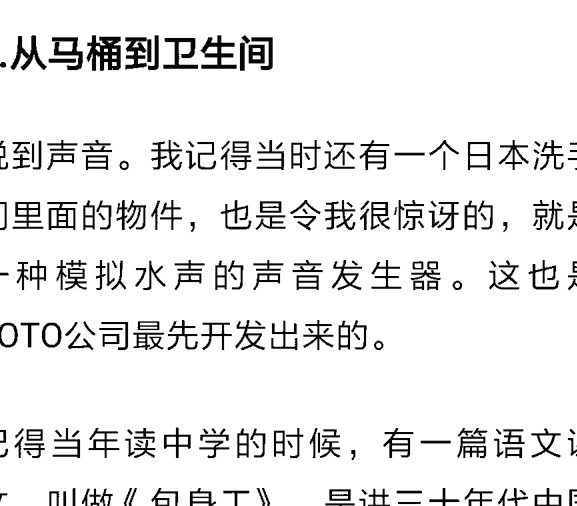

大约在十年前，我曾经仔细研究过日本人的卫浴产品，都是前面所说的，很高级。因为它的很多产品，都是突破传统概念的。比如，整个红外线感应门的感应器。当你进入一个洗手间的时候，马桶盖就会快速地自动加温，特别在北方，不用坐在冰冷的垫圈上，这是一个很人性的设计。

最高级的马桶盖，是会自动开启的。刚才提到的红外线感应，是可以设定马桶盖在人与它的间距达到一定程度的时候，自动打开。也许有人会认为这个自动开关的设计不必要，这就是对日本客户消费的理解。这个自动开启马桶盖，可以用于去除这个自动开启，可以保证手相对干净。这一点，有助于对清洁程度的要求，特别对于视力不佳的人群。现在，很多公司已经开发为比较多使用的部件材料了。其实，抗菌材料中，在加入着色剂的同时，再加入少量抗菌剂就可以了。有抗菌塑料等商品，成本上升得有限，但型“清洁要求”比较高的消费者很大。这种差异化，就会帮助一部分人的购买欲望产生相对需求的感受。

第二个档次的马桶盖，是有缓慢开启和放下功能的马桶盖。我记得很清楚，当时日本给我介绍的时候，说，这种缓慢开启和关闭马桶盖，就可以满足有缓释需求的用户。它不像我们现在的那种马桶盖，放下时砰砰作响，夜里会吵到家人，或者产生另外的卫生问题。

### 2. 从马桶到卫生间

说到声音。我记得当时还有一个日本洗手间模拟水声的发声装置。这也是TOTO最先开发出来的。

记得当年读中学的时候，有一篇语文课文，叫做《包身工》，讲三十年年代中国工人在外乡工厂里劳作。就是一个工生活态度，我觉得有一点，就是一工人为什么要拼命挣钱，只能为另外去挣钱，这是人性使然。那篇文章是说，让听你听到你的耳朵，其实是很令人没有尊严的事情，发出声音的一方，应该自觉减少，而听到声音的一方应该有礼貌，反正是一件不太礼貌的事情。

头，喷射式空气干手器等等，包括马桶使用特殊设计，具备强力除臭功能，防止味道散发蔓延，还有延迟关闭的换气扇，等等。此外，还有浴缸里面专门供老人洗澡用的座椅、防滑垫等等。后面的课，我会讲到，中国已经进入老龄化社会了，但我们至今还没有专门给老人居住的房屋，这不能不说是一个遗憾。

### 3. 差异化竞争策略

今天的课，我们从马桶盖，讲到洗手间里面其它有特色的产品，我就是想和你分享一个观念：我们的同胞不远千里，从日本买马桶盖，其实恰好说明了日本人产品的差异化特征。这件事，一方面，让我们理解了差异化战略的成功，另外一方面，其实也应该激励我们中国人自己的企业奋起直追，说明我们经济发展的潜力是巨大的。

我最后做个总结：差异化是企业竞争的一个基本策略，其核心内容就是要创造出产业中独一无二的东西。而要做到这一点，就要做到设计差异化、技术差异化、制造差异化、品牌差异化、客户服务差异化，等等。那么，为什么差异化可以成为一个策略？道理很简单，当你的产品在市场上是独一无二的，你在前面学到的五力分析模型中的，来自于供应商、客户、潜在竞争对手、替代品、现有竞争对手的五个方面的压力，都会小很多。你就会具有竞争优势。比如，你的品牌可以抵抗跨界的进入者，你的客户会忠实于你，你也可以用你所获得的丰厚利润来对付供应商的压力。至于该如何制定差异化策略，我们明后天接着讲。

### 课后思考

今天的课后，请你想一想，自己所在的企业是不是提供了差异化的产品？你是不是也给组织带来了差异化的人力资源？

### 划重点

> 1. 差异化是企业竞争的一个基本策略，其核心内容就是要创造出产业中独一无二的东西。

2. 为什么差异化可以成为一个策略：当你的产品在市场上是独一无二的，你在五力分析模型中的，来自于供应商、客户、潜在竞争对手、替代品、现有竞争对手的五个方面的压力，都会小很多。

### 你正在学习的知识模块

- 管理与破局
    1. 人与行为
    2. 领导力
    3. 团队
    4. 指导下属
    5. 组织发展
    6. 文化与沟通
    7. 客户
    8. 战略
    9. 计划与变化
    10. 运作
    11. 业绩
    12. 激励
    13. 控制
    14. 转型变革

## 147讲：蓝海战略丨如何让你与众不同

你好，欢迎回到《宁向东的清华管理课》。

今天和你讨论的核心概念叫“蓝海战略”，这个概念是1999年一本科普畅销书《蓝海战略》的内容，我希望你一定要学学。请提前预习。

今天的课，我建议你一定要好好研究一下这篇，作为一个管理学的读者功课。在我的清华课程里面，蓝海战略的基本内容，是我每年期末考试必备的内容。所以，你一定要给它足够的重视。

### 1. 畅销书：《蓝海战略》

《蓝海战略》这本书的作者是两个人，一位作者韩国人，还是位女士；一位叫W Chan Kim，她是美国女人。他们最早写出来，形成影响的，不是一本书，而是一篇论文，论文的关键概念叫“价值创新”。

我从小论文来揣度这个东西，因为价值创新这个包出来的东西，因为《价值创新》这个名字太不吸引人，所谓“价值创新”，出版机会也会丧失。所以，当价值创新以整个概念在西方出版的时候，它就得取个很有诗意的名字“蓝海战略”。

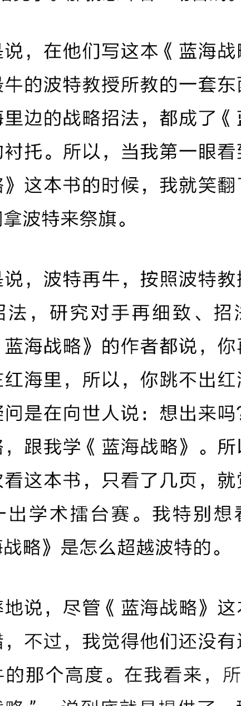

不过，不管这本书是不是被包装出来的，我非常喜欢这本书，这一点绝对的真的。我认为，这本书就《蓝海战略》是“差异化战略”落地的一本非常好的工具书。

有趣的事，虽然有提名字，但《蓝海战略》这本书开始是拿波特教授的蓝红两种策略来说的。这一周课里是波特教授的三种新标准“竞争战略”“差异化战略”成立先标准化，在聚焦基础上。

那么，什么是红海战略？按照这两位学者的描述：

- 1. 你的产业界已经被确定了，而且为人们所普遍接受；
- 2. 你的市场空间非常拥挤，竞争非常激烈；
- 3. 你的产品早要更加均化，会陷入激烈的竞争。

也就是说，在写这本书《蓝海战略》之前，最早的战略教科书，都是红海，都是红海的战略描述，都成了《蓝海战略》的衬托。所以，当我看到《蓝海战略》这本书的时候，我就太爽了。因为它拿来爽利的。

也就是说，波特是牛，按照波特教授的那一套招法，研究了再细致、招法出奇，是《蓝海战略》的作者，你就不再跑。

但坦率地说，尽管《蓝海战略》这本书写得不错，不过，我觉得他们还没到达自己吹牛的很多高境界。

### 2. 价值创新

《蓝海战略》这本书写得洋洋洒洒，但重点是两张图。我们今天就重点讲这两张图。第一张图，叫战略地图。

我在讲台的时候，有一个叫协同力量，线的“如何组织间的发现曲线”和“理想曲线”对比，去布置现场的课图。课图非常有趣，我学有余力，去复习一下那个管理工具的逻辑。

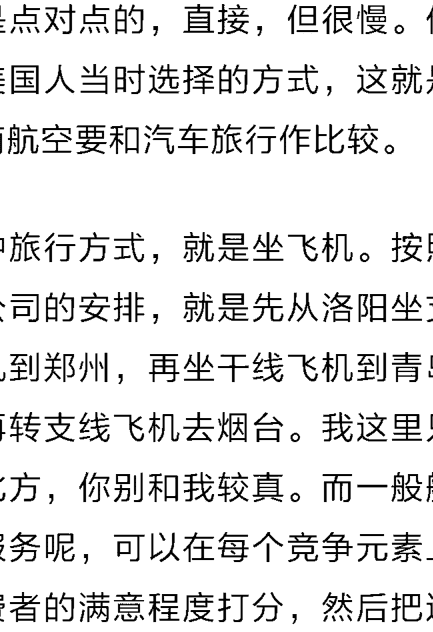

说起，《蓝海战略》的第二张图，叫战略布局图。在这天图中，重点是讲非常出名的价值曲线。

### 3. 案例：美西南航空

达目的地，同时又比汽车旅行提供更多的便捷呢？这就是西南航空公司要干的事。西南航空最早就从区域庞大的德克萨斯州开始，选了一些二线城市，用三架飞机开始了频繁点对点公司的运营。它给了顾客以飞机的速度和汽车旅行的经济和便捷。换句话说，它直接告诉客户，你不用再权衡取舍了，坐我的航班就好了，我起飞的班次非常多，时间很频繁、很灵活、很准点，票价也很便宜。

文稿中战略布局图上，位于中间的曲线，就是西南航空给自己定位的“价值曲线”。毫无疑问，这条曲线中充满了价值创新。价格、餐饮、候机室，肯定比驾车旅行要好，但因为价格低，成本低，所以，也好不到哪里去，而舱位、中转这些就都没有了，就是点点对点。西南航空把着力点放在服务的友善性方面，放在飞行的速度方面，放在直航快捷的安排上面。因为这是客户价值主张的关键，所以，这三项给予客户的价值感远远超过一般的航空公司。

总之，就是通过这样的定位，美国西南航空公司吸引了大量原本自己开车，或者是搭乘灰狗等长途汽车的人，改坐飞机，创造了一个经营上的奇迹。而西南航空又为了实现这样的经营逻辑，强化组织结构和文化建设的安排，让自己的商业模式最后落地。你可以再抽空复习一下“关系文化”那一讲，深化一下对于美国西南航空公司的理解。

可以说，美国西南航空公司是从差异化战略切入的，但是，它又因为其它的安排，最后成为了一家廉价航空公司。这又是一件值得我们深入思考的事情。1996年，波特在《哈佛商业评论》杂志上发表了一篇文章，名字叫《什么是战略？》。在这篇文章中，波特总结了西南航空公司竞争战略取得成功的若干关键要素，并且画了一张图。我将这张图示翻译成中文，也放在今天的文稿里了，课后有时间的时候，你也抽空看一下。

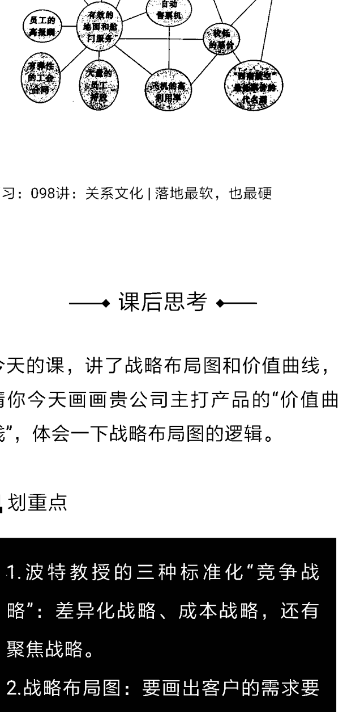

复习：09讲：关系文化|落地最软，也最硬

### 课后思考

今天的课，讲了战略布局图和价值曲线，请你今天画画贵公司主打产品的“价值曲线”，体会一下战略布局图的逻辑。

### 划重点

- 1. 波特教授的三种标准化“竞争战略”：差异化战略、成本战略，还有聚焦战略。
- 2. 战略布局图：要画出客户的需求要素，前提是深刻地洞察客户，理解客户，找到客户的价值主张所在，然后画出与众不同的“价值曲线”。

### 你正在学习的知识模块

- 管理与破局
    1. 人与行为
    2. 领导力
    3. 团队
    4. 指导下属
    5. 组织发展
    6. 文化与沟通
    7. 客户
    8. 战略
    9. 计划与变化
    10. 运作
    11. 业绩
    12. 激励
    13. 控制
    14. 转型变革

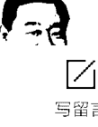

## 148讲：四步帮你找到自已的蓝海创意

你好，欢迎来到《宁向东的清华管理课》。

昨天我们通过美国西南航空公司的案例，讲了《蓝海战略》的第一张图：战略布局图。今天，我们进入第二张重要图，四步动作框架图。今天的图，和昨天的图示不一样嘛，我就请你务必把它记在心里。事情，记住这两张图，也是不那么困难的事情，只要多练习几次就熟了。最近流行一些什么“小步快跑”、“刻意练习之类的提法。我念了这么多年书，学了不计其数的东西，我觉得有那么多吗？就比如我这两天讲的“蓝海战略”，就说这两张图，你只要稍稍用心画过一次，最多三次，你一定记得住。

### 1. 案例：NetJets

我讲今天的课从一个例子开始。先带你复习一下昨天讲过的战略布局图。有一家叫“空军公务航空”的公司，名字叫做NetJets。它的故事，是《蓝海战略》书中的经典案例。我们就从它开始讲起。

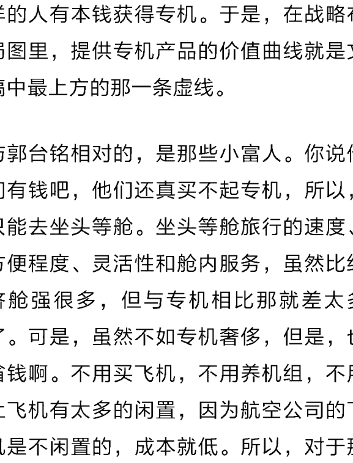

富人出行，主要有两种方式：第一种，选择航空公司的头等或者商务座；第二种，他们，就会自己去购买私人公务机。不过，无论是选择什么出行方式，富人的需求大致分两种包含这样几个内容：价格，这是买机票的钱，飞机租的价钱；飞行，就包括飞机在空中飞行的速度，方便程度，灵活性在机舱中的需求元素。富人，价值主张体现在机舱中的需求元素上。富人们也一样，最后都是为到达多少价钱，多收益的目标。

不过，富人也不是铁板一块。以前，我曾经读过一篇关于郭台铭老板到台湾的文章。说他的专职机可以覆盖全球，有很多人。郭台铭的工厂遍布全球，有超过12万员工。郭台铭经常要到全球各地的工厂去视察，所以，他需要购买的私人公务机，假设。他的新湾飞机，可以从一口气从台北飞到底里的纽约内，三组机组为他服务。所以，他就获得了很好的收益，但付出了非常高的买飞机和养飞机的成本。

郭台铭属于富人中的富人，所以，像他这样的大有钱钱得专机，是，在战略布局图中，提供专业且独品的价值在线就是文棋中最高上的那一条虚线。

与郭台铭相对的，是那些小富们。你说他们有点钱，他们要坐头等舱飞机的目的，可能坐去坐来座，坐来座去，旅行速度、方便快捷，灵活性和舒适度。虽然经济舱能多强，但与专机相比，就是差太多，但是，虽然不如专机奢侈，但是，也省钱啊，不用买飞机，不用养空姐，不用让飞机有人用的，闲置就闲置，公司对飞机也不是闲的，成本就低。所以，对于那些小富人群，他们也想坐，老板是实去坐头等舱。他在战略布局图上，看舱的价值曲线就是最下面那一条虚线。

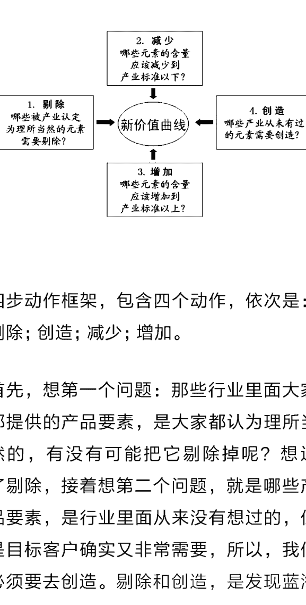

### 2. NetJets的价值曲线

在NetJets这家公司出现之前，其实，没有人想到过有一大拨富人，是属中不大大小小的富人。这些人和买不起专机买飞机，或者准备飞机的人虽然买不起专机，但是，如果能分台买专机，对他们还是有帮助的。用今天的话说，就是共享经济，共享专车。这就是在战略布局图上，那一个虚中的虚线所描述的情况。

我们可以顺度原路这个产品出自的思过程。在专门的战略布局图中，我们画出了个头等的价值曲线。我们也就画出了一个专机的价值曲线。我们就可以画出一条线，它代表的产品，旅行速度非常快，旅行的方便快捷很要求，灵活性可言可以得，而且质量度很重要，是服务与可靠性，和几乎都可以达到和专机类似水平。然后，我们看到，如果把专机和专机的费用，成本降到很低的一个水平上，最好头和专机的水平差不多，这样就成了性价比最大的一个产品的价值曲线。

点，我觉得也是很重要的，你最好知道。

首先，你可以根据战略布局图、价值曲线和四步动作框架，获得一个蓝海创意，但要在这个蓝海创意变成一种战略，能够统领行动，还需要注意这样三个要点：

- 1. 蓝海创意一定要重点突出；
- 2. 一定要另辟蹊径，与竞争对手，甚至产业形成区隔；
- 3. 一定要主题鲜明。

还以美国西南航空公司为例。它的新创意是非常突出的，它只强调非常少的品类要素，包括它非常友好的服务体验，快速、准时的旅行速度，以及频繁的对点对的直接，这些因素都是对手没有的。这就是非常鲜明的产品和服务的差异化，而且是可以把战略落地的差异化。因为这个差异化设计，就把一个非常独特的战略轮廓传递给客户，让它的产品非常与众不同。这也是这么多年，西南航空都少有竞争者的原因之一。西南航空的差异化战略，非常容易通过一个主题句来概括，这句话就是“无论什么时候你需要飞行，西南航空总是能够给你飞机票的速度，但你只需要支付驾车旅行的价格。”

另外一个要和你分享的要点，是关于蓝海创意产品的定价的。因为蓝海战略是以客户为中心的，所以，一个好的蓝海创意，一定要根据客户的支付意愿来定价，而不是根据厂家的成本和竞争对手的价格空间来定价。我们在上一模块讲过三种定价方法，你在设计出一个所谓适合蓝海的产品之后，就应该按照客户的需要去定价，然后再去想你的成本可不可以做下来。如果做得下来，就是一个好的蓝海创意。

### 课后思考

今天的课后，请你在昨天作业的基础上，使用四步动作框架，进一步完善你的产品蓝海产品。

### 划重点

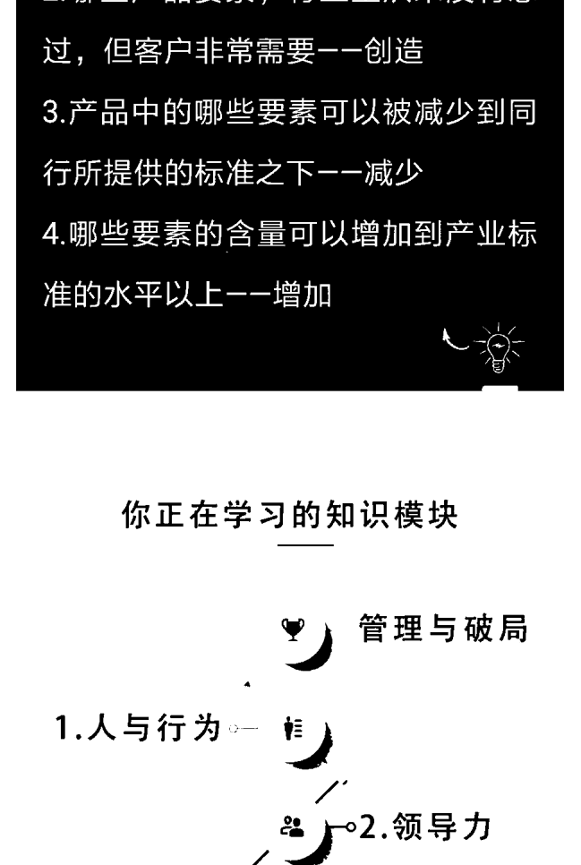

### 你正在学习的知识模块

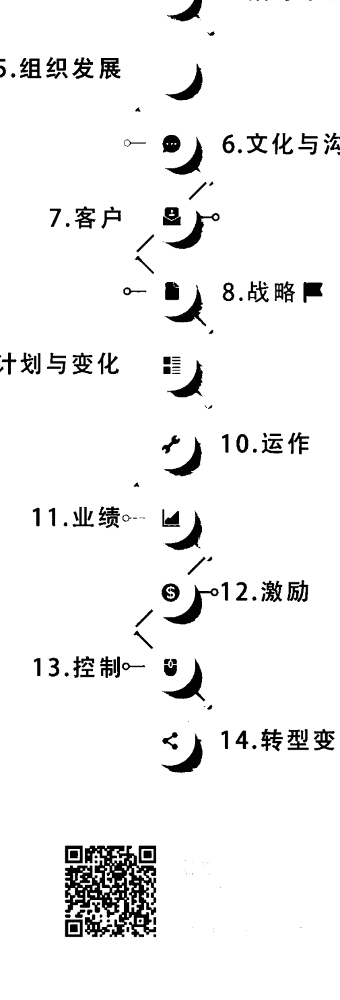

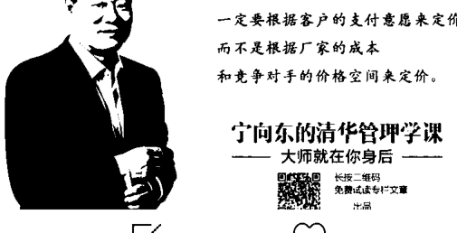

## 149讲：成本领导者｜不是“低成本”

你好，欢迎来到《宁向东的清华管理课》。

前三天，我们讨论了“差异化战略”，我个人是偏向战略应当当作差异化战略的实变策略。今天作了个介绍。那么，我们先来谈“第二种标准竞争策略：成本领导者策略”。请注意，最直截的成“成本领导者”这个概念。英文是cost leadership，而不是“低成本”，英文是low cost。先说这两者之间有什么不同？

### 1. 成本领导者

成本领导者战略，顾名思义，是指一个企业采取了最能产生保持竞争优劣的举措，其结果就是能够长期保持比别的成本为低，由此获得竞争优势。你昨天刚听过的价格策略，明天就降价，价格越打越低，而且价格越打越低的同时，我还可以保持盈利。一个企业如果把这个做成了就非常好。打个比方，就你竞争对手置于一种非常尴尬的境地。同样的性能，我的价格更便宜。企业就会说，你这样做下去，你就要赔钱，你就不盈利啊。你如果一降价，我就赔本。你如果一降价，你就赔本。你说如果我不降价，你打价格战，你打不动我，你就赔本。我的目的是竞争不过你，甚至把我拖死。我不是要简单地追求价格，而是要力求成为一个“成本领导者”。

显然，低比成本领导者策略略形成“之后”的一种结果，单单是低成本。我个人一直秉持为，并不能成为一种战略。相对于成本领导者策略或低成本战略的差异，很多学者并不会对他们予的明确区分。比如，波特就是强调成本领导者战略的区分。其实《蓝海战略》的作者在用了“低成本”这个词。我个人觉得，针对中国企业实际情况，还要有所区分才好。

很多人自从用了并没有这两个概念区分的，所以在谈论所谓的“低成本”战略。在具体的经营活动中，处处强调节约成本，该投入的不投入。这样下去，该投入的项目不做了。这样的损害了企业从长期来看持续降低成本的可能性，成本短期呈现优势的损，但持续这样做，必须要明确，以什么方式成本最低，并不简单，绝对地低成本是最高，不是有竞争力。

今天，首先在这两个概念上做文章，是因为大部分企业认为“低成本”本身是一个多策略，并且不具备力去追求成本不断地低、低、低。低到什么程度呢？就是整个产业链都打利润空间。不一家企业不愿意，整条产业链都不赚钱。

大约十几年前，我读到一本书，书取得特别好，叫《交易》。我完全忘着这本书，大约花了十分钟翻完了这本书。书写的一般，但是，书名起得真好。

就为了这本书，我买了这本书。在经济，有一个“很著名的”的“伯德模型”，伯德在“价格战”的逻辑。价格战，一讲外，最后都是竞争行为，打到最后，大家都没本事。比如，都靠政府。这种状况，企业出现的所利润，而靠各种补贴。比如，他价格战的时候工资产和贷款。一句话，为了价格战的竞争优势，有前途，更不可能成为竞争策略。

### 2. 案例：基因测序公司

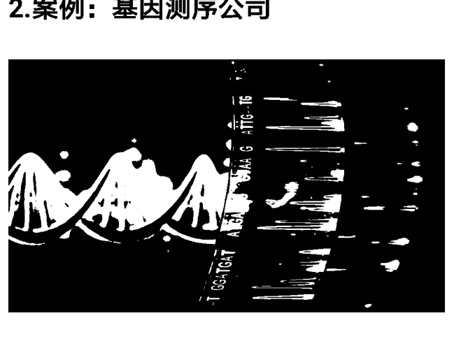

那么，波特所说的成本领先者的策略又是做什么样的呢？

我给你一个案例。美国有一家公司是基因测序仪器和服务的。这家公司占全球的市场占有率大约达到了70%。这家公司客户主要分布在全球的医疗研究机构，还有一些医院。医学分析中心。这家公司把测量服务提供这些客户，同时，为这些客户配备相应的服务。这家公司的利润非常好，发展前景也很好。

基因测序，不过最近20年才来兴起的一个大产业，很新。我第一次听到基因测序的，是在世纪之交，说起这件事，我都不提基因“关于基因测序”的故事。大家如果有空可以到网络上去看这个故事。你也可以看看二十世纪末这个学科是多么落后，中国人是多么好奇。方子以和他的新闻网时，还是希望中国科技能够这么进步有多快。现在，中国在基因领域已经突飞猛进。“基因显学”这种思想也已经被广为接受，是基础学。

接着说这个行业。这个行业的一件大事，就是由美国主导，多国科学家一起参加。人类第二个做了“人类基因图”，世界上的第一次在2003年前后完成。如果算上全部的准备时间，一共花了将近13年的时间。总共花费了27亿美金的费用。这完全是科学研究为，是靠各种基金支持的，是人类的第一次测序。

在这之后，技术进步的速度开始明显加快。仅仅用了5年，到07年的时候，再做仅全基因组测序，花费的时间就缩短到4年，资金也不用几十亿美金了，成了只是一笔美金就够了。又过了1年，为了08年，测序时间进一步缩短，大概有4个月就可以了。资本成本降到400万：150万美金。没有本下移，4个月，150万美金。所以，这个时候，基因测序的商用化用途已经非常明确，民间机构介入了。

你能从这过程中看出什么吗？半导行业里有个著名的摩尔定律，就是每隔18个月，半导体的性能会提升到1倍。过去我们都用摩尔定律来能科技进化的速度，但实际上基因领域的进步速度更快。很多时候还没有看到一些变化，就什么的时候，这家公司看到了这个风口，也抓住了。这家公司的模式，它开始的时候是它的人发明了它的一整套技术，开发了它的测序设备，并提供测序服务。

这家公司是，当公司要把服务，和它把它的机会，所以，当它把价格和技术推向市场的时候，全基因测序的成本也大大快速下降，不一到一年下，时间也大大地缩短。这家企业巨大的成本优势下，又把测序对象再细分，它是它服务，并不是对所有全基因进行测序，而是只对某一个基因进行测序，那么成本就降低了，降低到了不到一千美元。有免费的优势时间也两天。它一下子占了整个市场份额的70%。

### 3. 成本领导者的竞争优势

这样大的市场份额，形成了两个更厉害的东西。一个叫“进入壁垒”，因为它的规模非常大，后来者想进入这个行业，需要突破市场壁垒，竞争策略这个很不容易，一市场平等对手往往没有规模。所以，第二个就叫做“先动者优势”。以前，我通过一些学研究的，研究第一个进入市场的人，通常会比第二个人进入市场，要先低20个百分点左右。所以，只要后来者没有重大的技术突破，对于先行者的优势会很不利，因为你已经占优行业里，占很大的市场份额，对于行业的理解和控制力很强，别人就难以进入。你的老大的地位可以长期就留下来。

前几天，我和朋友聊起这家公司。朋友是中国人，他告诉我，这家公司甚至正在筹划把一台价格降到家庭里带回去，你能不要把价格降低到一台电脑，一台笔记本电脑的水平。他说是全民都愿意用这个来，因为价格上会非常便宜，它的操作非常非常简非常，我们可以自己买，自己做，测完之后就可以在自己的手机上读取到结果。朋友还告诉我，这台设备会更加加大。我也还没下，我还开玩笑说，我们以后没事就可以在家里进行基因测序了。甚至体检，在家里也可以测。所以，测到的信息。总之，这家企业的核能力，就是成功利用了“成本领导者”的策略，获取竞争优势。

### 4. 低成本的循环逻辑

最后，我和你分享一个循环，就是如果你要计算量，有一些企业是不断低成本的，因此一己得可以获得“低成本”的地位，一旦获得了低成本地位，你更多地

本的，因此，企业可以获得“低成本地位”。而一旦获得了低成本地位，你就多了两个选择：

- 1. 是利用你和竞争对手卖一样的价格，这样就可以获得更多的利润，然后将更多的利润用于研发等投入，以追求后续的竞争优势；
- 2. 利用你的低成本地位去降价，获得更大的市场占有率，然后，再利用市场占有率，扩大生产批量，进一步获得成本优势。

顺便告诉你，当累计产量加大之后，生产批次增多，成本会下降的逻辑，叫做“经验曲线”。基于经验曲线，曾经诞生过一家著名的咨询公司，就是今天的BCG。经验曲线和上述循环逻辑的图示，我都画在文稿里面了，请你看一下。

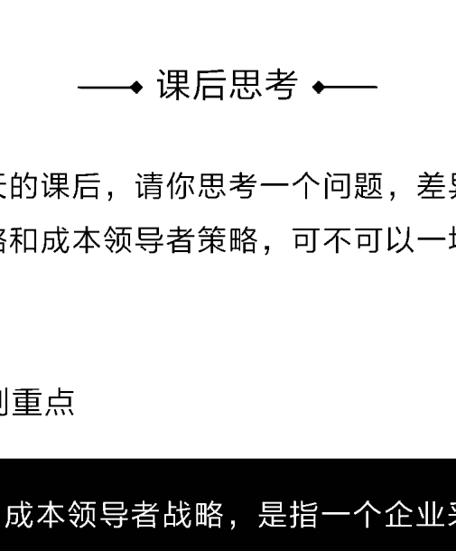

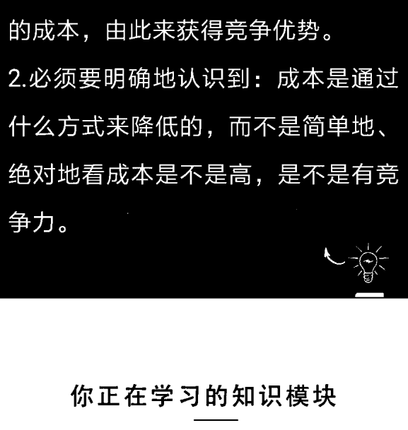

### 课后思考

今天的课后，请你思考一个问题，差异化策略和成本领导者策略，可不可以一块使用？

### 划重点

- 1. 成本领导者战略，是指一个企业采用了靠成本低先来保持竞争优势的策略，其结果就是总能保持比别人更低的成本，由此来获得竞争优势。
- 2. 必须要明确地认识到：成本是通过什么方式来降低的，而不是简单地、绝对地看成本是不是高，是不是有竞争力。

### 你正在学习的知识模块

- 管理与破局
    - 1. 人与行为
    - 2. 领导力
    - 3. 团队
    - 4. 指导下属
    - 5. 组织发展
    - 6. 文化与沟通
    - 7. 客户
    - 8. 战略
    - 9. 计划与变化
    - 10. 运作
    - 11. 业绩
    - 12. 激励
    - 13. 控制
    - 14. 转型变革

## 150讲：聚焦策略丨房地产还是朝阳产业么？

150讲：聚焦策略丨房地产还是朝阳产业么？

你好，欢迎回到《宁向东的管理清华学堂》。

今天的课，我们重点讲波特所说的第三种一般性竞争战略：聚焦策略。不过，昨天提到的讨论题引起了一些争议，而这天又是个很重要的话题，所以，请先允许我分享一些与航天器竞赛相关的信息，希望大家有时间，可以再进一步思考一下这个问题。

### 1. 差异化与成本领导者

在波特提出的三种基本战略中，差异化战略与成本领导者战略，一直被认为是两个方向截然不同的两种策略。在很长一段时间里，主流的看法都认为不可以一块使用。甚至，波特也认为，两种战略是选择混在一起，模糊不清是一种失败。很多学者也附和波特的看法，认为“徘徊其中”，不是一个好选择。不过，后来出现的一些成功公司，使得不少学者对这一看法有了新的认识。

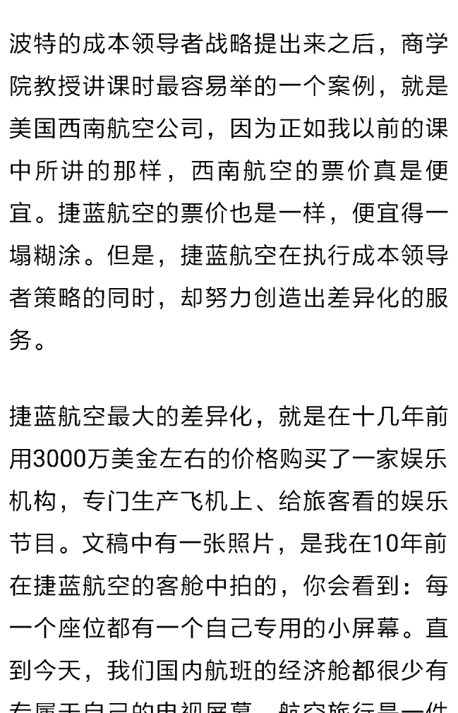

我下面就举一个公司的例子。美国捷蓝航空公司，英文叫JetBlue，总部位于纽约JFK机场的第五航站楼，下游枢纽有直邮企业在业的契洛。在美国，下属航线的邻有可能就是该司的营销人员。这家公司的创办人，是从美国西南航空公司出来的，所以，它从开始就有廉价航空公司的味道。

波特的成本领导者战略提出来之后，商学院教授讲授时最容易举的一个如以前是西南航空公司的案例。因为正如我在中讲过的那样，西南航空的票价真便宜。捷蓝航空的票价也是，即便在保持盈利，捷蓝航空是在执行成本导者策略的同时，努力创造出资差异化服务。

捷蓝航空最大的差异化，就是在十多年前用3000多万美元的价格购买了一家飞机机种，专门生产飞机上，给旅客看的机乐节目。文摘中有一张照片，是在10年前在捷蓝航空的客机中拍的，你可能会到每个座位背后都有一个自己的小屏幕。直到今天，我们国内航空经济舱都没有专属的电视屏幕。航空旅行是一件非常枯燥、烦闷的事情，所以，如果你的旅需痛点在哪里？在网上上网，没得看就是最大的痛点。所以，在十几年前，捷蓝航空就致力于解决客户的这个问题，它的一个口号，就是致力于改造一个愉快的旅程。

由于自己的电视制作机构，所以，可以制作一些能匹配捷蓝航空飞机上看的电视节目。捷蓝航空坚持自己低成本航空公司定位，它的机务是完全一样的。

西南航空用的是波音737，空中客客30系列。由于飞机只一种，所以，驾驶员、空乘人员、人地维修人员都不在复杂的问题间，人员利用率非常高，每个人可以在公司的任何一架飞机上工作。同时，因为机型简单，可大批置零备件，这些都能安排廉价航空航来安排，而保证公司在成本上的竞争力。

但是，公司却有非常鲜明的差异化。由于是廉价航空公司，所以，飞机主要经济舱，但有两样东西给我印象深刻。第一是每飞机上给乘客多一英寸，不要小看这一英寸，飞机多一英寸，坐乘感觉会大不一样。第二，就是每个人都有一个屏幕。上面上面有几十个频道可以供乘客选择，所以，旅途是很令人愉快的。

我用这样的一个例子，对昨天的思考题做一个说明。我觉得差异化和成本领先是不矛盾的。核心是怎样在保持一点低成本的同时，让差异化变得更鲜明。关于这种逻辑，又回到我前一天一个模块讲的成本结构问题。今天的课后，你可以稍稍一点功课，再复习一下模块关于成本的分析。其实，再多的管理问题说到最后，都是相互紧密联系的。

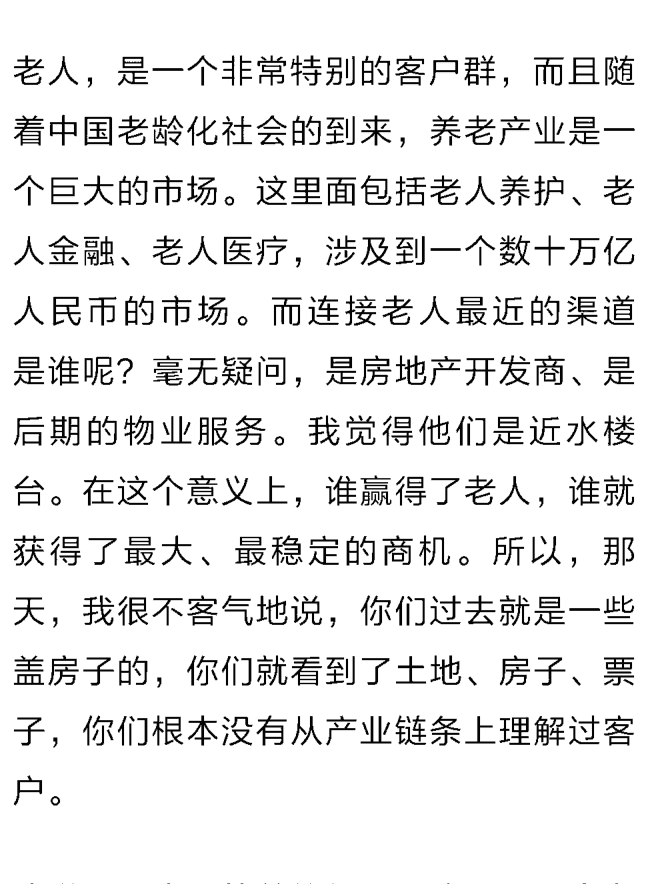

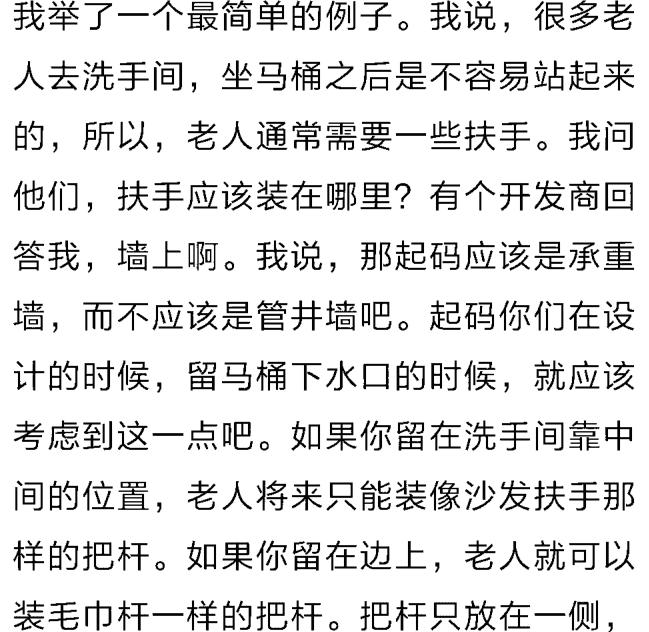

### 2. 聚焦策略

今天下午，我们继续讲波特的第三种一般性竞争战略，聚焦策略。如果说差异化战略和成本领导者战略都是为了一个广大的市场，聚焦策略则主要追求某一个领域的专精。比如，只要某一类客户提供一系列产品，或者大量的客户提供商在同一领域，或者只是自己的市场聚焦在某一狭小的地区。

是在这个意义上，我认为房地产业是朝阳产业。

过去房地产商拿到地，找个设计院，出个图纸，就开始盖房子，然后，就卖房子点钞票。我说，如果你认为那样就是朝阳行业，我觉得那个时代将一去而不复返。但是，如果你真的注意用户体验，真的是从几十年的用户需求去思考问题，那么我认为这个产业才刚刚开始。我对在座的一位知名企业的经理说，你们也是一家在国内有一定影响的企业了。我觉得你们的真正财富，不是住在你们的品牌，不是你们的物业，而是住在你们小区里的人。如果这些住户都满意你的住宅产品、满意你的物业服务，他们对你有足够的信任，你后面的商机会比你现在的业务规模大多了。

为了能让您有一定名号的企业更加认清我的逻辑，我向他列了一系列中国养老产业的数字。那么，如何让你的企业能够顺利地进入这个巨大的市场？我觉得有两个台阶是必须要上的：第一，就是要融入老年人群的生存情境，融入他们的需求；第二，就是通过你的产品和服务获得他们的信任。

要想迈上这两个台阶，我觉得采取聚焦策略是必要的，要在战略上非常明确，就是一切行动都要有利于向某一个老年客户群体，提供一批特定产品和服务，以满足这类客群的特殊需求。

### 课后思考

今天的课后，请你想一想，如果你是一家房地产企业，你该如何进行产品和服务设计，以便锁定老年人口的市场。怎样做，才能把聚焦策略更加落实到位？

### 划重点

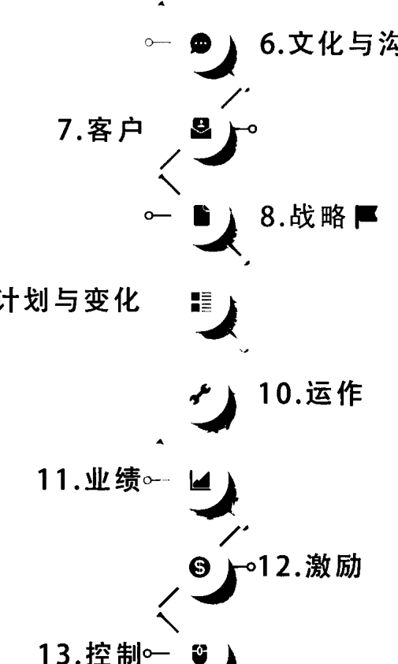

### 你正在学习的知识模块

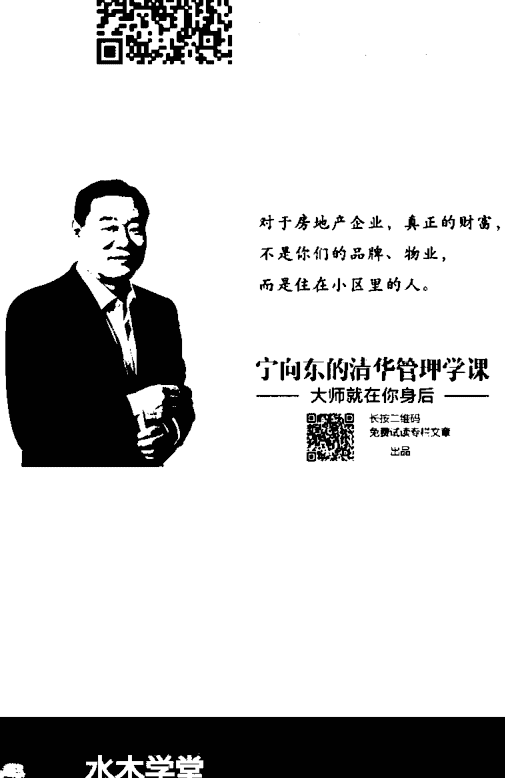

## 复盘｜为什么居家养老是蓝海产业

市场，又到期了，我们一起简单总结一下课程，然后，花点时间把养老产业的事情再帮你做个介绍。

这一周，我们主要讲波特的三种标准化策略：差异化，成本领导和聚焦。在我个人看来，这三种策略是可以在不同的时间、不同的环境，针对不同的客户群体进行组合的，按特定目标组合出：聚焦特定市场或特定客户的差异化，或成本竞争策略。这一周，我们也用了两时间点讲了《蓝海战略》这本书，讲了价值曲线和四步动作框架。周末，有时间请你继续阅读一下有关的文稿，把这些东西整合起来。

2016年底，我和几位研究生对养老产业做了一个研究，今天和你做些简餐的分析，算是对周四课程的一个补充。

我们先看日本的状况。2014年，日本的老龄化率创历史新高，达26%。所以，在2014年，每2.4个日本人供养一个老人，由于岛国环境少变化，到2060年，预计每1.3个日本人供养一个老人。日本的大学学生告诉我，未来不堪想象。有关信息，你可以参考数字和图像。图中的3.6、1.8、1.2这些数字是覆盖率，就是20岁到64岁之间年龄的人对65岁以上高龄人口的比率。

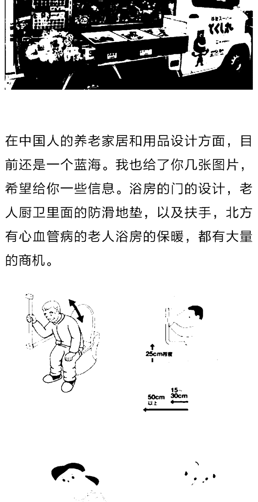

现在很多人觉得未来的养老，一是要懂社会；二是要懂技术服务，比如机器人。而我和你讲的是，这些可能都现有的想象，并不成为主流的方式。日本现在的状况是：老年人口不再增加，意味着领取养老金的老人数量增加了，但很多年轻人却拒绝缴纳新养老金，这致使使得公共养老金的收入来源日渐减少，所以，很多老人要长长远远远下去，就是为了能够多挣一些养老的钱。钱少的同时，人很少。2014年，全日本的老人是3300万人，而从事护理行业的人只有120万人。所以，当年有10万人自愿辞职，回家照顾老人。

至于护理服务机器人，是日本现在重点布局的行业，尽管到现阶段，潜力很大，但是真正应用到千家万户上，还有很多，否则就不会出现为了让老人不愿去而尽量求助的“孤独死”了。请你注意，日本和全国的收入比来源日本调查，日本被全日本都不同，在这种情况下，处于这种状态，我们那也指望护理服务机器人的同学，希望下面能实现。当然，也不是完全没希望，读一篇关于一个图片，是解决卧床老人的方便问题的。有照片的人，也许可以参考一下。

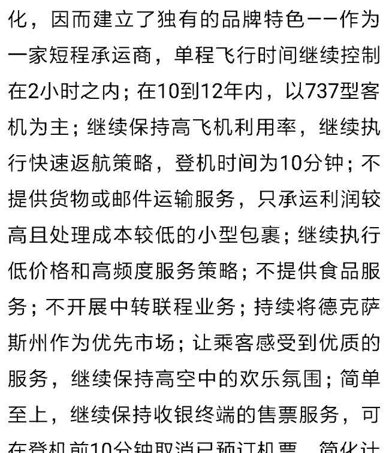

在登机前10分钟取消已预订机票，简化计算机系统；在行政服务区提供免费饮料，在登机区提供免费咖啡和油炸面包圈；登机后不对号入座，用录像录制乘客名单；飞机及机组成员当晚返回达拉斯，只保持一个住夜及维修场所……

来自：扬春

老师，我在做上节课作业的时候就感觉到，这两条对称线的选择应该是非常重要的。今天对选择对称有了进一步的认识。我把之前软件产品的两条对称线画成一条是竞争对手的，一条是通过项目定制的而非产品，在两条线间对比了客户价格、使用成本、可扩展性、较低的复杂要求、较快的响应时间等。我画出了一条新的曲线，大概是兼顾了两个特点，去掉了不重要的东西。然而接下来的问题就是，我们能做到吗？这个问题老师在这节课的结尾也提到了。这两节课的例子，我认为基本上都是综合了两个对称的优势，提升了核心自身的管理，达到了不同程度的客服化。为什么同时代其他航空公司不做直飞？为什么普通航空公司的商务机业务不如NetJets？我认为与其自身组织的管理能力和他们赚钱的业务份额有关。如果我好赚，大部分人都只关心赚该赚的钱就好了；如果提前看到钱不好赚，或者好赚的钱都被别人赚了，那么就要更加用心，练就客服化的内外功。老师那节客服化的课程我非常喜欢，如果客服化那么容易，大家就全都做了。诚然工具有用，然而有了战略怎么磨刀，怎么作战，怎么做一致性的实操却要用一辈子去探寻。

来自：陈东野 49331735

感谢宁老师的课程，让我收益匪浅。对于Illumina公司而言，我觉得“成本领导者策略”更像是结果，而非取得成功的原因。让Illumina成功的原因是技术优势。在高通量测序兴起的时候，有包括Illumina在内的三家公司，通过收购，获得高通量测序能力；另外两家是ROCHE-454和ABi的SOLiD，这三个平台代表了二代测序技术。但后来，另外两家测序平台，由于测序效率等原因，而逐渐被淘汰。二代测序兴起的时候，我个人正在做博士后，搞遗传学研究，直接使用这些测序平台。让这个学生选择Illumina的原因是，技术先导，性价比高，最好用。所以，“成本领导者策略”更像是成功以后总结的好运气。

来自：人圣美好

老师今天的内容，我特别有感触。
1. 我现在住的是仁恒地产（老板是新加坡的）小区，入住体验馆时，您今天提到小区电梯，我就想我住的单元有两个电梯，形状不一样，有一个是细长的，以前不明白为什么，您今天这么一说，我就想到了，细长的是可以放担架、移动病床的电梯。
2. 不仅地产，我觉得养老能给很多行业带去商机。我在银行零售部工作，我就曾想到过这个问题。比如银行网点现在光面的客户绝大部分都是老年人，他们的一个痛点就是“能力弱”，七八十岁的高龄到银行网点来办业务，存三五年定期利率太低，若想收益高一些，买理财产品，最长也就一年，而手续对老年人来说非常困难。我曾设想这样的老产品：养老理财，例如，银行与某个养老机构合作推产品，老年人买一定数额的理财产品，5年期限，他就可以享受一定的养老服务，例如可以入住一个房间，享受养老院医疗服务，享受入户的钟点服务等。

### 你正在学习的知识模块

- 1. 人与行为
    - 2. 领导力
    - 3. 团队
    - 4. 指导下属
    - 5. 组织发展
    - 6. 文化与沟通
    - 7. 客户
    - 8. 战略
    - 9. 计划与变化
    - 10. 运作
    - 11. 业绩
    - 12. 激励
    - 13. 控制
    - 14. 转型变革

## 151讲：问题导向！如何得到一个好战略

你好，欢迎回到《宁向东的清华管理课》。

还记得上一周我讲SWOT分析的时候，特意强调的四个词吗？愿景、趋势、特点和困境。今天，我们重点讲“问题”。问题讲的核心观点是，好战略一定是问题导向的。

问题是什么？问题就是现实。就是那些让我们头痛的四个词：愿景、趋势、特点和困境，就是因为常被我们称为“痛点”。所以呢，我们是要探索出一系列的行动，来解决这些问题。所以，战略不仅仅只考虑愿景，更应该关注到计划。

### 1. 案例：甲午中日海战

我们先从今天的课，从一个军事案例开始，这是我们常常和学生分享的一个案例：中日甲午海战。讲这个案例，我们不评价谁好谁坏，而是讲这个联合战略观的精髓。很多时候，理解竞争战略的好方法，不一定总是要通过企业的故事得出。军事战略，甚至比企业案例更容易帮助我们得出战略的道理。中日甲午海战，就是解释战略制定的一个如何透过问题寻找到最好战略的一个好例子。我们今天可以读到了日本联合舰队，如何设计一个好的战略来打歼灭北洋舰队，学习问题向的战略制定逻辑。

北京电视台曾经拍过一部八集的电影片《甲午海战》，我建议大家可以抽时间到网上找来看一看，这个题材，拍得很不错。我们不要从结局与细节看历史，而是要注重对于其中内在逻辑的掌握。这句话里，每次讲到这个案例的时候，我内心其实是很不平的，因为这里面有国家创伤。但我一直认为，勇于向敌人学习，意味着一种开放。

北洋舰队，主力船“舰坚炮利”，排水量达到8000吨，主炮的口径30公分，铁甲厚度30公分，日本的战备规模并不比我们的大，如果光看船舰的规模和武器，是典型的强攻弱，日本人取胜的可能性微乎其微。那么，日本人是如何确定他们的战略观念的？分析是：他们是典型的“问题导向”，在对比中，找到有效的战术和战略战术。

北洋水师貌似强大，但有很多问题。首先，主力船排水量大，就意味速度快不快，和整支部队要保持阵仗，就只能从处于主力的速度。所以，日本人的策略就是快打快退，这个快不仅仅只是日本舰队的船速快，还包括他们的炮舰。中国人是三分钟发射一炮，日本人则是小型火炮，一分钟六炮。

其次，中国的主力舰是炮台在前甲板，是当时国际上所谓最流行、最先进的海战打法，这个炮台配置决定了北洋舰队大概率使用横阵作战，而日本人则放弃采用近海舰队的先进炮台和日本式打法。采用沿袭舰艇侧翼配炮法，貌似落后，实则有效。这个策略就是“避实就虚”，所以，联合舰队在开战之后的战法，是兵分两路，绕着北洋舰队大半，打北洋舰队西侧最弱的第一艘旗舰。结果半小时，就打沉了一艘北洋舰队的第一艘舰舰，四小时，就打沉了一艘北洋舰队旗舰。避实就虚，就变成了多打少。

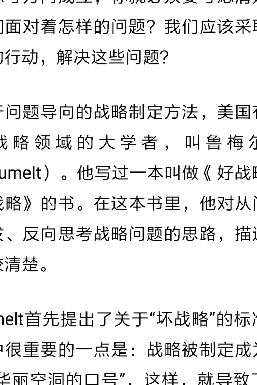

第三，就是针对你的铁甲厚，炮弹无法突破铁甲的弱点，日本人选了色彩炸药，不太炸裂，但求燃烧，包括炮弹，和手丁瓦斯，很多人都是死为烧伤而失去战斗力。这都是特别有针对性的战术安排。

还有很多的细节，限于我们的课程篇幅，我不展开说明了。今天的课后，请抽时间看看北京电视台拍的这个系列片，然后，再想想我们的思路会进一步打开，你会有更多的收获。这就是所谓的案例教学。

### 2. 问题导向

当面对竞争的时候，我们应该善于把竞争具体转化成一系列的问题，然后再去考虑什么方法可以以去解决这些问题，接着考虑，用怎样战略的更为指定思考，可以使这些行动更加有效，更加连贯和协调。这其实就是制定竞争战略的目的。比如，我们上一周的策略，核心是给企业提供我们针对性的产品和服务，要求人员这个寻考方的成立，你就必须考虑清楚：我们要面对怎样的问题？我们应采取怎样的行动、怎样解决问题？

关于问题导向的战略制定方法，美国有一位战略领域的大学者，叫鲁梅尔特（Rumelt）。他写过一本叫做《好战略，坏战略》的书。在这本书里面，他对从问题出发、反向思考战略制定的思路，描述得非常清楚。

Rumelt首先提出了关于“坏战略”的标准，他很重要的一个点：战略被制定为一个“空洞空间的口号”，这样，就导致了企业战略说起来很高大上，但实际上却是空洞的、口号的。它导致的结果是上面都是问题，对接挑战。而我们企业很多时候，第一条到我们的东西就是企业的宣传册，其中有非常响亮的口号，有高大全的愿景和战略。但是，当我们和一线领导进行交流的时候，我发觉一个非常突出的，就是他们并不知道战略和他们日常面的问题之间，是什么关系。所以，按照Rumelt的定义，这类战略就是典型的“坏战略”。

### 3. 四步制定好战略

那么，该如何得到一个好战略呢？我根据Rumelt的思想，分解为以下四个步骤，供大家参考。

第一步，充分地审视你所面临的问题和周边的形势，通过前面几周讲述的环境分析法和资源能力分析，觉察到各种趋势未发的因素在力量，并判断其发展和趋势。“隐而未发”这个四字非常关键。就像北洋舰队，有人从欧洲引进，先进的船只。它就像人轻易都感觉不到危险，无形中其实它带有了极大的危机在里面。日本人正是觉察到了这种危机，他们才能利用这个机会来制定出其有效的战略。

我前面和你讲过竞争分析，我再举一个例子说明它的重要性。如果你是一家银行在行业内形成的优势，你目前还没有据发起攻击，那么，当你知道企业你的竞争对手是相互高赢或赢是，后面是否不加上一句，“你就有机会了”。这种情况，其实并不是边，很多企业领导们，也被他的身边身边，每天想的唯一重要的事情就是有如何把他的老板大。比如，老板所听到的，都是他的身边人，每天所听到的，都是身边人，老板大。这时，你不需要进行战略相持，一旦在竞争有机机会的时机，就靠竞争方对手，或者一举取得竞争得优势。这就是发现隐而未现的因子的力量。

第二步，就是在内外部形势分析之后，找出所面对的关键问题。Rumelt在书列举了星巴克的案例。2008年，星巴克的单店顾客人数有所下滑，导致利润下滑，资产回报率也几乎没有达到三之一。那么，星巴克到底遇到了什么问题，哪些问题关键性很强的？当时，管理人员出的投资人、企业内的最高层管理人士都提出了自己的办法，Rumelt事后来看，这时的关键是要把事情背后的根本问题，找出问题，Rumelt说，如果无法到核心问题，就无法找到解决方案和行动，也无法有效地推动策略。

这好比一个学生成绩不理想，不需要提出一个愿景，一个增加多少分的目标。这些西都是结果，而不重要。愿景和目标都是这，战略，最重要的，是要找到问题：究竟是因为哪些问题导致学习成绩不理想，只有找到问题，才会有办法，才能找到解决问题的“杠杆”和“支点”。

第三步，就是要找到解决关键问题的指导思想和原则。这里，我需要提醒一下概念，就是“指导思想和原则”，一定是很抽象的东西。我在前面讲领导力的时候，特别强调了战略与组织的管理，是一种很弱的领导。在战略管管理活动中，可以这一点非常要紧，很多时候，关于战略的讨论，一定不要太细节了。下周的课，我会讲到，很多细节应该是在落地执

第四步，这一步是我对Rumelt理论的一个补充。在很多企业，分析了众多问题之后，如果你的理解足够深刻，你会发现之所以存在这样多的问题，关键还在于自己组织上存在着诸多的障碍和瓶颈。而要解决所谓的战略问题，必须在基本制度、企业文化和组织架构等方面作大的变革。否则，单一改变可能于事无补，甚至还会徒增成本。这就是为什么很多变革，被称为战略型变革。我们在最后一个模块，会讨论与此相关的问题。

总之，我们常常说，理想很丰满，现实很骨感。理想就是我们的愿景，而现实就是我们面临的问题。理想和现实的巨大差距，就是引发我们说出“理想丰满、现实骨感”这句话的根源。也正是这种巨大差距，我们才需要一座桥梁，需要一系列行动，去超越这个差距的鸿沟。无疑，战略的任务，就是为这座桥梁塑形，用很明确的指导思想，去统领行动，让这个桥梁稳步地建立起来。

### 课后思考

今天的课后，我留一个思考题，是关于战略研讨中的“虚实关系”的。有些企业愿意把战略研讨会叫做“战略务虚会”，而务虚了半天，除了提出一大堆问题之外，实际上什么问题也解决不了。有些企业一点都不务虚，每次会议都会聚焦在特别具体的问题上，头痛医头，脚痛医脚。那么，对于一个企业来说，虚和实的关系，究竟该把握在一个什么样的度上呢？

### 划重点

- 好战略一定是问题导向的。
- 战略被制定成为一个“华丽空洞的口号”，导致了企业战略说起来很大上，但实际上却是空洞无物的，结果就是无法直接面对问题，迎接挑战。
- 制定好战略的四个步骤：
  - 察觉各种隐而未发的因素和力量，并推断其发展趋势；
  - 在内外部形势分析之后，找出所面对的关键问题；
  - 找到解决关键问题的指导思想和原则，注意，一定是粗线条的；
  - 解决组织内的障碍和瓶颈。

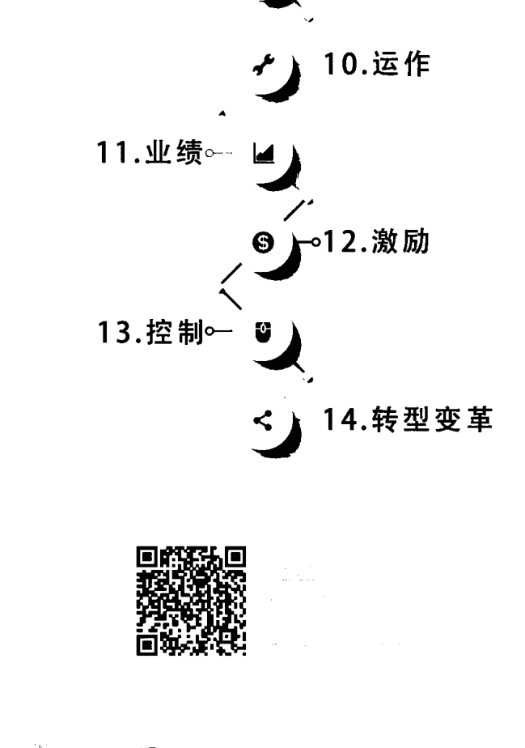

## 152讲：三点建议帮助你打造决断力

你好，欢迎回到《宁向东的清华管理学课》。

今天讨论战略选择中的一个重要概念：决断力。对我们根据信息、趋势、特点把问题逐步进行简化，将问题逐步梳理为几个选项，在不同的选项中进行决断。决断力，是战略管理的重要能力，也是所有的管理者不能回避的一种能力。甚至，对于普通人进行自我管理，也是一种非常重要的能力。

今天，我用三句话来概括“决断力”，希望对你有帮助。

### 1. 一连串选择的能力

决断力不是一锤子买卖，而是进行一连串选择的能力。

我用一个有点“外道”的例子来对这个概念进行说明。有同学来向我“问诊”课后什么经验会在自学中用得到，问我什么什么事，应该怎么办。坦率地说，我真的很为难。就是因为各类问题和咨询。导师简单，就是回答没有进入到的情境之中。我不了解你的具体情况，如果我轻率地帮你做主意，是不负责任的。我一定要坚持，在绝大多数的事情上，必须要学会自己决策，并且承担决策的后果。

为什么这样呢？决策的大逻辑是这样的。任何人的决策，第一步都是要把复杂的问题进行简化，将问题梳理成几个选项。然后分析各自的利弊。我一般是先看看能不能选最优的，然后看看能不能多一个。但问题，也可能用一条线来衡量，然后多给我留一些选择余地。

有些学者喜欢“最优解”。但实际，一个选项有时前，你不知道它是最优的，因为太多的不确定因素。所以很多时候，我们会尽力去选择中保留变化，保留选择的机会。因为万一保留变化，保留选择的机会，意味着保留了补救措施。

前段时间，有同学们问一个要不要回老家工作的难题。我问他这个问题的重要性和原因，我并没回答他这个问题。我告诉他不要急着问，多补充资料。一个人在做决策前，有很多的选项，是他能考虑的东西，把很多问题也都会想到，并且最好有相应的补救措施。我可以在一个特定点上，根据我提供的信息帮你做一个定夺，但你一定要记得，一件事的处理，绝不只是一个点的问题。一旦在某一个点上做了选择，其他的考虑因素在这个点上就都没有了。这种决策，外人无论如何是掌握不了的。

所以，今天先和你分享第一个观点，就是：一件事的处理，往往不是涉及到一个点上的事情，而是后续一连串的事情，一连串的选择。一件事能有多高，则越高，和事后有没有一连串的高效率措施是紧密相关的。一句话，补救力，是决断力的重要组成部分。

### 2. 比较的能力

决断力的本质是一种比较的能力，是一种不断强化的能力。

首先，你在做决断的时候，一定要清楚自己能够接受的满意程度。其实，你要求的是什么情况下的满意程度，什么程度是不可接受的。然后，在过程中选择，在这个过程中，我根据自己的经历，总说人们是没办法选择最优解的。我们做的多是选择优缺点和利弊。混在一定的，我们往往无法去确认优劣的。我们现在有许多能力可以把它从五个减到两个，但如果非让我们挑出来，那我们在长期都能证实这是一个选择是最好的。所以在现实很少能验证到。这也就是为什么人们常常会说比较。

接下来，我要为你介绍有“有限理性”的“选择模式”。这是由诺贝尔奖获得者赫伯特·西蒙提出的，西蒙是美国卡内基梅隆大学的教授，他本人是经济学家、政治学、管理学领域的建树。西蒙因为他是第一位获得计算机科学家、心理学家等研究领域的诺贝尔奖。当年诺贝尔奖金就表彰他对经济组织中进行的创新性研究。

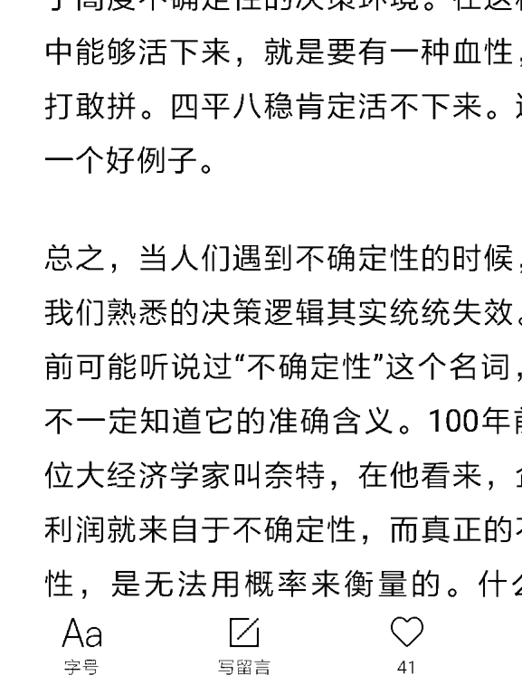

西蒙认为，人的行为是“有限理性”的。什么意思？就是人的选择取决于产生的过程，涉及到人们在过程中的思考。有点像口齿，有杂质。简单地说，人在做选择的时候，本质上是比较简单。人们首先根据自己的能力、条件，对满意程度定一个标准，然后和各种选项进行对比。而决策就是不断适应的过程。

这就好比我们的就业过程。我们在最初的时候，会想象出一个可以接受的满意。我们之所以去接受某个工作，就是自己能够接受的或者最满意的满意度。我们不会找一个最满意的工作。为什么？那是因为我们无法在那么短的时间内把所有可能的都全部去推排。所以，我们保留选择的机会，也保留变化。

保留变化，是有点价值的。当我们在一个岗位上工作，积累经验不仅会对当前所从事工作的了解，还会积累更多的信息、知识和认知能力。重新审视自己先前选定的满意度，当然，我们也能按照新满意度水平进行下一步的选择。这是我们会不断选择新工作、新岗位的逻辑，在过程中，我们发现自己新的决策力，是一种方案比较的能力。

所以，西蒙把人们的选择过程，用一种叫做αβ（读作α贝）的“心理定势”。就是，Alphaβ战术性了行为。本质上是这是决断力的一种反应。如果你对αβ战术决断，就是“发现”那些对αβ战术有碍的，是排除那些无关紧要的计算来减少计算量，然后，充分发挥1000台处理器的计算能力。

现在，越来越多的心理学和经济学家接受了西蒙的理论，我希望你也能够过今天的学习，来综合角度理解决断力的本质，决断力在一种意义上是心理定势的能力。

### 3. 处理“不确定”

决断力是一种处理“不确定性”的能力。

我认识一位小朋友，大学毕业后可以到外企工作，他也可以选择去国企工作。他的外语讲得，他完全可以通过考试，进入国企，但担心那种气氛下，进外企环境是比在国企里还环境。所以，他选择进入了本大企业。然后，另外一位同学也选择了外企，咬牙坚持半年，活了下来。几年后，朋友和我联系，提及这个话题。我想正好为我们今天的内容提供了一个好例子。

我以前经常做决断的例子，有五六个好处提什么？因为新四军当时的环境像是竞争最激烈的战事之中，在不能确定的决断中生存。在这种情境中，能够确定性。就是要有种性格，要敢打破平衡，四平八稳得生存不下来。这也是一个好例子。

性，是无法用概率来衡量的。什么意思呢？如果一件事，你能够知道大赚30%的概率是50%，不赚钱的概率是50%。也就是说，你能够给出一个概率，这就不叫“不确定性”。真正的不确定性，我不知道它到底有多少概率可能赚钱，有多少概率会赔钱。

这就像那个小朋友一样，完全不知道去外企能不能活下来。也许你会说，他的同学不是活下来了吗？但他的同学能够活下来，并不意味着他能够活下来。我那天故意试探他。我问他：你现在如果去外企，收入会增加不少，你愿意去试一下吗？你看你的同学不是活下来了吗？他说，不去。我觉得他的感受对，别人做成的事情，他不一定能做成。所以，本质上这种充满不确定性的事情，决断的时候要凭借的，就是一种处理“不确定性”的能力。这个小朋友缺少处理不确定性的能力。

这种处理不确定性的能力来自哪里？至今对于我还是个谜。如果顺着奈特教授的思路，处理不确定性的能力，是利润的来源，也是对企业家的报酬。于是，这种能力应该就是“企业家精神”的一部分。那么，为什么有人具有很强的企业家精神，有人则没有？这个问题，到目前为止，我还没有答案。我曾经试图从基因科学上去探求原因，今天课后，你可以复习一下第9讲“冲动基因”。在那里，我和你分享了自己粗浅的认知。

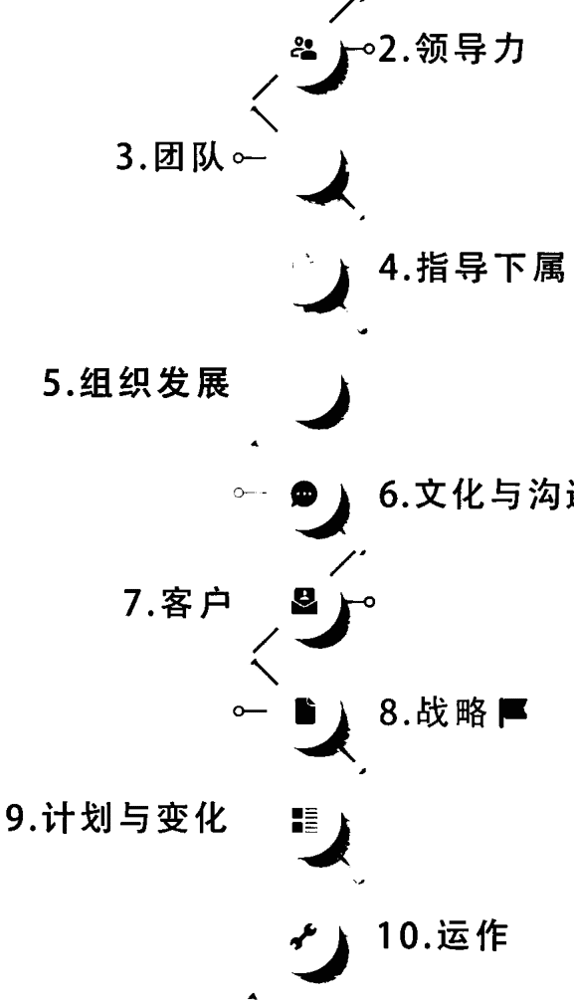

今天的课，我们讨论了决断力，这是一种重要的企业家能力。在这个模块中，我们讨论战略问题，但我们并没有深入讨论企业家精神在战略决断中的作用。不过，这个话题是绕不过去的。我今天用很通俗的方式，试图和你分享有关的要点。最后请记住决断力，是一种非常重要的能力。它是一种预见和补救的能力，是一种比较和取舍的能力，也是一种处理不确定性的能力。

### 课后思考

今天的课后，请你回忆一下你所经历的人和事中，有没有与决断力相关的？你仔细想一想其中的逻辑。

### 划重点

- 决断力，是一种非常重要的战略能力。它是一种预见和补救的能力，是一种比较和取舍的能力，也是一种处理不确定性的能力。
- 赫伯特·西蒙：人的行为是“过程理性”的，人的理性取决于产生它的过程，涉及到人们在过程中的思考。
- 富兰克·奈特：企业的利润由企业家处理“不确定性”的能力决定。

### 你正在学习的知识模块

## 153讲：公司战略：你要不要多元化发展

你好，欢迎回到《宁向东的清华管理学课》。

前面，我们已经讲了三四天的战略主题，但讲的内容都是某一个特定行业中的竞争相关的东西，是企业分析和具体战略的。

今天，我们来讨论一个重要问题：是否是一个企业发展到一定阶段，要不再搞多元化。多元化，是一个发展战略，中所有的内容都会面临到一个重要选择：是坚守在自己的行业里，做专业化的经营呢？还是沿着价值曲线上游发展呢？还是进入到相关或者完全不相关的领域，走向多元化发展的道路。

### 1.公司战略

关于企业要不要多元化的问题，在管理学里有个专门的研究领域，叫做“公司战略”，英文叫corporate strategy。公司战略的意思是研究你在那些行业里面的布局，走的这条专业化的道路，还是多元化的道路。如果你一家企业，它涉及到很多个行业，这家公司在它的层面上面的战略选择就是采用“多元化战略”的思路。

在多元化的大背景下，每一个具体行业里，各个业务都有同一个竞争对手。这个具体业务上的分工，叫做“业务战略”。英文翻译的英文，叫做business strategy。我们前面讲过无论是免费竞争还是战略的说法，都是基于竞争视角的，所以，一般也把它们看作竞争战略层面的概念。

### 2.相关与无关多元化

那么，企业为什么要选择多元化战略呢？三个理由值得记住，第一，抓住机会；第二，分散风险；第三，协同效应。

先讲第一点，抓住机会。一个企业做成功了之后，机会会越来越多。比如，很多乡村去你投地商，千方百乞引你投地，你看到当地资源，会给你一些好处，你去了，你就成了当地的纳税企业，领导告诉你的好处，也许会是一块地，除了商业用地，也也会有工业用地。一旦，你就有可能进入到房地产业，你会发现房地产行业的赚钱地，到你自己的土地还增值的时候，也许你就会成立一个房地产的业务板块。

好多年前，我住在一个旅游城市的海景酒店。夜里，从酒店的高楼放眼望去，江上所有的制造品牌，它们的广告霓虹灯都在夜里面大放异彩。第二天，我坐车从海滩一路走回去，发现原来都是些些企业开发的房地产项目，不仅大知名企业一个不少，还一些中央企业，也也当地方开发楼盘，后来房地产也都由这些中央企业的经营起来，房地产企业，这些企业的业务主业叫“多元化”。所以，这些企业的多元化，也叫“无关多元化”。这种企业的多元化发展，就是因为经不起这种来自所谓“机会”的诱惑。

讲到这点，我多说一句话的。华为为我们的一点，是在很专注地聚焦在我们网络的设备和服务器这个主业里面，没有盲目多元化设装备。华为也没有没有受到过诱惑，华为的主要领导人是房地产这一块，华为的主要领导人发现房地产这个快来得太容易的时候，他果断地放弃了这个业务。这个决力是非常让人佩服的。

华为后来留下一句话：赚快钱的队伍不好带。这句话，让我在我的清华EMBA课堂上分析过，我认里面面就着过大意，而且预言上了一个比较典型的课堂讨论，在这个作业，思考一下：作为今天的企业，请你思考一下。

与无关多元化不同，有一种多元化发展，叫做“相关多元化”。这类分两种情况：一种情况是上某个业务在能力上很强，在本行业上是无法满足这些能力的释放，于是，进入多产品经营。这算是一种水平的、横向的相关多元化。比如，我们在英黑的地上，形成了很广的市场影响力，这个影响力在黑马上上面用不完，所以，我们要进一步开发电池。

还有一种相关多元化，是沿着同一条产业链上下延展的发展的，也是我们通常常讲讲的“垂直发展的”相关多元化。今天，我们身边的很多大企业都着着种垂直链表的整合和扩张，逐步发展起来的。你会发现，只要一些要点你大约，这个形式马上就能够理解。但是，一定要在头脑中形成一个印象，将来用到时，你心里好有个概念。

当业务链条上下游之间的协调问题会给你带来很多成本和纠纷的时候，你要考虑垂直整合，或者说纵向，你愿意使用市场交易，也就是外包的形式，来处理上下游关系的问题。因为你用市场交易外包的方式，是最简单的，是最容易让大企业专注于能力，所以，是个简单的选择。但是，当你的市场纵向关系来处理上下游关系的时候，处于纵向关系上的企业之间就是一种相互博弈的关系。

很多企业是经不起博弈失败的代价的。如果纵向交易出现问题，对方对企业经营造成重大的影响，甚至会产生严重的后果和巨大的成本。在这个时候，选择垂直整合产业链，就是一个好的选择。

我去曾经服务过一家企业，它是一家具有很强研发基础的公司，公司有一部分是有关于生产的特有技术信息，产品设计信息。这些信息是企业的私有信息，其他人不知道，是很值钱的，但是，企业供应商有时会为一些供应商配合，它们或多或少总是会了和企业接配着，它们也会去了解其它这方面的信息。然后，它们去争取其它客户的时候，就会有意无意地对这些信息外泄出去。在这种情况下，我们看到，公司花费很大成本去进行收购，以防止信息的外泄。

我这里要特别强调，收购之后，不是没有成本和问题的。收购之前最大的问题，就是原来的市场关系，互换信息之间的关系就变了。老问题是没有了，但产生了新的问题，就是新的问题的出现。简单地说，供应商就在内部有一个买家，这原来没有了信息外泄的问题，但是增加了成本的问题。这个被收购的企业，现在还成了一个子公司。从前途可以计划，通过低价，提高经营效率。现在的目的是子公司，不是买卖关系了，也没有了讨价还价的关系了。于是，这个子公司的交易就需要通过管理手段来抬高。

有一段时间，被收购企业的管理着总以研发投入的需要，每年要求管理成本都比较高。所以，多元化企业，管理成本比较高，而且不容易控制，这也是为什么华为放弃了下级的二级公司，考核非常严格，就是指称考核。你必须做行业的第一第二，做前三相关类化了。但是，在很多垂直的三类相关类公司里，非尔奇的做法，这一套是很容易得行的。

复习：概念要点：外包

### 3.多元化绝不是战略迷失

到此，我们分享了多元化发展的第一个内在原因。接下来，我们再简单地提一下其它几个原因。

多元化的第二个好处，是可以分散风险。企业的业务多元化之后，东方不亮西方亮，黑了南方有北方，那句著名的谚语：不要把鸡蛋放在一个篮子里，防的就是这种风险。第二个好处，就是不同业务之间可以产生协同性，达到1+1大于2的效果。

因为篇幅的原因，多元化的这个好处，我们今天就不再深入讨论了。另外，把这两个内容讲清楚，需要比较深的知识认知。

前几天，有一位是联合利华，“重组发展，认为多元化是一种战略迷失。我个人觉得，他的财务功底基本上没有入门，所以，才会那样的言论。多元化，是一种高级的企业发展策略，不容易成功，但也绝无一是一无是处。

### 4.BCG矩阵

下面，给你一个工具，来帮助你思考多元化之后如何对不同业务进行布局。这会在这一领域里最简单和专业的工具，它的逻辑和克莱蒙威尔矩阵是一样的。克莱蒙威尔矩阵，以我们的理解，就是一个情境是某年的实谁性，一个度量是情境的重要性，然后，将你遇到的事情分由轻重缓急。

复习：管理工具—艾森豪威尔矩阵

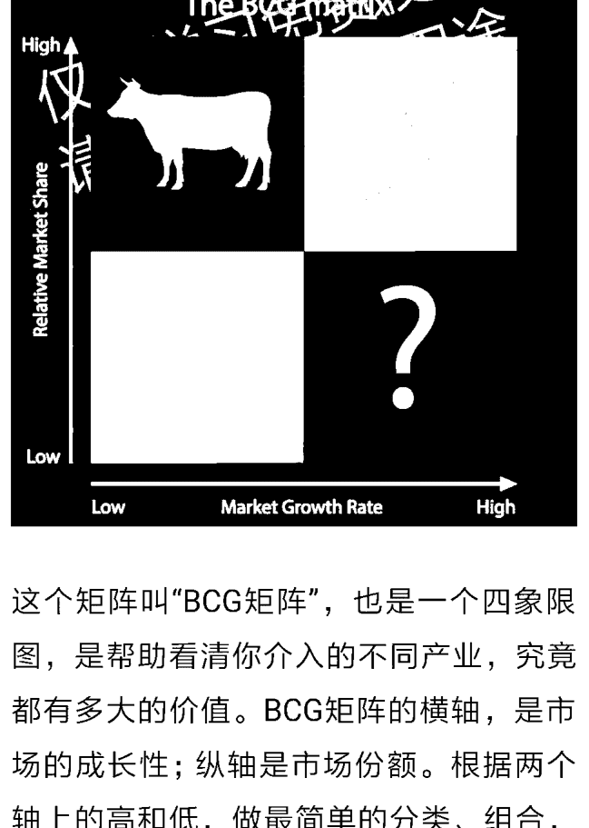

这个矩阵叫“BCG矩阵”，也是一个四象限图，是帮助看清你介入的不同产业，究竟都有多大的价值。BCG矩阵的横轴，是市场的成长性；纵轴是市场份额。根据两个轴上的高和低，做最简单的分类、组合，可以得到四个象限。市场份额高，市场成长潜力大的，就是“明星”业务。市场份额低，市场成长潜力大的，是你的“问号”业务。市场份额高，但市场成长潜力小的，就是“金牛”业务。市场份额低，市场成长潜力也小的，就是“瘦狗”业务。

显然，你可以用这个“筛子”，给多元化战略下的各个业务去做针对性分析。位于不同位置的业务，你在战略布局上，对每个业务的态度也应该是不同的。明星业务，要大力发展；瘦狗业务，需要考虑放弃；金牛业务，要抓紧收割；而问号业务，则需要明确是否该大力投入。这个坐标，其实也可以用来进行个人事务的分析。你一天到晚忙了很多事情，究竟这个事情属于哪一个格子，该用多少精力、怎样的态度来处理，是值得你深思的。

总之，今天分享给你的这个工具，是有助于一个人、一个企业在关键时刻理清思路，分清轻重缓急的。工具我放在文稿里了，希望你课后看一下。

### 课后思考

还记得今天课后的思考题吗？忘了的话，往上翻。

### 划重点

- 企业为什么要选择多元化战略呢？三个理由：第一，抓住机会；第二，分散风险；第三，协同效应。
- 如果纵向链条出现断裂，将对企业经营造成很大的影响，在这个时候，选择垂直整合产业链，就是一个好的选择。
- 多元化发展很多时候是从财务角度出发的。
- BCG矩阵可以帮助你关键时刻理清思路，分清轻重缓急。

### 你正在学习的知识模块

- 人与行为
- 领导力
- 团队
- 指导下属
- 组织发展
- 文化与沟通
- 客户
- 战略
- 计划与变化
- 运作
- 业绩
- 激励
- 控制
- 转型变革

## 154讲 | 核心扩张 | 追求盈利性成长

你好，欢迎回到《宁向东的清华管理学课》。

今天，我们讨论战略中的一个重要问题，成长的性质。可以说，发展是企业的能力，而一个企业会发展自己的企业的用人数量、资产规模，市场份额，不断地增大规模数字。在大的时候，见道你发现你的数字没有在变大的时候，不知是否要真正能够以清洗这种成长的性质是正面的、积极的、良性的。

我们今天的课程内容，其实也适合每一个人来思考自己的发展策略。每个人，无疑都要学习，至少宁得到课程，而且一直竖屏学习的，只是求上进的，而当你在忙碌碌度过一天、一个月、一整年之后，你是不是很清楚，你花掉的那些时间，你的那些努力，都是在发挥着正向的作用呢？

### 1. 盈利性成长

为了能够让企业的发展更加有效，也为了你的成长更加有效，今天我和你分享的概念，叫做盈利性成长。还记得咱们在之前的课讲核心业务和核心能力的时候，提到科尔尼咨询公司的两位研究者吗？这两位研究者后来又接着这个话题做了更多的研究，有一个发现，真正给企业发展带来有效的，是一种盈利性成长。

企业只有在这种盈利性成长的道路上，才是真正地给股东创造价值，给员工带来快乐。否则，只是表面的成长，而不是盈利性的成长，就会形成事实上的不竞争力，成为破坏价值的破坏性力量。

盈利性成长，顾名思义，就是这些成长不是来样，不是烧钱，而是实实在在地为企业带来利润，不要把事实完了，把战场做完了，把钱烧光了，只留下一个烂摊子，而是积极找净、步步为营，最后带来了企业规模和业绩实实在在的的发展和变化。

你也许会问了，难道企业的成长不是样啊？事实和你想的不一样，正统大数据企业并没有股东创造价值一样，统计上也显示，很多的企业扩张并没有带来盈利性成长，也就为什个这个研究变得非常有价值，非常费力。

### 2. 核心扩张

那么，怎样才能获得这种“盈利性成长”呢？这两位研究者经过一系列的大样本分析和研究之后，提出：

- 每家持续成长公司都需要有强大的核心事业作为基础，在此基础上，进行一系列围绕核心的扩张计划；
- 这种公司的扩张模式是一种可重复的模式，它们也在不断地重复扩张中，使企业获得了较高的盈利能力和竞争效益；
- 绝大多数盈利性成长的模式中，都有着对于客户需求的独特而深入的理解，这些扩张者以直接面对和不同的产品，不同的市场，不同的销售对象。

大大提高成功的概率。可重复的模式，是我今天重点向你推荐的另外一个概念。简单地说，用可重复的模式来发展企业，甚至是发展个人能力，都是获得盈利性成长的一个途径。

可重复性，可以在高尔夫运动中表现得最淋漓尽致。如果你打高尔夫球，你也许能够体会到：高尔夫是和很多运动完全不同的。你打乒乓球，打羽毛球，可能每一个球都需要完全不同的处理，但是，高尔夫则强调处理上高度的雷同，强调动作的高度可重复性，比的不是动作怎样灵活变化，而是怎样稳定、没有变化。

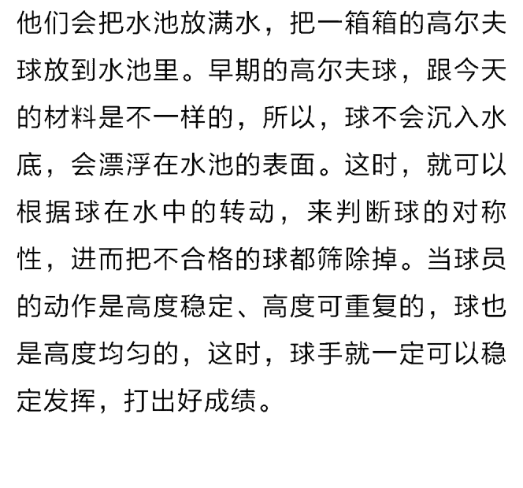

以前曾经有球手连球都选择一模一样的。他们会把水池放满水，把一箱箱的高尔夫球放到水池里。早期的高尔夫球，跟今天的材料是不一样的，所以，球不会沉入水底，会漂浮在水池的表面。这时，就可以根据球在水中的转动，来判断球的对称性，进而把不合格的球都筛选掉。当球员的动作是高度稳定、高度可重复的，球也是高度均匀的，这时，球手就一定可以稳定发挥，打出好成绩。

### 课后思考

今天的课后，请你分析一下“盈利性成长”和“可重复的模式”这套思想方法，如何用在指导一个人的成长方面，你能否设计出一个套路？明天是战略模块的复盘，我们明天见。

### 划重点

- 真正给企业发展带来帮助的，是“盈利性成长”。
- 要获得盈利性成长，你自己发展的每一步，都要有利于强化已有的核心业务和核心能力，或者是发展了自己新的核心业务和核心能力。
- 用可重复的模式来发展企业，甚至是发展个人能力，是获得盈利性成长的一个途径。

### 你正在学习的知识模块

- 管理与破局
  - 人与行为
  - 领导力
  - 团队
  - 指导下属
  - 组织发展
  - 文化与沟通
  - 客户
  - 战略
  - 计划与变化
  - 运作
  - 业绩
  - 激励
  - 控制
  - 转型变革

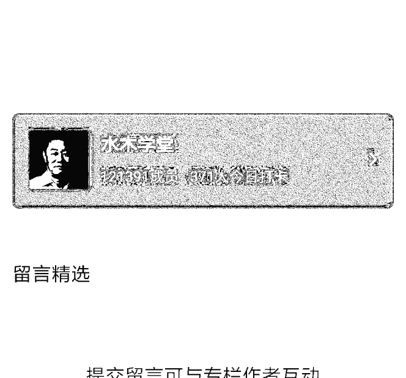

## 留言精选

提交留言可与专栏作者互动

## 155讲：模块复盘｜战略其实并不远

你好，欢迎来到《宁向东的清华管理学课》。

今天，我们对整个战略模块做一个总复盘，帮你把一些问题串起来。今天的课，你可能会听出来，一定是要看下一文。

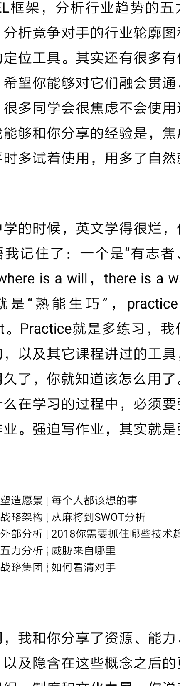

我们的课前两周，讲了三个重要的方面：愿景、外部环境和内部资源能力。这是标准教科书的套路，我完全是按照套路带你做了一遍。

在第一周，我为你介绍了分析宏观形势的PESTEL框架，分析行业趋势的五力分析模型，分析竞争对手的标杆和有价值战略群组的定位工具。其实这张思维导图，是我自己多年研究管理问题、研究战略问题的心得整理，希望能你提供一个参考价值的心法。

我读中学的时候，英文学得很烂，但有两个成语我记住了：一个是“有备者，事竟成”，where a will，there is a way；第二句就是“熟能生巧”，practice make perfect。Practice就是多练习，我们课上讲过的，以及其他课程讲过的工具，当用多了，用久了，你才知道怎么用了。这就是为什么在学习的过程中，必须要强迫学生写作业。强迫写作业，其实就是强迫练习。

第二周，我为你讲了资源、能力、核心能力、以及核心资产在概念之后的更深层次的组织，制度和文化的含义。你说美国西南航空的本领导关系战略能够持续领先，和它的领导者有没有关系，和它的团队有没有关系，和它的组织文化有没有关系？肯定有关系，而且有很大关系。

第二周也分析了些分析工具，包括价值创造模型和RIQ分析模型，它们说到到底还是些概念模型和思维框架，不一定对每个人、每个公司都有神用。所以，善于使用工具的人，同时还要注意对自己工具进行扬弃的能力。扬弃，就是该用的时候就用，该扔的时候就扔。

加来自于问题的阻力。

换句话说，领导者有意识地减少来自于愿景的一厢情愿，增加一些来自于问题的脚踏实地。特别是对于那些已经有很多业务基础的企业，确定下一步战略的时候，领导人不能用“愿景”、“使命”和“目标”的伟大，来进行自我欺骗。我有一句话，说得可能有点极端：在企业所遭遇的问题面前，一切愿景都是鸡汤。

这也就是为什么在今天的逻辑框架图示中，我把“愿景、趋势、特点和问题”画在最核心的位置，我认为战略制定的过程，就应该是四方面权衡的过程。

在我的逻辑框架里，还有一个重要的线条，请你注意，就是“战略共识”。战略，就是指导大家行动的一种指导思想。所以，制定战略的下一步，就应该是团队的一系列行动。那么，对于采取行动的每一位团队成员，他的思维方式是不是被统一到战略这个指导思想上来，就非常重要。只有当每一个团队成员都有意识地知道每一天的工作、每一天的行动，和组织的战略实现是个什么关系的时候，战略才算真正有了落地的可能性。

总之，除了战略制定的结果很重要之外，我最后想提醒你的是，战略的制定过程也是非常重要的。战略研讨，是促进团队思考和创造组织协同的有效形式。所以，我常常建议企业的领导人，不要把制定战略看成是高层的任务，制定战略是很技术化的，必须要由专家、咨询公司才能做的事。战略制定应该是多角度鼓励团队、员工集体参与的事情。团队和员工的参与，目的只有一个，就是在对于目标和任务的理解上，形成共识。有共识，就有共性思维；有共性思维，战略落地就更有可能性。

### 课后思考

今天的课后，请你复习一下以前关于领导要“揣着明白装糊涂”的有关内容，这对于领导形成一个有效的“战略身段”，说不定有启发。最后，你再想想是不是每个企业都需要思考问题？

### 你正在学习的知识模块

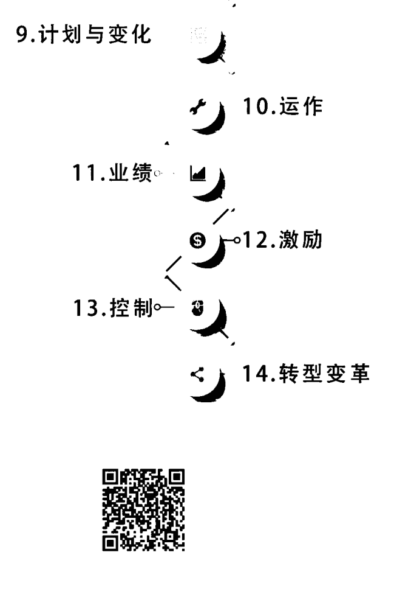

## 周末荐文 | 洋人旅粤指南

宁向东

这篇文章是我很早写前的，大概成文在2008年前后。快要到春节了，我相信你已经在安排出去玩了。这时候读这篇文章发现发出给你，希望能够在你见世面的同时，抓住不经意间的学习机会，毕竟，提高、成长，有时就在不经意间。

### 洋人旅粤指南:

香港艺术馆开馆以来，搞了很多特别有趣的展览，看后通常都会很长见识。最近的一个展览专题是“洋人旅粤指南”，我自己看后，回味悠长。

每当我看到尖沙咀那些大包子包装售卖商品的“大街大商品”，常想起来。他们实在应该到一去之谜的“香港艺术馆”或艺术展览馆参观一下。在大陆境内，博物馆纪念馆馆往往是去个博物馆，而在中国，旅客通常不会往选择去博物馆，所以在，国内游客到海外，一大损失是不做文化旅游。我们花大部分时间购物，但很少花时间见识。香港漫文化孤岛，乏善可陈，但比起香港，我们更像是文化沙漠。

两年前的春节，我曾随一个旅游团走访日本。国旅安排的一站是明石大桥。之所以有这样一个环节，是旅行社节约成本的考虑。一坐下并非自东京的新干里，“假体验”一下当年的日本速度。然后，在并不收钱的大桥边给团员照相、旅行社交不成本，还占用了乘客半天上午的时间，“很划算，就像在北京旅游，去一个叫皇城根遗址公园”的景点。皇城根的位置是真的，但遗址公园却是假的。

明石大桥本身值得看，因为它是世界上看得着。跨海大桥，施工难度大，桥身极为壮观。我们的团员到那里里度，忙着给大桥留合影，这是中国人到这一的的习惯，难怪旅行社里这样安排。就在大桥旁边，有一个不起眼的小房子，是大桥建设纪念馆。参观的票价很便宜，折合人民币十几块钱。

我个人乐于照相没有兴趣，便一个人跑进了这个小纪念馆的。进入馆内，我一子下为了那些同团的孩子们惋惜。他们真是错过了个太好的学习机会。纪念馆用非常直观的模型介绍了大桥建设的很多细节，包括在水底复杂的情况下如何把桥墩基岩石块放到水里，并且防止潮水将这些基石块水冲走。我在清华毕竞学过两三年工程，看这个展览非常受用。但更令我佩服的是个纪念馆设计着，其甬度。展览室里有许多日本学生，但中国的孩子却去和他的父母照相。这事实上形成了中国与明世界的差距。

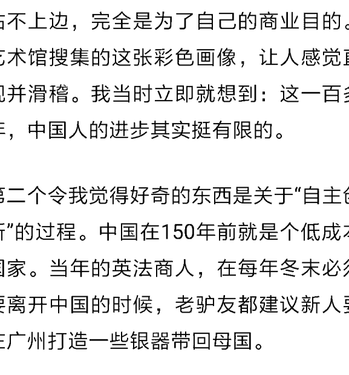

今天要写的香港艺术馆“洋人旅粤指南”，材料是艺术馆根据一百年前一些在中国广州的洋人写过的“驴友笔记”裁剪与重新编辑的。图文并茂，对于我们了解那个时候的中国、洋人与外部的关系等等颇有意向的这里，限于篇幅，我不去讨论展览中的宏大内容与叙事主流，而是将我感受特别好的几点拿出来与你分享。

首先，是一张关于“中国药贩子”的彩色画。洋驴友之友以把这幅画选出来介绍给他们的后辈来，意情是：这些药贩子虽然着的官服，却只是地摊上的把式，不足为信。看到这幅画，我一想到今天的保灵，常要去把那放假得最张响响的，认眼看去，不主把药贩们，其实际国策机构沾不上边，完全是为了自己的商业目的。艺术馆搜集的这形彩色面，让人感更直观有冲击。我当步行即想到：这一百多年中，中国人的进步实质是有跟的。

第二个令我觉得好奇的东西是关于“自主创新”的过程。中国在150年前就是个低本国国家。当年的买办商人，在每年冬天必须聚离打中国的时候，有驴友都建议新人要在广州打开一些银器回带国。

艺术馆汇集了一些“货银国器”（展览的原标题即如此，英文是“Pseudo-European silver”），出产日期多大约1850年左右。银器的叶纹“高仿”英国19世纪初最常见到的纹饰。甚至这些也世售的，哥特体字母与英国货大致相似，就如今天的假“耐克”或假“阿迪”。老驴友告诉听，由于人工成本非常低，在在广州做假、仿英式银器，比在老家乡贵得多。花样、造型，以及印纹，广州的技师都可以仿得到毫无二致，但价格却不高。我不禁让我想到：在五四口附近那些盗版光盘的小店里，常常见到的来目欧美的买者。

不过，仿制过后，总会产生创新。艺术馆在仿器器的旁边摆放了一个自主的产品：一个银质的酒具，有一半以上是的元素，手柄是一条龙，底座是西式底，一凸起，显然是为了固定西式红酒瓶的制造。创新的地方并不仅是多了一格龙，制造者的标志也变成了中，据说是广府子匠“升利”的写写。这又我们看到了希望。升力的创产品制时间是1880年。由此看来，从中国制造到中国创造的日子，根据历史的经验，也不会太久了。

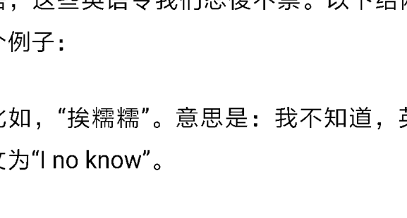

这个展览还有一处令我特别感兴趣的，就是“收入的水平”。当然，我自已稍加想象，也引发了个一人收入的话题。展览的报告是：在1800到1830年间，买办（也就是今天外企里的高管），收入大约合80到150西班牙钢元（每块银元大约合人民币0.72元）。展览没有说这是多长时间的收人，我猜想大约是一个月到半年的工资，因为当时的英国生意人每次只能在广府盘住样长的时间，他们每年要趁之际跟着洋流来返广州。第二年又必须跟着洋流离开，这是清政府定下的规矩。

买办的工资究竟是高，还是低呢？你可以借助肉牛来核算。当时的大一牛购肉售是0.8小块肉（也就是，外一食管的收入大约值1000斤到1600斤牛肉。看来还是在外做工比较好的选择。不过，在买办工外也有门槛，必须要外话讲。这个展览另外个有趣的地方是展示了当时的广式英语，这些英语令我们忍俊不禁。以下给两个例子：

比如，“换糯米”。意思是：我不知道，英文为“I no know”
再比如，“鹅威”。意思是：滚开，英文为“Go (away)”.

## 宁向东的管理学课

## 156讲：七行表单！好计划从今天开始

你好，欢迎回到《宁向东的清华管理学课》。

从这个模块开始，我们讨论计划和变化。一听到讲如何作计划，你也许会觉得非常枯燥，但是，我要告诉你，如果到了一个模块，我们关于战略的研究，让你看到了明天，这一模块计划，就是为了让你"把今天过好"。前面的模块，讲的是战略，但战略是虚的。行动是实的。所以，战略必须要结合实际，就必须落地。战略要落地，方式只有一个，就是通过计划把远见的、把愿景转化为每天的具体行动。一句话，计划管理的价值就是要想明白"今天做什么，今天怎么做"。

### 1.计划：今天做什么

这个观念对你来说，也许有点反常识。在一般人看来，计划不是为了"下一步"，是为了明天，为了下一个月，为了下一年吗？其实不是，好的计划，不是为了明天。好的计划是为了今天。更准确地说，计划不是告诉你明天做什么，而是告诉你今天做什么。

前几天，我和一个学生聊天。告诉他，准备毕业工作，就能够买上属于自己的房子。这是一个目标，一个愿望。但光有这个目标，这个愿望是没有意义的，需要一个好的计划动作才有意义的一个详细的计划。你对这个道理目标是不是一个具体目标，你每天行动是不是朝向这个目标努力，向这个目标前行。

比如，这个房子的总价是500万，那就意味着每年，你必须要赚到100万，才是平均水平。如果你第一年，你第一年只赚了30万，第二年赚了30万。前两年虽然赚够不够，但如果你的能力在增加，你还是能够保持的，你的能力在增加，你在后能三年有极大可能每年都每年赚到100万以上的能力。这就表示，这是一个好目标，它允许你，正在向着未来一个好的目标。相反，如果你看不见，这样的成长指标，你每年赚的100万，或者你今天赚到未来十年赚钱的可能性，要会今天就调整发展的方向。要会看到今天可取得的行动。总之，计划不是为为了看到明天，计划是要看到今天，看到当下。

我概括一下：计划不是靠一个数字，显示着一个终极目标；相反，计划靠一连串数字，显示为了让你知道，你的行动是不是在走向你的目标。所以，好的计划，不是和你谈未来的，而是和现实的；好的计划，不是和你谈理想的，而是为了指导现实的。

一句话，计划的目标是为了指导今天该怎样做。这是我今天要和分享的第一个观念。

### 2.计划：数字管理

那么，计划管理的背后逻辑是什么呢？我用三个概念来概括这个逻辑：

- 一种预测力；
- 一种反推力；
- 一种数字力。

也就是说，要建立一个好的计划，一定是先从未来作一个比清酒的预想。然后，是从预想，才能发现这个结果，需要对过程作何种的调整。在这个反推力过程中，关于明月的预测和今天的动作，不能是大概齐的，而应该是能够发现相在清晰的数据指标上。所以，某种意义上，好的计划管理，其实就是数字管理。

### 3.七行表单

那么，该如何做出一份有价值的企业计划呢？我今天和你分享一个最简的六步计划法。请注意，这只是一个基本的例子，复杂企业计划的方向面，绝不局限在这几个环节上。

第一步，就是要确立一组精确的目标。有一部说法是，在确定这些数字表字的时候，能不能把事做，是相关要的事，我"快速确定"并且"斩钉截铁地"提出"目标"，倒是最重要的。因为提出目标，反映了领导者的决心。不过，正在此是，上面简单说讲的，决定你里面包含着一种神往力。所以，老大在制定目标时，抽像象得如果非常理想，那么，以后就要有及时调整的准备的办法。

2009年，中国有家非常有名的千亿级企业，都是说要通过三年的时间翻一番，对于千亿的企业，发现到两千亿的规模，这个目标有极限，有道理吗？但事实上，没有计划管理层，就是生拍捣蛋；其中有一家计划里面很平常，却老实实现了；另外一家，则最后两年才实现了目标。我们仔细复述了一下企业，它懂得值得门学们，就是在，在第二年不能如愿到达目标的时候，果断作了更深层次的调整。所以，有一个逻辑规律，组织决定效率，效率决定数字。当一个组织在数字上没有达到预期目标的时候，反思数字背后组织上的深层原因，是一个关键动作。

第二步，就是根据目标数字，先建立业务计划。我给你一个最简的四个象限图，这个象限图中，两个维度是客户，分为原有客户和新客户；一个维度是业务，分为原有业务和新业务。这个四象限图，可以帮你在制定业务计划的时候，把事情想得更细致、更清楚。

比如，原有客户的原有业务，可以成长多少，可以带来多利润？再比如，为了完成"抱脑袋"的那种目标，是不是还要针对新客户，开发新业务？那么，这个新业务在多久可以产生收入，利润贡献能有多大？还有，可以在四个象限图中，投入多少业务？总之，四个象限里面，涉及到不同的，可行性也是完全不同的。不过，虽然打法不同，但是因完完成未来的总目标，就会逼着问我们怎么做？今天要如何行动，我们来做什么，怎么做。

第三步，就是要根基于计划，来考虑"利润计划"。因为利润等于收入减去成本费用，所以，在你"制订利润计划"的时候，其实，"成本费用计划"也就随之完成了，"成本费用计划"是利润计划的一个副产品。

比如，你给自己规定一个毛利水平，按照这样的毛利水平，在业务增长的情况下，你需要想办法把成本费用压缩在一个合理的水平上。不过，你要知道，有些费用是无法压下来的，因为你的业务在成长，有些资金不是可以免费使用的，但是，另外一些费用可能会随着经营规模增大而降低，这就是规模效应，你要充分利用它。

成本费用计划，是企业发展中非常重要的计划，很多企业都在那讲求成本节约，但一些企业也是在仅有的成本费用数字上归纳对比，他们有根据业务发生的情况实际去发现，不能老性地处理收入和成本费用的关系。所以，成本费用计划不仅应该做更科学、更合理，说到底，这是利润计划和业务计划没有做好。

第四步，是非常重要的，就是在利润计划已经有一个大致目标之后，需要"投资计划"。利润计划，是一个赚钱的计划；而投资计划是一个花钱的计划。这里面还有一个辩证关系。是先赚到钱，再花钱，还是先花钱了，最后再赚到钱？做过企业的人都好，这一个比较难掌握的，就是处理，企业就是亏完，甚至资金会断。所以，有一个比较好的利润计划，是非常必要的。当然你算出赚钱了可以赚多少非钱的时候，其实你已经出总了多少钱。而且在一个动态的过程中，能够处理好花钱和赚钱的平衡问题。

举个例子，说你遇到今年大概率地可以赚到500万钱的时候，你是坐在一定要等到500万钱都到帐上，再去投资呢，如果你秉持这个观念，我担担心说，也本来抓住什么大机会，也可能为投资不够，而失去了一个赚钱的机会。也就是说，是要有一个非好的利润计划，这非常重要。这是一个利润计划做得越好，你不愁容易赚钱，你也越敢去花钱，甚至你也敢去投资。

所以，这就说到了第五重要的计划"融资计划"。一定要记得这个一句话：你是

计划”。你一定要记得这一句话：你是为了创造利润而去花钱，而不是有了利润才去花钱。可是，当你没有盈利的可能，你借去借钱吗？别人敢借给你钱吗？这就是为什么你必须有你自己的本钱，别人才愿意投资你，你有了资本，别人才愿意借债给你。我们在融资的时候，需要给投资者讲清楚的是什么？本质上，就是将你的利润是多少，利润是以怎样的节奏被我们赚到。

当你有了前面这一系列行动之后，你就可以画一个七行的表单，依次是：目标、业务计划、成本费用计划、利润计划、投资计划、融资计划。最后一行，是关于组织、人员的发展和变革计划，一个具体行动的计划。比如，根据上面的计划，在市场上面，我们需要对客户做哪些动作，在几月份做，达到什么效果；有哪些业绩指标来表明我们达到了预期的目的？同时，我们该进行怎样的员工发展，招聘什么样的员工，招聘哪些岗位上的新员工，该如何去组织这些员工？

| 分类 | 计划内容 | 指标与数字 | 组织行动与重要影响因素 |
| --- | --- | --- | --- |
| 总目标 | | | |
| 业务计划 | | | |
| 利润计划 | | | |
| 成本费用计划 | | | |
| 投资计划 | | | |
| 融资计划 | | | |
| 变革计划 | | | |

### 课后思考

今天的课后，我建议你在新年伊始，针对你所负责的部门、你的业务单位，把这个七行的表单填写一下。我觉得，什么时候你能够把这七行表单用好了，能够动态的、流动地用，你就起码可以胜任个一把手的岗位，你在跟上谈兵的功夫基本上也就到家了。

### 划重点

- 计划不是告诉你明天做什么，而是告诉你今天做什么。
- 计划管理的背后逻辑是一种预想力：一种反推力一种数字学。好的计划管理，其实就是数字管理。
- 你可以画一个七行表单，依次是：目标、业务计划、成本费用计划、利润计划、投资计划、融资计划，来管理自己的计划。

# 宁向东

近期有很多新同学加入了我们的大课堂，欢迎你。

也许你在发愁如何补上前面的课，从今天开始，我会为你梳理之前讲过的管理学大师，正是因为他们站在身后，你才能在管理学发展的道路上不断前行。

老同学也可以借此复习前面的重要知识，我把关于这些大师的重要信息做成了卡片，方便你收藏、分享。还记得“乔哈里窗”么，分享你的收获是进步的重要步骤。

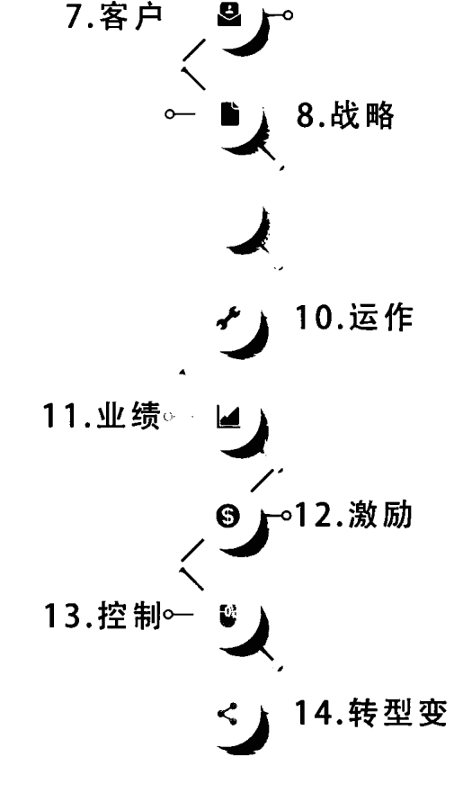

在泰勒之前，整个人类都面临一个困局，就是工厂主不知道怎样管工人。泰勒拿起秒表，详细测量工作的每一个环节所需要的时间，突破了这个困局。他把效率的概念引入到了管理之中，自此，以高效方式去更大地产成为最高原则。

知识分享：科学管理

- 第一，把要管理的事情按照作业链条分成若干个子内容的细节；
- 第二，把每一个细节的效率提到最高。

泰勒：

> “科学管理的基本原理适用于各种人类活动，从最简单的个体行为，到大型企业诸多工作。”

《宁向东的古典管理学课》

复习学：管理学 | 破局而出的智慧

### 你正在学习的知识模块

## 留言精选

提交留言可与专栏作者互动

# 157讲：三轮模型｜企业的底层逻辑

你好，欢迎回到《宁向东的清华管理学课》。

今天，我们讲一个叫做“三轮模型”的管理框架，懂了这个模型，其实，你就知道了企业经营最底层的流动，明白了这个逻辑，你就知道为什么企业会生，企业会死；为什么有些企业活得好，有些企业活得那么累。

三轮模型的图示，我放在今天的文稿之中了，你听文章的时候，一定要把图示找来看一看。特别要留意这个图示中的每一个概念，留意一下每一个箭头的方向。我常常开玩笑说，做企业，就像骑这个三轮车，骑好了，一路畅通；骑不好，有一个轮子断了，企业就垮了。

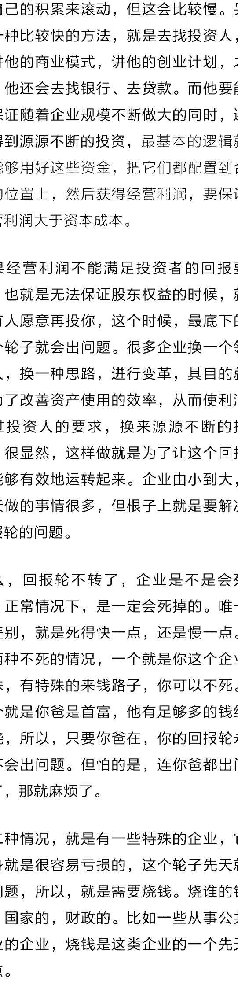

### 1. 回报轮

三轮模型最底层的轮子，叫做“回报轮”。我们知道，一个人要创业，一种方法就是靠自己的积累来滚动，这去钱比较难。另外一种比较快的方法，就是会找投资人，去讲他的商业模式，讲他的创业计划，之后，他还会去找银行、去贷款。而他要能够保证资金规模不断做大，他同时，还是能够拿到这些资金，最基本的逻辑就是能够用好这些资金，让自己的配置合理的位置上，然后获得经营利润，要保证经营利润大于资本成本。

如果经营中不能满足投资者回报的要求，也就已经无法保证股东收益率的时候，就没有人愿意再投你了，这个时候，最底下的这个轮子就会出问题。很多企业其一个领导人才，换来一种思路，进行变革，目的就是为了改善资本使用的效率，从而使得利润超过投资人的要求，就是源源不断的回报投资人。很简单，这就像是为了让这个回报轮能够有地运转起来。企业由小到大，每天做的事情很多，但根子上就是要解决回报轮的问题。

那么，回报轮不转了，企业是不是会死掉？正常情况下，是一定会死掉的。唯一的解法，就是死得快一点，就像慢一些有两种不同的情况，一个就是在这种行业，特别有资源的钱路子，你不要去死。一个，就是你的老板在富的，他有足够多的人给你，所以，只要你够去，你的回报轮永远不会出问题的。但怕的是，连你都都出现问题了，那就麻烦了。

第二种情况，就是有一些特殊的企业，它本身就是很容易亏损的，这个轮子先天就有问题，所以，就是需要烧钱。烧钱去找用户、国家、财的是从一些从事公共事业的企业，烧钱是这类企业的一个先天特点。

我给你举个故事。'9-11'的时候，我在美国，我登着人撞来的时候，我第一时间在看着，我后来就想，这是谁家的慢呢？8个楼全倒了。后来我有一研究，发现一个由华盛顿控制的国有企业，中国那个时候，民营企业正在大举进入房地产行业，我想美国这么多房地产国家的企业，怎么在中国企业进房地产市场的做法，给国家的企业带来呢？研究后来才知道，美国最为纽约市的地块、水厂这些公共事业领域的企业都是亏损的。你如果要求让它们盈利，就必须涨价，涨价就会影响民生。

政府后来处理的办法，就是把市中心最好的地产拿来国有，把市政公司交给民机构去维护，然后把土地租来的钱，拿去补偿纽约市的那地铁公司的、水电公司的亏损。但是，前提是这些市政公司维持烧钱状态的同时，必须给民众提供好的服务。

票，股市有风险，投资需谨慎。但是，你可以假装在某一天买了某一支股票，然后，你再假装投资人，去分析一下这家公司。然后，练上几回，虽然你没有成为真股东，但是，你却可能会用企业的逻辑去看企业了，不是看局部，而是能看到整体。说不定，这让你学会了真的管理学。

总之，在这个三轮子中，现金轮是非常重要的。现金轮不断，是硬道理，是活下去的前提。管理者要时时判断自己的经营计划，预判着现金流会不会出现断流的风险，如果发现现金流有问题，就要提前考虑融资安排。而如果现金流的需求大于现金储备和最大融资能力，公司就必须要重新调整利润轮，喊减现金轮。这三个轮子就像机器中相互咬合的齿轮，互相制约，同步运转，改变任何一个环节，任何一个循环都会影响到整个系统中的其它变量。

### 课后思考

今天的课后，请你思考这样一个问题：是不是同一个行业，规模差不多的企业，它们的三轮状态应该是相同的，或者接近的？

### 划重点

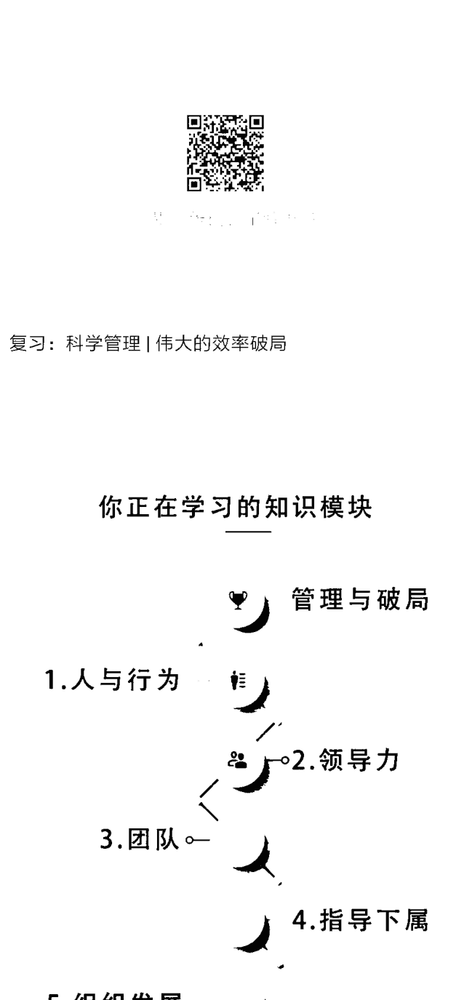

# 宁向东

今天，我们继续梳理出现在在课程中的管理学大师，新来的同学可以继续借此浏览之前的内容。

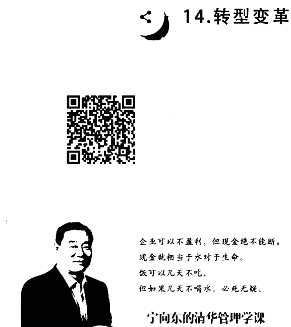

在福特之前，许多行业都采用了装配生产线，但都没有达到过福特的规模。福特按照泰勒的方式把汽车的生产分成独立的步骤，著名的T型车生产包括84个步骤，让单位生产时间缩短三分之二，在巅峰时期，福特的产量占全世界轿车总产量的一半。

福特是科学管理的实践者，泰勒从任务入手，福特则从成本入手。

> 福特：
> “每一次我把车的价格降低1美元，就得到1000个新顾客。”
>
> 《宁向东的清华管理学课》

复习：科学管理 | 伟大的效率破局

### 你正在学习的知识模块

## 留言精选

提交留言可与专栏作者互动

# 158讲 | 把预算观念变成家风

你好，欢迎回到《宁向东的清华管理学课》。

这节课的主题叫“预算”。当企业做了行动计划之后，就要采取行动。所有的行动，都有目标，而想要达到目标，得事先就要花钱。可是，如果花钱和挣钱的节奏没有搭配，现问题会出现在，金钱流就会出现，预算用数学来事前推算，形成一个基准，是保证效率、防止失控的一个主要工具。

### 1 生活中的预算

今天的课，我帮你树立一个良好的“预算”观念。可以说，建立起一个好的预算观念，可能会影响你的一辈子。甚至，如果你能够把预算的观念变成家风，还可以影响你家里面的几代人。

我在这个读的中学，家里是不管给的。因为那个年代，学生每个月给学生的花费都在大致规定一个大学学时的工资条，我现在还能记得清，那个时候很清贫，每个月还要花生活费，20元人民币就足够了。但是得钱进入多少的工钱工资条，那么，月薪是不是就不能花多花呢？不一定。由于我没有预算的概念，根本不知道钱要怎么花，所以，经常在家里有闲要记，看着一个月的生活费在3个档位，甚至，我在读大学的期间几次还要借债，事后回想，很多钱其实上也是打了浪费，花完不见影。

所以，现在朋友的小孩出国，我通常建议他们要让孩子每个月对预算外的支出，额外投一些钱。有些子女，小孩一周岁后，每个月的话一次就投给了孩子。比较常见的，就是存一张主副卡，子女拿着副卡，负责花钱，家长拿着主卡，负责充值。孩子如果没有过高的支出，家长一般也不会太计较。至少不要算细账，但我通常是建议，家长还是把一些算账账，分清哪些是合理的支出，哪些是必要的支出，让孩子知道，事物的管理、财务的管理分为预算内和预算外。

特别是对于那些上国的富二代，我格外建议他们的家长要花点时间，两代人要经常一起坐几个章。有对我说，宁老师，一共也说几百个，有预算要这么细吗？我说，不是因为我们看不起这个钱，而是为了达到两个目的：

- 帮助孩子建立一个预算的概念。预算，和计划一样，是一个人的一种基本能力。预算的目的，是为了让一个人的生命在多数时间里处于一个比较稳定的状态。这样，人才有可能去对付那些突发、突发的意外。一个人的行动边界才会大。
- 有助于家长们通过对财务数字的变化，推知孩子的行为，你看到数字背后所揭示的东西。

预算，我们前面的课，提到财务目的，目的，是能够通过数字看得到钱市，能够通过财务数字，看到一线的动向，能够预测到战场变化。这市场道理，我觉得，对于那那些将来小孩子的一代人，让孩子学学的时候，就开始建立超预算能力，是属于“童子功”训练，会让孩子受益终身。

其实，不仅仅对于富裕家庭的子，对于所有的，同样是计划与预算的能力都非必要。

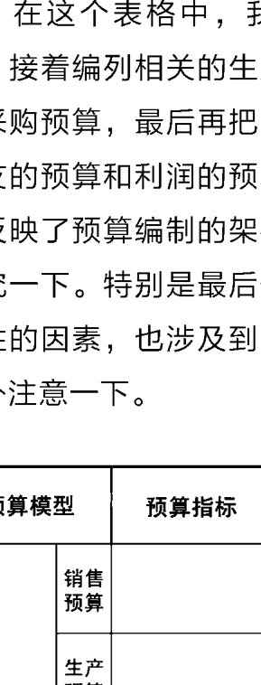

### 2 一种计划过程

我啰嗦了这么大一段，你大略能够知道什么是“预算”了吧？预算，预算，就是一种种数、精化的计划。预就是，就是一种计计划过程。预算提供了非常详细的指标体系，规定了什么时候要多少多少钱，多少钱系，对于预计了很多资源也随着大量的预算数字，包括收入预算、支出一项预算。大投资预算等等，所以，很多人一预算，想到的是什么就是财务预算。但实际上，预算还应该对应于各个投入资源的全面预算。

具体来说，管理者在每一个预算周期到来的时候，都需要针对组织的目标，综合考虑资源配置和组合作间问题，包括各种金融资产入的产出比，人力资本和无形资产的投资与产出比。然后，再考虑如何通过管理活动提高效率，以保障组织目标的顺利实现。

我帮你可以是一个预算编制的最低最粗浅、最本格的表是一样的，我们的课中那个七行表格是一样的。在这个表格中，我们从销售预算开始，接着销售预算，把预算转成成本预算和采购预算，最后再生产生出利润和现金流量。总之，这个表格反映了预算编制的架构，请课后去认真研一下。特别注意最后一行，涉及到一些固定性、非固定的，涉及到考核的内容，请你格外注意一下。

预算报表
预算指标：无总法确定预算的因素
销售预算：销售预测、价格
生产预算：生产计划、成本
存货预算：存货控制、成本
采购预算：采购计划、成本
现金预算：现金流入、现金流出
利润表：营业收入、营业成本、利润
资产负债表：资产、负债、所有者权益

当然，当一个组织有了这样一个预算，理论上说，这个组织内部的各项子序活动，就会形成一个合力。所以，越大型的组织，预算体系越重要。预算就是一个有效的工具，可以让多部门、复杂结构的组织中各个单元有秩序地行动起来。预算体系，实际上完成了分权管理、指导业务工作，进而实现组织目标的管理。

在很大类型集团公司里面，预算的时间可能会花费大半年。甚至有些公司全都在进行滚动的预算，预算在组织间会连续展开。预算管理在组织内会循环往复，实现计划的过程，不仅如此，在很多大型公司里面，预算形成一个重要的管理结构。预算体系的形成是一个企业财务活动和管理组织。只要有投入到预算的事情，都是相互的。资源支持，也最大大家不愿意去。去做的事，于是，这样就形成了一个双刃剑。

解，也拥有比较多的信息的时候，参与式预算就会有比较好的效果。但是，参与式预算的问题，是在给了下属参与权利和机会的同时，如何解决参与的质量问题。

第三种方式，就是现在大型公司普遍采用的“几上几下、反复沟通”的预算方式。大型公司一般都处于一个相对稳定、各方竞争势力比较均衡的市场，这个时候，企业就有可能用一种从容的心态，按照行业研究的结果，对于一个行业未来发展进行比较科学的成长预估，然后由此来确定预算的目标。

最后，我要强调一下今天课程中一个隐藏着的观念，就是“数字的力量”。这里面有一个逻辑，企业的发展规划需要一种“预见力”，但是，我们不能通过预见力来打仗，我们需要让预见力越具体越好，唯一的办法就是把它转化为数字。你想想在战争年代，“弟兄们，给我杀”和“杀一个够本，杀两个赚一个”，这两个口号，哪个更有力量？

宁向东

新来的同学，不用着急追前面的课，我会带着你回顾。今天咱们复习下面这个概念，可以点开链接。

复习：下属力——数字呈现业绩

### 课后思考

今天的课后，请你想想身边的哪些工作，可以转变为用数字来衡量其效果的工作？

### 划重点

- 家长应该帮助孩子建立一个预算的概念，并且通过财务数字的变化，看到数字背后的行为。
- 预算是一种数字化、精细化的计划，预算过程，就是一种计划过程。
- 预算应包括对于各项投入资源的全面预算。
- 预算体系，实际上扮演了分配资源、指导业务工作，进而实现组织目标的指南针。

# 159讲：经营底线！你要掌握的四个公式

你好，欢迎回到《宁向东的清华管理学课》。

今天讨论一个经营活动中最重要的，也是最关键的问题，就是什么时候，是公司经营的底线？什么时候，公司就该关门了？

当然，现实太清晰了，不只关注公司不。但是，经营中最重要的指标，不是现金流，而是利润。你什么时候开始盈利了？什么时候你已经开始赚钱了？什么时候你已经开始有利润了？什么时候你开始给股东赚钱了？这个时候，才叫经营底线。

### 1. 黎明前

那么，从黎明到天亮，有一个阶段叫黎明前，这个阶段是非常漫长的，也是非常艰难的。这个阶段的特征是什么？就是所有的投入还在持续，所有的产出还没有出来，所有的成本都在增加，所有的收入都没有，这个时候就叫黎明前。

这个图是一个企业的生命线，从投入到产出，从投入到收益，从投入到利润，有一个漫长的过程。

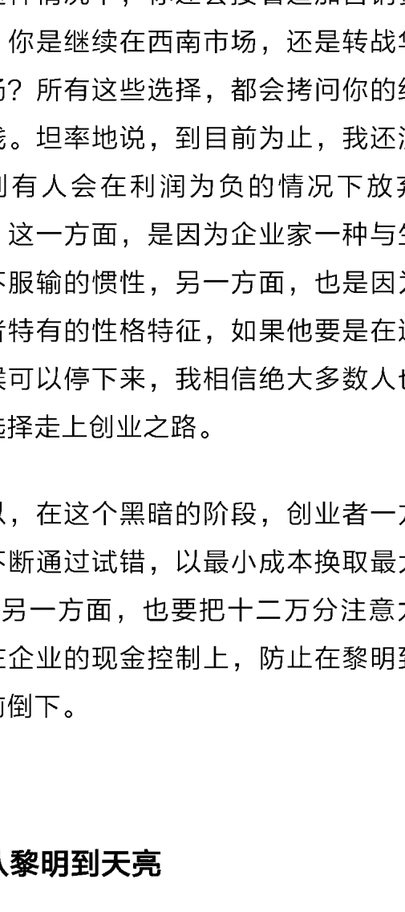

这个图展示了企业从投入到产出，从投入到收益，从投入到利润，有一个漫长的过程。

在黎明前，你的钱，你的所有投入，你的所有成本都在不断地增加，而你的收益还没有出来，你的利润还没有出来。这个阶段是非常痛苦的，也是非常漫长的。

黎明前的特征，就是所有的投入还在持续，所有的产出还没有出来，所有的成本都在增加，所有的收入都没有，这个时候就叫黎明前。

### 2. 从天明到天亮

从天明到天亮，你的所有投入还在持续，你的所有产出还没有出来，你的所有成本都在增加，你的所有收入还没有。

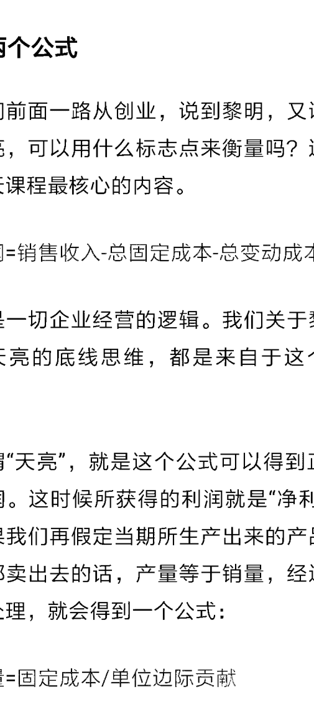

在这个阶段，你的所有投入还在持续，你的所有产出还没有出来，你的所有成本都在增加，你的所有收入还没有。

### 3. 四个公式

四个公式是经营中最重要的四个指标，分别是销售收入、成本、利润和现金流。

了，在这种情况下，你准备更换一种产品，你就只能将手里的商品处理出去。这时，你降价的最大空间就是每件25元。这是现金平衡点。

考虑现金平衡点，这是向黑暗考虑。如果我们向光明的方向考虑，要获得100000元的目标利润，就可以用固定成本50000元加上目标利润100000元，除以边际贡献25元，销售量就要达到6000件，这是50000元的固定成本加上100000元的目标利润，除以50%的边际贡献率，得到30万的销售收入。

我们再考虑一种情况，就是我们在开实体门店的同时，再开一家网店，电脑的投入我们忽略不计，网上的每件货品收入要下调到40元，人工增加5块，所有变动成本增加到30元，于是，每一件可以赚10元。一个月的房租仍然是50000块，每个月就必须卖掉5000件，就是50000元的固定成本，除以10元的边际贡献，你才能看到天亮，这就是利润上的盈亏平衡点。

那么，这个时候该如何进行选择呢？这就是个方向性的问题。需要根据线上和线下的客户情况，以及人工的费用、能力水平等因素，去综合权衡。情况不同，数字不同，算出来的账就不同，选择就也不同。但是，无论你怎么算账，今天讲的这个公式，都是最基本的。这是做生意赚钱的底线。

### 课后思考

今天的课后，请你思考一下，用原来的门面房既做网店，又做实体店，是不是一个好选择？

### 划重点

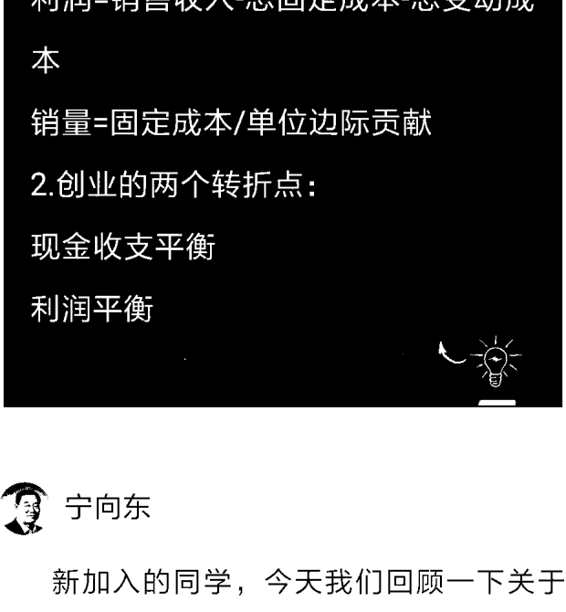

**宁向东**

新加入的同学，今天我们回顾一下关于成本最基本的概念。

复习：成本
复习：成本结构

### 你正在学习的知识模块

- 人与行为
- 领导力
- 团队
- 指导下属
- 组织发展
- 文化与沟通
- 客户
- 战略
- 创新
- 运作
- 业绩
- 激励
- 控制
- 转型变革

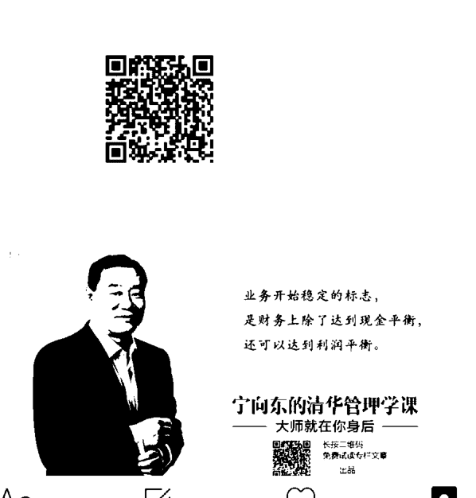

## 160讲：创新者的计划

**微软去哪了？**

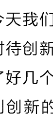

你好，欢迎来到《宁向东的清华管理学课》。

今天我们要讨论的主题，就是我们该如何对待创新者。最近这段时间里，参加了好几个会议，没有一位演讲者中不提到创新的，都是说要“锐意进取、大胆创新”。但创新真的很容易吗？创新最容易得到的支持吗？我第一次出讲时，地道的英文没念几句，就学了好几句很地道的短语。其中的一句叫：Yeah! Shut up. 中文有好几种译法，最忠实的译法，应该是，不说话，能死啊！今天的事，我就从这句最傻的翻译说起。

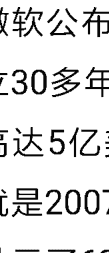

宁向东可以借此复习“达克效应”的概念。

### 复习：达克效应

### 1. 案例：微软

举个例子给你，著名的微软公司。众所周知，这是比尔·盖茨在1975年退学创办的公司，1981年开始在IBM兼容机上卖DOS系统，1985年Windows 3.1版本上市，1995年发布Windows 95，掀起了一整个世界范围内的计算机革命。微软近30年的快速发展，很像一个初创期公司或者苹果。直到微软上市的前几年，比尔·盖茨都是能见度最高的企业家代表。

但是在2005年之后，微软在高科技行业的领先优势一点点在丧失，危机逐渐积累。在网络高速发展的时代，微软的速度逐渐放缓。最令我震惊的是，2012年7月，微软公布了第二季度的财务数据，公司股价超过340美元。单一季度就亏近10个亿，领领30多亿美元。当时与苹果的巨大，领领量，就2007年微软收购了一家网路公司，一共花了60亿美，在这个公司的报表中一次记住了这个亏损。

虽然微软的主营业务收入在这一年仍然是保持很高的水平，但是，这次季度亏巨亏主要也由于华软和美国的关系。大家请发是，与对于微软的反击里。大家发现，是微软主营业务上持续对浏览器的投放。在网络上还，一系列投资给以亏损。在很多领域，微软都是起了个大早，却赶了个晚集。

比如，微软在1998年造搜索引擎，是创立了MSN部门，同年Google成立，最后谷歌至今大日百，而（MSN早早已关门）。1998年，也是微软最早进行电子商务领域的之一，时间甚至比Amazon的Kindle早了9年，但是，后来的几大电子书都用Google的Andriod系统，而不再用微软的操作系统。1998年，微软同样布局造车用电脑领域，推出车用电脑操作系统AupPC，但是，在今天驾驶汽车的末端大市场上，微软能处于什么样的地位，你可想而知。

电视、平板电脑和手机，这些大家都要争夺的3块阵地，也是微软战略布局的重点。微软在2009年开始正式进入智能电子设备领域；2009年开始正式进入智能手机操作系统领域。Andriod系统用了5年，后来微软紧收于构建自己的手机OS，2002年，也是微软进入平板电脑领域的元年。这个时间比苹果的Pad提前了8年，但是，今天大家都看到了竞争的结果。

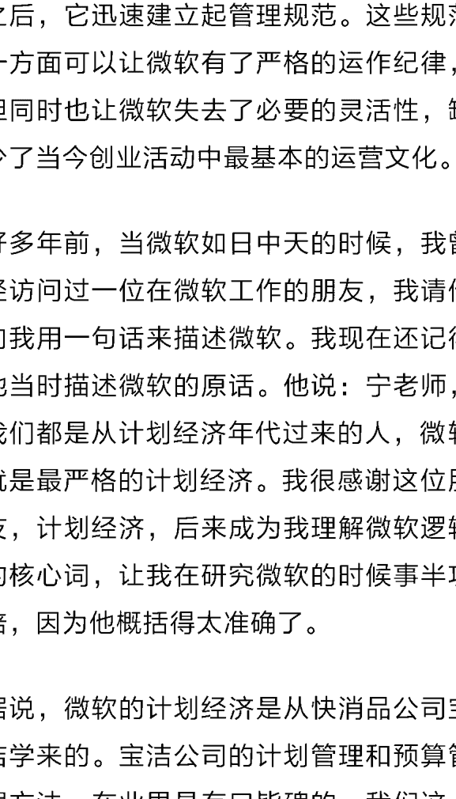

在其它的线上领域，微软的布局也是非常早的。2004年，微软开始进入网络信息引领领域，而YouTube早了一年，在社交媒体领域，微软是一个跟随者，它在2005年Facebook推一年之后，建立了Wallpop平台。但是，3年之后，Wallpop业务停止运营。

微软为什么会在这么多的领域里面，不断地出现和那些的问事，最后导致不良的实现效果呢？各界人士、财经分析专家和学者们给出了很多分析结论，有技术方面的原因，但更大程度上，是由于微软的管理体制、它的运行逻辑已经不适合管理创业型企业，它缺少必要的灵活性。微软的很多竞争对手都以“无”创业的年轻人，与这些对手的灵活性比起来，微软就略显僵化。

### 2. 微软的“计划经济”

这一点说起来也有点像笑活。微软其实也是从军出来，但它走向一个大公司之后，它迅速建立起规范。这些规范一方面可以使微软有严格的法律性。但同时也以微软失去了必要的灵活性，缺乏当令活动中最基本的运营文化。

好多年前，当微软如日中天的时候，我结识过一个在微软做工作的朋友，我向他询问一句话是微软的，我现在还能地当时做工作的朋友。他说：牛老师，我们都是计划经济时代的出来的，微软是最典型的计划经济。我很感激我的朋友，它让我在研究微软的时候事半功倍，因为他把话给透了。

据说，微软的计划经济是从快消品公司宝洁学来的。宝洁公司的计划管理和预算管理，在业界是有口碑的。我们这一周简述了计划管理的基本逻辑，限于篇幅，我们只讲了基本准则，但如果你感兴趣，可以另开研究一下宝洁。宝洁的产品类非常多元，它运行逻辑已经不适合管理创业型企业。它缺少必要的灵活性。

### 3. 创新者的计划

最简单地回答这个问题，就是新创业的企业，多数都不适合计划经济的管理方式。如果这个企业的氛围里面、文化里面，都是指标的观念、考核的思想，所有人都在为销售、利润这些传统指标而战的话，就会忽视消费者体验，忽视技术创新，对于创新型企业，就是致命的问题。

有朋友和我说，上面提到的那些企业，有些是微软自己创立的，有些是从外面并购进入微软的。但是，它们在微软的管理“高墙”之下，常常被微软的管理方式捆住手脚，因为微软考核的，都不是个性化的指标，而是成型公司的指标逻辑，而经理人也在意计划部门的人员怎么看企业，判断企业。

对于在新的行业，有创业性质的企业，打法多数都没有成型，在这个时候，计划性就比不上适应性更重要。团队需要更关注市场变化，关注商业模式创新，关注对于客户的理解。这需要一整套与传统战略方式、传统计划方式不同的管理哲学和运作方式。

我个人认为，对于创新型企业来说，不要过度重视销售额，关注利润这些传统的财务指标，而应该把重心放在另外两个方面：

- 1. 是满足客户需求的状况是不是显著改善；
- 2. 就是公司现金流的状况是不是稳定并且处于健康状态。

另外，对于创新型企业来说，很多重要的指标是非财务的，如果进行计划管理，一定要想办法把非财务指标明确化。

### 课后思考

今天课后，请你找一个非财务指标，比如客户满意度，思想这个指标能不能被量化管理？我们在下周的课，会接着讨论这个话题。

### 划重点

1. 微软在互联网创新领域竞争乏力的重要原因，是公司的计划体制不符合鼓励创新的要求。
2. 对于创新型企业来说，不要过度重视销售额，关注利润这些传统的财务指标，而应该把重心放在：
   - 满足客户需求的状况是不是显著改善；
   - 公司现金流的状况是不是稳定并且处于健康状态。

宁向东
新同学你好，今天我继续带着你回顾之前的内容，咱们来看看，从最底层，如何满足员工的需求，激发他们的斗志。

**提问：你究竟想在工作中得到什么？**

赫茨伯格在1966年对美国工人进行了广泛调查，目的是为了知道“人究竟想在工作中得到什么”。根据调查结果，他提出了保健因素和激励因素的“双因素理论”。

**重要概念：双因素理论**

人进入职场为了满足两类需求：
- 第一类，就是为了满足衣食住行这些基本需求。
- 第二类，就是自我实现和受到尊重的需求。

赫茨伯格：“人们在工作中感到开心的因素的反面，并不是让他们不开心的因素。”

《宁向东的清华管理学课》

## 一周复盘 | 没计划性就没有前途

又到周末，碰巧我在外面出差，用手机帮你做个复盘。

这一个模块我们讲的都是计划。当一个企业确立了发展战略的基本方向之后，有效地制订计划，就是保证战略实施的必要手段。周五讲了我对微软的“计划经济”的看法。不过，这个企业小的时候，企业当然要有明确清晰的计划。只不过有时候，进行这个计划，应该在主要领导人的头脑中，而应该在组织中，最重要的就是应变的能力。

我们的听众中，有不少是小企业的主要负责人，也有很多创业者。在小企业里，完全没计划，和企业领导人没有自己的思路，可以全部就地地去指挥自己的发展和应变。没有任何事，没有计划性的企业，永远没有前途的企业。

在企业经营活动中，计划是一个重要工作。计划可以成长期计划、年度计划、月度计划、周计划等。大公司做一次好的年度计划，通常都需要花几年的时间。小公司的计划一般是滚动的。

通过计划过程，企业一般要解决三个问题：

- 1. 就是要把已经确定的经营战略转化为可以创造价值的详细的行动方案。
- 2. 企业需要评估，是否有足够的资源来实现既定的战略计划，我们这一周讲了预算，预算做得好，资源预算安排就要事先有准备。一个计划要可行，就必须要有足够的资源保障，这个目标在过程是，也是落实一个战略是否可行的过程。对于资源上缺乏保证的计划，企业必须采取相应的调整，否则计划很有可能会失败。
- 3. 通过计划可以将战略实施过程体系化，将关键的投入指标、过程指标和产出指标表现为企业目标。

计划编制的核心，是要通过恰当的预测，获得可行动目标值，这是一个非常专门的一个学问。我们一直强调讲这几个问题，我们上一个模块讲了战略，但战略的落地和计划，我却没有讲。关于战略计划，有很多的理论，很多著名的管理著作，有很多的理论，我最喜欢的是卡普兰教授的基于平衡计分卡相关战略地图和相关内容。我在这个模块将通过一周的时间去分析分享我学习这个工具的体会，希望能够对大家有所帮助。

另外，本周四的课，我讲了解网点和天亮点，也就是现金平衡和盈亏平衡的时候，提到了“单位边际贡献”，有同学问我，一定要知道“单位边际贡献”，我可以在告诉你，你一定得知道。单位边际贡献，就是售价减去单位变动成本。知道这个，你的资源知道每一款产品能挣多少钱。每一个顾客，能让你挣多少钱。

当你的时间有限的时候，一定要把时间投入到能够带来边际贡献的顾客和产品身上去。比如，马上班下课。假设你只服务一个客户，单位边际贡献较大的，你的服务成本是单位边际贡献比较大的那个客户。为什么？因为你的时间有限，单位边际贡献大的那个客户让你的收益更好，同时，时间回报率也更高。

### 一周留言精选

**来自：雪城**

看了今天的七行表格图，终于明白了为什么有些企业过着东富即富的日子，而有些企业却能大刀阔斧地不断锐意进取，让企业不断发展的原因所在。项与作者的注意事项不仅强调管理在三大项上。而后者则一项都不落地把七大项落到实处。特别是企业的投资计划、融资计划和变革计划，方面是企业发展潜力的根本来源。这也是印证了一句话，“注意力放在哪里，收获就在哪里。”

**来自：Emma515**

今天听一节课，一名小学教师，一次课上也让同学们谈谈自己的愿望。其中一个同学说长大后要开一家加油站。老师和同学们听了都很吃惊。过了几个月秋学期，老师、同学们又过了，买了加油枪。老师刚喝完，这时这位同学向老师要塑料瓶，得到老师用热热的脚法送递他放进教室里去。老师用他的眼，他说：他一直在这里，老师打开瓶塞喝了一杯，今天在这瞬间让我想起了这个故事。每天班上早时回想自己今天做了些什么，有时竟感觉想不出来特别的，看来还是目标不明确，要上课上执行，以后必须根据目标分解成每天的计划，检验实施结果。

**来自：行动派**

相同行业、同等规模的企业之间，一个企业的战略不同，三个轮子也会有差异。在销售额相同的情况下，有的企业回收期比较快些，就会有更现金流，企业资金周转速度快，资产利润率就高，股东回报就较高。有的企业回收期慢，应收账款多，可能会出现资金链断裂，危及企业正常运转。在利用现金的情况下，有的企业重视股东利润，及时分红，这样企业回报率，但企业的可持续发展方面有可能考虑得到保障。有的企业重视对研究者的投入，这样短时间内会增加股东、降低股东回报，但创造了更具潜力的增长点。有的企业通过降低售价的方式增加销额，通过“薄利多销”保证企业经济利润，有的企业会通过增加广告的附加价值提高销售额，通过“差异化策略”以增加利润率，从而保证企业经营利润。

总而言之，即使是同行业、同等规模的企业之间，如果策略有向不同，它们三个轮子也总会差异万千。有的轮子会转得顺畅，有的轮子会转得生硬，甚至有的会因为某个轮子不转而需要“加油”。管理者需要时刻对自己的经营进行判断，及时识别运营风险，让三个轮子同步运转。

**来自：同江川**

对于老师文中的一点提出不同意见，单位售价一定高于单位变动成本，企业运营才不为负，因该资金是想要周转速率的。古寺说过的，应该是一种理想状态下的经营状况。

**来自：Tony to ni**

实体店开网店，一听上去，肯定是条好选择。为什么？因为竞争对手少了很多渠道，而固定成本已经在摊位上分摊了。但是，如果在线下的，实际上是不好的，收支不平衡，甚至到盈平衡。而线上就获客成本相对低些，那么不如关了实体店，只开网店，这样固定成本不会下降。而线下开线上，开始盈利，这个的时候再开网店，会发现线上流量成本很高。

作为后来进入者，你把精力放在线下，想办法提高坪效，这可能是一个更好的选择。现在热烈讨论的新零售，其实是指对于线上做高了的转接率，小米极高的坪效，做到了一线上下网。小米也是打平，甚至微盈利。盒马鲜生则是鼓励你在线上线下，虽然线上转的流量也高，但是，偶是主动到线下的，线上做高量？这个逻辑在于，线上做产生更高的复购率。由于线上购物流增放在放，现在在货太小、东和东利，都是在回归线上，探索线上和线下的融合，但是先回归，是通过技术供应链整合，大数据选品，客户精准画像下的，更高效的回归。

**来自：lily**

我认为，这些非财务指标，本质上，最终也是财务指标，只是更多地与未来的财务指标相关。比如客户满意度，体现在后期，不再与企业管理员，影响的是企业未来的收入，而不是关注客户满意度，是为了成来未来交易。一家子客户，不是为下次交易，关键是顾客有体验的，这是非常有累客户的贡献。如果我们一味地去关注非财务指标，而忽略了财务指标背后的财务效益，企业也会得不偿失，难以存活和发展。

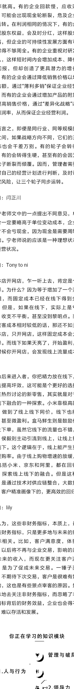

### 你正在学习的知识模块

- 7. 客户
- 8. 战略
- 10. 运作
- 11. 业绩
- 12. 激励
- 13. 控制
- 14. 转型变革

## 161讲：平衡计分卡 | 学会看长远

你好，欢迎回到《宁向东的清华管理学课》。

这一周，我们只讲一个管理工具：卡普兰和诺顿的“平衡计分卡”或“战略地图”。你也许会说，这不是两个管理工具吗？研究本周的课，你会发现，实际上它是一套管理思维的多个重要环节，也是核心内容。

这一周，争取把这套体系给你讲清楚。

### 1. 平衡计分卡的由来

我们上一个模块讲战略，但是一个非常重要的东西，在上一个模块没有讲，就是战略的执行，很多企业都有战略，却特别关心执行问题，他们希望领导公司的执行能力能够提高，战略能够落地。这些年，出现过很多可提高执行力的东西，从诺顿的“能力增强”到卡普兰的“执行”。但我觉得：那些都是战略落地的有效工具，一些所谓的“执行”更多地是从领导学的角度来理解的。真正从管理角度，有机会让战略落地、执行力提高的工具，我个人非常推崇卡普兰和诺顿的一整套体系，所以，我特意要花一周的时间来讲这套体系。

先介绍卡普兰这个人。他是顶级的管理学大师，在我们心目中有着极高的学术地位。我们在客户模块讲过的“作业成本法”，就来自卡普兰教授。我常说不一个学者，就培养不了一个领域顶级的领导者，能在一个领域、两个领域有顶级贡献，这非常难得。

很多管理学教授，一辈子的成就就是发表了几篇论文，但对产业没有影响。卡普兰教授非常不同，他不仅提出了思想、观念和理论体系，而且还提供了一整套的管理工具，进而影响了无数的企业、无数管理者，这让我心底里欣赏得五体投地的。卡普兰的早期工作，大部分是在卡普兰教授大学完成的，收获期待是哈佛商学院。这个嘛，我对哈佛的脾气，也是两个字：霸气。

1992年，卡普兰和诺顿在《哈佛商业评论》杂志上，发表了第一篇论文，标题叫“平衡计分卡：业绩驱动指标”。这篇论文，标志着这一领域研究和应用的开端。

“平衡计分卡”这个词，来自于迪顿。据说有一次，诺顿和一位IBM的高管聊了起打高尔夫球。高尔夫球，又叫一场，记下一个洞打多少杆，都要记录的。你去打高尔夫球，球会记录下来，每一场，都给一张卡，用来记录在每一个洞打了几杆，然后，18洞打完了，再跟谁的杆数最少。据说诺顿当时就看了看打高尔夫卡，对那位高管说，我要发明一种记录卡，用来让他自己记录业绩，从而衡量记录工作结果，记录成就，这就可以方便考核了。这就是平衡计分卡的来源。

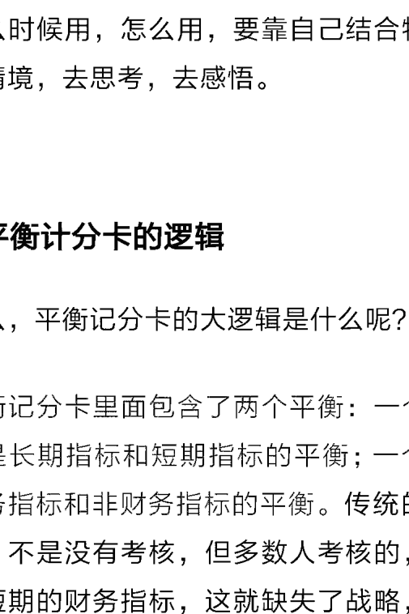

能够想象吗？这就是管理思想的来源。所以，不要以那些学院派的话，包括话，学的那些概念叫啥，我一直坚信，真正有价值的管理思想，管理工具，都来自于生活，只不过它们高于生活。

学习管理学，不是马上就可以立竿见影去用的，管理学在很大程度上，是一种阅历，是一种历练。很多管理方法，听了之后，有个印象，但不足以马上就能应用，什么时候用，怎么用，要靠自己结合特定的情境，去思考，去感受。

### 2. 平衡计分卡的逻辑

那么，平衡计分卡的大逻辑是什么呢？

平衡计分卡里面包含了两个平衡：一个是平衡长期指标和短期指标的平衡；一个是财务指标和非财务指标的平衡。传统的管理，不是没有考核，也有财务指标，但是短期的财务指标，这就缺少了战略，缺少了长远目标，缺少了愿景。这个，就导向了很多企业是短视的。有时候，会决定企业长期发展的因素，不是短期的财务指标，而是长期的、非财务指标。比如，你认为对企业的发展、对企业成功，最重要的因素是什么？我不知道你的答案是什么，在我看来，最重要的是人，是团队，是文化系统。

有一件事，给我印象非常深，今天我这个故事分享给你。十几年前，力帆的董事长尹明善先生每年都会花很多时间去考察公司里面的企业，通过企业里面的“学科考试”去选拔干部。我问问尹先生什么？他回答说：经理人都被关心短期财务业务指标，不太关心长期人才，特别是组织的思考。所以，老板就需要花很多时间去塑造人才。尹先生说：人才是企业发展的百年大计。

听尹先生这么说之前，我并没有格外注意这个细节，听到这里，我就留意观察，发现有很多，还是这样。经理人的任期，通常有限，所以，他的第一要务是把短期的业绩搞到指标上，几乎所有领导者的价值，还是放在短期指标上。人们对于企业的价值，他们不是认识不到，而是下愿意花力气去做，因为短期内去耗利用，投入的精力太多，对于长期贡献的人来讲，做得不太值。这是典型的长期指标和短期指标、财务指标和非财务指标之间发生冲突的例子。

卡普兰和诺顿的平衡计分卡思想，就是为了解决类似的问题。战略是长期的目标，关乎企业可持续发展的大方向，而经理入、中层、乃至基层员工所关心的目标都是短期目标，这些短期目标服务于公司的长远目标。所以，从另一个角度看来看，管理者最需要的，最重要的一件事，就是把长期战略目标转化成团队和员工的一套可长考核的指标，然后这一套指标就可以指导每一个人，每一天的行动。

卡普兰和诺顿的这一套体系，背后非常重的一个概念，就是：管理的东西，是那些能够衡量的东西。卡普兰和诺顿在他们的书中引用了这样的话，“不能度量，就不能管理”。由此，你是否又看到了泰罗的影子？只不过100年过去了，管理学家放了份表，使用了充满组织逻辑的表格。

拿高尔夫球举例子，你会知道：这张记分卡，首先告诉你一个洞，是一个什么洞，比如是一个五杆洞，洞洞发球的距离是480码，这是500码，上面还会有一个弯的，你能到一条直的话，还有一个沙坑，都是什么东西，要去水边，你可以决定用几号几杆，打几杆，才能取得好成绩。

平衡计分卡，就是要达到这样的效果。首先，每个部门的领导者、每个员工，都被设定积分、合理的计分指标，其次，可以按照分卡的指引去工作，去接受考核，可以说，有了计分卡，人人都按照卡上所规定的目标去行动，按照卡上所规定的标准去达成每一个动作，企业的总目标自然就会实现。

### 3. 记录非财务指标

卡普兰和诺顿关于平衡计分卡，十年间一共出版了本书。在本书中，他们把平衡计分卡体系，在定位为人力管理中的仪表盘。这个仪表盘上有很多的仪表，每个表都着测量某一个指标，然后，驾驶者通过仪表盘去监测飞行，驾驶企业这架飞机平稳地飞向目的地。

卡普兰和诺顿认为，传统管理体系的最大缺点，就是过度依赖财务指标来衡量经营，把经营过程。企业签发的仪表盘里有太多的财务指标，考核指标都是入盈利目标这一单指中引号分析所得出的细目标，利润是统一引人关注的指标。但通过这些考核指标去研究经营，存在明显的局限性。这种情况好比飞在驾驶飞机的时刻，只关注飞度这一个指标，不关心油料，不关心油耗，也不关心高度，所以，考核是片面的，管理就是短视的、短期的。

就是片面的、短期的。

卡普兰和诺顿说，财务指标肯定是衡量业绩的重要指标，但是财务指标是最表面的、最结果性的指标。在财务指标背后有很多驱动性的因素，这些因素是非财务的，但它们是长期的，是影响更加深远的。所以，要使用平衡计分卡的思想和工具。

卡普兰和诺顿的第一本书出版之后，《哈佛商业评论》给这本书的评价是“75年来最伟大的管理工具”。所以，对业界形成了非常大的影响，很多公司都开始使用平衡计分卡这个工具，因为这个东西确实吸引人。我在底下放了一张个人的平衡计分卡表格。你想，一个管理者，每天焦头烂额，突然来了一位西装革履的咨询顾问，号称可以熟练使用“75年来最伟大的管理工具”。如果你是这位管理者，你会不动心吗？

**单公司目标**

公司目标在以下方面：
- 每年每美元工资增长 30%
- 达到内部预期利润，超过投资资本成本 2%
- 广告顾客服务成本占年销售比例 20%

| 名称和目标 | 计分卡指标 | 业务单元目标值 1997 1998 1999 | 团队和个人目标 和行动计划 |
| :--- | :--- | :--- | :--- |
| **财务** | **收入(百万美元)** | **1997**: 180 **1998**: 180 **1999**: 250 | 1. 年度营业费用 2. 每项费用/总劳务费 3. 每顾客销售产出成本 |
| | **每项费用/总劳务费** | **1997**: 200 **1998**: 210 **1999**: 225 | |
| | **每顾客销售产出成本** | **1997**: 80 **1998**: 75 **1999**: 70 | |
| | **保证金** | **1997**: 75 **1998**: 90 **1999**: 82 | 4. 每顾客的服务成本 5. 全年总资产 |
| | **每顾客的服务成本** | **1997**: 108 **1998**: 108 **1999**: 110 | |
| | **全年总资产** | | |

**姓名：**
**领域：**
**1998年资本金：** 1000

Robert S. Kaplan
1940-...

所以，几年之后，虽然很多大型企业都使用了平衡计分卡作为管理工具，但失败者为数不少。很多是因为领导人重视不够，有些是咨询公司缺乏使用这一工具的经验，还有一些是仅仅把它作为一种考核工具。这些失败导致了明天我们讲的，卡普兰和诺顿写了第二本书《战略中心型组织》。

## 课后的思考

今天的课后，请你思考一下在你的组织中，哪一个非财务指标是至关重要的，但却被明显忽视了？

# 宁向东

今天，我们继续复习管理学大师的思想，新加入的同学，不用自己着急看前面的内容，每天我会带着你回顾。

作业成本法和平衡计分卡是卡普兰最重要的两大贡献。一个学者，能在一个领域有国际级的领导地位，就不白生了，而卡普兰在两个领域都有顶级成就。他不仅提供了思想观念和理论体系，还提供了一整套的管理工具，影响了无数的企业、管理者。

**你已掌握大师的智慧：**

- 企业要进行成本追溯和准确的费用分摊，这样才能把每一个运营活动、每一个动作的成本核算到位。
- 管理者要把公司长远的战略转化成团队和员工的一套业绩考核指标，指示每一个人、每一天的行动。

卡普兰说：
> “衡量”很重要，如果你不衡量员工、流程、客户、产品，你的绩效将会受损。

宁向东的清华管理学课

# 162讲：因果关系，如何做沙盘推演

你好，欢迎回到《宁向东的清华管理学课》。

今天我们讲卡普兰和诺顿整个工具体系的核心：战略地图，也就是业绩因素之间的关系。今天的目录里是一个案例，这个案例左右上下。我建议你，就算是花两天时间什么都不干，把这几天的课程搞懂，都特别值，相当于你读了个MBA。20年前，卡普兰教授就将这个案例作为他在哈佛商学院授课的主打案例，并且将教学材料给了使用这个案例的其他教授。它的重要性可见一斑。

这个案例的核心思想，你可以在今天的课上参考一下下面有关的图示做参考了。你可以结合音频和文字，仔细研究一下这个案例，再体会这个案例的逻辑，因为在逻辑上，特别是财务指标，往往今天我们不太关注结果，而是一个因果关系。

从1990年开始，卡普兰和诺顿在领先的《哈佛商业评论》发表了一组平衡计分卡的三篇论文，也正是在这一年，美孚石油公司，也就是炼油和化工巨头，它换了一位总裁。这位总裁琢磨着写一些论文。于是，他们请来卡普兰和诺顿的公司当顾问，致力于用平衡计分卡的工具改造公司。

90年代初，美孚的北美公司经营业绩非常不理想，这个两年盈利规模150亿的部门，在1992年的盈利能力处于行业最底部水平，投资回报率在降低。在考虑是否要依靠公司的现金支柱才能维持设备更新的问题时，新老板上台之后，他和管理团队致力于对公司进行彻底的改革，开始推行以客户为尊的经营策略。但是，在如何以战略为地图思考美孚的目标在这样的背景下，顾问团队帮助美孚石油公司画出了我们文稿中的图示，梳理出了业绩的因素关系。

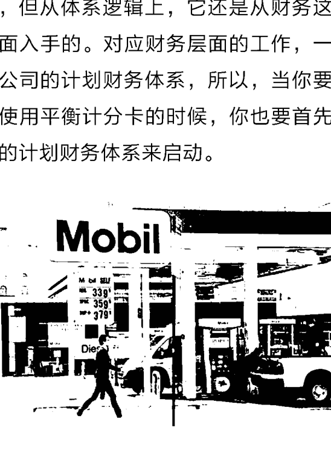

## 1. 从财务出发

既然美孚主要问题是资本回报率低，所以公司的战略目标之一就是表现为：要在三年之内把资本回报率从7%提升到12%。从财务指标出发思考你的运营逻辑，这是平衡计分卡的基本逻辑。所以，无论从卡普兰和诺顿作为工具的提供者，还是企业的管理者，都得从这个开始是关键。

提高资本回报率的途径，无非就是两种：一种叫做“做油”，叫做大资产，就是把更多的产品卖出去。第二种是，做加油业务之外的新业务，比如，洗车业务、维修、保险，甚至零售里面的各种消费品业务。

第二种是提高资本回报率的途径，叫做做强。我们有时候也经常提到做强的两个手段，一个是业务做强，一个是做资本回报率，让单位销售的收益提高。第二，就是提高资金的运营效率。换句话说，就是在特定的产业下，获得更好的现金流、减少库存，总之，就是提高资金的使用效率。

这些逻辑关系，你可以从今天的图示中看到，它反映了公司基本的财务逻辑。所以，平衡计分卡虽然强调要从长期到短期，但从体系逻辑上，还是从财务这个层面入手的。对应财务方面的工作，一般是公司的计划财务体系，所以，当你学习使用平衡计分卡的时候，你也要首先从你的计划财务体系来启动。

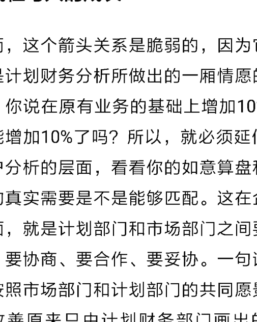

## 2. 客户分析

你知道如何做客户分析，其实都是靠拍脑袋出来的。今天下一阶的计划财务部门，做计划的时候，都是要勇气的。我当年研究说，今年的增长就是8%，明年多少说，就多少啊，10%，就是9%，增长率大概是11%。但是，这个胆量，数字是哪里拍的？要做增长，就要提高客户基准是冲突的，该怎么办？

“长”，我特别直白地称之为“人力资源层面”。这里面的因果关系就在于，当流程改造确定之后，接下来要解决的事情就是人员层面的事情。没有人、特别是没有合格的人，任何好流程都会是低效率的，客户目标就无法达成，财务目标也无法达成。所以，把合适的人放在合适的位置，把不合适的人调开。有些流程涉及到一些新的能力要求，就需要在这个层面进行培训；如果通过培训无法解决，就要通过招聘来解决。总之，第四个层面的事情，是要解决人的问题。人的问题，也是最基本的问题。

讲到这里，你也许会理解为为什么我把今天的课起了这么一个标题：因果关系。因为这张图示，其实就揭示了企业取得业绩的因果关系。你会发现，经过了我们在图示中，对企业四个层面各项活动的解析，越往下的层次，越是关键性的“原因”，越往上面的层次，其实越是事情的结果。我们做事，其实就是要能够从业绩上的“果”，推出业绩上的“因”，再从解决“因”来逐步追求达成预想中的“果”。

### 课后思考

今天的课后，请你思考一下：自己所在的企业，是不是也可以画出这样一个因果关系的逻辑图呢？如果你负责一个公司，可不可以请你的中层骨干一起来画这个图呢？如果你负责一个部门，可不可以也画出自己的因果关系图？如果你只管理自己，要解决问题，是不是也可以层层进行因果关系的分解呢？你也许会说，我个人的问题没有财务、市场之类的事情。那么，对于这样的情况，你该怎么办呢？

### 划重点

1. 平衡计分卡美学经典案例：从公司财务目标出发，结合客户分析，把财务目标分解；之后，公司内部要打造一套业务流程、管理流程，来组织相关人员有效选择产品、业务；最后，匹配具有相关能力的人员。
2. 业绩不是原因，而是结果。只关注业绩，往往并不会取得好结果。应该去关注那些一层层递进的因果关系。

### 你正在学习的知识模块

1. 人与行为
2. 领导力
3. 团队
4. 指导下属
5. 组织发展
6. 文化与沟通
7. 客户
8. 战略
9. 运作
10. 业绩
11. 激励
12. 控制
13. 转型变革

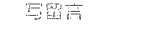

# 163讲：战略地图的标准模板

你好，欢迎回到《宁向东的管理哲学课》。

昨天我们讲了平衡计分卡，在美孚公司的应用，这也是卡普兰和诺顿亲自操刀的一个案例，相信你已经掌握了最基本的逻辑，就是从结果层找出原因，通过解决因来达到结果的逻辑。今天，我们再把这个逻辑往深了走一步，分析这家学术思想中的重要工具：战略地图。

## 1. 平衡计分卡的演变

1996年，卡普兰和诺顿出版了他们“平衡计分卡”的第一本书，不过这时候，作为一个管理工具，平衡计分卡的底层逻辑虽然已经成型了，但是，工具层面还是欠缺很多。所以，在那本书的序言里，卡普兰和诺顿特意写了一段话，给读者一个严肃的忠告。我记得最后三句：或者再过几年，我们还会再写一本书《平衡计分卡》的续集。

事实上，卡普兰和诺顿后来写了四本书，加上最初的一本书，一共是五本，形成了这个学术领域的经典系列。2000年，卡普兰的第二本书。2001年，我正是在哈佛商学院读书，只读过一本诺顿教授写的，但这本书我只读了不少遍，印象深刻，这本书我读起来不是很流畅。但深读卡普兰和诺顿在书中所表达的那种变化。当然，这种变化是我隐约感受到的。

第二本书名字叫《战略中心型组织》（The Strategy-Focused Organization），书中读了很多后来操刀的一些案例，一些做法。这本书的最后部分叫《避免陷阱》，讲了平衡计分卡这个工具进入组织之后，在使用中的种种问题。当时，太多的公司开始使用平衡计分卡了，所以，出现了很多问题。

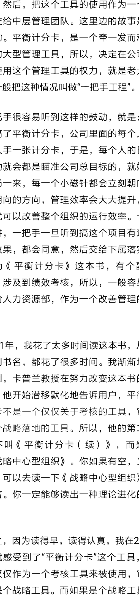

卡普兰特别有针对性地给大家解释使用中的问题，因为他专门研究了设计上的七条准则，以及因为实施而引发的七大问题，导致平衡计分卡无法落地，或者落地以后会失控。整本书我读了很多遍，在序言里他写了一段话：平衡计分卡作为一个管理工具，是没有问题的，但是，实施这个管理工具如果运用得不恰当，是会导致很大问题的。

## 2. 一把手工程

卡普兰向大家提出的第一个失效原因，就是领导者会把平衡计分卡当成一个考核工具，然后，把这个工具的使用权交给项目团队或管理团队。这里的故事是这样的。平衡计分卡，是一个涉及公司高层的重大管理工具，所以，决定在公司里使用这个管理工具的公司，这就是一把手工程。我一般把这种情况叫做“一把手工程”。

一把手很容易听到这样的鼓动：如果有人设计一张计分卡，公司里面的人日常动作就会跟随这个总目标去，效率就会提升，每个小组都有目标，就好像是该朝的方向，管理效率会大幅提升，自然可以把高管团队的运行效率提升。一般来讲，一把手一旦听说这个项目有显著的效果，都会同意，然后交给下属落实。因为《平衡计分卡》这本书，有图表，涉及绩效体系，所以，通常就被交给人力资源部，作为一个改善管理的工具。

2001年，我花了太多时间读这本书，从内到书名，都花了很多时间。我渐渐意识到，卡普兰教授在努力改变这本书的定位，他开始强调把计分卡看作战略工具，平衡计分卡不仅仅是一个关于考核的工具，它并不是仅仅关于组织的工具。所以，他的第二本书叫《平衡计分卡（续）》，但也叫《战略中心型组织》。如果你有空，又好奇，可以读一下《战略中心型组织》的序言。你一定能读出一个理论化的逻辑。

总之，因为读得早，读得认真，我在2001年就感受到了“平衡计分卡”这个工具，不仅仅作为一个考核工具被使用，它应该是一个战略工具。而如果是战略工具，在实施的全过程中，就应该是一个一把手工程，而不仅仅是人力资源部去组织实施。

和你们分享趣事。由于这本书的中文版是2008年出版的，在此之前08年里，很多中国企业把这本书作为考核工具来使用的。记得有一家大机构曾经在清华大学招生，那时大概是04年，当时我们一起学平衡计分卡的思路，我们告诉你，我们已经在用了。这家机构的老板很年轻，也很有想法。正如我前面说的，当他听说了这个管理工具之后，就决定使用，但他们把这个工作的牵头部门放在了人力资源部。

那天的课堂发生了一点小冲突。因为我简单问了一下情况之后，我断定卡普兰所说的7个问题，他们都犯了，所以，成功不易。那时我还不成熟，课上直接表明态度了。他们的人力资源总经理当时在场，就是把我得罪了。我虽然后退，但明显还是有感，动机较强。后来升的，他们的二期培训，没有请我讲课，有没有聘请讲课，人力资源总监都是我发言权的。

但第三次培训，他们又找我了，而且他们告诉我：宁教授，我们的平衡计分卡项目，现在的牵头单位已经从人力资源转移到总务处。我有点得意，但得意并不是觉得自己高明，而是证明了对卡普兰的“定位错误”判断对了。有些事儿，这是一个平衡计分卡，一把手要抓，是不可能有好效果的。

## 3. 使用注意事项

因此，我至今都推荐学生多读一读这本书。

我自己对这本书读得是足够多的。结果我发现这本书中，最重要的内容就是昨天我和你分享的那张图，因为一个公司如果能把这张图画出来，很多问题就都可以非常清晰化了。我读懂这一点之后，相当“狂妄”，我在课堂上甚至和学生说：即使如卡普兰这样的大学者，都不一定知道他们发明的工具，其核心在哪里，不知道最有价值的东西是什么。我说，他们的最大发明就是那张“战略地图”。我还说，如果是我写这本书，我会拼命把这个战略地图的逻辑说清楚。

在2004年我出版《管理10论》（第一版）的时候，我甚至还写过卡普兰和诺顿没有意识到他们自己工作的价值和意义之类的话。但是，2006年，我发现自己是错的，卡普兰和诺顿在当年出版了他们在这个领域的第三本书，书名就叫《战略地图》。2001年，当他们写作《战略中心型组织》的时候，他们并不是没有意识到其工作的价值和意义，只是他们当时的研究工作还没有到位，还拿不出后来已经标准化的战略地图模板。

这个重要的模板，我放在下面了：

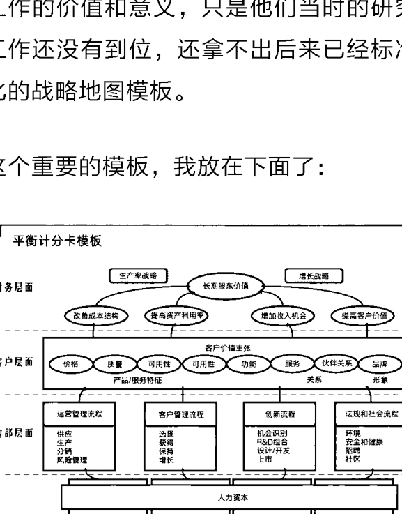

### 课后思考

今天课后，你可以比较一下这个模板和昨天那个针对美孚公司的图示之间的差异，感受一下工具进步的价值。

### 你正在学习的知识模块

1. 人与行为
2. 领导力
3. 团队
4. 指导下属
5. 组织发展
6. 文化与沟通
7. 客户
8. 战略
9. 组织变革
10. 运作
11. 业绩
12. 激励
13. 控制
14. 转型变革

# 164讲：计划仪表 | 锁定每个人的行动

你好，欢迎回到《宁向东的清华管理学课》。

周一，我们讲了美孚北美公司的战略地图；昨天，我们讲了标准化的战略地图。不过，把战略地图画出来，只搞清楚关系，好做，并非核心。战略关系，只搞清楚关系，算是明确了业绩的内在逻辑。今天，我要接着这张图，告诉你如何用这张图锁定团队中每个人的行动。

## 1. 例外管理

在讲今天的细节之前，我告诉你管理的一种法则：就是管理者不能设法去管特殊问题。不要管一般情况，把一般的情况交给制度管，用来处理大多数问题。所以我们很多领导、干部、领导者，总是觉着自己管理忙，每天忙着觉得太充实。我告诉你，你干这么忙，你觉得，你干的多，也不可能管更多的。今天的课，请你抽时间复习一下第32讲会控制型，以及我前面讲的文件夹学关系对，你就会更好地理解我今天的课。

一个管理者，每天遇到的问题形形色色，多种多样，而且数量又多。如果你一遇到什么就解决，根本解决不过来，而且还会让你累死。怎么办呢？就是要善于发现共性问题，想，建立起制度，用制度去解决这些问题。一般来说，到我们这里发现的问题，如果是100个问题，可能有80%都是共性的。你要建立5个制度、10个制度，这些问题70%解决之去，大判断的问题算是解决了，在制度里面都规定详细了，你基本上就可以解决80%的问题。

那么，精力只解决20%的问题，你只需把剩下20%的问题，这20%特殊问题，在解决这些问题做的时候，你要想办法建这些特殊制度，比如，可以建立新制度应对问题。一旦形成常规，就容易建制度，形成经常。有了一定制度，出现新的情况，就让大家按现有办事。请你在管理，一定要学会不断给自己减效。管理的任务，不是不停地解决问题，而是要重点解决例外的问题。

请你记得：好的管理者，管的都是特问题，进的都是该管的例外管理。例外问题主要指：一种是组织从未管理到过的问题；还有一种，是组织从没有去解决的问题。对于后者，你需要考虑在这些制度的，修制度，把制度改成可以解决的那些，这些问题也成了可以解决的问题。

## 2. 给企业装上仪表系统

这个例程管理与通例管理，是和我们正讲的得分卡又是什么关系呢？

我过去和一位飞行员聊天，聊起了驾驶仪表的进化，很有意思。其实，我们每个人开车的仪表盘也是相同道理。每一块仪表盘告诉你一个信息：飞行高度、速度、离自机，剩余油料、风速、等，有了这些信息，所有系统都告诉飞行员就可以凭借经验在空中进行各种判断，把飞机开到目的地。

后来，飞机制造面直高了飞机的性能，结果各直系信息所的数据非常多，包括机信息、计算机显示的数据，都都能显示，于是，当飞行飞飞机表断，就有点盲时了，飞就制表不操作进后台进行自动计算的系，只有出现例外的情况，飞机上的仪表会发会给人报情况，显示一些要求你用表，让人去判断的事，飞行员再机以处理。当然，今天的飞机已非常的高境界，很多的飞机，已经能到非高境，完全可以借器来驾，开玩笑地说，飞行员更像是个看机器的。

现在回到我们主题。你想想，卡普兰的平衡计分卡体系、战略地图的思想方法，本质上是在干什？我认，和诺那思想帮助企业制定一套驾系统。也是说，他们就是在设企业策上有一套有用的驾仪表系统，而面的战略地图，就是这条表的度原，从这个低层逻辑面，就是推谁导出若千块仪表出来，而，里想的问题其实是每个仪表来表正出值，只要企业的处在正常值里，这就明企业的行是够对须的标，按指是略进行，如果企业标出，按指，就是预想字的那是异，就需要处理，需要特殊性的例外管理。

上图是美孚北美公司从战略图中推导出来的指标系，我把它简地译成了中。讲在今天的课回去看，有同学认，前面学过，怎么没看见？我觉得最法，就是这样结合自己的况推理。

最下面的层是战略地图，知道，在务流这个层面，他认为自己必须做好这五件事，依是建好的营的营销网：要够有安全地到物质供；要有争力的应商；要化质量；要成为一个好邻居。这五条都要通过为战略部署去实的指标，它称之战略层。今天的课，我也合自己的况，想想在个层是题，今天我会说，我是不管者，我天能谈什？现在不在管理，课再不是管者同学说几旬。

刚才我们了个主题，叫做一个邻居。什个主题这重要？你可不知道，全世界所有的石油站，最的件是修加油，中国在中不运一个有加。十年前，中国化北京的公司老板我地设个加油站的事，我，有一个开车老希望加油，说一，是我把加油到，他。因为安等方的考虑。所以，石油站建加油站不是一容易。

那么，油公司的理流程里，要确保成的安全。不仅是安全，还要成为个油好邻。在是美北的部流里，个重要的题：一个战略题，再一步，就第一要，第二要，第三全。这些一步的“环、康、全”，为“战目标”。

## 3. 给仪表设置正常值

光有仪表其实还不够，每个标还其的标。比，“坏政数”“休”个重要的指标；比，工的“休”，也是反映健康的标。员、工人，安就会标。总，一个标对，一正应，上规一标，好飞控制平了，仪面还有个验，所以，如果有进飞的验看，会到无。

有了仪表，有路指，下来就可这个仪表设置常值。这些常值，都从那大仪表推导出、解，来的，只是些指要正里面，一年，一定总标。一出现异常例外，实情就这些，有针对调就行。

还周二的，美北美的大目标是三年把公司率从7%到12%？为把公行率平来建个系，全员这个表，最后的业就取了预想题。在业里，我放一图示，就是美北美公司用计分卡管员的具体度。中你可以看到变，业六，变成了业的一，盈利远行业的平。

## 4. 锁定员工的心动

我们现在揭开今天课程的谜底，平衡计分卡又是怎么把战略转化为每个人每天的行动的呢？公司有了上述一步一步拆解建立起来的仪表系统，他们基于此为员工编制了一份教育手册，上面罗列了新的行动方案。在这份手册里，没有出现什么“平衡计分卡”“运动”之类的大词和大字样，相反，这份教育手册让员工知道公司正在追求的战略主题是什么。紧接着，通过人力资源系统，个人的年度目标被明确出来，人力资源部也为员工制定了与实现个人目标必要的培训和工具。每个员工就像进入磁场中的小磁针，他们工作的方向都朝向公司期望的目标。

当然，磁场的一部分力量来自于激励。美孚也设计了与部门业绩和员工业绩相挂钩的报酬体系。当公司的业绩取得实质性改善时，员工也能够分享到公司进步的成果。

### 课后思考

商业的案例，我就讲到这里。今天最后，我帮你提供了两个特别战略地图。一个是学校，一个是美国的陆军。这两家机构都跟商业世界完全无关，它们都是花钱的机构，都不是挣钱的机构。但是，它们都成功地使用了战略地图的逻辑。如果你不是商场人士，或者目前还不是管理者，你也可以深入思考一下这两张图示，并且把它们和麦孚北美公司，以及卡普兰为企业提供的标准化的战略地图相对照。我希望你能够更深入地理解平衡计分卡作为一个战略落地工具的底层逻辑。

### 划重点

- 管理者的任务，不是不停地解决问题，而是要重点解决例外的问题。
- 平衡计分卡体系、战略地图的思想方法，本质上是给企业装上一套有用的驾驶仪表系统。战略地图，就是这套系统的底层逻辑。从这个底层逻辑里面推导出若干块仪表，然后，给每一个仪表推导出正常值。

## 165讲：软性指标|搞定无法衡量的服务

你好，欢迎来到《宁向东的清华管理学课》。

今天我们关于平衡计分卡的最后一讲，我们讲去怎么考核那些没法衡量的软性任务。大家之所以特别难，因为容易用财务指标，重要的在一个里面不太容易为财务指标好像指标，它客观，而且容易观察。你挣的有1000万，那就是1000万，实打实，硬邦邦。但你说服务好，就比较拿不出过硬的指标。卡普兰的平衡计分卡，强调长期和非财务指标，一个必须要解决的问题，就是软性任务怎么去考核，怎么去设计仪表盘、进行观测。

### 1. 美孚客户的取舍

我还是回到美孚北美公司这个案例。周二我念有细节，今天不妨展开一下。美孚在第一年做平衡计分卡的时候，遇到最大的问题，就是客户的取舍。当时，它的市场部门经过调查之后发现，美孚的客户大概可以分为五类人群。

第一类人，占到全部客户的16%，主要是每年行驶距离在25000英里到50000英里的高收入的中年男性，他们主要用信用卡来支付，买的是优质的主燃油。这些人在加油站洗车，在加油站买食物和饮料。他们支付能力很强，但是，对于服务品质的要求也比较高。

第二类人，也占到全体客户的16%，同样中高收入人群，但有看要求。这些人购买优质汽油，他们对服务的要求也是较高的。但是，他们跟第一类相比，差异点是主要是结现方方是现金。加油。不过，这些人对于某个商品和某个加油站有偏好的忠诚度。总之，要获得前两部分客户，就必须提供更优质的服务。

第三类人相比前两个大一些，被称为F3营销。F3，三个三个的哪一个名字叫：柴油Fuel，食物Food，速度Fast。F3的这群人，占比比到了全部客户的27%。这群人对比比较年轻，有一半的人年龄在25岁以下。他们的一个很大的特征，是要在便利店购买大量的零食，彩色食品。你要满足这一类人的购买需求，你的加油站非商品的业务就要做好、做大。

如果你在美国生活过，你就会知道：美国的加油站里面，非商品的销售占很多。很多商品食品齐全，甚至还要彩票。我自己有个经历，当年我在芝加哥的时候，每年都要发彩票，每年开，没有中奖，每个美金会聚集一起，美金计数达到了亿万美金，全阿拉都等着买几张彩票开大奖。全阿拉等着开大奖买彩票。很多人就是在路上，听车里的收音机，还有几分钟就开着车狂快找一个加油站再买几张，美金来图几个号码。所以，对于F3来说，好服务其实就意味看商品尽可能齐全。

这三类客户的占比如到全体客户的59%，就是你在周二的里面讲到的，需要好服务的客户。而另外两类客户不太需要服务，占41%。

其中一类就是居家型客户，占到全体客户的21%，这些人主要是一些家庭主妇，她们平时没接孩子，有的有时限，开车随意，没有中心站，使用滤油器或附近的任何加油站。

还有一类人，美孚叫他们“货比三家型”客户。这些人占到全体客户的20%。对于价格比较敏感，对于这些经常手头没钱，所以，他们很少购买优质汽油，有服务当然更好，但是没有服务对于他们也无所谓，只要最省油。这些人通常对于品牌和加油站没有依赖和忠诚度。

美孚在描述战略地图的时候，先确定了最终目标是资产回报率保持提高5个百分点，接着做了两方面的展开。一个是，分析到这这个层面的时候，遇到的困难就是：客户从来是身上的事。美孚一直前打着价格战，一直是靠不断地低成本的获取利润，所以在竞争营销中立于弱势。那么，现在是不是要更改自己的营销战略？

美孚的管理层，于是自己提出来另外一条思路，以改善用户体验为主，投资增加加油机，增加便利店的数目，加大非油品业务，主攻那59%的客户。服务好，然后收高。虽然成本费用上去了，但是可以提高用户体验，靠优质服务来保证高价格、高收益。

当然，也有人提出该思考要不要分成两个品牌，就是“高消费”和“经济品牌”，然后，分别满足不同类需求的客户。经过反复权衡，美孚最后决定以前三类客户作为目标客户，管理下了最大心，决定放弃占40%不太重视服务，也不太愿意消费的客户的。这里我多说一句，非常有意思的是，美孚的放弃顾客后取得了一个意想不到的结果，就是它要放弃的客户，一些人并没有走，还保留在那里。这是一个很值得我们深入思考的方面。

总之，美孚决定以提供“优质友善的服务”作为追求的目标，在原则上，它给自己的定位就是要成为前三类客户首选的加油站。

### 2. 如何考核下属的服务

这时，美孚遇到一个较大的问题，就是加油站都是加盟店，即便是加盟店，如何考核这些下属的服务就成了问题。道理很简单，就是“悦友谊的服务”，不是容易观察，不易衡量，不容易考核。所以，美孚必须要解决这种软性指标的刻画问题。

你在今天的课后，可以回顾一下昨天的文档。在昨天的课里面，它的战略主题和战略目标有两个：一个是顾客满意；另外一个是在经销商双赢。让在主题战备后面，它的战略指标则有四个，对应于顾客满意的，是“目标市场与目标商群”，“神秘购物者评分”；对应于“经销商双赢”目标的，则是“经销商毛利增长率”，和“经销商调查结果”。

毫无疑问，这两个目标下面借助软性任务，就任性考考核，往往借助对于客户体验进行主观调查的方法。而对于客户主观体验的问卷，需要设计有效的指标体系。美孚调查了23个指标来描述客户体验，设计了一套调查问卷，由第三方机构派出神秘顾客进行调查。

这23个指标包括：从你到达加油站，到完成交易，你是否感觉到，是否让你感到很长时间，你使用信用卡结账，等候了多长时间，你得到加油量是多少，加油时间，你是付款的速度是不是令人满意，你去加油站的卫生间，里面是不是够干净；你去超市买东西，食品是不是新鲜，如果是食品，能否够新鲜，质量是不是好；如果赶上下雨天，你在加油站的时候，是不是感到不舒服，比如淋雨过淋雨等等。

美孚所确定的这23项指标，完全由独立第三方来进行评价。每个月，都会有一些“神秘客户”，在完成之后，针对加油站的顾客状态进行打分。当这分加市场份数到，都达到一定要求之后，特定加油站就可以资格获得新的经营资格。而一旦获得这经营资格，美孚就帮助经销商努力改善盈利，从而实现经销商和美孚的双赢。

宁向东

讲到这里，我要讲讲的是，我们目前的很多的企业，也必须用神秘客户的调查方法。但是，你能不能识别第三方机构真的在为你做着调查，是值得思考的，这是有你的问题。如果原发的调直，一直没有使用特定的验证方法，来核实调查的信度和效度的时候，这样的调查结果就是失效。我这样讲，不是凭空乱说，我们很多经历的一些事情，让我现在对很多第三方调查，时而心生怀疑。这一点，分驾给你。

### 3. 软性指标的评价方法

最后，我想和你分享的是，平衡计分卡套系对于软性指标的评价方法，还都见于卡普兰和诺顿的其它几本书中，比如，在《战略地图》这本书里面，就有很多关于人力资本、文化等这些比客户满意度更强的方面。

我这里和你举个例子。比如，评价工作环境的气氛，卡普兰和诺顿就使用了这样一个包含12个问题的问表。问题如下：

- 我知道什么是我在工作中所期望的吗？
- 我拥有工作中所需要的材料和装备吗？
- 我有机 会每天都做我所擅长的工作吗？
- 最近7天，我因为工作出色而获得过承认和表扬吗？
- 我的上级和其他人在工作中关心我吗？
- 有人在工作中鼓励过我的创造性努力吗？
- 在工作中，我的建议会被采纳吗？
- 公司的使命/目的让我感到工作重要了吗？
- 我的同事是否承诺要尽力做出漂亮的工作吗？
- 我在工作中有最好的朋友吗？
- 最近的半年中，有人在工作中谈到了我的进步了吗？
- 最近一年中，我在工作中有机会学习和成长吗？

很显然，软性指标的定量化测量，是有效应用平衡计分卡的一个重要部分。虽然软性指标无法像财务指标那么精确地被测量到，但关注这些指标，进而关注一些长期因素，就可以使企业有更多的方向感，也会看得更长远，这有助于战略眼界的进化，有助于战略目标的落地。

### 课后思考

请你试着想想怎么样来衡量幸福？

### 划重点

宁向东

新加入的同学们，我们继续通过不定期复盘管理学大师的理论，来帮助补上前面缺的课。

你能想象，有人拿三十不烂之，说服3000名农民，放弃毒品，改种香蕉么？

戴蒙德是世界级的谈判大师，他的理论独树一帜。戴蒙德相信人是情绪的动物，更多依靠情感作决策，他的谈判目标，是让对方感受到你希望他们感受的事情，调动对方的同理心。全球有一百多位世界500强CEO听过他的评判课。

**大师会给你：人性谈判**

坚守住底线，然后以人际关系为基础，去讲感情，最后达到目标。人性谈判不是目标优先，而是情感优先。

> 戴蒙德说：“我教你的不是如何进行谈判，而是让你从内心深处成为一名真正的谈判者，让谈判技巧像你的性格一样成为你密不可分的一部分。”

京口回到App专栏《宁向东的清华管理学课》

扫码上车啦，有问必答

复习：人性谈判

### 你正在学习的知识模块

- 管理与破局
- 1. 人与行为
- 2. 领导力
- 3. 团队
- 4. 指导下属
- 5. 组织发展
- 6. 文化与沟通
- 7. 客户
- 8. 战略
- 10. 运作
- 11. 业绩
- 12. 激励
- 13. 控制
- 14. 转型变革

关注软性指标，进而关注一些长期因素，可以使企业有更多的方向感，有助于战略眼界的进化，有助于战略目标的落地。

## 166讲：计划与变化｜四步法看危机

你好，欢迎回到《宁向东的清华管理学课》。

前面讲的战略研究和计划管理，有点像游泳池里的把戏。而真正的商业运行，则是在大江大河之中行船，会遇到很多影响其大小情况，受到复杂的自然因素驱动。

我们常会听到一句话：计划赶不上变化。所以，这一周讲如何应变化。不能有效地应对变化，企业就会陷入危机。今天，我们先讲企业危机的逻辑。

### 1. 识别征兆

所有的危机，最初都有某种征兆，所以，第一步就是要识别这些危机的征兆。商业危机，从来都不是不打招呼就来的，危机会发出多种不同的征兆。但问题是，危机的当事人是不能够识别这些征兆，并且将危机控制在自己手中的。

在危机管理的过程中，所考验的、很重要的是一个人的能力，就是一个人的推断力、变通力和决断力。比如，当你出门看到天空乌云密布的时候，你可能会去推断今天会不会下雨，你可能或跑回去收一把雨伞，但你会想要到会不会下雨的同时，也会预见到会降温，再多带一件衣服呢？这就是三种思维力。当你得知了这一下雨和降温的推断之后，你是不是很会选辆车，或是自己开车，而乘坐地铁呢？我们都遇到过类似的情况，这时候，都需要一种决断力。

这是生活中的例子。在企业经营中，因为无法对待重要的影响因素进行推断而招致危机的例子不在少数。比如，我们前一段时间刚刚提到的柯达没落的，因为特别关系网，而且案例的采案变革的成功的相关案例，也比较多。比如我们以后将要讲的IBM，明明是一家硬件制造商，却不知不觉转型，成为了解决方案的提供商。

### 2. 区分性质

第二步，是要区分那些变化的性质。有人说过，人不可能踏进同一条河流，所以，变化是永恒的，但是，管理需要一些相对稳定的变化，如，每天所遇到的是那些情况，到底是什么变化？比如，一次大危机的发生，如果说是一场成熟的企业，应该利用机会来积累。但是，一定要能够识别那些不正常的环境变化，以及内部那些不正常的情形。

2007年，美国金融危机之后，我曾經认真研究过几家美国投资银行的兴衰过程。以贝尔斯登公司为例。它从1913就开始“抵押担保债券”，这条东西就后来引发美国次贷危机的主要金融产品，对于贝尔斯登，通过这个业务的滚杠杆，获取了超额的财富，既获得了超高的收益率，也意味着风险达到了巨大的回报。但是，它也有巨大的风险敞口。

这本书，有时间有兴趣可以了解，没时间看推荐买。

我对金融没外行，但毕竟在商学院做了这么多年，耳濡目染也对这个行当有了不少认识。我有一点感受，金融真是少最最聪明的人玩出来的把戏，它的利益来自于那些最赚钱、到最中后最后最守的人。所以，对那些聪明人，对收钱的人，玩儿了，又不太聪明，不能把自己玩进去，就是银行业从做的核心。

贝尔斯登没没有时钟度时发，及时收手。按照贝尔斯登老董事长的回忆，在2005的时候，美国的房价泡沫开始开始现崩盘的现象，但没有人意识到，是，由于管理层矛盾重重，没有人意识到这是一个个危机时刻，也没有人意识到这就是走向不归路，结果。所以，他们没有收手，没有转移，甚至本来一个错误没有着一个错误，而你的市场道德信用体系，引起了更大的危机。总之，这家仅有80年历史，美国投资银行业最赚钱的公司，竟在3个月之中股价从173块钱跌到最后的2块钱，最终由摩根大通接管。

### 3. 拒绝过度自信

这就要发出第三个问题，必须要杜绝危机管理的“过度自信”。有一位德高望重的专家叫芬克（Steven Fink），他曾经调查了五家、500强中大约90%的公司CEO都认为危机是不可避免的，就像人一定会死亡，期间必会经历，每一个CEO都会发出的。但是，几乎每一位CEO都会认为自己可以解决即将到来的各种问题。他们自信满满，相信自己可以招架所有。按照芬克调查，简直有一半的CEO会对危机有非常，制订危机管理计划。

最近十年，变动最剧烈的行业之一，是游戏行业。从最早任天堂，到索尼的PlayStation，再到今天的王者苹果，游戏的形态从硬件到软件，从内容到形式，都发生了非常大的变化。每一次变革，实际上都是一次洗牌，每一次公司遭遇危机。十年前，任天堂推出Wii，通过扩大游戏入口，重新定义游戏概念，到今天逐渐回到游戏业的领头羊位置，但是，任天堂又在哪里呢？

在我研究这个游戏业的发展进程中，有一位日本企业家给我的多年一直铭记在心，到今天分家给我说的话一语道破玄机，大概意思是说：任何事情的发展都有一个极限，你要不断研究极限所在。但是，发现不够，就要转身重新出发。也是在这么意义上，去懂得更多地玩这道，这就是为什么很多专家更多地玩这道的原因。今天的课后，你可以复习一下我讲过的关于“公司战略”和多元化之必要性的那一课。

前几天，我看到一个关于独角兽的排名榜。独角兽，就是目前估值超过10亿美元的新兴公司。成为独角兽，是今天很多创业者孜孜为的目标。看这个榜单的时候，我的直觉告诉我，虽然两年之后，我不知道哪一个定不在个榜单上中，但是一定会有相当一些公司从这个榜单中掉队。

两年前，我曾经有一次在我的研究生课堂上点评一个中国顶级企业。我记得当时课堂就是，五年前，此人与公司，还在那个位置上，就没有未来。我现在在哈佛得到，得到的这几位研究人员的调查，结果发现两年，这家公司已然元气大伤。我为什么做那样的预测，而且在清華的课堂上，就是我从未直接参与和间接参与，都感到这位企业家已经开讲胡话了。

其实，很多人之所以出问题就是因为他们头脑中有一个非常顽固的模型，就是假定历史会重重，而他们的成功方式会继续让他们顺风顺水，殊不知，环境已经发生了变化，而且还是开放的变革，这是一场大变化。你的船已一般出发了黄浦江，开了很长，已经进入了太平洋中。而你依然沉浸在从黄浦江入长江的喜悦之中，你就无法看到太平洋里暗藏的滔天巨浪，你就不可能进行必要的危机意识和准备。

### 4. 化“危”为“机”

第四步，也是最境界的危机管理，就是要化危为机，并且在危机中发现新的机会，把“危”转为“机”。

以前，我曾经提到过强生处理“泰诺”吃死人的案例。上世纪80年代，有一批消费者服用泰诺受到了氧化的污染，所以，在芝加哥地区出现了一些死亡的案例。于是，强生公司当时的CEO自己认为，必须要采取非常果断的措施，而且力度要大，才有可能有效地处理危机，保住公司的百年荣誉。

强生果断地实现了快速回收的手段，大篇幅地在报纸、广播电台和电视台大打广告，将价值3100万美元的产品从遍布美国全境的商店里召回。强生不仅将商店还没有卖出去的泰诺回收，而且已经卖到了美国千家万户的药架上的泰诺，强生公司也要召回。只要客户想退货，强生都无条件收回。

然后，强生重新设计了包装，推出安全的“新泰诺”。3个月之后，新泰诺的市场占有率恢复到了危机发生之前的95%。这一系列操作不是没有成本，它花费了强生超过1亿美金的费用。不过，虽然花费了巨资，但有人说：与强生的品牌声誉相比，这点钱是值得的。

这个案例讲到这里，并不是它最精彩的地方。强生案例最令人心叹服的地方，就是在于在处理危机的过程中，它发现了“危机”中的“机会”。强生告诉世人，它之所以这样处理事情，是秉持了强生的立身之本：它的“价值观”，英文叫“Credo”。

强生的 Credo，我放在下面了。由于这次危机，强生的价值观内化成了一种记忆、一种品牌印记、一种信任。事后回想，如果强生有意识地建立这种信任，如果通过广告的形式，用 1 亿美元的广告费单独去做，应该是建立不起来的。某种意义上，强生是利用这次危机，花了小钱，办了大事。

#### Our Credo

We believe our first responsibility is to the doctors, nurses and patients, to mothers and others who use our products and services.
In meeting their needs, everything we do must be of high quality.
We must constantly strive to reduce costs.
We must keep prices fair.
We must be prompt and accurate in answering all customers’ queries, and deliver products and services on time.
Our advertising must be honest and truthful.
We must maintain fair and ethical practices with distributors.
We have a responsibility to our employees:
We must create and maintain an environment in which each can develop his or her potential.
We must give each the opportunity to work in safety and security.
We must treat each person fairly.
We must provide reasonable pay and benefits, and give each opportunity for promotion and advancement.
We have a responsibility to our communities:
We must be good citizens, support sound health and welfare programs, and be responsible corporate citizens.
We must participate in appropriate public and citizen issues, and support good causes.
We have a responsibility to shareholders:
We must treat them as principals.
We must produce service for them and conserve their resources.
We must be responsive to their objectives:
We must develop superior products.
Reduce costs, improve efficiency.
Research new products.
Discover and apply new technology.
We must accept a large part of the responsibility to find the cure for diseases.
We must strive to increase our effectiveness in meeting health needs of a growing world.
We must develop our business with care, with an eye to the needs of future generations.
**Johnson & Johnson**

讲到这儿，反观中国的很多企业，却完全缺少这样的智慧。很多时候，总是在危机处理中创造更大的危机，更在更大的信任危机。还记得“不管你相不相信，反正我是信了”这样的名言吗？我觉得，这些名言会流传很多年，对于社会陷害无穷。

因为工作的关系，我这些年经历了不少“危机公关”和“传媒处理”的课程。你可能不知道，在我的经历中，有些专门给新闻发言人讲媒体公关的讲师，学员的打分是特别高的。而我总觉得，是一种悲哀。因为与公关的沟通技巧，固然是一种学问，但是，如果心术不正，编造一个谎言的代价，是后面要用一系列谎言来掩盖。而这些谎言，骗得了一时，骗不了一世，大家都这样做，就会形成一种系统性危机。

### 课后思考

今天的课后，请你盘点一下，身边的工作和生活中有什么与你的计划和设想不一样的东西，这些东西的背后，潜藏着什么危机吗？

### 划重点

**处理危机的四步逻辑：**
1. 识别危机的征兆；
2. 识别不正常的环境变化，以及内部不正常的情况。
3. 杜绝危机管理的“过度自信”；
4. 在危机中发现新的机会，化“危”为“机”。

# 167讲：危机分类模型｜预警黑天鹅

你好，欢迎回到《宁向东的清华管理课》。

今天，我们先讲在危机管理中“危机”这个概念的重要部分，后面，我们再分析它的对危机进行分类的工具。我很多时候，当我们遇到一个新情形，或者新变化，我们常不知道该如何去判断这个情况，也不知道这个新变化对于我们自己，究竟意味着什么。所以，往往不知道该花多少力气去对抗和处理这个困境，今天，我分享一下九个工具，也是个九宫格，也许可以帮到你。

## 1. 危机感

先讲第一个问题，危机管理的前提是一定要“危机感”。我们常常谈到“居安思危”，说没有危险，但正面临威胁，不舒服。我一直思考，它是什么意思？现在，我比较倾向于，这个叫做“危机感”或者“谨慎倾向”的东西，是一种人类的特质。有些人天生就多疑、敏感，就像有些人天生就有危机意识，而另外一些人则更加充满希望，更加愿意冒险，就相对难以自发性地形成危机意识。

这形成了一个特别有趣的悖论，就是愿意冒险的人，往往去搞新事物，闯出新路，比如风险偏好高的人，他们敢打猎，甚至赌性十足，所以，容易把企业搞起来。但是，正是这个习惯，在优点与不足两个方面，都是双刃剑：企业在不断快速发展的同时，他们的自信心也逐渐增强，进而缺少危机意识。

我最近一直和人们讲青岛飞公司的案例，希望能够多一个对中国企业有所警示。在我看来，很多中国公司的企业所有的董事，其实都是爱国人。日本人玩剩下的、历史不会有什么跳跃。今天这些做法和三十年前的中国公司说，因为危机意识太薄弱，林荫电气并没有被通过，结果到很顺利去收购企业，结果遇到了很多没有预料到的情况：股东太复杂，连《哈佛商业评论》都认为，林荫电气80年代初海外扩张失败，最根本的原因就是公司领导的过度自信。所以，危机管理的前提，就是领导者要建立危机意识，要正在内心深处有危机感。

有了危机意识，就会有三样很明显的特点：

- 有危机感的人，在思考任何事情的时候，都不会把事情想得一样。我有更多学生，有人想法的是风险，有人的想法是风险，也有人想法的是收益场。可思考的是“最佳实践”后想法的“最差场景”。他们看事情的角度都是完全不同的。
- 有危机感的人，是会前提设计和预防措施的，就是我们前面讨论危机管理的时候，最后一列是各种意外因素的，有危机感的人考虑得非常细致；
- 有危机感的人，会经常在不经意间对自己的危机进行预演，会结合一些方法，以便应对危机，降低不期而至的风险。

## 2. 危机管理矩阵

下面，我帮你分析一个危机分类的模型，希望能有助于你对危机进行分类。

这个模型是一个九宫格：横轴是一件事发生后，它的危害有多大，可以分3为大、中、小；纵轴是这件事发生的概率，也分为大、中、小。于是，横轴和纵轴上的大小小之间就形成了不同的组合，就是下面的九宫格。

我就以企业骨干离职作例子，来看所谓的“企业危机”。企业中间的骨干，都有可能离职，而且不同的人离职，震动会比较大，影响会比较大，可能会带动带来危机，而离开的人却不会。比如，同样是管理骨干，在大公司里面，走了就走了，即使是非常高的发生概率，但影响面都是有限的，而在小型公司里面，一个人要顶了半边天。有时候太小，业务就全塌了半边天。关键骨干离职，对于企业就可能造成引发一场危机的导火索。换句话说，在某些企业，某些关键岗位人员、员工离职都已经被归为到会引发危机的变化因素。

首先，公司在做计划的时候，对于关键员工是要有特别方案的，包括费用上的主要保证和激励上的预案，激励，不一定主要是物质激励。以前讲培训领导力的时候，讲过例子，其中有一个很有创意的“吃晚饭”小政策，他们的基本管理认为奖励和激励比单纯考核一考核、就是奖金的鼓励，这是正面的考虑，目的是为了保证人员的稳定，不出现意外。

但还有可能吃了饭也没有用。所以，第二条，有危机感的管理者就应该经常性地把团队成员位置都在九宫格中排一排队。例如，有的团队骨干，他手里最有关系客户，而且手下还带着一批核心骨干。毫无疑问，你要判断他是处于九宫格中的哪个小格子里面，更紧要的是，是不是处于最右上角的那个九宫格。

如果真的在这个右上角的小格子里，那么，该如何防范这种危机出现？包括把大影响变成中影响，或者小影响；以及把大概率变成中概率，或者小概率。也要考虑这个危险人物到格子，如果危机带来的风险因素无法减少，那就要考虑提前做风险预案。有准备的，可能要写详细预案，便于大家执行，而没有条件的企业，管理者起码要经常会在头脑中按照这样的思路过过一遍。

## 3. 黑天鹅

分类矩阵，是一个危机管理、风险控制的常用工具。一些管理者在使用这个危机分类矩阵的时候，会按照图示中标记，认为有感叹号的格子代表高风险因素，必须要做预案。不过，讲人的意识倒标准跟教科书不一样，我念了教科书的主体内容，我今天再讲点精髓。

很多人在使用这个“危机管理矩阵”的时候，都把标在左边右下，对这三角格线上的三个格子去分析风险，对这三角线的右方，也就是我打了感叹号的三个格子里面的风险事件，认为是必须要防止危机出现的对象。但是，我倒觉得不是只有这三个有感叹号的格子需要高度关注，我个人的看法是，只要是一旦出危害最大的人员因素，都要事先进行控制。

我的阅历告诉我，只要是影响很大，后果非常严重的事件，都应该在管理中归于“危机管理”中的对象。这样的处理理由很简单，就是因为大多数情况下，我们没有办法去准确判断一件事会发生什么概率。甚至，有人认为，从某种意义上说，我们甚至无法判断出概率的存在吗，都不成危机。而真正构成危机威胁的，大多是事事先没有预料到的事件，而且，有时候小概率、高影响的事件，一旦发生，由于大家都没有防备，危机更严重，会出现第四类，连环性崩溃。

想到这里，我突然想起了以前读过的一本书《黑天鹅》。2007年底，我在美国，记得的时候也正式铺天盖地宣传着这本书，美国时正赶遭遇大危机，但是高昂的《黑天鹅》：房地产泡沫崩溃、金融海啸、股市崩盘、投资银行倒闭等。经历了30年经济波动发展的人群，谁也没有想到美国经济会一下子跌到谷底。

天鹅。他成长在战火连天的黎巴嫩，幼年时经常躲在地下室读书，长大之后在法国读书，后来又去美国，游走在华尔街。这个人在金融市场中赚到了大钱，但他从来不相信预测。在塔勒布看来，连正态分布都是错的。2004年，他出版了一本书，讲股市的“随机游走”。什么叫随机游走？就是股市根本没有规律，无法预测，该书很畅销。

但真正让塔勒布大火的，是《黑天鹅》一书。该书写作于金融危机之前，但伴随着金融危机的到来，怎么就会如此之巧合？按照塔勒布的说法，这不是因为预测，而是他的步点又踩上了随机游走的节奏。

### 课后思考

今天的课后，请你思考一下，你自己身边潜在的最大危机是什么？它位于哪一个格子里面？你为什么说它位于那个格子里面？如果你说不出来，请再复习一下链接中的内容。

宁向东

今天讲的内容，本质还是四象限图的应用，它是一个通用的管理智慧。新加入的同学，我在底下为你加上了复习链接，你可以看看这个工具的底层逻辑，并且可以尝试做做看。

复习：艾森豪威尔矩阵

- 危机管理的前提是不断培养自己的“危机感”；
- 利用危机管理矩阵对可能出现的危机进行分类；
- 只要是影响大，后果严重的事件，都应该被归到危机管理的对象，许多看似概率小的事件，往往就是破坏力最大的“黑天鹅”。

### 你正在学习的知识模块

- 人与行为
- 领导力
- 团队
- 指导下属
- 组织发展
- 文化与沟通
- 客户
- 战略
- 运作
- 业绩
- 激励
- 控制
- 转型变革

# 168讲：蛛网逻辑 | 防止错误被放大

你好，欢迎回到《宁向东的清华管理学课》。

今天，我们讨论一个有趣的问题，就是如何防止“从小变化引发大危机”的问题。我们说到很多故事、案例，看过很多细节和成败，但如果细心去体会这些里面的内容，你会发现，很多时候最后导致崩溃的结果，都归咎于逐渐走偏最初的小变动。应对不当，最后一步走向了失控的局面。

## 1. 事件的两种发展模型

下面有一个图示，里面画了两种震荡波：一种是逐渐收发的震荡波，一种是逐渐放大的震荡波。学过点统计学的人都知道，这意味着事件的背后，决定其发展走向的逻辑，有两种完全不同的回路：一个是收放式的回路，一个是发散式的回路。在一件事，最后走向何种结果，其实就看它落在哪个回路里面。如果最初步入到一个收放式的回路里面，那么肯定会逐步走向一个稳定，不会出什么大事。而如果进入到发散式的回路中，最后一定会事情越搞越大，直到不可收拾。

你如果有时间，我建议你去看一部电影，英文名叫“Changing Lanes”，中文翻译叫做“变线人生”。电影中有一个故事，叫做“究竟是怎样开始的”。电影中的故事这样：就是这样一个逻辑，一个正在摆脱酗酒恶习的黑人和一个年轻有为的白人律师，都着急去处理各自的事。他们都在赶时间，结果在高速上出了点意外，两个人的车撞在了一起，律师很焦急，他的车不撞黑人的车，自己就无车可坐。黑人的车不撞黑人，失去了他努力多日，开始新生活的机会。

撞车之后的匆忙交谈中，律师的一份至关重要的文件却不小心丢在了黑人的轿车上。于是在归还这个文件上，成了两人反复接触的第一可以报复律师的手段。而无法回避这个重要文件的律师，工作也陷入一个绝境，他选择了报复黑人，也陷入了一个令人陷入了一堵越来越恶化的循环报复之上，这就导致了两个走这样的关系走到一个发散式回路之中。两个人都和自己预先设定的目标渐行渐远，整个过程中失控的循环。

商业上的逻辑也是类似的。回到我们昨天说的、美联储的大投行贝尔斯登。贝尔斯登曾经最风光时候，90年代，我第一次知道这家公司的实际，它的业务如下，名气不大也非今天“大”的原因。复盘中它快速走向崩溃的底层，很大程度上就在于它具体问题的处理上满而复杂，使它走向了万千不可复制的发散式回路当中。

当它发现到房地产有泡沫危机的萌芽之后，他们没有改变自己去熟悉的投资模式，没有及时制止惯性；当需要公司高层齐心协力的决策的时候，他们的主要决策者却在内斗；当公司需要向市场发出稳定信号的时候，他们所有作为方向传递出来的，却都恐惧。一步一步，事情变得越来越超出可以掌控的范围，直到最后变得束手无策，无计可施。

## 2. 蛛网逻辑

最近这几年，各界新词这样多，这些翻来倒去，什么黑天鹅，什么灰犀牛，这些新词出现过多，以至于我们看不太清问题的本质了。今天，我想把一个问题拉回到更本质的问题，就是当一问题出现之后，当它不只是要学救火的时候，我们需要做的，其实都是关于预判后的一个可控的范围里面，我们在应对这些变化的时候，出现之前要多问自己：我的行动，是在把自己往哪一个回路之中。

在上个世纪中期，经济学里有一些非常著名的“蛛网模型”。你现在上网上可以很容易查到这个模型的内容，以及有关它的一个著名例子。1972年，由于气候的原因，美国土豆的产量大幅度下降，这样土豆的价格就快速上涨，于是当年土豆上市之后，传送给农民的一个信号就是土豆供不应求，于是，农场主大量种植土豆，结果到了第二年严重过剩，造成了美国历史上数得上的严重灾难。于是，土豆的价格暴跌，远远低于它的种植成本。这就是一个典型的“发散式回路”。

蛛网模型，你大概知道这个原理就行了，我绝对不希望你花太多时间去研究这个蛛网逻辑，更不是要鼓励你学经济学了。曾经有一个很著名的经济学分支，叫做“动态经济”，专门讨论类似的问题。我们借用这个模型只是想告诉你一个道理，就是：很多事，你的走向取决于哪一个发散式回路，如果你走在对不上，不进入了一个发散式路径，你会很惨。

中，有一大批企业，你可能都没有意识到：它们都受到了这些共享单车企业的巨大影响。这会导致什么呢？会导致巨大的浪费，导致一批企业死掉，也会导致有些企业一下子有了一个大生意。

总之，很多企业都受到了共享单车的影响，很多企业都会时刻遭遇着变化。所以，如果你存在这个行业之中，或者和这个行业存在某种程度的关系，你就要格外注意，你对于每一个变化的处理，是把自己放在怎样一个收敛式的通道之中。

坦率地说，我其实特别讨厌那些讲话不负责任的学者。“市场自发调节的力量，市场机制会带来均衡”这种话，他们上下嘴一张合就把它都说完了，但是，这种市场力量发挥作用的过程是怎样的，它会为企业带来什么，在这个过程中企业该如何应对，其实，这些学者完全不管。

我一直以为：“市场力量会自发地起作用”的意识形态很害人，就在于它很容易吸引涉世不深的人去支持这种观念。但殊不知，当这种观念挟持了众多所谓的“民意”，影响了政策制定，最后害得企业倒闭、产业震荡，受害的人，还是那些小人物。这也是西方为什么有一句很有名的话：通向地狱的路，是用好心铺成的。

当然，也有一些经济学家是比较聪明的。十几年前，我遇到过1个学术分支，就是专门做这个市场均衡过程的细节，学术分支叫做“市场的微观过程”。这一领域的学者目前主要集中在金融研究领域，因为金融市场的数据比较容易获取，而且也相对客观。所以，研究的主力军在那里。尽管这个领域现在的研究还比较初步，但我相信未来一定会出一些诺贝尔奖的得主，因为这些人是围绕市场机制在踏踏实实地做研究，有一些论文也很鼓舞人心。

讲到这里，我顺便多说一点：做企业的人，不要相信过分强调市场力量的经济学观念。就以前天我们讲的2007年美国次贷危机的解决过程，美国人最后也没有靠市场的力量来解决问题。如果单靠市场的力量，美国经济一定会大崩溃。美国最后还是靠政府的力量的干预，才防止了华尔街的大规模崩溃。

这也就是为什么我不喜欢那些“市场原教旨主义”的经济学家，因为他们意识形态化的鼓动太多，如果你的功力不够，就很容易误导你。中国现阶段的市场发育确实不完善，很多问题绝不是放开市场就可以解决问题的。医疗和教育的市场化改革，在这个方面已经让我们付出了很多成本。

### 课后思考

今天的课后，请你思考一下：你是不是面对着工作决策和个人决策，这个决策怎样做，才不至于把自己放入一个无法控制的发散式回路？

### 划重点

- 一件事情背后，决定其发展走向的逻辑，是两种完全不同的回路：收敛式的回路和发散式的回路。
- 当一个问题出现之后，当计划赶不上变化的时候，你最需要的，其实就是要将其限制在一个可控的范围里面。
- 作为个体，作为企业，不要盲目相信市场的力量。

### 你正在学习的知识模块

- 人与行为
- 领导力
- 团队
- 指导下属
- 组织发展
- 文化与沟通
- 客户
- 战略
- 运作
- 业绩
- 激励
- 控制
- 转型变革

# 169讲：序贯博弈！如何防止连锁危机

你好，欢迎来到《宁向东的清华管理学课》。

昨天我们讲了，面对变化，千万不要让自己走上“发烧式回退”，那么，该如何避免呢？今天的内容就太巧合了，讲如何应对不确定性？今天我们就会介绍一种方法给你。听完之后，你可以看看有没有用，然后，思考一下今天的思考者逻辑，这会有助于你建立起“博弈”的思考方式。很多人经常把博弈这个词挂在嘴上，实际上不会使用博弈这个概念。听了今天的课，希望你能帮你入个门。

## 1.案例：百事可乐

我们先从一个案例开始。1931年，百事可乐濒临崩溃，包括卖掉自己的一系列方案都谈过，可惜没有人的情况，遇到好几家大企业，都是类似这样的情境，遇到低谷和危机，走投无路，想把自己裁了，最后竟然卖了一个500万。百事可乐就是这样，它甚至找到了可口可乐，希望向对手买自己了。但是，可口可乐说：对不起，我没兴趣。

百事可乐卖身不成，万般无奈，破罐破摔，索性把瓶子增大一倍，装满百事可乐，推向市场。百事可乐的瓶子增大一倍，但是价格没变，还是原来的售价。这相当于，百事可乐给零售价打了个对折。这绝对是一步险招，但却大获成功，取得了完全意想不到的结果。为什么会这样呢？

下面有一个图示，白色的面积，相当于百事可乐的市场份额，你在整个瓶子的盘子中占比很小。降价的行动肯定会增加销量，我们可以增加销量角度看图示中浅色的面积。

可口可乐的唯一办法，就是打价格战，自己降价。但用博弈的思想去分析，可口可乐选择降价，它的收益就是夺回了浅色的面积，收复失地。但是，可口可乐的降价，意味着可口可乐有深黑色的面积的市场份额上，所有的产品都要打价格战。而且这样，会大大减少利润的浅面积。

可口可乐不降价，虽然失去了浅色面积的收入，但是，它宁愿原有的深色面积，已经占有深色系市场的收入。如深色系市场上的收入，远远大于降价之后的收入，不降价就是可口可乐的最佳选择。所以，正是基于可口可乐从自己的利益出发，不肯做这种损兵利的选择，它才宁愿失去这一块浅面积的市场，才给了百事可乐一个活下来的机会。

## 2.序贯博弈

这个案例的故事，我们可以画成一个博弈图示，就是这个图示画在方格中。以后，你会所有类似的博弈场景，你都要学会把它理解成这样的问题，你就可以按照我后面教你的方法，去思考问题了。可以在当下找到对于未来最有利的行动计划了。

我们画出来的图，是你的一个行动，可以发出针对于你对手，你的计算法大致的反击手段。所以，你对他的反击下手，对手又有什么的回应，这是你反复一下，计算的人，可以看到后面五步棋。博弈的，也许只能看一步或者两步。我希望大家听完今天的课，变成一个一个有算赢的人，遇到事情，不是在直觉先做反应，而是用你的理性去多想一下，看清楚两个回合。

也许你问，算的了吗？就我自己的体会，这个问题不要深究。做事情有三个境界。第一个境界，不知道算，做事情会算的，这种小招招的做法，很有可能是导致我天说的进入“发烧式回退”，进入到一个个失控的局面。第二个境界，就是知道算，但算深不深。我个人觉得，当你只要需要，虽然没算深，你已经至少超过了一半的人，因为这个世界上至今为止有一以上的人，是做事先直觉，没有“算账”意识的。第三个境界，就是虽然算不准，但有一定的预见力、盘盘力，也就有了比较高的胜率。

进入第三个境界，是人人追求的目标，但是，在行动上向这一目标努力的人，其实并不多。我们经常见到一些人感觉，人像不如天算，对此，我个人心态是，你肯定算不过天，但是，你要尽人事、听天命。

回到我们的图示上，百事可乐和可口可乐这个博弈关系，可以画成两列的这样一个树状图。先是百事可乐下决心，是否用这种套装方式的折扣计划。如果百事可乐采用降价，则会夺取一部分市场。而可口可乐丢失了那一部分市场之后，它的决策策略要不跟随降价，如果跟随降价，则一定是要小于这个市场，但却很可能会因为全局性降价，而失掉好多利润，得不偿失。

因为竞争对手之间常常是出一招，我还一招，所以，画出来的博弈场景，有时间顺序展开的，所以，这样的博弈就称为“叫”，叫“序贯博弈”的表达方式。我前面经常在直播的时候和同学们也说过：分析的事情的就就是一些纷纭复杂，因素纠结的事情，处理好一个可以用理性、工具解决的问题。今天，我们把两家可乐公司的竞争，画成这样的一个博弈关系的逻辑图，就是做类似的工作。

## 3.从后往前想

今天的课，你一定要记住下面一点，这是今天最重要的一句话：序贯博弈，一定要“从后往前想”。你先想可口可乐会反击，如果你判断可口可乐可乐失市场，也不会因小失大。你就可以再退一步，你是不是要打折扣竞争。

我们每天我们都会遇到这些各种突如其来的变化，不可一概定地遭受这种变化足够的敏感，要能够准确地判断“变化”的性质，是预想内的，一般性的，还是致命的、完全有思想准备的。很多时候，企业出现突发危机，最后导致公司覆灭，就是因为这个不预估，所以，我讲危机，就是用自己喜欢来防危机，让你连锁危机的发生；其次，要用博弈的观念去选择最好的竞争手段。

中国有句话，叫做“事不预，则不利”，就是想指我们在做计划的时候，要充分思考变化，要给自己留有余地。我在一周计划时，读预算的课中，两个事的最上了一列，都是讲那些没有计划，会让你如意算盘失意的因素。当一个变化来临的时候，首先要去看这个变化对这些所准备的情况，是不是相关，然后看看你是否应对复杂问题的策略和预算。所以，今天的课，你要复习一下有关的内容，将这些知识点交叉起来。

不过，尽管我预先做了很多准备，也肯定有很多事情是你事先没有想到的。所以，当一件比较大的事情出现之后，你感到它超出了你的预料，而且你没有应对的准备，这时，你能思考这个变化是不是有可能给你带来新的商业逻辑，如果是“是”或者影响比较大，你要格外重视，特别要防止应对失策，导致连锁危机。

宁向东

有一本书，名字叫《关键决策：阻止错误摧毁你的组织》，你如果有时间，可以来看看看。这本书列举了无数的例子，讲为什么决策出错的，以这个组织会因一连串的连锁反应，而最终毁灭。我推荐这个书的目的，一直是讲，我们要什么工具去防止错误，想来想去，也许序贯博弈的思想方法是最好的方法。但是，你虽然不一定能看那么深，但使用这些方法，起码可以帮你多看一看。

### 课后思考

我举个例子，一个变化来了，你需要做出一个反应。比如你有两个选择：甲和乙；如果你选择甲，外界可能会针对你的动作，有两个可能的回应：A和B。如果你选择乙，外界可能会针对你的动作，有两个可能的回应：C和D。一旦你把这个图示画出来了，你就可以比较：在A、B、C、D四种情况里，哪一种情况是对对手是最有利的，于是，他采用这种选择的可能性就比较大。

比如，你预计对手大概率会选择的路径C，这个时候，你一定要选择行动乙。即使在最初的时候，从你的角度看，行动甲特别符合直觉，格外划算，你看到了C，就多想想乙方案。

当然，博弈的思想比这个要复杂得多，但作为入门级别的管理课，我觉得你今天掌握了这个内容，就够了。

今天的课后，请你再思考一下今天所讲的两个可乐之间的案例。你再想一下，可口可乐没有穷追猛打的这个选择，真的是正确的吗？我最后多讲一句话：很多时候，一个企业的机会，其实就意味着竞争对手的错误。企业犯一次错误，不容易致命，怕就怕犯了一连串错误而不自知，这就很麻烦。

## 复习：最后通牒博弈

### 划重点

1. 你与竞争对手之间，出一招还一招，画出来的博弈场景，用时间顺序展开，叫“序贯博弈”。
2. 序贯博弈，一定要“从后往前想”。

### 你正在学习的知识模块

- 1. 人与行为
- 2. 领导力
- 3. 团队
- 4. 指导下属
- 5. 组织发展
- 6. 文化与沟通
- 7. 客户
- 8. 战略
- 9. 运作
- 10. 业绩
- 11. 激励
- 12. 控制
- 13. 转型变革

## 留言精选

提交留言可与专栏作者互动

## 170讲：泰山摆模型！如何摆脱“自欺”

你好，欢迎回到《宁向东的管理学清华课》。

今天，我们讨论组织管理中的心态问题。其实我们今天前几讲讲过的心法，不仅仅当我们面临救火这种急迫状态，当我们遇到变革、只急出扑火的时候，都会出现类似的状态。这个模式叫Tannenbaum Model，翻译成中文，可以译为“泰山摆”模型。这个模型说的是：人经历变化的时候，他的心境，会随着时间呈现一种Z型的变化。

### 1. 泰山摆模型

这里所说的“泰山”，是好莱坞电影里的泰坦尼克号。我在文章里放了泰坦尼克的图片，这个Z型曲线，还真像泰坦尼克号从一个大船头落下来，再高高扬起，抓住另外一条树枝所留下的轨迹。这个轨迹特别多地描述了遭遇危机的人，在心态上会经历的四个阶段的起伏。

首先，遇到危险的人，总是下意识想要站在原来的角落期待事情、处境忽然产生某种转机。这个心态很常见。这是遇到一种心理上的自然反应。

接着，会在内心产生抵触，拒绝了解事情的真实信息，拒绝接受用科学的内心看待过去，快快点，之前那些事情可以随着时间往后走，一开始认为现实，接受现实，然后放弃争取的想法，开始进入到第三态，开始尝试新沟通。

坦率地说，有机会能够经过上述四个阶段的人，要么是很强的心理承受力，要么是很好的资源，要么是很好的运气。很多人，很多企业在前面两个阶段，心态在往下摆的过程中，仓促招致，有时会引发各种连锁反应，而陷入绝境。他们没有机会去经历后面的两个阶段。

### 2. 自欺

这种心理上的表现，可以被看作一种“自欺”。今天，我们就讨论这种自我欺骗的逻辑。自欺是组织管理中非常常见的现象。

在塞德罗夫的特文下，“自欺”是一个人下意识地对那些令人愉快的事情不去处理，处理到一定程度，他会产生某种不安。当一个人遭遇了一个变化，他为什么下意识地去否认、去不？就是因为这件事如果去否认，那就太可怕了，所以是“自欺”。我想我们都可以问问，你有没有过自欺？我想，一定会有，有人不自欺吗？我推测，几乎没有。为什么没有？因为自欺在很多方面，是人类的能反应。

于某一点的偷窃，所以他们做其它事情也肯定是明智的，所以，也会成功。不成功，是很多领导者内心之中判断任何事情的基本逻辑。这样一个大逻辑下，成功者就很难识别出马尼尼精和讲究心话的人，也很难判断表达不同意见的人究竟是蠢货，还是真正说出忠言逆耳的人。

最有意思的事情，就是看一些领导假谦虚。很多假谦虚的人，就是在自欺。有一次，我曾经和一位企业家在一起。大家一顿狂拍马屁，他偷偷和我说，这些人话都信不得，他们都是奉承我，让我高兴的。我突然对你发问，你知道谁是拍马屁，谁是真心赞美我吗？他听了我的话，马上一愣。我看到他的表情，便在心底里觉得他在自欺。很多成功者，就是通过这样的所谓“警醒”，守着“吾日三省吾身”的古训，让自己感觉到自己的头脑是清醒的。但实际上，他很有可能是三分清醒、七分糊涂，因为他做到真清醒，实在是太难了。

在泰德罗的笔下，福特就是一位不折不扣的自欺者。当大趋势真的发生变化，当杜邦和斯隆改造通用汽车、卷土重来之后，他依然否认变化，对大趋势持拒绝的态度，结果就从自欺走向了灭亡。这就是泰山摧，摆到了最低谷，但福特本人却并没有从低谷中走出来。

## 宁向东

最后，我花点时间讲一讲两位管理学大师：钱德勒和泰德罗。

你说：一个家族如果发达了，富二代想干什么呢？我想大家的答案应该差不多。如果这个富二代、富三代不成器，基本就是各种纨绔，玩跑车之类的。如果孩子不是很上进，能干什么呢？一般都能搞艺术！你听说过，富三代、富三代之后能搞历史研究的吗？我猜你可能没听说过。

美国有个世界级的评级公司，叫“标准普尔公司”。这个老普尔的外孙子，叫钱德勒，就喜欢搞历史，喜欢坐在板凳旁研究企业家史。于是，老普尔就给哈佛商学院捐了一笔钱，专门资助他外孙子做企业家史研究。钱德勒很争气，虽然贵为富三代，但是学问做得非常好，出版了三本至今影响企业理论的著作：《看得见的手》、《战略与结构》、《规模与范围》。这三本书都是经典。钱德勒不仅自己的研究做得好，手下还养了一群姓法子孙，其中就包括《自欺》的作者泰德罗。

### 课后思考

今天的课后，你如果有时间，可以想想什么时候该“自欺”，用什么方法可以及时醒来？

### 划重点

1. 泰山抓住藤蔓，从一个枝头荡落下来，再高高摆起，抓住另外一条藤蔓所遗留下来的轨迹，就好像遭遇危机的人，在心态上会经历起伏。
2. “自欺”就是一个人下意识地对那些令他不愉快的事情去作处理，处理到眼不见、心不烦。
3. “自欺”是一把双刃剑。

### 你正在学习的知识模块

## 周末复盘 | 说说你遇到的博弈

又到周末，我们做个复盘。上一周我们深度讲了守衡论门诀，讲了如何做沙盒推演，讲了一周我们有哪些变化的概念，讲了一些周我们讲过的一些有变化可能给企业、给组织、个人带来危机。这也算是为什么我们在一周强调人有“危机意识”。

人有了危机感，有了危机意识，就会对危机进行分类，然后，对风险较大的变化因素进行分类，对风险较大的因素进行预判。我们上周讲了黑天鹅效应，虽然发生概率极小，但是一旦发生，如果不当，很有可能会造成灭顶之灾。导致灭顶之灾的情况，我们重点讲了三层危机：

1. 就是自己出千，不慎，最后进入发飙状态，整个系统形成高度紧张的状态，最后，导致局面无法收拾的；
2. 为了防止出千，在出千之前应该对后果进行预判，进行量化定理的分析；
3. 就是在心理上不形成自我欺骗，要敢于从外部视角看自己，看事件，看变化。

## 直播预告：

周四的课程，我给大家介绍了“序博弈”的概念，有些同学在留言中对“序博弈”表示了非常的困惑。下一周，“序计划安排给我们的课程做一下直播，我想为大家简单介绍一下博弈学的方法，希望能够对决策工具进行了解。

也许你正在处于一个博弈中。这个周末，我邀请你仔细思考一下你目前面临面的博弈，我建议回答我以下这样几个问题：

1. 你的博弈里面涉及到几个人？博弈的参与者，是指一个博弈中的决策主体，它可以是自然人，可以是企业，组织。博弈的参与者可以是很多人，也可以是多人，如果博弈是两个人参与的，处理起来会比较困难。
2. 你的博弈里面参与博弈的人都有几种行动的可能，会形成什么样行动？比如，你们很多人都有对某一个合作的博弈“信或不信”，其中，有两种“信”，参与人有两种选择：“抵赖”或者“白”，那么，在你的博弈里面，参与者有几个行动呢？这些行动的排序又是怎样的呢？
3. 当每一个人都采取了他自己的行动之后，最后，会出现什么样的博弈结果？比如，在出现围棋的那两个博弈里面，最后的结果是两个人都选择了“白”，形成了一个双方都不能接受的结果。

这个周末，如果有时间，可以预想一下博弈论的相关知识，列上去就好了，不用先耗费去求答案。如果你为下周听直播，一点点头就更好。如果你把你的博弈想好了，也欢迎你把你正遭遇的博弈，写在留言区。如果各方都适合，我会在下直播的时候作为例子帮你分析分析。

## ——周末留言精选——

**来自：高**

之前的工作中，我们总是根据市场上反馈的需求做出相应的产品开发计划，而我们正力与比进地进行严格的开发完成测试时，发现有些产品已经提前完成面市也进行响应，并通过需求获取新引用而，所以在市场当中且有周期较长的产品开发行业在这种场景下来到、更严的的时代，虽然已经经历四次，不能是去市场需求，且不断创新并很难。而且老用户的几率也越来越大。因此我们迅速挖掘了内部资源，调整产品开发计划，主动挖掘用户内部，不一味地被计划牵着鼻子走，而是通过我们的主动创新引导用户，在启发式上，也采用了“快步迭，快速迭代”的方式，依托公司行业数十年来的业务积累，目前数字业务市场情况还不错的，但是我们可以都从，因为在互联网的大海中，任何一家公司都很难，任何公司都有被快速更替的可能。

**来自：汤圆**

今天的课让我突然想起人身体的风险防护：我常想是，在常打扫的防近，父母对我的帮助是非常大的，年近七十岁的父母，身体看上去是弱，其实也蕴含看很大的危险，在风险防范方面为小概率但影响巨大的风险，我是一个危机意识非常强的人，也因此在时容易焦虑，近半年一直事情，急急知识对于自己既重要又紧急的事情，如同认识没有限定出来的策略。今天的课，老师启发我，对于四十四岁老人的工，在启发家人同样非常关键，认真分析和经常思考其中的潜在风险并加以应对，是自己在稳致度的关键。不说什么了，现在就行动了。

**来自：张源**

与《黑天鹅》一脉相承的还有塔勒布的另本书，《反脆弱》。这本书中提的观点都是重视小概率会遗成大部分的事件事，比如持有大股资金用于购买某低概率，比如用大股资金买彩票和保险，小概率正面事件不会发生，小概率的正面事件更容易发生。比如，从保险购买的数提和彩票买的投数就能反推出来。管理学，一方面在认识自我（自性），一方面是升级认知（各类工具）。

**来自：郎**

宁老师今天讲的不完全信任市场量的观点，我是完全赞同的。市虽然对资源的配置起主导的作用，但是政实际上是参与市场的一部分，独立重要的变量。这个变量的变化，都会导致市场的变化。当市场出现危机，出现了宁老师讲的那些发散的震荡的时候，政府一定要有担当，及时发挥另一个作用，让市场稳定的方发展。另外，当前需要说的看不到手市场，以及场方面的力量，在市场竞争，每个企业、个人都不能对市场每个兄弟别论了，大概率是洗洗牌。所以每个体能够多长远的快速适应，多长，是市场变化的规律。我觉得，一方面需要认大势，另外一方面需要处各种变化的探索，要有危机意识，时刻提自我面对可能的挑战。

**来自：程三**

今天的问题我在盒子里有一个反转。我首先想的是，如果可口也可来采底价，那就可以多买了几百、第一家工厂，然后管理就可以更多的利润。这比没有，是因为管理人要考虑业绩报表和新赚媒。转念一想，可口可打百了，真的是能容它最低价提供？百事触制它一家的是因为它，而价格。如果它把价格提高，那会就有利润，对手就会跟价了，第二个机会就出现了。局面又回到了原点。以上，我觉得可口可乐没有跟是对的。

**来自：Lee**

听了宁老师的课，我特急度了下饮料巨头可口可乐，发现从中考到两年里来巨大的竞争，而从中考到两年可口可乐对百事可乐的价格竞争是否应该竞开，夺去其的去市场分？把这两个新拆分开来，我认为竞争分应和价格两种问题。当行业内出现价格竞争者情况，当时的可口可乐或许出利益是保障，可价格，但所谓的利益也只是短期的价格利益。

1. 此时应合自身的成本有预测着，核对自己的成本预算是否和备着，对比分析竞争对手的成本。
2. 当综合考虑后的成本已经无法降低的情况下，不要进行盲目竞开，否则会陷入一个死循环，自己先耗死。
3. 开新战场，做垂直的转移，打竞争的时间差。任何一种竞争都需要时间差，而模仿力的竞争方式是快的，快的对手察觉到已经出招，而快的竞对手要实到自己后，两个可的战场从价格打听到力，再打开主品转化，其价格不断变化，但核心始终围绕看客户体验。
4. 发起并创新的看新客户深，深客户潜方。提升客户的价值布局，做行业背后的文化力。这意味着与破局，而及时的调整是极重要思维的体现。

**来自：非凡**

以小博大的时候可以自默，当个人或企业位值、规模太小，如果让谁的一个人自以为的向方向，在朝方向推进的过程中可以适当自默，但不要再去坚持。如果在这种情况，则不该在更多的理性分析来完胜情景，用基于事实的理性分析来判断和决策。

完整思考，用基于事实的理性分析来判断和决策。不自我确实太难做到了，毕竟人用理性思考会消耗大量能量，在亿万年进化过程中感性和触发式的快速反应才符合生存原则。

**来自：筱**

听了宁老师的课我很有感触，自己当普通职员的时候，总是能听到周边各种抱怨和声音，说公司的问题，但是一把手周围的人没有一个人敢告诉他或者说出不同的想法，当时觉得领导很蠢。但是等到自己当了一家公司的一把手以后才发现，最简单的事情周边的人都会附和你的想法。所以我觉得，在创业初期，“自欺欺人”是很重要的，要给予大家信心和勇气，但在取得一定成功以后，需要有一些节点提醒自己避免自欺。我的方法有以下几点：

1. 每个月定期留一天时间，一个人到一线最基层的岗位顶岗一天，从基层岗位能听到最真实的声音。
2. 大数据能让我们抓取到社会舆论的评价，对于一定数量的负面声音要认真应对。
3. 在成功初期，交一些其他行业的挚友，定期跟其他行业没有利益关系的朋友沟通联系，能尽量得到真实的信息。

**来自：唐僧**

老师好，我有反对意见，我觉得这样评价福特不对，我相信换任何一个人人在福特的位置上，都会有和福特一样的想法，我们只不过是事后总结历史人物的对错。其实变革者正是因为他没有办法再去探究已经成功的人士走过的路，他必须另辟蹊径，而能否变革成功也是需要运气的，我们不能因为变革成功就去评价未变革的人自欺。回顾历史，有哪个企业家能够在自己的巅峰时刻否认自己，做改革，然后再造辉煌？只能说明成功的企业家也是普通人，他们的成功不光有努力的成分，也有运气的成分。普通人就有人性的缺点，但是我们不能否认，他们在人类历史的进程中做出了他们的贡献。我们可以想象如果没有T型车可能就没有后来通用的成功，但是我们不能要求福特造出了T型车，就应该在巅峰时刻再去设计彩色车，再造辉煌。我们看到的更多的例子是企业被颠覆以后，掉到谷底，然后又重新站起来，或者再也站不起来了。

### 你正在学习的知识模块

- 1. 人与行为
- 2. 领导力
- 3. 团队
- 4. 指导下属
- 5. 组织发展
- 6. 文化与沟通
- 7. 客户
- 8. 战略
- 9. 运作
- 10. 业绩
- 11. 激励
- 12. 控制
- 13. 转型变革

# 宁向东的管理学课

## 171讲：为什么分析“失败”更重要

你好，欢迎回到《宁向东的清华管理学课》。

这一周我们开启一个新模块：失败管理。今天，我们讨论为什么要花时间研究失败。有人可能举案例。我大学接触所谓的“成功学”，自认为成功比失败更有意义。有人认为成功比失败重要。其实我都是。

### 1. 失败的必然

为什么这样说？如果你花点时间，关注一下从小孩学走路的过程，你会发现他们都是从失败开始的。

从学坐开始，从扶着自己走开始，从自己站起来，才不至于摔倒，可以独立行走。其实，人生就是一个不断脱离“失败”的过程。最近很流行一个词，叫刻意练习。

什么是刻意练习？我理解它本质上，就是放弃舒适，做到不好的，到得好的，从事做不好做到失败的练习。

但是，其实都是远离失败的练习。刻意练习可以用另一个词替换，就是人天生就会做的事。起点，不过，人在长大开始做事之后，往往会过多地注意到自己前面的成功者，而不去留意身边失败的失败者。

今天，我想传递一个自己的理解，从成功者身上移开，转向那些失败者。我要说明，研究失败者的目的，并非让你复制他们的错误而失败，非一定让你成功，避免失败的做法，一定会增加你的成功概率。

前一阵，一个投资界人士“不投60后的事情，在网上发布了。我没兴趣参与这个话题，但我是关心，为什么50岁后，开始创业的人那么少？

年轻人可以独立行走，老年人可能都做不好。为什么一定会有共同的逻辑？我知道这个逻辑是什么。

毫无疑问，研究像巴菲特这些些老创业者的案例，意义是非常有限的。

坦率地说，如果把25岁，我和他讲这个变化，我的青春不会自信。

我有25岁，我吸新知的机会。现在，我得到自己是个老人，没有年轻人听得了的力。

有了这种认知基础，我们再去看看那些老年创业者失败的案例，我们可以发现：绝大多数失败者都犯了一个共同的错误。

让驾驶者有更加舒适的操控感，它所产生的“探索者”完全是按照最小胎压值进行设计，正是这个设计上的低标准导致了汽车对于轮胎的过高胎压，在极端的情况下导致了问题。凡士通给外界的印象，就是它坚信责任不在自己身上。为了更明确地表达这一诉求，凡士通于2001年决定，不再和福特相互推诿，而是在北美市场上停止向福特供应轮胎。

我认为，“向福特断供”这个行为，就预示着失败的种子显化，超过了临界线。事实上，只要是做轮胎的企业，没有哪个企业可以离开厂独立发展，更何况是离开了福特这样的大车商。所以，凡士通之所所为，就是在自断后路。本来，如果凡士通在危机公关和联盟合作方面做得好，会和福特实现双赢，根本就不会有固特异后来那么大力度的崛起，以及普利司通的一统天下。

今天的课，我们不在凡士通这个案例上花太多时间就事论事，我们想做的，是通过一个例子对失败因子的成长逻辑做一个解剖。我个人觉得，凡士通的“失败因子”就是在自说自话的过程中加速生长。因为过去一百万年间，没有一个轮胎厂商可以跳过汽车厂商直接和用户进行对话，甚至可以把汽车厂商踩在自己的脚下。当时的很多业内人士都不懂凡士通的打法，他们认为，凡士通应该和福特汽车携手合作、共同面对危机，而不是在公众的众目睽睽之下，互相推诿。

后来，学者们复盘这个案例，认为有好几处关键环节，都存在着阻止“失败因子”漫天生长的机制。但不知为什么，这些机制统统都失灵了。也正也是因为这样的原因，后来的学者提出要从失败因子很小的时候，就要开始干预和限制。据说，每一天的失败，都有29个中型失败因子与之相对应，而这29个失败因子的后面，则会潜藏着大约300个更为微小的潜在因子。所以，必须要不断减少失败因子繁衍的温床，将它们牢牢地掌控在不至于引发危机的范围之内。

### 课后思考

今天的课后，请你回忆一个对你影响最大的失败，并请你深入思考一下：如何才能有效地向失败学习。

### 划重点

1. 从成功中，我们看到的必然，其实都是偶然；从失败中，我们看到的偶然，其实都是必然。
2. 复制成功者所为，不一定会让你成功；避免失败者的做事套路，一定会增加你的成功概率。
3. 深入地研究失败，就好比是在经历一个人的“最坏时刻”。
4. 必须要不断减少失败因子繁衍的温床，将它们牢牢地掌控在不至于引发危机的范围之内。

### 你正在学习的知识模块

- 1. 人与行为
- 2. 领导力
- 3. 团队
- 4. 指导下属
- 5. 组织发展
- 6. 文化与沟通
- 7. 客户
- 8. 战略
- 9. 运作
- 10. 业绩
- 11. 激励
- 12. 控制
- 13. 转型变革

# 172讲：如何分析一次失败的逻辑

今天，欢迎回到《宁向东的清华管理学课》。

今天给你介绍一位日本学者，矢村洋太郎。这位矢村先生，在中国基本上没有什么名气，但是，在日本大名鼎鼎，人称“失败学大师”。以前，他曾经在东京大学教书，我认识的一位学者多年前才开始给我提起过这个人和这门学问，我才开始关注他。

## 1. 失败的原因

矢村先生不是商学院的教授，他是工学院的教授，但是他的主要著作都是“发明创造”、“创新与失败”领域。2001年，他在60岁的时候，创设了以自己名字命名的“创新工作室研究所”，2002年，他建立了日本失败学会，并任创会会长。我不懂日语，我读的是日文的，不是通俗的科普书，就是讲学文章，大致只读过了这本翻译先生的书，感觉还不错，所以，今天的课我把他的理论介绍一点给你知道。

今天的文章中，有一张图示，摘自于矢村先生的《失败学》，有称之为“失败的原因图谱”。你在课后可以花点时间，好好看一下。虽然这个图示复杂，但是，大部分是汉字，你结合我的音频，一定能看得懂。

在矢村看来，失败的原因分析在逻辑上并不复杂，原因的种类是有限的，只是很多人不愿意对这种“错误”进行分析。

矢村认为，当企业逐渐成熟，稳定发展之后，分析失败、管理失败、预防失败，比简单地研究他人的成功案例更重要。他说，在成功的经验之中，会包含很多偶然的创新因子，这就是我们值得花时间研究所谓“失败学”的意义。

我重新整理了矢村的“失败十原因”，我觉得大致可以分成这三类：

- 1. 失败往往是出外部环境的变化的引起的。很多组织如果固守不变、经济环境、社会文化发生变化，都会引发组织的变化。而对于个人，情况也类似的。一次没有预料到的储备，可能也会导致的无法上一次开车，去拿了一次拿下大的机会。这一类失败，来自于外部环境的变化。这些变化对于组织和个人，很大程度上属于认知上的盲区和死角，包括一些未知的情形。未知内容包括人类从来不知道不知道这是客观存在，有这些现象。未知的部分，涉及到自己的认识准备不足，或者没有充分借鉴他人的经验，重视前例。
- 2. 和失败者自己本身的关系很大的。比如，组织对创新观对不足，组织适应性较差，公司管理不善，管理决策失误，彼此之间联络得不够充对等，所以，没有把事情做好，包括管理执行得不够彻底，执行力的欠缺，对政策理解得不够充分，对市场环境的考量或减少，等等。后面这种情况中，自己本身资源不够，领导者或者缺乏的事情也是资源不足。在矢村图示中的“没有意见”这，没有认真去计划，没有进行有充分的经营活动组织，我看得得都可以被否定是避免这一类。
- 3. 我觉得是自己不注意，自己也让注意到了，但是能力不足，用精力不足了。比如，能力不足，决定错误，但是有判断失误，包括在思虑时偶尔失误，在计划阶段判断失误，在执行过程采取什么动作中出现失误，等等。在个人成长和发展中去想这些是非常正常的。事情的进展上面去一切顺利，但是，最后还是失败了。有人就说，这只是失误，这是运气不好。

以上就是我重新整理的“矢村失败十类原因”。你也可以用，区分这十类原因，有什么意义？种和失败，意义非常大。比如，最有一种失败，有人也将称之为“聪明人的失败”。很多人有一个考虑失误，认为研究失败就是为了避免失误，其实并非如此。既然研究失败的目的，是为了避免失误，但是很多失败是避免不了的。

比如，你在做创新的过程中，就会。就像你，没有失误，不可能有创新。一个孩子学骑车，总是从骑车，摔跤开始的。不要去避免摔跤呢？肯定要学避免，但实际上很难避免不了。研究人员摔跤，研究人员摔跤，都是研究失误，但是，这种研究也都是为了不掉摔，学会骑车。所以，也许学者说：只要一个人学会总结，这种“聪明人的失败”，吃一堑，长一智，研究得够多，后面一定会有好的未来。

也许也是基于同样的想法，矢村教授特别强调要首先区分失败的原因，同时，他还强调研究失败过程，以及在这个过程中当事人的相关领导者的心理变化，然后再进行复盘和失败分析。在绝大多数企业里面，由于没有建立起来有效地失败的文化，所以，在失败之后去有效地复盘反而并不容易，因为失败并不是一件令人骄傲的事情，每个人都有一定能够最有效地正视自己所遭遇的失误。

| 阶段 | 心理/行为 | 目的/结果 |
|---|---|---|
| 应对 | 斥责或误解 | 用 途 |
| 支持者或旁观者 | 推责或担责 | 失败处理 |
| 失败反思 | 失败责任 | |

- 领导者的反应
- 当事人的反应

## 3. 工具：失败填空

我觉得，了解了失败三阶段的这个逻辑，你就大约可以获得两个进步：首先，你会知道该如何在表层机制上，进行失败分析和失败管理，可以设计一些机制，动员和组织力量中去面对失败、研究失败。比如，在文档中，我设计了一个“失败填空”。当任何组织成员把事情做砸了之后，都可以填写这个失败填空，进而得到思维方式的升华。不过，当你知道在失败三阶段中，不同阶段之间存在着心理互动关系的时候，人们会根据自己的是否需要推卸责任来总体安排是如何行动的。认识到这一步，你是关于失败管理理解上的第二个进步。

下面，我简单解释一下“失败填空”这个小工具。首先，当一个失败出现之后，把失败的情况填写进去，然后根据我今天课程前半部分的逻辑，去分析失败的主要原因，这个填空的格子，你可以根据需要自己来增加和减少。根据失败表象，我们最初找到的，可能是失败的表层原因，之后，我们需要再多想一步，就可以找到失败的深层原因。

接下来，基于失败的原因分析，结合失败的情况，可以推导出如果要避免该失败应该采取怎样的行动，而这也即是失败的改善行动，从失败的改善行动中，你可以得到有关这次失败的教训。所整理出来的教训，就是失败分析、失败复盘的结果。

### —— 课后思考 ——

今天的课后，请你找一个失败的例子，填写一下“失败填空”。这个失败的例子，可以不是工作中的，也可以是你生活上的例子，比如一次失败的沟通。

### ■ 划重点

- 1. 一个思考误区：研究失败就是为了避免失败，其实并非如此，很多聪明人研究失败，是为了发现失败中的创新点，这种失败也被称为“聪明人的失败”。
- 2. 失败者的三个心理过程：如何把损失降到最低；预见到组织之间成员的互动，因而决定是否推卸责任，采取潜意识中的“自败”；进行失败分析。
- 3. 可以用“失败填空”工具，在组织中形成复盘失败的文化。

### 你正在学习的知识模块

# 173讲：我们该如何包容失败

你好，欢迎回到《宁向东的清华管理学课》。

今天我讨论的核心问题，是对于失败的包容。最近5年，从公司，到地方，到国家，都强调鼓励创新，强调建立创新文化。在有利于创新的文化中，很重要的一点，就是要包容失败。可是，到底该如何包容失败呢？

## 1. 失败是否正常

去年下半年，我去一家企业访问。上午，领导座谈的时候，大讲特讲他们鼓励创新和包容失败。中午吃饭的时候，我提出希望了解一下他们刚才解说的一个项目细节，于是他们进行了相关的安排。我发现，除了非常大的资本和资金可以，这项目来回回流。那几个主要牵头人，少数人看上去也有要离开公司的意思。如果这些人走了，这个项目就算白干了，这笔钱也就白花了。

晚上吃饭的时候，老大就请我给他们讲讲。那现在我就给你们说一说，怎样建立失败的包容。我先讲，创新是一件不容易的事情，你说对吗？他看了我半天，又说，我不知道为什么？可是，他很机灵，他马上反问我，哎，你刚才，要创新，首先要找人，“找不到人的概率算是一般，其次，我要找到足够的人，有足够的资金保障，这个概率要打个对折；第三，要创新，研究的风险，对创新成功的概率如各占一半，我问他，这时候成功的概率是多少？他说是我清华的，对数学很有兴趣，他马上就告诉我，还有市场是不是接受，上下游的配套能力，他算了，那就1/2，成功的概率是多少？他说，那就1/8，还有8次分之一的。那就是千分之一了。

那你，我接着问，一个团队在做成功率只有千分之一的事情，你你觉得失败了是不是不正常的？朋友笑着而不答，我猜他是听明白了。

确实，当一个，一个团队，努力在做一件成功率非常低的事情，你说，他们获得成功率，还谈收获，正常吗？我觉得，从概率角度讲，失败是正常的，成功反而是“不正常”的。我相信，这个道理，任何人都懂，而不是这个个人。当面临这些组织的时候，就是建立失败包容的基础和前提。

所以，什么是包容？包容是就事当时，人遇到困难的时候，无论是当事人本身，还是旁观者，都用这种概率的公式，盘算一下，然后一觉得，正常。相反，如果遇到的人，大家也不觉得有多了不起，说一句：运气不错，赶快去买彩票。这就是包容失败文化的基础，也是包容文化的底层逻辑。

## 2. 剖析失败

如果这个底层逻辑建坚实，包容失败就可以进入到第二层面的工作，就是可以公开剖析失败的案例，无论是失败的案例，都在这个过程中，不管是当事人，还是旁观者，没有人会觉得这么多让人难堪，相反，大家都会认同这种反思。

我几乎都到这个项目失败里，有几个团队已经断档了关系，我后来去了点时间去找，就是因为公司有一年的结果，但这个项目并没有取得预想的线索。他们觉得在公开里面有点抬不起头来。我后来对公司的领导说，这应该就是当下失败文化还没有建立起来，是因为，当事人和失败之间，就建了强关联的印象。

所以，把失败的必然性说透，公司就会对失败有一种全新的视角，这样把失败和“常态”之间，当失败被常态化之后，围绕失败的“知识管理”才开始进入角色。在概率上，失败管理的核心是“知识管理”。很多时候，成功的因素，你不够够，是不是成功的，但是，失败的因素，你不用做，有时候就给你一个，你就完蛋。所以，关于失败案例的剖析，获取关于失败因子的知识，是非常重要的。

| 编号 | 概念 | 描述 |
|---|---|---|
| 22 | ズガリヨナ | ズガリヨナは、勝利の条件を相手に教えた手札の「先手一歩得」を〇〇の領域で得る |
| 23 | ツノワリョシ | ツノワリョシは次に敵が取るアクション |
| 24 | 期待エフェクテ | 期待される効果に比べ、この効果を意識して |
| 25 | シンボル | シンボルをどのように必要とするかの |
| 26 | 知識管理 | ここの理由に属する情報の管理、統計分析 |
| 27 | 知性 | |
| 28 | 異常管理 | 異常、例外、何とないで管理方法を記述する |
| 29 | 経営会議 | 組織発展会議、その目的は、異端論理を進める |
| 30 | 組織戦略 | 戦略会議、その目的は、長期戦略を決定する |
| 31 | 全組織戦略 | 組織は考えて、社会に反した計画案である。 |

## 3. 组织包容文化的建立

那么，如何建设这样的一个组织呢？我建议不妨从每一个人开始培养这样的文化。下次开会，你可以让每一个团队成员都说看看，什么时间是他们犯错最多的时间。比如，每个周三的下午，也可能是每个周一的早上，我想总不会有人从来没有犯过错吧。其实，你还可以想想自己，在每一天中，什么时间专注度最高，最不容易犯错？什么时候，状态最差，最容易犯错？

从这样一个犯错的问题出发，实际上是希望组织中的每一个人，都能够从自己的切身感受上去理解发生错误，甚至出现失败，是一件必然的事情。我相信没有人，没犯过错，只是以前并没有把自己犯一个小错误和组织中的失败联系在一起。其实，两者是一回事。

以前，我认识的一个自己做了这样的实验，他先在墙上贴一张白纸，然后，每次在工作中出现一个错误，就在上面划一道线段。结果，不到一个月的时间，那张纸就写满了“正”字。然后，他把这张纸展示给他的下属看，告诉大家其实犯错是非常正常的，所以，大家要包容错误，出错是正常的。当然，大家要及时发现和改正错误。很快，他的这个错误图纸，在组织内部有了回应，大家说，我们也犯错。

当大家都说自己犯错的时候，这位老兄开始带领大家画一张统计表，最左一列是犯错的事实，然后一列是错误的类型，然后是如何防止此类错误再次发生。他用这种方法除了给大家形成了容错意识之外，还让每个人去分析这些错误，比如，所出现的错误在时间上有没有规律性，问题有没有相似性，是不是可以避免这些错误，哪一类错误该怎样避免。

### —— 课后思考 ——

如果你在组织里面还有话语权，这两张表的方法，你可以试着用一用。如果你还不是管理者，你也可以试着用类似的记录法，看看自己在每天几点钟的时候，出错最多，通常出哪一类的错误。你有没有减少错误的解决办法呢？

### 划重点

- 1. 真正有失败包容力的组织，应该是大家不怕提及失败，大家有一个共识，就是成功是一个小概率事件，失败是大概率事件。
- 2. 失败管理的核心是“知识管理”，关于失败案例的解析，获取关于失败因子的知识，是非常重要的。

# 174讲：断舍离|在“未来场景”建立“需要视角”

你好，欢迎来到《宁向东的清华管理学课》。

今天我们讲一个极为重要的逻辑：放弃和转化。我们从一本畅销书讲起，这本书叫做《断舍离》。也许你已经读过这本书，如果没读过，我们也算是交流一下读书体会。如果读过，也没有关系，听完今天的课，其实也相当于你读过了。

## 1. 《断舍离》

《断舍离》这本书的作者名叫山下英子，职业是“杂物管理的咨询师”。据她讲，我是一直透过整理物品，帮助人们重新审视自己。整理生活，也整理人生头脑中无尽的杂种杂物。她的这种做法，就是让客户重新审视自己各种物品之间的关系，然后，把那些不需要的、不舒服、不愉快的东西从房间中清理出来。

作者说，这个管理的分支，叫“杂物管理”。我仔细想想，虽然管理科学的殿堂里，没有这个分支，但在普罗大众的生活管理里，这个分支，内容还算是不少或很缺。所以，尽管我中心里觉得山下英子多有学问，但还是认真地读了这本书。

《断舍离》被出版社称为“为世上最痛苦的人生整修服务”，据说这本书让几十万的人生有了大变化、大不同。这本书，是否真的有这么大的功效，且难说。书里的内容，有打动人心之处，但更多的只是版商的广告词。但有人觉得，这本书卖了几十万册，但它不过只是迎合很多本人的生活，不一是，不过，尽管我怀疑这本书的功效，但这本书还是有价值的。今天我想和你分享的，就是我体会到的一些价值。

每一个人读书，都有他独特的角度、独特的背景、独特的思考、独特的体验，读这本书，角度是你的视角、你的读心。《平衡计分卡》，是俯视的视角，俯视的《入读《断舍离》》，我就只发现了大概，多了一几处启发。所以，我没来的东西，不一定是精准，又因为加入了太多来与我的阅历上的取舍，所以，分享的东西仅供你参考。

## 2. 视角的转变

在我看来，这本书的核心要点，就是：人生要想实现真正的变化，让自己大有不同，关键要靠视角的变换，即视角变换就是整理一下凌乱房间，多么变化，而不会出现问题。那么，怎么完成有效的“视角转变”呢？本来就有两条路。

第一条转变，就是从由外向内的他人视角，转化为由人向外的“自我”视角。一个人，不管它过去是怎么来的，它现在还有没有价值，关键是看未来，它有没有价值。其实，我们的家庭、办公室，有很多东西都是没什么用的，但因为它们是“有价值”，所以，我们舍不得扔，所谓“破家值万钱”。

## 4. 放弃的智慧

前面，我们讲了《断舍离》这本书，它和我们这一周所讲的“失败管理”有什么关系呢？其实，有一些失败是可以避免的；有一些失败是可以让我们重振的，我们可以从失败中走出来，这就是所谓的“失败是成功之母”。但是，我们必须要认识到，很多失败就是为了交学费，特别是企业投资，很多时候不可避免地去打水漂。打了水漂之后，处理这些资产，就是要有一种断舍离的心态和断舍离的勇气。

很多时候，管理工作的一个重要内容就是决定：是否放弃，如何放弃。在考虑放弃的时候，有一种方式叫“转换”，转换也是一种放弃的方式。具体来说，你放弃了某样东西，因为它对你已经失去了价值，但对别人价值很大。那么，在你放弃的时候，你就要留心看看用什么方式可以获得最大的放弃价值。比如，对手那里是不是还有对他没用，但对你价值巨大的东西。如果有，是不是在你们之间存在着交换的可能性。

有一位日本企业家，名字叫做家本幸一。我提他的名字，你可能不知道；但我说“华歌尔”，你一定知道。家本幸一有一句话对我印象很深刻，他说：决定放弃或是忍耐，将左右人一生的成就。今天我非常认真地把这句话分享给你。

我研究过家本幸一和“华歌尔”这个品牌的发展史。从50年代到80年代，华歌尔几度沉浮，几次让家本幸一选择忍耐和放弃。坦率地说，这家公司能够活下来，非常不容易，其中充满了智慧和机变。家本幸一说：不是一直忍耐就有好结果，无谓的忍耐只会让企业损失越来越多，那么，什么时候又该是放弃的时间呢？随便的放弃，只会让企业永远停留在原地，不会有发展。所以，在正确的时刻，作出正确的思考和决断，是极为重要的事情。这需要“断舍离”的智慧。

能够作出最漂亮的“断舍离”，是一种大智慧，是最顶级的管理智慧。虽然成为优秀的管理者，必须要有这样的力量，但是，我必须要告诉你，这不是商学院、不是一般的管理学课程能够培养出来的智慧。这类能力，是一种习得性能力，需要不断从实践、从练习中获得。

有很多方法，都有助于这种习得性智慧的练习。比如围棋。前年，AlphaGo击败了李世石，人类在智能的围棋棋局面前，毫无还手之力。我和一位靠围棋吃饭的朋友聊天，我们聊起了在未来，孩子们还要不要学围棋。聊天的过程中，我突然意识到：人类不会去输棋，就放弃了围棋这项运动。其实，在AlphaGo之前，爱好者从来没有指望过能够战胜职业棋手，但为什么有那么多的爱好者痴迷于围棋呢？这就是因为围棋可以训练人们的智慧，训练人们的决断力。

比如，围棋讲求弃子；讲求下不好的棋，先不去下；讲求不把棋走厚走重；讲求保留变化；讲求转换，用失去一块小地盘，去赢得机会，获得大地盘。这些思想的背后都有一种“断舍离”的智慧，一种决断的智慧。

### 课后思考

今天的课，我们分享了《断舍离》这本书，由此讲了失败管理中最难的一个环节：放弃的逻辑。今天的课后，请你想想还有什么游戏，有助于训练这种习得性的能力？

### 划重点

- 1. “断舍离”的核心要点：在未来的场景下建立“需要视角”和与之相匹配的评价标准。
- 2. 懂得严选、善用物品、少买少丢、享受清爽、自在简单。
- 3. 习得性能力是一种需要在实际训练中获取的能力，比如学会放弃的能力。

## 17讲：模块复盘 | 如何把未来写入你的计划书

欢迎来到《宁向东的清华管理课》。

我们刚刚结束了一个“新模块”——计划与变化。今天的任务，是对整个模块进行复盘。在开篇之初，我给你这个课程作了一个定义：计划之初，体系化思考。坦率地说，在我开课之前，我最大的担心，就是想要怎么给你给我真正的认知，让我既充分利用互联网计划与信息的便利，也要尽可能避免超级互联网计划与变化的缺点。

想来想去，我在每个十分钟的产品基本无法发挥计划与变化的优势，想办法把每个模块进行体系化复盘，出来。到目前为止，我们已经结束了九个模块的课程。总体看下来，这个模块最不同，每一模块的“知识图谱”，既是同学们学习完分散的知识，进行整理归纳的有用工具，也是你向同学指导学习行动路线图。总之一些些，希望你能继续用好这个工具。

从第七个模块，我们开始了商业化竞争的内容。还记得吗？那个模块，我们讲的是：客户如何理解客户，如何把客户的需求转化为价值，转化为价值。把第八个模块，我们主要讨论的“竞争策略”，主要讨论如何与之抗住我们给自己计划的开始，当战略确定之后，是行动计划，这就是本模块我们重点讨论的内容。

这一模块的知识图谱，在下面，请你课后认真看一看。现在，我用这样四句话，来总结这一模块的核心内容。

### 1. 计划是什么

第一句话，战略要落地，就是要通过一个行动计划，把愿景转化为每一天在什么行动。计划不是告诉你明天做什么，是告诉你今天做什么。计划不是某个数字，显示一个终极目标；相反，计划是要通过一连串的数字，显示你每一步该做的行动，该达到什么样的结果。计划的目的是要让它能够知道，自己每一天所做的行动，是不是在走向自己预先设定的目标。

现在有很多创业者，在创业开始的时候，都要去见投资者融资。这时候，就需要向投资者讲清自己的商业计划。商业计划，有几内容是最主要的。也最重要的，首先，你必须说明的要客户有哪些客户，为什么这些人是你的客户，准备拿什么去打动他们，通过什么产品，什么渠道，多长时间。所以这些计划，把你计划清楚了，就是商业计划说清楚了，商业计划说清楚了，业务就有可能成立的。

接下来，你就必须回答另外一件问题：就是需要多少钱，基于什么，你准备要投入多少钱，你能够拿到多少钱，你的资金缺口有多大？于是，我能够融资多少钱？这个课程里面讲过三轮融资，讲过我们定义的“黎明点”和“天亮点”，你是不是能够等到三轮融资到来，你是不是能够等到黎明点，来到天亮，这是你必须要和投资者讲清楚的。

当然企业不是在创业阶段，你是不是不需要“商业计划”呢？我觉得不需要，就是需要“计划”了而且可能变得更简单。讲给谁听呢？讲给自己听！我在本模块第一讲给你的所有内容，都是给投资者讲，所以、给自己讲商业计划的基本逻辑。计划、企业和管理者，在每年把用户一个人体的，必须要讲，不能偷懒，是是比较低的境界，因为是被迫的。而用自己的钱，来赚钱认真做计划，不偷懒，是比较高的境界。

### 2. 平衡计分卡

这个模块，你需要记住的第二句话，就是要学习平衡计分卡做地图，我们定计划时以平衡计分卡为工具。计划作为计划的一个基本标准，就是可以通过一套指标体系让整台机器运行运转，组织内的每一个成员都是有目标、业绩有管理的，同时，是以进行考核和控制的。这就是我们平时经常讲的KPI，“关键业绩指标”。

那么，如何找到这一套“关键业绩指标”呢？有很多的方法，从拍脑袋，到照抄同行业的，各种方法都有，而且，使用各种方法，都有它的基本逻辑。同步进行，如果你的对象是小的，就找我们章节，用平衡计分卡“对标方法”，也叫 Benchmarking，那是一个很好的管理方法，并且成功率比较高，性价比比较高的方法。他有成本比较低。老虎来了，大家快跑跑跑。有一个哥们儿跑的人，跑什么？你能跑得比老虎快？老虎的回答说：我不跑跑比老虎，只要跑得比你就行了。这就是“对标”的价值。

不过，管理学上已经发展出了从企业底层逻辑来推导、建立管理体系，寻找合理业绩指标方法的，这就是卡普兰和诺顿的战略地图“平衡计分卡”体系。这套体系，既是思想方法，也是管理的底层逻辑，还是种有效的工具。

我自己的体会，了解这套逻辑的核心就是“美芝北美公司的战略地图”和“标准化的战略地图”。能够把这两个事情搞明白，把自己的战略地图图画出来，搞清楚财务和非财务、短期和长期、业务关系，够得清那些前因后果，基本上就清楚了，进入逻辑，明确了因果关系。然后再根据这个逻辑找出关键业绩指标，把团队和个人跟今天、未来，计划体系的科学性就具备了。

但是，我必须要说，能不能把这件事情做好，光有一定的工具不够。如果你的功力不够，对于所谓的科学工具，使用起来不一定能获得想象中的好效果，所以，使用管理工具其实是实事实事，也就是说你为什么要在事后，会告诉你。介绍更简一点的管理方法和工具：标杆管理。

### 3. 计划赶不上变化

这一模块，我希望你记住的第三句话是：计划赶不上变化。作为管理者一定要注意，其所遭遇的新环境、新变化，它们底层不是一般的情况例外，还是一次可能意味着影响商业活动底层的重大变化。不适应，我们离企业计划的基础，都基于高速流动的经济逻辑，所以，一个变化如果影响了商业活动的底层逻辑，那么，就意味着一场商业危机，时刻都有可能危机，对于企业家和管理者，是一个基本素质。

有一位企业上很有名的人物，威尔森（Joseph Wilson），他的故事已经深深没有历史尘埃之中了。他是一个三代，1961 年，公司上市的是上更为名“施乐”。威尔森开发静电复印机的故事，一波三折。经理和黑人计划上会想要尽意见，因为发展投入巨大。你能想象一个人在企业销售费用的两倍资金去研发一款产品的风险吗？

威尔森当时为什么有定下这么做呢？就是当他看到了有一个研究所正在干这事，他当时想，如果自己不搞，不抢这个先机，就有可能被被别人抢先，然后自己就被动。所以，当变化来临的时候，它决定自己一定要先发制人，然后再想办法把对手甩掉。1960 年，威尔森率先推出自己的产品，这是业界上完全领先的。1961 年，之后的十年，公司股价上涨了 66 倍。这个故事和我在课程中讲的“强手”计划，都是“化危为机”的经典案例，值得你反复琢磨。

### 4. 失败管理

这一模块，你需要记住的第四句话是：所有没有实现目标的行为，我们都可以称之为失败。所有的创新，都要冒一些风险，所以，不要为失败道歉——如果只说，只求一味地避免失败。我们要勇于研究失败，研究失败固然可以避免失败，但大意义 上，是可以发现失败过程中所包含的那些机会。

一定要记住：研究失败，比研究成功更加有意义。在组织里面，所有计划目标没有达到的行为都值得研究。你也许会说，目标没有达到，是因为目标定高了吧？目标定高了，难道不是一种“失败”吗？你为什么会那样乐观呢？对于乐观的检讨，也可以说是一种失败研究。这种对于认知上的失败研究，可能更加有意义。

总之，把失败的必要性说透，把失败“常态化”，是组织和个人能够不断取得进步的一个重要的前提。这一周，我们讲过失败的“知识管理”，失败管理的核心就是失败的“知识管理”。记住这一模块最重要的一句话：成功的因素，你凑不够数，是不会成功的；但是，失败的因素，你不用凑，有时候沾上一个，你就完蛋。

### 预习：

这一模块结束了。马上就是春节，下周的上半周，我将结合过节的背景，给你讲目标管理的基本逻辑。过节的七天，我选择了七部电影，帮你对学过的管理知识，做一个场景化的复习。也许你这个周末，已经开车回家了。也许你正在一边开车、一边听课，一定要注意安全。

- 假期电影单：
  - 《灵光乍现》
  - 《穿普拉达的女王》
  - 《兵临城下》
  - 《反抗军》
  - 《否认》
  - 《利益风暴》
  - 《潜伏》

### 你正在学习的知识模块

### 留言精选

提交留言可与专栏作者互动

---

## 183讲：跟着电影学管理《否认》

欢迎回到《宁向东的清华管理课》。

今天我们一起来看的电影，叫作《否认》，好像在优酷上就可以找到。我之所以推荐你在2016年的美国电影，是希望你可以从这部影片中，学到一种“思考的方式”，一种“推理的方式”。很多时候，证明“你妈妈是谁”，是个非常困难的问题。这部电影可以告诉你，从另外一个角度，证明“你妈是你妈”。

### 1. 法律的局限

《否认》这部电影，是关于一场诉讼的。你怀疑这个纳粹是在奥斯维辛集中营屠杀过犹太人吗？日本在1937年大南京屠杀了30万中国人吗？一样，你不会怀疑纳粹种族分子的行为。可是，你不知道，就是这么一个铁板钉钉的事情，也会有人否认。南京、起码杀去《贝贝拉尼》有一张照片证据，奥斯维辛集中营，实际上连一张照片都没有。因为灭过的照片和证据，假如没有过，都被纳粹销毁了。

电影就是这样一个大背景下展开的。美国的一位大学教授利普斯塔特（Deborah Lipstadt）是犹太人的后裔，她在大学里专门教学为犹太人大屠杀幸存者的观点。对于那些对“大屠杀不存在”的观点，她不仅在教室里反驳，在公开出版的著作中也会进行反驳。然而，这种看似正确的事情，有一方却给她带来了巨大的麻烦。

英国有一位历史学者大卫·欧文（David Irving），在历史上他大屠杀否认主义者，是一位专门否认大屠杀确实存在的“学者”。在利普斯塔特的书里，她批驳了欧文的荒唐言论，认为这是一个胡说八道，但又荒唐。然而，有一天，欧文出现在利普斯塔特的诉讼现场，要求大屠杀证词出版支持自己，而且要求欧文出示有关大屠杀的证据。

欧文说，你拿不出大屠杀的证据，你又在公开出版的书里指控我大屠杀为人类的否认者，我这不是讲我了吗？我大屠杀没有讲谁罪证你。他还真起诉了利普斯塔特，但起诉地点不在美国，而是在英国。

这是这个故事非常有意思的地方。全世界绝大多数的地方，司法的逻辑是控告举证，你要告一个人，你必须去法院提出被告有罪、有错，这就是控告举证。但是，按照英国的法律体系，如果法官先告一个人有罪了，法官的义务被先假定无过错，被告有举证义务，要证明自己没有。在这个案件里，被告利普斯塔特必须首先去证明，证明大屠杀确实存在，然后证明欧文的言论是错误的，然后证明大屠杀没有讲谁是对方。

你觉个不奇怪，历史上还有这样一件事，你这个电影就是讲述这件事。电影改编的，这场官司发生在2000年。后来，利普斯塔特根据自己的故事，写了一本书《历史审判：我与法庭上大屠杀否认之争》（History on Trial: My Day in Court with a Holocaust Denier），电影《否认》，就是非常尊重小说原著的基础上，把故事搬上了银幕。

也许你也会说，证明大屠杀确实存在，这很难有那么多确凿存在的证据，可这谁，很多在历史上都存在的的事情，很少有几乎所有人都认定大屠杀是存在的，在法律条下推导出来才确实存在，其实是非常难的。

不信，你就试着在做基因检测的情况下，去证明一下“你妈，是你妈”。律师会问你，你妈几点的证？你妈生你前会看天地吗，哪里是知道的？你也许也直接接见医生出生证明，律师可能会说，当天，这是你接生的第几个孩子？医生的记忆，可能和医生的记录不一致，医院就说：我们完全可以怀疑的医生，你生个孩子好几孩子，你怎么证明没有极被医院包错？总之，要证明你妈是你妈，除了基因检测，通过寻常的办法，真的不容易。

电影中的证词检验，与证明“你妈是你妈”的论证逻辑，非常相似。利普斯塔特很难确证大屠杀确实存在，但大屠杀的幸存者的证言确实站在利普斯塔德一方，为法庭辩护提供有力证词。他们可以从自己在大屠杀的期斯经历，以及自己亲身参与过的细节。但是，利普斯塔德的法律团队并不希望这样的辩护证据。他们认为，让法官拿者出庭作证，不仅于法无补，不足以说服法庭，而且还给欧文在法庭上羞辱与辱骂证词的机会，效果可能会适得其反。

其实，在当下的中国来看这一部电影，对于我们的认识世界，应该是大有意义的。我们在建设国家中，要做好“既不敢过太不建设”。在经济学上，有一个叫作“市场失灵”，因为市场机制出现回话，有人就说需要政府的干预。但是，后来发现政府也会“失灵”。又有人说，市场经济就靠“法治经济”，所以，要大建设法律体系。法治经济，看了这部影片，你也许会认识到法律也会失灵。所以，人类社会的问题，恐怕要靠“鸡尾酒疗法”，各种招式总都都需要。

### 2. 思维转换

电影中的两位律师，是值得关注两个。一位是法官的“吉利斯”，一位是处律师“兰普”（Lamp）。“吉利斯的印象，是理性冷静，兰普给人印象，是敬业、沉稳和智慧。

电影中给人印象最深的一场戏，是他们前往奥斯维辛集中营实地考查，寻找证据。兰普律师并没有进入到一种悲恸的气氛中，这种意义下他甚至像是冷酷的人。但是，电影到后面，你就能感受到他的认真、理性背后，其实都体现着强烈的正义力量。电影里吉利斯，就遇到了几位性者鲜明，智慧超群的律师，为他们的援救，让我有机会能够看到他们内心深处的另一个部分。

在我的这些老师中，有一个就是兰普这个形象。我看这个电影的时候，一下子就感到了这位老师。平日里不修言语，但业务上，他做事始终有着分寸和法度。就是做做性极强，他的理性才可以证信他的看法不乱。而在这样不乱的看法之后，就有看强大的道义力量和专家力量。

说到电影上看来，请你在看电影的时候，格外注意大幕老师的“你妈是你妈”的智慧。第一步，你知道你妈是男的，还是女的？第二步，让你证明你妈是你妈的，本身就是犯错误。这个电影里面的一段很得当当。我也心里很多学学不一定看下来。如果你坚持到看完，一定会带给你很多惊喜，以后以直接方式论证不一件事，懂得思维转换才是大智慧。

在电影中，兰普律师亲自考察奥斯维辛集中营之后，做了非常详细的现场，然后他回到考车的废墟。接着，他注意到考车的门锁，他忽然灵光闪现，找到了解决整个案子的杠杆，发现了支点。

法庭上，在欧文张大旗淡完之后，向欧文，毒气室是做什么用的？欧文说，是为了处理尸体用的。律师又问，为什么要集中营里发现尸体？欧文回答，因为要杀死尸体上的虱子，防止集中营中疾病的流行。律师再问，处理尸体的毒气室，为什么要留门镜？欧文随口说，也许是德国士兵为了防轰炸，会把毒气室留作防空洞，所以他会留下门锁外观。

律师索接着抛出了最关键的问题：第一，你知道德意志军的驻地离毒气室有多远吗？三英里。你觉得毒气室是三英里是轰炸有效吗？第二，修建毒气室的设计，还没有空军飞机轰炸这件事，你时间上错搞了。

电影看到这里，你会一下子感到轻松，因为看到对方的底线就开出一个无法弥补的口子。但是，兰普律师并没有就此罢休。当他研究了对方法文两手的日记之后，他又进一步证明了欧文是一个有色人种。从心里意识到犹太人就在看着摆的地缘主义者时候，欧文被彻底打倒在地方。

不知你在看这部电影的时候，是不是觉得这部电影和我们的生活其实没有什么关系。我想，也许用不了多少时间，我们中国人也会遭遇类似问题。南京大屠杀，一直是大日本否认。我们中国人才没有怀疑过“南京大屠杀”。南京人30万同胞遇难。我们从来没有怀疑过“慰安”

同胞遇难。我们从来没有怀疑过“慰安妇”问题的存在。但是，日本人在否认。最近，半藤一利的《昭和史》、《日本最漫长的一天》都在大卖，这些现象都说明这些看上去离我们很遥远的事情，其实离我们很近。

不过，我今天和你分享这部电影，并不是因为我们也有着和犹太人相似的苦难史。我更多地是希望你能够得到某种思维方式的启示。很多时候，证明一件事是真的，比证明一件事不是真的要难多了，所以，我们要善于找到问题的症结，从另外一个角度去接近胜利。就像电影中的律师团队，他们并没有花费太多力气去证明存在着大屠杀，而是从另外一个角度去证明欧文是在为了自己的偏见有意歪曲自己明明知道的一个事实。

总之，很多时候，我们面对生活问题，面对管理问题，之所以没有进展，是因为我们不愿意换另外一个角度去思考问题，因为更换角度是有成本的、有代价的，甚至是令人不甘心的。我希望看了这部电影，能给你一些新的视角、新的启发。

---

## 直播精华｜博弈论基础

这是周四直播的文字整理稿，

- 1. 什么是博弈论？
- 2. 什么是可以应用博弈论的思想去解决的问题？
- 3. 动态的博弈问题？
- 4. 不要用简单的博弈模型去想得复杂的现实问题。

### 1. 博弈论基础

### 2. 把复杂问题变得可解

- 1. 首先感谢领导多年的培养；
- 2. 我个人能力有限，领导提拔我，我深感激动；
- 3. 我一定要把好好这副担子，把事情做好；
- 4. 前三句都是套路，第四项是重点，就是讲条件，他能不能答应我的条件，这就是博弈关系。

我把留言放在那，也是希望超级坦克同学进一步反思，给其他同学提供一个参考和借鉴。在留言里面提到，如果过去，如何跟那边的同事相处，他不知道。

比如航空公司的人和机场的人可能工作上有协作，平时关系处得很好，但是你今天来了就当你高档的领导，那原来的朋友一面人就变成就不高兴了，领了一个去左右去维护关系。

紧接着，他原来的系统里面，培养他的领导花了很大的心思，关系搞复杂了，领导白培养，领导要重新再找新人。

所以从这个意义上来说，走掉，他的领导会不爽。还有就是你跟七七八八的关系，这些关系你都有一个去选择，每一个环节去写。

所以你你看，我个人觉得，第一，你太累了，第二，你写完之后就乱了。

这个问题，骨子里就是还要去还是不去，本质上是一个选择问题，是个取舍问题。你到最后有什么代价？去以后，你的个人会什么发展？

但正如超级坦克在留言里面说的，一旦从机场到了航空公司，你的任何领导肯定对你不满意，客观上来，整个阵营都会对你表达不配合。所以，你需要考虑的问题是其实很复杂。

这也没有别的意思，如果你想去了，年轻时闯荡一下也无所谓，不如到北京去。如果机场留不去，去天津机场，练本事是真实的。

那到了以后你要谈条件，比如你里面提到，让你过去的那位掌门，其实都是搞了好几年的。那你接着要问的是，亏损了，好几年一定没有它亏损的原因。

领导也是讲道理的，你列出来之后，他也会帮你权衡，如果来路不通，领导安排你到C单位，你也是一条出路。

所以你你看，骨子里你没有办法去用非常简单的博弈论框架去思考。

那为什么我举个这个例子呢？坦率说，我最担心的是你不开启静态心态，因为我每每看到很多留言都简化了。

所有咱们的用户留言，我都会看，看时间就是看留言。我现在看到很多同事情绪杂的问题简单化了。你看上面问题，是不是说着就复化起来？其实也不是，重要的说，我要把明白的事实在拆解，拆解到自己解决了，其实的边界就提高了。

有时你写的时候发现有句话没往下，为什么？写不动。如果你能把这一句话展开，每一句话，你发现你的功力还不够，或者你换一个探索未知领域的，不断地接触边接触，到各各方面，你可能会因为天时地利各种条件不具备，可能你的能力不具备，但这个境界你自己到了。

这是我今天讲的第二个问题，就是有些问题不需要博弈论，不一定要用博弈论去掉。

### 3. 动态博弈

最后一个，我想给大家讲的概念，就是不要用特别简单的博弈思想去思考特别复杂的问题。

必须提到，市面上很多人讲博弈论、讲囚徒困境、讲纳什均衡，我今天为什么不跟大家介绍这些东西，不是我觉得这些概念没有用，是因为所有简单的博弈模型在你的生活中用不上，现实世界特别复杂，你只看到那些结果和原则，如果学不透，一知半解其实最可怕。

比如说囚徒困境，就是我们的第四张图。

这两个囚犯，双方不招是最好的。比如我跟你一起去抢银行，咱们一辈子比如说抢30次，双方如果都不招的话，警察最多就关我们一年，一年出来再抢，再关一年。当然这是开玩笑的，理论上讲，我们俩恪守承诺维持合作，一辈子抢30次就可以了，尽管都没成功，但是一生都在努力，我觉得蛮好的。

但是最后的结果是进去以后，陆言在想，招比不招好，如果我不招，他招比我不招好。我也在房间里想，假定他招了，我招比不招好，他招了，我招比不招好，最后的状况就我也招了。那最后的结果是最不好的情况，我们都关了十年，一辈子只能抢三回了，而且第二回不信任了，没合作了，这就是囚徒困境。

我自己最开始学博弈论的时候，觉得挺有道理。后来学多了，学深了，才知道不是这么简单。

现在很多人讲博弈论，先讲这个，某种意义上是误导人的。多次博弈最简单的处理叫重复博弈，重复博弈又分有限次和无限次，我和陆言一辈子如果抢30次，那基本就可以理解为无限次了。

教科书里讲从后往前推，当30次的时候，就相当于无限次了，我跟陆言先可能说好了，比如我如果你招了，我就弄死你，讲到此类的。换句话说，一旦你背叛我一次，我永远不跟你合作。那这时候陆言就要权衡了，如果背叛他一次，我这次能够得到好处。但是后面，这个抢银行的搭档就找不到了，我要承担后面所有的恶果。

一旦你骗我一次，我以后永不和你合作，这就是我的策略。如果你知道了我的策略，你可能在决策的时候就想，他遵守这个策略的概率会很大，那我就选择遵守诺言，于是有可能会出现摆脱囚徒困境的情况，合作足够多的时候，就没有囚徒困境了。

所以这个东西就涉及到更复杂的东西，每一个合作方都在想对方合作的概率是怎么样的，而对方的合作概率从哪体现呢？从他的声誉，从历史的各种记录。比如说某大盗当年在海外准备打仗的时候，大家都在想，他真的要打吗？会打吗？会派兵吗？

虽然派兵以后会一下子陷入到战争的泥潭，但是考虑到他的声誉，就会有不同的结论。因为这个声誉会影响到他以后无数次博弈。比如说明，虽然我派兵几万人、十几万人困在这个国家，但我也要派兵打，因为如果一旦不打的账，我的声誉就变成了“可能不会出兵，而是威慑而已”。

我打你就叫你言必行、行必果，那以后我讲的所有话都是真的。如果这个声誉形成战略，那人就会明白，以后都可以这样威胁我。

所以我将，声誉、承诺这些东会会影响别人对你的推断，当你跟别人是多水博弈的时候，一定要注意，你要形成一个好的声誉、好的历史记录，使你以后所有给大家的承诺变得可信。

在国际政治、军事领域有特别多到例子，美国专门有无人机模拟研究，如果这家伙的策略是一报还一报，那该怎么样，还有人研究一报还两报，哪个是最佳策略等，有人几乎已经在诺贝尔奖的边缘。

总而言之，博弈是很复杂的一种方式，你不能简单的博弈概念去理解特别复杂的问题。但是建立了博弈概念，一定有助于你更好地处理生活中所遇到的一些复杂问题。

最后讲一句话，别老想着博弈，把自己整得太累，好多事差不多就行了，如果老是处在针尖对麦芒的一个状态，太累。人有的时候，难得糊涂。

### 你正在学习的知识模块

- 管理与破局
    - 1. 人与行为
    - 2. 领导力
    - 3. 团队
    - 4. 指导下属
    - 5. 组织发展
    - 6. 文化与沟通
    - 7. 客户
    - 8. 战略
    - 9. 运作
    - 10. 业绩
    - 11. 激励
    - 12. 控制
    - 13. 控制变革

方向东 的花

# 176讲：目标管理 | 为什么春节加班不是好兆头

你好，欢迎回到《宁向东的清华管理课》。

这个星期刚过，就是我们中国人的除夕了。所以，从今年开始每周看一种最核心的气质和性格来，过十年。我这儿带着一群最核心的气质和性格，是不打算在这俩里面，来多花时间的，我希望能既把学习内容完整交代，内容，又能帮你看有更加有效的、马上就能用的内容。按照通常的，我们这一周讲目标管理了。所以，本周期三天，我们就讲怎样定好目标，过好春节。

## 1. 蔡格尼克效应

我们今天的课，从一个社会心理学的概念开始：蔡格尼克效应。蔡格尼克是一位德国的女心理学家，他发现人有一个心理现象，就是：人会把一件没有完成的事情，一直放在心里带着。直到有一天把这件事情做完，他才会忘掉。蔡格尼克也发现，当一个人把这件事情完成之后，他的忘却之快是非常出乎意料的，当天想着一件事，一旦完成，一个人就会很快忘不记得了。

你也许会问，这有什么了不起的，我就是这样的。所以人这样做，就是因为人有这样的心理现象，所以，人才不会忘记自己所要做的那些工作。你说得没错，但是，这个叫“蔡格尼克效应”的东西，的真正意义并不仅仅是这个。

有学者后来做实验，去专门深入挖掘“蔡格尼克效应”背后的心理机制。实验是这样的，被实验的人分成三组。一组是已经完成了工作，二组是手上有工作在做，而且工作必须要尽快完成的；还有一组是手上有工作虽然没有完成，但是他已经有了比较明确的完成计划，计划做得比较详细，只要按照这个计划去实施，完全可以顺利完成工作。让这三种人回忆他们各自的工作，之后，在这样的场景印象上，让他们分别阅读一篇文字，然后在阅读之后，再读一篇文字来考察他们的阅读效果。

这个实验有两个结果和今天的课有很大的关系。第一个，就是没有完成工作，还没有完成工作，阅读理解的成果较差，更容易分散。第二个结果，同样是手头没有完成计划，工作更容易看到未来完成的事情，相比有较计划的人而言，更容易分心。阅读时更不容易分心。

## 2. 明确工作目标

听完我讲的这个实验，请你花几分钟时间想一想，今天我们这个蔡格尼克效应，和我们春节、目标管理有什么关系？没错，你想你一定知道。我要说的是：没有完的事情不会让你安心，完成，如果你的手边有很多没处理完的事情，这个春节不好过。所以，要过春节在春节前，把手边的事情作了一个了结，或者你要不而下班，随手收拾一下办公桌上。

而你巧不巧能清理掉手边的工作，那又怎么能办呢？从实验给我们的启示，就是制定一个什么时侯可完成任务的计划，这样，这个计划目标会让任务变得可估的、可行的。在这样的情况下，你的这个春节，过得原来来应对、质量一定有保证。所以，蔡格尼克效应对我们真正有启示的地方是：明确工作目标，明确完成目标的计划，是格外重要的。

蔡格尼克效应的存在，不是提醒大家有事情没有完成，而是提醒着我们制一个完成任务的计划，给自己一个人看得见的目标。一旦目标可明确估了、人就会踏实。其实，不仅是工作和过程春节之间的关系上，需要目标和计划，就是春节期间具体安排上，也一样有一个计划和目标。有了计划目标，日子过起来，就会较充实。所以，我建议你可以做一个计划，就手边工作的收尾计划、收尾目标，然后，有效地开启生活的“过冬”模式。

如你是一位管理者，我建议你该也考虑让下属执行行手边工作的收尾。有效地收尾，其实也有利于春节有效开启‘收’的状态。我们说员工带着一个工作的心态来进入假期，其实并不是一件好的管理者所为。所以，我建议你的亲口告诉你的下属，特别是要管理骨干，就是有大年夜的活，我们过了年再说。

## 3. 要事第一

多年前，我读过史蒂芬·柯维的《高成效人士的7个习惯》。这本书曾被《时代周刊》评为20本最具影响力的读物，到日至今，在这个世界上销量已经有多千万。在这本书中，柯维所总结的高效人士的7个习惯中，就是“要事第一”，英文叫“Put First Things First”。这是“间管理”的一个首要法则。现在，很多公司都专业的咨询师、教练员教做到“要事第一”。但是，能不能在实践中，践行这些法则，把口号落地，其实是很难得的事情。

# 177讲：人际目标 | 春节请看重那些“弱连接”

你好，欢迎回到《宁向东的清华管理学课》。

今天我们讨论一个叫做“人际目标”的问题。很多人提到“目标管理”，都会联想到自己想要明确的目标数字，比如说利润、销售额。这些指标都是实打实、可衡量的。前面，我们在讨论平衡计分卡时，曾经讨论过软指标，比如满意度分数。我们当时说的解决思路，就是把软指标的定性描述清楚，然后，按照衡量硬指标的方式去衡量它们。

## 1. 弱连接

不过，有些指标，既不是硬性指标，也不是软性指标，而是一种“模糊目标”。比如，人际目标，就属于这个模糊目标。每个人都知道，建立起好的人际关系，有更广阔的人际体系，对一个人的成长是非常有用的，但你知道自己在方法上很有限，对如何去完成人际关系的态度，却无法进行目标管理，更无法用可量化的数字来衡量它。那么，这类目标我该怎么做实现呢？以前有学过人际互动实践，该总不能考核自己每天多几个朋友吧。

先给你分享一下书，《超级连接》，英文名叫做Superconnect，作者是科恩和沃克伍德，这两位都不是大学者，但这本书很有人启发。科恩是咨询专家，最早从BGN出发，后来成为Bain的合作人，然后自己辞职，科恩最著名的一本叫做《80/20法则》。这个法则现在非常出名，最早的提出者之一，就是他。

在《超级连接》这本书中，最打动我的概念，叫做人际的“弱连接”。这个概念最是什么概念，也不是科恩的原创新。最早提出这个概念的人，是格兰诺维特（Mark Granovetter），一位哈佛大学的学者。格兰诺维特对人与人之间有两种连接关系：亲昵之间，朋友之间的强连接关系；以及远交之间的弱连接关系。弱连接是人与人之间的强连接，弱连接都是在不经意之间建立的，建立弱连接关系有很大的偶然性，而且你反复强化这些弱连接的建立过程，完全是一种偶然性居多。

格兰诺维特对人的成功过程进行追踪研究之后，发现了很多人的成功都得益于这种弱连接。一般来说，不见面的人很多的时候在一个人成长中扮演着非常重要的角色，甚至对于某些人的成功所必需的力量中，不见面的人比每天见面的人贡献得还要多。格兰诺维特把这个概念，进一步调换了关于人与人之间的强连接和弱连接，比强连接可能要更贵。

格兰诺维特用来试图解释他之前说法以有效的解释。他认为，强连接的朋友之间，往往会造成一个成员和圈子相同的社交结构区域，有人认识的人，信任的人都会类似，共享的东西很多，所以，交流起来容易带很多新的信息。强连接的人之间建立联系，都形成了弱连接，而弱连接可以带来新的信息，也会附带着更大的价值。

格兰诺维特曾研究过人们找工作的时候，他发现所有求职时还没有互联网，是通过最笨的搜索方法找到用人单位，然后靠推荐简历的方式去找到你。但是通过朋友介绍去工作的人，成功率非常高。他由此得出结论：“弱连接比强连接更有价值”。

在一个星系中是，如果你的朋友在另外一个星系的人，那个人可能会给你介绍你之前没有见过的圈子、完全不同机会、完全不同资源、完全不同的机会。

在《超级连接》这本书里，科学地验证了格兰诺维特的理论再次加以阐发。他们研究了一系列的例子说明：很多的意外得到好的机会，是因为他们通过一些弱链接，认识了一些弱连接的关键人物，然后，正是这些完全陌生的弱连接人给他们带来了前面完全没有想过的机会。所以，人脉，而且是不那么熟的人脉，有的时候比一般人带来的机会更多。

关于人脉和弱连接的力量，我讲一个自己已经经历的例子，可以便于您的理解。十几年前，我有一个学生约好晚上吃个饭，他们做了一个游戏，就是每个人把在某个城市里最厉害的那六位关系户写下来，每个人只能写五个名字。然后把这个名字放在一起，把30多个名字读出来，他们惊讶地发现，那个名单里，他们谁都说不出。

我们这位朋友，最好是笑，他当时正在公关的一个人，那么这个领导正是一个朋友介绍的人，如果不是这个介绍人，不做这个游戏，他也不知道在多少时间内能把那个大项目做成。但朋友介绍人，就只是那个最头疼的事情搞定了。

## 2. 春节的人际目标

讲了这么多，也许你明白了为什么要讲人际目标。马上寒假结束了，在节假日一个非常重要的活动就是参加各种聚会，这些聚会中，我们常常会遇到一些人，他们可能是你生命中的贵人，或者你事业上的引路人，或者帮你解决难题的人。春节的时候放假了，你应该给自己定一个人际目标，并让这个目标努力呢。

那么，怎样去做呢？我再给你讲一个故事。前些年，我带20年前的学生一起吃饭，那是20年来没见过面的。大约十人，于是，就开始在一个地方吃自己说这些年做的什么事。那天，我们吃饭的时候，有一个将近两个小时。我想象不到的地方，其中有将近两小时的时间，介绍的是一个我，我给大家讲，讲这些年的经历和变化。

坐在我旁边的一位同学悄悄对我说，老师，就是你今天在这，我们平时吃饭、看电影，从来没有认识你这么多的人，但，看上去我们好像一年还能把自己，但饭桌上我们知道对方在做什么，都干成了什么。

其实，对你的话，我可能不是人生目标的重要性，我自己也参加过很多的朋友聚会和同窗聚会，有不少聚会是朋友吃饭喝酒“混”得不是太熟，就是彼此交个朋友。但不是所有的，特别是在春节，更是如此，好像不是一股劲，就不老朋友聚会。即使想和某些久没联系的老朋友谈谈，或者被打开。其实，新联系聚会的聚会，特别是一年或者几年见到一次的朋友，你多发现弱连接的有利时机，很有可能有助于改变的你人生。

今天，你也许已经踏上了返乡的旅程，我不知道，在来的几天里，你会见多少好朋友，你未来的某个安排活动，或者你会去一个不熟悉的群体。

我有一个学生曾经和我分享过的吃饭经历，我印象十分强烈，希望对你有帮助。这位学生在我回家的时候，春节在这期间，他要约二十多个聚餐，跟我打电话，给他定一个策略，“打”好“计划”，每一餐饭，他都会早一点，因为，只有早一点，有能有清晰的看到别人来没来，才能为自己清理时间。随着后来，越是垃圾时间，就是一个话题：喝到醉。所以，他的少数在不能的场合，多联系聚会会早一点，少聚在外面多吃好。

多数聚会都会早走，与其在外通宵达旦地喝酒，不如早点回家陪父母。

当然，这只是一个人的所谓“经验”，我认为这个学生很有心计，也许你会认为这个人很滑头，你会对他不齿，但我个人认为，这也不失为一种人生策略。我没有别的意思，也不作评论，就是把这个故事分享给你。这个春节，我给你留个寒假作业，请你在聚会中思考一下“如何聚会”这件事，将来可以把你的感受写在讨论区里，我们慢慢讨论。

### 课后思考

今天的课后，你如果有什么感受，也可以留个言，谈谈你的看法。特别是如何过年，才会更有效，我们在年前也做个小交流。

### 划重点

- 强连接与弱连接：亲属之间、朋友之间的强连接关系，以及与之相对的弱连接关系。
- 相对于人跟人之间的强连接，弱连接都是在不经意之间建立的，建立这些关系都有很大的偶然性。
- 很多人的日子过得好，就是因为他们通过一连串的意外机会，认识到了一些弱连接的关键人物。

### 你正在学习的知识模块

1. 人与行为 2. 领导力 3. 团队 4. 指导下属
5. 组织发展 6. 文化与沟通 7. 客户
8. 战略 9. 计划与变化 11. 业绩
12. 激励 13. 控制 14. 转型变革

> 很多时候，
> 对于某名人物的成功所穿越的力量中，
> 不容易见到的人比每天见面的人
> 贡献得更多。
> 宁向东的清华管理课
> 大师就在你身后

## 留言精选

提交留言可与专栏作者互动

# 178讲：回望一年，最需要管理的是时间

你好，欢迎来到《宁向东的管理学微课》。

明天是除夕，对于绝大多数同学来说，今天应该是上班的最后一天。去年不妨可以利用今天的最后的一段时间做一个总结。按道理，作总结，应该是元旦前后最着的事情，也有不少同学会把这个事情放在春节前后，所以，我会在这么个假期前的最后一个工作日等着你把它作了。

## 1. 时间管理

检讨，是目标管理中非常必要的一个环节。1954年，德鲁克第一次写“目标管理”这个概念来讲管理逻辑的时候，他就把检讨、评估（evaluation）作了极其重要的一步。德鲁克当时强调的观念很石破天惊，他说，所谓的管理应该强调经理人或者员工自己控制自己的精神，他强调管理目标不应该从自上而下地组织，而应该是工序很根据目标从下到上组织，目标应该是理解、然后制定个人评估，目的是组织目标的达成。随后，他也强调对这些目标的追踪、评估和奖惩。

检讨目标是否有效地实现，实际上是目标管理的重要内容。今天，我们以时间为例，说说制定目标和检讨目标的逻辑。我一直没有记录习惯，很少做复盘。我一直保持着一个小记本或事项的习惯。我有一个工作时间的安排表，一件事项发生之前会安排去执行和跟踪。如果一件事情发生后，会给我带来了意想不到的收获，比如在某一次活动中有什么心得，得到了什么，临时又访问了什么天，我都会在这个时间安排本上做一个简要的记录。

每年下来后，只要看着这个记事本，大约就可以还原我一年生活的概貌。手机有了记事功能后，我也在手机上经常做着记录。而我的随笔短笔，一些感慨，都是写在电脑里面的。现在，每到年底，我会把这些三样东西放在一起，尽量还原出过去一年的自己，复盘一下自己。

新年到来的时候，我们每个人都会有一感觉，对于一些期许来做一年的，哪些没有做到，其实，都是值得去复盘、去思考的。而复盘的一个最可行的线索，就是看看你这一年的时间表里都做了什么。德鲁克的思想大小讲，今天，我只和你分享一小讲，就是：所有的“管理”，核心都是“自我管理”；而“自我管理”的核心，是“时间管理”。

我是非常信奉德鲁克的这个逻辑的，所以，每年年底所做的，就是按照这个逻辑，来复盘点我的时间，分析为什么我的有些目标实现了，有些目标没有实现。不过，德鲁克的这个管理，比较复杂，是为了更加有效地利用时间，但其实在于对时间利用过程的背后，可以对个人到一个分析，可以让人长进更多。

比如，当我把记事本打开之后，发现从2017年的11月到2018年的1月下旬，整整两个半月的时间，有很大的时间在里面，在讨论各种问题。有专业上面的问题；有事情如何推进上的问题；有别人办的事情，我参与的；也有自己的事情；我投入力量去做；有非常有见的会议，也完全没有必要的会议和见面；有非常有意义的会议，也有些应该拒绝的应酬；还有完全被人“忽悠”所浪费的时间，甚至浪费的时间还不少。

所以，当我在把这个时间重新复盘之后，我先会按照德鲁克的三部曲来反省我自己：

- 了解自己究竟是怎样利用时间的，我还需要记两个做事的类别轨迹，包括找出了我开过会议的记录，我拍过对每一张讨论时画在白墙上的照片；
- 反思自己如何能利用时间，我发现有些时间是可以用掉的，有些会议应酬是可以少去的，有些自由主导的会议是不可以变得更有效率的，有些“客串”下一次是可以避免的；
- 德鲁克说，时间管理的最后目标，是为了更好地对时间的整合。

## 2. 时间管理的本质

我要着再强调一下，在德鲁克的时间管理逻辑里面，实际上并没有展开从时间分析、行为分析到逻辑。我个人的体会是，如果对一个人记录表进行行为过程，以及行为过程背后一个人心中的决策机制进行深入分析，这个人的境界很难进高的，他对于时间的使用效率也很难有根本改善。

我还是现象说话。我是一个老师，老师这种职业，我的习惯是要求你必须得待人尽心，同时也是一个人，我也要求待人尽心可能“一言九鼎”，说过的话就要算数。想不好，易否。但是，现实世界的各种是复杂的，很多人都有他的立场事情，所以，你身边的人都是要去推翻你的，就很容易吃亏。这就是行为过程背后的认知过程，我气亏上面的内容告诉我要：如果你不在这个认知层面上的自己来根本的，我的行为机制就不会有根本改变，时间利用的效率就无法得到根本的提升，就会浪费很多时间。

## 3. 时间管理的重点

今天的课，在和你分享德鲁克的时间管理法则的同时，我也加了一点私货，来自于我自己的体会。改善的时间利用效率的方法。德鲁克讲了该如何有效利用时间，以及时间管理的经典。我和你分享一点的初身体会，一句话：改善时间利用效率，重在改变决定行为底层观念。

也许你会和我，老师，我从来不用时间记录。我的生活习惯简单，没有那么多东西可以用来复盘。如果是这样，我邀请你想过去的一个礼拜的时间，你每天是怎么过的，是怎样过？你的下班时间又是怎样过的？如果不一定，你可以回忆一下这段时间的使用情况，画个简表。这就是，你可以参照德鲁克所谓“记录时间-分析时间-整合时间”的逻辑，来提升自己的管理能力。

其实，德鲁克之所以被称为管理学大师，他的管理思想也被认为都是用人的管理学基础，就在于：每个人都有时间管理问题，从每个人可以改变的时间和过程来，就可以训练出改进能力，改进组织的能力，他更有效地过一生的能力。所以，时间管理既是非常简单的小事，但实际上是训练所有精英管理逻辑的不二路径。

正是因为这个原因，我今天带着你进行时间引用的。我相信你一方在对时间管理上的反思。我有一个体会，不知道对不对，时间管理是我们每个人值得锻炼一辈子的必修课，而且永远没有毕业的那一天。随着我们对自己的时间管理的训练越来越深，我们的管理段位也会不断地提升。

总之，对于那些可以追溯到过一年时间记录的同学，你可以作为一年的时间大复盘。对于那些没有时间记录但记着复盘习惯的同学，建议你可以关注和最近一年对你最有效果的时间段，你对时间的利用状况。甚至，当你无法追溯过的时候，你可以从未来的七天开始，作一个规划：设定目标，记录时间使用，然后，在春节假期结束后，进行一个复盘。

## 4. 时间计划表

|  | 第一天 | 第二天 | 第七天 |
| :--- | :--- | :--- | :--- |
| 计划 |  |  |  |
| 实际情况 |  |  |  |

我给了你设计了一个过时的计划表，你可以在今天，放假前的最后一天，填一下。今天，你能完成最开始的填写：

今天，你只能填写最开始的两行：

第一行，春节假期的总目标。你要在这七天里扮演怎样的角色？填写这一行的时候，你可以先复习一下昨天和前天的课程。

第二行，就是在这七天里面的时间计划表。

这个表格，我希望你在过节之后，可以拿出来，然后，根据这个假期实际发生的情况，对你的时间使用情况复个盘，看看哪些目标和计划，你实现了，哪些目标没有实现。对于没有实现的目标，你就可以对它进行比较深入的行为分析了，进而可以再往深了挖掘，行为背后的认知逻辑。究竟是事先把事情想得太好了呢？还是执行计划的过程出了问题了。有了前面这两个工作，你下一次过节，对如何改善行为，实现目标，就会更加有把握。

最后，我多说一点：如果你之前没有时间计划本，或者你从来没有为自己的时间管理问题操过心，多数情况下，这不是一件好事情。这在很大程度上，说明你的时间不值钱。因为你的时间怎么过，都是无所谓的。当你开始要考虑更好地利用时间了，哪怕每一年只是特定的一段，每一天只是特定的几个小时，这就是一种进步，说明你的生命在被计划着使用，你的时间值钱，你的生命价值开始被计划着实现。这都是好事。

从明天开始，我将为你每天介绍一部电影。假期嘛，可以稍微轻松一点，我们用一个舒服的姿势来学习。今天，放假回家，一定记得开车小心。还记得发散式回路吗？万一路上有什么不愉快，一定要控制自己，告诉自己：咱们也是学过管理学的人。

### 划重点

- 1. 所有的“管理”，核心都是“自我管理”，而“自我管理”的核心，是“时间管理”。
- 2. 可以尝试问自己三个问题：自己过去是如何使用时间的；有没有哪些时间可以省下；有没有哪些时间可以整合。
- 3. 每个人都有时间管理问题，从每个人如何改善他的时间使用效率，就可以训练出他改造他人、改造组织的能力，以及他更有效地度过一生的能力。

第一个提出“管理学”概念的人，他首次明确了管理人员的5项基本职责：制定目标、组织、激励和沟通、评估和培养人才。德鲁克在管理学历史上，第一次把客户放在了前所未有的中心地位。

## 重要概念：目标管理

管理者工作的立足点应当是为实现公司目标而执行任务。指导和控制管理者的，应该是绩效目标，而不是上级。

德鲁克说：

“赋予他人愿景和执行能力，是独一无二、唯能寄望于管理者完成的任务。”

## 179讲：跟着电影学管理：《天才闪光》

三十九了？（注：此处OCR可能识别有误，结合语境推测为课程序号或问候，暂保留原意）欢迎回到《宁向东的清华管理学课》。

今天是中国人最重要的节日，除夕。从今天开始，我们有七天的电影课程。今天电影《Flash of Genius》，中文名字叫《天才闪光》，也有另外一个译名，叫《灵光突发》。这部电影没有那种让人头大的痛快，但这节课刚好让人一边观看，一边思考。

选什么样的电影，作为大三十的影片，我们想了好久。最后，我还是决定了选这部根据真实故事改编的电影。为什么？原因有两个。

- 第一，这是一部人生伦理片，它有助于我们思考很多人生中的基本问题。比如工作和家庭，比如生与死的问题，究竟怎样取舍。我相信，能够看完这部电影完整版的观众不少，但看完这部影片，不仅你是看一个闪光的电影，而是在自己的头脑中提出一连串问题的人，会多很多；而能够对自己提出问题，给予让自己满意的解答的人，就更加少。
- 第二，这是一部商业伦理片，看了这部电影，也许在今天可以帮到你，帮到一些与你相关的人。如果你今年还在学习，譬如对自己的前程抱有野心的人，说明你有极大的上进心。我真心祝福成功。不过，今天是个特别日子，过年。如果在过去的一年，有一些未了的事情，你能力所及的事，我建议你今晚了结它。如果你一时还了结不了，建议多想想，或找一些思考：今天能做什么，可以让大家新年过得更好一点。比如，你为甲欠乙方的钱，该到多少，给人家一些；或帮别人度过今年的难关，受到一些挫折和伤害。如果你管一家规模比较大的公司，看到今天的电影，我希望你在看到冲突后的反思中，意识到其实也有意外的一面。总之，今晚过年的除夕夜，当举杯敬酒的时候，愿你手里拿的，应该是干干净净的酒。

我们的课，第一周就讲到福特。你知道吗？关于福特，我内心有很多感触，其中的一个是我多次自我反思带来的。对于管理者，特别是对于那些在关键时刻做出决策的管理者，这部电影会给我们很多启示。它会间接地教我们，让我们知道：一个企业该怎么样做事，才不会使自己的生命蒙尘。

### 1. 纬的故事

我讲个真实的故事。2014年，我得知一位著名的港电企业高管到了中国。当知道这件事时，他家人已经为了他的权益争取了很久，期间所受的屈辱，如果一个无能为力的普通人，不用说，你能够体会。

他因为某些原因被送到精神病院治疗了一个多月。他人在里面，天黑和一个真正的精神病患者在一起，白天都有人在折磨。如果不知道家里后边的痛哭，不整天沉浸在家的种种，不联系这家名企业的业绩后还有这样的丑闻。后来，亲戚委托我，帮助张拉处理。

让我万万没想到的是，虽然公司主管者的原意指向，但负责业务体理这件事的人，公司的常年法律顾问，最后竟然和我走了私下门路。我就像将在电影看到的那样，在利益之前，派人来谈判。坦白说，我当时在权利衡量，是打官司，还是接受他们的了结。

电影中，福特的了金额上还是过得去的，在前的位，到3000美元。但是，家前就出赔偿金，都折去、扣去，没有完给，更要精神的损失。其实，2万也没有少，大约是2万法郎。这是实际到的，就为了两万的宜，那家有名公司，竟然不惜家让人受难。

不过，我了，也许我没有那的切肤痛，是希望家人尽回到常的生活軌道。当然，我实在有旧时的一一常的时间。也，我说了亲家，接了那个所赔偿家，其实是我万的起赔。我能量我一地方，比如一前已到的境，这已经好了。

几天，我一家著的企业。们整个团在思考一个问题：为什么，立家企业是，是？当我到表的案例，于作原因，我时会这港业公司，了妹的，每次走时，里充了轻。

### 2. 发明家的故事

今天的发明家和我上述故事，是一个电家和福特公司的故事多。电影的主人公是卡恩斯教授，一生大的发明就是我汽上使用的短型副器，灵光使用的短型，就是自灵上一的。电影的片名Flash of Genius，来自于关于“发”的经典解释。绝大数的发创，其实是自于天一时的闪光。

得到的。这个名片上面就写了一个介绍：发明家。我就是再为这个身份而战斗。

就在宣判的前一夜，最大的考验来了。福特的说客带来了新的和解方案：和解费涨到了3000万，也就是如果此时和解，卡恩斯可以得到3000万，但如果坚持要法庭宣判，最终判决可能甚至是零。令人欣慰的是，孩子们这时候已经长大了，他们开始理解和支持爸爸的抗争。孩子们拒绝了说客，他们都宁可接受法庭的判决。法庭最后的宣判，卡恩斯教授获赔1010万，这个数目虽然远远少于3000万。但是，2005年，当卡恩斯教授去世的时候，他的身份是发明家。

春节假期，也许你要盘点自己的人生，希望这部电影能够给你一点启示。

在福特之前，许多行业都采用了装配生产线，但都没有达到过福特的规模。福特按照泰勒的方式把汽车的生产分成独立的步骤，著名的T型车生产包括84个步骤，让单位生产时间缩短三分之二，在最辉煌时期，福特的产量占全世界轿车总产量的一半。

福特是科学管理的实践者，泰勒从任务入手，福特则从成本入手。

> 福特：“每一次我把车的价格降低1美元，就得到1000个新顾客。”

来自得到App专栏《宁向东的清华管理学课》

## 180讲：跟着电影学管理《穿普拉达的女魔头》

180讲：跟着电影学管理 — 4

你好，新年第一天，欢迎回到《宁向东的清华管理第一课》。

今天是初一，如果你还在听课，我为你的学习精神点赞。今天，我和你分享第二部电影，是非常非常受欢迎的《穿普拉达的女魔头》。我非常非常喜欢这部电影是发生给我在清华的学生，坦率地说，这部电影不够经典，不能给你外表，我也不想。但里面今天向你推荐这部电影，都是因为这两个人。

我播你看这部电影的时候，认真地琢磨一下两个人：一个是梅拉格扮演的“安迪”，一个是安娜扮演的“米兰达”。如果你对年轻，就是青年人的安迪来说，以前的阅历，你一定不能够懂得米兰达。不过种“看风”，高下看不出，就象电影中的事；但很多人并不一定看出。不显露出来的更可怕，他们只在心中盘算。等到你看出盘算出局之后，也许就永远没有机会了。

### 1. 个人成长模型

在介绍这部电影之前，我先向你介绍一下德鲁克对于人的成长的论述。德鲁克把人的成长分为‘内在的成长’和‘外在的成长’。内在的成长，首先是在你内在的能力和做事时的技术在成长，这就是“能力”的成长。而当你能够做好一件事情了，就会得到组织的赏识，就会得到领导的认可，就会得到晋升和提拔，职位和等级的变化就会见到外在的成长。

德鲁克把一个人的职业生涯比为一个螺旋式循环上升的过程。最开始的起步，是“专注工作”，专注工作的目标是“胜任工作”，而能够胜任工作，就意味着可以“负责任”。开始你负起责任，就能够好好地负起责任，这是第一个台阶。而当你能够熟练地负责起来之后，你就会上一个台阶，这就使你的内心开始“拥有自信”。所以，“专注工作”、“负责任”和“拥有自信”，被德鲁克称为职业生涯循环中的三个核心要素。

### 2. 安迪亚的成长之路

你从电影里所看到的安迪亚，就呈现出了一个德鲁克成长的过程。从美国西北大学毕业生以后，从校园主编的背景到纽约的杂志公关，读打谈谈进到《天桥》这个美国最一流的时尚杂志，成为了米兰达的助理。这个时候的安迪亚，完全不知道有“米兰”的水有多深，只知道在高中有“米兰达”就是这样一个人，有看有钱将来在任何一家大媒体找到工作，找到位置。

像所有的年轻人别刚入门的时候一样，米兰达并不知道她的“每天工作”，米兰达对这些工作的评价，在米兰达心中的地位，你可以看，曾经能够一年之后，在米兰达的职位，以无法说她的‘已经很好了，你就会如何如何’，这些事情彼此之间有什么关系。

你在看这部电影的时候，我希望你能够看到这样三个阶段：

- 第一阶段，不被当人看；
- 第二阶段，被人当人看；
- 第三阶段，在别人心目中是人了。

我给学生推荐这部电影，就是因为这部电影可以让年轻人从另一个旁观者的角度，看到自己职业生涯这三个早期阶段。

安迪亚在这部电影中，就完美地呈现了这三个阶段。大学毕业，意气风发地走出校园，进入了‘一个光鲜亮丽‘的公司、岗位。其实不容易让让人相信，就是一些你翻开你的公司，那就是你觉得自己所进入的《天桥》杂志之类。你，变得自己已经很好了，但实际上，你的名字其实大家都懒得记。

我们常常会见领导说：那个小孩？我一下说没起来。不是没认出来，而是根本没值不得记到名字。这个时候，你在这个第一阶段，你还不是人，你还不被当人看。只有你‘觉得你’，他人，真正你在别人心中，‘还是你’。这个阶段我经历过。甚至可以说到，到现实你也正在经历。觉得很难吗？一点都不可意。人生不是成长，很大程度是要看你：你在谁心里是人了。在谁心里还不不是人。

我们还是回到电影。安迪亚遭遇了很多失败，遇到了‘嘲笑‘，并选择逃离这个。你开始对电影就开始了任务的新面貌。你看这部电影，可以看到那种男欢女爱，直接看，其实电影是给你的东西。有一些很容易获得大量赞赏，比如‘选择‘下一场，比如‘大风暴，米兰达还要买下整个飞机。后面那场戏有很多值得我们学习借鉴的东西。

总之，就是这样一些事情，即使安迪亚进入到了我的第二个阶段，她逐渐被米兰达接受，逐渐被米兰达心目中当人看了，标志是事件，就是米兰达不再叫她的代号‘艾莉’，而开始叫她名字‘安迪亚’，也不再为难她。

电影到这里，你也许会理解为为什么米兰达坚持叫‘安迪亚‘米莉了。因为一个人的换名的试试‘米莉‘，确实不信得花时间去记她的名字，索性给一个代号，这样可以‘当个‘，节省认知能量。不过，有一天，‘米兰达，注意记住，‘流’，‘流出’的。后来安迪亚，用来记住她的名字了。这意味着被德鲁克所，安迪亚在米兰达心目中，已经胜任了自己的工作。已经能够负责任了。这个东德是双向的负责任的。我们从电影能看到，当安迪亚能够肩负起越来越多责任的时候，她也开始拥有了自信。这就是德鲁克所讲的循环。

安迪亚的自我在德鲁克在的整个门中表现到，就是‘一阵‘风波之后。米兰达在人中投、自信、自我的内心，‘一阵‘风波，当‘，定投，‘一阵‘风波，‘一阵‘风波，‘一阵‘风波，‘一阵‘风波，‘一阵‘风波，‘一阵‘风波，‘一阵‘风波，‘一阵‘风波，‘一阵‘风波，‘一阵‘风波，‘一阵‘风波，‘一阵‘风波，‘一阵‘风波，‘一阵‘风波，‘一阵‘风波，‘一阵‘风波，‘一阵‘风波。

### 3. 成功的标志

当然，有一句话叫‘人各有志’。安迪亚在这部电影最后，选择了离开。我很喜欢这部电影最后那场戏：安迪亚开始试图砸水池的画。她把那么好的一个岗位，那么强大的一台车，那么难得的、那种上升势头机会，连同自己精心投进去的薪水，我看到看到这里，都流着泪水，因为这是导演故意为之，没有戏剧效果。

不过，我和学生说：成功的标志，就是你有本钱去挑‘手机’。所以，在你手机之前，要先学会字符串、练事，每天去无时我而精心的去磨。直到有一天，你有本钱对一切‘说‘不‘，当你‘说‘不‘了，你‘说‘不‘了，你‘说‘不‘了，你‘说‘不‘了，‘说不’了。

顺说一‘下‘。我‘喜欢’听，每个人‘下‘，‘下‘人‘人‘，‘人‘‘人‘‘人‘‘人‘‘人‘‘人‘‘人‘‘人‘‘人‘‘人‘‘人‘‘人‘‘人‘‘人‘‘人‘‘人‘‘人‘。

什么任何事情，都要进入主流。因为只有在主流里面，你遇到这种顶尖高手的机会才会越多。这也是我推荐这部电影的原因。

最后，我要说明，看电影、看小说，都是学习管理学的好方式。因为电影和小说，都会引人思考，都会让你看到人性、社会和管理的多面性。而且，有意思的是，你在不同的时间，心情不同，看到的东西也会完全不同。我在清华鼓励学生看电影，也鼓励他们把好电影反复地看，而且要争取看出不同，看出新意，实际上就意味着你在成长。

同样一部小说，同样一部电影，你在20岁的时候看过，会有一番收获；你到了40岁时，再拿出来看，收获一定不同。小说和电影，摆在那里都没有变，变的是你，你和以往不一样了。其实，用不着过20年，有的时候只要过两三年，你可能都会从同一个文学作品中看到完全不一样的世界。这就是你的进步。

我们明天见。

## 181讲：跟着电影学管理「兵临城下」

欢迎回到《宁向东的清华管理课》。

初二好。今天要给你的电影是一部老电影《兵临城下》。对，就是那个狙击手瓦西里的故事，你肯定记得桑德潘纳德，向西里，一个出色的苏联狙击手。但是，今天我不向你介绍这部电影，是想请你看清楚。我们昨天讲《穿普拉达的女魔头》，你已经领教了一个优秀的员工是怎么起步的。

假如安迪只玩手机，其实，她的职业生涯一定会进入到一个新的循环：她成为一个助手，一直到一个新团队，她成为一个中层。这就是我今天所讲的电影《兵临城下》中那个政委的角色。那个政委的形象，也许你忘记了。他在电影里面配有政委的人，就是那个中尉那个一政委，在这个人身上，你大可以看一下，一个好的中层管理者所需要的全部素质和技能。

### 1. 指导下属

还记得政委是怎样出的吗？政委开着一辆车去阵，运送物资。结果，吉普车被德军炮弹炸翻，政委只能走进德军的火力地带到阵地，才救了被德军围的水沟，挖了一条命。当德国坦克打散掉敌的士兵队伍来时，政委从土里打出一枪，同样躲在死人堆里的瓦西里爬上来，他帮了政委。政委绝对有好办法，可是，这时候德国人已经来了，政委开始犹豫究竟该先打哪一个。你可以想象，在政委的头脑中，显然已经有一个复杂的念头。先打哪个？打中了，他战友又会有怎样的反应？打不中，又会怎样？

显然，在中式，战斗这个环节，政委作为一个中局干部，不是直接在打打仗的时候。特别是，瓦西里狙击手是英雄，用特殊的枪开炮，我们不看这部电影的时候，在这个环节中反复了很多遍。我说明什么中层干部在这种情况下，头脑中会想什么？

我们的课以前讲过路径很重要。其实，在这个电影片段中，政委头脑中是在快速思考。但是，你去猜，导演没有办法表述你，这就需要你主动地，多想多变数。政委最后决定把枪给瓦西里，因为点射，交委知道瓦西里的所求“他会”，肯定自己能过。瓦西里超过了他的期望，干净利落地用五粒子子，消灭了包括梅里梅将军在内的全部七个人。政委大吃一惊，如在政委里头全部交。

你这时要格外注意政委和瓦西里的握手方式，从中你能体会到什么叫“人性能力”。政委大方是在战场上相遇的第一个高官，高官用两只手，紧紧地握着瓦西里的一只手，激动地，拉动着。当你是一个一线战士，遇到了一个政委，而他还要紧抓你的手，你会是一种怎样的感觉？如果你回想起一下电影前后的情节，你一定可以想到瓦西里对政委对这个组织，对他的军队是一种怎样的感情。

这就是一个优秀中局者的典型工作场景：发现能力上的优势，激发对方的斗志，和他们结成兄弟友谊。信任下属，让他们在擅长的作业领域充分发挥作用。

### 2. 承上启下

我推荐你认真看政委的戏，第二个桥段是赫鲁晓夫到达镇。赫鲁晓夫说，我们在此守护的不是一般城市，斯大林格勒，是用领袖的名字命名的国家城市。如果这座城市占领，我们的国家就会颜损。那么，我们的任务是什么呢？就是让我们的士兵不要打击、不要打得畏畏缩缩，而是要挺起，打法十二分的气势，投入战斗。赫鲁晓夫说，政委们，你们的任务就是找到办法，达到这样一个目标：我就看你们了！

所有的政委回答，都没有新意，都是部队已经在做的事情了，而都不算什么有效的。就在政委在一片混乱和疑惑中，喊出了一句：给战士们信息！这是一个很明确的业务方向，言简意赅。

其实，中层之所以被称为“中层”，他们的力量被称为“组织的能力”，是因为他们要上下联心，他们要把高层的组织战略目标转化为可以在细节上实现的体工作指标，要有可操作件，要有落地的能力。

政委接着说，我们帮助战士，让他们在死亡之外看看希望，看到为祖国而战的骄傲，要对战斗充满希望，有必胜的信心。接着，他说了这部电影中，其实是最重要的一句话：我们要榜样，需要所有人在去学习、去跟随着他们。我们要把军报最新消息，要让他们英雄的故事每天都传出来，让所有人心关心这个英雄。

这一整段话，都像是愿景。领导人一般都关心能不能知道，赫鲁晓夫也不例外，接着问：你们想让我们看见英雄吗？政委答：我知道有一位：瓦西里。尽管电影没有多讲，但我们可以想象，赫鲁晓夫一定有决定：这是怎样的英雄？当政委介绍瓦西里五枪干掉五个德国军人，其中有德国战地指挥官的时候，赫鲁晓夫不可能在政敌的手的官，对于政委，他的评价就是：有想法，有方法，而且能落地。这也是一个中层最重要的能力。

### 3. 组织的“雁力”

接下来的戏，画面是激动人心的。还记得2008年的北京奥运会吗？每当我们看完电影，看到这个的时候，我就开始觉得会想到北京奥运会的时候，全国人民都跟着金牌数往上追子。我觉得那是中国人最动人的时刻，奥运会成了振奋国家、增强凝聚力的最佳时机。

就像可以类比瓦西里给整支战场所传递出来的力量。

斯大林格勒保卫战，在一个巨大的城市战场里面，双方激战了几个月。苏军和德军混在三个城市里，犬牙交错地战斗。在这种情形下，苏军为，而街对街的房子里，可能距离很近，双方会战斗到意志力，比拼持久力。而在苏军，鼓舞士气的一个重要方式就是看瓦西里每天用他的狙击手把对手死了多少敌人。只要瓦西里在，苏军士兵的心就一直是燃烧着不灭的火焰。越来越多的战士加入狙击队，向瓦西里学习狙击技术。

这就引出我为你介绍政委的第三个理由，也是我推荐你重点关注的第三个片段。为了杀死瓦西里，德军派出了高手，经验丰富的王牌狙击手。瓦西里遇到了全面挑战，几次交手，瓦西里都不如人，差点送命。瓦西里心理上发生了巨大的变化，在这个时候，政委来交通过自己的方式给了瓦西里巨大的精神支持。

“组织的腰”、“组织的骨干”。

我有一句话不知道你是不是同意，成功的组织，一定要有优秀的领导者。但是，光有优秀的领导者，不一定能够创造出伟大的组织，因为还需要坚强的组织的中坚力量。今天，借着电影《兵临城下》，我们向那些伟大的中层干部致敬。

## 182讲：跟着电影学管理 | 《反战军》

欢迎回到《宁向东的清华管理课》。

今天给你介绍的电影，叫《反战军》，这是根据真实的故事改编的。我在清华的课堂上，曾经把这部电影当作教学案例，讲过几次。我希望通过这部电影告诉你，一个人，是如何变成“我们”的。

### 1. 愿景与责任的形成

故事的背景是二战时期，犹太人将被德国人追杀的故事。犹太人比克斯基斯的四兄弟逃到了森林里，躲过了一劫。在森林里，他们看到了其他一些从集中营逃出来的犹太人，他们一起开始了逃亡的生活。最开始，他们帮助其他犹太人是出于同情，但是，当越来越多的犹太人出来投奔他们的时候，一个严肃的选择随即出现了：是帮助犹太人继续生还过逃亡之路，还是带着一群人一起走，在不知死期的逃亡之路上。

共同的命运，使在大森林决定留下来，和这些人一起继续生存并建立家园，共同生活。渐渐地，他们在林边找到了一块手，都之间的最大问题。个人目标仅仅自己想法，而受制于组织可以共享的愿景。所有的行动都不断随个的意志展来，而是要取决于个人和组织两者之间的平衡。

如果你从来没有担任过组织的一把手，你看这部影片的时候，试着去换进有领袖的情结，去想一下：如果没有了这种组织，会怎样？很多事，你思好了，就按照自己的想法去做。有了这个组织，你可以发挥空间有限了。好多事情，先前可以完全以你个人意志来，现在不你不想让组织去做做法会给这个组织带来什么？

我在以前的课上曾经说过，做企业家可以借助资源去成自己的，但实际的情况是，梦想，能承担起来的是，巨大的责任。每一天，就欠着一群人的，就欠着员工的钱。你不给员工发工资，不仅是会影响个员工，而是会影响员工后无的家属。

在这部电影中，从维度体会这个难一点。部电影能够多次向公众去讲，个意愿、良知、向和大家的共利，当你的时候，这些东可能是相互关无。可是，当你作组织领导之后，任何决都不再，每次都需要前后，综合权。

从这部影片，我们可以看到一个领导，他的愿景形成、发展与改善的过程。愿景最终就是“愿景”，然是照同样开者，不现无存，后来是形成一个定的社群。他不愿一切趋向自一个目标努力，是电影故事达成这个目的。对，看的故与不同，这部影片给了我们很大的可信性。

### 2. 组织的建立

德国人后来不停地围剿亚的营地，但是，尽量到，可能营地人围聚集。到二战结束，至，有1200人营生下来，营地有学、医、托儿。此是极了不起的成就。在电影中，这些成就的起，就围亚决定带大伙来大集中营中救人。如果能开森在集中营中救人，营中出那些老弱幼，标着围亚愿的形成。

犹太人成的围亚，在影中有一桥，是骑着马大营，向大家宣规。围亚是说的：看到和全在里，天就了我安。我里在天的规，安下来之后，每人都工作，没有人可补，你要做我苏想做事，维修，女人都要男一学。我们不照孩子，所以，能。我们要建先生的生活，这由白埃境、无头人自由生活意。欢迎大来到我们的社区。

社区，community，这个以前一太人书围亚建了概。这一，国终于明地出来。这一天开，围亚至整个组动，都是围绕社之一标的。

有困难，和他们不屈的抗争。

三弟走在最前面，图维亚紧跟在弟弟的身后，这让我想到了另外一个重要的管理问题：继承问题。你知道三星的创始人为什么会选择李健熙做接班人吗？就是在家族事业最困顿的时候，李秉喆这位创办企业的人，束手无策。而三子李健熙则对他爸爸说：再坚持一下，一切都会过去。正是这句话，让李秉喆下决心把三星的事业交给了李健熙。而李健熙也确实没有让他爸爸失望。

## 184讲：跟着电影学管理 | 《利益风暴》

欢迎回到《宁向东的东方管理课》。

今天文章有一部电影叫做 Margin Call，中文章译名有“叫利益风暴”，还有一个译名叫“商海通牒”。介绍这部电影给你，原因是多方面的。

### 1. 组织的层级

首先，是希望你看过这部电影，可以对大公司内部的权力场，公司有多大部门的层级、大公司的性质有所了解。虽然这个特性发生在特定金融行业，发生在这个危机的特殊时期，发生在一个高层人物身上，但是，它依然呈现出大型组织的层级逻辑。我上课后的留言中，经常能够看到有同学说不会在工作中产生怨气，一部分原因就是对于不同层级的人，他们做事情的基础不同。怎么思考事情，怎么对待事情的差异，我很难不清楚了这部电影，我想你应该会以很新的组织中的层级这件事，看得更清楚一点了吧。

在电影里来到一半的时候，公司召开了一次会议，就是最高层开机，然后来开公司的大老板和直接上师的会议。这个会议，是全世界我最喜欢的一层会议。这一场戏，我看了几十遍。从管理学角度来讲，我觉得它拍得简直经典，会拍的无限遐想，所有的为人物关系，每一个决定，都深深蕴含在每一句对话中，一个眼神中。从某种意义上对我说，这部电影就靠场景来支撑。

大老板可能是最后一个知情者，是深深被叫来拿主意的，可是，会议开始时，他就知道说，我很难的事情还要大家先说点。有一件很重要的事情需要连夜讨论，尽管我们早就开会讨论了。这就是大老板的套路。在这部电影中，喜欢，就是大老板套路的一个部分。我就知道大老板的气场，我觉得这是你在这部电影学到的第一个东西。

大老板其实是最大老板，他深知级别的含义，也清楚越过中层，越过那些分析师，级数最低的人对事对话，要求小分析师把小自己当成小孩，讲清楚问题的本质。小分析师都是到，言简意骇地去跟大老板，问就是他们的业务或手里有很大的问题的，这种业务模式让我们如果想开始投资公司的价格下降25%，公司的亏损就会达到公司的市场份额，也就是说，公司就完蛋了。

我看这部电影的时候，除了佩服这个大老板，也很佩服这个小分析师的，因为小老板能知道把很多事情说清楚，同时也可以大老板听得懂，明白。我在学校教书，经常参加学生的答辩，学生做做研究汇报，汇报的时候，自己拼的外行，很多时候我听不懂。这一方面是因为我研究的原因，我虽然做教授，但我的研究也是参加的研究生正在教学，他们的研究主要是在另一个学术领域。他们研究的越来越深，越深入，就越细致，我们的知识体系就差异，我就越不会一下听懂，所以，我要跟他们先把理论搞清楚。就像电影中的大老板，要么你让熟悉技术的小分析师把这个问题说清楚。

你知道吗？我所遇到的很多学生是很难用三言两语把一个事情讲清楚，甚至他们会花了半小时讲不明白。你要不看大老板的要求，就把我当成小小孩一样，说清楚事情。真的，是一个小小孩，把事情讲清楚，是有关于问题有准确和深入认知的。你们以后也会遇到和小分析师相似的时候，从大老板那听他讲事情得简洁和清晰的时候，你就要求：这是真正的挑战。如果你能够够够通过挑战，你就会像电影中小分析师那样，会有一个更好的明天。

家法则，也许是去做心最黑的那一个。

我个人觉得，这部电影中最值得看的，就是这个会议。前面的部分，是精心准备的铺垫。这个会议，将整个故事推向了一个高潮，而后面的部分，就像是这个会议的一个大注解，一个冗长的注解。直到最后的时刻到来，一个最精彩的结束：股市开盘了，前面加一个“通过”，一天的谎言，交易部完成了计划，交易员获得了大笔的奖金，但是，资本市场的大动荡也正式开启。

我相信，如果你看懂了这部电影，你对华尔街、金融、市场经济这些概念，都会有一个初步的认识。你关于现实世界的真实理解，说不定就从这里起步。

清管 宁向东的 华理 MANAGEMENT

## 185讲：跟着电影学管理 | 《潜伏》

你好，欢迎回到《宁向东的清华管理学课》。

今天是假期的最后一天。我推荐一部电视剧给你，孙红雷演的《潜伏》。这是一部非常好的谍战剧，我建议你不论在故事的章节上讨论太多，而是要你多注意这个故事里组织中的四种人。这四种人依次是：领导、忠臣、小人、敌人。

### 1. 组织中的人

我对《潜伏》之所以感兴趣，在于它非常成功地刻画了上面四类人物。所以，当我朋友问我，我说：《潜伏》应该改个名字，叫做“一个组织与四支人的故事”。我们学习管理学，希望都能够服务好组织。组织是由人构成的，所以，我们首先要懂得区分人、了解人、了解人的属性。

但是，现在的管理学中，一个极大的缺点，就是人没有差异。管理学讲组织，但关于组织中成员的描述和区分，很少见到，甚至会说到非常苍白。有学者们到目前为止，还不知道怎样去刻画不同的人，去刻画不同人之间的复杂关系。虽然有一些区别鲜明的研究者，但很不成体系。所以，我就经常鼓励学生自己去学，到真实世界里面去。我一般带有个访问学多去实践、多观察、多反思、多读点电影、看电视剧，并不是让大家去消遣，而是在情境中去看看不同的人，去体味不同的人，去学管理人的技法。

接到前面的话，在《潜伏》这部电视剧里，非常清晰地点划了围绕吴站长为中心的四种人，依次是领导者“吴敬中”，组织的忠徒成员“马奎和李涯”，组织中的小分子，也可以叫作“小人”的“陆桥山”，以及组织的反对者或破坏者“余则成”。当然，你的组织里其实并没有存在着大量的第五类人。但是现实没法分在人物里，第五类人由于没有惊心动魄的大故事，所以，即使在电视剧里也只是些龙套，不值得我们要去关注。

### 2. 领导

吴敬中这种叫人领导，是一个组织大事务的主事者。他们对组织资源的使用有支配力，也因此需要平衡他们与组织的关系，决绝以组织利益至上。组织中的各类资源，被管理者，任何一个组织的领导，都应该没有私利，应该把它完全地奉献给组织。但你会看到：这往往是一种愿景，一种想象。

军统局的大领导叫戴笠。我曾经读过一些相关的小说和电影，戴笠在回忆里。戴笠对于整个组织来说，无不可以有私心，戴笠就是公器，他不能为利益私化利用组织资源为自己谋取私利。当然，这不是说戴笠没有私利，他也有。戴笠如此，毛泽东的私利大吗？当然不会。

就像《潜伏》中的吴敬中，爱钱，假公济私，但又不能把私情做得太过分。因为他们需要维护组织的生存。组织对于他们个人的意义是什么？常常是满足权力的工具，就是我所前面的“公器私用”。

领导者把组织当成公用的工具，满足了个人私利的时候，就常常需要一个自己的私心，常常正面上的说法，或者事不成名正言顺，或者是需要下面一个懂事的，有手段、会办事的下属。为了完成私利，组织成了利益的工具。你看余则成是如何获得的吴敬中的信任？他是因为是长期保护吴敬中，帮余则成帮站长拉拢被敌伪为进产的时候，懂得帮助站长挣钱。

我有一位朋友曾经对我说过一句不好的话：他最痛的事，就是对领导有着好感。只要领导有爱好，就可以。大多数领导都有共同的爱好，爱钱。就算你领导于爱钱，领导也会太会爱钱。我们自己在《潜伏》中也可以看到，吴敬中不仅自己爱钱，他的太太更爱爱钱。坦率地讲，碰到这样的负责人，这个组织必然没有机会。

### 3. 忠臣

在《潜伏》中，你可以看到的第二类人物，是马奎和李涯。特别李涯，绝对有组织的骨干，他是组织里，是不是有生命，其实很大程度上是要靠这些“忠臣”的人，而不是让这些人去充分地发挥作用。一个组织要是形成充分的功能，坦率地说，一个组织中，如果像马和李涯这帮忠诚的人都没有了用武之地，没有发挥作用的机会，这个组织就会败坏。

电视剧《潜伏》里的天津站虽然只是整个大背景“江山”的一个极小局部，但由它可看出“江山”和整个组织的命运，其实就可以体出国民党的为什么会垮台。马奎的命不好，自不必说，他组织排挤，被余则成暗害；而李涯呢？“鬼”了李涯，本来如此，从走原里换来了余则成的一贯耳光，你就可以知道真是处没没道理。

信仰牺牲一切。他们是组织强有力的破坏者，他们不断挖掘着组织得以存在的基石。事实上，正是这些在国民党组织中的潜伏者，以及他们周围的“陆桥山们”，才使得“党国”的基石被不断挖空，所以，国民党才会最后垮台。

《潜伏》讲的是军统局的天津站，但我倒觉得这四种人不仅仅天津站才有，好像其它组织里面也有。当我们知道了这四种人的分别，我们就可以从“人”的视角来去观察一个组织，同时，在管理上，任何组织都应该努力减少余则成和陆桥山，而不断鼓励李涯和马奎的存在。而要做到这一点，更关键的，是要有更好的领导。领导者，绝不能是吴敬中。

## 186讲：标杆管理！最实用的工具

你好，欢迎回到《宁向东的清华管理学课》。

今天是春节后的第一天，你应该已经开工了。首先祝贺你在狗年能够新的进步。从今天开始，我们再来讲一个新的重要的管理工具：标杆管理。今天，我带你入门，后面还要连续讲四天，争取能带你入门。

### 1. 标杆管理的定义

那么，什么是“标杆管理”呢？先由美国施乐公司的那个案例开始吧，我前面给大家详细介绍过。施乐公司，在70年代末期，一直不能保持创新，在施乐公司发明的市场里，市场份额下降，一度降到低于40%，市场份额很快失去了一半。

那么为什么？因为日本出现了一家叫施乐的竞争对手，施乐就开始着急了，后来日本开始反制，对施乐的冲击就大了。施乐公司为了应对，就做了两件事：一个是从产品上创新，缩短上市时间，从产品质量上，让竞争对手难以模仿。

施乐公司的CEO卡思斯后来对“标杆管理”做了一个总结：“标杆管理，就是向全世界最优秀的公司学习，找到它们的竞争优势，然后将它们变成自己的竞争优势。”

其实，在施乐公司使用标杆管理方法之前，这个方法早就开始在日本使用，日本经济奇迹就得益于标杆管理。日本经济起飞前，日本的企业家们，去美国学习，看美国的企业管理，学习美国企业的经营之道。

日本企业面临破产之后，到了80年代，日本的汽车、电器等公司，就有了世界级的竞争力。施乐公司就最早发现了标杆管理的好处，开始以竞争对手为对标对象，学习它们的优点，然后超过它们。

后来有许多的管理专家，管理学家，对标杆管理做了系统化的总结，其中最有名的是，由美国学者彼得·德鲁克提出来的。他认为，标杆管理就是向行业中最优秀的企业学习。

你想啊，一个家长如果关心孩子的学习，他自然会去寻找那个班里成绩最好的那个同学，看看人家是怎么学习的，怎么复习的，然后让自己的孩子也那样做。

多年来，标杆管理一直是我非常推荐的管理工具，特别是这两年，我把它作为我咨询的核心工具之一。

2009年，我写过一本书，《竞争优势》，那本书就是标杆管理的实践应用。这本书里面，有很多案例，包括施乐、通用电气、丰田等，我详细分析了它们是怎么使用标杆管理，从而取得竞争优势的。

### 2. 标杆管理的逻辑

下面，我给你说一下标杆管理的逻辑，其实很简单，就是学习别人，取长补短。

首先，你要找一个标杆。这个标杆不一定是你现在的竞争对手，也可能是未来的，也可能是行业的领导者，也可能是其他行业的优秀公司。

然后，你要分析这个标杆是怎么做的，它在哪些方面比你做得好，为什么它能做到，它的成功秘诀是什么。

再然后，你就要制定计划，学习它的优点，弥补自己的不足，最终达到超过它的目的。

### 3. 标杆管理的适用范围

标杆管理可以适用于各种管理领域，包括产品开发、营销策略、生产流程、服务提升等等。

产生游击队式的效果，可能会让创造力遍地开花。比如，1991年，当强生公司刚开始学习标杆管理的时候，下属机构的运用率还不到5%，而且还要较大程度地依赖咨询公司。而一年之后，公司里面就有60多个团队在开展积极有效的标杆管理工作。然后，通过有效的培训和经验交流，强生后来在更广的范围里面应用了标杆管理的方法，取得了很好的管理效果。

### 划重点

- 1. 标杆管理：以最强大的竞争者，或者行业里公认的领导者作为标准，通过对各种指标，持续不断地检讨、改善自己的产品、服务和做法，由此实现提升企业业绩的目标。
- 2. 企业的标杆管理步骤：首先发现自己的不足，然后，选定一个领先者作为学习目标，然后有针对性学习成功经验，注意，建立标杆学习小组很重要。
- 3. 标杆管理同样适用于个人管理。

宁向东

我们继续通过致敬管理学大师，来复习前面的内容。

进入新世纪以来，社会发展速度越来越快，商业环境变得复杂多变。管理学者发现，一个企业在市场上的成功取决于它能否不断学习，不断创新。圣吉是这个研究领域的领先者，他提出了“学习型组织”的概念。

### 重要概念：学习组织

任何企业的领导者，必须要在组织中建立一个持续学习的组织文化。

**圣言：**

> “未来真正出众变革的组织，将会是那些探索如何让各层级员工自觉学习的组织。”

文自得自App专栏
《宁向东的清华管理学课》

复习：组织学习

**你正在学习的知识模块**

- 1. 人行为
- 2. 领导力
- 3. 团队
- 4. 指导下属
- 5. 组织发展
- 6. 文化与沟通
- 7. 客户
- 8. 战略
- 9. 计划与变化
- 10. 管理与会局
- 11. 业绩
- 12. 激励
- 13. 控制
- 14. 转型变革

——标杆管理的工作方法...产生游击队式的效果，可能让创造力遍地开花。

宁向东的清华管理学课
——大师课在你身后
扫描二维码了解更多
038

## 187讲：对标核心！为什么？和对谁？

你好，欢迎来到《宁向东的清华管理学课》。

今天我们将继续讲标杆管理，我们讲讲标杆管理中最基础，也是最重要的东西：进行标杆管理，你应该和对准什么？对什么？

### 1. 对标逻辑

请允许我通过一个故事来说明这里面的逻辑：中国古人有个口头语：比人比，得死；货比货，被毁。我第一次听这个话，是从我的一位中学同学到口。当时的我，是考试考完了，大家的成绩出来呢，开玩笑长这，这位同学的父亲当着我面，就开始数落这位同学，说我同学们比子，父上上，这位同学说，我这同学比我比人比，得死，货比货，被毁。你学习比我家好，我跑得还不如你快呢！

这么说得着道理。很多年之后，当我做了标杆管理研究之后，有一天我突然意识到，我这位同学真是天才，虽然那时候他都不知道标杆管理学的概念，这位同学说的就是标杆管理的逻辑，但正是上好的对标逻辑，也是因为这件事，我格外佩服标杆管理的方法，它总说这种方法和“人与人之间的比较”天经地义的东西。

顺便说一下，比这位同学没有和我进行学习对标的过程，他却在心中暗有一个组合的对标的对象。在学习上，他找了一个成绩的中学优同学体，而在体育课上，他却和一位跑冠军对标。这个是复合型的对标，太考验他的综合成绩，后来他如愿地考上了体育馆，现在的工作和生活的方向，都是基于这个基础。

### 2. 对标的三个核心

下面，我给你三个词，是我的心得，请记好。这三个核心分别是“方向”、“成功要素”和“指标”。

首先是方向，你一定要知道自己究竟要朝向哪个方向。这非常重要的。就像我那个同学一样，我当班上刚上高中，我学习成绩和他差不多，但体育成绩还比不了他。他没有和我对标的那年，他爸爸考了一个理科大学，我同学自己知道，他如果全学理工大大学，搞不好会考不上。所以，他一开始就自主下决心要报考体育学院，是体校系，不是运动系。应该说，这个他的选择是非常正确的。因为，知道，以他的学习成就来运动成绩，报考体育学院，可以考到这个领域非非常好的一所大大学。这是方向。

第二，是“成功要素”。当方向确定了之后，你就可以进一步分析如果想去这个目标，哪些因素是关键成功要素。也就是，必需要在哪些关键要素上做到基本要求，就是要让成功在哪些关键要素上做到基本要求。比如，要想参加运动会夺冠，要拿到一项，体育生参加运动会上要取得什么样的成绩，体育生专业课考试成绩要达到怎样的要求，文化课成绩就得有怎样的成绩，就算满意了。

第三，就是在明确这些关键要素之后，你还要进一步去细化这些指标，通过具体的指标来衡量自己是否在走向成功。比如，给他设定指标，要取前三名，他考上了，至少为了实现这个目标，他每天早上都去一位冠军一起训练。他在体育领域上，也在不在不同的区域找不同的人对标。我还会发现你当时的考场上有点跳跃。有的人在很果很平庸，但学校录取前是最远的人，他成绩就一样，他就看着班级前20名左右的水平，只要不落后太多，他就觉得OK。

### 3. 对标管理表格

下面有一个表格，把前面由三个关键词来进行的逻辑放在了一起，请你在进行标杆管理的时候参考。

| 方向 | 关键成功因素 | 相关指标 | 对标改善计划 |
| :--- | :--- | :--- | :--- |
| 1 | 1.1 | 1.2 | 2.1 |
| | 1.3 | | |
| 2 | 2.1 | 2.2 | 2.3 |
| ... | ... | ... | ... |

最后一面方就是方向，然后，为了朝着这个方向，你在哪些关键成功因素方面做到了什么，就可以画成第二栏。比如衡量成功要素是否被保持的。成本领先能力，那么，一般开发环节和生产环节中间一定要有一些指标环环扣扣。要保证这些指标领先，就要定参考优秀企业的做法。这些优秀企业就是标杆的对标对象，而标杆的标杆优秀的东西，就是你要学习的内容，在标杆管理中要完成的行动。

举个例子。当年，施乐公司在进行标杆管理的时候，认为自己是一个关键的成功因素该是“存货管理”，因此就无法决定仓储规划，有效期等等方面的指标。而在行业内都没有任何企业可以在这项指标上超过施乐公司。于是，施乐公司就选择存货管理水平高于行业水平。是着眼于关键成功因素的另一面，而寻找能够给自己标杆的对标管理方法，最后就找到了引入的一家小公司。施乐对标标杆后，深入地研究小公司的做法，然后建立起库存管理方面的竞争优势。

### 4. 与内部对标

讲到这，我可以泛泛地告诉你：选择标杆，无非是三种，第一种就是和自己的内部人进行对标。比如下属部门，下属各部门，都可以成为其它公司、其它业务部门的对标。第二种对标，是同行业的对标；第三种是跨行业的标杆。周四和周五的课，将分别讨论竞争的对标和行业对标。今天，先讨论第一种，自己内部人的对标管理。

其实，内部人对标，是一个特别好的组织能力提升和改进的方式。因为大家都在中，还是业务部门都处在一个组织中，总之一，大家彼此之间就容易相互学习和借鉴。我有时组织起来的课里讲管理学习法，一个公司的其它公司，它的经验、做法，不仅可以给自己的其它公司去学、发现竞争对手先学了，然后又对手也去别的公司都学了，再对自己的各部门分公司身上，这个组织的内部信息就已经严重影响了信息流动，就必须变革组织。

所以，内部人对标的好做法，应该是近水楼台先得月，自己先得便宜。自己学，就是所谓的内部标杆管理。也可以说，不就是在自己的内部交流吗，还用搞什么复杂？但事实上，这个东西并不容易，有时候你的同事和员工不愿意交流。还是需要有个内部标杆管理“这样的大词才行。这样说，主要基于两个原因。

第一，内部人之间可以相互学，很多同事关系。既然就是竞争关系，而人去这事，很多时候很难借出半，而且效果不好，所以，必须得官方来解决。不要组织，还要去指挥员工，解决大家的积极性问题。记得一句话：教会了徒弟，饿死了师父。所以，必须得重视人性。

第二，很多人，很多业务部门，做的事情，都是他们的经验走过经过细致的总结。别人都看上了，这也让很了，不好好。我经常在一些看到一些当地人写的照片，很喜欢在照片的旁边，都写进读者一些文章资料。但是，我最希望读者理解详细的资料。还有，企业就是没有做更进步的总结研究。

每到临近年终，很多企业都会表彰会，重要一些优秀员工和骨干，奖金数额都高。为什么？穷着看，看他们不成人眼着谁有点轻。其实，谁能不想在成功的人为劲呢？谁不想多拿一些奖金如奖金？可是，这些今年的奖金，是企业如何做到的成功的，我不知道。我想，我都不觉得可以学习，所以，最重要的做法是先表彰优秀的部门，还要把他们的做法总结出来，变成可以学习的“最佳做法”，起码是“最佳做法”之一，来供别人借鉴和学习。

总之一，如果你只是一表先一下。比得人家得，如果你只是看一下，我看看得更重要，就是进行内部标杆管理。不管是个人，还是组织部门，他的关键成功因素是什么，他的好做法是什么，把他定义成指标，上个更专业的一个业务活动结果表现上这个公司更优秀。

人，还是内部组织，他的关键成功因素是什么，他的好做法是什么，体现在什么指标上，是通过怎样的一个业务活动流程来实现这个突出业绩。这些东西要总结出来，这就是内部标杆管理的意思。

顺便多说一句，最近一年多，屡次被朋友力邀在群里投票，帮忙选优秀，选先进。我有时候就想，这些在网上进行评选的事情，有一部分是可以改善的。为什么呢？因为选出优秀的功能之一，就是可以供其他人学习。但是，如果在评选的过程掺入很多水分，以至于后来都没有办法根据先进员工整理出“最佳做法”，这个评选先进的价值就打了很大折扣。

### 课后思考

今天的课后，请你用今天课程中的表格为自己昨天找到的标杆作一个更深入的分析。

### 划重点

- 1.三个词回答对标管理中的“和谁对”、“对什么”两个关键问题。它们依次是：“方向”、“成功要素”和“指标”。
- 2.内部对标，是一个特别好的组织能力提升和改善的方式。
- 3.内部对标，要尊重人性。
- 4.企业在表彰先进的同时，还要把先进的做法总结出来，变成可以学习的“最佳做法”，起码是“最佳做法之一”，来供别人借鉴和学习。

### 你正在学习的知识模块

- 1. 人与行为
- 2. 领导力
- 3. 团队
- 4. 指导下属
- 5. 组织发展
- 6. 文化与沟通
- 7. 客户
- 8. 战略
- 9. 计划与变化
- 10. 战略
- 11. 业绩
- 12. 激励
- 13. 控制
- 14. 转型变革

> 企业在表彰先进的同时，还要把先进的做法总结出来，变成可以学习的“最佳做法”

# 188讲：雷达图 | 发现差距的好工具

你好，欢迎来到《宁向东的清华管理学课》。

今天教大家一个图示工具，叫做雷达图。雷达图，是一种最直观地看到差距和不足的工具。

## 1.雷达图

下面有一幅雷达图，是柯达公司当年进行标杆管理的时候使用的。你课后看下这个图示，可以一目了然地知道雷达图为什么可以更有效地帮助你参加相亲大会。

画雷达图要遵守这样的程序：

首先，要想明白作为一个好老公，或者一个好老婆，应该具有什么特征。这个问题，你别问我，也别问其他人，问问你自己，因为每个人要的东西不一样。上得哪里去，但是，找对象是个全面衡量人的，除了学习，你还需要考虑有没房什么的综合情况。我今天就给你一个工具：雷达图。如果你花了眼，这个工具简直是可以帮助你把那几个看着都还不错的同学，比较比较。

第二，你可以画出一系列不同的同心圆。中间的圆圈是为满分1的圆心，最外边的大圆是为6的圆心，中间每隔0.2的得分，就画一个圆，这样，就有6个同心圆。

第三，你可以为每一个相亲大会上，你看有着还不错的个人打分。比如某甲，在收入的特征值上，可以打0.6，在相貌上可以打0.8，在学习上可以打1.0，为什么呢？因为他在上海老师的管理部门，上学认真，还每次都留级，可能就会被淘汰，所以在收入上，你可以预期他可能会更加努力的，所以，给个满分。当然，我这里是举个例子。某乙呢，你也可以如法炮制，依次各个进行打分。打分之后，你就把几个某甲和某乙的这些点都连上线，就形成了不同的阴影面积。这时候你就可以比较了。

那么，该如何比较呢？这就是你要了解的重点四。由于最小的圆，代表满分，所以，最小的人，他的阴影面积就是最小的；越是大的人，他的阴影面积就越大。也就是说，你可以根据阴影面积的情况，来对不同相亲对象进行比较。你可以从阴影面积最大的人开始，采用剔除法，一个一个往外圈。当然，你会看到不同的形状，但是给人的阴影面积没有多大，但是，所处的位置完全不同，也就是他们的特点不太一样。比如一个人是很学习，而某乙是长得帅。那个时候，就看你的取标准了。

总之，你看了雷达图，你就不找那个阴影面积大的了，老公来当老婆。而且，你也没在雷达图上无法去拒绝某一个人。你可以告诉他：买妻不成仁义。我顺便帮你看了个比较小的，你看，这是你的阴影面积，比较小。不过，我也不要求你，面积大代表着差距大，但它也意味着交叉的空间比较小。所以，我建议在某个方面，可以和某某甲来相对称，看怎么能改善自己；在另外一个方面，我建议你可以和某某乙相对称，快速追赶一下。

## 2.借助雷达图更好改善自己

讲到这里，你大概能够理解雷达图在标杆管理中的作用了。借助雷达图，我们可以看到自己的差距，进而，可以从找到最适宜的标杆对象，通过能力分析和流程研究，来更好地改善自己。

坦白地讲，我之所以喜欢雷达图，就在于它的直观和一目了然。但多时候，人们会存在看很多因素，但组织内部的人却低估他们看，或者不能准确看清差距。从这个意义上说，雷达图是看自己的方法。我自己有过这样的经历，就是一画这个图，把大整个看清楚了。组织成员一下子意识到自己的问题原来如此严重，真是不知道，一画吓一跳，原来差距是如此之大。

我记得开始和大家讲标杆管理的时候，大家说没有太当回事，因为在一个组织中，管理工具采用得多了，组织成员也就麻木了。特别是在中，即将退休的是，是非常没有神感的标杆管理。但是，是雷达图一画，大家醒了。于是，大家开头去找标杆，管理改善很快就有了眉目。

下面有一张表，是选自国外的一本标杆管理研究的资料。从这张表中，大家看到了：实施标杆管理前后，如果组织成员真正接受，在工作比较岗位，会有的变化。在标杆管理实施前，企业一般是自己为中心。但是，组织成员真正认识了差距，接受了他行业的最佳实践作为发展的动力。另外，在没有标杆管理的公司中，组织的行动通常是各自为政地制定历史发展策略，而问题可能只能有一个答案，但是，在进行标杆管理之后，企业会集中于可能达到的最佳实践水平来制定目标，而且每个问题都会有许多不同的解决方法。

当然，所有这一变化全都基于一个最基本的差距，即企业组织的成员认识到了真正的差距，通过正常需求通过标杆学习来改善了自己。我自己的经验是，如果这个前提没达到，组织成员没有发自心底的改善欲望，标杆管理就显得很容易和其它管理方法一样流于形式。

| 项目 | 标杆管理实施前 | 标杆管理实施后 |
|---|---|---|
| 公司 | 公司 | 行业 |
| 基准 | 竞争对手 | 最佳实践 |
| 态度 | 防御性 | 挑战性 |
| 计划 | 非正式 | 正式 |
| 行动 | 各自为政 | 团队协作 |
| 目标 | 单一 | 多元 |
| 改进 | 内部 | 外部学习 |
| 成果 | 局部 | 系统 |
| 文化 | 封闭 | 开放 |
| 资源 | 有限 | 广泛 |
| 工具 | 单一 | 综合 |
| 方法 | 经验 | 数据驱动 |
| 流程 | 松散 | 严谨 |
| 创新 | 少 | 多 |
| 效率 | 低 | 高 |
| 竞争力 | 一般 | 领先 |
| 可持续性 | 差 | 强 |

## 3.管理工具同样适用于非盈利组织

其实，很多管理工具的运用逻辑都是相通的。就像标杆管理可以用来解决你的个人问题一样，它也可以被用来解决其它类型组织的问题。希望——去分析——一直有同学举言，希望对一个政府组织的同学。其实，管理的逻辑，管理的是工具，在很多时候是相通的。为强调这一点，我在讲战略地图的时候，就特别举了学校和军队的例子。

讲到这里，我顺便多说一点。很多人在观念上目前还存在着一个误解，以为非营利机构，就是不要盈利，所以，它的运行逻辑和企业是完全不同的。其实，非营利机构，不是不要盈利，而是要盈利，但是盈利不分配。因为有了盈利也不会被分配，而且盈利数字也不是理事会这些管理机构最关注的，这类非营利组织的领导者就不会一门心思追求盈利指标，而是要考虑设立这个组织时所规定的非营利目标是否被很好地完成了。所以，那种认为非营利组织，就是不要盈利的组织的想法，是不准确的。

其实，一个组织是不是以盈利为目的，在管理上并不带来非常大的差异。包括靠财政来养活的政府组织，我们课程中讲过的管理工具，其实都可以使用，用来改善效率。

### 课后思考

今天的课后，你就用雷达图的方法，为某个政府机构，比如街道，或者派出所做个诊断。

### 划重点

- 1.借助雷达图，我们可以看到自己和他人的差距，进而可以找到最合适的对标对象。
- 2.在没有标杆管理时，组织的行动更多地基于自己的历史来制定目标，每个问题可能只有一个答案；在进行标杆管理之后，企业会基于可能达到的最佳业绩水平来制定目标，每个问题都有许多答案。

### 你正在学习的知识模块

# 189讲 | 竞争标杆 | 万科地产之路的启示

你好，欢迎来到《宁向东的清华管理课》。

今天的课，我们来讨论竞争对手对标，或者叫“竞争标杆”。竞争标杆，一般都选同行业里的优秀企业。所以一般是比自己强的竞争对手去找，一般来说是比自己强的竞争对手，行业内的标杆企业，要么是行业内的，要么就是行业外的标杆企业。

## 1.对标强者

前面我在讲企业内部竞争环境的时候，曾经提到过去充分地了解竞争对手。我觉得，深入地、充分地了、理解竞争对手的意义非常大，大家也都想知道，到底什么是竞争对手对标。

其实，竞争对手对标，或者叫竞争标杆，就是一种标杆管理的理念。它的核心理念就是：你向比你强的人学习，向比他做得好的人学习。

前面我已经提到，在竞争中的取胜，制定一个有效的战略，是非常困难的。所以，很多时候，我们不能光靠制定一个特别好的战略，要不断地进行竞争对手的对标。

什么意思呢？就是你看竞争对手的优劣势，你看他的策略和方向，你发现他做得好，你就向他学，他做得不好，你就不要向他学。

## 2.案例：万科的成长之路

在万科的历史上，万科从创业开始起步，一直到了今天，都坚持一个理念：对标强者。

## 3.竞争对手对标表格

今天的课，我们以万科作为案例，讲了标杆管理在一家企业发展过程中的作用，也介绍了通过和帕尔迪对标，让万科在中国众多房地产企业里面，非常有特色，而且成为了领军者。最后，我和你分享一个实战中可以使用的工具，通过这个工具，你可以确定自己的改善策略。

下面有一个表格，这个表格可以接着周二的表格。纵向，依次排列了你所提炼的成功要素和指标；横向，则排列着你的竞争对手。然后，你可以依次在这个表格里填充内容。比你差的，就可以在这一项中略过去，如果对手在这一项比你强，你就要考虑是否能够把它作为你的对标对象。比你强的那些竞争对手，哪个适合做你这个阶段的学习对象，哪个是下一步的学习对象？用好这个表格，其实对你稳步改善自己的业绩，很重要。

| 关键成功要素 | 相关指标 | 对手甲 | 对手乙 | 对手丙 | 标杆选择 |
| --- | --- | --- | --- | --- | --- |
| A | A1: ** | ** | ** | ** | 乙 |
| | A2: ** | ** | ** | ** | 丙 |
| B | B1 | | | | ... |
| | B2 | | | | ... |
| C | C1 | | | | ... |
| | C2 | | | | ... |

### 课后思考

今天的课后，你也可以尝试着使用一下这个表格。

### 你正在学习的知识模块

- 1. 人与行为
- 2. 领导力
- 3. 团队
- 4. 指导下属
- 5. 组织发展
- 6. 文化与沟通
- 7. 客户
- 8. 战略
- 9. 计划与变化
- 11. 业绩
- 12. 激励
- 13. 控制
- 14. 转型变革

“所有企业都是从弱小开始起步的。在弱小的时候，向强者学习，哪怕是照搬画瓢，都是非常有效的手段。”

# 宁向东的清华管理学课

# 190讲：跨行业对标 | 让你超越边界超车

欢迎回到《宁向东的清华管理课》。

昨天，我们讨论了竞争对手对标。我们看到通过和特斯拉对标，万科的管理水平得到了明显的提升。那么，当你成为了行业的领导者，在行业内已经没有可以对标的时候，你其实是还可以使用跨行业对标来提升自己。这就是跨行业选择标杆，让自己变得更好。今天，我们就来讲讲跨行业对标的技术。

在我们昨天讲万科案例的时候，如果你细心，你也许发现了，万科的第一次对标，是索尼。这实际上就是一次跨行业对标。尽管当时万科在经营房地产的产品，但骨子里，还不算是竞争对手之间的学习和对标。其实，跨行业思考自己的问题，在企业管理中，是不少的。

还是以万科为例。2007年，王石说：我们要学丰田，而不是本田！我们常学汽车，不是开迪迪达斯。这又是一种跨行业标的思路。王石后来解释了他的思路。他说：本田的强项是发动机，可以制造世界上最好发动机，只要和发动机有关的，它都做。而丰田与本田不同，它做做汽车，做专业的终端产品，做好客户服务，做好产品体系。显然，这就是一种非常清晰的跨行业对标意识。

我们再讲一个成功进行跨行业对标的案例。案例的主角是美孚石油公司。我们在前面讲平衡计分卡的时候，曾经以美孚石油公司的例子。其实，除了使用标杆管理业绩，也是值得你学习和借鉴的。

## 案例1:美孚对标F1

1992年，美孚石油公司曾经对4000位顾客进行了深入调查，结果发现绝大多数客户在意的是：

- 1. 当时们加油的时候，可以得到加油站员工的有较快援助；
- 2. 员工的服务应该是快速的，友善的；
- 3. 美孚石油公司应该对消费者的忠诚度给予认可。

基于这个调查，美孚石油公司确定了三个改善自己的方向：
1. 根据两个调查结论，公司决定改善服务的速度；
2. 改善服务的可信度，比如通过做笑让对客户感到友好，你还记得我们以前讲的“友善的好服务”吗？
3. 要改善的就是要有效回馈顾客的“忠诚度”。

美孚公司针对这三个方向，组建了3个标杆管理的项目团队，分别进行跨行业对标，制定改善计划。我们取到他们的目标和标杆分数。就改服务速度和友善方面，他们以F1赛车团队作为标杆，进行对标。也许你在电视上看到过F1赛车比赛的直播，我相信你肯定看过，一定会有深刻印象。

坦率地说，我最初看到美孚的这个案例资料，我是无法想象的，因为它只有耳目，没有眼见。我太大用，像工人的工作也没有看到，我有一次看到这个资料时是在二三十年前，我在美国没有专门看过多美孚加油的服务，我觉得没有多么夸张，但是，后来我在日本东京的一个加油站的所见所闻彻底改变了我的想法。今天，我把这个感受分享给大家。

有一次，我在东京的白金台站闲逛，路边的一家加油站深深地吸引了我的注意力。工人们吹着口哨，车长快速，但有条不紊地维修一辆汽车，我们的零件之类的工作都是跑步完成的。那个工作场所给我们很强的视觉冲击。我站在路边，默默地将那个场面完全拍到了摄像机里。后来我才知道，那是一家美孚加油站，我只知道并不是每家加油站都可以做到这一点。但是，由于他对标的结果要求，即使不能和金牌加油站那样优秀，改善是也不会错的。

这就是《易经》中所谓“取法于上，仅得其巾；取法于中，仅得共下”的道理。用别的行业中的佼佼者来作为标杆，下面面的组织，能有10%达到这样的结果，共具的组织都在原有的基础上得到提高，这就是很不错的一个结果了。

## 案例2:美孚对标丽思-卡尔顿

美孚的第二个项目小组，是改善服务，号称微笑小组。你知道这个小组为了谁为你对标对象吗？猜猜谁是微笑服务最好的？没错，五星级酒店。他们选择了做顶好的丽思-卡尔顿酒店作为标杆。

我们有些同学要么是七线城市，那我就额外建议你到那去顶级酒店转转，也许你以前会对什么服务“丽思卡尔顿”有个人认识。比如，在广州的珠江新城，有一家丽思-卡尔顿，是上面涌的国际化金融中心，也有人家是丽思卡尔顿，只是换个品牌而已的酒店，服务基本上是标准化的，也就是我们的酒店规范。各个酒店相差不会太大，服务都按照规范来工作，绝不多做或不去下都是礼貌周到，但并不给你做的感觉。

说到这，我多说一句，现在有些小店，客人进门，要求服务员的态度大鞠躬，我每次遇到这样的情况，特别不适感。我只需要你给我一个满意的服务，并不需要那种“老太爷”的感觉。老做客，就大错而失了。从本质上，好的服务，就是让在客人需要的时候，你能够及时出现，然后，非常专业地解决问题，至于态度上，让我感觉就是我们家中的人，略带一个微笑就好。

## 案例3.美孚对标

美孚的第三个项目小组，在给顾客忠诚度给予反馈方面，选择的对标对象是“家庭宝超市”。我们知道，超市在顾客方面反复摸索，也是我们学习“忠诚度”方面，有其观点，如果能够把这个方面的法宝学到手，就一定能够实现预设定的目标。

## 跨行业标杆管理

总之，美孚公司的成功，和跨行业的标杆管理有很大的关系。跨行业的标杆管理，是对标管理的最最境界，因为它超越了行业的限制，能够从不相关领域里寻找标杆，就总是“知道己者要改变的是什么方面，要强化的什么功能”。所以，这种跨行业的标杆管理，也叫做功能性标杆管理。

其实，任何行业中的成功企业，都有其关键成功因素。这些成功因素中，有很多是具有普适性的，可以在另外的管理下的基础、被运用。这是跨行业标杆管理的基础。比如，你要提高采购环节的效率，你可以选择像做物流标杆的企业，找到这个企业的价值标杆去对标测量。比如你要提高产品开发发节的效率，你可以不妨选择我们以前介绍的Zara和优衣库作为对标企业。

总之，当你意识到自己的不足，需要提高的时候，你首先来确定的是，到底用谁来作标杆，对标管理还是竞争者选择优秀的标准来对标，还是要选择跨行业的竞争者来对标，你的选择对象可以是较直接，场景也比较类似，信息很具象，也很好模仿。跨行业标杆管理的风险，改善结果可能无法比竞争者标准得到回报，提高跨行业的企业做对标对象，信息的相关性比较低，大家在标对标中所遇到的新情况比比较多，难度会比较大。

情况会比较多，难度会比较大。

不过，我个人还是非常倾向于跨行业对标的。我始终认为，一个企业，如果在标杆管理的过程中，可以超越产业疆界，可以不用考虑产品、服务的种类，可以超越业务活动的特点，可以把各种好的做法和关键成功因素，都纳入到自己的组织活动和作业流程之中，这个企业一定会逐渐成为伟大的企业。这就是中国人的“博采众长”。

上面有一个图示，为什么我说跨行业对标，是标杆管理的最高境界？我们在此呼应一下周二的课程，标杆管理有三种：一种是和自已人对标，一种是和竞争对手对标，还有一种是和跨行业的优秀企业来对标。多年的对标管理实践已经表明：在和自己人对标的过程中，能够产生的新想法、新创意是有限的；在和竞争对手对标的时候，产生新想法、新观念的概率就会大大增加；而在跨行业对标的时候，新想法会层出不穷，其增加的数量是指数级的，有很多全新的观念，就像化学作用一样，会催生出很多新的东西。

### 课后思考

这一周，我们讲了标杆管理这样一个实战的工具，你觉得对你的帮助大吗？哪一点给你的印象最深？我们周末复盘见。

### 划重点

- 1.跨行业的标杆管理，是对标管理的最高境界，因为它超越了行业的限制，能够从“功能改善”的角度去选择标杆。
- 2.在和自己人对标的过程中，能够产生的新想法、新创意是有限的；在和竞争对手对标的时候，产生新想法的概率就会大大增加；而在跨行业对标的时候，新想法会层出不穷，其增加的数量是指数级的。

### 你正在学习的知识模块

- 管理与格局
- 1. 人与行为
- 2. 领导力
- 3. 团队
- 4. 指导下属
- 5. 组织发展
- 6. 文化与沟通
- 7. 客户
- 8. 战略
- 9. 计划与变化
- 11. 业绩
- 12. 激励
- 13. 控制
- 14. 转型变革

# 周末复盘 | 对标管理就是边学边猜

这一周，我们讲了标杆管理的基础知识，是关于标杆管理的入门知识。关于这一周的内容，我先总结了这样几条关键的知识点：第一，要实践任何形式，使用任何管理工具，其实最关键的，都是一把手要重视。没有领导观念的真正转变，标杆管理工具都难以导向形式。第二，对标的提高自己，是好方法，无论是个人，还是组织，都是一样的。对标可以和自己比对，和对手比对，也可以跟行业比对。第三，对标之前，先要做到定标准，雷达图也是一个好工具。对标不一定全面比对，也可以作为局部改善来使用。

这一周的课讲完，我从后台留言中，看到很多同学大有所收获，我觉得非常好，我有强烈的满足感。

这门课，是管理学的基础课。这门课的定位就是把我管理学的基本逻辑展现给你，希望你通过这门课建立起关于管理工作的基本认知。我们学有很多起来，并没有技术背景和它背后的，通过这样一门课，学一点管理知识，或到工作之中，我觉得课程目标就达到了。

也正是因为这门课的定位，是一门打眼界的管理基础课，所以，很多工具都不能讲得很深、很细。比如标杆管理中，有很多专门的工具和方去，也可以有机会，有课，专门再讲给你。当然，这就是这门课的任务了。

## 1. 对标的数据怎么获得

有一些同学对于如何取得对标数据，对手信息，向我提出了疑问。我举个例子告诉你，到现在已经是又问深教数年，一方面我只有贝恩思想的办法，继续提高自己；另一方面，也有一些年轻一代的思想和我学习。这就是竞争和对标的问题。我会把自己的好办法、数据、整理、提炼分享给一个年轻人；不一定和人家都无私，我可以轻易地得到别人好东西，比如教案吗？不能。

有一位老师，我在一位高龄教授的办公室里，有很厚很厚的一叠教案，但问到哪儿去，主人回去了。因为那是人家多年的心血，是靠心比试出来的，你老要它干啥。那这个标准不对不对？还要想到什么？你这一点都去还原别人的东西。一边学，一边猜，以信息为线索，去拿你对标的资料？拿不到！所以，道理是一样的。

## 2. 一点学习建议

今天我要再多啰嗦两句。在后台的留言和讨论区里，我经常看到一些同学提出来的要求，就是，老师讲什么到东西，谁能告诉我它在讲哪？老师，你能告诉我，你以前好像提过一个名词，是在什么专业的时候提到过的吗？

坦率地说，对于这些学同学的要求，不是不想回答你，回答这样的问题，对真是举手之劳。但我看到，有时候没有的。你自己去找一个东西的时候，其实，真正的收获可能在寻找这个东西过程中，你会发现很多新的、意外的东西。

和你分享一个例子。比如，我在备课的过程中，经常会想起一句话，我就想找这句话的出处。但是，我想不起来是哪一本书了。于是，就要去书房翻半天，就为了找一句话，因为我的书太多，有时候不说找一句话，就是找一本书，都要找上几十分钟，甚至几十分钟。可是你知道吗，特别愿意花时间去找书，因为在这个过程之中，会被其它书吸引到，中间还会意外收获。所以，在今天这样一个上网可以很快检索到东西的时代，其实我们失去了发现过程中的精彩这样一个机会。

> ---一周留言精选---
>
> 来自：鹏鹏-商丰隆
>
> 沦为为流于形式。
>
> 来自: Stella Lu
>
> 对标管理应该基于企业的价值定位。价值定位决定雷达图中哪些维度应该打造竞争优势、超越对手，而哪些维度不需要做到最好、只要不成为短板即可。而应该着力打造的维度，恰恰是对标管理的重点。在几家跨国公司的工作经验表明，对标管理的意义极大且易于理解，但需要管理层有较高的进取心和直面事实的眼界。这就跟人一样，承认自己有弱点并不是每个人都能做到的，在组织里更是可能触及他人利益。
>
> 来自: 叶峰
>
> 今天提到的"取法乎上，仅得其中；取法乎中，仅得其下"，我认为是标杆管理的真谛。标杆管理就是要同别人比较，比较的对象水平高低决定了标杆管理的效果，和一般水平的比较，哪怕完全达到了他的水平，提高也是有限的，而和顶级水平的比较，哪怕做到10%，带来的效果可能也是革命性的。开展标杆管理，管理者的决心和认识非常重要，在一些企业，效益差的时候想着要对标找差距，情况稍微好点就被胜利冲昏了头脑，不再提标杆管理了，这样的企业注定是无法真正提高的。

- 1. 人与行为
- 2. 领导力
- 3. 团队
- 4. 指导下属
- 5. 组织发展
- 7. 客户
- 8. 战略
- 9. 计划与变化
- 11. 业绩
- 12. 激励
- 13. 控制
- 14. 转型变革

# 191讲：投资回报！什么是业绩制定的基础

你好，欢迎回到《宁向东的清华管理学课》。

从今天开始，我们讲一个新的模块，业绩。业绩管理，是管理学中非常重要的内容，包括业绩目标设定、业绩考核与激励，以及业绩评估等等，都非常重要，可以说是承上启下。业绩这个模块，对于组织的管理体系很重要。因为，在其它章节，战略，计划，最后要通过业绩制订和业绩，来起到，实现管理的效果。并且，业绩管理还涉及到团队协作、组织运行和考核评估。

我举个例子，两个部门一年下来了，可能都做1000万利润。但是，这个1000万和那个1000万，可能完全是不一样的。这个部门的经营管理要表扬，另外那个部门的经理可能要考核，这涉及到考核、组织运作和业绩评价的问题。在这个模块里，我帮你把这件事弄清楚。这一周，我们把这一章叫作风控公式的源头。

## 1.企业的根本目标

我们首先从企业的根本目标讲起。企业的根本目标是什么？其实很简单，就是创造股东长远收益。其实在欧洲，有更多元的说法，比如要兼顾利益相关者，包括股东、员工、客户等等。但是，在世界最大企业，也是全球最大的经济体，也就是美国或美国主导的现代金融体系下，企业的目标，就是企业的价值最大化，即，让股东赚更多的钱。

那么，怎么衡量一个企业是否让股东赚钱？回答这个问题，有两个衡量的标准。但是，无论哪一个，有一个很重要的标准，就是回报。那要看你的投资回报率够不够高。

投资回报率的计算式很简单，就是用总利润（也就是利润）除以所投入的资本。刚才我们说，两家厂部门前一年都做1000万。如果比一个的利润指标，两个部门干得一样好。但是，两个部门所使用的资源可能是不一样的。比如，一个部门使用了2个亿的资本，另外一个部门只是用了100亿的资本。这样，仅看投资回报指标，前者只有5%，而后者则是10%。差别一目了然。

怎么衡量一家企业的业绩，一种是从绝对数字上看，还有一种方式是从相对数字上看。与绝对数字相比，相对而言更看重的是，相对数字所体现的回报水平。

我给你举个例子，你如果买一支股票，从基本面上来分析，有个指标，每股收益，叫EPS，earnings per share，每股收益。这个指标是用来考察收益除以股东投入的。通过一个指标，你可以判断股票的投资回报。一般一年能够赚两分以上的，毫无疑问，作为投资者，这是你最关心的事情。看回报，看利润特别，除非有机构通过计划机制，否则，要赚到那么多钱，因为它们的回报率很低。总之，投资回报率是股东最关心的终极业绩指标，这一点，你一定要清楚。

## 2.杜邦方程式

由于投资回报率特别重要，我们就有必要对这个指标进行深入的拆解。我们用企业的营业资本总额去代表总资产，这时，投资回报变成用营业资本总额除了一次。下面有一个公式，这里有一个简单的销售，这是分子，分母的时候乘上一个销售收入。这样，按道理分解，或者“资产回报率”就变成了“投资回报除以销售收入”，然后再用“销售收入”除以“资产总额”。

学了杜邦方程，你就会明白，为什么一家这么风光，且高速成长，股东回报率也不 错的公司，会走这个衰城。

根本上，就是因为它的所有成长模式，都 是建立在高财务杠杆的基础上。否则，一 个动不动就和地方政府签个框架协议，搞 个几百亿战略合作的企业，那么多资产也 不会就卖区区那么几个钱。坦率地说，以 前的发展快，就是因为有那个第三项；而 现今走这一步，也是因为没有这个第三 项。

好。我们不去操心别人的事情了，今天的 课后，请你想想自己的事情。如果你是企 业的经理人，你可以用杜邦方程式分析一 下企业的经营情况，盘算一下今年的业绩 指标是不是有利于获得比较高的资产回报 率，或者股权回报率。如果你还不是公司 的主要负责人，你可以从自己所背负的业 绩指标反推公司的战略。比如，在你的业 绩指标中，很重要的部分是要拓展新的市 场，这些新市场的打开，并不为公司带来 利润，甚至最开始还亏钱，企业为什么还 要不遗余力地去做呢？今天，学了杜邦方 程式，你应该知道这可能是一种战略性的 行动。拓展新市场，虽然没有带来利润率 的增加，但是，有可能在帮助企业提高资 产周转率。

今天的课，你如果学到手了，你至少会发 生两个变化：第一，你会用财务的眼光去 看待经营问题了；第二，你能够从宏观的 角度去看待组织内部的业绩关系了。

### 划重点

- 1.企业追求的核心目标，就是要追求 企业价值的最大化，要给股东赚更多 的钱。
- 2.怎么看一个企业是不是给股东赚了 钱，就是看你的投资回报率够不够 高。
- 3.投资回报率=销售利润率*资产周转 率*财务杠杆比率

### 你正在学习的知识模块

宁向东的清华管理学课
大神就长在你身后

# 192讲：业绩分解｜毛利与费用

你好，欢迎来到《宁向东的清华管理理学课》。

昨天，我们讨论了杜邦分解。今天，我进一步帮你强化一下这个逻辑。这几天的课，都需要留意，如果你把这两课程中所讲的知識掌握了，你已经有大概率能分析企业的背后的经营分析会。虽然你不在会议上，你現在可能没有办法参与讨论。发表看法，但你起码可以知道那些大佬们在讨论什么东西吧。总之，一句话，这几天的课，你必要学会。

## 1.提高投资回报率

按照昨天杜邦分解的逻辑，企业最后想要的东西，就是投资回报率。而投资回报率的水平，主要由销售利润率和资本周转率来决定。那么，怎样提高销售利润率和资本周转率？其实就是增加收入，降低费用。用稻盛和夫的话说，经营的最简，就是把销售额最大化，把费用最小化。

对于这个经营原则，稻盛和夫的好几本书，都格外强调。好像没有谁像稻盛和夫这样不遗余力地劝谕增加收益。今天，我推荐稻盛和夫一本书《创造高收益》给你。这本书，是稻盛和夫在十年前写的，如果你正在经营一家企业，我建议你读一读这本书。读了之后，你会发现，这个人为什么这么强调这句话。

## 2.毛利

我们接着说进一步分解销售利润率之后，我们要关注的东西。

有的経営分析会概念，叫做「毛利」。所有你经管学的分析，除了讨论收入之外，一定会讨论企业經营毛利的变化。毛利，就是你减去你销售的那个东西的成本之后剩下的收入。比如，如果你是一个汽车厂家，你生产了一辆车，花了10万元钱，你把它卖出去，卖了20万元钱，减掉10万元钱，就是毛利。毛利不是说你赚到的利润啊？不是，是因为在销售的过程中的利润额的过程中，经营的过程中，还发生了其它的费用，扣掉其它各种费用，最后得到的，才是净利润。

毛利是很復杂的一个概念。如果企业的业绩分析做得比较深入，毛利呢，在增加，还是在减少，管理着都該分析这种增加和减少的原因。比如，增长率是因为行业发展，还是企业自身的竞争力在提高。做这个分析是非常重要的，如果收入在增加，毛利在增加，这种增加是否来自干行业总体规模的成长，还是收入和毛利的增加，就需要格外小心。

我二十几年前曾为一家企业做顾问，那时我手上上世纪的90年代，正值国有大中型企业过于难的时段，这家企业规模很大，但负担很重，毛和全是负的，完全是靠之前的一些补贴和银行的贷款难维持。但之后呢，整个行业变脸，老大本北京看看，每次都是红色红扑扑的，因为一年两顿肉。但是我知道，这个辉煌是暂时的，就是没办法真实的。

因为我知道，企业的这个「收入增加，毛利水开」。主要来自于两个原因：第一个是市场复苏、行业形势好转，这个行业在几乎所有阶段的都這麼好。而前两年的情况好，所以，业绩不好不是自己做得好，而是市场环境，天好。我，我当时的建议企业还是按前儿年过苦日子的思路来经营，管理费用，同时，利用好环境加速改革，甩掉大包袱。你想，一个5万人的企业，光是离退休人员就有1万人，这个企业不改革，未来能前途吗？

所以，我建议你这位大老板，这几年的业绩，不要过于关注利润这些指标，更应该关注一下市场份额，市场占有率。相对于竞争对手，是变得更有竞争力了，还是进步了，要更注意能反映这些情况的这些指标。

也就是，从总体上说，毛利的成长主要是看行业趋势和自身成长两个方面的計量。在行业形势好的时候，我们要留意剥除行业整体成长，看到自己真成长的步伐和状况，看到自己的竞争力在在变强，还是在减弱。

## 3.费用

分析完了企业收入的状况和毛利，还需要考虑企业的费用情况。其实，收入和费用并不是像分化的。你的销售额销售增量长了，收入增加了，就当然希望销售额增长也一定会水涨船高，那就错了。企业要想实现与众不同，赢利，你就必须懂得控制企业的变化，要努力找到在销售额增长的同时，费用少增长，或者不增长。某种意义上，能够做到这一点，很多企业都会成为希望的企业。

关于费用，你必要记住3个主要的费用，依次是，销售费用、管理费用，财务费用。我记得很多公司的董事和顾问，每个季度，甚至每个月开会的时候，我建议大家要数字学理来着这三个费用，和它们的相关变化，判断不是经营业绩，不要仅仅关注销售和利润这些指标的什么数字。我得很多数学是表面的，没有什么意思，我们必要深入到这些费用的细节里面去。

第一个你需要知道的，就是「销售费用」，包括与企业建立营销网络所投入的费用，与销售活动相关的人工费用，进行广告宣传，市场营销活动所花费的费用，以及与营销相关的其它直接费用和间接费用等。

在所有的费用里面，销售费用是与收入最直接挂钩的费用数字，所以，你一定要格外关注销售者的关系。当企业在收入增加的时候，销售费用一般都是增加的，有时候增加得快，有时候增加得慢，如果销售费用的增长长时间快于收入的增，而且利润率的增长速度不够紧密，企业可能就处在一种需要管理者格外小心的时刻。

第二个你需要记住的费用，叫「管理费用」，是指与管理活动相关的人工费用，固定资产折旧费用等、差旅、招待费等等。比如，刚才我说的大家企业，在市场转好之后，公司的管理费用连年增长。你再去看支管理用增后，在中心有开部分公司、办事处，租办公室的租赁费。这些最后都表現为管理费用的增加。

在这家的企业管理用以这种增长的同时，另外一家管理企业，它的管理費用以外另的形式在增加。在管理费用中，有一类费用常常伴随着研发，就是研发费用。一个企业特别研发费支出加大，通常表示好事。研发投入的企业业绩，就是推出新产品的数量，新产品的市场占有率，申请专利数量。这些投入最后非有好时候的结果，事实，与一家即将有很好的年报花结头。同时，后一家企业前年为未来储备的一个战略机遇期。所以，后企业的事前就非常精销，我可以告诉你一个结果，就是前一家企业今天已经被后一家所整合。

第三种费用，就是「财务费用」。财务费用，往简看，就是借贷货款，即借不还本，我们都要就付利息。这些利息都属于财务费用。我们昨天讲到，加大财务杠杆可以扩大很多利润，可以增加销售，可以获取更多的利润，这是最大收益，但如果你为了快速发展，全贷道，多赚来的利润，还不足以支付你借贷的财务费用，这时，你就有可能进入一种亏现金的状况。

今年是2018年。20年前，在亚洲金融危機之后，中国政府经行大规模贷款，把企业欠四大国有行是債项一次性地大坏坏收实成了债权。今天，我们有四大银行，国有四大银行。华建、长城、东方、信达，这四家公司就是承接了工、农、中、建四大银行银的不良好贷，然后成成立。作为大银行的这个大型规模的转款，就是当为时，中国，有太多的国有企业从银行面能走，根本走不起。不要谈还，就连利息都还不起了。

财务费用在帳是巨大的一块，毛利本来是正的，一去扣财务费用，很多企业就是一个巨人的企业。而且，利息还利息，企业根本本不会翻转到那一天。所以，后来出了「债转股」的政策，所有的借款全部变成股权，企业也不用支付财务费用了，立刻就赚了。

以上，我们讲了三种重要的费用。销售费用、管理费用和财务费用，每次经营数据分析会的时候，这些内容收入、毛利和净利，必要进行充分讨论。

利和净利，是必须要进行分析的内容。企业的毛利扣除了这些费用之后，得到的才是净利。当然，我们今天的课算的是大账，有很多小账都没算，比如我们没有考虑税收。这主要是为了说明问题方便。

### 课后思考

今天的课，我就请你记住六字口诀：“收毛净，销管财”，依次对应于收入、毛利、净利，销售费用、管理费用、财务费用。这都是从销售利润率这条线顺下来的业绩因素。

今天的课后，请你比划一下，判断一下你自己所在企业的“收毛净、销管财”这几个方面的情况，看看你对今天讲的这些概念是不是理解了。

### 划重点

- 1. 经营的原则，就是把销售额最大化，把开支最小化。
- 2. 毛利不是你赚到的利润，因为在销售过程中、研发过程中、经营过程中，还发生了其它的费用，扣掉后得到的，才是净利润。
- 3. 费用分为销售费用、管理费用和财务费用。
- 4. 如果销售费用的增长长时间地快于收入的增长，而且利润增长的速度不够显著，企业可能就处在一种需要管理者格外小心的时刻。

### 你正在学习的知识模块

# 193讲：四个指标看懂资产周转率

你好，欢迎回到《宁向东的清华管理学课》。

昨天讲了六个字：“收毛净、管管材”，这是依次对应于收入、毛利、净利，销售费用、管理费用、财务费用这6个数字。它们是从销售利润率这条线上一路顺下来的业绩指标，首先你先对企业在行业里分档的变化，看看趋势。之后，请你们关注今天要讲的这四大比率指标。

## 资产周转率：获取收益的效率

这四大比率指标，是我从几十个重要的比率指标中挑选出来的，它们非常重要，同时也是从资本周转率这条线上推出来。这时成你为看懂自己的企业，或者看到的企业的时候，需要重点关注的内容。

很多人都有一个误解，以为企业规模越大的企业越好。其实，净资产规模是企业要实现自己目标的一个手段，企业的价值不是体现在规模上面，而是体现在企业获取收益的程度上。当企业刚开始出现困难的时候，不少人就开发展：没有那些实体店面可以经营好企业吗？

我当时和很多人分享的一个观点就是：有实体时，没有实体店真的重要。重要的只有三件事：

- 1. 是否可以有效地服务你的客户？
- 2. 企业的运营成本是不是没有受实体资产的影响？
- 3. 企业的收益状况是不是持续向好，而不在生死关头把现金流掉？

为什么这样说呢？因为在我心中，一直有一个观念：皮包公司是最受欢迎的。什么？皮包公司？90年代初，大范围流行“皮包公司”。80年代内因为当时是商品供应短缺，需求旺盛，可以，所以有一部分人开公司的，可以看到的商品指标，然后，倒卖指标，获取利益。我不是说这种恶劣形式，而是说它是效率最高的赚钱方式。我今天拿这个例子来说事，就是希望你建立一个深刻的印象：请用更少的资产，多赚更多钱的，或者用同等多的资产，多赚多多的公司，都是最优秀的公司。

我再强调一遍：比较哪个公司好，不是比较谁的资产多，而是比较谁的资产可以带来更多的收益。而资产比后，资产周转率就是指标。资产周转率，可以看出每一年每一块钱的钱，能够带来多少收益。毫无疑问，这个数值自然是越高越好。课讲到这儿，我需要提一句，什么叫重要的资产？那么，这个会简单吗？其实，没有绝对意义的权重和轻，重和轻都是相对于资产周转率而言的，相对于战略而言的。

那么，怎样提高资产的周转效率呢？最笨的方法，就是分别计算每一项资产的周转率，然后，对各项提高周转率进行细微的分析，想办法办到。这样进行计算，算出来的是所谓的“经营性比率”。根据企业的不同，经营性有不同的，最有价值的经营比率可能有1个、5个、10个的，这取决于资产类型的复杂程度。

### 1.存货周转率

最常用的比率有如下几个，请你记住，这也是今天课程的要点。

第一个需要记住的指标，是存货周转率。存货周转率，按道理是用销售收入除以期末存货来计算所得的数值。不过，为了得到更准确的数值，在实践种一般用“销货成本”来代替“销售收入”。这也可以避免市场的影响因素。你可以不用替多少事，你就知道存货周转率的重要的效率指标。它表示了企业卖货的能力，在商品出售之前，它有多长时间是用存货的形态存在的。

我们一想什么？如果存货的周转率等于1，意味着什么？这意味着你的存货时间是365天的。存货一年周转一次。一般来说，这个周转率就太低了。如果周转率等于6，那又意味着什么？如果周转时间是2个月，存货一年能周转6次，我们想想如果存货周转率从1提高到6，又意味什么？就意味着在其它因素都不变的情况下，企业的盈利能力有了很大的提升，但是从存货里面看，就增加了6倍。

这就是为什么我们每次看业绩的时候，都要关注存货周转率的原因。很多企业是长达了，还是看短了的原因，好多企业做年度商业计划的时候，都会格外提出“存货周转率”的指标。当然，也包括提高某其它几个比率，这是因为这些周转率提高了，企业的回报率，也就是最终的大业绩指标一定会提高。

### 2.应收账款回收期

第二个需要记住的指标，是“应收账款回收期”。应收账款，是资产重要的细项，是你资产的一部分，也是非常重要的一部分。为什么呢？因为这个资产不在你自己手里，在别人手里，而且，你还不确定别人什么时候把钱给你，那么，核算这个资产的使用效率，非常重要的，有关系的指标，叫“应收账款回收期”，也叫“应收账款天数”。

关系，更有效地配置资源。

今天的课就讲到这里。今天，我们讲了四个非常重要的周转率指标，为了便于你记忆，我编了两个口诀给你。上句叫“应收，存货，加应付”，下句叫“资产细项要思量”。这两句话，请你在今天的课后，把它们理解到位。

### 课后思考

今天的课后，我提一个问题给你：既然投资人会特别关注“投资回报率”或“资产回报率”这些指标，那么，企业如果是职业经理人当家，他会不会想办法减少投资，降低资产数额，从而把分母降低，获得比较好的业绩数字呢？如果他会这样做，有什么办法约束他吗？

### 划重点

- 企业的价值不是体现在资产规模上，而是体现在企业获取收益的速度和效率上面。
- 用最少的资产，去赚来最多收益的公司，都是最优秀的公司。
- 四个指标最能体现资产周转率的改善：存货周转率、应收账款回收期、应付账款账期、固定资产周转率。可以整理为一个口诀：应收，存货，加应付，资产细项要思量。

### 你正在学习的知识模块

- 人与行为
- 领导力
- 团队
- 指导下属
- 组织发展
- 文化与沟通
- 客户
- 战略
- 计划与变化
- 运作
- 激励
- 控制
- 转型变革

## 留言精选

提交留言可与专栏作者互动

## 194讲：财务杠杆！如何评估企业风险水平

欢迎大家回到《宁向东的清华管理学课》。

在杜邦分解这里面，第三项是财务杠杆，就是你的资产有多少是借的，有多少是自己的。用很大的管理学的讲，也会有很大的经营风险。所以，最高一级的管理者，一定要花很多时间来关注这一项内容。

### 1. 杠杆是一把双刃剑

其实，如果你对杜邦分解的过程有足够理解，你会发现，财务杠杆简单上就是管理层的资本结构。经营管理的活动，因为主要集中在经营，经营管理方面，只跟销售利润和资产周转率相关。但是，杠杆的影响，它可以让你的股东和债权人产生很大的变化。

在这里面，我多说一句，股东和债权人，你的企业资本结构发生了变化。

一句话，杠杆这事不简单，它只需要让杠杆比率变大。它一方面可以让你的企业杠杆率大大翻倍，另一方面，它又会加大风险，所以，一定是一个在企业最高会议上，被讨论的重要议题。

### 2. 对财务杠杆安全性的影响因素

那么，财务杠杆的比例是多高才是安全的？一般说，主要受行业属性和企业特征的影响。

首先，是行业属性。举个极端的例子，我过去曾经到过一个著名的银行，那里的案例。那个银行的所有数字，比如说资产规模、收益、存款、贷款，都是真实的，但它的资产规模很大，存款也很大。

在银行部门中，你看到的是一家银行，是专门经营投资业务的银行。你可以看到，几乎所有的资产在一天之内可以销售，这种快速的变现能力，决定了这个行业可以很安全的加高杠杆。

其次，可以影响杠杆水平的是企业的特征。而如果一个企业的收益水平比较稳定，且它的负债规模是很大的，比如一家银行。

### 3. 三个风险评估指标

关于测定企业风险高低，我建议你去记住三个：资产负债比、偿债比率、流动比率。

资产负债比，是最常见的衡量指标。这个指标主要看，负债占资产的比重。我平时非常关注自己的资产负债比。

第二个指标就是著名的偿债比率，也叫利息保障倍数，用来衡量企业的盈利是否足以偿还利息。

最后一个指标是流动比率，用来衡量企业的流动资产是否可以覆盖流动负债。

为一大堆银行会围着你转，你不会用到这些指标。银行是典型的锦上添花的经济组织，它基本不太会雪中送炭。但天有不测风云，当企业遭遇危机的时候，这个指标就非常重要了。因为银行基本是指望不上的，这时基本上还是要靠自己。而对于那些日子可能会比较紧张，竞争压力比较大，随时会面临危机的企业，就更要随时关注这个比率的变化。

### 课后思考

今天的课后，请你到网上找一家因为财务杠杆断裂而倒掉的公司，给它复个盘。

### 划重点

- 杠杆是把双刃剑，它一方面可以让股东的回报率大大提高，在另外一个方面，它又确实会加大风险。
- 测度企业风险高低的指标，有三个很重要：资产负债比率、偿债比率和流动性比率。
- 做自然人，我们贷款总是要考虑还本付息，要考虑哪一天可以把债务全部还上。但做企业，如果秉持永续经营，你根本不用考虑还清债务。

### 你正在学习的知识模块

- 人与行为
- 领导力
- 团队
- 指导下属
- 组织发展
- 文化与沟通
- 客户
- 战略
- 计划与变化
- 运作
- 资本运营
- 激励
- 控制
- 转型变革
- 管理与破局

做企业，如果是持续经营，你根本不用考虑还清债务，你可能是永远在发展、挣钱，目的是可以赚更多的钱，再进一步发展这样一个状态之中。

## 宁向东的清华管理学课

## 199讲：业绩反思 | 企业只有一种发展模式么？

你好，欢迎回到「宁向东的清华管理学课」。

这一周的课，无论从此前的复课，还是知识的密度，都非比寻常。所以，应该是该我们停下来，来一番完全的、今天的复习一下。我们轻松一点，一起来看一部电影，纪录片「寿司之神」。通过这部影片，我希望你能从旁另外一个角度，对这一周的课里作一个反思。同时，我也希望你对以前讲过的一个概念“愿景”，有一个深入的认识。

### 1. 纪录片《寿司之神》

我是因为在香港诚品书店买到了《寿司之神》的光碟，才知道有“二部寿司”这家店铺。我看了之后，觉得这个东西非常适合做教学案例，就在我的课堂上放映过几次，同学们反应很热烈。因为在我课上只能播放片段，所以专门找光线，晚上自己看，看的很过瘾，也看到了。现在，这部片子已经可以在网上找到了，腾讯视频上就有。今天所开课，我建议你先去看一看。

寿司之神的主角，叫小野二郎。这个人做了一辈子寿司，获得了米其林三星厨师的荣誉，在日本名声赫赫。他的小店店面不大，一共桌位只能坐14位顾客，一天只供应中午和晚上两餐，一天也是30位客人。但它却是全世界最昂贵的餐馆，三十岁的寿司，一百桌一位，顾客只能吃到十五十左右的寿司。没有酒水，也没有其它的小菜，只有一种现做现吃的寿司，但却是一个餐位要3万日元的。

所谓“起”，就是因为寿司上的海鲜每星期能拿到的种类不同，为了保证品质，什么好，买什么，就顾客什么口味的寿司。今天的课，关于片子里面很多的方面，我怎么样，留给你们自己去查。比如，二部是如何去留客人，怎样去看鱼，怎样去海鲜市场去各种品味，不同的海鲜调回来怎样去处理。看完之后，我想你一定会有很多感受。

我们最近特别强调的一个词，叫做“工匠精神”。其实，看这部片子，最有助于你理解什么是“工匠精神”。追求中，我，我们一直以为，我们极度地“工匠精神”其实，我们越缺少“工匠精神”。所以，如果你是个管理者，我建议你把今天的课分享给你的员工，让大家去看看吧这部纪录片，在“工匠精神”上打打分。

总之，二郎寿司做得够绝好，所以，2011年，在《二郎手作美味秘史来之后，几家报社和纪录片联合推出了纪录片《寿司之神》。后来，美国总统奥巴马访问日本，安倍在日本的寿司店请了奥巴马吃一番。因此，二郎寿司更加获得了世界级的声名，也因为这几件事情，在中国有了一定的知名度。

### 2. 小野二郎的第二种选择

无论你是不是看过这部电影，或者看商业“浅薄的”，你一定听得到，或者看到二郎寿司的本店，其实只是地下层，并且只有巴掌大小的时候，会想疑惑，紧接者，在几次中产生出一个疑问：为什么它不多开几家分店，把自己的经营规模搞大一点，就像我们的全聚德和狗不理一样。

手艺活，还是追求商业性发展呢？我在看这部电影的时候，我读出来的答案是两个字：“愿景”。二郎在片子最开始的时候，在讲一个人要热爱自己的事业，要穷尽一生去练习你的技能，要全身心地投入，这样才能成功。而对于二郎来说，他追求成功的动力就是为了让人家敬重。

《寿司之神》这部电影，我看过很多遍。每次看到这里，为了让人家敬重，不就是马斯洛所说的最高境界：自我实现吗？好。我经常问自己：如果你有一个好手艺，你是觉得做一个手艺人，你自己更觉得满足呢？还是把企业的规模搞大了，做一个总经理更会自我满足呢？这个问题，我们可以再反过来问：我们中国人，在今天，是更加尊敬小野二郎这个寿司师傅呢？还是更尊敬回转寿司的总经理呢？我觉得只有我们把这件事搞清楚了，工匠精神这个概念的含义，我们才有可能搞清楚。

### 课后思考

今天的课后，我想请你思考一下：如果你是小野二郎，有人要投资让你扩张发展，你会同意吗？

### 你正在学习的知识模块

- 人与行为
- 领导力
- 团队
- 指导下属
- 组织发展
- 文化与沟通
- 客户
- 战略
- 计划与变化
- 运作
- 激励
- 控制
- 转型变革

开小店会更加重视销售利润率，因为独特的手艺可以获得高回报。这个打法的背后其实是追求一种“竞争效率”。**宁向东的清华管理学课** 大师就在你身后

## 周末复盘 | 如何创造有用的财务指标

周末复盘 | 如何创造有用的……

你好，又到周末了，我们做个复盘。

这一周讲的都是最基本的财务概念，也就是财务指标的业绩指标。今天复盘，我想强调两点：

- 就是业绩并不仅仅是财务数字，还有很多非财务型数字。这一点，在前期讲平衡计分卡的时候，已经讲得比较多，我不再赘述。我这里就是提醒你一下。
- 是一个很重要的方法。你看杜邦分析，那个展开方式就是通过分子分母把同一个指标摊开，通过变换，变成了更多的指标。指标看多了，它不仅更容易管理，也更容易落实到人头上，更容易落实到过程中，便于控制。

## 范例：如何考查研发部门

我举个例子。

比如，你们推出一个新品，有一些研发投入的支出，那么，这个新品发下来到底是不是获利的，是不是划算的，我们可以通过“新产品的利润”除以“研发费用”来计算。但是这样算出来的，只能催生为一个财务指标，对于研发活动的参与人，可能影响不大。

我们称作一些变换，在分子和分母都乘上“新产品应用专利的数量”，于是，这个指标就可以被展开成为了两个指标的结构。

一个指标是“专利费用”，也就说每一块钱的研发费用出来，究竟催生出了多少专利，这个指标就可以考核公司的管理部门、研发部门的管理人员、甚至研发费用效率；另一个指标，就是“专利应用度”，就是每一个新的专利，在新产品上能够带来多少的利润。

后一个指标如果足够细化，就可以衡量出研发人员的贡献、衡量出具体专利能够带来的新产品贡献，衡量出每一个新产品专利的数量数量。这些指标都有助于考核科研人员、科研团队的贡献。

这个周末，对于没有接触过财务知识的同学，可能需要增加一个周。你需要花点时间，重复学习一遍之前的课程。管理工作到了一定深度，就必须要有财务知识。我这一周的课奔向你们，你们可以自己慢慢开始学。有同学留言问，我什么是财务方面的书？我觉得你可以花多精力去学这本书，在学习学，重点在财务知识。你今天上半年，只要把我这周的课消化掉，就很了不起了。

如果你有坚持去考，有那种考经理人员，就是非财务人士写的部分会涉及到财务，可以找一本来看。但你要有个思想准备，财务是很难的。如果没有老师，没有考试，我估计绝大多数人坚持不下来。

## 一周留言精选

**来自：鹏鹏-国飞隆**

今天特意找来老师的财务报表，用了一个上午的时间终于明白白种投资项目之间的联系，也终于弄明白杜邦公式的意义了。说一下我对老师文章中两个杜邦公式的理解。如果看不懂的地方，希望老师纠正。

第一个，投资回报率（资产回报率）=（利润/销售收入）*(销售收入/总资产)=（销售利润率*资产周转率）。这个公式的作用就是把总资产细分为销售利润率和资产周转率，这样做的好处就是更好区分企业的业绩问题到底是在销售量还是利润上。前者的越大，说明产品利润率越高，后者越大，则说明资产周转率越高。资产周转率，资产用率越高，用资产越少，这正是因为什么有些项目用1万元还能赚，就是因为资金周转快，能使资金轮正常运转。

第二个，(股权回报率)=(利润/销售收入)*(销售收入/股东权益)=(总资产/股东权益)*（利润/总）*（销售收入/总资产）。最后的这个杜邦公式的核心公式就是杠杆。说明了有些人公司的股权回报率很高，动辄百分之十的利息，最终还能做成董事，原因就是第三项杠杆，就是说，杠杆越大，企业资产越大，其实自己的东西还真没多少，一旦大量减资，那么整个的现金流也就转不起来了，只能惨败。

**来自：赵阳**

结合今天老师讲的最小化，想和大家分享一个5T概念。STI分别指：Standard（标准）、Technology（技术）、Idea（理念）、S改善：超越标准的改善，比如一辆车设计出来的标准耗油是百公里8L，但更高车有经常加95油、频繁停车、低负荷车速...可能油耗就达到百公里10L，多出来的2L就是S改善，可以通过范围宽窄来改善改善的这么多，T改善：技术标准的改善，比如丰田通过发动机的改善，车身重量的降低，省下的油，这就是T改善；I改善：理念考虑的新方法，比如汽油发动机变身电动发动机了，电池比汽油更清洁更便宜。对应到管理工作：S改善就是看管理制度和规则就到位，大家是不是按照标准实施了？T改善就是管理工作是否可以化，标准能不能制定的更合理；I改善就是有创造性、进化的管理方法

## 196讲：鱼骨图|整合业绩体系的工具

你好，欢迎来到《宁向东的清华管理学课》。

这一周，我们讨论的核心话题，就是如何把一整套业绩目标体系，像一件衣服一样，给你的整个组织穿上，让每一个团队都穿上。前面，我们讲过平衡计分卡、讲过战略目标，讲过杠杆管理，好多同学一直在想，这些东西直接彼此之间究竟是个什么关系？包括在上一周，我们花了那么大的力气，讲过杜邦分析，讲过十几个绩效的财务指标。那么，这些内容和前面的管理工具，它之间究竟是一个什么关系？今天的课，我先把这件事情讲清楚。

### 1. 杜邦公式与平衡计分卡

你还记得复杂的平衡计分卡体系吗？最上面那一层，就是财务层面的分析，当时是按照“增长率”战略和“生产率”战略做了划分。实际上，如果你理解了上一周所讲的杜邦分析，你就应该知道，杜邦分析，乃至于更细致的拆解，其实就是财务层面的底层逻辑。你取得满意的投资回报率，就是是从销售利润和资本周转率上去想办法；作更进一步的分解和逻辑推演。

杜邦分解和平衡计分卡的财务逻辑，在这里是相辅相成的。所以，你可以在这里可以把杜邦分析和平衡计分卡做一个衔接。这相当于把同一件事，从两个不同的角度看到一遍了。也许你会问，这两者之间是不是矛盾的？其实，两者并不是矛盾的，你是从两个角度看到很多对立不上了，说明你开始入门了。有一天，通过你自己的努力，觉得两者确实就是一回事，我觉得，你真的是真的入门了。

总之，我觉得，杜邦分解有助于我们把财务逻辑和投资回报率这个目标之间的关系，想得更简单、更直。向下它也有助于我们财务目标和客户、内部运营流程、人力成长的更清晰地看清楚。比如，我们从杜邦分解中确定下来的财务目标是降低周转率，那不一定是对客户的满意，和一些什么结合在一起才更实在。再比如，企业未来的启动更强，那就要把管理资产中研发出来的这一部分用好用好。除了财务指标上的压制以外，运作为面必须要有相关的流程来保证才行。

主编把平衡计分卡的相关内容做了一个链接，如果你听到后，觉得有点吃力，我建议你听完之后，一定要抽出时间好好看看有关课程的文档，用正确的知识把这几点从东西的角度搞懂。我劝你打这个主意，是我们管理基础知识的珠联博雅嘛，如果你咬咬牙想相关的难题，你就已经吸收很多的“中高管理者”了。这个功夫可以帮你很多年。

### 2. 鱼骨图

闲话不说，我们再回到课程的主线。可以说，杜邦分析，实际上是把平衡计分卡的战略层次框架又还原上去了。今天的课，相当于两条线索的交叉点，知识在这里整合起来了。我上个课程画了一个非常大的鱼骨图。韦尔奇曾经说过，业绩管理，是建一个伟大组织的全部秘密。我不能赞同这种话。今天，其实是一个角度、一种版本的解密，解密的工具，叫“鱼骨图”。

鱼骨图，是日本一位著名的管理学家石川尊所发明的一个图示，我今天就重点要和你分享的是管理。这个图示方法，要用来去分析，按，多层级的因果关系，直到找到解决问题的底层。可以了，掌握了这个分析方法，在你想问题的时候，逻辑性、针对性一定会大大提高。

利润的数字增长的速度，其实，都是必然的，因为它符合业绩的基本逻辑。有了因，不可能没有果。

总之，今天的课，我就想解决一个问题。我在这门课里，介绍了很多管理工具。你一定会好奇，这些工具是什么关系？平衡计分卡、杜邦分析、标杆管理，单拿出来，其实关系不大。这些管理工具来自于不同的管理实践，不同的管理学家；来自于不同的时间、不同的情境。每个工具都解决了一定的问题，都在一段时间里吸引到足够多的眼球。

但是，它们又是有关系的，在企业里面，都有用武之地。为了让它们彼此之间不产生冲突，都能为你所用，你就需要一个整合它们的工具。这就是我今与你分享的鱼骨图法。平衡计分卡可以用鱼骨图的逻辑推导一遍；杜邦分解可以用鱼骨图推导一遍；标杆管理，在找到了差距之后，也可以用鱼骨图来分析产生差距的原因，推导一遍。多重推导之后，你一定有能力把不同的方法整合起来，能够取长补短，形成自己的业绩逻辑体系。

### 课后思考

今天的课后，请你找一个自己正在面临的问题，用鱼骨图去分析一番，争取把鱼骨图的技术学到手。

### 划重点

- 鱼骨图可以用来抽丝剥茧、分析一层层的因果关系，进而找到解决问题的逻辑。
- 鱼骨图的意义在于，你可以据此推导出如何解决问题的方向和办法，包括什么样的问题，该由哪个部门来解决，解决到什么样的程度，有什么样的指标来衡量，等等。

## 宁向东

今天我们继续回顾那些伟大的管理学大师，借此复习前面的课。

通用电气历史上最年轻且最成功的CEO，1981年执掌GE，2001年卸任，在此期间，通用电气市值由130亿美元上升到4800亿美元，排名全球第一。韦尔奇最重要的贡献，就是重新确立了为股东创造价值这一经营的根本原则。

韦尔奇：

> “只参与行业内最有前景的领域，剥离没有创新空间的部门。”

文章得到[Adi]公众号 《宁向东的清华管理学课》

- 032讲：能力型领导
- 077讲：前馈管理
- 044讲：备份领导力
- 094讲：网络聚合

### 你正在学习的知识模块

## 197讲：KPI体系 | 组织身上的业绩外衣

你好，欢迎来到《宁向东的清华管理学课》。

昨天，我们介绍了鱼骨图这个因果分析工具，使用这个工具，你可以把财务指标内部，和财务指标和非财务指标之间，建立起逻辑联系。那么，接下来要做什么呢？我个人的思考就是找寻到组织的KPI体系。今天的课，我们就要讲这个KPI体系，我把它称为组织的业绩衣服。我认为：一个有效的组织，一定是时时刻刻都穿着合身的业绩衣服的。

### 1. KPI的定义

那么，什么是KPI呢？KPI，是英文Key Performance Indicator的字母缩写，就是“关键业绩指标”的意思。这个词对于很多企业和经理人并不陌生，很多企业都有自己的KPI。但是，如果探究这些KPI是怎么来的，往往会发现很多企业的KPI都是借来的，往往并不是根据各自的战略、组织特征，不断地调整、演变而来的。

从某种意义上说，这就像买鞋子，你的脚什么样，它才合身，但是偏偏脚型、通叉这些基本功能够了。但是，企业向向前发展，你就必须要看脚指缝儿开始扩散了，要定制特别合自己的发展战略和绩效的指标体系。所以，在这个意义上，KPI对于很多企业的管理者，又是陌生的。

合身的业绩衣服，这里面有两层意思：

- 1. 业绩体系，就是一件织得细密的。穿上了业绩衣服的经理人的身体每一个关节，都可以活动自如，有尺寸约束，同时又是受到控制的；
- 2. 业绩到控制，一定是合身。每一个部门、每一个下属员工，他的活动空间在哪里，怎样做到舒服、又不浪费布料，都是经过细致裁缝计算的。

这就是合身。

### 2. KPI指标体系的获得

所以，用鱼骨图法，或者其它方法做因果关系分析，都好似在给组织量身。而战略目标的制定和计划，决定要做一个什么样的衣服，是要合，还是定做，不问什么用途，就要有不同的衣架。业绩体系的确定，就像做出一件衣服和不同的尺寸，做西装，衣服就不能太宽松；做太极拳服要潇洒，就不能太局促。同样一个关节开，做西装和做太极服，尺寸就会不一样。这就是什么战略目标选择的不同，业绩指标就会不一样。

关于战略方向和KPI体系的关系，我们前面讲了上面这张结构关系图。关系的那个图，我简单解释一下。我们以前的课，讲过战略层目标是寻找结构层战略战略层。现在，我们加入了业绩体系的层次，这个关联就更加清晰了。业绩体系是由战略目标定下的，而组织KPI中，能够起到承上启下，可以分解到单个组织体中的指标。

在这个图示中，位于中心的位置，是一个叫做“KPI”的指标体系。理性的、有意识的KPI体系，应该是从该企业的逻辑一点展开的。最终一核的企业，就是股东回报率。别特别深刻地感受到这一点：投资者能关注的，就是回报率，就是怎么让人在上市前，特别是杜邦分析成为工具，了解企业的财务逻辑。因为不管是现在的回报率，还是未来的回报率，还是不能掉根本的一点，就是股东回报率赚钱。

当然，给股东赚钱，并不意味着要把眼光局限在纯粹的财务指标上，而是应该更多地考虑决定财务指标的那些“非财务指标”，包括客户层面、企业运营层面、人力资源和各种无形资产的层面。这也是为什么我推荐你用这种非常鱼塘的分析方法，借用鱼骨图这种强调鱼的分具，你可以把财务指标不断地分解为各种各样的非财务指标，把非财务指标分解为指标，很自然地就，可以实现财务指标的这个结果。

借用鱼骨图这个工具，当然还可以有其它的工具。比如你可以把组织对财务东西扫描，这包括了满足实现非财务指标，还可以花掉，也包括了平衡计分卡的逻辑；还可以包括对战略层、运营分析，这些指标来补充，实现差异的逻辑。所以，这些理论和方法，其实都是从一个角度切入，而能够把它们综合起来，这个管理能力就是高级的。

在用工具按照不同的路径，分析企业运营的时候，会看到很多的图景、路线图、与之相结合的，也会很多的方向、指标。最后，决定目标和指标取舍的，是企业自己的愿景、目标和战略的取舍。业绩指标，是战略方向和战略路径的反说。然后，才要把这些经过取舍的指标落实到组织的整体局部，落实到团队个人身上。

总之，经过了一系列分析和取舍，企业最后应该得到一套KPI体系。我认为，这套指标体系体现企业的业绩体系，它既是整个组织行为的牵引和指标，也是任何层面的实现检验指标，也是前后的控制权值，不合适的，就是企业的管理水平如何，就看KPI选择得合理。KPI选择得合理，就像衣服特别适合身一样，无论是西装，还是太极服。

### 3. 拆解KPI体系

那么，为什么KPI前面有个Key，也就是“关键”这个词语？就是因为它，我们要深入研究一个企业的价值创造过程。如果存在着特别明显的“二八”定律，也就是说，80%的业绩实际上是由20%的关键行为完成的，这些行为常常发生在“关键结果领域”。所以，必须抓住这20%的关键行为，为之进行分解，指标设定、考核评价、激励分解，只有这样才能抓住业绩管理的核心。这就是“关键”的意思。

而从某一个部门的角度看，分解下来的关键业绩指标中，它的任务有二十个，可这二十个指标的实现过程中，各个单一部门的影响力是不同的，作用也是不同的，于是，这就有了权重的概念。以前，经常有同学问，权重怎么给？经过了这样的分析，你知道了主要次要、轻重缓急，很自然就知道权重怎么给了。

比如，有的部门更多地是为了完成新产品销售任务的，而在客户维护方面，它的作用是次要的。于是，前者的权重就多一些，后者就少一些。在这个部门中，这个方法还可以进一步向下分解。用同样的方法，也可以推演出不同的人。于是，人员也可以有完全不同的指标组合。当把这些指标都分解到组织，分解到个人身上的时候，我开玩笑说，这就是给组织穿上了业绩的外衣。而且，环境变了，目标变了，你自己都知道怎样给组织换上更合身的衣服了。

最后，我想告诉你，KPI体系有创建、运行和修正这样三个阶段。首先，我前面所说的就是关键指标的确定、分解过程，这就是KPI体系的创建。当然，创建工作也包括把KPI指标落实到整个组织之中，确定目标数值，权重分配等工作。其次是KPI体系的运行，包括确定考核标准，如何获得数据，如何打分评判等等。最后，是对KPI体系进行调整和修订。一个善于用KPI体系进行管理的组织，要经常在经营分析会之后，对KPI体系的运行效果进行复盘和修订的。

### 课后思考

今天的课后，请你思考，有些企业没有设置KPI指标，对此你有什么看法？

### 划重点

- 1. 业绩体系是由战略目标决定的，而业绩体系中的指标，又必须要分解到整个组织之中，才能够起到战略牵引的作用，这就是KPI存在的意义。
- 2. 好的KPI体系必须完成三个功能：整个组织行动的牵引指标；任务是否实现的结果检验指标；前进的控制指标。
- 3. KPI体系有创建、运行和修正这样三个阶段。

> 80%的业绩实际上是由20%的关键行为完成的，这些行为常常发生在“关键部署领域”。

## 198讲：部门业绩 | 识别公司的四种中心

你好，欢迎回到《宁向东的清华管理课》。

昨天我们讨论了KPI指标体系的问题，介绍了关键指标在不同部门中的分解。今天，我们来讲一讲部门业绩目标的主要类型。不同的目标有不同的特征，也有不同的衡量标准。

你，昨天我们讨论了KPI指标体系的问题，介绍了关键指标在不同部门中的分解，今天，我们来讲一讲部门业绩目标的主要类型，不同的目标，它们被赋予不同部门的考核时，会有不同的侧重点。今天，我们讲部门业绩目标的主要类型，包括四种：利润中心、收入中心、成本中心、费用中心。

在开始之前的预告，大家可以访问一下，世界500强的网站，比如你可以打开一下中国500强的网站，也可以参考一下自己所在的公司，你会发现，大多数公司，尤其是集团型公司，在组织上，往往有各种各样的部门，这些部门按功能，分为不同种类，比如研发、生产、销售、财务，等等，按业务划分为不同的事业部。这些部门，在组织中，都承担了某种角色。

### 1. 利润中心

在很多大型公司，尤其是集团型公司，第一级的业务部门，往往被设置为“利润中心”。

利润中心，就是企业里的独立核算单位。这个说法比较专业，通俗一点讲，就是可以自主核算利润的部门。

什么意思呢？就是，总部把业务交给这个部门，这个部门自负盈亏。也就是说，这个部门自己核算成本，自己核算收入，最后交出来的，就是利润。总部，主要看最后的结果，也就是看利润。

大型公司，尤其是集团型公司，往往采用利润中心的方式，对下级部门进行考核。这样，就可以把整个公司分解成几个独立的单元，每个单元自主经营，自负盈亏。

当然，利润中心，还有一个重要的特征，就是它们，往往有一定的投资权。也就是说，这个部门，可以决定投入多少资源，比如固定资产、库存、人力，等等。投入多少，最后能产生多少利润，这个部门，要自己说了算。当然，在大的额度上，可能需要总部批准，但是在一个额度之内，它是有自主权的。

比如，宝洁公司，旗下的洗衣液业务、洗发水业务，都是独立的利润中心，它们各自核算利润。

利润中心，往往是企业的战略单元，它直接面对市场，直接面对客户。它的业绩，主要体现在利润上。所以，考核利润中心，主要看两个指标：一个是利润率，一个是投资回报率。

利润率，就是利润占收入的比例。投资回报率，就是利润占投入资本的比例。这两个指标，是考核利润中心最重要的指标。

比如，一个部门，它的收入是10个亿，利润是1个亿，它的利润率就是10%。它的投入资本是5个亿，利润是1个亿，它的投资回报率就是20%。

投资回报率，是考核利润中心最关键的指标。它衡量的是，每一块钱投入，能产生多少利润。这个指标越高，说明部门的盈利能力越强。

我们讲过的美国GE公司，涉及到很多的行业，比如航空、医疗、金融、工业，等等，这些都是独立的利润中心。每个中心，都有自己的经理，负责这个业务的利润。

这些部门，在经营上有很大自主权。比如GE医疗，它生产各种医疗设备，比如CT、核磁共振，等等，这些设备的研发、生产、销售，都由这个部门负责，最后交给总部的，就是一个数字，就是利润。

所以，利润中心，往往是一个事业部，甚至是一个大的公司。它对市场负责，对利润负责。

### 2. 收入中心

除了利润中心，还有一类部门，被称为“收入中心”。

收入中心，主要考核的是销售额，而不是利润。它没有投资权，也没有完全的自主经营权。它的主要任务，就是销售产品，带来收入。

比如，一个公司的销售部门，它考核的是销售额，而不是利润。因为，它不承担成本，也不承担投资，它只负责把产品卖出去。所以，它的业绩，主要体现在收入上。

收入中心，往往是企业里的销售部门，或者是区域性的分公司。比如，一个公司，在全国各个省，设有办事处，这些办事处，负责销售，它们就是收入中心。它们不生产产品，也不承担生产成本，它们只负责把产品卖出去，带来收入。

考核收入中心，主要看两个指标：销售额，和回款率。销售额好理解，就是卖出去多少钱。回款率，就是卖出去的钱，有多少收回来。很多企业，很看重回款率，因为，卖出去，收不回来，也是没有用的。

### 3. 成本中心

收入中心，主要考核收入。成本中心，主要考核成本。

成本中心，往往是企业的职能部门，比如采购、仓储、物流，等等。这些部门，不直接产生收入，但它们要消耗成本。所以，考核它们，主要看成本控制得好不好。

比如，采购部门，它考核的是采购成本。同样一个产品，采购部门以低的价格买进来，它的业绩就好。仓储部门，它考核的是库存成本，库存积压得越少，它的业绩就好。

成本中心，往往是企业里的后台部门。它们不直接面对市场，它们的业绩，主要体现在成本节约上。

### 4. 费用中心

费用中心，和成本中心有点类似，它们主要考核费用。

费用中心，往往是企业的管理部门，比如人力资源、财务、行政，等等。这些部门，不产生直接收入，也不承担主要的生产成本，它们的支出，主要体现在费用上。

比如，人力资源部门，它考核的是人力成本。财务部门，它考核的是财务费用。行政部，它考核的是行政费用。

费用中心，往往是企业的管理部门。它们的业绩，主要体现在费用控制上。

所以，企业的四种中心，利润中心、收入中心、成本中心、费用中心，它们有不同的考核指标。利润中心看利润，收入中心看销售额，成本中心看成本，费用中心看费用。

不同的中心，有不同的角色，不同的考核方式。企业，通过这样的分解，实现了整体的业绩目标。

疼的问题。

今天的课，我们介绍了四种中心：利润中心、收入中心、成本中心和费用中心，不知道你自己所在的业务部门属于什么样的中心。当一个部门，它的中心性质确定之后，业绩目标的选择主调就变得很清晰，但是，这并不意味着它们不再间接地为其它类型的业绩指标服务。

### 课后思考

今天的课后，请你看一下自己所在的组织是个什么性质的中心，你看着对组织的业绩考核指标和这个中心的定位，是不是一致的？

### 划重点

### 你正在学习的知识模块

## 199讲：目标管理｜只知道有“SMART”还不够

你好，欢迎回到《宁向东的清华管理学课》。

我们前面的讲讲到，无论用什么方式来分解指标结构，最后一个，要把业绩指标落实到组织中是一个部门、落实到组织上，那么一个具体的指标落实到具体的组织里面，落实到底的人头上，这就出现了一个很重要的管理概念：目标管理。

提起目标管理，很多人可能都记得它是什么，为什么呢？因为它太熟悉而模糊了，就是目标管理。所以，我们不妨可以把它拆开来看。

我们记得目标管理，是因为我们在学校里都学过目标管理，也听过目标管理，但是，真的去用的时候，又经常忘了它的要点。

所以这一讲，我们重新梳理一下目标管理，看看它到底有什么要点。

### 1. “SMART”原则

我们说目标管理要有 SMART 原则。这个词，是英文里 S、M、A、R、T 五个字母，分别代表：Specific，具体的；Measurable，可衡量的；Attainable，可达成的；Relevant，相关的；Time-bound，有时限的。

第一个字母 S，就是具体的意思。也就是说，指标应该是具体的。

第二个字母 M，就是可衡量的意思。也就是说，指标应该是可衡量的。

第三个字母 A，就是可达成。可达成，就是说要具有可行性，而不是说那个指标是“跳起来才够得着”。

第四个字母 R，就是相关性。相关性就是说要和整个组织的目标是相关的。

第五个字母 T，就是有时限，就是要有时间限制。

### 2. 勇于质疑

这是第二个要点，就是我们要勇于质疑目标。为什么要勇于质疑目标？因为很多时候，我们设定了目标，我们就不敢质疑它了，因为那个目标可能是上级设定的，我们不敢质疑。

但是，一个优秀的管理者，他应该是敢于质疑目标。质疑的目标是什么？质疑目标是不是合理，是不是可达成，是不是相关。

质疑目标的一个很好的方式，就是做预算。我们做预算的时候，就是把目标拆成具体的数字，在这个过程中，我们就很容易发现目标是不是合理的。

### 3. 德鲁克的“目标管理”

这是第三个要点，就是我们说目标管理是德鲁克提出来的。德鲁克提出来的目标管理，和我们现在理解的其实是有区别的。

德鲁克提出的目标管理，其实是一个自我管理的工具。也就是说，他并不是让上级给下级设定目标，而是让每个人自己设定自己的目标。

德鲁克在《管理：任务、责任和实践》这本书里面，提出了一个目标管理的概念。他说目标管理是“自我控制下的管理”，他说，真正的管理，其实就是自我控制，因为管理的重点不是让上司控制下属，而是自我控制。

这就是德鲁克的目标管理，和我们现在理解的目标管理其实是有区别的。

我来帮你。

以上内容，就是我在产生怀疑的时候，重新翻看《管理的实践》这本书时，所感受到的。我重读德鲁克，并没有否定掉SMART原则，但是，怀疑却让我看到了新的风景。

学习链接：目标管理

### 课后思考

今天的课后，请你想想：前面我们讲了很多业绩分解的逻辑，也讲了制定计划目标的方法，我们都是基于全局的，都是自上而下的，那么，这和德鲁克的“目标管理”逻辑，该如何协调呢？

### 划重点

- 1. 好目标具有“SMART 原则”：具体的、可衡量、可达成、结果导向、时效性。
- 2. 德鲁克所讲的目标管理，本质不是上级定目标，下属来执行，然后再由上级考核下属。而是上级和下属一起理解公司的目标，一起制定业绩目标。

宁向东

这张卡片供你思考和收藏。

问三个石匠在干什么，第一个石匠答道：“我在谋生”，第二个石匠手不停地锤造：“我在干这个国家中最出色的石匠活”，第三个石匠仰望天空，目光炯炯有神，说到：“我在建造一座大教堂”。

你觉得谁是管理者？

摘自《管理的实践》，分享给已经或正在成为管理者的你：

- 管理人员的第一个要求是将各个管理人员的视线导向企业的目标，将他们的意志和努力集中于实现这些目标上。
- （对于目标的）共同的理解从来不可能通过“向下交流”而取得，通过交流而创造；它只能产生于“向上交流”，它既需要上司有听取下属意见的诚意，也需要有一种专门设计的手段使下属管理人员的意见能得到反映。
——彼得·德鲁克

> 《宁向东的清华管理学课》

### 你正在学习的知识模块

- 1. 人与行为
- 1. 管理与破局
- 2. 领导力
- 3. 团队
- 4. 指导下属
- 5. 组织发展
- 6. 文化与沟通
- 7. 客户
- 8. 战略
- 9. 计划与变化
- 10. 运作
- 11. 创新
- 12. 激励
- 13. 控制
- 14. 转型变革

目标管理的本源，
不是上级定目标，下级来执行，
而是上级和你一起来理解公司目标，
一起来制定你的业绩目标。
宁向东的清华管理学课

## 200讲：业绩性质 | 谁的工作卓尔不群

你好，欢迎回到《宁向东的清华管理学课》。

上一周，我在刚开始讲杜邦方程式的那节课上，曾经举过一个例子：有两个部门，一个部门上来，都赚了1000万利润；但是，这个1000万和那个1000万，可完全完全是不一样的。这个部门的经理需要表扬，而另外那个部门的经理可能考虑撤职了。这是为什么呢？我今天就把这件事讲清楚。

### 1.资本资产定价模型

我们投资投进去一笔钱，究竟应该赚回多少钱，有关这个东西的逻辑，有一种主要的理论。我们今天的讨论基于一种叫做“资本资产定价模型”的理论。基于这种理论不需要深究。完全搞懂“资本资产定价模型”，需要非常好的公司财务的训练，所以，我尽量简化地把这件事说清楚。你只需听个大概，就可以了，因为它不妨碍听我今天的其它部分。

假如你有一个亿的现金，你最希望的投资是什么？最低风险的投资，就是把它存到中国的某个大银行，工农中建都是可以的，你觉得这些银行在中国就是相对无风险的。只要国家在，这些银行就是安全的。所以，它的收益率很低，可以说是无风险的。在美国，学者们倾向于把20年期的美国国债作为无风险的投资。这些都是无风险投资的例子。

如果你做的投资，回报率低，那么你的风险就小；如果你的风险大，回报率高，你就承担了更多的风险。这个逻辑你理解了吗？

$$i = i_f$$

如果你再多想一点，你可以去买企业股票。最简单投资企业的办法，就是买上市公司的股票。如果你买入的股票构成了整个大盘，那个时候你可以得到整个市场的平均回报水平。也就是说，你获得了市场的基本回报，如果市场涨，你就涨；如果市场跌，你就跌。

$$i = i_f + (i_m - i_f)$$

如果你不满足于大盘，你就需要承担波动带来的很多风险。你要记住，面对多大的风险，市场会给你多少回报。简单地说，无风险，无收益。在想要赚钱之前，先想好自己能承受多少风险。

我举个例子。2015年股市大涨，我买了一些股票，收益率很高。为什么呢？就是因为承担了高风险。相反，如果我买的是低风险股票，风险很小，收益也就有点低。我的一位朋友是大牌基金经理，他为什么用他的钱来买大盘股票？因为股票的特点就是——一旦启动了就是有几个涨停板，如果一直打出来了，那么就有几个涨停板，大家一起涨。如果你抓到了大起的那一段，避开了大掉的那一段，就会赚到大盘的钱。我这位朋友赚的就是这种高风险的钱。

不过，尽管他赚的钱，是我赚的钱的几倍，可是，我觉得我们的投资回报水平是类似的，我们的风险差不多，有什么差别？就是他承担了更大的风险，理应要求更高的回报。我们今天讲的资本资产定价模型，就把这件事说透了。

$$i = i_f + \beta \cdot (i_m - i_f)$$

资本资产定价模型，我写在白板上，就是把我前面的公式又往前推了一步。比如，我买了一支股票，相对大盘的风险水平，多了20%。所以，我挣回来的收益，就应该比购买大盘指数多20%。这个股票的β就是1.2。而我的朋友，他买的股票是风险更高的股票，β是1.5。

如果他买的股票相对于大盘指数，波动是5倍，那么，他挣回来的钱，就应该比持有大盘指数多5倍。他理应获得更高5倍的回报才行。道理很简单，因为他承担的风险大，合理回报也相应地大。

下周，咱们隔壁专栏《薛帅的北大金融学堂》正好会从金融法角度，详细讨论资本资产定价模型。如果你有兴趣，又正好对该专栏感兴趣，可以关注下，到时候，我也会让主编在这里加个免费链接。

### 2.区分业绩性质

我今天讲资本资产定价模型这么复杂的财务知识，是想说明什么道理呢？我想说的是，同样经营着两个业务，比如都带一个亿的资产，两家企业的经理人都挣了1000万，投资回报率是相同的。但是，我问你，这两家企业的业绩是一样好吗？开年会的，你们所受到的待遇应该一样吗？

往简单了说，他们所进行的业务、要承担的风险是不同的。承担风险多的那个部门、那位经理，就应该给得多；风险小的那位经理挣回来的1000万含金量就低一些，就应该至少算得出来差别。

我再举一个例子。北京有些地方，大型机构成多，不管什么银行在那里设一个支行，只需要摆二十几个人，一年的存款就能轻松完成。而同一个银行在县级线上搞一个支行，如果想实现同样的业绩指标，那个难度几乎近乎天堑。所以，我常跟企业的领导说，我们做规划、定指标的时候，一定要心中有个“贝塔”的概念。

不过，我所说的这个贝塔的概念不仅仅指风险的大小，我们强调通过资本资产定价模型，能够去包含经营方面的一个类似于难度系数的指标。风险构成难度系数的一个部分，但绝不仅仅限于这个。所以，我坚持认为，不同岗位的经理人员，经营的环境和背景不一样，业绩的含义就应当不同。也正因为这个原因，有的人赚1000万，就该重奖，而另外一些人，赚回1000万，可能要撤职。

也就是说，我们要透过业绩水平的绝对数量，学会判断业绩的性质。因为业绩的性质，更加决定经理未来的走向。什么是业绩的性质？我举个例子来说明。2020年，又要开奥运会了。假如某国派出了男子100米短跑选手参加决赛，你觉得那个金牌有多难？它能不能算上乒乓球金牌的含金量？我没答案，只是举个例子，引发你思考。我觉得，进行这个分析，有利于判断业绩的性质。在同一个系里，在同一个部门中，大家做的事情并不是相同的，除了那些常规性的指标，我们还要看着这些指标背后的东西。

### 3.发现卓尔不群的人才

提出VRIO模型的大管理学家巴尼曾经举了一个例子。有三家电子企业，都生产了软件。第一家企业生产了优秀的工程师，工程等级是A级的；但是，由于管理的问题，企业B创造了B级的业绩。第二家企业，工程师是A级的，业绩也是A级的；第三家企业，工程师是B级的，但创造了A级的业绩。你说，哪家企业的业绩更好？毫无疑问，第一家企业的业绩更好，因为这家企业的业绩产生于高于期望的那种类型，业绩高出了资源所有者的期望水平。

为了把这个逻辑讲得清楚，我做一个解释。其实，在企业中资源就是一种生产资源。不同的人提供了一些不同的资源。为了盈利目的，把这些生产资源混合在一起。但是，每一个提供资源的人都会得到对应的回报要素。比如，资本提供了资本，它有利可图和期望，只有工资、奖金，甚至是股权激励才能满足其回报要求。就像你给团队资源提供A级工程师的回报，如果你只给B级的工资，他们天然不会来。总之，所有提供了资源的人，只有在他们的资源得到公平回报之后，他们才会把自己的资源交给企业继续使用。否则，他们就会撤资或辞职。

那么，对于企业来说，只有在提供资源的人获得了他们期望的正常回报之后，还有剩余，那这个业绩才可以说是卓尔不群的。企业在长期才有机会获得更大的发展。巴尼教授的例子实际上是点出了一个特别深刻的问题，就是管理者一定要学会区分业绩的性质，知道怎样的业绩才算得上是卓尔不群的业绩。因为只有卓尔不群的业绩才有可能让企业持续下去，有更好的发展机会。

### 课后思考

今天的课后，请你上网查一下，一部苹果手机，它的成本大概是多少，在它的售价中究竟占多少比例？苹果为什么可以如此嚣张地来定价，不管竞争对手的价格，不管自己的成本究竟是多少，就是直接599美元、699美元地这样定价，然后获得高额的利润。这究竟是为什么？苹果手机的1块钱利润，和其它品牌手机的1块钱利润，性质是一样吗？

### 划重点

- 资本资产定价模型
- 对于企业来说，只有在让提供资源的人获得了他们期望的正常回报之后，还有剩余，那这个业绩才可以说是卓尔不群的，企业在长期才有机会获得更大的发展。
- 管理者一定要学会区分业绩的性质，知道怎样的业绩才算得上是卓尔不群的业绩。

### 你正在学习的知识模块

- 人与行为
- 管理支持
- 破局
- 领导力
- 团队
- 指导下属
- 组织发展
- 文化与沟通
- 客户
- 战略
- 计划与变化
- 运作
- 激励
- 控制
- 转型变革

## 周末复盘 | 每天用功的你，请不要焦虑

今天的复盘，我不想复述有关的课程内容，我想谈一点学习方法。

从开课后，一直有同学在后台留言，觉得学习太多的管理知识，不知如何消化，听我讲那么多新概念，但记住的不是很多，问怎么办。今天和你分享一点我学习的体会。

我举个例子。我们学语文，读了很多课文，学了很多字，很多词。那些课文，你们都记得吗？我想你肯定没有，我自己也没记得几篇课文了。但是学语文，让我们说出了标准流利的话，让我们会拼调完整的句子，这样，我们就可以借助书面和白语的方式来交流了。这就是学语文的功效。不瞒你说，我自己是在翻看中学生课本上的文章，有些字词已经都不记得正确读音了，但我觉得没关系。虽然很多人说多学多的节我全忘记了，但你前面我学有点，大逻辑我没有忘，我觉得没必要。

当然，有些东西，是先光学习课本，无法能够懂的。第一遍学习，多少只能是知道，知道之后，需要随着阅历的增加，才会渐渐体会。涉及到这一类的知识，不要着急，这一类，需要时间。

我再来举个语文的例子。比如，小学生就知道有个词语叫“老泪横流”，但你没有生活阅历，你无法真正懂得“老泪横流”的含义。而反过来，老人一般都经历过很多事，一件事，够为一位老人流泪，这是否寻常的事情。所以，当你到这个词，并产生真理解，其实需要时间和阅历。

只有真正自己老泪横流，你才会理解老泪真正的程度，才体会得这种流泪的机会。而反过来，老人一般都经历过很多事，一件事，够为一位老人流泪，这是否句常的事情。所以，当你到这个词，并产生真理解，其实需要时间和阅历。

学习管理学的道理，其实与此非常相似。你印象感受记住的不多，真正理解的也不多，这是正常的。管理学，是介于科学与人文学的一门学科，因为管理活动中有道德的因素，所以它有科学的成分。科学成分的内容，你学一遍，总会有人文这一阵子，但是，管理学中有大量人文学的内容，是需要时间理解和消化的。所以，你不应该把管理学当纯物理学来学，它没有标准答案，也不可能学完了马上就会用。

总之，管理学的学习，需要慢慢地练。你订制了课程，其实，就是买了随同上课的机会。你现在学懂，不会到了一些事情可以再看，也许很容易就看懂了。过去，我们学花生了大字，考时清无，也只能听一遍，现在互联时代，无事能听，你慢慢学习就是了。所以，不需要焦虑，也不需要急于求成。

——一周留言精选——

来自：赵阳
任何企业都是通过输入项目，经过组织运营的途径，得到输出项目。输入项目是因，输出项目果。输出项目中的项目是要解决输出项目的问题，骨架则是对应的输入项目。罗马的罗姆诺是讲向“液面演文”这个系统时曾给这个方向给没没液面最板手的人的问。这个异物高就最板手，骨架则要输入。水、料、法、坏（也称4M+1E）几个输入项目进行分。比如今天的清洁作备没有参照接应的步骤和频率实施，设备没有发生磨损？材料本身没有异物？清扫方法制定是有没有合理？生产车间的无环、通源环境有没有影响？......我觉得它这个输入的分类逻辑有一定的适用性，很多行业的工作可以借鉴。

来自：燕杰
今天的公司至今没有明确的KPI体系，这令老板你创立的公司文化有天关系。公司从创立至今10年以上，目前在行业的发展势在数一数二，14年前，公司没有任何绩效考核指标，所有绩效都是由劳务经理带团团队带着力量取得。业务经理和业务带一门心思只想看业绩，老板独一人解决所有心魔大系，我觉得用那个老老板着着大漏过这种很窄窄的方式解读整个公司的生存发展逻辑。现在，虽然有一些指标，但是也不明确，比如业务每年每个团队都自定自己的目标，这达这些团队的业绩指标，每个目标自己确定，团队的负责人的角色像当年的老板一样，自己去探索着解决或达成目标过程中遇到的问题，与公司分工不台方。目前有正负其中，当有利有弊，好处是作为负责人，你有充分的主导权，主人一样思考着决，计划执行，把控得成一套人。缺点是并没有确切考核指标，没有一套完整的绩效考核，只有向的迷失、执行上的考验，甚至有对成了竞争对手超越你的核心，我看得到KPI对一子系统的决心大化融起来，即便KPI这件衣服漂亮，穿上心里不舒服，想脱掉，反而消极无效。

来自：追风筝的人
不穿衣服的情况有两种：一种是不想穿，一种是没得穿。前者是富裕的。前者是富裕的，后者是穷的。而想穿或没得穿，是在穿衣的路途上，是想的。客观事实是穿衣服冷，能理直气壮地走在路上。

来自：Enya
今天的话我联想到昨天我们营运总经理在开会时提到的一个观点：不同的餐厅的“角色”是不一样的。营业额高的餐厅，你的角色贡献就增加入和出比定的餐厅会得到奖罚公司。次于公司门店这个角色来看，我是营业部，属于利润中心。因为我们是通过每一个餐厅来实现利润增加和贡献的。但是科上在每一家餐厅盈利的能力是不一样的，所以站在每一个餐厅的角度来说也会分成不同的中心。比如营业额的餐厅是就是贡献利润中心，他们的任务重点是做销售，增加投资回报率；营业额低的餐厅的岗位就是更偏“成本中心”，他们的任务就是控制成本。于公司来说，他们控制好成本就是做出了贡献了。

来自：牛二
今天牛老师提到，由上级和你一起指定业绩目标，深为：入者，因为“KPI”可以员工为工具进行“人性”管理，注意培养员工的“自觉动力”。具体怎么做的呢？用一个词来概括：“另类巴累原理”，我们来当效时，要把基数的20%而个人，各个员工的例总和达到20%。而个人中，你自己意思是提升你与位相关的部分80%，你需要提高的占20%。并且在制定绩效核内容的时，自己领导员工一起表核，目的是将个人职业规划与公司战略目标，最大可能在在一起。

来自：一瓢饮
今天的资本资产代价值型中的贝塔值给了我启发，它可以是代性地应用到我们的工作和生活中：一是在设定绩效激励措施时，不同的级别的目标值用不同的贝塔值不一样，比如高管的考核的薪酬值；二是在人员管理上，不同级别、不同贝塔值的人，所做的事应该也是天差地别的。高贝塔值的人做了一件低贝塔值的事情，即便做得再高也不应该受到表扬；三是人际关系中的应用，这个是一个反例，不同贝塔值的人关系系入的和不同可能带来的回报也是不比例得，高贝塔值的联系人投入时间大，不在往住也没有关系，如工作、生意上的关系；低贝塔值的联系人，投入时间少，平时不怎么会联系，如你的挚友、家人。在人际关系上我们该更多关注低贝塔值的关系。

### 你正在学习的知识模块

## 201讲：业绩规划！基层管理者摆人头的方法

你好，欢迎回到《宁向东的清华管理学课》。

这一周，我们的主要内容是讲业绩管理，这是每一个管理的必修课。我们在这门课最初的几个模块，讲领导和团队的时候，我提到过一个技术领导力，这是一个业务骨干，很容易就被提拔为领导者，这个时候你给到的不是你能做的能力，而是你带团队的能力。带团队，最核心的工具，就是业绩管理。

业绩管理，是管理者带队伍的一条主线，一个基本的抓手。它包含绩效面谈，什么沟通、激励等等，都是围绕着这条主线开展来的。你可以想一想，一个管理者怎样对组织负责，核心就是看最后是不是完成了业绩指标。这个指标，不是自己的指标，而是团队的整体目标和指标，所以，带团队完成业绩目标，是经理人能力的基本体现。

我们前面两周，讲了绩效指标的分析逻辑。在上一周，也拿出来讲了财务指标、非财务指标，以及各种管理内容的整合。最后强调要给组织穿上业绩的衣服。这个业绩衣服，落实的局部，就是那些经理人所背负的业绩指标。我们这一周要讲的内容，就是经理人在如何带领团队，实现业绩目标。我们要讲一些程序和办法。

### 1.摆人头的四步法

| 团队目标分析 | 任务与业绩 |
| :--- | :--- |
| 1.需要为哪些人做？ | |
| 2.需要做什么事？ | 1.任务拆解 |
| 3.任务是否合情？ | 2.业绩目标 |
| 4.影响和关注点？ | |
| 是否关键？ | 周期1 周期2 周期3 周期4 周期5 |
| --- | √ |
| --- | × |

今天的第一课，先讲如何做业绩规划，如何为团队、为每一个员工设定业绩指标。若干年前，有一位EMBA同学对我讲了他的拍法，我觉得特别形象，特别到位，今天分享给你们。比如说，规划到，本质上就是做好两件事。第一件事，摆好人头；第二件事，算好时间。后来，我把这个思路，画成了一张表格，在上面。

摆人头，是中国人的传统说法，就是把“手下的每一个兵”，他的能力，他可能承担的任务和需要的配合，他需要的能力，哪些能力还需要帮，都得清楚。在领导力的那个模块，我已经提到过：领导者的功夫，很重要的是一个方法就是学会摆人头。今天的课后，请你复习一下前面的课，我希望你能把这两讲的内容整合一下。在此基础上，你试着填一下今天的表格，这也是今天的作业。

具体来说，摆人头的“摆”字，就是把业绩线和人才线两条，进行匹配。我是一线经理人和一个四步分析法。首先，是管理者要想好业绩完成的节奏，初步计划由哪个团队完成什么样的业绩任务。或在团队层面，团队领导要想好由哪个成员，完成什么业绩，有一个大致的规划。这个规划，是包括时间维度的，这就是后面要讲的一步：算好时间。

第二步，就是要想办法把人头摆好。第一步的摆，是大概的摆，可以按排功能，按照一个先前的规则。但很多时候，业绩目标是一个与先前的不同的目标，或者是难度更大的目标。在这个模块，一个很困难的工作，就是摆好这一步大致的规则时，努力摆好？这个“好”字，就是所谓的知人善任，任务分配“恰到好处”。

坦率地说，很多事情能否，之后自己打打可以把握得很好，当了领导，哪怕是基层领导，工作效果就差了很多。关键是不会摆人头。或者摆不好。作为领导能不能一个人，战斗力就意味着要是靠你的单打独斗取得胜利。而作为经理人，带上一支团队，领导者的本事就变成了要设法让众人取得胜利。这件事情要变的，就是熟悉你的团队，熟悉每一个人的脾气秉性，了解他们的能力。完全不需要靠你自己打打的时候，那时，你只需要不战场、想对头，想办法就够了。向做经理人，则需要花多一点时间看下属，看看自己，看看下属，思考下属的安排和有效配置，就是摆好人头。

第二步，是要基于核心人员做业绩规划，摆好人头。

在做业绩规划的时候，常常需要有一个组织做规划的基点。那么，我究竟是否应该该强手来做基点呢？还是用平均水来做基点？我个人认为这个问题没有标准答案，做个人做做考虑的因素非常多。但我一直坚信觉得，对于一个有进取心的组织，应该用强手标准做业绩规划的基点。

我们今天给的这个业绩规划图，本质上就是一张甘特图。只不过是一张稍加改动的甘特图，一张有业绩数据的甘特图。把业绩规划体现为一张图示，有什么好处呢？就是业绩任务可以一目了然，时间到了以后，实现了目标就继续前进，如果没有完成目标，可以及时找原因、分析影响因素，有针对性地提出解决方案，或者调整解决问题的路径。

## 4. 与员工沟通

最后，其实也是最重要的一步，就是做业绩规划，一定要和员工做非常充分的沟通。我们在上一周，讲了德鲁克对于目标管理的基本观点。还记得吗？德鲁克说，目标管理，是一种自我控制的手段。我对德鲁克的思想，是这样体会的：最理想的情况，就是能够通过文化等手段，让我们的员工认同公司的价值观、公司的愿景，然后，在这种情况下，领导者要善于和员工进行沟通，共同完成业绩规划的任务。

当然，我也知道，在很多企业里面，现有的条件还不能满足这样做的前提条件。于是，需要利诱，甚至需要创造一种压力环境。但是，无论你用硬权力方式，还是协商式参与，与员工进行及时、有效的业绩沟通都是重要的。而在所有的业绩沟通中，业绩规划时的沟通是最重要的一次。

### 划重点

管理者进行业绩规划的步骤：
- 1. 初步计划由哪个团队完成什么样的业绩任务。
- 2. 想办法把人头摆好。
- 3. 基于核心人员做业绩规划。
- 4. 思考是否出现错配。

此外需要考虑时间规划以及与下属的沟通。

### 你正在学习的知识模块

- 1. 人与行为
  - 管理与破局
  - 领导力
  - 团队
- 2. 指导下属
- 3. 组织发展
- 4. 文化与沟通
- 5. 客户
- 6. 战略
- 7. 计划与变化
- 8. 运作
- 9. 激励
- 10. 控制
- 11. 转型变革

### 留言精选

Fancy

## 202讲：评估公平 | 四种隐藏的心理偏见

你好，欢迎回到《宁向东的清华管理心理学》。

我在昨天的课，核心讲了如何褒好人头。之所以要褒好人头，就是因为领导心里是把人分为三六九等的。可在心里领导者知道“很多人是不一样的”。可是作为领导者，很多时候回来把这种心里让人家不感觉到彼此有差异，于是，当最后的业绩出来之后，评估公不公平、合不合理就会成为一个问题。今天要解决的核心概念，叫做“评价偏见”。解决了评价偏误问题后，业绩评价的公平性就会有所改善。

### 复习：公平感

## 1. 公平感

公平是什么？我在第一个模块讲过：这个世界没有绝对的公平，公平本质上是一种感受，所以，让人感觉到公平，这件事格外重要。我想讲一个自己亲身经历的事情。

我是80年代的大学生。在我读书的那个年代，和今天的情况有很大的不同。我们那个时候“挂科”很正常，每年都会有几门同学挂科，然后补考，或者重修。清华每个学科比现在严肃多了。每个系都有几个门，是决定要挂的免丁门。不开玩笑，所以人都是诚惶诚恐，抱着期末不及格的态度来学习这的。一个学期下来，不过，不过的一大片，每个学期重修的人，都不止一批考的。而每个学期重修的时候，几乎每个系，都有所谓“四大名师”、“八大杀手”之类的老师。

给我印象最深的一门课，考试是36分及格线就是下死线要补考，补考不过，就要重修。由于我特别爱现汉文，我考试的时候成绩单是80多分，但是，你知道吗，虽然分高的时候有一点荣誉感，但是，后来越想越觉得是滋味。这件事在我人生经历中，是引发我深入思考“公平”这个概念的一个源头。

为什么呢？因为里面60分以上的同学是按照如成就是接入的。而卷面36分到60分的同学，是接到开平方之后的方法来计算最终成绩的。我考80多分，和卷36分的同学，本来差距很大。但是，经过大平方乘以之后，我们的差距足有这么大了。后来，我发自己不是最厉害的。真正他们和我卷面考了60分左右的，和他们和卷36分的，实际的差距蛮大的，但却最后呈现出来的分数没有那么。

这件事给了我非常深的体会，和“公平”这两个，你不体现是目的的，考核是手段，考核的目的是为了对行为形成牵引，考核是努力进行评价和恒定。

因为我这件事我的印象到深刻，所以，后来我教完之后，也尽可能地让学生评价上做到公平。但多年的教学经验告诉我，这不容容易。我举个例子来说明。每个学期期末，我在批改学生试卷、分数的时候，我都是非常困难，因为印象在我，我在批改的时候，可能很难做到公平。特别是改我组织没有标准答案的分析题，或者是评判学生论文的时候，你也不会知道我学生上的时前的课程，课间交流比较多上课，甚至写得比较清晰的学生，给分不自觉地偏高。

很多下属我们并不是很熟悉，但我们在评价打分的时候，一般都不太会把人搞得太惨，所以，我们在给人评价的时候，也不愿意给太低的分。在这种情况下，就会影响优秀员工的心理感受。我前面讲过的开平方乘以十，其实最后就形成了一种评价上的“居中趋势”，我深刻地体会过这种心理感受。

### 课后思考

总之，以上偏差都是为了保证评估公平，是管理者在心里必须要警惕的。今天课后，请你想一想，你在评价下属的时候，是否不自觉地会有这种评价偏差？而你作为别人的下属，是不是也遭受过某种不公平的评价？

### 划重点

- 1. 管理者对于下属的评价很容易出现偏差。
- 2. 四种常见的评价心理偏差：
  - 评价归因偏差
  - 近因效应
  - 光环效应
  - 居中趋势

### 你正在学习的知识模块

管理者在进行业绩评价的时候，要努力别摆摆入水时固有的内心偏见，用客观的态度看待被评价者的当期业绩，要争取别用能力的影响来看待努力。

宁向东的清华管理课
大师就在你身后
出版单位：机械工业出版社

## 203讲：评估担责丨不是评价，而是带人

你好，欢迎回到《宁向东的清华管理学课》。

今天我们讲一个在业绩评估中非常重要的概念，叫做“评估担责”。这个概念与前面所讲的业绩规划、避免评估偏误一样，都是目前业绩管理中的盲点。举个例子，每年到年底的时候，我都会参与一些组织对管理者进行的业绩评估工作，说得再明确一点，就是要对领导班子成员，或者叫管理层打分。

因为我是管理学教授，对企业业绩评估的内容有些研究，所以，参与这种打分时，心里特别别扭。原因是什么呢？就是因为有些评估体系设计得不合理，不是一般地不合理，而是相当地不合理。比如，企业管理班子的所有成员在打分时，都用着一套指标体系。在这种情况下，打分出来的分值与管理者自身分管的业务完全无关，最后的情况有定是分数的最低和职务的最低是一致的，然后报酬的水平也就和职务的高低是一致的了。我经常抱怨说，早就知道结果是这样一个，为什么还要费神费力地走这个程序呢？

类似的例子还很多。比如让我评估的管理团队某个成员，有些评估细项，我是没有办法评价的。比如，有一个问题是问被评估者有没有不符合财经纪律的情况，有没有受贿的情况，选项是有、没有、不了解。你说我怎么填？这些东西填有，我没有证据；填没有，我不知道；填不了解，你什么意思？所以，这个评估体系的设计就有问题。那怎么办？因为表格已经设计有问题，就不填评估表了吗？显然不会。所以，我就是一边在心里抱怨着，一边还是要将一些很愚蠢的表格填完。

## 2. 评估担责

今天的课中，我和你分享的“评估担责”这个概念，就是为了解决这个问题。当你真正理解了这个概念，一定会让你对业绩评估这件事有更深的理解。你带团队的时候，一定会有这种体会，在整个业绩评估的过程中，只有评估者对评估结果是负有责任的，业绩评估这件事，才真正形成了一个闭环。

我一直有一个观念，谁对业绩结果负责，谁就应当有人权。宁高宁有一个观点，我特别赞成，就是：任何部门或组织，它的一把手，在选择团队成员的问题上，至少要有80%的权力。这是针对国有企业管理体制而言的。我把这个观念再推进一步，我觉得应该有100%的权力。换句话说，谁对业绩结果负责，谁就有权用人；谁对业绩结果作评价，谁就应该对评价结果负责。这就是评估担责的含义。

评估担责，英文叫rater’s accountability，意思是评估他人业绩的人，一定要对评估结果负责，而不是简单地打分。我们前面讲过，业绩评估，不是目的，而是手段。业绩评估，不仅仅仅是为了评估过去的工作，决定该拿多少奖金。更重要的是，要寻找不满意绩效、改善业绩的途径和办法，把未来的业绩做得更好。这也正是今天课程副标题的意思，评估业绩，是为了更好地调整队伍，带出一支更优秀的队伍。

2001年，我在哈佛商学院的时候，讲过一个关于360度评估的案例。对这个案例的研讨，让我意识到360度评估，是一把双刃剑，搞不好，组织内部就会鸡飞狗跳，以邻为壑。如何才能搞好呢？就是通过评估让每一个人都认识到，周边给你的业绩不满意的人，他们究竟需要什么；而给别人差评的人，有责任帮助那些得差评的人进步。所以，我后来一直认为：360度评价，其实是寻求团队整体进步的工具。

如果不能实现这样一个目标，360度评估的使用，很可能会把大家的关系搞得很有敌意。或者走向另外一个极端，大家都彼此客气，互相给好评，评估沦为一种形式。就像现在的一大学一样，老师通过考试评学生，学生通过填评问卷评老师，如果评一个老师一旦评到“差评”，评职称就会有问题。所以，老师就会想办法取悦学生，要求学生也就不严格了。现在已经很少听说像我昨天课上讲的，成绩不好的学生要补考的情况了。

再举一个现身说法的例子。我的研究生是直读的，那个时候清华的本科是5年。第五年课少，我就提前修了很多门研究生课，有一门课的考核让我一心只念完学分，这体系，就成想难为我，让我缓考。我评过这门课的考试，是抽题笔试，然后再口试。本身我就是选系跨课，人生地不熟，加上就我一个人，连个商量讨论的人都没有，害得我整整一个寒假都一直在复习这门课程。结果，这门课的很多细节，30年过去了，我今天还记得。

## 3. 如何真正担起责任

回归我们的主题。下面我讲讲，怎样才能实现“评估担责”这样一个目标。我觉得有这三个方面的工作必须要纳入到评估工作中。

首先，业绩评估体系的设计，必须要让评估者认识到业绩评估这个环节的真正意义，同时让他理解到评估对于被评估者的意义和影响。很多人当了管理者，就有了给别人打分的权力，他会误以为这就是一个岗位职责，或者是一种工作任务。但实际上，管理者恰恰应该意识到：业绩考核活动不仅仅是一种管理工作，而且是一种建立领导力和影响力的机会。

我建议改变观念，把“业绩考核”看作是一个“高德地图”，或者是其它的导航系统；把你的下属、你的团队成员，看成是利用这个系统在行进的司机。业绩考核系统要告诉团队队员在行进，他现在走到了哪里，距离目标还有多远，下一步怎么样走才是正路。当管理者意识到，自己是导航系统之后，行为上就会发生变化，就会出现真正的“评估担责”。

你说，如果司机走错了路，司机固然有责任，但是，导航系统有没有责任呢？

评估担责的第二层含义，是评估者有义务解释评估结果。担责的内在含义之一，就是要能够解释你是怎样得出这个结论的，你要能够对自己的评估方法进行说明，否则评估就是黑箱操作。现在很多企业、很多部门，整个破箱子，发个表让各人员填，看上去整个过程是很公平、很民主的，但实际上没有人对最后的评估结果进行说明。谁也不好说，不好问，不知道自己的什么得到这个结果。这都是评估低效的表现。

在我的观念里面，第二层含义比第一层更厉害。有了解释和说明的义务，而且有程序要求你作出说明解释，这时候评估程序和评估内容就会追求细节，每一个环节都站得住。因为即使当求人不接受你的评估解释，就算是争议到了上一级，上一级也可以根据有关的资料作出一个判断，这个时候，一切都是变得很严肃。比如评估指标不会出现我前面所举的例子中那种似是而非的含糊情况，评估的流程也会最重视。而不是像先前那样，只会有一个结果，没有过程，没有严密的指标体系。

有了这个解释义务，业绩规划就会被足够重视，管理者就会在业绩考核周期开始之前，认真地思考如何帮助团队，我在第一天所介绍的业绩规划表这种管理工具才会被使用。现在很多企业，帮团队的人随意性很大，走到哪里，算哪里，走到哪里，解释到哪里。开个玩笑，他不是“指哪打哪”，而是“打哪指哪”。这就不不会有团队的整体成长。

评估担责的第三层含义，就是评估者应该对评估结果负责。我给了你用人权，你去选拔和培养有能力完成既目标的团队成员。最后，如果没有完成既定目标，你的下属的业绩评估结果一大片没有达标，这个时候，你说不是管理者要负责任，谁来负责任？

有了评估担责的这一层含义，“业绩评估”这四个字就真正意味着“过程改善”。由于评估者应该承担下属业绩表现不佳的责任，他就要花更多的力气考虑培养人的问题，更多地参与到过程改善的活动之中。我们现在的企业，情况是：业绩评估结束之后，评估者并不需要向下属进行解释，也不需要向上级解释，更不需要对评估错误承担责任。于是，管理者就会把业绩评估工作当成了一个程序性工作，业绩评估的效力就会大打折扣。

总之，业绩评估是管理中最最重要的工作，一定要对下、对上、对结果承担责任。比如说对下，你评价我的工作是中程，你就应该给我解释为什么我是中等，我如果想明年想成为上等，我该做什么工作？对下担责，是业绩评价非重要的一环。

今天你只需要记住：业绩评价，不是为了评价，而是为了带人。每年到年底的时候，所有管理者都要进行述职。我觉得，管理者的述职应该包括他是怎样通过业绩管理工作来带团队的。

### 课后思考

今天的课后，请你考虑一下在你的工作中，业绩考核体系是否强调了“评估者的担责义务”。

### 划重点

- 1. 在整个业绩评估的过程中，只有评估者对于评价结果是有负责任的，业绩评估这件事，才真正形成了一个闭环。
- 2. 谁对业绩结果负责，谁就有权用人；谁对业绩结果作评价，谁就应该对评价结果负责。

### 正在学习的知识模块

- 管理与破局
  - 1. 人与行为
  - 2. 领导力
  - 3. 团队
  - 4. 指导下属
  - 5. 组织发展
  - 6. 文化与沟通

### 你正在学习的知识模块

- 1. 人与行为
- 2. 领导力
- 3. 团队
- 4. 指导下属
- 5. 组织发展
- 6. 文化与沟通
- 7. 客户
- 8. 战略
- 9. 计划与变化
- 10. 运作
- 11. 激励
- 12. 控制
- 13. 转型变革

由于业绩评估本该鼓励下属将来要更佳的表现在。他表现是更高的气势参与过程改善的活动之中。

## 宁向东的商学院评讲课

大教授教你管理

木木学堂 147/12220员 475人今日打卡

### 留言精选

王黎璐 7
老师今天的课程，结合我自己的工作情况真是一种颠覆。我的业绩评估大多是来自三方：一把手评定、分管领导评定、团队成员评定。看起来人人都负责，往往走入人人都不负责的死区。老师举得评估项目的例子，数学互评的例子都是感同身受。现在时尚的例子是“第三方评估”这是由高校中的专家学者或者专业组织作为“第三方”接受地方政府委托的评估模式。这种由高校、商业公司来制定政府目标考核办法的举措，完全不同于党委、政府制定考核办法的模式。很多时候的指标让工作人员无所适从。评估者的导航模式，评估方法的明确化、标准化，对自己的评估对象负责，对自己的评估结果负责。改变，从自身身开始吧！
03-21 07:08:26

高高 4
学完课程，反思一下，在业绩评估上确实只是程序化的为了完成这件事而完成，没有形成闭环，没有为评估负责。老师讲到把业绩评估当成一个导航系统的比喻很形象，评估的目的是为了纠偏，为了定定准，告诉每个人的当前方向存在的问题，以及下一个方向怎么走。管理者进行业绩评估打分时，也同时要对团队负责、卷就中小学教育培养学生的发展、考卷打分，打分不是目的，帮助指导学生在改正错误，指出学生在哪些方面存在问题，为日后取得更好的成绩进行指导才是打分的最终目的。
03-21 07:06:21

Stanley 4
我们公司外资企业。在年底的业绩评估工作中，使用较为量化清晰的表格，会按不同位置的同学准则评估标准作为参考单独进行明示，让所有被评估者都对公评估做到心中有数，其中尽量避免出现中等、上等这类较模糊非数字的评价标准；管理层对自己部门的员工评估之后，要求必须两人单独坐下来，双方对评估结果进行沟通，管理者对打分依据做出解释；如有评估对象不认同自己的评估结果，可以拒绝签字；管理者被要求对自己做出的员工评估结果负责，同时汇报给更高一层作为必需要求。
03-21 07:04:17

老鱼 3
老师早，今天的课让我后背冒汗了，我感觉他们的业绩评估简直就是今天您讲到的反面教材，我自己也把下属业绩评价当做纯粹的工作任务，虽然我们也要求业绩谈话，但我也只是部门会议中指出一提评价结果。自我联系，个人KPI指标与部门目标如何紧密联系我没有认真思考；认知中也没有通过绩效评价带来共识；期待后续的内容，我得重新认识绩效评价的做法和意义。
03-21 07:07:05
作者回复
明天讨论作业进行反馈
03-21 07:16:09

李岳洋 3
评估要担责任，为了更好地调整优化团队，业绩活动评估不仅仅是一种管理工作，而是一种运动领导力与影响力：的机会---我不可能再认可了。领导力不是看你用什么（形式）而是看着你去做（行动），用行动去引导他人的思想，最终改变他的行为。授权要真心，放心绝不插手；轻易不出手，出手就有效，不是员工无能，而是领导无为。评估担责是一个改善、优化的过程，如果只是为了“评估结果”的ABCD那就完全误解了评估的意义。不承担责任的权力，会让人忘记权利的来源。因为业绩评估是工作中更好的发展自己的不足之处，当你在工作中努力的发现问题，拆解问题，有效的解决问题---这

## 204讲：业绩反馈！领导就像导航仪

你好，欢迎来到《宁向东的清华管理学课》。

今天的课程，和你分享一些业绩管理的程序化内容，核心是如何进行业绩反馈。还记得车轩车仪吗，车仪管理的功能，就是行车导航系统，是定位，也是指引。当你像导航开车的导航，时下步是直行，还是转弯等，导航仪都会及时提醒我，如果你已经偏离了航向，导航仪也会及时告诉你，并告诉如何调整路线。

## 1. 领导的两条工作线

我自己的感受是，开导航仪开车，既有大方向，又有灵活性。在自己特别熟悉的路线，可以不用按地按路径，导航仪可以作参考。但在多数地段，我们并不是那么的熟悉，所以会按照导航仪的指示，这样，至少不会偏离大方向。总之，按导航仪指示行事，我们的行车效率是最高。

与此类似，有领导者要做的，就像开车的导航员这个角色，通过业绩管理，就相当于导航仪的提示。

业绩反馈，很多时候是通过业绩谈资方式来实现的。有些管理者会把谈资工作视为一种负担，认为这没有意义。完成某件工作，这种规定化动作，甚至不觉得这件事作为一种规定在动作。心态上并不很舒服，甚至有点消极。其实，这是对待业绩管理意义不够理解的表现。我的第一个建议是，作为一个管理者，你应该像按照周一定的内容，先做业绩规划，这个就像在你做评价以及谈话之前。

也就是说，你通过做业绩规划，事实上你成了两条工作线。一、开车的方式，你是按你自己的判断做你按照事先确定的目的行，就是一位开车的司机。二是上级指示，你听它去做，就有点像是，驾驶，他有一条小线一样，你听了就算，因为你毕竟在第一步线，他听到的炮火，他应该更有主动决策的权力。

另外另一条线索，就是管理者工作线，当下属的行动偏离了事先确定的业绩目标，他就可以启动他谈资的业绩谈资。他一起分析业绩没有达标的原因，寻找解决问题的方法，该激励的时候，激励；该指导的时候，指导。

为了有效地执行这两种线索的管理，我为你设计了一个使用表格，放在下面，这个表格用于业绩规划的那张表格中，内容来自于分阶段规划。横向依次列出的是下属的名字。纵向是六行，依次是：第一行，目标；第二行，是完成目标的具体行动；第三行，目前的计划；第四行，对于问题和分分析；第五行，上下游进行工作的衔接；第六行，初步制定的改进办法。

| 项目 | 张三 | 李四 | 王五 |
| :--- | :--- | :--- | :--- |
| 任务目标 | 1 | 2 | 3 |
| 计划的行动 | 1 | 2 | 3 |
| 目前的状态 | 已完成 | 未完成 | |
| 分析 | 1 | 2 | 3 |
| 分析结论 | 1 | 2 | 3 |
| 改进办法 | 1 | 2 | 3 |

## 2. 即时管理

有一个管理学观念，最近很流行，简称MBWA，英文叫management by walking around，翻译成中文，叫走动式管理。走动式管理说的是，企业管理应该把业绩管理工作放在平时，随着大家一起工作，也一边聊着天，一边就把业绩沟通、业绩反馈的事情做了一过。下属在办公室里面工作，或者在外面巡回，当然可能是吃饭的时候，你可能去厕所上几口，交流和指导的工作也许在不经意间就做成了。

不过，我自己理解的“走动式管理”，核心思想是，我把它叫“即时管理”。我觉得管理者，这种管理模式的方式，就是把管理者定位为个导航仪。这种方式运行得有效，关键在于具体的行动方式上。只要及时的指导，可以把它叫做领导，但是同时，我认为它可以帮助管理者及时进行业绩管理。

我们再深入思考一下。如果导航仪运行得非常高效，导航仪的内部就应该有一个好的信息系统，就有非常清晰的路线图。前文我说的“六行表格”，就是这个路线规划图，而管理者的脑中就要始终有这个“六行表格”。当需要下指示的时候，就迅速查看他的头脑中装着这个“六行表格”，也就可以针对目标、进度不仅仅是在术的层面上，而可以在总体控制的、有高度的层面上。

## 3. 当领导很累

我们有时候说，当领导很累，确实是这样的。一个职称的领导，就是累。累在哪里呢？三个方面：

- 1. 就是所有人的工作，该做什么，做了什么，做得怎么样，全要装在脑子里；
- 2. 就是反应快，在需要的情况下，对全员管理层面上，有时候事情，就希望有人指给你看，你一张嘴，就知道你要讲什么，他的思考和判断都在你前面；
- 3. 对于下属棘手的问题，有办法指导你，点拨你，把事情做成。

我遇到过的一些领导，是聪明。上面说的这些当然，都教到脑子里面。结果都是心累。当管理，是少数人。只要你属于那类“少数人”，没有那样的天赋，就要靠手。我刚才有分享的这个方法，表格就是给手边的工具。有的管理者，要么不够，又没动手练习的习，结果是管理工具仅仅做样子，事实被做。总之，管理工具的使用，就是要弥补管理者脑反应和判断能力的不足。弥补了这些不足，你才能够真正成为一个导航仪。

## 205讲：模块复盘 | 整个课程的“课眼”

你好，欢迎回到《宁向东的清华管理学课》。

今天是业绩模块的最后一天，我们进行模块的总体复盘。从某种程度上，这个复盘不仅仅可以整合一下我们这三周所学的知识，更重要的，也有助于统领整个课程。所以，在这个意义上，这个“模块”，是我们这门课程的“课眼”。所谓“课眼”，好比蛇的七寸，承上启下，是要害中的要害。

### 1. 业绩是管理活动的关键变量

为什么这样说？管理学的核心，是要追求业绩。我前面所讲的“整合资源，破局而出”，为什么是关键？就是为了获得好的业绩，无论是财务的业绩，还是综合的业绩。一切的领导活动，一切的管理工作，最后的目的地，就是为了达到理想的业绩目标。比如，我们是如何理解“我们的目标从战争到商业”？有没有什么运动机制和团队？包括我们要重视的，就是控制成本和变革，为了什么，都是为了追求良好的、令人满意的业绩。所以，业绩，是一切管理活动的关键变量。

上面这段话，在这个模块的复盘中，我把它画进了，我们整个模块的图表中。给大家程序输入，它是一个粗的时钟，进讲学者的财务逻辑。财务学者的核心，就是公司收益率，或者投资收益率。股东投资公司，都是为了让企业的长期利益最大化，为了长期利益最大化，那么，怎样获得长期投资最大化？从财务的角度，就是提高利润率，增加周转率，适当地建立财务杠杆。

那么，如何提高利润率呢？根本上就是要找到最好的客户，通过你的战略，指挥有效的行动，打败竞争对手，给你的客户提供最有价值的产品和服务。我们所有的财务战略、战略战术，所有那些创新，其实是为了一个共同的目标，通过你的产品和服务，获得最大的利润回报率。当你的资产不够大的时候，可以想办法去寻找外部资本，无论是投资、贷款，还是找到的债权，都是为了实现最优的资产规模，通达资产，获得利润。

资产规模大了，有了内部运营沟通与变革，管理需要提高。企业的内部的管理就要提高，我们前面讲的领导力、团队建设、组织运作等等一系列管理问题都需要加进来。其实，在这里，财务指标就必须转化为非财务指标。比如，资产周转率的一个主要因素是，应收账款的回款率。这个看上去是财务指标，但是这个指标反映的是企业的产品质量是否足够好、售后服务团队的工作质量是否足够好。它并不单纯就是一个重要的问题。

上周一所讲的鱼骨图方法，包括以前讲的平衡分析、标杆管理，在这个模块都可以大显身手。总而总之，就是得导出一系列的绩效价值的KPI，并且，把这些KPI落实到组织的各个环节中去。

还记得我讲的要给组织穿上业绩的衣服吗？组织穿了业绩的衣服，每一个班组成团队，都背了清晰的业绩指标。接下来的问题，就是如何在工作中做到沟通协调，打造高绩效的团队。我们在这一周的课程，讨论的都是这一类的话题。

### 2. 业绩管理的四个步骤

从一般的管理学逻辑上说，业绩管理的本质就是四步动作。

第一步，就是设定明确的业绩指标，然后进行业绩目标沟通，业绩规划的核心不是强硬地把业绩指标压下去，而是与管理者进行协同，达成对于业绩目标的共同认知。我自己的经验是，在业绩计划模式下，业绩指标可以强制地压下去，但是，执行的效果都不算太好。

第二步，就是要进行及时的、持续的成绩通报与改善。在这一环节上，我帮你设计了一个“六行表”，并且向你介绍了一个“导航仪”的观念，希望对你有帮助。

第三步，就是需要业绩考核的情况，学会了要，必须说。业绩模块的沟通进行复盘一下有关MBTI的那一讲。不同性格的人，沟通技巧是完全不同的。如果不能掌握人的性格特点，有时候业绩谈话工作的结果，会适得其反。

还记得我讲的“加藤坐标”吗？今天的课后，不妨做一张加藤坐标复盘一下。这对你提高业绩面谈有非常大的帮助。加藤坐标是一个方法，是一个工具，业绩面谈是一个场合。你需要思考一下在某个特定的场景中，面对不同的谈话对象，如何有效地使用这个工具。

**复习：如何欣赏下属**

讲到这儿，多说一句。我们的课只有十分短一点点，这是“短”的产量统计的要求。所以，我们每天的课只能聚焦在几个点上。但是，知识彼此之间是有联系的。现在，你学的知识面已经很多了，同学们有能力将多知识面彼此的东西，把它不同的课程内建立联系，达到融会贯通。比如这一周的内容，你该考虑在业绩管理的难题，你该在适当的时地去看指挥下属、团队管理的相应模块。

第四步，就是要对于下属的业绩表现，要决定对于下属的奖励、惩罚，以及辅导训练。下一个模块，我们要讲有关激励的内容，到时我们再深入交流。

### 3. 带出一支优秀的队伍

业绩这件事，带出一支队伍，一批优秀的下属。

春节之前，我曾经讲过时间管理。也许你还记得，我认为时间管理的价值，与其说是要提高时间的效率，还不如说是为了复盘这些时间里面的行为，以及这些行为后面的底层思维逻辑。同样的道理也适用于业绩管理。

我们在做业绩管理的时候，其实有两个东西是最重要的。第一样东西，就是通过业绩规划和考核，我们知道这个组织的每个成员在特定的时间里面要采取什么行动，以及预计可以取得怎样的业绩。一段时间过去了，在业绩显现之后，我们对业绩进行过评估，如果这个业绩规划是恰当的，那就意味着采取了这些行动，就可以如愿地实现业绩目标。

但如果没有实现业绩规划的目标，那意味着什么呢？一定是我们的组织可能存在某种问题，这就引发第二个重要的东西，包括调整组织的行动，比如说重新安排组织的资源的投入结构；也包括调整组织成员的行动，比如改变工作方法，等等。这些调整都是主动的，通过主动的调整，我们的组织能力就可以得到提升和进化。总之，我认为，改善能力比追求业绩指标的完成，更加重要。

**复习：时间管理**

### 课后思考

今天的课后，如果你还有余力，上网搜一下美国通用电气公司近期的情况。我希望你能够从中悟出些什么。

### 你正在学习的知识模块

- 1. 人与行为
- 2. 领导力
- 3. 团队
- 4. 指导下属
- 5. 组织发展
- 6. 文化与沟通
- 7. 客户
- 8. 战略
- 9. 计划与变化
- 10. 运作
- 11. 激励
- 12. 控制
- 13. 转型变革

## 留言精选

**戚志光**
03-23 07:03:19
按照郭老师的要求，上网搜索了一下，赫然发现GE公司裁员12000人，股票下跌44%的消息，着实让我很吃惊。而且GE裁员的领域，正是我所从事的电力行业，这个消息让我心凉一凉。

看来前些年电力行业大扩张，让全世界电力企业都盲目乐观，连GE这样的企业把产能扩张的太大，如今不得不通过裁员来消解自己，度过寒冬了。

为什么GE会在战略上出现错误，值得仔细研究。这对我如何在行业中自救，也是重要的指导。

**老鱼**
03-23 07:01:25
老师早，这周的内容好多都是第一次接触到，今天复习完，我又一次意识到业绩管理的目的在实施中被人玩坏了，它变成了一个形式化的决定员工收入的工具，而不是用来调整行动，改善业绩实现能力，带队伍的。

当初领导在业绩目标会议说，谁要是完不成指标，谁就自己下课，我当时觉得不妥，也说不出为什么，这一周让我明白了。

祝您周末愉快！

**蒂亚·梵**
03-23 06:53:39
老师好，今天提到目标管理，让我想到的是政府部门为什么很难做到业绩管理，因为大家追求的是让上级满意，在没有确切指标的情况下上级要求往往就是不出错，在这种想法传达下去就约束创新，压制人们成长的动力，至今不得不常常可以看到人们做错了第一件想到的不是反思和补救，而是避丑。雪乡旅游出了问題，当地主管部门开了个会，还主动发了新闻稿，提的问题是舆论没有搞好，在正常思维来看完全是主次颠倒，但实际上完全符合内部逻辑。

以上留言由 作者 筛选显示

## 周末荐文 | 得意时不嚣张，失意时便从容

你好，欢迎回到宁向东的清华管理学课。

我很喜欢读小说，台湾作家高阳所写的《胡雪岩全传》是我很喜欢的一部书。这套书有七本，我一直都放在书架上比较醒目的地方，一看一段时间，就会拿出一本来翻翻，当年暂时看得比较多的是《平步青云》，现在则偶尔会翻看《烟消云散》。

胡雪岩风靡大陆，是在九十年代初。所以这本书会在当时有那样一个影响力，大约是因为胡雪岩红顶商人的传奇，给了很多人启示。大家知道，商官勾结如一日，看看天下谁能敌。到一个做官的，能够把财政行政做成自己的库房；一个做生意的，居然可以混到一个红顶子，自然会成为众多商人崇拜和学习对象。

当时的红顶著名企业曾给员工每人发了一套《胡雪岩全传》（注：原文误为《红颜商人》，根据语境及后文提示修正为书系名称或特指该套书，但此处保留原意可能是指某本特定的书，根据后文“25年前最流行的...”推断，原文可能指代当时流行的版本或误写，结合后文“现在最值钱的，反倒是最后一本《烟消云散》”，此处保留原文逻辑，修正明显的错别字“红颜商人”为“胡雪岩全传”或保留原意，因后文提到“红颜商人”是误写，实际指胡雪岩相关书籍，这里修正为《胡雪岩全传》或依据上下文，原文可能是“胡雪岩”，但OCR识别为“红颜”，此处修正为“胡雪岩全传”中的某本或统称。鉴于后文再次出现“红颜商人”，这可能是OCR对“胡雪岩”的误读，或者特指某版本。为了忠实原文信息但纠正明显错误，这里将“红颜商人”修正为“胡雪岩全传”或“胡雪岩”，但考虑到后文“25年前最流行的《红颜商人》”，这可能是一个特定的书名误读。根据高阳的原著，没有叫《红颜商人》的，应该是《胡雪岩全传》。这里修正为《胡雪岩全传》），希望在座的员工能像胡雪岩一样适应中国特色的经商道路，脚踏商官两道，给企业争取最大的利益。这有两点，25年前最流行的《胡雪岩全传》，搞了半天，现在最值钱的，反倒是最后一本《烟消云散》。历史好像和大家开了一个玩笑。

《胡雪岩全传》这套书很厚，真正看完这本书的人其实不多。很多人最感兴趣的是《平步青云》那三本，希望学到的是胡雪岩的，特别是与官方打交道的招法。我相信很多人没看到后面，特别是最后一本，所以，他们不知道胡雪岩还有一败。败因也很简单，就是和官人走得太近，胡雪岩后来成为了李鸿章和左宗棠权力斗争的牺牲品。

按照高阳先生的说法，“胡雪岩是李鸿章和左宗棠争夺政治权力、争议发展路线下的牺牲品”。当时法国人开始图谋越南，清政府需要认真对待南方的防务。左宗棠主张，而李鸿章则主张和。中国的政治和经济永远是要是联系的，而政治斗争也常常和经济基础联系在一起。

胡雪岩作为大商人，走的是左宗棠的路线，生意越来越大。而李鸿章要打击左宗棠，第一步就是要打击左宗棠身边作为财源基础的胡雪岩。李鸿章借着圣地的诏旨，去削弱主战派左宗棠的力量和声势。胡雪岩于是很自然地成了李鸿章的打击对象。

对此，高阳先生感叹：从事投资，要看投资环境，而其最重要的一个因素是政治稳定。这话说得真有远见在先。大约十年前，我曾亲耳听到一位大企业家说：做生意，离政界远了，不行；但是，离政界太近，也不行。我有时常想，这个远近该如何把握呢？真是一门大学问。

## 206讲：动机理论I：是什么在激励着你

你好，欢迎回到《宁向东的清华管理学课》。

从今天起，我们开始一个新的模块，激励。要讲清楚激励，就必须先从动机这个概念开始，因为人类的所有行动，都是出于某种动机。首先，我想和你强调的是：人，一旦激励，大多数人就会很自然地想要金钱、工资、股票、期权这些物质性的激励，这是一个误区。

尽管我们后面的课程也会花很大气力向你介绍这些物质激励的方式，但是，我希望你能够了解一些非物质激励的方式，比如，再比如，设定较高的目标，而且这个目标是员工愿意接受，他愿意为之去挑战的，这时也会产生较强的激励。

### 1. 三种典型的动机

对你而言，什么工作会给你带来兴趣，或者令你十分高兴？你也许会想到考虑问题的12种维度，12种重要性的排序，12种重要性最低的排序。

| 因素 | 说明 |
| :--- | :--- |
| 高薪/高福利的回报机会 | 薪酬相关 |
| 优化工作时间 | 工作时间 |
| 弹性工作时间 | 工作时间 |
| 提供更高挑战的机会 | 工作内容 |
| 体面的上司 | 老板/上级 |
| 对你的所有要求决策具有包容性 | 管理风格 |
| 公正平等的待遇 | 公平感 |
| 工作保障 | 稳定性 |
| 晋升机会 | 职业发展 |
| 优越的福利待遇（退休待遇、退休计划等） | 福利 |
| 自由和独立 | 自主权 |

上面有一个表格，依次涉及到薪酬、老板、同事、工作条件、工作时间、福利待遇、晋升机会等因素。我希望你读后能时间看一遍，填一下，说不定可以让你更好地了解自己的状态。

我下面讲三种动机和激励的状态。

比如，你现在也许正在地铁上，或者在公交车上听着课程，周边的环境很嘈杂，你为什么要去坚持学习？你的管理课有关。你正是基于对自己的某种期许，坚持每天早上一早时间听我的管理课。这是一种来自于你自己的动机，非常简单。“天生我才必有用”，这种动机让你有足够的劲头，每天早上收听，每天早上自学，学习这一门管理课。没有外界的压力，但你坚信，总有一天你会走上管理岗，你需要更好的管理学训练。

再比如，也许你今天没有回家，在办公室里边加班。你为什么？因为老板对得起投资人，你早起和你一起创业的兄弟姐妹，到目前为止拿到第一轮融资，你不想让大家失望，更不想让自己失望。这也是一种动机，这种动机来自他人，它也会形成了一种激励。

还有一种情况，你昨天也许被老板骂了个狗血淋头，但今天你还是怀着郁闷，按时上班。为什么？因为你的报酬还不错。昨天，你也想过就这样辞职出去，说一声：老子不伺候了。但是你其它地方不容易找到好薪酬，你想还是忍了。你在心里骂自己：看在钱的份上，算了。高薪酬，毫无疑问在这儿就是一种激励，这种动机让你产生了继续工作的动力。

总之，所有的人行为都是因为受到了某种激励，而激励的背后最根本的因素是动机。

### 2. 洞察下属的心理状态

那么，作为管理者，关于动机，你需要知道什么？

首先，你必须要知道，动机是一种心理状态，这种心理状态可以由于内在的，或者外在的因素而被激发，可以让人一直维持恒定的方向而努力，驱使人可以维持高强度的努力，这种努力可以非常持久。而一旦动机消失了，努力也随之消失。

其次，不同的人也许做相同的事情，但他们的动机可能是不一样的。对一些人非常起作用的激励方式，对于另一些人来说，可能作用极其微弱。所以，激励方式应该因人而异。要成为有效的管理者，必须要了解每个员工的动机，用最适合他们的激励方式促使他们的努力。

以前有一本书，叫做《首先要打破所有规则》。书的作者是著名的麦肯锡公司的研究，他把这本书中说：我作为一个经理，会是这帮人中的异类。他会说：来和我一起工作吧，我将尽全力帮助你成功，我想让你比我更成功。所以，和这种伟大的经理在一起工作，员工会激昂，忍受更多的不和谐，这就是非物质激励的例子。

下面，我讲一个案例，帮你强化理解一下有关概念。

在组织，我们会常常遇到一些下属，他有没有能力呢？确实有能力，但是，他不努力。一个人工作不够努力，表现出的情况非常多种，比如说找托词拒绝任务，或者不愿意和同事配合等等。但这些表象背后的原因可能只有一种：他没有完成任务，和他的成就感是没有关系的。

解决这问题，最容易让人想到的办法，就是加钱。一般来说，把钱加到足够多的程度，没有人才会说你。但是，办法是行不通的。首先，是没有办法评估一个人加多少钱。给人加了一点，加到不加班了吗？当然，一个组织如果都加了量增加最大利润，后面的麻烦就多了。最大的麻烦是就是加钱会有一个天花板，加到市场，就加不上去了。而，今天靠钱解决了激励的问题，明天遇到麻烦，难道再加钱吗？

我有一个朋友，是一个激励高手，他一般都不愿意用加钱解决这个问题。即使有时候要用，也会用更配其它的方式，并且我们会把他的经验。他的观念是特别强调他认为，一个人不能全力工作，一定要外在激励。得到很多认可、肯定和表扬，都是外在的。获得认可、我的这位朋友特别强调，你千万不要因为你的内心，只要你自己心认可、OK了。他说的不，仅仅要在内心得到“你的承认”，而且还要感受到别人的认可，并且会发自内心接受、五体投地，才会给予你肯定。

我的朋友给我举过一个例子，来介绍他的经验。当时他的部部，是大区的副经理，来要求调到总部，担任一条新成立的业务线的高管，当然是半级调岗，但半级去了总部。但是我这位朋友拒绝他不卖力了。于是，他决定拒绝这个调动，并力了。我的朋友的这位大区副经理进行个人谈活。他说：我认为你在大区间做得不好，我很难说你可以做经理了。即使你不听，我不相信还有谁可以做好。

然后，我的朋友当着大老板的面，讲他为什么不放他走，兄弟的原因，他丝毫没有忌讳。前段他同时都向他某个同事，我给他住了。为什么？因为你对上面的领导们，我不仅，在总部能管里面来没我们几个。但是，你领导，能够负责我们的这个大业务条线领导的，全公司恐怕找不出第二个。我的朋友这话听上去，相当于把你对于某样一个人的上到公司层面里面管着这样的一个高度了。结果，这些话让那位大区副经理，深刻地感受到了老板的认可，又重新开始了干劲。

这就应了那句古话：士为知己者死。为知己者死，是一种动机充沛的状态，而知己死，则是发出这种状态的能量源泉。我举这个例子，就是希望让你能够理解激励和动机的含义。要想有效地激励他人，你必须首先了解动机，怎么也不会达到那样的一种状态，而是通过自己的领导去激发别人，让位副经理激发自己的重要性，是无可替代的。这就达到了用钱解决还没有效果多的状态。

### 3. 三个核心要素

**注意：**

- 1. 是来自于对于领导者的信任。这也就是为什么，很多学者强调：要成为一个好的领导者，首先要在员工中建立信任，给员工以信心。有的领导者喜欢经常见到他们的员工，让员工有机会和他们进行比较私密的、一对一的交谈。这种互动会形成员工的信任感，而基于这种信任感，一条短信、一个朋友圈中的点赞，都会促发强有力的动机意识。
- 2. 是工作内容和组织环境。比如，内容丰富的工作比单一的工作更具有激励性。再比如，赋予工作的意义感，满足员工的成长需求，就可以产生激励效果，刺激员工形成良好动机。有一本书叫《工作的内在动机》，作者经过研究后发现：员工能够根据自己的判断，用创新的方式去解决问题，他们对于工作的投入度就比较高。这就是我们常说的“主人翁”意识和责任感。什么是主人翁意识和责任感？就是看在我们平时的工作中，有多少事是我们可以自己做主的。
- 3. 就是物质激励。有关这个内容，我们今天不去细讲，后面的课程，我们有大把的时间要讲这个问题。

### 课后思考

今天的课后，请你深入思考自己的问卷答案，说不定你可以从中悟到什么。

### 划重点

- 1. 一个误区：谈起激励，就是奖金、工资、股票、期权。
- 2. 所有的人类行为都是因为受到了某种激励，而激励的背后最根本的因素是动机。
- 3. 要成为有效的管理者，必须要了解每一个员工的动机，用最适合他们的激励方式去促使他们努力工作。

### 你正在学习的知识模块

# 207讲：超级门槛｜目标设定理论

你好，欢迎来到《宁向东的清华管理学课》。

昨天我们讲到了非物质的激励方式。今天，我就和你分享一个更经典的理论，叫做“目标设定理论”。这个理论是说，当管理者给员工设定的具体的、有高度接受的目标，这就产生激励作用，产生更高业绩的结果。不过，这个理论有两个前提：

1. 员工具备完成目标的能力。
2. 员工可以接收到目标完成的反馈信息。

### 1.员工没听懂“理”

今天分享分享这个理论，是有针对性的。什么意思呢？就是我们常常在生活中看到，有的领导动不动就拍下发下一个高目标，美其名曰“要敢于跳高下跳，才可以达到目的，才能获得成功。”

我第一次遇到这种情况，是在多年前，我访问的那家公司做到了十亿个亿的业绩。那时候，它已经在行业内是很不错的成绩了。老板深受鼓舞，就提出了未来两年的目标，第一年要爆发，第二年要解放。我听得很懵逼，问他什么意思，他就说，解放就是让员工业绩达到11个亿，解放就是做到49个亿。他说，用这两个历史时期来做目标，便于大家记忆。我那个时候年轻，还没有资格和企业家讨价还价，听了喝，喝睡了，什么也没说。

我又一次听到企业家叫板，是在2005年，在一场论坛上。我这位企业家讲的是，自己的发展史基本上，提出了未来十年目标，我只是一个听到起企业的目标。2005年，我已经有了企业家目标的能力，也阅历不够，不懂得修改，所以，轮到我点评时，我发号施令，提自己完成的细指标是多少多少点了，我给他算了一轮，如果说按照他这个目标来完成，意味着企业在未来的十年中，每一年都要求他解我，我提醒他，这是不可能完成的目标。他反驳，说，历史大员工一致，然后你自己去大实现目标目的。

当我几百号企业家，我没有和他再争论。今天，这位曾在企业家历经风雨不同，当年那个快速速速销售大江南北的，基本也是快速退了。我去年用这样的不是他的思想状态，业绩目标在组织内部分解下去，会导致反义，组织就发的基本节奏会被打乱。设定高目标，需要高管、要求，固然可以对组织形成激励因素，但这是有条件的。

宁向东

我是时很有自信作出的判断，所基于的理论，就是今天要和你分享的“目标设定理论”。我不基于这个理论，我并不是为广大听众让您分享这个。不过，我建议您不要看我，我那地方对于，不懂事，论是要么是面子的地方，要么是方有一点贴场子的意思。有一句话，是大智慧的，就是“假话全不说，真话全不说”。这是季羡林老先生总结出来的人生智慧。

### 2.目标设定理论

目标设定理论的开创者，是两位美国的产业心理学家，他们是最开始萌芽，是在上个世纪70年代。50多年后，他们身后跟了很多一线学者，发现了大量基于实际管理活动的研究成果。这个理论就是现在激励理论主流的的学术分支。

这几十年来，围绕着“适当的高目标，会取得高业绩”，学者们做了很多统计研究。比如，有一个被广泛引用的研究是关于如何提高工作效率的。有一个木材厂，在实施开始之前，车木的锯点远远低目标，可以提高他们的工作绩效。最早，这个目标可相对容易。就是“尽最大努力”，但是，这个目标对于业绩结果几乎没有什影响。

讲到这里，我要讲一下上上周关于KPI那节课的作业。有同学说，创业公司不需要KPI，对此，我不完全同意。圆然，我们看那些，像修飞网公可司，不考核，不上KPI，它们是标榜的一个特色。但是，从我的经验看，能够按照这种理想模式发展起来的公司，是凤毛麟角。

企业总是需要老板和国企的KPI，用来指代大家期望达成的目标。否则，就全出现前面所说的情况，给出的目标模糊的，容易的，就产生不了什么激励结果。

我们再回到实验，为了看到之后果开始实验。实验进行到3个月之后，有激励司机非常精确的目标，就是要讨载装量达利汽车负载重量的94%。这是一个明明确的汽车目标，很高，但很明细。明确的目标导致了载就刺激。一个月后，平均装载量从负裁重的60%增加到80%以上，又过了六个月，司机们的平均装载量达到了负裁量的90%以上。

在这个实验的过程中，没有任何物质激励机制的变化，比如按照完成的定业绩收定赏金的之类的机制没有变。所有变量实验结果基本逻辑的因素，在这个实验里都是完全被控制的。也就是说，它们不影响研究目标被设定一定的激励，它必须定影响这个基本现象的。在学术研究中，这种严格的控制是必要的，就是为了保证研究的主要结论不受各种扰类因素的影响。

### 3.理论的应用

那么，一系列的研究发现发现了什么呢？

1. 目标一定要具体。具体的目标可以让人认知识高度聚焦在明确的都能上，以也很容易看到看到努力和目标之间的通道。目标，就是为达目标而建立的一个通道，让我们面是的目标机制非常重。就有一句古话说得特别好：你老让我迎风风雨，但让我见风红，那我就干不了。
2. 目标不可能过于因象，让位员工无法达成。比如说，通用的前CEO韦尔奇曾经把那些非常困难，但通过努力还是可以达成的目标称为“stretch goals”，延展目标。也就是说，还延展目标，属于向前面延一下讲，可以达成的，不是你像我前面讲的，那也企业家的例子，打鸡血说该干就是天方夜谭，就打了鸡血也没成一些实验表明，如果大家觉得得了鸡血也完不成的目标，他们就会彻底放弃努力。

这里面还涵盖了一个概念，叫作“承诺”。目标很高、很困难，但没有人承接，关键是与员工通过承诺，2000年的时候，有两位学者通研究承诺，当目标很难实现的时候，员工对完成这个目标的承诺非常强时，可以动员起自己对于因作用，能完成失败所带来的沮丧。而引发承诺的重要因素，是执行者有承担任务的种重要性，不是接受执行这个任务很重要，而是他发自内心地觉得这件事情重。另外，也有利心承诺力是达到目标心的，这个时候，承诺会变得更加高尚。

我们在影响中经常看到集体宣誓的场面，比如救死队上场前的致誓。他们都是意识到了这件事非常里要的，而且自己亲身完成了。同时，他们有信心完成一个任务。有一种植到老的的场面就是，首长会问“同志们有信心没有？然后，同志们齐声高亮”有！”这就是一个制造承诺的过程。

这里再多啰嗦一下。过去很多学者认为德替尔完的委托员工者与目标相确定过程当中，非常重要，我们前两周的课程经已经复习过这一点。过去，学者们入认为它是员工员工承诺，甚至员工参与可以是提高员工的目标意识的决定性因素。在这个话题上，学者们争论了近30年。现在，大家接受了这样的观点：员工参与的价值，更多是认知层面的，有利于信息共集和信息交流。但是，员工参与并不必然产生承诺。

除了承诺，还有一点，我觉得你应该知道：就是通通过目标设定来寻求激励，怎样设定目标就激发难了。但一个很简单的问题，目前标准不准，是大企业普遍使用的一种衡量方法，是用标杆来作对比，和历史作对比。如果一个企业的绩效超过了业平标杆，又和历史上的佳绩相比是很大了，就有可能是太大，过难的标，就会影响到员工的接受度。这时，更从产生激励的效果。

### 课后思考

今天的课后，请你想一下，如果设定了高目标，但并不伴随着报酬体系的配合，在当下中国企业里面，行得通吗？

### 划重点

> 目标设定理论要点：
1. 难不要紧，重点是要明确；
2. 员工必须知道怎样努力，才可以完成这个有难度的目标；
3. 员工必须能够看到其行动结果的及时反馈，以便让他们知道，他们正在向“目标”进军，这涉及到持续承诺的建立。

### 你正在学习的知识模块

- 管理与破局
1. 人与行为
2. 领导力
3. 团队
4. 指导下属
5. 组织发展
6. 文化与沟通
7. 客户
8. 战略
9. 计划与变化
10. 运作
11. 业绩
12. 激励
13. 控制
14. 转型变革

员工对于完成目标的承诺非常重要，当员工对于困难目标有承诺时，动机因素更容易发挥作用，能克服失败所带来的沮丧。
**宁向东的清华管理学课**
———— 大师就在你身后 ————

《宁向东的清华管理学课》

# 208讲：承诺升级 | 最大的激励

欢迎来到《宁向东的清华管理课》。

今天我们讨论的核心话题，是承诺升级。这是管理学非常前沿的一套理论体系，它对于提升我们的激励动机有着很大的帮助。我先简单地说一下什么是“承诺升级”。我们在春节的时候，曾经讲过一部电影叫《潜伏》，其中有两个人物：李易星和冯。我给他俩定义为叫“一根筋”，结果我发现，那天留言的很多同学，都觉得自己就是一根筋。一根筋，形象地来说，就是承诺升级。

### 1. 承诺

承诺是什么意思呢？就是我们干任何事，都有做这件事的收益，都做这件事的苦痛。比如，读书对很多人来说是一种痛苦的体验。但是，对于喜爱学习知识而有兴趣的人来说，它的快乐感要远大于它给我们带来的苦痛。所以，做有兴趣的事情，对于这类人来说，具有真正的内驱力。做这件事，有着出于肉体和心里的内在驱动力。这就是是一种出了灵魂的承诺。

“承诺”这个词，在管理学中是个重要的概念。在最后一个模块，讲变革的时候，我们还深入地挖掘了这个概念。今天，我们给它做一个拓展的含义。就是，我们在行动的时候，通常会更多地考虑这件事对于我们有什么好处。有些事情，我们经常想到的，它源自于我们对于自己生命意义的认知。换句话说，就是我们觉得把自己的生命放在这件事上值不值，值，我一辈子就干这件事，无论获不获取，我都干了，我都觉得这半辈子值了。这就是承诺的来源。

承诺，会把你自已和一件事，以及你预想的做这件事的目标紧密地联系在一起。甚至，你给我钱也不去做，或者在一起，为了这件事，我抛头颅、牺牲个人的生命，都愿意。这就是承诺。有了这种承诺，人就会一直很顺。一根筋，其实就是承诺的高纯度。李延鹏在办公室，要把夫长的事看地成自己的事情，不遗余力、不计利害地投入，这种心理状态，这种动力机制，就是最美的激励。所谓自强，莫过于此。

### 2. 承诺升级

在管理学领域，有一位非常著名的学者，翻译中文名叫巴斯。1986年，他和另外一位学者发表了一篇文章，在管理学中一篇重要的研究论文。讨论的是1986年在加拿大举办的世界博览会。最初，加拿大举办世博会的时候，计划的总项目预算是7800万美元。做的时候，需要在考虑所有情况下，最坏的计划。在财务分析时，有一个专门的术语，叫做“情分析”。

你知道在情分析里面，预想中的最坏情况是什么吗？即：最坏的情况会花到6000万美元。结果，在这个计划的一个情况下进入审批。申办成功后进行有关场地的建设。最计划的时候，绝大部分的投入的估算没有多少问题，对成本和未来的收入的估算都出现了中一种乐观的状态。但很快，财务情况开始恶化了，批评的声音一直响，于是，官员们出来解释为什么会导致这样一种局面。

由于承办世博会在州的州长把自己的政治生涯，甚至州长所有在派发的政治前途，都系地于世博会能否成功举办紧密相关，一根筋的情况开始出现。州长和在党派不断地增加他们在世博会选题上的声量，下述来着。

最有意思的是，随着世博会的筹办面越来越大，各种经济团体和市民间组织都开始和世博会联系紧密。如果你还记得前面讨论的认同不协调那，我就过一句话：当你改变一个人观点的时候，需要改变他行动观点。不满足观点的，行动就要改变。很多时候是因为有了行动，观念随之改变，即使这种改变是那种逆性质，他也会向坚持自己第一步的做法，这种情况就出现在这些参与的经济组织和民间组织身上。当地各种组织和世博会成了关系之后，他们就成了世博会的巨大动力机构。各种力量合一在一起，大家都坚持完成，没有放弃最初的承诺。

最糟花了在多大？在预期之前完成项目，最坏花了70万美元？最早的预算是7800万美元，最坏了15亿美元，接近最坏的预估是20倍。财务收益？最初计划最好的情况是20倍。600万美元。实际最后的亏损达到32亿美元。斯托的研究发现，这一切都被承诺升级所解释。我们常常以为很多决策出错，问题是出在最初的决策错误，而后才过程在实验条件中对于决策之后行过程的研究，还是在加拿大世博会这样一个实际案例中，行为过程的承诺升级更是一个真正的动力。

### 3. 最强大的内在激励

今天我们讨论在课程的最后一个模块，我会继续讲。在今天的课程中，我主要从内在激励的角度告诉你，承诺，或者换一种，对持续的动力和需要，是一种内能够维系很久的。那么，什么是最内在的激励呢？就是那些人们强烈追求的结果，发现自己确纳的结果，能够让自己的身到各自人生的意义。这种内驱力最由中神经系统调，由情感状态表达的。所以，具有内在的持久性。

这些话说得学化。下面说我看看白话解释一下。最核心人多都说：读书反人性的，我自己深同，也激烈反对。为什么这样说？从我自身的学习过程来看，自己经历了三个阶段，也算是三种境界。

第一个阶段，就是读书不是完全为了自己的喜好。在读小、读大学的时候，我是最不喜欢读书的，没办法，没得修，所以，必须要强迫自己去上课、去背，你知道上课最怕最讨厌的是什么？是手表。我迫切希望早下课，结束煎熬般的课程。这个阶段，我的动机不是外在的，兴趣也不够强，自然而然，学习总苦差事。

第二个阶段，读了研究生，特别是进入学完整个论的阶，对读书这件事就有了更多的决定权。因为进学门是自己选的，对这个题就有兴趣，内在的激励就大了。读某学系书最苦是读统计学。书，也觉得它一个苦差事。我开始觉得读书中内在的东西，也就不得它有多反人性了。

当然，有一些技术性的书，是会有问题，因为一有功利目的东西，行为问题还是外在的。比如说，看那些逻辑特别严谨的学术著作，看含有数学模型的工具书。再比如说，我30岁之后，偶尔会去旁听一些其它系的课程。旁听课程，为了一到到它独特的课。这个时候，对于很多知识，获取它的内动就不够强，于是，还是会带着苦的感觉。

第三个阶段，就是评上正教授之后，没有发表的压力了，这时，苦的学习之后，发生动的态了。也说明苦了。有些人会认为说，评上正教授，你本不大会，每次言下，都让人惊讶。但我我身的人来，情况不这样。评了正教授，很多时候是要紧了。

为什么？因为评上正教授，你还是得做研究，这个时候就研究，不是为了评什么职称。也就是说，动机不是来自于外部的，而是不来自于自身内在的诉求。这个时候，当然会觉得幸福是个事，也就是不会觉得苦，功利性地算计。在我的经验前，其实，最紧的时候不是评职称之前，而是在评职称之后。

我举一个例子。我的博士生导他的专业领域里面，是那一华人顶级的学者。他65岁退休，改变他研究生。退休后那天，他说我，要用十年时间，研究中国历史上重要那十年。他的研究成果现在我手上通过他翻拍的几本，印的照片，他也把这手抄档案给我。资料。笔记也给了，这是几百万字的原始资料。后来，他的研究笔记出来，送了我一套，也有100多万字。

他坐火车，住最普通的招待所。学生在省里做官，要主动安排，他坚决不受，从来不用学生打电话联络，自己就凭着身份证和介绍信去档案馆查资料，碰到不礼貌的档案馆职员，他就掏出《中华人民共和国档案法》和人权理论。你说他图什么，他的激励又在哪里？我觉得，就是内在动机在起作用，就是要对得起自己给自己的承诺。我猜这个承诺还在一步一步升级。

上面有一个斯里特关于“承诺过程模型”的逻辑图，来自于他在1981年发表的一篇论文，请你课后看一下。在这个模型中，维护先前决策的动机，会极大程度地形成在行动过程中的承诺，进而唤起极为强烈的心理动机，形成强有力的承诺。

# • 课后思考 •

今天的课后，请你思考一下：创业者在创业过程中的很多行动，固执己见，坚定不移，是不是都属于为了实现了他最开始的那个承诺呢？这个话题，我们在最后一个模块接着讲。

# 🖂 划重点

1. 我们常常以为很多决策错误，问题是出在最初的决策错误，而行为过程的承诺升级更是一个真正的动因。
2. 维护先前决策的动机，会极大程度地形成在行动过程中的承诺，进而唤起极为强烈的心理动机，形成强有力的承诺。

### 你正在学习的知识模块

# 209讲：工作特性\|责任也能产生激励

你好，欢迎回到《宁向东的清华管理学课》。

前天的课，我们讲了高目标可以产生激励。昨天的课，我们讲了对外部的承诺可以产生激励。今天，我们讨论工作特性，也就是工作的性质，其实它也可以产生激励。有关工作特性可以产生激励的理论，叫做"工作特性理论"，是由早期的两位管理者哈克曼和奥尔德姆共同开创的。学了这个理论，也许你会启发启发，学会通过调整工作特性，让员工自发地产生出激励。

### 1. 案例：工作重要性

什么是工作特性呢？我先举一个例子。我认识的这位经理是不到一零九岁企业，他喜欢做的工作的，是一家正在没落的企业的破产的经理。在进企业的前两个月，他不断地在各个场合和大家家心坐，在大会小会上都反复讲述他的第一份工作，讲那个已经破产的企业。交心，是为上获得大家的支持，为了新领导来定调，没有什么比获得下属信任更重要了。

三个月之后，交心工作基本达到目标。这时，他拿到了一张大单，向员工讲明这张大单的重要性。他讲得非常认真，如果说这企业在这个大单上没获得突破，公司就有可能会摆原来的局面，公司会活下来的，但是，这张大单做的不好，这企业会像他第一份工作的那家一样，倒闭破产。他对员工说，我无所谓，换一家企业，而你是对公司，你就没有了。这家企业由此找到了"拐点"，今天已经成为了一家在行业内很有影响力的公司。

这位经理所做的，就是让所有员工都感到工作任务的重要性，由此让整个组织进入一种应急状态。他后来对我说，改变一个企业的状态，就是把它的和它的工作从战略到战场的一钱，只有让每一个员工，都面对这样的紧急，和才会停止各种扯皮，停止各种客气，而大家在最大范围内形成内在动机，才有机会让物质激励更有效。

他还在和分享他的观念。他问我，你说国里面哪一句话是让人热血沸腾？我想了想，回答他：中华民族，到了最危险的时候，每个。人都就发出最后的吼声。他说，没错，这就是最紧急，我常听到这两句都会汗毛有刮立的感觉，这就是一种应激状态。他说，调动人最大的就是征应内心。而征应内心，一个办法就是让他意识到面所临工作的重要性。

当他和我分享这些活的时候，我一方面很佩服，另一方面也很好奇。他为什么的？就是因为这位先生朋友和为什么的经历，他觉得是绝佳，其实和工作特性理论的在一个应用。他自鸣得意，其实，他并不知道在1980年，就有两们管理学家已经归纳可以改变他人激励的5种工作特性。这位经理所讲到的"任务重要性"，其实就是工作特性里五大方面之一。他的故事，也无非就是任务重要性的一个应用实例。

### 2. 工作丰富化与精细分工

提出工作特性理论的两位管理者哈克曼和奥尔德姆，是师生二人。哈克曼是老师，奥尔德姆是哈克曼的博士研究生。说起他们之间的合作，还有一段非常有意思的故事。话说这个奥尔德姆自从跟随哈克曼读硕士，一直都有着非常强烈的研究，哈克曼一直没有给过他什么。而且哈克曼觉得奥尔德姆做自己感兴趣的东西很危险，自己稍指导，很快就可以毕业的。

但是，奥尔德姆有一天不干了。他找到导师哈克曼，说我愿意读博弄两年了。我们聊得挺好，还一起去游渔的湖岸钓鱼，但是，我从来没有进入到的研究领域。我自己干是么能？但为什么我们不能合作干什么呢？奥尔德姆说，反正觉得我们现在的这个合作太没有意义了。哈克曼说，那好吧。过几天，我和界的朋友有一次交流，你来参加吧。结果没想到，就从这个合作开始，两个人后来合作提出了"工作特性理论"。

哈克曼和奥尔德姆在1980年提出的"工作特性模型"，我放在上面了。这个模型的早期思想，来自哈克曼的朋友那边的启发。这两位业界朋友对正在考察如何通过工作丰富化来激发员工的工动机，让工作更丰富。英文job enrichment，就是让人们的工作从jvb的范围扩大而变得更有意义，更有款欲意义。今天的课，我主要跟你讲了分工的问题。要谈的这个话题：工作丰富化和分工之间的关系。

分工，是一个非非常重要的经济现象，也是一个非重要的经济现象。毫无疑问，分工细致、专业化程度越高，效率越高。1776年，亚当斯密在《国富论》这本书里面，明确地提出了分工的概念。我记得亚当斯密的例子是制针业的例子，在没有进行分工之前，一个工厂从最开始的这铁丝，一直到最后的磨针，环环相扣，一个人从干头到尾，最后一天生产个根针。但通过分工，每个环都都有专门的工人，大家一块生产，最后生产的产量至少会增加100倍。

分工，确实可以提高效率。然而，在分工这个生产场景中，工作的枯燥的确会增加。我中试做了工厂的极端的例子，一个人有可一直从事着一个单调的操作。好比一个厨师，他有优秀就是不停地切好各种食材，从来没有炒过，没有制作过一个菜品。你觉得他会在他的工作中获得多少成就？

也正是工作得单调和枯燥，世界很早就是研究的丰富化问题。工作的丰富和实际是分工两个方向的。所以，这里就存在着一个权衡取舍。今天的课后，就请你思考一下这个权衡取舍。

### 3. 工作特性理论

工作特性理论，就是人从"工作丰富化"这个概念，延伸出来的概念。这一理论的核心逻辑，就是工作的特性会响和员工的工作行为，进而影响他的态度、行为和结果，这会一步到行动和心理动机之间。

工作特性核心维度一共有五个。技能的多性、任务的完整性、任务的重要性。这三类工作特性会影响一个对工作意义的判断。比如说，你的工作完整性。一一个工如果是一个部分完成的，个人只会感受到的一部分内，就感到比较。这个东西是内在的，你看一个小孩子，他的特性就是自己竟然大人，孩子不擅长的都是、也是完全不帮忙，凡他能够自己主导的，都不愿意让别人插手。这是天性。

第四个维度是工作的自主性。工作的自主性度，会影响一个人对于工作意义的判断。工作越是有自主性，他越要对工作过度和工作负责，你就越会有压力，就焦虑和万一做不好，怎么办。也正因为这个原因，你越希望员工内在的激励去担当，员工能够在安排工作的时候，给员工足够的自由空间和独立决策的权利。

最后一个工作特性的维度是，工作的过程可以给员工前一周我讲业绩反馈的时候，我们大致讲到了这个意思。应该让信息，不仅仅是从上往下传递。员工的反馈安排上，让员工有机会自己看到。

工作特性理论认为，如果一个工作上面个维度大多数的高水平，那自然就可以引发出处的工作动机，工作的效果。这个理论甚至还是提出了一个测量激水平的维度。把这指数就定工作重要性"技能多性、任务完整性、任务重要性"这三个因素的并积乘，乘以自主性以及反馈度量，就是特性。这个公式潜在含义非常多，就是自主性和重要性非常，工作特性因不平等，对于激励还是没有那么大的影响。但是，如果

没有那么大的影响。但是，如果“自主性”和“反馈”这两个特性差了，总的激励水平一定会被打折扣。

$$Score = \left( \frac{(V + I + S) \times A \times F}{3} \right)$$

最后，我需要特别强调，按照工作特性理论的观念，如果一个人对于自身成长的需求高，他就会特别关注工作所提供的成就感和成长导向机遇。这就要求领导者必须要注重工作特性的五个维度，力争都要处于较高水平。于是，这就引发出一个非常重要的话题：工作再设计。有关这个话题，我们明天接着讲。

### 划重点

- 1. 工作的特性会影响到员工的心理状态，进而影响他们的工作态度和工作行为，再进一步影响到个人和工作的结果。这就是一种内在动机和激励的逻辑。
- 2. 工作特性的五个维度：技能多样性、任务一致性、任务重要性、工作自主权和工作反馈。

### 你正在学习的知识模块

- 1. 人与行为
- 2. 领导力
- 3. 团队
- 4. 指导下属
- 5. 组织发展
- 6. 文化与沟通
- 7. 客户
- 8. 战略
- 9. 计划与变化
- 10. 运作
- 11. 业绩
- 12. 激励
- 13. 控制
- 14. 转型变革

> 调动他人，最重要的是征服内心，而非征服内心。就是让他意识到所临工作的重要性。
> 宁向东的清华管理学课

# 210讲｜工作再设计：省钱的激励方式

你好，欢迎回到《宁向东的管理学课堂》。

昨天，我们讲了哈克曼和奥尔德姆的“工作特性理论”。你知道吗？这个理论一经推出，马上去纽约买了相关的书籍出版，被一抢而空。仅仅几年的光景，这套理论得到了很多其他学者的书籍研究的证实，这些研究都说明了一件事：这个理论对于企业改善员工激励真的非常有效。

## 1. 轮岗

工作特性理论的一个直接结果，就是促进了“工作再设计”。工作再设计，是我们今天课程的重点，是对工作过程的再设计整理，通过这种整理，真的可以改变员工的心理感受，增强内在激励，这是不需要花钱的激励。因为激励发起了内心，是最境界的激励。

我们今天的课从一个你可能比较熟悉的事情开始，这个事情就是轮岗。轮岗，虽然从严格意义上说不是“工作再设计”，但它已经体现出工作再设计的思想路径。一个人在不同的岗位上工作，可以收获我们在一个固定岗位上工作更多的经验和工作乐趣，以及成长的机会。

轮岗有两种，一种是基于权谋的角度；还有一种是基于激发的角度。

从权谋角度，就是因为担心一个人在一个地方呆久了，形成了不好的人际关系网，周边的人、组织的人，都已经和这个人核心人物形成了非常强硬，但不利于组织发展的关系，而外面的管理人才就无法发挥作用，甚至要大臣不能下听旨，水落石出，下钩。这时，从权谋的角度需要调轮岗，就可以打掉根植的关系，打掉组织内那些不健康的板结。

如果不是这种情况的轮岗，就是我们说的激发意义层面的轮岗。有一种轮岗，是锻炼人、丰富人的经历和阅历，甚至培养干部的最好方法。有一种说法，叫“基层管理者主要靠干、中层管理者主要靠管”，什么意思呢？就是基层管理者靠管理执行，一个管理者在某一方面管理能力强，强化管理到独当一面。这个阶段，主要培养锻炼的。再上一个阶段，精神与学习的能力，而真正的上手，不仅仅只是考察你能够不能够管某一个领域，还要看你能够不能适应更多的管理场景，全面地管理企业，这个时候轮岗就是锻炼人的一种好方法。

在日本的企业中，轮岗是一个常态。这种轮岗的好处，是容易帮助大家换位思考。因为你在不同岗位上干过，你就对于那个岗位上的需要有了切身的体会。在传统的日本企业文化中，下棋下棋，大家一起喝酒，喝酒完后再下棋，而喝酒的时候，大家轮流讨论，讨论某一个问题的时候，可以换思维思考，沟通主义就相对容易进，同事之间的沟通也易在同一介质上。

由于轮岗很重要，关于轮岗的研究也比较多。这些研究发现，轮岗最重要的收益，就是可以比让员工对于整个组织的逻辑有更体会的能力。也更重要，而且最重要是提升，因为员工在换岗位过程中，员工发现问题都会跨跨领域去考察，就能有看更加透彻。同时，员工在轮岗的过程中，一方可以学习更多的技能，他们能够感受到自己的成长，另外一方面，他们也会不局限于做他们的工作，对于无，更有助于激发他们对一个组织力的贡献，发挥出个人的潜力。这就是一个强大的力。

下面有一张关于工作设计理念演变的过程图，我建议你来看一下。你可以看到，轮岗在管理思想和工作设计演变过程中的大致位置。

可以及时看到努力的结果，进而增强员工对工作的“拥有感”。让员工感觉到工作的意义、工作的重要性。这个逻辑，体现的还是工作特性理论中的一条线索。

3. 就是让员工不再闷在家里，而是看看是否有机会和客户形成连接，甚至包括跨部门形成连接。我们每个人都有第一次代表自己的组织和外界发生联的时候，哪怕是代表班级去政内的某个部门借东西，在这个过程中，你都能体会到自己身上的责任。这种直接联系，有助于员工通过技能多样性、工作自主性和工作反馈，来增加工作激励。

4. 就是看有没有可能纵向拓展工作，让员工拥有自主决策的责任，以此提高员工的工作自主性。

5. 就是看怎样进行工作安排，可以让员工了解到他们在工作中的表现，感受到努力和改善之间的关系。

### 课后思考

今天的课后，请你想一想，在你的工作中哪些工作是你可以一并完成的，如果你的上级把这个工作并到了你的现有工作中，是否可以加强你的使命感和责任感？

### 划重点

### 你正在学习的知识模块

- 1. 人与行为
- 2. 领导力
- 3. 团队
- 4. 指导下属
- 5. 组织发展
- 6. 文化与沟通
- 7. 客户
- 8. 战略
- 9. 计划与变化
- 10. 运作
- 11. 业绩
- 12. 激励
- 13. 控制
- 14. 转型变革
